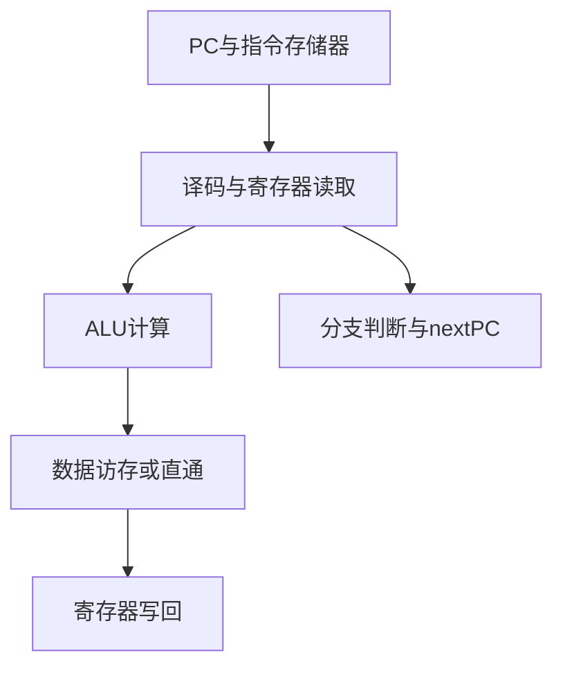

# 19 单周期CPU数据通路

## 19.1 目标与模型假设

先会组合/时序电路与机器指令字段。本章建立教学单周期模型，支持add、addi、lw、sw、beq的基本路径。假设指令存储器与数据存储器可分开访问，读可在周期内组合完成，寄存器/PC在边沿写入。这是便于讲解的模型，不是对真实DRAM时序的承诺。

单周期意味着一条指令的处理在一个较长时钟周期内完成，不意味着所有部件都只经过一层门。

## 19.2 需要哪些部件

| 部件 | 输入 | 输出/状态 |
| --- | --- | --- |
| PC | nextPC | 当前指令地址 |
| 指令存储器 | PC | 机器字 |
| 译码/立即数生成 | 机器字 | 编号、立即数、控制信号 |
| 寄存器堆 | rs1、rs2、rd | 两个读值与可控写入 |
| ALU | 两操作数、操作选择 | 运算结果/条件 |
| 数据存储器 | 地址、写值、读写控制 | 读值或存储更新 |
| 选择器 | 多路候选值 | ALU输入、写回值、nextPC |

这张图表达功能依赖，回写PC和寄存器发生在边沿；不是说程序每走一个框就过一个时钟周期。

## 19.3 跟踪add与lw

`add x7,x5,x6`：取指，读x5/x6，ALU相加，选择ALU结果写x7，nextPC=PC+4，不写数据内存。

`lw x7,4(x5)`：取指，读x5，立即数生成4，ALU算x5+4，将其作为数据地址，读4字节，选择内存读值写x7，nextPC=PC+4。

若x5=0x1000，内存0x1004处word=7，lw后x7=7，而不是0x1004。有效地址与加载结果经过不同路径，不能把ALU输出直接当lw的最终写回值。

## 19.4 sw与beq有何不同

`sw x6,4(x5)`读x5作基址、x6作写入数据，ALU计算地址，数据内存写入，寄存器堆不写。若误把RegWrite打开，会破坏无关寄存器。

`beq x5,x6,label`比较两个寄存器，相等时nextPC=当前PC+分支偏移，否则PC+4。另一路加法逻辑计算目标地址。分支偏移先正确重组和符号扩展；不是把分支目标由寄存器写回端口获得。

## 19.5 时钟被最长指令路径限制

假定取指200 ps、读寄存器100 ps、ALU150 ps、数据存储200 ps、写入相关开销50 ps。简化lw路径共700 ps，即约1.43 GHz。add可能只需500 ps，但同一单周期CPU仍等完整700 ps周期。

真实设计还包括MUX、控制与布线等延迟；例题省略它们只为了练计算，不能据此宣称芯片真实频率。

## 19.6 观察、练习与排错

可选Ripes实验：选RV32单周期处理器，加载[datapath.s](示例代码/05-datapath/datapath.s)，停在最后nop；跟踪addi、add，观察读端口、ALU、写回。记录实际模型名。它是无需打印的片段，不使用RARS退出服务。

练习1：lw中ALU第二输入来自哪里？参考：立即数；写回来自数据存储器。

练习2：sw是否需要读取两个寄存器？参考：需要，基址与要存的数据；没有寄存器写回不代表不读寄存器。

练习3：若最慢lw路径不变，只加快add，单周期频率是否提高？参考：不会提高由lw限定的周期，但其他设计目标可能受益。

下一章：[20 控制器与多周期CPU](20-控制器与多周期CPU.md)。
