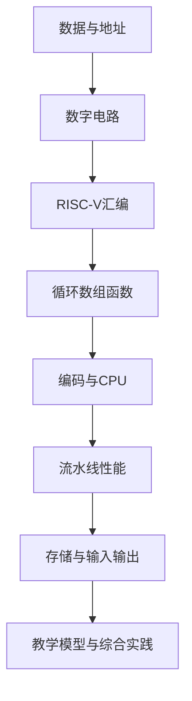

# 00 整体规划与学习路线

## 0.0 详细版已完成01—16章，后续按阶段重写

根据零基础学习反馈，课程正在重新编写。**详细版已完成第01—16章：第一阶段24题、第二阶段28题、第三阶段32题；本轮完成第四阶段13—16章、36题逐题解析、四项实验、整数统计器和18次小课。第17—32章仍保留首版，尚未按新的详细标准重写。** 各阶段都有实验、答案与学习安排。前两阶段可先用纸笔学习，第09章起逐步使用汇编工具。

详细版会先解释术语与必要数学，再展开例题的每一步，加入对照例、常见错误和自测。第一阶段把“读取旧值、计算、写回”“位串与解释”“地址与内容”反复练稳，再进入数字电路和汇编。

| 重写批次 | 章节 | 当前状态 | 详细版的教学重点 |
| --- | --- | --- | --- |
| 第一阶段 | 01—04 | 已完成详细版 | 四章拆成12次小课；状态追踪、进制、补码、20字节存储实验 |
| 第二阶段 | 05—08 | 已完成详细版 | 从真值表推到加法器与ALU；同步更新、时钟约束、浮点编码和舍入 |
| 第三阶段 | 09—12 | 已完成详细版 | 目录与Java起步、逐条汇编、PC与伪指令、寄存器/内存观察与排错 |
| 第四阶段 | 13—16 | 本轮已完成详细版 | 条件与循环逐轮跟踪、数组与有界扫描、调用现场、完整统计器 |
| 第五阶段 | 17—20 | 待重写，暂保留首版 | 逐bit编码、必要C语言、每条指令的数据流与控制过程 |
| 第六阶段 | 21—24 | 待重写，暂保留首版 | 单位换算、逐周期表、转发来源、气泡与冲刷、预测状态 |
| 第七阶段 | 25—28 | 待重写，暂保留首版 | Cache逐次访问、页面转换每一步、设备协议与数据传输 |
| 第八阶段 | 29—32 | 待重写，暂保留首版 | 异常现场、扩展边界、模型源码导读、综合能力练习 |

推荐先按[第一阶段学习记录与验收清单](第一阶段-学习记录与验收清单.md)安排12次小课，每次约45—75分钟。做完[24道阶段练习](第一阶段-练习与参考答案.md)后再进入下一阶段。每阶段可以单独继续编写，章节编号保持不变。

完成第一阶段后，从[第05章](05-逻辑门与布尔代数.md)继续，按[第二阶段学习记录](第二阶段-学习记录与验收清单.md)拆成14次小课，配合[28道阶段练习与解析](第二阶段-练习与参考答案.md)。这一阶段约16—22小时，含手算和复盘。软件模型只作可选核对，不用先学Node或HDL。

第三阶段从[第09章](09-RISC-V工具与第一个程序.md)安装与首次操作开始，按[第三阶段学习记录](第三阶段-学习记录与验收清单.md)拆成16次小课，配[32道阶段练习与解析](第三阶段-练习与参考答案.md)。约18—26小时，包含四项实验与一个读、算、写回的小作品；不要求先学Java编程或C。

第四阶段从[第13章](13-条件分支与循环.md)学习选择与重复，按[第四阶段学习记录](第四阶段-学习记录与验收清单.md)拆成18次小课，配[36题与逐题解析](第四阶段-练习与参考答案.md)。约24—34小时，包括四项实验和统计器；九个独立程序均已做官方RARS命令行验证。

## 0.1 这门课回答什么问题

你在键盘上写下“把 1 到 10 相加”，CPU 为什么会得到 55？这门课沿着同一个问题向下走：数怎样变成比特，指令怎样描述动作，电路怎样执行动作，流水线与缓存怎样提高效率，操作系统怎样参与异常和设备管理。

不要求先会编程、C 语言、汇编、电路或高等数学。需要的数学只有整数四则运算、乘方和简单比例；遇到十六进制、逻辑式、时间公式会从例子开始。第18章补充阅读工具链所需的 C 语言入门，第31章附 JavaScript 模型导读；它们都不作为前面章节的隐含先修。

学完应能手写有循环、数组和函数的 RISC-V 汇编；解释一条机器指令怎样经过 CPU；手算流水线和缓存的小例题；清楚地区分硬件、指令集、调用约定、工具环境和操作系统的职责。

## 0.2 技术路线与工具分工

| 项目 | 本课程的约定 | 为什么这样选 |
| --- | --- | --- |
| 核心 ISA | RV32I | 32位整数主线足以解释CPU，不先加入复杂扩展 |
| 内存模型 | 字节寻址，实验采用小端 | 地址与字节顺序可画表核对 |
| 汇编入门 | RARS，RV32模式 | 能单步查看寄存器、内存、伪指令展开 |
| 微架构观察 | Ripes，选择明确的RV32处理器模型 | 看数据通路与流水过程 |
| 独立实验 | Node.js 20及以上，标准库，无第三方包 | 可选运行附带模型，不影响手算和汇编主线 |
| 高级路线 | RV64、M/A/F/D/C/V概念；HDL/FPGA为后续专题 | 避免零基础一次安装过多工具 |

本教材包含教程正文、本地可复现模型和RARS操作教程。第三批已执行RARS起步组七程序与40场景，第四批已执行程序组九程序与58场景；均为RARS v1.6命令行，GUI单步与Ripes未实际操作。分别见[第三阶段验证记录](验证/第三阶段详细版验证记录.md)和[第四阶段验证记录](验证/第四阶段详细版验证记录.md)。阅读网站不需要联网；首次获取外部工具需要网络。

## 0.3 全部32章与阶段产出

| 阶段 | 章节 | 先学什么，再做什么 | 阶段成果 |
| --- | --- | --- | --- |
| 一：数据基础 | [01 计算机与程序](01-计算机与程序从哪里开始.md)、[02 进制](02-二进制十六进制与位运算.md)、[03 补码](03-有符号整数补码与溢出.md)、[04 内存与编码](04-内存地址字节序与字符编码.md) | 从硬件分工走到数和地址 | 手绘字节布局，解释同一比特串的不同含义 |
| 二：数字电路 | [05 逻辑门](05-逻辑门与布尔代数.md)、[06 组合电路](06-组合电路加法器与ALU.md)、[07 时序电路](07-时序电路寄存器与时钟.md)、[08 运算与浮点](08-整数乘除与浮点数.md) | 先算输出，再看状态怎样保存 | 用真值表和时间表解释一个简单计算器 |
| 三：RISC-V起步 | [09 工具与首个程序](09-RISC-V工具与第一个程序.md)、[10 寄存器](10-寄存器指令与程序计数器.md)、[11 运算指令](11-整数运算立即数与伪指令.md)、[12 访存](12-加载存储与内存实验.md) | 安装、汇编、单步、读状态 | 改写第一个程序，区别地址与内容 |
| 四：完整汇编 | [13 分支循环](13-条件分支与循环.md)、[14 数组字符串](14-数组指针与字符串.md)、[15 函数与栈](15-函数调用栈与ABI.md)、[16 统计项目](16-实战整数统计器.md) | 把逐条指令组织成算法 | 对整数数组求和、最大值和正数个数 |
| 五：CPU实现 | [17 编码](17-指令编码与机器码.md)、[18 C与工具链](18-C语言入门与编译链接.md)、[19 数据通路](19-单周期CPU数据通路.md)、[20 控制器](20-控制器与多周期CPU.md) | 从机器字还原指令，连接执行部件 | 手工跟踪add/lw/sw/beq，填控制表 |
| 六：流水线 | [21 性能](21-性能指标与加速比.md)、[22 五级流水](22-五级流水线.md)、[23 数据冒险](23-数据冒险转发与停顿.md)、[24 控制冒险](24-控制冒险与分支预测.md) | 先计算时间，再讨论并行重叠 | 给同一程序画带停顿、冲刷的时序表 |
| 七：存储与I/O | [25 存储层次](25-存储层次SRAM与DRAM.md)、[26 Cache](26-Cache映射替换与写策略.md)、[27 虚拟内存](27-虚拟内存页表与TLB.md)、[28 I/O](28-总线内存映射IO与DMA.md) | 局部性、地址映射、设备通信 | 手算命中率与地址拆分，说明DMA流程 |
| 八：综合理解 | [29 异常特权](29-异常中断与特权级.md)、[30 扩展](30-RV64与常见扩展.md)、[31 教学模型](31-实战可观察的RV32I子集模型.md)、[32 毕业实践](32-综合实践与后续学习.md) | 划清环境边界，连接全链路 | 运行机器码模型并提交状态、性能和解释报告 |

## 0.4 贯穿实验：一组整数的一生

主线数组固定为 `[3, -2, 7, 0, 4]`。用补码保存负数，用连续内存保存数组，用汇编遍历，得到和12、最大值7、正数个数3。之后把求和部分编码为机器字，在教学 CPU 模型中逐条运行，再研究相同访存序列的缓存行为。

| 版本 | 到哪章 | 可以交付什么 |
| --- | --- | --- |
| v0.1 | 04 | 数组的十六进制字节表 |
| v0.2 | 08 | 加法/选择/寄存器的逻辑说明 |
| v0.3 | 12 | 首个RISC-V程序和单步截图 |
| v0.4 | 16 | 汇编统计器及边界输入结果 |
| v0.5 | 20 | 指令字段表与CPU控制表 |
| v0.6 | 24 | 执行时间和流水线分析 |
| v0.7 | 28 | Cache追踪、地址转换和设备流程 |
| v1.0 | 32 | 可复现模型、结果与独立答辩 |

## 0.5 每章怎样学

先回答本章的问题，读一个例子，然后先预测再运行。记录“输入 → 改变了什么状态 → 输出”；最后换一个输入并做练习。每阶段有独立的练习与参考答案，先做再看。

详细版第一阶段建议预留12—18小时，含纸笔活动、复述、24题和错题复盘；若每周4—6小时，约可安排2—5周，实际按理解情况调整。全课详细版的投入会随各阶段重写继续细化，不沿用首版的阅读量估计作为完成保证。

第二阶段建议另预留16—22小时；前两阶段合计约28—40小时。它们都不要求安装编程工具，第09章再开始安装汇编工具。某次没算对不必回到开头：先找第一处偏差，再定位到进制、宽度、数值解释、地址、指令或时序。正文的网页阅读分钟只估算文字阅读，不包含动手和复习。

第三阶段另预留18—26小时，前三阶段合计约46—66小时。准备工具的时间因平台与网络而异；可把一次安装和第一次汇编拆成两次学习，不把装好软件等同于完成汇编实验。

第四阶段另预留24—34小时，前四阶段合计约70—100小时。进度按自己能解释的状态和完成的实验判断，不按作者已写到第几章判断。

## 0.6 后续课程与并行编写边界

计算机组成是计算机基础的一门独立课。操作系统、计算机网络、数据结构、C语言、数字逻辑/HDL可以另建课程，分别拥有自己的目录、章节号和阅读进度。学习顺序上，操作系统可引用本课的地址、栈、异常、虚拟内存；本课不提前要求掌握操作系统。

作者的任务边界与文件归属保存在课程目录的 `AUTHORING.md` 和网站根目录的 `并行编写规范.md`，不需要为了新增其他教程修改本课程的章节号。

下一步：[01 计算机与程序从哪里开始](01-计算机与程序从哪里开始.md)。
