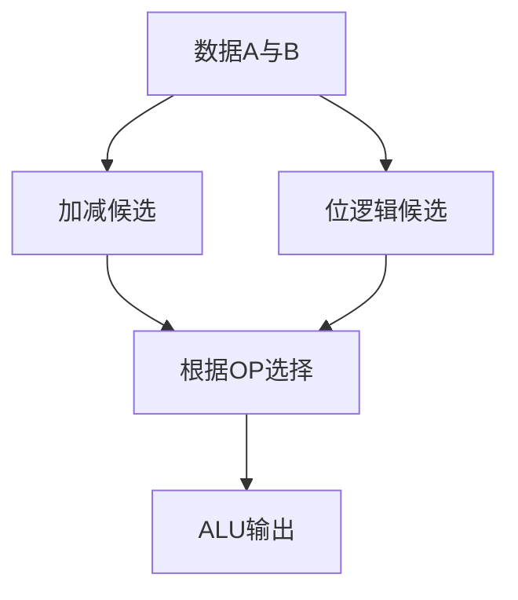

# 06 组合电路、加法器与ALU

## 6.1 把纸上的加法变成一个电路问题

你已会第02章的二进制加法和第05章的逻辑门。这章把两者接起来：怎样用只能处理0、1的门，算出多位整数的和？

先只算一位，再加入从低位来的进位，最后接成4位运算器。4位便于在纸上看清每条线，原理可扩展到本课后面使用的32位。

建议分三次学习：第6.2—6.7节做一位与多位加法；第6.8—6.12节做加减和比较；其余部分组成小ALU并完成实验。每次约45—75分钟。主线依然不需要先学硬件描述语言。

## 6.2 为什么1+1需要两个输出

两个1位输入A、B，每个只有0或1。它们的数学和可能是0、1、2。单独一个输出bit只能表示0或1，无法区分全部三种结果。

用两位表示结果：低位叫S，本位和；高位叫C，进位。于是0写00，1写01，2写10。

| A | B | 数学和 | 高位C | 低位S |
| --- | --- | --- | --- | --- |
| 0 | 0 | 0 | 0 | 0 |
| 0 | 1 | 1 | 0 | 1 |
| 1 | 0 | 1 | 0 | 1 |
| 1 | 1 | 2 | 1 | 0 |

看S列正好是XOR，C列正好是AND。因此一个XOR加一个AND就能实现：`S=A XOR B`，`C=A AND B`。

这种只加两个输入、不接收低位进位的电路叫**半加器**。本章S表示sum，不是前章某张选择器表里的选择信号；信号名要结合当前电路理解。

## 6.3 半加器为什么还不够

纸上多位加法从右往左算。算第二位时，除了本位A、B，还可能有低位传来的1。若这个第三个输入被忽略，0111+0001就算不对。

因此增加Cin，表示本位的进位输入；输出Cout，表示送往更高位的进位。输入A、B、Cin三位，数学总和可能是0、1、2、3，仍可用Cout和S两位表示。

这个能接收进位的1位加法电路叫**全加器**。“全”不是能一次加任意多位，只是把本位需要的三项输入考虑完整。

## 6.4 全加器的8行表，一行一行填

| A | B | Cin | 总数A+B+Cin | S | Cout |
| --- | --- | --- | --- | --- | --- |
| 0 | 0 | 0 | 0 | 0 | 0 |
| 0 | 0 | 1 | 1 | 1 | 0 |
| 0 | 1 | 0 | 1 | 1 | 0 |
| 0 | 1 | 1 | 2 | 0 | 1 |
| 1 | 0 | 0 | 1 | 1 | 0 |
| 1 | 0 | 1 | 2 | 0 | 1 |
| 1 | 1 | 0 | 2 | 0 | 1 |
| 1 | 1 | 1 | 3 | 1 | 1 |

先数每行有几个1，再把数量写成二进制：2是10，因此S=0、Cout=1；3是11，因此两者都1。

独立检查最后一行很重要。若A=B=Cin=1，你却得到S=0，往往是只计算了A XOR B，漏掉Cin。

## 6.5 全加器公式怎样从两个半加器得到

第一层先加A、B，得到中间和P与进位G：

```text
P = A XOR B
G = A AND B
```

第二层把P与Cin相加：本位S=P XOR Cin，第二层进位H=P AND Cin。最后只要G或H有一个产生进位，Cout就为1。

```text
S    = A XOR B XOR Cin
Cout = (A AND B) OR ((A XOR B) AND Cin)
```

例如A=1、B=0、Cin=1：P=1，G=0；S=1 XOR 1=0；H=1 AND 1=1；最终Cout=0 OR 1=1。和前面的真值表一致。

不要把“先算P，再算S”误读成必须两次时钟。这里是组合路径的依赖，真实门会经过各自传播延迟后稳定。

## 6.6 把四个全加器接起来

设A有A3A2A1A0四位，B同样。最低位的进位C0先设0，第0级得到S0和C1，C1接到第1级Cin，依次传到第3级。

```text
第0级：A0 + B0 + C0 → S0，C1
第1级：A1 + B1 + C1 → S1，C2
第2级：A2 + B2 + C2 → S2，C3
第3级：A3 + B3 + C3 → S3，C4
```

保存的4位结果按高到低写S3S2S1S0；C4是超出4位的最终进位。第0级不是最高位，不能从左边开始随便把进位往右传。

因为进位逐级传播，这种结构叫**行波进位加法器**。输入位宽增加，可以接更多级，但最长等待路径也可能增加。

## 6.7 完整追踪：4位5+3

5=0101，3=0011，C0=0。从低位开始填表：

| 位号i | Ai | Bi | 本级Cin | 这一位总数 | Si | Cout |
| --- | --- | --- | --- | --- | --- | --- |
| 0 | 1 | 1 | 0 | 2 | 0 | 1 |
| 1 | 0 | 1 | 1 | 2 | 0 | 1 |
| 2 | 1 | 0 | 1 | 2 | 0 | 1 |
| 3 | 0 | 0 | 1 | 1 | 1 | 0 |

把S从高到低读为1000，无符号值8，最终C4=0。按4位补码解释，1000却是−8，数学正数5+3超出了最大7，因此有符号溢出。

这再次展示：电路输出的位串相同，进位与数值解释是不同问题。不能因为C4=0，就断言所有解释下都没有超范围。

再算1111+0001：每级和位都是0，最终C4=1，4位结果0000。无符号15+1超范围；补码−1+1=0却正常。

## 6.8 为什么同一个加法器也能做减法

第03章推导过固定位宽下`A−B=A+(NOT B)+1`。电路只需要在减法时把B每一位取反，再让最低位进位为1。

设控制信号SUB：SUB=0做加法，SUB=1做减法。把每位B先与SUB做XOR：

| SUB | B原位 | B XOR SUB | 最低进位C0 |
| --- | --- | --- | --- |
| 0 | 0 | 0，不改变 | 0 |
| 0 | 1 | 1，不改变 | 0 |
| 1 | 0 | 1，取反 | 1 |
| 1 | 1 | 0，取反 | 1 |

加法时B原样通过、C0=0；减法时B取反、C0=1。控制信号只改变数据路径怎样工作，并不意味着给电路另塞一条数学负号。

## 6.9 完整追踪：5−3与3−5

算5−3：A=0101，B=0011，SUB=1；B处理后是1100，最低进位为1。数学总数5+12+1=18，完整5位结果10010，低4位0010即2，最终进位1。

算3−5：A=0011，B=0101；B处理后1010，最低进位1。3+10+1=14，4位1110，按补码是−2，最终进位0。

| 运算 | 低4位 | 最终进位 | 补码数值 |
| --- | --- | --- | --- |
| 5−3 | 0010 | 1 | 2 |
| 3−5 | 1110 | 0 | −2 |

加法器的最终进位在这个无符号减法结构中与“是否借位”的关系，需要结合A+NOT B+1的实现解释；不能直接把它当作“负号”或统一的错误标志。

如果结果错，逐项核对：是否先限定位宽 → B是否每位都取反 → 最低Cin是否设1 → 最后是否只保留规定和位。漏掉最低加1，结果通常会少1。

## 6.10 判断相等可以怎样搭

两位相等时XOR为0，因此多位A、B可以先逐位XOR，再把所有差异位OR起来。

例如A=0101、B=0101，XOR结果0000，差异位OR为0，表示完全相等。若B=0111，XOR结果0010，至少一位不同，差异OR为1。

若希望“相等”信号为1，就把差异OR再取反。不要只比较最高位：0101与0111最高位都0，但不是相同整数。

## 6.11 有符号小于不能只盯减法结果的最高位

无符号比较和补码比较可能给不同结论。4位1111与0001：无符号15不小于1；补码−1小于1。

有时人会猜：“先A−B，如果结果最高位1，就说明A<B。”这在发生有符号溢出时会失败。例如4位A=7、B=−1，数学A−B=8，截断后1000看起来负，但7显然不小于−1。

真实比较逻辑需结合符号、溢出等正确判断，或者采用等价的专门结构。本章先学会给出反例，不要求背完一套比较器门图。后续RISC-V的有符号/无符号比较指令会直接规定对应语义。

## 6.12 移位器也是组合部件

若把数据各位接到不同输出位置，就能实现固定位移；可变移位需要按移位量选择不同路径。这里先看功能，不设计完整32位结构。

4位0110逻辑左移1，保留4位得到1100，无符号6变12；右侧补0。4位1001逻辑右移1得到0100，右侧原1丢掉。

输入位宽、补0还是补符号、超出部分是否丢弃，都必须写在功能约定里。画了一个名叫“移位器”的盒子，不意味着它自动知道你想执行哪一种右移。

## 6.13 ALU：根据控制选择运算结果

**ALU**是算术逻辑单元，提供加减、位逻辑、比较、移位等运算功能。下面先设计一个只有四种功能的4位教学ALU。

输入数据A、B都是4位；操作选择OP是2位。假设00加、01减、10按位AND、11按位OR，所有算术只保留低4位。

| OP | 选择功能 | A=0101、B=0011时的输出 |
| --- | --- | --- |
| 00 | A+B | 1000 |
| 01 | A−B | 0010 |
| 10 | A AND B | 0001 |
| 11 | A OR B | 0111 |

OP=10在这里代表操作编号2，不是拿十进制10与数据相加。它的含义由这张教学控制表约定，不是直接照搬某条RISC-V指令的机器码。

## 6.14 ALU里的选择器在做什么

从功能上可以让加减单元、AND路径、OR路径分别给出候选值，再由选择器把当前OP对应的候选送到输出。实际硬件可共享资源、采用不同结构，不强制每种运算都各占一整套独立电路。



ALU没有因此获得“记住上次结果”的能力。输入或OP改变，组合输出也会在传播后改变。若程序要保留结果，必须再写入寄存器或其他存储。

CPU除了ALU，还要取指令、保存执行位置、读写寄存器、访问内存、产生控制信号。把ALU当作整颗CPU，会漏掉这些职责。

## 6.15 进位传播怎样影响等待时间

假设每一级从Cin变化到Cout稳定最多2 ns，A/B早已稳定。四级最终进位的这条路径，最坏可以逐级等到2、4、6、8 ns。

这是对指定路径的简化分析，不代表所有和位也一定恰好8 ns稳定，更不是每次都必须等最坏值；其他路径与器件参数需要分别检查。

更快加法器可以用并行推算等方式减少某些进位等待，代价可能是更多逻辑与布线。本阶段先理解为什么“相同加法功能”能有不同实现速度，不把一种实现当作ISA强制要求。

## 6.16 纸笔搭一台四功能计算器

画A、B、OP三个输入框，列四个候选结果和一个输出框。先固定A=5、B=3，只改变OP，得到8、2、1、7。

再把A换成3、B换成5，检查加法仍8，减法按4位得到1110，AND仍1，OR仍7。交换输入对加法、AND、OR不改变结果，但减法会改变。

最后问自己：OP改变但没有时钟时，ALU输出可以改变吗？可以，因为它是组合逻辑。这个问题将自然引出下一章的状态保存。

可选运行[逻辑实验](示例代码/02-logic/README.md)核对全加器与4位加法；纸笔仍是本阶段的必做练习。

## 6.17 自测与参考过程

先做八题：①半加器为什么要两个输出；②全加器1、0、1的S/Cout；③全加器1、1、1的S/Cout；④4位1111+0001的结果与进位；⑤用加法器做5−3时B改成什么、C0是什么；⑥ALU输入5和3、OP=10输出什么；⑦只比较最高位能判断两个数相等吗；⑧保存结果为什么还需要寄存器？

参考：①数学和可能为2，需两位；②总数2，因此0/1；③总数3，因此1/1；④0000，进位1；⑤B取反为1100，C0=1；⑥0001；⑦不能，0101与0111是反例；⑧组合输出会随输入改变，需要状态部件保持结果。

完成条件：独立填全加器8行表，逐位追踪一次4位加法，解释SUB控制的两个作用，并区分ALU输出与已保存的状态。下一章：[07 时序电路、寄存器与时钟](07-时序电路寄存器与时钟.md)。
