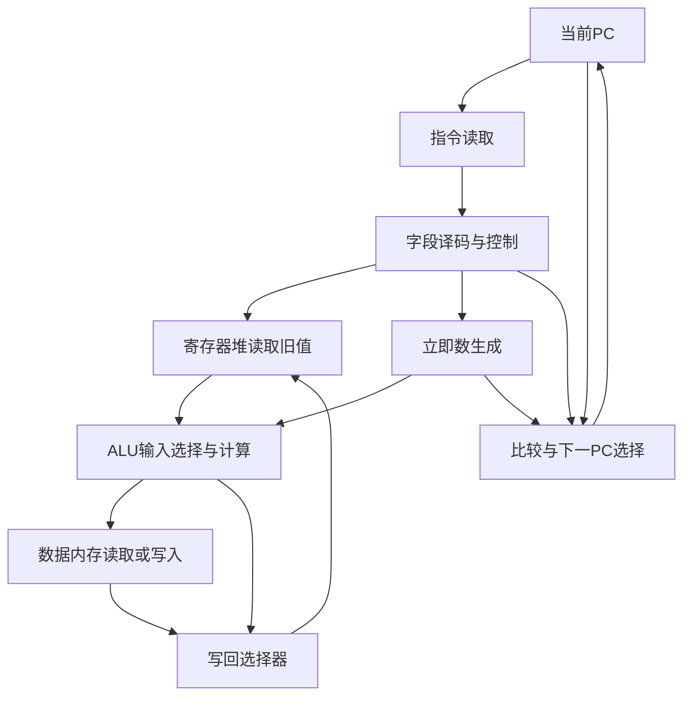

# 19 单周期CPU数据通路

## 19.1 一条指令内部还有哪些动作

前面把一条指令作为一步观察，这一章打开这一步：机器字从哪里来，寄存器怎样被读取，ALU算什么，数据怎样进入内存或写回寄存器。

先修是第05—07章的逻辑、选择器与状态，第12章访存，以及第17章字段。学完应能为add、addi、lw、sw、beq指出数据经过的部件、使用的控制选择与最终改变的状态。

建议四次小课：19.2—19.6搭整体图；19.7—19.11逐条追踪；19.12—19.14做七步实验；最后理解时间与自测。主线为纸上模型，可选运行附带Node功能追踪；不要求先学HDL或安装Ripes。

## 19.2 先说明模型，不能偷偷假设任意存储器都一样

本章教学单周期模型只覆盖五种指令。假定指令读取与数据读取有独立访问路径，读取可在一个周期内组合完成；PC、寄存器写入和数据存储写入在相应周期边沿生效。控制逻辑在边沿前及时稳定。

这些是模型假设，不是宣称真实DRAM能随意组合读、或某颗RISC-V芯片必须有两个物理存储器。真实实现可以用Cache、多端口、等待机制等；本阶段先理解功能依赖。

**单周期**表示一条指令在一个较长时钟周期内完成，而不是每个方框都各花一个周期。取指、译码、计算、访存、写回这些名字在本章描述功能，不是自动变成五个时钟。

## 19.3 数据通路与控制器各负责什么

**数据通路**传输、计算和保存数据，包括寄存器堆、ALU、存储器和选择器。**控制器**根据当前指令决定用哪条路径、哪些状态允许写入。下一章专门展开控制。

例如ALU已有两个输入接口，但第二个到底选寄存器值还是立即数，需要一个选择信号。运算结果与内存读值都能到写回选择器，但当前是lw时应选内存值，不能让数据“自己知道该往哪里走”。

| 部件 | 接收什么 | 提供什么 |
| --- | --- | --- |
| PC寄存器 | 下一PC、写入时刻 | 当前指令地址 |
| 指令读取路径 | 当前PC | 32位机器字 |
| 字段译码与立即数生成 | 机器字 | 编号、符号扩展后的立即数、控制 |
| 寄存器堆 | 两个源编号、写回编号/值/使能 | 两个旧读值与可控写入 |
| ALU | 两个操作数、运算选择 | 加法结果或比较所用结果 |
| 数据内存路径 | 有效地址、写值、读写使能 | 读取内容或保存新内容 |
| 选择器与PC逻辑 | 多个候选、控制信号 | ALU输入、写回值、下一PC |

## 19.4 画主路径，不把每个框当一个周期



图中的反馈箭头表示后续状态更新，不是组合结果立刻反过来改旧输入。一次指令先用当前PC和旧寄存器值计算，边沿时提交被允许的变化，下一周期才基于新状态工作。

同一个周期内可以有多路组合计算并行发生。例如顺序PC+4与分支目标PC+立即数可各自产生候选；控制选择其中一个作为下一PC。

## 19.5 立即数生成不是无条件取高12位

addi与lw用I型立即数；sw要把S型两块拼回；beq要重组B型位域并恢复隐含0。生成后都按各自位宽解释负号，成为32位地址或算术输入。

R型add不需要立即数。即使某软件追踪器机械算了一个没有使用的字段值，也不能说它参与执行。判断“用了什么”应看被选择的有效路径与控制条件，而不是看到某根线上有数就当它都产生效果。

## 19.6 寄存器堆有读口，也有受控写口

本模型可同时读取两个源，稍后向一个目的写入。读值来自执行前状态；即使rd与rs1相同，也先取得旧源值，再形成写回值。

RegWrite关闭时，不改通用寄存器；它不是关闭所有读取。sw与beq仍需要两源：前者分别提供地址基址与待存数据，后者用于比较。目的为x0时也不会保存非零值，但访存等其他动作仍要独立判断。

## 19.7 add：不经数据内存就能写回

例`add x10,x6,x7`，旧x6=5、x7=7。译码得到两个源和目的编号；读值5、7；ALU第二输入选寄存器7；加法结果12；写回选ALU结果，边沿更新x10=12；下一PC选PC+4。

数据内存的MemRead、MemWrite都为0，不会因为图里画了内存框就强制访问一次。add写的是寄存器，不会同时把某个数据槽中的5改12。

若ALU有结果12却x10没更新，先查写使能、写回目标与选择器，而不只说“加法器坏了”。功能正确需要计算和提交路径都正确。

## 19.8 addi：第二输入改选立即数

`addi x7,x6,2`读旧x6=5，立即数生成2，ALU第二输入选择2而非某个rs2读口，结果7写x7。

I型指令bit24—20属于立即数，不是这条语义中的第二源寄存器。虽然相同电线位置可以被硬件接到某读口，它的读值不应被当前ALU输入选择采用。把所有格式都当“两源寄存器相加”会在这里出错。

## 19.9 lw：地址和读出的内容是两条不同数据

设x5=0x100，内存从0x100开始的word是5，执行`lw x6,0(x5)`。ALU先算0x100+0=0x100；这个结果用作数据地址。内存按地址读出5，写回选择器选这个5，更新x6。

| 位置 | 数值 | 用途 |
| --- | --- | --- |
| 基址旧读值 | 0x100 | 地址计算输入 |
| 立即数 | 0 | 地址偏移 |
| ALU输出 | 0x100 | 有效地址 |
| 数据内存输出 | 5 | 真正加载的数据 |
| 寄存器写回 | x6=5 | 本条架构结果 |

如果写回错误选ALU输出，会把256写x6而非5。地址恰好等于内容的例子发现不了错误，因此实验刻意选择明显不同的数值。

## 19.10 sw：地址用立即数，写数据仍来自第二源

设x5=0x100、x7=7，执行`sw x7,4(x5)`。ALU第一输入基址256，第二输入偏移4，算出260即0x104；数据内存写入值却来自x7的7，不是ALU第二输入的4。

这条同时需要三种信息：基址、偏移、待存内容。ALUSrc选立即数并不表示可以把rs2读口关掉，因为写内存数据另走一路。RegWrite为0，MemWrite为1，边沿改memory[0x104]，寄存器都保留。

若错误把sw当成有rd写回，可能用低立即数字段误选某寄存器。第17章说明过，S型bit11—7不是rd；控制器应关掉这条写回路径。

## 19.11 beq：两种地址候选与比较

设分支当前PC=0x10，偏移8，两源5和7。比较不相等，下一PC选0x14；PC+偏移的0x18虽然可以并行算出，但没有被采用。

若当前PC=0x18、偏移8、两源均7，比较相等，下一PC选0x20。分支不写普通寄存器，也不写数据内存。目标用旧的当前PC，不是顺序候选PC+4。

本模型可用ALU做减法并检查结果为0表达相等，也可另设比较逻辑；ISA只要求最终语义，不要求某一种门结构。目标地址加法器需要PC与偏移，即使主ALU第二输入当前在比较寄存器值，立即数仍有用途。

## 19.12 可运行功能实验：七次提交

新增[datapath-lab.cjs](示例代码/05-datapath/datapath-lab.cjs)是五种指令的软件功能模型，打印被读值、立即数、ALU输出、内存读值、控制与写回。它不生成时钟波形、不模拟门延迟，也不是完整RV32I处理器。

程序内存起点PC=0，数据word在0x100初值5；以下PC均十六进制。这里用低地址便于演算，不是RARS的默认代码/数据布局。

| 执行前PC | 操作 | 本步关键结果 | 下一PC |
| --- | --- | --- | --- |
| 00 | addi x5,x0,256 | x5=0x100 | 04 |
| 04 | lw x6,0(x5) | 地址0x100，x6=5 | 08 |
| 08 | addi x7,x6,2 | x7=7 | 0C |
| 0C | sw x7,4(x5) | 地址0x104，内存写7 | 10 |
| 10 | beq x6,x7,+8 | 5!=7，不跳 | 14 |
| 14 | add x10,x6,x7 | x10=12 | 18 |
| 18 | beq x7,x7,+8 | 相等，跳过PC1C | 20 |

PC1C的一条赋−1没有执行。宿主脚本只推进表中七步并在PC20前停止，没有实现一个RARS退出服务；不能继续越过实验约定范围取指。

## 19.13 运行命令与输出解释

可在**PowerShell、网站根目录**运行，已有Node.js 20以上即可，无第三方依赖：

```powershell
node content/computer-organization-riscv/source/示例代码/05-datapath/datapath-lab.cjs
```

每条JSON是一条指令的功能事务，最后应为`a0 = 12, memory[260] = 7, nextPC = 32`。最后32是十进制0x20，不是程序总共走了32步。

controls里true/false表示软件描述的有效控制选择；registerWrite与memoryWrite表示本步提交。lw行aluResult=256、memReadValue=5；sw行aluB=4、memoryWrite.value=7。这两组不同值正是本章要分开的路径。

某些非分支行也会打印一个未使用target候选，比如addi算出10；Branch=false时它不会成为nextPC。理解“候选存在”与“被选择并生效”的区别，而不是要求所有闲置中间值都必须0。

## 19.14 官方模拟器与微架构观察分开

新增完整[datapath-rars.s](示例代码/05-datapath/datapath-rars.s)在RARS默认环境用数据[5,0]完成load、加2、store、未跳分支和相加，打印12。它另有la与ecall，属于RARS完整程序环境，超出五指令模型本身的范围。

与JAR放在练习目录，在**PowerShell、该目录**执行：

```powershell
java -jar .\rars1_6.jar nc sm a0 t1 t2 0x10010000-0x10010004 .\datapath-rars.s
```

应有a0=12、t1=5、t2=7，两个word为5和7。本批已用官方RARS v1.6命令行运行，打印与这些状态一致，原始输出见[完整检查结果](验证/stage5-checks.json)。它证明该完整程序的架构结果，不证明RARS真的按本章画的单周期电路执行。

原[datapath.s](示例代码/05-datapath/datapath.s)保留为可选Ripes观察片段：选实际可用的RV32单周期模型，在stop前断点，观察前三条后a0=7。片段没有退出环境，不要越过末尾。Ripes具体界面操作本批未实测。

## 19.15 周期由最慢有效路径约束

设一道简化时序题给出：取指200ps、寄存器读取100ps、ALU150ps、数据读取200ps、相关时序与选择开销合计50ps。这里ps为皮秒，1ps=10⁻¹²秒；这些是题设，不是实测器件参数。

lw串行依赖路径需200+100+150+200+50=700ps。add不读数据内存，对应题设路径500ps。但在同一个固定周期单周期CPU里，不能add用500ps、lw临时把时钟换成700ps；本题周期至少700ps，且假定其他路径不更慢。

理想最大频率1/(700×10⁻¹²)约1.43GHz。真实电路还要看各选择、布线、控制、时钟不确定性及实际存储器接口；本题合并和省略了细节，不把算式频率当成造出一颗芯片的证据。

## 19.16 状态更新时刻与传播过程别混淆

周期内部组合输出可能尚未稳定，不能刚一变化就当作新寄存器状态。先读旧状态、沿路径计算，满足时序后在边沿写入；下一周期再使用新值。

软件step为了便于观察，在一次调用中计算候选并提交最终结果。它没有模拟真实信号毛刺或建立/保持违例；功能结果正确不等于该电路按给定频率工作正常。第07章的时序原则仍适用。

## 19.17 常见错误与独立演算

把数据初值5改成9，先预测x6=9、x7=11、sum=20、内存0x104=11；两次分支仍分别不跳与跳。若模型想换输入，应在自己的脚本副本调整初始化，别改机器字却忘记记录新语义。

再用纸笔追踪`lw x6,4(x5)`且x5=0x100、memory[0x104]=99：地址260、写回99、基址保留256。写回260多半是ResultSrc错误；读到5多半是偏移或地址选择错误；内存被改则查MemWrite。按路径定位比只猜“CPU错了”有效。

## 19.18 自测、参考过程与完成条件

先答八题：①单周期的五个功能框是否五周期；②lw第二ALU输入；③lw写回来源；④sw是否读第二源；⑤beq是否需要立即数；⑥未选中的target有值是否代表跳了；⑦七步模型是否完整ISA/HDL；⑧只加快add而lw仍700ps，固定周期能缩短吗。

参考：①不是；②立即数；③数据内存读值；④需要，提供写数据；⑤需要，给目标地址计算；⑥不是；⑦都不是；⑧本题不能，最慢有效路径仍限制周期。完成条件：为五种指令各画有效路径、列真正写入的状态，独立复算七步表，并说明模型的功能与时序边界。下一章：[20 控制器与多周期CPU](20-控制器与多周期CPU.md)。语义依据[RV32I原文](https://raw.githubusercontent.com/riscv/riscv-isa-manual/main/src/unpriv/rv32.adoc)，模型结构与延迟数字为本教材明确题设，核验日期2026-11-05。
