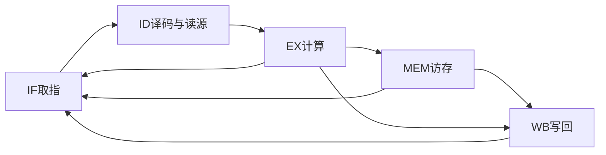

# 20 控制器与多周期CPU

## 20.1 从“能走的路径”到“本次选择哪一条”

先修是第19章的五指令数据通路。本章学习给部件产生写使能与选择信号，再把一条指令拆成多个较短周期，理解中间状态为什么必须保存。

学完应能独立填写add、addi、lw、sw、beq的控制表，根据故障现象定位选择错误，画出lw与分支的多周期状态，并用周期数乘周期时间比较执行时间。

建议四次小课：20.2—20.6学控制表与译码；20.7—20.11学中间寄存器与状态；余下两次推导分支、时间与练习。本章仍是教学模型，不表示所有RISC-V芯片有这组同名信号。

## 20.2 控制信号不是神秘的新数据类型

**写使能**决定当前时刻是否更新某项状态；**选择信号**决定多路候选中哪一路进入目标。可以用0/1或若干位编码表达，具体电路编码由实现定义。

RegWrite允许寄存器写回；ALUSrc在寄存器值与立即数之间选择ALU第二输入；MemRead/MemWrite决定是否进行数据读取/写入；ResultSrc选择ALU结果或内存读值；Branch表示当前指令有条件改变PC。

信号名字只是本教材为了说明路径起的名字，不是ISA在芯片外部规定的统一引脚。另一张设计图用不同名称或编码，也可实现相同指令语义。

## 20.3 五种指令的完整基本控制表

下表对应第19章的单周期五指令模型。“无写回”指RegWrite=0，不表示电路里完全没有候选数值。

| 指令 | RegWrite | ALUSrc | MemRead | MemWrite | ResultSrc | Branch | 主ALU动作 |
| --- | --- | --- | --- | --- | --- | --- | --- |
| add | 1 | 寄存器 | 0 | 0 | ALU | 0 | 两源相加 |
| addi | 1 | 立即数 | 0 | 0 | ALU | 0 | 源与立即数相加 |
| lw | 1 | 立即数 | 1 | 0 | 内存 | 0 | 基址加偏移 |
| sw | 0 | 立即数 | 0 | 1 | 无写回 | 0 | 基址加偏移 |
| beq | 0 | 寄存器 | 0 | 0 | 无写回 | 1 | 两源比较或相减 |

beq的目标还需另一条PC加偏移路径，所以ALUSrc=寄存器不意味着立即数生成器完全无用。sw第二ALU输入选偏移，但内存写数据仍来自寄存器rs2。

## 20.4 下一PC选择需要两个条件

本模型对beq可写成：`是否采用分支目标 = Branch AND Equal`。Equal表示两源相等；Branch保证当前指令确实是分支。

add的两源碰巧都为7，Equal也可能为1，但Branch=0，因此不跳。若只拿ALU零结果或Equal直接控制PC，普通运算就可能意外转移位置。数据条件与指令类别应共同约束副作用。

本表没有jal等控制，不能把Branch=0理解为完整RISC-V中“其他任何情况都PC+4”。这是明确限定五种操作的局部规则。

## 20.5 从字段生成控制，不只看一小块

先用opcode判断大类，再结合funct3/funct7等判断具体指令。lw与字节加载共享load大类，但宽度字段不同；add与sub共享R型大类与funct3，funct7不同。

本模型只支持add，不支持sub。即使sub在完整RV32I中合法，五指令教学模型也应明确报告“不支持”；不能把它默默当add。另一类编码可能在完整ISA中本身非法，受支持范围与ISA合法性要分开说明。

遇到不支持或非法编码，软件模型抛出明确错误而不提交寄存器/内存结果；这不是已经实现真实处理器的trap、CSR或特权处理。第29章再讲架构异常，当前先避免用默认nop隐藏问题。

## 20.6 不要随意把“无关项”变成允许写入

若RegWrite=0，写回选择器输出通常不影响架构结果，可以用“无写回”描述，而不强求候选必须清零。但是RegWrite本身不能当无关项随便取1。

sw、beq若误写寄存器，S/B格式中的立即数片段可能被当作rd编号，破坏无关状态。MemWrite默认也应关闭，只有确实识别存储指令与有效地址时才允许写入。

控制表不是只填“主要动作”的表。哪些事情必须不发生，同样是语义的一部分；下一步对照控制和数据，才能定位副作用。

## 20.7 为什么拆成多周期会需要新寄存器

单周期模型在一个长周期内把依赖走完。**多周期CPU**把一条指令的动作分时执行，可复用同一个ALU、存储器路径；但上一周期的组合输出下一周期可能变化，必须把还要用的结果保存下来。

例如算完lw地址后，下一周期ALU可能被安排别的输入。如果不保存有效地址，后续内存读取就失去正确起点。内存读完的数据也要留到写回周期，不能假定上一周期输出会永远原样等候。

这与第07章“组合部件不会自动记住上次结果”一致。增加状态不是因为数学变了，而是因为动作在时间上分开了。

## 20.8 一套明确的多周期教学约定

下面另建一个复用ALU的教学调度，不声称是第19章硬件只改一个开关就自动得到它。IF取指时把PC推进4，并另存本条InstrPC；这样分支以后仍能拿到分支自身地址。

| 中间状态 | 含义 | 为什么不能只依赖当前输入 |
| --- | --- | --- |
| IR | 本条机器字 | 后续状态仍要译码/取得rd |
| InstrPC | 本条取指时的PC | PC在IF后已推进，分支需原地址 |
| A、B | 读出的两个旧源值 | 后续周期反复使用同一条的操作数 |
| ALUOut | 地址、运算结果或已算分支目标 | 让ALU下一周期可复用 |
| MDR | 内存读出的数据 | 下一周期再写回寄存器 |

这些是本实现内部状态，架构程序通常看不到这些名字；x寄存器、PC、内存等架构状态才是指令语义直接描述的对象。同一ISA可以有不同内部寄存器和状态数量。

## 20.9 完整走一条lw的五个周期

纸上设执行前PC=0x80，x5=0x100，memory[0x104]=7，当前指令`lw x7,4(x5)`。每行结果在本周期结束时保存：

| 周期状态 | 本周期工作 | 新保存的状态 |
| --- | --- | --- |
| IF，取指 | 指令存储读取PC；ALU算PC+4 | IR为本条、InstrPC=80、PC=84 |
| ID，译码/读源 | 由IR确定x5、立即数与目的 | A=100；IR继续保持 |
| EX，算地址 | ALU使用A与立即数4 | ALUOut=104 |
| MEM，读取 | 数据内存按ALUOut读word | MDR=7 |
| WB，写回 | 选择MDR、目的为IR里的x7 | x7=7；进入下一条IF |

表中地址都是十六进制，数据7是普通整数。直到WB才写x7；前面ALUOut=104不应提前被当作x7结果。取指后的PC84也不能把InstrPC80替换掉，分支会用到这一分界。

## 20.10 add与sw为什么不走全部五步

add经过IF、ID、EX得到ALUOut=A+B，之后直接WB写回，共4周期，不需要MEM读取。addi类似，只是EX第二输入选立即数。

sw经过IF、ID、EX算地址，再MEM把B写到ALUOut所指位置，共4周期；没有寄存器WB。访问宽度仍由指令定义，不因拆周期而把一个word分成任意宽度操作。

若给所有指令都加一个“什么也不做”的WB，功能可能仍对，却改变本题周期数；如果把sw的WB做成真的寄存器写入，功能也错。分析时先说清具体调度，再报CPI。

## 20.11 单ALU怎样分时完成分支目标与比较

对beq，本调度在IF先算PC+4；ID读A/B时，ALU可同时用InstrPC与分支偏移算目标，保存到ALUOut；第三个周期EX用A−B判断相等。

若相等，PC写**此前保存的ALUOut目标**；不相等，PC保留IF已经得到的顺序地址。EX不把目标槽覆盖成比较差值。这样一个ALU在不同周期做三种不同计算，不是假设同一ALU同时输出加目标与减比较两种结果。

纸上InstrPC=0x100、偏移−8，目标保存F8；IF后顺序PC为104。EX相等就改PC到F8，否则仍104。如果忘保存InstrPC而用已推进104算目标，会错到FC；这正是中间寄存器不只是“多画几个盒子”的原因。

## 20.12 控制器也是状态机

**状态机**根据当前状态和输入决定输出与下一状态。多周期控制不仅看IR的指令字段，还看自己正在IF、ID、EX还是MEM等阶段。同样的lw，在EX要算地址，在WB要写寄存器，控制不能完全相同。

哪些边可走由指令与当前状态限定：lw走MEM再WB；sw在MEM结束回IF；add从EX去WB；beq在EX结束回IF。不是每次进入EX后可以随意选一条边。

状态寄存器在时钟边沿更新，输出控制选择与写使能安排各部件动作。真实设计还需处理等待、复位、异常等；这张小图不假装覆盖生产CPU全部情况。

## 20.13 时间比较必须把两个因子乘起来

在另一道简化题里，单周期固定700ps；多周期固定250ps（题设已包含每状态的相关开销），lw5周期、add/addi/sw4周期、beq3周期。

| 指令 | 单周期时间 | 多周期时间 |
| --- | --- | --- |
| add/addi | 700ps | 4×250=1000ps |
| lw | 700ps | 5×250=1250ps |
| sw | 700ps | 4×250=1000ps |
| beq | 700ps | 3×250=750ps |

周期缩短不保证单条更快；本题多周期每条反而更慢。它仍可能有资源复用等目的，不能凭频率高就宣布性能一定好，也不能凭本题就断言所有多周期实现一定慢。

这组250ps是独立题设，不是通过只看ALU150ps就忽略存储、寄存器和时序开销得到的频率。

## 20.14 混合程序也要按真正指令次数算

设100条中add/addi共60条、lw20条、sw10条、beq10条。按本题调度总周期60×4+20×5+10×4+10×3=410，平均CPI=4.1。

多周期总时间410×250=102500ps；单周期100×700=70000ps。不是把平均CPI4.1与700ps直接比较，也不是把源代码100行自动当100条机器指令。

第21章会继续展开性能和加速比；本章先把“执行次数×每条所需周期×周期时间”的单位链练清楚。

## 20.15 多周期还不是流水线

本调度一条指令完成后才开始下一条IF；多个状态在时间上串行推进。流水线则可以让不同指令同时处于不同阶段，还会带来数据与控制依赖问题，第22章再讲。

把一条lw画成五个框，不足以证明五条指令同时执行。先说明框代表功能、时钟状态还是多条指令的重叠，再谈性能，否则很容易把三种图混成一张。

## 20.16 可复现练习：控制表与状态表对照

先从空表重填五种指令，逐项说明哪些状态更新、哪些保持。再用19章的功能模型核对add/lw/sw/beq的有效控制；它可以运行，但不执行本章这套多周期状态机。

纸上用20.9与20.11的具体输入，独立写IF至结束的IR、InstrPC、PC、ALUOut、MDR与最终架构变化。把lw的MDR改成99，预测WB写99；若改错为写ALUOut，则会写地址104而不是99。

本批作者脚本核对字段、控制、功能状态与题设算术，不把纸笔多周期表冒充HDL时序仿真或已在Ripes操作的CPU。实际范围见[第五阶段验证记录](验证/第五阶段详细版验证记录.md)。

## 20.17 按症状定位控制错误

| 症状 | 优先查什么 |
| --- | --- |
| lw写回地址而非内容 | ResultSrc或MDR路径 |
| sw写入偏移4而非源值7 | 内存写数据误接ALU第二输入 |
| add相等输入也意外跳 | PC选择缺少Branch类别限制 |
| 负分支目标差4 | 用了IF推进后的PC而非InstrPC |
| 多周期下一步丢旧数据 | IR/A/B/ALUOut/MDR使能与保持 |
| 不支持编码竟当正常add | 译码只看opcode，未核对功能位 |

先比较数据、控制和提交位置，不靠把所有使能都打开“试试看”。某次输出碰巧对，也可能留下错误副作用，必须核对架构状态。

## 20.18 自测、参考过程与完成条件

先答九题：①lw的ResultSrc；②sw的RegWrite；③Equal=1是否总跳；④多周期为何IR保持；⑤InstrPC与PC为何分开；⑥MDR保存什么；⑦本调度sw需几周期；⑧多周期是否自动有流水重叠；⑨本题100条程序多周期总时间。

参考：①内存；②0；③不是，要Branch有效；④后续仍需这条指令字段；⑤IF已推进PC而分支需原值；⑥内存读数据；⑦4；⑧不是；⑨102500ps。完成条件：独立重填控制表和两条状态轨迹，指出有效写入与中间保存，按单位比较时间，然后完成[第五阶段40题](第五阶段-练习与参考答案.md)与[学习记录](第五阶段-学习记录与验收清单.md)。接下来学习已详细重写的[第21章性能指标](21-性能指标与加速比.md)至24章；第25—32章仍保留首版。
