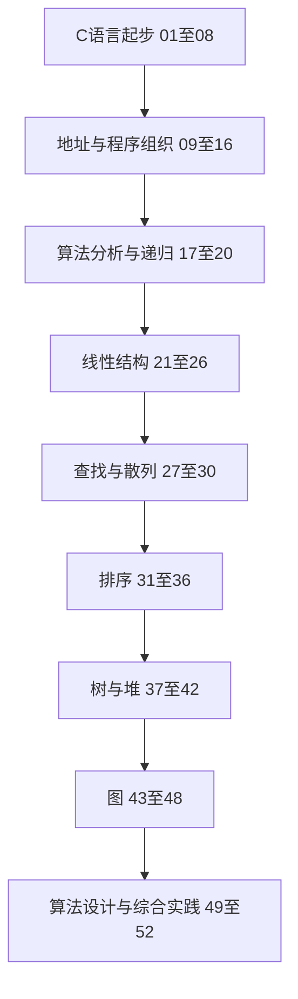

# 00 整体规划与学习路线

## 0.1 这门课从哪里开始

你可以从“没有写过程序，不知道终端是什么”开始。需要的只有普通文件操作、整数四则运算和愿意动手尝试。C 语言、数组、地址、函数、对数、递归都会在使用前解释。不要求先学操作系统、计算机组成或微信小程序；其他课程中的 C 语言可以作为复习，但不能代替本课的讲解。

学完主线，应能把一个需求拆成数据与操作，写出 C 程序，说明为什么正确，用测试发现边界问题，比较两种做法随输入增大后的工作量，最后为一个小项目选择合适的数据结构。目标不止是记住算法名字或复述模板。

| 词 | 现在先这样理解 | 后面怎样检验 |
| --- | --- | --- |
| 数据 | 程序要记住的值 | 几天的学习分钟数 |
| 数据结构 | 数据之间的关系，以及程序组织它们的方式 | 用数组、链表、树记录资料 |
| 算法 | 在约定输入下解决问题的明确步骤 | 找最大值、排序、找最短路线 |
| 程序 | 用某种语言表达、可以执行的代码 | 用 C 写上述步骤 |
| 正确性 | 对满足约定的输入得到符合要求的结果 | 空表、重复值也符合定义 |
| 复杂度 | 输入规模改变时，工作量或存储量怎样增长 | 比较逐个查找与二分查找 |

这些是入口定义，第一遍不用记住所有术语。

## 0.2 当前状态必须分清

**01—52章详细正文、9阶段及最终学习资料检索与路线规划器v1.0已交付，共63组完整程序。** 当前主线进度分母为52，章节编号保持稳定。课程完成指基础教材与约定工程交付，不代表读者自动掌握或所有平台均已验收。

已提供本批完整程序、独立练习和参考答案、可重复检查脚本及真实记录。资料目录v0.2与整合后的v0.3均有完整工程，最终路线规划器已有完整工程、详细第52章与真实验证。阅读正文、下载源码、程序运行、网页显示和用户独立完成是不同事情；测试通过不等于你已掌握，也不等于所有未来章节已交付。

第一阶段共27—40小时：01章2—3、02章3—5、03章3—4、04章3—4、05章3—4、06章3—5、07章2—3、08章2—4，另加综合练习6—8小时。可以每次30—60分钟，按自己的理解速度调整。全课建议339—482小时，含手推、手打、排错与独立练习，不是纯阅读时间或完成承诺。

## 0.3 九个阶段与依赖

| 阶段 | 先修 | 核心问题与知识 | 章节、实验与产出 | 通过条件 | 预算与状态 |
| --- | --- | --- | --- | --- | --- |
| 一 C语言起步 | 无 | 怎样把步骤写成程序 | 01—08；第一份程序、输入检查、统计数组、学习分钟统计器v0.1 | 独立重编译，解释分支和循环，拒绝非法输入，完成阶段练习 | 27—40小时；正文已完成 |
| 二 地址与程序组织 | 阶段一 | 怎样处理文字、共享数据与可变容量 | 09—16；字符串、指针、结构体、堆内存、多文件、资料目录v0.2 | 解释地址与值，成对分配释放，处理空记录和文件错误 | 39—56小时；正文已完成 |
| 三 算法分析与递归 | 阶段二 | 为什么正确，为什么会变慢 | 17—20；操作计数、渐近增长、递归、顺序和二分查找 | 写输入约定与不变量，手算边界和调用过程 | 24—33小时；正文已完成 |
| 四 线性结构 | 阶段三 | 顺序、插入删除、先进先出怎样表达 | 21—26；顺序表、链表、栈、队列、表达式实验 | 保持结构不变量，处理空/满和首尾变化 | 34—48小时；正文已完成 |
| 五 查找与散列 | 阶段四 | 怎样查资料，碰撞怎么办 | 27—30；字符串匹配、散列、两种冲突处理、索引 | 处理重复键、删除与查无结果，比较负载变化 | 30—42小时；正文已完成 |
| 六 排序 | 阶段五 | 怎样有序组织记录 | 31—36；基础排序、归并、快排、分布排序、比较实验 | 解释稳定性，验证空表和重复键，区分计数与耗时 | 42—60小时；正文已完成 |
| 七 树与堆 | 阶段六 | 怎样表达层次与优先级 | 37—42；二叉树、遍历、搜索树、平衡、堆、编码 | 解释遍历顺序、删除情况和堆不变量 | 46—65小时；正文已完成 |
| 八 图 | 阶段七 | 怎样表达复杂关系与路线 | 43—48；存储、遍历、拓扑、最短路、最小生成树 | 处理环和不连通，检查权值前提，复算路径 | 48—67小时；正文已完成 |
| 九 设计与综合 | 阶段八 | 怎样从新问题选择策略 | 49—52；贪心、回溯、动态规划、综合项目 | 给反例或递推依据，完成正确性与性能报告 | 49—71小时；正文与v1.0已完成 |

阶段之间以“通过条件”为门槛。学指针前不写链表，学队列后再写图的广度优先遍历；这样每段代码都能用已经理解的语言解释。

## 0.4 全部52章的具体规划

下表中01—52章均已交付正文，扩展专题不计入已完成章节。

| 章 | 主题与知识点 | 实验或演算、验收成果 | 状态 |
| --- | --- | --- | --- |
| 01 | 问题、输入输出、数据结构、算法、程序、手算 | 为学习记录设计明确步骤，解释相同数据的不同操作 | 已完成 |
| 02 | 文件、终端、路径、编辑器、编译与运行、main、puts | 编译hello，修改后重编译，区分源码和旧程序 | 已完成 |
| 03 | 变量、初始化、int/double/char、const、赋值、运算 | 换算分钟，解释整数除法与小数除法 | 已完成 |
| 04 | 标准输入输出、格式、字符与EOF、受限输入协议 | 接收一位小时数，检查字符和结尾，拒绝非法输入 | 已完成 |
| 05 | 比较、逻辑、if/else、区间、switch | 生成学习建议，测试门槛前后与非法值 | 已完成 |
| 06 | for/while/do、累加、循环边界、break/continue | 跟踪累加表，解释0次与最后一次，定位死循环 | 已完成 |
| 07 | 函数、参数、返回值、声明、作用域、值传递 | 拆分计算与显示，解释调用者变量为何不变 | 已完成 |
| 08 | 数组、下标、容量与数量、遍历、统计、线性查找 | 用数组统计记录并定位目标，完成v0.1 | 已完成 |
| 09 | 字符数组、终止零、字符串长度、fgets、行边界 | 读取有长度上限的标题，处理空行与过长输入 | 已完成 |
| 10 | 地址、指针、取址与解引用、空指针、生命周期 | 画地址关系，用指针交换两个值 | 已完成 |
| 11 | 数组与指针、数组参数、size_t、const、二维数组 | 写带长度的统计函数，解释数组退化与越界 | 已完成 |
| 12 | struct、enum、typedef、记录与接口约定 | 建立资料记录，区分记录副本和记录地址 | 已完成 |
| 13 | malloc/calloc/realloc/free、所有权、失败与溢出 | 实现可扩容记录区，构造分配失败处理路径 | 已完成 |
| 14 | 头文件、多文件、编译链接、断言、调试、测试 | 分离接口和实现，用断点找到边界错误 | 已完成 |
| 15 | 文本文件、打开读写关闭、错误与数据校验 | 导入导出资料，拒绝截断和坏记录 | 已完成 |
| 16 | C基础综合：有界输入、模块、资源收尾 | 资料目录v0.2，重启可读回，失败不报告成功 | 已完成 |
| 17 | 问题规格、伪代码、正确性、循环不变量 | 用“已处理的前缀”解释求和与最大值正确性 | 已完成 |
| 18 | 规模n、操作计数、增长表、对数、O/Ω/Θ、空间 | 手算单/双循环，区分最坏、平均与摊还 | 已完成 |
| 19 | 递归、终止条件、调用栈、递推、迭代对照 | 画递归求和与汉诺塔过程，说明深度限制 | 已完成 |
| 20 | 顺序查找、二分查找、半开区间、重复值边界 | 写“第一个不小于目标”的查找，覆盖空表 | 已完成 |
| 21 | 抽象数据类型、接口与实现、顺序表 | 实现增删改查，保持0≤length≤capacity | 已完成 |
| 22 | 动态数组、扩容、摊还、失效地址 | 比较逐一扩容与倍增，记录复制次数 | 已完成 |
| 23 | 单链表、哨兵、前驱、插入删除与释放 | 删除头尾、唯一节点、找不到的键 | 已完成 |
| 24 | 双向链表、循环链表、结构选择 | 实现双向浏览，检查前后链接和空表 | 已完成 |
| 25 | 栈、后进先出、顺序栈与链栈 | 括号匹配，报告最早不匹配的位置 | 已完成 |
| 26 | 队列、循环队列、空满约定、双端队列概念 | 模拟排队与表达式实验，检查绕回边界 | 已完成 |
| 27 | 字符串匹配、朴素算法、前缀与KMP | 手推前缀表，对照重复前后缀的匹配 | 已完成 |
| 28 | 散列函数、冲突、负载因子、拉链法 | 资料ID索引，构造碰撞与重复键 | 已完成 |
| 29 | 开放寻址、探测、墓碑、扩容重散列 | 删除后仍能查到后续碰撞键，处理满表 | 已完成 |
| 30 | 有序表与散列表的选择、索引一致性 | 给资料目录加索引，变更后核对主数据 | 已完成 |
| 31 | 排序定义、比较器、稳定性、选择与冒泡 | 手推每趟变化，按次键观察稳定性 | 已完成 |
| 32 | 插入排序、希尔排序、局部有序性 | 比较已排序与逆序输入的移动次数 | 已完成 |
| 33 | 归并排序、分治、辅助空间 | 写稳定归并，解释合并指针边界 | 已完成 |
| 34 | 快速排序、分区、不变量、最坏情况 | 比较重复值与有序输入，限制递归风险 | 已完成 |
| 35 | 计数/桶/基数排序、值域、负数映射 | 验证值域条件与内存预算，给出不适用例子 | 已完成 |
| 36 | 排序对照实验、测试数据、测量限制 | 核对有序性与元素多重集，报告操作计数 | 已完成 |
| 37 | 树、二叉树、术语、存储、递归释放 | 从层次关系构树，解释高度与节点数 | 已完成 |
| 38 | 前中后序、层序、显式栈与队列 | 对同一棵树逐步列出访问过程 | 已完成 |
| 39 | 二叉搜索树、查找、插入、三种删除 | 保持有序性质，说明退化链的代价 | 已完成 |
| 40 | 平衡需求、AVL旋转、红黑树与B树概览 | 手算四类失衡并实现AVL插入；扩展树种选读 | 已完成 |
| 41 | 二叉堆、上浮下沉、建堆、优先队列、堆排序 | 取前k项，验证堆序与空堆处理 | 已完成 |
| 42 | 哈夫曼树、前缀编码、编码与解码 | 比较固定长与变长编码，处理单符号输入 | 已完成 |
| 43 | 图的顶点边、方向权值、矩阵与邻接表 | 为课程依赖与地点建图，核对空间成本 | 已完成 |
| 44 | DFS、BFS、访问标记、连通分量 | 追踪栈队列，处理环、自环与不连通 | 已完成 |
| 45 | 有向无环图、入度、拓扑排序与环检测 | 生成先修课顺序，不能排序时明确报环 | 已完成 |
| 46 | 最短路径、松弛、无权BFS与Dijkstra | 手算距离与前驱，拒绝Dijkstra负权输入 | 已完成 |
| 47 | Bellman-Ford、负环、Floyd全点对 | 区分不可达与负环影响，防止无穷值相加溢出 | 已完成 |
| 48 | 并查集、路径压缩、Kruskal与Prim | 得到最小生成森林，区分最短路和生成树 | 已完成 |
| 49 | 贪心、局部选择、交换论证、反例 | 活动选择与零钱反例，解释何时能贪心 | 已完成 |
| 50 | 回溯、搜索树、撤销选择、剪枝、状态压缩初识 | 子集和、4×4数独与位掩码，比较搜索节点数 | 已完成 |
| 51 | 动态规划、状态、转移、边界、顺序、空间优化 | 从递归到记忆化/表格、零钱恢复、二维与滚动背包 | 已完成 |
| 52 | 综合实现、回归、复杂度报告、学习复盘 | 完成资料检索与路线规划器v1.0 | 已完成 |

这是基础主线。网络流、字符串自动机、线段树、后缀结构等作为后续专题；先把当前主线中的实现、边界和选择理由真正学会。

## 0.5 贯穿作品怎样逐步长大

| 版本 | 到达阶段 | 实际要做什么 | 当前情况 |
| --- | --- | --- | --- |
| v0.1 学习分钟统计器 | 一 | 输入最多7天的数据，统计总和、最值、平均值，查找一条记录 | 本批完整参考实现与练习已提供 |
| v0.2 资料目录 | 二 | 每份资料有ID、标题与预计分钟，支持导入、修改、导出和重载 | 已提供完整参考工程 |
| v0.3 可查询目录 | 四至六 | 用表/链表组织资料，增加排序与散列索引 | v0.3已整合文件、ID索引与稳定排序视图 |
| v0.8 学习关系网络 | 七至八 | 树形分类、优先队列、先修关系、最短路线 | v0.8a独立实验保留；分类/堆/图需求已于v1.0整合，不另虚构v0.8完整版 |
| v1.0 综合工具 | 九 | 将检索、顺序规划和路线查询组成可测试程序 | 已交付文本命令、分类/就绪/路线、修改导出与故障验证 |

每阶段保留独立例程和验收。不要让后面的项目覆盖你前面已经跑通的版本。最后的 [项目任务书](最终综合实践-学习资料检索与路线规划器.md) 已补最终验收与第52章入口，第一阶段不要求会实现它。

## 0.6 每章怎样学

按“先预测 → 手打 → 编译 → 对照 → 改一个条件 → 解释”的顺序。记录输入、关键变量、每轮变化、输出和原因。第一次报错先读第一条有效诊断，确认文件已保存、目录正确，再看代码。

建议每次留三句话：我能解释什么；哪个边界还没想清；下一次要验证什么。看懂参考答案后，关掉答案从空文件再写一次。第一阶段以 [阶段练习](第一阶段-练习.md) 为验收，答案独立放在 [参考答案](第一阶段-参考答案.md)。

正文中的代码有三种身份：**完整程序**可以直接保存并编译；**上下文片段**必须放到指定位置；**伪代码或概念模型**用于推理，不能直接编译。每次运行都看标签，不把一段花括号中间的语句当独立程序。

## 0.7 环境、资料和继续编写

主线用 C17 和 GCC；Windows 新手走第02章的 MSYS2 UCRT64 路线，已经有可用编译器者可以保留环境。语法使用标准 C，第一阶段不依赖 Windows 专属API。[官方资料](99-官方资料与核验说明.md) 核验于2026-11-10，实际安装与运行范围见 [验证记录](验证/课程验证记录.md)。

课程目录独立，适合你同时让其他聊天写别的教程。以后继续本课可以直接说：“复习 `data-structures-algorithms` 的指定章节，按已有练习帮助我独立实现，保持旧版与稳定编号。”同一门课分工时先约定章号和文件范围，更新目录与统一构建由负责人串行处理。

## 0.8 第二阶段学习入口

第二阶段09—16章建议39—56小时：09章4—6、10章5—7、11章4—6、12章3—4、13章5—7、14章4—6、15章4—6、16章2—3，另加8—11小时阶段练习。前两阶段累计66—96小时，含动手与排错。

从 [第09章字符串](09-字符串与整行输入.md) 开始，依次学习指针、数组参数、结构体、内存、多文件和文件，再完成 [资料目录v0.2](16-综合实践资料目录v0.2.md) 与 [第二阶段练习](第二阶段-练习.md)。参考答案、完整源码与 [第二阶段验证记录](验证/第二阶段验证记录.md) 独立保留。第三阶段17—20章已提供，接着从 [第17章](17-问题规格与循环不变量.md) 学习问题规格、复杂度、递归与查找。

## 0.9 第三阶段学习入口

第三阶段17—20章建议24—33小时：17章4—5、18章5—7、19章5—7、20章5—7，另加阶段练习5—7小时。前三阶段累计90—129小时，包含手算、手打、排错与复习，不是网页纯阅读时间。

从 [第17章问题规格](17-问题规格与循环不变量.md) 开始，先解释算法为何正确，再数工作量、观察递归调用，最后实现半开区间二分。配套 [第三阶段练习](第三阶段-练习.md)、[独立答案](第三阶段-参考答案.md)、[查找对照实验台](示例代码/stage3-search-lab/README.md) 与 [实际验证](验证/第三阶段验证记录.md)。新增6组程序/工程，累计22组；本阶段没有覆盖资料目录的已有实现。

第四阶段已提供，从 [第21章](21-抽象数据类型与顺序表.md) 学习抽象数据类型、顺序表、扩容、单/双向循环链表、栈和队列。

## 0.10 第四阶段学习入口

第四阶段21—26章建议34—48小时：21章4—5、22章4—6、23章5—7、24章4—6、25章5—7、26章5—7，另加阶段练习7—10小时。前四阶段累计124—177小时，含手算、调试和独立实现。

从 [第21章ADT与顺序表](21-抽象数据类型与顺序表.md) 开始，使用相同序列行为对照数组和链，再学习限制端点操作的栈与队列。配套 [第四阶段练习](第四阶段-练习.md)、[独立答案](第四阶段-参考答案.md)、[完整源码](示例代码/stage4-common/完整源码.md)、[表达式实验台](示例代码/stage4-expression/README.md)、[真实验证](验证/第四阶段验证记录.md)。新增8组完整程序/工程，累计30组；本阶段不改写资料目录v0.2。

第五阶段27—30章已交付，详见下节；其内存v0.3a独立保留，第六阶段再将文件、索引与稳定视图整合为v0.3。

## 0.11 第五阶段已交付：匹配、散列与索引

第五阶段27—30章建议30—42小时：27章6—8、28章5—7、29章6—9、30章6—8，另加阶段练习7—10小时。前五阶段累计154—219小时，包含手算、手打、改错与独立实现。第五阶段交付时全课预算曾修订为243—351小时；最新预算以0.2和当前阶段为准，不是纯阅读时间或交付承诺。

从 [第27章匹配与KMP](27-字符串匹配与KMP.md) 开始，经过 [拉链法](28-散列冲突与拉链法.md)、[墓碑与重散列](29-开放寻址与墓碑.md)，到 [索引一致性](30-索引与主数据一致性.md)。配套 [练习](第五阶段-练习.md)、[独立答案](第五阶段-参考答案.md)、[完整源码](示例代码/stage5-common/完整源码.md)、[真实验证](验证/第五阶段验证记录.md)。新增4组完整程序，累计34组。

内存目录v0.3a提供ID查询、标题字节匹配和事务式重建；v0.2文件工程独立保留。第六阶段已提供排序与文件整合，见下一节。

## 0.12 第六阶段已交付：排序与目录v0.3

第31—36章建议42—60小时：31章5—7、32章5—7、33章5—7、34章6—8、35章7—10、36章6—9，另加阶段练习8—12小时。前六阶段累计196—279小时；第六阶段交付时全课曾修订为265—381小时，最新以当前预算为准；各阶段包含手算、手打、排错与独立实践。

从 [第31章规格与稳定性](31-排序规格稳定性与基础排序.md) 开始，接着 [插入与希尔](32-插入排序与希尔排序.md)、[归并](33-归并排序与辅助空间.md)、[三路快排](34-三路快排与递归控制.md)、[计数/桶/基数](35-计数桶与基数排序.md)，最后 [实验与目录整合](36-排序实验与资料目录v0.3.md)。配套 [练习](第六阶段-练习.md)、[答案](第六阶段-参考答案.md)、[完整源码](示例代码/stage6-common/完整源码.md)、[真实验证](验证/第六阶段验证记录.md)。新增7组工程，累计41组、36章正文。

[目录v0.3](示例代码/stage6-catalog/README.md) 已整合旧文件格式、ID索引、标题匹配、稳定分钟视图、修改导出与删除重载。文件32项与内存模块48项各自保持原协议，视图不改主数组；未实现原子文件保存、交互菜单或最终路线规划器。树与堆37—42章现已交付，堆排序在第41章建立堆基础后实现，见下一节。

## 0.13 第七阶段已交付：树、优先级与编码

第37—42章建议46—65小时：37章5—7、38章5—7、39章6—8、40章7—10、41章7—10、42章8—11，另加练习8—12小时。前七阶段累计242—344小时；第七阶段交付时全课曾修订为286—410小时，最新预算以当前0.2为准，不是纯阅读时间。

从 [树与所有权](37-树与二叉树的所有权.md) 到 [遍历](38-二叉树遍历与层序.md)、[BST删除](39-二叉搜索树与删除.md)、[AVL插入](40-AVL旋转与平衡.md)、[堆与堆排序](41-二叉堆优先队列与堆排序.md)、[哈夫曼编解码](42-哈夫曼树与前缀编解码.md)。配套 [练习](第七阶段-练习.md)、[答案](第七阶段-参考答案.md)、[七组例程说明](示例代码/stage7-common/README.md)、[完整源码](示例代码/stage7-common/完整源码.md)、[验证](验证/第七阶段验证记录.md)。累计42章正文、48组程序。

树高空0/叶1；普通树/BST/AVL最多63节点，AVL只提供插入。优先队列63项，独立堆排序沿用128项预算；哈夫曼最多8种字节、64字节消息，展示位文本，未做压缩文件。红黑/B树为概览。七组例程独立保留，本阶段没有直接改旧目录；分类/优先级/图需求最终在独立v1.0工程整合。第43—48章图论现已交付，见下一节。

## 0.14 第八阶段已交付：图、依赖与路线

第43—48章建议48—67小时：43章5—7、44章6—8、45章5—7、46章6—9、47章8—11、48章8—11，另加练习10—14小时。前八阶段累计290—411小时，第八阶段交付时全课曾修订为308—439小时，最新预算见0.2，包含手算、手打和排错。

从 [图的语义与存储](43-图的语义与两种存储.md) 到 [DFS/BFS](44-图的DFS与BFS.md)、[拓扑与环](45-拓扑排序与依赖环.md)、[Dijkstra与恢复](46-Dijkstra与路径恢复.md)、[负环与全点对](47-负权路径与全点对.md)、[并查集与森林](48-并查集与最小生成森林.md)。配套 [练习](第八阶段-练习.md)、[答案](第八阶段-参考答案.md)、[八组例程](示例代码/stage8-common/README.md)、[源码](示例代码/stage8-common/完整源码.md)、[验证](验证/第八阶段验证记录.md)。累计48章正文、56组完整程序。

[关系网络实验台v0.8a](示例代码/stage8-graph-lab/README.md) 提供固定先修图与非负路线CLI；尚未连接资料目录、分类树、图文件或最终菜单。图最多8点，允许自环拒绝重边；三态距离区分有限/未达/负环影响；核心算法按真实矩阵成本讲解。49—51章算法设计现已交付，见下一节；最后第52章工程现已交付，见0.16。

## 0.15 第九阶段上已交付：算法设计

49—51章与独立练习建议33—47小时：49章6—8、50章9—13、51章10—14，另加练习8—12。到第51章累计323—458小时；第52章16—24，完整第九阶段49—71，全课339—482。预算含手推、手打与排错；第52章已交付后，第九阶段基础主线完成。

从 [贪心与反例](49-贪心选择与反例.md) 到 [回溯与撤销](50-回溯撤销与剪枝.md)、[动态规划与恢复](51-动态规划状态与恢复.md)。配套 [练习](第九阶段上-练习.md)、[答案](第九阶段上-参考答案.md)、[六组例程](示例代码/stage9-common/README.md)、[完整源码](示例代码/stage9-common/完整源码.md)、[实际验证](验证/第九阶段上验证记录.md)。累计51章正文、62组完整程序。

活动数量最优有交换论证，零钱贪心提供反例；子集和保留零元素位置方案，4×4数独统计解数；零钱有记忆化/表格与恢复，0/1背包有二维恢复和倒序滚动价值。位掩码只是小集合表示，不声称已实现子集状态DP。代码都为有界独立实验，不接入最终业务。

[最终实践](最终综合实践-学习资料检索与路线规划器.md) 已有第52章工程；[实现前契约](最终项目-实现前契约.md) 保留设计基线与落地说明，实际命令以工程文档为准。

## 0.16 第九阶段下与全课最终交付

[第52章](52-综合项目资料检索与路线规划.md) 建议16—24小时，已含 [独立练习](第九阶段下-练习.md) 与 [答案](第九阶段下-参考答案.md)。从 [运行说明](示例代码/stage9-planner/README.md) 构建v1.0，阅读 [协议](示例代码/stage9-planner/协议与输出.md)、[六文件完整源码](示例代码/stage9-planner/完整源码.md)、[真实验证](验证/第九阶段下验证记录.md)。全课52章、9阶段、63组完整程序，建议总投入339—482小时。

v1.0复用旧文件/索引/匹配/稳定归并、堆、图/拓扑/Dijkstra与恢复，新增类别/业务ID/侧文件适配、候选验证提交、查询与分钟导出。32条资料、8类/8学习点/8地点，所有旧版保留；不虚构独立v0.8整合版。错误和申请/I/O模拟有真实记录，浏览器/跨平台范围单列。

后续先完成自己的练习与复盘，能够从干净副本构建、修改数据并解释状态/复杂度/所有权。扩展原子保存、更多图算法或有依赖的预算优化应另立范围，不影响本课基础主线已交付结论。
