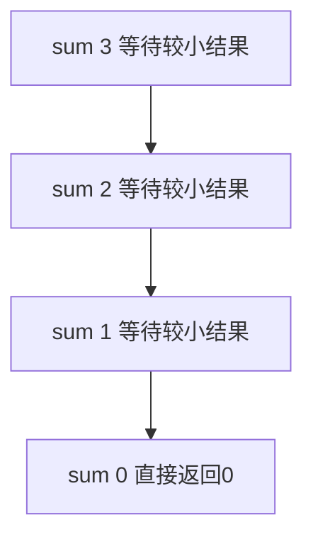

# 19 递归、调用栈与汉诺塔

## 19.1 目标与先修

先会函数、参数、局部变量、生命周期和第18章的增长分析。建议5—7小时。本章从一条加法开始，观察函数调用自己时发生什么，再用汉诺塔对比线性与指数工作量。你应能画调用过程、判断终止并估计额外空间。

本章示例特意限制很小的输入，不通过耗尽调用栈或打印海量输出理解递归。想象规模增大可以用数学推导，不必真的让程序跑到无法停止。

## 19.2 递归是把问题交给更小的同类问题

求1到3的和，可以表达成`3 + 1到2的和`；后者是`2 + 1到1的和`；再是`1 + 1到0的和`。把0个数的和规定为0，就能一步步返回。

用数学关系写：`S(0)=0`，`S(n)=n+S(n-1)`（n>0）。这叫递推关系：用更小输入的结果定义当前结果。递归函数则直接把这个关系表达成函数对自身的调用。

一个可靠递归至少解释三件事：最小情况怎样处理；递归调用的输入为什么更小；较小问题的答案怎样组成当前答案。只写一句“调用自己”不够，参数不进展就可能无限调用。

## 19.3 每次调用都有自己的一份局部状态

第07章的参数按值传递依然成立。调用sum_recursive(3)时，本层n是3；它调用sum_recursive(2)，新一层n是2，不会把上一层n改成2。



上层调用暂时停在“等待返回值”的位置。实现通常用调用栈保存这些未完成调用的状态，每层称栈帧。你现在可以把它看成一叠待完成的工作卡片；本章讲的是程序调用机制，第25章再亲手实现栈这种数据结构。

```text
进入更小调用时：        返回时：
sum(3) 等待3+...         sum(0)给出0
  sum(2) 等待2+...       sum(1)算出1
    sum(1) 等待1+...     sum(2)算出3
      sum(0)返回0        sum(3)算出6
```

不是一进入sum(3)就已经知道6；必须先等待下层。局部partial也不是所有层共享的一个变量，它在对应调用中得到自己的返回结果。

## 19.4 完整实验一：进入与返回分开打印

**完整程序：recursion.c。** 下载 [源码](示例代码/19-recursion/recursion.c)，放到`~/dsa-labs/ch19`。本函数实验前提为n在0—20，入口固定3；不把它当任意大整数求和库。

```c
#include <stdio.h>

long sum_recursive(unsigned int n)
{
    printf("enter n=%u\n", n);
    if (n == 0) {
        return 0;
    }
    long partial = sum_recursive(n - 1);
    long total = partial + (long)n;
    printf("leave n=%u total=%ld\n", n, total);
    return total;
}

long sum_iterative(unsigned int n)
{
    long total = 0;
    for (unsigned int i = 1; i <= n; i++) {
        total += i;
    }
    return total;
}

int main(void)
{
    unsigned int n = 3;
    long recursive = sum_recursive(n);
    long iterative = sum_iterative(n);
    printf("recursive=%ld iterative=%ld\n", recursive, iterative);
    return 0;
}
```

在 **UCRT64 Bash、`~/dsa-labs/ch19`目录**：

```bash
gcc -std=c17 -Wall -Wextra -Wpedantic recursion.c -o recursion.exe
./recursion.exe
```

输出：

```text
enter n=3
enter n=2
enter n=1
enter n=0
leave n=1 total=1
leave n=2 total=3
leave n=3 total=6
recursive=6 iterative=6
```

base case（基本情况）n=0打印enter后就return，没有leave那行，因为它没有执行后面的递归和相加。先打印enter的次序是3到0，计算结果的返回次序是1到3。输出位置决定你看到“进入”还是“完成”，不能混为同一时刻。

sum_iterative用循环得到同一个数学结果。它不产生递归跟踪行，只在main的最终报告中显示返回值。两种实现都只使用合法的小输入来对照。

## 19.5 用归纳想法解释正确与终止

归纳可以先理解成：先证明第一块多米诺成立，再证明只要前一块成立就能推到下一块。这里的基本情况n=0返回0，符合空和。

假设较小问题sum(n-1)返回1到n-1的和，本层加上n，就得到1到n的和。前提是加法可表示；本实验n≤20，和最多210，远低于long范围。

终止依据是每次在n>0时调用n-1，非负整数严格下降，最终达到0。检查基本情况必须在无符号n做n-1之前：如果n为0还先减1，会绕成很大的值，已经不再向正确终点靠近。

一般递归并不总是减1，也可以把区间缩小一半；重要的是给出一个不会无限下降的量，并说明每条递归分支都在进展。

## 19.6 递归求和的时间和空间

从n到0共n+1次调用，每层除递归外做固定工作，关系为`T(n)=T(n-1)+常数`，因此源级模型下时间Θ(n)。迭代也为Θ(n)，不能因为用了递归就宣布更快。

递归同时保留n+1层未完成调用，普通调用模型下额外空间Θ(n)；迭代只需total和i，额外空间Θ(1)。总调用次数与最大同时存在的层数要分别统计。

C不保证对所有递归进行尾调用优化，也没有跨平台统一的安全递归深度。本例还有返回后的加法与显示，不能依赖“编译器总会自动把它变循环”。实际编译器可以做其他优化，算法分析中的调用模型与机器精确栈字节不是同一件事。

对这种简单求和，循环通常更直接；用递归示例是为了学会处理后面天然层次化的问题，例如树的子树，而不是给所有循环换一个写法。

## 19.7 汉诺塔：一个较大步骤需要两个较小步骤

有A、B、C三根柱，n个圆盘起初在A，从下到上由大到小。每次只能移动一枚最上方盘，大盘不能压在小盘上，目标把全部盘移到C。

若想移动n个盘：先把上面n-1个从A移到B；再把最大的第n盘从A移到C；最后把n-1个从B移到C。B的角色不是永久“目标”，而是随当前子问题改变，三个参数表达不同角色。

n=0表示没有盘需要移动，直接返回。n=1时，两次n-1子调用都为空，只移动一次大盘。这样不必再写一个与逻辑重复的单盘分支。

## 19.8 完整实验二：两枚盘的真实移动

**完整程序：hanoi.c。** 与recursion.c分别编译，不能把两份main一起链接。下载 [源码](示例代码/19-recursion/hanoi.c)，放在同一个自己的ch19目录。

```c
#include <stdio.h>

unsigned long move_tower(unsigned int n, char from, char spare, char to)
{
    if (n == 0) {
        return 0;
    }
    unsigned long left = move_tower(n - 1, from, to, spare);
    printf("disk=%u %c->%c\n", n, from, to);
    unsigned long right = move_tower(n - 1, spare, from, to);
    return left + 1 + right;
}

int main(int argc, char *argv[])
{
    if (argc != 2 || argv[1][0] < '0' || argv[1][0] > '8' || argv[1][1] != '\0') {
        fputs("usage: hanoi n (one digit 0..8)\n", stderr);
        return 1;
    }
    unsigned int n = (unsigned int)(argv[1][0] - '0');
    unsigned long moves = move_tower(n, 'A', 'B', 'C');
    printf("moves=%lu\n", moves);
    return 0;
}
```

在 **UCRT64 Bash、ch19目录**：

```bash
gcc -std=c17 -Wall -Wextra -Wpedantic hanoi.c -o hanoi.exe
./hanoi.exe 2
```

结果：

```text
disk=1 A->B
disk=2 A->C
disk=1 B->C
moves=3
```

盘编号1最小，盘2较大。画三根柱逐条核对：先让1离开A，2才能移动；2到C后，1才能从B叠到C。返回值left、right分别统计左右子问题移动次数，不是同时启动了两个程序，普通C执行仍按语句次序逐个完成调用。

入口只接受一位0—8；0输出moves=0，8有255次移动。`08`、-1、9、缺参数都拒绝。本限制用于让输出可读、计数安全，不表示数学问题只能有8盘。

## 19.9 为什么会指数增长

移动次数`M(0)=0`，`M(n)=2*M(n-1)+1`。给两边加1：`M(n)+1=2*(M(n-1)+1)`，一直展开得到`M(n)+1=2^n`，所以`M(n)=2^n-1`。

| 盘数n | 移动次数 | 包括空调用的总函数调用数 | 最大活跃调用层数 |
| --- | --- | --- | --- |
| 0 | 0 | 1 | 1 |
| 1 | 1 | 3 | 2 |
| 2 | 3 | 7 | 3 |
| 3 | 7 | 15 | 4 |
| 4 | 15 | 31 | 5 |
| 8 | 255 | 511 | 9 |

每增加一枚盘，移动次数大致翻倍，所以时间Θ(2^n)。普通顺序调用执行左子树后返回，再执行右子树，不会把整棵递归树所有节点同时压进栈。最大深度仍n+1，额外调用空间Θ(n)，不是Θ(2^n)。如果把所有移动行都存起来而不立刻输出，存储需求又会变，这次分析只针对当前实现。

本章只验证递归方案能完成合法移动，不把结果看成适用于不同规则版本的统一最优结论。三柱、单盘移动与大小规则是规格的一部分。

## 19.10 递归转迭代与递推式先学到哪里

有些递归可以改成一个简单循环，如求和；有些要用显式栈保存“回来后还要做什么”，树遍历与深度优先搜索会再讲。不能把函数名换成while就自动保留执行顺序。

当前只需会三种关系：每次减1且一条分支，常见Θ(n)；每次减半且一条分支，常见Θ(log n)；每次减1且两条都执行，汉诺塔这样可能Θ(2^n)。还必须看每层额外工作，不能把这些当不看代码就套用的规则。

例如两个减半子问题并不自动是指数时间；排序阶段会出现不同递推。先画少量调用节点、统计每层，再决定关系，不要求现在背主定理。

## 19.11 常见错误

- 没有基本情况，或基本情况在n-1之后：无法保证合法终止。
- 递归参数不变：每层又开始同样的问题。
- 以为所有层共享同一个局部n：忽略参数副本与调用状态。
- 把返回前后的输出顺序混淆：先画待完成卡片。
- 汉诺塔交换了柱角色却沿用上层角色理解：每次调用重新解释from/spare/to。
- 总调用数指数，便说额外空间也指数：空间看同时活跃的峰值。
- 为测试深度而跑巨大n：本章采用小输入与数学推导，不靠栈溢出猜极限。

## 19.12 练习与参考答案

练习一：sum_recursive(2)的进入次序、返回计算次序、结果分别是什么？

答案：进入2、1、0；完成1再完成2；结果3。最大活跃3层。

练习二：n=3时汉诺塔有几次移动、几层活跃调用、多少次包含空问题的调用？

答案：7次移动、最多4层、总15次调用。它们是三个不同计数。

练习三：为什么n=0要在调用n-1之前处理？

答案：无符号0减1会绕成大值；更重要的是空问题已是终点，不应再产生更小问题调用。

练习四：递归求和和循环求和在本模型中时间同级，为什么还可能选择循环？

答案：循环额外空间常数、状态更直接，不依赖深度随n增长的调用资源。选择依据不只有时间大O。

## 19.13 完成条件与下一步

能从打印顺序还原调用栈，证明求和基本情况与进展，手算两盘移动，区分总调用、移动与峰值深度；运行0/1/2/3盘并核对合法性。下一章进入 [顺序查找与二分边界](20-顺序查找与二分边界.md)。
