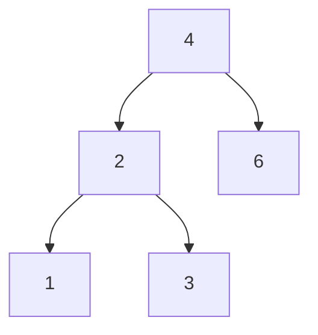

# 37 树、二叉树与节点所有权

## 37.1 目标与先修

先完成指针、结构体、动态内存和递归。建议5—7小时。目标是从层次关系定义树，分清根、孩子、叶、深度与高度，读懂左右指针，构造一棵有界二叉树，并在失败或使用完毕时正确释放。

文件夹可以含子文件夹，课程主题可以含子主题。数组顺序表达“前后”，树表达“上下层次”。本章先处理普通树形关系，不要求每个值有大小顺序；二叉搜索树到第39章再增加那个约束。

## 37.2 节点、边与一棵树的关系

树中的一个对象叫**节点node**，连接父子关系的线叫**边edge**。最上方无父节点者叫根root；直接下属叫孩子child；同父的节点是兄弟；没有孩子的是叶leaf；一个节点及其全部后代组成子树subtree。

一棵非空根树中，除了根，每个节点恰有一个父节点；从根可到所有节点，不出现沿父子关系回到自己的环。n个节点有n-1条父子边；空树单独定义，没有根也没有边，不套出负一条边。

在内存中让两个父节点共享同一个孩子，或让孩子指回祖先，都不满足本章的树表示前提。它可能成为其他图结构，也会破坏后面“每个节点释放一次”的所有权规则。

## 37.3 二叉树的左右不能省略

**二叉树binary tree**每个节点最多有左、右两个孩子；空的左/右子树也有意义。只有左孩子与只有右孩子是不同形状，即使孩子的值相同。

本阶段样本：



它有5节点、4边；4是根，1、3、6是叶；根的左子树含2、1、3。本章允许重复值，不能只凭一个值判断“它是哪一个节点”。

## 37.4 深度与高度先统一计数方法

本课**深度**按从根走过的边数：根深度0，2和6深度1，1和3深度2。**高度**按最长向下路径包含的节点数：空树0，叶1，样本整树3。对非空树，整树高度=最大深度+1。

其他书可能按边数定义高度，叶高度0。两套都能使用，但公式必须跟约定一起换；本课普通树和AVL都用空0、叶1。

高度h的二叉树最多2^h-1个节点，因为每层至多翻倍；h=1、2、3最多1、3、7。相同n的树可以短而宽，也可以退化成n层的链；“二叉”并不自动保证高度是对数。

## 37.5 满、完全与每内部两孩子

本课用以下明确含义，避免翻译差异：每层都填满叫满二叉树perfect binary tree；除末层外填满、末层从左连续填叫完全二叉树complete；每个内部节点恰有两孩子叫真二叉树proper/full。

满树一定完全，真二叉树不一定每层满。本章样本的叶深度不全相同，因此不是满树；它是完全树，也每内部有两孩子。遇外部资料先核对定义，不只背一个中文名称。堆要用“完全”性质，哈夫曼合并形成“每内部两孩子”的性质。

## 37.6 C结构体与指针的指针

TreeNode含value、left、right。结构体不能按值再包含一个完整的自己，否则大小无限展开；可以保存指向同类型的指针，指针本身有确定大小。NULL表示该方向没有孩子，value=0或负数都仍是普通数据。

构造器要把新节点地址写入调用者的“指针变量”，因此辅助函数使用`TreeNode **out`：out指向一个TreeNode*槽，`*out=node`改变那个槽保存的地址。调用处`&node->left`取得左指针字段的地址，与第10章用int*回写整数是同一个思路，只是这次被回写的值本身是指针。

T_OK=0代表成功，要显式与枚举名比较，不把非零当成功。参数错误T_INVALID、数量超预算T_FULL、申请失败T_MEMORY；失败保留旧树。

完整接口见 [tree.h](示例代码/37-binary-tree/tree.h)，共享状态见 [tree_status.h](示例代码/stage7-common/tree_status.h)。BinaryTree保存root与count，最多63节点；对象先init，使用后clear。拥有节点的整个树不能随意浅拷贝后分别释放；头文件公开字段用于观察，不授权调用者破坏链接。

## 37.7 用带空标记的前序描述形状

TreeToken有present和value；present=1代表真实节点，接着依次描述左、右子树；present=0代表空子树，value忽略。概念记号`#`表示空，不是程序读入的字符。

```text
样本：4 2 1 # # 3 # # 6 # #
只有根：4 # #
空树：#
```

n个真实节点恰有n+1个空标记，总2n+1项，63节点最多127项。数组不能只给`4 2 6`而让程序猜形状；缺标记、尾随多余项、present不为0/1都是T_INVALID。空树使用一个空token；零项不是有效描述。

## 37.8 先造候选树，成功后再替换

完整文件tree.c：

```c
#include "tree.h"
#include <stdlib.h>
static void release(TreeNode *node)
{
    if (node != NULL) { release(node->left); release(node->right); free(node); }
}
void tree_init(BinaryTree *tree) { tree->root = NULL; tree->count = 0; }
void tree_clear(BinaryTree *tree) { release(tree->root); tree_init(tree); }
static TStatus parse(const TreeToken *tokens, size_t n, size_t *position, size_t *nodes, TreeNode **out)
{
    if (*position == n) { return T_INVALID; }
    TreeToken token = tokens[(*position)++];
    if (token.present == 0) { *out = NULL; return T_OK; }
    if (token.present != 1) { return T_INVALID; }
    if (*nodes == TREE_LIMIT) { return T_FULL; }
    TreeNode *node = malloc(sizeof *node);
    if (node == NULL) { return T_MEMORY; }
    node->value = token.value; node->left = node->right = NULL; (*nodes)++;
    TStatus status = parse(tokens, n, position, nodes, &node->left);
    if (status == T_OK) { status = parse(tokens, n, position, nodes, &node->right); }
    if (status != T_OK) { release(node); return status; }
    *out = node;
    return T_OK;
}
TStatus tree_build(BinaryTree *tree, const TreeToken *tokens, size_t count)
{
    if (tokens == NULL || count == 0) { return T_INVALID; }
    if (count > 2 * TREE_LIMIT + 1) { return T_FULL; }
    TreeNode *root = NULL; size_t position = 0, nodes = 0;
    TStatus status = parse(tokens, count, &position, &nodes, &root);
    if (status == T_OK && position != count) { status = T_INVALID; }
    if (status != T_OK) { release(root); return status; }
    tree_clear(tree); tree->root = root; tree->count = nodes;
    return T_OK;
}
static size_t height(const TreeNode *node)
{
    if (node == NULL) { return 0; }
    size_t left = height(node->left), right = height(node->right);
    return 1 + (left > right ? left : right);
}
size_t tree_height(const BinaryTree *tree) { return height(tree->root); }
```

每个新节点先把左右设NULL，递归接好两个孩子后才交给*out。某个子树失败，当前函数释放已拥有的部分；尚未成功交出的子树不会被父节点重复释放。nodes是本次候选的局部计数，失败后作废，不提交给旧树。

顶层先保留旧树，确认候选描述全部消费后才clear旧树并移交新root/count。格式错、资源满或malloc失败，旧树地址与内容保持。最多同时拥有旧63和新63节点，额外内存要计入这段重建过程。

释放按“左、右、当前”进行：孩子已不再需要时才free父节点；之后不读父字段。clear回到root=NULL/count=0，可再次clear或重新构建；重复init不会帮你释放已有节点。

## 37.9 编译、运行与成本

把 [tree.h](示例代码/37-binary-tree/tree.h)、[tree.c](示例代码/37-binary-tree/tree.c)、[main.c](示例代码/37-binary-tree/main.c)、[共享状态头](示例代码/stage7-common/tree_status.h) 放自己的`~/dsa-labs/ch37`。在 **UCRT64 Bash、该目录**：

```bash
gcc -std=c17 -Wall -Wextra -Wpedantic main.c tree.c -o tree.exe
./tree.exe
```

预期：

```text
nodes=5 height=3
empty_nodes=0 empty_height=0
```

输入固定在main的token数组，无需stdin；全文见 [源码附录](示例代码/stage7-common/完整源码.md)。旧MinGW的%zu兼容仍按第09章加-D__USE_MINGW_ANSI_STDIO=1。

构建新n节点读Θ(n)个token，成功替换还需释放旧树Θ(旧n)；height每次重新访问所有节点，Θ(n)，不是读取缓存；clear也Θ(n)。递归栈O(h)，最坏链为O(n)。本版63节点限制了演示风险，不声称支持任意深度的递归。

## 37.10 常见错误

把二叉当作必须两孩子；混用边高与节点高；省略空标记导致形状不明确；用value=0代表空；左右指针未初始化；先清旧树再构造导致失败丢旧数据；共享孩子后重复释放；free父后再读孩子；复制拥有者当备份；把height调用误算成O(1)。

## 37.11 练习与参考答案

练习一：一条4节点链，高度与最深深度是多少？答案：4与3；不是二叉就一定高度2。

练习二：7真实节点的描述需多少token？答案：15，其中8个空标记。

练习三：为什么不是一看到token根就改正式root？答案：后续可能格式错或分配失败，先保留旧树才能兑现失败保留。

## 37.12 完成条件

能画样本左右关系，说明高度约定、63/127预算和节点归属；能从token复原形状并解释失败收尾。下一章用多种顺序访问同一棵树。
