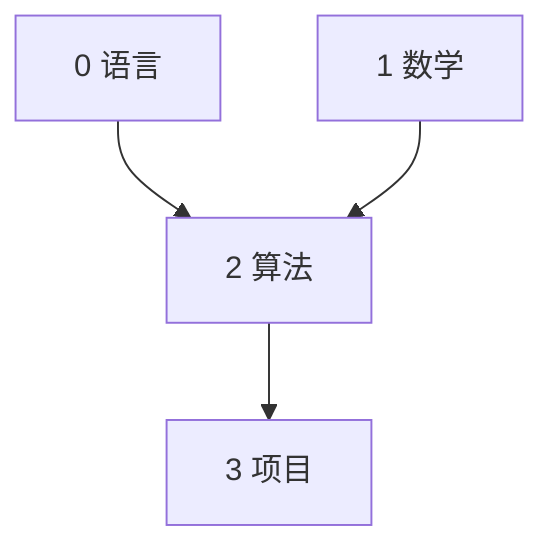

# 45 拓扑排序与依赖环

## 45.1 目标与先修

先完成有向边、入度与BFS队列，建议5—7小时。目标是把“必须先学”写成箭头，手推Kahn算法，证明输出符合全部依赖，识别有环与空图，并避免把部分顺序当完整计划。

数字排序要求任意两项可按键比较；课程依赖通常只规定一些先后，另一些可以互换。**拓扑排序topological sort**为这种部分约束生成一个完整线性顺序，不是把顶点编号从小到大排列。

## 45.2 边的方向先说清

u→v表示“u完成后才允许v”。拓扑结果中每条边都应满足位置[u]<位置[v]。边权在这里不参与排序；耗时、并行开课与关键路径是另外的问题。

样本0语言、1数学先于2算法，2先于3项目：



0、1彼此无依赖，所以0,1,2,3和1,0,2,3均合法。合法顺序不必唯一；若需要唯一性分析或字典序最小，要另加规则，不能只比较一份答案。

## 45.3 入度表示还有几条未完成前提

入度indegree[v]初始为指向v的边数。入度0的项没有未完成前提，可加入就绪队列。每输出u，就把u发出的每条边所对应入度减1；某v刚变0才入队。

这里用工作入度副本，不删除原图的边。处理完毕，图仍可用于查询或再次排序；本课拒绝重边，计数无需解释重复前提如何处理，自环会使顶点依赖自己而不能归零。

## 45.4 一步步推样本

| 操作 | 工作入度0,1,2,3 | 队列 | 已输出 |
| --- | --- | --- | --- |
| 初始 | 0,0,2,1 | 0,1 | 空 |
| 输出0 | 0,0,1,1 | 1 | 0 |
| 输出1，2归零 | 0,0,0,1 | 2 | 0,1 |
| 输出2，3归零 | 0,0,0,0 | 3 | 0,1,2 |
| 输出3 | 全零 | 空 | 0,1,2,3 |

入队条件是“刚变零”，不是每次看见零就再加。每点只入一次，8格队列足够；空有向图直接得到count=0的成功结果。

## 45.5 正确性与为什么能检测环

每次取出的u都没有来自未输出顶点的入边，因此它的全部先修都已在前面。输出一个再移除其约束，不变量继续成立；全部V项输出时，每条边都满足先后。

若队列空但还剩顶点，每个剩余点都至少有一个剩余前驱。不断向前找，有限顶点中必重复，形成有向环。反过来，环上的点互相等待，不可能全部归零，因此有环无法输出全部顶点。

这就是有向无环图DAG的重要性。本方法检测是否存在环，不返回具体环路径；尚未输出者也可能只是环的下游，例如1↔2且2→3，3虽被阻塞却不在环上。

## 45.6 失败时不交出半个计划

先在局部next收集顺序，只有count==n才赋给*out，否则G_CYCLE。旧输出完整保留，调用者必须检查返回值，不能因旧count非零就误以为新图已排好。

函数只接有向图，NULL或无向为G_INVALID。输入/输出独立，图由公共API初始化。没有动态分配；错误与计算完成但结果非唯一不是同一回事。

## 45.7 完整C实现

接口见 [topological.h](示例代码/45-topological/topological.h)，完整文件topological.c：

```c
#include "topological.h"
GStatus graph_topological(const Graph *graph, Topological *out)
{
    if (graph == NULL || out == NULL || !graph->directed) { return G_INVALID; }
    size_t indegree[GRAPH_MAX] = {0}, queue[GRAPH_MAX], head = 0, tail = 0; Topological next = {0};
    for (size_t u = 0; u < graph->n; u++) { for (size_t v = 0; v < graph->n; v++) { if (graph->has[u][v]) { indegree[v]++; } } }
    for (size_t u = 0; u < graph->n; u++) { if (indegree[u] == 0) { queue[tail++] = u; } }
    while (head < tail) {
        size_t u = queue[head++]; next.vertices[next.count++] = u;
        for (size_t v = 0; v < graph->n; v++) { if (graph->has[u][v] && --indegree[v] == 0) { queue[tail++] = v; } }
    }
    if (next.count != graph->n) { return G_CYCLE; }
    *out = next; return G_OK;
}
```

`has[u][v] && --indegree[v]==0`先检查确实有边，才减少对应计数。有效图中u输出前该边尚在工作图里，故不对0无符号减1。原矩阵完全不改。

初始零入度按编号加入，邻居也升序，但FIFO不保证全局字典序最小。例如0→1且2独立，初始队列0,2，输出0后追加1，得到0,2,1仍合法。需要总取最小就绪编号时可以改用优先队列，是另一变体。

## 45.8 编译与加环实验

取 [公共三文件](示例代码/stage8-common/README.md)、[topological.h](示例代码/45-topological/topological.h)、[topological.c](示例代码/45-topological/topological.c)、[main.c](示例代码/45-topological/main.c) 到自己的`~/dsa-labs/ch45`。在 **UCRT64 Bash、该目录**：

```bash
gcc -std=c17 -Wall -Wextra -Wpedantic main.c graph.c topological.c -o topological.exe
./topological.exe
```

预期：

```text
order=0,1,2,3
cycle=1 old_count=4
```

入口第一次成功后加3→1，形成1→2→3→1。第二次只在候选中输出0就停，返回G_CYCLE，正式order仍为旧4项；old_count证明失败保持，不代表新图无环。

## 45.9 实现成本与应用边界

矩阵计算入度扫V²，处理每个u又扫V邻居，整体O(V²)，工作空间O(V)。邻接表版可到O(V+E)，本版不能漏算矩阵。

拓扑输出一个可行先后，不计算总完成时间、最短路线或所有合法计划；环检测也不是强连通分量分解。后面的 [关系网络实验台](示例代码/stage8-graph-lab/README.md) 提供固定课程名示例，不声称已接入最终项目目录。

## 45.10 常见错误

把箭头方向写反；按ID排序当拓扑；输出时改原图；每遇到零重复入队；部分顺序当成功；剩余顶点全叫环成员；任意有向图都认为能排序；把FIFO结果当字典序最小；把依赖顺序当学习总耗时。

## 45.11 练习与参考答案

练习一：两个独立点有哪些拓扑顺序？答案：0,1和1,0，均合法。

练习二：单顶点带自环呢？答案：入度1，无就绪点，G_CYCLE。

练习三：G_CYCLE后能使用旧order安排新图吗？答案：不能，旧对象虽保留，但并不是本次结果。

## 45.12 完成条件

能按边检查输出、手推工作入度，解释队列与环判据，运行加环后输出保持的例子。下一章把边改成路线成本，学习另一种选择规则。
