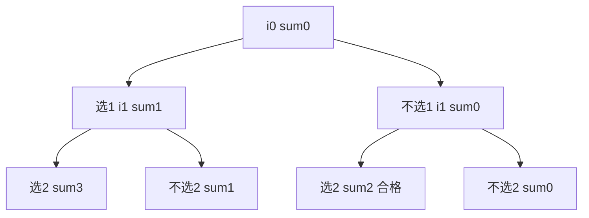

# 50 回溯、撤销与剪枝

## 50.1 目标与先修

先完成第19章递归、第44章DFS和第49章贪心反例。建议9—13小时，含两组实验。本章要能画出搜索树，解释一次调用的状态、选择、结束条件；在共享状态中正确撤销；给剪枝写出依据；用位掩码记录小集合；区分无解、一个解、多解和非法题面。

**回溯backtracking**是逐项尝试选择、遇到不能继续或已完成时退回，再尝试其他选择的方法。常用递归实现，但递归是表达方式，回溯是探索方案的策略。

本章的**搜索树**是思考模型，不需要为它申请树节点。一次递归调用对应一个部分方案；边表示做出一次选择。虽然用到了DFS的深入再返回，搜索的对象从现成图顶点变成了“尚未完成的答案”。

## 50.2 子集和：先定义“不同方案”

输入n个非负整数，每个位置最多选一次，找出所有和恰好为target的子集。位置不同就视为不同物品，即使数值相同也不同；答案不重复排列同一组位置。

例子`[3,1,2,0]`凑3，有四个位置子集：`{0}`、`{0,3}`、`{1,2}`、`{1,2,3}`。零元素不会改变和，却会改变所选位置，因此不能找到一次sum==target就立刻终止整条搜索。

输入n=0、target=0时，空集是唯一方案；n=0、target>0时没有方案。**没有方案**是正常计算结果，count=0；NULL、不合法开关或数值超范围才是接口失败。

本实现最多8项，值0—20，target0—160，不接受负数。这些范围同时约束递归深度、整数和与输出容量，后面的剪枝也依赖非负前提。

## 50.3 二选一搜索树与调用不变量

函数visit处理位置i，参数sum为已选前缀的和。每层两条边：选values[i]，或不选values[i]；两者都进入i+1。到i==n，全部位置已决定，再判断sum是否等于target。

以`[1,2]`凑2为例，完整叶子为：选1选2得到3，选1不选2得到1，不选1选2得到2，不选1不选2得到0。只有第三片叶子合格。



进入visit时的不变量：前i个位置已有决定；sum准确表示它们的选中和；mask中的前i位准确记录选择，尚未决定的位置位为0。i每次加1，最终到n，因此必终止。

每个位置的取/不取串唯一对应一个叶子，所以不漏、不重复地覆盖所有位置子集。这个完整性证明比“看起来递归跑了两次”更重要。

## 50.4 先理解位，再用位掩码

**位bit**只能是0或1。一个无符号整数可以同时存多位；这里第i位为1表示选了位置i，这种小集合表示叫**位掩码mask**。

| C写法 | 含义 | 本章例子 |
| --- | --- | --- |
| `1u << i` | 将无符号1向左移i位 | i=3时为二进制1000，即8 |
| `mask \| bit` | 按位或，合并为1的位 | 1与8得到9，表示选0和3 |
| `mask & bit` | 按位与，检查共同为1的位 | 9与8非零，说明位置3被选 |
| `~bit` | 按位取反 | 与其相与可清除该位 |
| `mask &= ~bit` | 只清除此位 | 其他位置保持 |

`|`和`&`是位运算，`||`和`&&`是逻辑运算，不能混用。表格中竖线为排版转义，真实C源码直接写`|`。`1u`中的u使常量为unsigned；本批移位仅0—7或0—3，不会移到类型位宽外。

mask=6是二进制0110，表示位置1和2，**不是**值1和2这两个名字，也不是业务ID6。这里是状态表示的压缩初识；它不意味着搜索从2^n自动变成多项式，也不是已经实现了子集状态DP。

## 50.5 共享状态必须撤销

本程序的mask保存在共享Search结构中。选当前项前保存saved，置位后递归，返回时恢复saved，再搜索不选分支。两条兄弟分支都从同一份前缀状态出发。

sum、i是按值传递的标量，各层有自己的副本，调用返回后外层sum不会因内层加法改变，所以不需要sum减回去。共享mask不同，内层改动会留下来，必须显式恢复。

若漏掉恢复，第二条分支可能带着“已经选过”的位，出现输出mask与sum不一致。撤销要恢复的是**进入选择前的状态**，不是随意清空整个mask，否则也会丢掉祖先层的决定。

不要把带共享指针的对象复制一份就认定所有状态都独立；本例Search.result仍指向同一输出。这里是有意汇总答案，mask才是每条分支需要恢复的选择状态。

## 50.6 有依据的剪枝：只跳过不可能有解的子树

**剪枝**是在已能证明某个部分方案不可能完成时，省去其全部后续搜索。能减少节点数，不保证所有输入都很快。

令suffix[i]为从i到末尾所有数的和。因为每个数都非负，后续最终和只能落在`[sum, sum+suffix[i]]`内。因此：sum>target时已经过头；target-sum>suffix[i]时即使全选也不够。两种情况都可安全返回。

代码先判断sum>target，逻辑或`||`短路，只有前者为假才算target-sum，所以无符号减法不会在sum较大时绕回去。这个写法还避免了为了比较而构造更大的和；当前160预算下和本来就安全。

**等于不能剪**：sum==target且后面还有0时，后面零的取/不取都是不同方案。对`[0,0]`凑0，应有空、选第0、选第1、两者都选四种。剪枝只判断“必无解”，不能把“已经找到一个”误当“再无别的”。

若允许负数，sum>target可能被之后的负数拉回来，本证明失效。不要只扩大一个输入范围，却保留旧剪枝。

## 50.7 完整子集和模块

[subset.h](示例代码/50-subset/subset.h)定义SubsetResult：masks最多256项，count为方案数，nodes为进入visit的次数，pruned为命中边界剪枝的次数。最多8项共有2^8=256个子集，所以输出容量足够。

下面是**完整模块subset.c**，需[公共头](示例代码/stage9-common/design.h)、subset.h和[入口](示例代码/50-subset/main.c)：

```c
#include "subset.h"
typedef struct {
    const unsigned *values;
    size_t n;
    unsigned target, mask, suffix[D_ITEMS + 1];
    int pruning;
    SubsetResult *result;
} Search;
static void visit(Search *search, size_t i, unsigned sum)
{
    search->result->nodes++;
    if (search->pruning &&
        (sum > search->target || search->target - sum > search->suffix[i])) {
        search->result->pruned++;
        return;
    }
    if (i == search->n) {
        if (sum == search->target) {
            search->result->masks[search->result->count++] = search->mask;
        }
        return;
    }
    unsigned saved = search->mask;
    search->mask |= 1u << i;
    visit(search, i + 1, sum + search->values[i]);
    search->mask = saved;
    visit(search, i + 1, sum);
}
DStatus subset_sums(const unsigned *values, size_t n, unsigned target,
                    int pruning, SubsetResult *out)
{
    if (out == NULL || (n != 0 && values == NULL) || (pruning != 0 && pruning != 1)) {
        return D_INVALID;
    }
    if (n > D_ITEMS || target > D_SUB_TARGET) { return D_RANGE; }
    for (size_t i = 0; i < n; i++) {
        if (values[i] > D_SUB_VALUE) { return D_RANGE; }
    }
    SubsetResult next = {0};
    Search search = {0};
    search.values = values; search.n = n; search.target = target;
    search.pruning = pruning; search.result = &next;
    for (size_t i = n; i > 0; i--) {
        search.suffix[i - 1] = search.suffix[i] + values[i - 1];
    }
    visit(&search, 0, 0);
    *out = next;
    return D_OK;
}
```

suffix倒着计算，初始suffix[n]=0。即使启用剪枝，保留的方案仍按“先选后不选”的搜索顺序输出。pruning必须是0或1；0表示完整枚举，1表示使用上述两条界。

失败时out保持。输出在局部next累计，最多511次调用、递归深度至多n+1；sum与suffix均不超过160，没有动态申请。

## 50.8 复现实验：方案相同，节点减少

保留下载包的相邻目录。在 **MSYS2 UCRT64 Bash、解压后的`source/示例代码`目录**：

```bash
gcc -std=c17 -Wall -Wextra -Wpedantic -Istage9-common \
  50-subset/main.c 50-subset/subset.c -o subset.exe
./subset.exe
```

预期：

```text
solutions=4 masks=9,1,14,6
plain_nodes=31 pruned_nodes=15 cuts=4
```

9=1001选0、3；1选0；14=1110选1、2、3；6=0110选1、2。完整4层二叉树有1+2+4+8+16=31次调用；边界剪枝后本样例进入15个节点，4个节点立即返回。这里比较的是同一定义的调用数，不是运行时间加速倍数。

最坏仍可能访问O(2^n)节点；若把每个方案展开为n个元素，输出本身可需O(n2^n)。本例每方案保存一个mask，逻辑输出O(2^n)，递归/后缀工作O(n)；实际数组按8/256上限预留并清零，不能把节点数当程序全部指令数。

把values改为8个0、target改0、n改8，输出应有256个方案，即使剪枝也不能省掉合法方案。只输出前几项的展示代码可以另写，但不能静默截断算法结果。

## 50.9 4×4数独：多种约束的搜索

现在将搜索用于一个小谜题。网格4行4列，每格填1—4；每行、每列、每个2×2宫都恰好各出现一次1—4。0表示尚未填写，不能当作候选数字。这里是**4×4教学数独**，不是9×9通用求解器。

每次选从左到右、从上到下的第一个空格，按1、2、3、4尝试；数字已在同行/列/宫出现就跳过。这个检查就是局部约束剪枝。

采用三组位掩码rows、cols、boxes，每个数字d对应`1u << (d-1)`。宫编号为`(row/2)*2+col/2`：上左0、上右1、下左2、下右3。按位或合并三处已用数字，按位与判断候选是否冲突。

先检查所有题面数字与已有冲突。超出0—4返回D_RANGE；题面自身重复返回D_INVALID。合法题面也可能无解，成功返回D_OK但solutions=0；空题面有多解。只有找到一个解，不能据此宣称题目唯一。

## 50.10 选择、递归、恢复的四份状态

一个候选通过检查后，必须同步修改：格子、行mask、列mask、宫mask。递归返回后四者都恢复。因为原先该格是空、该数字在三处都未出现，所以撤销时将格子设0，并只清除该数字的位是安全的；题面的已知数字从不被清除。

Search持有题面的**值副本**，函数不会在调用者的网格上试填。首次完成时复制完整board到result.first，之后继续计数，用来区分无解/唯一/多解。

搜索没有“找到就马上return并漏掉撤销”的分支；每个候选无论有没有找到解，都先恢复再试下一个。若今后加入提前停止，必须重新检查这些返回路径。

**完整模块sudoku.c**，接口见 [sudoku.h](示例代码/50-sudoku/sudoku.h)，入口见 [main.c](示例代码/50-sudoku/main.c)：

```c
#include "sudoku.h"
typedef struct {
    MiniGrid board;
    unsigned rows[MINI_SIDE], cols[MINI_SIDE], boxes[MINI_SIDE];
    SudokuResult *result;
} SudokuSearch;
static void fill(SudokuSearch *search, size_t position)
{
    search->result->nodes++;
    while (position < 16 && search->board.cells[position / 4][position % 4] != 0) {
        position++;
    }
    if (position == 16) {
        if (search->result->solutions == 0) { search->result->first = search->board; }
        search->result->solutions++;
        return;
    }
    size_t row = position / 4, col = position % 4, box = (row / 2) * 2 + col / 2;
    for (unsigned digit = 1; digit <= 4; digit++) {
        unsigned bit = 1u << (digit - 1);
        if ((search->rows[row] | search->cols[col] | search->boxes[box]) & bit) {
            continue;
        }
        search->board.cells[row][col] = (unsigned char)digit;
        search->rows[row] |= bit; search->cols[col] |= bit; search->boxes[box] |= bit;
        fill(search, position + 1);
        search->board.cells[row][col] = 0;
        search->rows[row] &= ~bit; search->cols[col] &= ~bit; search->boxes[box] &= ~bit;
    }
}
DStatus sudoku_solve(const MiniGrid *puzzle, SudokuResult *out)
{
    if (puzzle == NULL || out == NULL) { return D_INVALID; }
    SudokuResult next = {0};
    SudokuSearch search = {0};
    search.board = *puzzle; search.result = &next;
    for (size_t row = 0; row < 4; row++) {
        for (size_t col = 0; col < 4; col++) {
            unsigned digit = puzzle->cells[row][col];
            if (digit > 4) { return D_RANGE; }
            if (digit == 0) { continue; }
            size_t box = (row / 2) * 2 + col / 2;
            unsigned bit = 1u << (digit - 1);
            if ((search.rows[row] | search.cols[col] | search.boxes[box]) & bit) {
                return D_INVALID;
            }
            search.rows[row] |= bit; search.cols[col] |= bit; search.boxes[box] |= bit;
        }
    }
    fill(&search, 0);
    *out = next;
    return D_OK;
}
```

`(unsigned char)digit`是把已验证1—4的小整数显式存入格子的字节类型；不是把任意大整数截断后当输入验证。输出first只有solutions>0时可作为解读取；无解时它保持全零占位。

## 50.11 数独编译、输出与成本

仍在 **UCRT64 Bash、`source/示例代码`目录**：

```bash
gcc -std=c17 -Wall -Wextra -Wpedantic -Istage9-common \
  50-sudoku/main.c 50-sudoku/sudoku.c -o mini-sudoku.exe
./mini-sudoku.exe
```

预期：

```text
solutions=1
1 2 3 4
3 4 1 2
2 1 4 3
4 3 2 1
```

入口只有四个空格。全置0后应统计288个解；这一数量在本批由独立的24种行排列组合参考验证，不是只因求解器自称288便认定正确。返回的first是确定搜索顺序下第一份，不要求解唯一。

设空格数e，不利用约束的粗上界为O(4^e)，递归最多e+1层；本程序扫描后续固定格子的成本每次最多16，因此固定4×4下为常数因子。不宣传为多项式时间，也不把它扩展成9×9实测。

计数类型用unsigned long。固定题型下，每完整行至多24种排列，四行至多24^4=331776种，远小于该类型最小保证的范围；逐行部分安排也有安全节点界。不是对任意棋盘规模都能无溢出计数。程序无动态内存，错误保持与搜索无解分别验证。

## 50.12 常见错误

| 错误 | 影响与修正 |
| --- | --- |
| sum==target就立刻结束 | 漏掉后续零元素形成的不同位置子集 |
| 第二分支仍带第一分支的mask | 漏撤销；恢复进入选择前的saved |
| 把重复值当成同一个位置 | 改变题目定义，应按位置位区分 |
| 允许负数却仍用sum>target剪枝 | 剪枝依据失效，必须重新证明 |
| 数独只检查行列 | 会接受违反宫约束的填法 |
| 只恢复格子、不恢复三个mask | 后续候选被上一分支错误阻塞 |
| 首次找到解就认定唯一 | 唯一性需要继续搜索或有另外证明 |
| 用逻辑或代替按位或 | 得到的只是0/1真假，集合信息丢失 |

## 50.13 练习与参考答案

练习一：`[2,2]`凑2有几解？答案：2解，mask1与2。两个位置不同，不产生“先选0再选1”的排列重复。

练习二：suffix[i]=5、sum=3、target=9，能否剪枝？答案：能，最多达到8，差额6大于后缀5。target改8不能据此剪，还需继续判断具体组合。

练习三：位置i=2对应哪个位？mask5选哪些位置？答案：`1u<<2`为4；5=0101，选0、2。

练习四：row=3、col=1属于哪个宫？答案：(3/2)*2+1/2=2，下左宫。行列编号从0开始。

练习五：题面行里出现两个1和合法题面最终解数0，状态相同吗？答案：前者D_INVALID且旧结果保持；后者D_OK、solutions=0，是一次成功的无解判断。

更多独立任务见 [阶段练习](第九阶段上-练习.md) 和 [答案](第九阶段上-参考答案.md)。

## 50.14 完成条件

能画出3项子集的8片叶子，解释共享与局部状态；能证明两条剪枝，正确处理零、空输入、重复值和输出容量；能说明数独的三组约束并完整撤销四份状态，区分唯一/多解/无解/非法。

实际有限枚举范围见 [验证](验证/第九阶段上验证记录.md)。下一章 [动态规划](51-动态规划状态与恢复.md) 继续问：如果不同路径重复询问同一个子问题，怎样只计算一次？
