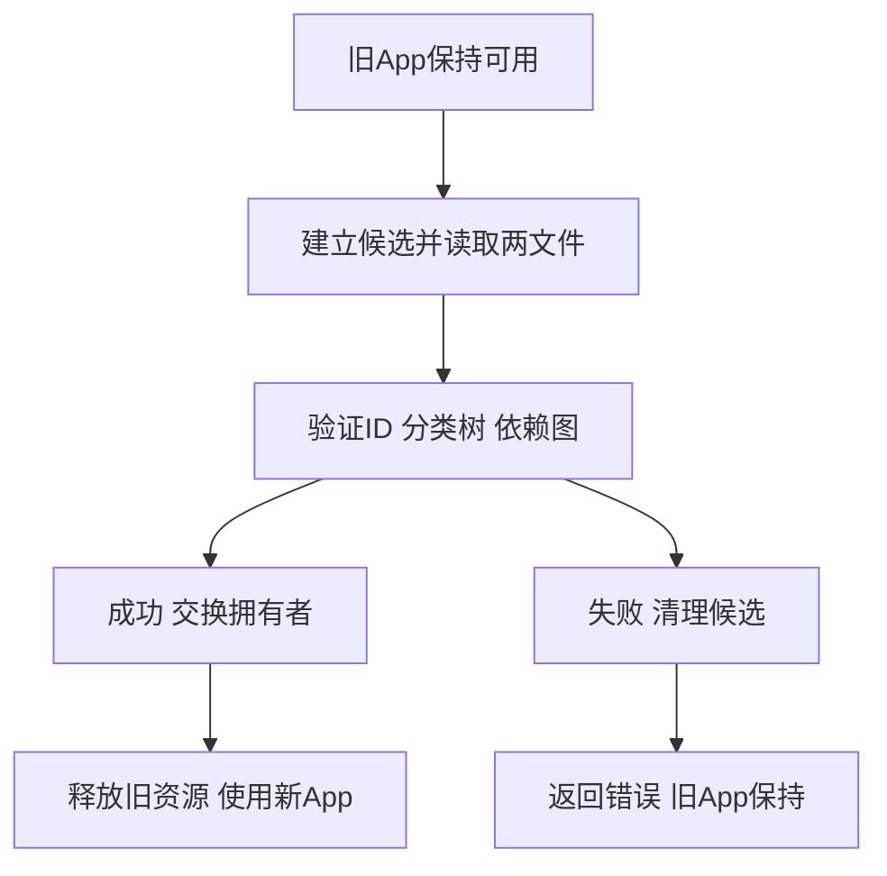

# 52 综合项目：资料检索与路线规划器

## 52.1 目标与先修

完成01—51章后进入本章，建议16—24小时，已含下半阶段练习、手打和排错。目标是把已学结构组合成一个可构建、可解释、能处理错误的小工具，而不只是把几个main拼到一起。

成品提供资料检索、稳定分钟列表、树形分类、学习先后、就绪推荐、地点路线、分钟修改和导出。使用C17与标准库，复用本课已有模块；原资料目录v0.2/v0.3和所有阶段例程都保留。

本章新增6份C/H，合为一组完整工程。完整源码在 [附录](示例代码/stage9-planner/完整源码.md)，构建和数据分别见 [运行说明](示例代码/stage9-planner/README.md)、[协议](示例代码/stage9-planner/协议与输出.md)。本章先解释关系与设计，再逐步运行，别一开始就盯着所有文件。

## 52.2 从需求拆出三个不同问题

你有若干资料：ID、标题、预计分钟，以及所属类别。想按ID或标题找到它们，知道哪些可以先学，并查询从书桌到图书馆的路线。

资料目录回答“是什么、需要多久”；先修图回答“谁必须先完成”；地点图回答“从哪里到哪里、代价多少”。预计学习分钟不自动等于边权，依赖的先后也不是地点路线。

| 需求 | 数据与算法 | 先修章节 |
| --- | --- | --- |
| ID精确查找 | 主记录加开放寻址索引 | 29—30 |
| 标题子串 | KMP，按字节匹配 | 27 |
| 分钟列表 | 稳定归并生成副本 | 33、36 |
| 分类层次 | 一般树的父关系数组、前序遍历 | 37—38的树与遍历思想 |
| 学习先后 | 有向图、Kahn拓扑 | 43、45 |
| 就绪推荐 | 前驱检查、小根堆priority/ID | 41 |
| 地点路线 | 非负无向图、Dijkstra与路径恢复 | 46 |

没有为了“所有算法都出现”而给工具塞入哈夫曼、数独或背包。尤其“先做独立背包、再拓扑排序”不保证有先修限制的预算最优，上一章的反例仍然成立。

## 52.3 业务ID不是数组下标

**业务ID**是在文件和界面中标识对象的编号；**位置**是数组中0到n-1的槽。资料ID可为0、17、9、9999，不能拿9999直接访问8格图。

**映射**把业务ID转换为内部位置，返回结果时再转换回来。本版学习网络和地点网络各有最多8项映射，小规模下直接扫描即可。两张表相互独立：资料ID0和地点ID0只是恰好数字相同。

默认关系文件故意将学习节点声明为9999、9、0、17，对应位置0、1、2、3。若算法输出内部位置2却直接显示2，用户会看到不存在的资料；正确显示要查study_ids[2]，得到0。

地点也故意按202、0、9999、101声明，让错误更容易暴露。分类归属同样要先把类别ID映射成类别位置。ID0是合法值，缺失用独立状态或数量上限哨兵表示，不能用0兼任“没找到”。

## 52.4 预算和不变量先固定

目录文件最多32条，ID0—9999、分钟0—1440、标题1—63字节。内存索引旧模块仍最多48项，这里遵守更小的文件预算，不改它来迁就工程。类别最多8，学习网络最多8，地点最多8，标签1—31字节，道路0—1000。

目录中的每条资料恰好属于一个已定义类别。非空类别集合是一棵树：一个根，父项存在，无环。目录为空时也允许空类树或一棵没有资料的合法类树。

学习网络只包含显式声明的S节点；目录中其他资料仍可检索/分类，不被偷偷加到图里。每条D依赖的两个端点都须属于学习网络，图必须无环。地点可以不连通，零权合法，负边拒绝，无向反向重复边拒绝，自环允许。

输入对象必须通过init和load建立，不能手改字段破坏不变量。API输入与输出对象须独立，不将out指向App内部数组。只有满足这些约定，固定容量与失败保持的结论才成立。

## 52.5 文件拆分：兼容旧目录，增加关系侧文件

**序列化**是把内存数据按约定格式写成可重载的字节。旧DSA-CATALOG-1每条仍是ID、分钟、标题三行，不塞新字段破坏前批程序。默认 [catalog.txt](示例代码/stage9-planner/catalog.txt)按主顺序保存0、17、9、9999。

**侧文件**是与主文件配合的另一份配置。关系侧文件头DSA-RELATIONS-1，用`|`分字段：C类别、M资料归属、S学习节点、D先修边、P地点、R道路。各区块按C/M/S/D/P/R顺序，完整样本见 [relations.txt](示例代码/stage9-planner/relations.txt)。

下面是**协议片段**，需要放在正确文件头与区块上下文中，不是独立完整输入：

```text
C|7|0|Algorithms
C|0|-1|Basics
M|0|0
M|17|7
S|17
S|0
D|0|17
```

类别7可先于父0出现，因为解析与引用验证分两步；-1只表示类别根的父项，不是任何对象的ID。默认样本还有空类别42、两个独立的先修分支和一条0权道路，便于观察边界。

标签可含空格，不能含分隔符或ASCII控制字符，不提供转义。接受LF/CRLF和无最后换行；拒绝BOM、空记录、NUL、裸CR、未知类型、缺/多字段和超长行。标题/标签按UTF-8字节约定，不声称完整验证Unicode；“63字节”不是63个汉字。

## 52.6 为什么先解析，再验证关系

解析器用有界缓冲逐行读取，用原地替换分隔符得到字段指针。指针借用当前行缓冲，只在本轮使用，必须把要保留的标签复制进候选对象，不能保存即将被下一行覆盖的指针。

数字逐位检查：下一位加入前先证明不会超过上界，再做乘10加位。不能先让有符号整数溢出，最后才判断范围。前导0允许；空串、正负号（根父-1除外）、空格、小数拒绝。

候选记录收齐后，再解析类别父链、每条M归属、S资料存在性和D/R端点。这样能区分“字段没读懂”和“编号格式正确但引用不存在”。同一父链走了类别数步还没到根，说明存在环；无环但多个根则不符合一棵树的契约。

D依赖建图后运行拓扑，只要有环就加载失败。程序不会因为某个查询暂时用不到那条坏边，就接受一份半合法应用。完整解析实现见 [relations.c](示例代码/stage9-planner/relations.c)。

## 52.7 候选对象、提交与所有权

**候选对象**是尚未取代旧数据的新配置。加载时先在candidate里完成目录读取、索引构建、关系解析和验证；任何一步失败，只清候选，旧App保持。

**提交**是验证都成功后，把候选变成当前状态。本版唯一动态拥有资源是目录索引的slots；图、标签、位置表都是值数组，索引存的是记录位置整数，没有指向Planner内部数组的自引用。

因此可用专门的swap_owners交换两个完整Planner：交换后每张slots仍只有一个拥有者，清candidate释放的是旧App的资源。这是经过对象结构核对的所有权转移；不能把它推广为“任意含指针结构体都能普通复制后各自clear”。特别是循环链表的自指哨兵就不能这样照搬。



planner_load借用FILE*，不负责关闭；planner_load_files自己打开两个流，先加载到中间候选，连关闭都成功才最终提交。如果关闭报错，仍清候选、保留旧App。读取失败不回滚流位置，内存状态保持与流位置回滚是两个不同保证。

## 52.8 完整生命周期模块

公共结构体/API见 [planner.h](示例代码/stage9-planner/planner.h)，私有接口见 [planner_internal.h](示例代码/stage9-planner/planner_internal.h)。下面是**完整模块app.c**，需要头文件与其他模块共同编译，不是单文件独立程序：

```c
#include "planner_internal.h"
#include <string.h>
void planner_init(Planner *app)
{
    memset(app, 0, sizeof(*app));
    indexed_init(&app->catalog);
    for (size_t i = 0; i < RECORD_LIMIT; i++) { app->membership[i] = P_CLASSES; }
    (void)graph_init(&app->study, 0, 1);
    (void)graph_init(&app->roads, 0, 0);
}
void planner_clear(Planner *app)
{
    indexed_clear(&app->catalog);
    planner_init(app);
}
static void swap_owners(Planner *left, Planner *right)
{
    Planner temporary = *left;
    *left = *right;
    *right = temporary;
}
PStatus planner_number(const char *text, int limit, int *out)
{
    if (text == NULL || out == NULL || limit < 0) { return P_INVALID; }
    if (*text == '\0') { return P_FORMAT; }
    int value = 0;
    for (size_t i = 0; text[i] != '\0'; i++) {
        if (text[i] < '0' || text[i] > '9') { return P_FORMAT; }
        int digit = text[i] - '0';
        if (digit > limit || value > (limit - digit) / 10) { return P_LIMIT; }
        value = value * 10 + digit;
    }
    *out = value;
    return P_OK;
}
PStatus p_catalog_status(CatStatus status)
{
    switch (status) {
    case CAT_OK: return P_OK;
    case CAT_DUPLICATE: return P_DUPLICATE;
    case CAT_LIMIT: return P_LIMIT;
    case CAT_NOT_FOUND: return P_MISSING;
    case CAT_MEMORY: return P_MEMORY;
    case CAT_IO: return P_IO;
    default: return P_FORMAT;
    }
}
PStatus p_graph_status(GStatus status)
{
    switch (status) {
    case G_OK: return P_OK;
    case G_DUPLICATE: return P_DUPLICATE;
    case G_RANGE: case G_SPACE: return P_LIMIT;
    case G_MISSING: return P_MISSING;
    case G_CYCLE: return P_CYCLE;
    default: return P_INVALID;
    }
}
PStatus planner_load(FILE *catalog, FILE *relations, Planner *out)
{
    if (catalog == NULL || relations == NULL || out == NULL) { return P_INVALID; }
    Planner candidate;
    planner_init(&candidate);
    PStatus status = p_catalog_status(v3_load(catalog, &candidate.catalog));
    if (status == P_OK) { status = p_relations(relations, &candidate); }
    if (status == P_OK) { swap_owners(out, &candidate); }
    planner_clear(&candidate);
    return status;
}
PStatus planner_load_files(const char *catalog, const char *relations, Planner *out)
{
    if (catalog == NULL || relations == NULL || out == NULL) { return P_INVALID; }
    FILE *records = fopen(catalog, "rb");
    if (records == NULL) { return P_IO; }
    FILE *links = fopen(relations, "rb");
    if (links == NULL) { (void)fclose(records); return P_IO; }
    Planner candidate;
    planner_init(&candidate);
    PStatus status = planner_load(records, links, &candidate);
    int close_records = fclose(records);
    int close_links = fclose(links);
    if (status == P_OK && (close_records != 0 || close_links != 0)) { status = P_IO; }
    if (status == P_OK) { swap_owners(out, &candidate); }
    planner_clear(&candidate);
    return status;
}
PStatus planner_set_minutes(Planner *app, int id, int minutes)
{
    if (app == NULL) { return P_INVALID; }
    if (id < 0 || id > 9999 || minutes < 0 || minutes > 1440) { return P_LIMIT; }
    IRecord record;
    if (indexed_find(&app->catalog, id, &record) != H_OK) { return P_MISSING; }
    return p_catalog_status(v3_hash_status(indexed_set_minutes(&app->catalog, id, minutes)));
}
PStatus planner_export(FILE *out, const Planner *app)
{
    if (out == NULL || app == NULL) { return P_INVALID; }
    return p_catalog_status(v3_save(out, &app->catalog));
}
const char *planner_status_name(PStatus status)
{
    switch (status) {
    case P_OK: return "ok";
    case P_INVALID: return "invalid argument";
    case P_FORMAT: return "bad format";
    case P_DUPLICATE: return "duplicate item";
    case P_LIMIT: return "limit exceeded";
    case P_MISSING: return "missing reference or item";
    case P_CYCLE: return "cycle";
    case P_MEMORY: return "out of memory";
    case P_IO: return "I/O error";
    default: return "unknown error";
    }
}
```

init只用于未初始化或已清理对象，不能拿它覆盖仍拥有资源的对象；clear释放后恢复空状态，可重复clear。函数以*out或App参数返回结果时，调用者必须先检查状态。

旧模块各有错误枚举，本版用适配函数转为PStatus。**适配层**就是在不改旧实现的前提下，转换类型、错误或业务含义的一层普通函数。旧目录解析把部分超范围归为格式错误，适配器如实保留，不伪装成所有模块完全同一套检查优先级。

## 52.9 从干净副本构建

下载累计包，解压到自己的练习目录，保留source下所有旧模块。Windows打开MSYS2 UCRT64 Bash，用cd进入**该副本的`source/示例代码`目录**，再执行：

```bash
gcc -std=c17 -Wall -Wextra -Wpedantic \
  -Istage6-common -Istage5-common -I29-open-addressing \
  -I27-matching -Istage7-common -Istage8-common \
  -Istage9-planner \
  stage9-planner/main.c stage9-planner/app.c stage9-planner/relations.c \
  stage9-planner/query.c stage6-catalog/io.c stage6-catalog/view.c \
  stage2-catalog/catalog.c stage5-indexed-catalog/catalog.c 29-open-addressing/open_map.c \
  27-matching/matching.c 33-merge/merge.c stage6-common/sort_common.c \
  stage8-common/graph.c 45-topological/topological.c 46-shortest/path.c \
  46-shortest/dijkstra.c 41-heap/heap.c \
  -o planner.exe
```

这里链接17个.c文件，但只有stage9-planner/main.c一个入口；其余都是模块。多个目录有catalog.c/catalog.h，按明确路径和头文件中的相对路径区分，不能平铺覆盖。-I只帮编译器找头文件，不会自动补齐实现文件。

反斜杠是Bash续行，不是C语法；也可合成一行。旧MinGW格式兼容按第09章加-D__USE_MINGW_ANSI_STDIO=1。本批作者实际用已有GCC8.1.0并严格加-Werror，不把它说成新装推荐环境的验收。

编译无输出且生成planner.exe后，再继续下面命令；若报undefined reference，先核对是否漏链接源文件，别通过随意复制同名头文件解决。

## 52.10 第一次完整检查与检索

仍在 **UCRT64 Bash、解压副本`source/示例代码`目录**，命令的前三个参数分别是目录路径、关系路径、操作：

```bash
./planner.exe stage9-planner/catalog.txt stage9-planner/relations.txt check
./planner.exe stage9-planner/catalog.txt stage9-planner/relations.txt list
./planner.exe stage9-planner/catalog.txt stage9-planner/relations.txt find 0
./planner.exe stage9-planner/catalog.txt stage9-planner/relations.txt title "C"
```

check输出：

```text
records=4 categories=3 study=4 places=4
```

list输出：

```text
id=9999 minutes=15 title=Graphs
id=9 minutes=20 title=Pointers
id=0 minutes=30 title=C basics
id=17 minutes=30 title=Arrays
```

两条30分钟保持原主顺序0在17前，这是稳定性；原文件顺序仍为0、17、9、9999。find 0返回C basics，说明0没有被当作缺失标志。title C只匹配区分大小写的字节C，空模式匹配全部且按主顺序，完全没有匹配输出no matches，正常退出0。

默认先读完并验证两文件，再执行任何有效查询。即使只find资料，关系文件有坏引用也会失败；我们选择的是一份完整有效的应用状态，而不是各命令自行忽略坏配置。

## 52.11 分类不是把ID排个序

运行：

```bash
./planner.exe stage9-planner/catalog.txt stage9-planner/relations.txt categories
```

预期：

```text
category=0 label=Basics
  id=0 minutes=30 title=C basics
  category=7 label=Algorithms
    id=17 minutes=30 title=Arrays
    id=9 minutes=20 title=Pointers
    id=9999 minutes=15 title=Graphs
  category=42 label=Empty category
```

从根0开始前序遍历，孩子7、42按声明顺序出现；类内资料按主顺序。缩进是树深度，空类别也展示。分类是一般树，一个类别可有多个孩子，不是BST的“左小右大”。本版用父ID数组表示，遍历时扫描孩子，最多8类，不需要另外申请链式节点。

类数为C时，验证父链和扫描式遍历可到O(C²)；资料归属展示还要扫描记录。这个预算下清楚可靠比强行套一个不匹配的二叉搜索结构更重要。

## 52.12 学习顺序与就绪推荐

运行：

```bash
./planner.exe stage9-planner/catalog.txt stage9-planner/relations.txt order
./planner.exe stage9-planner/catalog.txt stage9-planner/relations.txt ready
./planner.exe stage9-planner/catalog.txt stage9-planner/relations.txt ready 0
./planner.exe stage9-planner/catalog.txt stage9-planner/relations.txt ready 0 17 9
```

依次为：

```text
order=0,9,17,9999
ready=0
ready=9,17
ready=9999
```

order是一个满足全部先修的完整顺序，不保证按业务ID字典序最小。ready输出“现在可以开始、但还没完成”的点，不会把输出第一项立即当完成后继续扩展。

**先修闭包**在这里要求：已完成集合含某个点，就必须同时含它的所有直接先修；这个条件对每条边检查后，也保证所有祖先都已完成。ready 9999会失败，因为17、9等尚未完成；重复完成ID也失败。

候选点放进小根堆，priority为当前分钟、id为资料ID，按分钟再ID弹出。若把17改成10分钟，完成0后的推荐就变17、9，不会继续用旧30分钟缓存。它不是同优先级FIFO，也不是最短总学习计划或预算最优。

## 52.13 地点路线：零权与不可达

运行：

```bash
./planner.exe stage9-planner/catalog.txt stage9-planner/relations.txt route 0 202
./planner.exe stage9-planner/catalog.txt stage9-planner/relations.txt route 202 0
./planner.exe stage9-planner/catalog.txt stage9-planner/relations.txt route 0 0
./planner.exe stage9-planner/catalog.txt stage9-planner/relations.txt route 0 9999
```

预期：

```text
cost=5 path=0,101,202
cost=5 path=202,101,0
cost=0 path=0
unreachable
```

书桌0到门口101的道路代价0，仍是存在的边；通过它到图书馆202只需5，优于直达9。地点9999是显式孤立点，查询成功但无路线；查不存在地点44则是错误。自环允许，但非负权下不会让自身最短成本优于0。

恢复得到的Graph位置必须通过places映射回地点ID。有限路径最多8点，边权0—1000，简单路径成本最多7000，继续复用已验证的long加法与路径恢复。本版不接受负边，不把独立Bellman/Floyd实验误说成业务路由已支持负权。

## 52.14 分钟修改、导出与重新加载

在 **同一UCRT64 Bash目录**执行，输出文件名与输入不同：

```bash
./planner.exe stage9-planner/catalog.txt stage9-planner/relations.txt minutes 0 20 > updated-catalog.txt
./planner.exe updated-catalog.txt stage9-planner/relations.txt list
./planner.exe stage9-planner/catalog.txt stage9-planner/relations.txt export > exported-catalog.txt
./planner.exe exported-catalog.txt stage9-planner/relations.txt check
```

更新后list顺序是9999、0、9、17：两条20分钟按原序0在9前。原样例文件没有改动。minutes/export写的是DSA-CATALOG-1协议，不能夹一行“保存成功”；关系文件仍用原来那份，因为ID、归属和边不变。

绝不能把重定向目标写成输入路径：shell会在程序启动前截断目标，程序还没读取就丢了内容。此处命令固定使用Bash演示，不混用其他终端的重定向规则。

分钟修改先验证ID和范围，再提交单个int；本版不缓存视图/就绪堆，每次查询按当前记录重建，因此不需要申请另一整份候选或更新旧缓存。这是对实现前设计的具体简化，而不是遗漏派生数据一致性。

内存修改与文件输出是两步：导出申请失败时不会写协议，写入/刷新失败可能已输出一部分；不承诺原子保存或自动撤销已经成功的内存修改。CLI一次运行结束后清理内存，持久结果以新文件能否成功重载为准。

## 52.15 失败保证怎样逐层看

| 场景 | 状态/行为 | 保持什么 |
| --- | --- | --- |
| 坏格式、缺引用、分类/依赖环 | 加载失败 | 旧App不变，候选索引释放 |
| 新索引申请失败 | P_MEMORY | 旧App及资源数量不变 |
| 稳定视图辅助分配失败 | P_MEMORY | 调用者旧输出、主记录不变 |
| 无匹配、无路线 | P_OK，新结果为空 | 这是计算结论，不是沿用旧输出 |
| 自有输入流关闭失败 | P_IO | 路径加载接口不提交候选，仍关完两流 |
| 导出申请失败 | P_MEMORY | 未写协议，App不变 |
| 写入/刷新失败 | P_IO | App不变，文件可能部分输出 |

stdout只放正常数据，stderr放错误，成功退出0、错误退出1。输入数量不对或未知命令输出usage。main统一清理，最后检查stdout刷新及错误标记；不能只因计算成功便假定所有输出都到达文件。

“失败保持”有对象边界：旧App保持不代表读入流退回起点；输出保持不代表磁盘写入可回滚；追踪模块存活为0不代表整个运行库没有申请过内存。完整状态说明见 [协议](示例代码/stage9-planner/协议与输出.md)。

## 52.16 结构选择与成本报告

**比较一：ID散列与逐项扫描。** 小目录线性扫描很简单，最坏看R条；复用散列可在分布/负载适当时减少探测，仍不保证任何输入都是O(1)，索引重建还会申请内存。我们保留主序列，将索引只作为加速层，不能让索引成为另一份独立主数据。

**比较二：稳定副本视图与直接重排。** 原地排序可能破坏索引中“ID→原位置”的关系和原加入次序。这里先对分钟/原位置SItem排序，再生成IRecord副本；付出O(R)辅助空间，保留主序列。归并比较O(R log R)，实际比较/写入由已有SortStats计数。

**比较三：矩阵与邻接表。** 学习/地点各最多8点，矩阵方便存在/权重分离和跨模块校验；拓扑、ready前驱扫描、Dijkstra按V²计，不套稀疏邻接表或堆优化的复杂度。ready还要压/弹至多V个堆项，O(V log V)，但矩阵扫描主项仍在。

标题匹配对每条资料调用KMP，包含模式预处理成本，并非本版只预处理一次。分类父链验证和遍历按扫描实现计成本；解析有逐行字符读取、重复项检查、引用查找及候选构建，不把“各字段有上限”偷换成没有任何工作。

真实工作量入口在本批验证器：三条记录分钟30、20、20的稳定视图会报告比较/写入计数，数值以机器结果为准。计数不包含全部循环、分配、I/O或CPU时间，不用一个计数比率冒充整程序加速。两文件加载、视图和导出的实际申请位置也分别追踪。

## 52.17 验证要有独立依据

本批不只核对默认四条数据：依赖图用所有三点有向存在组合与排列参考，分类用0—4类的父关系枚举，路线用三点非负图和简单路径参考。检查真实ID、先修每条边、就绪资格、路线边/权和、分类深度与输入顺序，不拿相同模块的两个调用相等当唯一证据。

申请失败逐个注入到32条目录加载的实际位置，要求旧App字节和资源存活数保持；导出、视图另测。读取、写入、刷新、关闭用受控包装模拟错误；这是执行实际错误分支，不是让磁盘真的写满或拔掉设备。测试钩子与正式源码分离，细节见 [验证记录](验证/第九阶段下验证记录.md)。

空目录、单点、32记录/8类/8点边界、ID0与9999、重复/缺引用/环、负道路/零道路、UTF-8字节、CRLF、坏数字、过长字段等均有可复现用例。对小模型有限枚举，不声称穷尽全部业务输入。

## 52.18 常见错误

| 错误 | 原因与修正 |
| --- | --- |
| 用业务ID直接索引8格数组 | 编号范围与位置范围不同，先映射 |
| 直接重排主记录却不重建索引 | 旧ID索引指向错位置，使用稳定副本视图 |
| 保存当前行字段指针供以后使用 | 行缓冲会复用，复制要保留的标签 |
| 读到一半就改旧App | 后面坏引用/分配失败无法保持，先候选再提交 |
| 含指针结构体复制后各自clear | 双重所有权，应只用已审查的交换转移 |
| 将-1根父项当普通对象ID | -1仅为分类根关系，不参加正常ID空间 |
| 输出order位置编号而非资料ID | 结果少了反向映射，稀疏样本会暴露 |
| 将ready输出的首项自动当完成 | 当前就绪集合不是自动学习模拟 |
| 把list输出再次导入 | 人读格式不是序列化协议，使用export/minutes |
| 输入输出用同一路径重定向 | shell提前截断，用新的输出文件名 |

## 52.19 练习与参考答案

练习一：默认样本的学习位置2代表谁？地点位置2又代表谁？答案：资料0，地点9999，两个映射不同。

练习二：完成0、17后，谁就绪？答案：9；9999还缺先修9。完成集合0、17合法，单独17非法。

练习三：将17分钟改10，原输入次序不变，完成0后的ready？答案：17、9，按新分钟重建堆；没有缓存过期问题。

练习四：把道路0→101的权重改为0，会被当无边吗？答案：默认就是0权边，has另存存在性，路线0→101→202成本5。

练习五：候选已解析完，但关闭第二个自有输入流失败，旧App是否应被替换？答案：planner_load_files不提交，两次关闭都尝试后清候选；借用流接口的关闭责任另属调用者。

独立验收任务见 [第九阶段下练习](第九阶段下-练习.md)，参考结果与解释见 [独立答案](第九阶段下-参考答案.md)。

## 52.20 完成条件与全课收束

能从干净副本编译，解释各模块职责；独立修改样例并核对检索、分类、拓扑、就绪与路线；完成导出重载，说明所有权和至少两种失败保证；能用测试定位一个映射或状态错误，而不是只复制输出文字。

本课52章、9阶段与最终v1.0基础主线至此交付。已有各阶段源码、练习和验证记录保留，课程完成不等于读者自动掌握，也不等于工业级应用：本版没有交互菜单、增删关系、关系导出、原子保存、并发账户、负权业务路由或依赖预算最优，跨平台/浏览器视觉范围按记录报告。

后续可自行研究更大规模图、原子保存、Unicode规范化、依赖约束优化等，但先把当前程序从空文件重建并解释清楚。全课任务与最终验收入口见 [综合实践](最终综合实践-学习资料检索与路线规划器.md)。
