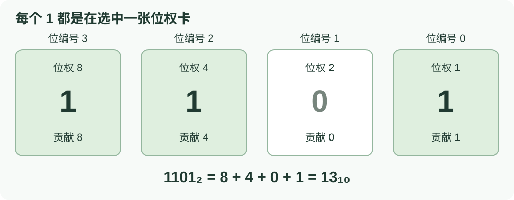

# 02 二进制与编码

> 本章是零基础详细重写版。先修：知道一位有 0、1 两种状态。建议分两到三次学习，每次完成一组转换题。需要纸笔，不需要安装软件。

**本章目标：** 完成本章讲解与练习后，你应能用位权与除法转换进制；根据范围选择位宽；区别普通二进制与BCD的解释。

## 2.1 为什么电脑喜欢用二进制

上一章说，多位比特可以形成很多模式。现在我们约定用这些模式表示非负整数，也就是 0、1、2、3 等数。

我们平时用十进制，是因为每一位可写 0–9 十种数字；超过一位容纳的范围就向左进位。数字电路容易区分高、低两类状态，因此每一位只使用 0、1，采用**二进制**。

二进制和十进制都能表示同一个数量，区别在于写法。例如“十三个苹果”不因你写成 13 或二进制 1101 而改变数量。我们要学的是在写法之间转换。

## 2.2 先把十进制重新拆开看

十进制 253 为什么是二百五十三，而不是 2+5+3=10？因为每个位置的“分量”不同：

| 位置 | 百位 | 十位 | 个位 |
| --- | --- | --- | --- |
| 写下的数字 | 2 | 5 | 3 |
| 这个位置的权重 | 100 | 10 | 1 |
| 对总数的贡献 | 200 | 50 | 3 |

于是 `253=2×100+5×10+3×1`。这种位置对应的权重叫**位权**。向左移动一位，十进制位权乘 10。

这里会用乘方：`10^0=1`，`10^1=10`，`10^2=100`。上标或 ^ 后面的数表示连乘次数，指数为 0 时取 1。暂时不用背一般理论，先用表核对。

## 2.3 二进制位权：每向左一位翻倍

二进制只有两个数字，因此从右向左的位权是：1、2、4、8、16、32、64、128。每一个位置的值只可能是“取这一份”或“不取这一份”。

| 位的编号 | 7 | 6 | 5 | 4 | 3 | 2 | 1 | 0 |
| --- | --- | --- | --- | --- | --- | --- | --- | --- |
| 位权 | 128 | 64 | 32 | 16 | 8 | 4 | 2 | 1 |

编号从右边的 0 开始，不是从 1 开始。编号 3 的位权是 `2^3=8`，不是 3。先把“位编号”和“位权”写成两行，能减少很多错误。



例如四位 `1101`：从左到右对应 8、4、2、1，数字 1 的位置贡献位权，数字 0 的位置贡献 0。

```text
位模式：  1   1   0   1
位权：    8   4   2   1
贡献：    8   4   0   1
总和：8+4+0+1=13
```

这就是**二进制转十进制**的最直接方法：写位权，只把为 1 的位置加起来。

## 2.4 跟着算：10110 是多少

第一步，数出有五位，写五个权重 16、8、4、2、1。第二步，把 10110 放在它们上方：

| 写下的位 | 1 | 0 | 1 | 1 | 0 |
| --- | --- | --- | --- | --- | --- |
| 位权 | 16 | 8 | 4 | 2 | 1 |
| 贡献 | 16 | 0 | 4 | 2 | 0 |

第三步相加：`16+4+2=22`。因此二进制 10110 等于十进制 22。

为了避免不同进制混淆，数学排版常用下标：`10110₂=22₁₀`。下标 2、10 只说明进制，不属于数字本身。本教程也会直接写“二进制 10110”。

## 2.5 十进制转二进制：先用位权卡片法

问题：把十进制 45 写成二进制。先找到不超过 45 的最大二进制位权：32。64 太大，不能选。

| 正在考虑的位权 | 当前还剩多少 | 能否取一份 | 这一位 | 取完后还剩 |
| --- | --- | --- | --- | --- |
| 32 | 45 | 能 | 1 | 13 |
| 16 | 13 | 不能 | 0 | 13 |
| 8 | 13 | 能 | 1 | 5 |
| 4 | 5 | 能 | 1 | 1 |
| 2 | 1 | 不能 | 0 | 1 |
| 1 | 1 | 能 | 1 | 0 |

按表从上到下读出 `101101`。再反向检查：`32+8+4+1=45`，说明没有漏掉位权。

如果题目要求保存成 8 位，就在左边补零，得到 `0010_1101`。下划线只帮助每四位分组，不增加位数。补在左边不会改变非负整数数值；补在右边通常会改变数值。

## 2.6 另一种方法：不断除以 2

这里需要**商**和**余数**：例如 13÷2，商是 6，余数是 1，因为 `13=6×2+1`。

把 13 连续除以 2，直到商为 0：

| 当前数 | 除以 2 的商 | 余数 | 得到哪一位 |
| --- | --- | --- | --- |
| 13 | 6 | 1 | 最右边的位，位 0 |
| 6 | 3 | 0 | 位 1 |
| 3 | 1 | 1 | 位 2 |
| 1 | 0 | 1 | 位 3 |

最先得到的余数是最右位，因为除以 2 正是在问“这个数是否还多一个 1”。之后的商表示剩下多少份 2，再继续拆下一位。

所以应从表底往上读余数，得到 `1101`，不能从上往下写成 1011。用位权检查：1101 是 13，1011 则是 11，一验算就能发现顺序错误。

两种方法任选一种熟练使用，再用另一方向检查。纸笔初学时，位权卡片法通常更直观；除法法适合有明确步骤地处理较大整数。

## 2.7 二进制加一怎样进位

十进制个位到 9 后，再加一要写 0 并向左进 1。二进制个位到 1 后，再加一就要向左进位，因为本位没有“2”这个数字。

| 本位相加 | 本位写下什么 | 向左进多少 |
| --- | --- | --- |
| 0+0 | 0 | 0 |
| 0+1 或 1+0 | 1 | 0 |
| 1+1 | 0 | 1 |
| 1+1+前一位进来的1 | 1 | 1 |

例如 `0111+0001`，从右边开始：个位 1+1 写 0 进 1；第二位 1+进来的1 又写 0 进 1；第三位相同；最高位 0+进来的1 写 1。结果是 `1000`，十进制 7+1=8。

再看 `1111+0001=1_0000`，数学结果是 16，已经需要五位。若设备只保存四位，就只能留下低四位 0000，额外那一位必须另外保存或丢弃。这为下一章的有限位宽运算作准备。

## 2.8 位宽决定能区分多少个值

N 位有 `2^N` 种模式。若全部用来表示从 0 开始的整数，范围就是 `0…2^N−1`。为什么最大值要减一？因为 0 已经占用一种模式。

| 位宽 | 模式数量 | 无符号范围 |
| --- | --- | --- |
| 1 | 2 | 0–1 |
| 2 | 4 | 0–3 |
| 3 | 8 | 0–7 |
| 4 | 16 | 0–15 |
| 8 | 256 | 0–255 |

这里的**无符号**表示这些模式不用于负数，所有位都按正位权解释。下一章再安排负数。

要保存十进制 9，三位最大只有 7，不够；四位最大 15，足够，所以最少四位。初学不需要先学对数，逐行比较这个表就能判断。

## 2.9 位置编号与“装了多少个”不总同宽

设有 16 个储物格，从 0 开始编号：0、1、…、15。表达某个格子的编号，只需四位，因为最大编号是 15。

但表达“有多少个格子已使用”，可能是 0 个、1 个、…、16 个，共 17 种结果。四位只有 16 种模式，不够，需要五位。

| 要保存的量 | 最小值 | 最大值 | 值的个数 | 最少位宽 |
| --- | --- | --- | --- | --- |
| 16 个格子的编号 | 0 | 15 | 16 | 4 |
| 已使用的格子数量 | 0 | 16 | 17 | 5 |

不要机械记“数量一定比地址多一位”。例如 12 个格子，编号 0–11 要四位，数量 0–12 也只要四位。正确做法永远是先写清范围，再找能容纳它的最小位宽。

## 2.10 为什么还要学十六进制

二进制很适合电路，但一串 32 位写起来难读。**十六进制**让每一位能表示 0–15；十个阿拉伯数字不够，就用 A、B、C、D、E、F 表示 10–15。

四位二进制恰好有 16 种组合，因此可一组一组换成一个十六进制数字：

| 二进制 | 十六进制 | 十进制 | 二进制 | 十六进制 | 十进制 |
| --- | --- | --- | --- | --- | --- |
| 0000 | 0 | 0 | 1000 | 8 | 8 |
| 0001 | 1 | 1 | 1001 | 9 | 9 |
| 0010 | 2 | 2 | 1010 | A | 10 |
| 0011 | 3 | 3 | 1011 | B | 11 |
| 0100 | 4 | 4 | 1100 | C | 12 |
| 0101 | 5 | 5 | 1101 | D | 13 |
| 0110 | 6 | 6 | 1110 | E | 14 |
| 0111 | 7 | 7 | 1111 | F | 15 |

十六进制不是增加了硬件中每位的状态数量，只是人阅读同一串二进制时采用更紧凑的写法。

## 2.11 十六进制转换的完整例子

把 `1010_0110` 转成十六进制：左边 1010 对应 A，右边 0110 对应 6，因此结果 A6。验证数值：十六进制从右到左位权为 1、16、256，因此 `A6=10×16+6=166`。

反过来把 2D 转成二进制：2 写为 0010，D 是十进制 13，写为 1101；拼接起来是 `0010_1101`，就是前面算过的十进制 45。

如果二进制位数不是 4 的倍数，例如 101101，从**右边**开始分组为 `10 1101`，左侧补零成为 `0010 1101`，得到 2D。不能从左边直接切成 `1011 01`，那样会错配位权。

有些工具写 `0x2D` 表示十六进制，数学也写 `2D₁₆`。之后 SystemVerilog 会用带位宽的写法，如 `8'h2D`；本章先看成“8 位、十六进制 2D”，完整语法到第 9 章再教。

## 2.12 数值与编码：普通二进制和 BCD

如果十进制 12 按普通无符号二进制保存：`12=8+4`，四位是 1100。

另一种需求是分别保存显示屏上的“1”和“2”。可以让每个十进制数字各用四位编码：1 对应 0001，2 对应 0010，合起来 `0001_0010`。这种逐位表示十进制数字的方法叫 BCD，也叫二进制编码的十进制。

| 要表示的十进制数 | 普通二进制 | BCD |
| --- | --- | --- |
| 9 | 1001 | 1001 |
| 12 | 1100 | 0001_0010 |
| 27 | 0001_1011 | 0010_0111 |

为什么 9 的两种写法一样，12 却不同？因为 0–9 只用一个十进制数字，BCD 只需一个四位组；12 要分别编码两个数字。**BCD 的每个四位组只允许 0000–1001。** 1010–1111 不代表单个合法十进制数字。

若直接把位模式 0001_0010 当普通无符号整数读，会得到 16+2=18。只有知道“这串位按 BCD 解释”，才会把它读成十进制 12。位模式必须与解释规则一起使用。

## 2.13 跟着做：给小计数器选位宽

需求：记录 0–59 秒。先不要考虑显示，只考虑需要区分多少个整数。

第一步，范围含两端，共 60 个值。第二步，五位有 32 种模式，不够。第三步，六位有 64 种模式，足够，因此核心秒值至少六位。第四步，定义 60–63 四个剩余模式怎样处理，不能因为位宽够就以为所有模式都合法。

如果以后显示为两位十进制数字，可以再把秒值转换成十位和个位。核心保存六位普通二进制，显示使用两个十进制数字，并不矛盾；它们是不同层次的数据表示。

## 2.14 常见错误与检查办法

| 错误 | 造成什么问题 | 检查办法 |
| --- | --- | --- |
| 从左边开始写 1、2、4、8 | 位权颠倒 | 最右位始终对应 1 |
| 把组合数量当最大值 | 说四位能保存 16 | 列 0–15，数一数正好16种 |
| 余数按得到的先后写 | 把13写成1011 | 用位权重新加回去 |
| 十六进制从左随意分组 | 错配位权 | 从右每四位一组，左边补零 |
| BCD 当普通整数直接加权 | 把12读成18 | 先写明编码规则 |
| 只保存低位却期待数学原值 | 15+1在四位里变成0 | 运算前写输入与结果位宽 |

## 2.15 自己做：四题带过程答案

**题 1：** 二进制 100101 等于多少？先在纸上写全部位权。参考：32、16、8、4、2、1，对应 1 的贡献是 32、4、1，因此是 37。

**题 2：** 把 26 写成八位二进制与十六进制。参考：26先取16剩10，取8剩2，不取4，取2剩0，不取1，得到11010；补齐八位为0001_1010，分组是1A。

**题 3：** 保存0–31和0–32分别最少几位？参考：前者32个值，五位足够；后者33个值，五位不够，要六位。区别仅是多了一个边界值，但会影响硬件宽度。

**题 4：** 位模式0010_0101按普通二进制和BCD分别是什么？参考：普通二进制为32+4+1=37；BCD左组0010是2，右组0101是5，因此为十进制25。

## 2.16 本章完成条件

不看表，把 45 在二、十、十六进制间互相核对；解释为什么“16 个位置”和“0–16 的数量”可能不同宽；解释 BCD 与普通二进制。完成后进入[第 03 章：补码与有限位宽运算](03-补码与有限位宽运算.md)。负数仍然由 0、1 组成，关键是重新规定一部分模式的含义。
