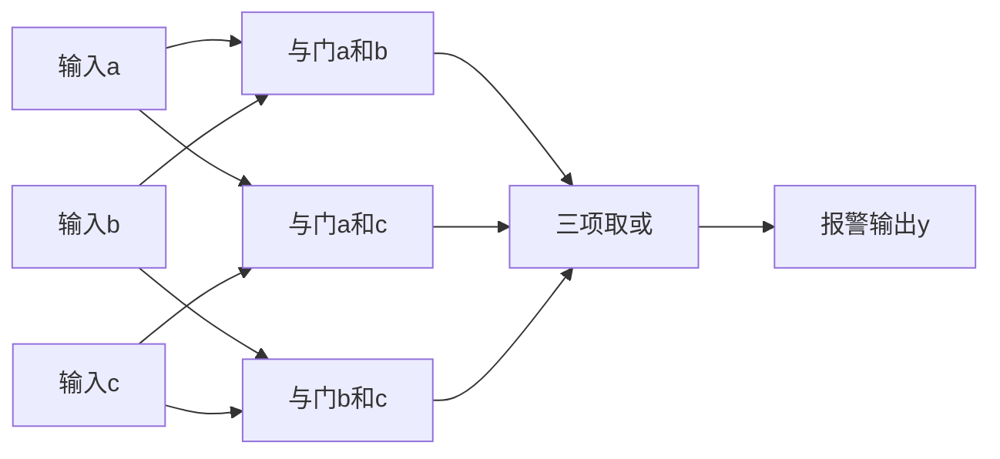

# 05 从需求到真值表

> 本章是零基础详细重写版。先修：会与、或、非和两输入真值表。建议分两到三次完成，目标是独立做出三输入多数表决器的纸笔设计。

**本章目标：** 完成本章讲解与练习后，你应能写出无歧义接口与规则；列全输入；从最小项推导多数表决器并逐行核对。

## 5.1 会算一个式子，不等于会设计电路

如果别人给你`y=a&b`，你已经会代入输入算输出。但实际任务通常只是一句话：“三个传感器多数认为危险时报警。”没有现成表达式等着复制。

设计过程要完成四次翻译：现实需求变成明确规则；规则变成完整真值表；表中输出为1的行变成表达式；最后检查表达式是否仍符合原需求。


先保证规则正确，再考虑式子简不简短。一个很短却理解错“多数”含义的电路，仍然是错的。

## 5.2 第一步：消除“多数”里的歧义

需求：三个独立传感器中，至少两个报告危险，才报警。明确“至少两个”，就包括恰好两个和三个全部触发两类情况。

还需约定：输入已是稳定的二值信号；不讨论传感器故障；输出只反映当前输入，不记住历史报警。以后要增加故障、保持或清除功能，需要再扩展规格，不能暗中混进本题。

| 信号 | 方向 | 位宽 | 0的含义 | 1的含义 |
| --- | --- | --- | --- | --- |
| a | 输入 | 1位 | 第1个未报告危险 | 第1个报告危险 |
| b | 输入 | 1位 | 第2个未报告危险 | 第2个报告危险 |
| c | 输入 | 1位 | 第3个未报告危险 | 第3个报告危险 |
| y | 输出 | 1位 | 不报警 | 报警 |

现在我们有了一份很小但可检查的**规格**：接口、允许输入、输出规则和是否保存状态，都说清楚了。

## 5.3 第二步：有顺序地列出八种输入

三个输入各有0、1两种可能，因此共有`2×2×2=8`种。按abc作为三位二进制、a在最高位的顺序列出000到111。

一种不容易遗漏的方法：c每一行翻一次，b每两行翻一次，a每四行翻一次。这样得到的表自然覆盖所有组合，不会把011写两次又漏掉101。

| 行号 | a | b | c | 危险报告数量 | 是否达到“至少2个” | y |
| --- | --- | --- | --- | --- | --- | --- |
| 0 | 0 | 0 | 0 | 0 | 否 | 0 |
| 1 | 0 | 0 | 1 | 1 | 否 | 0 |
| 2 | 0 | 1 | 0 | 1 | 否 | 0 |
| 3 | 0 | 1 | 1 | 2 | 是 | 1 |
| 4 | 1 | 0 | 0 | 1 | 否 | 0 |
| 5 | 1 | 0 | 1 | 2 | 是 | 1 |
| 6 | 1 | 1 | 0 | 2 | 是 | 1 |
| 7 | 1 | 1 | 1 | 3 | 是 | 1 |

行号不是另一个电路输入，只是方便引用某一行。行号3对应abc=011，是因为二进制011等于十进制3。

## 5.4 先检查表格，再写表达式

检查一：行数应为8且没有重复。检查二：单个输入为1的三行都不报警。检查三：两个为1的三行都报警。检查四：三个都为1必须报警，因为“至少两个”包含三个。

这四项分别检查枚举是否完整、门槛是否设对、边界是否覆盖，以及自然语言是否理解准确。不要急着写代码，真值表已经可能暴露大部分需求误解。

如果需求改成“恰好两个”，只需要把111这一行输出从1改为0；但最后表达式必须随之变化。一个词就可能改变电路功能。

## 5.5 怎样写出“只认某一行”的条件

先看行号3：a=0、b=1、c=1。我们想构造一个条件，只有这三件事同时满足时为1。

a=0可写~a，b=1就写b，c=1就写c，再用AND把三项连起来：

```text
行3的匹配条件 = ~a & b & c
```

为什么a为0要写~a？因为输入a确实为0时，~a才为1，才能与另外两个成立条件一起使AND输出1。不是把行里的0原样填到表达式中；如果写0&b&c，结果会永远为0。

这种包含所有输入变量、每个变量出现一次、只匹配一行的与项，叫**最小项**。“最小”在这里不表示代码最短，而是它只选中一个基本输入组合。

## 5.6 用具体输入验证一个最小项

以m3=~a&b&c为例：

| 输入abc | ~a | b | c | 三者AND | 说明 |
| --- | --- | --- | --- | --- | --- |
| 011 | 1 | 1 | 1 | 1 | 正好目标行 |
| 111 | 0 | 1 | 1 | 0 | a不符合要求 |
| 001 | 1 | 0 | 1 | 0 | b不符合要求 |
| 010 | 1 | 1 | 0 | 0 | c不符合要求 |

只要任意一个输入偏离011，相应条件就为0，整个AND不成立。这就是它只匹配一行的原因；没有什么神秘的公式生成规则。

同理，行5的101对应a&~b&c，行6的110对应a&b&~c，行7的111对应a&b&c。

## 5.7 把需要的行用OR连接

我们的输出在3、5、6、7行是1。因此把四个“认行条件”用OR连起来，只要匹配其中任何一个，就报警：

```text
y = (~a&b&c) | (a&~b&c) | (a&b&~c) | (a&b&c)
```

这称为**积之和**形式：布尔代数把AND类比成乘积，把OR类比成求和；这里仍是逻辑关系，不是普通整数加乘。

采用这种系统方法，不必先有化简灵感。只要真值表正确、每行写法正确，表达式就一定能覆盖需要的所有行而不会多选其他行。

## 5.8 Σm(3,5,6,7)怎样读

有的教材把上式缩写成`y=Σm(3,5,6,7)`。Σ是希腊字母，读作“求和符号”，这里表示把这些最小项逻辑OR起来；m后的数字是行号。

看到这个记号时，先查变量顺序。本课约定abc，a最高位；如果别人约定cba，数字3对应的输入含义会变化。不要只抄行号，不抄变量排列。

初学可以一直使用展开表达式。压缩记号是为了写得方便，不是必须跨过的理解障碍。

## 5.9 化简的第一条路：从需求分成三种配对

“至少两个为1”，可以分解为三个条件：a和b都为1；a和c都为1；b和c都为1。只要任何一对成立，就至少有两个输入为1。

于是得到：

```text
y = (a&b) | (a&c) | (b&c)
```

a&b没有提c，表示c为0或1都不影响这一对已经成立。因此它覆盖110和111两行。a&c覆盖101、111；b&c覆盖011、111。三者的合并正好是3、5、6、7行，没有覆盖只有一个1的情况。

111被覆盖了三次不成问题，因为OR的1 OR 1仍为1。重复覆盖不会使输出变成3。

## 5.10 第二条路：把省略变量的步骤推出来

将原表达式中的m7重复使用，让它分别与m3、m5、m6配对。重复写同一个OR项不改变逻辑，这是第4章的重复规律。

```text
m3|m7 = (~a&b&c)|(a&b&c)
      = b&c&(~a|a)
      = b&c

m5|m7 = (a&~b&c)|(a&b&c)
      = a&c&(~b|b)
      = a&c

m6|m7 = (a&b&~c)|(a&b&c)
      = a&b&(~c|c)
      = a&b
```

每一对仅有一个变量一正一反，OR覆盖了该变量的两种可能，所以那个变量不再需要。下一章卡诺图正是把这种配对画成相邻格。

## 5.11 检查化简结果：不能只挑看起来会对的行

现在对每个输入计算ab、ac、bc，再OR。这里ab只是a&b的简写，不是两个字母拼成一个新输入。

| abc | a&b | a&c | b&c | 三项OR | 需求y |
| --- | --- | --- | --- | --- | --- |
| 000 | 0 | 0 | 0 | 0 | 0 |
| 001 | 0 | 0 | 0 | 0 | 0 |
| 010 | 0 | 0 | 0 | 0 | 0 |
| 011 | 0 | 0 | 1 | 1 | 1 |
| 100 | 0 | 0 | 0 | 0 | 0 |
| 101 | 0 | 1 | 0 | 1 | 1 |
| 110 | 1 | 0 | 0 | 1 | 1 |
| 111 | 1 | 1 | 1 | 1 | 1 |

最后两列全部一致，才说明化简保持了原来八种输入下的功能。对于这么小的输入空间，全列比抽查两三行可靠得多。

## 5.12 从表达式画连接

为a&b、a&c、b&c各放一个两输入AND，把三个输出接入一个三输入OR。输入a会同时送到两个AND，b、c也各送到两个AND。



图里左右顺序是为了读清连接关系，不表示三个AND轮流工作。稳定输入经过组合逻辑后，输出将对应真值表；实际传播需要时间，第6章会解释。

## 5.13 增加静音条件：先定义冲突

现在多加一位mute：mute=1时无论传感器怎样都不报警；mute=0按原规则。先把三传感器的判断结果叫danger，再写`alarm=danger & ~mute`。

| danger | mute | 应报警吗 |
| --- | --- | --- |
| 0 | 0 | 否 |
| 0 | 1 | 否 |
| 1 | 0 | 是 |
| 1 | 1 | 否，静音优先 |

我们先明确“危险与静音同时出现”的结果，再写AND。没有这一句，另一位设计者可能以为危险应覆盖静音。**优先级首先是规格选择，其次才是代码顺序。**

加入mute后输入空间变16种，但可以分层：先验证三输入danger，再验证danger与mute的四行，最后必要时联测全部16种。分层能让复杂问题可控。

## 5.14 无关项是什么，为什么不能随便标

有时系统保证某些模式不会进入电路。例如输入严格是一个BCD数字，只允许0000–1001，其他六种模式在合同内不使用。化简时，对这些确定不会使用的模式可标为**无关项**，按需要取0或1帮助化简。

前提是“上游保证不会出现”真实成立。如果输入来自用户随意拨动四个开关，1010完全可能出现，就不能假装不存在。应定义这时输出什么，或者增加非法输入提示。

无关项不是“我还没想好”的占位符。后面代码里的未知值X还涉及仿真与综合不同语义，不能把纸上无关项直接当任意硬件行为。

## 5.15 一套可以反复使用的设计步骤

把下面六项写在你的练习纸左边：

1. **定义输入输出。** 名称、位宽、0和1含义。
2. **补齐需求。** “至少/恰好”“同时触发”“是否记住历史”。
3. **列全输入。** N个独立二值输入有2^N行。
4. **逐行决定输出。** 先按语言规则，不急着套门。
5. **写表达式再化简。** 不会化简也可以先写正确最小项。
6. **回到原表检查。** 验证全部合法输入，记录假设。

如果在第4步发现“相同输入下输出还要看过去”，就不是一张纯组合真值表能完全描述的问题，要额外定义状态。第1章的保持报警例子就是这种情况。

## 5.16 常见错误：看看它错在哪一行

| 错误方案 | 错误所在 |
| --- | --- |
| y=a OR b OR c | 在001等单个触发时错误报警 |
| y=a&b&c | 在011等两个触发时漏报警 |
| y=a XOR b XOR c | 在001报警，在011不报，逻辑完全不同 |
| m3写成a&b&c | 把应要求a=0的条件写反 |
| “恰好两个”仍用ab OR ac OR bc | 111这一行被错误包含 |

定位错误时，写出一个具体输入比说“式子不太对”有用。一个反例就能否定某个方案，所有行一致才能支持等价。

## 5.17 练习与过程答案

**题1：** 三输入“恰好一个为1”报警。先列输出为1的行：001、010、100。分别变成~a&~b&c、~a&b&~c、a&~b&~c，再OR。最后检查111必须为0，所以不能用三输入XOR代替。

**题2：** 变量顺序abc，m2是什么？十进制2写成三位010，所以a要0、b要1、c要0，得到~a&b&~c。不要把行号2误读成第二个输入b。

**题3：** 多数表决器增加mute，输入a=1、b=1、c=0、mute=1时输出？先按多数规则danger=1，再~mute=0，所以alarm=0。直接数传感器就输出1，会漏掉接口新要求。

**题4：** 如何证明a&b OR a&c OR b&c不等于“三个全为1”？给出110，前式因为a&b成立输出1，后式因为c=0输出0，反例成立。

## 5.18 本章完成条件

用一张空白纸独立写出多数表决器的接口、八行真值表、四个最小项、化简后的三项和全行核对。完成后进入[第06章：卡诺图与组合逻辑边界](06-卡诺图与组合逻辑边界.md)，把“相差一个变量”画出来。
