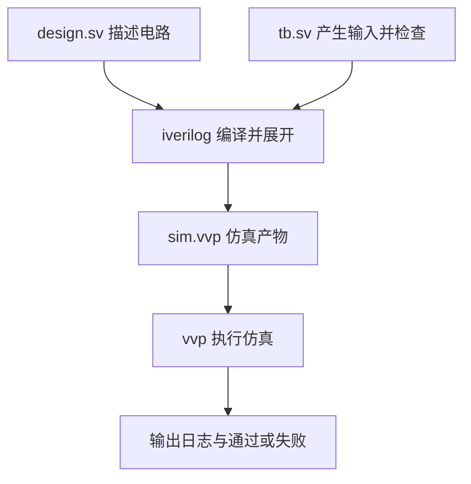

# 07 环境与第一个仿真实验

> 零基础详细重写版。先修：会读第4章与门、异或门的真值表。本章按Windows与PowerShell说明操作；命令都在你保存两个`.sv`文件的实验目录运行。建议分两到三次完成，第一次只要求跑通四组输入。

**本章目标：** 分清编辑器、源文件、编译器和运行器；自己建立两个文件；知道命令在哪里执行；看到正确结果后，故意改错一次并确认测试能发现。

## 7.1 先知道我们要做出的东西

这次设计两个同时工作的逻辑关系：输入a、b，输出y_and=a与b、y_xor=a异或b。没有时钟，没有需要记住的历史。你在第4章已经能手算答案，现在只是把同一个关系写成工具能读懂的文字。

| a | b | y_and | y_xor |
| --- | --- | --- | --- |
| 0 | 0 | 0 | 0 |
| 0 | 1 | 0 | 1 |
| 1 | 0 | 0 | 1 |
| 1 | 1 | 1 | 0 |

我们还要写一个“小检查员”：依次给电路四组输入，等输出稳定，再与上表比较。描述电路的文件叫**设计文件**；这个检查员叫**测试平台**，英文testbench。它们都可以用SystemVerilog写，但职责不同。

## 7.2 四种东西各自做什么

| 名称 | 你用它做什么 | 本章对应 |
| --- | --- | --- |
| 文本编辑器 | 输入和保存代码 | 你已有的代码编辑器即可 |
| 源文件 | 保存人写的硬件描述与测试 | design.sv、tb.sv |
| 编译器 | 检查语法、展开模块并生成仿真产物 | iverilog |
| 仿真运行器 | 执行仿真产物，推进虚拟时间 | vvp |

**编译**不是把代码显示得更好看，而是让工具理解语法与结构。**仿真**也不是把程序下载到开发板，而是在电脑里计算电路对输入的反应。本章不需要FPGA，也不需要微信开发者工具或浏览器来执行HDL。



## 7.3 工具怎么准备，准备到哪一步才算完成

本地路线使用Icarus Verilog，它提供iverilog与vvp。官方项目说明可以从源码或预编译发行包装入，初学优先选择适合自己系统的现成发行包，不从编译工具本身开始。[Icarus安装说明](https://steveicarus.github.io/iverilog/usage/installation.html)核验于2026-11-05。

Windows可查看[Windows发行包维护页](https://bleyer.org/icarus/)与项目文档，选择适合系统的发行包并按安装程序说明安装。本文不绑定列表第一项，也不把包名中最大的版本号当成稳定性保证。记下实际安装路径；若安装器提供将工具目录加入PATH的选项，可按你的安装需求设置。完成后重新打开终端，使新环境生效。

**PATH**是终端查找命令所在程序的目录清单。输入iverilog时，系统会在这些目录查找对应可执行文件。编辑器能识别`.sv`颜色，不代表仿真器已经装好。

在PowerShell逐条输入，按Enter执行：

```powershell
iverilog -V
vvp -V
```

这是大写V。预期看到版本和版权等文字，不要求与你的教材截图逐字相同。本批配套程序实际使用Icarus Verilog 11.0验证；其他版本先执行本章实验确认兼容。版本命令成功只是证明工具可找到，下一步仍要编译真实设计。

若提示“无法将iverilog识别为命令”，先重开PowerShell；仍不行，检查安装目录和PATH。也可用实际完整路径调用。PowerShell路径含空格时，使用`&`调用，例如下面的**路径只是格式示例，必须换成你的实际安装位置**：

```powershell
& "C:\YourTools\iverilog\bin\iverilog.exe" -V
```

## 7.4 先建立一个不会混淆的文件夹

在你方便的位置建立`logic-lab`，里面再建`07-first`。它是本次实验目录；以后各章可以用不同子目录，不把多个叫tb的测试混在一起。

```text
logic-lab/
  07-first/
    design.sv
    tb.sv
```

在Windows资源管理器中打开文件扩展名显示。**扩展名**是文件名最后点号后的部分：`.sv`表示本课的SystemVerilog源文件；`.txt`是普通文本文件。若看到`design.sv.txt`，它仍是txt文件，只是名字里多了一段.sv。

用能保存纯文本的编辑器创建两个文件，保存编码选UTF-8。代码里的括号、逗号、分号和引号使用英文半角字符。保存后确认资源管理器实际显示design.sv和tb.sv；修改代码后按Ctrl+S保存。

不想先手抄，可以从下载包的`source/语言实验/07-first/`复制两份文件跑通，再自己重新建立一份手写。文件原文：[design.sv](语言实验/07-first/design.sv)、[tb.sv](语言实验/07-first/tb.sv)。

## 7.5 第一份完整设计文件

下面是design.sv的**完整内容**，代码块中的行号不需要另加，文件名也不要写进代码。

{{LAB07_DESIGN}}

先按结构读，不急着同时理解全部测试语法：

| 行或片段 | 怎样读 | 为什么需要 |
| --- | --- | --- |
| module gates_beginner( | 开始定义一个叫gates_beginner的模块 | 给电路类型命名 |
| input logic a | 输入信号a，一位逻辑类型 | 外部把a送进来 |
| input logic b | 第二个输入b | 同理 |
| output logic y_and | 输出y_and | 电路内部产生结果 |
| output logic y_xor | 第二个输出 | 与前一个同时存在 |
| ); | 结束端口列表与模块声明头 | 括号配对，分号结束声明头 |
| assign y_and = a & b; | 持续让y_and等于a与b | 表达连接和逻辑关系 |
| assign y_xor = a ^ b; | 持续让y_xor等于a异或b | 表达另一路关系 |
| endmodule | 模块定义结束 | 与module对应 |

这里logic可先理解为能保存逻辑值的数据类型，第9章再展开四态。`input`和`output`从**模块自身**视角看方向。`a`、`b`、`y_and`等是我们取的名称，不是必须照用的关键字；module、input等则是语言规定的关键字。

## 7.6 逗号、分号、括号别靠感觉

端口列表里的各项用逗号隔开，最后一项后不再添加多余逗号；列表结束使用`)`，整个声明头以`;`结束。两个assign语句也分别以分号结束。

缩进和换行主要帮助人阅读。把一条语句拆到几行，不会自动变成多条指令；分号和关键字才决定语法边界。`endmodule`不需要再加一个begin/end。

SystemVerilog区分大小写：`a`和`A`是不同名字。中文可以写在注释和说明里，初学模块名与信号名先使用英文、数字、下划线，并以字母或下划线开头。

行注释以`//`开始，直到本行末尾；例如`// 两输入与门`。注释供人阅读，不参与逻辑运算。不要把正文里解释用的中文直接放进代码而忘了注释符号。

## 7.7 assign不是“只执行一次”

`assign y_and = a & b;`表达持续关系。输入从01变成11时，输出会按逻辑关系重新计算；不需要你再手动调用一次assign。

两条assign并排存在，交换它们的书写顺序，不会把与门变成先算、异或门变成后算的两个时钟步骤。这里没有时钟，换行也不表示时间过去。

第8章再把这种并行性与模块实例联系起来。先记住：设计文件描述“这些关系一直成立”，测试平台才负责在不同虚拟时刻改变输入。

## 7.8 第二份完整文件：先看它怎样使用电路

将下面完整内容保存为同一目录的tb.sv：

{{LAB07_TB}}

这个版本故意不用for循环，把四组输入逐次写出，让你能与第4章真值表逐行对照。第12章才把重复操作改成循环。

## 7.9 从上到下读测试平台

首行timescale前的字符是**反引号**，与常量`1'b0`中的英文单引号不同。`1ns/1ps`表示本文件模块使用的时间单位为1纳秒、时间精度为1皮秒。1ns为一秒的十亿分之一；本章`#1`表示推进1ns虚拟时间，不是让电脑真实睡眠1ns。

`module tb;`定义名为tb、没有外部端口的测试顶层。`logic a,b;`声明测试端的两个输入驱动信号，下一行声明观察输出的信号。

`gates_beginner dut(...)`在tb里放一份被测电路。gates_beginner是前一个文件定义的模块类型；dut是这份实例的名字，来自“被测设计”的英文缩写。`.a(a)`中点号后的a是设计端口，括号里的a是测试平台信号，它们同名只是为了入门方便，第8章会用不同名连接说明。

`initial begin ... end`表示仿真开始时启动的一段过程，在这个过程内按顺序执行。这里只有一段主测试，因此你可以从第一组a、b一路读到最后一组。

## 7.10 一组检查如何工作

只看第一组：`a=0; b=0; #1;`先把两个输入设0，再让仿真时间前进1ns，留出组合关系重新计算的机会。

`if (y_and !== 1'b0) $fatal(1, "AND failed at 00");`读成：“如果输出不等于确定的一位0，就报错终止。”`1'b0`表示一位二进制0；`!==`是把未知值也考虑进去的不等比较；`if`是“如果”；`$fatal`是仿真系统提供的失败终止操作；括号中的1是本例使用的结束级别参数。第9、10章再展开常量和比较。

下一句独立检查异或输出。`$display`打印文字与值，`%b`把相应参数显示成二进制。字符串里的四个%b依次对应后面的a、b、y_and、y_xor；逗号顺序要对应。

第二至第四组只是换输入和预期值，逻辑过程相同。四组检查全部没有触发fatal，才打印PASS。最后`$finish`正常结束仿真。

## 7.11 打开终端，并确认“我现在在哪”

**终端**是输入命令的窗口，**当前目录**是命令解释相对文件名的出发位置。工具不会自动去你刚才编辑器打开的目录找文件。

打开PowerShell后，先输入：

```powershell
Get-Location
```

它显示当前路径。在资源管理器里进入你的07-first文件夹，复制地址栏中的完整路径；再在PowerShell输入`Set-Location`，后面用英文双引号包住这条真实路径。下面只演示格式：

```powershell
Set-Location "C:\你的实际目录\logic-lab\07-first"
Get-ChildItem
```

第一行中的路径必须替换。第二行列出当前文件，你应能看到design.sv和tb.sv。若看不到，先解决目录或保存问题，再编译。教程代码块里没有`PS C:\...>`提示符，不要把终端自己的提示符也复制进去。

## 7.12 编译和运行是两步

确认当前目录正确后，执行第一条：

```powershell
iverilog -g2012 -s tb -o sim.vvp design.sv tb.sv
```

| 部分 | 含义 |
| --- | --- |
| iverilog | 调用编译器 |
| -g2012 | 使用SystemVerilog 2012语言模式 |
| -s tb | 明确选择tb作为仿真顶层 |
| -o sim.vvp | 把产物写成sim.vvp |
| design.sv tb.sv | 本次需要读入的两个源文件 |

这些参数的含义可核对[Icarus命令说明](https://steveicarus.github.io/iverilog/usage/command_line_flags.html)。编译成功时可能没有特别的“成功”文字；但不能出现语法错误。可紧接着执行`$LASTEXITCODE`检查上一条本机程序退出码，0表示此次编译成功，非0表示失败。

只有本次编译成功，再执行：

```powershell
vvp sim.vvp
```

不要只反复运行第二条。源文件改过后必须重新编译，否则你可能一直在运行上一次的旧产物。

## 7.13 预期看到什么，怎样对照

本实验主要输出应为：

```text
a=0 b=0 and=0 xor=0
a=0 b=1 and=0 xor=1
a=1 b=0 and=0 xor=1
a=1 b=1 and=1 xor=0
PASS first: 4 input combinations
```

逐行与开头真值表比较。看到四行只是“实际值被打印”；后面的自动比较没有报错且最终PASS，才说明这些输入下的检查通过。它不等于所有未来电路都已正确，也不是已经完成综合和上板。

运行完后，目录多出的sim.vvp是可重新生成的产物，design.sv与tb.sv才是要保存的源码。不要在sim.vvp里继续改设计。

## 7.14 第一次故意制造错误

在design.sv里只把第一条assign的`&`改成`|`，把AND错误地写成OR。保存，重新编译，成功后重新运行。测试输入01时，错误OR得到1，而正确AND预期0，因此应报告`AND failed at 01`并以非0退出。

这一步是在验证测试真的会发现错误。恢复为`&`，再次保存、编译、运行，应该恢复PASS。若改错后仍PASS，先确认编辑的是本次编译的文件，并确认保存、重编译都做了。

## 7.15 常见报错应该先查哪一层

| 现象 | 先检查什么 |
| --- | --- |
| 无法识别iverilog/vvp | 是否安装、PATH、重开终端，或用真实完整路径 |
| 找不到design.sv | Get-Location与Get-ChildItem，文件是否误成.sv.txt |
| syntax error | 从第一条错误行附近查英文标点、括号和分号 |
| Unknown module type | 模块名拼写与参与编译的文件是否齐全 |
| 输出仍是旧结果 | 是否保存，是否本次编译成功，是否运行了同一个sim.vvp |
| FATAL且指出01 | 这通常是测试发现功能错误，先按该输入手算，不是先重装工具 |

一处语法错误可能引出后面很多错误。先修最早一条，再重编译，比同时改十行更容易定位。

## 7.16 暂不能本地安装的替代路线

可在[EDA Playground](https://www.edaplayground.com/)按当前账号条件使用在线仿真，把design.sv内容放设计区、tb.sv放测试区，语言选择SystemVerilog，并选择支持该代码的仿真器后运行。若界面可填写顶层，填写tb。该路线不用在网页里输入PowerShell命令。

其[官方入门说明](https://eda-playground.readthedocs.io/en/latest/quick-start.html)介绍设计区、测试区及运行结果。在线平台界面和权限可能调整，本课未替你登录或执行在线仿真；本批代码的实际验证使用本地Icarus。

## 7.17 练习与完成条件

练习1：说出两个源文件与sim.vvp的分工。答案：design描述电路，tb驱动和检查，sim.vvp是两者编译得到的仿真产物。练习2：为什么修改代码后只运行vvp不够？答案：vvp执行旧产物，需要重新编译生成新内容。练习3：输入11时AND、XOR各是什么？按真值表得到1和0。

完成本章：自己新建文件、跑通四组输入、让错误AND版本失败、恢复后再次通过。然后进入[第8章](08-模块端口与硬件并行.md)，把“模块是一种类型、实例是一份电路”讲清楚。
