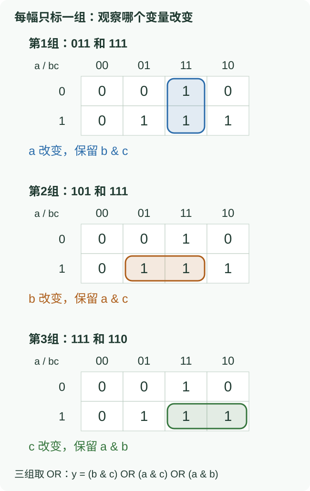

# 06 卡诺图与组合逻辑边界

> 本章是零基础详细重写版。先修：会从真值表写最小项，理解`ab~c OR abc = ab`的化简。建议分三次学：排图、分组、实际电路的时间边界。

**本章目标：** 完成本章讲解与练习后，你应能正确填入卡诺图并说明每组消去哪些变量；区别稳定逻辑功能与传播延迟造成的毛刺。

## 6.1 为什么已经会化简，还要学卡诺图

第5章多数表决器有四个最小项。我们观察到两项只差一个变量正反，就能把这个变量消去。输入变多以后，直接盯着长式子，容易漏掉能配对的项。

**卡诺图**是一种重新排列真值表的方法：每个格仍表示一种输入，但让只差一个输入位的组合在图上相邻。这样就能用圈格子找到化简机会。

它不会替你判断需求是否正确。真值表先填错，圈得再漂亮也只是得到错误函数的简化形式。

## 6.2 两变量图：先看只有四个格的情况

两个输入a、b，行放a，列放b：

| a\b | 0 | 1 |
| --- | --- | --- |
| 0 | 输入00 | 输入01 |
| 1 | 输入10 | 输入11 |

格子的位置代表输入组合，格子里最终填的是**该组合对应的输出**。不要把00、01等输入标签误当输出值。

假设y只等于b，真值表在00、10为0，在01、11为1。填图后：

| a\b | 0 | 1 |
| --- | --- | --- |
| 0 | 0 | 1 |
| 1 | 0 | 1 |

右侧上下两个1分别来自~a&b和a&b。把它们圈成一组，a一会儿0、一会儿1，对覆盖这一组没有要求；只有b始终为1，所以这一组代表b。

这就是圈图的核心：**圈内会变化的输入可以消去，圈内始终不变的输入要保留。**

## 6.3 三变量为什么不用普通二进制顺序排列

三个输入有8行。我们把a放在两行，bc放在四列。列顺序采用00、01、11、10：

| 相邻列 | 哪一位改变 |
| --- | --- |
| 00 → 01 | 只有c |
| 01 → 11 | 只有b |
| 11 → 10 | 只有c |
| 最右10 → 最左00 | 只有b |

这种相邻编码只差一位的顺序叫**格雷码顺序**。卡诺图使用它是为了保证邻格只差一个变量。

如果写成普通00、01、10、11，01到10同时改变b和c，两项不能用“只差一个变量”直接合并。因此不是老师任意规定了奇怪顺序，而是为了让相邻格对应可消去一个变量的关系。

## 6.4 把八行编号放进图

先画输入编号地图，不填输出：

| a\bc | 00 | 01 | 11 | 10 |
| --- | --- | --- | --- | --- |
| 0 | m0：000 | m1：001 | m3：011 | m2：010 |
| 1 | m4：100 | m5：101 | m7：111 | m6：110 |

注意上行最后两格顺序是m3、m2，下行是m7、m6。行号看起来“不连续”，正是格雷码列序的结果。之后只根据输入定位格子，不要按编号0、1、2、3顺手从左填到右。

例如m6=110：a=1，所以在下行；bc=10，所以在最右列。先确定行，再确定列，比凭记忆找编号可靠。

## 6.5 填入多数表决器的输出

上一章得到输出为1的行号3、5、6、7。按地图逐个填：m3上行第三列为1，m5下行第二列为1，m6下行第四列为1，m7下行第三列为1，其他填0。

| a\bc | 00 | 01 | 11 | 10 |
| --- | --- | --- | --- | --- |
| 0 | 0 | 0 | 1 | 0 |
| 1 | 0 | 1 | 1 | 1 |

先数图上有几个1，应有4个，与真值表输出1的行数一致。再逐格读回abc，确认没有把m2和m3位置混淆。这个检查比一上来圈图更重要。

## 6.6 第一组：11列上下两个1

两个格的输入分别011、111。比较三个输入：a从0变1，b始终1，c始终1。因此a消失，保留b&c。

从表达式看也一样：`(~a&b&c)|(a&b&c)=b&c&(~a|a)=b&c`。图解和代数推导是同一件事的两种表达，不能互相矛盾。

## 6.7 第二、第三组：下行两对

下行01列与11列对应101、111。a始终1，b从0变1，c始终1，所以得到a&c。

下行11列与10列对应111、110。a、b始终1，c从1变0，所以得到a&b。

把三组代表的表达式OR起来，得到`y=(b&c)|(a&c)|(a&b)`，与第5章一致。

注意图中111参加了三组。一个格可重复覆盖；不能为了每个1只能用一次，而漏掉最后需要的一组。

## 6.8 为什么组的大小是1、2、4、8

单个格固定了三个变量，没有消去机会。相邻两格覆盖一个变量的两种取值，可消去一个变量。一个合法的四格矩形覆盖两个变量的所有组合，可消去两个变量。

| 三变量图中的组大小 | 允许变化的变量数量 | 一组还需保留几个变量 |
| --- | --- | --- |
| 1格 | 0 | 3 |
| 2格 | 1 | 2 |
| 4格 | 2 | 1 |
| 8格 | 3 | 0，输出恒1 |

每允许一个变量自由取0或1，组合数量翻倍，所以合法组大小是2的幂。三个格不对应某几个变量“所有可能组合”的完整集合，不能用同样方式一次消掉变量。

图形还必须是矩形，允许跨图的边界。不能仅仅因为“有四个1”就把任意散落的四格一起圈成一组。

## 6.9 边界也相邻：不是只看纸面距离

最左bc=00与最右bc=10只差b一位，因此它们相邻。把图想成左右边缘接起来，会更容易理解。

例如函数在m0、m2、m4、m6为1，填图为：

| a\bc | 00 | 01 | 11 | 10 |
| --- | --- | --- | --- | --- |
| 0 | 1 | 0 | 0 | 1 |
| 1 | 1 | 0 | 0 | 1 |

四个角可跨左右边界组成四格矩形。a两种都出现，b两种也都出现，只有c始终0，因此表达式是~c。

再按输入检查：000、010、100、110的最低位c都是0，其他行c为1，完全一致。不是“图角有神奇规则”，而是格雷码相邻与变量覆盖的结果。

## 6.10 哪些看起来像一组，其实不行

对角相接的两个格通常同时改变两个变量，不能当相邻。例如两变量图的00与11，a、b都变化，不能直接消掉两个变量并声称输出恒1，因为01、10可能为0。

L形三个1不能作为一组三格；可拆成两个相邻两格并允许拐角重复。组内不能包含输出为0的格，否则该表达式会让原本应为0的输入也输出1。

对无关项可以按第5章的合同选择使用，但不必为了让圈更大而使用全部无关项。前提仍是它们确实不会作为合法输入出现。

## 6.11 一套不靠猜的圈图流程

第一，列出每格的输入标签，再填输出。第二，先找较大的合法全1矩形，看看它们能消去哪几个变量。第三，确保每个必须输出1的格至少被一组覆盖。第四，检查有没有只覆盖别人已经完整覆盖的多余组。第五，把组转成与项，再OR。

“尽量用大组”是入门策略，不意味着只画最大的一个圈就结束。多数表决器没有合法四格全1组，所以需要三个两格组；下行虽然有三个连续1，也不能把三个直接圈成一组。

有些函数有多种同样简洁的分组方式，表达式外观不同但功能等价。最后仍要逐行核对，不以“和答案圈法不一样”就认定自己错了。

## 6.12 从三变量推广到四变量

四变量有16种输入，可以用四行四列。行ab和列cd都按00、01、11、10排列。上下边界也相邻，四个角同样可能组成一组。

这时四格组会保留两个固定变量，而不是像三变量图那样只保留一个。总原则是：N变量图中，一组大小每翻倍，消去一个变量。

本阶段不要求大量机械做四变量圈图。先真正理解二、三变量的“覆盖与消去”，以后遇到更大图只是增加标签数量。更复杂函数通常交给系统化算法与综合工具处理。

## 6.13 逻辑正确，为什么输出还可能短暂闪一下

真值表讨论输入稳定后的逻辑关系，没有列出电路传播时间。真实器件收到输入变化后，输出需要经过一小段时间才跟上。不同逻辑路径的延迟可能不同。

看`y=(a&b)|(~a&c)`，令b=c=1。代入后变成`y=a|~a=1`。无论a稳定为0还是1，y都应该为1。

但是a同时经过两条路径：一条直接参与a&b，一条先取反再参与~a&c。当a从0变1时，上支要从0变1，下支要从1变0；它们不保证在同一物理时刻切换。

## 6.14 用一个假设延迟表看毛刺

ns表示纳秒，1ns是一秒的十亿分之一。为了说明现象，**假设**a变化后，下支在1ns后变0，上支在2ns后才变1，OR门自身延迟暂不计。这些数值只是演算条件，不是某型号器件的实测数据。

| 时段 | a&b上支 | ~a&c下支 | OR输出y |
| --- | --- | --- | --- |
| 变化前 | 0 | 1 | 1 |
| 变化后0–1ns | 0，尚未跟上 | 1，尚未跟上 | 1 |
| 变化后1–2ns | 0，仍未变高 | 0，已经变低 | 0 |
| 变化后2ns以后 | 1 | 0 | 1 |

中间短暂出现的非预期脉冲叫**毛刺**。此处输出本应稳定为1却短暂掉到0，称静态1冒险的一种表现。最后稳定输出仍符合真值表，所以只检查稳定的0、1输入看不出这段过程。

## 6.15 为什么增加一项反而可能更合适

在表达式里加上`b&c`：`y=(a&b)|(~a&c)|(b&c)`。当b=c=1时，第三项保持1，不依赖a的正反两条路径交接，因此可覆盖刚才这个单输入切换场景。

从稳定逻辑功能看，这项是冗余的：b=c=1时，原来的a或~a已经保证输出1。可见“最少项”与“物理切换时是否出现毛刺”不是同一个优化目标。

这不代表加一项能消除任何情况下的所有毛刺。多个输入同时变化、实际布局和器件结构会带来更多条件。这里的学习目标是知道真值表模型的边界，而不是宣称已经掌握完整物理时序设计。

## 6.16 同步设计为什么要等组合结果稳定

后面会用寄存器在规定的时钟沿采样结果。若从前一次数据变化到下一次采样之间留有足够时间，组合电路就有机会完成传播，接收端读取稳定结果。

因此我们不会把普通组合输出随意当成新的时钟，也不会因为理想仿真里看起来没毛刺，就声称真实硬件一定没有。第17章学习寄存器，第28章再定量学习建立、保持与时序约束。

初学时先区分两种问题：“稳定后应该算出什么”由本阶段逻辑分析解决；“多久后能稳定、何时可以采样”由后续时序分析解决。两者都重要，但不能互相替代。

## 6.17 跟着做：一题完整卡诺图

函数定义：变量顺序abc，仅在行号1、3、5、7输出1。

第一步，将行号转成001、011、101、111。第二步定位：两行的01列、11列均填1，其余0。第三步，这四格形成中间两列的四格矩形。第四步，对比输入，a可变、b可变，c始终1，因此化简为c。

第五步返回检查：八行中只有最低位为1的四行输出1，正好符合规格。整个过程不需要背“奇数行就是c”，因为变量顺序改变后这种口头捷径可能出错。

## 6.18 练习与过程答案

**题1：** 三变量图中m4与m5可否组成两格组？它们是100、101，只差c，且在下行00、01两列相邻。合并后a恒1、b恒0，得到a&~b。

**题2：** m0与m7能否直接合并？000与111三位都不同，不是相邻两格；若只这两行是1，不能因为它们“在两头”就合并。

**题3：** 某图全部8格都是1，化简为什么？三个输入都自由变化，没有任何输入条件需要保留，因此输出恒1，不是a&b&c。

**题4：** 上面的毛刺例子，真值表错了吗？没有，真值表描述稳定功能；短暂现象来自路径传播时间。回答“公式正确所以一定没有毛刺”是把模型范围扩大了。

## 6.19 第一阶段完成条件

独立完成[第一阶段练习与参考答案](第一阶段-练习与参考答案.md)，尤其是最后的多数表决器小项目。你应能在文字需求、真值表、表达式和圈图之间转换，并解释每一步为什么成立。

接下来学习[第07章：环境与第一个仿真实验](07-环境与第一个仿真实验.md)。该章已完成详细重写，从保存第一个文件开始，逐行解释SystemVerilog与测试平台。
