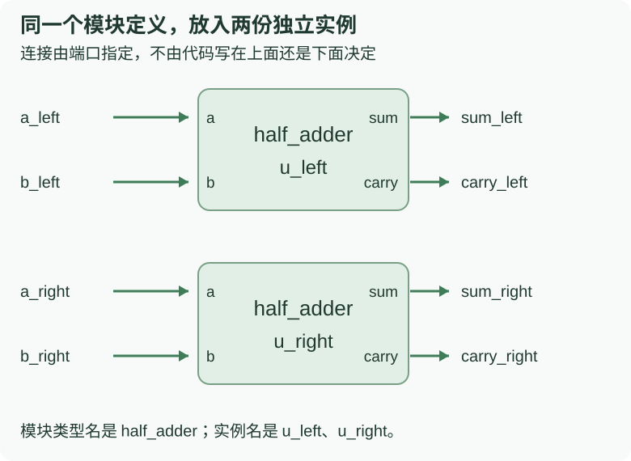

# 08 模块端口与硬件并行

> 零基础详细重写版。先修：完成第7章的两文件仿真。建议分两次学习：第一次画接口与连线，第二次读完整层次设计并运行。

**本章目标：** 区分模块类型、实例名称、端口和父级信号；能逐项解释`.a(button_a)`；理解多份电路并行工作和单一驱动原则。

## 8.1 为什么第一行名字和dut不一样

第7章定义`module gates_beginner(...)`，测试里却写`gates_beginner dut(...)`。它们不是两个不同功能，也不是在调用一个需要执行完才能返回的普通函数。

**模块定义**描述某一类电路的接口与内部关系；**实例化**是在更大的设计里放入一份这种电路。可以把定义类比为一张电路图，实例则是按图放进去的一份结构。类比只用于区分“类型与具体一份”，不涉及真的在电脑内制造晶片。

gates_beginner是类型名，dut是该层次里给这一份电路起的实例名。可以再放第二份叫dut_other；两份可接不同输入，同时产生各自输出。

## 8.2 先重新定义一个有算术含义的小盒子

第4章的半加器：输入a、b各一位，输出sum是最低和位，carry是高一位进位。两个输入都1时，完整结果为二进制10，因此carry=1、sum=0。

| 端口 | 方向 | 位宽 | 含义 |
| --- | --- | --- | --- |
| a、b | 输入 | 各1位 | 两个待加的二值位 |
| sum | 输出 | 1位 | 和的低位，等于a XOR b |
| carry | 输出 | 1位 | 向高位的进位，等于a AND b |

数学完整结果应按`2×carry+sum`解释，不能只读sum就断言1+1=0。

## 8.3 看懂半加器的定义

下面片段是一个**完整模块**，会作为稍后design.sv的第一部分：

```systemverilog
module half_adder(
  input logic a, b,
  output logic sum, carry
);
  assign sum = a ^ b;
  assign carry = a & b;
endmodule
```

`input logic a,b`是把同方向、同类型的两个端口写在一行；与分成两行分别声明等价。`output`同理。assign左右是结果与来源，交换左右会改变驱动方向，并不是数学等号可以任意调换的推导。

定义里没有任何“这份电路放在哪里”的信息，也没有父模块的信号名。这使它可以重复使用。

## 8.4 端口和外面的线，名字可以不同

假设父模块里已声明button_a、button_b、lamp_sum、lamp_carry，下面是**放在父模块内部的实例片段**：

```systemverilog
half_adder u_add(
  .a(button_a),
  .b(button_b),
  .sum(lamp_sum),
  .carry(lamp_carry)
);
```

先读最上行：“放一份half_adder，名字叫u_add。”再读`.a(button_a)`：“子模块名为a的输入端口，连接父模块名为button_a的信号。”

| 写法 | 点号后 | 括号里 | 信息方向 |
| --- | --- | --- | --- |
| .a(button_a) | 子模块输入a | 父级button_a | 父级送进子模块 |
| .sum(lamp_sum) | 子模块输出sum | 父级lamp_sum | 子模块送回父级 |

点号不是小数点；括号也不是把button_a当参数算一个函数结果。这个语法是**具名端口连接**，把哪一根线接到哪个端点说清楚。

## 8.5 三类名字不要互相替换

| 名字 | 角色 | 改名时影响什么 |
| --- | --- | --- |
| half_adder | 模块类型 | 定义和所有引用该类型的位置要一致 |
| u_add | 这一份实例 | 本层内保持唯一，波形层次名字会变化 |
| a、sum | 子模块端口 | 定义与对应具名连接要同步 |
| button_a、lamp_sum | 父级信号 | 父级声明和父级使用点要同步 |

例如把父信号button_a改成key_left，连接应变`.a(key_left)`，不能顺手把点号后的a也改成key_left，除非你真的修改了子模块接口。

## 8.6 一份完整的“两路独立半加器”

新建08-hierarchy目录，将下面**整个代码块**保存为design.sv。它在同一个文件里定义两种模块，编译时都能读到。

```systemverilog
module half_adder(
  input logic a, b,
  output logic sum, carry
);
  assign sum = a ^ b;
  assign carry = a & b;
endmodule

module two_adders(
  input logic a_left, b_left, a_right, b_right,
  output logic sum_left, carry_left, sum_right, carry_right
);
  half_adder u_left(
    .a(a_left), .b(b_left), .sum(sum_left), .carry(carry_left)
  );
  half_adder u_right(
    .a(a_right), .b(b_right), .sum(sum_right), .carry(carry_right)
  );
endmodule
```

第一部分half_adder已解释。第二部分two_adders是更大的盒子：四个输入分别属于左、右两路，四个输出也按左右区分。它自己不再写异或和与的公式，而是放两份half_adder并接线。

u_left只接a_left、b_left，u_right只接a_right、b_right。因此改变左路输入，不应改变右路结果。这是验证接线没有串错的重要方法。



## 8.7 从外到内追一次输入

给左路a_left=1、b_left=1，右路a_right=0、b_right=1。先看父级名字，再沿连接进入子模块：

1. 左实例u_left的a接到1，b接到1。
2. 左实例内部sum=1 XOR 1=0，carry=1 AND 1=1。
3. 两个结果通过.sum(sum_left)、.carry(carry_left)回到父级。
4. 右实例独立计算0与1，得到sum_right=1、carry_right=0。

| 左输入 | 右输入 | 左完整结果 | 右完整结果 |
| --- | --- | --- | --- |
| 11 | 01 | 10，十进制2 | 01，十进制1 |

注意左完整结果的高低顺序是carry_left、sum_left；表里的11是“两个一位输入都为1”，不是把一个两位整数3传给一位a。

## 8.8 谁是顶层，编译器从哪开始

本实验层次为`tb → dut(two_adders) → u_left/u_right(half_adder)`。测试平台tb是仿真顶层，dut是tb里的一份two_adders，内部再有两份half_adder。

design.sv只写模块定义并不会自动产生本章需要的四组输入；tb.sv才驱动父级输入。编译命令仍选`-s tb`，让工具从这个完整测试环境开始展开。这里的**展开**是按实例连接建立完整仿真结构。

模块可以放不同文件，但编译时要把相关文件都列出来。本实验为了降低查文件负担，把两个设计模块都放在design.sv。不把别的实验目录也加入，避免引入另一个同名tb。

## 8.9 并行的正确含义

u_left和u_right不是先左后右的两次过程调用。两份结构并排存在，相关输入变化时，各自按逻辑关系更新。交换两个实例的书写位置，不会交换输入输出，也不会使右路等左路完成。

assign也类似：它们表达同时存在的关系。仿真器为了在电脑里计算这些关系，会采用事件调度；这不等于真实硬件逐行执行一段脚本。

相反，initial或某个过程块内部的语句有顺序语义。第7章测试先给00再给01，就是测试过程里的顺序。不要把“模块层面的并行”和“过程内部的顺序”合成一句“代码都没有顺序”。

## 8.10 logic为什么不等于寄存器

本章sum、carry都声明为logic，却没有保存历史。logic描述一种数据类型；电路是否有存储，取决于驱动方式和更新规则。

后面always_ff加时钟沿会描述触发器保存状态；assign和完整always_comb通常表达组合关系。看到logic这个词就画一个寄存器，是把类型与硬件结构混淆了。

wire则是网络类型，主要表达连线及其驱动的解析。在本课普通单驱动连接中，先使用示例提供的logic即可；遇到真正多驱动、三态引脚时再讨论网络解析。换一个类型名，不能自动修复两个地方同时赋值的设计错误。

## 8.11 单一驱动：一根结果线由谁负责

如果把同一个输出既交给一个assign，又交给另一个过程块写值，就出现多个驱动来源。普通RTL设计中，本课要求每个变量有一个明确的负责者。

例如要在两路结果之间选一个输出，应另外写选择逻辑，不是让左实例与右实例同时把各自结果接到同一个普通输出变量上。若一份驱动要0、另一份要1，不能指望工具理解“我更喜欢最后写的那个”。

测试平台驱动输入a，DUT产生输出y，测试只读取y。若测试也强行给y赋值，就混淆了检查者与被测对象。

## 8.12 组合反馈为什么不是普通延时

`assign a=~a;`要求a始终等于自己的反值：a若0就要求1，若1又要求0，没有稳定二值解。它不是一个可移植的“每隔一段时间翻转”的硬件时钟描述。

组合路径应从输入流向输出，不能随意绕回自身。要保存过去的值，再在约定时刻更新，应引入后续时序结构。仿真中的`#5`时钟激励和器件里的真实时钟源，也会分别解释。

## 8.13 运行这次实验

将配套[tb.sv](语言实验/08-hierarchy/tb.sv)与[design.sv](语言实验/08-hierarchy/design.sv)放在同一08-hierarchy目录。在PowerShell进入该目录，先Get-ChildItem核对，再运行：

```powershell
iverilog -g2012 -s tb -o sim.vvp design.sv tb.sv
```

编译成功后：

```powershell
vvp sim.vvp
```

预期最后一行：

```text
PASS hierarchy: two independent instances, 4 directed cases
```

配套测试沿用上一章的initial、输入赋值、等待、比较和fatal。`||`表示只要任意检查发现不一致就报错，第10章展开其逻辑语义。它检查下面四组，不声称穷举全部十六组四输入组合：

| a_left b_left | a_right b_right | sum_left carry_left | sum_right carry_right |
| --- | --- | --- | --- |
| 00 | 00 | 00 | 00 |
| 11 | 01 | 01 | 10 |
| 01 | 11 | 10 | 01 |
| 11 | 11 | 01 | 01 |

此表输出列按端口列出的sum、carry排列，**不是**数值的高位到低位顺序。两种表示特意同时出现，提醒你看表头而不是猜位序。

## 8.14 练习与过程答案

题1：`.carry(result_hi)`中哪个必须存在于half_adder定义？答案是carry；result_hi必须在父级声明。题2：把u_right改名u_second，需要改模块定义half_adder吗？不需要，改的是实例名字。题3：若右路输入接成.a(a_left)，会怎样？右实例错误使用左路a，左右不再独立，前面改变单侧的测试可能发现。

题4：两条assign交换行序，输出是否改变？不改变，它们是并存关系。若在initial中交换“给输入”和“检查输出”的顺序则可能改变仿真行为，因为这是有顺序的测试过程。

## 8.15 本章完成条件

画出tb、dut、u_left、u_right四层名字的所属关系；指着每个具名连接说出父级信号和子级端口；跑通四组检查并能说明它们检查了什么。下一章学习[向量与四态逻辑](09-类型向量与四态逻辑.md)，把单根信号扩展成有明确位宽的数据。
