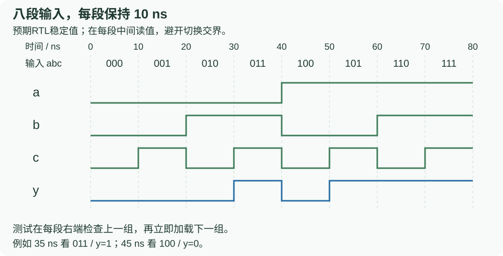

# 12 测试平台、时间与波形

> 零基础详细重写版。先修：第7–11章的模块、向量、条件与循环。建议分三次完成：手写测试、逐时刻追踪、生成并读波形。实际运行使用Icarus；波形查看软件界面步骤另按官方资料核对。

**本章目标：** 自己编写激励、等待、参考计算、比较、结束和超时；解释仿真日志与VCD的对应关系；用故障版本证明测试能检测错误。

## 12.1 谁负责做题，谁负责出题和判卷

**DUT**是被测设计，在本章实现多数表决器。**测试平台**提供输入并检查结果。**参考模型**按规格独立计算预期值；**检查器**把预期与实际比较，不一致就报告具体输入。

这几个角色可以写在一个tb.sv里，不代表它们概念上相同。若参考答案直接照抄DUT同一段错误公式，出题和做题会一起犯同样错误，测试就可能假通过。

本章DUT用三组两两AND再OR；参考模型改用数输入中有几个1，再判断是否至少两个。这是两种实现思路，比较更有价值。

## 12.2 先写测试清单，再写for

三个独立二值输入有八组，预期输出为：

| 编号 | abc | 1的数量 | expected |
| --- | --- | --- | --- |
| 0 | 000 | 0 | 0 |
| 1 | 001 | 1 | 0 |
| 2 | 010 | 1 | 0 |
| 3 | 011 | 2 | 1 |
| 4 | 100 | 1 | 0 |
| 5 | 101 | 2 | 1 |
| 6 | 110 | 2 | 1 |
| 7 | 111 | 3 | 1 |

除了正确版本能通过，还要检查故意改成“任意一个就报警”的错误版本必须失败。循环是执行这份清单的工具，不是写出for就自动代表覆盖完整。

## 12.3 完整设计文件

在独立12-majority目录保存design.sv：

```systemverilog
module majority(input logic a,b,c,output logic y);
  assign y=(a&b)|(a&c)|(b&c);
endmodule
```

它正是第5章纸笔推导出的公式。三个输入各一位、输出一位，无时钟无历史状态。没有加入“保持报警”或“静音”等本章未定义功能。

## 12.4 完整测试文件

同一目录保存tb.sv：

```systemverilog
`timescale 1ns/1ps
module tb;
  logic a,b,c,y,expected;
  int ones;
  majority dut(.a(a),.b(b),.c(c),.y(y));
  initial begin
    $dumpfile("majority.vcd");
    $dumpvars(0,tb);
    for (int i=0;i<8;i++) begin
      {a,b,c}=i[2:0];
      ones=0;
      if(a) ones=ones+1;
      if(b) ones=ones+1;
      if(c) ones=ones+1;
      expected=(ones>=2);
      #10;
      if(y!==expected)
        $fatal(1,"majority input=%b%b%b actual=%b expected=%b",a,b,c,y,expected);
      $display("t=%0d ns input=%b%b%b ones=%0d y=%b",$time,a,b,c,ones,y);
    end
    $display("PASS majority: 8 input combinations");
    $finish;
  end
  initial begin
    #1000;
    $fatal(1,"timeout");
  end
endmodule
```

先把文件保持原样跑通，再逐段理解下面的小节。不要把解释用的行号或中文段落也复制进源码。

## 12.5 声明与实例：哪些由测试来驱动

`logic a,b,c,y,expected;`里，a、b、c由测试赋值；y由DUT产生，测试只读取；expected由参考模型产生。`int ones;`保存输入中1的数量，取值0–3，使用整数方便计数。

`majority dut(...)`把测试信号接到设计端口。若测试也给y赋值，就会与DUT争夺结果，破坏被测关系。

此处先不设时钟，因为设计是组合电路。给所有测试都机械加一个clk，但DUT根本不用它，不会让检查更可靠。

## 12.6 initial与虚拟时间

主initial从仿真开始执行一次，内部按行前进。没有等待的普通赋值和参考计算不会各消耗一纳秒；遇到`#10`才让该过程暂停到10ns以后。

`timescale 1ns/1ps`规定本文件时间单位和精度，因此#10是10ns。仿真器可能用很短的真实计算时间走完80ns虚拟时间，两种时间不能混淆。

设计文件不应通过#10实现板上“等10ns后输出”。本章延时是测试给输入保持一段时间，并让组合过程完成仿真调度。真实硬件延迟和时序约束在后续阶段处理。

## 12.7 for的三个部分逐项看

`for(int i=0; i<8; i++)`先声明整数i并设0；每轮开始前检查i<8；本轮结束后i加一。依次使用i=0到7，共八轮；当i变8时条件不成立，退出循环。

`{a,b,c}=i[2:0];`先取i最低三位，再从高到低分给a、b、c。i=5时最低三位101，因此a=1、b=0、c=1。i本身32位，不代表要给a32根输入线。

这是测试过程的循环。本例每轮带#10，所以八轮累计80ns；第11章组合循环没有延时，不会自动花四拍。必须连同所在过程和等待语句一起看时间含义。

## 12.8 参考模型为什么每轮先清零

先`ones=0;`，再独立判断a、b、c，每有一个1就加一。若遗漏清零，第二轮会在前一轮的数量上继续累加，预期值很快错误。

这三个if故意独立：三个输入都1时应执行三次加一。若写成if/else-if链，只会选一个分支，最多计到1，不再表示总数量。

`expected=(ones>=2);`比较结果是一位，数量0、1给0，数量2、3给1。参考模型没有直接使用DUT的三组与或公式。

## 12.9 为什么一定先驱动、等待，再读取

输入赋值后，assign等组合关系还需要按仿真事件规则计算。若同一过程不等待就立刻检查y，可能读到之前输入留下的结果。

本例顺序是：加载abc，立即算参考值，#10等待，然后比较y。这10ns是便于教学和读波形的测试间隔，不表示已测出真实组合电路恰好需要10ns。

以后时序DUT会在时钟沿用非阻塞赋值更新，测试若也在同一沿立即读取，可能读旧值。届时要按明确驱动沿、采样沿和事件区避免竞争，不能把本章的任意#延时当成所有协议的万能规则。

## 12.10 比较、打印与退出码

`if(y!==expected) $fatal(...)`一旦不一致，打印输入、实际和预期，结束为失败。`%b`打印比特；连续三个%b分别放a、b、c；%0d打印无额外前导空格的十进制整数。

日志里的时间使用`%0d`打印本模块单位下的`$time`，本例因此显示10、20等ns整数。若换成%t，格式还与时间显示精度设置相关，不能随手套用同一输出数字。

循环完整走完才打印PASS，再$finish。若只打印wrong然后继续$finish，外部脚本仍可能得到成功退出码。自动回归必须能区分通过与失败。

## 12.11 第二个initial：超时保护

末尾另一个initial在同一仿真起点也启动，等待1000ns后失败。它不是等前一个initial执行完才开始计时。

正常主测试80ns就$finish，整个仿真结束，超时不会发生。如果以后测试等待一个永远不来的done，又没有其他结束途径，超时能避免无限等待。

但如果设计陷入同一时刻不断循环的零时间事件，仿真时间可能根本走不到1000ns，这种情况还需要外部运行超时。课程维护校核脚本也给每次子进程设置了有限运行时间。

## 12.12 编译运行与完整预期日志

在12-majority目录的PowerShell中执行，编译成功后才运行：

```powershell
iverilog -g2012 -s tb -o sim.vvp design.sv tb.sv
```

确认本次没有编译错误、退出码为0，再运行：

```powershell
vvp sim.vvp
```

可能先出现“VCD info”提示生成文件，之后关键输出为：

```text
t=10 ns input=000 ones=0 y=0
t=20 ns input=001 ones=1 y=0
t=30 ns input=010 ones=1 y=0
t=40 ns input=011 ones=2 y=1
t=50 ns input=100 ones=1 y=0
t=60 ns input=101 ones=2 y=1
t=70 ns input=110 ones=2 y=1
t=80 ns input=111 ones=3 y=1
PASS majority: 8 input combinations
```

如果失败，先看第一个失败的abc，回开头表核对预期，再检查DUT公式与连线。不要从满屏波形随意找一段看起来不对的线。

## 12.13 VCD文件里保存什么

`$dumpfile("majority.vcd")`指定波形文件名，位于运行vvp的当前工作目录。`$dumpvars(0,tb)`记录tb层次及其下级的相关变量，0在这里表示不限制记录层次深度。

VCD是用来保存信号随时间变化的文本格式，不是图片，也不是仿真正确性的证明。即使DUT错了，也能正常生成VCD。

文件内部时间刻度可能是1ps，此时#10000代表10000ps，也就是10ns，不是10000ns。查看波形时先确认时间单位，别把数字直接照抄成另一种单位。

## 12.14 从表格读成波形



图横轴是虚拟时间，向右前进；每一行是一根信号，高线表示1、低线表示0。a每40ns变一次，b每20ns变一次，c每10ns变一次，正好遍历000到111。

例如30–40ns这段，输入011，y为1；40–50ns输入100，只有一个1，所以y为0；50–80ns依次101、110、111，y都为1。

这是按RTL稳定逻辑绘制的教学图，本批还从实际VCD里在5、15、…、75ns取样核对了八段值。它不表示已经测量真实器件的门延迟或毛刺。

## 12.15 日志的40ns为什么可能与光标处看到的输入不同

主过程在40ns先检查此前保持的011，打印`input=011`；本轮结束后，不再等待就加载下一轮100。因此波形查看器显示“40ns变化后的值”时可能已经是100。

两者并不矛盾：一个是交界处切换前的检查，一个是同一时刻切换后的稳定值。初学读波形时，把光标放在35ns观察011，45ns观察100，避开刚好改变输入的交界。

这也是本批VCD核对选择每段中点的原因。时间标记不仅要看数字，还要说清“变化前”还是“变化后”。

## 12.16 用GTKWave打开波形的步骤

先确认当前目录确实出现majority.vcd。安装了GTKWave且命令可找到时，可在本实验目录运行：

```powershell
gtkwave majority.vcd
```

也可在GTKWave中打开该文件。按其[官方打开与显示波形说明](https://gtkwave.github.io/gtkwave/quickstart/launching.html)，在层次/信号列表选择tb下的a、b、c、y，把这些信号加入波形显示区域；具体追加或插入按钮名称以安装版本为准。

把时间范围缩放到0–80ns，先看a、b、c是否与图一致，再看y。多位数据可切换二进制或十六进制显示，一位信号看高低即可。看不到波形时，先检查是否真正把信号加入显示，而不是只有打开了一个文件。

本批已生成并解析真实VCD；GTKWave桌面界面没有在本次执行，以上步骤按2026-11-05官方文档核对。没有波形软件也可以先完成全部自动检查，不必因此停在安装环节。

## 12.17 让错误版本证明检查有效

在练习副本把DUT改成`assign y=a|b|c;`，即任意一个触发都报警。重新编译运行，输入001时预期0、实际1，必须报FATAL并失败退出。

参考模型仍在数1的数量，所以不会跟着DUT一起改错。恢复正确设计，再次PASS。本批校核还实际拒绝了第7章错误AND、第11章漏赋值两个故障副本。

能发现预设错误不等于证明没有任何漏测，但能验证“检查确实被执行”。只展示一次PASS不足以发现测试根本没检查输出的情况。

## 12.18 第二阶段练习与验收

完成[第二阶段练习与参考答案](第二阶段-练习与参考答案.md)。尤其独立写出一份能遍历8组输入、计算参考、失败报输入、正常结束并生成VCD的测试。详细实际结果见[第二阶段验证记录](验证/第二阶段详细重写验证记录.md)。

这一阶段结束时，你应能解释“写了什么、在哪运行、为什么通过、改错后为什么失败”。接下来进入已完成详细重写的[第13章组合电路](13-选择器译码器与编码器.md)，把选择、译码和优先级分别推导并验证。
