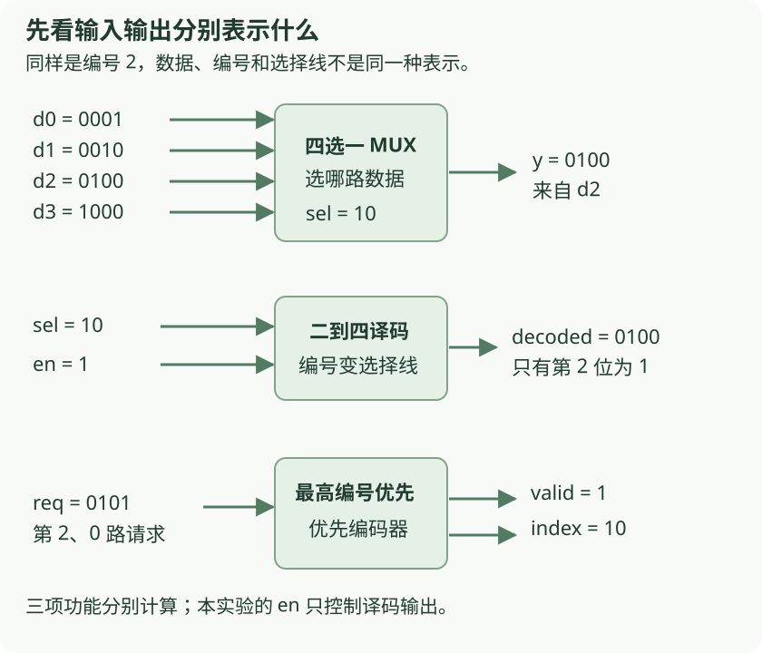

# 13 选择器、译码器与编码器

> 零基础详细版。先修：第8章的端口连接，第9章的位编号，第11章的if/case，第12章的自动检查。建议4–6小时，分成“选数据”“选编号”“运行验证”三次学习。

**本章目标：** 分清选择器、译码器、编码器各自输入什么、输出什么；从功能表写出完整组合逻辑；解释多请求时谁优先；运行一组包含三种功能的实验，并准确说明测试覆盖到哪里。

## 13.1 三种电路，先问它们各自解决什么问题

假设有四个传感器，每个送来四位数据。你想把其中一个的数据送到显示模块。这时需要一个“多路进、一路出”的**选择器**，英文multiplexer，常缩写为MUX。它需要数据输入，还需要一个说明“选哪路”的编号。

另一个场景是：控制器给出编号2，要求第2盏指示灯亮。你要把编号变成某一根有效的选择线，这是**译码器**。再反过来，四根请求线中有一根有效，控制器想知道它的编号，这叫**编码器**。

| 电路 | 输入中的主要信息 | 输出中的主要信息 | 本章例子 |
| --- | --- | --- | --- |
| 四选一选择器 | 四路数据、一个编号 | 被选中的一路数据 | sel=2时y等于d2 |
| 二到四译码器 | 两位编号、使能 | 四根线中指定一根为1 | sel=2时decoded[2]=1 |
| 四路优先编码器 | 四根请求线 | 是否有请求、胜出请求编号 | req=0101时编号2胜出 |

编号2、数据2、只有第2位为1，是三种不同表示。不要看到“2”就把它们当成同一条线。本章编号从0开始，四根线叫第0、1、2、3路。



## 13.2 从一位二选一开始推导

先只选一位数据：输入a、b各一位，选择信号sel也一位。约定sel=0选a，sel=1选b。这里的“选择”不改变a或b本身，只决定y跟随哪一个。

| sel | a | b | y | 理由 |
| --- | --- | --- | --- | --- |
| 0 | 0 | 任意 | 0 | 选a，所以b无关 |
| 0 | 1 | 任意 | 1 | 选a，所以b无关 |
| 1 | 任意 | 0 | 0 | 选b，所以a无关 |
| 1 | 任意 | 1 | 1 | 选b，所以a无关 |

“任意”表示表中这一行同时代表两种二值输入，不是要求把X写进源程序。先看sel=0这一半：`~sel`为1，允许a通过；另一半由sel允许b通过。把两半合起来得到一位公式：

```text
y = ((非sel) 与 a) 或 (sel 与 b)
```

SystemVerilog可写成`assign y = sel ? b : a;`。这是**已有模块内部的语句片段**，要求a、b、sel、y先声明；问号后是条件真时的值，冒号后是假时的值。把b、a写反就会颠倒选路。第一次读时可直接替入sel=0、1各验一次。

## 13.3 从一位扩成四位，不是只选某一位

若a和b改为四位，而sel仍是一位，同一句`sel ? b : a`会选择整条四位数据。例如a=0011、b=1010，sel=1时y=1010，四位一起来自b。这里不是“只把b[1]拿出来”。

我们常把一起传递的多根数据线叫**总线**。四位总线有四根逻辑线，能表示16种位模式。它与“一根选择线能控制四位”不矛盾：选择线控制的是每一位采用哪组来源。

若从一位门公式手工扩展成向量，不能随手写`~sel & a`来充当四位掩码；sel只有一位，位宽规则可能使它无法表达你想要的四个相同控制位。初学优先用条件运算或case。需要掩码时要明确复制，例如`{4{sel}}`，第9章已经介绍重复拼接。

## 13.4 四选一需要几位编号

四条数据路分别编号0、1、2、3。两位sel有00、01、10、11四种模式，正好足够；一位只能表示两种选择。

| sel二进制 | 编号 | y的来源 | 若d0=1、d1=2、d2=4、d3=8 |
| --- | --- | --- | --- |
| 00 | 0 | d0 | 0001 |
| 01 | 1 | d1 | 0010 |
| 10 | 2 | d2 | 0100 |
| 11 | 3 | d3 | 1000 |

也可以用三个二选一拼成四选一：先用sel[0]分别在d0/d1、d2/d3中选择，再用sel[1]在前两个结果中选择。代入sel=10：低位0让上组取d0、下组取d2；高位1再取下组，所以最终是d2。

这种结构用于理解连接。代码写case也能描述相同功能，不要求你为了得到正确电路必须手工实例化三个小MUX。综合器会按目标器件优化，源码形状不是实际门数量的最终报告。

## 13.5 译码：把编号展开成选择线

**二到四译码器**中的“二”指输入编号有两位，“四”指出口有四根选择线。增加一位en，英文enable，表示使能；本章en=1才允许某一根线有效，en=0全部输出0。

| en | sel | decoded[3:0] | 逐位解释 |
| --- | --- | --- | --- |
| 0 | 任意二值 | 0000 | 没有一根被允许 |
| 1 | 00 | 0001 | 第0位为1 |
| 1 | 01 | 0010 | 第1位为1 |
| 1 | 10 | 0100 | 第2位为1 |
| 1 | 11 | 1000 | 第3位为1 |

`decoded[3:0]`显示时左端是第3位，右端是第0位。因此编号2对应0100。不是从左边数第二个字符，也不是把二进制编号10直接复制到四位输出。

恰好一位为1叫**独热**，英文one-hot。允许全0或只有一位1，常叫one-hot-or-zero。本例只有en=1且编号确定时才保证严格独热；en=0时全0是合同内的正常情况。

## 13.6 编码为什么需要先声明输入条件

假设req=0100，表示只有第2路请求。普通编码器可以输出index=10。但req=0101时，第2与第0路同时请求，究竟输出哪个？如果不先约定，题目本身就没有唯一答案。

一种合同要求输入永远独热，多位请求属于不合法输入；另一种合同允许同时请求，并规定优先级。本章采用后者：**编号越大越优先，3高于2，高于1，高于0**。它叫优先编码器。

| req[3:0] | valid | index | 原因 |
| --- | --- | --- | --- |
| 0000 | 0 | 00 | 没有请求，编号默认0 |
| 0001 | 1 | 00 | 第0路请求 |
| 0011 | 1 | 01 | 第1路胜过第0路 |
| 0101 | 1 | 10 | 第2路胜过第0路 |
| 1111 | 1 | 11 | 第3路胜出 |

**valid**是有效标志。index=00本身区分不了“第0路请求”和“没有请求”，所以接收端必须先看valid。valid=0时，index=00只是我们约定的默认输出，不应把它当作有效的第0路事件。

## 13.7 用if/else表达优先级

从req[3]开始判断，成立就输出3；否则再看req[2]，以此类推。`else if`表示前面的条件没有成立才继续，正好表达优先级。

若写成四个彼此独立的if，并从第3位写到第0位，输入1111会先写3，再被2、1、0覆盖，最终变成0。语言没有“看名字知道谁优先”的能力，行序与else关系决定这个过程的结果。

这也不是让电路花四拍“排队询问”。第11章讲过，组合过程的语句表达一个最终关系，硬件可形成优先选择网络；没有时钟就没有这里所谓的四拍。优先级也不保证公平：若第3路长期请求，低路可能始终得不到服务；轮流仲裁需要后续的状态知识。

## 13.8 实验接口：三项功能互不串联

本实验把三项功能放进同一模块，方便一次对照，但它们**分别计算**：y由d0…d3和sel决定；decoded由en和sel决定；valid/index只由req决定。

| 端口 | 方向与位宽 | 本章合同 |
| --- | --- | --- |
| d0、d1、d2、d3 | 输入，各4位 | 四路数据 |
| sel | 输入，2位 | 四选一编号；也是译码编号 |
| en | 输入，1位 | 只控制decoded，不关掉MUX |
| req | 输入，4位 | 编码器的请求位 |
| y、decoded | 输出，各4位 | 被选数据、独热或全0选择线 |
| valid、index | 输出，1位与2位 | 请求有效性、最高请求编号 |

特别注意en=0仍然会选出y。这是本实验的明确选择；若你想让en也关掉y，应改规格和测试，而不是悄悄多加一条if。

## 13.9 第一份完整文件：design.sv

建立`logic-lab/13-routing/`，或者从下载包复制`source/组合实验/13-routing/`。下面是design.sv完整内容；文件原文也可[单独打开](组合实验/13-routing/design.sv)。

```systemverilog
module routing_demo(
  input logic [3:0] d0, d1, d2, d3,
  input logic [1:0] sel,
  input logic en,
  input logic [3:0] req,
  output logic [3:0] y, decoded,
  output logic valid,
  output logic [1:0] index
);
  always_comb begin
    y = 4'b0000;
    case (sel)
      2'd0: y = d0;
      2'd1: y = d1;
      2'd2: y = d2;
      2'd3: y = d3;
      default: y = 4'b0000;
    endcase

    decoded = 4'b0000;
    if (en) begin
      case (sel)
        2'd0: decoded = 4'b0001;
        2'd1: decoded = 4'b0010;
        2'd2: decoded = 4'b0100;
        2'd3: decoded = 4'b1000;
        default: decoded = 4'b0000;
      endcase
    end

    valid = 1'b0;
    index = 2'd0;
    if (req[3]) begin valid = 1'b1; index = 2'd3; end
    else if (req[2]) begin valid = 1'b1; index = 2'd2; end
    else if (req[1]) begin valid = 1'b1; index = 2'd1; end
    else if (req[0]) begin valid = 1'b1; index = 2'd0; end
  end
endmodule
```

第一段case按sel选整条数据；第二段先令decoded=0，再在en允许时写一位1；第三段先令valid=0、index=0，再按请求覆盖。三段所有输出都获得默认值或完整分支，避免“上次输出被记住”。

普通case按四态逐位精确匹配。若sel含X，本例落到default并输出0；若req含X，if的行为也不能当成可靠的未知传播。这些默认值是仿真模型的约定，不表示真实硬件知道X是什么。**本实验功能验收针对确定的0/1输入**，没有宣称全面验证X/Z处理；需要检测未知输入时，应额外定义检查策略。

## 13.10 逐步手算一组完整输入

给d0=3、d1=12、d2=5、d3=9，sel=10，en=0，req=0101。先把三个问题分开：

1. sel=10表示编号2，因此y取d2=5，即0101。
2. en=0，因此decoded=0000，不管sel是多少。
3. req的第2与第0位为1，最高编号2胜出，因此valid=1、index=10。

再只把en改成1。y仍为0101，valid/index也不变，只有decoded变成0100。这种“只改一项，预测哪些输出该变”的方法很适合检查接口理解和接线。

## 13.11 第二份完整文件：tb.sv

下面是同目录tb.sv完整内容，源文件见[测试平台](组合实验/13-routing/tb.sv)。先把它与第12章循环测试联系起来，再阅读新的参考模型。

```systemverilog
`timescale 1ns/1ps
module tb;
  logic [3:0] d0, d1, d2, d3, req;
  logic [1:0] sel, index;
  logic en, valid;
  logic [3:0] y, decoded;
  logic [3:0] expected_y, expected_decoded;
  logic expected_valid;
  logic [1:0] expected_index;
  integer count;
  routing_demo dut(.d0(d0), .d1(d1), .d2(d2), .d3(d3),
    .sel(sel), .en(en), .req(req), .y(y), .decoded(decoded),
    .valid(valid), .index(index));

  initial begin
    count = 0;
    for (int pattern=0; pattern<16; pattern++) begin
      d0 = pattern[3:0];
      d1 = ~d0;
      d2 = {d0[1:0], d0[3:2]};
      d3 = 4'b0001;
      for (int s=0; s<4; s++) begin
        for (int e=0; e<2; e++) begin
          for (int r=0; r<16; r++) begin
            sel = s[1:0]; en = e[0]; req = r[3:0];
            case (s)
              0: expected_y = d0;
              1: expected_y = d1;
              2: expected_y = d2;
              3: expected_y = d3;
            endcase
            expected_decoded = 4'b0000;
            if (e == 1) expected_decoded[s] = 1'b1;
            expected_valid = (r != 0);
            expected_index = 2'd0;
            for (int k=0; k<4; k++) begin
              if (req[k]) expected_index = k[1:0];
            end
            #1;
            if ({y,decoded,valid,index} !==
                {expected_y,expected_decoded,expected_valid,expected_index})
              $fatal(1, "routing p=%0d sel=%0d en=%0d req=%b actual=%b/%b/%b/%0d expected=%b/%b/%b/%0d",
                pattern,s,e,req,y,decoded,valid,index,
                expected_y,expected_decoded,expected_valid,expected_index);
            count = count + 1;
          end
        end
      end
    end
    $display("PASS routing: %0d selected-data/control cases", count);
    $finish;
  end
  initial begin #5000; $fatal(1, "routing timeout"); end
endmodule
```

`pattern`控制16组数据图样：d0遍历所有四位值，d1取其按位反，d2交换高低两组二位，d3固定为0001。这样既有全0/全1，也有不同位置的位，不是四个输入永远同一个数。

变量s遍历4个选择编号，e遍历两个使能值，r遍历16种请求。`s[1:0]`等切片把循环整数明确取成接口需要的宽度。每次先建立预期值，等1ns虚拟时间，再整体比较输出。`{y,decoded,valid,index}`是4+4+1+2=11位拼接，两边顺序必须一致。

## 13.12 为什么参考模型从低位扫描

设计用“从高到低，找到第一个就停止”的if/else链；测试则从k=0扫描到3，每遇到1就覆盖expected_index。代入req=0101：先遇到第0位，预期编号暂为0；后遇到第2位，覆盖成2；扫描结束得到2。

两个算法都服从“最高编号胜出”，但写法不同，较容易发现把设计优先级写反的错误。译码器的参考值也没有复制四条case，而是先清零，再直接令`expected_decoded[s]=1`。

`expected_valid=(r!=0)`独立处理空请求。即使编号默认0碰巧对了，也不能让错误的valid蒙混通过。错误日志包含图样、编号、使能、请求，以及四项实际/预期输出，足以回到一组输入重算。

## 13.13 在哪里运行，应该看到什么

工具准备沿用[第7章](07-环境与第一个仿真实验.md)。在**13-routing目录的PowerShell**逐条执行，编译成功后再运行：

```powershell
iverilog -g2012 -s tb -o sim.vvp design.sv tb.sv
vvp sim.vvp
```

主要成功输出为：

```text
PASS routing: 2048 selected-data/control cases
```

2048来自16×4×2×16。这里穷举了选定16组数据图样下的控制与请求，**没有穷举四路数据彼此独立变化的全部情况**。本接口的全部二值组合是2^16×4×2×16=8,388,608组。能说明范围，比只看到一个大数字更有用。

Icarus11可能对always_comb中的固定切片显示`constant selects ... all bits will be included`提示，表示敏感性处理包含更多位；本批实际编译成功并执行通过。仍须检查退出码，不能把所有带文字的编译输出一律当失败，也不能因此忽略真正的语法错误。命令依据见[Icarus官方参数](https://steveicarus.github.io/iverilog/usage/command_line_flags.html)，核验日期2026-11-05。

## 13.14 故意把优先级写反

在实验副本里把编码部分改成从req[0]、req[1]、req[2]、req[3]依次if/else判断，其余保持。重新编译运行。输入0011时，错误设计会选0，但合同要求1。实际故障验证得到的关键字段为：

```text
req=0011 actual=0000/0000/1/0 expected=0000/0000/1/1
```

这里四组字段依次是y、decoded、valid、index；前两组一样，说明失败集中在编码编号。恢复后重编译应回到PASS。不要为了消掉报错把参考模型也改成最低位优先，除非需求本身已经明确改变。

## 13.15 七段数码管也是一种译码

七段数码管可把七段分别命名为：a上横、b右上、c右下、d下横、e左下、f左上、g中横。本节约定`segments[6:0]={a,b,c,d,e,f,g}`，逻辑1代表“希望该段亮”。显示0要亮a到f、熄g，所以是1111110。

| 十进制数字 | 七段逻辑码abcdefg | 手算提示 |
| --- | --- | --- |
| 0 | 1111110 | 外圈亮，中间灭 |
| 1 | 0110000 | 右边两段 |
| 2 | 1101101 | 缺右下与左上 |
| 3 | 1111001 | 右边加三横 |
| 4 | 0110011 | 两边上部加中横和右下 |
| 5 | 1011011 | 缺右上与左下 |
| 6 | 1011111 | 只缺右上 |
| 7 | 1110000 | 上横加右边 |
| 8 | 1111111 | 七段全亮 |
| 9 | 1111011 | 只缺左下 |

四位输入还能出现10–15。若合同只显示十进制数字，可以把它们规定为全灭0000000，而不是任它们保留上一次显示。

这张表描述逻辑含义，未绑定真实开发板。真实器件的段顺序、共阳/共阴、位选和有效电平需查手册；例如低有效段线可能需要反相。可先产生“希望亮哪些段”的逻辑码，再由板级模块适配极性。不要把表里的1直接理解为所有板卡引脚必须输出高电压。

## 13.16 常见错误与定位

| 现象 | 可能原因 | 用什么输入区分 |
| --- | --- | --- |
| sel=0选到了d3 | 编号顺序反了 | 让四路分别为1、2、4、8 |
| sel=2译码成0010 | 把编号与从左数位置混淆 | 逐位写decoded[2]=1 |
| en=0时y也变0 | 擅自把使能扩到MUX | d2=5、sel=2，切换en |
| req=0000与0001无法区分 | 漏valid或没有检查它 | 两组连续输入 |
| req=1111输出0 | 多个独立if或优先链反了 | 用0011更容易看覆盖关系 |
| 改输入后结果似乎保留 | 组合分支漏赋值 | 检查每个输出的默认与各路径 |

## 13.17 练习与过程答案

练习1：d0=0、d1=3、d2=6、d3=9，sel=11，en=1，req=1010，求全部输出。先选编号3，y=9；译码第3位为1，decoded=1000；请求3与1同时存在，3胜出，所以valid=1、index=11。

练习2：为什么译码后再编码通常不能恢复en=0时原来的sel？en=0把所有编号都映射到0000，输入信息已经丢失；编码器只能输出valid=0与默认编号，无法知道原先是哪一路。

练习3：八选一需要几位编号？三位有2^3=8种，足够；数据可以每路8位，但选择编号仍只需3位。不要把数据位宽8与编号位宽3混为一谈。

更多题见[第三阶段练习](第三阶段-练习与参考答案.md)。

## 13.18 完成条件

遮住代码也能画出三类电路的信息方向；能从sel=2写出0100，说明空请求为什么还要valid；能运行2048组检查，解释它的覆盖限制，并让一次优先级错误被发现。然后进入[第14章](14-加减法比较器与ALU.md)，让多路选择器选择不同计算结果。
