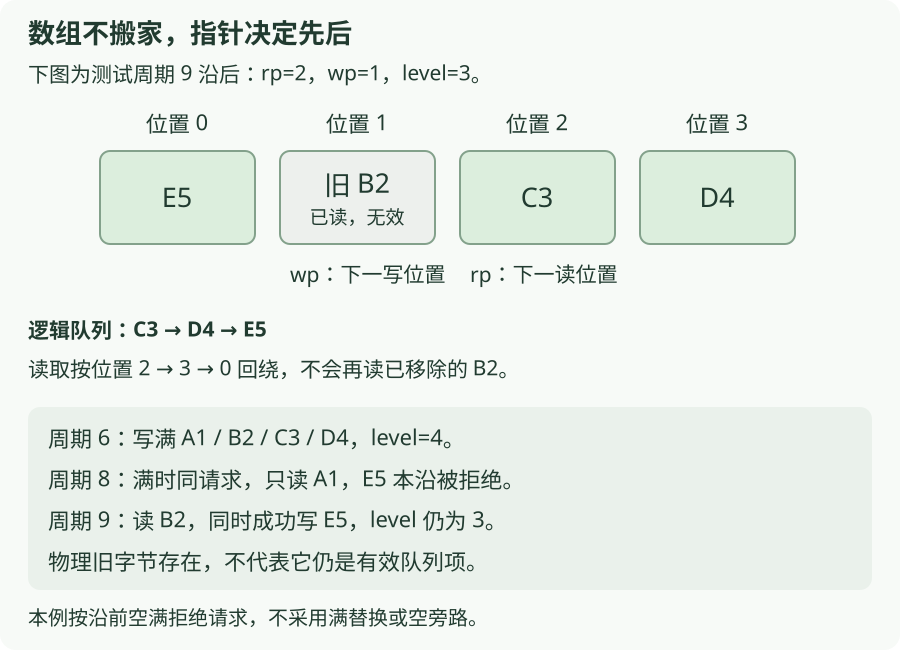

# 24 同步 FIFO 与边界行为

> 零基础详细版。先修：第21章数组与同步读、第23章接受事件和测试队列。建议6–9小时，先用纸条模拟四个位置，再跟踪指针、数量和真正接受的读写。

**本章目标：** 理解先入先出；用读写指针与占用数管理四项存储；明确空/满同时请求的合同；区分普通同步读与自动展示队首；用独立队列检查回绕、顺序、拒绝与复位。

## 24.1 FIFO保存的是一串有顺序的项

**FIFO**是first in, first out，先入先出。写入A1、B2、C3，成功读取时应先A1，再B2，再C3；它不允许像普通RAM一样随意指定“现在读第三项”。

本例固定四项、每项八位。存储数组有四个格，但对外只提供写请求、读请求、数据和状态，地址由内部指针管理。它能吸收一段输入/输出速率不匹配，但容量有限，不可能无限接收。

**同步FIFO**在这里指读写逻辑使用同一个clk，不是“所有叫FIFO的东西都能跨时钟”。异步FIFO需要处理不同域的指针与标志同步，本例不实现。

## 24.2 先写本例接口合同

| 端口 | 含义 |
| --- | --- |
| wr_en、din | 请求写入一个字节 |
| rd_en | 请求读取最老一项 |
| full、empty | 当前占用是否4、是否0 |
| push、pop | 沿前条件判断的本沿成功写/读 |
| level | 当前占用数量0…4 |
| dout | 成功读的沿后更新，其他时候保持；复位置0 |

高有效同步rst清指针、level和dout；rst=1时组合屏蔽push/pop。RAM各格内容没有全部清零，因为复位后level=0，旧格子不再是有效队列项。

wr_en只是请求，**push才表示这个沿接受了写入**；rd_en同理。请求连续高多个沿，只要条件允许，可能每沿接受一项，不能把它当成只对上升变化响应的按钮。

## 24.3 普通同步读与FWFT不要混用

本例成功读之前，dout不自动展示最老项。只有rd_en且非空的采样沿，才将旧队首装到dout，之后保持，直到另一次成功读或复位。

例如写入A1后，dout仍可能是复位0；你不能仅因empty=0，就把dout=0当队首。一次成功pop后才得到A1。最后一项取走后empty=1，但dout仍保持刚才读出的字节，它不再代表队列里还有一项。

**FWFT**是first-word fall-through，首字直通，常表现为队列有数据时不必先发读操作，队首就出现在输出。具体语义见[AMD官方FWFT说明](https://docs.amd.com/r/en-US/pg327-emb-fifo-gen/AXI-Interface-FIFOs)，核验日期2026-11-05。本课自写例程是普通同步读，不能套用该IP的FWFT时序。

## 24.4 两个指针分别指什么

wp是write pointer，指向下一次成功写入的位置；rp是read pointer，指向下一次成功读取的最老项位置。四个位置0…3，各用两位，成功操作后加1自然回绕：0→1→2→3→0。

填满四项后，wp和rp可能同为0；完全空时也可能相同。因此仅看wp==rp分不清空与满，本例另用level记录数量。

level必须能表示0、1、2、3、4五种，需三位。指针两位与数量三位的区别，正是第15章地址与数量的边界问题；若level也两位，4会丢失，满标志就无法正确表示。

## 24.5 数量只看成功操作，不看原始请求

沿前成功条件为`push=!rst&&wr_en&&!full`，`pop=!rst&&rd_en&&!empty`。数量的下一值由这两个成功条件联合决定：

| push | pop | level变化 | 队列内容 |
| --- | --- | --- | --- |
| 0 | 0 | 保持 | 不改变 |
| 1 | 0 | +1 | 尾部追加 |
| 0 | 1 | −1 | 移除最老项 |
| 1 | 1 | 保持 | 移除最老项，同时追加新项 |

最后一行数量不变，内容却改变。不能据level没变就认为“没发生操作”。也不要分别写两个独立的level<=level+1与level<=level−1，让后一句在同沿覆盖前一句；本例用case一次决定数量。

## 24.6 满时同时请求，只接受读

本例采用**沿前空满的保守合同**。沿前level=4，full=1，因此push=0；若rd_en=1，pop=1，旧队首被读走，沿后level=3。即使这一沿腾出了空间，也不会回头把同沿已拒绝的写算进去。

若上游还想写E5，下一沿要继续/重新提供请求，并观察push是否为1。第23章的一项缓冲允许满时同沿替换，但本FIFO明确没有采用那条优化，二者规格不同。

可以设计满时读写都接受的FIFO，但需重新定义接受条件、存储冲突与时序，再改测试。不能看到“另一个FIFO这么做”就判定本例一定要同时接受。

## 24.7 空时同时请求，只接受写

沿前level=0，empty=1，因此pop=0；若wr_en=1，push=1，新项进入队列，沿后level=1，但dout保持。本例没有把新输入组合旁路到读输出。

| 沿前情况 | wr_en/rd_en | 本例push/pop | 沿后level |
| --- | --- | --- | --- |
| 空，0项 | 1/1 | 1/0 | 1 |
| 中间，2项 | 1/1 | 1/1 | 2 |
| 满，4项 | 1/1 | 0/1 | 3 |

先决定沿前有哪些有效项，再判断本沿能做什么，最后更新状态。不要用沿后empty/full来反算刚才是否接受，最后一项读走后沿后pop可能已因empty变1而降低，数据仍是该沿成功读的结果。

## 24.8 第一份完整文件：design.sv

在`logic-lab/24-fifo/`保存两文件，或复制下载包`source/控制通信实验/24-fifo/`。下面是[design.sv](控制通信实验/24-fifo/design.sv)完整内容。

```systemverilog
module fifo4_demo(
  input logic clk,rst,wr_en,rd_en,
  input logic [7:0] din,
  output logic [7:0] dout,
  output logic full,empty,push,pop,
  output logic [2:0] level
);
  logic [7:0] mem[0:3];
  logic [1:0] wp,rp;
  assign full=(level==3'd4);
  assign empty=(level==3'd0);
  assign push=!rst && wr_en && !full;
  assign pop=!rst && rd_en && !empty;
  always_ff @(posedge clk) begin
    if (rst) begin wp<=0;rp<=0;level<=0;dout<=0;end
    else begin
      if (push) begin mem[wp]<=din;wp<=wp+1'b1;end
      if (pop) begin dout<=mem[rp];rp<=rp+1'b1;end
      case ({push,pop})
        2'b10: level<=level+1'b1;
        2'b01: level<=level-1'b1;
        default: level<=level;
      endcase
    end
  end
endmodule
```

mem只在push时写wp对应格，wp只在成功写前进；dout只在pop时读rp对应旧格，rp只在成功读前进。level由成功组合统一更新，不会因被拒绝的满写或空读改变。

在中间占用状态同沿读写，读写逻辑都执行；寄存器与数组采用非阻塞赋值，仍按沿前数据求右值。本例按边界拒绝避免空旁路与满替换，不要求你额外猜这些边界的冲突模式。

## 24.9 回绕不是移动整份数组

先依次写A1/B2/C3/D4，wp绕回0，rp=0，level=4。满时读写同请求E5，只读出A1，rp到1，wp仍0。下一次中间同读写，读出B2，把E5写到位置0，rp到2、wp到1，level仍3。

此时物理数组可能是[0]=E5、[1]=旧B2、[2]=C3、[3]=D4；逻辑队列却是C3、D4、E5。格1旧B2还存在，不表示它仍有效；有效范围由rp、wp、level共同管理。



不需要把每项都向前搬一格。继续成功读，指针按2→3→0走，就能正确返回C3、D4、E5。清空数组与移除逻辑队首不是同一回事。

## 24.10 第二份完整文件：tb.sv

下面是[tb.sv](控制通信实验/24-fifo/tb.sv)完整内容。参考模型沿用第23章动态队列，避免再复制一套读写指针来共同犯错。

```systemverilog
`timescale 1ns/1ps
module tb;
  logic clk=0,rst,wr_en,rd_en,full,empty,push,pop;
  logic [7:0] din,dout,expected_dout=0;
  logic [2:0] level;
  integer model[$];
  integer cycles=0,writes=0,reads=0,rejected_writes=0,rejected_reads=0,discarded=0,oldest;
  fifo4_demo dut(.clk(clk),.rst(rst),.wr_en(wr_en),.rd_en(rd_en),.din(din),
    .dout(dout),.full(full),.empty(empty),.push(push),.pop(pop),.level(level));
  always #5 clk=~clk;
  task automatic step(input logic r,w,read_request,input logic [7:0] value);
    bit take_write,take_read;
    integer before_level;
    @(negedge clk);rst=r;wr_en=w;rd_en=read_request;din=value;
    before_level=model.size();
    take_write=!r && w && (before_level<4);
    take_read=!r && read_request && (before_level>0);
    #1;
    if (level !== before_level[2:0] || full !== (before_level==4) || empty !== (before_level==0))
      $fatal(1,"FIFO pre-edge flags cycle=%0d",cycles);
    if (push !== take_write || pop !== take_read)
      $fatal(1,"FIFO acceptance cycle=%0d level=%0d request=%b%b actual=%b%b expected=%b%b",
        cycles,before_level,w,read_request,push,pop,take_write,take_read);
    if (take_read) expected_dout=model[0];
    @(posedge clk);#1;
    if (r) begin discarded=discarded+model.size();model.delete();expected_dout=0;end
    else begin
      if (take_read) begin oldest=model.pop_front();reads++;end
      if (take_write) begin model.push_back(value);writes++;end
      if (w && !take_write) rejected_writes++;
      if (read_request && !take_read) rejected_reads++;
    end
    if (dout !== expected_dout || level !== model.size() || full !== (model.size()==4) || empty !== (model.size()==0))
      $fatal(1,"FIFO post-edge cycle=%0d data=%h expected=%h level=%0d expected-level=%0d",cycles,dout,expected_dout,level,model.size());
    cycles++;
    if (cycles<=20) $display("TRACE FIFO cycle=%0d before=%0d push=%b pop=%b after=%0d dout=%h",cycles,before_level,take_write,take_read,model.size(),dout);
  endtask
  initial begin
    rst=1;wr_en=0;rd_en=0;din=0;
    step(1,0,0,0);step(0,0,1,0);
    step(0,1,1,8'ha1);step(0,1,0,8'hb2);
    step(0,1,0,8'hc3);step(0,1,0,8'hd4);
    step(0,1,0,8'he5);step(0,1,1,8'he5);
    step(0,1,1,8'he5);step(0,0,1,0);
    step(0,1,0,8'hf6);step(0,0,1,0);
    step(0,0,1,0);step(0,0,1,0);step(0,0,1,0);
    step(0,1,0,8'h77);step(1,1,1,8'hff);
    step(0,1,0,8'h88);step(0,0,1,0);step(0,0,1,0);
    for (int i=0;i<200;i++) step(0,(i%3!=0),(i%4>=2),8'h40+i[7:0]);
    if (writes != reads+discarded+model.size()) $fatal(1,"FIFO accounting");
    $display("PASS FIFO: %0d cycles writes=%0d reads=%0d rejected-write=%0d rejected-read=%0d reset-discarded=%0d remaining=%0d",cycles,writes,reads,rejected_writes,rejected_reads,discarded,model.size());
    $finish;
  end
  initial begin #3000;$fatal(1,"FIFO timeout");end
endmodule
```

## 24.11 参考队列怎样检查同步读

任务先保存before_level=model.size()，据此计算take_write、take_read。驱动后先检查DUT沿前level/full/empty和push/pop，确认它接受的正是合同允许的请求。

如果本沿会读，先把参考旧队首存到expected_dout；若没有成功读，expected_dout保持上一份。等上升沿后1ns再比较dout，这样不会把普通同步FIFO误当成每时每刻自动输出队首。

随后参考队列先pop旧项、再push新项，检查沿后数量、空满与读结果。复位时清空参考队列，记下discarded并把预期dout置0。队列由测试代码管理，不被综合到DUT中。

## 24.12 前二十个周期怎样安排

| 测试周期 | 操作与目的 | 关键结果 |
| --- | --- | --- |
| 1–2 | 复位、空读 | 空读拒绝，dout保持0 |
| 3 | 空时同时请求，数据A1 | 只写，不读 |
| 4–6 | 再写B2/C3/D4 | 达到满4项 |
| 7 | 满写E5 | 拒绝，数据不进入队列 |
| 8 | 满时同时请求E5 | 只读A1，level变3 |
| 9 | 中间同读写E5 | 读B2、写E5，level仍3 |
| 10–14 | 读C3，写F6，再读D4/E5/F6 | 顺序正确并回绕到空 |
| 15 | 再空读 | 保持最后F6 |
| 16–17 | 写77，再在双方请求时复位 | 丢弃77，输出清0 |
| 18–20 | 写88、读88、再空读 | 复位后可恢复，空读不改变88 |

之后用200周期确定性读写图样继续检查。`i%3!=0`与`i%4>=2`只是产生请求的测试规则，不是DUT内部控制；每个周期仍由独立队列按沿前占用决定能否接受。

这是220周期的有限测试，不是全部可能输入历史或形式证明。它覆盖多次空满、回绕、内部同时操作和运行中复位。

## 24.13 运行与数量核对

在**24-fifo目录的PowerShell**执行：

```powershell
iverilog -g2012 -s tb -o sim.vvp design.sv tb.sv
vvp sim.vvp
```

最后应有：

```text
PASS FIFO: 220 cycles writes=111 reads=107 rejected-write=32 rejected-read=4 reset-discarded=1 remaining=3
```

111次成功写入=107次成功读出+复位丢弃1项+最后仍存3项。被拒绝的32次写、4次读，不应算进成功数量；仿真结束不要求必须将队列排空，但必须说明剩余去了哪里。

## 24.14 三种错误分别检出什么

故障一：允许满时rd_en=1就同沿写入。周期8会错误push=1，而本合同push=0，沿前接受检查立即失败。故障二：允许空时wr_en=1就同沿读取。周期3会错误pop=1，违背无旁路合同。

故障三：用两个独立非阻塞赋值分别给level加减，同进同出时后一句覆盖前一句，数量不再保持，沿后检查失败。这三份副本都实际运行失败，正确版恢复后通过。

这些错误有些在另一份合同下可能是可选功能，例如满替换；但对于本例已写明的规格，它们就是不一致。验证首先检验实现是否履行自己的接口约定。

## 24.15 常见错误与练习

| 错误 | 后果 | 检查方法 |
| --- | --- | --- |
| level两位 | 不能表达满4 | 写出0…4范围 |
| 指针相等就判空 | 满时也可能相等 | 看数量或另有明确判据 |
| 请求都计成功 | 满写/空读导致数据账目错 | 只记push/pop |
| 同时读写两个level赋值 | 覆盖导致数量错 | 按二位成功组合case |
| 写完就认为dout是队首 | 混用FWFT与同步读 | 检查成功pop后的输出 |
| 不测回绕 | 位置0重用错误可能漏掉 | 写满、读部分、再写 |

练习1：level=2、同进同出，沿后数量与内容？数量2，旧队首被移除，新项追加。练习2：空时双方请求D4，沿后dout一定D4吗？本合同不一定，pop被拒绝，dout保持。练习3：复位为何不一定要清mem？level=0已使旧内容无效；是否物理清零是另一个资源和功能要求。

## 24.16 完成条件

画出满、空、中间三种同时请求；说明wp/rp相等为何不够；用逻辑队列解释回绕后的C3/D4/E5；运行220周期并核对成功、拒绝、丢弃、剩余数量。继续[第25章](25-UART发送器与串行协议.md)，把一个字节变成有明确位时间的串行帧。
