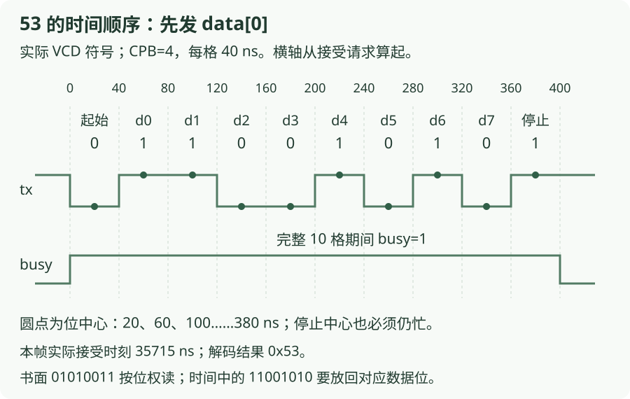

# 25 UART 发送器与串行协议

> 零基础详细版。先修：第19章计数与终值、第20章位序与移位、第22章状态行为、第23章请求与接受。建议7–10小时，先手画十格帧，再跟踪一格内的多个时钟沿。

**本章目标：** 读懂8N1、波特率和最低位先发；明确start何时接受、busy何时结束；解释帧锁存、位计数与拍计数；用位中心检查重建字节；区分RTL串行线、真实电气接口与完整串口系统。

## 25.1 为什么一根线需要预先约定位时间

我们已经能并行保存八位数据。如果只有一根tx发送线，就要按时间逐位传送。发送方和接收方必须同意每一位持续多久、从哪里开始、几个数据位、如何结束，否则接收方不知道某个高电平代表哪一位。

**UART**是universal asynchronous receiver/transmitter，通用异步收发器。这里“异步”指通信线上不额外传送同步采样时钟，双方各自用本地时钟按照约定速率工作；不是说内部设计不用时钟。

本章实现发送部分，叫TX；不实现接收器、USB桥、操作系统串口驱动或真实板卡电压适配。仿真里的tx=0/1是逻辑值，不能直接等同RS-232等物理电平标准。

## 25.2 8N1十格分别是什么

本章采用常见的8N1：8个数据位、N表示no parity无奇偶校验、1个停止位。再加1个起始位，一帧共10个位时间。空闲线路为1，起始位为0，数据最低位先发，停止位为1。

| 时间格编号 | 名称 | 发送值 |
| --- | --- | --- |
| 帧前 | 空闲 | 1 |
| 0 | 起始位 | 0 |
| 1 | 数据第0位 | data[0] |
| 2…8 | 后续数据位 | data[1]…data[7] |
| 9 | 停止位 | 1 |
| 帧后 | 空闲或后续帧 | 本例先保持1 |

“8”不包括起始、停止；停止位也要持续完整一个位时间，不能刚把线路拉高就立刻认为发送任务完成。格式依据可查[Microchip UART异步模式说明](https://onlinedocs.microchip.com/oxy/GUID-61202E6F-BC03-4D81-AAB9-269E87F9B49C-en-US-22/GUID-F37FDF72-1D87-438A-A2F1-D70FD2AC07AC.html)，核验日期2026-11-05。

## 25.3 手算53为什么比只看00更有用

十六进制53写成八位是01010011，书面从左到右是data[7]到data[0]；发送时必须从data[0]开始，因此八个数据位按时间排列为1、1、0、0、1、0、1、0。

完整十格是：

```text
格编号：  0  1 2 3 4 5 6 7 8  9
含义：   起始  数据0……数据7   停止
53帧：    0  1 1 0 0 1 0 1 0  1
```

接收时将第1格放回结果第0位，第2格放第1位，以此类推，1+2+16+64=83，即十六进制53。不要把时间从左到右读出的11001010直接按最高位在左解释成CA。

00和FF适合查长低、长高及边界，但不能单独检出位序反向。A5的位模式10100101恰好左右反转仍相同，也不宜作为唯一位序测试。本实验加入53，并实际遍历全部256个字节。



## 25.4 波特率、位时间与字节率

在本章每个符号只承载一位的二值UART中，波特率B对应每秒B个位时间，位时间T_bit=1/B。8N1一字节占10个位时间，忽略额外空闲时，理论字节率上限B/10。

例如9600波特时，每位约104.167微秒，一帧约1.04167毫秒，理论最多960字节/秒；115200波特理论11520字节/秒。不能直接把115200当每秒115200个字节。

本例接口和测试会留空闲拍，不宣称达到无间隙上限。真实双方时钟偏差、接收采样策略与线路条件也会影响通信，RTL内部正确并不自动证明外部设备能可靠收到。

## 25.5 用每位多少时钟拍来实现时间

参数CLKS_PER_BIT规定一位占多少个clk周期。测试时钟周期10ns，若该参数为4，每位40ns，一帧400ns；若为1，每位10ns，一帧100ns。

这两种配置只用于加快仿真，不代表真实串口设为常见9600或115200。设计内部不用#等待，而是每个上升沿更新count，到CLKS_PER_BIT−1时切换下一位。

count的位宽用$clog2并保护至少一位。CLKS_PER_BIT=1时每个忙时有效沿都到终值，正好一拍换一位；不能声明零宽计数器，也不能因为参数最小就多等一拍。

## 25.6 start与busy的接受合同

start不是第23章完整valid/ready接口。本例在**沿前busy=0且start=1**的上升沿接受请求，锁存data，开始起始位并令busy=1。忙时的start不排队。

| 沿前状态 | start | 该沿行为 |
| --- | --- | --- |
| 空闲busy=0 | 0 | tx保持1 |
| 空闲busy=0 | 1 | 接受本次data，进入发送 |
| 发送中busy=1 | 0或1 | 只推进已有帧，忽略新请求 |
| 任意，rst=1 | 任意 | 同步复位到tx=1、busy=0 |

如果start仅在忙期间高一下又低，后面不会自动发送那项。如果start一直高到重新空闲，则某个后续空闲采样沿可能把它当新请求接受；“忙时忽略”不是对该信号永远记住一次拒绝。

调用者要按接口准备数据和请求，不能把一次软件意图与所有高电平采样沿混成一件事。

## 25.7 为什么必须在接受沿锁存整个字节

发送一帧跨越很多周期，外部data可能为下一个字节变化。若每发一个数据位就重新看外部data，前半来自旧字节、后半来自新字节，线路上就不是任何一个完整原字节。

本例在接受沿建立十位帧`{1'b1,data,1'b0}`，从高到低分别是停止1、八位数据、起始0。因此frame[0]是起始，frame[1]是data[0]，一直到frame[8]是data[7]，frame[9]是停止。

起始位直接令tx=0；之后只看内部锁存帧，不再追随外部data。测试故意在接受后把外部data改成反码，检查当前帧仍是原字节。

## 25.8 拍计数和位编号不要混为一谈

count回答“当前这一位已经走到第几拍”，范围0…CLKS_PER_BIT−1；bit_index回答“当前发送十格中的哪一格”，范围0…9，至少四位。

以每位4拍为例，接受沿t0输出起始0，count=0、bit_index=0。随后t0+1拍count=1，+2拍为2，+3拍为3，+4拍读到旧count=3，切换到第1格、count回0。

| 距接受沿 | 当前输出区间 | 下一次边界动作 |
| --- | --- | --- |
| 0…4拍 | 起始位0 | 第4拍切到data[0] |
| 4…8拍 | data[0] | 第8拍切到data[1] |
| 32…36拍 | data[7] | 第36拍切到停止1 |
| 36…40拍 | 停止位1 | 第40拍完成，busy清0 |

停止位期间busy仍1，直到完整40拍结束。刚进入停止位的第36拍不能提前宣告空闲。

## 25.9 第一份完整文件：design.sv

在`logic-lab/25-uart/`保存两文件，或复制下载包`source/控制通信实验/25-uart/`。下面是[design.sv](控制通信实验/25-uart/design.sv)完整内容。

```systemverilog
module uart_sender #(parameter integer CLKS_PER_BIT=4)(
  input logic clk,rst,start,
  input logic [7:0] data,
  output logic tx,busy
);
  localparam integer CW=(CLKS_PER_BIT<=1)?1:$clog2(CLKS_PER_BIT);
  logic [CW-1:0] count;
  logic [9:0] frame;
  logic [3:0] bit_index;
  always_ff @(posedge clk) begin
    if (rst) begin tx<=1;busy<=0;count<=0;frame<='1;bit_index<=0;end
    else if (!busy) begin
      tx<=1;
      if (start) begin
        frame<={1'b1,data,1'b0};tx<=0;busy<=1;count<=0;bit_index<=0;
      end
    end else if (count==CLKS_PER_BIT-1) begin
      count<=0;
      if (bit_index==9) begin busy<=0;tx<=1;end
      else begin
        frame<={1'b1,frame[9:1]};tx<=frame[1];bit_index<=bit_index+1'b1;
      end
    end else count<=count+1'b1;
  end
endmodule
```

if/else顺序就是优先级：先复位，再按沿前busy区分空闲或发送中；忙时只有count到终值才推进位编号。在非终值拍只是count加1，tx不赋新值，保持当前位。

切换时`frame<={1'b1,frame[9:1]}`右移并补1，`tx<=frame[1]`读取的是**旧frame的第1位**，正好是移出当前第0位后的下一位。若误按新frame[1]理解，会在纸面推演中跳位。

tx本身是寄存输出，不让外部data的组合变化直接穿过去。完成bit_index=9的最后一个位时间后，busy清0、tx保持1；下一次请求仍按后续空闲采样沿接受，并非同沿回头再执行一次空闲分支。

## 25.10 第二份完整文件：tb.sv

下面是[tb.sv](控制通信实验/25-uart/tb.sv)完整内容。它比前几章长，分为“单配置检查模块”和“顶层同时等待两个配置”，按两部分阅读即可。

```systemverilog
`timescale 1ns/1ps
module uart_checker #(parameter integer CPB=4)(output logic done);
  logic clk=0,rst,start,tx,busy,want;
  logic [7:0] data;
  integer checked_frames=0,center_samples=0;
  uart_sender #(.CLKS_PER_BIT(CPB)) dut(.clk(clk),.rst(rst),.start(start),.data(data),.tx(tx),.busy(busy));
  always #5 clk=~clk;
  task automatic send_check(input logic [7:0] value);
    logic [7:0] received;
    @(negedge clk);start=1;data=value;
    @(posedge clk);#1;
    if (tx !== 1'b0 || busy !== 1'b1) $fatal(1,"UART start CPB=%0d",CPB);
    start=0;data=~value;received=0;
    #(CPB*5-1);
    for (int symbol=0;symbol<10;symbol++) begin
      if (symbol==0) want=0;
      else if (symbol==9) want=1;
      else want=value[symbol-1];
      if (tx !== want || busy !== 1'b1)
        $fatal(1,"UART CPB=%0d value=%h symbol=%0d actual=%b busy=%b expected=%b",CPB,value,symbol,tx,busy,want);
      if (symbol>=1 && symbol<=8) received[symbol-1]=tx;
      center_samples++;
      if (symbol==2) start=1;
      if (symbol==3) start=0;
      if (symbol<9) #(CPB*10);
    end
    if (received !== value) $fatal(1,"UART reconstructed byte");
    #(CPB*5+1);
    if (busy !== 1'b0 || tx !== 1'b1) $fatal(1,"UART full stop duration");
    repeat (2) @(posedge clk);
    #1;
    if (busy !== 1'b0 || tx !== 1'b1) $fatal(1,"UART busy request was queued");
    checked_frames++;
    if (value==0 || value==8'h53 || value==8'ha5 || value==8'hff)
      $display("TRACE UART CPB=%0d value=%h received=%h",CPB,value,received);
  endtask
  initial begin
    done=0;rst=1;start=0;data=0;
    @(posedge clk);#1;
    @(negedge clk);rst=0;
    for (int value=0;value<256;value++) send_check(value[7:0]);
    @(negedge clk);start=1;data=8'h5a;
    @(posedge clk);#1;start=0;
    @(negedge clk);rst=1;
    @(posedge clk);#1;
    if (tx !== 1'b1 || busy !== 1'b0) $fatal(1,"UART reset during frame");
    $display("PASS UART CPB=%0d: frames=%0d centers=%0d busy rejection, latched data, reset",CPB,checked_frames,center_samples);
    done=1;
  end
endmodule

module tb;
  logic done1,done4;
  uart_checker #(.CPB(1)) c1(.done(done1));
  uart_checker #(.CPB(4)) c4(.done(done4));
  initial begin
    $dumpfile("uart.vcd");$dumpvars(0,tb);
    wait (done1 && done4);
    $display("PASS UART all: 512 frames and 5120 symbol centers at CPB=1/4");
    $finish;
  end
  initial begin #200000;$fatal(1,"UART timeout");end
endmodule
```

## 25.11 uart_checker是测试模块，不是新硬件协议

uart_checker参数CPB选择检查哪种每位拍数，内部放一份uart_sender，自己产生10ns时钟、驱动复位和请求，输出done表示该份检查完成。

顶层tb实例化CPB=1与4两份检查模块。两份过程各自运行，互不传数据；`wait(done1&&done4)`等待两份都结束，再统一finish。若第一份完成就结束整个仿真，会把更慢配置尚未执行的检查截掉。

time单位在文件首行定义；测试的#延时、队列和打印都不是发送器本体。学习者不必把这些测试动作综合到FPGA。

## 25.12 位中心到底怎样算

send_check先在下降沿给start/data，下一上升沿接受，沿后1ns检查起始与busy，再撤start、改变外部data。接下来等待`CPB*5−1`ns，与已过去的1ns合起来，正好到第一位中心CPB×5ns。

每个完整位时间是CPB×10ns。第k格中心相对接受时刻为`(k+0.5)×CPB×10ns`，k=0…9。CPB=4时中心20、60、100……380ns；CPB=1时5、15……95ns。

中心采样避开本例位边界的切换，不代表完整接收器已经实现。实际UART接收还需发现起始边沿、处理本地时钟偏差和同步等，本测试用已知接受时刻建立参考采样。

## 25.13 参考位不照抄DUT的移位寄存器

每个symbol的预期直接按格式求：0号固定0，9号固定1，中间第1…8号取原value[symbol−1]。测试不通过读取dut.frame来判断“应该发什么”，否则帧装错时参考也跟着错。

同时把tx放回received[symbol−1]，重建八位字节并与原value比较。每格还要求busy=1，停止中心也在忙；完整十格之后再检查busy=0、tx=1。

在第2格中心到第3格中心之间注入一次忙中start，随后撤去。它不能改变本帧，也不能在结束后被排队发送；测试额外观察空闲。最后每个配置再发送一个未完成帧并施加同步复位，确认tx/busy恢复空闲。

## 25.14 实际运行范围与VCD解码

每份配置遍历value=0…255，完成256帧、2560个位中心；两份合计512帧、5120中心。另有每份一次被复位打断的帧，它们不计入512个完成帧。

维护脚本还从真实uart.vcd识别busy接受时刻，确认每配置正常接受的字节顺序为0…255，再独立取00、53、A5、FF四帧，共八帧80中心，重建字节。第25章图使用其中CPB=4、53帧的实际符号值，横轴改为相对接受时刻，方便阅读。

这些检查覆盖全部字节内容和两种参数，但没有穷举所有参数、复位时刻、外部请求序列或不同设备时钟误差。GUI、真实线缆与板级收发未执行，证据见[第五阶段记录](验证/第五阶段详细重写验证记录.md)。

## 25.15 运行与三种故障

在**25-uart目录的PowerShell**执行，编译成功后运行：

```powershell
iverilog -g2012 -s tb -o sim.vvp design.sv tb.sv
vvp sim.vvp
```

会生成uart.vcd，并分别输出两个配置结果，最后应有：

```text
PASS UART all: 512 frames and 5120 symbol centers at CPB=1/4
```

故障一：帧数据位次序反转，非对称字节的中心检查失败；故障二：输出改成读取外部data，接受后外部反码导致首批数据位错误；故障三：bit_index=8就提前清busy，停止位中心本应busy=1却已0。三份副本均实际被测试检出。

## 25.16 从板上时钟换算波特率

若时钟50MHz、希望115200波特，理想每位拍数为50,000,000/115200≈434.0278。取整数434，实际波特率50,000,000/434≈115207.37，相对目标约+0.0064%。

这个计算只说明名义整数分频误差，不是所有对端都保证接受的误差范围。还要结合双方时钟误差与接收策略。分数分频可改善平均速率，但位间隔不再全部同长，需要新的实现与验证，本批不包含。

真实引脚、电压、共地、适配器和约束要按具体硬件资料处理。本章无需购买板卡，先完成逻辑帧、请求接受与参考检查即可。

## 25.17 常见错误与练习

| 错误 | 后果 | 先怎样查 |
| --- | --- | --- |
| 把书面高位在左当发送顺序 | 数据位倒序 | 选53等非对称值 |
| 忙中继续读取外部data | 拼成混合字节 | 接受后立刻改外部data |
| count到CPB而非CPB−1 | 每位多一拍 | 先检查CPB=1 |
| 停止刚拉高就清busy | 发送完成时刻过早 | 检查停止位中心busy |
| 只看最终tx=1 | 中间帧可能完全错误 | 每格采样并重建字节 |
| 把测试中心采样当完整RX | 漏掉起始检测与时钟偏差 | 区分验证模型与硬件接收器 |

练习1：发送A5的数据位次序？1、0、1、0、0、1、0、1。练习2：10ns时钟、CPB=4，起始位中心和停止位中心？20ns、380ns，均相对接受沿。练习3：忙中start脉冲会等空闲重发吗？本合同不会排队；若start一直保持高跨入空闲，则后续可能重新接受。练习4：9600波特8N1理论字节率？960字节/秒，尚未减去额外空闲。

## 25.18 完成条件与阶段衔接

手画53的十格，写出两个计数器的含义；解释接受沿锁存、停止位持续和测试中心计算；运行两份配置并复原字节，检出错误后恢复。完成[第五阶段32题](第五阶段-练习与参考答案.md)和[控制通信实践](第五阶段实践-控制与通信验收.md)。

接着[第26章](26-跨时钟输入同步与按键消抖.md)讨论真实输入怎样进入同步逻辑。第26–32章目前仍为待详细重写原简版，最新状态见[重写进度](详细版重写进度.md)。
