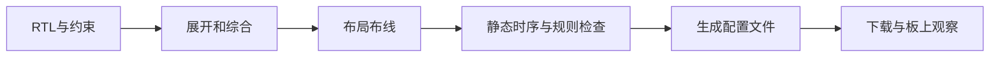

# 27 FPGA 综合、实现与引脚约束

> **详细版重写提示：本章目前仍为原简版，尚未完成详细重写。** 已完成的详细版为第01–25章。后续将补充逐步讲解、完整操作、代码逐行解释与过程答案；进度见[课程导览](00-课程框架与学习方法.md)。

本章目标：理解从 RTL 到配置文件的流程，能准备板级适配说明。预计 3–4 小时；没有开发板也可以完成流程学习。

## 27.1 FPGA 内部有什么

FPGA 通常包含查找表 LUT、触发器、块 RAM、专用进位与 DSP 资源、时钟网络和可编程布线。综合器把逻辑映射成这些资源，布局布线决定它们放在哪里、如何连接。

同一份 SystemVerilog 不会在所有器件上得到完全相同的结构。乘法可能使用 DSP 或普通逻辑，数组可能使用 RAM 或寄存器，需要看报告确认。

## 27.2 工程流程

先选择板卡实际芯片型号，添加设计源码，把板级包装模块设为综合顶层。tb.sv 属于仿真集，不能作为硬件顶层；时钟 initial 和 `$finish` 不用于实现。

## 27.3 约束不只是引脚号

物理约束定义端口连接哪个封装引脚、使用哪种电气标准。时序约束定义时钟、外部输入输出时间和合理例外。以具体板卡官方手册与参考工程为依据，逐项核对时钟频率、按钮和 LED 极性、数码管连法、电压标准。

没有指定板卡，因此这里不填写任何假定引脚。资料中可写 `LED_PIN_TODO` 表示待补，但含占位符的文件不能作为已完成板级配置提交。

## 27.4 顶层适配

核心计时器只接受同步的 rst、toggle、clear，不知道物理按键。板级包装负责同步/消抖、极性转换、将计时值转换为显示段码，并连接一个合法时钟。让可测试核心与板级资源分开，可保持大部分仿真不依赖特定型号。

## 27.5 报告看什么

检查是否有推断锁存器、多驱动、未连接端口、异常资源数量；检查所有时钟和时序端点是否受约束；实现后再看 WNS、TNS、hold 与设计规则。不要只看“生成 bitstream 成功”。时序流程参照[AMD 时钟约束说明](https://docs.amd.com/r/en-US/ug949-vivado-design-methodology/Clock-Constraints)。

## 27.6 练习与答案

没有开发板时，写一个板级适配表，列信号名、方向、极性、时钟域和待查手册项目。练习：为什么仿真 clk=~clk 的代码不能生成板级晶振？答案：它是仿真时间激励，板上必须由真实时钟源与专用时钟资源提供时钟。验收：能解释所有工程输入文件的职责。
