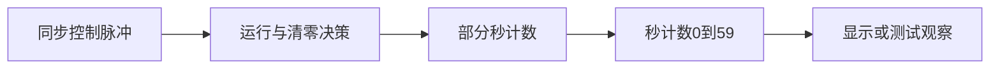

# 30 综合项目：数字计时器

> **详细版重写提示：本章目前仍为原简版，尚未完成详细重写。** 已完成的详细版为第01–25章。后续将补充逐步讲解、完整操作、代码逐行解释与过程答案；进度见[课程导览](00-课程框架与学习方法.md)。

本章目标：把需求拆成接口、状态和更新规则，实现可验证计时器。预计 4–6 小时。

## 30.1 先冻结规格

核心输入 clk、rst、toggle、clear 都是同一时钟域信号，控制信号为高有效单拍脉冲。输出 running 和 seconds[5:0]。复位或 clear 使时间归零且停止；toggle 切换运行/暂停；运行时每 CLKS_PER_SEC 个有效时钟周期加一秒，59 后回 0。

优先级：rst/clear 高于 toggle，高于计时。toggle 所在沿只切换运行状态，不推进部分秒计数。暂停保留部分秒，继续后补满余下间隔。clear 丢弃部分秒。所有这些都是可测试的选择，其他计时器也可定义不同语义。

## 30.2 状态拆分

running 保存是否运行；phase 保存当前秒内已经累计的有效拍数，范围 0…CLKS_PER_SEC−1；seconds 保存 0…59。核心所有状态只在同一 always_ff 中更新，便于看清优先级。



## 30.3 核心更新片段

```systemverilog
// 完整模块与声明见15-timer/design.sv
if (rst || clear) begin
  running <= 1'b0;
  phase <= '0;
  seconds <= 6'd0;
end else if (toggle) begin
  running <= !running;
end else if (running) begin
  if (phase == CLKS_PER_SEC-1) begin
    phase <= '0;
    if (seconds == 6'd59) seconds <= 6'd0;
    else seconds <= seconds + 1'b1;
  end else phase <= phase + 1'b1;
end
```

这段在 always_ff 内部，省略赋值意味着寄存器保持。phase 与 seconds 不在 toggle 沿更新，严格对应规格。CLKS_PER_SEC≥1，位宽同样对参数 1 做保护。

## 30.4 从核心到板级

`14-button` 可把真实按键变成 toggle/clear 脉冲；显示模块将 seconds 转成十位与个位，再译成段码。若用动态扫描数码管，还需要位选扫描使能和板级极性适配。它们是有清晰接口的扩展，不混入核心验证。

本课程交付仿真核心与输入调理示例，板级连接需要按第 27 章查具体手册。核心不含虚构的固定引脚配置。

## 30.5 实验与答案

运行 `15-timer`，仿真设 CLKS_PER_SEC=3。练习：运行已累计 2 拍时暂停，恢复后多少个计时有效沿增加一秒？答案：1 个；toggle 沿本身不计时。验收：用沿表解释启动、暂停、继续和清零四种情况，下一章完成完整验收。
