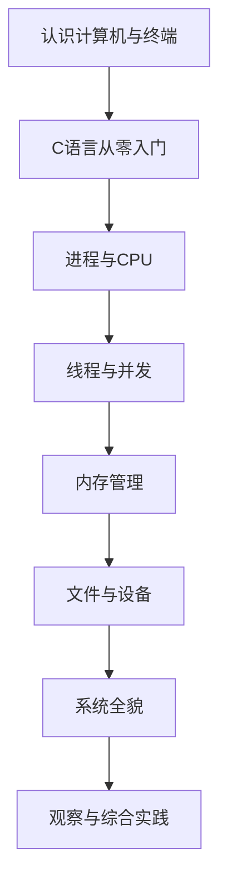

# 00 整体规划与学习路线

> **零基础详细版36章已全部完成，配套九批详细练习与毕业验收。** 全课框架、章节地址与学习记录保持稳定；实际程序验证与未覆盖范围分别记录。

## 0.0 先读这份新版学习说明

详细版会先解释每个新词，再给操作；命令写清系统、终端、目录和预期结果；代码拆到符号与语句，主要实验包含修改、排错、练习和答案。重写不会只在原来的名词列表上增加几句话。

第一批学习顺序：01认识计算机 → 02准备环境和路径练习 → 03第一份C程序 → [详写第一批练习](详写第一批-练习与参考答案.md)。合计建议约11—16小时，可拆成多次完成。第二批04—07章接着学习变量、条件循环、函数与数组字符串，再做 [详写第二批练习](详写第二批-练习与参考答案.md)，建议22—30小时。第三批08—10章学习指针、结构体、动态内存、文件与调试，再完成 [第三批练习](详写第三批-练习与参考答案.md)，建议22—31小时。第四批11—16章从系统调用走到进程、管道、信号和调度，再完成 [两段管道命令器](详写第四批-练习与参考答案.md)，含综合练习建议42—59小时。第五批17—20章学习线程、锁、条件等待、信号量与死锁，再完成 [可关闭环形队列](详写第五批-练习与参考答案.md)，建议37—51小时。第六批21—24章现已详细重写，学习地址空间、分页、TLB、页面置换与映射，再完成 [虚拟内存实验台](详写第六批-练习与参考答案.md)，建议37—51小时；第七批25—29章现已详细重写，完成路径权限、inode、目录工具、同步与设备学习，再做 [笔记保存器](详写第七批-练习与参考答案.md)，建议43—60小时；第八批30—33章已详细重写，完成启动、安全边界、网络帧与环境观察，再做 [本机请求项目](详写第八批-练习与参考答案.md)，建议35—49小时；第九批34—36章已完成观察、逐步Shell与综合复盘，再做 [毕业改造练习](详写第九批-练习与参考答案.md)，建议31—44小时。

原章节编号与地址保持稳定。当前36章都已详细重写；网站手动完成进度仍记录读者自己是否学习，不因教材完成自动改变。后文先展示全课蓝图，第一遍不用记住所有术语。

这门课回答一个贯穿始终的问题：你在终端输入一条命令，操作系统怎样让程序运行、分享 CPU、使用内存、读写文件，最后退出？你不需要预先会 C、JavaScript 或 Linux。前十章建立实验和语言基础，之后每一步都回到这个问题。

## 0.1 学完可以做什么

能区分程序与进程、并发与并行、虚拟地址与物理地址、文件名与打开文件；能用 C 编译运行小程序，检查系统调用失败；能手算调度、分页和页面置换；能写进程、管道和线程协作程序；最后独立运行并改造一个简易 Shell。

操作系统原理可用于理解 Windows、Linux、macOS 的共同问题。本课运行实验统一为 Linux/POSIX，避免初学时混用不同系统的 API。Windows 用户使用现成的 WSL Ubuntu 或按第 02 章安装；已有 Linux 用户无需再装 WSL。

主线不要求汇编、计算机网络课程或现成 C 基础。二进制、指针、必要网络术语都会先讲。xv6/RISC-V 源码阅读放在最后，作为下一阶段路线。

## 0.2 八个阶段与先修关系

| 阶段 | 章节 | 学习问题与知识点 | 阶段产出与通过条件 | 详细版状态 |
| --- | --- | --- | --- | --- |
| 一 起步 | 01—02 | 硬件、位与字节、内核、Linux、终端、路径 | 建好自己的练习目录，能解释一条命令 | 已详细重写 |
| 二 C 语言 | 03—10 | 编译、变量、输入、分支循环、函数、数组字符串、指针、结构体、内存、文件与调试 | 独立编译小程序和文件复制器 | 03—10已详细重写 |
| 三 进程与 CPU | 11—16 | 系统调用、fork/wait/exec、描述符、管道、信号、调度 | 完成两段管道命令器、错误收尾和调度手算 | 已详细重写 |
| 四 并发 | 17—20 | 线程、共享状态、数据竞争、互斥锁、条件变量、信号量、死锁 | 完成可关闭环形队列，解释不变量、等待与失败收尾 | 已详细重写 |
| 五 内存 | 21—24 | 地址空间、分页、页表、TLB、缺页、FIFO/LRU/Clock、堆栈、映射与局部性 | 完成逐步翻译与置换实验台，区分模型和实际映射 | 已详细重写 |
| 六 文件与设备 | 25—29 | 路径权限、inode、链接、目录、缓存持久性、中断、DMA、设备与存储调度 | 完成目录分类与分阶段保存器，区分可见和持久性 | 已详细重写 |
| 七 系统全貌 | 30—33 | 启动、内核架构、安全隔离、socket、虚拟机与容器 | 完成系统边界图、单帧解析与父子socket请求，解释实际验证范围 | 已详细重写 |
| 八 综合 | 34—36 | ps/proc/strace、性能证据、Shell、故障定位、xv6 入口 | 完成观察报告、Shell基线与help改造、失败恢复和闭卷复盘 | 已详细重写 |

详细重写将按读者需要放慢展开，当前第一批建议11—16小时，第二批22—30小时，第三批22—31小时，第四批含综合练习42—59小时，第五、六批各含综合练习37—51小时，第七批含综合练习43—60小时，第八批含综合练习35—49小时，第九批含综合练习31—44小时，九批总计建议280—391小时。不沿用旧版简稿的总时间估计。学习投入包含理解、手写和改错，不以快速读完36章为目标。

## 0.3 全部章节与具体成果

| 章 | 主题 | 本章要做出的成果 |
| --- | --- | --- |
| 01 | 操作系统、硬件与数据 | 把“打开文件”拆成应用、内核、设备三层 |
| 02 | Linux 环境与终端 | 在自己的目录创建、查看和编译文件 |
| 03 | 第一份 C 程序 | 看懂 main、头文件、语句和编译命令 |
| 04 | 变量、类型、输入与运算 | 写能拒绝非法输入的分钟换算器 |
| 05 | 条件、循环与边界 | 正确累加并解释边界值 |
| 06 | 函数、作用域与文件组织 | 拆解输入、计算、输出与头文件 |
| 07 | 数组与字符串 | 统计数组并避免字符串越界 |
| 08 | 指针与地址 | 用指针修改调用者的数据 |
| 09 | 结构体与动态内存 | 管理一组有所有权的数据记录 |
| 10 | 文件、错误、Make 与调试 | 运行完整文件复制器，区分三种错误 |
| 11 | 用户态、内核态与系统调用 | 对照 write 与 printf 的职责 |
| 12 | 进程、fork 与等待 | 识别父子分支并回收退出状态 |
| 13 | exec 与程序启动 | 解释为何成功 exec 后代码不再返回 |
| 14 | 描述符、管道与重定向 | 写入管道并正确关闭所有写端 |
| 15 | 信号与进程生命周期 | 用可处理信号请求程序退出 |
| 16 | CPU 调度与指标 | 手算 FCFS、SJF、RR 与响应/等待时间 |
| 17 | 线程、共享与独立部分 | 创建两个线程并等待它们完成 |
| 18 | 数据竞争、锁与原子性 | 让共享计数得到确定结果 |
| 19 | 条件变量、信号量与生产消费 | 用谓词循环实现有界单槽通道 |
| 20 | 死锁与并发设计 | 画等待图，用统一锁顺序破环 |
| 21 | 虚拟内存与地址空间 | 理解相同虚拟地址不等于共享数据 |
| 22 | 分页、页表与 TLB | 算页号、偏移和物理地址 |
| 23 | 缺页、置换与抖动 | 比较 FIFO/LRU 的命中与缺页 |
| 24 | 堆栈、映射与局部性 | 观察私有文件映射和原文件的差异 |
| 25 | 路径、目录与权限 | 在练习目录验证文件与目录权限含义 |
| 26 | inode、描述符与链接 | 解释硬链接、软链接与删除后仍可读 |
| 27 | 目录接口与文件工具 | 编写检查 errno 的目录查看器 |
| 28 | 缓存、持久性与崩溃一致性 | 区分 fflush、fsync 与日志恢复 |
| 29 | 设备、中断、DMA 与存储 | 画 I/O 路径并算磁头移动模型 |
| 30 | 启动与内核架构 | 讲清固件、引导、内核和用户空间 |
| 31 | 权限、安全与隔离 | 用最小权限解释资源访问失败 |
| 32 | socket 与网络 I/O | 理解字节流、验证长度帧与本机TCP往返 |
| 33 | 虚拟机、容器与 WSL | 区分共享内核、独立内核与资源限制 |
| 34 | 系统观察与性能分析 | 用实际输出提出、检验一个假设 |
| 35 | 综合项目：小型 Shell | 组合 fork/exec/wait、管道和重定向 |
| 36 | 复盘与内核学习路线 | 完成闭卷演练，再选择 xv6 阅读路径 |

## 0.4 贯穿项目与例程约定

贯穿项目叫“系统实验台”：先积累相互独立的 C 小例程，再用第 35 章组合成 `mini-shell`。这样某章编译失败不会破坏已学过的版本。例程是用户空间程序、算法模型和观察工具；它们帮助理解内核行为。

原有23个主线例程位于 [示例代码](示例代码/README.md)。附“完整源码”链接的代码块与下载文件一致；详细版的改造与排错实验另以正文中的完整程序为准，先保存到各自练习目录，不覆盖下载的主例程。公共辅助头文件 `lab.h` 在第11章后使用，处理重复的错误、短写和等待，完整内容见运行说明。模型程序明确标注“模拟”，不会改变本机调度器或页表。

Shell 支持前台外部命令、`cd`、`pwd`、`exit`、单个管道和末尾输出重定向。为了聚焦系统调用，不实现引号、变量展开、通配符、后台作业及完整终端作业控制。第 35 章会解释这些边界以及如何拒绝不支持的输入。

## 0.5 可选进阶实践

主线36章和九批毕业练习已经齐全。想继续改造作品时，使用独立副本和进阶资料；它们不增加主线章节数，也不改变既有完成记录。

| 实践 | 先修 | 成果与验收 | 状态与投入 |
| --- | --- | --- | --- |
| [实践01：Shell追加输出](进阶实践01-Shell追加输出从零实现.md) | 25—28、35章与第九批 | 两fd偏移演算、独立支持>>的Shell、错误拒绝与二进制追加 | 已完成；含练习10—15小时 |
| 三段管道 | 第35章与fd矩阵 | 先设计N−1条管道的所有权和失败回收，再实现 | 后续挑战，尚未交付 |
| xv6请求追踪 | 第36章列出的体系结构先修 | 按选定年份准备环境并追踪一条请求 | 仅有学习路线，未声称完成内核实验 |

## 0.6 怎样学习和验收

每章先预测，再运行，最后改一个条件。写下输入、关键状态、输出与原因。例如 fork 实验不能只记下两行文字，要说明每行由哪个进程执行，以及父进程什么时候回收子进程。

每阶段的“练习与参考答案”提供跨章任务。先完成练习再看答案。正文结尾的完成条件均是可观察的能力，不以复制代码截图替代。最终验收见 [综合实践](最终综合实践-系统实验台.md)。

安装与接口资料核验于 2026-11-04，链接见 [官方资料与核验说明](99-官方资料与核验说明.md)。网页构建与 C 程序运行是两种不同验证，实际范围记录在 [验证记录](验证/验证记录.md)。
