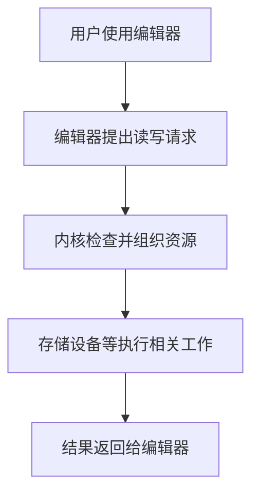

# 01 操作系统、硬件与数据

> **零基础详细版 · 已重写。** 本章不要求编程、不要求安装软件。建议分两次学习，每次约45—60分钟；加上练习约3—4小时。先弄清楚各部分做什么，再去记英文缩写。

## 1.1 从你已经做过的事情开始

假设你打开记事本，输入“今天开始学习操作系统”，把它保存成 `学习记录.txt`。随后你打开浏览器，一边看教程，一边播放音乐。

你只点了几个按钮，电脑却要完成许多事情：接收键盘输入，让文字出现在屏幕上，为记事本和浏览器分别留出工作空间，把笔记保存到某个位置，让声音按时播放。你没有逐一告诉硬件怎样做，这些工作仍然能够配合进行。

**操作系统就是组织这些工作的基础软件。** 它帮助程序使用硬件，管理有限资源，并限制不应该发生的访问。本章把这句话一层层拆开。

学完后，你应能回答三个问题：一台电脑有哪些与本课有关的主要部分？程序为什么需要操作系统？笔记从键盘进入电脑、保存后再次打开，大致经过哪些步骤？

## 1.2 “硬件”和“软件”分别指什么

硬件是电脑中的物理设备，例如处理器、内存条、固态硬盘、键盘和屏幕。软件是让这些设备完成任务的程序及相关数据，例如记事本、浏览器、Windows。

一个容易理解的例子是音乐播放：音箱是硬件，播放器是软件，音乐文件是被处理的数据。没有音箱或其他输出设备，就无法通过它发声；只有音箱，没有合适的软件和数据，也不会自动播放你想听的歌曲。

不要用“能不能在屏幕上看见”来区分：窗口是软件呈现的内容，屏幕本身是硬件；硬盘里保存着软件，但硬盘这个设备仍然是硬件。

**停一下，自己分类：** 鼠标、浏览器、内存条、一份聊天记录，分别属于什么？

答案是：鼠标与内存条是硬件，浏览器是软件，聊天记录是数据。数据由软件处理，可以保存在硬件设备中。这三个词描述的角度不同。

## 1.3 程序和数据：步骤与材料

先想一个很小的任务：“把20分钟和30分钟相加，并显示结果。”其中，20和30是输入数据；相加是处理步骤；50是输出数据。

程序可以理解为按一定规则表达的一组操作步骤。编程就是把要完成的事情拆成足够明确的步骤，用计算机能处理的方式表达出来。

计算机不会自动理解“帮我把事情做好”这种含糊目标。比如要统计学习时间，就需要说清楚统计哪些记录、遇到空记录怎么办、最后显示分钟还是小时。以后学到条件和循环，就是在学习如何准确表达这些规则。

同一个程序可以处理不同的数据。计算器可以计算20+30，也可以计算7+8。反过来，同一份数据也可能被不同程序处理，例如文本编辑器显示笔记，搜索程序在笔记中查找词语。

## 1.4 CPU：执行指令的地方

CPU的中文通常叫中央处理器。这里的“指令”不是你在聊天中写的一整句中文，而是处理器能够执行的基本操作，例如从某处取值、进行运算、比较、根据条件跳到另一段操作。

你以后写的C程序是给人阅读、维护的源代码，需要经过编译等处理，才能变成目标机器可以执行的代码。第03章会亲手做这件事。

先记住CPU的职责：**执行指令，推动计算往前走。** 它不是用来长期保存你的照片和笔记的资料库。

“CPU像工作人员”可以帮助入门，但这个类比有边界：工作人员能猜测意图，CPU不会凭常识补齐你写错的程序规则。代码要求读取错误位置时，不会因为“你原本想读另一个位置”就自动更正。

现代处理器可能有多个核心。现在可以把一个核心看作能推进执行的一份硬件资源。多核心使一些工作能够同时执行，但不是打开多少软件就会自动增加多少核心。

## 1.5 内存：运行时的工作空间

记事本正在运行时，需要保存当前文字、光标位置等状态。CPU处理数据时，也需要较快地访问代码和数据。内存承担了很大一部分运行时存放工作。

本课说“内存”时，通常指RAM，即日常说的运行内存。它有两个先记住的特点：访问适合程序运行；通常在断电后不再保留原来的内容。

假设你在笔记里刚输入了第二句话，还没有保存。编辑器可以先把新内容放在自己的运行状态中，你看得见它，不表示持久保存步骤已经完成。如果应用异常退出或机器失去供电，未保存内容可能丢失。具体软件也可能有自动恢复功能，但那是它额外安排的保存机制。

因此，“屏幕上看见了”与“已经可靠保存”是不同判断。这个区别以后会一直出现。

## 1.6 固态硬盘与机械硬盘：较长期保存数据

日常文件通常保存到固态硬盘SSD、机械硬盘等存储设备上。它们的主要用途之一，是在电脑关闭后仍然保留文件。

可以借助“桌面与资料柜”理解：内存像工作时摊开材料的桌面，存储设备像保存资料的柜子；开始工作时把需要的材料取出来，修改完成后再按要求保存回去。

这个类比不是说每次操作都真的把整个文件复制一遍。真实系统可能分块读取，也有多层缓存。第一遍先掌握职责差别，后面的内存和文件系统章节再展开细节。

| 比较问题 | 内存RAM | SSD、硬盘等持久存储 |
| --- | --- | --- |
| 主要用于什么 | 运行时存放代码与数据 | 保存文件、软件等内容 |
| 通常断电后怎样 | 原内容不能继续保留 | 设计上用于保留数据 |
| 日常说“还剩多少空间” | 指可用运行空间等 | 常指还能保存多少文件 |
| 空间不足可能怎样 | 程序受影响、分配失败或系统变慢等 | 新文件无法保存、更新失败等 |

例如“16GB内存、512GB固态硬盘”描述的是两种不同资源，不能把两者相加，说这台电脑有528GB内存。

## 1.7 输入输出设备：计算机怎样接触外部

键盘和鼠标提供输入，屏幕和音箱呈现输出；网络设备传送远处的数据，存储设备读写文件。这里的“输入输出”常缩写为I/O，I是Input，O是Output。

站在程序角度，输入不只来自键盘：读取一个文件，也是让外部数据进入程序的输入操作。输出不只是在屏幕上显示：写入文件、发送网络数据，也属于输出。

我们以后会说“这个程序在等I/O”，意思是它正在等待相关输入输出推进，而不是一定在等用户敲键盘。

此时先别急着记驱动、中断等词。你只需知道：CPU做计算，设备与外部世界交互，操作系统负责组织它们之间的工作。

## 1.8 为什么需要统一管理

设想三个程序提出这些要求：浏览器希望持续使用CPU；音乐播放器需要及时处理声音；编辑器希望保存笔记。如果没有协调，某个程序占住全部资源，其他程序就可能得不到合理的运行机会。

再设想一个程序写错了，想把不属于它的内存改成零。若允许它任意操作，编辑器里尚未保存的文字也可能遭到破坏。资源管理还必须配合保护。

操作系统由此要处理四类问题：

1. **分配运行机会。** 哪些工作现在运行，哪些暂时等候？
2. **组织工作空间。** 每个程序能使用哪些内存，哪些访问需要拒绝？
3. **提供一致的使用方式。** 程序如何提出读文件、输出文字等请求？
4. **管理状态和失败。** 文件不存在、权限不允许、设备出错时，怎样报告？

“提供一致方式”的意义很实际：你写读取文件的程序时，不需要先为每个品牌的硬盘从头编写整套控制代码。操作系统及其设备支持隐藏了大量具体差异。

## 1.9 应用、内核与操作系统的区别

记事本、浏览器是应用程序：它们直接帮用户完成某类任务。

内核是操作系统中管理资源、处理受控服务请求的核心部分。例如，程序申请读文件，需要经过操作系统提供的接口，内核会参与权限检查和相应资源操作。

日常说“操作系统”时，常指内核加上系统服务及相关使用环境。不同场合边界可能稍有差异，入门阶段不用为一个词的所有边界争论。只要不把“应用窗口”“内核”“整个系统环境”混成一个东西即可。



这张图画的是职责关系，不表示每一次请求都会访问硬盘。有些数据可能已经在内存缓存中。缓存可以先理解为为了方便再次使用而暂存的一份数据，后面会专门学习。

## 1.10 完整跟踪一次“写笔记并保存”

现在把前面的词放回一个具体过程。先想象这是一台已经正常启动、编辑器已经打开的电脑。

**第一步：你敲键盘。** 输入设备产生输入，系统把相关输入交给应该接收它的程序。你输入到编辑器里的文字，不应无条件同时写进所有应用。

**第二步：编辑器更新自己的内容。** 程序按照编辑规则处理文字，把新的文档状态保存在运行时数据中，并安排界面显示。此时内存发挥工作空间的作用。

**第三步：你选择保存位置。** 例如把文件命名为 `day1.txt`。文件名帮助人和程序定位内容，具体位置由所在目录等信息确定。下一章会学习“目录”和“路径”。

**第四步：编辑器请求写文件。** 系统检查位置、访问权限等条件，组织写入工作。权限可以先理解为“允许谁对什么对象做什么”。选中了一个位置，不表示一定有权写入。

**第五步：程序处理结果。** 保存成功时软件更新提示；失败时应该给出原因。例如位置不存在或空间不足，不能只因为点了“保存”就认定写入完成。

**第六步：以后重新打开。** 文件管理与读取机制帮助程序重新取得字节，编辑器按照文字编码解释，再呈现给你。

这里还没有完整讨论掉电后保证什么。许多软件和系统会先写缓存，第28章会区分“操作成功”“其他程序可见”“真正持久保存”。本章不要把“点击保存”直接当作绝不丢失的证明。

## 1.11 程序文件与进程

硬盘里保存着某个工具，并不意味着它一直在占用CPU执行。开始运行后，系统需要为这次运行建立状态。这样的运行实例叫进程，英文是process。

比如同一份教学程序可以运行两次，每次有自己的运行状态。它们使用相同程序文件，不代表各自的数据自动共享。第12章会用程序证明这一点。

也不要用窗口数量直接数进程：一个浏览器可能包含多个进程；有些后台进程没有窗口；一个应用也可能让新打开操作交给已有进程处理。

先掌握这组对应：**程序文件是可供运行的内容，进程是一次运行的实例。** 进程可能正在执行，也可能暂时等待。此处不用记住PID、fork等后续术语。

## 1.12 多个程序怎样“一起进行”

当你一边听音乐、一边编辑文本，多个任务都需要推进。即使只有一个可用核心，系统也可以在不同任务之间切换，使它们在一段时间里交错进行，这叫并发。

如果多个核心在同一时刻实际执行不同任务，则还可能发生并行。两者关注的问题不同：并发看一段时间内是否交错推进，并行看某个时刻是否同时执行。

举一个不需要程序代码的例子：一个人交替处理两份作业，体现交错推进；两个人同一时刻各做一份，体现同时进行。计算机切换涉及保存和恢复状态，不能把这个类比理解成切换完全没有成本。

你现在只要能解释“看上去同时进行，并不一定每个任务都各占一颗核心”，就达到了这一小节的目标。

## 1.13 为什么后面使用Linux和C

你可能日常使用Windows，为什么教程还要出现Linux？因为本课要观察进程、文件、内存等底层行为，统一实验环境有助于把注意力放在同一套接口上。Linux适合开展这些实验，也有丰富的公开资料。

Ubuntu是一种包含Linux内核、工具和软件管理环境的发行版。可以先把发行版理解为一套整理好的可安装系统环境。因此，“Linux内核”和“Ubuntu整套环境”不是同一个范围。

Windows用户会通过WSL使用Ubuntu，不需要因为本课把现有Windows换掉。已有合适Linux环境的人，也不需要再安装一套。具体步骤放在下一章。

C是编程语言。我们选择它，是为了更直接地学习数据、地址和系统接口。本课会从符号、语句和第一份程序开始讲，不把“学操作系统”当作你已经会C的证明。

## 1.14 数据为什么会说成“0和1”

这一节用于建立后续的数值基础。第一遍可以先理解例子，暂时不用记所有换算。

一位bit可以表示两种状态，记作0或1。两位能组合出00、01、10、11，共四种；三位再增加一倍，共八种。每增加一位，可能的组合数乘以2，因此八位有2×2×2×2×2×2×2×2=256种组合。

在本课环境中，一个字节byte由八位组成。如果把这256种组合当作从零开始的非负整数，最小是0，最大是255。**256种可能取值，不等于最大值为256。**

十进制中各位的权重从右往左是1、10、100；二进制则是1、2、4、8、16……例如：

```text
二进制：0   0  1  0 1 1 0 0
权重：128 64 32 16 8 4 2 1
选中：       32    8 4
相加：32 + 8 + 4 = 44
```

十六进制以16为基数，用0—9和A—F表示一位，其中A是十进制10，F是15。`0x2C` 中 `0x` 提醒读者这是十六进制，2C=2×16+12=44。以后地址常用十六进制书写，先知道它是另一种记数字的方法。

## 1.15 字节、文字与容量单位

字节是数据量单位，不是“一个汉字”的同义词。文字需要编码规则，把字符和字节序列联系起来。UTF-8是常见编码之一。你以后保存C文件时会用到它。

例如英文字母 `A` 在UTF-8中占一个字节，汉字“中”占三个字节。`A中` 是两个文字字符，但UTF-8内容占四个字节。这里还没有计算文件可能附带的其他内容，因此不要把任意文件大小都当作肉眼字符数。

容量单位也要看约定：KiB表示1024字节，MiB表示1024KiB；十进制kB表示1000字节。遇到写法含糊的“KB”，先查工具采用哪种口径，不用急着怀疑电脑少了一块存储空间。

后面学习字符串长度时，我们会再次用“字节数不等于字符数”这个区别，不需要此刻学习整个字符编码标准。

## 1.16 把术语放回一句能理解的话

| 术语 | 这一次先记什么 | 用自己的例子解释 |
| --- | --- | --- |
| 程序 | 表达操作步骤的内容 | 统计学习分钟的工具 |
| 数据 | 程序使用与产生的内容 | 20、30，以及结果50 |
| CPU | 执行指令 | 进行相加等操作 |
| 内存 | 运行时工作空间 | 存放正在编辑的文档状态 |
| 持久存储 | 保存文件等内容 | 关机后仍能找回笔记 |
| 应用 | 直接完成用户任务 | 编辑器、浏览器 |
| 内核 | 资源管理与受控服务的核心 | 组织进程和文件访问 |
| 进程 | 程序的一个运行实例 | 某次启动的教学工具 |
| I/O | 输入与输出 | 从文件读、向终端写 |

表格用于回顾，不建议把它当成替代前面解释的背诵清单。若某一行仍不能举例，回到相应小节，而不是只抄下英文。

## 1.17 练习：先作答，再读解释

**题一：** 电脑有8GB内存、256GB固态硬盘。删除十个旧视频，会直接把内存变成16GB吗？为什么？

**题二：** 编辑器里刚出现一行新文字，但还没保存。它现在能显示，是否足以证明下次开机还能找回？

**题三：** 浏览器和音乐播放器都在工作，是否说明每个程序都独占一个CPU核心？

**题四：** 两个人分别使用同一个软件，看到不同文档。试着解释“同样的程序”与“相同的数据”有什么区别。

**题五：** 对“编辑器请求读取文件”，写出应用、内核、存储设备可能分别承担的职责。

**题六：** 二进制00000101是多少？一个八位无符号整数能否保存十进制256？

**题七：** `A中` 的字符个数与UTF-8字节数各是多少？

## 1.18 参考答案：重点看理由

题一：不会。删除视频释放的是对应存储设备上的文件空间，没有增加物理内存容量。即使删除时运行状态发生变化，也不能因此说内存条容量增加。

题二：不能。显示说明程序当前能取得要显示的内容；长期保存还需要合适的保存机制。自动保存可能改变实际结果，但不能凭屏幕显示推断已经完成。

题三：不是。系统可以安排任务交错推进；多核心也可能提供并行，但程序数量与核心数量不必一一对应。

题四：程序定义如何处理文档，不限定每次必须打开同一份文档。不同运行实例可以使用不同输入与各自状态。

题五：应用表达要读哪个文件并解释返回内容；内核参与检查和组织读取；需要实际设备访问时，由相关设备完成数据传输。数据已在缓存时路径可以更短。

题六：5，因为4+1=5；不能，八位共256种组合，非负整数从0数到255。

题七：两个字符，四个UTF-8字节。计算字符与计算字节采用的是不同单位。

## 1.19 完成条件与下一步

合上正文，试着用一两分钟讲清“我输入一句笔记、保存、以后再打开”这个过程。允许暂时说不出内部接口名，但应该能分清应用、内核、CPU、内存和存储的职责。

若还会把内存和硬盘混用，先重读1.5—1.6。若不清楚程序是什么，重读1.3。二进制换算不熟，可以先记录疑问，不妨碍进入下一章的终端操作。

下一章会从“应该打开哪个窗口”开始，把实验环境准备好。你不需要先去自学一套Linux命令，也不需要现在背会后面章节的术语。
