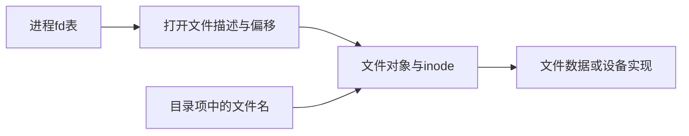

# 26 inode、描述符与链接

> **旧版简稿 · 待详细重写。** 本章暂未达到零基础详细版标准。请优先学习已重写的01—16章，进度和后续批次见 [详细版学习指南](详细版学习指南与改写进度.md)。

## 26.1 四个不同层次

路径中的名字通过目录项关联文件对象；inode 保存类型、权限、大小和数据定位等元数据，文件名通常保存在目录项里。打开文件描述记录偏移、状态标志等；进程的 fd 表引用它。VFS 是内核对不同文件系统提供统一操作抽象的一层，不是某一种磁盘格式。



fork/dup 得到的描述符可能共享打开文件描述的偏移；分别 open 同一路径一般各有自己的偏移。两次读操作都用了 fd=3，也可能读的是不同对象，要结合所属进程与打开过程解释。

## 26.2 硬链接与软链接实验

在自己的 Ubuntu 练习目录执行：

```bash
mkdir -p ~/os-lab/links-demo
cd ~/os-lab/links-demo
printf 'same data\n' > original.txt
ln original.txt hard.txt
ln -s original.txt soft.txt
ls -li
cat hard.txt
cat soft.txt
```

重复运行若提示链接已存在，使用新目录，别覆盖不明文件。original 与 hard 通常显示相同 inode 号，链接计数增加；soft 是一个保存目标路径的独立符号链接。inode 号需要结合文件系统身份，不能拿不同文件系统上的同一数字当同一文件。

硬链接通常不能跨文件系统，也通常不允许用户随意给目录建硬链接；软链接可以指向另一文件系统或尚不存在的目标。相对软链接目标通常以软链接所在目录解析，不是以调用者 cwd 解析。

## 26.3 删除名字后对象何时消失

unlink 移除一个目录项；若还有其他硬链接，数据仍可通过那些名字访问。即使链接计数已为零，只要仍有打开引用，数据与相关对象也可能继续保留直到最后关闭。这解释了“文件已删，但占用空间还在”的常见现象。

软链接不会增加目标的硬链接计数。目标名字被移除后，软链接可能悬空。不能仅凭软链接文件仍在就判断内容仍可读。

## 26.4 练习与答案

①给 original 再加一个硬链接后修改内容，hard 会看到变化吗？②删除 original，hard 与 soft 如何？③dup 两个 fd 后分别 lseek 会互相影响吗？

答案：①会，引用同一文件对象；②hard 仍可读，指向原路径的 soft 可能悬空；③若共享同一个打开文件描述，则共享偏移。具体删除操作应只针对已确认属于本练习的文件。

完成条件：画出“两个名字 → 一个 inode”和“两个 fd → 一个偏移对象”两张图，说明二者为何不是同一个关系。
