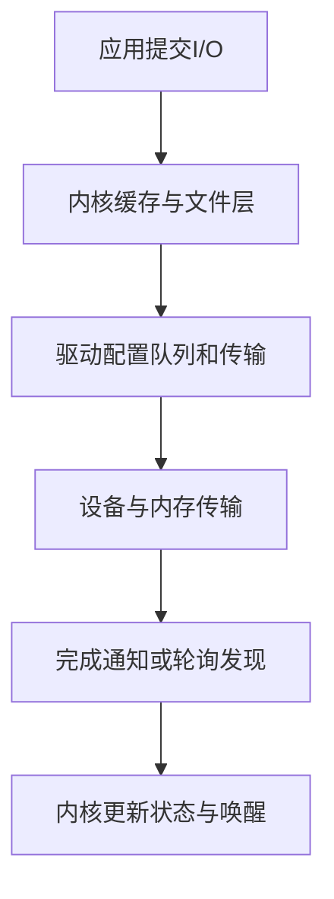

# 29 设备、中断、DMA 与存储

> **旧版简稿 · 待详细重写。** 本章暂未达到零基础详细版标准。请优先学习已重写的01—16章，进度和后续批次见 [详细版学习指南](详细版学习指南与改写进度.md)。

## 29.1 谁让 I/O 前进

应用调用 read/write 后，内核文件层与设备驱动按资源类型处理。驱动是与具体设备交互的软件，管理请求队列、设备寄存器和完成通知等。中断是硬件向 CPU 通知事件的机制之一；轮询是软件主动检查状态。不是所有请求都会触发一次独立中断，缓存命中也可能不访问设备。

DMA 允许设备按受控配置在内存与设备间传输数据，减少 CPU 逐字节搬运。CPU 仍需准备描述信息、维护同步与处理完成；DMA 不等于“CPU 完全不参与”或“设备可任意访问所有内存”。

## 29.2 阻塞、非阻塞与异步

阻塞 read 在暂时无数据时可以让线程睡眠；非阻塞模式可能返回 EAGAIN，调用者稍后再试或等待就绪通知；异步 I/O 的提交与完成分离。非阻塞接口并不表示设备操作立即完成，也不意味着无限循环查询就是高效设计。

中断不等于系统调用：前者由外部事件等触发，后者是程序主动进入受控服务。异常又包含页故障等同步事件，各类入口具体实现在第 30 章关联到启动后的内核机制。

## 29.3 机械磁盘调度模型

假设磁道 0—199，磁头起点 50，请求 10、20、90。只计算寻道距离，不计旋转、传输和并发。FCFS 按给定顺序：|50−10|+|10−20|+|20−90|=120；SSTF 最近优先：50→20→10→90，总计 30+10+80=120。

LOOK 初始向右，服务 90 后回头到 20、10：40+70+10=120。此例三者刚好相同，不足以说明策略等价。SSTF 在持续有近处请求时可能让远请求饥饿；SCAN 扫到边界再回头，LOOK 到当前最远请求就回头，计算时须先声明终止点。

## 29.4 SSD 的差异

SSD 没有机械磁头寻道，同样的移动距离模型不适用；仍有队列、并行度、写放大、擦除粒度和寿命等问题。不要用机械磁盘上的 SSTF 手算直接预测 NVMe 实际吞吐。顺序与随机访问的表现也要在具体设备和负载下测量。

## 29.5 练习、答案与完成条件

把请求改成 90、10、20，FCFS 距离为 40+80+10=130；SSTF 仍按 20→10→90，为 120。为什么结果改变？因为 FCFS 对到达/给定顺序敏感，SSTF 依据当前位置选择；若请求到达时间不同，还需把可选集合随时间变化纳入模型。

完成条件：能画一条设备请求的完整路径，分清“计算一个抽象调度模型”与“预测真实存储性能”。
