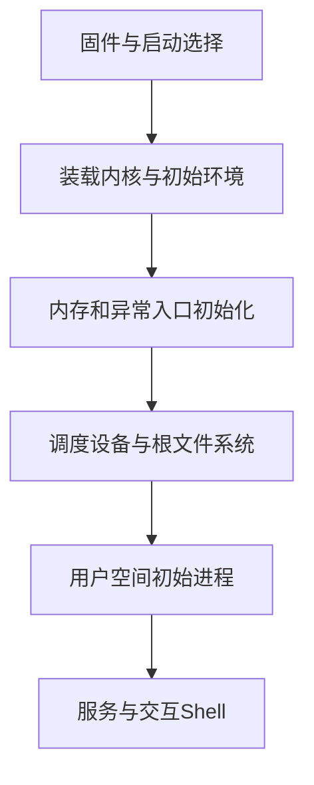

# 30 启动与内核架构

> **旧版简稿 · 待详细重写。** 本章暂未达到零基础详细版标准。请优先学习已重写的01—16章，进度和后续批次见 [详细版学习指南](详细版学习指南与改写进度.md)。

## 30.1 从上电到第一批程序

你前面编写的程序都假设已有内核运行。机器上电时，固件先初始化必要硬件，按启动配置寻找引导路径；引导加载器或其他引导机制把内核及相关初始数据装入内存；内核建立内存管理、异常/中断入口、调度与设备基础，再启动用户空间的初始进程和服务。

UEFI/BIOS、引导加载器、内核、init/服务管理器、登录环境是不同层。具体系统可以合并某些步骤或采用不同形式；WSL/虚拟机里的启动路径与实体电脑也不完全相同。

## 30.2 核心机制如何接上前面知识

内核配置页表与权限，让用户指针有受控映射；配置异常和系统调用入口，让用户程序安全请求服务；配置时钟与中断，让调度和设备完成得到处理；准备文件系统与驱动，让路径读取有实际对象。它们相互依赖，不能把操作系统只看成一个不断执行 if 的大函数。

上下文切换保存和恢复执行状态；权限级切换是进入另一种受保护执行环境；两者可能一起发生，也可能单独发生。不要再把“系统调用”与“切进另一个进程”画成必然的一步。

## 30.3 单体、微内核与模块化

单体内核把较多核心服务放在内核空间，调用路径可较直接，但错误影响面可能较大。微内核保留较小的特权核心，更多服务放在用户空间，通过通信协作，在隔离、复杂度和开销间权衡。混合架构和可加载模块又提供不同折中。

“模块化”表示实现与装载可分，不意味着模块运行在用户态或与内核完全隔离。也不能只凭代码行数判断一种架构安全、快速或适合全部场景。

## 30.4 只读观察

在 Ubuntu 运行 `uname -a`、`cat /proc/version`、`ps -p 1 -o pid,comm,args`。记录内核与初始进程；不要假定所有 Ubuntu/WSL 的 PID 1 都是相同程序。`dmesg` 可能因权限不可读，记录结果即可，不需要为本课修改内核安全设置。

## 30.5 练习、答案与完成条件

①Bash 是内核吗？②可加载驱动就是用户进程吗？③创建线程与硬件上电初始化是同一层工作吗？答案：①是用户空间 Shell；②不是，内核模块常在内核空间运行；③不同，前者在已有操作系统服务上创建执行流。

完成条件：不用背固定产品名，能够从启动顺序说明前面实验所依赖的机制如何先被建立。
