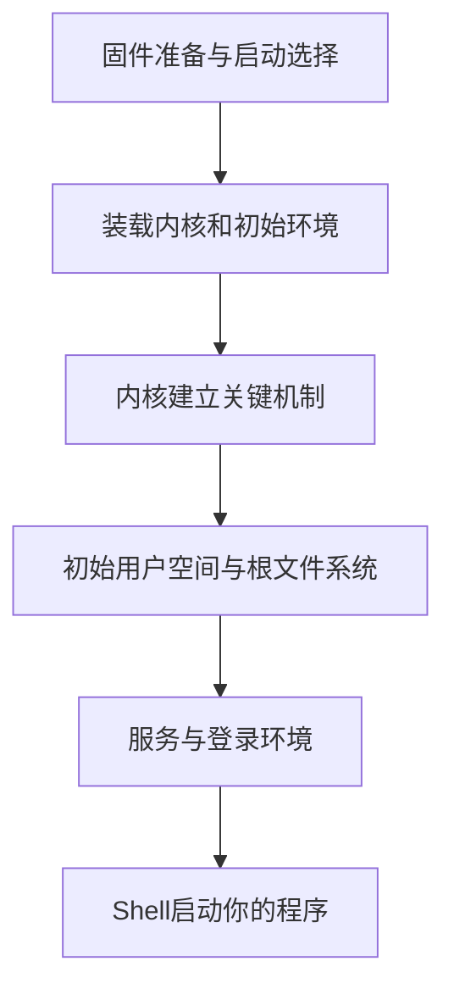

# 30 启动与内核架构

> **零基础详细版 · 已重写。** 本章把前面用过的机制放回开机过程。先修：进程、系统调用、分页和设备I/O。建议6—8小时，包含画图、观察和练习；无需修改启动配置。

## 30.1 学习目标：解释程序运行之前的准备

前面运行`./hello`时，终端、文件、内存和调度器已经存在。本章倒过来问：如果这些服务还没有建立，第一份程序靠什么运行？学完后应能画出常见Linux启动路径，区分固件、内核、发行版、初始用户进程与Shell，并解释本机观察究竟说明什么。

先准备两张纸。一张写“开机时建立什么”，另一张写“运行程序时使用什么”。不要从背厂商名称开始；每学一步就在两张纸之间连线。例如“内核准备页表机制”连向“第22章的虚拟地址翻译”。

## 30.2 用图书馆开门理解前后依赖

图书馆营业时，读者直接借书。开门前却要先通电、打开门禁、启动借阅系统、让工作人员就位。借书窗口不能在登记系统完全不存在时按正常流程工作。

电脑也有“先建立服务，再使用服务”的依赖。不过启动并不是一个管理员把所有程序按固定名单运行一遍。不同硬件、系统和虚拟化环境采用不同入口，一些服务还会并行初始化。类比帮助理解依赖，不能推出每台机器的精确执行顺序。

## 30.3 五个容易混淆的名词

| 名词 | 本章含义 | 不应混为一谈的对象 |
| --- | --- | --- |
| 固件 | 设备中用于早期初始化与启动选择的软件，例如UEFI实现 | 普通桌面应用 |
| 引导机制 | 把内核与必要初始数据准备好并交出控制的过程 | 登录后的Bash |
| 内核 | 管理执行、地址空间、设备等受保护资源的核心软件 | 整套Ubuntu发行版 |
| 发行版 | 内核、库、工具、包管理和配置等组成的可用系统集合 | 单个内核镜像 |
| 初始用户进程 | 内核开始运行用户空间后承担初始化职责的进程 | 你后来开的每个终端 |

“镜像”在这里指准备好的内容文件或布局，不是屏幕截图。内核镜像与容器镜像的内容和用途不同；遇到同一个中文名词，要结合上下文。

## 30.4 从上电到交互环境的概念图

下面是**概念模型**，表示常见关系，并非机器执行的C程序，也不是所有平台的强制清单。



沿箭头分别回答“下一层需要上一层提供什么”。内核至少需要正确入口与内存中的启动数据；用户程序需要已有的执行和地址空间机制；Shell读取文件需要文件系统与设备路径可用。图中一个框可能包含很多步骤，也可能由不同软件合作完成。

## 30.5 固件和引导机制分别解决什么

实体机器刚开始执行时，不能假定磁盘上已经有一个正常运行的进程替它调用`open`。早期代码使用平台定义的环境，准备必要硬件和启动信息。UEFI是一种固件接口规范；某家厂商的设置界面只是它的具体产品表现。

常见方案由引导加载器选择内核、传递启动参数并准备初始文件内容；也存在直接由固件加载带相应入口的内核等路径。因此“所有Linux必须先运行同一个引导程序”不成立。本课只解释职责，不要求安装、重装或改写引导器。

## 30.6 内核初始化为什么有依赖

内核必须建立或接管可工作的内存管理，准备异常与中断入口，让处理器在异常时进入适当处理路径；还要建立调度、时间与设备访问所需的基础。真实源码会按平台和配置安排这些步骤，不能把本段顺序当作逐行调用栈。

可以手算一个不合理方案：“先启动需要磁盘文件的用户程序，之后才准备访问根文件系统所需的驱动。”缺少的依赖在哪里？程序装载所需的文件还不可达。启动设计必须提供一条能先获取必要驱动、配置或初始程序的路径。

## 30.7 initramfs怎样打破早期依赖

`initramfs`可以理解为启动早期提供的一组文件内容，内核将相应归档展开到初始根文件系统。里面可以包含早期用户空间程序及必要工具，用来准备后续真正使用的根文件系统，再交接执行环境。

它不是“全部内存的备份”，也不代表每台系统都必须使用相同归档。某些配置把足够的支持直接编进内核，启动方式会不同。先记住目的：在最终根文件系统尚未准备完成时，仍有一小套可用内容帮助完成交接。

## 30.8 PID 1和服务管理器

PID是进程编号。在某个PID命名空间里编号为1的进程有特殊职责；典型完整Linux系统中，初始用户空间随后运行初始化或服务管理程序，例如systemd。它可以根据依赖启动服务、管理状态和回收相关子进程。

看到PID 1并不能直接证明自己处在物理机，也不能证明PID 1一定是systemd。容器和WSL可能采用不同安排，第33章会解释命名空间视图。Bash通常是后来运行的用户空间Shell，不因能启动程序就成为内核或整台机器的初始进程。

## 30.9 把前面的实验接回启动过程

| 前面做过的事 | 依赖已经建立的机制 | 观察边界 |
| --- | --- | --- |
| `fork`后父子分别运行 | 进程管理、调度与地址空间支持 | 不代表复制了物理机器 |
| 用虚拟地址访问数组 | 页表、权限和异常处理 | 不代表每次访问都发生系统调用 |
| `read`一个文件 | 路径、文件系统、缓存和驱动路径 | 不代表每次读取都等真实磁盘 |
| 管道阻塞后再次继续 | 等待队列、唤醒和调度 | 不代表整个内核都停止 |
| 设备完成请求 | 驱动与中断等协作 | 具体完成方式依设备而异 |

这张表的作用是把“开机”与“每天写的代码”连起来，不要求重新学习每个机制。能说出依赖，比记住一张复杂启动截图更有用。

## 30.10 内核入口与进程切换再次区分

用户进程调用`read`，CPU可能进入内核执行该进程的请求。若数据立即可用，处理完即可回到同一进程。若必须等待，内核可能让它休眠，调度另一个可运行任务。

第一种情况发生用户态与内核态之间的转换，却未必切换到另一个进程；第二种才还涉及任务执行状态的切换。硬件中断也可能在当前任务运行时进入处理路径。请画两条独立时间线，别把“进入内核”一律画成“创建新内核进程”。

## 30.11 单体内核：服务在什么边界里

单体内核通常把调度、内存、文件系统和许多驱动等放在内核保护域中协作。Linux通常归入这种具有模块化能力的架构。内核内部可以直接使用内部接口，很多组件之间不需要按普通独立进程的方式通信。

代价是内核组件错误可能影响广泛。这个说法不是预测“每个驱动错误一定立即使整机崩溃”，而是提醒你：共享特权环境中的故障边界，与一个普通应用退出的边界不同。实现仍可采用各种检查与恢复机制。

## 30.12 微内核、模块与架构取舍

微内核设计倾向把较少机制留在特权核心，让更多服务在隔离的用户空间中，通过进程间通信协作。它改变故障隔离、通信路径和系统复杂度之间的取舍。名称本身不足以证明某实现一定更快或更安全，必须结合具体工作负载和实现证据。

“可加载模块”主要说明组件能按一定接口单独构建或装载。Linux内核模块通常仍在内核空间执行；把驱动编成单独文件没有自动赋予用户进程级隔离。本课不加载模块，也不用管理员权限探测真实设备。

## 30.13 第一次观察：命令与结果分开记录

在**Ubuntu或WSL的Bash终端，任意目录**逐条执行：

```bash
uname -s
uname -r
cat /proc/version
ps -p 1 -o pid=,comm=
cat /proc/uptime
```

`uname -s`通常给出内核系统名称；`-r`给出发行标识，不等于Ubuntu发行版版本。`/proc/version`提供构建相关信息；`ps`观察当前视图的PID 1。`uptime`文件中的时间不是当前进程的年龄，也不能直接当作宿主Windows本次开机时长。

请记录“命令、观察值、可以推出什么、不能推出什么”四列。不要求你的版本字符串与教材完全相同；这些值随内核、运行时间和环境变化。

## 30.14 完整程序：自己读取有限的系统证据

平台是Linux/POSIX。保存为`boot-probe.c`，放入个人练习目录`~/os-lab/batch08`。它只读系统名称与可见PID 1的名称，不执行初始化操作。

**完整程序：boot-probe.c**

```c
#include <stdio.h>
#include <sys/utsname.h>

int main(void) {
    struct utsname info;
    if (uname(&info) < 0) {
        perror("uname");
        return 1;
    }
    if (printf("kernel=%s\nrelease=%s\n", info.sysname, info.release) < 0) {
        return 1;
    }
    FILE *file = fopen("/proc/1/comm", "r");
    if (file == NULL) {
        perror("/proc/1/comm");
        return 1;
    }
    char name[256];
    int failed = 0;
    if (fgets(name, sizeof name, file) == NULL) {
        fputs("cannot read PID 1 name\n", stderr);
        failed = 1;
    } else if (printf("visible-pid1=%s", name) < 0) {
        failed = 1;
    }
    if (fclose(file) == EOF) {
        perror("fclose");
        failed = 1;
    }
    if (fflush(stdout) == EOF) {
        failed = 1;
    }
    return failed;
}
```

## 30.15 逐句读程序，补足新语法

`struct utsname info`创建保存系统信息的结构体；`&info`把它的地址交给`uname`填写。`info.sysname`通过点号访问成员，它是以NUL结束的字符数组，可以交给`%s`。这与第09章的结构体成员访问相同。

`fgets`最多存入容量减一的内容并添加字符串终止符，换行若被读入会保留。因此打印名称的格式串后面没有额外再加换行。256字节足够读取Linux的这一简短comm字段；这不是可泛化到任意长文件的一次读取方案。

文件打开后即使读取失败也走到`fclose`。程序还检查输出刷新，避免“计算成功但输出没写出去”仍声称完成。退出状态1只说明本次观察失败，不能自动诊断为“内核坏了”。

## 30.16 编译、核对与观察限制

在**Ubuntu/WSL的Bash**执行，首次先建立目录，再在编辑器中保存上面的完整代码：

```bash
mkdir -p ~/os-lab/batch08
cd ~/os-lab/batch08
gcc -std=c17 -D_POSIX_C_SOURCE=200809L -Wall -Wextra -Wpedantic -Werror boot-probe.c -o boot-probe
./boot-probe
echo $?
```

正常输出有`kernel=Linux`、当前release和`visible-pid1=...`，最后退出状态为0。分别与前面`uname`、`ps`结果对照。若`/proc`未挂载或权限限制导致失败，保留错误；程序不能替你获得被限制的视图。

`dmesg`在某些环境会返回权限错误；WSL中的启动日志也不等于实体电脑完整固件日志。本章不要求执行它，更不要求修改内核日志权限来满足截图。

## 30.17 手算与改动实验

先在纸上把六张卡片排序：“Shell执行hello”“装载内核”“准备用户执行基础”“启动初始用户进程”“固件选择启动路径”“准备可访问的系统文件”。写出至少三条依赖，而不是只给编号序列。允许注明文件准备分早期和后续多个阶段。

然后改动`boot-probe.c`，增加`machine=%s`并输出`info.machine`。编译重跑，解释它是内核报告的机器类型，不能据此断言所有CPU功能、宿主产品型号或当前程序编译选项。恢复原版后再比较输出，练习区分静态信息与动态状态。

## 30.18 常见错误与排查顺序

| 现象或说法 | 先检查 | 原因与纠正 |
| --- | --- | --- |
| 看见Linux就认为发行版一定是Ubuntu | 区分内核与用户空间 | 多种发行版可使用Linux内核 |
| 运行旧版本程序 | 源码保存、编译是否成功、当前目录 | 失败编译可能留下旧二进制 |
| PID 1不是systemd便认为实验失败 | 记录真实环境与可见PID空间 | 初始化安排可能不同 |
| 程序输出了系统名就声称验证了UEFI启动 | 看程序真正调用了哪些接口 | 只观察运行中的部分状态 |
| 想用sudo修复所有读取错误 | 先看路径、挂载与限制 | 观察失败应如实记录 |

排错时保留第一条错误与退出状态，不把不同层次的问题合并成一句“启动不了”。真实机器无法启动的诊断属于另一类任务，本章没有进行这类故障操作。

## 30.19 练习与参考答案

**题目A：** 一个`read`直接从页缓存拿到数据。能否因此说它从未进入内核？**参考答案：** 不能。缓存可减少设备等待，但系统调用仍通过内核处理请求；也未必发生任务切换。

**题目B：** 某驱动作为独立`.ko`文件装载，是否就是独立用户进程？**参考答案：** 不是。文件组织与运行保护域是两个维度，Linux模块通常进入内核空间。

**题目C：** `uname -r`与Ubuntu版本号不同，哪个错了？**参考答案：** 两者回答不同问题，不需要相等。前者是内核发行标识，后者描述发行版。

**题目D：** 为什么不能把上面卡片固定为所有WSL、容器和物理机的统一启动脚本？**参考答案：** 入口和虚拟化层不同；容器通常围绕已有内核启动进程。依赖模型可帮助分析，具体启动路径必须按环境说明。

## 30.20 完成条件与资料来源

能不看图讲清固件、引导、内核与Shell各自职责；能用至少四个前面实验解释启动依赖；能独立编译观察程序、解释每行输出及其限制；能分开“进入内核”与“切换任务”。完成卡片演算后，进入第31章的访问边界。

资料核验日期：**2026-11-10**。本章自行组织解释，启动早期文件机制依据[Linux内核initramfs文档](https://www.kernel.org/doc/html/latest/filesystems/ramfs-rootfs-initramfs.html)，系统名接口见[uname(2)](https://man7.org/linux/man-pages/man2/uname.2.html)。这些资料用于接口和机制核对，不代表本课程重启、重装或修改过引导环境。
