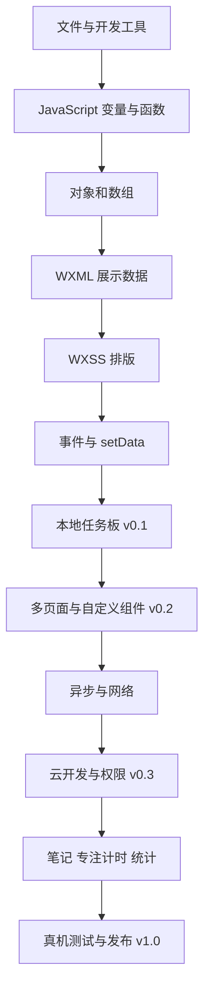

# 00 整体规划与最终项目

## 0.1 最终要达到什么程度

课程结束时，你应能独立读懂原生小程序项目，拆解需求，设计页面和数据，完成有后端的应用，并理解真机调试、权限、发布和维护。课程不以“背完所有 API”为目标；遇到新 API，能读文档、写最小示例、验证边界更有价值。

你现在不需要懂 HTML、CSS、JavaScript、数据库、服务器，也不需要先学 Vue 或 React。本课程会讲到必要的网页概念，但练习直接使用小程序文件。

### 开发的几个角色

| 词 | 初学者可以怎样理解 | 在课程中的例子 |
| --- | --- | --- |
| 需求 | 用户要解决的问题 | 我想知道今天还有哪些学习任务 |
| 界面/前端 | 用户看到和操作的部分 | 输入框、任务卡片、完成按钮 |
| 状态/数据 | 当前程序记住的内容 | 任务数组、选中的筛选条件 |
| 后端 | 在服务端执行业务、管理共享数据 | 校验身份后保存用户的任务 |
| 数据库 | 按规则长期存储和查询数据 | tasks 集合、notes 集合 |
| API/接口 | 约定好的调用方式 | 调用 `wx.showToast` 显示提示 |
| 调试 | 观察运行过程并定位错误 | 查为何点击按钮没有反应 |
| 部署/发布 | 把经过验证的版本提供给用户 | 上传、体验、审核、发布 |

前端不能因为能隐藏按钮，就获得安全性。后端必须校验当前调用者是否拥有对应数据。这会在云开发阶段详细训练。

## 0.2 技术路线和学习顺序

主线选择原生小程序：WXML 写结构，WXSS 写样式，JavaScript 写逻辑，JSON 写配置。先使用本地数据，再接模拟服务和云开发。TypeScript、框架和组件库放在后面比较学习。

这是课程的依赖关系，不要求你现在记住全部术语。

## 0.3 全部章节规划

第 01—36 章主线正文、示例和练习已提供，另有最终综合实践；真实账号、平台能力和正式交付仍需实际验收。第 10—15 章组成第二册，对应多页面与组件化的 v0.2；第 16—19 章组成第三册，对应本地 HTTP 服务与网络资源实验；第 20—23 章组成第四册，提供云环境、数据库、身份和 CRUD 权限；第 24—25 章组成第五册，提供私人缩略图、手动迁移、幂等写入与冲突处理；第六册第 26 章建立私人知识库；第七册第 27 章加入专注状态、后台恢复与会话记录；第八册第 28 章加入统计口径、固定时区、七日完整汇总、Canvas 图表和精确表格；第九册第 29 章加入文件、剪贴板、公开分享、上传下载、订阅回执与能力回退；第十册第30章进入体验与交付，加入统一反馈、网络与等待期限、读取实验和可恢复任务草稿。第十一册第31章加入视图投影、路径更新、有界分组列表、图片、普通分包和性能测量实验。第十二册第32章加入能力检测、未知值、窗口/大字/安全区、原生控件语义、配色与读屏验收，另有独立Skyline探针；主业务继续WebView。第十三册第33章系统整理纯函数、异步、组件方法与关键流程测试，加入结构化报告、局部覆盖率、故障变体及待执行渲染/工具/CI流程。第十四册第34章加入数据清单、平台隐私前置检查、原生同意页、发布材料与本地受阻检查；550个本地场景不代替真实后台、原生授权或审核。第十五册第35章加入默认关闭的本机诊断、观察层、环境核对、三组件源码清单、回退受阻检查与维护演练，共600本地场景。未配置真实告警、备份或回退。第十六册第36章提供真实TypeScript编译、npm锁文件和回环HTTP实验，并整理组件库/框架/独立后端路线与毕业实践；主工程600记录摘要匹配，扩展新跑50，跨工程650。云端源码与步骤已准备，真实账号部署、权限、读屏和真机性能验收待执行。

| 阶段 | 章 | 主题与关键知识 | 配套产出/验收 |
| --- | --- | --- | --- |
| A 起步 | 01 | 文件扩展名、UTF-8、账号、工具、项目根目录、四类文件 | 能导入、编译、修改计数器 |
| A 起步 | 02 | let/const、类型、比较、条件、循环、函数、作用域 | 能写学习时长统计函数 |
| A 起步 | 03 | 对象/数组、增删改查、浅拷贝、this、回调和异步顺序 | 能处理任务数组并预测输出 |
| A 起步 | 04 | 组件、插值、条件、循环、key、属性与事件 | 渲染任务列表和空状态 |
| A 起步 | 05 | 选择器、盒模型、rpx/px、Flex、长文本与小屏 | 做出可读的任务卡片 |
| A 起步 | 06 | Page/data/setData、事件参数、dataset、冒泡、状态推导 | 实现输入、新增、完成切换 |
| A 起步 | 07 | App/Page 生命周期、模块导出、本地存储、异常 | 重启能恢复任务，保存失败有提示 |
| A 起步 | 08 | 组合实现任务板：新增、编辑、删除、搜索、筛选 | 完成 v0.1 功能清单 |
| A 起步 | 09 | 调试器、日志、最小复现、练习与参考答案 | 能独立定位三类故障 |
| B 页面与组件 | 10 | pages 注册、navigateTo/redirectTo/switchTab/navigateBack、页面栈 | 从列表打开任务详情，再返回 |
| B 页面与组件 | 11 | query 参数、编码、缺失 ID、页面间更新、EventChannel 的适用场景 | 编辑详情后列表同步刷新 |
| B 页面与组件 | 12 | tabBar、表单、picker/switch/textarea、校验与提交反馈 | 任务分类、优先级、截止日期 |
| B 页面与组件 | 13 | Component、properties、methods、triggerEvent、插槽、样式隔离 | 提取 task-card 和 empty-state |
| B 页面与组件 | 14 | 组件生命周期、observers、behaviors、页面生命周期关联 | 倒计时组件正确释放资源 |
| B 页面与组件 | 15 | services/utils/constants 分层、状态归属、Git 基础 | v0.2 多页面本地应用和版本快照 |
| C 网络与异步 | 16 | Promise、async/await、try/catch/finally、并发与串行 | 把回调服务改写成可等待的函数 |
| C 网络与异步 | 17 | HTTP、URL、GET/POST、JSON、状态码、wx.request、合法域名 | 使用课程自备接口，观察真实请求 |
| C 网络与异步 | 18 | 请求封装、loading/error/empty/success、取消、超时、重试边界 | 请求失败后可恢复；处理旧响应覆盖 |
| C 网络与异步 | 19 | 下拉刷新、分页、去重、防抖/节流、缓存策略 | 数据增加时仍能稳定浏览 |
| D 云开发与安全 | 20 | 云环境、客户端与服务端、云函数、环境 ID、成本和配额 | 部署第一个云函数并读日志 |
| D 云开发与安全 | 21 | 文档型数据库、字段设计、索引、查询条件、分页 | 建立 tasks/notes/focus_sessions |
| D 云开发与安全 | 22 | 登录态、OPENID、wx.login 与服务端会话、鉴权 | 理解身份获取和资料填写的区别 |
| D 云开发与安全 | 23 | 云端 CRUD、输入校验、数据归属、权限规则、最小权限 | 用户 A 不能读改用户 B 的任务 |
| D 云开发与安全 | 24 | 图片选择、临时文件、云存储、上传失败、删除与文件归属 | 私人缩略图库，为笔记附件作准备 |
| D 云开发与安全 | 25 | 数据迁移、重复提交、幂等、版本号、冲突策略、备份 | v0.3 云同步，离线写入有明确处理 |
| E 完整业务 | 26 | 富文本边界、笔记编辑、标签、搜索、资源链接收藏 | 私人知识库模块 |
| E 完整业务 | 27 | 时间戳、计时器、后台挂起、恢复、会话记录、防重复统计 | 专注计时以结束时间计算，而非盲减秒数 |
| E 完整业务 | 28 | 统计口径、日期边界、连续天数、图表基础/Canvas 入门 | 最近 7 天专注统计可人工复算 |
| E 完整业务 | 29 | 文件上传/下载、剪贴板、分享、订阅消息、能力检测 | 逐项核对权限后接入所需平台能力 |
| F 质量与交付 | 30 | 统一错误反馈、弱网、重入、表单草稿、空数据与恢复 | 全局体验走查清单 |
| F 质量与交付 | 31 | setData 成本、列表分页、图片尺寸、分包、首屏性能 | 固定模型对照、原生实验与待填真机测量表 |
| F 质量与交付 | 32 | 基础库兼容、WebView/Skyline 差异、无障碍、真机适配 | 兼容/可访问实验、独立渲染探针与待填真机矩阵 |
| F 质量与交付 | 33 | 纯函数测试、组件测试、关键流程自动化、回归测试 | 四组Node测试、500项本地回归及分层待验收表 |
| F 质量与交付 | 34 | 隐私声明、用户授权、账号类目、备案/审核要求查询、版本发布 | 对照当时官方要求准备提交材料 |
| F 质量与交付 | 35 | 日志、监控、错误定位、环境隔离、回滚与持续维护 | 可维护的教学候选、600本地回归与待执行真实演练 |
| G 延伸 | 36 | TypeScript、npm、WeUI 等组件库、框架选择、独立后端方案 | 独立TS/HTTP实验50项、工具选择与最终综合实践 |

课程覆盖常用开发主线和重要边界。支付、蓝牙、地图高级定位、直播、广告、小游戏等有独立业务和资质条件，作为按需专题，不能把本课程理解成覆盖微信平台的每一个接口。

## 0.4 贯穿项目：学伴 StudyHub

### 面向谁、解决什么

面向个人学习者，把“制定任务 → 执行专注 → 记录笔记 → 查看统计”连成一个闭环。默认私人数据，不先做公共社区。这样能集中练习开发能力，仍然有足够的页面、数据关系和异常场景。

### 最终页面蓝图

| 页面 | 功能 | 数据来源 |
| --- | --- | --- |
| 今日 | 今日待办、最近笔记、快捷开始专注 | 任务、笔记、专注会话 |
| 计划列表 | 分类、优先级、搜索、分页、完成切换 | tasks |
| 任务详情/编辑 | 标题、描述、日期、标签、状态 | tasks 单条记录 |
| 笔记列表/编辑/详情 | 正文、标签、图片、关联任务 | notes、云存储 |
| 专注 | 开始、暂停、恢复、结束、记录结果 | focus_sessions |
| 统计 | 任务完成数、学习分钟、最近七天趋势 | 经过约定口径的汇总 |
| 我的/设置 | 用户主动填写资料、同步状态、数据管理 | users、preferences |

### 版本路线

| 版本 | 章节范围 | 数据存在哪里 | 验收 |
| --- | --- | --- | --- |
| v0.1 | 01—09 | 本设备缓存 | 单页面任务板完整可用 |
| v0.2 | 10—15 | 本设备缓存 | 多页面、任务详情、自定义组件 |
| v0.3 | 16—25 | 云数据库与云存储 | 身份鉴别、数据隔离、失败可恢复 |
| v0.8 | 26—29 | 云端为主 | 笔记、计时、统计组成业务闭环 |
| v1.0 | 30—35 | 明确环境与版本 | 完成安全、兼容、性能、发布准备 |

### 数据模型草案

`tasks`：`_id`、所有者身份、`title`、`description`、`done`、`priority`、`categoryId`、`dueAt`、`createdAt`、`updatedAt`、`version`。

`notes`：`_id`、所有者身份、`kind`、`title`、纯文本 `content`、`tags`、资源 `url`、`favorite`、`assetIds`、可选的 `taskId`、版本与创建/更新时间。第 26 章使用资产 ID 引用私人图片，并在资产上维护 noteRefs；不把任意云 fileID 当作附件归属依据。

`focus_sessions`：`_id`、所有者身份、可选的 `taskId` 与标题快照、plannedSeconds、isDemo、state、accumulatedMs、运行段起点与期限、开始/结束/更新时间、版本。第 27 章用每用户 focus_slots 指向最近一轮，操作回执与会话变化一起提交；终态 DTO 计算有效整秒，后台没有持续计时云函数。

第 28 章直接读取普通终态会话生成七日统计，不新增持久汇总表。`focus-end-day-v1` 固定 UTC+08:00，以 endedAt 所在日归属整轮有效秒数；它不还原跨日真实运行分钟，也不从任务 updatedAt 推断完成历史。最多完整汇总窗口内 500 条符合条件的会话，超限或失败拒绝部分结果；分页读取不等于强一致审计快照。

第 29 章另加 notice_attempts 记录独立练习回执的发送尝试，原八集合加该集合共九个；先事务占位，再调用外部发送，不能将消息与数据库提交视为同一事务。文件导出只是汇总，公开分享只含固定教学数据。

第30章任务草稿存于本机，按在线确认的环境/账号分区，最多六份；本地revision与云端baseVersion分别协调缓存和数据库变化。sealed草稿保存原编号，可衔接outbox与历史回执，不新增云集合。知识库未提交草稿仍待按其业务单独扩展。

第31章只改变视图和客户端布局，没有新增云集合。完整DTO与模型保留业务数据，视图投影不替代写入校验、版本与原编号；列表换组不删除云任务。性能采样默认关闭，只保留允许的公开数值，不含URL或正文。

第32章兼容与可访问实验无新云集合。本地清单仅内存固定数据，不是新草稿协议；独立renderer-probe没有云或身份。共享任务卡片改交互入口，原数据所有者、版本与原编号语义保留。

第33章业务源码不变，新增电脑端测试和报告。假回执服务不连云；500项是本次场景数量，不是互不重复功能数。覆盖率只涉及指定运行加载的客户端JS，真实环境继续独立验收。

第34章不增加云集合。新增三个选读入口前置检查、数据与隐私页和发布材料；默认24个待办保留。完整数据导出、账户处理、期限与权利机制仍是生产阻塞，未实际上传、提审或发布。

第35章不新增云集合，云端与共享协议不变。日志只保留允许分类，默认关闭且不上传；环境核对不替代云权限。回退检查始终不执行，完整数据治理与真实恢复演练仍待完成。

第36章不改主业务工程。第17组是独立电脑工具实验，简化契约与固定actor不用于正式认证；完整小程序继续使用第16组。

这里的字段是设计草案。服务器上的所有者必须来自可信身份上下文，不能相信客户端提交的“我是某某”。云数据库的自动字段和权限模式会在第 21—23 章根据实际方案确定。

v0.1 只用 `id/title/done/createdAt`，先掌握最小模型，再做迁移。

## 0.5 学习节奏与验收

这是建议投入，不是保证工期。零基础完整走一遍，预留约 120—200 小时较合理；遇到账号、接口或发布条件时可能更久。第一阶段建议分 2—4 周完成，重在手写和改错。

每一章都用三个问题验收：这段代码输入是什么？中间改变了哪些数据？输出或界面是什么？如果只会复制，却不能回答这三个问题，请在当前章多做一个改造题。

最终验收至少包括：

1. 从空项目建立页面和组件，能解释目录结构。
2. 无网络、空数据、非法输入、重复点击时有明确行为。
3. 换设备后能看到自己的云端数据；另一个用户看不到。
4. 后台停留后恢复计时仍合理，不重复保存专注记录。
5. 搜索和分页不会重复、漏项或让旧请求覆盖新结果。
6. 真机运行、兼容性、隐私和发布条件经过实际核对。
7. 代码有层次，关键规则有测试或可复现的验收步骤。

## 0.6 本课程的说明方式

示例分为“独立可运行项目”“放入某文件的完整替换代码”“说明性片段”。没有注明完整项目的零散片段，不应随意拼接覆盖现有文件。

所有代码示例以教学清晰为先。早期的全量数组更新和同步缓存适用于小规模本地练习；随着数据量和多人访问引入，课程会明确改造这些选择，而不是把练习实现直接当作线上架构。

资料分批核验，最近续写完成于 2026-11-03。平台界面、资质、配额和能力会变化，后续涉及此类内容时需要再次查官方文档。来源和当前读取限制见 [99 资料说明](99-官方资料与核验说明.md)。
