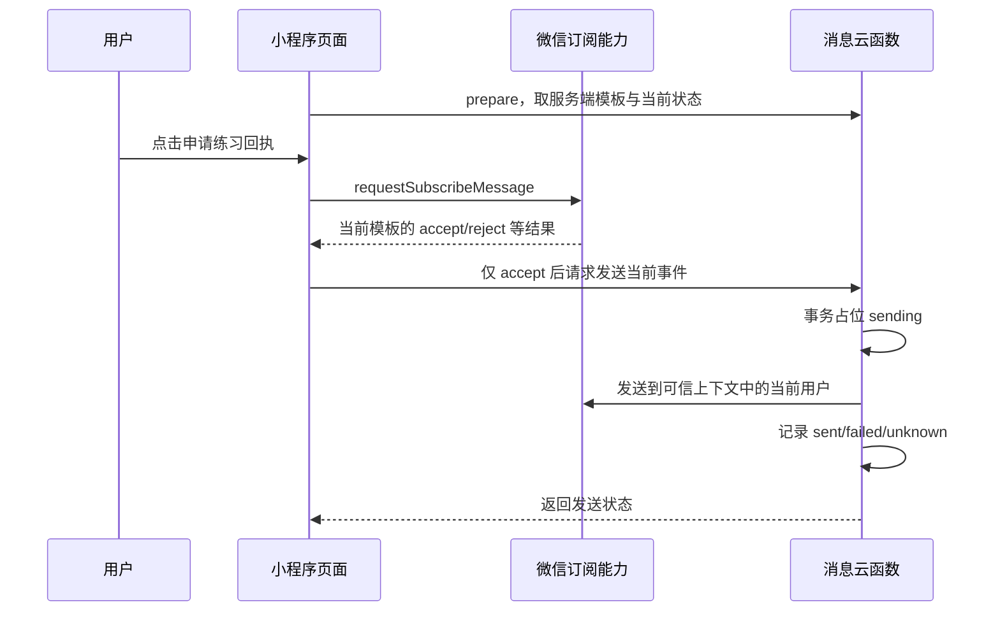

# 第 29 章：文件、剪贴板、分享、订阅消息与能力检测

前置：[第 28 章](28-统计口径跨日边界与七天图表.md)。配套第十个独立示例：`示例代码/10-studyhub-platform`。完整逐文件代码见 [第九阶段源码附录](第九阶段-完整源码附录.md)。本章日期：2026-11-02。

本章把“学伴”的数据带到平台能力中：把七日报告写成文件、从聊天重新选取校验、复制摘要、转发公开练习页；再练习 HTTP 文件上传下载，以及一次订阅回执的完整调用链。你将学会区分：本地路径和网络地址、文件内容与来源真实性、接口成功回调与业务成功、订阅同意与发送确认。

建议分五次学习：文件模型与本地往返；剪贴板与分享；本地 HTTP 文件实验；订阅消息配置与状态机；故障和真机验收。账号或模板暂不满足条件时，先完成文件和公开练习，消息部分保留源码与待验收记录，不把模拟调用说成真实发出。

## 29.1 先看本章做出的功能

在“身份与环境”页进入“文件、剪贴板、分享与订阅消息练习”。

| 板块 | 操作 | 实际结果 |
| --- | --- | --- |
| 报告文件 | 生成、重新读取、聊天选择、转发、清理 | 有版本的 JSON 汇总文件 |
| 剪贴板 | 复制摘要、主动读取预览 | 明确触发的文本交换 |
| 小程序卡片 | 转发固定练习 | 对方打开公开固定数据页 |
| 文件网络 | 上传固定报告、下载、校验、另存 | Node 服务与小程序的文件调用链 |
| 订阅回执 | 准备配置、点击申请、发送、核对 | 独立云函数和发送尝试状态 |

前九个项目继续保留。不要把整个教程目录导入开发者工具，也不要覆盖第九个项目；导入本章第十个外层目录。

## 29.2 四种“文件位置”不能混用

| 位置 | 例子 | 含义 |
| --- | --- | --- |
| 代码包内资源 | `/images/logo.png` | 随代码发布，不能当成运行时输出目录 |
| 本地临时路径 | 选择或下载接口返回的路径 | 由当前平台环境管理，不能承诺永久有效 |
| 小程序用户目录 | `wx.env.USER_DATA_PATH + '/week.json'` | 小程序可管理的本地文件，不等于系统下载目录 |
| 网络/云存储 | HTTPS URL、`cloud://...` fileID | 远程资源标识，仍需要对应接口、归属和权限 |

文件路径是“去哪里找”，文件内容是“里面是什么”。把路径字符串存在数据库里，不等于上传了文件；把 fileID 放到别人手机上，也不意味着对方获得读取权限。

HTTP 下载得到临时路径后，若要在自己的目录维护，需要明确另存和清理策略。第 24 章私人图片通过受控云函数代理，不能为了练习 `wx.cloud.downloadFile` 就开放已有私人存储规则。

官方示例展示了 [云文件上传](https://github.com/wechat-miniprogram/miniprogram-demo/blob/master/miniprogram/packageAPI/pages/network/upload-file/upload-file.js) 与 [云文件下载](https://github.com/wechat-miniprogram/miniprogram-demo/blob/master/miniprogram/packageAPI/pages/network/download-file/download-file.js) 的 filePath、fileID 和 tempFilePath；仓库中的环境 ID 与清理做法是该示例自身配置，不能照搬成你的私人附件策略。

## 29.3 导出的是什么：汇总文件，不是完整备份

本章导出七日统计，不包含任务、笔记全文、所有专注记录、附件、操作回执或账号凭证。恢复整个账号需要另一套备份和迁移协议。

文件顶层结构：

```json
{
  "format": "studyhub-week-report",
  "version": 1,
  "source": "demo",
  "report": {
    "policyVersion": "focus-end-day-v1"
  }
}
```

这是缩略结构示意，report 还必须有第 28 章定义的完整日期、边界、七日分项与合计；不要把上面几行当作可导入的完整文件。

format 标识这是哪类文件；version 标识文件容器版本；policyVersion 标识内部统计口径。文件包装变化和业务统计规则变化是两件事，因此分别留版本。

source 取 demo/cloud，记录生成时选择的来源。外部文件可以被任意修改，所以 source 不是签名，也不是服务器出具的真实性凭证。本章从聊天选择文件后只校验与核对合计，不写入私人云数据库。

## 29.4 用字段允许列表避免意外导出

不能因为接口对象目前很干净，就写 `JSON.stringify(response)` 导出所有内容。将来对象加入身份、日志、内部地址或调试字段，文件也会悄悄带出去。

`utils/report-file.js` 的 selectReport 先调用 validReport，然后显式挑选字段：

```js
const keys = ['policyVersion', 'timezone', 'consistency', 'complete',
  'dateFrom', 'dateTo', 'asOf', 'startAt', 'endExclusive',
  'cutoffExclusive', 'maxSessions', 'sessionCount'];
const out = {};
keys.forEach(key => { out[key] = report[key]; });

out.days = report.days.map(day => ({
  date: day.date,
  totalSeconds: day.totalSeconds,
  completedSessions: day.completedSessions,
  stoppedSessions: day.stoppedSessions,
  finishedSessions: day.finishedSessions
}));
```

keys 是允许导出的键；forEach 按键复制；map 给每一天创建新对象，额外属性不会跟过去。totals 也按允许列表生成。

这和第 23 章后端输入允许列表的思路相通：明确自己接收或输出什么，减少对象未来变化产生的副作用。

## 29.5 字符长度不等于 UTF-8 文件字节

字符串 `.length` 按 UTF-16 代码单元计数，不能直接拿来证明一个 UTF-8 文件占多少字节。

```js
function utf8Bytes(text) {
  let bytes = 0;
  for (const char of text) {
    const cp = char.codePointAt(0);
    bytes += cp <= 0x7f ? 1
      : cp <= 0x7ff ? 2
      : cp <= 0xffff ? 3 : 4;
  }
  return bytes;
}
```

for...of 按迭代出来的字符处理，能把正常代理对组成一个码点；ASCII 占 1 字节，常见汉字通常 3 字节，常见补充平面表情通常 4 字节。比如 `A学😀` 的 UTF-8 长度是 8 字节。

本章限定报告文件 32 KiB，即 32768 字节。它是课程业务限制，不是微信的文件容量规定。实际文件先通过 stat 检查，再读取；解码后的文本还会重新检查大小和内容。

JSON.stringify 的结果是字符串；JSON.parse 只解析 JSON 数据，不能把文件内容交给 eval 或 Function 执行。

## 29.6 回调封装要保留接收对象

`services/platform-api.js` 封装普通微信 API，也可封装 FileSystemManager 方法：

```js
function call(name, options = {}, owner = wx) {
  return new Promise((resolve, reject) => {
    if (typeof owner[name] !== 'function') {
      reject(new Error('当前环境不支持此接口'));
      return;
    }
    owner[name]({ ...options, success: resolve, fail: reject });
  });
}
```

完整源码还处理同步异常和取消错误。`owner[name](...)` 保留方法所属对象；不能随意先取出方法再裸调用，以免依赖 this 的接口失去接收对象。

调用普通接口：`call('setClipboardData', {data: text})`。调用文件管理器：`call('writeFile', options, manager)`。

这里封装的是回调结果，不适合把所有接口一律变成“只剩 Promise”。上传下载还需要保留 task，后面会单独处理。

## 29.7 写入自己的用户目录

核心写入代码：

```js
const fs = wx.getFileSystemManager();
const filePath = wx.env.USER_DATA_PATH + '/studyhub-week-demo.json';
await call('writeFile', {
  filePath,
  data: pack(report, 'demo'),
  encoding: 'utf8'
}, fs);
```

`pack` 先校验并挑选字段，再 JSON.stringify；writeFile 的成功才表示本次本地写入被确认。磁盘空间、权限或运行环境异常都应显示失败，不要在调用之前就提示保存成功。

本例用 demo/cloud/download 三个固定文件槽，同一槽覆盖上次文件，避免每点一次就生成一个永不清理的新文件。它没有提供历史文件版本库。

槽名只允许固定枚举，不能把用户标题或外部文件名拼成输出路径。例如 `../../somewhere` 不该成为可用槽名。

## 29.8 先 stat，再 readFile，再校验内容

```js
const result = await call('stat', { path: filePath }, fs);
if (result.stats.isDirectory() || result.stats.size > 32768) {
  throw new Error('不是允许的小型文件');
}
const content = await call('readFile', {
  filePath,
  encoding: 'utf8'
}, fs);
const value = unpack(content.data);
```

stat 检查文件属性与字节大小，readFile 读取内容，unpack 解析容器版本并调用统计协议校验。

文件存在不代表内容正确；后缀 `.json` 不代表 JSON 语法正确；JSON 可解析也不代表七日合计正确。每一层检查解决不同的问题。

本例读取时兼容一个开头的 UTF-8 BOM，之后仍检查格式。缺失字段、错误合计、未知版本与损坏 JSON 都会失败，不会伪装为七天零数据。

## 29.9 从聊天选择报告文件

```js
const result = await call('chooseMessageFile', {
  count: 1,
  type: 'file',
  extension: ['json']
});
const path = result.tempFiles[0].path;
const value = await read(path);
```

它是从微信聊天文件选择，不是随意遍历手机文件系统。extension 是选择界面的过滤条件，真正的内容仍要读取校验。[官方 API 类型中的 ChooseMessageFileOption](https://github.com/wechat-miniprogram/api-typings/blob/master/types/wx/lib.wx.api.d.ts)

本章界面只提示外部文件的已校验合计，不把它替换成你的真实云记录，也不因文件写了 cloud 就标为可信云统计。

用户取消是正常路径：保留原报告，显示已取消。不要把取消当成程序崩溃，也不要在取消后立刻再次打开选择器。

原生选择界面可能引起页面可见性变化；本例的本地文件动作在返回后检查实例是否仍存活，不把每次临时隐藏都理解为用户永久离开。网络传输和消息配置的可见性处理另有规则。

## 29.10 本地文件清理与转发

清理调用 unlink，且仅接收固定槽名。如果删除接口失败，本例报告“清理未确认”，不把所有错误都解释为“文件本来不存在”。

文件转发使用 `wx.shareFileMessage`，由用户选择聊天：

```js
await call('shareFileMessage', {
  filePath: saved.filePath,
  fileName: saved.fileName
});
```

API 存在时可以尝试，失败仍要处理。官方类型注释标明该接口的最低基础库；不要仅因模拟器中出现函数就推断所有手机可用。[官方 ShareFileMessage 类型与注释](https://github.com/wechat-miniprogram/api-typings/blob/master/types/wx/lib.wx.api.d.ts)

生成本地文件和转发文件是两个操作。用户自己选择要转发的内容；接口返回也不等于收件人已经阅读。真正包含私人汇总的 cloud 文件，用户转发后属于一次主动披露，页面文案应清楚说明当前来源。

## 29.11 不同格式要选择对应的预览工具

JSON 报告适合用程序解析，再用页面展示。不要为了调用 openDocument 就把 JSON 改名成 `.pdf`。

若业务确实生成受支持的文档格式，可在获得真实本地文件后调用：

```js
wx.openDocument({
  filePath: localDocumentPath,
  showMenu: true,
  success() { console.log('文档打开接口已返回'); },
  fail() { /* 提示格式、路径或环境不满足 */ }
});
```

这是接入真实文档时的说明片段，不是本章 JSON 报告的运行步骤。本章没有生成 PDF/Word，也没有把扩展名伪装当作格式转换。

## 29.12 剪贴板：明确复制，明确读取

复制摘要：

```js
await call('setClipboardData', {
  data: summary(report, source)
});
```

summary 明确写出来源、日期、精确秒数和 UTC+08:00 结束日口径，避免离开页面后只剩一个容易误解的数字。

主动读取：

```js
const result = await call('getClipboardData');
this.setData({ clipboardPreview: result.data.slice(0, 200) });
```

用户点击“主动读取剪贴板预览”才调用。预览只留在当前页，不上报云端，不写日志；卸载页面后不保存这段预览。slice 的 200 是代码单元上限，可能截断复杂表情，若要完整字符可另用按字符迭代的截取函数。

不要在 onShow 自动读取剪贴板来猜用户意图。接口可调用和用户期望你读取，是两个需要分别满足的条件。涉及实际隐私声明和接口使用要求时，以当前账号和官方平台要求为准。

## 29.13 分享小程序卡片，分享的是入口

WXML：

```xml
<button open-type="share">转发公开固定练习卡片</button>
```

页面配置：

```js
onShareAppMessage() {
  return {
    title: '一起学习小程序：七天统计练习',
    path: '/pages/public-lab/index?demo=normal',
    imageUrl: '/assets/public-study-card.png'
  };
}
```

由用户通过分享按钮或相关菜单发起，返回值配置标题与页面路径。[官方 Page 分享回调定义](https://github.com/wechat-miniprogram/api-typings/blob/master/types/wx/lib.wx.page.d.ts)

分享路径不是权限凭证。把私人任务 ID 发给另一用户，服务器仍应按对方身份鉴权，不能因为“是好友发来的”就跳过归属检查。

还要明确设置 imageUrl。官方类型说明默认使用截图；当前平台页可能包含私人报告或剪贴板预览，所以本例打包一张固定公开封面。只修改path却任由当前页截图进入卡片，仍可能泄露信息。封面是600×480的教学图形，可用项目内 `node tools/make-share-card.cjs` 重建，不读取用户数据。

先使用现成封面完成练习即可；生成器作为可选的资源重建工具供参考。本章重点是如何选择分享内容和接入平台能力，PNG编码细节留作后续拓展。

本章选择公开固定练习页，接收方看到明确的教学标记和固定 2310 秒；不是分享者的私人统计。页面独立启动就能展示，不依赖上一个页面的内存或先登录查到分享者身份。

## 29.14 为什么不能把私人报告塞进 query

错误思路：

```js
// 不用于本项目
path: '/pages/report/index?ownerId=' + userId
  + '&report=' + encodeURIComponent(JSON.stringify(privateReport))
```

这会把数据放进入口参数，可能被复制、改写、记录或再次传播。URL 编码只是解决特殊字符，不会加密，不会鉴权，也不会使内容可信。

若将来实现真正的公开分享，应另建分享对象，设计明确的公开字段、过期、撤销、访问范围和删除策略。私人正文和公开摘要不能只是同一个接口加上 `public=true` 就完成安全设计。

本章没有朋友圈专题、分享成功奖励或公开私人笔记。不同分享能力要分别查当前支持条件，不能从 onShareAppMessage 推断其他能力完全相同。

## 29.15 HTTP 文件传输与 JSON 请求的区别

普通 `wx.request` 常发送 JSON；`wx.uploadFile` 用本地 filePath，通过 multipart/form-data 上传；`wx.downloadFile` 把响应写到临时文件并返回 tempFilePath。

```js
const task = wx.uploadFile({
  url: origin + '/upload',
  filePath: saved.filePath,
  name: 'file',
  success(response) {
    if (response.statusCode !== 200) return;
    const body = JSON.parse(response.data);
  }
});
```

name 是表单文件字段名，不是文件名。本章服务只接收 name=file。上传接口的 data 响应为字符串，需按约定解析；success 回调中也要核对 HTTP 状态和业务响应。[官方 UploadFileSuccessCallbackResult](https://github.com/wechat-miniprogram/api-typings/blob/master/types/wx/lib.wx.api.d.ts)

不要自行把 Content-Type 固定成 application/json 或乱填 multipart boundary；边界与文件体应由上传接口按协议生成。它不同于把 filePath 字符串直接 JSON.stringify 发给服务器。

## 29.16 保留 task：进度、中止与有限生命周期

本例 transfer 返回两部分：

```js
const operation = upload(filePath, progress => {
  this.setData({ progress });
});
this._transfer = operation;
const response = await operation.promise;
```

operation.abort() 会调用底层 task.abort；task.onProgressUpdate 监听进度。Promise 用于等待结果，task 用于控制这次传输，不能二选一。

进度显示限制在 0—100；终态之后忽略迟到进度。百分之百只表示传输进度，不等于服务器已经完成校验、登记或返回业务成功。

页面隐藏/卸载时请求中止当前传输；中止不会撤销服务端已经接收到并处理的请求。上传结果未确认时不自动重传。对于真正的私人附件，应像第 25 章一样设计操作编号、归属、确认和孤立文件核对。

## 29.17 启动课程本地文件服务

配套服务只用 Node 标准库，没有第三方依赖。先在第十个项目目录打开终端：

```powershell
node server/file-lab.cjs
```

默认监听本机 127.0.0.1:8877。客户端配置：

```js
module.exports = {
  ENABLE_LOCAL_FILE_LAB: true,
  FILE_LAB_ORIGIN: 'http://127.0.0.1:8877'
};
```

初始开关为 false，不会在你未准备服务时自动请求网络。开发者工具本地 HTTP 实验涉及合法域名检查设置；按照第 17 章临时调试方法操作，结束后恢复。关闭检查不适用于正式发布。

手机中的 127.0.0.1 是手机自身。若在可信局域网练习，需要服务显式监听可访问地址、电脑实际私有 IP、同网段与防火墙配置；这些仍不能代替正式 HTTPS、合法上传/下载域名和鉴权。示例地址限制为本机或私有 IPv4 HTTP 源，不能直接改成匿名公网文件站。

例如在 PowerShell 中为这次本地服务设置监听地址：

```powershell
$env:FILE_LAB_HOST = '0.0.0.0'
node server/file-lab.cjs
# Ctrl+C 结束后，清除当前终端的这项配置：
Remove-Item Env:FILE_LAB_HOST
```

客户端把 origin 改为电脑实际私有 IP，如 `http://192.168.1.8:8877`；示例 IP 需要替换成你自己的。0.0.0.0 是服务监听地址，不是客户端访问地址。不要为了连接实验而关闭整机防火墙；按你管理的网络规则配置必要访问。

服务运行时可以用 Ctrl+C 结束。Node HTTP 的请求流、响应和监听概念参考 [Node 官方 HTTP 文档](https://nodejs.org/api/http.html)。本章不要求你把所有网络底层细节一次记住。

## 29.18 本地服务为什么只接收固定报告

匿名教学服务没有用户登录与文件所有者模型。本例把网络实验限定为固定教学内容：无论页面当前选了 demo 还是 cloud，上传按钮都会重新生成同一份固定报告；服务端还比较实际字节与固定文件是否完全相同。

本地服务规则：

- 只接收一个约定字段的 multipart 文件，不接受任意二进制。
- 请求体最多 64 KiB，文件内容最多 32 KiB。
- 仅在内存保存最多 20 份固定报告，十分钟过期。
- 返回随机编号；下载只接受该格式编号，不拼接磁盘路径。
- 重启后编号全部失效，没有持久备份语义。

multipart 解析器只支持本实验约定的单文件结构。它不是通用上传框架，也没有生产级恶意连接防护、审计或访问控制。超过上限明确返回 413/429，而不是悄悄截断。

不要只在客户端禁用私人文件选择就认为后端安全；服务端实际核对内容，才能阻止改造客户端上传其他数据。

## 29.19 下载后仍要检查文件

```js
const response = await downloadOperation.promise;
const value = await files.read(response);
if (pack(value.report, value.source) !== pack(lab.report(), 'demo')) {
  throw new Error('不是固定教学报告');
}
await files.save(value.report, 'demo', 'download');
```

这里 downloadOperation.promise 返回临时路径，read 再做 stat、内容解析和协议校验；最后另存为固定 download 槽。

HTTP 200 不证明内容是预期报告，也不证明来源真实性。错误页、旧版本文件或被修改的数据都要在后续校验中识别。

临时文件由平台管理，固定 download 槽由课程覆盖管理；当前界面的清理按钮只清理当前 demo/cloud 报告槽。扩展历史下载管理时，应增加明确的文件列表与逐项清理，不扫描删除整个 USER_DATA_PATH。

## 29.20 订阅消息的三步，不是一个按钮 API



一次性订阅需要按模板取得相应发送机会。它不是永久通知权限；每次成功弹窗调用也不代表所有模板都被同意。用户此前保存过选择时，可能不再次弹窗，仍应读取本次返回结果。

本例只请求一个模板，不依赖“一次最多几个模板”的数字。实际检索中旧资料与当前类型注释对批量数量存在差异，因此不要从旧教程抄一个平台上限当作永久规则。

能力与调用结构交叉参考 [官方订阅 API 注释](https://github.com/wechat-miniprogram/api-typings/blob/master/types/wx/lib.wx.api.d.ts)；微信文档正文在当前检索环境仍无法读取。账号模板可用性与实际发送需要真实环境确认。

## 29.21 先准备模板，再在点击中直接申请

官方注释要求在用户点击或相应支付回调等允许的触发条件下申请。不要在 onLoad 弹框，也不要点击后先 await 网络，再假设仍保留同样的用户触发条件。

本例 onShow 提前调用独立云函数的 prepare，取得模板 ID、日期、事件编号和状态。按钮点击中立即调用：

```js
const result = await call('requestSubscribeMessage', {
  tmplIds: [prepared.templateId]
});
const answer = result[prepared.templateId];
if (answer !== 'accept') return;
await notice.send(prepared.id);
```

await 等待的是刚发起的授权请求；发起这个接口之前没有网络 await。封装内部的 Promise executor 会同步执行，因此仍在按钮处理链中调用微信接口。

不要检查 `result.errMsg` 就认为同意，也不要把结果写死成 result.templateId。方括号取值是因为属性名来自真实模板 ID。

reject、ban、filter 和未知值均不调用服务端发送。总开关与 itemSettings 可帮助说明设置，但不是可用发送次数的可靠账本，也不能替代本次授权和发送结果。

## 29.22 选择真实匹配模板，配置独立消息函数

新增 `cloudfunctions/studyhubNotice`，固定 wx-server-sdk 4.0.2，与原 studyhub 分开部署，避免把发送消息混进任务或专注事务。

服务端环境变量：

| 变量 | 用途 |
| --- | --- |
| STUDYHUB_APP_ID | 允许的真实小程序 AppID |
| NOTICE_ENABLED | 字符串 true 才考虑启用，默认关闭 |
| NOTICE_TEMPLATE_ID | 真实可用的一次性模板 ID |
| NOTICE_THING_KEY | 对应“练习内容/事项”等匹配含义的 thing 字段键 |
| NOTICE_TIME_KEY | 对应“完成时间”等匹配含义的 time 字段键 |
| NOTICE_PAGE_STATE | developer / trial / formal，与实际跳转版本一致 |

本教学适配器只生成“平台能力练习已完成”和服务器完成时间两个字段。因此必须选用业务含义匹配、字段恰好满足本适配器的模板；thing1/time2 只是字段键示例，不代表每个模板都这样。若模板需要更多必填字段或含义不同，应连同后端映射和校验一起改造，不能把无关内容硬塞进订单/医疗等模板。

云函数环境变量是字符串，所以代码比较 `NOTICE_ENABLED === 'true'`，不是把任意非空字符串都当成启用；字符串 `'false'` 本身在普通 if 中也是真值。readConfig 还校验字段键和跳转版本，配置不完整就保持关闭。

没有合适模板或账号暂不支持时，保持关闭，其他功能照常练习。长期订阅和设备订阅的资质、规则另行查证，本章不承诺普通账号可用。

云调用参数的 camelCase 写法可交叉参考 [CloudBase 订阅消息配方](https://docs.cloudbase.net/recipes/add-subscribe-message-cloud-function)。该配方使用独立 CloudBase 路线，且不同语言页面的适用说明存在差异；这里只核对调用形状，不把它的登录、额度表或部署流程直接搬进本项目。原 wx.cloud 项目的账号关联、函数权限和实际 SDK 执行仍需按微信文档与控制台验收。

## 29.23 服务端固定接收人、内容与页面

客户端只传 action 和当前事件 id。不能传 touser、templateId、任意 data、ownerId 或“我已经同意”的可信标记。

```js
const context = cloud.getWXContext();
// 先核对 APPID 与非空 OPENID。
const payload = {
  touser: context.OPENID,
  templateId: configuredTemplate,
  page: 'pages/public-lab/index?demo=normal',
  miniprogramState: configuredPageState,
  lang: 'zh_CN',
  data: {
    [configuredThingKey]: { value: '平台能力练习已完成' },
    [configuredTimeKey]: { value: serverTimeText }
  }
};
await cloud.openapi.subscribeMessage.send(payload);
```

云调用使用 templateId/miniprogramState 等字段；直接调用微信 REST 接口时字段命名与凭证管理不同，不要混抄。本项目不把 access_token 或 AppSecret 放在客户端。

客户端 accept 只用于正常流程，攻击者仍可绕过客户端直接请求自己的发送接口。服务器固定当前用户和业务内容，限制尝试次数；微信平台继续校验该用户是否有对应发送机会。我们没有实现自制的可信授权次数账本。

## 29.24 新增第九个集合，而不是开放现有规则

原 collections-plan.json 八集合保持原业务。新增 `database/notice-plan.json` 列出 `studyhub_notice_attempts`，总共九集合，均禁止客户端直接读写。

消息集合字段包括 ownerId/ownerAppId、day、state、templateId、createdAt/updatedAt，以及已识别的平台结果码。按文档 ID 直接查找，不需要为了本章添加全表遍历。

ID 由服务端 SHA256 计算：

```js
JSON.stringify([APPID, OPENID, day, 'platform-receipt-v1'])
```

day 使用固定 UTC+08:00。ID 不包含模板 ID，所以同一天换模板不能绕过一次尝试边界。这里的哈希不是保密凭证，真正的权限来自可信微信身份和服务端归属校验。

每用户每统计日最多一次发送尝试是本课程业务规则，不是微信平台每日配额。跨日会得到新编号；旧编号过期。失败或未知也不在当天自动重新发送，这是一项有明确代价的保守策略。

## 29.25 发送状态机：先占位，再调用外部接口

| 状态 | 本章含义 | 再次请求如何处理 |
| --- | --- | --- |
| ready | 当天还没有已记录的发送尝试 | 可以在用户申请后尝试 |
| sending | 占位已保存，发送进度需核对 | 返回状态，不再次调用发送 |
| sent | 获得明确的接口接受结果 | 返回状态，不重复发送 |
| failed | 获得明确的非零平台错误 | 当天不再尝试 |
| unknown | 未取得明确结果，或结果持久化未确认 | 人工核对，不自动重发 |

ready 是 prepare 派生的状态，不需要预先写一条待发送文档。真正 send 时，在数据库事务中检查记录不存在，再写 sending；已有任何尝试记录都不重复获得资格。

事务提交确认后，才调用一次外部 OpenAPI。外部发送不放在可能重新执行的事务回调里。发送结果再用另一事务落库。

本地测试用串行事务验证资格逻辑，真实数据库冲突、提交确认和 SDK 行为仍需实际验收。业务层限制发起次数不等于承诺平台端“严格恰好送达一次”。

## 29.26 三种故障，为什么不能同一方式重试

1. 占位事务提交前失败：没有确认资格，不调用外部发送。重新核对仍可能 ready。
2. 占位实际提交但响应丢失：记录可能是 sending，但本轮还没调用发送。保守地不再取得资格，可能漏发。
3. 平台已经接受，响应或后续落库失败：不能证明没发，显示 unknown 或持续 sending，不自动重发。

这体现了数据库与微信外部接口不共享事务的边界。为避免重复，本版接受部分不确定故障中漏发的可能，不会把一个 catch 后重试说成可靠消息系统。

运维应结合精确事件 ID、函数日志和平台结果核对；不得仅因记录旧就删除后让客户端重新发送。生产级可靠通知需要进一步设计任务队列、租约、平台可用的查询/幂等能力、审计和人工处置，不是添加一个 setTimeout。

## 29.27 发送接口返回，不等于用户已经看到

本例仅在明确整数结果码为零时记录 sent；明确非零记录 failed；超时、断线或缺少可识别的结果记录 unknown。SDK 实际返回形状应在真实环境核对。

界面文案写“平台接口已接受；实际展示和送达需手机核对”，不写“对方已阅读”。消息显示还涉及客户端、模板、版本路径与平台处理。

常见排查方向：没有对应订阅机会、模板被删除、字段不匹配、时间格式不合要求、页面路径与版本不符、函数缺少云调用权限或身份关联。错误码解释应查当前官方资料，不把任何非零码都笼统解释为“用户拒绝”。

`config.json` 附有 subscribeMessage.send 的声明。文件存在不等于后台权限已生效，仍需检查部署方式、服务角色、函数调用规则和当前环境的 OpenAPI 配置。

## 29.28 能力检测分成四层

```js
const hasFunction = typeof wx.shareFileMessage === 'function';
const supportsFeature = typeof wx.canIUse === 'function'
  && wx.canIUse('button.open-type.share');
```

第一层：代码接口是否存在；第二层：具体参数/组件能力是否支持；第三层：账号、配置、用户权限与网络是否满足；第四层：本次实际调用是否成功。

canIUse 适合检测受支持的具体能力表达式；不能用一个 true 推断模板已配置、用户已同意或文件服务器可用。版本字符串也不能直接字典比较，例如把 2.10 错判为小于 2.9。

本例能力表显示“接口存在/不存在”，刻意不写“功能可用”。入口的失败分支仍然保留：不支持转文件时可以读取并复制摘要；云消息关闭时可以练习本地文件；图表能力不足时仍有表格。

不要为了检查能力就真的读取剪贴板、打开相册或申请订阅。检测与使用应有不同的副作用。

## 29.29 页面并发、取消与迟到结果

平台页使用 `_busy` 阻止重复操作，data.busy 负责禁用按钮。二者职责不同：实例字段控制逻辑重入，响应式字段控制用户反馈。

页面卸载后 `_alive=false`，异步结果不再 setData；消息配置请求还使用单独的请求序号，隐藏后迟到的 prepare 不能重新开启按钮。文件传输隐藏时请求 abort。

消息授权的回调返回后还检查存活与可见性；即使本次得到 accept，页面已经离开时也不盲目继续发起服务端发送。已获得的机会与本次业务是否继续，是不同状态。

本例不保证把所有原生面板的显示/隐藏行为在各端模拟一致，所以选择器、转发面板、后台返回必须真机走查。遇到平台回调顺序差异，先记录事件序列再调整，不靠猜测修复。

## 29.30 按顺序运行与验收

1. 先导入项目，进入平台能力页，用默认固定报告完成生成、重读、复制和取消选择。
2. 将报告主动转发到自己的测试聊天，再从聊天选择它校验；记录能力不支持的实际行为。
3. 从分享卡片直接启动公开页，确认无登录前置也显示固定数据，未读取分享者云数据。
4. 启动本地服务并启用实验配置，上传、下载、断网、中止、过期和重启逐一核对。
5. 云数据能力按原八集合及 studyhub 步骤部署；云报告仍只归当前用户。
6. 选择匹配模板，增加第九集合、权限与 studyhubNotice；配置后点击申请并在手机核对一次回执。
7. 重复点击、拒绝授权、错误模板、超时与消息状态落库异常分别验收，记录不能确认的结果。

完整表见 [部署与平台能力验收清单](第九阶段-部署与平台能力验收清单.md)。不要直接把本地实验开关、匿名服务或未确认的 SDK 返回形状当作上线配置。

## 29.31 本地测试证明了什么

本章新增 59 个场景：报告文件、UTF-8、字段挑选、选择与清理、剪贴板时机、传输状态、真实本机回环 HTTP、公开分享、消息鉴权、一次尝试资格、故障边界和页面迟到结果。

另在第十个项目执行 52 个基础、56 个知识库、71 个计时、60 个统计继承场景，共 298 个本地验证。微信 API 和 OpenAPI 用桩；本地 HTTP 上传下载是真实回环请求。[第九阶段验证记录](验证/第九阶段验证记录.md)

尚未执行真实微信文件选择/转发/剪贴板、微信编译、真实 SDK 安装、消息云函数部署、OpenAPI 权限、模板授权和真实消息发送。云事务是内存串行模型，不证明真实并发与规则生效。

## 29.32 常见问题与下一阶段

| 现象 | 检查方向 |
| --- | --- |
| 已写入但手机文件管理器看不到 | USER_DATA_PATH 是小程序用户目录，不是系统下载目录 |
| 后缀正确却导入失败 | 内容、版本、大小、七日口径和合计是否正确 |
| 模拟器上传成功，手机连不上 | 手机 localhost、局域网监听、防火墙和域名配置 |
| 上传 success 但业务失败 | HTTP 状态码、响应 JSON 与业务字段 |
| 下载 404 | 服务重启、十分钟过期、编号错误 |
| 卡片打开后看不到我的真实报告 | 本章卡片刻意分享公开固定练习 |
| 授权 success 但没发消息 | 检查当前模板的动态键，是否 accept |
| 已 accept，但服务器拒绝 | 模板、字段、发送机会、身份关联与权限逐项查 |
| 记录长时间 sending | 不确定窗口，需要人工核对，不能直接删除并重试 |
| 能力表显示存在但操作失败 | 存在性只是第一层，继续查权限、配置和实际运行环境 |

练习见 [第九阶段练习与参考答案](第九阶段-练习与参考答案.md)。至此，计划、知识库、专注、统计和常见平台交互已有完整教学实现与本地验证；真实环境验收仍需逐项完成。

下一章第 30 章进入质量与交付阶段，统一错误反馈、弱网恢复、重入控制、表单草稿和空状态，把已有功能整理为更连贯的用户体验。
