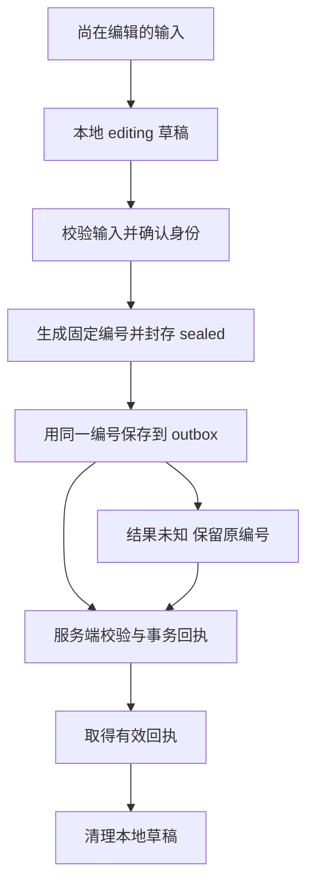

# 第 30 章：统一反馈、弱网恢复与表单草稿

前置：[第 29 章](29-文件剪贴板分享订阅消息与能力检测.md)。本章配套第十一个独立示例 `示例代码/11-studyhub-quality`，完整逐文件代码见 [第十阶段源码附录](第十阶段-完整源码附录.md)。日期：2026-11-02。

这一章进入质量与交付阶段。我们已有任务、笔记、图片、专注、统计和平台交互，现在要回答：用户知道当前在等什么吗？失败后知道该做什么吗？输入是否还能找回？再次点击会不会创建两份数据？

本章先把持久草稿完整落地到任务表单；任务、知识库和统计读取页复用反馈组件与网络提示。知识库原编辑器仍保持第26章的保存协议，没有在本章悄悄声称也获得持久未提交草稿。独立故障实验页可在不连接云的条件下观察读取状态。

建议分五次学习：状态与反馈；网络和等待期限；读取竞态实验；草稿与固定编号；恢复、测试和验收。不要一次背完所有错误代码，先能说清“此时是否已经发出写入”。

## 30.1 质量不只是把报错换成中文

看一个具体过程：用户写完任务，点保存，等待很久后返回。再次进入时，如果表单空白，用户可能重写并再次保存；如果第一次已经成功，就产生重复任务。

好的反馈要同时传达：

1. 当前处于哪个阶段：读取、编辑、本地保存、提交或等待核对。
2. 已经确认了什么：本地落盘、服务端回执，还是仅有网络连接。
3. 还有什么不确定：服务器可能已执行，或者本地清理未确认。
4. 下一步允许做什么：修改输入、重读、用原编号核对、比较版本或检查环境。

如果错误信息只有“失败，请重试”，用户无法判断重试的是读取、创建任务还是发送消息。文案必须与实际恢复协议对应。

## 30.2 先画状态，而不是先放 loading

读取和写入使用不同状态：

| 读取状态 | 含义 | 合理界面 |
| --- | --- | --- |
| loading | 首次读取尚未确认 | 显示正在读取，不显示零结果 |
| refreshing | 同一条件已有旧结果，正在更新 | 显示旧结果并明确标记 |
| ready | 本次取得有效结果 | 展示数据 |
| empty | 读取成功且结果为空 | 说明条件，给出下一步 |
| error | 本次没有取得有效结果 | 显示可执行的恢复动作 |

| 任务表单状态 | 含义 |
| --- | --- |
| loading | 确认身份与初始内容 |
| choice | 找到未提交草稿，等待用户比较和选择 |
| editing | 可以修改输入 |
| sealed | 输入和原操作编号已封存，不能当作全新表单重提 |
| saved | 已取得原操作有效回执，清理本地状态可能还需核对 |
| ended | 只结束了此表单草稿，不声称云端保存 |
| identityChanged | 身份范围变化，隐藏编辑界面并阻止继续提交 |

状态不是装饰。它应决定哪些按钮可用、输入能否修改，以及什么情况下允许清理本地记录。

## 30.3 别把“没有结果”和“没取得结果”混为一谈

三个例子：

- 云查询成功返回空数组：当前条件下确实没有任务。
- 读取超时：不知道是否有任务，不能显示“你还没创建任务”。
- 本次知识库扫描批次没有匹配，但仍有下一游标：还没查完，应显示继续查找。

第26章的 searching 状态继续保留。第28章完整汇总失败也不会变成七个零桶。统一组件不意味着把不同业务状态压成同一个 empty。

空态的文案应带上下文。例如“已完成筛选下暂无任务”比“不存在数据”更有用；但先核对身份与环境，不要把查错环境解释成用户丢失数据。

## 30.4 一个错误对象至少需要哪些信息

本项目沿用：

```js
const error = Object.assign(new Error('等待已超时'), {
  code: 'CLOUD_TIMEOUT'
});
```

message 面向解释，code 面向分类和恢复。写入经 outbox 保留后，还带有 queued=true，表示已有原指令需要核对。

不要用完整错误字符串做业务判断，比如 `message.includes('网络')`；平台文案可能变化。也不要把内部堆栈、完整用户输入或云响应原文直接展示或写日志。

分类还需要操作上下文：同样的超时发生在读取时可以重新读取；发生在创建任务后，必须核对原编号。发生在订阅消息后，应核对消息状态，不自动再发送。

## 30.5 统一的是恢复决策，不是所有错误一个按钮

`utils/feedback.js` 是纯函数：输入错误与上下文，输出展示模型：

```js
{
  code: 'CLOUD_TIMEOUT',
  title: '暂时没有取得结果',
  message: '可检查网络后手动重新读取……',
  action: 'retry',
  actionText: '重新读取'
}
```

重点规则：

| 情况 | 恢复动作 |
| --- | --- |
| queued=true | 到待处理页，用原编号核对 |
| 读取超时/网络错误 | 手动重新读取 |
| 未确认的外部写入 | 核对原操作，不生成新指令 |
| 输入不合法 | 返回修改 |
| 身份/环境变化 | 核对账号与配置 |
| 本地存储失败 | 先保留输入，再重试本地保存 |
| 草稿修订变化 | 比较草稿，禁止覆盖其他页面的新内容 |
| 用户取消 | 正常结束，不强行提示失败并重试 |

queued 的判断放在前面：已经保留的原指令不能被一个通用的 retry 按钮变成“创建另一份任务”。

动作还要匹配页面实际能力：只有拥有草稿的上下文才给“重试本地保存”按钮；普通列表的本地存储错误先显示说明。输入校验直接指出修改内容，不额外摆放一个没有实际处理逻辑的按钮。

## 30.6 展示组件与业务动作分开

`feedback-panel` 接收 feedback 属性，显示标题、说明、核对代码和按钮。点击时只发事件：

```js
this.triggerEvent('action', { kind: value.action });
```

父页面决定去哪里：

```js
onFeedback(event) {
  if (event.detail.kind === 'pending') {
    wx.navigateTo({ url: '/pages/pending/index' });
  }
  if (event.detail.kind === 'retry') {
    this.refresh();
  }
}
```

组件不接收任意函数名并执行，也不把所有按钮都绑定到 onSubmit。这样同一个反馈样式可以复用，恢复语义仍由页面掌握。

任务和知识库下一页失败时，旧列表保留，按钮改成 retryMore，由父页重试下一页；它不会把整个列表刷新当作唯一恢复方式。身份错误则继续走身份核对，而不是硬改成分页重试。

## 30.7 Toast、行内反馈、确认框各做什么

短促、非关键、无需后续动作的信息可以用 Toast。输入错误、结果未知和草稿保存失败适合留在页面内，不能几秒消失后让用户继续猜。

确认框用于明确选择，例如舍弃草稿、比较后采用当前版本。不要每次输入、每次刷新都弹模态框；用户会形成机械点击，真正重要的选择反而失去意义。

“已经取得回执，但本地清理失败”也不该显示统一的“保存失败”。本章分别给出云端确认与本地清理状态。

## 30.8 设备有网络，不代表云服务可达

`getNetworkType` 与 `onNetworkStatusChange` 描述设备报告的连接状态。Wi-Fi可能没有外网；服务器可能超时；函数可能未部署；账号可能没有权限。

所以网络提示只显示 offline/online/unknown 三类事实，不凭 online 自动宣布请求成功。[微信官方网络类型注释](https://github.com/wechat-miniprogram/api-typings/blob/master/types/wx/lib.wx.api.d.ts)

网络恢复后，本例不自动投递 outbox，也不自动请求订阅发送。用户可以重新读取或核对原操作。是否后台同步是另一项业务设计，不能由一个网络回调偷偷决定。

## 30.9 网络监听的所有权与解绑

多个页面可能同时存在于页面栈，不能各自无限注册全局网络事件。本章 `network-core.js` 用一个平台监听服务多个组件订阅：

```text
首个组件订阅 → 注册平台监听并查询当前网络
其他组件订阅 → 复用同一监听
组件卸载 → 取消自身订阅
最后一个组件退订 → 移除同一平台监听函数
```

解绑时传入注册时的同一个函数引用：

```js
wx.onNetworkStatusChange(listener);
wx.offNetworkStatusChange(listener);
```

不能调用无参数 off 去移除其他模块的全部监听。[官方 offNetworkStatusChange 注释](https://github.com/wechat-miniprogram/api-typings/blob/master/types/wx/lib.wx.api.d.ts)

旧环境缺少配套解绑 API 时，本例只查询网络，不反复注册无法管理的事件。组件 detached 后，迟到回调通过存活标记失效。官方 [网络监听示例](https://github.com/wechat-miniprogram/miniprogram-demo/blob/master/miniprogram/packageAPI/pages/device/on-network-status-change/on-network-status-change.js) 用于核对调用形式，本章另外补上共享与资源清理。

## 30.10 查询结果也可能比事件更旧

例如先发起 getNetworkType，随后收到 offline 事件，最后查询返回早先的 Wi-Fi状态。若直接接受最后返回的查询，就会把更近的事件覆盖掉。

服务维护 epoch：查询记录当时的序号；网络事件增加序号；回调只接受仍匹配的查询。

```js
const token = ++epoch;
api.getNetworkType({
  success(result) {
    if (!active || token !== epoch) return;
    // 再发布当前查询的有效结果。
  }
});
```

这和第18章请求竞态的原则相同。Promise完成顺序不等于业务信息的新旧顺序。

## 30.11 云调用需要一个明确的界面等待期限

本章把普通云调用封装成可注入计时器的 `invoke-core.js`。教学默认等待12秒；这是界面策略，不是平台超时上限。

```js
let settled = false;
const finish = (fn, value) => {
  if (settled) return;
  settled = true;
  clearTimeout(timer);
  fn(value);
};
const timer = setTimeout(() => {
  finish(reject, makeError('CLOUD_TIMEOUT'));
}, 12000);
```

成功、失败、同步异常和超时都走同一个 finish，确保只结算一次并释放计时器。迟到响应不改变已经结束的界面等待。

完整代码还在调用前检查配置、校验 ok/error/data 响应结构；网络异常不会返回空数组或零报告来掩盖错误。

## 30.12 Promise超时不是取消服务器

`wx.cloud.callFunction` 的调用形状与文件上传 task 不同，本章没有凭空调用一个 abort 方法。类型边界可查 [官方云 API 类型](https://github.com/wechat-miniprogram/api-typings/blob/master/types/wx/lib.wx.cloud.d.ts)。

也可以用 Promise.race 表达“先完成者决定等待结果”，但另一个 Promise不因此自动取消。[MDN Promise.race](https://developer.mozilla.org/en-US/docs/Web/JavaScript/Reference/Global_Objects/Promise/race)

本章直接使用统一 finish，便于清理 timer 与测试迟到回调。对写入来说，界面超时后服务器可能仍完成任务创建，outbox因此保留原编号，而不是重新生成编号。

订阅回执仍用第29章独立状态机：不能因为普通云调用采用等待期限，就把消息未知状态改成通用自动重试。

## 30.13 先用固定故障实验观察读取体验

从“身份与环境”进入“体验与故障实验”。它不请求云，模式包括：

| 模式 | 行为 | 观察点 |
| --- | --- | --- |
| normal | 返回两条固定数据 | loading到ready |
| empty | 成功返回空数组 | 真正的empty |
| error | 固定失败 | 不显示成空态 |
| flaky | 奇数次成功、偶数次失败 | 同条件刷新失败保留旧结果并标注 |
| slow | 三秒返回，界面等两秒 | 超时后迟到数据不覆盖反馈 |
| never | 不返回 | 等待仍能结束 |

实验中的旧结果都是公开固定数据。真实私人页面不能在账号、环境或筛选变化后继续无条件展示旧用户的数据，因此本章主要云读取页保持先清除旧结果的策略。

## 30.14 同一在途读取合并，不同条件使旧请求失效

`read-controller.js` 的第一条规则：

```js
if (pending && pending.key === key) return pending.promise;
```

用户连续点相同条件刷新，复用已有等待，不叠加多个相同请求。条件变化时增加epoch，让旧结果失效。

合并与防抖不同：防抖通常延后执行，等待用户停止输入；合并让已经开始的同条件请求被复用。它们也不同于缓存，完成后再次刷新仍会真正读取。

本章对写入的重入控制使用 busy与原编号，不把读取合并直接套到所有写操作中。

## 30.15 何时可以保留上次结果

固定实验只有在 key相同、已有数据、调用者明确 keep=true时，进入refreshing并保留旧结果。刷新失败后显示 stale=true与反馈，说明数据不是本次取得的。

换条件时马上清空旧结果，避免旧列表挂在新筛选标题下。私人云数据还需要核对身份范围，不能仅以页面URL或列表标题当作缓存范围。

统计报告则更严格：一次窗口完整读取失败时，不保留旧日期报告装成当前报告；这和普通列表的旧结果参考不能混为一谈。

## 30.16 草稿和待处理指令是两种东西



editing表示还可以修改输入；sealed表示已经为一次提交确定了内容和编号。sealed不一定已经到达服务器，但不能再把它当作可随意改写的新创建。

第25章outbox解决“指令已产生后怎样核对”，本章补齐“指令产生前的输入怎样保存，以及两者之间崩溃怎样衔接”。

## 30.17 草稿需要的字段

`task-draft-core.js` 中一份草稿包括：

```js
{
  slot: 'task:new',
  revision: 1,
  baseVersion: null,
  phase: 'editing',
  updatedAt: 123456,
  values: {
    title: '', description: '', category: 'general',
    priority: 'normal', dueDate: '', done: false
  },
  attempt: null
}
```

slot定位表单；revision是本地修订；baseVersion是云端乐观并发版本；phase区分输入与封存；values保存允许的输入字段。

新建任务用 task:new；实际ID叫new的任务使用 task:id:new，不会碰撞。编辑已有任务必须保存基础版本，不能只保存标题和备注。

## 30.18 未完成输入也应能保存

提交校验要求标题非空，草稿校验则允许尚未填写标题，但仍检查类型、长度、分类、日期等结构。

```js
const draftValues = {
  title: '',
  description: '先记下一些想法',
  category: 'general',
  priority: 'normal',
  dueDate: '',
  done: false
};
```

如果草稿也必须满足完整提交条件，就无法保护用户写到一半的内容。反过来，能保存草稿也不意味着可以跳过正式提交校验。

本章只接收六个固定字段，不把Page.data中的loading、错误提示或用户身份一起保存为业务输入。

## 30.19 先确认身份，再读取私人草稿

本例复用outbox.identity，得到环境、AppID与用户核对标记组成的范围。缓存键按该范围隔离。

打开表单时先在线确认当前身份，再读取该范围草稿；编辑已有任务还读取云端初始版本，并再次检查身份没有在读取期间变化。身份未确认时不猜测“上次登录的是谁”，也不自动恢复上次用户的输入。

已经确认过身份的当前表单在断网后仍可以把输入保存在原范围内。重新进入页面和真正提交时仍要确认身份；它不是完整离线登录或跨账号离线编辑系统。

核对标记用于本地命名空间，不是授权凭证。云端继续从微信可信上下文鉴权。本地缓存属于明文，也不是云备份或跨设备同步。

## 30.20 一个身份最多六份，不无界累积

缓存容器保存 schemaVersion、owner和items。items最多六份，每个slot只出现一次。新增达到上限时明确提示先处理旧草稿，不删掉最旧的内容来假装保存成功。

“当前身份的任务草稿”页提供打开、主动复制和删除未提交草稿。任务后来被删除，也可在管理页复制并清理原未提交输入。

封存指令不能在列表中直接删除；需要从原表单或待处理页核对。容器格式损坏时保留原缓存并报错，不自动重置为空。

## 30.21 本地修订号防止两个页面互相覆盖

两页同时打开同一草稿，不能让较旧页面最后保存就覆盖较新输入。本例每次同步写入前比较expectedRevision：

```js
const oldRevision = old ? old.revision : 0;
if (oldRevision !== expectedRevision) {
  throw makeError('DRAFT_CHANGED');
}
const nextRevision = expectedRevision + 1;
```

保存不同任务时，先读最新容器再替换对应slot，其余草稿保留。删除也检查修订，不能清掉另一页新保存的内容。

这里的同步读改写控制的是当前小程序JavaScript运行过程中的缓存协作，不是多设备数据库事务。云端版本仍由服务端事务负责。

## 30.22 自动保存的触发点与限制

每次输入先更新内存状态，再安排600毫秒后尝试保存；继续输入会清掉旧timer。这是防抖保存，不是每个按键都写存储。

```js
clearTimeout(timer);
timer = setTimeout(() => saveLocalDraft(), 600);
```

页面隐藏、页面内返回与卸载前，再用同步缓存写入补存。测试可控制时钟，不用真的等待半秒。

手机进程可能被直接结束，生命周期回调也不能保证总有机会运行。因此自动保存减少损失，但不能承诺最后一个按键在任意崩溃下都保存成功。重要输入应看本地状态，必要时主动复制保留。

## 30.23 本地状态与“尚未提交”分别展示

localState表示本地保存：clean、dirty、saved、error；dirty表示与初始云端内容是否有差异。这两个量不能合成一个“已保存”。

例如 dirty=true、localState=saved 表示输入已存本地但还没有提交云端。confirmed=true、localState=error则可能表示云端原操作已有回执，只是本地清理未确认。

若用户把所有输入改回初始内容，不需要继续保留一份无差异草稿；本例在修订匹配的前提下清理该草稿。存储失败时保留内存输入，不清空整个缓存。

## 30.24 恢复时先比较，不静默替换最新内容

找到editing草稿后，表单进入choice，显示本地输入与当前云端内容。用户可以恢复，或舍弃未提交草稿采用初始读取内容。

如果草稿baseVersion落后，恢复需要明确确认“把草稿作为编辑内容，采用刚读取的版本作为提交基础”。此时只改变本地表单，不立刻写云。

真正保存仍携带该版本，若云端后来再次变化，事务会拒绝并进入冲突核对。用户确认一次恢复不意味着获得无限覆盖后续更新的权限。

这是一种整份表单选择，不是字段级自动合并。团队协作或复杂正文合并需要进一步设计。

## 30.25 为什么编号必须先和草稿一起封存

仅“草稿保存好了，然后调用create”还不够。如果create成功、outbox清理了，但草稿来不及删除，下次恢复又生成新编号，仍可能重复创建。

本章在发送前确定一个编号，写入同一草稿记录：

```js
const attempt = {
  opId,
  action: 'create',
  payload: { fields }
};
persistDraft({ phase: 'sealed', values: fields, attempt });
await outbox.resume(attempt, expectedOwner);
```

修改任务时payload还包含id/version。封存校验要求attempt与values、任务槽和基础版本完全一致，不允许一个编号恢复另一份输入。

此后再打开表单，只能核对这个原编号；不能把同一封存记录改成一份新创建。

## 30.26 outbox.resume如何衔接旧协议

第25章原submit仍供其他业务使用。本章新增resume供已经封存的任务指令使用：

1. 重新确认身份与expectedOwner相同。
2. 校验原编号和允许的create/update动作。
3. 队列已有相同编号时核对内容完全相同，不替换。
4. 队列没有该编号时，把同一编号重新放回pending。
5. 使用原deliver流程调用服务端，检查有效回执后再清理队列。

队列没有记录不等于服务器没执行：它可能已经清理。重新放入原编号后，服务器回执事务会返回历史结果，从而避免把同一次操作创建成两条任务。

这个安全性依赖回执保留策略，不能随意删掉服务端历史回执再期待旧编号仍能可靠恢复。第25章的回执运维边界继续适用。

还要兼容升级前遗留的outbox：新表单封存前先核对同范围的相关旧指令。内容完全相同就采用旧编号；已有相关指令但内容不同则先引导核对，不生成另一个创建。这样旧编辑器留下的未知结果也不会仅因换了新表单而丢失关联。list(expectedOwner)同时核对身份，防止等待期间改用其他账号的队列。

对象键的插入顺序可能不同，不能只比较原始JSON文本。本章对已校验的JSON业务对象先按键排序，再比较；数组顺序和字符串内容保持不变。这个比较辅助不负责校验类型或授权，也不把不同版本的指令当成同一指令。

## 30.27 检查每一个崩溃窗口

| 发生点 | 重开后的依据 | 本章行为 |
| --- | --- | --- |
| 输入未到防抖时刻 | 可能只有上次草稿 | 如实承认最后输入可能丢失 |
| editing已保存、尚未封存 | 未提交草稿 | 比较后恢复 |
| sealed已保存、队列尚未保存 | 原内容与编号 | 用户用原编号恢复 |
| 队列已保存、网络未发送 | 草稿和pending | 用原编号重试 |
| 服务器成功、响应丢失 | 回执可能已存在 | 同编号核对，不生成新创建 |
| 队列已清理、草稿未清理 | sealed与原编号 | 重放历史回执后清理 |

两个本地键与数据库不共享一个事务。本章靠可恢复的顺序衔接它们，没有声称所有步骤是一次原子写入。

## 30.28 本地写入异常也有“不确定”窗口

同步存储抛错时，不应假定缓存必定没有改变。测试包含“实际写入完成后再抛异常”的模型。

如果sealed已经落盘但调用者没拿到成功，代码还没发云写入；重开后仍能读到原编号。当前旧页面再次保存时会遇到修订变化，不会覆盖这个已封存记录。

如果本地清理已完成但响应异常，再核对发现该slot已不存在，即可结束本地清理。若slot出现了另一页的新修订，则不能为了消除提示删掉它。

## 30.29 三种重试按钮不要串错

| 按钮 | 实际动作 |
| --- | --- |
| 重试本地保存 | 写当前editing草稿，不发送云指令 |
| 用原编号核对/重试 | 恢复同一sealed指令 |
| 只重试本地清理 | 已确认回执后清理当前草稿，不再发送 |

提交前身份查询失败时，还没有产生本次新写入，界面会说明本地输入仍在，网络恢复后可再次手动提交。不能把这一阶段也描述成“原操作已经在服务器执行”。

一旦封存，普通提交和输入都锁住。等待期间busy也阻止重复点击；界面禁用按钮与逻辑层锁需要同时存在。

## 30.30 确认回执不等于对象现在仍存在

第25章回执是原操作历史结果。任务可能随后被删除或修改，因此取得有效回执后，页面写“原操作已确认，返回列表读取当前云端状态”。

已封存的旧任务即使当前查不到，也应该能用原编号核对历史操作。task-session因此在识别sealed后，不以当前任务读取成功作为核对原指令的前提。

相反，普通未提交的编辑草稿遇到任务删除时，不自动把它变成新建任务。用户可到草稿管理复制保留输入，再决定是否另建。

## 30.31 什么时候允许结束封存表单

如果原操作仍是pending，不能“删除草稿后重建一份”。如果原操作已明确blocked，可以经过用户确认舍弃该阻塞指令并结束表单草稿。

如果原编号已不在队列，可能已完成、已舍弃或经过冲突处理被替换。界面要求先核对云端；结束表单只清理本地状态，不据此宣称保存成功。

本章没有自动判断所有人工处置的含义。尤其不能把“队列列表空了”当作服务端一定成功的证明。

## 30.32 页面返回提醒只是补充

任务编辑页在本地保存未确认时，按能力调用enableAlertBeforeUnload；页面内返回还会先同步补存，失败时给出保留输入的选择。

官方注释明确列出适用返回场景，手势滑动返回不保证拦截，也不能阻止用户退出小程序。因此它不能替代持久草稿。[官方返回提醒说明](https://github.com/wechat-miniprogram/api-typings/blob/master/types/wx/lib.wx.api.d.ts)

页面隐藏或卸载时关闭自己启用的提醒，避免影响后续页面。能力不足时仍保留本地保存与页面内返回处理；不同手机的真实行为必须验收。

## 30.33 身份变化与迟到回调

返回表单时会检查身份。发生变化时，保留输入到原范围，隐藏编辑界面，不把旧输入迁移到新用户缓存或作为新用户提交。

草稿管理的复制、删除会捕获点击时的owner和revision；异步确认后再次比较。不能在await之后直接读取一个可能已经被别的刷新改掉的this._owner，再操作新用户的同名草稿。

页面卸载后不再setData；已发出的写入可能仍完成。若收到有效回执，可在修订匹配时清理原草稿；不能清理另一页面的新内容。

## 30.34 从可控实验到真实故障验收

本章新增57个场景，覆盖反馈策略、等待期限、网络事件与查询竞态、读取合并、草稿隔离、容量、修订、封存、回执丢失、清理异常、账号变化与迟到更新。

其中创建回执丢失实验执行实际的云端业务处理模块：第一次创建成功后故意丢失响应，重开表单并以原编号恢复，验证任务集合只有一条、回执也只有一条。

另在第十一个版本执行52个基础、56个知识库、71个计时、60个统计和59个平台继承场景，共355个本地验证；平台继承测试包含真实本机HTTP。微信API、云数据库与消息能力仍是桩或内存模型。[第十阶段验证记录](验证/第十阶段验证记录.md)

未执行微信编译、真实SDK安装、弱网真机、缓存配额、系统返回/杀进程、多设备事务、云权限或消息发送。按 [部署与体验验收清单](第十阶段-部署与体验验收清单.md)逐项记录。

## 30.35 本章项目的运行顺序

1. 导入第十一个外层目录，先从身份页打开固定故障实验，观察各状态与迟到响应。
2. 按前章配置真实AppID/ENV_ID与云函数、九集合权限；本章没有新增云集合。
3. 从任务列表新建或编辑，进入新的task-compose页。原editor页保留为第29章实现对照，默认任务导航已指向新页。
4. 输入一半、隐藏返回、重新进入，核对草稿选择、内容和基础版本。
5. 从草稿管理观察最多六份、不同任务槽、复制与删除未提交草稿。
6. 用模拟测试验证提交窗口；在真实环境再核对弱网、超时、双页面、账号变化和系统返回。
7. 原知识库、图库、专注、统计、文件与订阅回执做回归。订阅函数默认关闭的边界不变。

本章新增主要模块：feedback、invoke-core、network-core、read-controller、task-draft-core和task-session。页面负责交互，核心模块负责可测试规则；后续把草稿迁移到知识库编辑器时，应重新定义其字段、附件、版本和恢复协议，不能只换一个缓存键。

## 30.36 常见问题、练习与下一章

| 现象 | 先检查 |
| --- | --- |
| 有Wi-Fi但读取失败 | 服务器、部署、权限和真实请求结果 |
| 看到旧内容但刷新失败 | 是否明确stale，条件和身份是否相同 |
| 草稿显示saved但云端没有 | 这是本地保存，是否真正提交并取得回执 |
| 原编号封存后不能编辑 | 正在保护不确定提交，应核对原操作 |
| 恢复草稿要求比较版本 | baseVersion与当前读取版本不同 |
| 本地修订变化 | 其他页面可能已保存新内容，勿覆盖 |
| 云端已确认仍提示清理失败 | 只重试本地清理，不重新创建 |
| 返回提醒没出现 | 能力与触发场景有限，不能当作持久化保证 |
| 离线重新打开无法恢复私人草稿 | 当前身份尚未确认，本版不猜测上次账号 |

练习和答案见 [第十阶段练习](第十阶段-练习与参考答案.md)。下一章第31章学习setData成本、列表、图片与分包等性能问题，先测量再优化，并明确真机数据与本地推测的区别。
