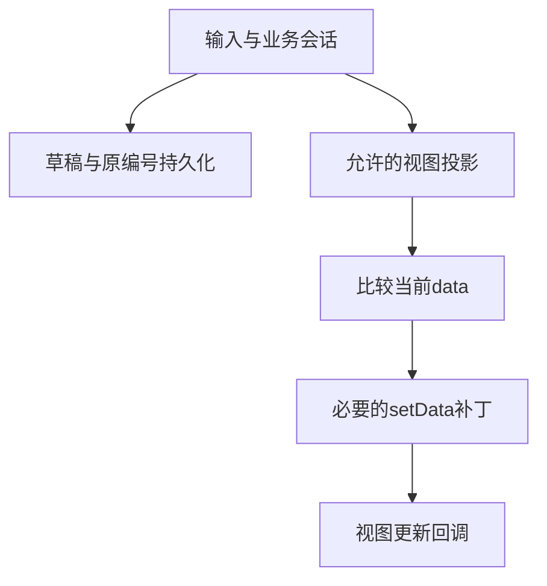

# 第 31 章：性能测量、视图更新、列表、图片与分包

前置：[第30章](30-统一反馈弱网恢复与表单草稿.md)。配套第十二个独立示例：`示例代码/12-studyhub-performance`。完整代码见 [第十一阶段源码附录](第十一阶段-完整源码附录.md)。日期：2026-11-02。

本章在已有功能上优化数据更新、列表保留和代码加载，同时建立可复核的测量方法。我们不会用“感觉更快”代替证据，也不会把本地JSON字节减少说成真机FPS提升。

建议分五次学习：指标与测量；setData与表单；分页与计时；图片；分包与首屏。先运行固定实验，再读具体实现，最后在自己的微信环境填写性能记录表。

## 31.1 先定义“慢”发生在哪一步

“打开慢”可能是代码包下载、脚本注入、页面初始化、网络等待、数据整理、视图更新或图片解码。不同问题需要不同证据。


部分过程可能并行，这张图用于定位职责，不表示所有阶段一定严格串行。先写出问题、触发步骤、设备和指标，再决定修改哪部分。

例如“任务输入时卡”先看更新频率和数据量；“首次进练习页慢”要区分分包下载与页面执行；“滚动久了越来越慢”还要看保留节点、数组和资源。

## 31.2 四类数字不能互相冒充

| 数字 | 本章怎样取得 | 不能直接证明什么 |
| --- | --- | --- |
| JSON近似字节 | JSON.stringify后按UTF-8计数 | 原生桥真实字节、网络流量、FPS |
| setData调用次数 | 适配器或实验循环计数 | 实际绘制帧数 |
| 调用到更新回调耗时 | 当前运行环境Date.now差值 | 物理屏幕绘制完成、冷启动 |
| 客户端源码原始字节 | 文件系统逐文件统计 | 编译/压缩/上传/实际下载包大小 |

这不表示这些数字没有价值。它们能证明特定层次的变化，但结论必须留在对应层次。

## 31.3 实验先固定输入和验收条件

本章设置120条固定教学记录、40次相同状态变化。整体数组方案与单路径方案必须得到相同最终可见数据，才能比较数据更新量。

真实任务表单另用固定输入流，执行实际task-session模块，比较第30章完整快照发送方式与本章投影适配器。

两个实验都不读取用户私人记录，不向云端写任务。固定数据和重复步骤让你修改代码后仍能复核结果。

## 31.4 本次已经测到的模型结果

运行 `工具/导出第31章实验.cjs` 生成 [性能模型结果](验证/第十一阶段性能模型结果.json)。当前固定实验：

| 对照 | 原方式 | 本章方式 |
| --- | --- | --- |
| 120行视图、40次更新的JSON字节合计 | 整体数组562180字节 | 单路径1070字节 |
| 上述更新调用次数 | 40次 | 40次 |
| 两种方案初始化JSON | 均为14075字节 | 均为14075字节 |
| 原DTO与只含展示字段的初始化JSON | 56195字节 | 14075字节 |
| 实际任务会话固定输入流JSON合计 | 125944字节 | 2975字节 |
| 任务会话适配器调用次数 | 33次 | 28次，另跳过5次 |

最终可见投影一致。这里证明数据量和部分调用减少，**没有执行真实微信性能测量，也不能推出“快了几百倍”**。JSON序列化、差异比较本身也有JavaScript成本，净收益需实测。

## 31.5 setData跨越逻辑层与视图层

官方类型说明setData异步发送到视图层，同时同步更新this.data；支持可JSON化数据与数据路径，不能用undefined来表示清空。[官方setData说明](https://github.com/wechat-miniprogram/api-typings/blob/master/types/wx/lib.wx.component.d.ts)

三个成本需要分别看：准备数据、传递数据、视图处理。即使某个字段不显示，把它放进setData仍会增加传递和处理负担。

直接修改this.data不会完成对应视图更新，也容易造成模型与界面不一致。本章没有用这种方式“绕过setData优化”。

## 31.6 不显示的数据放到哪里

本项目有很多逻辑数据：完整DTO、请求序号、定时器、服务器时钟、待处理操作、原编号、草稿修订等。并非每项都需要同步到视图。

实例字段如 `_records`、`_epoch`、`_clock` 可以承担逻辑状态；页面data只放实际展示和交互所需字段。

组件还可按场景使用pureDataPattern标记不用于渲染的内部数据，能力说明可查 [官方组件选项](https://github.com/wechat-miniprogram/api-typings/blob/master/types/wx/lib.wx.component.d.ts)。它不应被当作把所有巨大对象塞进data的理由，也不等于页面任意字段都自动免传输。

## 31.7 视图投影：只决定显示什么

本章 `task-view.js` 的列表投影：

```js
function taskRow(task) {
  return {
    id: task.id,
    title: task.title,
    done: task.done,
    meta: taskMeta(task)
  };
}
```

列表卡片只展示这些字段，因此备注、创建时间、版本等保留在逻辑层。详情页仍按ID读取完整数据。

但是修改任务不能仅用投影字段。列表切换完成状态时，代码从 `_records` 取原DTO，继续提交完整备注和版本，避免优化后把未展示字段覆盖为空。

## 31.8 表单不是每次都要发送完整状态

第30章task-session每次发出状态快照，页面会连同完整fields、比较预览和序列化文本一起发送。状态正确，但有很多重复内容。

本章composeView输出固定的视图路径：

```js
{
  status: state.status,
  busy: state.busy,
  'fields.title': state.fields.title,
  'fields.description': state.fields.description
  // 完整代码还有其他允许的视图字段。
}
```

方括号形式的动态键、对象键中的点都只是JavaScript字符串；交给setData后由小程序按数据路径解释。`'fields.title'` 与嵌套对象 `{fields:{title:...}}` 的更新范围不同。

## 31.9 不需要的预览就不要反复生成

草稿比较文字只在choice状态展示；封存输入的JSON只在sealed状态展示。因此：

```js
out.draftPreview = state.status === 'choice'
  ? state.draftPreview : '';
out.fieldsPreview = state.status === 'sealed'
  ? JSON.stringify(state.fields, null, 2) : '';
```

普通编辑期间保留真实fields，但不为每个按键生成一份重复的大JSON预览。离开比较状态时用空字符串明确清掉旧预览，不能用undefined留下旧内容。

身份变化时，视图投影清除私人输入和预览；逻辑会话仍按第30章规则把输入保存在原身份范围，不向新用户迁移或提交。

## 31.10 差异补丁如何工作

`createPatchWriter`比较固定视图路径的当前值与新值，只发送变化项：

```js
const patch = {};
for (const [path, value] of Object.entries(nextView)) {
  if (JSON.stringify(readCurrent(path)) !== JSON.stringify(value)) {
    patch[path] = value;
  }
}
if (Object.keys(patch).length) send(patch);
```

Object.entries遍历键和值；JSON.stringify用于本例已校验的小型JSON值比较。投影路径来自固定允许列表，不把任意用户输入拼成属性路径。

简单计数器直接比较数字更清楚，不必为所有页面套这层通用封装。本章把它用在快照较大的任务表单中，保留测试与统计来评估成本。

## 31.11 为什么还要读取当前this.data

如果适配器只记住“上次自己发送的值”，页面其他代码直接setData改变同一个字段后，影子记录会过时。

本例注入read函数，从当前this.data按路径读取，防止复制提示等其他更新造成视图与最新模型长期不一致。发送同步抛错时，也不把该补丁记成已经接受。

更大的工程应明确每个视图字段的写入归属，减少多个模块写同一字段。差异适配器不能代替状态设计。

## 31.12 不把关键交互全部延后到下一帧

把所有setData延迟合并，可能让busy等界面标记滞后。本章任务表单保持可见时同步调用setData，使this.data及时更新；业务防重仍由task-session锁和固定编号保证。

隐藏时适配器暂停视图发送，只保留最新投影；会话仍同步保存草稿。重新显示时发送最新差异，卸载后不再发视图更新。

这叫暂停渲染投递，不是暂停业务持久化，更不是取消服务端已经执行的写入。

## 31.13 模型流和界面流分开



隐藏页面时可以暂停C到E；B仍按协议执行。否则一个所谓性能优化可能把最后输入或待确认指令一起丢掉。

本章测试覆盖隐藏期间保存、显示后一次恢复、销毁后迟到回调，以及第30章原指令恢复流程。

## 31.14 列表追加只发送新索引

之前分页使用：

```js
this.setData({ items: [...oldItems, ...nextItems] });
```

这会把已显示部分再放入本次更新。本章追加路径：

```js
const patch = {};
newRows.forEach((row, index) => {
  patch['items[' + (oldRows.length + index) + ']'] = row;
});
this.setData(patch);
```

原数组顺序和新索引必须一致；同一次列表中不能同时覆盖整个items又写其子路径。本例会先按稳定ID去重，再为真正新增的行生成路径。

## 31.15 数组索引不是记录身份

列表可能因筛选、刷新、删除或分页窗口变化而重新排列。异步响应回来后，不能根据旧索引盲写 `items[3]`。

本章继续使用epoch使旧请求失效，交互按ID查逻辑记录，WXML使用 `wx:key="id"`。路径更新解决发送范围，ID和请求序号解决对应关系，两者不能互相替代。

如果你实现乐观更新，应额外核对“此索引仍指向相同ID、条件和版本”，不能仅仅保存一个数组下标。

## 31.16 分页不等于无限保留

每页10条，加载100页后仍可能保留1000个卡片。网络分页控制单次请求，未必控制已保留节点和内存。

本章任务页每组最多六页，因此最多保留60条。到边界后显示“继续下一组（替换当前展示）”，从已有游标继续读取，不跳过后面的记录。

刷新回到第一组。它是明确的分组分页，不是保持任意滚动位置的虚拟列表。用户仍能继续读到最后一条，不会把前60条冒充全部结果。

## 31.17 下一组失败时保留当前组

只有下一组响应有效并通过当前epoch核对后，才替换当前展示。失败时保留原数组、原游标和组号，按钮重试下一组。

同一组追加失败则重试下一页。不能先把当前组清空、提前推进游标，再在失败后让用户无处可回。

本章用135条固定记录验证能遍历全部ID，并核对更换筛选后旧响应不能按旧索引写入新列表。

## 31.18 限制和校验分页协议

客户端仓储继续校验任务结构，并增加每页最多10条、页内ID唯一、非空游标合法且不等于本次输入游标等检查。

这些检查帮助识别适配器异常和停滞分页，但不能把多次数据库读取变成一致快照。读取期间数据变化的边界仍和第21章一致。

性能优化不应移除归属、字段、版本或完整性校验，也不能通过扩大权限或无界读取换取表面上的“少一次请求”。

## 31.19 计时逻辑持续核对，显示值不变就不更新

专注页仍每500ms读取估算时钟、检查异常与到时条件，但只在展示字段变化时setData：

```js
const next = view(session, reading.now);
const patch = {};
for (const key of Object.keys(next)) {
  if (this.data[key] !== next[key]) patch[key] = next[key];
}
if (Object.keys(patch).length) this.setData(patch);
```

没有把计时改为“界面更新一次才累计一秒”。服务器状态机、后台恢复、有限自动核对与幂等终态继续保留；显示刷新少了，不代表业务时钟停止。

## 31.20 图片至少有四种尺寸

| 尺寸 | 含义 |
| --- | --- |
| 源像素 | 图片真实宽高，如1280×960 |
| 压缩文件字节 | PNG/JPEG等编码后的文件大小 |
| 页面显示尺寸 | image在布局中占多大 |
| 解码/纹理等内存 | 运行时资源，可能远大于压缩字节 |

把大图放进小框不会自动减少源文件下载与解码成本。`mode="aspectFit"`控制显示，不是压缩或服务器缩略图接口。

图片目标尺寸应结合显示像素和设备像素比决定，并权衡清晰度。不能对所有设备都断言“160像素足够”或“全部原图最好”。

## 31.21 用固定公开图片观察尺寸

本例分包内提供两张可重建PNG，已核对能正确解码：

| 资源 | 源宽高 | 本次PNG实际字节 | RGBA8像素缓冲理论字节 |
| --- | --- | --- | --- |
| 小图 | 160×120 | 472 | 76800 |
| 大图 | 1280×960 | 30976 | 4915200 |

源像素量相差64倍。RGBA8列仅按宽×高×4估算一块像素缓冲，不是应用总内存，也没包含所有解码器、缓存、纹理或副本。

图案是固定色块，不代表真实照片的压缩率。实际图片字节还受格式、内容、质量和元数据影响。生成器 `tools/make-image-fixtures.cjs` 只用于构建资源，不在小程序运行时执行。

## 31.22 固定占位与原生懒加载

图片实验页采用页面滚动、明确宽高、首张立即加载，后续按开关设置：

```xml
<image mode="aspectFit"
  lazy-load="{{item.index > 0 && lazy}}"
  src="{{item.src}}" />
```

固定占位减少加载前后布局跳变；首张内容不必无条件延迟。原生懒加载的触发、缓存与不同渲染器行为要在实际设备验证。[官方图片示例](https://github.com/wechat-miniprogram/miniprogram-demo/blob/master/miniprogram/packageComponent/pages/media/image/image.wxml)

本实验使用包内重复公开图片，可能命中缓存。load事件次数不等于网络下载次数；同样的12个事件也不证明下载了12份文件。

## 31.23 图片事件也会迟到

切换大小或懒加载开关时生成新的节点ID和revision；load/error回调只接受当前revision，且同一ID只计一次。旧节点迟到事件不会污染新一轮计数。

这是计数实验的规则，不是图片加载真实性证明。真实图片请求、缓存命中、解码与内存需要配合开发工具和真机观察。

私人图库仍保留第24章的压缩上限与服务端归属校验，没有为了加载快就开放云存储直连、把私人fileID批量公开或把Base64大图塞进列表data。

## 31.24 分包解决的是代码加载范围

本章把五个原练习页迁到普通分包packageLab：editor-lab、clock-lab、stats-lab、platform、quality-lab；再加入performance与image-lab两个新页。

```json
{
  "subpackages": [{
    "root": "packageLab",
    "name": "lab",
    "pages": [
      "pages/quality-lab/index",
      "pages/performance/index"
    ]
  }]
}
```

这是结构节选，实际配置有七个分包页。完整路径为root加上页内路径，例如 `/packageLab/pages/performance/index`。官方示例也使用该结构组织多个包。[官方app.json](https://github.com/wechat-miniprogram/miniprogram-demo/blob/master/miniprogram/app.json)

## 31.25 迁移文件还不够，要改路由与依赖

本章同时更新了：

- app.json主包pages与subpackages声明。
- 身份、知识库、专注和统计等页面的练习入口。
- 移动后相对require路径，从两级父目录改为三级。
- 测试加载器，使继承断言真正执行迁移后的源文件。

五个tab页、任务编辑与公开分享入口留在主包。公开卡片和订阅回执跳转仍指向主包public-lab，固定封面也仍可用。

静态检查会检查页面四文件、注册路由与相对模块路径。没有在旧目录留一份重复实现来假装完成分包。

## 31.26 普通分包与独立分包

本例普通分包复用主包的services、utils和components，也继续使用主包App。不能只加 `independent:true` 就假设这些依赖仍成立。

主包不能同步require分包模块。本章工具会检查主包到分包的相对require，导航路径则是合法的页面入口，不等于主包模块导入。

跨包组件、异步分包能力与更复杂加载方式要按当前官方条件单独核对。包体限额、编译行为和平台策略也可能变化，发布前以开发者工具实际结果为准，本章不承诺固定平台配额。

## 31.27 按需注入与分包是两层事

示例设置：

```json
{ "lazyCodeLoading": "requiredComponents" }
```

它涉及页面与组件代码注入方式，不等于把文件自动移动到分包，也不保证所有场景都更快。官方示例采用该选项；性能API注释还提醒，按需注入可能改变脚本与首渲染指标的归属。[官方配置](https://github.com/wechat-miniprogram/miniprogram-demo/blob/master/miniprogram/app.json)、[性能指标注释](https://github.com/wechat-miniprogram/api-typings/blob/master/types/wx/lib.wx.api.d.ts)

如果evaluateScript减少、firstRender增加，应继续比较整体路径，不能只挑一个变小的数字。真实基础库和组件依赖仍需编译与真机验证。

## 31.28 预加载是权衡，不是免费加速

可以按业务进入概率配置预加载，例如说明性配置：

```json
{
  "preloadRule": {
    "pages/account/index": {
      "network": "wifi",
      "packages": ["lab"]
    }
  }
}
```

本示例默认未启用这条规则，便于区分首次进入分包与再次进入。加上后要重新测量：可能减少进入等待，也会让未使用实验的用户提前消耗下载和资源。[官方预加载配置例子](https://github.com/wechat-miniprogram/miniprogram-demo/blob/master/miniprogram/app.json)

不要把小游戏专用接口或名字相近的Worker预下载能力直接搬成小程序页面分包加载方案。普通页面导航会按平台机制加载目标包，能否提前加载应按实际支持条件设计。

## 31.29 源码清单不是编译包体

`tools/package-info.cjs`按miniprogram目录分组统计。当前交付快照：

| 范围 | 第30章原始字节 | 第31章原始字节 |
| --- | --- | --- |
| 主包文件 | 203089 | 197553 |
| packageLab文件 | 0 | 60293 |
| 主包页面 | 21 | 16 |
| 分包页面 | 0 | 7 |

主包原始字节减少，但新增实验和图片让客户端源码总量增加。这个结果不能被写成“项目总体变小”或“实际下载减少同样多”。

编译器处理、压缩、依赖、未用文件和平台打包策略都会影响最终结果。上传前用开发者工具记录实际主包/分包大小与依赖，源码清单只作为早期结构证据。

## 31.30 首屏至少区分这些时间点

onLoad不是用户点击小程序的时刻；onReady也不等于所有关键图片已显示；setData回调不是屏幕扫描输出完成。

本实验页记录onLoad到onReady的Date.now差，明确标为墙钟生命周期差值。它不包含本页加载之前已经发生的完整分包下载或小程序启动过程。

真正评估首屏要定义用户需要的内容，例如“任务列表首批可读且主要按钮可用”，再结合平台公开指标、网络阶段和实际视觉观察。

## 31.31 开发采样默认关闭

`config/performance.js` 默认ENABLE_DEV_METRICS=false。启用后App只创建一个观察器，采集navigation/render/loadPackage中允许的名称和数值，最多保留最近40条。

```js
const performance = wx.getPerformance();
const observer = performance.createObserver(list => {
  // 按允许名单提取name、entryType、startTime、duration。
});
observer.observe({ entryTypes: ['navigation', 'render', 'loadPackage'] });
```

不记录URL、查询、页面输入或完整原始条目。不支持包加载类型时尝试保留路由和渲染；能力完全不可用时不阻断业务。[官方Performance API与指标](https://github.com/wechat-miniprogram/api-typings/blob/master/types/wx/lib.wx.api.d.ts)

无条目表示没有捕获或不支持，不表示零耗时。缓冲未按页面筛选，不能把别的页面firstRender当作当前页结果。

## 31.32 不把浏览器API习惯直接套过来

本次读取的微信Performance类型提供条目与观察器接口，没有列出浏览器那样的now方法。本例本地回调实验使用Date.now，并说明墙钟精度与改时风险；不假定 `wx.getPerformance().now()`存在。

样本出现负差值或明显改时会作废。0ms也受时钟分辨率影响，不能解释成“完全没有耗时”。

若使用其他更适合的计时能力，应先确认当前平台的真实接口和单位；不要把浏览器Performance、小游戏接口和小程序类型混成一个对象。

## 31.33 在自己的微信环境运行原生更新实验

性能页提供整体数组与单路径两种按钮：先初始化相同120行，再等待40次更新回调，打印初始化回调差值、更新字节和本轮回调等待分布。

数据准备和JSON计数发生在每次计时起点之前，样本对应setData调用到更新回调，不包括全部业务计算。首批初始化与40次更新分别记录。

离开页面会取消本轮等待并作废未完成结果；迟到回调不能启动后续更新。它结束的是测量流程，不把服务端操作回滚。本实验本身没有云写入。

## 31.34 为什么要测试A到B和B到A

第一次运行可能包含缓存、组件初始化和引擎预热；连续运行又可能受温度、功耗和后台任务影响。

分别按A→B、B→A运行多轮，记录设备、微信、基础库、渲染器、代码版本、网络与调试开关。相同场景比较中位数和分布，而不是挑最快的一次截图。

本章nearest-rank百分位算法先按数值排序，再取 `ceil(p*n)-1` 位置。样本太少时p95往往接近最大值，应报告样本数与方法。不能把40次同轮回调当作40次独立冷启动。

## 31.35 调试工具也会影响测量

开发者工具运行环境不是手机；日志、vConsole、录屏、分析器和采样本身都可能改变结果。官方性能注释也指出，vConsole可能影响firstPaint/firstContentfulPaint时机。[官方注意事项](https://github.com/wechat-miniprogram/api-typings/blob/master/types/wx/lib.wx.api.d.ts)

建议先用工具定位，再在目标手机的受控场景验证。冷启动、热启动、首次进入分包和再次进入分别记录，不为造“冷数据”清空真实用户的草稿与待处理指令。

## 31.36 性能预算先作为项目约定

本章固定实验限制最多200行、100次更新；实际任务组最多六页，每页最多10条；性能缓冲40条。它们是教学边界，不是微信平台限额。

真实预算应根据产品和设备确定，例如首屏关键内容、单次更新数据量、列表保留量、图片目标像素与持续内存。先记录基线，再设可验证目标。

没有测量依据时，不给所有小程序一套通用“必须多少毫秒”的数字，也不靠删掉权限校验、草稿保护或错误反馈来过预算。

## 31.37 验证与证据范围

本章新增45个场景，覆盖投影差异、隐藏与恢复、分页分组、原DTO写入、相同计时显示、回调期限、样本作废、观察器、图片事件和分包依赖。

继承第30章355个场景，共400个本地验证。原生实验页面的40步逻辑使用回调桩测试；不是实际手机更新计时。平台继承测试仍包含真实127.0.0.1文件上传下载。

[第十一阶段验证记录](验证/第十一阶段验证记录.md)与性能模型JSON分别给出场景和确定性结果。两张PNG已解码目视核对，但未验证真实微信懒加载触发、GPU内存或真机首屏。

## 31.38 运行步骤与未完成的真实测量

1. 导入第十二个项目，从身份页进入性能对照实验，无需云即可运行固定JSON模型。
2. 运行Node导出脚本，核对固定字节、最终状态、表单投影与源码清单。
3. 在实际微信环境分别运行原生更新两种模式，多轮记录，不用Node耗时代替手机结果。
4. 检查分包页面、主包共享依赖、迁移后的所有入口、公开分享与返回行为。
5. 切换图片尺寸和懒加载，观察布局、事件、缓存与真实资源占用。
6. 需要公开指标时再启用开发采样并重新启动；正式使用前决定是否关闭或采用受控监测。
7. 回归任务草稿、原编号、知识库、专注、统计和平台功能，填写 [性能验收与测量记录](第十一阶段-性能验收与测量记录.md)。

真实SDK安装、微信编译、编译包体、首屏/FPS/CPU/内存、不同设备、弱网与真实云性能本次均未执行。

## 31.39 常见误区、练习与下一章

| 说法 | 应怎样核对 |
| --- | --- |
| JSON少99%，所以速度快99% | 分别测计算、传递、视图和设备表现 |
| 分页后列表不会越来越大 | 检查实际保留行数和节点 |
| 用路径更新就不会乱序 | 还需ID、条件、epoch和版本对应 |
| 小框显示大图就省内存 | 检查源像素、解码和纹理资源 |
| load事件12次就是下载12次 | 缓存与重复资源会改变关系 |
| 分包后总体一定更小 | 区分主包、总源码和编译包 |
| onReady就是首屏完成 | 先定义需要可见和可用的内容 |
| 指标没捕获就是0ms | 保留未知，不编造结果 |

练习见 [第十一阶段练习与答案](第十一阶段-练习与参考答案.md)。下一章第32章讨论基础库兼容、WebView/Skyline差异、无障碍和真机适配，继续区分“源码写了”“工具通过”与“目标设备验证”。
