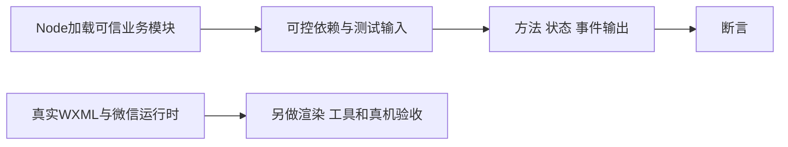

# 第33章：纯函数、异步、组件与关键流程测试

前置：[第32章](32-基础库兼容渲染器无障碍与真机适配.md)。第十四组示例：`示例代码/14-studyhub-testing`。完整代码见 [第十三阶段源码附录](第十三阶段-完整源码附录.md)。编写日期：2026-11-02—03，实测电脑端Node v24.15.0。

前面每章都写了验证场景，现在把它们组织成可以自己维护的测试体系。你会写断言、控制时间与响应顺序、测试组件方法、准备模拟渲染，并解释测试能证明和不能证明什么。

建议分六次学习：第一个测试；边界与断言；异步与时钟；组件与页面；关键流程；报告、覆盖率、故障变体和回归。不要一开始同时安装多种框架；默认套件只需Node标准库。

## 33.1 测试是可执行的约定

“点过一次没问题”不能保证下一次修改仍正确。自动测试把输入、操作和预期写下来，每次修改后重复核对。

例如约定“空白标题不能提交”“旧响应不能覆盖新筛选”“封存恢复用原编号”。测试应该描述这些可观察行为，而不是只证明某个函数被调用。

断言失败可能是实现错误、测试错误、数据/环境变化或契约变更。先定位事实，再决定改哪边，不要先把预期改成当前输出。

## 33.2 本章的交付范围

第十四组复制第32章业务，客户端、云函数和独立渲染探针逐字节一致，没有新增业务页面、集合或权限。新增在tests/与ci/。

四组50项教学测试：unit14、async12、component/page-method10、flow14；另在本版运行450项继承场景，共500项。本章新增测试与继承测试存在规则重叠，数量不是500种互不重复功能。

3个负向通路与3个固定故障变体单独记录，不加入500。可选DOM渲染、开发者工具自动化、真实云和真机未运行，不能写成通过。

## 33.3 先分清测试层次

| 层次 | 本例验证什么 | 不能替代什么 |
| --- | --- | --- |
| 纯函数 | 输入、输出、边界、不修改输入 | 原生事件和界面 |
| 异步模块 | 状态、期限、乱序、取消、清理 | 真实网络/云执行 |
| 组件/页面方法 | 事件载荷、禁用、逻辑数据 | WXML绑定、真实生命周期 |
| 客户端流程集成 | 会话+草稿仓储+假回执服务 | 云事务、真实权限和并发 |
| 组件模拟渲染 | 模板、组件树、模拟事件 | 微信双线程、原生控件、读屏 |
| 开发者工具自动化 | 工具里的页面交互链 | 所有手机与原生能力 |
| 真机/真实服务 | 实际权限、输入、布局、云环境 | 不能靠本地桩自动获得 |

低层测试通常更快、更容易定位，高层测试连接更多真实边界。围绕风险组合，不为追求某种图形比例机械增加用例。

## 33.4 为什么电脑不能直接require一个Page就当微信运行

页面执行会调用Page、wx等微信全局；Node没有这些原生对象。我们可以捕获Page/Component定义并注入替身，但必须承认只模拟了选定行为。



本章VM辅助器不渲染WXML、不自动派发所有生命周期、不模拟桥接耗时，也不是安全沙箱。[Node VM说明](https://nodejs.org/download/release/v24.15.0/docs/api/vm.html)

## 33.5 先认识目录和运行位置

```text
14-studyhub-testing/
  miniprogram/                 业务客户端，延续第32章
  cloudfunctions/              原云函数
  renderer-probe/              独立渲染实验
  package.json                默认Node测试命令，无第三方依赖
  tests/
    unit.test.cjs
    async.test.cjs
    component.test.cjs
    flow.test.cjs
    support/                  时钟、替身、装载、判定与代码摘要
    reporter.cjs
    run.cjs
    fixtures/                 故意失败/跳过/超时，只供负向实验
    optional/                 独立Jest+DOM模拟工程，尚未运行
    reports/                  结构化结果
  ci/github-actions.example.yml
```

本章默认命令从第十四组项目目录运行；课程级继承命令则从教程目录运行。`.cjs`明确使用Node的CommonJS模块，测试工具不导入小程序客户端。

## 33.6 第一个可以运行的测试

下面是简化说明性例子；实际测试见unit.test.cjs：

```js
const test = require('node:test');
const assert = require('node:assert/strict');
const { validateFields } = require('../miniprogram/utils/task');
const { defaults } = require('../miniprogram/services/task-session');

test('空白标题不能提交', () => {
  const input = { ...defaults(), title: '   ' };
  const error = validateFields(input);
  assert.notEqual(error, '');
});
```

test登记名称与测试函数。assert来自严格断言模块；notEqual要求错误不是空字符串。这里直接调用实际业务校验，没有复制另一份校验器。[Node测试器](https://nodejs.org/download/release/v24.15.0/docs/api/test.html)、[严格断言](https://nodejs.org/download/release/v24.15.0/docs/api/assert.html)

## 33.7 看懂失败输出

测试名告诉你违背了什么约定；actual/expected差异告诉你观察到什么；堆栈帮助定位断言和调用位置。第一处业务相关错误往往比最后一行汇总更有价值。

不要只断言 `Boolean(result)`，因为一个错误对象也可能是真值。需要任务ID就核对ID，需要拒绝写入就核对请求数为0。

本例保留故意失败fixture：2+2与5不相等。它只在负向实验中运行，子进程失败是预期，正常50项不会包含它。

## 33.8 准备、动作、断言

一个测试通常分三段：准备明确初始数据，执行目标操作，断言可观察结果。

```js
const old = [{ id: 'a' }];                       // 准备
const result = appendRows(old, [{ id: 'b' }]);   // 动作
assert.deepEqual(result.added, [{ id: 'b' }]);   // 断言
assert.equal(old.length, 1);                    // 不修改输入
```

不必把每一行都写注释，但复杂场景要让读者看懂初始状态和触发点。一项业务约定可以有多个相关断言，别把断言条数当成测试价值。

## 33.9 边界要测两侧

标题最多40个代码单元，就测40与41；备注1000，就测1000与1001；日期要测合法闰日与非法日期；布尔字段要区分false与字符串'false'。

有效值、边界、无效类型、缺失字段各有用途。只测一组普通成功数据，很难发现比较符、类型转换或空白输入问题。

断言按业务口径设计：本课程length计UTF-16代码单元，不是所有用户感知字形。测试不能一边按代码单元，文案一边承诺“40个任意字符”。

## 33.10 参数化可以减少重复，但不要隐藏场景

```js
for (const [name, title, accepted] of [
  ['边界内', 'x'.repeat(40), true],
  ['超边界', 'x'.repeat(41), false]
]) {
  test('标题：' + name, () => {
    const error = validateFields({ ...defaults(), title });
    assert.equal(error === '', accepted);
  });
}
```

这是说明性写法，不额外加入本章50项。每组数据生成独立名称，失败能定位到具体输入。表太大时应按风险拆开，而不是让一个巨型测试难以解释。

## 33.11 预期不能由被测实现自己算

如果测试compareVersion时，再用同样的字符串比较生成expected，就可能把相同错误复制两遍。应先手算2.10高于2.9，用独立事实作基准。

统计日界线用人工日历核对；黑白对比21:1、同色1:1是已知点；数组去重检查唯一性、顺序和输入不变，而不是只把当前输出保存成“正确快照”。

复杂规则可以结合手算例子、性质、不变量和另一条独立验证路径，减少实现与预期共同出错的风险。

## 33.12 性质测试不等于无约束随机

例如追加去重应满足：新增ID没有在旧组出现、批内唯一、先出现顺序保留、原数组不变。固定几组对抗数据就能表达这些性质。

需要随机扩展时，使用固定种子、记录失败输入并把最小失败例保存为回归；不要每次Math.random不同，失败后无法重现。

本章50项没有引入第三方性质测试库，也没有宣称穷举所有输入。大量无意义随机值不能代替理解业务边界。

## 33.13 测试替身分别做什么

| 名称 | 作用 | 本章例子 |
| --- | --- | --- |
| dummy | 占位但不参与本次行为 | 未使用的可选参数 |
| stub | 返回指定结果或错误 | 读取返回固定列表 |
| spy | 记录调用/载荷 | triggerEvent事件数组 |
| fake | 简化但有状态的实现 | 内存缓存、假回执服务 |

名称不重要到需要死记，重要的是明确替换了哪一层。假回执服务按编号返回旧结果，只证明客户端能与这个假协议协作，不证明真实云已经幂等。

## 33.14 依赖注入让行为可控制

实际task-session已接受repository/outbox/drafts、emit与定时器：

```js
const session = createTaskSession({
  repository,
  outbox,
  drafts,
  emit: state => states.push(state),
  setTimer: clock.setTimer,
  clearTimer: clock.clearTimer
});
```

业务调用约定好的接口，测试注入可控实现。正常页面仍注入真实适配器，不需要在业务里写“如果正在测试就跳过权限”。

尽量在外部边界注入，而不是把每个内部函数都换成mock；否则可能只测到自己搭的替身。

## 33.15 虚拟时钟负责推进，不负责等待现实

tests/support/core.cjs用Map保存定时任务，tick推进到目标时间，依次执行到期任务；相同到期时间用登记序号稳定排序。清理会从Map删除任务。

它是本章setTimeout风格的有限模拟，不完整重建微信后台或Node事件循环。设有步数保护，避免错误回调无限创建立即任务让测试卡死。

注入now、setTimer、clearTimer，让业务时间由测试决定；不必为了测600ms保存真的等600ms。

## 33.16 599与600毫秒的测试

```js
await session.open();
session.change({ title: '输入' });
clock.tick(599);
assert.equal(drafts.get(owner, ''), null);
clock.tick(1);
assert.equal(drafts.get(owner, '').values.title, '输入');
```

前一断言防止提前保存，后一断言防止一直没保存。两侧都测，才能发现599/600边界比较错误。

测试结束调用session.close并检查计时器归零。连续输入另测期限重置，只保存最新内容；关闭补存则是另一个约定。

## 33.17 tick不自动完成所有Promise

推进定时器和清空Promise微任务不是同一件事。本章部分读取内部先安排Promise.then，所以测试会让明确的微任务推进，再触发时钟期限。

不要把clock.tick(1000)当作“所有异步已经完成”。需要结果时await业务Promise；需要某一步确实到达时，用完成信号。

Node的mock timers也有具体版本与行为条件，本例采用显式注入时钟以控制范围，不把浏览器/微信后台规则混进电脑测试。

## 33.18 可控Promise怎样实现

```js
function deferred() {
  let resolve, reject;
  const promise = new Promise((yes, no) => {
    resolve = yes;
    reject = no;
  });
  return { promise, resolve, reject };
}
```

Promise构造器同步提供resolve/reject，测试把它们保存到外部，决定何时返回结果。业务只看到promise，不知道测试控制器。

可以先发A再发B，让B先成功、A后成功；也可以让写入已完成但响应丢失。这样的控制比猜网络快慢可靠。

## 33.19 乱序必须真正制造出来

异步组对实际read-controller操作：发A→让A已开始→发B→B成功→A迟到。最后断言仍显示B。

如果两个请求都立刻成功，或者测试没让A开始就取消，可能没有走到想测的乱序分支。准备数据和触发时点必须与测试名一致。

同键请求另测复用同一个Promise与一次底层load，避免“看起来请求成功但实际发了两遍”。

## 33.20 用到达信号替代随便睡一会

快速重复提交场景中，假服务在收到请求时resolve一个received信号。测试await该信号后检查只有一次投递，再释放hold。

```js
const first = session.submit();
const second = session.submit();
await fake.received.promise;
assert.equal(fake.requests.length, 1);
fake.flags.hold.resolve();
await Promise.all([first, second]);
```

不使用“等500ms应该到了”的假设。外层测试仍有期限，信号永不到应失败，而不是无限挂起。

## 33.21 await断言，避免假通过

```js
await assert.rejects(invoke('studyhub', {}), {
  code: 'NOT_CONFIGURED'
});
```

同步抛错用assert.throws，Promise拒绝用assert.rejects并await。只调用一个异步函数却不等待，测试可能提前结束。

回调也要接入可等待的完成信号，并在失败时拒绝；不能把回调里的断言异常随手catch掉。测试代码本身同样需要可靠的错误传播。

## 33.22 期限、取消与服务器执行分开

本章验证：界面超时后不重发、迟到响应不改状态、取消前未启动的读取不调用load。它们是客户端约定。

这没有证明服务器任务取消，也没有把写入未知变成写入失败。原编号、封存和回执恢复仍按第25/30章处理。

异常路径同样核对请求次数、持久状态和清理，而不是只看“出现一个错误对象”。

## 33.23 每个测试都负责清理

```js
t.after(() => {
  controller.dispose();
  assert.equal(clock.count(), 0);
});
```

清理不应依赖最后一条断言执行成功，所以用after或try/finally。组件挂载、监听、定时器、临时服务都要有归属。

不为测试方便去清空全局微信监听或真实缓存。测试自身的数据放在独立实例与固定内存容器中，不跨用例共享可变状态。

## 33.24 缓存与模块隔离

require会缓存模块，若模块有全局可变状态，可能让单独跑通过、整组跑失败。本例优先使用工厂创建独立会话、仓储和时钟。

VM捕获的定义每次重建，组件data和事件记录分别复制；真实依赖仍通过明确的require加载。JSON复制仅适用于本例约定的JSON数据，不是通用对象克隆器。

不要随便删除整个require.cache来“治好”失败，那可能掩盖状态归属问题。先明确共享的是纯工具还是会变化的单例。

## 33.25 捕获Component定义的测试在做什么

辅助器临时提供Component函数，保存实际组件定义，然后创建有data、properties、setData、triggerEvent的测试实例，将methods绑定到该实例。

```js
const { instance: card } = component('task-card');
card.data.task = { id: 'a' };
card.onOpen();
assert.deepEqual(card.events, [
  { name: 'open', detail: { id: 'a' } }
]);
```

这验证onOpen方法和事件协议。它没有点击WXML里的按钮，没有证明bindtap正确，也没有证明真实辅助技术读出名称。

## 33.26 观察器和页面生命周期要诚实标注

组件测试直接调用实际task观察器，验证meta不变不重复setData；不是框架自动派发观察器。页面方法组直接调用onLoad/onShow/onHide，核对隐藏后焦点回调不更新。

测试名使用component或page-method，避免把它描述成原生组件渲染测试。WXML静态事件方法存在检查也只补充结构证据。

要验证模板与方法连线，需要进一步的组件树/工具自动化；原生控件与生命周期仍需真实环境。

## 33.27 可选组件模拟渲染工程

`tests/optional/`独立准备了Jest29.7.0、jest-environment-jsdom29.7.0和miniprogram-simulate1.6.2直接依赖候选，以及两项实际task-card模板测试。

官方simulate在DOM环境构建组件树，使用单线程模拟，不等于微信原生运行机制。[官方工具介绍](https://github.com/wechat-miniprogram/miniprogram-simulate)

本次没有安装或运行可选工程，也不计入500。首次npm install后保存、审核锁文件，再用npm ci重现；直接依赖固定不等于传递依赖已锁定。

## 33.28 Jest和jsdom要显式配置

```js
module.exports = {
  rootDir: __dirname,
  testEnvironment: 'jsdom',
  testMatch: ['<rootDir>/*.render.spec.cjs'],
  testTimeout: 10000
};
```

不要把历史教程“Jest总是内置jsdom”照搬到任意版本，本例把环境包单独列出，且只匹配可选目录，避免混入node:test和故意失败fixture。[Jest环境配置](https://jestjs.io/docs/configuration#testenvironment-string)、[固定Jest源码版本](https://raw.githubusercontent.com/jestjs/jest/v29.7.0/packages/jest/package.json)

可选测试缺依赖会失败，不用skip包装成绿色成功。发生编译器或环境错误时先分层定位，再判断是不是业务缺陷。

## 33.29 模板模拟测试要看真实连线

可选示例读取实际组件，选择simulate编译器，render后attach到DOM，查询两个button、触发tap、观察open载荷，再测试disabled更新；finally里detach并移除父DOM。

```js
const id = simulate.load(componentPath, {
  rootPath: clientRoot, compiler: 'simulate'
});
const comp = simulate.render(id, { task, disabled: false });
```

这些是官方提供的模拟器接口形状；模拟编译器有特性限制，不能由一个卡片推断所有模板或Skyline兼容。[API与编译选项](https://raw.githubusercontent.com/wechat-miniprogram/miniprogram-simulate/master/docs/api.md)、[限制说明](https://github.com/wechat-miniprogram/miniprogram-simulate/blob/master/docs/todo.md)

断言用户关心的文本、节点与事件，不把全部HTML快照当作唯一证据。选择器若因无关排版变化频繁损坏，应检查它是否过度绑定实现细节。

## 33.30 开发者工具自动化属于另一层

开发者工具自动化能把页面路由、输入、点击和状态读取连接起来，但需要实际开发者工具、当前自动化接口、可用项目与测试环境。

本次尝试官方自动化入口，检索工具无法读取正文，未安装或连接automator，因此没有猜测接口拼出“已验证脚本”。官方入口供执行时核对：[自动化起步](https://developers.weixin.qq.com/miniprogram/dev/devtools/auto/quick-start.html)。

先验证固定本地清单流程；明确服务启动、连接、页面定位、状态断言、期限和断开，再扩大到云环境。工具成功仍不证明读屏、手机键盘或所有原生能力。

## 33.31 一条界面流程如何写成可执行规格

| 步骤 | 动作 | 应断言的结果 |
| --- | --- | --- |
| 进入 | 身份页→兼容→本地清单 | 当前页与固定3项 |
| 校验 | 空标题提交 | 具体错误、仍3项、原输入保留 |
| 改正 | 输入合法标题并添加 | 新项、标题、4项汇总 |
| 完成 | 选择新项checkbox | 该ID已完成、汇总完成1 |
| 恢复 | 隐藏再返回 | 页面按协议可操作、无迟到覆盖 |

这些步骤可先人工执行，再映射成当前官方工具支持的操作。不要只断言“点击没抛异常”；要读取可见状态或业务结果。详见 [测试运行与分层验收](第十三阶段-测试运行与分层验收.md)。

## 33.32 流程集成连接哪些真实模块

flow组使用实际createTaskSession和createTaskDraftStore，注入内存read/write、可控时钟与假outbox回执服务。不是为每个业务动作重新写一遍成功逻辑。

它检查模块间约定，例如先封存再发送、身份变化不提交、同槽revision冲突、旧基础版本需明确采用当前版本。

假服务不连接云，也不执行真实数据库事务；此前450项继承包含实际domain的内存验证，真实云仍独立验收。

## 33.33 正常提交也检查持久化顺序

假服务在接收resume时先核对草稿为sealed且编号一致，否则拒绝。测试从open、change、submit到confirmed和本地清理走完整客户端链。

断言不仅是最后confirmed=true，还检查首次投递数量、草稿是否清理。若封存失败，另一项测试要求请求数与新编号数都为0。

这是把“先保存恢复依据，再发送”变成可执行约定，不能为了简化测试让fake无条件返回成功。

## 33.34 响应丢失是关键恢复场景

测试顺序：假服务按原编号保存结果→模拟传输响应丢失→客户端保留sealed→手动replay→返回同一假回执。

```js
const original = session.snapshot().opId;
await session.replay();
assert.deepEqual(fake.requests.map(x => x.opId), [original, original]);
assert.equal(fake.writes, 1);
```

这里writes是本地假服务计数，不是云数据库实际写入次数。它能发现客户端换编号或乱清草稿，但不能证明生产服务的并发隔离或恰好一次。

## 33.35 重启恢复与本地清理失败分别测

重开封存草稿应直接识别原编号，不先生成第二个操作；回执已取得但本地清理失败，应只重试清理，不再创建任务。

本章各有一项流程测试，分别控制丢响应、关闭重开和清理异常。不同故障不要塞成一个难以定位的大用例。

恢复后读取当前云状态仍是独立动作；原回执表示原操作结果，不保证对应记录此刻仍存在。

## 33.36 身份、版本和同槽冲突

identity从A变化到B，客户端要停止发送，原输入留在A范围。另一个页面更新同一草稿槽时，旧revision不能覆盖新内容。

云baseVersion变更也与本地revision不同：恢复旧草稿要比较后明确采用当前版本，提交仍受服务器条件控制。

测试不能把所有冲突都设为“最后写入获胜”来方便通过。相关真实权限与并发由独立教学环境验证，不能用fake代替。

## 33.37 fake也要接受契约审查

如果实际API返回包裹对象，stub却直接给数组，测试可能永远不经过真实解析路径。如果fake允许任何字段，实际服务拒绝输入，集成后仍失败。

先写清适配器的输入、输出、错误和副作用范围，用固定真实格式样本核对；客户端与服务端共享协议副本也要检查一致。

本章fake明确只承担客户端流程，不声明模拟所有outbox、数据库和网络规则。需要服务器保证时，增加真实domain/服务测试，不给fake贴更大的标签。

## 33.38 测试数据与环境分开

默认测试使用固定教学标题、测试环境标记和内存容器，没有真实AppID、凭证、私人正文或消息发送。不得把生产ENV_ID直接接到默认套件。

真实集成验收使用独立教学环境、明确测试记录ID和清理协议；不要为让测试变绿删除回执、附件引用、进行中专注或用户草稿。

报告、截图与失败日志同样注意范围。代码摘要能帮助识别输入版本，不是签名或安全认证。

## 33.39 本次覆盖率的准确口径

本章实际运行 `node tests/run.cjs --coverage`。这轮50项加载并匹配miniprogram筛选的16个JS文件，共618行，其中478行被记录执行，约77.35%。

这是该轮、该工具、该筛选与已加载文件集合的行覆盖率。没有加载的业务、云函数、WXML、原生渲染、读屏、真实网络不在这个数字里。

报告列出文件与分母，不能写成“整个微信小程序覆盖率77.35%”。以后代码或工具变化，分母和结果会变化，应重新运行而不是保留漂亮数字。

## 33.40 覆盖到了不代表断言正确

执行了一行，不表示检查了它的业务结果；成功路径也不表示错误路径正确。高覆盖率可能仍漏掉权限、竞态或恢复规则。

覆盖率用于发现值得检查的空白，再按风险补例子。不要为了100%去删除难测分支、忽略错误或只写没有有效预期的调用。

Node本版本的覆盖率功能仍标为实验能力，报告结构按对应版本读取。[对应Node版本的覆盖率说明](https://nodejs.org/download/release/v24.15.0/docs/api/test.html#collecting-code-coverage)

## 33.41 用故障变体检验断言

本例在内存源码克隆里注入三种固定错误：版本误用字典序、追加丢失去重、恢复另换编号。先跑同一probe的正常基线，再要求变体触发AssertionError。

加载失败或语法错误不算“断言发现业务缺陷”；实验锚点变化应先检查。原业务文件在前后逐字核对一致。

三种都被检出，仅说明这三种固定变体可被这些probe发现，不是完整项目的变异分数，也不证明没有其他缺陷。源码见tests/mutations.cjs。

## 33.42 失败、跳过与取消不能算全量通过

test命令可能在某些skip场景退出0，但这并不符合本课程完整验收要求。故意失败、故意skip、故意超时三个fixture被单独启动，入口都必须拒绝当作全量通过。

完整50项要求：子进程退出0、最终汇总success、tests和passed均50、无failed/cancelled/skipped/todo、场景记录一致。

这些数量是本套件的清单约定，增加/删除测试要有解释并同步入口，不能静默少跑一半仍沿用旧“通过”结论。

## 33.43 不解析人类格式的漂亮输出

Node默认spec/TAP输出可能随版本变化。本例自定义reporter消费结构化事件，只取全局最终summary与场景结果，而不是用正则数“pass”字符串。

多文件运行还可能有逐文件summary，不能把每个都当最终总数。源代码说明保存了Windows路径处理：reporter导入地址由pathToFileURL转换，避免C盘路径被误读成URL协议。

失败时写当前失败报告并返回非零；不能继续展示上次通过报告当本次成功。[Node自定义报告与事件](https://nodejs.org/download/release/v24.15.0/docs/api/test.html#custom-reporters)

## 33.44 报告如何关联本次源码

latest.json包含runId、executedAt、Node版本、sourceDigest、场景、统计与证据边界。courseDate是教材日期，executedAt才是本机实际运行时间，时钟准确性仍取决于机器。

sourceDigest按约定代码/配置文件排序计算SHA-256，排除node_modules和reports；文档等不在摘要范围。运行前后再比摘要，防止测试时源码变动却保留绿色结论。

摘要不证明所有文件都被执行，也不验证原生环境。修改业务/测试后重新运行，不手工改JSON为passed。

## 33.45 一个稳定的运行入口

在第十四组目录运行：

```text
node tests/run.cjs
node tests/run.cjs --coverage
node tests/check-failure-path.cjs
node tests/mutations.cjs
```

默认不需要npm install，也可用package.json脚本。入口使用process.execPath启动当前Node，以参数数组传路径，不拼接shell字符串；有每项期限和子进程上限。

按名调试用直接命令：

```text
node --test --test-name-pattern="标题40" tests/unit.test.cjs
```

筛选只用于定位，不更新全量报告，也不能代替修复后的完整运行。默认入口不自动重试到绿色。

## 33.46 持续集成先做最小可复核链

ci/github-actions.example.yml只是模板，未启用或运行。按仓库结构调整working-directory，放到仓库根.github/workflows后才会生效；独立提取示例时路径也要调整。

模板固定Node24.15.0，用当前读取的官方checkout/setup-node用法，执行50项与两类附加实验，不安装可选DOM，也不上传小程序或部署云。[checkout](https://github.com/actions/checkout)、[setup-node](https://github.com/actions/setup-node)

这份模板没有运行课程450项继承链。要纳入时，应另处理依赖顺序、本地HTTP监听、环境隔离与结果汇总，不能把本地500通过写成CI500通过。

## 33.47 不稳定测试要查原因

常见原因包括共享状态、任意sleep、未await、时间/时区依赖、随机数据、服务未就绪、迟到回调和残留资源。

先保留失败输入与顺序，单独跑再整组跑，检查哪个边界没有控制。不要通过无限重试、加长所有sleep或忽略失败来消除红色。

本章日期边界用固定UTC计算，异步用deferred，期限用可控时钟，实例独立并清理。真实网络/设备仍可能有不同问题，应独立记录。

## 33.48 回归范围按改动风险选择

| 改动 | 先跑 | 扩大回归 |
| --- | --- | --- |
| 纯字段规则 | 对应unit | 调用方、服务器一致性 |
| 请求控制 | async | 页面、适配器、弱网 |
| 组件事件 | component | 可选render、页面、真实辅助技术 |
| 草稿/回执 | flow | sync/quality、真实云与并发 |
| 样式/渲染器 | 编译、布局和真机 | 关键交互、读屏、性能 |

“先跑相关”用于快速反馈，交付前仍运行约定的完整链。无关的小改不机械重复所有昂贵环境测试，但必须说明受影响边界。[配套回归矩阵](示例代码/14-studyhub-testing/tests/回归矩阵.md)

## 33.49 缺陷修复形成闭环

记录触发步骤和预期→缩成最小复现→增加本应失败的测试→修实现→确认测试转绿→跑相关及完整回归→保留原始证据。

如果需求确实变了，先更新契约和示例，再同步实现与测试；不要把所有差异自动当成缺陷，也不要把所有失败都自动改预期。

实际服务、原生界面和读屏的缺陷，最小自动测试通常只能覆盖其中一部分，还要复验原设备和原步骤。

## 33.50 本章验收与下一章

本次500个本地场景通过，其中50个本章教学测试、450个在本版执行的继承场景。3个负向通路与3个固定变体另列。16个已加载客户端JS的覆盖率结果保留明确范围。

未执行可选DOM安装/渲染、开发者工具自动化、CI、真实SDK/微信编译、读屏或真机/真实云验收。完整记录见 [第十三阶段验证](验证/第十三阶段验证记录.md)，运行与待执行步骤见 [分层验收表](第十三阶段-测试运行与分层验收.md)。

完成 [20组练习与参考答案](第十三阶段-练习与参考答案.md) 后，你应能解释每个测试的真实输入、替代边界、独立预期、清理与失败证据。下一章第34章进入隐私、用户授权、当前平台要求核对与版本发布准备。
