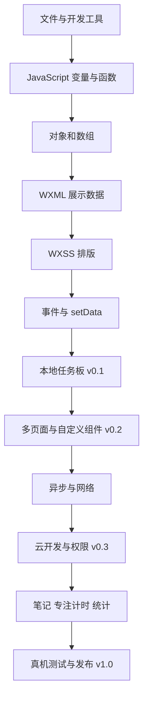

# 微信小程序开发教程 · 第 01—25 章合订版

此文件收录截至第 25 章的连续教程和相应示例/练习。 第01—36章主线正文已齐备；真实微信、云、数据治理及正式交付按实际验收表完成。目录见 [README](README.md)。整理日期：2026-11-03。

# 00 整体规划与最终项目

## 0.1 最终要达到什么程度

课程结束时，你应能独立读懂原生小程序项目，拆解需求，设计页面和数据，完成有后端的应用，并理解真机调试、权限、发布和维护。课程不以“背完所有 API”为目标；遇到新 API，能读文档、写最小示例、验证边界更有价值。

你现在不需要懂 HTML、CSS、JavaScript、数据库、服务器，也不需要先学 Vue 或 React。本课程会讲到必要的网页概念，但练习直接使用小程序文件。

### 开发的几个角色

| 词 | 初学者可以怎样理解 | 在课程中的例子 |
| --- | --- | --- |
| 需求 | 用户要解决的问题 | 我想知道今天还有哪些学习任务 |
| 界面/前端 | 用户看到和操作的部分 | 输入框、任务卡片、完成按钮 |
| 状态/数据 | 当前程序记住的内容 | 任务数组、选中的筛选条件 |
| 后端 | 在服务端执行业务、管理共享数据 | 校验身份后保存用户的任务 |
| 数据库 | 按规则长期存储和查询数据 | tasks 集合、notes 集合 |
| API/接口 | 约定好的调用方式 | 调用 `wx.showToast` 显示提示 |
| 调试 | 观察运行过程并定位错误 | 查为何点击按钮没有反应 |
| 部署/发布 | 把经过验证的版本提供给用户 | 上传、体验、审核、发布 |

前端不能因为能隐藏按钮，就获得安全性。后端必须校验当前调用者是否拥有对应数据。这会在云开发阶段详细训练。

## 0.2 技术路线和学习顺序

主线选择原生小程序：WXML 写结构，WXSS 写样式，JavaScript 写逻辑，JSON 写配置。先使用本地数据，再接模拟服务和云开发。TypeScript、框架和组件库放在后面比较学习。



这是课程的依赖关系，不要求你现在记住全部术语。

## 0.3 全部章节规划

第 01—36 章主线正文、示例和练习已提供，另有最终综合实践；真实账号、平台能力和正式交付仍需实际验收。第 10—15 章组成第二册，对应多页面与组件化的 v0.2；第 16—19 章组成第三册，对应本地 HTTP 服务与网络资源实验；第 20—23 章组成第四册，提供云环境、数据库、身份和 CRUD 权限；第 24—25 章组成第五册，提供私人缩略图、手动迁移、幂等写入与冲突处理；第六册第 26 章建立私人知识库；第七册第 27 章加入专注状态、后台恢复与会话记录；第八册第 28 章加入统计口径、固定时区、七日完整汇总、Canvas 图表和精确表格；第九册第 29 章加入文件、剪贴板、公开分享、上传下载、订阅回执与能力回退；第十册第30章进入体验与交付，加入统一反馈、网络与等待期限、读取实验和可恢复任务草稿。第十一册第31章加入视图投影、路径更新、有界分组列表、图片、普通分包和性能测量实验。第十二册第32章加入能力检测、未知值、窗口/大字/安全区、原生控件语义、配色与读屏验收，另有独立Skyline探针；主业务继续WebView。第十三册第33章系统整理纯函数、异步、组件方法与关键流程测试，加入结构化报告、局部覆盖率、故障变体及待执行渲染/工具/CI流程。第十四册第34章加入数据清单、平台隐私前置检查、原生同意页、发布材料与本地受阻检查；550个本地场景不代替真实后台、原生授权或审核。第十五册第35章加入默认关闭的本机诊断、观察层、环境核对、三组件源码清单、回退受阻检查与维护演练，共600本地场景。未配置真实告警、备份或回退。第十六册第36章提供真实TypeScript编译、npm锁文件和回环HTTP实验，并整理组件库/框架/独立后端路线与毕业实践；主工程600记录摘要匹配，扩展新跑50，跨工程650。云端源码与步骤已准备，真实账号部署、权限、读屏和真机性能验收待执行。

| 阶段 | 章 | 主题与关键知识 | 配套产出/验收 |
| --- | --- | --- | --- |
| A 起步 | 01 | 文件扩展名、UTF-8、账号、工具、项目根目录、四类文件 | 能导入、编译、修改计数器 |
| A 起步 | 02 | let/const、类型、比较、条件、循环、函数、作用域 | 能写学习时长统计函数 |
| A 起步 | 03 | 对象/数组、增删改查、浅拷贝、this、回调和异步顺序 | 能处理任务数组并预测输出 |
| A 起步 | 04 | 组件、插值、条件、循环、key、属性与事件 | 渲染任务列表和空状态 |
| A 起步 | 05 | 选择器、盒模型、rpx/px、Flex、长文本与小屏 | 做出可读的任务卡片 |
| A 起步 | 06 | Page/data/setData、事件参数、dataset、冒泡、状态推导 | 实现输入、新增、完成切换 |
| A 起步 | 07 | App/Page 生命周期、模块导出、本地存储、异常 | 重启能恢复任务，保存失败有提示 |
| A 起步 | 08 | 组合实现任务板：新增、编辑、删除、搜索、筛选 | 完成 v0.1 功能清单 |
| A 起步 | 09 | 调试器、日志、最小复现、练习与参考答案 | 能独立定位三类故障 |
| B 页面与组件 | 10 | pages 注册、navigateTo/redirectTo/switchTab/navigateBack、页面栈 | 从列表打开任务详情，再返回 |
| B 页面与组件 | 11 | query 参数、编码、缺失 ID、页面间更新、EventChannel 的适用场景 | 编辑详情后列表同步刷新 |
| B 页面与组件 | 12 | tabBar、表单、picker/switch/textarea、校验与提交反馈 | 任务分类、优先级、截止日期 |
| B 页面与组件 | 13 | Component、properties、methods、triggerEvent、插槽、样式隔离 | 提取 task-card 和 empty-state |
| B 页面与组件 | 14 | 组件生命周期、observers、behaviors、页面生命周期关联 | 倒计时组件正确释放资源 |
| B 页面与组件 | 15 | services/utils/constants 分层、状态归属、Git 基础 | v0.2 多页面本地应用和版本快照 |
| C 网络与异步 | 16 | Promise、async/await、try/catch/finally、并发与串行 | 把回调服务改写成可等待的函数 |
| C 网络与异步 | 17 | HTTP、URL、GET/POST、JSON、状态码、wx.request、合法域名 | 使用课程自备接口，观察真实请求 |
| C 网络与异步 | 18 | 请求封装、loading/error/empty/success、取消、超时、重试边界 | 请求失败后可恢复；处理旧响应覆盖 |
| C 网络与异步 | 19 | 下拉刷新、分页、去重、防抖/节流、缓存策略 | 数据增加时仍能稳定浏览 |
| D 云开发与安全 | 20 | 云环境、客户端与服务端、云函数、环境 ID、成本和配额 | 部署第一个云函数并读日志 |
| D 云开发与安全 | 21 | 文档型数据库、字段设计、索引、查询条件、分页 | 建立 tasks/notes/focus_sessions |
| D 云开发与安全 | 22 | 登录态、OPENID、wx.login 与服务端会话、鉴权 | 理解身份获取和资料填写的区别 |
| D 云开发与安全 | 23 | 云端 CRUD、输入校验、数据归属、权限规则、最小权限 | 用户 A 不能读改用户 B 的任务 |
| D 云开发与安全 | 24 | 图片选择、临时文件、云存储、上传失败、删除与文件归属 | 私人缩略图库，为笔记附件作准备 |
| D 云开发与安全 | 25 | 数据迁移、重复提交、幂等、版本号、冲突策略、备份 | v0.3 云同步，离线写入有明确处理 |
| E 完整业务 | 26 | 富文本边界、笔记编辑、标签、搜索、资源链接收藏 | 私人知识库模块 |
| E 完整业务 | 27 | 时间戳、计时器、后台挂起、恢复、会话记录、防重复统计 | 专注计时以结束时间计算，而非盲减秒数 |
| E 完整业务 | 28 | 统计口径、日期边界、连续天数、图表基础/Canvas 入门 | 最近 7 天专注统计可人工复算 |
| E 完整业务 | 29 | 文件上传/下载、剪贴板、分享、订阅消息、能力检测 | 逐项核对权限后接入所需平台能力 |
| F 质量与交付 | 30 | 统一错误反馈、弱网、重入、表单草稿、空数据与恢复 | 全局体验走查清单 |
| F 质量与交付 | 31 | setData 成本、列表分页、图片尺寸、分包、首屏性能 | 固定模型对照、原生实验与待填真机测量表 |
| F 质量与交付 | 32 | 基础库兼容、WebView/Skyline 差异、无障碍、真机适配 | 兼容/可访问实验、独立渲染探针与待填真机矩阵 |
| F 质量与交付 | 33 | 纯函数测试、组件测试、关键流程自动化、回归测试 | 四组Node测试、500项本地回归及分层待验收表 |
| F 质量与交付 | 34 | 隐私声明、用户授权、账号类目、备案/审核要求查询、版本发布 | 对照当时官方要求准备提交材料 |
| F 质量与交付 | 35 | 日志、监控、错误定位、环境隔离、回滚与持续维护 | 可维护的教学候选、600本地回归与待执行真实演练 |
| G 延伸 | 36 | TypeScript、npm、WeUI 等组件库、框架选择、独立后端方案 | 独立TS/HTTP实验50项、工具选择与最终综合实践 |

课程覆盖常用开发主线和重要边界。支付、蓝牙、地图高级定位、直播、广告、小游戏等有独立业务和资质条件，作为按需专题，不能把本课程理解成覆盖微信平台的每一个接口。

## 0.4 贯穿项目：学伴 StudyHub

### 面向谁、解决什么

面向个人学习者，把“制定任务 → 执行专注 → 记录笔记 → 查看统计”连成一个闭环。默认私人数据，不先做公共社区。这样能集中练习开发能力，仍然有足够的页面、数据关系和异常场景。

### 最终页面蓝图

| 页面 | 功能 | 数据来源 |
| --- | --- | --- |
| 今日 | 今日待办、最近笔记、快捷开始专注 | 任务、笔记、专注会话 |
| 计划列表 | 分类、优先级、搜索、分页、完成切换 | tasks |
| 任务详情/编辑 | 标题、描述、日期、标签、状态 | tasks 单条记录 |
| 笔记列表/编辑/详情 | 正文、标签、图片、关联任务 | notes、云存储 |
| 专注 | 开始、暂停、恢复、结束、记录结果 | focus_sessions |
| 统计 | 任务完成数、学习分钟、最近七天趋势 | 经过约定口径的汇总 |
| 我的/设置 | 用户主动填写资料、同步状态、数据管理 | users、preferences |

### 版本路线

| 版本 | 章节范围 | 数据存在哪里 | 验收 |
| --- | --- | --- | --- |
| v0.1 | 01—09 | 本设备缓存 | 单页面任务板完整可用 |
| v0.2 | 10—15 | 本设备缓存 | 多页面、任务详情、自定义组件 |
| v0.3 | 16—25 | 云数据库与云存储 | 身份鉴别、数据隔离、失败可恢复 |
| v0.8 | 26—29 | 云端为主 | 笔记、计时、统计组成业务闭环 |
| v1.0 | 30—35 | 明确环境与版本 | 完成安全、兼容、性能、发布准备 |

### 数据模型草案

`tasks`：`_id`、所有者身份、`title`、`description`、`done`、`priority`、`categoryId`、`dueAt`、`createdAt`、`updatedAt`、`version`。

`notes`：`_id`、所有者身份、`kind`、`title`、纯文本 `content`、`tags`、资源 `url`、`favorite`、`assetIds`、可选的 `taskId`、版本与创建/更新时间。第 26 章使用资产 ID 引用私人图片，并在资产上维护 noteRefs；不把任意云 fileID 当作附件归属依据。

`focus_sessions`：`_id`、所有者身份、可选的 `taskId` 与标题快照、plannedSeconds、isDemo、state、accumulatedMs、运行段起点与期限、开始/结束/更新时间、版本。第 27 章用每用户 focus_slots 指向最近一轮，操作回执与会话变化一起提交；终态 DTO 计算有效整秒，后台没有持续计时云函数。

第 28 章直接读取普通终态会话生成七日统计，不新增持久汇总表。`focus-end-day-v1` 固定 UTC+08:00，以 endedAt 所在日归属整轮有效秒数；它不还原跨日真实运行分钟，也不从任务 updatedAt 推断完成历史。最多完整汇总窗口内 500 条符合条件的会话，超限或失败拒绝部分结果；分页读取不等于强一致审计快照。

第 29 章另加 notice_attempts 记录独立练习回执的发送尝试，原八集合加该集合共九个；先事务占位，再调用外部发送，不能将消息与数据库提交视为同一事务。文件导出只是汇总，公开分享只含固定教学数据。

第30章任务草稿存于本机，按在线确认的环境/账号分区，最多六份；本地revision与云端baseVersion分别协调缓存和数据库变化。sealed草稿保存原编号，可衔接outbox与历史回执，不新增云集合。知识库未提交草稿仍待按其业务单独扩展。

第31章只改变视图和客户端布局，没有新增云集合。完整DTO与模型保留业务数据，视图投影不替代写入校验、版本与原编号；列表换组不删除云任务。性能采样默认关闭，只保留允许的公开数值，不含URL或正文。

第32章兼容与可访问实验无新云集合。本地清单仅内存固定数据，不是新草稿协议；独立renderer-probe没有云或身份。共享任务卡片改交互入口，原数据所有者、版本与原编号语义保留。

第33章业务源码不变，新增电脑端测试和报告。假回执服务不连云；500项是本次场景数量，不是互不重复功能数。覆盖率只涉及指定运行加载的客户端JS，真实环境继续独立验收。

第34章不增加云集合。新增三个选读入口前置检查、数据与隐私页和发布材料；默认24个待办保留。完整数据导出、账户处理、期限与权利机制仍是生产阻塞，未实际上传、提审或发布。

第35章不新增云集合，云端与共享协议不变。日志只保留允许分类，默认关闭且不上传；环境核对不替代云权限。回退检查始终不执行，完整数据治理与真实恢复演练仍待完成。

第36章不改主业务工程。第17组是独立电脑工具实验，简化契约与固定actor不用于正式认证；完整小程序继续使用第16组。

这里的字段是设计草案。服务器上的所有者必须来自可信身份上下文，不能相信客户端提交的“我是某某”。云数据库的自动字段和权限模式会在第 21—23 章根据实际方案确定。

v0.1 只用 `id/title/done/createdAt`，先掌握最小模型，再做迁移。

## 0.5 学习节奏与验收

这是建议投入，不是保证工期。零基础完整走一遍，预留约 120—200 小时较合理；遇到账号、接口或发布条件时可能更久。第一阶段建议分 2—4 周完成，重在手写和改错。

每一章都用三个问题验收：这段代码输入是什么？中间改变了哪些数据？输出或界面是什么？如果只会复制，却不能回答这三个问题，请在当前章多做一个改造题。

最终验收至少包括：

1. 从空项目建立页面和组件，能解释目录结构。
2. 无网络、空数据、非法输入、重复点击时有明确行为。
3. 换设备后能看到自己的云端数据；另一个用户看不到。
4. 后台停留后恢复计时仍合理，不重复保存专注记录。
5. 搜索和分页不会重复、漏项或让旧请求覆盖新结果。
6. 真机运行、兼容性、隐私和发布条件经过实际核对。
7. 代码有层次，关键规则有测试或可复现的验收步骤。

## 0.6 本课程的说明方式

示例分为“独立可运行项目”“放入某文件的完整替换代码”“说明性片段”。没有注明完整项目的零散片段，不应随意拼接覆盖现有文件。

所有代码示例以教学清晰为先。早期的全量数组更新和同步缓存适用于小规模本地练习；随着数据量和多人访问引入，课程会明确改造这些选择，而不是把练习实现直接当作线上架构。

资料分批核验，最近续写完成于 2026-11-03。平台界面、资质、配额和能力会变化，后续涉及此类内容时需要再次查官方文档。来源和当前读取限制见 [99 资料说明](99-官方资料与核验说明.md)。


---

# 01 环境准备与第一个小程序

本章目标：认识文件与项目，能用微信开发者工具运行计数器，并解释页面中四类文件的分工。建议分两次、用 2—3 小时完成。

## 1.1 先懂文件、文件夹和代码

文件夹负责组织文件。文件由名字和扩展名组成：`index.js` 的名字是 `index`，扩展名是 `.js`。扩展名表示文件的用途，不是随便改成什么都能运行。

在 Windows 资源管理器中打开“查看”相关设置，显示“文件扩展名”。确认 `app.json` 没有被保存为 `app.json.txt`。使用编辑器保存为 UTF-8，避免中文乱码。

代码是按一定规则书写的指令。编辑器帮你写和检查代码，运行环境执行它；微信开发者工具同时提供编辑器、模拟器和调试器。

| 操作 | 含义 |
| --- | --- |
| 保存 Ctrl+S | 把当前编辑内容写入磁盘 |
| 编译 | 让开发工具处理项目并重新运行 |
| 预览 | 在允许的账号与工具条件下生成真机体验入口 |
| 调试 | 看日志、变量、网络和报错 |

不要把双击 `.wxml` 当成运行小程序。小程序需要微信的运行环境，不能像普通 `.html` 文件一样直接在浏览器里完整运行。

## 1.2 需要准备什么

准备电脑、微信账号、微信开发者工具，以及用于正式能力的小程序账号。编辑器先使用开发者工具自带的即可。本阶段不要求安装 Node.js、Git、数据库或购买服务器。

官方入口：

- [微信公众平台](https://mp.weixin.qq.com/)：注册并管理你自己的小程序账号。
- [微信开发者工具下载](https://developers.weixin.qq.com/miniprogram/dev/devtools/download.html)：按操作系统选择官方稳定版本。
- [官方起步文档](https://developers.weixin.qq.com/miniprogram/dev/framework/quickstart/)：核对工具界面与创建流程。

这些是官方操作入口。当前研究工具无法直接读取微信文档站，具体按钮名称请以你打开的界面为准。账号主体、测试入口、真机权限等不要根据老教程截图推断。

### AppID 到底是什么

AppID 是小程序账号的标识，用来告诉平台“这是哪个小程序”。在小程序管理后台的开发设置相关区域查找。注意区分小程序、公众号等不同账号的 AppID。

AppID 不是密码。AppSecret 是服务端密钥，不应写在客户端代码里。当前练习只需要 AppID，不需要把 AppSecret 填到任何示例文件。

如果当前工具提供测试入口，可以先用它学习基础界面和逻辑。教程项目中的 `touristappid` 也是占位配置；如果工具提示不支持，请在导入界面选择自己的 AppID。拥有测试入口不等于具备云开发和正式发布资格。

## 1.3 两种起步方法

### 方法 A：先运行已有示例，再手写

1. 安装并打开微信开发者工具，按界面要求登录。
2. 找到“小程序”的导入项目入口。
3. 目录选择本教程的 `示例代码/01-hello-counter`。
4. 选择你自己的 AppID 或工具允许的测试方式，开发类型选“小程序”。
5. 完成导入后点击编译，看到“我的第一个小程序”和数字 `0`。
6. 点击“学习一次 +1”，数字变成 `1`，再点击变成 `2`。
7. 点击“重新开始”，数字回到 `0`。

这一步的目的是证明工具能够运行项目。接下来自己创建一个同样的目录，手写代码，才是学习。

### 方法 B：从空目录创建

建立 `my-first-miniapp` 文件夹，在工具中新建原生 JavaScript 小程序，前期选择不需要云服务的方式。如果模板提供 TypeScript、框架或 Skyline 专项模板，先选基础 JavaScript 原生项目。本课程示例显式使用 WebView 渲染，降低起步配置差异。

如果模板自动生成了很多内容，不必在旧模板里四处寻找修改点；可以把本章列出的文件放进一个独立练习目录，再导入该目录。

## 1.4 项目目录地图

```text
my-first-miniapp/
├─ app.js
├─ app.json
├─ app.wxss
├─ project.config.json
├─ sitemap.json
└─ pages/
   └─ index/
      ├─ index.js
      ├─ index.json
      ├─ index.wxml
      └─ index.wxss
```

“根目录”指这棵树最上面的 `my-first-miniapp`。它包含 `app.json`。后面说 `pages/index/index.js`，意思是从根目录依次进入 `pages`、`index`，打开 `index.js`。

| 文件 | 作用 | 可以类比 |
| --- | --- | --- |
| WXML | 页面有哪些组件、怎样排列结构 | 房间的骨架 |
| WXSS | 尺寸、间距、颜色和布局 | 装修 |
| JS | 数据、计算、事件、接口调用 | 房间中的控制系统 |
| JSON | 项目或页面的配置 | 事先填写的设置表 |

`app.*` 对整个小程序起作用。`pages/index/index.*` 只描述当前页面。`project.config.json` 主要供开发者工具识别项目；`sitemap.json` 用来配置页面被微信搜索索引的规则，本教学示例不开放索引。

官方起步模板也采用 `app.json` 的 `pages` 和 `window` 组织页面及窗口配置，参见 [官方起步配置源码](https://github.com/wechat-miniprogram/miniprogram-quickstart/blob/master/app.json)。本文示例为重新编写的教学代码。

## 1.5 先写全局文件

### app.js 完整内容

```js
App({});
```

`App` 是小程序提供的注册函数。圆括号 `()` 表示调用；花括号 `{}` 是传入的配置对象。暂时没有额外配置，所以对象为空。这里不需要自己定义 `App`。

### app.json 完整内容

```json
{
  "pages": ["pages/index/index"],
  "window": {
    "navigationBarTitleText": "从零学小程序",
    "navigationBarBackgroundColor": "#ffffff",
    "navigationBarTextStyle": "black"
  },
  "renderer": "webview",
  "sitemapLocation": "sitemap.json"
}
```

逐项解释：

- `pages` 是页面路径数组。普通启动时，没有指定其他启动页的情况下，首项作为首页。
- `pages/index/index` 不写 `.js` 或 `.wxml`，框架会关联同名文件。
- `window` 是窗口配置对象；里面三项分别设置顶部标题、背景色、文字颜色。
- `renderer` 为本示例选择渲染方式；后面再比较渲染器。
- `sitemapLocation` 指向本项目的索引配置文件。

JSON 的属性名和字符串必须用英文双引号，不能写注释，最后一项后不能多写逗号。`{}` 是对象，`[]` 是数组，冒号连接名称和值，逗号分隔多项。先照规则写，第 02—03 章再系统学习。

### app.wxss 完整内容

```css
page {
  background: #f4f7fb;
  color: #1f2937;
  font-family: sans-serif;
}
```

这段样式选中页面，设置背景、文字颜色和字体。`#f4f7fb` 是十六进制颜色表示。

### sitemap.json 完整内容

```json
{
  "rules": [{ "action": "disallow", "page": "*" }]
}
```

本课程的练习页面不作为搜索内容。索引配置不等于数据访问权限，真正的数据隔离后面在服务端实现。

### project.config.json 完整内容

```json
{
  "appid": "touristappid",
  "compileType": "miniprogram",
  "projectname": "hello-counter",
  "miniprogramRoot": "./",
  "setting": { "es6": true }
}
```

`miniprogramRoot` 表示小程序代码根目录。此处 `./` 就是当前目录。工具可能自动补充其他配置，正常。导入失败时先检查 AppID 和根目录，不要先删除所有配置。

## 1.6 写首页四个文件

### pages/index/index.json

```json
{
  "navigationBarTitleText": "第一个计数器",
  "usingComponents": {}
}
```

当前页的标题会覆盖全局标题。`usingComponents` 以后用来登记自定义组件，现在为空。

### pages/index/index.wxml

```xml
<view class="card">
  <text class="title">我的第一个小程序</text>
  <text class="hint">今天已经学习了</text>
  <text class="count">{{count}}</text>
  <button type="primary" bindtap="onIncrease">学习一次 +1</button>
  <button bindtap="onReset">重新开始</button>
</view>
```

`view` 是布局容器，`text` 展示文字，`button` 是按钮。开始标签和结束标签成对出现。`class` 给组件指定样式类别。

`{{count}}` 表示显示 JS 数据里的 `count`，不是把这几个字符原样显示出来。`bindtap="onIncrease"` 表示点击时执行名为 `onIncrease` 的处理函数，此处没有括号。

### pages/index/index.js

```js
Page({
  data: {
    count: 0
  },

  onIncrease() {
    const nextCount = this.data.count + 1;
    this.setData({ count: nextCount });
  },

  onReset() {
    this.setData({ count: 0 });
  }
});
```

先按执行过程理解，不要求立即记住所有语法：

1. `Page({...})` 注册页面。
2. `data` 存初始界面数据，`count: 0` 表示数字一开始为零。
3. 用户点击按钮后，框架调用 `onIncrease`。
4. `this` 在这个页面方法中指页面实例；`this.data.count` 读取当前计数。
5. `const nextCount = ...` 创建一个名字，保存“旧数字加一”的结果。
6. `this.setData({ count: nextCount })` 提交新的页面数据，界面更新后显示新数字。
7. 另一个按钮把数字重新设置为 `0`。

`count` 和 `Count` 是两个不同名字。不要把页面方法改写成箭头函数；第 03、06 章会解释 `this` 的区别。

### pages/index/index.wxss

```css
.card {
  margin: 48rpx 32rpx;
  padding: 40rpx;
  background: #ffffff;
  border-radius: 24rpx;
}
.title, .hint, .count {
  display: block;
  text-align: center;
}
.title { font-size: 40rpx; font-weight: bold; }
.hint { margin-top: 32rpx; color: #64748b; }
.count { margin: 24rpx 0; font-size: 96rpx; color: #16794b; }
button { margin-top: 24rpx; }
```

以点号开头的 `.card` 对应 WXML 的 `class="card"`。`margin` 是外部间距，`padding` 是内部间距，`border-radius` 是圆角。`rpx` 是小程序常用的响应式尺寸单位，第 05 章会讲换算。

## 1.7 程序如何连起来

```text
app.json 声明首页
  → 框架读取首页文件
  → Page 的 data 提供 count = 0
  → WXML 把 count 渲染成数字
  → 用户点击按钮
  → bindtap 找到 onIncrease
  → JS 算出 nextCount
  → setData 提交新值
  → 屏幕显示变化
```

编程不是“某个标签有魔法”。你要能沿着这条链条指出每个名字在哪定义、在哪被使用。

## 1.8 第一次调试

在 `onIncrease` 的第一行加入：

```js
console.log('点击前的计数', this.data.count);
```

保存、编译、打开调试器的 Console，点击按钮，看日志。日志在调试器里显示，用户界面不会多出这行字。`console.log` 是观察工具，不负责更新页面。

若失败，依次检查：目录选对了吗？文件保存了吗？`pages` 路径正确吗？JS/WXML 的函数名完全一致吗？Console 第一条与你代码有关的红色错误是什么？

## 1.9 本章练习

1. 把标题改成“我的学习记录”。
2. 初始数字改成 `5`，编译后验证。
3. 新增“学习五次 +5”按钮，绑定一个新方法。
4. 把计数颜色改成蓝色，只修改 WXSS。

通过标准：不参考完整文件，也能指出“改变文字改 WXML，改变颜色改 WXSS，改变计算改 JS，改变标题配置改 JSON”。答案见第 09 章。

[下一章：JavaScript 基础语法](02-JavaScript基础语法.md)


---

# 02 JavaScript 基础语法

本章从“变量是什么”讲起，目标是能读懂和编写简单计算程序。建议 3—5 小时，分几次完成。不要一口气背语法，先预测输出，再运行验证。

## 2.1 这些练习在哪里运行

用第 01 章的计数器，在 `pages/index/index.js` 的 `Page` 配置中临时加入：

```js
onLoad() {
  console.log('我开始练习 JavaScript');
},
```

例如放在 `data` 后、`onIncrease` 前，注意配置项之间有逗号。后面不含 `Page` 的 JS 片段，都可以放到这个 `onLoad` 的花括号内，每次只练一个片段。编译后看 Console。不要把练习代码直接写进 WXML。

`onLoad` 是页面创建时框架会调用的方法，第 07 章会系统介绍。练习完移除临时代码，以免改变示例运行。

纯 JS 也可以在浏览器 Console 中练习，但浏览器没有小程序专用的 `Page`、`App`、`wx`。反过来，小程序逻辑代码也不能假定存在浏览器的 `document`、DOM 或 `localStorage`。语言和宿主环境是两回事。

## 2.2 从一条语句认识标点

```js
console.log('今天学习 30 分钟');
```

`console` 是提供日志功能的对象，`.` 读取它的 `log` 方法，`()` 调用方法，引号中的内容是字符串，`;` 结束语句。这里没有任何内容会自动出现在小程序页面上。

用英文输入状态书写引号、括号、冒号、逗号。中文 `“”`、`（）` 不能代替代码中的 `''`、`()`。

```js
// 单行注释：给阅读代码的人看
/* 多行注释：
   可以解释为什么要做某件事 */
console.log('程序只执行这一行');
```

注释不参与执行。缩进一般用两个空格，帮助看清结构，不要靠代码挤成一行来“显得熟练”。

## 2.3 变量：给值取一个名字

```js
let minutes = 20;
minutes = 35;
console.log(minutes); // 35

const subject = '微信小程序';
console.log(subject); // 微信小程序
```

`let minutes = 20` 包含三件事：创建名字 `minutes`，计算右侧的值 `20`，把它赋给该名字。后面的 `minutes = 35` 是重新赋值。

`const` 声明的名字不能再次赋值。优先用 `const`，确实需要重新赋值时再用 `let`。你会在旧教程看到 `var`，现阶段知道它也是声明变量的方式即可，不要混用来解决报错。

```js
const goal = 60;
// goal = 90; // 如果取消注释，会因重新赋值而报错
```

推荐名字：`taskTitle`、`totalMinutes`、`isFinished`。避免 `a1`、`xx` 这种无法解释含义的名字。名字区分大小写，不能以数字开头，不要用 `if`、`return` 等关键字。

关于声明和基础类型，可查 [MDN JavaScript 语法与类型](https://developer.mozilla.org/zh-CN/docs/Web/JavaScript/Guide/Grammar_and_types)。本章练习围绕学习任务重新编写。

## 2.4 常用数据类型

```js
const title = '学习变量';  // string 字符串
const minutes = 30;       // number 数字
const done = false;       // boolean 布尔值
const dueAt = null;       // 主动表示“没有截止时间”
let selectedTask;         // undefined 尚未赋值
```

字符串承载文字；数字用于计算；布尔值只有 `true` 和 `false`，用于表达是/否。`null` 常用于明确的空值，`undefined` 常出现在未赋值或读取不存在的属性时。

```js
console.log(typeof '30'); // string
console.log(typeof 30);   // number
console.log(typeof true); // boolean
```

`typeof` 可以帮助排查类型，但它不是万能判断器。例如 `typeof null` 是历史遗留的 `object`，数组也会得到 `object`；判断数组用 `Array.isArray`，下一章会用到。

数字 `30` 和字符串 `'30'` 看起来相似，行为可能完全不同。

```js
console.log(30 + 5);       // 35
console.log('30' + 5);     // '305'，发生字符串拼接
console.log(Number('30') + 5); // 35
console.log(Number('abc'));   // NaN，无法转换成有效数字
```

输入框拿到的值通常是字符串，`type="number"` 也不能替你保证业务数据有效。处理数字输入时，先去除首尾空格，检查不为空，再转换并验证：

```js
const raw = ' 25 ';
const cleaned = raw.trim();
const value = Number(cleaned);

if (cleaned === '' || !Number.isFinite(value) || value <= 0) {
  console.log('请输入大于 0 的有效分钟数');
} else {
  console.log('有效分钟数', value);
}
```

`Number('')` 会得到 `0`，所以空字符串需要先独立判断。`NaN` 不是普通数字，不能用 `value === NaN` 判断。

## 2.5 算术、比较和逻辑

| 运算 | 示例 | 结果/含义 |
| --- | --- | --- |
| 加减乘除 | `12 + 3`、`12 - 3`、`12 * 3`、`12 / 3` | 15、9、36、4 |
| 取余 | `13 % 5` | 3 |
| 严格相等 | `5 === 5`、`5 === '5'` | true、false |
| 严格不等 | `5 !== 3` | true |
| 大小比较 | `minutes >= 25` | 是否至少 25 分钟 |
| 与 | `hasTitle && isValid` | 两个条件都成立 |
| 或 | `isToday || isOverdue` | 至少一个条件成立 |
| 非 | `!done` | 把真变假、假变真 |

初学时优先使用 `===` 和 `!==`，避免 `==` 的隐式转换让结果难以预测。

```js
const total = 8;
const completed = 3;
const remaining = total - completed;
const percent = Math.round(completed / total * 100);
console.log(remaining, percent); // 5 38
```

`Math.round` 四舍五入。若 `total` 为零，不能直接套这个公式，应明确“没有任务时完成率为 0”：

```js
const total = 0;
const completed = 0;
const percent = total === 0 ? 0 : Math.round(completed / total * 100);
console.log(percent); // 0
```

`条件 ? 成立时的值 : 不成立时的值` 是三元运算符。适合选择一个简单结果，不要嵌套一串复杂业务。

### 真值和假值

在条件位置，`false`、`0`、`''`、`null`、`undefined`、`NaN` 等会被当成假；`[]`、`{}`、字符串 `'false'` 都是真。**判断空数组用 `tasks.length === 0`，不能用 `if (tasks)`。**

## 2.6 条件语句：按情况执行

```js
const minutes = 35;

if (minutes >= 60) {
  console.log('完成长时学习');
} else if (minutes >= 25) {
  console.log('完成一次专注');
} else {
  console.log('继续积累');
}
```

程序从上往下检查，命中一个分支后，不再进入后面的分支。这里输出“完成一次专注”。把 `60` 的判断放在 `25` 后面，会使超过 60 的情况先被 25 的分支截住。

验证标题是项目中的常见需求：

```js
const rawTitle = '   学习条件判断   ';
const title = rawTitle.trim();

if (title.length === 0) {
  console.log('标题不能为空');
} else if (title.length > 40) {
  console.log('标题过长');
} else {
  console.log('可以保存', title);
}
```

`.trim()` 返回去掉首尾空白的新字符串，不会删除中间空格。`.length` 是字符串长度；JavaScript 按 UTF-16 代码单元计算，表情符号不一定等于 1。早期项目把它当作技术长度限制，后面可按产品需求优化。

## 2.7 循环：重复处理

```js
let total = 0;

for (let day = 1; day <= 3; day += 1) {
  total += 20;
  console.log('第几天', day, '累计', total);
}
console.log('最终', total); // 60
```

`for` 圆括号内分三部分：

1. `let day = 1`：只执行一次，设置起点。
2. `day <= 3`：每轮开始前检查条件。
3. `day += 1`：每轮结束后让 day 加一。

`total += 20` 相当于 `total = total + 20`。不要漏掉让条件逐渐结束的操作，否则可能形成无限循环，导致程序卡住。

有数组以后，按元素处理还可以这样：

```js
const sessions = [20, 30, 25];
let total = 0;
for (const minutes of sessions) {
  total += minutes;
}
console.log(total); // 75
```

`[]` 中是一组值，`for...of` 逐个取出。本章先能理解重复相加，下一章详细学数组。

## 2.8 函数：给一段步骤取名字

```js
function minutesToSeconds(minutes) {
  return minutes * 60;
}

const result = minutesToSeconds(25);
console.log(result); // 1500
```

`function` 定义函数，`minutesToSeconds` 是函数名，定义处的 `minutes` 是形参，调用时的 `25` 是实参。`return` 把结果返回给调用者，同时结束本次函数执行。

“定义”和“执行”不同：只定义函数不会自动计算。函数可以多次调用，不同参数产生不同结果。

```js
console.log(minutesToSeconds(10)); // 600
console.log(minutesToSeconds(30)); // 1800
```

`console.log` 负责显示，`return` 负责交付结果，不可互相替代：

```js
function wrongAdd(a, b) {
  console.log(a + b);
}

const result = wrongAdd(2, 3); // Console 显示 5
console.log(result);          // undefined，没有 return
```

### 提前返回使校验更清楚

```js
function getTitleError(rawTitle) {
  const title = rawTitle.trim();
  if (title.length === 0) {
    return '标题不能为空';
  }
  if (title.length > 40) {
    return '标题不能超过 40 个代码单元';
  }
  return '';
}

console.log(getTitleError('   '));     // 标题不能为空
console.log(getTitleError('学习函数')); // 空字符串，表示没有错误
```

## 2.9 作用域：名字在哪能使用

```js
const subject = '小程序';

function printSubject() {
  const minutes = 25;
  console.log(subject, minutes);
}

printSubject();
// console.log(minutes); // 外面访问不到函数内部的 minutes
```

`let`、`const` 受块作用域约束，`if`、`for` 的花括号也会形成作用范围。不要通过把所有变量搬到文件最外层来解决访问问题；通常应通过参数传入、返回值传出。

常见区别：局部变量 `const count = 1` 不会自动变成页面数据。只有进入页面 `data` 并通过合适方式提交更新，WXML 才能使用它。

## 2.10 JSON 与 JavaScript 对象先分清

JS 中允许这样写：

```js
const config = {
  title: '我的学习',
  count: 0
};
```

JSON 文件中对应的写法是：

```json
{
  "title": "我的学习",
  "count": 0
}
```

JSON 是数据格式，不是放任意 JS 的地方。不能在 `app.json` 写函数、`const`、单引号字符串或注释。以后网络响应也常用 JSON，但“JSON 格式的文本”和“内存中的对象”仍是不同东西。

## 2.11 自测

1. 预测 `Number('12') + 3`、`'12' + 3`、`12 === '12'` 的结果。
2. 写一个函数 `getRemaining(total, completed)`，返回剩余任务数。
3. 写 `isValidMinutes(raw)`：字符串输入必须非空、转为有限数字、大于零且不超过 180。
4. 用循环把 `[15, 25, 40]` 求和。
5. 解释 `const` 为什么不等于“对象内部永远不能变化”（先带着问题进入下一章）。

通过标准：能手写条件函数，能解释参数和返回值，不把日志当返回值，不把字符串当数字。答案见第 09 章。

[下一章：对象、数组、函数与异步](03-对象数组函数与异步入门.md)


---

# 03 对象、数组、函数与异步入门

目标：把零散值组织成业务数据，完成任务数组的增删改查，并理解回调为什么会晚于下一行执行。建议 3—5 小时。纯 JS 片段仍放在第 02 章的临时 `onLoad` 中，每次单独运行。

## 3.1 对象：描述一个东西

```js
const task = {
  id: 't1',
  title: '学习数组',
  done: false,
  minutes: 25
};

console.log(task.title);    // 学习数组
console.log(task['done']); // false
```

对象用 `{}` 包起来，里面是“属性名: 值”。`id` 用于识别同一条任务，`title` 是标题，`done` 是完成状态。一个任务的多个属性属于同一组，比四个互不相关的变量更容易维护。

```js
task.done = true;
console.log(task.done); // true
```

为什么 `const` 没报错？因为 `task` 仍然指向原来的对象，只修改了对象内部。`task = {}` 才是给名字重新赋值，会报错。这是 JavaScript 规则；在小程序页面上，还需要遵守 `setData` 的更新规则。

嵌套对象：

```js
const user = {
  nickname: '小林',
  preference: { dailyGoal: 60 }
};
console.log(user.preference.dailyGoal); // 60
```

读取不存在的属性得到 `undefined`，继续在 `undefined` 上取属性会报错。不要假设后台或缓存里一定有某个字段，要在边界处验证。

## 3.2 数组：有顺序的一组东西

```js
const tasks = [
  { id: 't1', title: '学习变量', done: true },
  { id: 't2', title: '学习数组', done: false },
  { id: 't3', title: '完成练习', done: false }
];

console.log(tasks.length);   // 3
console.log(tasks[0].title); // 学习变量
console.log(tasks[2].id);    // t3
```

索引从 `0` 开始：第一个元素是 `[0]`，第三个是 `[2]`。数组长度为 3 时，`tasks[3]` 是越界读取，结果为 `undefined`。

**索引表示当前位置，ID 表示身份。** 你搜索或排序以后，原来第 3 条可能变成第 1 条，但它的 ID 不应变化。删除、编辑、组件列表 key 都应该优先使用稳定 ID。

```js
console.log(Array.isArray(tasks)); // true
console.log(Array.isArray({}));    // false
```

## 3.3 先用循环，再认识数组方法

计算已完成数量：

```js
let completed = 0;
for (const task of tasks) {
  if (task.done) {
    completed += 1;
  }
}
console.log(completed); // 1
```

数组方法把一些常见循环封装起来。初学时可以先写循环版，理解之后再用方法版；不要把 `map`、`filter` 当需要死记的咒语。

### filter：留下满足条件的元素

```js
const pending = tasks.filter(function (task) {
  return task.done === false;
});
console.log(pending.length); // 2
```

`filter` 逐条调用传入的函数。返回真则保留，返回假则不保留。得到一个新数组，原数组仍有 3 条。它是浅拷贝，留下的对象仍可能与原数组共享引用，参见 [MDN filter](https://developer.mozilla.org/zh-CN/docs/Web/JavaScript/Reference/Global_Objects/Array/filter)。

### 箭头函数：较短的函数写法

```js
const pending = tasks.filter((task) => {
  return task.done === false;
});

// 函数体只有返回表达式，可以缩短为：
const pendingAgain = tasks.filter(task => !task.done);
```

三种写法表达相同的筛选规则。`task => !task.done` 中，箭头左边是参数，右边是返回值。只要使用了 `{}` 作为函数体，需要自己写 `return`，否则得到 `undefined`。

### map：把每条记录转换成新的结果

```js
const titles = tasks.map(task => task.title);
console.log(titles); // ['学习变量', '学习数组', '完成练习']
```

这里输出仍有 3 项，每项从完整对象变成标题。`map` 返回新数组，适合转换；不适合用来筛选。方法说明见 [MDN map](https://developer.mozilla.org/zh-CN/docs/Web/JavaScript/Reference/Global_Objects/Array/map)。

### find：找第一条符合条件的记录

```js
const selected = tasks.find(task => task.id === 't2');
if (selected) {
  console.log(selected.title); // 学习数组
}

const missing = tasks.find(task => task.id === 'not-exist');
console.log(missing); // undefined
```

`filter` 返回数组，`find` 返回单个元素或 `undefined`，不要把它们混淆。

## 3.4 展开语法和浅拷贝

```js
const original = { id: 't1', title: '学习对象', done: false };
const changed = { ...original, done: true };

console.log(original.done); // false
console.log(changed.done);  // true
```

`...original` 把原对象的属性展开到新对象中，后面的同名 `done` 覆盖前面的值。顺序重要：`{ done: true, ...original }` 会被原来的 false 覆盖。

```js
const first = [1, 2];
const second = [...first, 3];
console.log(first);  // [1, 2]
console.log(second); // [1, 2, 3]
```

这是浅拷贝，只复制一层：

```js
const source = { settings: { goal: 25 } };
const copy = { ...source };
copy.settings.goal = 60;
console.log(source.settings.goal); // 60，共享嵌套对象
```

若只想改变新对象，应复制将要修改的嵌套层：

```js
const source = { settings: { goal: 25 } };
const copy = {
  ...source,
  settings: { ...source.settings, goal: 60 }
};
console.log(source.settings.goal); // 25
```

早期项目保持数据结构简单，降低嵌套更新难度。

## 3.5 对任务数组增删改查

以下各段都以 3.2 的原始 `tasks` 为起点，单独运行。

### 新增

```js
const newTask = { id: 't4', title: '学习事件', done: false };
const nextTasks = [newTask, ...tasks];
console.log(nextTasks.length); // 4，新任务放最前面
```

### 按 ID 删除

```js
const deleteId = 't2';
const nextTasks = tasks.filter(task => task.id !== deleteId);
console.log(nextTasks.map(task => task.id)); // ['t1', 't3']
```

保留 ID 不是 `t2` 的任务，自然就删除了 `t2`。

### 按 ID 切换状态

```js
const targetId = 't2';
const nextTasks = tasks.map(task => {
  if (task.id === targetId) {
    return { ...task, done: !task.done };
  }
  return task;
});
console.log(nextTasks[1].done); // true
console.log(tasks[1].done);     // false，原对象未直接修改
```

遍历每条任务：目标任务返回一个修改后的新对象，其他任务原样返回。长度保持不变。

### 按 ID 修改标题

```js
const nextTasks = tasks.map(task =>
  task.id === 't3' ? { ...task, title: '完成综合练习' } : task
);
```

### 搜索

```js
const keyword = ' 数组 '.trim().toLowerCase();
const visibleTasks = tasks.filter(task =>
  task.title.toLowerCase().includes(keyword)
);
console.log(visibleTasks.map(task => task.id)); // ['t2']
```

`toLowerCase` 转为小写，使英文大小写不影响匹配；`includes` 判断是否包含关键词。任何字符串都包含空字符串，所以关键词为空时自然全部通过。

## 3.6 解构、简写和方法

```js
const task = { id: 't1', title: '学习简写', done: false };
const { id, title } = task;
console.log(id, title);
```

等价于分别写 `const id = task.id`、`const title = task.title`。这叫对象解构。

```js
const title = '学习简写';
const task = { title }; // 等价于 { title: title }
```

当属性名和变量名一致时，可以简写。完整项目中的 `this.setData({ draft })` 就是把局部变量 draft 的值写入页面同名字段。

```js
const counter = {
  count: 0,
  increase() {
    this.count += 1;
  }
};
counter.increase();
console.log(counter.count); // 1
```

对象里存函数时，通常称“方法”。`increase() {}` 是方法的简写形式。

## 3.7 this 为什么容易出错

普通函数的 `this` 与调用方式有关。对于小程序页面，由框架调用的普通页面方法使用页面实例作为 `this`。因此这样写：

```js
Page({
  data: { count: 0 },
  onIncrease() {
    this.setData({ count: this.data.count + 1 });
  }
});
```

不要把方法随手改成：

```js
// 错误示范：顶层箭头函数不会获得页面实例的 this
Page({
  data: { count: 0 },
  onIncrease: () => {
    // this.setData(...) 在这里可能不是你期待的页面方法
  }
});
```

箭头函数没有自己的 `this`，沿定义位置向外寻找。恰好因为这个性质，它适合放在普通页面方法内部，作为需要继续访问页面的回调：

```js
// 这是 Page 配置中的一个方法片段
onAskReset() {
  wx.showModal({
    title: '确认',
    content: '要重新计数吗？',
    success: (result) => {
      if (result.confirm) {
        this.setData({ count: 0 });
      }
    }
  });
}
```

只先记住：**页面方法用普通方法；方法内部需沿用页面 this 的回调用箭头函数。** 不是所有地方都必须改成箭头。

## 3.8 回调与异步：下一行不等于上一步完成

```js
console.log('A');
setTimeout(() => {
  console.log('B');
}, 1000);
console.log('C');
```

通常先输出 A、C，大约一秒后输出 B。`setTimeout` 登记“以后执行的函数”，登记后马上继续下一行。1000 是毫秒，表示计时阈值，不保证恰好 1000 毫秒准时执行。

传给其他函数、供它在合适时机调用的函数，叫回调。`map` 的回调通常同步执行；定时器、网络、用户弹窗的回调经常异步执行。**有回调不等于一定异步。**

常见错误：

```js
let message = '尚未完成';
setTimeout(() => {
  message = '已经完成';
}, 1000);
console.log(message); // 尚未完成
```

依赖结果的操作要在完成位置处理，或后面改用 Promise/async/await。第 16 章会系统展开异步、异常和请求竞态；本阶段先能预测顺序，避免提前读取还不存在的结果。

## 3.9 错误与 try/catch

```js
try {
  const value = JSON.parse('{坏数据');
  console.log(value);
} catch (error) {
  console.error('解析失败', error);
}
```

`try` 执行可能抛出异常的代码，`catch` 接住异常并给出处理。不要使用空的 `catch` 吞掉错误，也不要把整个程序全部包进去却不定位问题。

外层同步的 `try/catch` 不能自动接住未来异步回调里抛出的异常。异步 API 的 `fail`、Promise 的拒绝和 `await` 的异常处理会在网络阶段详细训练。

## 3.10 小综合：只计算，不操作界面

```js
function summarize(tasks) {
  const completed = tasks.filter(task => task.done).length;
  return {
    total: tasks.length,
    completed,
    remaining: tasks.length - completed
  };
}

const report = summarize([
  { id: 'a', title: '读文档', done: true },
  { id: 'b', title: '写练习', done: false }
]);
console.log(report); // { total: 2, completed: 1, remaining: 1 }
```

这类只根据输入计算结果、不依赖页面和缓存的函数，容易复用和验证。后续项目会把它放到 `utils/task.js`。

## 3.11 本章练习

1. 从任务数组中提取所有标题。
2. 删除 ID 为 `t1` 的任务，原数组保持不变。
3. 把 ID 为 `t2` 的任务标题改为“复习数组”，其他字段保持不变。
4. 筛选“未完成且标题包含学习”的任务。
5. 解释 `const b = a`、`const b = [...a]`、深层逐级复制分别有什么区别。
6. 预测异步示例的日志顺序，并说出原因。

[下一章：WXML 页面结构](04-WXML页面结构与模板语法.md)


---

# 04 WXML 页面结构与模板语法

目标：把数据变成可见结构，正确使用条件、列表和输入组件。建议 2—3 小时。本章先搭页面，交互方法在第 06 章完成。

## 4.1 WXML 和 HTML 有什么关系

WXML 是小程序的界面描述语言。它也使用标签，但不是把 HTML 文件改一个扩展名就能运行。普通网页的 `div/span/img`，在这里常分别使用 `view/text/image`；功能和规则应以小程序组件文档为准。

你不用先学完网页开发。先掌握标签、属性、嵌套，再用少量常用组件完成页面。

```xml
<view class="card">
  <text class="title">今天的学习</text>
  <text>先完成一个小目标</text>
</view>
```

`view` 是父组件，两个 `text` 是子组件。标签必须正确嵌套，不能写成先开始 view、再开始 text，却先结束 view。`class="card"` 中 class 是属性名，card 是属性值。

注释这样写：

```xml
<!-- 这里是页面顶部卡片 -->
```

不是 JS 的 `//`。不同文件类型使用不同注释语法。

## 4.2 常用组件清单

| 组件 | 用途 | 初次使用要点 |
| --- | --- | --- |
| view | 分组和布局 | 通常由它承担背景、间距、Flex |
| text | 文字 | 需要文字单独占行时给它 block 样式 |
| button | 触发操作 | 用 bindtap 绑定方法，有默认样式 |
| input | 单行输入 | 从 bindinput 事件的 detail.value 取值 |
| textarea | 多行输入 | 适合备注、笔记正文 |
| image | 图片 | 使用 src 和 mode，通常要指定尺寸 |
| scroll-view | 局部滚动区 | 纵向滚动通常需要明确高度约束 |
| navigator | 页面跳转入口 | 后续结合页面注册和路由学习 |
| block | 逻辑分组 | 自身不产生可供布局的可视容器 |

图片的说明性例子：

```xml
<!-- 前提：你在项目根目录准备了 assets/cover.png -->
<image class="cover" src="/assets/cover.png" mode="aspectFit" />
```

`aspectFit` 保持比例并使整张图放入指定区域。不要在尚未放入图片时把加载失败误当语法问题。本次两个完整项目不依赖图片文件。

## 4.3 数据绑定：从 JS 读值

在临时练习页面的 JS 写完整配置：

```js
Page({
  data: {
    nickname: '小林',
    completed: 2,
    total: 5,
    loading: false,
    selectedId: 't1'
  }
});
```

对应 WXML：

```xml
<view>
  <text>你好，{{nickname}}</text>
  <text>已完成 {{completed}} / {{total}}</text>
  <text>剩余 {{total - completed}} 项</text>
  <button disabled="{{loading}}">保存</button>
</view>
```

`{{}}` 中写数据字段名或模板支持的简单表达式。文字中和属性值中都可以绑定。`disabled="{{loading}}"` 传入布尔值 false，按钮可以用；把 JS 中 loading 改为 true 再编译，按钮禁用。

不要写 `disabled="false"` 来表达布尔假，非空字符串可能被当作真。需要布尔值时使用 `{{false}}` 或绑定布尔字段。

### 三种位置的变量名不要混淆

```xml
<text>{{nickname}}</text>
```

这里读的是 `Page` 的 `data.nickname`，不是 `onLoad` 里随便定义的局部 `const nickname`，也不写 `{{this.data.nickname}}`。

## 4.4 条件渲染 wx:if

```xml
<view wx:if="{{loading}}">正在加载……</view>
<view wx:else>加载完成</view>
```

`wx:if` 为真时创建前面的节点；否则走紧邻的 `wx:else` 分支。多分支可以使用 `wx:elif`。

```xml
<view wx:if="{{status === 'loading'}}">加载中</view>
<view wx:elif="{{status === 'error'}}">加载失败，请重试</view>
<view wx:else>准备好了</view>
```

对应 data 中必须有 status，例如 `status: 'loading'`。

### wx:if 和 hidden 的区别

```xml
<view wx:if="{{showTip}}">按条件创建和销毁</view>
<view hidden="{{!showTip}}">节点保留，仅隐藏</view>
```

选择时考虑状态和切换成本：完全不需要时可用 `wx:if`；需要频繁切换显示、保留内部状态时可以研究 `hidden`。不要靠 CSS 隐藏敏感内容作为权限控制。

## 4.5 列表渲染 wx:for

练习页面 JS：

```js
Page({
  data: {
    tasks: [
      { id: 't1', title: '学习 WXML', done: true },
      { id: 't2', title: '写一个列表', done: false }
    ]
  }
});
```

WXML：

```xml
<view class="task" wx:for="{{tasks}}" wx:key="id">
  <text>{{index + 1}}. {{item.title}}</text>
  <text>{{item.done ? '已完成' : '待完成'}}</text>
</view>
```

框架遍历 tasks，每条产生一个 view。默认 `item` 是当前元素，`index` 是从 0 开始的位置。`wx:key="id"` 告诉框架，每个元素中的 id 属性可以稳定识别该项。

**这里写 `id`，不写 `{{item.id}}`。** key 应唯一且稳定。会删除、排序的列表，不要把索引当身份。

自定义变量名：

```xml
<view wx:for="{{tasks}}" wx:for-item="task" wx:for-index="position" wx:key="id">
  <text>{{position + 1}}. {{task.title}}</text>
</view>
```

这样在嵌套列表中更容易区分内外元素。

如果数组是 `['语法', '布局']` 这样的唯一字符串列表，可以使用 `wx:key="*this"`。如果元素值重复，就需要另行设计唯一标识。

## 4.6 空状态和列表分开

```xml
<view wx:if="{{tasks.length === 0}}" class="empty">
  还没有任务，先添加一个吧。
</view>
<block wx:else>
  <view wx:for="{{tasks}}" wx:key="id" class="task">
    <text>{{item.title}}</text>
  </view>
</block>
```

`block` 只负责把多项逻辑组织起来，不给它设置 margin 来期待出现间距。需要可布局容器时使用 `view`。

不要在同一个节点上同时塞复杂的 `wx:if` 和 `wx:for` 来筛选数据。先在 JS 生成 `visibleTasks`，模板只负责渲染，逻辑更清楚，也能单独验证。

## 4.7 输入框先认识绑定关系

```xml
<input
  value="{{draft}}"
  placeholder="例如：学习 WXML"
  maxlength="40"
  bindinput="onDraftInput"
/>
<button bindtap="onSave">保存任务</button>
```

需要 data 中有 `draft: ''`，还需要定义 onDraftInput 和 onSave，完整写法在第 06 章。

`value` 负责从数据传到输入框；`bindinput` 负责把输入变化交给 JS。普通 `value="{{draft}}"` 不代表自动双向同步，必须在事件处理里更新数据。本课先使用显式事件；其他绑定能力后续按需再学。

`maxlength` 是输入组件的前端限制。业务方法仍要校验，因为数据也可能来自缓存、接口或其他调用路径。

## 4.8 事件绑定写名字，参数走事件对象

```xml
<button bindtap="onRemove" data-id="{{item.id}}">删除</button>
```

上面是列表内部的片段。`bindtap` 写方法名，不写 `onRemove(item.id)`。通过 `data-id` 带上当前任务身份，在 JS 的事件参数中取值。第 06 章详细演示。

## 4.9 模板里能做哪些计算

可以使用模板支持的简单数据访问、运算、比较和三元表达式，例如：

```xml
<text>{{done ? '已完成' : '待完成'}}</text>
<view class="task {{done ? 'task--done' : ''}}">任务</view>
```

不要把 WXML 当作任意 JavaScript 执行环境。诸如 `tasks.filter(...)`、页面方法调用、复杂日期格式化，先在 JS 里计算出字段再交给模板。

```js
// 放在一个页面方法里，tasks 已定义时使用
const pendingTasks = tasks.filter(task => !task.done);
this.setData({ pendingTasks });
```

## 4.10 本章练习

1. 显示任务总数和每条标题。
2. 已完成任务后面显示“已完成”，其他显示“进行中”。
3. 把 tasks 改成空数组，出现空状态。
4. 把循环变量名改为 task，确认所有引用都同步修改。
5. 解释 `wx:key="id"` 为什么不是“每条任务显示 id”。

参考官方结构：[起步模板的 WXML 源码](https://github.com/wechat-miniprogram/miniprogram-quickstart/blob/master/pages/index/index.wxml)。这个历史模板含旧的用户信息获取写法，本课程仅参考结构和绑定，**不要照搬其中的头像昵称授权流程**。现代账号资料能力将在第 22 章重新查证。

[下一章：WXSS 样式与 Flex 布局](05-WXSS样式与Flex布局.md)


---

# 05 WXSS 样式与 Flex 布局

目标：能从一个页面草图写出样式，理解尺寸和间距，能解决文字太长、按钮挤压等实际问题。建议 2—4 小时。

## 5.1 一条样式规则怎么读

```css
.card {
  background: #ffffff;
  padding: 24rpx;
  border-radius: 20rpx;
}
```

`.card` 是选择器，决定样式用到哪里；`{}` 内每条是“属性: 值;”。WXML 中写 `class="card"` 的组件会匹配这个选择器。代码写在 `.wxss` 文件，不要再套 `<style>` 标签。

WXSS 基于 CSS 扩展，但不能据此假设所有浏览器特性、所有渲染器行为完全一致。本阶段只使用常用、容易理解的规则。官方起步示例也演示了 class、Flex 和 rpx，见 [官方 WXSS 源码](https://github.com/wechat-miniprogram/miniprogram-quickstart/blob/master/pages/index/index.wxss)。

## 5.2 常见选择器

```css
page { background: #f4f7fb; }   /* 当前页面 */
text { color: #334155; }       /* text 组件 */
.title { font-size: 36rpx; }   /* 指定 class */
#main { padding: 24rpx; }      /* 指定 id，早期少用 */
.card .title { color: #16794b; } /* card 内的 title */
.title, .subtitle { display: block; } /* 两个选择器共用规则 */
```

一个组件可以有多个类：

```xml
<view class="card selected">选中的卡片</view>
```

不写 `class=".card"`，点号只出现在 WXSS 选择器中。

多个规则作用于同一属性时，选择器的优先级、来源和先后顺序会影响结果。初学时保持简单：主要用 class，避免层层嵌套和大量 `!important`。看到样式没生效，先查 class 名字和当前生效规则。

## 5.3 盒模型：内容外面还有空间

```text
外部：margin（和别人的距离）
┌──────── border（边框）────────┐
│ padding（内容和边框之间）      │
│     content（文字或图片）      │
└─────────────────────────────┘
```

```css
.card {
  width: 600rpx;
  padding: 24rpx;
  border: 2rpx solid #dbe3ec;
  margin: 24rpx auto;
}
```

在默认 content-box 计算方式下，实际横向占用还要加上左右 padding 和 border。若希望 width 包含内部间距和边框：

```css
.card {
  box-sizing: border-box;
  width: 100%;
  padding: 24rpx;
}
```

本课程项目会为常用组件设置 `box-sizing: border-box`，减少尺寸误算。

间距简写：

- `margin: 20rpx`：四边均 20。
- `margin: 20rpx 32rpx`：上下 20，左右 32。
- `margin: 10rpx 20rpx 30rpx 40rpx`：上、右、下、左。
- `margin: 24rpx auto`：上下固定，左右自动分配，常用于固定宽度块居中。

`margin` 和 `padding` 不能互换。例如卡片内文字贴边，应增加 padding；两张卡片太近，应增加 margin。

## 5.4 rpx、px、% 各做什么

在常见小程序布局中，屏幕宽度以 750rpx 为参考。若可用宽度为 375 逻辑像素，则 100rpx 对应约 50px；宽度为 414 时约为 55.2px。

```text
某个 rpx 数值对应的 px ≈ rpx 数值 × 当前可用宽度 / 750
```

注意这是布局参考，不是“手机实际物理像素”。旋转、平板、多窗口、渲染环境都可能影响可用宽度，最终要实际验证。

| 单位 | 常见用途 | 注意 |
| --- | --- | --- |
| rpx | 需要随屏幕宽度缩放的间距、卡片尺寸 | 不要所有尺寸机械照搬设计稿 |
| px | 比较稳定的细线等尺寸 | 不是固定数量的物理像素 |
| % | 相对父容器的尺寸 | 取决于父容器实际约束 |

用 rpx 不代表自动适配所有设备。适配还需要弹性布局、合理最大宽度、长文字处理和真机测试。

## 5.5 字体、颜色、边框

```css
.title {
  font-size: 36rpx;
  font-weight: 700;
  line-height: 1.5;
  color: #1f2937;
}
.subtitle {
  font-size: 26rpx;
  color: #64748b;
}
.card {
  border: 1px solid #e2e8f0;
  border-radius: 20rpx;
  background: #ffffff;
}
```

`line-height: 1.5` 表示行高约是字体尺寸的 1.5 倍。正文过小、对比过弱，即使布局没错也不好读。不要只通过颜色表达完成状态，搭配文字“已完成”。

## 5.6 Flex：把组件排成行或列

```xml
<view class="row">
  <text class="title">学习任务</text>
  <button class="small-button" size="mini">编辑</button>
</view>
```

```css
.row {
  display: flex;
  align-items: center;
  justify-content: space-between;
}
.small-button { margin: 0; }
```

`display: flex` 使 row 成为弹性容器。默认主轴为横向：`justify-content` 管横向分布，`align-items` 管纵向对齐。

| 属性 | 本课常用值 | 用途 |
| --- | --- | --- |
| flex-direction | row / column | 排成一行或一列 |
| justify-content | flex-start / center / space-between | 沿主轴排列 |
| align-items | stretch / center / flex-start | 沿交叉轴对齐 |
| flex-wrap | nowrap / wrap | 是否允许换行 |
| flex | 1 | 子项占用剩余空间 |
| flex-shrink | 0 | 子项不被挤小 |

如果方向改成 column，主轴变纵向，“主轴横向”的记忆就失效了。永远先看 flex-direction。

## 5.7 输入框占满剩余宽度

```xml
<view class="editor-row">
  <input class="draft" placeholder="输入学习任务" />
  <button class="save-button" size="mini">添加</button>
</view>
```

```css
.editor-row { display: flex; align-items: center; }
.draft {
  flex: 1;
  min-width: 0;
  padding: 16rpx;
  border: 1px solid #cbd5e1;
  border-radius: 12rpx;
}
.save-button { flex-shrink: 0; margin: 0 0 0 16rpx; }
```

`flex: 1` 让输入框吃掉剩余空间，按钮保留自身需要的宽度。`min-width: 0` 允许弹性子项在必要时缩小，解决某些内容把容器撑爆的问题。

小屏仍然拥挤时，可以把输入和提交按钮拆成上下两行。本课程完整项目采用容易适配的布局，不追求强塞一行。

## 5.8 长文本是必须测试的情况

任务标题可能很长或是一整串英文：

```css
.task-title {
  display: block;
  line-height: 1.5;
  overflow-wrap: break-word;
  word-break: break-all;
}
```

如果产品只要单行省略：

```css
.one-line {
  overflow: hidden;
  white-space: nowrap;
  text-overflow: ellipsis;
}
```

省略号需要可约束的宽度；在 Flex 里经常还需要给所在子项 `min-width: 0`。不要为了视觉整齐让用户永远看不到完整内容，详情页应提供完整文本。

## 5.9 条件样式

```xml
<view class="task {{item.done ? 'task--done' : ''}}">
  <text class="task-title">{{item.title}}</text>
</view>
```

```css
.task { background: #ffffff; }
.task--done { background: #eef8f1; }
.task--done .task-title {
  text-decoration: line-through;
  color: #64748b;
}
```

JS 只负责改变 done；WXML 根据 done 决定类名；WXSS 决定对应外观。不需要在 JS 里寻找 DOM 再改 style。

## 5.10 全局与页面样式

`app.wxss` 放整个项目的基础样式；某页的 `.wxss` 放该页专用样式。不要把所有页面都叫 `.title` 却期待它们永远互不影响，后面组件化还会涉及样式隔离。

button 具有默认样式，修改时可能还要处理它的伪元素边框：

```css
.plain-button::after { border: 0; }
```

这只是针对默认边框的调整，不是所有样式问题都靠 `::after` 解决。

## 5.11 本章小项目：统计卡片

WXML：

```xml
<view class="stats">
  <view class="stat"><text class="number">8</text><text>全部</text></view>
  <view class="stat"><text class="number">3</text><text>完成</text></view>
  <view class="stat"><text class="number">5</text><text>剩余</text></view>
</view>
```

WXSS：

```css
.stats {
  display: flex;
  padding: 24rpx;
  background: #ffffff;
  border-radius: 20rpx;
}
.stat { flex: 1; text-align: center; font-size: 26rpx; color: #64748b; }
.number { display: block; font-size: 48rpx; color: #16794b; font-weight: 700; }
```

先使用静态数字练布局，再把数字换成数据绑定。将“排版问题”和“数据问题”分步验证，更容易定位故障。

## 5.12 本章练习

1. 让统计卡片横向三等分。
2. 增加第四项“完成率”，看看 Flex 如何分配。
3. 把横向统计改为纵向，说明主轴如何变化。
4. 给任务卡片增加内部留白，而不改变卡片之间的距离。
5. 在窄屏模拟器输入 40 个英文字符，确保没有横向溢出。

[下一章：数据驱动与事件](06-数据驱动与事件处理.md)


---

# 06 数据驱动与事件处理

目标：理解从用户操作到界面更新的完整过程。本章建议 3—4 小时，先运行下面的小实验，再读任务板源码。

## 6.1 Page 的 data 不只是普通变量

```js
Page({
  data: {
    draft: '',
    tasks: [],
    total: 0
  }
});
```

这些字段是页面初始数据，模板可以直接使用 `{{draft}}`、`{{tasks}}`、`{{total}}`。数据名尽量表达业务含义：draft 是草稿，tasks 是任务列表，total 是总数。

局部计算结果不必都塞进 data。只有界面需要或页面状态需要维护的数据才放进去；定时器句柄、函数等也不应放入要发送到视图的数据中。

## 6.2 修改界面使用 setData

```js
// 页面方法中的片段
this.setData({ total: 3 });
```

这里提交部分字段，其他字段不因本次调用而全部清空。可以一次更新多个互相关联字段：

```js
this.setData({
  tasks: nextTasks,
  total: nextTasks.length,
  draft: ''
});
```

不要写：

```js
// 错误示范：直接改 this.data 不会可靠驱动视图同步
this.data.total = 3;
```

`setData` 同步改变对应的 `this.data`，视图更新异步完成。需要在本次渲染完成后操作时，用它提供的回调：

```js
this.setData({ total: 3 }, () => {
  console.log('这一轮视图更新完成');
});
```

不要把 `await this.setData(...)` 当作等待视图完成的通用写法。它的完成通知不是一个你可以随意依赖的原生 Promise 返回值。

官方类型定义明确记录了 `setData` 的同步/异步边界、可序列化数据要求和直接修改 data 的问题，参见 [微信官方组件实例方法定义](https://github.com/wechat-miniprogram/api-typings/blob/master/types/wx/lib.wx.component.d.ts)。

### 更新嵌套字段

```js
this.setData({
  'profile.nickname': '小林',
  'tasks[0].done': true
});
```

这是字段路径，带点号和方括号的键要放在字符串中。早期项目使用生成新数组的写法更容易推理；数据量增加后再研究减少传输量。无论哪种方式，都不要每次把与界面无关的大量数据发送过去。

## 6.3 一个可完整运行的输入实验

在独立练习副本中，用以下代码替换首页 WXML 和 JS，WXSS 可以暂时沿用计数器样式。

WXML：

```xml
<view class="card">
  <input value="{{draft}}" placeholder="输入任务标题" maxlength="40" bindinput="onDraftInput" />
  <text class="hint">当前输入：{{draft}}</text>
  <button bindtap="onAdd">添加</button>
  <view wx:if="{{tasks.length === 0}}">还没有任务</view>
  <view wx:for="{{tasks}}" wx:key="id">
    <text>{{item.title}}</text>
  </view>
</view>
```

JS：

```js
Page({
  data: { draft: '', tasks: [] },

  onDraftInput(event) {
    this.setData({ draft: event.detail.value });
  },

  onAdd() {
    const title = this.data.draft.trim();
    if (title.length === 0 || title.length > 40) {
      wx.showToast({ title: '请输入 1—40 个代码单元的标题', icon: 'none' });
      return;
    }
    const task = {
      id: 'task_' + Date.now() + '_' + Math.random().toString(36).slice(2, 10),
      title,
      done: false
    };
    this.setData({ tasks: [task, ...this.data.tasks], draft: '' });
  }
});
```

操作：输入“学习事件”，下方同步显示；点添加，列表出现任务，输入框清空；只输入空格再点添加，显示提示，列表不变。

流程逐步解释：

1. 输入组件产生 input 事件。
2. 框架把事件对象传入 `onDraftInput`，参数名 event 是我们自己取的。
3. `event.detail.value` 是组件提供的新值。
4. setData 把新值保存到 draft，模板也会更新。
5. 点击添加时读取 draft，清理首尾空格，校验有效性。
6. 构建新任务，将它放在数组前面。
7. 同时提交任务数组并清空草稿。

这里临时使用“时间戳 + 随机串”作为本地 ID，教学项目第 08 章还会加已有 ID 冲突检查。它不适合充当密码、身份凭证或云端鉴权依据。

## 6.4 event 的三个常见字段

| 字段 | 表示什么 | 使用场景 |
| --- | --- | --- |
| detail | 该类型事件额外提供的信息 | input 的 value，switch 的 value |
| target | 最初触发事件的源组件 | 判断点击是否来自内部子组件 |
| currentTarget | 绑定当前处理函数的组件 | 读取写在按钮上的 dataset |

不是所有事件的 `detail` 都有 value。先看组件文档，必要时 `console.log(event)` 观察。定义可参见 [官方事件类型源码](https://github.com/wechat-miniprogram/api-typings/blob/master/types/wx/lib.wx.event.d.ts)。

## 6.5 用 dataset 携带任务身份

列表内部：

```xml
<button data-id="{{item.id}}" bindtap="onToggle">
  <text>切换状态</text>
</button>
```

页面方法片段：

```js
onToggle(event) {
  const id = event.currentTarget.dataset.id;
  const nextTasks = this.data.tasks.map(task =>
    task.id === id ? { ...task, done: !task.done } : task
  );
  this.setData({ tasks: nextTasks });
}
```

事件绑定在 button 上；即使最初点击内部 text，currentTarget 仍指向这个 button。把数据写在按钮，却从 target 读取，可能在点击不同位置时表现不一致。

`data-task-id` 通常对应 `dataset.taskId`，带短横线的名字会转为驼峰形式。本课程先用简单的 `data-id`。

不要传数组索引去操作完整数据。搜索后“当前显示的第 1 项”可能是原数组第 20 项；稳定 ID 才能找对任务。

## 6.6 事件冒泡和 catchtap

```xml
<view bindtap="onOpenDetail">
  <text>任务卡片，点击打开详情</text>
  <button catchtap="onRemove">删除</button>
</view>
```

对 tap 这种可冒泡事件，内部按钮被点后，事件可能继续到外层。`bindtap` 绑定但不阻止这种传播；`catchtap` 可以阻止该事件继续冒泡。

如果删除按钮也让你进入详情，先查冒泡。当前 v0.1 卡片容器没有绑定跳转，按钮之间不需要用 catchtap；到多页面版本再按需要使用。

## 6.7 数据驱动为什么要求统一计算

假设页面同时存 tasks、total、completed、remaining、visibleTasks。新增任务时只改 tasks，却忘了 total，页面就会自相矛盾。

更好的方式是指定来源：

```text
原始状态：tasks + keyword + filter
                  ↓ 统一计算
派生结果：total / completed / remaining / visibleTasks
                  ↓
              WXML 展示
```

```js
function buildView(tasks, keyword, filter) {
  const normalized = keyword.trim().toLowerCase();
  const completed = tasks.filter(task => task.done).length;
  const visibleTasks = tasks.filter(task => {
    const matchesKeyword = task.title.toLowerCase().includes(normalized);
    const matchesFilter = filter === 'all'
      || (filter === 'pending' && !task.done)
      || (filter === 'done' && task.done);
    return matchesKeyword && matchesFilter;
  });
  return {
    total: tasks.length,
    completed,
    remaining: tasks.length - completed,
    visibleTasks
  };
}
```

每次原始状态变化，都重新算一次派生结果。对于上限 200 条的教学数据，这个全量方案清楚且足够简单；大型列表会在性能阶段进一步优化。

顶部统计按全部任务计算，列表按条件筛选。这个口径是产品决定，不是框架规定。你需要能解释“为什么只显示 1 条，顶部仍是 8 条”。

## 6.8 编辑状态也是数据

```js
data: {
  draft: '',
  editingId: ''
}
```

`editingId === ''` 表示新增模式，有 ID 表示正在编辑那条任务。编辑时把标题放回 draft，保存时按 ID 修改，取消时清空二者。

```xml
<button bindtap="onSave">{{editingId ? '保存修改' : '添加任务'}}</button>
```

不需要额外维护一个 `isEditing` 再让它和 editingId 互相同步。能够可靠计算出来的状态，尽量减少重复存储。

## 6.9 提示与确认不是一回事

`wx.showToast` 给短暂反馈；`wx.showModal` 用来让用户做明确选择，例如删除确认。删除逻辑应放在“确认”分支：

```js
wx.showModal({
  title: '删除任务',
  content: '确认删除吗？',
  success: (result) => {
    if (!result.confirm) return;
    // 在这里执行删除及保存
  },
  fail: (error) => {
    console.error('弹窗失败', error);
  }
});
```

不能在调用 showModal 的下一行直接删除，那时用户还没做选择。接口参数可查 [官方交互 API 定义](https://github.com/wechat-miniprogram/api-typings/blob/master/types/wx/lib.wx.api.d.ts)。

## 6.10 本章练习

1. 添加任务后把“已添加”显示为 toast。
2. 增加只看待完成按钮，让筛选条件进入 data。
3. 给删除按钮加内部 text，分别打印 target 和 currentTarget。
4. 解释新增后只修改 `this.data.tasks` 有什么问题。
5. 说出至少三个需要更新派生统计的操作。

[下一章：生命周期、模块化与本地存储](07-生命周期模块化与本地存储.md)


---

# 07 生命周期、模块化与本地存储

目标：了解页面何时执行代码，能把逻辑拆成文件，能保存并恢复本地任务，知道失败时如何保护数据。建议 3—4 小时。

## 7.1 生命周期：由框架在特定时机调用的方法

你不必每次手动执行页面初始化。框架在特定阶段调用约定名称的方法，这些方法叫生命周期函数。

| 页面方法 | 常见触发时机 | 适合做什么 |
| --- | --- | --- |
| onLoad(options) | 当前页面实例加载 | 读路由参数、初始化数据 |
| onShow() | 页面变为可见 | 返回页面时刷新必要状态 |
| onReady() | 首次渲染准备完成 | 依赖首次界面准备完成的操作 |
| onHide() | 页面被隐藏 | 暂停界面级工作 |
| onUnload() | 当前页面实例卸载 | 清理定时器、监听等资源 |

普通首次打开页面通常可观察到 onLoad → onShow → onReady。页面隐藏后返回，通常再次执行 onShow，而不是再次创建同一个实例。具体路由行为会在第 10 章验证。

注意：App 也有 onShow/onHide，作用对象是整个小程序；不是某个具体页面。App 的 `onLaunch` 用于小程序初始化阶段。

定义依据可查 [官方 Page 生命周期类型](https://github.com/wechat-miniprogram/api-typings/blob/master/types/wx/lib.wx.page.d.ts)。

## 7.2 用日志亲眼观察

在独立练习页中临时添加：

```js
Page({
  data: {},
  onLoad(options) { console.log('页面 onLoad', options); },
  onShow() { console.log('页面 onShow'); },
  onReady() { console.log('页面 onReady'); },
  onHide() { console.log('页面 onHide'); },
  onUnload() { console.log('页面 onUnload'); }
});
```

然后编译、切换到后台再回来，观察 Console。后续加入第二个页面后，再比较 navigateTo 后返回与卸载重建的区别。

别在 onLoad 和 onShow 无条件各请求一次相同接口，首次打开会重复。v0.1 单页面只在 onLoad 读取本地任务；多页面编辑时，再设计返回刷新方式。

## 7.3 定时器属于需要清理的资源

下面只是生命周期练习片段，不是最终专注计时算法：

```js
onShow() {
  if (this._timer) return;
  this._timer = setInterval(() => {
    console.log('页面可见时每秒观察一次');
  }, 1000);
},

stopTimer() {
  if (this._timer) {
    clearInterval(this._timer);
    this._timer = null;
  }
},

onHide() { this.stopTimer(); },
onUnload() { this.stopTimer(); }
```

`this._timer` 是实例上的普通字段，不参与视图渲染，没有放进 data。隐藏和卸载都清理，是因为隐藏不等于卸载。

手机后台可能暂停计时器。真正的专注计时需要记录开始/结束时间，恢复后重新计算，不能只靠每秒减 1；这在第 27 章展开。

## 7.4 模块化：让每个文件负责一类事

页面越写越长时，可以拆出独立函数。

在项目根目录新建 `utils/math.js`：

```js
function minutesToSeconds(minutes) {
  return minutes * 60;
}

module.exports = { minutesToSeconds };
```

首页 `pages/index/index.js`：

```js
const { minutesToSeconds } = require('../../utils/math');

Page({
  data: {},
  onLoad() {
    console.log(minutesToSeconds(25)); // 1500
  }
});
```

`module.exports` 决定这个文件向外提供什么；`require` 把模块提供的内容读取进来。这里只用 CommonJS 模块风格，暂时不要混用其他写法。

路径解释：当前文件在 `pages/index/`，`../` 上到 pages，再 `../` 上到根目录，随后进入 utils。文件名常可以省略 `.js`。路径使用 `/`，与 Windows 资源管理器显示的反斜杠区分开。

每个 JS 文件有自己的模块作用域。一个文件中的局部 const 不会自动出现在另一个文件，必须导出、导入或通过明确的数据通道传递。

## 7.5 为什么任务板拆三层

```text
pages/index/index.js  接事件、控制编辑状态、给用户反馈
          ↓
utils/task.js        标题校验、创建任务、筛选和统计
          ↓ 被页面组合使用
services/storage.js  统一读写缓存，校验缓存结构
```

更准确的依赖关系是：页面调用 utils 和 services；services 也复用 utils 的数据校验。utils 不依赖页面或 wx。

这样改筛选规则不用碰存储，改存储键名不用碰 WXML。不要为了“架构”把每两行都拆一个文件，职责清楚比目录多更重要。

## 7.6 内存与本地缓存不是同一回事

data 中的任务在当前运行时内存里；重启页面实例或小程序后不能靠它自动恢复。缓存是另一个保存位置，需要主动读写。

```js
wx.setStorageSync('studyhub.example', { title: '学习缓存', done: false });
const saved = wx.getStorageSync('studyhub.example');
console.log(saved.title); // 学习缓存
```

这里可以直接保存对象或数组，不必先 JSON.stringify，再忘了取出后 JSON.parse。API 本身支持的可序列化数据和异常处理可查 [官方存储 API 定义](https://github.com/wechat-miniprogram/api-typings/blob/master/types/wx/lib.wx.api.d.ts)。

上面是最小演示。实际代码必须处理读写失败；缓存可能被清理，也不等于云端备份。模拟器和手机的缓存不是同一个空间，同账号换设备也不能靠本地缓存同步。

## 7.7 同步与异步缓存

`wx.setStorageSync`、`wx.getStorageSync` 是同步调用，调用结束后继续下一步，失败时可能抛异常。适合当前少量教学数据，不能在大量输入事件或启动阶段疯狂读写。

异步版本 `wx.setStorage`、`wx.getStorage` 通过回调等形式通知结果。后续学习异步封装时再改造；不要误以为名字少了 Sync 就自动变成 Promise 业务架构。

本地缓存用于持久化，不适合被滥用为页面间每次通信的“万能消息总线”。后续有更明确的状态归属和页面通信方案。

## 7.8 一个安全一些的读取函数

完整项目会严格校验每个任务。先看简化思路：

```js
function loadTasks() {
  const value = wx.getStorageSync('studyhub.tasks.v1');
  if (value === '' || value === undefined) return [];
  if (!Array.isArray(value)) {
    throw new Error('任务缓存不是数组');
  }
  return value;
}
```

“没有缓存”可以理解成首次启动；“有缓存但格式不合法”可能是旧版本或被误改，两者不能都悄悄变成空数组再保存覆盖。完整示例遇到非法数据会暂停修改，保留原缓存，提示排查。

边界校验至少检查：数组、条数、唯一 ID、合法标题、布尔完成状态、有效时间戳。这些校验也能在未来迁移数据格式时帮助发现不兼容。

## 7.9 保存失败时怎么办

当前项目采用适合小规模同步缓存的顺序：

```text
生成 nextTasks
    ↓
先尝试写入缓存
    ├─ 失败：提示、保留旧界面和草稿
    └─ 成功：更新 tasks、统计和列表，按需要清空草稿
```

```js
// Page 内的方法片段；saveTasks 与 buildView 已导入
commitTasks(tasks, extraData = {}) {
  try {
    saveTasks(tasks);
  } catch (error) {
    console.error('保存失败', error);
    wx.showToast({ title: '保存失败，请重试', icon: 'none' });
    return false;
  }
  this.setData({
    tasks,
    ...buildView(tasks, this.data.keyword, this.data.filter),
    ...extraData
  });
  return true;
}
```

`extraData = {}` 是默认参数。调用者不传时使用空对象；新增成功可以传 `{ draft: '', editingId: '' }`，切换完成状态则不需要清空草稿。

完整项目在这个方法里还检查读取异常状态。这里的顺序不能直接套到所有网络场景：云端写入会有延迟、重复提交和部分失败，后面要设计 loading、幂等与冲突处理。

## 7.10 数据保存在哪个时机

每次任务新增、编辑、完成切换、删除，保存一次。搜索词和筛选条件不需要在本版持久化。不要只在 onUnload 里保存：小程序可能在后台被系统终止，不能保证所有清理回调都执行。

## 7.11 本章练习

1. 在 onLoad 读取一条练习数据，显示在界面上。
2. 改完后重新编译，验证缓存仍在。
3. 比较只更新 data、不写缓存与写缓存的区别。
4. 把“分钟转秒”函数移到 utils 并正确导入。
5. 解释为什么读取异常时不能无提示地初始化并保存空数组。

[下一章：完整实战任务板](08-实战学伴任务板v0.1.md)


---

# 08 实战：学伴任务板 v0.1

本章把前面知识组合成一个完整作品。建议 4—6 小时，分“先跑通、理解数据、理解事件、改造功能”四次完成。完整源文件在 `示例代码/02-study-board`，本章末尾也附有逐文件源码。

## 8.1 先写需求，再写代码

本版应做到：

1. 新增任务，去除标题首尾空格，拒绝空标题和超长标题。
2. 按 ID 编辑标题，保留原来的完成状态和创建时间。
3. 切换已完成/待完成。
4. 删除前确认，取消时不删除。
5. 按标题搜索，英文忽略大小写。
6. 全部/待完成/已完成三个筛选条件可与搜索组合使用。
7. 顶部统计始终针对全部任务，列表显示匹配项。
8. 重启后从当前设备缓存恢复。
9. 首次无任务、没有匹配结果、读写缓存失败都有明确反馈。

范围约定：这是个人本地教学版，最多 200 条任务，标题按 JavaScript `.length` 限制为 40。条数和标题上限是本课程主动设置的业务限制，不是微信平台的统一限额。版本尚未包含云端、账号、跨设备同步、多页面、笔记、计时与统计图。

## 8.2 导入与预期结果

1. 开发者工具导入 `示例代码/02-study-board`，确认其中有 app.json。
2. 使用自己的 AppID 或工具允许的测试方式。
3. 编译后应看到“学伴 · 从一个小目标开始”，三个统计数字都是 0。
4. 输入“学习 WXML”，点添加，全部=1、已完成=0、待完成=1。
5. 点标记完成，全部=1、已完成=1、待完成=0，卡片出现完成文字和删除线。
6. 重新编译，任务仍在。若手动清理了工具缓存，预期会丢失本地记录。

不要在浏览器打开 index.wxml。这里的“重新编译”也不能替代真机预览；手机会有自己的缓存空间。

## 8.3 目录和依赖

```text
02-study-board/
├─ app.js / app.json / app.wxss
├─ project.config.json / sitemap.json
├─ pages/index/index.js
├─ pages/index/index.json
├─ pages/index/index.wxml
├─ pages/index/index.wxss
├─ utils/task.js
└─ services/storage.js
```

页面 JS 调用 task.js 的计算函数和 storage.js 的存储函数；存储模块复用 task.js 的校验函数。没有循环依赖，没有外部安装包。

## 8.4 一条任务的数据模型

```js
{
  id: 'task_某个唯一标识',
  title: '学习 WXML',
  done: false,
  createdAt: 1790000000000
}
```

示例时间戳只用于说明形状，实际由 Date.now() 生成。单位是毫秒，不是秒。

| 字段 | 类型 | 为什么需要 |
| --- | --- | --- |
| id | 字符串 | 搜索/筛选后仍能准确编辑和删除 |
| title | 字符串 | 用户可读的标题，不承担身份职责 |
| done | 布尔值 | 同一个字段决定文字、样式、筛选和统计 |
| createdAt | 有限且非负的数字 | 记录创建时间，为后续排序和统计预留 |

允许同名任务。两条标题一样不代表是同一条记录，所以不能用标题当 key。

## 8.5 页面状态表

| 字段 | 初始值 | 含义 |
| --- | --- | --- |
| draft | `''` | 新增或编辑时的输入草稿 |
| editingId | `''` | 空为新增模式，否则是编辑目标 |
| keyword | `''` | 搜索框内容 |
| filter | `'all'` | all/pending/done 三种条件 |
| tasks | `[]` | 全部已加载任务，是主要数据来源 |
| visibleTasks | `[]` | 从 tasks 和条件算出来的显示列表 |
| total | `0` | 全部任务数 |
| completed | `0` | 全部已完成数 |
| remaining | `0` | 全部待完成数 |
| storageError | `false` | 是否因读取失败而暂停修改 |

只有 tasks 会存到缓存。draft、搜索词、筛选条件和编辑模式在重启后恢复初始值，这是本版明确的设计。

## 8.6 读懂 utils/task.js

### 标题校验 getTitleError

```js
function getTitleError(rawTitle) {
  if (typeof rawTitle !== 'string') return '标题必须是文字';
  const title = rawTitle.trim();
  if (title.length === 0) return '请先输入任务标题';
  if (title.length > MAX_TITLE_LENGTH) return '标题不能超过 40 个代码单元';
  return '';
}
```

先检查类型，避免对数字调用 trim。之后先处理空字符串，再处理上限。用空字符串表示没有错误，调用者通过 `if (error)` 判断。返回描述而不是在函数里弹 toast，可以让这段规则被测试、页面和缓存校验重复利用。

### 缓存结构校验 isValidTasks

先检查 value 是数组且没有超过业务条数上限；再逐条检查 ID、标题、done、createdAt。`Set` 是去重集合，用 `has` 检测 ID 是否出现过，用 `add` 记住当前 ID。任一记录不合法就返回 false，全部通过才返回 true。

本函数只确认当前版本需要的结构，不会静默修改旧数据。新增字段时应规划迁移，而不是任意改变规则后让已有用户突然无法读取。

### 创建任务 createTask

```js
const now = Date.now();
const baseId = 'task_' + now + '_' + Math.random().toString(36).slice(2, 10);
```

Date.now 生成毫秒时间戳，随机数转为 36 进制字符串并截取一段，组合成本地候选 ID。接着用已有 ID 集合检查冲突，若冲突追加编号，直到找到未使用的值。

创建函数再次检查标题，返回一个全新对象。它不操作页面、不保存缓存。后面云端会采用云数据库/服务端认可的 ID 和身份方案，不把随机 ID 当安全机制。

### 派生视图 buildView

先把搜索词 trim 并转小写；算出所有任务中的 completed；然后逐条检查“搜索条件”和“状态条件”，两者都成立才显示。

```js
return matchesKeyword && matchesFilter;
```

filter 为 all，状态条件无条件通过；pending 只通过 !done；done 只通过 done。顶部总数来自原始 tasks，不能从 visibleTasks.length 反推。

## 8.7 读懂 services/storage.js

存储键固定为 `studyhub.tasks.v1`。这减少了散落字符串拼错的风险，也为后续迁移预留版本概念。它是缓存键名，不是云环境 ID。

`loadTasks` 处理三种情况：

1. 没有缓存：返回空数组，正常首次启动。
2. 有合法缓存：返回任务。
3. 有不合法缓存或 API 抛异常：让异常交给页面，不自行覆盖数据。

`saveTasks` 先验证传入数组，再写缓存。不在存储服务里弹提示，让页面决定用户应该看到什么。

这里保存的是数组本身，不是字符串化后的数组；如果你手动往缓存里写 `'[]'`，它是字符串，当前校验会拒绝。需要明确区分文本和数组。

## 8.8 初始化与读取失败

`onLoad` 调用 `onReload`。读取成功时，用一个 setData 同时设置 tasks 和派生结果，清空草稿/编辑状态，解除读取异常状态。

读取失败则记录 Console 错误，把 storageError 设为 true，显示警告和“重新读取”。输入和修改按钮禁用，方法内部也有 canWrite 检查。这两道检查分别服务于界面反馈和逻辑边界。

若后续一次重读失败，页面可能仍保留上次成功读取的数据显示，但它不会允许继续修改，避免把不可靠状态写回。警告会说明应先处理缓存问题。

## 8.9 统一提交 commitTasks

```js
const saved = this.commitTasks(nextTasks, { draft: '', editingId: '' });
```

这个方法承担所有数据变更的共同步骤：检查可写 → 保存 → 保存失败就提示并返回 false → 成功后更新 tasks/派生结果/附加页面状态 → 返回 true。

为什么返回布尔值？页面只有在成功时才显示“已添加/已保存修改”。否则会出现底层保存失败，上层仍宣布成功的问题。

extraData 的职责是附加 UI 状态。任务切换不清空草稿；新增/编辑成功则清空。未来扩展时不要从外部传入任意对象覆盖 tasks 或统计字段，保持调用约定清楚。

## 8.10 新增与编辑 onSave

两者共用输入框和保存按钮：

```text
检查 storageError
    ↓
校验标题、去除首尾空格
    ↓
editingId 有值？
  ├─ 有：确认任务仍存在 → 按 ID 修改 title
  └─ 无：检查 200 条上限 → 创建新任务并放到数组最前面
    ↓
commitTasks
  ├─ 成功：清空编辑状态、给成功提示
  └─ 失败：保留草稿和旧任务，方便重试
```

`some` 判断数组中是否存在符合条件的元素，返回布尔值；与 find 返回元素不同。编辑不存在的任务时，不能自动“顺手新增”一条，应提示状态已经变化。

编辑的核心：

```js
nextTasks = this.data.tasks.map(task =>
  task.id === editingId ? { ...task, title } : task
);
```

只覆盖 title，因此 done、createdAt、id 都保留。如果你直接返回 `{ title }`，其他字段会丢失，后续存储校验也会失败。

## 8.11 开始编辑与取消编辑

`onEdit` 从 currentTarget.dataset.id 取身份，find 找任务，把 title 放进 draft，把 id 放进 editingId，然后滚动到页面顶部，让输入框出现在用户视野内。

`onCancelEdit` 清空 draft 和 editingId，不写缓存。取消的意思是放弃本次草稿，不是删除原任务。

此时用户还可以筛选和搜索，编辑目标靠 ID 保持，不依赖列表当前位置。

## 8.12 完成切换 onToggle

使用 map 找目标，返回 `{ ...task, done: !task.done }`，其余原样返回。调用 commitTasks 后会重新计算列表和统计。

如果当前筛选是“待完成”，你把某条标记完成，它会立即从当前列表消失；顶部已完成数增加。这是正确结果，不是任务丢失。切换到“已完成”就能看到。

## 8.13 删除 onRemove

先查找任务，展示包含标题的确认框。只有 result.confirm 为真才生成删除后的数组。

确认回调中使用的是**回调发生时的 this.data.tasks**，而不是在打开弹窗之前就构造一份旧快照。这样不会因为等待用户确认而把期间的新状态覆盖回去。

如果被删除的任务恰好正在编辑，成功提交时同时清空编辑状态。删除取消、弹窗失败或缓存保存失败，都不应该宣称删除成功。

## 8.14 搜索与筛选

`onKeywordInput` 读取新 keyword，结合当前 filter 重算；`onFilterChange` 读取按钮 data-filter，先确认是 all/pending/done 之一，再结合当前 keyword 重算。

这些操作没有改动任务内容，不调用 saveTasks。输入筛选文字不会每敲一个字就把整个任务数组再写一次缓存。

## 8.15 对照 WXML 看结构

页面按顶部说明、读取异常警告、统计、编辑区、搜索筛选区、空状态、任务列表排列。

| WXML 部分 | 依赖字段 | 用户动作 |
| --- | --- | --- |
| 警告区 | storageError | onReload |
| 统计区 | total/completed/remaining | 无 |
| 编辑区 | draft/editingId/storageError | onDraftInput/onSave/onCancelEdit |
| 搜索区 | keyword/filter | onKeywordInput/onFilterChange |
| 空状态 | total/visibleTasks/storageError | 无 |
| 列表 | visibleTasks/item.done/item.id | onToggle/onEdit/onRemove |

理解它们的对应关系后，你应该能回答：按钮名字对不上会怎样？输入数据为什么在 detail？列表 key 为什么用 id？首次为空和搜索无结果为什么是两句不同文案？

## 8.16 对照 WXSS 看外观

统计区用 Flex 让三个子项等分；卡片用 padding 保持内部留白；actions 用 flex-wrap 允许窄屏换行；task-title 处理长英文；完成卡片改变背景、字体并添加删除线。

页面没有强行把三个操作按钮放进一个不能换行的横条。请在开发者工具中至少选两个不同宽度，输入长标题观察结果，再在手机上核对字体、按钮和输入体验。

## 8.17 逐项验收

| 操作 | 预期 |
| --- | --- |
| 首次打开 | 数字全为 0，出现添加提示 |
| 空字符串、全空格保存 | 提示错误，没有新任务 |
| 新增两个同名任务 | 存在两条独立记录，ID 不同 |
| 新增“Learn WXML”，搜索“wxml” | 能匹配，不区分英文大小写 |
| 完成一条任务 | 计数、状态文字、样式同步变化 |
| 已完成筛选 + 不匹配关键词 | 结果为空，顶部全量统计不变 |
| 编辑已完成任务 | 改标题但仍是已完成，创建时间保留 |
| 取消编辑 | 原任务不变，输入框回到新增模式 |
| 删除时点取消 | 任务数不变 |
| 确认删除正在编辑的任务 | 删除成功后退出编辑模式 |
| 重新编译 | 任务恢复；草稿和搜索条件重置 |
| 写缓存失败 | 任务和草稿不被错误清空，可重试 |
| 缓存格式不合法 | 显示警告、暂停修改、原缓存保留 |

最后两项可通过本教程验证脚本模拟；在开发工具手工操作前先备份练习数据，步骤见第 09 章。

## 8.18 还没有解决什么

本版本适合上限明确的单设备学习任务，不提供跨设备备份。大量任务需要分页；网络写入需要状态管理；不同用户的数据需要服务端鉴权；以后加入详情页要处理返回刷新；数据模型改版要做迁移。

这些是后续版本的具体工作项，不要把当前能跑通的本地缓存方案直接等同于线上完整产品。

## 8.19 本章改造练习

1. 在顶部增加完成率，空任务时为 0。
2. 增加“清除搜索”按钮，只清 keyword，保留 filter。
3. 增加标题长度提示，让用户输入时看到 draft.length。
4. 设计“清除全部已完成”功能：确认后按 ID/状态删除，只有保存成功才退出相关编辑状态。
5. 思考加入“优先级”后，哪些文件和校验需要改，旧缓存怎样迁移。

先独立实现前两项，再看第 09 章。第五项是设计题，进入云开发前还会专门训练数据迁移。

## 8.20 完整源码

下面的源码由同目录中实际示例文件整理生成。每段标题是要写入的文件路径；逐文件创建，不要把整个章节一次粘贴到一个 JS 文件里。

<!-- SOURCE_APPENDIX_START -->

### 文件：app.js

```js
App({});
```

### 文件：app.json

```json
{
  "pages": ["pages/index/index"],
  "window": {
    "navigationBarTitleText": "学伴 · 本地任务板",
    "navigationBarBackgroundColor": "#f4f7fb",
    "navigationBarTextStyle": "black"
  },
  "renderer": "webview",
  "sitemapLocation": "sitemap.json"
}
```

### 文件：app.wxss

```css
page {
  background: #f4f7fb;
  color: #1f2937;
  font-family: sans-serif;
  font-size: 28rpx;
  line-height: 1.5;
}
view, text, input, button {
  box-sizing: border-box;
}
button { font-size: 28rpx; }
```

### 文件：project.config.json

```json
{
  "appid": "touristappid",
  "compileType": "miniprogram",
  "projectname": "study-board-local",
  "miniprogramRoot": "./",
  "setting": { "es6": true }
}
```

### 文件：sitemap.json

```json
{
  "rules": [{ "action": "disallow", "page": "*" }]
}
```

### 文件：utils/task.js

```js
// 纯数据逻辑：这里不调用 wx，不依赖任何页面。
const MAX_TITLE_LENGTH = 40;
const MAX_TASKS = 200;

function getTitleError(rawTitle) {
  if (typeof rawTitle !== 'string') return '标题必须是文字';
  const title = rawTitle.trim();
  if (title.length === 0) return '请先输入任务标题';
  if (title.length > MAX_TITLE_LENGTH) return '标题不能超过 40 个代码单元';
  return '';
}

function isValidTasks(value) {
  if (!Array.isArray(value) || value.length > MAX_TASKS) return false;
  const ids = new Set();
  for (const task of value) {
    if (!task || typeof task !== 'object') return false;
    if (typeof task.id !== 'string' || task.id.length === 0) return false;
    if (ids.has(task.id)) return false;
    if (getTitleError(task.title)) return false;
    if (typeof task.done !== 'boolean') return false;
    if (!Number.isFinite(task.createdAt) || task.createdAt < 0) return false;
    ids.add(task.id);
  }
  return true;
}

function createTask(rawTitle, existingTasks) {
  const error = getTitleError(rawTitle);
  if (error) throw new Error(error);
  const ids = new Set(existingTasks.map(task => task.id));
  const now = Date.now();
  const baseId = 'task_' + now + '_' + Math.random().toString(36).slice(2, 10);
  let id = baseId;
  let suffix = 1;
  while (ids.has(id)) {
    id = baseId + '_' + suffix;
    suffix += 1;
  }
  return { id, title: rawTitle.trim(), done: false, createdAt: now };
}

function buildView(tasks, keyword, filter) {
  const normalizedKeyword = keyword.trim().toLowerCase();
  const completed = tasks.filter(task => task.done).length;
  const visibleTasks = tasks.filter(task => {
    const matchesKeyword = task.title.toLowerCase().includes(normalizedKeyword);
    const matchesFilter = filter === 'all'
      || (filter === 'pending' && !task.done)
      || (filter === 'done' && task.done);
    return matchesKeyword && matchesFilter;
  });
  return {
    total: tasks.length,
    completed,
    remaining: tasks.length - completed,
    visibleTasks
  };
}

module.exports = {
  MAX_TITLE_LENGTH,
  MAX_TASKS,
  getTitleError,
  isValidTasks,
  createTask,
  buildView
};
```

### 文件：services/storage.js

```js
const { isValidTasks } = require('../utils/task');
const STORAGE_KEY = 'studyhub.tasks.v1';

function loadTasks() {
  const value = wx.getStorageSync(STORAGE_KEY);
  // getStorageSync 未读到值时通常返回空字符串。
  if (value === '' || value === undefined) return [];
  if (!isValidTasks(value)) throw new Error('缓存格式不符合当前版本');
  return value;
}

function saveTasks(tasks) {
  if (!isValidTasks(tasks)) throw new Error('拒绝保存不合法的任务数据');
  wx.setStorageSync(STORAGE_KEY, tasks);
}

module.exports = { STORAGE_KEY, loadTasks, saveTasks };
```

### 文件：pages/index/index.json

```json
{
  "navigationBarTitleText": "学伴 · 本地任务板",
  "usingComponents": {}
}
```

### 文件：pages/index/index.js

```js
const { MAX_TASKS, getTitleError, createTask, buildView } = require('../../utils/task');
const { loadTasks, saveTasks } = require('../../services/storage');

Page({
  data: {
    draft: '',
    editingId: '',
    keyword: '',
    filter: 'all',
    tasks: [],
    visibleTasks: [],
    total: 0,
    completed: 0,
    remaining: 0,
    storageError: false
  },

  onLoad() {
    this.onReload();
  },

  onReload() {
    try {
      const tasks = loadTasks();
      this.setData({
        tasks,
        ...buildView(tasks, this.data.keyword, this.data.filter),
        storageError: false,
        draft: '',
        editingId: ''
      });
    } catch (error) {
      console.error('读取任务失败', error);
      this.setData({ storageError: true });
      wx.showToast({ title: '读取失败，暂时禁止修改', icon: 'none' });
    }
  },

  canWrite() {
    if (!this.data.storageError) return true;
    wx.showToast({ title: '请先解决缓存读取问题', icon: 'none' });
    return false;
  },

  // 小规模同步缓存：保存成功后才更新界面。
  commitTasks(tasks, extraData = {}) {
    if (!this.canWrite()) return false;
    try {
      saveTasks(tasks);
    } catch (error) {
      console.error('保存任务失败', error);
      wx.showToast({ title: '保存失败，请重试', icon: 'none' });
      return false;
    }
    this.setData({
      tasks,
      ...buildView(tasks, this.data.keyword, this.data.filter),
      ...extraData
    });
    return true;
  },

  onDraftInput(event) {
    this.setData({ draft: event.detail.value });
  },

  onSave() {
    if (!this.canWrite()) return;
    const error = getTitleError(this.data.draft);
    if (error) {
      wx.showToast({ title: error, icon: 'none' });
      return;
    }
    const title = this.data.draft.trim();
    const editingId = this.data.editingId;
    let nextTasks;
    if (editingId) {
      const exists = this.data.tasks.some(task => task.id === editingId);
      if (!exists) {
        wx.showToast({ title: '任务已不存在，请取消编辑', icon: 'none' });
        return;
      }
      nextTasks = this.data.tasks.map(task =>
        task.id === editingId ? { ...task, title } : task
      );
    } else {
      if (this.data.tasks.length >= MAX_TASKS) {
        wx.showToast({ title: '本地教学版最多保存 200 项', icon: 'none' });
        return;
      }
      nextTasks = [createTask(title, this.data.tasks), ...this.data.tasks];
    }
    const saved = this.commitTasks(nextTasks, { draft: '', editingId: '' });
    if (saved) {
      wx.showToast({ title: editingId ? '已保存修改' : '已添加', icon: 'success' });
    }
  },

  onEdit(event) {
    if (!this.canWrite()) return;
    const id = event.currentTarget.dataset.id;
    const task = this.data.tasks.find(item => item.id === id);
    if (!task) return;
    this.setData({ editingId: id, draft: task.title });
    wx.pageScrollTo({ scrollTop: 0, duration: 200 });
  },

  onCancelEdit() {
    this.setData({ editingId: '', draft: '' });
  },

  onToggle(event) {
    if (!this.canWrite()) return;
    const id = event.currentTarget.dataset.id;
    if (!this.data.tasks.some(task => task.id === id)) return;
    const nextTasks = this.data.tasks.map(task =>
      task.id === id ? { ...task, done: !task.done } : task
    );
    this.commitTasks(nextTasks);
  },

  onRemove(event) {
    if (!this.canWrite()) return;
    const id = event.currentTarget.dataset.id;
    const task = this.data.tasks.find(item => item.id === id);
    if (!task) return;
    wx.showModal({
      title: '删除任务',
      content: '确认删除“' + task.title + '”吗？',
      success: (result) => {
        if (!result.confirm) return;
        const nextTasks = this.data.tasks.filter(item => item.id !== id);
        const extraData = this.data.editingId === id ? { editingId: '', draft: '' } : {};
        this.commitTasks(nextTasks, extraData);
      },
      fail: (error) => {
        console.error('弹窗失败', error);
        wx.showToast({ title: '未能确认，请重试', icon: 'none' });
      }
    });
  },

  onKeywordInput(event) {
    const keyword = event.detail.value;
    this.setData({
      keyword,
      ...buildView(this.data.tasks, keyword, this.data.filter)
    });
  },

  onFilterChange(event) {
    const filter = event.currentTarget.dataset.filter;
    if (!['all', 'pending', 'done'].includes(filter)) return;
    this.setData({
      filter,
      ...buildView(this.data.tasks, this.data.keyword, filter)
    });
  }
});
```

### 文件：pages/index/index.wxml

```xml
<view class="page">
  <view class="intro">
    <text class="title">学伴 · 从一个小目标开始</text>
    <text class="subtitle">本地教学版：任务只保存在当前设备，尚未接入云同步。</text>
  </view>

  <view class="warning" wx:if="{{storageError}}">
    <text>缓存读取失败。为避免覆盖原数据，已暂停修改。请按教程第 09 章排查。</text>
    <button size="mini" bindtap="onReload">重新读取</button>
  </view>

  <view class="stats">
    <view class="stat"><text class="number">{{total}}</text><text>全部任务</text></view>
    <view class="stat"><text class="number">{{completed}}</text><text>已完成</text></view>
    <view class="stat"><text class="number">{{remaining}}</text><text>待完成</text></view>
  </view>

  <view class="panel">
    <text class="section-title">{{editingId ? '修改任务标题' : '添加学习任务'}}</text>
    <input class="input" value="{{draft}}" placeholder="例如：用 25 分钟学习 WXML"
      maxlength="40" disabled="{{storageError}}" bindinput="onDraftInput" />
    <text class="hint">标题上限 40 个代码单元；本地教学版最多 200 项。</text>
    <button type="primary" disabled="{{storageError}}" bindtap="onSave">
      {{editingId ? '保存修改' : '添加任务'}}
    </button>
    <button wx:if="{{editingId}}" bindtap="onCancelEdit">取消编辑</button>
  </view>

  <view class="panel">
    <input class="input" value="{{keyword}}" placeholder="搜索任务标题"
      maxlength="100" bindinput="onKeywordInput" />
    <view class="filters">
      <button class="filter {{filter === 'all' ? 'filter--active' : ''}}"
        size="mini" data-filter="all" bindtap="onFilterChange">全部</button>
      <button class="filter {{filter === 'pending' ? 'filter--active' : ''}}"
        size="mini" data-filter="pending" bindtap="onFilterChange">待完成</button>
      <button class="filter {{filter === 'done' ? 'filter--active' : ''}}"
        size="mini" data-filter="done" bindtap="onFilterChange">已完成</button>
    </view>
    <text class="hint">当前显示 {{visibleTasks.length}} 项；顶部统计始终按全部任务计算。</text>
  </view>

  <view class="empty" wx:if="{{!storageError && total === 0}}">还没有任务，先添加一个小目标吧。</view>
  <view class="empty" wx:elif="{{!storageError && visibleTasks.length === 0}}">没有符合搜索和筛选条件的任务。</view>

  <view class="task {{item.done ? 'task--done' : ''}}"
    wx:for="{{visibleTasks}}" wx:key="id">
    <text class="task-title">{{item.title}}</text>
    <text class="status">{{item.done ? '已完成' : '待完成'}}</text>
    <view class="actions">
      <button size="mini" disabled="{{storageError}}" data-id="{{item.id}}"
        bindtap="onToggle">{{item.done ? '恢复待办' : '标记完成'}}</button>
      <button size="mini" disabled="{{storageError}}" data-id="{{item.id}}" bindtap="onEdit">编辑</button>
      <button class="danger" size="mini" disabled="{{storageError}}"
        data-id="{{item.id}}" bindtap="onRemove">删除</button>
    </view>
  </view>
</view>
```

### 文件：pages/index/index.wxss

```css
.page { max-width: 960rpx; margin: 0 auto; padding: 32rpx 24rpx 80rpx; }
.intro { margin-bottom: 24rpx; }
.title { display: block; font-size: 38rpx; font-weight: 700; }
.subtitle { display: block; margin-top: 12rpx; color: #64748b; font-size: 26rpx; }
.stats { display: flex; padding: 24rpx 12rpx; background: #ffffff; border-radius: 20rpx; }
.stat { flex: 1; text-align: center; font-size: 24rpx; color: #64748b; }
.number { display: block; font-size: 48rpx; color: #16794b; font-weight: 700; }
.panel, .task { margin-top: 24rpx; padding: 24rpx; border-radius: 20rpx; background: #ffffff; }
.section-title { display: block; margin-bottom: 16rpx; font-weight: 700; }
.input { width: 100%; height: 88rpx; padding: 16rpx; border: 1px solid #cbd5e1; border-radius: 12rpx; background: #ffffff; }
.hint { display: block; color: #64748b; font-size: 24rpx; margin: 12rpx 0 20rpx; }
.panel button { margin-top: 16rpx; }
.filters { display: flex; flex-wrap: wrap; margin-top: 16rpx; }
.filters .filter { margin: 0 12rpx 12rpx 0; font-size: 26rpx; }
.filter--active { color: #ffffff; background: #16794b; }
.empty { margin: 40rpx 0; padding: 32rpx; text-align: center; color: #64748b; }
.task--done { background: #edf7ef; }
.task-title { display: block; font-weight: 700; overflow-wrap: break-word; word-break: break-all; }
.task--done .task-title { text-decoration: line-through; color: #64748b; }
.status { display: block; margin-top: 12rpx; color: #64748b; font-size: 24rpx; }
.actions { display: flex; flex-wrap: wrap; margin-top: 20rpx; }
.actions button { margin: 0 12rpx 12rpx 0; font-size: 24rpx; }
.danger { color: #b42318; }
.warning { margin-bottom: 24rpx; padding: 24rpx; background: #fff4dc; border-radius: 16rpx; color: #7a4b00; }
.warning text { display: block; }
.warning button { margin-top: 16rpx; }
```

<!-- SOURCE_APPENDIX_END -->

[下一章：调试、练习与参考答案](09-调试练习与参考答案.md)


---

# 09 调试、练习与参考答案

本章目标：遇到问题能找到原因，并能在已有项目上独立增加功能。建议 2—4 小时。先做题，再对照答案；不同实现只要满足需求和边界，也可能正确。

## 9.1 一个可重复的排错流程

1. 写清预期：我输入“学习布局”，点击添加，应该出现一条任务。
2. 写清实际：按钮有反应，但任务没出现；还是完全没有任何反馈？
3. 看第一条与自己代码相关的 Console 错误，不要先盯着后面一串连带错误。
4. 检查事件是否进入方法：在方法第一行加日志。
5. 检查输入：draft、event.detail、dataset.id 是否符合预期。
6. 检查计算结果：nextTasks 是否正确，buildView 是否把目标筛掉了。
7. 检查提交：存储是否报错，是否执行 setData。
8. 检查模板：绑定字段、wx:if 和 class 名是否一致。
9. 每次只改一个可疑点，保存、重新编译、重复同一操作。

不要一出错就删除项目重建。会复现、会缩小范围，是开发能力的一部分。

## 9.2 常见报错对照

| 现象/错误 | 常见原因 | 先检查什么 |
| --- | --- | --- |
| app.json 解析失败 | 单引号、注释、漏逗号、多逗号 | 错误行前后两行，全部键是否双引号 |
| 页面路径找不到 | pages 注册错误、文件不在根目录 | 根目录和四个文件的同名前缀 |
| Unexpected token | 标点或结构错误 | 中英文引号、缺括号、对象项间逗号 |
| xxx is not defined | 名字拼错或超出作用域 | 定义在哪里、大小写、模块是否导入 |
| Cannot read properties of undefined | 数据还没有、数组越界、find 没结果 | 读取前打印对象，检查不存在情况 |
| this.setData is not a function | 页面方法 this 不正确 | 是否把页面方法写成箭头函数 |
| 点按钮没反应 | 方法名不一致或绑定错位置 | bindtap 名字和 Page 方法名 |
| 输入框能打字但保存读不到 | 未在 bindinput 同步 draft | event.detail.value 和 setData |
| 数字变成 251 | 把输入字符串与数字相加 | typeof、Number 转换及校验 |
| 数据改了，页面不变 | 直接修改 this.data | 是否调用 setData |
| 筛选后编辑错任务 | 使用显示列表索引操作完整数组 | 改用稳定 id |
| 切换完成后任务“消失” | 当前筛选只显示待完成 | 切到已完成/全部确认 |
| 删除同时跳详情 | 子元素事件冒泡 | 对需要拦截的位置使用 catchtap |
| 重新打开任务没了 | 只存在内存、换设备、缓存被清理 | 是否保存、相同 AppID/设备与环境 |
| 样式不生效 | 类名写错、规则覆盖、改错文件 | WXML class 和 WXSS 选择器 |
| 图片显示失败 | 资源没放入、路径错误、网络条件不符 | 本地文件真实存在和 src 路径 |

读报错时先找“文件名:行号”。真正错误有时在前一行，例如上一行忘记逗号，工具却在下一行发现无法解析。

## 9.3 日志和断点怎样用

```js
console.log('准备保存', {
  draft: this.data.draft,
  editingId: this.data.editingId,
  total: this.data.tasks.length
});
```

给日志加动作说明，避免满屏只有 `1`、`2`。不要在正式环境记录密钥、会话凭证或用户隐私正文。自己练习时也养成只记录必要信息的习惯。

在调试器 Sources/源代码相关面板定位 JS 文件，点击可执行行旁的行号设置断点，重复用户操作，观察变量与调用栈。工具版本界面会变化，但流程是“找到代码 → 暂停 → 看输入 → 单步执行 → 看结果”。

若 Console 能打印新数据而页面没变化，用 WXML/数据调试面板核对实际 data 字段，再检查模板条件。后续网络问题还需要 Network 面板，不能只凭 toast 文案判断请求成功。

## 9.4 怎样提交一个有用的问题

可以复制这个模板：

```text
我正在学：第 06 章，第 6.5 节
项目目录：示例代码/02-study-board 的练习副本
预期：在“待完成”筛选下点击某任务，完成后它从该列表消失
实际：点了第二条，第一条却被修改
复现：新建三条任务 → 搜索第三条 → 点击标记完成
错误原文：如有，完整粘贴第一条相关错误
相关文件：index.wxml 的按钮 + index.js 的 onToggle
已经检查：data-id、dataset.id、setData
```

不要只说“报错了”或粘贴整个项目而没有操作步骤。缩小到一个最小复现，比盲改多处更有效。

## 9.5 缓存异常怎样排查

先在工具的 Storage/存储面板查 `studyhub.tasks.v1`：是否存在？实际类型是不是数组？每项是否有唯一字符串 id、合法 title、布尔 done、有效数字 createdAt？

如需观察，在小程序逻辑 Console 中执行：

```js
wx.getStorageSync('studyhub.tasks.v1');
```

不要执行清空整个小程序所有缓存的代码来“碰运气”。如果决定放弃这份练习数据，先把该键的内容复制到单独备份文件，确认可放弃，再在你的学习环境中只删除这个练习键：

```js
// 会删除这个练习项目的本地任务。备份并明确决定重置后再执行。
wx.removeStorageSync('studyhub.tasks.v1');
```

随后重新编译或点击重新读取。这个操作是练习恢复方法，不是正常用户数据迁移策略。

要测试读取/写入 API 失败，优先运行本教程验证脚本的模拟场景，不必真的把手机存储塞满。也可以在练习副本中临时让 loadTasks/saveTasks 抛异常，观察反馈后撤销修改，避免误改原示例。

## 9.6 分级练习清单

### 一级：独立写语法

1. 输入分钟数字符串，返回是否合法。
2. 输入任务数组，输出完成率，空数组返回 0。
3. 按 ID 编辑一条标题，原数组与原对象不改变。
4. 同时按搜索词和完成状态筛选。

### 二级：独立改页面

1. 顶部增加“完成率”。
2. 增加“清除搜索”，保留当前状态筛选。
3. 增加草稿长度提示。
4. 给处于编辑状态的任务卡片增加可读的提示。

### 三级：设计边界

1. 清除已完成任务时，怎样处理正在编辑的那一条？
2. 加入 priority 字段后，旧缓存没有这个字段怎么办？
3. 改用网络保存后，用户连续点击两次保存会怎样？
4. 同名任务是否应该禁止？依据是什么？

一级、二级做对以后再进入多页面，三级暂时能提出合理方案即可。

## 9.7 第 01 章参考答案

标题文字改 WXML；顶部导航标题改页面 JSON；字体颜色改 WXSS；计算与初始值改 JS。

增加按钮：

```xml
<button bindtap="onIncreaseFive">学习五次 +5</button>
```

在 Page 配置里增加方法，注意与相邻配置项之间的逗号：

```js
onIncreaseFive() {
  this.setData({ count: this.data.count + 5 });
}
```

初始值改 data.count，蓝色可改 `.count { color: #2563eb; }`。这些练习不要直接改变本教程基准源文件，最好在自己的副本中操作。

## 9.8 第 02 章参考答案

三个表达式依次为数字 15、字符串 `'123'`、false。

```js
function getRemaining(total, completed) {
  return total - completed;
}

function isValidMinutes(raw) {
  if (typeof raw !== 'string' || raw.trim() === '') return false;
  const value = Number(raw);
  return Number.isFinite(value) && value > 0 && value <= 180;
}

let total = 0;
for (const minutes of [15, 25, 40]) {
  total += minutes;
}
console.log(total); // 80
```

这里 getRemaining 假定调用者传入合法计数；如果要接收不可信输入，应额外验证范围，不能用它来允许 completed 大于 total。isValidMinutes 按题目允许小数，若要求整数，需要再加 Number.isInteger。

const 固定的是变量绑定，对象内容仍可改；界面更新又是另外一条 setData 规则。

## 9.9 第 03 章参考答案

```js
const titles = tasks.map(task => task.title);
const withoutT1 = tasks.filter(task => task.id !== 't1');
const edited = tasks.map(task =>
  task.id === 't2' ? { ...task, title: '复习数组' } : task
);
const result = tasks.filter(task =>
  !task.done && task.title.includes('学习')
);
```

`const b = a` 共享同一个数组；`[...a]` 新建外层数组，里面的对象仍共享；逐级复制受影响层才能隔离对应嵌套修改。没有必要不分场景地对所有数据做深拷贝。

异步日志是 A、C、B，因为登记计时器后同步代码继续执行，回调稍后才运行。

## 9.10 第 04—05 章参考要点

显示总数用 `{{tasks.length}}`；状态文字用 `{{item.done ? '已完成' : '进行中'}}`；空状态判断 `tasks.length === 0`。改循环别名后，模板引用也从 item 改为 task。wx:key 给框架识别身份，本身不生成可见文字。

三等分是父级 display:flex + 三个子项 flex:1；增加第四项后自动四等分。改 flex-direction:column 后主轴纵向。内部留白改 padding，卡片间距改 margin。长英文要处理可用宽度、min-width 和换行规则，不能只盲目缩小字号。

## 9.11 第 06—07 章参考要点

新增成功后显示 toast；输入筛选时只重新计算，不改任务；currentTarget 是绑定方法的按钮，target 可能是内部 text。

新增、删除、切换完成、编辑标题（尤其在搜索时）都要重新计算派生结果。改变搜索词和筛选条件同样要重算显示列表。

用 setData 更新的是当前页面运行状态；调用缓存 API 才把内容写到持久化位置。生命周期日志会帮助区分第一次加载和再次显示。模块共享通过 module.exports/require，不靠隐式全局变量。

读取失败不能静默写空数组，因为可能覆盖仍可恢复的原数据。同步缓存写入失败应保留旧任务和草稿，向用户提示重试。

## 9.12 第 08 章改造答案：完成率

修改 `utils/task.js` 的 buildView，在其返回对象中加入：

```js
completionRate: tasks.length === 0 ? 0 : Math.round(completed / tasks.length * 100)
```

注意与前后字段之间的逗号。同时在首页 data 初始值增加 `completionRate: 0`，在 WXML 的 stats 内增加：

```xml
<view class="stat">
  <text class="number">{{completionRate}}%</text>
  <text>完成率</text>
</view>
```

buildView 在各个状态变化路径都会被调用，所以不必在每个事件里各写一次公式。新增第四项后还要检查小屏文字是否拥挤，这也是功能验收的一部分。

## 9.13 清除搜索与字数提示

在 Page 配置中加：

```js
onClearKeyword() {
  this.setData({
    keyword: '',
    ...buildView(this.data.tasks, '', this.data.filter)
  });
}
```

搜索框附近增加按钮：

```xml
<button size="mini" bindtap="onClearKeyword">清除搜索</button>
```

没有重置 filter，满足题意，也不写缓存。

草稿提示直接绑定：

```xml
<text class="hint">当前长度 {{draft.length}} / 40</text>
```

再次提醒 `.length` 的口径；若产品要按用户感知字符计数，后续需要明确表情等情况的处理。

## 9.14 清除已完成的参考实现

这是 Page 配置中新增的方法，复用现有 canWrite 和 commitTasks：

```js
onClearCompleted() {
  if (!this.canWrite()) return;
  if (!this.data.tasks.some(task => task.done)) {
    wx.showToast({ title: '没有已完成任务', icon: 'none' });
    return;
  }
  wx.showModal({
    title: '清除已完成',
    content: '确认删除全部已完成任务吗？',
    success: (result) => {
      if (!result.confirm) return;
      const nextTasks = this.data.tasks.filter(task => !task.done);
      const editingSurvives = nextTasks.some(task => task.id === this.data.editingId);
      const extraData = this.data.editingId && !editingSurvives
        ? { editingId: '', draft: '' }
        : {};
      this.commitTasks(nextTasks, extraData);
    },
    fail: (error) => {
      console.error('确认失败', error);
      wx.showToast({ title: '未能确认，请重试', icon: 'none' });
    }
  });
}
```

需要另外在 WXML 加绑定到 onClearCompleted 的按钮。这个操作以全部任务为范围，确认文案应说清楚；如果想只清除当前搜索结果中的完成任务，就必须换一套需求和实现。

验收：有/无已完成、取消、确认、正在编辑待办、正在编辑已完成、保存失败这六类情况。不能只试一次正常删除就宣布完成。

## 9.15 迁移设计题参考

给旧任务添加 priority，不应立刻要求所有缓存都具有该字段然后把旧数据判坏。可以先识别版本、备份旧值、把缺失 priority 显式填为默认值，再校验新结构、成功写入新键或新版本。失败时保留旧数据并允许恢复。

网络保存时要禁用重复提交或明确管理提交状态；服务端还需幂等或版本控制。客户端禁用按钮只是体验措施，不能替代服务端正确性。

是否允许同名任务取决于业务：每天重复“读书”可能合理；如果需要重复任务规则，应建模为计划/实例，不能只粗暴以标题去重。

## 9.16 本套示例如何验证

验证脚本位于 `验证/verify.cjs`。它在 Node.js 中模拟少量 wx 和 Page 行为，检查 22 个逻辑场景，包括：空标题、搜索筛选组合、编辑保留字段、删除取消、持久化恢复、读写失败、数据校验、条数上限、ID 冲突处理。

你不必为了本阶段学习安装 Node.js；有环境并想复核时，在教程目录打开终端运行：

```powershell
node .\验证\verify.cjs
```

这不是真实微信运行环境。最终还需在微信开发者工具编译，核对 WXML/WXSS 渲染、输入组件、弹窗、滚动和真机表现。维护者实际检查结果另见 `验证/验证记录.md`。

## 9.17 进入下一阶段的门槛

能从空页面做出一个小任务列表，能说明稳定 ID、setData 和持久化的区别，能独立增加完成率或清除搜索，能在失败时保留数据，再进入第 10 章。

后续从“多页面与路由”继续，不跳过本地多页面与组件化直接照抄云函数。完整后续顺序见 [整体规划](00-整体规划与最终项目.md)。


---

# 10 多页面、路由与页面栈

本章开始第二阶段。建议 2—3 小时。目标是能把单页面应用拆成几个有明确职责的页面，并选对跳转方式。先完成第 01—09 章，再继续。

## 10.1 第二阶段会做出什么

导入本教程 `示例代码/03-studyhub-v02`，它是独立小程序。不要把其中几份文件零散覆盖到 v0.1 项目。

v0.2 包含四页：任务列表、概览、任务详情、任务编辑。底部两个标签对应列表与概览；详情和编辑是临时打开的普通页面。新增分类、优先级、截止日期和备注，再用自定义组件复用任务卡片。

完整学习顺序是：本章认识页面 → 第 11 章传递身份并刷新 → 第 12 章编辑表单 → 第 13 章拆组件 → 第 14 章管理生命周期 → 第 15 章整合和验收。可以先运行最终代码观察，再自己从 v0.1 副本逐步实现。

## 10.2 什么算一个页面

一个页面对应同路径前缀下的 JS、JSON、WXML、WXSS。例如：

```text
pages/detail/index.js
pages/detail/index.json
pages/detail/index.wxml
pages/detail/index.wxss
```

四个文件的前缀都叫 `pages/detail/index`。再把这个不带扩展名的前缀登记到 app.json 的 pages 数组。新建文件夹本身不会让框架自动登记页面。

```json
{
  "pages": [
    "pages/tasks/index",
    "pages/overview/index",
    "pages/detail/index",
    "pages/editor/index"
  ]
}
```

上面只展示 pages 配置项。实际 app.json 还有 window、tabBar、renderer 等，不要用片段抹掉其余配置。

## 10.3 为什么不把所有内容藏在同一页

v0.1 把编辑框和列表放在一起很适合入门。增加备注、日期等字段后，编辑区变长，会挤压列表；详情还可能有笔记和专注入口。拆页让用户当前任务更集中，也让代码按用途组织。

但不是每个弹出内容都要新建页面。短提示用 toast，确认用 modal，重复的小块界面用组件。页面是导航和生命周期单位，组件是页面中的可复用界面单位。

## 10.4 路由：告诉框架去哪里

```js
wx.navigateTo({
  url: '/pages/detail/index?id=task_123',
  fail(error) {
    console.error('打开详情失败', error);
    wx.showToast({ title: '页面跳转失败', icon: 'none' });
  }
});
```

`url` 是应用内部路径，不是磁盘路径，也不是完整网页地址。开头 `/` 表示从小程序根路径开始。`?id=task_123` 是参数，下一章详细讲。

`fail` 接住跳转失败，例如页面未登记、使用了错误的路由类型。不要把“执行到这一行”当成“目标页一定打开”。

## 10.5 页面栈：一叠尚未关闭的页面

从列表打开详情，再打开编辑，可以想成：

```text
栈底 [任务列表] → [任务详情] → [任务编辑] 栈顶
```

最上面是当前页。返回一次后编辑关闭，详情重新显示；再返回，详情关闭，列表重新显示。原页面可以保留，并不意味着它的数据会自动更新。

在调试 Console 中观察：

```js
const pages = getCurrentPages();
console.log(pages.map(page => page.route));
```

这是观察，不是让你 push/splice 修改页面栈。栈由框架管理，必须通过路由 API 改变。官方说明也明确禁止直接改页面栈，见 [官方 Page 定义及 getCurrentPages 注释](https://github.com/wechat-miniprogram/api-typings/blob/master/types/wx/lib.wx.page.d.ts)。

## 10.6 五种常见跳转方式

| API | 当前页怎样处理 | 目标 | 典型用途 |
| --- | --- | --- | --- |
| navigateTo | 保留，目标压到上面 | 普通页面 | 列表 → 详情 |
| navigateBack | 关闭当前一页或多页 | 已存在的前页 | 编辑 → 原详情 |
| redirectTo | 关闭当前，再打开目标 | 普通页面 | 用新步骤替换当前步骤 |
| switchTab | 打开底部标签页，关闭其他非标签页 | tabBar 页面 | 详情 → 任务标签 |
| reLaunch | 关闭已有页面，再打开目标 | 应用内页面 | 某些需要重置导航上下文的流程 |

```js
wx.navigateBack({ delta: 1 });
wx.redirectTo({ url: '/pages/detail/index?id=task_123' });
wx.switchTab({ url: '/pages/tasks/index' });
wx.reLaunch({ url: '/pages/tasks/index' });
```

这些是分别演示用的调用，不能连着执行来“试试看”。一次只试一种，先画出预计的页面栈，再观察日志。

navigateTo/redirectTo 不能用于 tabBar 页；switchTab 不能用于普通详情。导航 API 的定义和约束参见 [微信官方路由 API 注释](https://github.com/wechat-miniprogram/api-typings/blob/master/types/wx/lib.wx.api.d.ts)。页面层数有平台限制，应避免无意义地不断打开同一路径；实际限制请对照当前官方文档。

## 10.7 在项目中建立两个底部标签

本例 app.json 中的真实配置：

```json
"tabBar": {
  "color": "#64748b",
  "selectedColor": "#16794b",
  "backgroundColor": "#ffffff",
  "list": [
    { "pagePath": "pages/tasks/index", "text": "任务" },
    { "pagePath": "pages/overview/index", "text": "概览" }
  ]
}
```

这是一项配置片段，外层仍是整个 app.json 对象。`pagePath` 必须在 pages 中出现，且这里不带开头 `/`。本例先用文字标签，不引入图标资源。

底部标签切换属于框架导航。页面可能已经创建并保留，切回时不要期待 onLoad 一定重新执行。对当前项目，列表和概览都在 onShow 刷新数据。

switchTab 的 url 不应通过 query 承担标签页业务传参。需要切换后选择某个筛选条件时，应设计明确的状态传递协议，后面再扩展，不能随手拼一个 query 假定框架会处理。

## 10.8 哪些地方用 navigator

WXML 也可以声明跳转入口：

```xml
<navigator url="/pages/editor/index" open-type="navigate">新建任务</navigator>
<navigator url="/pages/overview/index" open-type="switchTab">查看概览</navigator>
```

适合直接声明的导航。若需要先校验、保存、记录错误或根据条件选择目标，通常在 JS 中调用 API 更清楚。本课程统一把复杂导航集中在 services/navigation.js。

不要把 navigator 当网页任意超链接使用；外部网页相关能力和条件另有规定。

## 10.9 直接打开某页时，返回可能没有上一级

开发工具的编译入口、分享进入或其他入口，可能直接来到某个详情页。此时页面栈只有一层，盲目 navigateBack 无法回到一个不存在的列表。

项目中的返回函数：

```js
function backOrList() {
  if (getCurrentPages().length > 1) {
    wx.navigateBack({ delta: 1, fail: goToList });
  } else {
    goToList();
  }
}

function goToList() {
  wx.switchTab({ url: '/pages/tasks/index', fail: showFailure });
}
```

函数名 showFailure 来自同文件的错误处理函数。先判断是否有上一层；返回失败再回列表，避免用户困在错误页。完整文件见 [第二阶段源码附录](第二阶段-完整源码附录.md)。

## 10.10 生命周期实验

在列表、详情、编辑页的相关生命周期中加入带页面名的日志：

```js
onLoad(options) { console.log('详情 load', options); },
onShow() { console.log('详情 show'); },
onHide() { console.log('详情 hide'); },
onUnload() { console.log('详情 unload'); }
```

这是观察片段，不要直接用它替换真实的初始化和刷新代码；可把日志加到现有方法内。进入详情、进入编辑、返回详情、回列表，记录每次哪些页面隐藏、显示或卸载。

应建立的理解：隐藏可能保留页面实例；卸载才销毁该实例；回到前一页通常是重新显示，而非重新加载。这正是下一章要处理返回刷新问题的原因。

## 10.11 常见错误和练习

路径找不到：检查 pages 登记、大小写、四文件位置，url 是否误写 `.wxml`。不能跳到标签页：检查是否用了 navigateTo。返回没有反应：查看页面栈和 fail。原页数据没变：进入下一章研究 onShow 刷新。

练习：

1. 从任务页打开详情，再打开编辑，画出页面栈。
2. 用 redirectTo 替代“详情 → 编辑”，返回后会去哪里？先推理再在副本中验证。
3. 在概览中增加“回到任务标签”入口。
4. 把详情设为工具编译入口，不带 ID，确认出现明确错误并能返回。

答案见 [第二阶段练习与参考答案](第二阶段-练习与参考答案.md)。

[下一章：路由传参和页面更新](11-路由传参与页面更新.md)


---

# 11 路由传参、页面更新与通信

建议 2—3 小时。目标是让列表准确打开某条详情，编辑后各页显示一致，并能区分 query、EventChannel 和持久化各自的职责。

## 11.1 先传身份，再查数据

列表打开详情，最小必要信息是“哪条任务”，所以只传 ID：

```js
wx.navigateTo({
  url: '/pages/detail/index?id=' + encodeURIComponent(task.id)
});
```

详情不相信 URL 是最新任务正文，而是拿 ID 到统一的数据入口读取当前记录。这样标题在别处改过，详情仍可读到当前值；任务已删除，也能明确显示不存在。

不要把整个 tasks 数组拼进 URL。数据会膨胀，结构难编码，也可能暴露不需要传的内容；把页面之间的数据一致性问题转成“传一个大快照”并没有解决。

## 11.2 query 由哪些部分构成

```text
/pages/detail/index?id=task_123&source=list
└──── 页面路径 ────┘ └── 参数名=值，以 & 分隔 ──┘
```

`?` 开始参数区，`&` 连接多个参数，`=` 连接名字和值。ID 是字符串，不要因为某段看起来像数字就全部转 Number，否则会丢失前导零或超出安全整数范围。

在 onLoad 接收：

```js
onLoad(options) {
  console.log(options.id);
  console.log(options.source);
}
```

onLoad 的参数是框架提供的普通对象，不是 JSON 字符串，不要直接 JSON.parse(options)。官方定义把 query 值表示为字符串或缺失，参见 [官方 Page onLoad 定义](https://github.com/wechat-miniprogram/api-typings/blob/master/types/wx/lib.wx.page.d.ts)。

## 11.3 为什么要谈编码

普通文字可能含空格、中文、`&`、`?`、`%`。直接拼接会和 URL 结构混淆：

```js
const source = '布局 & 事件';
const encoded = encodeURIComponent(source);
console.log(encoded);
console.log(decodeURIComponent(encoded)); // 布局 & 事件
```

这是纯 JS 编码/解码实验。编码的目的是让一个值不会被误当成 URL 分隔符；不是加密。不要机械对所有 options 值再解码一次，多次解码可能破坏含 `%` 的原文或抛异常。要明确入口提供的值处于哪种编码状态。

本项目限制任务 ID 为字母、数字、下划线和短横线，长度 1—160；生成的 v0.1/v0.2 ID 满足这个约定。导航时仍使用 encodeURIComponent，接收时只校验，不做二次解码，避免歧义。需要传复杂临时数据时使用后面的 EventChannel。

## 11.4 缺失 ID 和非法 ID 是两种状态

编辑页没有 ID 表示新建；详情必须有 ID。明确提供空字符串或奇怪字符，不应悄悄变成新建。

```js
function readId(options, required) {
  const id = options && options.id;
  if (id === undefined && !required) return '';
  if (!isValidId(id)) throw new Error('缺少或不合法的任务 ID');
  return id;
}
```

isValidId 在 utils/task.js 中。`undefined` 表示没传，`''` 表示传了空值。第二个参数 required 控制是否必填。

接收边界校验不是安全鉴权。将来云端即使收到格式正确的 ID，也仍要校验当前用户是否能访问那条数据。

## 11.5 详情至少有四种状态

```text
loading：准备读取
ready：记录存在
missing：ID 合法，但记录不存在
error：参数或存储读取出错
```

项目中的核心方法：

```js
refresh() {
  try {
    const task = repository.getTask(this._id);
    this.setData({
      task,
      meta: task ? taskMeta(task) : '',
      status: task ? 'ready' : 'missing',
      errorMessage: ''
    });
  } catch (error) {
    this.setData({ status: 'error', task: null, errorMessage: error.message });
  }
}
```

返回 null 代表“没有这条记录”；抛异常代表读取没有可靠完成。这两者应显示不同文案。不能一律渲染一个标题为空的卡片，否则用户无法判断发生了什么。

## 11.6 为什么编辑完列表没有自动变化

每个页面都有自己的 data。编辑页提交成功，改变的是统一数据入口中的任务，不会自动把列表那份 data 改掉。

本地版选择简单明确的刷新策略：

```js
// 任务列表
onShow() { this.refresh(); }

// 详情
onShow() { if (this._id) this.refresh(); }
```

列表 refresh 读任务后，用原来的 keyword/filter/categoryIndex 重新计算。它不把搜索条件每次都重置。详情同样在编辑页返回后重读 ID 对应记录。

本阶段同步缓存数据量上限 200 条，返回刷新容易理解。以后网络调用有成本、延迟和竞态，会改为缓存策略或脏标记等方案；不要在 onLoad 和 onShow 同时无条件请求两次。

## 11.7 编辑页为什么只在 onLoad 填一次表单

列表适合 onShow 重读，编辑表单不适合每次 show 都覆盖。用户输入未保存内容后切到后台再回来，若 onShow 重新加载旧任务，就会把草稿抹掉。

所以编辑页在 onLoad 确定编辑目标、填初值；随后字段由用户操作维护。本版明确约定离开未提交页面会放弃草稿，页面正文有说明。自动草稿和离开确认放在后续体验章节。

“所有页面统一在 onShow 刷新”是过度概括。刷新时机必须结合页面职责。

## 11.8 统一数据入口，减少各页各写一套

```text
列表 → repository.listTasks / toggleTask
详情 → repository.getTask / toggleTask / removeTask
编辑 → repository.getTask / saveTask
概览 → repository.listTasks
```

repository 的实现本阶段是缓存，页面不必知道缓存键名。将来换云端时，不需要先到每个页面搜索 `wx.getStorageSync`。

它提供“数据读写入口”，并不意味着把缓存当消息总线。本地数据简单，因此每次变更重读并校验；后续需要会话内状态服务和异步仓储时会明确升级。

## 11.9 EventChannel：打开者与被打开页之间的临时通信

它适合某次 navigateTo 产生的页面关系，例如选择器返回选择结果、临时预览传递一个对象。不是持久化，也不是所有页面都能收到的全局广播。

下面是独立的说明片段，当前 v0.2 主流程靠 onShow 刷新，不依赖这个事件。

打开者：

```js
wx.navigateTo({
  url: '/pages/editor/index?id=' + encodeURIComponent(id),
  events: {
    taskSaved: (payload) => {
      console.log('这一次编辑保存了', payload.id);
      this.refresh();
    }
  }
});
```

编辑页保存成功后，可在页面方法中通知：

```js
const channel = this.getOpenerEventChannel();
if (channel && typeof channel.emit === 'function') {
  channel.emit('taskSaved', { id: savedTask.id });
}
```

这里 savedTask 是 repository.saveTask 的成功返回值。先保存成功，再通知，不能通知完却保存失败。直接启动编辑页时不能假设一定有打开者，页面核心功能也不能只靠通道传入数据。

`emit/on/once/off` 的定义可参见 [官方 EventChannel API](https://github.com/wechat-miniprogram/api-typings/blob/master/types/wx/lib.wx.api.d.ts)。自行注册长期监听时要保留函数引用并在合适生命周期解除，避免重复监听。

## 11.10 三种常见通信方式怎么选

| 方式 | 适合 | 不适合 |
| --- | --- | --- |
| query | 小量定位信息，如 ID、模式 | 大对象、完整正文、密钥 |
| EventChannel | 一次打开关系中的临时数据和结果 | 跨重启恢复、任意页面全局共享 |
| 数据服务/仓储 | 多页读取同一份任务、持久化 | 替代所有交互回调或把缓存当广播 |

偶尔通过 getCurrentPages 找前页直接调用方法，简单演示里能看到，但容易与页面层数耦合、缺少直接启动兜底。本课程优先明确的数据入口与生命周期刷新。

## 11.11 一个完整验证过程

1. 新建标题“学习路由”的任务。
2. 列表点卡片 → 详情 → 编辑，改为“复习路由”，保存。
3. 回到详情，标题应立即是新值。
4. 再返回列表，应显示新值，原搜索条件仍保留。
5. 把某条详情设置为直接编译入口，传一个不存在 ID，应显示不存在并能回列表。
6. 在编辑页输入草稿，切到后台再回来，草稿不应被旧值覆盖。

练习：给详情区分“参数错误”和“任务不存在”；设计一个可选 source 参数用于日志，不能让它改变任务归属。思考为什么标签页切换不使用 EventChannel。

[下一章：表单、分类与日期](12-表单分类优先级与日期.md)


---

# 12 表单、分类、优先级与日期

建议 3—4 小时。本章把“一个标题输入框”升级为完整任务编辑表单，练习 input、textarea、picker、switch 和 form，同时区分界面限制、业务校验和存储格式。

## 12.1 先定义一条完整任务

```js
{
  id: 'task_123',
  title: '完成组件练习',
  description: '先做 task-card，再验证自定义事件。',
  category: 'project',
  priority: 'high',
  dueDate: '2026-10-31',
  done: false,
  createdAt: 1800000000000,
  updatedAt: 1800000000000
}
```

时间戳是形状示意，实际由 Date.now 生成。dueDate 是用户选择的日历日期，和“某一时刻的时间戳”不同。

标题最多 40、备注最多 1000、日期限定 2000—2099 年，是当前课程的业务约定。默认分类 general、优先级 normal、无截止日期、未完成。

## 12.2 显示文字和存储值分开

```js
const CATEGORIES = [
  { id: 'general', label: '通用' },
  { id: 'syntax', label: '基础语法' },
  { id: 'layout', label: '页面布局' },
  { id: 'project', label: '项目实践' }
];
```

label 用来显示，id 用来存储。将来把“基础语法”改成“语法基础”，已有记录仍用 syntax，不需要批量替换旧文字。

优先级同样用 low/normal/high 三种稳定值。不要以 picker 的当前位置 0/1/2 作为永久业务身份，选项重排后含义可能变化。

## 12.3 草稿字段和已保存任务不是一回事

编辑页 data 存 title、description、categoryIndex、priorityIndex、dueDate、done 等草稿字段。进入时从任务复制初值，输入期间不改仓储，点保存才提交。

这样取消编辑不会改变原任务。每打一字就写仓储，会把“取消”变成很难实现的回滚操作，也会增加同步缓存读写次数。

初始化只发生在 onLoad，原因见上一章。input/textarea 的 value 绑定加事件同步，保证发生校验错误时草稿仍在页面 data 中。

## 12.4 input：单行文字

```xml
<input class="input" name="title" value="{{title}}" maxlength="40"
  data-field="title" placeholder="输入学习目标" bindinput="onTextInput" />
```

逐项解释：

- name 是 form 提交时的字段名，不是 JS 变量声明。
- value 显示当前草稿。
- maxlength 是输入组件的长度限制。
- data-field 给通用输入方法说明“这次改哪个字段”。
- placeholder 是空输入提示，不是已填写的值。
- bindinput 接收用户输入变化。

共享处理方法：

```js
onTextInput(event) {
  const field = event.currentTarget.dataset.field;
  if (field === 'title' || field === 'description') {
    this.setData({ [field]: event.detail.value, formError: '' });
  }
}
```

`[field]` 是 JavaScript 的计算属性名。如果 field 等于 title，就形成 `{ title: 新值 }`。外面先限制允许的字段，避免通用方法意外覆盖 saving、blocked 等内部状态。

## 12.5 textarea：多行备注

```xml
<textarea class="textarea" name="description" value="{{description}}"
  maxlength="1000" data-field="description" placeholder="补充具体步骤"
  bindinput="onTextInput" />
```

它和 input 一样通过 detail.value 取文本，但适合换行。详情页使用 white-space:pre-wrap 展示备注，让换行保留。

不要把用户输入直接当作 WXML 标签插进去。普通文本应按普通文本显示；富文本需要独立的内容约定与处理，本阶段不引入。

## 12.6 普通 picker：选择分类

```xml
<picker range="{{categories}}" range-key="label" value="{{categoryIndex}}" bindchange="onCategory">
  <view class="picker">{{categories[categoryIndex].label}}</view>
</picker>
```

range 提供选项数组；range-key 告诉它显示对象的 label；value 是当前选项索引；内部 view 是选择器关闭时显示的内容。

```js
onCategory(event) {
  const index = Number(event.detail.value);
  if (Number.isInteger(index) && index >= 0 && index < CATEGORIES.length) {
    this.setData({ categoryIndex: index });
  }
}
```

选择器事件值应当在边界处转成我们需要的数字，并验证范围。不能未经检查就用 CATEGORIES[index].id，否则非法索引会访问 undefined。

保存时转换为业务值：`category: CATEGORIES[this.data.categoryIndex].id`。重新编辑时反向找到位置：

```js
categoryIndex: CATEGORIES.findIndex(item => item.id === task.category)
```

findIndex 找不到时返回 -1。本项目仓储先验证枚举，正常数据一定存在对应选项；如果以后分类允许删除，还要设计旧任务分类的兜底显示。

## 12.7 日期 picker：可选截止日期

```xml
<picker mode="date" value="{{dueDate}}" start="2000-01-01" end="2099-12-31" bindchange="onDate">
  <view class="picker">{{dueDate || '点击选择日期'}}</view>
</picker>
<button size="mini" bindtap="onClearDate">清除日期</button>
```

```js
onDate(event) { this.setData({ dueDate: event.detail.value }); },
onClearDate() { this.setData({ dueDate: '' }); }
```

空字符串明确表示“没有截止日期”。清除日期不是设为今天，也不是把字段设成 undefined。统一空值表示，可以减少显示和校验时的分支。

日历日期 `'2026-10-31'` 不携带时区、小时。不要为了显示日期就机械转 UTC 时间戳，再遇到时区变化显示成前一天。以后定义截止时刻时，应另外明确业务时区和一天的边界。

## 12.8 验证日期不能只看正则

`2026-02-31` 符合“4 位-2 位-2 位”的外形，但不是有效日历日期。项目中的校验先看格式，再构造日期，比较年/月/日是否一致：

```js
function isValidDate(value) {
  if (value === '') return true;
  if (typeof value !== 'string' || !/^\d{4}-\d{2}-\d{2}$/.test(value)) return false;
  const [year, month, day] = value.split('-').map(Number);
  if (year < 2000 || year > 2099) return false;
  const date = new Date(year, month - 1, day);
  return date.getFullYear() === year
    && date.getMonth() === month - 1
    && date.getDate() === day;
}
```

split 按短横线拆分，map(Number) 把每段转数字，数组解构分别取出。Date 的月份参数从 0 开始，所以减 1。某些非法日期会被 Date 自动进位，反向比较就能识别出来。

可独立运行：2024-02-29 应通过，2025-02-29 不通过。以后云端也应有同样的业务校验，不只依赖前端 picker。

## 12.9 switch：布尔状态

```xml
<switch name="done" checked="{{done}}" bindchange="onDone" />
```

```js
onDone(event) { this.setData({ done: event.detail.value }); }
```

switch 提供的 value 对应布尔选择。字符串 `'false'` 不应作为完成状态写入数据；它是非空字符串，在条件判断中会被当成真。

这个字段在 form 中通过 name="done" 参与提交。注意 checked 是当前显示状态，name 是提交时的键，它们职责不同。

## 12.10 form 如何收集字段

```xml
<form bindsubmit="onSubmit">
  <input name="title" value="{{title}}" />
  <textarea name="description" value="{{description}}" />
  <switch name="done" checked="{{done}}" />
  <button form-type="submit">保存任务</button>
</form>
```

这个简化片段说明收集机制。点击 submit 按钮后：

```js
const values = event.detail.value;
console.log(values.title, values.description, values.done);
```

没有 name 的输入不会凭变量名自动进入 values。项目中的分类、优先级、日期由页面 data 明确提供；title/description/done 从 form 的命名字段读取，不要求所有字段都采用同一种收集手段。

普通“清除日期”按钮没有 form-type="submit"，不会当成保存操作。不要把所有按钮都设置为 submit。

组件参数和事件可对照 [微信基础组件文档入口](https://developers.weixin.qq.com/miniprogram/dev/component/)。当前检索环境仍无法直接读取该站；正文同时结合官方类型定义和本项目模拟检查，原生 form/picker/switch 的派发结果须在开发工具核对。

## 12.11 校验应放在哪

三层各有作用：

| 位置 | 本阶段做什么 | 为什么不能独自承担全部校验 |
| --- | --- | --- |
| 输入组件 | maxlength、日期范围、选择列表 | 数据也可能来自旧缓存或别的调用 |
| 业务函数 validateFields | 类型、非空、上限、枚举、实际日期 | 将来服务端不能相信客户端结果 |
| 仓储/存储 | 保存前检查完整数据结构 | 类型正确不代表用户有权限 |

validateFields 返回错误文字，仓储保存遇到错误会抛异常，编辑页把异常信息显示到 formError。正文保留草稿供修改，不把每次校验失败当系统崩溃。

## 12.12 保存状态机

```text
正常编辑 → saving=true
    ├─ 校验/读取/保存失败 → saving=false，显示错误，草稿保留
    └─ 保存成功 → saved=true，返回前页；跳转未完成时显示返回入口
```

方法开头：

```js
if (this.data.saving || this.data.saved || this.data.blocked) return;
```

saving 阻止处理中再次提交，saved 阻止已成功的页面因重复事件新增第二份，blocked 阻止初始化失败后继续写入。它们分别表达不同阶段，不是为了多写几个布尔值。

同步缓存通常很快，loading 可能肉眼看不到，但明确状态转换能为之后异步保存打基础。云端仍需要幂等，按钮禁用不是服务端去重规则。

## 12.13 编辑已经不存在的任务

保存修改时仓储重新读取最新任务，如果目标 ID 不存在，抛出“任务已不存在，不能覆盖或重新创建”。不能因为查不到就当新增，否则被删除的旧数据会被意外复活。

这是“创建”和“更新”必须区分的理由。用户看到同一个保存按钮，代码仍需要知道自己执行哪一种业务操作。

## 12.14 练习与验收

依次测试：全空格标题、40/41 长度边界、备注换行、分类重进后回填、high 优先级、选日期再清除、切换 done、取消编辑、读写失败。

练习：

1. 给备注增加当前长度提示。
2. 把优先级默认值设为 high，同时保证编辑旧任务时仍回填原值。
3. 设计“预计分钟数”字段，范围 1—180，允许留空；先列出类型与空值约定，再写转换和校验。
4. 解释为什么不能把 picker 索引长期存成分类身份。

[下一章：自定义组件](13-自定义组件与组件通信.md)


---

# 13 自定义组件与组件通信

建议 3—4 小时。本章让你能独立把重复界面封装成组件，理解属性输入、自定义事件输出、插槽和样式隔离。

## 13.1 页面和组件怎样区分

页面负责导航、读取数据、管理当前业务状态。组件通常嵌在页面中，负责一个有明确边界的小界面。

任务卡片在列表、搜索结果等地方都可能出现。把结构和内部样式复制多次，改一处文案就要追着改很多文件。组件化把这些规则放到同一位置。

但不要把每个 text 都拆成组件。适合抽取的通常是重复出现、具有独立交互、可以清楚描述输入和输出的单元。

## 13.2 一个组件也有四类文件

```text
components/task-card/index.js
components/task-card/index.json
components/task-card/index.wxml
components/task-card/index.wxss
```

index.json：

```json
{ "component": true }
```

index.js 使用 `Component({...})` 注册，不是 `Page({...})`。页面再通过 usingComponents 注册这个组件名称。

```json
{
  "usingComponents": {
    "task-card": "/components/task-card/index"
  }
}
```

这里的 task-card 是你给页面使用的标签名；路径指四文件共同的前缀。路径错、少 component:true、调用名称拼错，都会使组件无法正常识别。

## 13.3 先画组件的输入和输出

```text
页面把 task、disabled 传给卡片
              ↓ properties
        task-card 显示任务
              ↓ triggerEvent
页面接收 open{id} / toggle{id}，决定导航或保存
```

卡片不自己读写缓存。它告诉父页面“用户想切换这条任务”，父页面负责决定能不能改、怎样保存、失败提示什么。这样卡片可以复用，也不会在多个地方各保存一套数据。

## 13.4 properties：父页面传进来的属性

```js
properties: {
  task: { type: Object, value: null },
  disabled: { type: Boolean, value: false }
}
```

type 声明预期类型，value 是默认值。任务默认 null，因为组件创建时不能假定记录已经存在。template 中先用 wx:if="{{task}}" 保护依赖 task 的结构。

页面使用：

```xml
<task-card task="{{item}}" disabled="{{false}}" />
```

task 要用绑定传对象；写 `task="item"` 只是字符串，不是当前循环对象。布尔属性也要传布尔值，不能随便写 `'false'`。

组件可以通过 this.data.task 或 this.properties.task 读取输入，但不要直接修改传入对象的 done。输入数据由父级拥有，组件应该发出意图，让父级更新并重新传入。

## 13.5 methods：组件的方法放在这里

页面方法直接在 Page 配置上；组件方法放在 methods 中：

```js
Component({
  properties: { task: { type: Object, value: null } },
  methods: {
    onOpen() {
      if (!this.data.task) return;
      this.triggerEvent('open', { id: this.data.task.id });
    }
  }
});
```

WXML 的 bindtap="onOpen" 会找到这个 methods.onOpen。把方法错放到顶层，是初学组件时很常见的问题。

Component 的属性、方法和事件接口可参见 [微信官方组件定义](https://github.com/wechat-miniprogram/api-typings/blob/master/types/wx/lib.wx.component.d.ts)。

## 13.6 triggerEvent：输出一个业务事件

```js
this.triggerEvent('toggle', { id: this.data.task.id });
```

第一个参数是事件名字，第二个参数会成为接收方 event.detail。不是直接调用父页面同名函数，也不是自动保存数据。

父页面：

```xml
<task-card task="{{item}}" bind:toggle="onToggleTask" bind:open="onOpenTask" />
```

```js
onToggleTask(event) {
  try {
    repository.toggleTask(event.detail.id);
    this.refresh();
  } catch (error) {
    wx.showToast({ title: error.message, icon: 'none' });
  }
}
```

这里从 detail.id 取组件主动输出的业务身份；不是从 dataset 取值。dataset 用于节点上 data-* 属性，detail 是事件提供的参数，两者来源不同。

事件命名尽量围绕意图，例如 open、toggle、remove。不要暴露内部具体按钮叫 button2，让外部调用者依赖内部排版。

## 13.7 内部冒泡和自定义事件是两回事

卡片的容器绑定打开详情，内部按钮切换完成：

```xml
<view bindtap="onOpen">
  <text>{{task.title}}</text>
  <button catchtap="onToggle">标记完成</button>
</view>
```

catchtap 阻止按钮 tap 在组件内部继续冒泡到容器，避免同时打开详情。之后 onToggle 主动 triggerEvent('toggle')，这是另外一个业务事件。

自定义事件的 bubbles、composed 等选项影响是否向上冒泡和越过组件边界。本项目由页面直接监听 task-card，默认选项足够；不要为了“能收到”把所有选项都设 true，否则层级复杂后容易误触其他监听器。

## 13.8 data：组件自己的内部显示状态

卡片内部还有 meta 字符串，用于显示分类、优先级和截止日期。它是输入 task 推导的显示结果，不是第二份独立业务事实。

```js
data: { meta: '' },
observers: {
  task(task) {
    this.setData({ meta: task ? taskMeta(task) : '' });
  }
}
```

taskMeta 是纯函数。为什么不直接把一长段查表逻辑写进 WXML？因为模板不适合任意 JS 查找，函数也更容易复用和检查。observers 的触发和循环风险在下一章详细讲。

## 13.9 slot：把某个位置留给使用者

卡片不必预先知道所有附加内容。组件模板放一个占位：

```xml
<view class="extra"><slot /></view>
```

页面使用：

```xml
<task-card task="{{item}}" bind:open="onOpenTask" bind:toggle="onToggleTask">
  <text class="muted">点击卡片查看详情</text>
</task-card>
```

内部这段 text 被投放到 slot 位置。slot 不是把字符串拼成模板，也不是新的页面。内容仍由提供它的页面编写，卡片只决定留出哪个位置。

## 13.10 具名插槽：复用空状态

empty-state 只负责标题、说明和按钮区域，不决定按钮该做什么：

```js
Component({
  options: { multipleSlots: true },
  properties: {
    title: { type: String, value: '暂无内容' },
    message: { type: String, value: '' }
  }
});
```

组件模板：

```xml
<view class="empty">
  <text>{{title}}</text>
  <text>{{message}}</text>
  <slot name="action" />
</view>
```

页面分别使用：

```xml
<empty-state title="还没有任务" message="从一个小目标开始">
  <button slot="action" bindtap="onCreate">添加第一项</button>
</empty-state>

<empty-state title="读取失败" message="请检查后重试">
  <button slot="action" bindtap="refresh">重新读取</button>
</empty-state>
```

按钮由页面定义，因此 onCreate/refresh 也是页面方法。使用具名插槽时声明 multipleSlots，名称必须两边一致。

## 13.11 样式隔离：同叫 title 不必互相干扰

组件选项：

```js
options: { styleIsolation: 'isolated' }
```

task-card 的 `.title` 样式放在组件自己的 WXSS，页面的 `.title` 放在 app.wxss/页面 WXSS。隔离可以减少普通 class 规则意外影响组件内部，但仍要理解继承、插槽和框架支持边界，不能把它当所有 CSS 的绝对屏障。

常见模式 isolated、apply-shared、shared 的影响范围不同，贸然改成 shared 可能让多个页面样式互相影响。先保持隔离，确有主题需求再学习 externalClasses 等明确扩展点。

## 13.12 选择组件实例：什么时候才需要

页面可以按 id 查询子组件实例后调用公开方法，例如：

```xml
<demo-countdown id="demoTimer" duration="{{10}}" />
```

```js
const timer = this.selectComponent('#demoTimer');
if (timer) timer.onReset();
```

这是说明片段。适合确有必要的命令式操作，不要为了读取 task.done 穿透组件内部。对于普通输入数据用 properties，普通用户动作用事件，边界会更清楚。

selectComponent 调用时组件必须已经存在。wx:if 为假或者尚未渲染完成时可能取不到，不要把它放在任何生命周期都假定成功。

## 13.13 检查一个组件是否设计清楚

能否用一句话说明它负责什么？输入是什么？输出事件携带什么？数据谁拥有？副作用由谁执行？样式在哪维护？隐藏/销毁时是否有资源要释放？

task-card 的答案：显示一条任务并输出操作意图；接 task/disabled；输出 open/toggle 和 id；任务归父页面/仓储；卡片不持久化；样式自带；没有定时资源。

## 13.14 练习与验收

1. 增加 remove 自定义事件，卡片只发 ID，页面确认后调用仓储删除。
2. 给 empty-state 增加默认图标文字属性，不依赖远程图片。
3. 复制两张卡片，一张禁用，确认禁用卡片不会发业务事件。
4. 点“标记完成”，确认没有同时导航到详情。
5. 把页面 .title 改成红色，观察卡片内部标题是否意外跟着变化，解释样式归属。

完整 task-card、empty-state 的四文件见 [第二阶段源码附录](第二阶段-完整源码附录.md)。

[下一章：组件生命周期、观察器与 Behavior](14-组件生命周期观察器与Behavior.md)


---

# 14 组件生命周期、观察器与 Behavior

建议 3—4 小时。这一章通过概览页的 10/20 秒倒计时，训练“什么时候初始化、什么时候停止后台工作、什么时候释放资源”。它是生命周期实验，还不是完整专注产品。

## 14.1 页面和组件各有生命周期

页面用 onLoad/onShow/onHide/onUnload，组件实例有自己的创建、挂载、准备和移除过程。页面还在，并不代表里面每个组件一直都在。

```xml
<demo-countdown wx:if="{{showTimer}}" duration="{{duration}}" bind:finish="onFinish" />
```

showTimer 从 true 改 false，会移除组件实例；再改 true，创建的是新实例。反过来，仅切换底部标签可能保留页面及其中组件，只是所在页暂时隐藏。

## 14.2 lifetimes 的常见阶段

| 阶段 | 含义 | 本例用途 |
| --- | --- | --- |
| created | 组件实例刚创建 | 不依赖界面的普通字段准备，不能在这里 setData |
| attached | 进入页面节点树 | 初始化状态、标记存活 |
| ready | 首次布局准备完成 | 需要布局完成后再做的工作 |
| detached | 从页面节点树移除 | 清理定时器、取消订阅、停止后续更新 |

```js
lifetimes: {
  attached() {
    this._alive = true;
    this._visible = true;
    this.onReset();
  },
  detached() {
    this._alive = false;
    this._visible = false;
  }
}
```

片段来自完整倒计时。定时器清理由它使用的 Behavior 负责，下文会解释；只复制这几行并不能获得完整清理效果。阶段语义和 created 限制可查 [官方组件生命周期定义](https://github.com/wechat-miniprogram/api-typings/blob/master/types/wx/lib.wx.component.d.ts)。

## 14.3 pageLifetimes：组件所在页面的显示状态

```js
pageLifetimes: {
  show() {
    this._visible = true;
    this.syncClock();
    this.ensureTicker();
  },
  hide() {
    this._visible = false;
    this.clearTicker();
  }
}
```

这里写 show/hide，不是 onShow/onHide。它们描述“组件所在页面”的变化，不是整个应用唯一的全局回调。

页面隐藏时停止轮询，避免没有可见界面还每 250ms 更新；页面回来先按真实时间校正，再决定是否重新轮询。组件销毁时还需要 detached 清理，因为销毁和隐藏不是同一件事。

## 14.4 data 和实例字段怎样划分

| 数据 | 放在哪里 | 原因 |
| --- | --- | --- |
| remaining | data | 界面显示剩余秒数 |
| label | data | 界面显示格式化时间 |
| running | data | 控制文字和按钮状态 |
| _timer | 普通实例字段 | 定时器资源句柄，不发送到视图 |
| _endAt | 普通实例字段 | 内部计算的结束时间 |
| _alive/_visible | 普通实例字段 | 控制回调是否还能工作 |
| _finished | 普通实例字段 | 本轮是否已经发过完成事件 |

前面的下划线是本课程命名习惯，不是 JavaScript 自动私有化。组件外部仍不应依赖这些内部字段。

## 14.5 为什么不每秒直接 remaining -= 1

定时器可能延迟，手机后台也可能暂停回调。假设本该执行 10 次，实际只执行 6 次，盲减法就多出 4 秒。

本例开始时记录结束时间：

```js
this._endAt = Date.now() + this.data.remaining * 1000;
```

刷新时计算：

```js
const remaining = Math.max(0, Math.ceil((this._endAt - Date.now()) / 1000));
```

差值以毫秒为单位，除 1000 转秒，ceil 向上取整，max 保证不出现负数。即使回调中途没有运行，返回页面仍能从当前时间算出合理结果。

这是显示倒计时的基础策略。系统时间被用户改动、暂停后毫秒精度、应用被结束后的恢复、专注记录落库，仍有更多问题；第 27 章会补齐。当前实验暂停时按整秒保留剩余量，不声称提供毫秒精度的学习统计。

## 14.6 开始为什么要防止重复建立定时器

```js
ensureTicker() {
  if (!this._alive || !this._visible || !this.data.running || this._timer != null) return;
  this._timer = setInterval(() => this.syncClock(), 250);
}
```

只有组件存活、页面可见、处于运行状态且没有定时器，才建立一个。这里 `!= null` 是有意同时识别 null 和 undefined 的简写；其他业务比较仍以严格相等为主，也可以改成两个明确的严格判断。

重复点击开始或多次 show，不应多建一份轮询。否则同一界面可能被多个回调同时更新，销毁时只清一个句柄还会泄漏剩下的资源。

250ms 是刷新频率，不代表每次扣掉 0.25 秒。每次仍根据 _endAt 计算，这两个职责必须分开。

## 14.7 暂停、重置和隐藏分别意味着什么

暂停：先校正一次当前显示，清轮询，running=false，保留整秒 remaining；继续时从剩余量建立新结束时间。

重置：清轮询、清结束时间和完成标记，重新从 duration 属性得到初始值。

隐藏：只停止可视轮询，仍保持 running 和 _endAt。时间继续流逝，返回时校正。

移除：实例退出，资源清理，后续不再 setData；重新创建后从 duration 开始。这里没有实现跨实例保存会话。

这四个词不是同一种操作，用同一段“清空全部状态”的代码处理会使行为难以解释。

## 14.8 完成事件只发送一次

```js
if (remaining === 0) {
  this.setData({ running: false });
  this._endAt = 0;
  this.clearTicker();
  if (!this._finished) {
    this._finished = true;
    this.triggerEvent('finish', {});
  }
}
```

_finished 记录这轮是否已通知。父页面收到 finish 后只增加“本页本次运行收到次数”，不写学习记录，也不把该计数宣称为学习时长。

第 27 章真正保存专注会话时，还要用业务身份和幂等规则防止重复落库。组件内部防重复是其中一个环节。

## 14.9 observers：对输入和数据变化做响应

```js
observers: {
  duration() {
    if (this._alive) this.onReset();
  }
}
```

父页把 duration 从 10 改成 20，组件重置当前实验。初始化阶段可能先收到属性变化，_alive 防止还未挂载就执行依赖挂载状态的步骤；attached 里会用最终属性再初始化。

上一章卡片也有 task observer：task 变了重新计算 meta。不要把 observer 当作只能在 DOM 上运行的浏览器事件，它是组件数据机制的一部分。

### 观察什么，就尽量避免在内部又改同一依赖

```js
// 不推荐的循环思路
observers: {
  count(value) {
    this.setData({ count: value + 1 });
  }
}
```

观察 count，又无条件更新 count，可能形成持续触发。更合理的是观察原始输入，更新独立的派生字段；确需归一化时也要有明确终止条件。

可以观察多个字段，如 `'firstName,lastName'`，或按框架支持的路径观察嵌套对象。不要刚开始就对所有数据使用宽泛观察，把业务状态流变得难以追踪。

## 14.10 Behavior：共享一组组件能力

普通工具函数用于共享计算。Behavior 可以共享组件方法、数据或生命周期，它与组件实例机制结合。

本例 `behaviors/timer-cleanup.js`：

```js
module.exports = Behavior({
  methods: {
    clearTicker() {
      if (this._timer !== null && this._timer !== undefined) {
        clearInterval(this._timer);
        this._timer = null;
      }
    }
  },
  lifetimes: {
    detached() { this.clearTicker(); }
  }
});
```

组件引入：

```js
const timerCleanup = require('../../behaviors/timer-cleanup');
Component({
  behaviors: [timerCleanup]
  // 其余配置见完整源码；需要在多个配置项之间加逗号。
});
```

上面引入代码只演示 behaviors 配置，完整项目另有 methods/lifetimes。Behavior 的 clearTicker 成为实例可调用方法，移除时清理 _timer。组件自身 detached 仍执行它的标记逻辑。

共享生命周期与同名方法有合并/覆盖规则，不能仅按普通对象展开推断所有细节。本课程避免在 Behavior 和组件中定义同名业务方法；具体定义见 [官方 Behavior 类型与接口](https://github.com/wechat-miniprogram/api-typings/blob/master/types/wx/lib.wx.behavior.d.ts)。

## 14.11 不要过早把所有逻辑塞进 Behavior

formatSeconds、标题校验、日期校验是普通纯函数；不需要组件实例，放 utils 即可。轮询清理依赖实例句柄与 detached，才适合演示 Behavior。

Behavior 与组件都用 `_timer` 是明确约定。如果一个组件要管理两个独立定时器，不能直接拿一个字段硬套，需要更清楚的资源管理方式。共享越多，越要写清依赖和冲突。

## 14.12 手动实验顺序

1. 打开概览，点击开始，看到从 00:10 逐渐减少。
2. 再点开始不应产生第二轮；点暂停后数字不再变化。
3. 点继续，切换任务标签，等待几秒再回概览，显示应按时间校正。
4. 在隐藏时等到超过结束时间，再返回，只应收到一次 finish。
5. 运行中切换时长，当前轮停止并重置为新时长。
6. 运行中点移除组件，再重新创建，出现新初始状态。
7. 查看验证脚本中的定时器资源检查，理解移除后必须没有残留轮询。

模拟环境能确认代码分支与资源句柄处理；微信原生生命周期派发、后台策略和页面切换效果仍要在工具和手机核对。

## 14.13 练习

1. 用日志观察 attached/detached 与 page show/hide 的区别。
2. 加入一个 status-label 内部派生字段，确保 observer 不观察它自己。
3. 设计两个倒计时同时放在一页，为什么不能把 _timer 放到模块最外层？
4. 把 Behavior 清理逻辑内联到组件，比较哪一种更容易读；两种都应确保销毁释放资源。

[下一章：分层、迁移与完整项目验收](15-项目分层数据迁移与Git入门.md)


---

# 15 项目分层、数据迁移与 Git 入门

建议 3—5 小时。本章把第 10—14 章连成完整 v0.2，说明数据由谁管理、改动放在哪，并用一套场景验证功能。最后建立本地代码版本快照。

## 15.1 这次完整项目的目录

```text
03-studyhub-v02/
├─ app.js / app.json / app.wxss
├─ project.config.json / sitemap.json / .gitignore
├─ constants/index.js
├─ utils/task.js
├─ services/
│  ├─ task-repository.js
│  └─ navigation.js
├─ behaviors/timer-cleanup.js
├─ components/
│  ├─ task-card/          四文件
│  ├─ empty-state/        四文件
│  └─ demo-countdown/     四文件
└─ pages/
   ├─ tasks/              列表四文件
   ├─ overview/           概览四文件
   ├─ detail/             详情四文件
   └─ editor/             表单四文件
```

完整逐文件源代码见 [第二阶段完整源码附录](第二阶段-完整源码附录.md)，实际文件在 `示例代码/03-studyhub-v02`。不依赖父目录其他项目，复制这个目录可以单独导入。

## 15.2 用“变化原因”决定放在哪

| 想改变什么 | 应优先看哪里 |
| --- | --- |
| 分类选项与优先级 | constants/index.js |
| 标题、日期和结构规则 | utils/task.js |
| 数据保存格式、迁移、CRUD | services/task-repository.js |
| 页面路径和返回策略 | services/navigation.js |
| 输入、点击、错误反馈 | 对应页面 JS |
| 一张卡片的内部外观 | components/task-card/index.wxss |
| 卡片输出的事件 | components/task-card/index.js |
| 可视计时的开始暂停销毁 | demo-countdown 与 timer-cleanup |

不是为了多建目录，而是让“改一件事”需要碰的地方可预期。还没有重复和复杂度时，不必继续抽象更多工厂和继承层。

## 15.3 哪些数据由谁拥有

仓储管理已保存的任务集合；页面拥有当前搜索条件、当前编辑草稿和界面状态；卡片接收 task 输入但不拥有独立可修改的任务副本；计时组件拥有自己这轮演示运行状态。

如果把同一条任务在 globalData、缓存、页面、组件里各存一份并各自修改，就很难回答哪份才是当前值。本例采用明确入口和返回刷新，先把一致性做简单。

## 15.4 仓储是什么

repository 是一种职责名称：为业务提供读取和修改数据的方法。本阶段方法包括：

```js
listTasks();
getTask(id);
saveTask(id, fields);
toggleTask(id);
removeTask(id);
```

页面不直接接触 STORAGE_KEY。仓储内部使用同步缓存，存储格式变了，页面只要遵循方法约定即可。

读取返回副本，而不是把可变的内部对象引用送给页面随便改。JSON 深拷贝在本项目只含字符串/数字/布尔值/普通对象/数组的模型上适用；不要把它当支持任意函数、循环引用或特殊类型的万能复制算法。

## 15.5 为什么每次修改先读取最新数据

用户可能从列表进入详情，又进入编辑。不同页面保留着不同时间点的数据。仓储执行修改前重读，再按 ID 生成下一份数组，避免拿旧列表把另一条刚新增的任务抹掉。

这在本地同步、单进程、少量数据条件下简单有效。它不是数据库事务，也不能解决未来多设备同时写入。第 25 章会引入版本、幂等和冲突策略。

## 15.6 v0.1 与 v0.2 的格式不同

v0.1 缓存键 `studyhub.tasks.v1`，值是数组。v0.2 新键 `studyhub.tasks.v2`，值是版本封套：

```js
{
  schemaVersion: 2,
  tasks: [ /* 当前版本的完整任务 */ ]
}
```

schemaVersion 是数据结构版本，不是 UI 标题上的产品版本号。独立给新结构一个键，允许保留旧值，便于学习时对照和失败恢复。

## 15.7 迁移的确切流程

```text
读取 v2 键
  ├─ 存在且合法 → 使用它
  ├─ 存在但不合法 → 报错，停止，不用旧版悄悄覆盖
  └─ 不存在 → 读取 v1
       ├─ 不存在 → 首次使用，空数组
       ├─ 不合法 → 报错，保留原值
       └─ 合法 → 补齐新字段 → 校验 → 写新键成功 → 返回迁移结果
```

新字段默认：description=''、category='general'、priority='normal'、dueDate=''、updatedAt=createdAt。旧 ID、标题、完成状态和创建时间保留，标题按当前规则去除首尾空白。

本课程生成的旧 ID 符合 v0.2 安全字符约定。若你手工改成了带空格、百分号等 ID，迁移会拒绝并保留旧值，不能无提示地替换身份。

为什么发现坏 v2 不回退旧 v1？因为旧值可能早已落后。回退再保存会覆盖用户之后新增的数据，使数据看似“恢复成功”却倒退。

## 15.8 怎样亲自试迁移

如果同一个 AppID、同一个工具/设备上下文能读到旧键，导入 v0.2 首次读取时即可迁移。不同 AppID 或不同设备的缓存不能因此自动相通。

建议使用专门的学习账号环境和备份副本：先在 v0.1 创建两条，备份 v1 值；再导入 v0.2，检查 v2 新字段和旧键仍在。不必删除旧键来验证迁移。

注意课程示例保留两套不同版本缓存。迁移完成后再回 v0.1 修改，只会改旧键，v0.2 不会反复同步旧数据。本项目是一条迁移路径，不是两个版本之间的双向同步系统。

## 15.9 异常反馈的分工

工具函数返回校验结果，仓储抛出业务/存储异常，页面展示用户能理解的反馈并保留草稿。不要在最底层先 toast，页面再 toast，结果一次失败连弹两次。

异常要指出失败阶段。编辑目标不存在、缓存格式不对、用户标题为空，应有不同反馈。未来换成网络后，还要区分未连接、超时、服务端业务错误和权限错误。

## 15.10 Git 是什么，为什么现在学

Git 记录文件的版本历史。它让你知道一次功能改了哪些行，能回看先前提交。它不是微信后台，也不等于 GitHub；本地使用不需要上传到任何网站。

在你自己的 v0.2 练习副本中打开 PowerShell，先确认当前位置是项目根目录，再按步骤执行：

```powershell
git --version
git init
git status
```

第一条确认已安装。git init 只初始化当前项目目录，别在整个桌面或个人主目录随便初始化。

如 Git 提示没有提交身份，可对当前仓库设置你自己的名字和邮箱，不必修改全局设置：

```powershell
git config user.name "你的名字"
git config user.email "你的邮箱"
```

这些是示例，换成你自己的值。它们用于提交作者信息，不是登录密码。

## 15.11 建立第一个快照

先查看 .gitignore，忽略工具本机配置和依赖产物。检查即将加入的文件中没有密钥或私人数据，再执行：

```powershell
git add .
git diff --cached
git commit -m "Complete StudyHub v0.2 local app"
git status
```

add 把文件变化加入暂存区；diff --cached 让你检查将提交的内容；commit 创建本地快照；status 看剩余变化。只有确认当前目录和内容正确后，才执行 git add .。

本教程仅提供命令，不会替你自动在现有课程目录创建仓库或提交。你应在自己的练习项目中操作并理解每一步。

## 15.12 修改后的常用命令

```powershell
git diff
git status
git log --oneline -5
```

diff 看尚未暂存的差异；log 看提交历史。想研究新功能可创建分支：

```powershell
git switch -c feature-priority-filter
```

分支不是复制到另一个文件夹。Git 会在同一工作目录中切换文件版本，未提交改动也需要认真处理。本阶段先掌握查看、暂存、提交；不要为“恢复干净”随意使用会丢弃工作的命令。

入门依据可查 [Git 官方教程](https://git-scm.com/docs/gittutorial)。

## 15.13 从空白重做的建议顺序

1. 建立 app 配置和四个空页面，先验证路由和 tabBar。
2. 写 constants 与纯数据函数，验证字段和日期。
3. 写仓储与迁移，用小样本检查读写。
4. 先用普通 WXML 做列表，再连接详情与表单。
5. 把稳定的卡片结构抽为组件，接自定义事件。
6. 增加空状态与错误恢复。
7. 最后加生命周期实验，验证隐藏/移除清理。

这样每一步都有可观察结果，不是复制所有文件后才发现不知道哪里错。

## 15.14 完整验收表

| 场景 | 应看到什么 |
| --- | --- |
| 首次打开 | 空状态，有创建入口 |
| 创建全部字段 | 列表和详情显示正确，重新打开编辑回填 |
| 编辑后返回两层 | 详情与列表都显示新值 |
| 已完成/分类/关键词组合 | 正确过滤，顶部仍为全部任务统计 |
| 分类重排 | 业务身份保持 id，不依赖旧索引 |
| 缺失/非法/不存在 ID | 明确错误或不存在提示，可返回 |
| 直接启动详情 | 返回按钮有标签页兜底 |
| 全空格、超长、非法日期 | 阻止保存，草稿不丢 |
| 保存失败 | 停留编辑页，可修复后重试 |
| 重复提交事件 | 本页已保存后不创建第二份 |
| 已删除记录再保存 | 报不存在，不复活 |
| 迁移写失败 | 旧键保留，不采用未保存的新结果 |
| 坏 v2 + 好 v1 | 报错，不能静默倒退 |
| 卡片完成按钮 | 只切状态，不同时打开详情 |
| 切标签/改时长/移除计时组件 | 对应暂停轮询、重置、释放资源 |

自动验证见 `验证/verify-v02.cjs`，它模拟了 33 个逻辑场景。真实页面栈、原生表单、WXML 渲染、插槽样式、手机后台生命周期需在微信开发者工具和真机完成核对；本批没有宣称已经执行这些原生验证。

## 15.15 第二阶段结束后你应会什么

能解释页面栈，能按 ID 打开与编辑任务，能建立多字段表单，能封装 properties + 事件 + slot 的组件，能在生命周期里清理资源，能让数据版本平稳迁移，并能为自己的作品建立本地代码快照。

第 16 章起进入 Promise、async/await 和网络。先把 v0.2 验收完成，再把同步仓储改造成异步接口，会更容易理解为什么需要加载状态、竞态处理和重试规则。

[第二阶段练习与参考答案](第二阶段-练习与参考答案.md) · [完整源码附录](第二阶段-完整源码附录.md)


---

# 第二阶段练习与参考答案

对应第 10—15 章。请先在自己的项目副本中尝试，保存一个可运行版本后再改。以下片段明确说明放置位置，不代表可以把不同文件的代码混在一起。

## 一 页面栈与跳转

### 1 navigateTo 与 redirectTo 的结果

列表 navigateTo 详情，再 navigateTo 编辑：栈为列表 → 详情 → 编辑，返回一次到详情。

列表 navigateTo 详情，详情 redirectTo 编辑：原详情关闭，栈为列表 → 编辑，返回到列表。若用户希望保存后回到详情，不能不考虑这一变化就替换路由方法。

### 2 概览页回到任务标签

页面 JS 方法：

```js
onGoTasks() {
  wx.switchTab({
    url: '/pages/tasks/index',
    fail: error => {
      console.error('切换失败', error);
      wx.showToast({ title: '切换失败，请重试', icon: 'none' });
    }
  });
}
```

WXML 对应 `<button bindtap="onGoTasks">查看任务</button>`。也可以复用 navigation.goToList，避免路径散落。

### 3 直接打开详情

无 ID → 参数错误；合法格式但不存在 → missing；有记录 → ready。页面栈只有一层时返回改用 switchTab 回任务页。验收不能只覆盖“从列表进入”的路径。

## 二 参数与数据刷新

### 1 为什么只传 ID

ID 定位当前记录。整条正文作为 URL 快照会过时，记录在仓储中又被修改时，两份数据容易冲突。ID 仍需校验，未来服务端还需鉴权。

### 2 怎么保留搜索条件

列表 onShow 只重读 tasks，沿用 data.keyword、filter 和 categoryIndex 重算 visibleTasks。不要在 refresh 的 setData 中无条件重置它们。

### 3 source 参数怎样使用

source 可用于有限日志标记，如 list/overview。接收时使用允许列表，未知值归为 unknown；不能把 source 当 owner 身份，也不要记录用户正文。

### 4 EventChannel 不等于数据库

它跟本次打开关系关联，不能保证跨重启和任意入口都存在。核心详情按 ID 读取，临时通知在保存成功后发送。是否收到通知不应决定数据到底有没有保存。

## 三 表单练习

### 1 备注长度提示

在 textarea 后加：

```xml
<text class="muted">{{description.length}} / 1000</text>
```

它依赖现有 onTextInput 把输入同步到 description。界面上限与业务上限仍需保持一致。

### 2 默认高优先级

将编辑页 data.priorityIndex 初始值改为 PRIORITIES 中 high 对应的索引。更稳妥地按 ID 查找默认值，而不是记死数字。编辑已有任务时 onLoad 仍按 task.priority 回填，不应强行覆盖为 high。

若仓储/迁移默认优先级也要改，先明确这是“新任务默认值”还是“所有旧任务一并改值”，不要把两个需求混淆。

### 3 可空预计分钟数

一种清晰约定：草稿用字符串，已保存数据用 null 表示未设，非空必须是整数 1—180。

```js
function parseEstimatedMinutes(raw) {
  if (typeof raw !== 'string') throw new Error('预计分钟数格式不正确');
  const text = raw.trim();
  if (text === '') return null;
  const value = Number(text);
  if (!Number.isInteger(value) || value < 1 || value > 180) {
    throw new Error('请输入 1—180 的整数');
  }
  return value;
}
```

需要同时修改：表单收集、数据模型、validateFields/validateTasks、saveTask 清理字段、展示、旧数据迁移默认值。只加输入框会让字段在保存时丢失。

## 四 组件练习：增加删除意图

task-card 的 methods 新增：

```js
onRemove() {
  if (this.data.disabled || !this.data.task) return;
  this.triggerEvent('remove', { id: this.data.task.id });
}
```

组件 WXML 在卡片内加 `<button size="mini" catchtap="onRemove">删除</button>`。父页 task-card 标签增加 `bind:remove="onRemoveTask"`。

父页的方法可写为：

```js
onRemoveTask(event) {
  const id = event.detail.id;
  wx.showModal({
    title: '删除任务',
    content: '确认删除这条任务吗？',
    success: result => {
      if (!result.confirm) return;
      try {
        repository.removeTask(id);
        this.refresh();
      } catch (error) {
        wx.showToast({ title: error.message, icon: 'none' });
      }
    },
    fail: () => wx.showToast({ title: '未能确认，请重试', icon: 'none' })
  });
}
```

卡片发意图，页面确认并持久化。拒绝把 wx.removeStorage 或整个仓储直接塞进卡片内部，才能保持它的复用边界。

验收：点击内部文字和按钮不同位置；取消不删除；确认后列表/统计更新；保存失败不移除；删除按钮不同时触发 open。

## 五 空状态与样式

给 empty-state 添加 iconText String 属性，默认可用“提示”；组件模板用普通 text 显示它。页面可以传“暂无任务”类文案，不需要联网下载图片。

样式隔离实验中，组件内部标题应由组件自己的 .title 决定。插槽内容来自父页，可能使用父页样式；颜色、字体等继承也需要观察。不要把“普通 class 隔离”误解成所有样式完全不可能传播。

## 六 生命周期与资源

### 1 隐藏和销毁

切换底部标签通常能观察到页面/组件所在页 hide/show，不必销毁整个组件；wx:if=false 则移除实例，之后再创建有新的 attached。

### 2 两个计时器为什么不能共享模块变量

若把 let timer 放在模块顶层，两个实例会共同读写一个句柄，其中一个销毁可能清掉另一个。句柄放在 this._timer，每个实例独立保存；共享的 Behavior 方法依赖当前实例 this。

### 3 把 Behavior 内联

可以移除 behaviors 引入，把 clearTicker 方法放进组件 methods，并在组件 detached 中调用它，再标记 _alive=false。不能只移除 Behavior 却忘了清理资源。

### 4 observer 安全依赖

例如观察 running 更新 statusLabel，避免观察 statusLabel 又无条件更新它自身。派生状态简单时，也可以直接用 WXML 三元表达式，不需要所有文案都存成另一个字段。

## 七 分层与迁移设计题

1. 新增分类选项：改 constants；若删除旧选项，还要处理已有任务的类别，不可只删除显示选项。
2. 迁移写失败：保留旧键，让异常上报，不能以“我已经在内存转换好了”为理由宣布迁移完成。
3. 坏 v2：暂停读写、备份和排查，不自动拿落后的 v1 覆盖。
4. 已删除任务再保存：更新失败并提示，不能悄悄复活；新建和更新须明确区分。
5. 保存成功但跳转失败：保留 saved=true 和返回入口，不让用户反复点保存生成重复任务。
6. 本地版本快照：在自己的练习目录中检查 diff 再 commit；本地提交不等于已上传或已发布。

## 八 自己讲一次项目

不用看代码，用五分钟说明：从点击一张卡片到编辑成功返回，经历哪些文件和方法；缓存迁移何时发生；卡片为什么不保存任务；倒计时为什么不盲目减秒；什么检查还必须在真实微信环境做。

讲不清哪一步，就回到对应章做一个最小例子。能够解释整条数据流，比一口气复制完整项目更能帮助你进入下一阶段。


---

# 第二阶段完整源码附录

对应 `示例代码/03-studyhub-v02`。原生多页面与组件，逐文件对应实际项目。每段标题是相对项目根目录的实际路径，请逐文件创建。

## 文件：.gitignore

```text
project.private.config.json
node_modules/
miniprogram_npm/
.DS_Store
```

## 文件：app.js

```js
App({});
```

## 文件：app.json

```json
{
  "pages": ["pages/tasks/index", "pages/overview/index", "pages/detail/index", "pages/editor/index"],
  "window": {
    "navigationBarTitleText": "学伴 v0.2",
    "navigationBarBackgroundColor": "#f4f7fb",
    "navigationBarTextStyle": "black"
  },
  "tabBar": {
    "color": "#64748b", "selectedColor": "#16794b", "backgroundColor": "#ffffff",
    "list": [
      { "pagePath": "pages/tasks/index", "text": "任务" },
      { "pagePath": "pages/overview/index", "text": "概览" }
    ]
  },
  "renderer": "webview",
  "sitemapLocation": "sitemap.json"
}
```

## 文件：app.wxss

```css
page { background: #f4f7fb; color: #1f2937; font-family: sans-serif; font-size: 28rpx; line-height: 1.6; }
.page { max-width: 960rpx; margin: 0 auto; padding: 28rpx 24rpx 72rpx; }
.panel { margin-bottom: 24rpx; padding: 24rpx; background: #fff; border-radius: 20rpx; }
.title { display: block; font-size: 38rpx; font-weight: 700; }
.section-title { display: block; font-size: 30rpx; font-weight: 700; margin: 12rpx 0; }
.muted { display: block; color: #64748b; font-size: 26rpx; }
.input, .textarea, .picker { box-sizing: border-box; width: 100%; margin: 12rpx 0; padding: 16rpx; border: 1px solid #cbd5e1; border-radius: 12rpx; background: #fff; }
.input { height: 88rpx; }
.textarea { min-height: 200rpx; }
.error { display: block; color: #b42318; margin: 16rpx 0; }
.actions { display: flex; flex-wrap: wrap; margin-top: 16rpx; }
.actions button { margin: 0 12rpx 12rpx 0; }
button { font-size: 28rpx; }
.spaced { margin-top: 20rpx; }
```

## 文件：behaviors/timer-cleanup.js

```js
// 可被多个使用 _timer 的组件复用；组件自己的 detached 仍会执行。
module.exports = Behavior({
  methods: {
    clearTicker() {
      if (this._timer !== null && this._timer !== undefined) {
        clearInterval(this._timer);
        this._timer = null;
      }
    }
  },
  lifetimes: {
    detached() { this.clearTicker(); }
  }
});
```

## 文件：components/demo-countdown/index.js

```js
const timerCleanup = require('../../behaviors/timer-cleanup');
const { formatSeconds } = require('../../utils/task');
Component({
  behaviors: [timerCleanup],
  options: { styleIsolation: 'isolated' },
  properties: { duration: { type: Number, value: 10 } },
  data: { remaining: 10, label: '00:10', running: false },
  observers: {
    duration() { if (this._alive) this.onReset(); }
  },
  lifetimes: {
    attached() {
      this._alive = true;
      this._visible = true;
      this.onReset();
    },
    detached() {
      this._alive = false;
      this._visible = false;
      // Behavior 会负责 clearTicker；此处不再向已移除的组件 setData。
    }
  },
  pageLifetimes: {
    show() {
      this._visible = true;
      this.syncClock();
      this.ensureTicker();
    },
    hide() {
      this._visible = false;
      this.clearTicker();
    }
  },
  methods: {
    onReset() {
      this.clearTicker();
      this._endAt = 0;
      this._finished = false;
      const value = this.data.duration;
      const remaining = Number.isFinite(value) && value >= 1 && value <= 3600 ? Math.floor(value) : 10;
      this.setData({ remaining, label: formatSeconds(remaining), running: false });
    },
    onStart() {
      if (this.data.running) return;
      if (this.data.remaining === 0) this.onReset();
      this._finished = false;
      this._endAt = Date.now() + this.data.remaining * 1000;
      this.setData({ running: true });
      this.syncClock();
      this.ensureTicker();
    },
    onPause() {
      if (!this.data.running) return;
      this.syncClock();
      this._endAt = 0;
      this.clearTicker();
      this.setData({ running: false });
    },
    ensureTicker() {
      if (!this._alive || !this._visible || !this.data.running || this._timer != null) return;
      this._timer = setInterval(() => this.syncClock(), 250);
    },
    syncClock() {
      if (!this._alive || !this.data.running) return;
      const remaining = Math.max(0, Math.ceil((this._endAt - Date.now()) / 1000));
      this.setData({ remaining, label: formatSeconds(remaining) });
      if (remaining === 0) {
        this.setData({ running: false });
        this._endAt = 0;
        this.clearTicker();
        if (!this._finished) {
          this._finished = true;
          this.triggerEvent('finish', {});
        }
      }
    }
  }
});
```

## 文件：components/demo-countdown/index.json

```json
{ "component": true }
```

## 文件：components/demo-countdown/index.wxml

```xml
<view class="timer">
  <text class="label">{{label}}</text>
  <text class="hint">{{running ? '运行中：按结束时间重新计算' : '已暂停或尚未开始'}}</text>
  <view class="buttons">
    <button size="mini" disabled="{{running}}" bindtap="onStart">开始 / 继续</button>
    <button size="mini" disabled="{{!running}}" bindtap="onPause">暂停</button>
    <button size="mini" bindtap="onReset">重置</button>
  </view>
</view>
```

## 文件：components/demo-countdown/index.wxss

```css
.timer { padding: 24rpx; background: #edf7f1; border-radius: 16rpx; }
.label { display: block; text-align: center; font-size: 64rpx; color: #16794b; }
.hint { display: block; text-align: center; font-size: 24rpx; color: #64748b; }
.buttons { display: flex; flex-wrap: wrap; margin-top: 20rpx; }
button { margin: 0 12rpx 12rpx 0; font-size: 24rpx; }
```

## 文件：components/empty-state/index.js

```js
Component({
  options: { multipleSlots: true, styleIsolation: 'isolated' },
  properties: {
    title: { type: String, value: '暂无内容' },
    message: { type: String, value: '' }
  }
});
```

## 文件：components/empty-state/index.json

```json
{ "component": true }
```

## 文件：components/empty-state/index.wxml

```xml
<view class="empty">
  <text class="title">{{title}}</text>
  <text class="message">{{message}}</text>
  <slot name="action" />
</view>
```

## 文件：components/empty-state/index.wxss

```css
.empty { padding: 40rpx 24rpx; text-align: center; background: #fff; border-radius: 20rpx; }
.title { display: block; font-weight: 700; color: #334155; }
.message { display: block; margin: 16rpx 0; font-size: 26rpx; color: #64748b; }
```

## 文件：components/task-card/index.js

```js
const { taskMeta } = require('../../utils/task');
Component({
  options: { styleIsolation: 'isolated' },
  properties: {
    task: { type: Object, value: null },
    disabled: { type: Boolean, value: false }
  },
  data: { meta: '' },
  observers: {
    task(task) {
      this.setData({ meta: task ? taskMeta(task) : '' });
    }
  },
  methods: {
    onOpen() {
      if (this.data.disabled || !this.data.task) return;
      this.triggerEvent('open', { id: this.data.task.id });
    },
    onToggle() {
      if (this.data.disabled || !this.data.task) return;
      this.triggerEvent('toggle', { id: this.data.task.id });
    }
  }
});
```

## 文件：components/task-card/index.json

```json
{ "component": true }
```

## 文件：components/task-card/index.wxml

```xml
<view wx:if="{{task}}" class="card {{task.done ? 'card--done' : ''}}" bindtap="onOpen">
  <text class="title">{{task.title}}</text>
  <text class="meta">{{meta}}</text>
  <text class="status">{{task.done ? '已完成' : '待完成'}}</text>
  <button size="mini" disabled="{{disabled}}" catchtap="onToggle">{{task.done ? '恢复待办' : '标记完成'}}</button>
  <view class="extra"><slot /></view>
</view>
```

## 文件：components/task-card/index.wxss

```css
.card { box-sizing: border-box; margin: 20rpx 0; padding: 24rpx; background: #fff; border-radius: 20rpx; color: #1f2937; }
.card--done { background: #eaf5ee; }
.title { display: block; font-weight: 700; font-size: 30rpx; word-break: break-all; }
.card--done .title { text-decoration: line-through; }
.meta, .status { display: block; margin: 12rpx 0; font-size: 24rpx; color: #64748b; }
button { margin: 12rpx 0 0; font-size: 24rpx; }
.extra { margin-top: 12rpx; }
```

## 文件：constants/index.js

```js
const STORAGE_KEY = 'studyhub.tasks.v2';
const LEGACY_KEY = 'studyhub.tasks.v1';
const MAX_TASKS = 200;
const CATEGORIES = [
  { id: 'general', label: '通用' },
  { id: 'syntax', label: '基础语法' },
  { id: 'layout', label: '页面布局' },
  { id: 'project', label: '项目实践' }
];
const PRIORITIES = [
  { id: 'low', label: '低' },
  { id: 'normal', label: '普通' },
  { id: 'high', label: '高' }
];
module.exports = { STORAGE_KEY, LEGACY_KEY, MAX_TASKS, CATEGORIES, PRIORITIES };
```

## 文件：pages/detail/index.js

```js
const repository = require('../../services/task-repository');
const navigation = require('../../services/navigation');
const { taskMeta } = require('../../utils/task');
Page({
  data: { status: 'loading', task: null, meta: '', errorMessage: '' },
  onLoad(options) {
    try { this._id = navigation.readId(options, true); }
    catch (error) { this.setData({ status: 'error', errorMessage: error.message }); }
  },
  onShow() { if (this._id) this.refresh(); },
  refresh() {
    try {
      const task = repository.getTask(this._id);
      this.setData({ task, meta: task ? taskMeta(task) : '',
        status: task ? 'ready' : 'missing', errorMessage: '' });
    } catch (error) {
      this.setData({ status: 'error', task: null, errorMessage: error.message });
    }
  },
  onEdit() { if (this.data.task) navigation.openEditor(this._id); },
  onToggle() {
    try { repository.toggleTask(this._id); this.refresh(); }
    catch (error) { wx.showToast({ title: error.message, icon: 'none' }); }
  },
  onDelete() {
    if (!this.data.task) return;
    wx.showModal({
      title: '删除任务', content: '确认删除“' + this.data.task.title + '”吗？',
      success: (result) => {
        if (!result.confirm) return;
        try { repository.removeTask(this._id); navigation.backOrList(); }
        catch (error) { wx.showToast({ title: error.message, icon: 'none' }); }
      },
      fail: () => wx.showToast({ title: '未能确认，请重试', icon: 'none' })
    });
  },
  onBack() { navigation.backOrList(); },
  onGoList() { navigation.goToList(); }
});
```

## 文件：pages/detail/index.json

```json
{ "navigationBarTitleText": "任务详情", "usingComponents": { "empty-state": "/components/empty-state/index" } }
```

## 文件：pages/detail/index.wxml

```xml
<view class="page">
  <block wx:if="{{status === 'ready'}}">
    <view class="panel">
      <text class="title task-title">{{task.title}}</text>
      <text class="muted">{{meta}}</text>
      <text class="section-title">{{task.done ? '已完成' : '待完成'}}</text>
      <text class="description" user-select="{{true}}">{{task.description || '暂无备注'}}</text>
    </view>
    <button type="primary" bindtap="onEdit">编辑任务</button>
    <button class="spaced" bindtap="onToggle">{{task.done ? '恢复待办' : '标记完成'}}</button>
    <button class="spaced" bindtap="onDelete">删除任务</button>
  </block>
  <empty-state wx:elif="{{status === 'missing'}}" title="任务已不存在" message="它可能已被删除，请返回列表确认">
    <button slot="action" bindtap="onGoList">回到任务列表</button>
  </empty-state>
  <empty-state wx:elif="{{status === 'error'}}" title="无法打开任务" message="{{errorMessage}}">
    <button slot="action" bindtap="onGoList">回到任务列表</button>
  </empty-state>
  <text wx:else>正在读取任务……</text>
  <button class="spaced" bindtap="onBack">返回</button>
</view>
```

## 文件：pages/detail/index.wxss

```css
.task-title { word-break: break-all; }
.description { display: block; white-space: pre-wrap; word-break: break-all; }
```

## 文件：pages/editor/index.js

```js
const repository = require('../../services/task-repository');
const navigation = require('../../services/navigation');
const { CATEGORIES, PRIORITIES } = require('../../constants/index');
Page({
  data: {
    editing: false, title: '', description: '', dueDate: '', done: false,
    categories: CATEGORIES, priorities: PRIORITIES, categoryIndex: 0, priorityIndex: 1,
    saving: false, saved: false, blocked: false, formError: ''
  },
  onLoad(options) {
    try {
      this._id = navigation.readId(options, false);
      if (this._id) {
        const task = repository.getTask(this._id);
        if (!task) throw new Error('任务已不存在，无法编辑');
        this.setData({ editing: true, title: task.title, description: task.description,
          dueDate: task.dueDate, done: task.done,
          categoryIndex: CATEGORIES.findIndex(item => item.id === task.category),
          priorityIndex: PRIORITIES.findIndex(item => item.id === task.priority) });
      } else {
        repository.listTasks(); // 新建前也检查缓存/迁移，失败时不允许覆盖。
      }
    } catch (error) {
      this.setData({ blocked: true, formError: error.message });
    }
  },
  onTextInput(event) {
    const field = event.currentTarget.dataset.field;
    if (field === 'title' || field === 'description') {
      this.setData({ [field]: event.detail.value, formError: '' });
    }
  },
  onCategory(event) {
    const index = Number(event.detail.value);
    if (Number.isInteger(index) && index >= 0 && index < CATEGORIES.length) this.setData({ categoryIndex: index });
  },
  onPriority(event) {
    const index = Number(event.detail.value);
    if (Number.isInteger(index) && index >= 0 && index < PRIORITIES.length) this.setData({ priorityIndex: index });
  },
  onDate(event) { this.setData({ dueDate: event.detail.value }); },
  onClearDate() { this.setData({ dueDate: '' }); },
  onDone(event) { this.setData({ done: event.detail.value }); },
  onSubmit(event) {
    if (this.data.saving || this.data.saved || this.data.blocked) return;
    this.setData({ saving: true, formError: '' });
    try {
      const values = event.detail.value;
      repository.saveTask(this._id, {
        title: values.title, description: values.description, done: values.done,
        category: CATEGORIES[this.data.categoryIndex].id,
        priority: PRIORITIES[this.data.priorityIndex].id, dueDate: this.data.dueDate
      });
      this.setData({ saving: false, saved: true });
      wx.showToast({ title: '已保存', icon: 'success' });
      navigation.backOrList();
    } catch (error) {
      this.setData({ saving: false, formError: error.message });
    }
  },
  onBack() { navigation.backOrList(); }
});
```

## 文件：pages/editor/index.json

```json
{ "navigationBarTitleText": "新建 / 编辑任务", "usingComponents": {} }
```

## 文件：pages/editor/index.wxml

```xml
<view class="page">
  <text class="title">{{editing ? '编辑任务' : '新建任务'}}</text>
  <text wx:if="{{formError}}" class="error">{{formError}}</text>
  <view wx:if="{{saved}}" class="panel"><text>已经保存。如未自动返回，请点击下面的返回按钮。</text></view>
  <form wx:elif="{{!blocked}}" bindsubmit="onSubmit">
    <view class="panel spaced">
      <text class="section-title">标题</text>
      <input class="input" name="title" value="{{title}}" maxlength="40" data-field="title"
        placeholder="输入学习目标" bindinput="onTextInput" />
      <text class="muted">{{title.length}} / 40</text>
      <text class="section-title">备注</text>
      <textarea class="textarea" name="description" value="{{description}}" maxlength="1000"
        data-field="description" placeholder="补充具体步骤" bindinput="onTextInput" />
      <text class="section-title">分类</text>
      <picker range="{{categories}}" range-key="label" value="{{categoryIndex}}" bindchange="onCategory">
        <view class="picker">{{categories[categoryIndex].label}}</view>
      </picker>
      <text class="section-title">优先级</text>
      <picker range="{{priorities}}" range-key="label" value="{{priorityIndex}}" bindchange="onPriority">
        <view class="picker">{{priorities[priorityIndex].label}}</view>
      </picker>
      <text class="section-title">截止日期（可选）</text>
      <picker mode="date" value="{{dueDate}}" start="2000-01-01" end="2099-12-31" bindchange="onDate">
        <view class="picker">{{dueDate || '点击选择日期'}}</view>
      </picker>
      <button size="mini" bindtap="onClearDate">清除日期</button>
      <view class="switch-row"><text>已经完成</text><switch name="done" checked="{{done}}" bindchange="onDone" /></view>
    </view>
    <button type="primary" form-type="submit" loading="{{saving}}" disabled="{{saving}}">保存任务</button>
  </form>
  <button class="spaced" bindtap="onBack">{{saved ? '返回' : '取消并返回'}}</button>
  <text class="muted spaced">本阶段草稿不自动保存；离开未提交的页面会放弃本次修改。</text>
</view>
```

## 文件：pages/editor/index.wxss

```css
.switch-row { display: flex; align-items: center; justify-content: space-between; margin-top: 24rpx; }
```

## 文件：pages/overview/index.js

```js
const repository = require('../../services/task-repository');
const { summarize } = require('../../utils/task');
Page({
  data: { total: 0, completed: 0, remaining: 0, errorMessage: '', showTimer: true, duration: 10, finishedCount: 0 },
  onShow() {
    try { this.setData({ ...summarize(repository.listTasks()), errorMessage: '' }); }
    catch (error) { this.setData({ errorMessage: error.message }); }
  },
  onToggleTimer() { this.setData({ showTimer: !this.data.showTimer }); },
  onChangeDuration() { this.setData({ duration: this.data.duration === 10 ? 20 : 10 }); },
  onFinish() { this.setData({ finishedCount: this.data.finishedCount + 1 }); }
});
```

## 文件：pages/overview/index.json

```json
{ "navigationBarTitleText": "学伴 · 概览", "usingComponents": { "demo-countdown": "/components/demo-countdown/index" } }
```

## 文件：pages/overview/index.wxml

```xml
<view class="page">
  <view class="panel">
    <text class="title">学习概览</text>
    <text wx:if="{{errorMessage}}" class="error">{{errorMessage}}</text>
    <block wx:else><text>全部 {{total}} · 已完成 {{completed}} · 待完成 {{remaining}}</text></block>
    <text class="muted">切回此标签时会重新读取本地任务。</text>
  </view>
  <view class="panel">
    <text class="section-title">组件生命周期实验</text>
    <text class="muted">这是 10 / 20 秒演示，不保存学习记录。切换标签会停止界面轮询，返回后按结束时间校正；移除组件后重新创建会重置。</text>
    <view class="actions">
      <button size="mini" bindtap="onToggleTimer">{{showTimer ? '移除计时组件' : '重新创建组件'}}</button>
      <button size="mini" bindtap="onChangeDuration">切换时长（{{duration}} 秒）</button>
    </view>
    <demo-countdown wx:if="{{showTimer}}" duration="{{duration}}" bind:finish="onFinish" />
    <text class="muted">本页本次运行收到完成事件：{{finishedCount}} 次</text>
  </view>
</view>
```

## 文件：pages/overview/index.wxss

```css
/* 页面通用样式在 app.wxss，倒计时样式由组件自行维护。 */
```

## 文件：pages/tasks/index.js

```js
const repository = require('../../services/task-repository');
const navigation = require('../../services/navigation');
const { CATEGORIES } = require('../../constants/index');
const { buildList } = require('../../utils/task');
const categoryOptions = [{ id: 'all', label: '全部分类' }, ...CATEGORIES];
Page({
  data: {
    keyword: '', filter: 'all', categoryIndex: 0, categoryOptions,
    tasks: [], visibleTasks: [], total: 0, completed: 0, remaining: 0,
    status: 'loading', errorMessage: ''
  },
  onShow() { this.refresh(); },
  refresh() {
    try {
      const tasks = repository.listTasks();
      this.setData({ tasks, status: 'ready', errorMessage: '',
        ...buildList(tasks, this.data.keyword, this.data.filter, categoryOptions[this.data.categoryIndex].id) });
    } catch (error) {
      console.error('读取列表失败', error);
      this.setData({ status: 'error', errorMessage: error.message, tasks: [], visibleTasks: [],
        total: 0, completed: 0, remaining: 0 });
    }
  },
  recompute(extra = {}) {
    const state = { ...this.data, ...extra };
    this.setData({ ...extra,
      ...buildList(state.tasks, state.keyword, state.filter, categoryOptions[state.categoryIndex].id) });
  },
  onKeywordInput(event) { this.recompute({ keyword: event.detail.value }); },
  onFilter(event) {
    const filter = event.currentTarget.dataset.filter;
    if (['all', 'pending', 'done'].includes(filter)) this.recompute({ filter });
  },
  onCategory(event) {
    const index = Number(event.detail.value);
    if (Number.isInteger(index) && index >= 0 && index < categoryOptions.length) {
      this.recompute({ categoryIndex: index });
    }
  },
  onCreate() { navigation.openEditor(); },
  onOpenTask(event) { navigation.openDetail(event.detail.id); },
  onToggleTask(event) {
    try {
      repository.toggleTask(event.detail.id);
      this.refresh();
    } catch (error) {
      wx.showToast({ title: error.message, icon: 'none' });
    }
  }
});
```

## 文件：pages/tasks/index.json

```json
{
  "navigationBarTitleText": "学伴 · 任务",
  "usingComponents": {
    "task-card": "/components/task-card/index",
    "empty-state": "/components/empty-state/index"
  }
}
```

## 文件：pages/tasks/index.wxml

```xml
<view class="page">
  <text class="title">我的学习计划</text>
  <text class="muted">全部 {{total}} · 已完成 {{completed}} · 待完成 {{remaining}}</text>
  <button class="spaced" type="primary" disabled="{{status !== 'ready'}}" bindtap="onCreate">新建任务</button>
  <view class="panel spaced">
    <input class="input" value="{{keyword}}" maxlength="100" placeholder="搜索任务标题" bindinput="onKeywordInput" />
    <picker range="{{categoryOptions}}" range-key="label" value="{{categoryIndex}}" bindchange="onCategory">
      <view class="picker">分类：{{categoryOptions[categoryIndex].label}}</view>
    </picker>
    <view class="actions">
      <button size="mini" type="{{filter === 'all' ? 'primary' : 'default'}}" data-filter="all" bindtap="onFilter">全部</button>
      <button size="mini" type="{{filter === 'pending' ? 'primary' : 'default'}}" data-filter="pending" bindtap="onFilter">待完成</button>
      <button size="mini" type="{{filter === 'done' ? 'primary' : 'default'}}" data-filter="done" bindtap="onFilter">已完成</button>
    </view>
  </view>
  <empty-state wx:if="{{status === 'error'}}" title="读取失败" message="{{errorMessage}}">
    <button slot="action" bindtap="refresh">重新读取</button>
  </empty-state>
  <empty-state wx:elif="{{status === 'loading'}}" title="正在准备" message="请稍候" />
  <empty-state wx:elif="{{total === 0}}" title="还没有任务" message="从一个小目标开始">
    <button slot="action" bindtap="onCreate">添加第一项</button>
  </empty-state>
  <empty-state wx:elif="{{visibleTasks.length === 0}}" title="没有匹配任务" message="试着调整关键词、分类或完成状态" />
  <task-card wx:for="{{visibleTasks}}" wx:key="id" task="{{item}}" bind:open="onOpenTask" bind:toggle="onToggleTask">
    <text class="muted">点击卡片查看详情</text>
  </task-card>
</view>
```

## 文件：pages/tasks/index.wxss

```css
/* 基础布局在 app.wxss；task-card 内部样式在组件自己的 WXSS 中。 */
```

## 文件：project.config.json

```json
{
  "appid": "touristappid", "compileType": "miniprogram", "projectname": "studyhub-v02",
  "miniprogramRoot": "./", "setting": { "es6": true }
}
```

## 文件：README.md

```markdown
# 学伴 v0.2 本地多页面教学项目

在微信开发者工具中导入当前目录，使用自己的 AppID 或工具支持的测试方式。本项目不需要 npm、云环境或服务器。课程正文位于上两级教程目录，第 10—15 章。

页面：任务列表、概览、详情、编辑。任务支持分类、优先级、可选日期、备注、完成状态、搜索和本地持久化。概览页另有生命周期倒计时实验，不保存学习记录。

缓存：v2 键为 `studyhub.tasks.v2`，第一次发现没有 v2 时尝试从 `studyhub.tasks.v1` 迁移；旧键保留。迁移后两版不会双向同步。工具模拟器与手机缓存空间不同。

关键验收：创建 → 查看详情 → 编辑 → 返回后更新；非法/不存在 ID 有提示；保存失败保留草稿；点卡片内部切换按钮不同时打开详情；倒计时隐藏后恢复、移除后清理。

33 个模拟逻辑场景已验证。微信原生编译、表单事件、实际页面栈和真机显示尚需导入后核对，详细边界见教程的验证记录。
```

## 文件：services/navigation.js

```js
const { isValidId } = require('../utils/task');
const LIST_PATH = '/pages/tasks/index';

function showFailure(error) {
  console.error('页面跳转失败', error);
  wx.showToast({ title: '页面跳转失败，请重试', icon: 'none' });
}

function openDetail(id) {
  if (!isValidId(id)) throw new Error('任务标识不合法');
  wx.navigateTo({ url: '/pages/detail/index?id=' + encodeURIComponent(id), fail: showFailure });
}

function openEditor(id = '') {
  if (id && !isValidId(id)) throw new Error('任务标识不合法');
  const suffix = id ? '?id=' + encodeURIComponent(id) : '';
  wx.navigateTo({ url: '/pages/editor/index' + suffix, fail: showFailure });
}

function readId(options, required) {
  const id = options && options.id;
  if (id === undefined && !required) return '';
  if (!isValidId(id)) throw new Error('缺少或不合法的任务 ID');
  // 课程 ID 仅用字母、数字、下划线和短横线，不需要再次解码。
  return id;
}

function goToList() {
  wx.switchTab({ url: LIST_PATH, fail: showFailure });
}

function backOrList() {
  if (getCurrentPages().length > 1) {
    wx.navigateBack({ delta: 1, fail: goToList });
  } else {
    goToList();
  }
}

module.exports = { openDetail, openEditor, readId, goToList, backOrList };
```

## 文件：services/task-repository.js

```js
const { STORAGE_KEY, LEGACY_KEY, MAX_TASKS } = require('../constants/index');
const { validateTasks, validateFields, migrateV1, createId } = require('../utils/task');
const copy = value => JSON.parse(JSON.stringify(value));

function write(tasks) {
  if (!validateTasks(tasks)) throw new Error('拒绝保存非法任务数据');
  wx.setStorageSync(STORAGE_KEY, { schemaVersion: 2, tasks });
}

function listTasks() {
  const stored = wx.getStorageSync(STORAGE_KEY);
  if (stored !== '' && stored !== undefined) {
    if (!stored || stored.schemaVersion !== 2 || !validateTasks(stored.tasks)) {
      throw new Error('v0.2 缓存格式错误，请先备份排查');
    }
    return copy(stored.tasks);
  }
  const legacy = wx.getStorageSync(LEGACY_KEY);
  if (legacy === '' || legacy === undefined) return [];
  const migrated = migrateV1(legacy);
  write(migrated); // 成功后才采用迁移结果；旧键始终保留。
  return copy(migrated);
}

function getTask(id) {
  return listTasks().find(task => task.id === id) || null;
}

function saveTask(id, fields) {
  const error = validateFields(fields);
  if (error) throw new Error(error);
  const tasks = listTasks();
  const now = Date.now();
  const clean = { title: fields.title.trim(), description: fields.description.trim(),
    category: fields.category, priority: fields.priority, dueDate: fields.dueDate, done: fields.done };
  let saved;
  let nextTasks;
  if (id) {
    const current = tasks.find(task => task.id === id);
    if (!current) throw new Error('任务已不存在，不能覆盖或重新创建');
    saved = { ...current, ...clean, updatedAt: Math.max(now, current.updatedAt) };
    nextTasks = tasks.map(task => task.id === id ? saved : task);
  } else {
    if (tasks.length >= MAX_TASKS) throw new Error('本地教学版最多 200 条任务');
    saved = { ...clean, id: createId(tasks), createdAt: now, updatedAt: now };
    nextTasks = [saved, ...tasks];
  }
  write(nextTasks);
  return copy(saved);
}

function toggleTask(id) {
  const tasks = listTasks();
  if (!tasks.some(task => task.id === id)) throw new Error('任务已不存在');
  const next = tasks.map(task => task.id === id
    ? { ...task, done: !task.done, updatedAt: Math.max(Date.now(), task.updatedAt) } : task);
  write(next);
}

function removeTask(id) {
  const tasks = listTasks();
  if (!tasks.some(task => task.id === id)) throw new Error('任务已不存在');
  write(tasks.filter(task => task.id !== id));
}

module.exports = { listTasks, getTask, saveTask, toggleTask, removeTask };
```

## 文件：sitemap.json

```json
{ "rules": [{ "action": "disallow", "page": "*" }] }
```

## 文件：utils/task.js

```js
const { MAX_TASKS, CATEGORIES, PRIORITIES } = require('../constants/index');

function isValidDate(value) {
  if (value === '') return true;
  if (typeof value !== 'string' || !/^\d{4}-\d{2}-\d{2}$/.test(value)) return false;
  const [year, month, day] = value.split('-').map(Number);
  if (year < 2000 || year > 2099) return false;
  const date = new Date(year, month - 1, day);
  return date.getFullYear() === year && date.getMonth() === month - 1 && date.getDate() === day;
}

function validateFields(value) {
  if (!value || typeof value !== 'object') return '表单数据不完整';
  if (typeof value.title !== 'string' || !value.title.trim()) return '请输入任务标题';
  if (value.title.trim().length > 40) return '标题不能超过 40 个代码单元';
  if (typeof value.description !== 'string' || value.description.length > 1000) return '备注最多 1000 个代码单元';
  if (!CATEGORIES.some(item => item.id === value.category)) return '分类不合法';
  if (!PRIORITIES.some(item => item.id === value.priority)) return '优先级不合法';
  if (!isValidDate(value.dueDate)) return '日期须为 2000—2099 年内的有效日期';
  if (typeof value.done !== 'boolean') return '完成状态不合法';
  return '';
}

function isValidId(value) {
  return typeof value === 'string' && /^[A-Za-z0-9_-]{1,160}$/.test(value);
}

function validateTasks(tasks) {
  if (!Array.isArray(tasks) || tasks.length > MAX_TASKS) return false;
  const ids = new Set();
  return tasks.every(task => {
    if (!task || !isValidId(task.id) || ids.has(task.id) || validateFields(task)) return false;
    if (!Number.isFinite(task.createdAt) || task.createdAt < 0) return false;
    if (!Number.isFinite(task.updatedAt) || task.updatedAt < task.createdAt) return false;
    ids.add(task.id);
    return true;
  });
}

function migrateV1(tasks) {
  if (!Array.isArray(tasks) || tasks.length > MAX_TASKS) throw new Error('旧版缓存不是合法任务数组');
  const migrated = tasks.map(task => {
    if (!task || !isValidId(task.id) || typeof task.title !== 'string'
      || typeof task.done !== 'boolean' || !Number.isFinite(task.createdAt)) {
      throw new Error('旧版任务字段不合法，原数据已保留');
    }
    return {
      id: task.id, title: task.title.trim(), done: task.done, createdAt: task.createdAt,
      updatedAt: task.createdAt, description: '', category: 'general', priority: 'normal', dueDate: ''
    };
  });
  if (!validateTasks(migrated)) throw new Error('旧版数据无法安全迁移，原数据已保留');
  return migrated;
}

function createId(tasks) {
  const ids = new Set(tasks.map(task => task.id));
  const base = 'task_' + Date.now() + '_' + Math.random().toString(36).slice(2, 10);
  let id = base;
  let suffix = 1;
  while (ids.has(id)) { id = base + '_' + suffix; suffix += 1; }
  return id;
}

function summarize(tasks) {
  const completed = tasks.filter(task => task.done).length;
  return { total: tasks.length, completed, remaining: tasks.length - completed };
}

function buildList(tasks, keyword, filter, category) {
  const normalized = keyword.trim().toLowerCase();
  return {
    ...summarize(tasks),
    visibleTasks: tasks.filter(task => {
      const matchesText = task.title.toLowerCase().includes(normalized);
      const matchesStatus = filter === 'all' || (filter === 'done' && task.done)
        || (filter === 'pending' && !task.done);
      return matchesText && matchesStatus && (category === 'all' || task.category === category);
    })
  };
}

function taskMeta(task) {
  const category = CATEGORIES.find(item => item.id === task.category);
  const priority = PRIORITIES.find(item => item.id === task.priority);
  return (category ? category.label : '未知分类') + ' · ' + (priority ? priority.label : '未知')
    + '优先级 · ' + (task.dueDate || '无截止日期');
}

function formatSeconds(seconds) {
  const safe = Number.isFinite(seconds) ? Math.max(0, Math.floor(seconds)) : 0;
  return String(Math.floor(safe / 60)).padStart(2, '0') + ':' + String(safe % 60).padStart(2, '0');
}

module.exports = { isValidDate, validateFields, isValidId, validateTasks, migrateV1,
  createId, summarize, buildList, taskMeta, formatSeconds };
```


---

# 16 Promise 与 async/await 系统入门

建议 3—5 小时，分三次完成：先看执行顺序，再写 Promise 链，最后用 async/await 组织流程。前提是第 03 章的函数、回调和 this，以及第 07 章的异常处理。

本阶段完整示例在 `示例代码/04-studyhub-network`。第 17 章再启动服务端；本章纯语言例子可先放入练习页 onLoad 中运行，一次只运行一段。

## 16.1 从“稍后得到结果”出发

本地同步缓存调用返回后，下一行就能使用结果。网络请求则需要等待服务器和网络：调用发出后，JS 不能马上假定结果已经存在。

```js
let title = '还没拿到';
setTimeout(() => {
  title = '学习 Promise';
}, 500);
console.log(title); // 还没拿到
```

先前使用回调通知完成。步骤越来越多时，读取用户 → 读取任务 → 查询统计，层层嵌套会使顺序和错误处理分散。Promise 提供统一的结果对象，方便组合这些未来结果。

## 16.2 Promise 的三种状态

| 状态 | 含义 | 结果 |
| --- | --- | --- |
| pending | 结果未确定 | 等待完成或失败 |
| fulfilled | 已成功 | 有一个成功值 |
| rejected | 已失败 | 有一个失败原因 |

状态一旦由 pending 确定，就不会再次改变。失败原因通常使用 Error 对象，便于携带 message 和调用栈。

“创建 Promise”不等于“自动放到后台线程”。创建时传入的执行函数会立即运行，其中的网络或计时器才可能在稍后完成。

## 16.3 创建第一个 Promise

```js
function waitForLesson() {
  return new Promise((resolve, reject) => {
    setTimeout(() => {
      resolve({ title: '学习 Promise', minutes: 25 });
    }, 500);
  });
}

waitForLesson().then(lesson => {
  console.log(lesson.title); // 大约半秒后
});
console.log('请求已登记'); // 先输出
```

逐项解释：new Promise 创建对象；传入函数接收 resolve/reject；resolve 提交成功值；函数返回 Promise，调用者用 then 处理成功。reject 在这段里尚未使用，不需要为了“用全参数”硬加一个失败。

resolve 不等于 return。调用 resolve 后，当前执行函数中的后续同步语句仍可能继续。若逻辑需要立刻结束，用 `return` 明确退出。

Promise 概念与组合方法可参考 [MDN Promise 指南](https://developer.mozilla.org/zh-CN/docs/Web/JavaScript/Guide/Using_promises)，本章示例围绕课程重新编写。

## 16.4 亲眼看执行顺序

```js
console.log('A');
const promise = new Promise(resolve => {
  console.log('B');
  resolve('D');
});
promise.then(value => console.log(value));
console.log('C');
```

输出 A、B、C、D。执行函数立即运行，所以 B 在 C 前；then 回调通过微任务机制稍后执行，即使 Promise 已经成功，也不会直接插队执行这个 then。

初学先掌握“同步语句先完成，已准备好的 Promise 回调随后处理”，不必立刻背全部事件循环细节。实际调试还要区分网络、计时器、框架渲染等不同调度机制。

## 16.5 then 返回的是另一个 Promise

```js
Promise.resolve(25)
  .then(minutes => minutes * 60)
  .then(seconds => {
    console.log(seconds); // 1500
    return seconds + 60;
  })
  .then(result => console.log(result)); // 1560
```

每个 then 返回新 Promise。回调返回普通值，下一步收到它；返回另一个 Promise，下一步等待它的结果；回调抛异常，链转入失败。

缺少 return 的例子：

```js
Promise.resolve(25)
  .then(minutes => {
    minutes * 60; // 算了但没返回
  })
  .then(value => console.log(value)); // undefined
```

要么写 `return minutes * 60`，要么用无花括号的箭头函数简写。不要只看屏幕有没有日志，还要看结果有没有沿链传下去。

## 16.6 失败、catch 和继续执行

```js
function parseMinutes(raw) {
  return Promise.resolve().then(() => {
    const value = Number(raw);
    if (!raw.trim() || !Number.isFinite(value) || value <= 0) {
      throw new Error('分钟数无效');
    }
    return value;
  });
}

parseMinutes('abc')
  .then(value => console.log('有效', value))
  .catch(error => console.log('失败原因', error.message));
```

catch 接到前面链路的拒绝。catch 若返回一个普通值，后面的链会恢复成功；若希望继续让调用者知道失败，应该再次 throw。

```js
Promise.reject(new Error('读取失败'))
  .catch(error => {
    console.log(error.message);
    return []; // 明确选择空数组作为降级结果
  })
  .then(tasks => console.log(tasks.length)); // 0
```

降级不是随意吞错。任务读取失败时用空数组再保存可能破坏数据，所以本课程的任务仓储不会这样处理。资源列表也会保留“失败”与“真实为空”的区别。

## 16.7 finally：成功失败都要做的清理

```js
loadSomething()
  .then(value => { /* 使用结果 */ })
  .catch(error => { /* 展示错误 */ })
  .finally(() => { /* 收起 loading */ });
```

这是说明片段，loadSomething 需要由你定义。finally 适合清理，不适合放“保存成功”的 toast。它不接收成功值；正常情况下保留之前的结果。若 finally 自己抛错或返回一个拒绝的 Promise，仍会影响最终结果。

## 16.8 async 函数总是返回 Promise

```js
async function getGoal() {
  return 25;
}

const result = getGoal();
console.log(result); // 一个 Promise，不是数字 25
getGoal().then(value => console.log(value)); // 25
```

加 async 不是“把内部代码自动挪到另一个线程”。它主要改变函数返回和内部等待的表达方式。语法定义见 [MDN async function](https://developer.mozilla.org/zh-CN/docs/Web/JavaScript/Reference/Statements/async_function)。

## 16.9 await 等待结果，不阻塞整个界面

```js
async function study() {
  console.log('开始等待');
  const lesson = await waitForLesson();
  console.log('拿到', lesson.title);
  return lesson.minutes;
}

study().then(minutes => console.log('最终分钟', minutes));
console.log('这行先继续');
```

await 暂停当前 async 函数后续部分，外部同步代码可以继续。Promise 成功后，lesson 才拿到成功值；失败时会像在 await 位置抛异常。

在本课程 CommonJS 小程序文件里，把 await 写在 async 函数中。不要看到其他运行环境支持顶层 await，就直接复制进当前文件顶层。

长时间同步 for 循环仍然会卡住线程。给函数加 async，不会让其中的大计算自动变得流畅。

## 16.10 用 try/catch/finally 组织页面方法

```js
// Page 配置中的说明片段；fetchLesson 约定返回 Promise。
async onLoadLesson() {
  this.setData({ loading: true, error: '' });
  try {
    const lesson = await fetchLesson();
    this.setData({ lesson });
  } catch (error) {
    this.setData({ error: error.message });
  } finally {
    this.setData({ loading: false });
  }
}
```

这一写法把一次调用的正常结果、失败和清理放在一起。但多个请求相互替换时，仅这个模式不够：旧请求 finally 也可能关闭新请求的 loading。第 18 章会加入请求序号来隔离旧流程。

不要在 finally 中随便 return，它可能覆盖之前的返回值或异常。清理代码应尽量简单。

## 16.11 串行与并发

串行：下一步依赖上一步。

```js
const user = await loadUser();
const tasks = await loadTasksForUser(user.id);
```

并发：两项互不依赖，可以先同时发起，再一起等待。

```js
const [tasks, notes] = await Promise.all([loadTasks(), loadNotes()]);
```

这些函数为说明用，需要实际实现。Promise.all 返回结果顺序与输入顺序对应，而不是谁先完成就排在前面。任一输入失败，组合结果失败；**它不会自动取消其余已经发出的请求**。自动取消需要请求层提供能力并由你调用。

可对照 [MDN Promise.all](https://developer.mozilla.org/en-US/docs/Web/JavaScript/Reference/Global_Objects/Promise/all) 和 [ECMAScript Promise.all 规范](https://tc39.es/ecma262/multipage/control-abstraction-objects.html#sec-promise.all)。阅读翻译资料时也要交叉核对“组合失败”与“中断底层操作”这两个不同概念。

## 16.12 allSettled：允许独立失败

```js
const results = await Promise.allSettled([loadTasks(), loadNotes()]);
for (const result of results) {
  if (result.status === 'fulfilled') {
    console.log('成功', result.value);
  } else {
    console.log('失败', result.reason);
  }
}
```

适合两个区块独立展示，一个失败不妨碍另一个。需要检查每个结果，不能因为外层成功返回就说所有业务都成功。参考 [MDN allSettled](https://developer.mozilla.org/zh-CN/docs/Web/JavaScript/Reference/Global_Objects/Promise/allSettled)。

Promise.race 选择最先确定的结果，也不自动取消输掉的任务。简单地 race 一个超时 Promise，如果不 abort 底层请求，网络仍可能继续。

## 16.13 循环中常见的两个陷阱

```js
// 不适合用来“等整个循环完成”
tasks.forEach(async task => {
  await saveTask(task);
});
console.log('这里不代表全部保存完成');
```

按顺序保存：

```js
for (const task of tasks) {
  await saveTask(task);
}
```

允许并发且数量很少：

```js
await Promise.all(tasks.map(task => saveTask(task)));
```

很多数据时应限制并发，而不是一次发出几百个请求。本阶段一次只允许一个列表加载动作，降低服务端压力和状态复杂度。

## 16.14 封装回调时不要使用 async 执行函数

推荐的 Promise 创建形式是普通执行函数，内部把底层成功/失败接到 resolve/reject。不要写 `new Promise(async (resolve, reject) => {...})` 然后以为内层 await 的异常会自动正确交给外层。

更直接的规则：已有 Promise 就用 async/await 组合，不要再套一层；只有把回调 API 转成 Promise 时才需要手动创建。

## 16.15 本章练习

1. 预测 A/B/C/D 示例顺序，再自己加入一条 then。
2. 写 wait(ms)，返回一段时间后成功的 Promise。
3. 把两个 then 改为 async/await，保留错误反馈。
4. 让任务区块失败、笔记区块成功，分别用 all 和 allSettled 观察结果。
5. 解释 await wx.request(...) 为什么不能在没有明确返回约定时直接当“等到业务成功”。本课会显式封装，避免混淆 RequestTask 与结果。

[下一章：HTTP、接口与本地服务](17-HTTP接口与本地服务入门.md)


---

# 17 HTTP、接口与本地服务入门

建议 3—5 小时。本章第一次让小程序连接一个真正的本地 HTTP 服务。先理解请求/响应，再启动服务，最后导入网络实验项目。无需数据库、付费服务器或第三方 API Key。

## 17.1 前端和服务端是两个运行环境

```text
微信开发工具中的小程序
    └─ wx.request 发出请求
            ↓ HTTP
电脑上运行的 Node.js 教学服务
    └─ 查找固定资源并返回 JSON
            ↓
小程序收到响应，更新界面
```

服务端不是一个特殊的网页页面，而是监听端口、接收请求的程序。本项目 server/server.cjs 用 Node.js 标准库运行；miniprogram 中的代码交给微信开发工具运行。

同为 JavaScript，不代表 API 相同。服务端有 node:http、文件与进程能力；小程序有 wx、Page、Component。不要在 Node 终端里直接执行 Page 文件期待出现界面，也不要把 node:http 导入小程序客户端。

## 17.2 一个 URL 怎么读

```text
http://127.0.0.1:3210/api/resources?q=WXML&limit=10
  协议     地址     端口       路径          查询参数
```

http 是本地实验协议；127.0.0.1 指当前设备自己；3210 是服务监听端口；/api/resources 定位接口；q 和 limit 描述本次查询。

端口可以类比同一栋楼里的不同窗口。程序没有监听这个端口，或者访问了另一台设备的回环地址，就找不到服务。

## 17.3 HTTP 请求由什么组成

| 部分 | 本项目例子 | 职责 |
| --- | --- | --- |
| 方法 | GET / POST | 表达读取或提交等操作意图 |
| 地址 | /api/resources | 指向某个接口 |
| 查询参数 | q、category、cursor、limit | 描述读取条件 |
| 请求头 | content-type: application/json | 说明发送的数据格式等元信息 |
| 请求体 | `{ "title": "学习网络" }` | POST 等请求携带的内容 |

GET 本例只读资源；POST /api/echo 用来观察 JSON 请求体，并不保存任务。实际 API 的业务由服务端定义，不是换个方法名就自动创建数据库记录。

## 17.4 响应的三层结果

1. 有没有成功建立连接并收到响应：网络层。
2. HTTP 状态码是什么：协议层，例如 200、400、404、503。
3. body 是否符合约定、业务是否成功：应用层。

本项目成功响应：

```json
{
  "ok": true,
  "data": {
    "items": [],
    "nextCursor": null,
    "total": 0
  }
}
```

业务失败响应可能仍是 HTTP 200：

```json
{
  "ok": false,
  "error": {
    "code": "DEMO_REJECTED",
    "message": "模拟业务拒绝，请切回正常模式"
  }
}
```

ok/data/error 是我们为课程制定的接口契约，不是微信为所有服务器强制规定的字段。调用别人的接口时必须先看对方文档。

## 17.5 常见状态码先掌握这些

| 状态 | 含义 | 本课处理思路 |
| --- | --- | --- |
| 200 | 本次 HTTP 请求成功返回 | 继续看业务和结构 |
| 400 | 请求参数或格式不符合要求 | 修正输入，不盲目自动重试 |
| 401 | 缺少或无效的认证 | 后续登录章节处理 |
| 403 | 不允许访问 | 后续权限章节处理 |
| 404 | 找不到对应资源/接口 | 检查路径和资源状态 |
| 405 | 方法不允许 | 检查 GET/POST 等方法 |
| 413 | 请求体过大 | 减少数据或调整明确的业务限制 |
| 503 | 服务暂时不可用 | 本课 GET 可有限重试 |

更多解释见 [MDN HTTP 状态码](https://developer.mozilla.org/zh-CN/docs/Web/HTTP/Reference/Status)。不要把所有 4xx/5xx 都归成“用户网络不好”。

## 17.6 JSON 文本和 JS 对象的转换

服务器用 JSON.stringify 把对象写成响应文本，客户端解析后得到对象。微信请求配置 dataType:'json' 时会处理 JSON 解析，通常不要再对 response.data 无条件 JSON.parse。

```js
const object = { title: '学习 HTTP', done: false };
const text = JSON.stringify(object);
console.log(typeof text); // string
console.log(JSON.parse(text).title); // 学习 HTTP
```

Content-Type 用来说明内容格式，不会把一段坏 JSON 自动修好。状态码 200 却返回 HTML 错误页，依然不能当资源数组渲染。

## 17.7 认识这次的项目目录

```text
04-studyhub-network/
├─ project.config.json
├─ README.md
├─ server/
│  ├─ server.cjs
│  └─ fixtures.cjs
└─ miniprogram/
   ├─ app.js / app.json / app.wxss
   ├─ config/network.js
   ├─ services/request.js / resource-api.js / resource-cache.js
   ├─ models/resource-pager.js
   ├─ pages/resources/          新增资源页
   └─ 之前 v0.2 的页面、组件与本地任务仓储
```

导入开发工具时选外层 04-studyhub-network。project.config.json 的 miniprogramRoot 为 miniprogram/，所以服务端文件不属于小程序代码目录。先前版本没有这一层目录，是因为当时只需要客户端。

## 17.8 安装或确认 Node.js

若电脑已有 Node.js，打开 PowerShell：

```powershell
node --version
```

如果提示找不到命令，从 [Node.js 官方下载入口](https://nodejs.org/en/download) 安装适合系统的 LTS 版本，安装后重新打开终端。无需因为某个教程截图不同就安装多个版本。

本项目服务端只用标准库，没有第三方依赖，不需要 npm install。本课的 `.cjs` 扩展名明确选择 CommonJS 模块方式；小程序的 require 仍由微信环境处理。

## 17.9 启动服务端

在项目外层目录打开终端。例如当前课程位置：

```powershell
Set-Location -LiteralPath 'C:\Users\17597\Desktop\微信小程序综合实践作业\微信小程序从零开发教程\示例代码\04-studyhub-network'
node .\server\server.cjs
```

看到 `StudyHub teaching server: http://127.0.0.1:3210/health` 后，让这个终端保持运行。按 Ctrl+C 才会停止服务。

在浏览器打开 [本地健康检查](http://127.0.0.1:3210/health)，应看到 ok:true，资源数量 45。这只证明电脑能访问本机服务，还不能证明手机或小程序已满足各自网络条件。

端口已占用会报错。可以先停止占用该端口的你自己的旧教学服务，或显式换端口：

```powershell
node .\server\server.cjs --port 3211
```

换端口时还要同步修改 miniprogram/config/network.js 的 BASE_URL，不是只改一边。

## 17.10 用 PowerShell 直接请求，隔离客户端问题

另开一个终端：

```powershell
Invoke-RestMethod -Uri 'http://127.0.0.1:3210/api/resources?q=WXML&limit=10'
```

测试 JSON POST：

```powershell
$lessonBody = @{ title = '学习网络'; count = 2 } | ConvertTo-Json
Invoke-RestMethod -Uri 'http://127.0.0.1:3210/api/echo' -Method Post -ContentType 'application/json; charset=utf-8' -Body ([System.Text.Encoding]::UTF8.GetBytes($lessonBody))
```

lessonBody 是本次练习变量；UTF-8 字节明确编码，避免不同 PowerShell 版本处理中文请求体时出现差异。返回 data.received 应包含刚才提交的字段。

命令调用成功而小程序失败，优先查客户端地址与平台网络设置；命令也失败，先查服务是否启动、端口和请求路径。

## 17.11 导入小程序与本地调试条件

1. 导入 04-studyhub-network 外层目录，填自己的 AppID 或工具允许的测试方式。
2. 确认识别的小程序目录是 miniprogram/。
3. BASE_URL 保持 http://127.0.0.1:3210，与服务端一致。
4. 本项目为本地实验在 project.config.json 中设置 urlCheck:false。若工具仍拦截，请在当前版本的“本地设置”相关界面核对合法域名/HTTPS 校验选项，仅用于本机调试。
5. 编译后打开底部“资源”标签，正常模式应出现第一页 10 条。

微信正式网络能力有合法域名、HTTPS 等平台要求；开发工具临时放宽校验不是线上配置方案。正式环境应使用满足平台要求的服务地址，不能把 localhost 和这个调试设置当作发布后可用的网络方案。官方入口：[网络能力说明](https://developers.weixin.qq.com/miniprogram/dev/framework/ability/network.html)。

当前检索工具仍无法直接读取微信文档站，操作界面和账号条件应以你实际打开的官方文档及开发工具为准。本次实际核对了 [官方请求 API 类型与注释](https://github.com/wechat-miniprogram/api-typings/blob/master/types/wx/lib.wx.api.d.ts)。

## 17.12 第一个原生 wx.request 例子

在练习页方法中可这样观察回调：

```js
wx.request({
  url: 'http://127.0.0.1:3210/api/resources',
  method: 'GET',
  data: { q: 'WXML', limit: 10 },
  timeout: 1800,
  success(response) {
    console.log('HTTP 状态', response.statusCode);
    console.log('响应数据', response.data);
  },
  fail(error) {
    console.error('传输失败', error);
  },
  complete() {
    console.log('这次底层调用已结束');
  }
});
```

success 表示进入响应处理路径，不等于业务已成功；仍要看 statusCode、ok 和数据形状。complete 也不能用作成功提示，因为失败后同样会执行。下一章会把判断统一放进请求层。

## 17.13 服务端是怎样响应的

关键步骤：createServer 注册每次请求的处理函数；URL 解析路径和参数；校验 q/category/cursor/limit；从固定数组筛选与切片；writeHead 设置状态与内容格式；end 发出 JSON 文本。

```js
const filtered = resources.filter(item =>
  item.title.toLowerCase().includes(q)
  && (category === 'all' || item.category === category)
);
const items = filtered.slice(offset, offset + limit);
```

这是服务端处理，不需要页面下载 45 条后再假装网络分页。服务端仍然用内存中的固定课程资源，没有数据库，重启不会丢失这些固定条目；也没有实现账号和私人云端任务。

Node 的 http.createServer、请求和响应 API 可查 [Node.js 官方 HTTP 文档](https://nodejs.org/api/http.html)。完整服务端见源码附录。

## 17.14 手机上的 127.0.0.1 是谁

它指手机自己，不是电脑。仅在电脑开发工具中用回环地址跑通，并不保证真机可连接。

如需在可信局域网继续实验，可以手动以 `--host 0.0.0.0` 启动教学服务，并把 BASE_URL 改为电脑实际局域网 IPv4 地址和端口。电脑与手机需要网络可达，系统防火墙和微信真机调试条件也可能影响连接。本课程不会替你自动修改防火墙。

0.0.0.0 是监听地址，不是让手机填写的目标地址。不要把电脑内网地址写成所有用户都能访问的正式后端；正式部署在后续阶段处理。

## 17.15 常见问题与练习

connection refused：程序没启动、端口不对或服务已退出。timeout：地址不可达、网络慢或特意选择了延迟模式。HTTP 404：接口路径不对。浏览器能打开但小程序失败：查合法域名/HTTPS 设置与客户端地址。网页 CORS 与原生小程序的平台网络限制不同，不要遇到所有请求问题都盲目添加 Access-Control-Allow-Origin。

练习：请求第二页 cursor=10；把 limit 改成 -1 观察 400；请求不存在路径观察 404；POST 一个中文对象；切到业务拒绝模式，解释为何 HTTP 200 仍要提示失败。

[下一章：请求封装、取消与竞态](18-请求封装错误处理与竞态控制.md)


---

# 18 请求封装、错误处理、取消与竞态控制

建议 3—5 小时。目标不是背完长文件，而是按“底层回调 → Promise → 接口数据校验 → 页面状态”的顺序理解职责，并能解释失败和取消时发生了什么。

## 18.1 为什么不在每个页面复制 wx.request

如果每页各写 statusCode 判断、业务错误、JSON 校验、超时和重试，一处改进很难同步到所有页面。请求层集中处理通用协议，资源接口层处理资源字段，页面决定用户看到什么。

```text
资源页
  → resource-pager：状态与请求序号
  → resource-api：资源接口路径、参数、数据校验
  → request：wx.request、HTTP、业务封套、超时、有限重试
  → 本地服务
```

分层不是把错误藏起来。每一层应有清楚约定：收到什么、返回什么、失败怎样通知。

## 18.2 最小 Promise 封装先写出来

下面是学习片段，完整项目还包含取消、有限重试和协议检查：

```js
function getResources() {
  return new Promise((resolve, reject) => {
    wx.request({
      url: 'http://127.0.0.1:3210/api/resources',
      success(response) {
        if (response.statusCode !== 200) {
          reject(new Error('HTTP 状态异常：' + response.statusCode));
          return;
        }
        resolve(response.data);
      },
      fail(error) {
        reject(new Error(error.errMsg || '网络连接失败'));
      }
    });
  });
}
```

使用：

```js
try {
  const body = await getResources();
  console.log(body);
} catch (error) {
  console.log(error.message);
}
```

这段使用代码放在 async 函数中。resolve/reject 只转交结果，实际网络能力仍来自 wx.request。

## 18.3 完整项目为什么返回 handle

```js
const handle = fetchPage({ keyword: 'WXML', category: 'all', cursor: null, mode: 'normal' });
const data = await handle.promise;
```

handle 是普通对象，有 promise 和 cancel 两个成员。promise 代表最终结果，cancel 控制底层操作。**await handle 不会替你等待 handle.promise。**

```js
handle.cancel();
```

取消会让这次 promise 以 cancelled 原因拒绝，也会尽可能中断底层 RequestTask。这样的约定比把自定义属性偷偷加到 Promise 上更容易看懂。

## 18.4 先检查 HTTP，再检查业务封套

完整请求层只接受本课程 `{ ok, data, error }` 约定：

```js
if (response.statusCode < 200 || response.statusCode >= 300) {
  // 交给 HTTP 错误与有限重试规则
  return;
}
const body = response.data;
if (!body || typeof body !== 'object' || typeof body.ok !== 'boolean') {
  // protocol：不是约定封套
} else if (!body.ok) {
  // business：服务器明确拒绝
} else {
  // 成功，把 body.data 交给接口层
}
```

这是核心判断的说明片段，完整 finish/fail 调用在 services/request.js。不能只写注释里的逻辑却期待 Promise 自动完成。

HTTP 成功后服务端仍可能返回业务拒绝。业务成功后 data 也可能格式错误，所以接口层仍要验证资源数组。

## 18.5 错误类型比一条万能文案更有用

| kind | 含义 | 当前策略 |
| --- | --- | --- |
| network | 无法可靠取得响应 | GET 最多一次自动重试 |
| timeout | 等待超过本次限制 | GET 最多一次自动重试 |
| http | 收到非 2xx 响应 | 仅选定的临时错误有限重试 |
| business | 服务端 ok:false | 直接展示业务原因，不自动重试 |
| protocol | 封套或资源结构不合法 | 停止渲染错误数据，不自动重试 |
| cancelled | 本次操作被主动取消 | 通常不向用户弹错误 |

项目用普通 Error 加 kind/statusCode 字段，不需要你先学复杂类继承：

```js
function makeError(kind, message, extra = {}) {
  const error = new Error(message);
  Object.assign(error, { kind }, extra);
  return error;
}
```

message 给反馈使用，kind 帮助策略判断。不能根据所有中文提示文字的内容来猜业务类型。

## 18.6 为什么重试必须有限且有条件

本课明确规则：只有 GET；最多额外一次；仅 network、timeout 或 HTTP 502/503/504；首次失败后稍等再试。400、业务拒绝、结构错误不自动重试。

```text
第一次请求
  ├─ 成功 → 返回
  ├─ 符合规则的临时失败 → 等待 200ms → 再试一次
  └─ 其他失败 → 返回错误
第二次请求
  ├─ 成功 → 返回
  └─ 失败 → 返回错误，不再递归
```

这个数字是教学策略，不是所有项目的最佳参数。生产系统还可能处理 Retry-After、退避、抖动与整体预算，不能照搬一个无限 retry 函数。

POST 即使因超时没看到结果，服务端也可能已经写入。自动重复提交可能创建两份记录。本课 echo 不写库，但封装仍不自动重试 POST，为后续幂等设计建立正确边界。

## 18.7 超时时间是等待上限，不是业务撤销

配置 timeout:1800 表示本次底层调用的等待限制。若允许一次重试，总等待可能接近两次上限加重试间隔；不是界面必定 1.8 秒结束。

超时或取消不等于服务端什么都没做。这也是写操作之后需要查状态、幂等和业务确认的原因。当前资源 GET 没有服务端写入，比较适合练习取消。

## 18.8 取消时为什么先改变状态

项目中 cancel 的顺序：

1. 检查是否已经完成。
2. 设 settled=true，让任何稍后回调失效。
3. 清除尚未执行的重试计时器。
4. 拒绝 promise，通知等待者本次已取消。
5. 尝试 task.abort()。

如果先 abort，底层 fail 可能立刻进入普通网络失败路径，反而又安排一次重试。先失效能保证取消不会自己变成重试。

RequestTask.abort 的能力可参见 [微信官方 RequestTask 定义](https://github.com/wechat-miniprogram/api-typings/blob/master/types/wx/lib.wx.api.d.ts)。这也是为什么用 Promise 包一层时不能把请求句柄丢掉。

## 18.9 settled 和单次回调保护

Promise 自己只确定一次，但你的回调内部仍可能重复操作，例如安排重试或改页面。项目用 settled 记录整个操作结束，用 ended 记录某次传输回调是否处理过。

```js
const once = callback => value => {
  if (ended || settled) return;
  ended = true;
  callback(value);
};
```

这是函数返回函数，外层接处理逻辑，内层接实际响应。用于保证当前传输即使出现重复或迟到回调，也只处理一次。并不意味着所有 API 都会重复回调，而是明确控制封装自己的副作用。

## 18.10 为什么还要验证资源数据

```js
{
  items: [
    { id: 'resource_001', title: 'JavaScript：变量练习', summary: '练习说明', category: 'syntax', minutes: 10 }
  ],
  nextCursor: '10',
  total: 45
}
```

resource-api 检查 items 是数组，每项具有需要的字段和类型，分钟数是合法整数，nextCursor 是 null 或非空字符串，total 是非负整数。

只检查 ok:true 不够。接口误返回 `items:'不是数组'` 时，页面若直接 wx:for 或调用 map，错误会出现在距离真正原因很远的地方。

校验逻辑位于接口边界，页面收到的是已符合当前契约的数据。后端也校验请求输入，不能因为前端提供 picker 就相信参数一定合法。

## 18.11 竞态：后发的请求先完成

用户先搜索 WXML，随后改为 HTTP。假设：

```text
请求 A：WXML ───────────────────→ 最后返回
请求 B：HTTP ───────→ 先返回
```

如果每个成功回调都无条件 setData，A 会把 B 的结果覆盖，输入框显示 HTTP，列表却显示 WXML。

本课分两道处理：取消旧请求减少无用工作；用 generation 检查旧流程仍不仍属于当前界面。**请求成功返回不等于它仍有资格更新页面。**

## 18.12 请求序号的最小思想

```js
const version = ++this._requestVersion;
try {
  const data = await handle.promise;
  if (!this._alive || version !== this._requestVersion) return;
  this.setData({ items: data.items });
} catch (error) {
  if (!this._alive || version !== this._requestVersion) return;
  if (error.kind !== 'cancelled') this.setData({ error: error.message });
} finally {
  if (this._alive && version === this._requestVersion) {
    this.setData({ loading: false });
  }
}
```

这是原理片段：_requestVersion 初始为 0、_alive 初始为 true，handle 由本次请求提供，卸载时要失效。完整项目把它收在 resource-pager 的 generation 中，避免页面重复实现。

三个位置都要检查：旧成功不能覆盖，旧失败不能弹错，旧 finally 不能把新请求的 loading 关掉。

## 18.13 完整模型中如何让旧请求失效

```js
function invalidate() {
  generation += 1;
  const previous = active;
  active = null;
  if (previous) previous.cancel();
}
```

先递增序号，再取消旧 handle。新的 replace 保存当前序号。每次结果到来先比较；不一致就退出。即使 abort 已经来不及阻止网络响应，比较仍然有效。

搜索变化、刷新、隐藏页面和卸载都要考虑失效。仅在 onUnload 取消不够，因为底部标签隐藏时页面实例可能保留。

## 18.14 页面销毁后的异步回调

卸载时设置 _alive=false、清防抖计时器、dispose 模型。模型不再 publish，旧 Promise 仍有 catch 处理，避免未处理拒绝和已销毁页面更新。

注意取消不是让代码神秘消失。等待中的 async 函数仍可能继续到 catch/finally，所以这些分支也必须知道操作已经失效。

## 18.15 本章实验

打开资源页切换模式：

- 正常：收到合法列表。
- 首次失败后恢复：服务对同一条件首次返回 503，允许的重试成功；服务重启才清空该实验记忆。
- HTTP 503：两次仍失败，出现错误反馈。
- 业务拒绝：HTTP 200，直接业务错误，不自动重试。
- 结构错误：封套成功，但列表结构不合法。
- 延迟 4 秒：超过当前单次 1.8 秒超时，按规则重试后仍可能失败。

真正的乱序控制由验证脚本用可控 Promise 稳定复现，不能仅靠“我快速打了几次字没看到问题”证明正确。

## 18.16 练习

1. 把 GET 的 retries 设为 0，观察 503 请求次数。
2. 解释为什么错误结构不应自动重试。
3. 画出 cancel 时 retryTimer、settled、RequestTask 的变化。
4. 给错误面板增加“确认本地服务已启动”的文字，保留真实错误原因。
5. 复述旧成功、旧失败、旧 finally 分别可能造成什么错误。

[下一章：分页、刷新、防抖与缓存](19-分页刷新防抖与缓存实战.md)


---

# 19 分页、下拉刷新、搜索防抖与缓存实战

建议 4—6 小时，把资源页从导入到完整验收做一遍。目标是遇到新关键词、加载下一页、失败重试、切换标签时，都能说明列表和请求处于什么状态。

## 19.1 本章完整作品

保留 v0.2 的本地任务列表、详情、编辑、概览，新增资源标签。资源来自本地 HTTP 服务的 45 条固定练习；可以搜索、按类筛选、分页、下拉刷新、切换故障模式，并加入本地学习任务。

任务仍保存在设备缓存，资源是网络数据；没有把本地任务自动同步到服务端，也没有账号和云数据库。第 20 章起才进入这些内容。

先按第 17 章启动服务并导入 `示例代码/04-studyhub-network`。完整源码另见 [第三阶段源码附录](第三阶段-完整源码附录.md)，这里按职责解释关键部分。

## 19.2 为什么要分页

数据量大时，一次下载和渲染所有记录会增加等待、流量和界面成本。分页让服务只返回这一批需要的内容。

本接口的契约：

| 请求字段 | 含义 | 本例 |
| --- | --- | --- |
| q | 标题关键词 | WXML |
| category | 分类 | all/syntax/layout/network |
| limit | 每页数量 | 客户端固定 10，服务端允许 1—20 |
| cursor | 下一批起点 | 首次不传，后续传上次 nextCursor |
| mode/delayMs | 只用于教学故障实验 | 正常或模拟错误/延迟 |

响应 items 是本页，nextCursor 为 null 代表服务声明没有下一页，total 是筛选后总数。

## 19.3 游标和页码怎样区分

页码分页常用 page=1/2/3；游标分页让客户端把服务给出的标记原样带回。客户端一般不应该自己猜 nextCursor。

本教学服务的数据固定不变，为了可读性，用偏移量的字符串 `'10'`、`'20'` 作为游标。它不是面向动态数据库的完整稳定游标方案。

```text
第一次：不带 cursor → 返回 0—9，nextCursor='10'
第二次：cursor='10' → 返回 10—19，nextCursor='20'
……最后：nextCursor=null
```

动态数据会新增删除，偏移量方案可能重复或漏项；真正稳定分页需要确定排序和适合的游标/快照策略。按 ID 去重只能去掉重复项，不能凭空找回漏项。

## 19.4 先定义页面状态

| 状态字段 | 职责 |
| --- | --- |
| items | 当前可以显示的结果 |
| status | idle/loading/ready/empty/error，描述主区域 |
| refreshing | 正在重新获取第一页，保留已有内容 |
| loadingMore | 正在加载下一页 |
| error | 第一页加载或刷新错误 |
| moreError | 下一页错误，已有列表仍正常 |
| cursor/hasMore | 当前已提交的分页位置 |
| fromCache | 目前显示的是缓存，还没有被新响应确认 |

不能用一个 loading 同时代表首次请求、刷新、下一页和保存任务。先定义状态，WXML 才能给出符合场景的反馈。

## 19.5 模型和页面的分工

resource-pager 管请求序号、活动 handle、结果合并和状态；页面把输入变成查询，接收模型 publish 的状态并 setData；resource-api 负责具体请求和验证；cache 只保存最近第一页。

```js
this._pager = createPager({
  fetchPage,
  publish: state => {
    if (this._alive) this.setData(state);
  },
  onFirstPage: (query, items) => cache.put(query, items)
});
```

这是“把函数作为参数交给另一段逻辑”的实际使用。createPager 不直接调用 wx.setData，因此可以在 Node 中用可控 Promise 验证，而不用模拟整个微信渲染器。

## 19.6 重新查询 replace 做什么

1. 比较是否仍是同一查询，只有明确 retain 且相同时才保留旧结果。
2. 递增 generation，取消旧请求。
3. 清下一页错误和旧 cursor，建立这次第一页状态。
4. 请求第一页。
5. 只有仍属于当前 generation 的结果才能提交。
6. 成功后替换列表与游标；失败时保留允许保留的内容并展示错误。

换关键词时不能把旧关键词结果标成新结果继续显示。刷新同一条件则可以保留已有列表，减少闪烁，但要显示正在更新。

## 19.7 为什么成功后才提交游标

如果在发请求时就把 cursor 往后推进，下一页失败后再点重试，可能跳过那一页。

```text
已成功提交 cursor='10'
    ↓ 请求这一页
失败：cursor 仍为 '10'，可以重试
成功：把 nextCursor 提交为新的当前位置
```

项目把 requestedCursor 保存为这次请求的局部值。只有成功结果通过有效性检查才更新 state.cursor。

## 19.8 加载更多要有一个入口和忙碌检查

```js
if (disposed || active || !state.hasMore || !query) {
  return Promise.resolve();
}
```

页面底部按钮和 onReachBottom 都调用同一个 loadMore。active 非空时不再发第二次，避免滚动事件连续到来产生重复请求。

加载下一页失败，只设置 moreError 和 loadingMore=false，不清 items，也不把整个页面改成首次错误。用户仍能读已有结果，并在底部重试同一页。

## 19.9 合并时按稳定 ID 去重

```js
function unique(items) {
  const seen = new Set();
  return items.filter(item => {
    if (seen.has(item.id)) return false;
    seen.add(item.id);
    return true;
  });
}
const merged = unique([...oldItems, ...newItems]);
```

这里保留第一次出现的记录。如果接口允许同一记录更新后在后页重现，需要明确是否以后值覆盖前值，不能假设任何去重写法都等价。

本课还检查 nextCursor 是否与刚请求的 cursor 相同；没有推进就报错，避免自动进入原地循环。但这不代替服务端正确的分页契约。

## 19.10 刷新不能混入旧的下一页

原列表的下一页还在请求时，用户下拉刷新。刷新递增 generation，旧下一页即使后来成功，也不能合并到新第一页。

```text
旧列表下一页 A ─────────────→ 被判定过期
新第一页 B ─────→ 提交新列表
```

只有“结果最新”的判断还不够，还要知道它属于哪个关键词、分类和刷新轮次。generation 表示这一轮列表身份。

## 19.11 下拉刷新：开启、等待、结束

页面 JSON 开启：

```json
{
  "enablePullDownRefresh": true,
  "onReachBottomDistance": 100
}
```

这是配置片段，原文件还有 usingComponents。下拉触发 onPullDownRefresh，结束时调用 wx.stopPullDownRefresh。项目用 finally 收尾，同时检查当前刷新轮次：

```js
async onPullDownRefresh() {
  clearTimeout(this._debounce);
  const version = (this._pullVersion || 0) + 1;
  this._pullVersion = version;
  try {
    await this.reload({ retain: true });
  } finally {
    if (this._alive && this._visible && version === this._pullVersion) {
      wx.stopPullDownRefresh();
    }
  }
}
```

同样防止旧 finally 干扰新刷新，也避免卸载后操作别的页面的刷新提示。界面已经显示了错误，并不意味着原生下拉动画会自动收起。

## 19.12 搜索防抖：等待输入暂时停下来

用户输入“Promise”，不必每个字符都请求一次。每次输入先清上次计时器，300ms 没有新输入才查：

```js
onKeyword(event) {
  this.setData({ keyword: event.detail.value });
  clearTimeout(this._debounce);
  this._pager.pause(true);
  this._debounce = setTimeout(() => this.reload(), 300);
}
```

关键是第三行：输入一变就让旧请求失效并清旧结果，而不是等 300ms 之后才处理。否则在等待期间，旧响应仍可能把已经不匹配输入框的内容显示出来。

切分类、切实验模式时取消防抖计时器，立即请求。隐藏或卸载时也清计时器，防止离开后突然发出搜索。

## 19.13 防抖与节流不是一个词

防抖强调连续触发后安静一段时间再执行，适合搜索输入。节流强调持续触发期间按频率执行，适合某些高频观察。

加载更多并不一定再包一个通用节流。当前模型通过 active 检查，保证一次只加载一页；如果网络需要 2 秒，靠“每 300ms 最多一次”仍然可能同时发出很多请求。

先确定业务约束，再选择工具，不能把 debounce/throttle 当所有性能问题的通用答案。

## 19.14 缓存不是“永远不用网络”

本课策略：仅缓存正常模式的第一页，按关键词/分类/模式区分；会话内 30 秒有效，最多 10 组；返回资源页可先展示缓存，然后重新请求校正。

```text
命中缓存 → 立刻显示 → 标注缓存/更新中 → 发起第一页
    ├─ 成功：新数据替换缓存显示，更新当前缓存
    └─ 失败：保留缓存，明确说明本次更新失败
```

缓存是模块中的 Map，不写任务持久化键，不自动跨重启恢复。缓存只保存 items 和保存时间，不把之前的下一页游标当成当前可靠游标。

## 19.15 缓存键、过期与副本

key 由 `[keyword.trim(), category, mode]` 序列化生成。不能所有搜索共用一个 'resources' 键，否则搜索 A 会读到搜索 B 的内容。

get 返回副本，避免页面修改缓存引用。过期返回 null，超过数量上限删除较早条目。故障实验模式不写缓存，避免错误实验污染正常结果。

缓存命中不等于数据一定最新，界面必须表达正在更新或更新失败。尚未确认第一页时，底部不能因为 hasMore 暂为 false 就宣称已经到底。

## 19.16 切换标签与重新显示

onHide 清防抖并 pause 模型；onShow 结合当前查询读取可用第一页缓存，再请求；onUnload 设置 _alive=false 并 dispose。

这个版本返回页面会重新从第一页建立分页上下文，而不是永久保留已经加载的所有页。它是明确的简单策略。若希望保留滚动位置和所有分页，需要设计更完整的页面缓存和失效规则，后续可按需求扩展。

## 19.17 把网络资源加入本地任务

资源记录和任务记录是两种数据。点击“加入学习任务”时，页面读取对应资源，构造任务字段，再调用已有本地 repository.saveTask。

```js
repository.saveTask('', {
  title: ('学习：' + item.title).slice(0, 40),
  description: item.summary,
  category: item.category === 'network' ? 'project' : item.category,
  priority: 'normal',
  dueDate: '',
  done: false
});
```

category 做映射，是因为资源分类 network 不在当前任务枚举中。不要把两个概念都叫“分类”，就以为字段值天然完全兼容。

加入任务后切到任务标签，onShow 会读到新任务。仍允许多次加入同一资源，产生多个任务；如果要禁止重复，必须增加来源标识和对应业务规则，不能仅比较标题。

## 19.18 完整验收清单

| 场景 | 预期 |
| --- | --- |
| 服务正常、首次打开 | 第一页 10 条，可加载更多 |
| 连续加载到结束 | 共 45 条，不重复，最后不再请求 |
| 关键词无匹配 | empty，不是假失败 |
| 切分类与关键词组合 | 使用同一查询条件分页 |
| 连续输入 | 最后暂停输入后查询，旧响应不能覆盖 |
| 下一页失败 | 已有列表保留，游标不提前推进 |
| 下一页失败后重试 | 重试刚失败的一页 |
| 加载下一页时刷新 | 旧页不能并入新第一页 |
| 刷新失败 | 保留已有内容并说明更新失败 |
| 切标签再回来 | 可先用短缓存，再校正 |
| 隐藏/卸载时仍有请求 | 取消并隔离迟到结果，不更新已销毁页面 |
| 资源加入任务 | 本地任务出现，不宣称已经云同步 |

实际测试记录见 `验证/第三阶段验证记录.md`。本批已用真实本机 HTTP 和受控异步模型验证关键路径；微信原生请求栈、界面渲染、下拉事件和手机网络仍需要工具/真机验收。

## 19.19 练习

1. 把 PAGE_SIZE 改为 7，核对 45 条最终仍完整且不重复。
2. 刷新时保留内容，新增一条“上次结果可能不是最新”的明确提示。
3. 比较防抖前后输入一段词产生的请求数，先定义统计口径。
4. 增加一个“只看网络资源”快捷按钮，保证取消旧请求、重置分页。
5. 设计把资源加入任务后防重复的模型，说明旧任务如何兼容。
6. 解释为什么去重不能解决偏移分页的漏项问题。

第 20 章将进入云开发环境与云函数。当前先把本地服务和客户端请求契约跑通，再理解后端身份、数据库权限与云端写入会更清楚。

[第三阶段练习与参考答案](第三阶段-练习与参考答案.md) · [完整源码附录](第三阶段-完整源码附录.md)


---

# 第三阶段练习与参考答案

对应第 16—19 章。练习副本中修改，保留能运行的原始示例。完整项目在 `示例代码/04-studyhub-network`，包含独立小程序目录与 Node.js 服务。

## 一 Promise 基础

### 1 执行顺序

第 16 章示例为 A、B、C、D。Promise 执行函数立即运行；then 回调在后续微任务阶段执行。如果在原 then 后再登记一个 then，顺序还取决于它是否在同一条链上，先画依赖再运行。

### 2 wait(ms)

```js
function wait(ms) {
  return new Promise(resolve => setTimeout(resolve, ms));
}

async function run() {
  console.log('开始');
  await wait(300);
  console.log('稍后');
}
run().catch(error => console.error(error));
```

这只保证回调不早于计时门槛准备执行，不保证在精确 300ms 时准点执行。

### 3 把链改为 await

```js
function loadMinutes() {
  return Promise.resolve(25);
}

async function calculate() {
  try {
    const minutes = await loadMinutes();
    const seconds = minutes * 60;
    console.log(seconds);
    return seconds;
  } catch (error) {
    console.error('计算失败', error);
    throw error;
  }
}

calculate().catch(error => console.log('调用者收到失败', error.message));
```

成功时结果是 1500；calculate 返回 Promise。若 catch 只打印不 throw，调用者会拿到一个成功的 undefined，这可能不是你想表达的契约。

### 4 all 与 allSettled

```js
const tasks = Promise.reject(new Error('任务加载失败'));
const notes = Promise.resolve(['笔记 A']);

Promise.all([tasks, notes]).catch(error => console.log(error.message));
Promise.allSettled([tasks, notes]).then(results => console.log(results));
```

all 的组合结果失败；allSettled 给出 rejected 和 fulfilled 两项。两者都不自动撤销已经发出的底层任务。这里两个组合都及时登记了失败处理，不会故意留下未处理拒绝。

### 5 等待哪个对象

本课 fetchPage 返回 `{ promise, cancel }`，所以等待 handle.promise。直接 await handle 得到的仍是普通 handle，不是资源数据。微信原生 API 的返回形式应逐个看文档，不能假设都和当前封装一样。

## 二 HTTP 实验

### 1 第二页

```powershell
Invoke-RestMethod -Uri 'http://127.0.0.1:3210/api/resources?limit=10&cursor=10'
```

应返回下一批，nextCursor 可能为 '20'。这是固定数据下的实验约定，不要在其他接口中自行把 cursor 加 10。

### 2 400 和 404

limit=-1 会因服务端整数/范围校验返回 400。访问 /api/not-exist 返回 404。PowerShell 对非成功状态的显示方式可能与浏览器不同，关注实际状态和响应数据，不要只看红字多少。

### 3 中文 JSON

请求体先 ConvertTo-Json，再按 UTF-8 发送。服务端累积字节后一次性解码和解析，避免把分块传输中的某个中文字符从中间拆坏。

### 4 HTTP 200 不代表业务同意

HTTP 200 表示收到对应成功状态响应；ok:false 是这个接口明确表达的业务失败。错误封套由服务端和客户端共同约定，并非平台替你统一定义。

## 三 重试与取消

### 1 禁用本次自动重试

调用封装时传 retries:0。服务返回 HTTP 503，Network 面板应只有一次该操作的请求；统计时要排除页面自动刷新等其他操作。

### 2 结构错误为什么不重试

同一接口如果返回不符合契约的数据，反复请求通常无法修复程序或版本不匹配。应展示错误并定位接口，而不是制造更多请求。业务拒绝也需要先修正条件。

### 3 取消顺序

settled=true → 清重试计时器 → promise 以 cancelled 拒绝 → 中断 RequestTask。先标记失效避免 abort 的 fail 被当成普通网络失败再重试。

### 4 旧流程的三种污染

旧成功覆盖新列表；旧失败给当前成功页面显示错误；旧 finally 把新加载标志关闭。只保护 then/try 成功分支不够。

### 5 一个失败提示改造

在首次错误 empty-state 的按钮附近添加“确认本地教学服务已启动，地址和端口与 config/network.js 一致”的普通 text。保留 error 原因，不要把所有错误都改成“请开服务”，因为业务/结构错误并不是服务没启动。

## 四 分页和刷新

### 1 每页 7 条

只改客户端 config/network.js 的 PAGE_SIZE 为 7。服务按 limit 生成下一游标，客户端原样使用 nextCursor，最后仍应收齐 45 个唯一 ID。

如果代码某处写死 cursor += 10，这个实验会暴露它。最后一页数量可能少于 7，这是正常情况。

### 2 下一页失败

保留 items、cursor，设置 moreError；重试再次请求当前 cursor。不要预先推进，也不要把已有结果全部清空。

### 3 刷新保留内容

同一查询 retain:true 时可以保留已有列表，并显示 refreshing。失败后 error 说明本次更新没有成功，不把旧数据包装成刚从网络确认的新数据。

可以在资源页加：

```xml
<text wx:if="{{refreshing || error}}" class="muted">当前结果可能不是最新，请留意更新状态。</text>
```

这是界面提示，不是用来驱动请求的逻辑字段。

## 五 搜索与缓存

### 1 如何统计防抖效果

定义一次用户输入序列，例如每隔 100ms 输入一个字符，最后等待 500ms。统计发往 /api/resources 的实际请求次数，并分别记录正常请求和自动重试。不要把“输入事件数”误当“网络请求数”。

防抖不保证所有情况下只有一次：用户中途停顿超过 300ms，就可能合理地发出多次；旧请求仍需要隔离。

### 2 快捷筛选网络类

在资源页 Page 中增加：

```js
onOnlyNetwork() {
  clearTimeout(this._debounce);
  const categoryIndex = this.data.categories.findIndex(item => item.id === 'network');
  if (categoryIndex < 0) return;
  this.setData({ categoryIndex });
  this.reload();
}
```

WXML 加绑定按钮。reload 会通过 replace 取消旧请求并重建第一页，不要只改分类文案却沿用原游标。

### 3 缓存为什么按条件区分

相同页面的不同关键词和分类，对应不同结果。只用统一键名会把另一条件的数据当成当前结果。当前缓存有 TTL 和数量上限，且只在正常模式工作。

### 4 仅按 ID 去重为什么不保证完整

若偏移分页期间列表前面删除一条，后页起点可能越过原来未返回的记录。去重只能识别已有重复，无法知道那条缺失记录是什么。动态数据要在服务端定义稳定排序、游标或快照规则。

## 六 资源加入任务的防重复设计

可以在任务模型增加可空 sourceResourceId。旧任务迁移为 null；资源创建任务时写资源 ID；仓储按明确范围检查，例如“是否已有来自此资源的未完成任务”。

需要同步修改：模型校验、仓储清理字段、旧数据迁移、创建入口、重复时的用户反馈以及测试。仅在按钮点击后暂时禁用，不会阻止换页面或重启后再次加入。

还要先回答：已完成的资源可否再学习？是否允许同资源多个不同计划？没有业务定义，就无法确定去重规则。

## 七 本阶段最终自测

关闭服务 → 首次请求失败；启动服务 → 点重试恢复；下拉刷新 → 收起动画；加载第二页时刷新 → 没有混入旧页；连续搜索 → 最终条件匹配；隐藏后再显示 → 缓存标记与网络状态明确；加入资源 → 本地任务出现。

能解释这些路径，再进入云开发。不要用“当前网络一直正常”代替失败场景验证。


---

# 第三阶段完整源码附录

对应 `示例代码/04-studyhub-network`。客户端在 miniprogram/，本地服务在 server/，按第 17 章先启动服务。每段标题是相对项目根目录的实际路径，请逐文件创建。

## 文件：.gitignore

```text
project.private.config.json
node_modules/
miniprogram_npm/
*.log
```

## 文件：miniprogram/app.js

```js
App({});
```

## 文件：miniprogram/app.json

```json
{
  "pages": [
    "pages/tasks/index",
    "pages/overview/index",
    "pages/detail/index",
    "pages/editor/index",
    "pages/resources/index"
  ],
  "window": {
    "navigationBarTitleText": "学伴 · 网络实验",
    "navigationBarBackgroundColor": "#f4f7fb",
    "navigationBarTextStyle": "black"
  },
  "tabBar": {
    "color": "#64748b",
    "selectedColor": "#16794b",
    "backgroundColor": "#ffffff",
    "list": [
      {
        "pagePath": "pages/tasks/index",
        "text": "任务"
      },
      {
        "pagePath": "pages/overview/index",
        "text": "概览"
      },
      {
        "pagePath": "pages/resources/index",
        "text": "资源"
      }
    ]
  },
  "renderer": "webview",
  "sitemapLocation": "sitemap.json"
}
```

## 文件：miniprogram/app.wxss

```css
page { background: #f4f7fb; color: #1f2937; font-family: sans-serif; font-size: 28rpx; line-height: 1.6; }
.page { max-width: 960rpx; margin: 0 auto; padding: 28rpx 24rpx 72rpx; }
.panel { margin-bottom: 24rpx; padding: 24rpx; background: #fff; border-radius: 20rpx; }
.title { display: block; font-size: 38rpx; font-weight: 700; }
.section-title { display: block; font-size: 30rpx; font-weight: 700; margin: 12rpx 0; }
.muted { display: block; color: #64748b; font-size: 26rpx; }
.input, .textarea, .picker { box-sizing: border-box; width: 100%; margin: 12rpx 0; padding: 16rpx; border: 1px solid #cbd5e1; border-radius: 12rpx; background: #fff; }
.input { height: 88rpx; }
.textarea { min-height: 200rpx; }
.error { display: block; color: #b42318; margin: 16rpx 0; }
.actions { display: flex; flex-wrap: wrap; margin-top: 16rpx; }
.actions button { margin: 0 12rpx 12rpx 0; }
button { font-size: 28rpx; }
.spaced { margin-top: 20rpx; }
```

## 文件：miniprogram/behaviors/timer-cleanup.js

```js
// 可被多个使用 _timer 的组件复用；组件自己的 detached 仍会执行。
module.exports = Behavior({
  methods: {
    clearTicker() {
      if (this._timer !== null && this._timer !== undefined) {
        clearInterval(this._timer);
        this._timer = null;
      }
    }
  },
  lifetimes: {
    detached() { this.clearTicker(); }
  }
});
```

## 文件：miniprogram/components/demo-countdown/index.js

```js
const timerCleanup = require('../../behaviors/timer-cleanup');
const { formatSeconds } = require('../../utils/task');
Component({
  behaviors: [timerCleanup],
  options: { styleIsolation: 'isolated' },
  properties: { duration: { type: Number, value: 10 } },
  data: { remaining: 10, label: '00:10', running: false },
  observers: {
    duration() { if (this._alive) this.onReset(); }
  },
  lifetimes: {
    attached() {
      this._alive = true;
      this._visible = true;
      this.onReset();
    },
    detached() {
      this._alive = false;
      this._visible = false;
      // Behavior 会负责 clearTicker；此处不再向已移除的组件 setData。
    }
  },
  pageLifetimes: {
    show() {
      this._visible = true;
      this.syncClock();
      this.ensureTicker();
    },
    hide() {
      this._visible = false;
      this.clearTicker();
    }
  },
  methods: {
    onReset() {
      this.clearTicker();
      this._endAt = 0;
      this._finished = false;
      const value = this.data.duration;
      const remaining = Number.isFinite(value) && value >= 1 && value <= 3600 ? Math.floor(value) : 10;
      this.setData({ remaining, label: formatSeconds(remaining), running: false });
    },
    onStart() {
      if (this.data.running) return;
      if (this.data.remaining === 0) this.onReset();
      this._finished = false;
      this._endAt = Date.now() + this.data.remaining * 1000;
      this.setData({ running: true });
      this.syncClock();
      this.ensureTicker();
    },
    onPause() {
      if (!this.data.running) return;
      this.syncClock();
      this._endAt = 0;
      this.clearTicker();
      this.setData({ running: false });
    },
    ensureTicker() {
      if (!this._alive || !this._visible || !this.data.running || this._timer != null) return;
      this._timer = setInterval(() => this.syncClock(), 250);
    },
    syncClock() {
      if (!this._alive || !this.data.running) return;
      const remaining = Math.max(0, Math.ceil((this._endAt - Date.now()) / 1000));
      this.setData({ remaining, label: formatSeconds(remaining) });
      if (remaining === 0) {
        this.setData({ running: false });
        this._endAt = 0;
        this.clearTicker();
        if (!this._finished) {
          this._finished = true;
          this.triggerEvent('finish', {});
        }
      }
    }
  }
});
```

## 文件：miniprogram/components/demo-countdown/index.json

```json
{ "component": true }
```

## 文件：miniprogram/components/demo-countdown/index.wxml

```xml
<view class="timer">
  <text class="label">{{label}}</text>
  <text class="hint">{{running ? '运行中：按结束时间重新计算' : '已暂停或尚未开始'}}</text>
  <view class="buttons">
    <button size="mini" disabled="{{running}}" bindtap="onStart">开始 / 继续</button>
    <button size="mini" disabled="{{!running}}" bindtap="onPause">暂停</button>
    <button size="mini" bindtap="onReset">重置</button>
  </view>
</view>
```

## 文件：miniprogram/components/demo-countdown/index.wxss

```css
.timer { padding: 24rpx; background: #edf7f1; border-radius: 16rpx; }
.label { display: block; text-align: center; font-size: 64rpx; color: #16794b; }
.hint { display: block; text-align: center; font-size: 24rpx; color: #64748b; }
.buttons { display: flex; flex-wrap: wrap; margin-top: 20rpx; }
button { margin: 0 12rpx 12rpx 0; font-size: 24rpx; }
```

## 文件：miniprogram/components/empty-state/index.js

```js
Component({
  options: { multipleSlots: true, styleIsolation: 'isolated' },
  properties: {
    title: { type: String, value: '暂无内容' },
    message: { type: String, value: '' }
  }
});
```

## 文件：miniprogram/components/empty-state/index.json

```json
{ "component": true }
```

## 文件：miniprogram/components/empty-state/index.wxml

```xml
<view class="empty">
  <text class="title">{{title}}</text>
  <text class="message">{{message}}</text>
  <slot name="action" />
</view>
```

## 文件：miniprogram/components/empty-state/index.wxss

```css
.empty { padding: 40rpx 24rpx; text-align: center; background: #fff; border-radius: 20rpx; }
.title { display: block; font-weight: 700; color: #334155; }
.message { display: block; margin: 16rpx 0; font-size: 26rpx; color: #64748b; }
```

## 文件：miniprogram/components/task-card/index.js

```js
const { taskMeta } = require('../../utils/task');
Component({
  options: { styleIsolation: 'isolated' },
  properties: {
    task: { type: Object, value: null },
    disabled: { type: Boolean, value: false }
  },
  data: { meta: '' },
  observers: {
    task(task) {
      this.setData({ meta: task ? taskMeta(task) : '' });
    }
  },
  methods: {
    onOpen() {
      if (this.data.disabled || !this.data.task) return;
      this.triggerEvent('open', { id: this.data.task.id });
    },
    onToggle() {
      if (this.data.disabled || !this.data.task) return;
      this.triggerEvent('toggle', { id: this.data.task.id });
    }
  }
});
```

## 文件：miniprogram/components/task-card/index.json

```json
{ "component": true }
```

## 文件：miniprogram/components/task-card/index.wxml

```xml
<view wx:if="{{task}}" class="card {{task.done ? 'card--done' : ''}}" bindtap="onOpen">
  <text class="title">{{task.title}}</text>
  <text class="meta">{{meta}}</text>
  <text class="status">{{task.done ? '已完成' : '待完成'}}</text>
  <button size="mini" disabled="{{disabled}}" catchtap="onToggle">{{task.done ? '恢复待办' : '标记完成'}}</button>
  <view class="extra"><slot /></view>
</view>
```

## 文件：miniprogram/components/task-card/index.wxss

```css
.card { box-sizing: border-box; margin: 20rpx 0; padding: 24rpx; background: #fff; border-radius: 20rpx; color: #1f2937; }
.card--done { background: #eaf5ee; }
.title { display: block; font-weight: 700; font-size: 30rpx; word-break: break-all; }
.card--done .title { text-decoration: line-through; }
.meta, .status { display: block; margin: 12rpx 0; font-size: 24rpx; color: #64748b; }
button { margin: 12rpx 0 0; font-size: 24rpx; }
.extra { margin-top: 12rpx; }
```

## 文件：miniprogram/config/network.js

```js
// 默认只用于本机开发工具。手机上的 127.0.0.1 指手机自己。
module.exports = {
  BASE_URL: 'http://127.0.0.1:3210',
  TIMEOUT_MS: 1800,
  PAGE_SIZE: 10
};
```

## 文件：miniprogram/constants/index.js

```js
const STORAGE_KEY = 'studyhub.tasks.v2';
const LEGACY_KEY = 'studyhub.tasks.v1';
const MAX_TASKS = 200;
const CATEGORIES = [
  { id: 'general', label: '通用' },
  { id: 'syntax', label: '基础语法' },
  { id: 'layout', label: '页面布局' },
  { id: 'project', label: '项目实践' }
];
const PRIORITIES = [
  { id: 'low', label: '低' },
  { id: 'normal', label: '普通' },
  { id: 'high', label: '高' }
];
module.exports = { STORAGE_KEY, LEGACY_KEY, MAX_TASKS, CATEGORIES, PRIORITIES };
```

## 文件：miniprogram/models/resource-pager.js

```js
// 与页面分离的异步状态逻辑；请求序号才是旧响应不能覆盖的最后一道检查。
function unique(items) {
  const seen = new Set();
  return items.filter(item => { if (seen.has(item.id)) return false; seen.add(item.id); return true; });
}
function createPager({ fetchPage, publish, onFirstPage = () => {} }) {
  let state = { items: [], status: 'idle', refreshing: false, loadingMore: false,
    error: '', moreError: '', cursor: null, hasMore: false, fromCache: false };
  let query = null;
  let generation = 0;
  let active = null;
  let disposed = false;
  const emit = patch => { state = { ...state, ...patch }; if (!disposed) publish(state); };
  function invalidate() {
    generation += 1;
    const previous = active;
    active = null;
    if (previous) previous.cancel();
  }
  function replace(nextQuery, options = {}) {
    if (disposed) return Promise.resolve();
    const sameQuery = query && JSON.stringify(query) === JSON.stringify(nextQuery);
    const previousItems = options.retain && sameQuery ? state.items : [];
    invalidate();
    const version = generation;
    query = { ...nextQuery };
    const seed = options.seed;
    const items = seed ? unique(seed.items) : previousItems;
    emit({ items, status: items.length ? 'ready' : 'loading', refreshing: items.length > 0,
      loadingMore: false, error: '', moreError: '', cursor: null, hasMore: false, fromCache: Boolean(seed) });
    let handle;
    try { handle = fetchPage({ ...query, cursor: null }); }
    catch (error) { emit({ status: items.length ? 'ready' : 'error', refreshing: false, error: error.message }); return Promise.resolve(); }
    active = handle;
    return handle.promise.then(data => {
      if (disposed || version !== generation) return;
      const fresh = unique(data.items);
      emit({ items: fresh, status: fresh.length ? 'ready' : 'empty', refreshing: false,
        cursor: data.nextCursor, hasMore: data.nextCursor !== null, fromCache: false });
      onFirstPage(query, fresh);
    }).catch(error => {
      if (disposed || version !== generation || error.kind === 'cancelled') return;
      emit({ status: state.items.length ? 'ready' : 'error', refreshing: false, error: error.message });
    }).finally(() => { if (version === generation) active = null; });
  }
  function loadMore() {
    if (disposed || active || !state.hasMore || !query) return Promise.resolve();
    const version = generation;
    const requestedCursor = state.cursor;
    emit({ loadingMore: true, moreError: '' });
    let handle;
    try { handle = fetchPage({ ...query, cursor: requestedCursor }); }
    catch (error) { emit({ loadingMore: false, moreError: error.message }); return Promise.resolve(); }
    active = handle;
    return handle.promise.then(data => {
      if (disposed || version !== generation) return;
      if (data.nextCursor !== null && data.nextCursor === requestedCursor) throw new Error('服务端游标没有推进，请先刷新');
      emit({ items: unique([...state.items, ...data.items]), cursor: data.nextCursor,
        hasMore: data.nextCursor !== null, loadingMore: false });
    }).catch(error => {
      if (disposed || version !== generation || error.kind === 'cancelled') return;
      emit({ loadingMore: false, moreError: error.message });
    }).finally(() => { if (version === generation) active = null; });
  }
  function pause(clear = false) {
    if (disposed) return;
    invalidate();
    emit({ ...(clear ? { items: [], cursor: null, hasMore: false, fromCache: false } : {}),
      status: !clear && state.items.length ? 'ready' : 'idle', refreshing: false, loadingMore: false, error: '', moreError: '' });
  }
  function dispose() { disposed = true; invalidate(); }
  return { replace, loadMore, pause, dispose, getState: () => state };
}
module.exports = { createPager, unique };
```

## 文件：miniprogram/pages/detail/index.js

```js
const repository = require('../../services/task-repository');
const navigation = require('../../services/navigation');
const { taskMeta } = require('../../utils/task');
Page({
  data: { status: 'loading', task: null, meta: '', errorMessage: '' },
  onLoad(options) {
    try { this._id = navigation.readId(options, true); }
    catch (error) { this.setData({ status: 'error', errorMessage: error.message }); }
  },
  onShow() { if (this._id) this.refresh(); },
  refresh() {
    try {
      const task = repository.getTask(this._id);
      this.setData({ task, meta: task ? taskMeta(task) : '',
        status: task ? 'ready' : 'missing', errorMessage: '' });
    } catch (error) {
      this.setData({ status: 'error', task: null, errorMessage: error.message });
    }
  },
  onEdit() { if (this.data.task) navigation.openEditor(this._id); },
  onToggle() {
    try { repository.toggleTask(this._id); this.refresh(); }
    catch (error) { wx.showToast({ title: error.message, icon: 'none' }); }
  },
  onDelete() {
    if (!this.data.task) return;
    wx.showModal({
      title: '删除任务', content: '确认删除“' + this.data.task.title + '”吗？',
      success: (result) => {
        if (!result.confirm) return;
        try { repository.removeTask(this._id); navigation.backOrList(); }
        catch (error) { wx.showToast({ title: error.message, icon: 'none' }); }
      },
      fail: () => wx.showToast({ title: '未能确认，请重试', icon: 'none' })
    });
  },
  onBack() { navigation.backOrList(); },
  onGoList() { navigation.goToList(); }
});
```

## 文件：miniprogram/pages/detail/index.json

```json
{ "navigationBarTitleText": "任务详情", "usingComponents": { "empty-state": "/components/empty-state/index" } }
```

## 文件：miniprogram/pages/detail/index.wxml

```xml
<view class="page">
  <block wx:if="{{status === 'ready'}}">
    <view class="panel">
      <text class="title task-title">{{task.title}}</text>
      <text class="muted">{{meta}}</text>
      <text class="section-title">{{task.done ? '已完成' : '待完成'}}</text>
      <text class="description" user-select="{{true}}">{{task.description || '暂无备注'}}</text>
    </view>
    <button type="primary" bindtap="onEdit">编辑任务</button>
    <button class="spaced" bindtap="onToggle">{{task.done ? '恢复待办' : '标记完成'}}</button>
    <button class="spaced" bindtap="onDelete">删除任务</button>
  </block>
  <empty-state wx:elif="{{status === 'missing'}}" title="任务已不存在" message="它可能已被删除，请返回列表确认">
    <button slot="action" bindtap="onGoList">回到任务列表</button>
  </empty-state>
  <empty-state wx:elif="{{status === 'error'}}" title="无法打开任务" message="{{errorMessage}}">
    <button slot="action" bindtap="onGoList">回到任务列表</button>
  </empty-state>
  <text wx:else>正在读取任务……</text>
  <button class="spaced" bindtap="onBack">返回</button>
</view>
```

## 文件：miniprogram/pages/detail/index.wxss

```css
.task-title { word-break: break-all; }
.description { display: block; white-space: pre-wrap; word-break: break-all; }
```

## 文件：miniprogram/pages/editor/index.js

```js
const repository = require('../../services/task-repository');
const navigation = require('../../services/navigation');
const { CATEGORIES, PRIORITIES } = require('../../constants/index');
Page({
  data: {
    editing: false, title: '', description: '', dueDate: '', done: false,
    categories: CATEGORIES, priorities: PRIORITIES, categoryIndex: 0, priorityIndex: 1,
    saving: false, saved: false, blocked: false, formError: ''
  },
  onLoad(options) {
    try {
      this._id = navigation.readId(options, false);
      if (this._id) {
        const task = repository.getTask(this._id);
        if (!task) throw new Error('任务已不存在，无法编辑');
        this.setData({ editing: true, title: task.title, description: task.description,
          dueDate: task.dueDate, done: task.done,
          categoryIndex: CATEGORIES.findIndex(item => item.id === task.category),
          priorityIndex: PRIORITIES.findIndex(item => item.id === task.priority) });
      } else {
        repository.listTasks(); // 新建前也检查缓存/迁移，失败时不允许覆盖。
      }
    } catch (error) {
      this.setData({ blocked: true, formError: error.message });
    }
  },
  onTextInput(event) {
    const field = event.currentTarget.dataset.field;
    if (field === 'title' || field === 'description') {
      this.setData({ [field]: event.detail.value, formError: '' });
    }
  },
  onCategory(event) {
    const index = Number(event.detail.value);
    if (Number.isInteger(index) && index >= 0 && index < CATEGORIES.length) this.setData({ categoryIndex: index });
  },
  onPriority(event) {
    const index = Number(event.detail.value);
    if (Number.isInteger(index) && index >= 0 && index < PRIORITIES.length) this.setData({ priorityIndex: index });
  },
  onDate(event) { this.setData({ dueDate: event.detail.value }); },
  onClearDate() { this.setData({ dueDate: '' }); },
  onDone(event) { this.setData({ done: event.detail.value }); },
  onSubmit(event) {
    if (this.data.saving || this.data.saved || this.data.blocked) return;
    this.setData({ saving: true, formError: '' });
    try {
      const values = event.detail.value;
      repository.saveTask(this._id, {
        title: values.title, description: values.description, done: values.done,
        category: CATEGORIES[this.data.categoryIndex].id,
        priority: PRIORITIES[this.data.priorityIndex].id, dueDate: this.data.dueDate
      });
      this.setData({ saving: false, saved: true });
      wx.showToast({ title: '已保存', icon: 'success' });
      navigation.backOrList();
    } catch (error) {
      this.setData({ saving: false, formError: error.message });
    }
  },
  onBack() { navigation.backOrList(); }
});
```

## 文件：miniprogram/pages/editor/index.json

```json
{ "navigationBarTitleText": "新建 / 编辑任务", "usingComponents": {} }
```

## 文件：miniprogram/pages/editor/index.wxml

```xml
<view class="page">
  <text class="title">{{editing ? '编辑任务' : '新建任务'}}</text>
  <text wx:if="{{formError}}" class="error">{{formError}}</text>
  <view wx:if="{{saved}}" class="panel"><text>已经保存。如未自动返回，请点击下面的返回按钮。</text></view>
  <form wx:elif="{{!blocked}}" bindsubmit="onSubmit">
    <view class="panel spaced">
      <text class="section-title">标题</text>
      <input class="input" name="title" value="{{title}}" maxlength="40" data-field="title"
        placeholder="输入学习目标" bindinput="onTextInput" />
      <text class="muted">{{title.length}} / 40</text>
      <text class="section-title">备注</text>
      <textarea class="textarea" name="description" value="{{description}}" maxlength="1000"
        data-field="description" placeholder="补充具体步骤" bindinput="onTextInput" />
      <text class="section-title">分类</text>
      <picker range="{{categories}}" range-key="label" value="{{categoryIndex}}" bindchange="onCategory">
        <view class="picker">{{categories[categoryIndex].label}}</view>
      </picker>
      <text class="section-title">优先级</text>
      <picker range="{{priorities}}" range-key="label" value="{{priorityIndex}}" bindchange="onPriority">
        <view class="picker">{{priorities[priorityIndex].label}}</view>
      </picker>
      <text class="section-title">截止日期（可选）</text>
      <picker mode="date" value="{{dueDate}}" start="2000-01-01" end="2099-12-31" bindchange="onDate">
        <view class="picker">{{dueDate || '点击选择日期'}}</view>
      </picker>
      <button size="mini" bindtap="onClearDate">清除日期</button>
      <view class="switch-row"><text>已经完成</text><switch name="done" checked="{{done}}" bindchange="onDone" /></view>
    </view>
    <button type="primary" form-type="submit" loading="{{saving}}" disabled="{{saving}}">保存任务</button>
  </form>
  <button class="spaced" bindtap="onBack">{{saved ? '返回' : '取消并返回'}}</button>
  <text class="muted spaced">本阶段草稿不自动保存；离开未提交的页面会放弃本次修改。</text>
</view>
```

## 文件：miniprogram/pages/editor/index.wxss

```css
.switch-row { display: flex; align-items: center; justify-content: space-between; margin-top: 24rpx; }
```

## 文件：miniprogram/pages/overview/index.js

```js
const repository = require('../../services/task-repository');
const { summarize } = require('../../utils/task');
Page({
  data: { total: 0, completed: 0, remaining: 0, errorMessage: '', showTimer: true, duration: 10, finishedCount: 0 },
  onShow() {
    try { this.setData({ ...summarize(repository.listTasks()), errorMessage: '' }); }
    catch (error) { this.setData({ errorMessage: error.message }); }
  },
  onToggleTimer() { this.setData({ showTimer: !this.data.showTimer }); },
  onChangeDuration() { this.setData({ duration: this.data.duration === 10 ? 20 : 10 }); },
  onFinish() { this.setData({ finishedCount: this.data.finishedCount + 1 }); }
});
```

## 文件：miniprogram/pages/overview/index.json

```json
{ "navigationBarTitleText": "学伴 · 概览", "usingComponents": { "demo-countdown": "/components/demo-countdown/index" } }
```

## 文件：miniprogram/pages/overview/index.wxml

```xml
<view class="page">
  <view class="panel">
    <text class="title">学习概览</text>
    <text wx:if="{{errorMessage}}" class="error">{{errorMessage}}</text>
    <block wx:else><text>全部 {{total}} · 已完成 {{completed}} · 待完成 {{remaining}}</text></block>
    <text class="muted">切回此标签时会重新读取本地任务。</text>
  </view>
  <view class="panel">
    <text class="section-title">组件生命周期实验</text>
    <text class="muted">这是 10 / 20 秒演示，不保存学习记录。切换标签会停止界面轮询，返回后按结束时间校正；移除组件后重新创建会重置。</text>
    <view class="actions">
      <button size="mini" bindtap="onToggleTimer">{{showTimer ? '移除计时组件' : '重新创建组件'}}</button>
      <button size="mini" bindtap="onChangeDuration">切换时长（{{duration}} 秒）</button>
    </view>
    <demo-countdown wx:if="{{showTimer}}" duration="{{duration}}" bind:finish="onFinish" />
    <text class="muted">本页本次运行收到完成事件：{{finishedCount}} 次</text>
  </view>
</view>
```

## 文件：miniprogram/pages/overview/index.wxss

```css
/* 页面通用样式在 app.wxss，倒计时样式由组件自行维护。 */
```

## 文件：miniprogram/pages/resources/index.js

```js
const { fetchPage } = require('../../services/resource-api');
const cache = require('../../services/resource-cache');
const { createPager } = require('../../models/resource-pager');
const repository = require('../../services/task-repository');
const categories = [{ id: 'all', label: '全部分类' }, { id: 'syntax', label: '语法' },
  { id: 'layout', label: '布局' }, { id: 'network', label: '网络' }];
const modes = [{ id: 'normal', label: '正常' }, { id: 'flaky', label: '首次失败后恢复' },
  { id: 'http503', label: 'HTTP 503' }, { id: 'business', label: '业务拒绝' },
  { id: 'malformed', label: '结构错误' }, { id: 'slow', label: '延迟 4 秒（超时）' }];
Page({
  data: { keyword: '', categories, categoryIndex: 0, modes, modeIndex: 0,
    items: [], status: 'idle', refreshing: false, loadingMore: false,
    error: '', moreError: '', hasMore: false, fromCache: false },
  onLoad() {
    this._alive = true;
    this._pager = createPager({ fetchPage,
      publish: state => { if (this._alive) this.setData(state); },
      onFirstPage: (query, items) => cache.put(query, items) });
  },
  onShow() { this._visible = true; this.reload({ useCache: true }); },
  onHide() { this._visible = false; clearTimeout(this._debounce); this._pager.pause(); },
  onUnload() { this._alive = false; clearTimeout(this._debounce); this._pager.dispose(); },
  getQuery() {
    return { keyword: this.data.keyword.trim(), category: categories[this.data.categoryIndex].id,
      mode: modes[this.data.modeIndex].id };
  },
  reload(options = {}) {
    if (!this._alive || !this._visible) return Promise.resolve();
    const query = this.getQuery();
    return this._pager.replace(query, { retain: Boolean(options.retain), seed: options.useCache ? cache.get(query) : null });
  },
  onKeyword(event) {
    this.setData({ keyword: event.detail.value });
    clearTimeout(this._debounce);
    this._pager.pause(true); // 输入一变，旧请求立即失效；不等防抖时间结束。
    this._debounce = setTimeout(() => this.reload(), 300);
  },
  onCategory(event) {
    const index = Number(event.detail.value);
    if (!Number.isInteger(index) || index < 0 || index >= categories.length) return;
    clearTimeout(this._debounce); this.setData({ categoryIndex: index }); this.reload();
  },
  onMode(event) {
    const index = Number(event.detail.value);
    if (!Number.isInteger(index) || index < 0 || index >= modes.length) return;
    clearTimeout(this._debounce); this.setData({ modeIndex: index }); this.reload();
  },
  async onPullDownRefresh() {
    clearTimeout(this._debounce);
    const version = (this._pullVersion || 0) + 1;
    this._pullVersion = version;
    try { await this.reload({ retain: true }); }
    finally {
      if (this._alive && this._visible && version === this._pullVersion) wx.stopPullDownRefresh();
    }
  },
  onReachBottom() { return this._pager.loadMore(); },
  onMore() { return this._pager.loadMore(); },
  onRetry() { return this.reload({ retain: true }); },
  onAddTask(event) {
    const id = event.currentTarget.dataset.id;
    const item = this.data.items.find(resource => resource.id === id);
    if (!item) return;
    try {
      repository.saveTask('', { title: ('学习：' + item.title).slice(0, 40), description: item.summary,
        category: item.category === 'network' ? 'project' : item.category,
        priority: 'normal', dueDate: '', done: false });
      wx.showToast({ title: '已加入本地任务', icon: 'success' });
    } catch (error) { wx.showToast({ title: error.message, icon: 'none' }); }
  }
});
```

## 文件：miniprogram/pages/resources/index.json

```json
{
  "navigationBarTitleText": "学伴 · 网络资源实验",
  "enablePullDownRefresh": true,
  "onReachBottomDistance": 100,
  "usingComponents": { "empty-state": "/components/empty-state/index" }
}
```

## 文件：miniprogram/pages/resources/index.wxml

```xml
<view class="page">
  <view class="panel">
    <text class="title">网络资源实验</text>
    <text class="muted">先运行本地教学服务。资源来自网络，学习任务仍保存在本设备。</text>
    <input class="input" value="{{keyword}}" maxlength="80" placeholder="搜索，例如 WXML、HTTP、Promise" bindinput="onKeyword" />
    <picker range="{{categories}}" range-key="label" value="{{categoryIndex}}" bindchange="onCategory">
      <view class="picker">分类：{{categories[categoryIndex].label}}</view>
    </picker>
    <picker range="{{modes}}" range-key="label" value="{{modeIndex}}" bindchange="onMode">
      <view class="picker">实验模式：{{modes[modeIndex].label}}</view>
    </picker>
    <text class="muted">搜索防抖 300ms；GET 最多自动重试 1 次；支持页面下拉刷新。</text>
  </view>
  <view wx:if="{{fromCache}}" class="notice">正在显示 30 秒内的第一页缓存，请留意网络更新状态。</view>
  <view wx:if="{{refreshing}}" class="notice">正在更新第一页……</view>
  <view wx:if="{{error && items.length > 0}}" class="panel">
    <text class="error">更新失败，保留已有内容：{{error}}</text>
    <button size="mini" bindtap="onRetry">重试更新</button>
  </view>
  <empty-state wx:if="{{status === 'loading'}}" title="正在加载" message="正在等待资源接口" />
  <empty-state wx:elif="{{status === 'error'}}" title="读取失败" message="{{error}}">
    <button slot="action" bindtap="onRetry">重试</button>
  </empty-state>
  <empty-state wx:elif="{{status === 'empty'}}" title="没有匹配资源" message="调整关键词或分类再试" />
  <text wx:elif="{{status === 'idle'}}" class="muted">输入后稍候开始搜索。</text>
  <view class="panel" wx:for="{{items}}" wx:key="id">
    <text class="section-title">{{item.title}}</text>
    <text class="muted">{{item.category}} · 建议 {{item.minutes}} 分钟</text>
    <text class="summary">{{item.summary}}</text>
    <button size="mini" data-id="{{item.id}}" bindtap="onAddTask">加入学习任务</button>
  </view>
  <view wx:if="{{items.length > 0}}" class="panel">
    <text wx:if="{{moreError}}" class="error">加载下一页失败：{{moreError}}</text>
    <text wx:if="{{refreshing}}" class="muted">正在校正第一页，暂不加载下一页。</text>
    <button wx:elif="{{hasMore}}" loading="{{loadingMore}}" disabled="{{loadingMore || refreshing}}" bindtap="onMore">
      {{loadingMore ? '正在加载' : moreError ? '重试下一页' : '加载更多'}}
    </button>
    <text wx:elif="{{error}}" class="muted">第一页更新未完成，请先重试更新。</text>
    <text wx:else class="muted">已经到底了，共显示 {{items.length}} 项。</text>
  </view>
</view>
```

## 文件：miniprogram/pages/resources/index.wxss

```css
.summary { display: block; margin: 20rpx 0; word-break: break-all; }
.notice { margin-bottom: 20rpx; padding: 16rpx; background: #fff4dc; color: #7a4b00; border-radius: 12rpx; font-size: 26rpx; }
```

## 文件：miniprogram/pages/tasks/index.js

```js
const repository = require('../../services/task-repository');
const navigation = require('../../services/navigation');
const { CATEGORIES } = require('../../constants/index');
const { buildList } = require('../../utils/task');
const categoryOptions = [{ id: 'all', label: '全部分类' }, ...CATEGORIES];
Page({
  data: {
    keyword: '', filter: 'all', categoryIndex: 0, categoryOptions,
    tasks: [], visibleTasks: [], total: 0, completed: 0, remaining: 0,
    status: 'loading', errorMessage: ''
  },
  onShow() { this.refresh(); },
  refresh() {
    try {
      const tasks = repository.listTasks();
      this.setData({ tasks, status: 'ready', errorMessage: '',
        ...buildList(tasks, this.data.keyword, this.data.filter, categoryOptions[this.data.categoryIndex].id) });
    } catch (error) {
      console.error('读取列表失败', error);
      this.setData({ status: 'error', errorMessage: error.message, tasks: [], visibleTasks: [],
        total: 0, completed: 0, remaining: 0 });
    }
  },
  recompute(extra = {}) {
    const state = { ...this.data, ...extra };
    this.setData({ ...extra,
      ...buildList(state.tasks, state.keyword, state.filter, categoryOptions[state.categoryIndex].id) });
  },
  onKeywordInput(event) { this.recompute({ keyword: event.detail.value }); },
  onFilter(event) {
    const filter = event.currentTarget.dataset.filter;
    if (['all', 'pending', 'done'].includes(filter)) this.recompute({ filter });
  },
  onCategory(event) {
    const index = Number(event.detail.value);
    if (Number.isInteger(index) && index >= 0 && index < categoryOptions.length) {
      this.recompute({ categoryIndex: index });
    }
  },
  onCreate() { navigation.openEditor(); },
  onOpenTask(event) { navigation.openDetail(event.detail.id); },
  onToggleTask(event) {
    try {
      repository.toggleTask(event.detail.id);
      this.refresh();
    } catch (error) {
      wx.showToast({ title: error.message, icon: 'none' });
    }
  }
});
```

## 文件：miniprogram/pages/tasks/index.json

```json
{
  "navigationBarTitleText": "学伴 · 任务",
  "usingComponents": {
    "task-card": "/components/task-card/index",
    "empty-state": "/components/empty-state/index"
  }
}
```

## 文件：miniprogram/pages/tasks/index.wxml

```xml
<view class="page">
  <text class="title">我的学习计划</text>
  <text class="muted">全部 {{total}} · 已完成 {{completed}} · 待完成 {{remaining}}</text>
  <button class="spaced" type="primary" disabled="{{status !== 'ready'}}" bindtap="onCreate">新建任务</button>
  <view class="panel spaced">
    <input class="input" value="{{keyword}}" maxlength="100" placeholder="搜索任务标题" bindinput="onKeywordInput" />
    <picker range="{{categoryOptions}}" range-key="label" value="{{categoryIndex}}" bindchange="onCategory">
      <view class="picker">分类：{{categoryOptions[categoryIndex].label}}</view>
    </picker>
    <view class="actions">
      <button size="mini" type="{{filter === 'all' ? 'primary' : 'default'}}" data-filter="all" bindtap="onFilter">全部</button>
      <button size="mini" type="{{filter === 'pending' ? 'primary' : 'default'}}" data-filter="pending" bindtap="onFilter">待完成</button>
      <button size="mini" type="{{filter === 'done' ? 'primary' : 'default'}}" data-filter="done" bindtap="onFilter">已完成</button>
    </view>
  </view>
  <empty-state wx:if="{{status === 'error'}}" title="读取失败" message="{{errorMessage}}">
    <button slot="action" bindtap="refresh">重新读取</button>
  </empty-state>
  <empty-state wx:elif="{{status === 'loading'}}" title="正在准备" message="请稍候" />
  <empty-state wx:elif="{{total === 0}}" title="还没有任务" message="从一个小目标开始">
    <button slot="action" bindtap="onCreate">添加第一项</button>
  </empty-state>
  <empty-state wx:elif="{{visibleTasks.length === 0}}" title="没有匹配任务" message="试着调整关键词、分类或完成状态" />
  <task-card wx:for="{{visibleTasks}}" wx:key="id" task="{{item}}" bind:open="onOpenTask" bind:toggle="onToggleTask">
    <text class="muted">点击卡片查看详情</text>
  </task-card>
</view>
```

## 文件：miniprogram/pages/tasks/index.wxss

```css
/* 基础布局在 app.wxss；task-card 内部样式在组件自己的 WXSS 中。 */
```

## 文件：miniprogram/services/navigation.js

```js
const { isValidId } = require('../utils/task');
const LIST_PATH = '/pages/tasks/index';

function showFailure(error) {
  console.error('页面跳转失败', error);
  wx.showToast({ title: '页面跳转失败，请重试', icon: 'none' });
}

function openDetail(id) {
  if (!isValidId(id)) throw new Error('任务标识不合法');
  wx.navigateTo({ url: '/pages/detail/index?id=' + encodeURIComponent(id), fail: showFailure });
}

function openEditor(id = '') {
  if (id && !isValidId(id)) throw new Error('任务标识不合法');
  const suffix = id ? '?id=' + encodeURIComponent(id) : '';
  wx.navigateTo({ url: '/pages/editor/index' + suffix, fail: showFailure });
}

function readId(options, required) {
  const id = options && options.id;
  if (id === undefined && !required) return '';
  if (!isValidId(id)) throw new Error('缺少或不合法的任务 ID');
  // 课程 ID 仅用字母、数字、下划线和短横线，不需要再次解码。
  return id;
}

function goToList() {
  wx.switchTab({ url: LIST_PATH, fail: showFailure });
}

function backOrList() {
  if (getCurrentPages().length > 1) {
    wx.navigateBack({ delta: 1, fail: goToList });
  } else {
    goToList();
  }
}

module.exports = { openDetail, openEditor, readId, goToList, backOrList };
```

## 文件：miniprogram/services/request.js

```js
const { BASE_URL, TIMEOUT_MS } = require('../config/network');

function makeError(kind, message, extra = {}) {
  const error = new Error(message);
  Object.assign(error, { kind }, extra);
  return error;
}

// transport 采用 wx.request 的回调约定，便于用独立适配器验证。
function createRequester({ baseURL, timeout = TIMEOUT_MS, transport }) {
  return function request({ path, method = 'GET', data = {}, retries = 1, timeoutMs = timeout }) {
    let task = null;
    let retryTimer = null;
    let settled = false;
    let attempts = 0;
    let rejectPromise;
    const verb = method.toUpperCase();
    const retryLimit = verb === 'GET' ? Math.max(0, Math.min(1, Math.floor(retries) || 0)) : 0;
    const promise = new Promise((resolve, reject) => {
      rejectPromise = reject;
      function finish(error, value) {
        if (settled) return;
        settled = true;
        clearTimeout(retryTimer);
        if (error) reject(error); else resolve(value);
      }
      function fail(error) {
        if (settled) return;
        const transient = ['network', 'timeout'].includes(error.kind)
          || (error.kind === 'http' && [502, 503, 504].includes(error.statusCode));
        if (transient && attempts <= retryLimit) {
          retryTimer = setTimeout(run, 200 * attempts);
        } else {
          finish(error);
        }
      }
      function run() {
        if (settled) return;
        attempts += 1;
        let ended = false;
        const once = callback => value => {
          if (ended || settled) return;
          ended = true;
          callback(value);
        };
        try {
          task = transport({
            url: baseURL.replace(/\/$/, '') + path,
            method: verb, data, timeout: timeoutMs,
            header: { 'content-type': 'application/json' }, dataType: 'json',
            success: once(response => {
              if (response.statusCode < 200 || response.statusCode >= 300) {
                fail(makeError('http', 'HTTP 请求失败：' + response.statusCode, { statusCode: response.statusCode }));
                return;
              }
              const body = response.data;
              if (!body || typeof body !== 'object' || typeof body.ok !== 'boolean') {
                finish(makeError('protocol', '响应不是约定的数据格式'));
              } else if (!body.ok) {
                finish(makeError('business', body.error && body.error.message || '业务处理失败'));
              } else {
                finish(null, body.data);
              }
            }),
            fail: once(error => {
              const message = String(error && error.errMsg || '网络连接失败');
              const kind = /abort/i.test(message) ? 'cancelled' : /timeout/i.test(message) ? 'timeout' : 'network';
              fail(makeError(kind, kind === 'timeout' ? '请求超时，请重试' : kind === 'cancelled' ? '请求已取消' : '无法连接教学服务，请检查地址和服务端'));
            })
          });
        } catch (error) {
          if (!ended) { ended = true; finish(makeError('network', error.message || '无法发起请求')); }
        }
      }
      run();
    });
    function cancel() {
      if (settled) return;
      settled = true; // 先失效，再中断；abort 的回调不能重新触发重试。
      clearTimeout(retryTimer);
      rejectPromise(makeError('cancelled', '请求已取消'));
      if (task && typeof task.abort === 'function') task.abort();
    }
    return { promise, cancel };
  };
}

const request = createRequester({ baseURL: BASE_URL, transport: options => wx.request(options) });
module.exports = { createRequester, request, makeError };
```

## 文件：miniprogram/services/resource-api.js

```js
const { request, makeError } = require('./request');
const { PAGE_SIZE } = require('../config/network');
const CATEGORIES = ['syntax', 'layout', 'network'];

function validatePage(data) {
  const validItems = data && Array.isArray(data.items) && data.items.every(item =>
    item && typeof item.id === 'string' && item.id.length > 0
    && typeof item.title === 'string' && item.title.length > 0
    && typeof item.summary === 'string' && CATEGORIES.includes(item.category)
    && Number.isInteger(item.minutes) && item.minutes > 0 && item.minutes <= 180);
  if (!validItems || !(data.nextCursor === null || (typeof data.nextCursor === 'string' && data.nextCursor.length > 0))
    || !Number.isInteger(data.total) || data.total < 0) {
    throw makeError('protocol', '资源列表结构不合法');
  }
  return data;
}

function fetchPage({ keyword = '', category = 'all', cursor = null, mode = 'normal' }) {
  const data = { q: keyword.trim(), category, limit: PAGE_SIZE,
    mode: mode === 'slow' ? 'normal' : mode, delayMs: mode === 'slow' ? 4000 : 0 };
  if (cursor !== null) data.cursor = cursor;
  const handle = request({ path: '/api/resources', data });
  return { promise: handle.promise.then(validatePage), cancel: handle.cancel };
}

module.exports = { fetchPage, validatePage };
```

## 文件：miniprogram/services/resource-cache.js

```js
// 只缓存第一页；会话内短缓存，既不代替服务端，也不保存分页游标。
const entries = new Map();
const TTL_MS = 30000;
const MAX_ENTRIES = 10;
const copy = value => JSON.parse(JSON.stringify(value));
function key(query) { return JSON.stringify([query.keyword.trim(), query.category, query.mode]); }
function get(query) {
  if (query.mode !== 'normal') return null;
  const item = entries.get(key(query));
  if (!item || Date.now() - item.savedAt > TTL_MS) { entries.delete(key(query)); return null; }
  return copy(item);
}
function put(query, items) {
  if (query.mode !== 'normal') return;
  const id = key(query);
  entries.delete(id);
  entries.set(id, { items: copy(items), savedAt: Date.now() });
  while (entries.size > MAX_ENTRIES) entries.delete(entries.keys().next().value);
}
module.exports = { get, put, TTL_MS };
```

## 文件：miniprogram/services/task-repository.js

```js
const { STORAGE_KEY, LEGACY_KEY, MAX_TASKS } = require('../constants/index');
const { validateTasks, validateFields, migrateV1, createId } = require('../utils/task');
const copy = value => JSON.parse(JSON.stringify(value));

function write(tasks) {
  if (!validateTasks(tasks)) throw new Error('拒绝保存非法任务数据');
  wx.setStorageSync(STORAGE_KEY, { schemaVersion: 2, tasks });
}

function listTasks() {
  const stored = wx.getStorageSync(STORAGE_KEY);
  if (stored !== '' && stored !== undefined) {
    if (!stored || stored.schemaVersion !== 2 || !validateTasks(stored.tasks)) {
      throw new Error('v0.2 缓存格式错误，请先备份排查');
    }
    return copy(stored.tasks);
  }
  const legacy = wx.getStorageSync(LEGACY_KEY);
  if (legacy === '' || legacy === undefined) return [];
  const migrated = migrateV1(legacy);
  write(migrated); // 成功后才采用迁移结果；旧键始终保留。
  return copy(migrated);
}

function getTask(id) {
  return listTasks().find(task => task.id === id) || null;
}

function saveTask(id, fields) {
  const error = validateFields(fields);
  if (error) throw new Error(error);
  const tasks = listTasks();
  const now = Date.now();
  const clean = { title: fields.title.trim(), description: fields.description.trim(),
    category: fields.category, priority: fields.priority, dueDate: fields.dueDate, done: fields.done };
  let saved;
  let nextTasks;
  if (id) {
    const current = tasks.find(task => task.id === id);
    if (!current) throw new Error('任务已不存在，不能覆盖或重新创建');
    saved = { ...current, ...clean, updatedAt: Math.max(now, current.updatedAt) };
    nextTasks = tasks.map(task => task.id === id ? saved : task);
  } else {
    if (tasks.length >= MAX_TASKS) throw new Error('本地教学版最多 200 条任务');
    saved = { ...clean, id: createId(tasks), createdAt: now, updatedAt: now };
    nextTasks = [saved, ...tasks];
  }
  write(nextTasks);
  return copy(saved);
}

function toggleTask(id) {
  const tasks = listTasks();
  if (!tasks.some(task => task.id === id)) throw new Error('任务已不存在');
  const next = tasks.map(task => task.id === id
    ? { ...task, done: !task.done, updatedAt: Math.max(Date.now(), task.updatedAt) } : task);
  write(next);
}

function removeTask(id) {
  const tasks = listTasks();
  if (!tasks.some(task => task.id === id)) throw new Error('任务已不存在');
  write(tasks.filter(task => task.id !== id));
}

module.exports = { listTasks, getTask, saveTask, toggleTask, removeTask };
```

## 文件：miniprogram/sitemap.json

```json
{ "rules": [{ "action": "disallow", "page": "*" }] }
```

## 文件：miniprogram/utils/task.js

```js
const { MAX_TASKS, CATEGORIES, PRIORITIES } = require('../constants/index');

function isValidDate(value) {
  if (value === '') return true;
  if (typeof value !== 'string' || !/^\d{4}-\d{2}-\d{2}$/.test(value)) return false;
  const [year, month, day] = value.split('-').map(Number);
  if (year < 2000 || year > 2099) return false;
  const date = new Date(year, month - 1, day);
  return date.getFullYear() === year && date.getMonth() === month - 1 && date.getDate() === day;
}

function validateFields(value) {
  if (!value || typeof value !== 'object') return '表单数据不完整';
  if (typeof value.title !== 'string' || !value.title.trim()) return '请输入任务标题';
  if (value.title.trim().length > 40) return '标题不能超过 40 个代码单元';
  if (typeof value.description !== 'string' || value.description.length > 1000) return '备注最多 1000 个代码单元';
  if (!CATEGORIES.some(item => item.id === value.category)) return '分类不合法';
  if (!PRIORITIES.some(item => item.id === value.priority)) return '优先级不合法';
  if (!isValidDate(value.dueDate)) return '日期须为 2000—2099 年内的有效日期';
  if (typeof value.done !== 'boolean') return '完成状态不合法';
  return '';
}

function isValidId(value) {
  return typeof value === 'string' && /^[A-Za-z0-9_-]{1,160}$/.test(value);
}

function validateTasks(tasks) {
  if (!Array.isArray(tasks) || tasks.length > MAX_TASKS) return false;
  const ids = new Set();
  return tasks.every(task => {
    if (!task || !isValidId(task.id) || ids.has(task.id) || validateFields(task)) return false;
    if (!Number.isFinite(task.createdAt) || task.createdAt < 0) return false;
    if (!Number.isFinite(task.updatedAt) || task.updatedAt < task.createdAt) return false;
    ids.add(task.id);
    return true;
  });
}

function migrateV1(tasks) {
  if (!Array.isArray(tasks) || tasks.length > MAX_TASKS) throw new Error('旧版缓存不是合法任务数组');
  const migrated = tasks.map(task => {
    if (!task || !isValidId(task.id) || typeof task.title !== 'string'
      || typeof task.done !== 'boolean' || !Number.isFinite(task.createdAt)) {
      throw new Error('旧版任务字段不合法，原数据已保留');
    }
    return {
      id: task.id, title: task.title.trim(), done: task.done, createdAt: task.createdAt,
      updatedAt: task.createdAt, description: '', category: 'general', priority: 'normal', dueDate: ''
    };
  });
  if (!validateTasks(migrated)) throw new Error('旧版数据无法安全迁移，原数据已保留');
  return migrated;
}

function createId(tasks) {
  const ids = new Set(tasks.map(task => task.id));
  const base = 'task_' + Date.now() + '_' + Math.random().toString(36).slice(2, 10);
  let id = base;
  let suffix = 1;
  while (ids.has(id)) { id = base + '_' + suffix; suffix += 1; }
  return id;
}

function summarize(tasks) {
  const completed = tasks.filter(task => task.done).length;
  return { total: tasks.length, completed, remaining: tasks.length - completed };
}

function buildList(tasks, keyword, filter, category) {
  const normalized = keyword.trim().toLowerCase();
  return {
    ...summarize(tasks),
    visibleTasks: tasks.filter(task => {
      const matchesText = task.title.toLowerCase().includes(normalized);
      const matchesStatus = filter === 'all' || (filter === 'done' && task.done)
        || (filter === 'pending' && !task.done);
      return matchesText && matchesStatus && (category === 'all' || task.category === category);
    })
  };
}

function taskMeta(task) {
  const category = CATEGORIES.find(item => item.id === task.category);
  const priority = PRIORITIES.find(item => item.id === task.priority);
  return (category ? category.label : '未知分类') + ' · ' + (priority ? priority.label : '未知')
    + '优先级 · ' + (task.dueDate || '无截止日期');
}

function formatSeconds(seconds) {
  const safe = Number.isFinite(seconds) ? Math.max(0, Math.floor(seconds)) : 0;
  return String(Math.floor(safe / 60)).padStart(2, '0') + ':' + String(safe % 60).padStart(2, '0');
}

module.exports = { isValidDate, validateFields, isValidId, validateTasks, migrateV1,
  createId, summarize, buildList, taskMeta, formatSeconds };
```

## 文件：project.config.json

```json
{
  "appid": "touristappid", "compileType": "miniprogram", "projectname": "studyhub-network",
  "miniprogramRoot": "miniprogram/",
  "setting": { "es6": true, "urlCheck": false }
}
```

## 文件：README.md

```markdown
# 学伴网络实验版：第 16—19 章

本项目保留 v0.2 本地任务功能，新增网络资源标签。资源服务提供 45 条固定练习；支持分页、搜索、分类、下拉刷新、故障模拟和加入本地任务。尚未实现账号、云数据库或任务云同步。

## 运行步骤

1. 确认安装 Node.js，在此目录打开 PowerShell。
2. 运行 `node .\server\server.cjs`，保持终端运行。
3. 浏览器访问 [本地健康检查](http://127.0.0.1:3210/health)，应看到资源数量 45。
4. 微信开发者工具导入此目录，填自己的 AppID 或工具允许的测试方式。
5. project.config.json 指定 miniprogramRoot 为 miniprogram/；本地实验 urlCheck:false 只用于开发工具连接 HTTP 回环服务，正式服务应满足平台 HTTPS/合法域名要求。
6. 打开“资源”标签，正常模式显示第一页；切换实验模式观察失败与恢复。

默认 BASE_URL 在 miniprogram/config/network.js。3210 被占用时可 `node .\server\server.cjs --port 3211`，同时改客户端地址。停止服务按 Ctrl+C。

手机的 127.0.0.1 指手机自己。局域网调试需要用电脑实际地址、显式监听参数以及符合当前微信工具/真机条件；详见 [第 17 章](../../17-HTTP接口与本地服务入门.md)。

## 接口约定

- GET /health：健康检查。
- GET /api/resources：q/category/limit/cursor，返回 items/nextCursor/total。
- POST /api/echo：JSON 回显，不持久化。
- 资源实验 mode：normal、flaky、http503、business、malformed；delayMs 可模拟延迟。

flaky 对同一组条件首次失败后恢复，重启服务重置该实验记忆。客户端 slow 模式对应 4 秒延迟，用于观察 1.8 秒单次超时和有限重试。

资源分页数据固定，字符串游标内部是偏移量；不应当作动态数据库稳定分页方案照搬。任务仍使用 studyhub.tasks.v2 本地缓存。

本批通过 38 个验证场景，包含实际本机 HTTP。微信原生 wx.request、WXML、下拉刷新与真机网络仍需实际验收，见教程验证记录。
```

## 文件：server/fixtures.cjs

```js
// 课程原创的固定练习数据，不依赖第三方公开接口。
const groups = [
  { id: 'syntax', label: 'JavaScript', topics: ['变量', '条件判断', '循环', '函数', '对象', '数组', '展开语法', '作用域', 'this', '回调', 'Promise', 'async await', '异常处理', '模块化', 'JSON'] },
  { id: 'layout', label: '页面布局', topics: ['WXML', 'WXSS', 'Flex', '盒模型', '列表渲染', '条件渲染', '组件插槽', '表单', '选择器', 'rpx', '长文本', '空状态', '按钮事件', '样式隔离', '页面适配'] },
  { id: 'network', label: '网络开发', topics: ['HTTP', 'GET', 'POST', '状态码', 'JSON响应', '请求超时', '取消请求', '有限重试', '竞态处理', '游标分页', '加载更多', '下拉刷新', '搜索防抖', '缓存策略', '数据校验'] }
];
const resources = groups.flatMap((group, groupIndex) => group.topics.map((topic, index) => ({
  id: 'resource_' + String(groupIndex * 15 + index + 1).padStart(3, '0'),
  title: group.label + '：' + topic + '练习', category: group.id,
  summary: '围绕“' + topic + '”写一个最小示例，先预测结果，再运行、修改并解释变化。',
  minutes: 10 + (index % 5) * 5
})));
module.exports = { resources };
```

## 文件：server/server.cjs

```js
const http = require('node:http');
const { resources } = require('./fixtures.cjs');

function send(res, status, body) {
  if (res.destroyed || res.writableEnded) return;
  res.writeHead(status, { 'content-type': 'application/json; charset=utf-8', 'cache-control': 'no-store' });
  res.end(JSON.stringify(body));
}
const failure = (code, message) => ({ ok: false, error: { code, message } });
function integer(value, fallback, min, max) {
  if (value === null) return fallback;
  if (!/^\d+$/.test(value)) throw new Error('分页或延迟参数必须是整数');
  const result = Number(value);
  if (!Number.isSafeInteger(result) || result < min || result > max) throw new Error('分页或延迟参数超出范围');
  return result;
}

function createServer() {
  const seen = new Set();
  return http.createServer(async (req, res) => {
    try {
      const url = new URL(req.url, 'http://localhost');
      if (req.method === 'GET' && url.pathname === '/health') {
        send(res, 200, { ok: true, data: { service: 'studyhub-network-lab', resourceCount: resources.length } });
        return;
      }
      if (req.method === 'POST' && url.pathname === '/api/echo') {
        const chunks = [];
        let bytes = 0;
        for await (const chunk of req) {
          bytes += chunk.length;
          if (bytes > 8192) {
            send(res, 413, failure('TOO_LARGE', '教学 echo 请求最多 8KB'));
            return;
          }
          chunks.push(chunk);
        }
        const text = Buffer.concat(chunks).toString('utf8');
        let input;
        try { input = JSON.parse(text); } catch { send(res, 400, failure('BAD_JSON', '请求体不是合法 JSON')); return; }
        if (!input || typeof input !== 'object' || Array.isArray(input)) {
          send(res, 400, failure('BAD_INPUT', '请求体必须是 JSON 对象')); return;
        }
        send(res, 200, { ok: true, data: { received: input } });
        return;
      }
      if (url.pathname !== '/api/resources') { send(res, 404, failure('NOT_FOUND', '接口不存在')); return; }
      if (req.method !== 'GET') {
        res.setHeader('allow', 'GET'); send(res, 405, failure('METHOD_NOT_ALLOWED', '资源接口仅用于读取')); return;
      }
      const q = (url.searchParams.get('q') || '').trim().toLowerCase();
      const category = url.searchParams.get('category') || 'all';
      const mode = url.searchParams.get('mode') || 'normal';
      const limit = integer(url.searchParams.get('limit'), 10, 1, 20);
      const offset = integer(url.searchParams.get('cursor'), 0, 0, resources.length);
      const delayMs = integer(url.searchParams.get('delayMs'), 0, 0, 5000);
      if (q.length > 80 || !['all', 'syntax', 'layout', 'network'].includes(category)
        || !['normal', 'http503', 'business', 'malformed', 'flaky'].includes(mode)) {
        send(res, 400, failure('BAD_QUERY', '搜索或实验模式参数不合法')); return;
      }
      const respond = () => {
        if (mode === 'http503') { send(res, 503, failure('TEMPORARY', '模拟服务暂时不可用')); return; }
        if (mode === 'business') { send(res, 200, failure('DEMO_REJECTED', '模拟业务拒绝，请切回正常模式')); return; }
        if (mode === 'malformed') { send(res, 200, { ok: true, data: { items: '这不是数组' } }); return; }
        const flakyKey = JSON.stringify([q, category, offset, limit]);
        if (mode === 'flaky' && !seen.has(flakyKey)) {
          seen.add(flakyKey); send(res, 503, failure('TRY_AGAIN', '第一次模拟失败，下一次可成功')); return;
        }
        const filtered = resources.filter(item => item.title.toLowerCase().includes(q)
          && (category === 'all' || item.category === category));
        const items = filtered.slice(offset, offset + limit);
        const nextCursor = offset + limit < filtered.length ? String(offset + limit) : null;
        send(res, 200, { ok: true, data: { items, nextCursor, total: filtered.length } });
      };
      if (delayMs > 0) {
        const timer = setTimeout(respond, delayMs);
        res.once('close', () => clearTimeout(timer));
      } else {
        respond();
      }
    } catch (error) {
      send(res, 400, failure('BAD_REQUEST', error.message || '请求不合法'));
    }
  });
}

if (require.main === module) {
  const args = process.argv.slice(2);
  const readArg = (name, fallback) => { const index = args.indexOf(name); return index < 0 ? fallback : args[index + 1]; };
  const host = readArg('--host', '127.0.0.1');
  const port = Number(readArg('--port', '3210'));
  if (!host || !Number.isInteger(port) || port < 1 || port > 65535) throw new Error('请提供有效 host/port');
  const server = createServer();
  server.on('error', error => { console.error('教学服务启动失败：', error.message); process.exitCode = 1; });
  server.listen(port, host, () => console.log('StudyHub teaching server: http://' + host + ':' + port + '/health'));
}
module.exports = { createServer };
```


---

# 20 云开发环境与第一个云函数

建议 3—5 小时。目标是理解云环境、客户端与云函数的分工，配置自己的学习环境，部署一个能回应的小函数，并知道怎样查看失败原因。

本章需要你自己的小程序账号和可用云环境。本教程已经准备了完整源码，但没有访问或开通你的云账号。是否可开通、套餐与资源额度，以你操作时的官方后台为准。

## 20.1 云开发解决哪些问题

上一阶段电脑运行 Node 服务，关闭终端后接口就停止。正式使用需要持续可访问的服务、数据库和身份处理。云开发把一部分后端基础设施交给平台管理，但业务校验、权限、数据模型和费用仍由开发者负责。

```text
微信小程序：输入、展示、页面状态
          ↓ wx.cloud.callFunction
云函数：识别调用者、校验请求、执行业务
          ↓ 服务端数据库 SDK
数据库：长期保存任务、查询与条件更新
```

小程序不因为能调用某个函数，就自动获得修改任意数据的权利。第 23 章会把权限落实到每次业务操作。

## 20.2 先明确本课程采用哪条路线

本批选择：原生微信小程序 `wx.cloud`、传统文档型数据库、Node.js 普通云函数、`wx-server-sdk` 固定为 4.0.2。

这是为课程选择的可核对基线，不宣称它是所有场景最新或唯一的方案。官方仓库的 [v4.0.2 包配置](https://github.com/wechat-miniprogram/wx-server-sdk/blob/v4.0.2/package.json) 可确认版本与依赖；升级 SDK 要重新检查行为，不能随手改成 latest。

当前 CloudBase 同时存在不同数据库模式。官方 [数据库安全规则](https://docs.cloudbase.net/database/security-rules) 明确区分传统模式与 PG 模式。**本批的集合规则 JSON 不适用于 PG 的 GRANT/RLS。** 如果你的环境只有另一种模式，先理解本地示例，再按对应官方模式适配，不要为了照着界面走而混用规则。

## 20.3 几种 ID 与密钥分清

| 名称 | 表示什么 | 放在哪里 |
| --- | --- | --- |
| AppID | 哪个小程序 | 工具导入配置；服务端允许的调用方配置 |
| 环境 ID | 哪个云资源环境 | 客户端云配置；部署时选定环境 |
| 云函数名 | 调用哪个业务入口 | 例如 helloCloud、studyhub |
| OPENID | 当前微信用户在对应小程序下的身份标识 | 云函数可信上下文中读取 |
| AppSecret/访问密钥 | 敏感服务端凭证 | 不写进小程序客户端，不发给用户 |

环境 ID 是资源标识，不等于密码。知道环境 ID 也不应该获得访问他人任务的权利；真正边界由平台身份、访问规则和云函数业务检查组成。

## 20.4 创建学习环境前要核对什么

登录自己的小程序管理与开发环境，确认账号有权限使用云开发。查看当前环境类型、可用地域、套餐、额度、到期时间和超限处理方式。

不要根据旧教程断言所有账号都可永久免费使用。CloudBase 的计费方案会变化，参照当前 [资源点计费说明](https://docs.cloudbase.net/quick-start/resource-point) 与控制台实际显示。教程不要求你自动开启超额按量，也不替你购买或转换套餐。

为练习建立独立环境，名称可叫 studyhub-dev。环境名称只是便于人阅读，实际 ENV_ID 应从后台复制。以后正式环境另行区分，避免调试时误改正式数据。

## 20.5 本次独立示例目录

```text
05-studyhub-cloud/
├─ project.config.json
├─ miniprogram/
│  ├─ config/cloud.js
│  ├─ app.js / app.json / app.wxss
│  ├─ services/cloud-client.js / cloud-repository.js
│  ├─ pages/tasks、detail、editor、account
│  └─ components、utils、constants
├─ cloudfunctions/
│  ├─ helloCloud/
│  │  ├─ index.js
│  │  └─ package.json
│  └─ studyhub/
│     ├─ index.js / domain.js / database-store.js
│     └─ package.json
└─ database/
   ├─ permissions.json
   └─ indexes-plan.json
```

导入外层 05-studyhub-cloud，填自己的真实 AppID。project.config.json 指定 miniprogramRoot 和 cloudfunctionRoot，让工具分别识别客户端与云函数目录。测试占位账号不能据此保证云能力可用。

本示例聚焦云端任务与身份；上一阶段的本地 HTTP 资源实验仍保留在第四个示例中。本版不会自动把设备缓存上传，迁移和幂等在第 25 章处理。

## 20.6 配置客户端环境

`miniprogram/config/cloud.js`：

```js
module.exports = {
  ENV_ID: '',
  FUNCTION_NAME: 'studyhub'
};
```

把空字符串替换成你自己环境的真实 ID。不要把 AppID 误填到 ENV_ID，也不要照抄别人环境 ID。

`app.js` 的关键步骤：

```js
wx.cloud.init({ env: ENV_ID });
```

完整代码还检查 ENV_ID 是否填写、wx.cloud 是否存在，并把初始化结果放到 globalData。cloudReady=true **只表示本地初始化调用完成**，不代表函数部署、身份和数据库都已经验收。

官方云开发入口：[微信云开发起步](https://developers.weixin.qq.com/miniprogram/dev/wxcloud/basis/getting-started.html)。本次检索工具无法直接读取该站，按钮位置和账号条件需以你的实际界面为准；函数接口同时参考了 [官方服务端 SDK](https://github.com/wechat-miniprogram/wx-server-sdk)。

## 20.7 先部署 helloCloud

实际文件如下：

```js
const cloud = require('wx-server-sdk');
cloud.init({ env: cloud.DYNAMIC_CURRENT_ENV });

exports.main = async () => {
  const context = cloud.getWXContext();
  return {
    ok: true,
    data: {
      message: '云函数已响应',
      serverTime: Date.now(),
      hasWechatIdentity: Boolean(context.OPENID && context.APPID)
    }
  };
};
```

require 导入服务端 SDK；DYNAMIC_CURRENT_ENV 指向函数当前运行环境；exports.main 是平台调用入口；return 的对象成为云函数结果。Date.now 在云端运行，不是手机提交的时间。

helloCloud 不操作数据库，只验证调用链。它只返回上下文是否存在，不把原始身份或环境凭证整包返回。

## 20.8 package.json 与依赖安装

```json
{
  "name": "studyhub-hello-cloud",
  "version": "1.0.0",
  "private": true,
  "main": "index.js",
  "dependencies": {
    "wx-server-sdk": "4.0.2"
  }
}
```

这次云函数确实需要 npm 依赖，和上阶段只用 Node 标准库不同。依赖安装在云函数目录/云端构建环境，不是把 wx-server-sdk 放进小程序客户端。

在开发工具或对应云控制台选择当前学习环境，部署 helloCloud，并选择由云端安装依赖的方式；常见入口叫“上传并部署：云端安装依赖”，具体名称以当前工具为准。也可以在函数目录安装后按官方流程部署，正式项目应保存锁文件并审核依赖变化。

选择平台当前支持且兼容此代码的 Node.js 运行时。不要根据老截图固定使用已经不支持的运行时，也不要把本地语法通过当作云运行时兼容已确认。

## 20.9 在小程序里调用它

原生形式：

```js
wx.cloud.callFunction({
  name: 'helloCloud',
  config: { env: ENV_ID },
  data: {},
  success(response) {
    console.log(response.result);
  },
  fail(error) {
    console.error('调用失败', error);
  }
});
```

云函数的业务返回值位于 response.result。与上一阶段 wx.request 的 response.data 不同，不要混用这两个字段。

本示例已封装为 cloud-client.ping，打开“身份与环境”页点击“调用 helloCloud”即可观察。身份验证区可能因主业务尚未部署而失败，独立的 hello 按钮仍可用于检查初始链路。

CloudBase 官方 [调用普通云函数](https://docs.cloudbase.net/cloud-function/how-use) 也给出原生小程序调用方式。不同入口的鉴权上下文可能不同，本课只走原生 wx.cloud 调用，不开放 HTTP 网关入口。

## 20.10 下一步部署主业务

在第 21 章建立 studyhub_tasks 集合、配置规则和索引后，部署 studyhub 函数。它另有一项服务端环境变量：

```text
STUDYHUB_APP_ID = 你的真实小程序 AppID
```

在 studyhub 函数的运行配置/环境变量区域设置它，然后确认新配置已经生效。这个值是允许的调用方，不是从客户端 event 读取。未配置时函数会返回 NOT_CONFIGURED，不允许无条件开放。

两个函数分别有自己的 package.json，需要分别部署并安装依赖。修改本地文件并不等于云端代码已经更新，确认部署状态、目标环境和版本后再测试。

## 20.11 云函数日志怎么看

调用失败先区分：客户端无法到达函数、函数入口抛错、业务明确拒绝。查看客户端错误和云控制台对应函数日志、时间、版本与请求标识，确认是在同一个环境里查。

典型检查顺序：ENV_ID → AppID 与环境关系 → 函数名 → 是否部署成功 → 依赖是否安装 → 运行时 → 环境变量 → 数据库集合与权限。

不要通过把数据库设为所有人可写来“修复”一个实际是函数名拼错的问题。日志也不要记录 AppSecret、完整会话密钥或整份用户正文。

## 20.12 本章验收与练习

验收：能明确指出代码在哪执行；hello 返回 serverTime；配置错误时能识别失败阶段；把本地函数文字改一下并重新部署后，客户端能看到新版本文字。

练习：给 hello 返回课程版本字符串；临时把函数名改错观察失败；解释为什么云函数调用成功不等于后续数据库业务成功；列出开发/正式环境混淆会造成的两个具体问题。

[下一章：文档数据库、模型与查询](21-文档数据库模型索引与分页.md)


---

# 21 文档数据库、数据模型、索引与分页

建议 3—5 小时。目标是理解集合和文档，设计能被业务正确使用的字段，建立学习集合，并读懂真实云端仓储的查询条件。

## 21.1 文档数据库不是“上传一个 JSON 文件”

数据库中的集合可以类比一类记录的容器，每份文档代表一条业务记录。文档有唯一 _id 和多个字段，数据库提供查询、索引、条件更新等能力。

JSON 能表示数据外形，但数据库还存在字段类型、唯一身份、权限、查询和更新语义。把所有用户任务放进一个巨大数组文档，会使分页、并发修改和权限控制变难。

CloudBase 的 [文档数据库概述](https://docs.cloudbase.net/database/introduce) 介绍了文档存储与平台创建集合入口。本课使用传统文档模式，不能把下面操作直接当作 PostgreSQL 表和 RLS 配置。

## 21.2 先明确实际创建哪些集合

| 集合 | 现在做什么 | 后续用途 |
| --- | --- | --- |
| studyhub_tasks | 本批实际读写的云端任务 | 完整任务管理 |
| studyhub_notes | 先规划结构，可在需要时建立 | 第 24、26 章笔记与图片 |
| studyhub_focus_sessions | 先规划结构，可在需要时建立 | 第 27 章专注会话 |

在控制台或工具的数据库管理中，新建 studyhub_tasks，名称与代码完全一致。可以暂时不建立未使用的集合；建立了也应先限制客户端直接访问，不应为了空集合演示而开放权限。

## 21.3 任务文档结构

```js
{
  _id: '数据库生成的标识',
  ownerAppId: '可信调用上下文中的 APPID',
  ownerId: '可信调用上下文中的 OPENID',
  title: '完成数据库练习',
  description: '核对查询和索引',
  category: 'project',
  priority: 'normal',
  dueDate: '',
  done: false,
  version: 1,
  createdAt: 1800000000000,
  updatedAt: 1800000000000
}
```

示例时间戳只说明形状。云函数创建时使用服务端运行时间；客户端不能提交 owner、版本或时间字段。

| 字段组 | 来源 | 能否由普通表单直接修改 |
| --- | --- | --- |
| title/description/category/priority/dueDate/done | 经服务端校验的输入 | 可以，限允许字段 |
| ownerAppId/ownerId | 云函数可信上下文 | 不可以 |
| _id | 数据库创建结果 | 不可以 |
| version | 服务端初始化与条件递增 | 不可以任意指定新值 |
| createdAt/updatedAt | 服务端时间 | 不可以 |

## 21.4 为什么有 ownerAppId 和 ownerId

OPENID 的意义与小程序有关。本课把所属小程序和用户同时写入文档，并在每次查询中带上二者。未来环境共享或支持多个应用时，不会仅凭一个客户端自报的字符串确定归属。

不直接用客户端提交的 _openid 或 ownerId。云函数经常具有高于普通客户端的数据库访问能力，业务数据归属必须在服务端实现，而不是认为某个系统字段会替所有入口自动完成规则。

## 21.5 字段类型和时间

标题是字符串，done 是布尔值，version 是正整数。字符串 'false' 不是布尔假，字符串 '1' 不是我们约定的版本整数。

本课程用数字毫秒时间戳方便和前面 JS 练习衔接；也可以选择数据库 Date/serverDate 类型，但一旦选择就要统一序列化、排序与展示方式。相关类型可查 [官方字段类型说明](https://docs.cloudbase.net/database/data-type)。

dueDate 继续使用可空的日历日期字符串，不与某个具体时刻混为一谈。版本号用于表达更新次序，不依赖手机时间；服务端时间也不应被当作天然唯一 ID。

## 21.6 客户端规则先收紧

在 studyhub_tasks 的传统安全规则中设置：

```json
{
  "read": false,
  "write": false
}
```

这份内容也放在 database/permissions.json，**把文件放进项目不会自动部署规则**，需要在控制台按当前环境入口应用并确认。

本课程让客户端通过云函数读写，不直接访问集合。规则负责限制普通客户端直连；云函数内部的所有者检查是另一层，下一章继续解释身份，第 23 章做权限验收。

若配置后云函数访问被拒绝，先核对环境模式、SDK、运行角色和实际权限模型，不要为了跑通改成公开读写。PG 模式不能使用这段规则，官方 [安全规则文档](https://docs.cloudbase.net/database/security-rules) 对适用模式有明确区分。

## 21.7 从一条查询读懂链式调用

本课服务端片段：

```js
const response = await db.collection('studyhub_tasks')
  .where({ ownerAppId: actor.ownerAppId, ownerId: actor.ownerId })
  .orderBy('_id', 'asc')
  .limit(11)
  .get();
```

collection 选择集合；where 约束范围；orderBy 指定顺序；limit 限制返回数；get 执行查询，await 等到结果。前面的链不等于已经下载了整个数据库。

actor 由服务端可信上下文生成，不来自页面表单。response.data 是查询结果数组，后面再转换为给客户端的公开形状。

## 21.8 精确查询一条可访问任务

```js
const response = await collection.where({
  ownerAppId: actor.ownerAppId,
  ownerId: actor.ownerId,
  _id: id
}).limit(1).get();
```

把身份条件与 ID 一起查询。找不到时统一返回不存在或不可访问，不告诉调用者“这个 ID 确实属于另一个用户”。

只知道 ID 不等于有权限；长随机 ID 不能替代所有者检查。

## 21.9 条件新增、更新和删除

新增时先校验输入，再组合只读字段：

```js
const document = {
  ...fields,
  ownerAppId: actor.ownerAppId,
  ownerId: actor.ownerId,
  version: 1,
  createdAt: timestamp,
  updatedAt: timestamp
};
const result = await collection.add({ data: document });
```

这里 fields 已经过允许列表校验，不能把原始 event 整包展开进数据库。result._id 是新文档标识。

更新和删除包含 _id、所有者、预期 version，避免直接按 ID 改任意数据；具体代码和版本冲突在第 23 章讲解。SDK 的调用形状参考 [固定版本类型定义](https://github.com/wechat-miniprogram/wx-server-sdk/blob/v4.0.2/index.d.ts)，不同 SDK 的参数包装可能不同，不能把 Web SDK 代码原样混入本例。

## 21.10 索引帮助数据库定位记录

索引可以理解为按特定字段组织的查找目录。经常按 ownerAppId、ownerId、_id 查询并排序，就应考虑对应联合索引。过滤 done 时又有另一组查询形状。

database/indexes-plan.json 记录两组教学计划：

1. ownerAppId 升序、ownerId 升序、_id 升序。
2. ownerAppId 升序、ownerId 升序、done 升序、_id 升序。

它不是平台自动导入格式，需要在控制台按当前索引界面创建并等待就绪。若环境提示某个系统字段索引或查询组合有特殊限制，以当前官方说明和实际查询建议适配，不要把计划文件当成已上线结果。

索引不是权限。为所有数据建了索引，也不能授权用户读取别人的任务；索引也有存储和写入成本。参考 [官方索引管理](https://docs.cloudbase.net/database/data-index)。

## 21.11 从固定偏移改为按 ID 的 keyset 查询

上一阶段固定数组用偏移量字符串。云端任务会新增删除，本批改用最后一条 ID 作为后续查询条件：

```js
if (cursor !== null) {
  condition._id = db.command.gt(cursor);
}
```

再按 _id 升序。客户端只原样携带 nextCursor，不自行加页码。本例 `_id` 顺序不等于创建时间顺序，界面已经注明。

一次请求业务需要 10 条，数据库多查一条：返回 11 条说明还有后页，只向客户端给前 10 条；下一游标取第 10 条的 ID。少于或等于 10 条则 nextCursor=null。

这种方式减少偏移量随前面删除而变化的问题，但不提供整个浏览过程的数据库快照。筛选状态变化、并发新增及删除仍可能改变后续结果，刷新才能重建当前视图。

## 21.12 不要只在客户端过滤归属

错误思路：云函数取全集合 → 返回给客户端 → 页面 filter 自己的用户。即使界面没显示，其他人的记录已经泄露。

正确思路：服务端查询先限定当前可信用户，再分页，输出时只包含需要的公开字段。这里也不把 ownerId 原样传到列表作为 UI 必需数据。

## 21.13 为笔记和专注提前设计字段

studyhub_notes 可规划 ownerAppId/ownerId、title、content、tags、imageFileIds、taskId、version 和时间字段。

studyhub_focus_sessions 可规划 owner、taskId、startedAt、endedAt、effectiveSeconds、status、幂等标识与版本。它们不是现在就信任客户端提交的最终统计值；将来写入时还要设计时长规则和重复处理。

先列模型是为了看清数据关系，不代表这些功能已完成。不要提前把所有表开放给客户端，等到业务上线再补安全规则。

## 21.14 本章练习与验收

用自己的学习环境建立任务集合，应用直连规则，按计划核对索引；经云函数创建两条后在后台观察类型；改变 done 后观察版本递增；列出返回客户端时被省略的字段。

练习：画一份笔记文档；解释 _id 和 ownerId 分别解决什么问题；把每页 limit 改为 5，说明数据库为什么查 6；说明按 ID 排序为什么不应标注“最新任务优先”。

[下一章：微信身份、登录态与个人资料](22-微信身份登录态与个人资料.md)


---

# 22 微信身份、登录态与个人资料

建议 3—4 小时。目标是区分“识别当前用户”“保持业务会话”“取得头像昵称等资料”和“允许访问某条记录”，并知道本课云函数相信哪一份身份。

## 22.1 先回答四个不同的问题

| 问题 | 对应概念 | 本课做法 |
| --- | --- | --- |
| 当前调用者是谁 | 身份识别 | 原生云调用上下文的 OPENID + APPID |
| 之后的请求怎样证明还是这个人 | 会话/登录态 | 本课使用平台原生云调用链；独立后端另建业务会话 |
| 可否读取或修改这条任务 | 授权/数据权限 | 服务端查询和更新包含当前所有者 |
| 用户愿意提供哪些资料 | 资料与能力授权 | 本批不采集头像、昵称、手机号 |

这些问题可能在一个产品界面上挨着出现，但不能混成一个“点登录就全都有了”。

## 22.2 OPENID 的作用范围

OPENID 是用户在对应小程序下的身份标识，不是昵称、手机号或密码。同一用户在不同小程序下不能简单假定 OPENID 相同。

APPID 表示哪个小程序。云函数验证它等于本学习环境允许的 STUDYHUB_APP_ID，并用二者组合确定记录归属。

UNIONID 在满足相关条件时可用于关联身份，但不是每次都一定有。当前任务隔离不依赖 UNIONID，不能为了拿不到它就放弃身份验证。字段可选性也可从 [固定版本 getWXContext 定义](https://github.com/wechat-miniprogram/wx-server-sdk/blob/v4.0.2/index.d.ts) 核对。

## 22.3 本课的可信身份从哪里来

```js
const context = cloud.getWXContext();
const openid = context.OPENID;
const appid = context.APPID;
```

这段在云函数内执行，由原生微信云调用上下文提供。主业务入口把读取上下文的函数传给 domain：

```js
getContext: () => cloud.getWXContext()
```

domain 不从 event.ownerId、event.OPENID 或客户端 localStorage/缓存里推断用户。它先检查上下文、配置和 AppID，再执行任何业务动作。

本代码在每次业务调用时执行 getContext，不把首次调用者的身份放进模块全局长期复用。数据服务可以复用，用户身份仍须按本次调用确认。

## 22.4 为什么忽略 event.userInfo

某些平台调用会附带 userInfo 元数据，直接把所有额外字段一律判非法可能影响正常入口。本课先复制 event，并移除 userInfo；业务身份仍只用 getWXContext。

```js
event = { ...event };
delete event.userInfo;
```

这不是相信 userInfo，而是明确它不参与权限判断。客户端就算提交 `{ userInfo: { openId: '别人的值' } }`，也不能改变可信上下文。ownerId 等额外业务字段仍会被允许列表拒绝。

不要把开发控制台手动写入的 event.userInfo 当成真实微信用户身份；本地模拟也只是验证代码分支。

## 22.5 whoami 为什么返回核对标记

本例“身份与环境”页显示 AppID 与 userTag。userTag 是服务端对当前组合身份算出的短摘要，方便人工区分测试账号；不作为登录凭证，不参与授权。

服务器实际查询仍使用完整可信身份。客户端不能提交另一个 userTag 来切换账户，也不应该在本地缓存里改一个字段就获得别人权限。

这个接口让你验证“身份是由云端确认的”，同时避免让原始 OPENID 成为 UI 的常规展示内容。

## 22.6 原生云开发是否还要手动 wx.login

本课程主线通过原生 wx.cloud.callFunction 调用，并在云函数内取得可信上下文，不再另外用客户端传入的 code 换身份。不要把独立后端的登录流程生硬插入当前云函数，再重复维护两套身份来源。

这不代表 wx.login 没用。使用自己的普通服务器、特定业务会话或其他接入方式时，需要理解它的登录链路。不同调用入口是否有微信身份上下文，应按实际平台文档和结果核对，不能拿本课原生调用假设套到 HTTP 网关、Web 或微搭入口。

## 22.7 独立后端的标准思路

```text
小程序调用 wx.login
    ↓ 得到临时 code
把 code 发给自己的服务端
    ↓ 服务端用应用凭证与微信校验/交换
获得可确认的微信身份与相关会话信息
    ↓ 自己建立业务会话
向客户端返回业务会话凭证
    ↓ 后续业务请求由服务端验证会话与权限
```

客户端只提交临时 code，不携带 AppSecret。服务端取得的 session_key 也不应当作给客户端展示或自由转发的业务令牌。

官方查阅入口：[小程序登录说明](https://developers.weixin.qq.com/miniprogram/dev/framework/open-ability/login.html)、[code2Session](https://developers.weixin.qq.com/miniprogram/dev/OpenApiDoc/user-login/code2Session.html)。本次检索工具仍无法直接读取这些页面，实际接入时按当前官方接口、有效期和错误处理要求核对；本批不部署独立服务器登录实现。

## 22.8 认识 wx.login 的结果

```js
wx.login({
  success(result) {
    if (!result.code) {
      console.log('未取得有效 code');
      return;
    }
    // 把 code 交给你自己的登录服务；不是在此填写 AppSecret。
  },
  fail(error) {
    console.error('登录调用失败', error);
  }
});
```

这是解释独立后端流程的片段，不需要加进本课云端项目。code 是临时交换凭证，不是永久用户 ID，不应长期缓存并反复充当登录令牌。

wx.login 调用成功本身，也不代表自己的服务器已经创建会话、取得业务权限或拿到用户资料。

## 22.9 wx.checkSession 检查什么

它检查微信相关登录态是否过期，不会替你验证自己服务器的业务 token、数据库角色或某条记录归属。

```text
微信登录态有效 ≠ 业务服务器会话必然有效
业务会话有效 ≠ 可以修改任意任务
```

微信维护登录态有效逻辑，不能自行假设固定永久有效。相关语义可对照 [微信官方 wx.checkSession 类型注释](https://github.com/wechat-miniprogram/api-typings/blob/master/types/wx/lib.wx.api.d.ts)。

## 22.10 头像、昵称和手机号是另外的需求

获得 OPENID 不意味着能自动读取这些资料。本课无需它们也能隔离任务，所以先不收集。需要个人资料时，应明确用途、当前能力入口、用户主动操作和拒绝后的可用性。

不要照搬旧 quickstart 的 getUserInfo 按钮或过时文章，以为所有版本仍允许相同获取方式。相关能力变化较快，后续实际加入时再次查官方要求。

如果只是产品内的显示名，也可以由用户主动填写，而不是强制声称必须取得微信昵称才算登录。显示名仍然只是资料，不应作为任务的所有者身份。

## 22.11 云函数调用权限与业务权限

平台可以限制谁能调用函数；函数内部再判断能操作哪些业务记录。这两层不能互相替代。

官方 [云函数访问控制](https://docs.cloudbase.net/cloud-function/security-rules) 说明了函数级规则与不同入口的适用范围。示例 `security/function-invoke-rules.json` 采用默认拒绝、明确列出 helloCloud 和 studyhub 需登录调用的计划。

它是环境级规则示例，不会因文件存在自动应用。仅在本课独立学习环境中按当前控制台配置；已有环境需要合并原有规则，不能覆盖其他业务函数的配置。

即使平台已判断调用者登录，studyhub 仍检查 APPID/OPENID，并在每次数据库查询中带所有者。不能只写“登录即可调用”，然后在函数里读取全体用户数据。

## 22.12 管理员与普通用户的边界

拥有环境管理权限的人可能通过管理控制台查看环境数据。普通用户隔离不是对平台管理员的端到端加密保证。

测试时也要区分：管理控制台读到全部数据，不能据此说客户端规则失效；普通客户端读到别人数据，则是另一类需要立即排查的问题。

## 22.13 常见误解

“昵称相同就是同一个人”：不成立。昵称可改且可重复。

“把 OPENID 写到缓存就完成安全登录”：不成立。服务端需要可信证据，不能信客户端自报。

“拿到 task ID 就能编辑”：不成立。ID 定位记录，权限决定可否访问。

“没有 UNIONID 就没有用户”：不成立。当前小程序业务可基于自己的可信 OPENID 范围设计。

“云函数测试里手填 userInfo 就等于真机用户”：不成立。真实调用上下文与 event 数据不同。

## 22.14 本章验收与练习

使用真实账号 A、B 分别打开同一 AppID 的学习版本，观察 whoami 的用户核对标记是否不同；无配置时能识别 NOT_CONFIGURED；配置 APPID 不匹配时身份被拒绝。

练习：画出原生云开发和独立后端两条身份流程；解释 profile 与 principal 的区别；把 event.userInfo 改成另一个值，确认不会改变可信用户；说明 checkSession 为什么不能替代某条任务的所有者校验。

[下一章：云端 CRUD 与数据权限](23-云端CRUD校验与数据权限.md)


---

# 23 云端 CRUD、输入校验与数据权限

建议 4—6 小时。目标是把任务新增、查询、修改、删除放到真实服务端边界，并完成一套可复现的权限验收。完整客户端和云函数见 [第四阶段源码附录](第四阶段-完整源码附录.md)。

## 23.1 先写下允许的操作

| 操作 | 客户端可提供 | 服务端决定 |
| --- | --- | --- |
| whoami | action | 当前可信身份的核对信息 |
| list | cursor、limit、filter | 所有者范围、查询、分页与公开字段 |
| get | id | 该用户是否能访问 |
| create | 六个可编辑字段 | 所有者、ID、版本、时间 |
| update | id、预期 version、六个字段 | 条件修改和版本递增 |
| remove | id、预期 version | 是否允许删除 |

这里六个字段是 title、description、category、priority、dueDate、done。客户端不传任意数据库查询条件，也不能传“只看所有用户”的管理选项。

## 23.2 从原始输入到数据库有四道步骤

```text
云函数可信身份检查
    ↓
操作与允许字段检查
    ↓
类型、长度、枚举、日期、ID、版本校验
    ↓
带所有者范围的数据库操作
```

前端 maxlength 和 picker 是体验限制。攻击者或错误客户端仍可能直接构造请求，所以服务端验证必须存在。

## 23.3 允许列表比“先全收再删几个字段”清楚

```js
const FIELD_KEYS = ['title', 'description', 'category', 'priority', 'dueDate', 'done'];
```

cleanFields 检查没有未知字段，然后从这六项构造一个新对象。输入里出现 ownerId、createdAt、_id、version 等就拒绝，而不是靠覆盖顺序碰巧避免部分问题。

不要写 `collection.add({ data: event })`，也不要允许客户端直接选择集合名或传入任意 where 对象。业务接口应表达业务意图。

## 23.4 服务端类型校验的具体例子

title 必须是字符串，trim 后非空且不超过 40；description 必须是字符串且不超过 1000；分类和优先级必须在枚举中；done 必须是布尔值；日期必须真实存在。

id 只接受约定字符和长度；version 只接受指定范围内的正整数。因此把 `{ "$ne": null }` 当标题或 ID 传入，不会变成数据库操作符，而是先被拒绝。

这不是“所有数据库注入问题都自动解决了”，而是通过窄业务接口消除当前入口接受任意查询结构的机会。

## 23.5 数据访问层统一加范围

```js
const scope = actor => ({
  ownerAppId: actor.ownerAppId,
  ownerId: actor.ownerId
});
```

list/get/update/remove 都从这个范围开始。创建的所有者也来自同一个 actor。没有一个页面可以通过删掉 UI 按钮来改变服务端范围。

云函数使用服务端 SDK，不能把客户端数据库规则当作函数内部数据归属检查。本课客户端直连默认拒绝，云函数中再逐项校验，两层都有明确职责。

## 23.6 查询别人和查询不存在记录统一反馈

get 使用当前 owner 加 _id 查询，没找到就返回 NOT_FOUND，文案为不存在或不可访问。不会先按 ID 查全库，再告诉用户“这条任务属于谁”。

更新和删除没有匹配到条件时返回 NOT_FOUND_OR_CONFLICT，同时覆盖不存在、不可访问和版本变化。客户端可以要求刷新核对，不需要得到别人的身份或记录状态。

## 23.7 为什么已经有权限还需要版本

用户自己也可能开了两个编辑页面，或者在两台设备同时改任务。两份表单都基于 version=1，第一份保存后变成 version=2；第二份旧表单不应无提示覆盖第一份。

更新条件：

```js
const result = await collection.where({
  ownerAppId: actor.ownerAppId,
  ownerId: actor.ownerId,
  _id: id,
  version
}).update({
  data: {
    ...fields,
    updatedAt: timestamp,
    version: db.command.inc(1)
  }
});
```

只有匹配预期版本的那条记录才更新，匹配成功才把版本加一。判断 result.stats.updated 是否为 1。

不要先 get 检查版本，再无条件按 ID update；两个动作之间可能已经有另一份修改。条件必须进入实际写操作。

这使用单文档条件写语义，不等于多文档事务。需要多个集合一起成功/失败、创建幂等或自动合并冲突时，第 25 章继续展开。

## 23.8 删除同样要检查版本

删除条件包括所有者、ID、version，检查 stats.removed 是否为 1。用户基于旧详情点删除时，如果记录已变化，就先核对，不能无提示删除新版本。

已经删除的任务再次 update 会失败，不会自动创建回来。update 与 create 保持两个明确动作。

## 23.9 公开返回形状与数据库文档分开

数据库 _id 映射到客户端 id；返回可编辑字段、版本和时间；ownerId/ownerAppId 等内部归属字段不作为页面必需数据返回。

这份转换不是安全校验的替代品。先在数据库范围里限定可访问记录，再决定输出哪些字段。不能先泄露原始文档，再让客户端省略显示。

## 23.10 前端如何组织异步调用

cloud-client 负责 wx.cloud.callFunction 与 `{ok,data,error}` 封套。cloud-repository 负责 list/get/create/update/remove 的参数和结果形状。页面负责 loading、草稿、导航和反馈。

云函数调用不等于上一章的 RequestTask，没有因为写成 Promise 就获得可撤销服务端写入的能力。页面隐藏/卸载主要用请求序号隔离迟到更新，不能把离开页面当作保存撤销。

任务列表、详情在 onShow 读取当前数据；编辑只初始化一次草稿；保存成功后返回，前页再刷新。这样延续了前面多页面阶段的状态归属。

## 23.11 结果未确认时为什么先停止再次提交

服务端可能已经创建任务，只是响应没到客户端。如果此时自动重试 create，可能出现两份任务。

本阶段遇到 TRANSPORT、PROTOCOL、INTERNAL 等不能可靠确认写入结果的情况，编辑页保留草稿，显示 uncertain，并暂停再次提交，提示先回列表核对。

这是当前阶段明确的保守交互，不是完整幂等方案。第 25 章会让请求带稳定业务操作标识，并由服务端去重。现在也不实现离线自动上传队列。

## 23.12 错误反馈的层次

| 错误码 | 意义 | 用户可做什么 |
| --- | --- | --- |
| NOT_CONFIGURED | ENV_ID、允许的 APPID 等配置缺失 | 核对部署和配置 |
| UNAUTHENTICATED | 当前可信身份缺失或应用不匹配 | 核对原生调用、账号和环境 |
| INVALID_INPUT | 请求结构或字段不符合业务 | 修改输入/客户端代码 |
| NOT_FOUND | 任务不存在或不可访问 | 返回列表核对 |
| NOT_FOUND_OR_CONFLICT | 无匹配写条件 | 刷新并处理新版本 |
| TRANSPORT | 调用结果未确认 | 核对网络/部署，先查任务结果 |
| PROTOCOL | 响应形状与客户端不一致 | 核对客户端与函数版本 |
| INTERNAL | 内部数据库等异常 | 查云函数日志，避免盲目重试写入 |

内部异常不原样把数据库栈或查询细节返给客户端；日志记录可定位的错误类型，不打印完整身份与正文。

## 23.13 最小权限的具体落地

普通客户端只调用列出的业务函数，不直连 tasks 集合；函数入口只接受已定义动作；每个动作限定字段和数据范围；跨应用身份被拒绝；函数部署与环境管理权限只给需要维护的人。

`security/function-invoke-rules.json` 是传统函数级调用规则计划，`database/permissions.json` 是集合直连规则，两者不是一个文件。平台当前规则可能还涉及其他入口，参照 [云函数访问控制](https://docs.cloudbase.net/cloud-function/security-rules) 核对，不能用一个公开 HTTP 入口绕过原生身份逻辑。

## 23.14 真实双账号验收准备

使用你有权限管理的学习小程序和独立环境。账号 A、B 应是同一个 AppID 下可访问该学习版本的真实微信用户；按平台要求加入开发/体验成员。

用两台设备或切换开发工具实际登录者，确认 whoami 的核对标记不同。不要只在控制台 event 中把 openid-A 改成 openid-B，就宣称真实用户已经隔离。

准备一条 A 的任务，记录它的 _id 和当前 version。可以由有权限的环境管理者在数据库中核对；管理者看到全库属于管理能力，不是普通客户端权限证明。

## 23.15 双账号操作矩阵

| 调用者与动作 | 预期 |
| --- | --- |
| A 创建 | 所有者由 A 的可信上下文填入 |
| A list/get 自己任务 | 成功 |
| B list | 只看到 B 的任务 |
| B get A 的 ID | NOT_FOUND，不能获得正文 |
| B update/remove A 的 ID | 拒绝，A 记录不变 |
| B 伪造 event.userInfo 为 A | 不改变 B 的身份 |
| B 提交 ownerId=A | INVALID_INPUT |
| A 用旧 version 再写 | 拒绝覆盖新版本 |
| 普通客户端直接访问集合 | 按配置被拒绝 |

例如 B 在自己的小程序逻辑 Console 中执行：

```js
wx.cloud.callFunction({
  name: 'studyhub',
  data: { action: 'get', id: '替换成A任务的真实ID' },
  success: response => console.log(response.result),
  fail: error => console.error(error)
});
```

这里用默认初始化环境；若你的调试环境不一致，显式 config.env。只在自己的学习项目和授权环境做验收。

## 23.16 检查客户端直连是否关闭

普通客户端尝试 `wx.cloud.database().collection('studyhub_tasks').limit(1).get()`，应按已配置规则被拒绝。再通过 studyhub 的 list 读取自己的任务应成功。

如果两者都失败，不能因此认定权限隔离完成；可能是整个环境未初始化、集合名错或函数没部署。必须同时有允许的正向操作和应拒绝的反向操作。

## 23.17 本地验证能证明什么

`验证/verify-cloud.cjs` 已通过 36 个场景，使用内存数据库与 SDK 桩。它能验证代码从可信上下文取身份、每次查询携带 owner、版本条件写入、输入允许列表，以及前端不确定状态。

它不能证明真实数据库安全规则已经部署、SDK 在你的运行时可用、IAM 配置正确、真实双账号已经通过。对应人工验收表保留为空，见 [第四阶段部署与双账号验收清单](第四阶段-部署与双账号验收清单.md)。

## 23.18 本章练习与后续

练习：给客户端新增非法字段并观察拒绝；把 update 的 version 临时改为旧值；比较 get 不存在与跨用户结果；设计“允许协作者读取但不可编辑”的模型；列出创建幂等与版本检查分别解决的问题。

第 24 章进入图片和云存储，第 25 章处理数据迁移、幂等与冲突，之后再把云端能力和完整学习业务整合。

[第四阶段练习与答案](第四阶段-练习与参考答案.md) · [完整源码](第四阶段-完整源码附录.md)


---

# 第四阶段练习与参考答案

对应第 20—23 章。请先在独立学习环境和项目副本中尝试。以下云操作需要你自己的账号权限；本文没有替你部署真实环境。

## 一 云函数与环境

### 1 给 hello 增加版本

在 helloCloud 返回的 data 中加 `lessonVersion: 'cloud-intro-1'`，重新部署函数，再由客户端观察结果。只修改本地文件却不部署，远端不会自动出现新文字。

### 2 改错函数名

客户端调用不存在的函数时应进入调用失败路径。先检查目标环境、函数名和部署状态，不把它当作数据库权限问题处理。

### 3 函数调用成功不等于业务成功

callFunction 的成功回调说明进入结果处理；response.result 还可能是 ok:false。即使 ok:true，数据结构也要满足客户端契约。不能在底层 success 的第一行就无条件显示“保存完成”。

### 4 开发环境与正式环境混淆

可能读到空列表而误以为数据丢失；也可能把测试创建、删除写到真实用户的数据。ENV_ID、函数部署版本、数据库管理页面必须对应同一环境。

## 二 数据模型

### 1 笔记文档草案

```js
{
  _id: '数据库标识',
  ownerAppId: '服务端取得的应用身份',
  ownerId: '服务端取得的用户身份',
  title: '学习记录',
  content: '正文',
  tags: ['数据库'],
  imageFileIds: [],
  taskId: null,
  version: 1,
  createdAt: 1800000000000,
  updatedAt: 1800000000000
}
```

这是后续设计草案。tag 数量、文字上限、图片归属、关联任务权限等还要定义，不能只把模型抄进数据库就宣布业务完成。

### 2 ID 与 owner

_id 定位文档；owner 决定当前用户能否访问。即使 ID 难猜，也不能取消 owner 条件。昵称、标题、客户端缓存中的用户字段都不适合作为可信归属依据。

### 3 每页 5 条为什么查 6

多出来的第 6 条只用来判断后面还有数据。对外返回前 5 条，nextCursor 用第 5 条 ID；第 6 条应在下一次正常查询中返回，而不是被丢掉。

### 4 按 ID 不是按最新创建排序

本例没有声称 ID 的字典顺序表示时间。若需求是最新任务优先，需要明确 createdAt 加唯一 ID 的复合顺序、相应索引和游标，再处理并列时间。

## 三 身份与资料

### 1 两条流程

原生云调用：平台调用链 → 云函数 getWXContext → 可信身份 → 业务权限。

独立后端：wx.login → 临时 code → 服务端校验交换 → 自己建立会话 → 后续请求验证会话与权限。

不能把两者的输入和凭证混用，更不能把 AppSecret 写进小程序客户端。

### 2 profile 与 principal

profile 是用户主动提供的显示资料，如显示名、头像。principal 是服务端能确认的当前调用者身份。profile 可修改、可重复，不决定任务归属。

### 3 伪造 userInfo

在客户端请求里填另一个 userInfo，服务端仍只读 getWXContext。没有可信上下文时请求被拒绝；存在 B 的上下文时仍是 B，不能变成 A。

### 4 checkSession 的边界

它不查询你的任务所有者，不验证独立后端 token 是否仍有效，也不代替业务授权。身份、会话和访问某条记录是三个不同问题。

## 四 输入允许列表

在 create 的 fields 中临时加入 `ownerId:'someone'`，应得到 INVALID_INPUT。也分别测试 createdAt、version、_id 等字段。

再把 title 改成对象，done 改成字符串 'false'，version 改成字符串 '1'。服务端都应按类型拒绝，而不是靠隐式转换“凑合保存”。

要删除这些测试字段并恢复正常请求，证明正确输入仍可成功。只有拒绝案例而没有正常成功，不能证明权限逻辑正确。

## 五 版本条件写入

先获取 version=1；用它成功改一次，变成 version=2；再提交 version=1，应拒绝并保留新值。

错误实现是：先查记录属于自己且 version=1，然后按 ID 无条件 update。查和写之间可能发生变化。正确实现把 owner、ID、version 都放进实际更新条件。

删除也同理。别人在你打开详情后修改了任务，你的旧版本删除请求应先被拒绝，提示重新核对。

## 六 共享协作者设计题

一种思路是保留 owner，另外建立明确的协作者关系或成员集合，区分 viewer/editor 等角色。读取条件和修改权限分别判断；协作者不能任意修改 owner 或成员角色。

需要考虑邀请由谁发起、撤销何时生效、成员列表能否公开、关联笔记是否同样共享、每次操作是否重查当前权限。本课的私人任务模型不会因为前端增加一个“分享给朋友”按钮就自动具备协作权限。

## 七 幂等与版本各解决什么

版本检查防止旧编辑覆盖新编辑；幂等防止同一次业务操作因重发而重复执行。给 create 加 version=1 不会阻止生成两条独立任务。

第 25 章会设计稳定请求标识与服务端去重。当前在结果不明确时停止再次提交，并提示回列表核对，是阶段性行为。

## 八 当前测试应怎样表述

准确表述：本地 36 个模拟场景通过；云函数源码、数据库适配器调用条件和客户端状态逻辑已检查。

不能据此表述：真实云规则已经生效、两个真实用户已经隔离、真实 SDK 已在该账号部署完成。使用 [部署与双账号验收表](第四阶段-部署与双账号验收清单.md) 记录这些实际操作。


---

# 第四阶段部署与双账号验收清单

适用：第 20—23 章、`示例代码/05-studyhub-cloud`。这是一份供学习者在自己的账号中执行的记录表。**当前真实云部署、权限规则应用和双账号项目均待执行。** 本教程已完成的是源码准备、本地模拟与静态检查。

## 一 环境记录

| 项目 | 你的记录 |
| --- | --- |
| 小程序 AppID | 待填写，不是 AppSecret |
| 环境 ID | 待填写 |
| 数据库模式 | 待确认：本例要求传统文档型数据库 |
| 地域与学习环境名称 | 待填写 |
| 当前套餐、到期时间与额度 | 待查控制台 |
| 超额处理与告警设置 | 待确认 |
| 云函数运行时 | 待填写并验证兼容 |
| SDK 根依赖 | 本课固定 wx-server-sdk 4.0.2 |

本例不要求转换数据库模式或自动开通超限计费。已有环境有其他业务时，先核对配置影响范围；学习环境与正式环境分开。

## 二 按顺序部署

- [ ] 导入 05-studyhub-cloud 外层目录，填真实小程序 AppID。
- [ ] 填 miniprogram/config/cloud.js 的 ENV_ID。
- [ ] 确认工具识别 miniprogram/ 与 cloudfunctions/。
- [ ] 建立 studyhub_tasks 集合。
- [ ] 在传统模式下应用 database/permissions.json，确认客户端直连读写为拒绝。
- [ ] 按 database/indexes-plan.json 手动核对和建立适用索引，等待就绪。
- [ ] 部署 helloCloud，并安装 package.json 中依赖。
- [ ] 从真实小程序调用 helloCloud，确认返回与身份上下文标记。
- [ ] 给 studyhub 函数配置 STUDYHUB_APP_ID=真实小程序 AppID。
- [ ] 部署 studyhub，确认依赖、环境变量、运行时和版本生效。
- [ ] 在独立学习环境核对 security/function-invoke-rules.json 计划；已有环境合并既有规则，不覆盖其他函数。
- [ ] 重新编译小程序，打开身份与环境页，确认 whoami 成功。

权限配置文件和索引计划不会自动因上传代码而生效。若控制台模式不对应，按当前官方文档调整，不把 PG/RLS 与传统集合规则混用。

## 三 正向功能

- [ ] 创建一条任务，填写全部六个可编辑字段。
- [ ] 查看详情，再编辑返回，列表和详情都更新。
- [ ] 标记完成/恢复待办，version 每次成功更新递增。
- [ ] 创建超过一页的任务，加载后页，ID 不重复。
- [ ] 全部/待完成/已完成筛选仍按当前用户范围查询。
- [ ] 删除确认取消不删除，确认成功后列表不再出现。
- [ ] 重新打开同一账号/同一环境仍读到自己的云任务。

## 四 双账号身份

账号 A 与 B 都应具备访问这个学习小程序版本的权限，且属于同一个 AppID。不要通过换成另一个应用来代替双用户验证。

| 项目 | A | B |
| --- | --- | --- |
| 实际微信测试账号 | 待记录 | 待记录 |
| whoami 用户核对标记 | 待记录 | 待记录 |
| 创建的任务 ID | 待记录 | 待记录 |
| 当前版本 | 待记录 | 待记录 |

userTag 只是方便区分，不是令牌。不要把完整凭证或敏感资料填进可公开的作业文件。

## 五 反向权限验证

- [ ] B list 不能看到 A 的任务。
- [ ] B 按 A 的 ID get，返回 NOT_FOUND，不出现正文或所有者信息。
- [ ] B 按 A 的 ID 与已知版本 update，返回拒绝，A 的记录未变。
- [ ] B 按 A 的 ID remove，返回拒绝，A 的记录仍在。
- [ ] 客户端提交 ownerId/ownerAppId/createdAt 等额外字段，被 INVALID_INPUT 拒绝。
- [ ] event.userInfo 中伪造 A 的身份，不改变 B 的可信身份。
- [ ] 在普通客户端直接查询 studyhub_tasks，被集合规则拒绝。
- [ ] 允许的函数调用可以读取自己的记录，证明不是整个环境均不可用。

## 六 版本与失败

- [ ] 两个编辑者拿同一 version，先成功提交后，另一份旧版本不能覆盖。
- [ ] 已删除记录再 update，不自动重新创建。
- [ ] 保存中离开页面，迟到结果不更新已卸载页；同时理解服务端写入仍可能已发生。
- [ ] 人为断网/调用失败时显示结果未确认，保留草稿，不盲目重复创建。
- [ ] 修正配置后重新读取能恢复；不通过开放数据库读写绕过问题。

## 七 完成记录

执行日期：待填写。执行者：待填写。客户端版本/函数版本：待填写。未通过项与复现步骤：待填写。

当前本地验证记录在 `验证/第四阶段验证记录.md`；真实验收完成后，把实际结果记录在你自己的副本中。第 24—25 章再加入云存储、迁移、幂等和更完整冲突处理。


---

# 第四阶段完整源码附录

对应 `示例代码/05-studyhub-cloud`。客户端在 miniprogram/，云函数在 cloudfunctions/。需真实 AppID、ENV_ID 与部署。权限和索引计划须手动应用并验收。每段标题是相对项目根目录的实际路径，请逐文件创建。

## 文件：.gitignore

```text
project.private.config.json
node_modules/
**/node_modules/
.env
.env.*
*.log
```

## 文件：cloudfunctions/helloCloud/index.js

```js
const cloud = require('wx-server-sdk');
cloud.init({ env: cloud.DYNAMIC_CURRENT_ENV });
exports.main = async () => {
  const context = cloud.getWXContext();
  return { ok: true, data: { message: '云函数已响应', serverTime: Date.now(),
    hasWechatIdentity: Boolean(context.OPENID && context.APPID) } };
};
```

## 文件：cloudfunctions/helloCloud/package.json

```json
{
  "name": "studyhub-hello-cloud", "version": "1.0.0", "private": true,
  "main": "index.js", "dependencies": { "wx-server-sdk": "4.0.2" }
}
```

## 文件：cloudfunctions/studyhub/database-store.js

```js
function createDatabaseStore(db) {
  const collection = db.collection('studyhub_tasks');
  const scope = actor => ({ ownerAppId: actor.ownerAppId, ownerId: actor.ownerId });
  return {
    async list(actor, { cursor, limit, filter }) {
      const condition = scope(actor);
      if (filter !== 'all') condition.done = filter === 'done';
      if (cursor !== null) condition._id = db.command.gt(cursor);
      const response = await collection.where(condition).orderBy('_id', 'asc').limit(limit).get();
      return response.data;
    },
    async get(actor, id) {
      const response = await collection.where({ ...scope(actor), _id: id }).limit(1).get();
      return response.data[0] || null;
    },
    async create(actor, fields, timestamp) {
      const document = { ...fields, ...scope(actor), version: 1, createdAt: timestamp, updatedAt: timestamp };
      const result = await collection.add({ data: document });
      return { ...document, _id: result._id };
    },
    async update(actor, id, version, fields, timestamp) {
      const result = await collection.where({ ...scope(actor), _id: id, version }).update({
        data: { ...fields, updatedAt: timestamp, version: db.command.inc(1) }
      });
      return result.stats.updated === 1;
    },
    async remove(actor, id, version) {
      const result = await collection.where({ ...scope(actor), _id: id, version }).remove();
      return result.stats.removed === 1;
    }
  };
}
module.exports = { createDatabaseStore };
```

## 文件：cloudfunctions/studyhub/domain.js

```js
const crypto = require('node:crypto');
const CATEGORIES = ['general', 'syntax', 'layout', 'project'];
const PRIORITIES = ['low', 'normal', 'high'];
const FIELD_KEYS = ['title', 'description', 'category', 'priority', 'dueDate', 'done'];

function reject(code, message) { throw Object.assign(new Error(message), { publicCode: code }); }
function isObject(value) { return value !== null && typeof value === 'object' && !Array.isArray(value); }
function assertKeys(value, allowed) {
  if (!isObject(value) || Object.keys(value).some(key => !allowed.includes(key))) {
    reject('INVALID_INPUT', '请求包含不允许的字段或结构');
  }
}
function validDate(value) {
  if (value === '') return true;
  if (typeof value !== 'string' || !/^\d{4}-\d{2}-\d{2}$/.test(value)) return false;
  const [year, month, day] = value.split('-').map(Number);
  const date = new Date(year, month - 1, day);
  return year >= 2000 && year <= 2099 && date.getFullYear() === year
    && date.getMonth() === month - 1 && date.getDate() === day;
}
function cleanFields(value) {
  assertKeys(value, FIELD_KEYS);
  if (typeof value.title !== 'string' || !value.title.trim() || value.title.trim().length > 40) reject('INVALID_INPUT', '标题长度须为 1—40 个代码单元');
  if (typeof value.description !== 'string' || value.description.length > 1000) reject('INVALID_INPUT', '备注最多 1000 个代码单元');
  if (!CATEGORIES.includes(value.category) || !PRIORITIES.includes(value.priority)) reject('INVALID_INPUT', '分类或优先级不合法');
  if (!validDate(value.dueDate) || typeof value.done !== 'boolean') reject('INVALID_INPUT', '日期或完成状态不合法');
  return { title: value.title.trim(), description: value.description.trim(), category: value.category,
    priority: value.priority, dueDate: value.dueDate, done: value.done };
}
function validId(id) { return typeof id === 'string' && /^[A-Za-z0-9_-]{1,128}$/.test(id); }
function checkId(id) { if (!validId(id)) reject('INVALID_INPUT', '任务 ID 不合法'); }
function checkVersion(version) {
  if (!Number.isSafeInteger(version) || version < 1 || version > 1000000000) reject('INVALID_INPUT', '任务版本不合法');
}
function principal(context, expectedAppId) {
  if (!expectedAppId) reject('NOT_CONFIGURED', '云函数未配置允许的小程序 AppID');
  if (!context || typeof context.OPENID !== 'string' || !context.OPENID
    || typeof context.APPID !== 'string' || context.APPID !== expectedAppId) {
    reject('UNAUTHENTICATED', '缺少有效的微信调用身份');
  }
  return { ownerId: context.OPENID, ownerAppId: context.APPID };
}
function publicTask(task) {
  checkId(task._id);
  checkVersion(task.version);
  if (!Number.isFinite(task.createdAt) || !Number.isFinite(task.updatedAt)) throw new Error('Stored task time invalid');
  const fields = Object.fromEntries(FIELD_KEYS.map(key => [key, task[key]]));
  return { id: task._id, ...cleanFields(fields), createdAt: task.createdAt,
    updatedAt: task.updatedAt, version: task.version };
}

function createHandler({ store, getContext, expectedAppId, now = Date.now, logger = console }) {
  return async function handle(event) {
    try {
      const actor = principal(getContext(), expectedAppId);
      if (!isObject(event)) reject('INVALID_INPUT', '请求必须是对象');
      event = { ...event };
      delete event.userInfo; // 兼容平台附带的信息；身份只取 getWXContext，不信任此字段。
      const action = event.action;
      let data;
      if (action === 'whoami') {
        assertKeys(event, ['action']);
        data = { authenticated: true, appId: actor.ownerAppId,
          userTag: crypto.createHash('sha256').update(actor.ownerAppId + ':' + actor.ownerId).digest('hex').slice(0, 12) };
      } else if (action === 'list') {
        assertKeys(event, ['action', 'cursor', 'limit', 'filter']);
        const cursor = event.cursor === undefined || event.cursor === null ? null : event.cursor;
        if (cursor !== null) checkId(cursor);
        const limit = event.limit === undefined ? 10 : event.limit;
        if (!Number.isInteger(limit) || limit < 1 || limit > 20) reject('INVALID_INPUT', '每页数量须为 1—20');
        const filter = event.filter === undefined ? 'all' : event.filter;
        if (!['all', 'pending', 'done'].includes(filter)) reject('INVALID_INPUT', '筛选条件不合法');
        const rows = await store.list(actor, { cursor, limit: limit + 1, filter });
        const items = rows.slice(0, limit).map(publicTask);
        data = { items, nextCursor: rows.length > limit ? items[items.length - 1].id : null };
      } else if (action === 'get') {
        assertKeys(event, ['action', 'id']); checkId(event.id);
        const task = await store.get(actor, event.id);
        if (!task) reject('NOT_FOUND', '任务不存在或不可访问');
        data = publicTask(task);
      } else if (action === 'create') {
        assertKeys(event, ['action', 'fields']);
        const fields = cleanFields(event.fields);
        data = publicTask(await store.create(actor, fields, now()));
      } else if (action === 'update') {
        assertKeys(event, ['action', 'id', 'version', 'fields']); checkId(event.id); checkVersion(event.version);
        const fields = cleanFields(event.fields);
        const changed = await store.update(actor, event.id, event.version, fields, now());
        if (!changed) reject('NOT_FOUND_OR_CONFLICT', '任务不存在、不可访问或已变化，请刷新核对');
        data = { id: event.id, version: event.version + 1 };
      } else if (action === 'remove') {
        assertKeys(event, ['action', 'id', 'version']); checkId(event.id); checkVersion(event.version);
        const changed = await store.remove(actor, event.id, event.version);
        if (!changed) reject('NOT_FOUND_OR_CONFLICT', '任务不存在、不可访问或已变化，请刷新核对');
        data = { id: event.id, removed: true };
      } else {
        reject('INVALID_INPUT', '不支持的操作');
      }
      return { ok: true, data };
    } catch (error) {
      if (error.publicCode) return { ok: false, error: { code: error.publicCode, message: error.message } };
      logger.error({ type: 'studyhub-internal-error', code: error.errCode || error.code || error.name || 'UNKNOWN' });
      return { ok: false, error: { code: 'INTERNAL', message: '服务暂时不可用，请查看云函数日志' } };
    }
  };
}
module.exports = { createHandler, cleanFields, validDate, validId, principal };
```

## 文件：cloudfunctions/studyhub/index.js

```js
const cloud = require('wx-server-sdk');
const { createHandler } = require('./domain');
const { createDatabaseStore } = require('./database-store');
cloud.init({ env: cloud.DYNAMIC_CURRENT_ENV });
const handler = createHandler({
  store: createDatabaseStore(cloud.database()),
  getContext: () => cloud.getWXContext(),
  expectedAppId: process.env.STUDYHUB_APP_ID,
  logger: console
});
exports.main = event => handler(event);
```

## 文件：cloudfunctions/studyhub/package.json

```json
{
  "name": "studyhub-cloud-function", "version": "0.3.0", "private": true,
  "main": "index.js", "dependencies": { "wx-server-sdk": "4.0.2" }
}
```

## 文件：database/indexes-plan.json

```json
{
  "note": "这是手动建索引的教学计划，不是平台自动部署配置。仅传统文档型数据库。",
  "collection": "studyhub_tasks",
  "indexes": [
    { "name": "owner_id_page", "fields": [
      { "name": "ownerAppId", "order": "asc" }, { "name": "ownerId", "order": "asc" }, { "name": "_id", "order": "asc" }
    ] },
    { "name": "owner_done_id_page", "fields": [
      { "name": "ownerAppId", "order": "asc" }, { "name": "ownerId", "order": "asc" },
      { "name": "done", "order": "asc" }, { "name": "_id", "order": "asc" }
    ] }
  ]
}
```

## 文件：database/permissions.json

```json
{
  "read": false,
  "write": false
}
```

## 文件：miniprogram/app.js

```js
const { ENV_ID } = require('./config/cloud');
App({
  globalData: { cloudReady: false, bootError: '' },
  onLaunch() {
    if (!ENV_ID) { this.globalData.bootError = '请先填写 config/cloud.js 的 ENV_ID'; return; }
    if (!wx.cloud) { this.globalData.bootError = '当前环境不支持 wx.cloud，请检查基础库和工具'; return; }
    try {
      wx.cloud.init({ env: ENV_ID });
      this.globalData.cloudReady = true; // 只表示本地初始化完成，不代表部署/身份已经验收。
    } catch (error) { this.globalData.bootError = error.message || '云能力初始化失败'; }
  }
});
```

## 文件：miniprogram/app.json

```json
{
  "pages": ["pages/tasks/index", "pages/account/index", "pages/detail/index", "pages/editor/index"],
  "window": { "navigationBarTitleText": "学伴 · 云端入门", "navigationBarBackgroundColor": "#f4f7fb", "navigationBarTextStyle": "black" },
  "tabBar": { "color": "#64748b", "selectedColor": "#16794b", "backgroundColor": "#ffffff",
    "list": [{ "pagePath": "pages/tasks/index", "text": "云端任务" }, { "pagePath": "pages/account/index", "text": "身份与环境" }] },
  "renderer": "webview", "sitemapLocation": "sitemap.json"
}
```

## 文件：miniprogram/app.wxss

```css
page { background: #f4f7fb; color: #1f2937; font-family: sans-serif; font-size: 28rpx; line-height: 1.6; }
.page { max-width: 960rpx; margin: 0 auto; padding: 28rpx 24rpx 72rpx; }
.panel { margin-bottom: 24rpx; padding: 24rpx; background: #fff; border-radius: 20rpx; }
.title { display: block; font-size: 38rpx; font-weight: 700; }
.section-title { display: block; font-size: 30rpx; font-weight: 700; margin: 12rpx 0; }
.muted { display: block; color: #64748b; font-size: 26rpx; }
.input, .textarea, .picker { box-sizing: border-box; width: 100%; margin: 12rpx 0; padding: 16rpx; border: 1px solid #cbd5e1; border-radius: 12rpx; background: #fff; }
.input { height: 88rpx; }
.textarea { min-height: 200rpx; }
.error { display: block; color: #b42318; margin: 16rpx 0; }
.actions { display: flex; flex-wrap: wrap; margin-top: 16rpx; }
.actions button { margin: 0 12rpx 12rpx 0; }
button { font-size: 28rpx; }
.spaced { margin-top: 20rpx; }
```

## 文件：miniprogram/components/empty-state/index.js

```js
Component({
  options: { multipleSlots: true, styleIsolation: 'isolated' },
  properties: {
    title: { type: String, value: '暂无内容' },
    message: { type: String, value: '' }
  }
});
```

## 文件：miniprogram/components/empty-state/index.json

```json
{ "component": true }
```

## 文件：miniprogram/components/empty-state/index.wxml

```xml
<view class="empty">
  <text class="title">{{title}}</text>
  <text class="message">{{message}}</text>
  <slot name="action" />
</view>
```

## 文件：miniprogram/components/empty-state/index.wxss

```css
.empty { padding: 40rpx 24rpx; text-align: center; background: #fff; border-radius: 20rpx; }
.title { display: block; font-weight: 700; color: #334155; }
.message { display: block; margin: 16rpx 0; font-size: 26rpx; color: #64748b; }
```

## 文件：miniprogram/components/task-card/index.js

```js
const { taskMeta } = require('../../utils/task');
Component({
  options: { styleIsolation: 'isolated' },
  properties: {
    task: { type: Object, value: null },
    disabled: { type: Boolean, value: false }
  },
  data: { meta: '' },
  observers: {
    task(task) {
      this.setData({ meta: task ? taskMeta(task) : '' });
    }
  },
  methods: {
    onOpen() {
      if (this.data.disabled || !this.data.task) return;
      this.triggerEvent('open', { id: this.data.task.id });
    },
    onToggle() {
      if (this.data.disabled || !this.data.task) return;
      this.triggerEvent('toggle', { id: this.data.task.id });
    }
  }
});
```

## 文件：miniprogram/components/task-card/index.json

```json
{ "component": true }
```

## 文件：miniprogram/components/task-card/index.wxml

```xml
<view wx:if="{{task}}" class="card {{task.done ? 'card--done' : ''}}" bindtap="onOpen">
  <text class="title">{{task.title}}</text>
  <text class="meta">{{meta}}</text>
  <text class="status">{{task.done ? '已完成' : '待完成'}}</text>
  <button size="mini" disabled="{{disabled}}" catchtap="onToggle">{{task.done ? '恢复待办' : '标记完成'}}</button>
  <view class="extra"><slot /></view>
</view>
```

## 文件：miniprogram/components/task-card/index.wxss

```css
.card { box-sizing: border-box; margin: 20rpx 0; padding: 24rpx; background: #fff; border-radius: 20rpx; color: #1f2937; }
.card--done { background: #eaf5ee; }
.title { display: block; font-weight: 700; font-size: 30rpx; word-break: break-all; }
.card--done .title { text-decoration: line-through; }
.meta, .status { display: block; margin: 12rpx 0; font-size: 24rpx; color: #64748b; }
button { margin: 12rpx 0 0; font-size: 24rpx; }
.extra { margin-top: 12rpx; }
```

## 文件：miniprogram/config/cloud.js

```js
// 环境 ID 是资源标识，不是密钥。填写自己的传统文档数据库环境。
module.exports = { ENV_ID: '', FUNCTION_NAME: 'studyhub' };
```

## 文件：miniprogram/constants/index.js

```js
const CATEGORIES = [{ id: 'general', label: '通用' }, { id: 'syntax', label: '基础语法' },
  { id: 'layout', label: '页面布局' }, { id: 'project', label: '项目实践' }];
const PRIORITIES = [{ id: 'low', label: '低' }, { id: 'normal', label: '普通' }, { id: 'high', label: '高' }];
module.exports = { CATEGORIES, PRIORITIES };
```

## 文件：miniprogram/pages/account/index.js

```js
const repository = require('../../services/cloud-repository');
const { ping } = require('../../services/cloud-client');
Page({
  data: { userTag: '', appId: '', status: 'loading', errorMessage: '', pingMessage: '', pingBusy: false },
  onLoad() { this._alive = true; this._epoch = 0; },
  onShow() { this._visible = true; this.refresh(); },
  onHide() { this._visible = false; this._epoch += 1; },
  onUnload() { this._alive = false; this._epoch += 1; },
  async refresh() {
    const epoch = ++this._epoch;
    this.setData({ status: 'loading', errorMessage: '', userTag: '', appId: '' });
    try {
      const identity = await repository.whoami();
      if (this._alive && epoch === this._epoch) this.setData({ userTag: identity.userTag, appId: identity.appId, status: 'ready' });
    } catch (error) { if (this._alive && epoch === this._epoch) this.setData({ status: 'error', errorMessage: error.message }); }
  },
  async onPing() {
    if (this.data.pingBusy) return;
    this.setData({ pingBusy: true });
    try {
      const result = await ping();
      if (this._alive && this._visible) this.setData({ pingMessage: result.message + '；微信身份上下文：' + (result.hasWechatIdentity ? '存在' : '不存在') });
    } catch (error) { if (this._alive && this._visible) this.setData({ pingMessage: error.message }); }
    finally { if (this._alive) this.setData({ pingBusy: false }); }
  }
});
```

## 文件：miniprogram/pages/account/index.json

```json
{ "navigationBarTitleText": "身份与环境", "usingComponents": {} }
```

## 文件：miniprogram/pages/account/index.wxml

```xml
<view class="page">
  <view class="panel">
    <text class="title">可信身份与环境</text>
    <text wx:if="{{status === 'loading'}}">正在验证……</text>
    <block wx:elif="{{status === 'ready'}}">
      <text class="muted">AppID：{{appId}}</text><text class="muted">用户核对标记：{{userTag}}</text>
      <text class="muted">标记只是方便人工区分测试用户，不是登录凭证。</text>
    </block>
    <text wx:else class="error">{{errorMessage}}</text>
    <button bindtap="refresh">重新验证身份</button>
  </view>
  <view class="panel">
    <button loading="{{pingBusy}}" disabled="{{pingBusy}}" bindtap="onPing">调用 helloCloud</button>
    <text class="muted spaced">{{pingMessage}}</text>
    <text class="muted spaced">本例不获取头像、昵称或手机号。身份识别与个人资料授权是不同能力。</text>
  </view>
</view>
```

## 文件：miniprogram/pages/account/index.wxss

```css
/* 使用 app.wxss 的通用页面样式。 */
```

## 文件：miniprogram/pages/detail/index.js

```js
const repository = require('../../services/cloud-repository');
const navigation = require('../../services/navigation');
const { taskMeta, pickFields } = require('../../utils/task');
Page({
  data: { task: null, meta: '', status: 'loading', errorMessage: '', busy: false },
  onLoad(options) {
    this._alive = true; this._epoch = 0;
    try { this._id = navigation.readId(options, true); }
    catch (error) { this.setData({ status: 'error', errorMessage: error.message }); }
  },
  onShow() { this._visible = true; if (this._id) this.refresh(); },
  onHide() { this._visible = false; this._epoch += 1; },
  onUnload() { this._alive = false; this._epoch += 1; },
  async refresh() {
    const epoch = ++this._epoch;
    this.setData({ status: 'loading', errorMessage: '' });
    try {
      const task = await repository.get(this._id);
      if (this._alive && epoch === this._epoch) this.setData({ task, meta: taskMeta(task), status: 'ready' });
    } catch (error) {
      if (this._alive && epoch === this._epoch) this.setData({ status: 'error', task: null, errorMessage: error.message });
    }
  },
  onEdit() { if (this.data.task && !this.data.busy) navigation.openEditor(this._id); },
  async onToggle() {
    if (!this.data.task || this.data.busy) return;
    const task = this.data.task;
    this.setData({ busy: true });
    try {
      await repository.update(task.id, task.version, { ...pickFields(task), done: !task.done });
      if (this._alive && this._visible) await this.refresh();
    } catch (error) { if (this._alive && this._visible) wx.showToast({ title: error.message, icon: 'none' }); }
    finally { if (this._alive) this.setData({ busy: false }); }
  },
  onRemove() {
    if (!this.data.task || this.data.busy) return;
    const task = this.data.task;
    wx.showModal({ title: '删除云端任务', content: '确认删除“' + task.title + '”吗？',
      success: async result => {
        if (!result.confirm || !this._alive || !this._visible || this.data.busy) return;
        this.setData({ busy: true });
        try {
          await repository.remove(task.id, task.version);
          if (this._alive && this._visible) navigation.backOrList();
        } catch (error) { if (this._alive && this._visible) wx.showToast({ title: error.message, icon: 'none' }); }
        finally { if (this._alive) this.setData({ busy: false }); }
      }, fail: () => wx.showToast({ title: '未能确认，请重试', icon: 'none' }) });
  },
  onBack() { navigation.backOrList(); }
});
```

## 文件：miniprogram/pages/detail/index.json

```json
{ "navigationBarTitleText": "云端任务详情", "usingComponents": { "empty-state": "/components/empty-state/index" } }
```

## 文件：miniprogram/pages/detail/index.wxml

```xml
<view class="page">
  <view wx:if="{{status === 'ready'}}" class="panel">
    <text class="title">{{task.title}}</text><text class="muted">{{meta}}</text>
    <text class="muted">当前版本：{{task.version}} · {{task.done ? '已完成' : '待完成'}}</text>
    <text class="description">{{task.description || '暂无备注'}}</text>
    <button type="primary" disabled="{{busy}}" bindtap="onEdit">编辑</button>
    <button class="spaced" disabled="{{busy}}" bindtap="onToggle">切换完成状态</button>
    <button class="spaced" disabled="{{busy}}" bindtap="onRemove">删除</button>
  </view>
  <empty-state wx:elif="{{status === 'error'}}" title="无法读取任务" message="{{errorMessage}}" />
  <text wx:else>正在读取……</text>
  <button class="spaced" bindtap="onBack">返回</button>
</view>
```

## 文件：miniprogram/pages/detail/index.wxss

```css
.description { display: block; white-space: pre-wrap; word-break: break-all; margin: 24rpx 0; }
.title { word-break: break-all; }
```

## 文件：miniprogram/pages/editor/index.js

```js
const repository = require('../../services/cloud-repository');
const navigation = require('../../services/navigation');
const { CATEGORIES, PRIORITIES } = require('../../constants/index');
const { validateFields } = require('../../utils/task');
Page({
  data: { title: '', description: '', done: false, dueDate: '', categoryIndex: 0, priorityIndex: 1,
    categories: CATEGORIES, priorities: PRIORITIES, editing: false, loading: true,
    saving: false, saved: false, blocked: false, uncertain: false, errorMessage: '' },
  async onLoad(options) {
    this._alive = true;
    try {
      this._id = navigation.readId(options, false);
      if (this._id) {
        const task = await repository.get(this._id);
        if (!this._alive) return;
        this._version = task.version;
        this.setData({ editing: true, title: task.title, description: task.description, done: task.done,
          dueDate: task.dueDate, categoryIndex: CATEGORIES.findIndex(item => item.id === task.category),
          priorityIndex: PRIORITIES.findIndex(item => item.id === task.priority) });
      }
    } catch (error) { if (this._alive) this.setData({ blocked: true, errorMessage: error.message }); }
    finally { if (this._alive) this.setData({ loading: false }); }
  },
  onUnload() { this._alive = false; },
  onText(event) {
    const key = event.currentTarget.dataset.field;
    if (key === 'title' || key === 'description') this.setData({ [key]: event.detail.value });
  },
  onCategory(event) {
    const index = Number(event.detail.value);
    if (Number.isInteger(index) && index >= 0 && index < CATEGORIES.length) this.setData({ categoryIndex: index });
  },
  onPriority(event) {
    const index = Number(event.detail.value);
    if (Number.isInteger(index) && index >= 0 && index < PRIORITIES.length) this.setData({ priorityIndex: index });
  },
  onDate(event) { this.setData({ dueDate: event.detail.value }); },
  onClearDate() { this.setData({ dueDate: '' }); },
  onDone(event) { this.setData({ done: event.detail.value }); },
  async onSubmit(event) {
    if (this.data.loading || this.data.saving || this.data.saved || this.data.blocked || this.data.uncertain) return;
    const values = event.detail.value;
    const fields = { title: values.title, description: values.description, done: values.done,
      category: CATEGORIES[this.data.categoryIndex].id, priority: PRIORITIES[this.data.priorityIndex].id, dueDate: this.data.dueDate };
    const errorMessage = validateFields(fields);
    if (errorMessage) { this.setData({ errorMessage }); return; }
    this.setData({ saving: true, errorMessage: '' });
    try {
      if (this._id) await repository.update(this._id, this._version, fields);
      else await repository.create(fields);
      if (!this._alive) return;
      this.setData({ saved: true });
      wx.showToast({ title: '云端已保存', icon: 'success' });
      navigation.backOrList();
    } catch (error) {
      if (this._alive) this.setData({ errorMessage: error.message,
        uncertain: ['TRANSPORT', 'PROTOCOL', 'INTERNAL'].includes(error.code) });
    } finally { if (this._alive) this.setData({ saving: false }); }
  },
  onBack() { navigation.backOrList(); }
});
```

## 文件：miniprogram/pages/editor/index.json

```json
{ "navigationBarTitleText": "新建 / 编辑云端任务", "usingComponents": {} }
```

## 文件：miniprogram/pages/editor/index.wxml

```xml
<view class="page">
  <text class="title">{{editing ? '编辑云端任务' : '创建云端任务'}}</text>
  <text wx:if="{{errorMessage}}" class="error">{{errorMessage}}</text>
  <text wx:if="{{uncertain}}" class="error">结果未确认，先返回列表核对。本阶段尚未实现创建幂等，不自动重试保存。</text>
  <text wx:if="{{loading}}">正在读取……</text>
  <form wx:elif="{{!blocked && !saved}}" bindsubmit="onSubmit">
    <view class="panel spaced">
      <text class="section-title">标题</text>
      <input class="input" name="title" value="{{title}}" maxlength="40" placeholder="学习目标" data-field="title" bindinput="onText" />
      <text class="section-title">备注</text>
      <textarea class="textarea" name="description" value="{{description}}" maxlength="1000" data-field="description" bindinput="onText" />
      <picker range="{{categories}}" range-key="label" value="{{categoryIndex}}" bindchange="onCategory"><view class="picker">分类：{{categories[categoryIndex].label}}</view></picker>
      <picker range="{{priorities}}" range-key="label" value="{{priorityIndex}}" bindchange="onPriority"><view class="picker">优先级：{{priorities[priorityIndex].label}}</view></picker>
      <picker mode="date" value="{{dueDate}}" start="2000-01-01" end="2099-12-31" bindchange="onDate"><view class="picker">{{dueDate || '选择截止日期'}}</view></picker>
      <button size="mini" bindtap="onClearDate">清除日期</button>
      <view class="switch-row"><text>已经完成</text><switch name="done" checked="{{done}}" bindchange="onDone" /></view>
    </view>
    <button type="primary" form-type="submit" loading="{{saving}}" disabled="{{saving || uncertain}}">保存到云端</button>
  </form>
  <text wx:if="{{saved}}">已保存，可以返回核对。</text>
  <button class="spaced" bindtap="onBack">返回</button>
  <text class="muted spaced">草稿不自动保存；离开页面不会撤销已经发出的云端写入。</text>
</view>
```

## 文件：miniprogram/pages/editor/index.wxss

```css
.switch-row { display: flex; justify-content: space-between; align-items: center; margin-top: 24rpx; }
```

## 文件：miniprogram/pages/tasks/index.js

```js
const repository = require('../../services/cloud-repository');
const navigation = require('../../services/navigation');
const { pickFields } = require('../../utils/task');
Page({
  data: { items: [], filter: 'all', cursor: null, hasMore: false, status: 'loading', errorMessage: '', loadingMore: false, actionBusy: false },
  onLoad() { this._alive = true; this._epoch = 0; },
  onShow() { this._visible = true; this.refresh(); },
  onHide() { this._visible = false; this._epoch += 1; },
  onUnload() { this._alive = false; this._epoch += 1; },
  async refresh() {
    const epoch = ++this._epoch;
    this.setData({ status: 'loading', errorMessage: '', loadingMore: false, items: [], cursor: null, hasMore: false });
    try {
      const page = await repository.list({ filter: this.data.filter });
      if (!this._alive || epoch !== this._epoch) return;
      this.setData({ items: page.items, cursor: page.nextCursor, hasMore: page.nextCursor !== null, status: page.items.length ? 'ready' : 'empty' });
    } catch (error) {
      if (this._alive && epoch === this._epoch) this.setData({ status: 'error', errorMessage: error.message });
    }
  },
  async onMore() {
    if (this.data.loadingMore || !this.data.hasMore || this.data.status !== 'ready') return;
    const epoch = this._epoch;
    this.setData({ loadingMore: true, errorMessage: '' });
    try {
      const page = await repository.list({ filter: this.data.filter, cursor: this.data.cursor });
      if (!this._alive || epoch !== this._epoch) return;
      const seen = new Set(this.data.items.map(task => task.id));
      this.setData({ items: [...this.data.items, ...page.items.filter(task => !seen.has(task.id))],
        cursor: page.nextCursor, hasMore: page.nextCursor !== null });
    } catch (error) { if (this._alive && epoch === this._epoch) this.setData({ errorMessage: error.message }); }
    finally { if (this._alive && epoch === this._epoch) this.setData({ loadingMore: false }); }
  },
  onFilter(event) {
    const filter = event.currentTarget.dataset.filter;
    if (!['all', 'pending', 'done'].includes(filter)) return;
    this.setData({ filter }); this.refresh();
  },
  onCreate() { navigation.openEditor(); },
  onOpen(event) { navigation.openDetail(event.detail.id); },
  async onToggle(event) {
    if (this.data.actionBusy) return;
    const task = this.data.items.find(item => item.id === event.detail.id);
    if (!task) return;
    this.setData({ actionBusy: true });
    try {
      await repository.update(task.id, task.version, { ...pickFields(task), done: !task.done });
      if (this._alive && this._visible) await this.refresh();
    } catch (error) { if (this._alive && this._visible) wx.showToast({ title: error.message, icon: 'none' }); }
    finally { if (this._alive) this.setData({ actionBusy: false }); }
  }
});
```

## 文件：miniprogram/pages/tasks/index.json

```json
{ "navigationBarTitleText": "学伴 · 云端任务", "usingComponents": {
  "task-card": "/components/task-card/index", "empty-state": "/components/empty-state/index"
} }
```

## 文件：miniprogram/pages/tasks/index.wxml

```xml
<view class="page">
  <text class="title">云端学习任务</text>
  <text class="muted">数据经云函数按当前身份隔离；本版不自动导入本地缓存。</text>
  <button class="spaced" type="primary" disabled="{{status === 'loading' || status === 'error'}}" bindtap="onCreate">新建云端任务</button>
  <view class="actions">
    <button size="mini" data-filter="all" bindtap="onFilter">全部</button>
    <button size="mini" data-filter="pending" bindtap="onFilter">待完成</button>
    <button size="mini" data-filter="done" bindtap="onFilter">已完成</button>
    <button size="mini" bindtap="refresh">刷新</button>
  </view>
  <text class="muted">当前筛选：{{filter}}；按 ID 升序，不表示创建时间顺序。</text>
  <empty-state wx:if="{{status === 'loading'}}" title="正在读取云端任务" />
  <empty-state wx:elif="{{status === 'error'}}" title="读取失败" message="{{errorMessage}}">
    <button slot="action" bindtap="refresh">重新读取</button>
  </empty-state>
  <empty-state wx:elif="{{status === 'empty'}}" title="当前条件下没有任务" message="也请确认环境和微信账号是否正确" />
  <task-card wx:for="{{items}}" wx:key="id" task="{{item}}" disabled="{{actionBusy}}" bind:open="onOpen" bind:toggle="onToggle" />
  <text wx:if="{{status === 'ready' && errorMessage}}" class="error">{{errorMessage}}</text>
  <button wx:if="{{hasMore}}" loading="{{loadingMore}}" disabled="{{loadingMore}}" bindtap="onMore">加载下一页</button>
</view>
```

## 文件：miniprogram/pages/tasks/index.wxss

```css
/* 卡片样式由 task-card 组件维护。 */
```

## 文件：miniprogram/services/cloud-client.js

```js
const { ENV_ID, FUNCTION_NAME } = require('../config/cloud');
function error(code, message) { return Object.assign(new Error(message), { code }); }
function invoke(name, data) {
  return new Promise((resolve, reject) => {
    const app = getApp();
    if (!app.globalData.cloudReady) { reject(error('NOT_CONFIGURED', app.globalData.bootError || '云能力尚未初始化')); return; }
    wx.cloud.callFunction({
      name, data, config: { env: ENV_ID },
      success(response) {
        const body = response.result;
        if (!body || typeof body.ok !== 'boolean') { reject(error('PROTOCOL', '云函数响应格式不合法')); return; }
        if (!body.ok) { reject(error(body.error && body.error.code || 'BUSINESS', body.error && body.error.message || '云端操作失败')); return; }
        resolve(body.data);
      },
      fail(failure) {
        console.error('云函数传输失败', { errMsg: failure.errMsg });
        reject(error('TRANSPORT', '调用结果未确认，请核对环境、部署与网络，并检查任务是否已保存'));
      }
    });
  });
}
function call(action, data = {}) { return invoke(FUNCTION_NAME, { ...data, action }); }
module.exports = { call, ping: () => invoke('helloCloud', {}) };
```

## 文件：miniprogram/services/cloud-repository.js

```js
const { call } = require('./cloud-client');
const { validTask } = require('../utils/task');
function protocol() { return Object.assign(new Error('云端任务结构不合法'), { code: 'PROTOCOL' }); }
async function list({ cursor = null, filter = 'all' } = {}) {
  const data = await call('list', { cursor, filter, limit: 10 });
  if (!data || !Array.isArray(data.items) || !data.items.every(validTask)
    || !(data.nextCursor === null || typeof data.nextCursor === 'string')) throw protocol();
  return data;
}
async function get(id) { const task = await call('get', { id }); if (!validTask(task)) throw protocol(); return task; }
async function create(fields) { const task = await call('create', { fields }); if (!validTask(task)) throw protocol(); return task; }
async function update(id, version, fields) {
  const result = await call('update', { id, version, fields });
  if (!result || result.id !== id || result.version !== version + 1) throw protocol();
  return result;
}
async function remove(id, version) {
  const result = await call('remove', { id, version });
  if (!result || result.id !== id || result.removed !== true) throw protocol();
  return result;
}
async function whoami() {
  const result = await call('whoami');
  if (!result || result.authenticated !== true || typeof result.appId !== 'string'
    || typeof result.userTag !== 'string' || !/^[a-f0-9]{12}$/.test(result.userTag)) throw protocol();
  return result;
}
module.exports = { list, get, create, update, remove, whoami };
```

## 文件：miniprogram/services/navigation.js

```js
const { isValidId } = require('../utils/task');
const LIST_PATH = '/pages/tasks/index';

function showFailure(error) {
  console.error('页面跳转失败', error);
  wx.showToast({ title: '页面跳转失败，请重试', icon: 'none' });
}

function openDetail(id) {
  if (!isValidId(id)) throw new Error('任务标识不合法');
  wx.navigateTo({ url: '/pages/detail/index?id=' + encodeURIComponent(id), fail: showFailure });
}

function openEditor(id = '') {
  if (id && !isValidId(id)) throw new Error('任务标识不合法');
  const suffix = id ? '?id=' + encodeURIComponent(id) : '';
  wx.navigateTo({ url: '/pages/editor/index' + suffix, fail: showFailure });
}

function readId(options, required) {
  const id = options && options.id;
  if (id === undefined && !required) return '';
  if (!isValidId(id)) throw new Error('缺少或不合法的任务 ID');
  // 课程 ID 仅用字母、数字、下划线和短横线，不需要再次解码。
  return id;
}

function goToList() {
  wx.switchTab({ url: LIST_PATH, fail: showFailure });
}

function backOrList() {
  if (getCurrentPages().length > 1) {
    wx.navigateBack({ delta: 1, fail: goToList });
  } else {
    goToList();
  }
}

module.exports = { openDetail, openEditor, readId, goToList, backOrList };
```

## 文件：miniprogram/sitemap.json

```json
{ "rules": [{ "action": "disallow", "page": "*" }] }
```

## 文件：miniprogram/utils/task.js

```js
const { CATEGORIES, PRIORITIES } = require('../constants/index');
function isValidId(id) { return typeof id === 'string' && /^[A-Za-z0-9_-]{1,128}$/.test(id); }
function validDate(value) {
  if (value === '') return true;
  if (typeof value !== 'string' || !/^\d{4}-\d{2}-\d{2}$/.test(value)) return false;
  const [year, month, day] = value.split('-').map(Number);
  const date = new Date(year, month - 1, day);
  return year >= 2000 && year <= 2099 && date.getFullYear() === year && date.getMonth() === month - 1 && date.getDate() === day;
}
function validateFields(value) {
  if (!value || typeof value.title !== 'string' || !value.title.trim() || value.title.trim().length > 40) return '标题长度须为 1—40';
  if (typeof value.description !== 'string' || value.description.length > 1000) return '备注最多 1000 个代码单元';
  if (!CATEGORIES.some(item => item.id === value.category) || !PRIORITIES.some(item => item.id === value.priority)) return '分类或优先级不合法';
  if (!validDate(value.dueDate) || typeof value.done !== 'boolean') return '日期或完成状态不合法';
  return '';
}
function pickFields(task) {
  return { title: task.title, description: task.description, category: task.category,
    priority: task.priority, dueDate: task.dueDate, done: task.done };
}
function validTask(task) {
  return task && isValidId(task.id) && !validateFields(task) && Number.isFinite(task.createdAt)
    && Number.isFinite(task.updatedAt) && Number.isSafeInteger(task.version) && task.version >= 1;
}
function taskMeta(task) {
  const category = CATEGORIES.find(item => item.id === task.category);
  const priority = PRIORITIES.find(item => item.id === task.priority);
  return (category ? category.label : '未知分类') + ' · ' + (priority ? priority.label : '未知') + '优先级 · ' + (task.dueDate || '无截止日期');
}
module.exports = { isValidId, validateFields, pickFields, validTask, taskMeta };
```

## 文件：project.config.json

```json
{
  "appid": "", "compileType": "miniprogram",
  "projectname": "studyhub-cloud", "miniprogramRoot": "miniprogram/",
  "cloudfunctionRoot": "cloudfunctions/", "setting": { "es6": true, "urlCheck": true }
}
```

## 文件：README.md

```markdown
# 学伴云端入门版：第 20—23 章

原生 wx.cloud + 传统文档型数据库 + 普通 Node 云函数。云函数依赖固定 wx-server-sdk 4.0.2。包含云端任务列表、详情、编辑、身份核对和 helloCloud。

## 配置与部署

1. 导入当前外层目录，选择你自己的真实 AppID。
2. 填 miniprogram/config/cloud.js 的 ENV_ID。
3. 学习环境建立 studyhub_tasks；传统规则设置 read:false/write:false，客户端仅走云函数。
4. database/indexes-plan.json 是手动索引计划，不是自动部署格式。
5. 分别部署 helloCloud 和 studyhub，云端安装各自 package.json 依赖。
6. 给 studyhub 配置环境变量 STUDYHUB_APP_ID=你的真实 AppID，并确认生效。
7. 按当前平台入口核对 security/function-invoke-rules.json。它是环境级规则示例，只在独立学习环境使用或与既有规则正确合并，不会自动应用。
8. 从小程序调用 hello 与 whoami，再执行双账号验收。

本课程规则不适用于 PG/RLS；遇到不同数据库模式需要按对应官方文档适配。本例不要求你转换套餐，也不保证所有账号有免费云额度。

## 业务边界

所有者只来自云函数可信上下文，客户端 owner 字段被拒绝。更新和删除包含所有者与 version 条件。列表按 _id 升序分页，不表示按创建时间排序。

本版不自动迁移设备缓存、不提供图片/云存储、不实现创建幂等或离线队列；对应后续第 24—25 章。保存结果未确认时先回列表核对，避免重复提交。

当前完成 36 个本地模拟场景，未连接真实云账号、未安装和执行真实 SDK、未部署规则，也未执行真实双账号验收。完整步骤见 [第 20 章](../../20-云开发环境与第一个云函数.md) 和 [验收清单](../../第四阶段-部署与双账号验收清单.md)。
```

## 文件：security/function-invoke-rules.json

```json
{
  "*": { "invoke": false },
  "helloCloud": { "invoke": "auth != null" },
  "studyhub": { "invoke": "auth != null" }
}
```


---

# 第 24 章：图片选择、云存储与文件归属

前置：[第 23 章：云端 CRUD 与权限](23-云端CRUD校验与数据权限.md)。本章与第 25 章共用独立示例 `示例代码/06-studyhub-sync`。完整逐文件代码见 [第五阶段源码附录](第五阶段-完整源码附录.md)。编写与核验日期：2026-11-02。

学完后，你应能解释一张图片从手机相册进入云存储，再由另一次小程序启动读取出来的全过程；能区分临时路径、云文件标识和访问地址；能让用户 A 无法通过修改请求读取、删除用户 B 的图片。

本章先做独立的“私人图片实验”，第 26 章再把图片与笔记关联。本例保存缩略图，**不备份原图**。图片相关的重试编号先作为现成服务使用，第 25 章会拆开讲解它的实现。

## 24.1 从一张课堂白板照片理解整个需求

设想你在“学伴”中记录一张白板照片。需求不是让页面暂时出现一幅图，而是：

1. 由你主动选择照片，可以取消。
2. 页面显示本地预览，提示压缩后的大小。
3. 点击保存后上传到自己的云环境，并登记谁拥有这张图。
4. 关闭小程序后重新进入，仍能看到图片记录并请求预览。
5. 另一个微信用户不能读取或删除这张图。
6. 网络失败时告诉你哪些操作已经确认，哪些需要继续核对。

先认识五种数据：

| 名称 | 例子 | 用途 | 能否当作长期业务主键 |
| --- | --- | --- | --- |
| 本地临时文件路径 | 平台返回的临时路径 | 本次压缩、预览、上传 | 不能，生命周期受平台管理 |
| 本地用户文件路径 | `wx.env.USER_DATA_PATH` 下的文件 | 本设备保存预览副本 | 不能跨设备使用 |
| 云端相对路径 cloudPath | `studyhub-private/用户摘要/随机编号.jpg` | 指定对象存储中的位置 | 由服务端生成，不能据此代替鉴权 |
| 云文件标识 fileID | `cloud://...` 形式的标识 | SDK 读写指定云文件 | 可在服务端持久保存，但它本身不是访问许可 |
| 业务资产 ID | `studyhub_assets` 的 `_id` | 图片列表、归属检查、删除状态 | 是，客户端通过它表达“我要这张图” |

HTTP 临时访问地址还属于另一类：它用于在有效期内访问资源，可能携带签名。不要把带签名的地址写进长期笔记正文，也不要把“我把链接发给别人后，对方一定无法打开”当作隐私保证。具体权限与签名行为要按实际环境验证。

数据库保存图片的**业务记录**；云存储保存图片的**二进制内容**。不要把几 MB 的原图塞进任务文档或 `setData`。本章虽然会使用 Base64 通过云函数传输小图，但不会把图片正文长期保存在数据库中。

## 24.2 先完成最小的本地选择实验

先在你自己的练习项目创建 `pages/image-lab/index` 四文件，并把 `pages/image-lab/index` 加到 `app.json.pages`。下面是独立的中间练习，不需要改写最终示例中的图库页面。

`index.json`：

```json
{ "navigationBarTitleText": "本地图片练习" }
```

`index.wxml`：

```xml
<view class="page">
  <button bindtap="onChoose" disabled="{{busy}}">从相册或相机选择图片</button>
  <text>{{message}}</text>
  <image wx:if="{{path}}" src="{{path}}" mode="aspectFit" class="photo" />
</view>
```

`index.wxss`：

```css
.page { padding: 32rpx; }
.photo { display: block; width: 100%; height: 480rpx; margin-top: 24rpx; }
```

`index.js`：

```js
Page({
  data: { path: '', message: '还没有选择图片', busy: false },
  onLoad() { this._alive = true; },
  onUnload() { this._alive = false; },
  onChoose() {
    if (this.data.busy) return;
    this.setData({ busy: true });
    wx.chooseMedia({
      count: 1,
      mediaType: ['image'],
      sourceType: ['album', 'camera'],
      success: result => {
        if (!this._alive) return;
        const first = result.tempFiles && result.tempFiles[0];
        if (!first) { this.setData({ message: '没有获得图片文件' }); return; }
        this.setData({ path: first.tempFilePath, message: '本地预览成功，尚未上传' });
      },
      fail: error => {
        if (!this._alive) return;
        this.setData({ message: /cancel/.test(error.errMsg || '')
          ? '已取消，原预览保留' : error.errMsg || '选择失败' });
      },
      complete: () => {
        if (this._alive) this.setData({ busy: false });
      }
    });
  }
});
```

逐段理解：

- `count: 1` 让这次练习只处理一张图片，避免一开始就引入多文件顺序、局部失败与并发限制。
- `mediaType: ['image']` 明确只选择图片。照片接口、视频接口与任意文件选择接口的结果字段不完全相同。
- `sourceType` 允许相册和相机；它不能替代用户的操作，也不能绕过实际权限。
- `result.tempFiles` 是文件数组。`[0]` 取第一个元素，`tempFilePath` 才是能传给图片组件的路径。
- 箭头函数保留页面方法中的 `this`。改成普通函数后直接使用 `this.setData`，可能失去正确的页面上下文。
- `success` 表示选择成功，和“上传成功”“数据库保存成功”是三件不同的事。
- `complete` 不论成功失败都会执行，适合收起忙碌状态。`fail` 中的取消要作为正常分支处理。
- `_alive` 防止页面已经销毁后，异步回调继续更新页面。它不会取消相册、网络或服务端操作。

做三次检查：选一张图能显示；再次选择后取消仍显示原图；离开页面后不会继续更新已销毁页面。临时路径的具体格式应由 API 返回，不要自己拼接。

官方入口：[wx.chooseMedia](https://developers.weixin.qq.com/miniprogram/dev/api/media/video/wx.chooseMedia.html)。本次工具无法直接读取该微信页面，实际核对了微信团队维护的 [API 类型及注释](https://github.com/wechat-miniprogram/api-typings/blob/master/types/wx/lib.wx.api.d.ts)；真实隐私声明、权限流程和真机表现仍需实际验证。

## 24.3 图片组件的 mode：看清图片还是填满容器

```xml
<image src="{{path}}" mode="aspectFit" />
<image src="{{path}}" mode="aspectFill" />
<image src="{{path}}" mode="widthFix" />
```

`aspectFit` 让整张图片进入指定框，可能留白，适合读白板内容。`aspectFill` 保持比例填满框，可能裁掉边缘，适合头像或列表封面。`widthFix` 固定宽度并按比例调整高度，适合正文中的长图，但仍需控制过长内容造成的页面开销。

图片组件的尺寸不会自动等于原图像素。原图 4000×3000，并不表示页面要设置 `width:4000px`。WXSS 控制显示尺寸，压缩操作控制传输与存储尺寸；缩小 CSS 宽度并不会把上传文件本身变小。

如果显示异常，先核对 `src` 是否真的拿到了值，再核对文件生命周期、宽高和 mode。别一看到白框就认定云端权限失败。

## 24.4 把回调包装成 Promise，再顺序压缩

最终示例的 `services/images.js` 使用两个小包装：

```js
const api = (name, options) => new Promise((resolve, reject) => {
  wx[name]({ ...options, success: resolve, fail: reject });
});

function file(method, options) {
  return new Promise((resolve, reject) => {
    wx.getFileSystemManager()[method]({
      ...options, success: resolve, fail: reject
    });
  });
}
```

这里的方括号是第 03 章学过的动态属性访问：`wx['chooseMedia']` 和 `wx.chooseMedia` 都能取到同一个属性。我们把接口名作为字符串传入，从而复用“成功 resolve、失败 reject”的结构。

这个包装只适合本章这些回调风格接口，不是所有微信 API 的万能适配器。例如需要持续监听进度、保留任务句柄、订阅多个事件时，应单独设计接口，不要只留下一个 Promise。

现在可以写出顺序清楚的三步：

```js
const chosen = await api('chooseMedia', {
  count: 1,
  mediaType: ['image'],
  sourceType: ['album', 'camera']
});

const compressed = await api('compressImage', {
  src: chosen.tempFiles[0].tempFilePath,
  quality: 35,
  compressedWidth: 320
});

const image = await file('readFile', {
  filePath: compressed.tempFilePath,
  encoding: 'base64'
});
```

第一步返回原始选中文件；第二步返回压缩后的**另一个临时路径**；第三步读取的是压缩结果。如果第三步仍传原路径，你看似写了压缩操作，实际上传的仍是原图。

`quality` 不是“把文件压到原来的 35%”。它是质量参数，结果大小与格式、像素和画面复杂程度有关。官方类型注释说明该质量参数仅对 JPG 有效；PNG 等图片应重点考虑尺寸与实际结果。

`compressedWidth: 320` 指像素宽度，不是 `rpx`。不指定高度时按比例缩放。本课程此参数要求基础库支持 2.26.0 或以上；只检测 `compressImage` 这个接口存在，不足以证明其所有新参数可用。应同时选择符合要求的基础库并在真机检查压缩结果。[参数与版本注释](https://github.com/wechat-miniprogram/api-typings/blob/master/types/wx/lib.wx.api.d.ts)

本示例把目标宽度设小，是为了观察可靠写入的完整过程。想保存能清楚阅读的原始课件，需要在后续设计大图链路和费用控制，不能只把这里的上限随手调大。

## 24.5 字节、KiB、Base64 与大小限制

一字节是 8 个二进制位。`64 * 1024` 字节等于 64 KiB；课程中的上限是 **65,536 字节**，不是平台的固定上传上限。

Base64 把二进制内容编码成文本，方便放进 JSON。它一般使数据体积增大约三分之一，实际还包括填充和 JSON 开销。它不是压缩，更不是加密。

对于 API 生成的标准 Base64 字符串，可以这样反算字节数：

```js
const bytes = base64.length / 4 * 3
  - (base64.endsWith('==') ? 2 : base64.endsWith('=') ? 1 : 0);

if (bytes > 64 * 1024) {
  throw new Error('压缩后仍超过 64 KiB，请选择更小图片');
}
```

运算顺序是先按每 4 个字符约等于 3 个字节计算，再减去末尾填充造成的差额。这个公式的前提是输入来自规范编码；服务端仍要独立验证输入，不能信任客户端计算的 `bytes`。

最终客户端只把 `selectedPath`、`selectedBytes`、标题和忙碌状态放进 `data`。大字符串放在页面实例的 `this._base64`，不经 `setData` 发给视图层：

```js
this._base64 = result.base64;
this.setData({ selectedPath: result.localPath, selectedBytes: result.bytes });
```

`_base64` 的下划线只是命名约定，不会让它变成加密数据或真正的语言私有字段。这里的作用是避免无意义的渲染传输。

## 24.6 原生 wx.cloud.uploadFile 怎样使用

你需要认识平台原生上传接口，即使本章最终私人图库采用另一条数据通道。

下面是**单独测试环境中的接口语法练习**。先完成云初始化，并为这次实验配置经过验证的、适合该文件的访问规则。它不与最终示例中“客户端禁止直连存储”的规则同时运行：

```js
function uploadOne(filePath, cloudPath) {
  return new Promise((resolve, reject) => {
    wx.cloud.uploadFile({
      filePath,
      cloudPath,
      success: result => resolve(result.fileID),
      fail: reject
    });
  });
}

// filePath 必须是选择或压缩接口返回的实际路径。
// cloudPath 此处只是语法演示；实际业务须设计命名、归属和防覆盖策略。
// const fileID = await uploadOne(filePath, 'image-lab/本次唯一文件名.jpg');
```

两个参数不要混淆：`filePath` 指向设备上的文件；`cloudPath` 指向云端对象的位置。返回的 `fileID` 才是后续云文件接口使用的标识。上传成功还没有自动创建你的业务图片文档。

如果要再次读取，在满足当前权限的条件下可以调用：

```js
wx.cloud.downloadFile({
  fileID,
  success(result) {
    wx.previewImage({ current: result.tempFilePath, urls: [result.tempFilePath] });
  },
  fail(error) { console.error(error.errMsg); }
});
```

这里的 `fileID` 要来自已经核对过的上传结果或业务记录，不能直接写一个未定义变量后期待它自动出现。客户端下载返回本地临时路径；服务端 SDK 的下载返回值不同，后面会讲。

微信官方的 [云 API 类型](https://github.com/wechat-miniprogram/api-typings/blob/master/types/wx/lib.wx.cloud.d.ts) 声明了客户端上传、下载和临时地址接口；服务端的参数应查固定版本 [wx-server-sdk 4.0.2](https://github.com/wechat-miniprogram/wx-server-sdk/blob/v4.0.2/index.d.ts)。不要把两个 SDK 的例子混用。

为什么不直接把 fileID 交给云函数登记为“我的图”？因为调用者可以修改请求。如果函数接受任意 fileID，又通过服务端权限读取它，函数可能变成读取他人文件的通道。仅检查字符串以 `cloud://` 开头，或者路径中出现当前用户字样，都不能证明文件归属。

## 24.7 本项目采用的私人缩略图通道

为了在这个学习阶段明确验证所有权，本项目选择：

```text
选择图片 → 压缩 → 本地读取 Base64 → 云函数鉴权和校验
        → 服务端生成唯一路径并上传 → 数据库登记资产与所有者

请求资产 ID → 云函数检查资产所有者与状态 → 服务端下载
          → 返回小图 Base64 → 客户端写入预览文件 → 显示
```

客户端不能任意指定 fileID 或云路径；云函数从微信上下文取得 `ownerId/ownerAppId`，从自己登记的文档取得 fileID。云存储的客户端规则为：

```json
{ "read": false, "write": false }
```

该规则在传统云存储规则中禁止客户端直接访问；管理员和具有相应权限的服务端访问仍需独立控制。[官方云存储安全规则](https://docs.cloudbase.net/storage/security-rules)

这条设计将归属检查集中在服务端，便于学习和测试，但增加了函数调用、编码、内存和传输开销。因此本例只接收 64 KiB 缩略图，不适合原图、大文件或视频。生产项目可以设计直传和所有者规则，但需要补齐上传凭证、实际文件创建者、资产登记和访问控制之间的验证链。

**路径是组织方式，归属检查才是授权依据。** 哈希后的用户目录还可以避免把原始 OPENID 直接写进路径，但哈希目录并没有替代身份验证。

## 24.8 配置独立教学环境

按下面顺序做，避免“页面能打开，所有请求却都失败”：

1. 导入 `示例代码/06-studyhub-sync` 外层目录，填自己的 AppID。
2. 编辑 `miniprogram/config/cloud.js`，填写正确 ENV_ID；函数名保持 `studyhub`。
3. 按项目中的 `database/collections-plan.json` 建立五个传统文档集合：任务、操作回执、迁移映射、图片资产、上传日志。
4. 每个集合都配置客户端不能直接读写。规则文件只是模板，放在代码目录不会自动生效。
5. 配置任务查询索引，以及图片的 `ownerAppId + ownerId + _id` 查询索引。
6. 在这一个教学环境应用上面的云存储规则。
7. 部署 `helloCloud` 和 `studyhub`，安装固定版本依赖；给 `studyhub` 配置 `STUDYHUB_APP_ID`。
8. 核对服务角色权限、函数调用权限和实际 Node 运行时。不要把数据库客户端规则等同于云函数自身鉴权。
9. 打开“身份与环境”先验证，再进入“私人图片实验”。

如果沿用第 23 章的环境，本章的 `studyhub` 是升级后的同名函数，入口加载 `sync-domain.js`。旧客户端缺少 opId，写入会被拒绝。学习时推荐独立环境；正式产品需要版本兼容方案，不能直接照搬教学升级。

本课程准备了这些步骤，但没有替你开通、部署或操作真实云账号。可在 [第五阶段验收表](第五阶段-部署故障与双账号验收清单.md) 中记录实际结果。

## 24.9 服务端怎样验证图片

客户端校验有助于尽早提示用户；服务端校验决定哪些内容能进入你的存储。最终 `images.js` 的 `decodeImage` 做四层检查：

1. 必须是字符串，编码长度不能明显超过业务上限。
2. 字符与填充必须符合标准 Base64 形式。
3. 解码后不能超过 65,536 字节，再编码必须与输入一致。
4. 文件开头等特征必须符合本例接受的 PNG 或 JPEG。

其中的关键语法：

```js
const buffer = Buffer.from(value, 'base64');
const contentHash = crypto.createHash('sha256').update(buffer).digest('hex');
```

`Buffer` 是 Node 环境中表示二进制数据的对象，不是小程序页面中的普通数组。`Buffer.from` 把 Base64 还原成字节；`buffer.length` 是字节数。`sha256` 为内容产生摘要，用于比较“这次重试是否仍是同一份内容”，不能把它当成加密。

服务端根据识别结果选择 `.png` 或 `.jpg`。客户端的 `caption` 只是标题，不参与文件名拼接；云路径由服务端生成，避免用户提交 `../`、其他人的目录或任意对象标识。

注意检查的能力边界：本例验证文件特征，**没有完整解码图片、限制解码后像素、扫描恶意载荷、执行内容审核或清除 EXIF**。一个字节头看起来像 JPEG 的文件仍可能损坏。面向公众开放时应增加实际解码与重新编码、像素/资源限制和必要的内容处理。本地测试中的少量特征字节只是校验夹具，不是“真实图片渲染通过”的证据。

## 24.10 资产文档与上传日志为什么分开

资产文档是给业务使用的记录，例如：

```js
{
  _id: '由服务端生成的图片编号',
  ownerId: '来自微信上下文',
  ownerAppId: '来自微信上下文',
  fileID: '云上传返回的真实标识',
  caption: '课堂白板',
  extension: 'jpg',
  size: 24576,
  state: 'active',
  createdAt: 1800000000000
}
```

客户端列表只拿到 ID、标题、格式、大小、状态与时间，不拿所有者字段和 fileID。省略字段可以减少泄露与误用，但真正的安全仍来自每次调用的权限检查。

上传日志记录每一次**物理尝试**：

| 状态 | 说明 | 能否直接认定文件可删除 |
| --- | --- | --- |
| uploading | 已登记准备上传，可能尚未拿到 fileID | 不能，可能上传成功但回写失败 |
| uploaded | 已拿到 fileID，尚未确认被资产采用 | 不能，先核对事务和引用 |
| attached | 已与资产一起登记成功 | 不能，通常是有效文件 |
| discarded | 已确认本次输给另一候选并完成清理 | 可用于审计，不代表整个用户目录可删 |

例如上传完成后函数突然中止，没有日志就只剩一份难以解释的云文件。有日志后，管理员至少知道时间、路径、调用者范围和最后完成的步骤。

日志不是自动修复魔法。`uploading` 既可能表示还在上传，也可能表示文件已存在但结果丢失。需要结合函数运行记录和存储清单核对，不能简单规定“超过五分钟就删掉”。

## 24.11 上传与数据库为什么不能放进一个事务

数据库事务能让多份文档一起提交，但不会包住对象存储的上传。实际有两个系统：

```text
对象存储：上传文件 ─────────────── 已经产生物理对象
数据库：                 登记资产与回执 ── 可能成功，也可能失败
```

最终代码按以下顺序处理：

1. 检查同一操作编号是否已有回执；有则直接返回当时结果。
2. 为本次尝试生成新的随机候选 ID 和物理路径。
3. 写上传日志，再上传文件，再记录 fileID。
4. 在数据库事务中再次检查回执；只有一个候选能成为该操作的资产赢家。
5. 若事务明确告诉本次调用“赢家是另一个候选”，才清理本次未引用文件。
6. 若事务提交时抛错，不能猜测是否提交成功；保留候选和日志，等待同编号重试或人工核对。

为什么每次重试都要新的物理路径？假设两次尝试都写同一路径，较慢的那次可能在用户删除图片后又覆盖上传，导致文件重新出现。每次物理尝试独立命名，数据库只选一个有效引用，能避免这类覆盖关系。

为什么不能在 catch 中无条件删除刚上传的 fileID？因为“提交响应丢失”不等于“提交失败”。数据库可能已经成功引用它，直接删除会制造一条指向不存在文件的资产。

极端故障仍可能留下孤立候选。本项目提供 [示例目录中的运维核对流程](示例代码/06-studyhub-sync/运维核对与清理.md)，没有实现定时清理服务，也不声称孤立文件永远为零。

## 24.12 怎样预览：每次先检查归属

客户端只发业务 ID：

```js
const result = await call('imageRead', { id });
```

服务端读取资产，比较它的 `ownerId/ownerAppId` 与本次上下文，要求状态为 `active`，然后才用文档中的 fileID 下载。别先下载文件再检查身份，避免在权限检查前消耗资源和接触不应读取的内容。

服务端 SDK：

```js
const response = await cloud.downloadFile({ fileID });
const buffer = response.fileContent;
return { id, extension, base64: buffer.toString('base64') };
```

这里的 `fileContent` 是服务端二进制内容，和客户端 `downloadFile` 的 `tempFilePath` 不同。[固定 SDK 类型定义](https://github.com/wechat-miniprogram/wx-server-sdk/blob/v4.0.2/index.d.ts)

客户端拿到经过结构校验的小图后，把它写到用户文件目录：

```js
const path = wx.env.USER_DATA_PATH + '/studyhub-preview.' + result.extension;
await file('writeFile', {
  filePath: path,
  data: result.base64,
  encoding: 'base64'
});
await api('previewImage', { current: path, urls: [path] });
```

`encoding:'base64'` 告诉文件系统按编码还原字节，不是把整串字符当作可见文字写进 `.jpg`。路径采用两个固定文件名，最多分别保留一份 JPG 和 PNG 预览，避免每次生成新文件名后无限积累。

预览接口的 `success` 只表示调用成功，不表示用户已关闭预览。不能紧接着在 finally 中删文件。示例提供“清理本设备预览文件”按钮，在用户回到图库后主动清理。

已经下载的副本、系统缓存或用户截图无法靠云端删除远程收回。私人图片的访问控制应与设备数据清理分别考虑。Base64、剪贴板和本地缓存都不是加密保险箱。

## 24.13 删除分两步：停止访问，再清理物理文件

本例图片状态：

```text
active → deleting → deleted
            │
            └─ 清理失败：保留 deleting，允许再次重试
```

第一步在数据库事务中核对所有者，把 `active` 改为 `deleting` 并记录操作回执。此后新的 `imageRead` 请求被拒绝。

第二步调用文件删除接口，检查**逐文件返回状态**，确认清理成功后才改为 `deleted`。函数调用本身 resolve，不代表列表中每一个文件都删成功：

```js
const response = await cloud.deleteFile({ fileList: [fileID] });
const item = response.fileList && response.fileList[0];
if (!item || item.fileID !== fileID || item.status !== 0) {
  throw new Error('STORAGE_DELETE_UNCONFIRMED');
}
```

这段代码只自动接受明确的成功状态。遇到其他状态，保留清理记录，按当前官方接口与控制台核实；不要把未知错误一律解释为“文件原本不存在”。

如果清理失败，页面显示 `deleting` 并提供“重试清理”。`deleted` 记录仍可在列表中作为历史记录出现，预览按钮隐藏；后续若增加删除历史筛选，也要保留服务端状态约束。

这不保证阻止已经通过鉴权、正在传输中的下载，也不删除设备上已有副本。“停止后续读取”和“撤销一切过去发生的访问”不能混为一谈。

## 24.14 按文件阅读完整示例

建议按这条路线读 [完整源码附录](第五阶段-完整源码附录.md)，每读一项就在项目中定位一次：

| 文件 | 先看什么 | 回答的问题 |
| --- | --- | --- |
| `miniprogram/pages/gallery/index.wxml` | 选择、上传、预览、删除按钮 | 哪些状态允许点击 |
| `pages/gallery/index.js` | onChoose/onUpload/onPreview/onRemove | 哪些值渲染，哪些仅保留在实例 |
| `services/images.js` | choose/list/preview/clearPreview | 文件路径与 Base64 怎样转换 |
| `services/outbox.js` | imageUpload/imageRemove 响应检查 | 怎样判断能否移除待处理记录 |
| `cloudfunctions/studyhub/index.js` | storage 三个适配方法 | 客户端和服务端 SDK 的差别 |
| `images.js` | decodeImage、read、write、cleanup | 谁能决定文件路径和访问权限 |
| `transaction-store.js` | get/set/remove 与 commit | 文档事务包住了哪些步骤 |
| `security/storage-rules.json` | read/write false | 为什么最终示例不能客户端直传 |

图库页的 `busy` 用于阻止重复操作，`_epoch` 用于识别列表请求；这些改善界面行为。跨设备、重试和服务端并发仍要靠第 25 章的操作回执与事务解决。

## 24.15 动手实验与验收

先做正常流程：选择 PNG/JPEG，检查本地预览与字节数，填写标题，保存，再刷新、重开小程序和预览。检查数据库只有业务记录，图片内容在云存储中。

再做故障流程：取消相册；选择压缩后仍超限的图；让服务端返回失败；在自己的隔离环境模拟文件删除失败，观察 deleting 和重试。不要在有重要业务数据的环境中临时打开全员读写。

最后做双账号流程：A 上传，记录资产 ID；B 请求 A 的 imageRead 和 imageRemove，均应失败；B 的图片列表不能包含 A 的资产。还要从客户端尝试直连下载或写存储，验证规则实际生效。**页面看不到按钮不算权限验收**。

本地自动测试已覆盖归属、编码、大小、并发上传、登记结果不明、删除失败恢复与预览文件生命周期等逻辑。它没有调用真实云 SDK、没有运行系统相册，也没有证明真机渲染、云规则或费用已经验收。详细记录见 [第五阶段验证记录](验证/第五阶段验证记录.md)。

练习和参考答案见 [第五阶段练习](第五阶段-练习与参考答案.md)。完成本章后，继续 [第 25 章：迁移、幂等与冲突](25-数据迁移幂等写入与冲突处理.md)，把“保存成功却没收到回复”这件事处理完整。


---

# 第 25 章：数据迁移、幂等写入与冲突处理

前置：[第 24 章：图片与文件归属](24-图片选择云存储与文件归属.md)。继续使用 `示例代码/06-studyhub-sync`。源码见 [第五阶段完整源码附录](第五阶段-完整源码附录.md)，练习见 [第五阶段练习与答案](第五阶段-练习与参考答案.md)。日期：2026-11-02。

本章要把第 23 章中“写入结果不明，先核对”的限制继续推进：保存前留下操作记录；同一次保存可以用原编号重试；两份编辑发生冲突时保留草稿；旧本地任务经预览和确认后逐条进入云端。

这是一种**在线确认身份、手动恢复待处理操作**的教学方案，没有实现完整的离线数据库、后台自动同步或多人实时协作。先明确行为，再扩展能力，比一开始就用“自动同步”四个字包住所有问题更容易理解。

## 25.1 为什么“保存失败”有时并不准确

考虑下面的时间线：

```text
手机                         云函数与数据库
  │ ── 创建任务请求 ───────────> │
  │                             │ 保存任务成功
  │ <── 成功响应 ── 网络断开 ──── │
  │ 等待超时                    │
```

手机看到超时，但数据库里已经有任务。如果直接换一个编号再发“创建”，就可能多出第二条。用户没有双击也可能发生，因为网络失败与服务端执行结果不是同一个观察对象。

把失败分成三类：

| 类别 | 例子 | 已知事实 | 下一步 |
| --- | --- | --- | --- |
| 发请求前失败 | 标题不合法、本地待处理记录无法落盘 | 这次尚未发出业务写请求 | 修改输入或修复缓存 |
| 收到明确业务拒绝 | NOT_FOUND、CONFLICT、INVALID_INPUT | 本次对应写入被拒绝 | 保留必要草稿，按原因处理 |
| 结果未确认 | 传输异常、响应结构异常、提交响应丢失 | 不能仅据客户端推断写入是否发生 | 保留原操作编号并核对或重试 |

实际调用还有身份、环境、SDK 和内部错误等细节。本项目对不能证明安全结束的错误采取保守处理，不把它们自动解释为“数据库没有变化”。

## 25.2 幂等：同一次意图重复执行，不重复产生业务效果

可以把一次创建请求理解成一张有编号的订单式指令：

```js
{
  action: 'create',
  opId: 'op_一次保存产生的稳定编号',
  fields: {
    title: '学习 Promise',
    description: '',
    category: 'syntax',
    priority: 'normal',
    dueDate: '',
    done: false
  }
}
```

用户第一次按“保存”生成 opId；该保存重试时继续用这个 opId。用户真正要再创建一条相同标题的任务，应在前一次已经确认结束后产生新 opId。

“内容相同”不总等于“同一次意图”。用户可能确实需要两条名称相同的任务。因此服务端不能单纯以标题去重，或规定一天只能有一条相同任务。

本项目的约定是：

- 同一用户、同一 AppID、同一 opId、同一规范化请求：返回原操作结果。
- 同一用户、同一 opId、不同规范化内容：拒绝，返回 IDEMPOTENCY_MISMATCH。
- 不同用户使用相同 opId：分开处理，不相互读取回执。

这提供的是约定保留期内的业务去重能力，不等于网络只发送一次，也不等于每个物理上传只发生一次。第 24 章已经看到，一次逻辑上传可能产生多个候选文件。

## 25.3 先认识三个不同的编号

| 编号 | 什么时候生成 | 代表什么 | 编辑后会不会变化 |
| --- | --- | --- | --- |
| task.id | 创建任务时 | 哪一条任务 | 不变 |
| task.version | 服务端每次成功编辑时 | 这条任务的第几个版本 | 增加 |
| opId | 一次新的写入意图开始时 | 这次写操作 | 同次重试不变，新操作变化 |

例如任务 `T1` 当前版本 5。你提交一次修改，操作编号 `O9`，期望版本 5。成功后任务变为版本 6；重试 `O9` 返回当时的成功回执，不能再次改为版本 7。

另一个人或设备再编辑，应产生 `O10` 并基于最新版本 6 提交。不要把任务 ID 直接当作永久不变的更新操作编号，否则后续每次更新都会被误判为旧操作重放。

## 25.4 操作回执集合保存什么

本项目新增 `studyhub_ops`。一条回执可以抽象为：

```js
{
  _id: '由调用者范围和 opId 计算的摘要',
  ownerId: '可信 OPENID',
  ownerAppId: '可信 APPID',
  fingerprint: '规范化请求内容的摘要',
  result: { id: '任务ID', version: 6 },
  createdAt: 1800000000000
}
```

客户端不提交 ownerId，不决定回执所在用户范围。服务器计算：

```js
const receiptId = hash(JSON.stringify([
  actor.ownerAppId,
  actor.ownerId,
  opId
]));
```

数组保留字段边界，避免随手拼接字符串时产生歧义，例如两组不同字段恰好拼成同一串。SHA-256 用于得到固定长度的文档 ID，安全性不依赖客户端不知道这个算法。

`fingerprint` 用来判断请求内容是否被替换。它必须包含业务动作、目标、版本和本次字段；不能只对标题计算。图片上传则对图片字节产生内容摘要，再与标题和动作一起计算。

## 25.5 规范化、字段顺序与 JSON.stringify

JavaScript 中，这两个对象看起来内容相同：

```js
const a = { title: '学习', done: false };
const b = { done: false, title: '学习' };
```

但直接 `JSON.stringify` 后，文本顺序可能不同。因此本例不直接对用户传来的任意对象计算摘要，而是先校验，再按照服务端固定顺序构造新对象：

```js
const payload = {
  action: 'update',
  id: event.id,
  version: event.version,
  fields: cleanFields(event.fields)
};
const fingerprint = hash(JSON.stringify(payload));
```

`cleanFields` 返回固定顺序的六个字段，并裁剪允许裁剪的首尾空白。未知字段被拒绝，类型和枚举也要核对。这样摘要表达的是服务端认可的业务内容，不是任意原始 JSON。

本例内部的 `canonical` 只是对已经规范化的对象调用 `JSON.stringify`，**不是适用于任意嵌套 JSON 的通用规范化算法**。将来增加动态标签对象、数值精度或其他复杂数据类型，需要重新定义规范化协议。

语法回顾：`JSON.stringify` 把对象转换成 JSON 文本；`JSON.parse` 做反向转换。`JSON.parse(JSON.stringify(value))` 在本例中用于复制只有 JSON 值的普通对象。它不能完整复制 Date、Map、undefined、函数或循环引用。

## 25.6 为什么先查回执、后写任务仍然不够

下面的伪代码有竞态：

```js
if (!(await findReceipt(opId))) {
  await createTask(fields);
  await saveReceipt(opId);
}
```

两个函数实例可能同时查到“没有回执”，于是都创建任务。另一个问题是创建成功后进程中止，还没保存回执，下一次又会创建。

因此需要把**检查回执、业务变更、写回执**放在同一个数据库事务中：

```js
const result = await store.transaction(async tx => {
  const old = await tx.get('studyhub_ops', receiptId);
  if (old) {
    checkReceipt(old, fingerprint);
    return old.result;
  }

  // 校验所有者和版本，写入本次任务变更。
  const result = await applyBusinessChange(tx);
  await tx.set('studyhub_ops', receiptId, {
    ...actor, fingerprint, result, createdAt: timestamp
  });
  return result;
});
```

这是解释结构的伪代码，`applyBusinessChange` 是待展开的业务步骤；实际项目实现都在 `sync-domain.js`，没有依赖一个缺失的函数。

事务发生写冲突时，本次可能被数据库拒绝；客户端继续用原编号重试。这里并没有保证每个同时发出的请求都立刻成功，而是确保成功提交的状态保持一致。并发去重的真实数据库行为必须在你的云环境实际验证。

事务概念和服务端支持范围参考 [CloudBase 数据库事务](https://docs.cloudbase.net/database/transaction)。该文档与不同 SDK 包装层的返回值可能有差异，本例选用显式 startTransaction/commit，而不猜测 runTransaction 返回值是否包了一层 result。

## 25.7 读懂事务适配层

`transaction-store.js` 让业务代码只接触 get/set/remove 三个方法：

```js
const transaction = await db.startTransaction();
const tx = {
  async get(name, id) {
    return (await transaction.collection(name).doc(id).get()).data || null;
  },
  async set(name, id, value) {
    const data = { ...value };
    delete data._id;
    await transaction.collection(name).doc(id).set({ data });
  },
  async remove(name, id) {
    await transaction.collection(name).doc(id).remove();
  }
};

try {
  const result = await work(tx);
  await transaction.commit();
  return result;
} catch (error) {
  try { await transaction.rollback(); } catch (_) { /* 保留原错误 */ }
  throw error;
}
```

逐段解释：

- `work` 是业务回调，调用者传入 `async tx => {...}`。适配层负责事务生命周期，业务回调负责这次要读写哪些文档。
- `collection(name).doc(id)` 精确定位文档。服务端文档引用不自动执行我们业务上的 owner 检查，所以业务层必须比较可信身份。
- `set` 在文档 ID 位置写业务内容；先去掉对象里的 `_id`，避免把保留字段作为普通更新字段提交。
- `await work(tx)` 成功只表示业务步骤执行完，`await commit()` 后才返回成功结果。
- 出错时尝试 rollback。回滚本身也可能失败，所以不能让回滚错误掩盖原提交错误。
- 提交响应丢失时，服务端也未必能确定结果，必须允许同编号核对回执。

SDK 的“文档不存在”行为需要特别处理。固定版 4.0.2 的实现支持 `cloud.database({ throwOnNotFound: false })`，使缺失文档返回空结果，便于判断“还没有回执”。这是根据 [该版本实际实现](https://github.com/wechat-miniprogram/wx-server-sdk/blob/v4.0.2/index.js) 核对的选项，不是把所有 `.get()` 异常都 catch 后当作 null。

不要写这种兜底：

```js
// 错误示意：会把权限失败、网络失败也当作“没有回执”。
try { return await readReceipt(); } catch (_) { return null; }
```

数据库权限或网络失败时，应停止本次业务操作并保留可重试状态。

事务回调里只进行本次需要的数据库操作。不要在里面发送邮件、上传文件或弹客户端提示；事务可能重试或回滚，这些外部副作用不随文档回滚。

## 25.8 创建、更新与删除各怎样重试

### 创建

创建根据回执 ID 派生固定任务 ID，事务中写任务和回执。相同编号再次调用直接命中回执，不会创建新任务。

正常产生两个不同编号，可以创建两条同名任务。这是业务意图不同，不是去重失效。

### 更新

先找回执；若没有，再读任务、核对 owner 和 version。成功后版本加一，并把 `{id, version:新版本}` 写进回执。

**先找回执很关键**：第一次更新把版本 5 改成 6，重试仍携带期望版本 5。若先做版本比较，会错误地把自己的成功重试当成冲突。先命中原回执，才能知道“这个旧版本请求已经成功过”。

### 删除

先找回执；若没有，核对归属和版本，删除任务并同时写回执。再次调用时，任务已经不存在，但回执仍能回答上次确实成功。

任务删除不自动删除迁移映射；否则重新导入旧缓存会把它复活。图片删除还有物理清理步骤，按第 24 章的删除状态恢复，不能直接照搬任务硬删除。

## 25.9 回执是历史结果，不是当前数据快照

例子：

1. 操作 O1 创建任务 T1，返回版本 1。
2. 操作 O2 把 T1 编辑为版本 2。
3. 再重试 O1，回执仍返回创建当时的版本 1。

这是正确的重放语义。收到回执后应该刷新当前列表或详情，不能直接拿旧创建结果覆盖页面上更晚的版本。

同样，图片上传回执可能显示当时 state 为 active，但那张图后来已被删除。重试旧上传不会重新上传，预览仍以资产当前状态为准。

**不能随手为回执增加“七天自动删除”。** 如果旧客户端仍会重试，清掉回执可能重新触发操作；本例的固定 ID set 甚至可能覆盖旧记录。生产上需要一起设计：操作有效期、服务器拒绝过期请求、客户端升级、删除墓碑、迁移映射与保留期。本教学版默认保留回执与映射，明确承担相应存储开销。

## 25.10 本地 outbox：发出去之前先留下一份指令

outbox 可以理解为“尚未确认处理完的指令盒”。本例使用设备缓存保存：

```js
{
  schemaVersion: 1,
  items: [{
    owner: '环境:AppID:用户标记',
    opId: 'op_稳定编号',
    action: 'update',
    payload: { id: 'T1', version: 5, fields: { /* 六个字段 */ } },
    state: 'pending',
    createdAt: 1800000000000
  }]
}
```

`schemaVersion` 是本地记录结构版本；它与任务业务 version 不同。前者用于将来升级缓存格式，后者用于判断任务编辑冲突。

缓存 key 包含 ENV_ID、AppID 和当前服务端返回的 userTag。这用于把不同教学环境和用户的待处理记录分开，userTag 仍不是登录凭证。真实授权始终由服务端上下文决定。本例沿用便于核对的短摘要；生产应用应根据账户切换与碰撞需求设计稳定的本地命名空间。

本例每次读取或投递前重新调用 whoami，不能在无法确认身份时把待处理记录发送给“可能是上次”的账号。代价是网络不可用时不能新建可投递队列，也不能在线读取待处理页。课程没有把这个限制隐藏成“全离线已支持”。

## 25.11 先落盘、再发送、最后移除

核心顺序：

```js
save(owner, [...items, row]);
return deliver(owner, row.opId);
```

如果写缓存抛错，后面的 deliver 不会执行。不能为了界面看起来顺滑而 catch 后照常发送，否则客户端重启后可能找不到已经发出的操作编号。

投递时：

```js
const result = await send(row.action, {
  ...row.payload,
  opId: row.opId
});
save(owner, load(owner).filter(item => item.opId !== row.opId));
return result;
```

`send` 必须先核对业务响应结构，再让核心层删除记录。若返回 `{ok:true}` 但 data 缺少合法任务字段，不能先清空指令后才抛 PROTOCOL；否则下一次创建可能丢失原编号。最终 `outbox.js` 把响应校验放在移除队列之前。

成功响应后，本地“移除记录”也可能失败。这时仍保留原指令，再次投递由服务器回执去重。用户看到的是待确认，而不是假定操作没发生。

`load(owner)` 在异步请求结束后重新读取，避免用发请求前的旧数组覆盖同一期间加入的其他记录。本例使用同步缓存，在单一小程序逻辑环境中完成读改写；它不是跨进程事务数据库，也没有声称解决任意多端本地共享存储并发。

队列最多八条，超过后要求先处理已有记录，避免错误循环产生无限草稿和 Base64 缓存。这个上限也是教学业务约束，不是平台规定。

## 25.12 pending 与 blocked 分别怎么处理

```text
落盘成功 → pending → 发送 → 合法成功响应 → 移除
                    │
                    ├─ 结果不明 → 保持 pending → 原编号重试
                    └─ 业务拒绝 → blocked → 比较、备份、明确处理
```

pending 时可以手动点击“使用原编号重试”。为了防止“扔掉未知结果，再重新创建”，本例禁止直接丢弃 pending 后把它当作从未发生。

blocked 时不能直接重复旧版本写入。页面可以复制草稿；针对编辑冲突可以比较云端；确认放弃被拒绝的草稿后才移除本地记录。

界面中的 `error.queued` 也有作用：只有真正进入持久指令流程的错误，才提示“原操作已保留”。如果 whoami 在落盘前就失败，页面保留当前输入，但不能谎称重启后一定能从队列恢复。未提交草稿没有自动持久化。

这两个状态是恢复协议，不是简单的红色/绿色提示。你应该能解释每个按钮为什么存在，为什么有些状态不能重新生成编号。

## 25.13 本例能恢复哪些情况，不能恢复哪些情况

| 场景 | 本例行为 |
| --- | --- |
| 身份核对前断网 | 不发业务写入，不声称已经入队；页面输入仍在当前页面 |
| 操作已落盘，云调用超时 | 保留 pending，重新联网后手动原编号重试 |
| 云端成功，本地收到响应前退出 | 若设备记录仍在，重开后可查队列并重试 |
| 云端成功，本地清队列失败 | 保留同编号重试，不重复应用 |
| 用户清除了小程序全部缓存 | 本地待处理编号可能丢失，不能凭空恢复；先核对云端，切勿盲目重建 |
| 用户尚未提交就退出编辑页 | 本例未自动保存未提交草稿 |
| 两台设备同时修改 | 版本冲突，分别处理；没有自动合并 |
| 手机恢复网络 | 本例不会偷偷后台发送，用户主动重试 |

想扩展成完整离线模式，需要稳定身份绑定、草稿数据库、队列恢复、删除墓碑、依赖顺序、网络状态与失败策略。不能只增加一个 `wx.onNetworkStatusChange` 回调就宣称同步系统完成。

## 25.14 版本号怎样防止覆盖

设备 A 和设备 B 都读到任务版本 3：

```text
A：标题改成“学习 Promise.all”，基于 version 3 提交
B：备注改成“周末练习”，       基于 version 3 提交
```

A 先提交，任务变成版本 4。B 的请求仍基于版本 3，服务器返回 CONFLICT，且不覆盖 A 的结果。

服务端在同一事务中完成比较和写入：

```js
const task = await tx.get('studyhub_tasks', payload.id);
if (!owned(task, actor)) reject('NOT_FOUND', '任务不存在或不可访问');
if (task.version !== payload.version) {
  reject('CONFLICT', '任务已经变化，保留草稿并读取最新内容');
}
const next = {
  ...task,
  ...payload.fields,
  version: task.version + 1,
  updatedAt: Math.max(timestamp, task.updatedAt)
};
await tx.set('studyhub_tasks', task._id, next);
```

顺序很重要：先判断是不是自己的任务，再向调用者暴露“这条任务有冲突”。其他人的 ID 与不存在的 ID 统一返回不可访问，避免借冲突信息探测别人是否有某条记录。

updatedAt 记录服务器时间；它不承担唯一并发控制。两次更新可能时间相同，客户端时钟也可能不准，因此本例使用明确递增的版本号。

## 25.15 冲突出现后，先保留再比较

最终示例的编辑冲突流程：

1. 原请求落盘，保存当时的版本号与完整六字段草稿。
2. 服务器返回 CONFLICT，指令变成 blocked，草稿仍在。
3. 打开“待处理”，点击“比较草稿与云端”。
4. 读取最新任务，展示云端字段和原草稿。
5. 用户确认要用草稿覆盖展示的六个字段后，生成新 opId，基于刚读到的最新版本提交。
6. 如果期间云端又变了，继续冲突，仍不会盲写。

这里重新提交的是**全部六字段**，不是自动把 A 的标题和 B 的备注合并。页面确认文字会明确说明覆盖范围。你可以先复制草稿、放弃被拒绝的版本，再打开最新任务手动编辑，只提交你真正想保留的内容。

本例没有保存完整的原始基线版本，因此不能可靠判断每个字段“哪一边改过”。要实现三方合并，应同时保留：开始编辑时的 base、当前 local、服务器 latest。逐字段比较后，还要制定同一字段双方都改变时的规则。

```js
// 三方比较思路，属于扩展设计，不是最终示例已经实现的功能。
const localChanged = local.title !== base.title;
const remoteChanged = latest.title !== base.title;
const needsChoice = localChanged && remoteChanged && local.title !== latest.title;
```

删除冲突更不能自动转为创建。服务器说任务已不存在时，不应悄悄新建一条同名任务；用户需要决定是否创建新任务，并产生新的意图。

## 25.16 旧本地数据迁移：先解决“这是谁的数据”

早期示例中的设备缓存没有微信所有者字段。这意味着当前登录用户不一定就是旧缓存的作者：设备可能共用、账号可能换过。

所以本例不在 App.onLaunch 自动上传全部旧数据。迁移页面依次做：

1. 在线确认目标云身份，显示环境、AppID 与用户标记组成的范围。
2. 读取旧缓存，检查结构、ID、字段、数量和重复 ID。
3. 固定一份预览快照，显示将导入的标题与本地 ID。
4. 提供复制原始快照备份。
5. 用户确认这些记录应进入当前账号后，逐条导入。

同一个小程序 AppID 在本设备上的缓存，才可能被新代码读取。新建另一个测试 AppID 后“找不到旧任务”不一定是程序错误；它们可能根本不在同一缓存空间。不要为了演示而建议用户读取其他小程序的私有数据。

## 25.17 v1 与 v2 的结构转换

本地 v1：

```js
[
  { id: 'task_old_1', title: '学习 WXML', done: false, createdAt: 123456 }
]
```

本地 v2：

```js
{
  schemaVersion: 2,
  tasks: [{
    id: 'task_old_1',
    title: '学习 WXML',
    description: '',
    category: 'general',
    priority: 'normal',
    dueDate: '',
    done: false,
    createdAt: 123456,
    updatedAt: 123456
  }]
}
```

读取策略：若 v2 存在，只处理 v2；只有 v2 不存在时才处理 v1。损坏的 v2 不能被当作“不存在”后悄悄回退，否则可能导入过时数据，掩盖损坏。

v1 缺少的字段补默认值：

```js
const tasks = v1.map(item => ({
  ...item,
  description: '',
  category: 'general',
  priority: 'normal',
  dueDate: ''
}));
```

随后构造严格的六字段 `fields`，逐条调用字段校验；本地 ID 必须合法且没有重复。本例每次最多预览 200 条，一条坏数据就停止预览，原缓存保持原样。

云端 createdAt/updatedAt 使用导入时的服务器时间，表示云端记录生命周期。旧时间戳保留在原始备份中，不冒充服务器可信创建时间。未来需要按原始学习日期统计时，可明确新增来源时间字段，并标记其可信程度。

快照通过 JSON 值复制固定下来。执行过程中不反复读取缓存，否则导入到第 20 条时，源数组被改动，后续内容就与用户确认时不同。

## 25.18 为什么迁移还需要一张映射表

有操作回执还不够：第一次迁移成功后，设备缓存或待处理记录可能被清掉。用户再次预览，产生了新的 opId，仅凭操作回执无法识别它是同一条旧数据。

因此新增 `studyhub_migrations`，以以下范围计算映射 ID：

```text
AppID + 微信用户 + sourceKey + localId
```

其中 sourceKey 是 `studyhub.tasks.v1` 或 `studyhub.tasks.v2`；localId 是旧任务原 ID。映射保存规范化来源内容摘要与当时创建结果。

行为如下：

| 再次导入的情况 | 结果 |
| --- | --- |
| 同用户、同来源 key、同本地 ID、相同内容 | 返回原映射，不重复创建 |
| 同范围、同 ID、内容改变 | MIGRATION_SOURCE_CHANGED，要求手动核对 |
| 原云任务后来被编辑 | 再迁移不覆盖当前任务 |
| 原云任务后来被删除 | 再迁移不复活它 |
| 另一个用户确认导入同设备记录 | 属于另一个归属范围；必须重新人工确认 |

来源 key 是身份的一部分。本例不会自动识别“曾导入 v1，后来升级成 v2 的同一个业务对象”；二者可能形成不同映射。因此迁移前选定实际来源并保留备份，不要通过切换 sourceKey 绕过已经存在的映射。跨来源统一身份需要额外的迁移协议，本版没有实现。

映射和新任务、操作回执在同一事务中提交。不能先创建任务，最后才另存映射，否则中途失败仍可能重复导入。

## 25.19 串行导入、局部成功与再次执行

最终 `migration.run` 的核心结构：

```js
for (let index = 0; index < plan.items.length; index += 1) {
  const item = plan.items[index];
  await outbox.submit('importTask', {
    sourceKey: plan.sourceKey,
    localId: item.localId,
    fields: item.fields
  }, owner);
  progress(index + 1, plan.items.length);
}
```

这里没有使用 `forEach(async item => ...)`，因为 forEach 不会等待异步回调完成。`for + await` 明确地逐条确认，遇到错误立即停止后续条目，进度只增加已经确认的部分。

假设导入 30 条，第 12 条响应丢失：前 11 条已确认；第 12 条在 outbox 中待确认；第 13—30 条尚未发送。再次执行同一来源快照时，前 11 条由服务端映射去重，第 12 条使用保存的同内容指令或映射确认，之后再继续。

每次发送前会核对 `owner` 是否仍是预览时的目标范围。如果账号或环境变化，停止，不把剩余记录自动导入另一个账号。

这不是“30 条全部一起成功或失败”的大事务。逐条事务允许明确的局部成功，减少一次调用过长、重试范围过大和用户不知道进展的问题。本例没有承诺批量导入无上限。

旧 v1/v2 缓存始终保留，导入程序不删除它们。云端确认后，你仍应抽查标题、完成状态、分类和数量。再次执行只表示确认同源记录，不代表旧缓存会持续自动覆盖云端。

## 25.20 备份必须包含能恢复的数据

本例的“复制原始快照备份”包含 sourceKey、原始缓存内容和导出时间。它与只导出标题列表不同，能保留本地 ID、字段与原时间戳，方便核对。

复制后应由你手动保存到可信位置，并测试 JSON 能否解析、条目数量是否一致。剪贴板只是转运工具，内容可能被其他应用读取或覆盖，不是长期备份系统。

不要在迁移成功提示后立刻 `wx.clearStorageSync()`：那会同时清掉旧缓存、待处理操作、其他业务设置和可能尚未确认的内容。需要清理时，应按明确 key 和保留策略处理，并先确认备份。

数据库导出、文件备份和应用恢复也是不同任务。本章提供本地来源快照与运维核对步骤，没有实现一键完整云环境备份/恢复器，也没有把 JSON 备份文件自动上传到第三方服务。

## 25.21 跟着做一次完整实验

先完成第 24 章的部署准备，再按下面四轮操作：

**第一轮：确认普通写入。** 新建任务、编辑、切换完成状态、删除。核对任务版本只随成功编辑递增，回执中没有客户端伪造的所有者字段。

**第二轮：响应丢失。** 本地自动测试通过故障注入，在事务提交后故意抛错。观察第一次客户端得到不确定结果，第二次相同 opId 返回回执且只有一条任务。真实环境中应在隔离测试条件下实施故障演练，不能只依赖手速拔网线稳定复现某个时间窗口。

**第三轮：编辑冲突。** 两个客户端读取同一版本；A 保存后，B 提交旧版本；B 进入待处理页，核对草稿和最新数据，确认覆盖范围后重新提交。若云端再次改变，应再次冲突。

**第四轮：迁移。** 同 AppID 的本地练习缓存已有几条任务，预览、复制原备份、确认归属、导入。再次执行相同来源，应没有新增重复任务；修改某条已导入的旧来源内容，再导入应阻止覆盖并提示核对。

测试迁移时，用自己的少量练习数据。没有旧缓存时页面显示零条是正常结果，不应擅自注入虚构任务让用户误以为找到了原数据。

## 25.22 排错表

| 现象 | 先检查 |
| --- | --- |
| 所有写入提示操作编号不合法 | 是否仍部署旧客户端/错误入口，opId 是否丢失 |
| 第一次查回执就报文档不存在 | 是否使用本例缺失文档配置，依赖是否真为固定版本 |
| 查集合失败 | 五个集合是否在正确环境建立，服务角色是否有权限 |
| 同编号被判内容不同 | 重试是否修改了字段、目标、动作或版本 |
| 明明保存过，却在待处理里 | 本地清记录可能失败，或响应尚未确认；原编号重试并刷新 |
| 冲突后再点重试失败 | blocked 不能直接投递，需要比较和明确处理 |
| 换账号后待处理为空 | 队列按用户范围隔离；不要把旧账号记录搬给新账号 |
| 迁移后任务顺序不同 | 云列表按 ID 游标排序，不保证按旧缓存或创建时间排序 |
| 导入后旧缓存还在 | 是保留策略，不表示迁移失败 |
| 图片逻辑删除后仍占空间 | 查看 deleting 与上传日志，按清理流程核对物理文件 |

## 25.23 本章验收与下一阶段

能够用自己的话解释：为什么超时不能直接判定没保存；opId、任务 ID、版本号分别代表什么；为什么业务写入与回执要一起提交；为什么先验证身份再投递；为什么冲突时不能只“刷新后自动再保存”；为什么旧缓存要先确认归属。

本地脚本 `验证/verify-sync.cjs` 已通过 52 个场景，覆盖故障前/后提交、幂等、跨账号、版本冲突、来源映射、图片候选、删除恢复、outbox 落盘与重建、实际包装层响应校验及预览生命周期。内存模型对事务采用串行隔离，不能替代真实云数据库的并发、锁冲突或权限测试。[验证记录](验证/第五阶段验证记录.md)

真实 SDK 安装、函数部署、五集合规则、索引、存储权限、双账号、系统相册和真机表现尚未执行，按 [第五阶段清单](第五阶段-部署故障与双账号验收清单.md) 完成后再记录结论。

至此，v0.3 的教学源码具备私人云任务、图片实验、手动迁移与可恢复写入。第 26 章将继续做笔记、标签、搜索与资源收藏，并把这些已有的权限、附件和冲突机制用于完整业务。


---

# 第五阶段练习与参考答案

对应第 24—25 章。先写答案再看参考；除明确标为源码已有行为的部分外，扩展题是待你动手完成的训练，不代表示例已实现。完整代码见 [源码附录](第五阶段-完整源码附录.md)。

## A 图片基础与语法

### 1. 区分四种“地址”

题目：选择图片得到 tempFilePath，上传得到 fileID，下载到本设备得到用户文件路径，申请临时访问得到带签名 URL。哪些可以放进长期笔记正文？哪些可以直接发给另一个设备后期待同样有效？

参考：临时路径和本地用户文件路径只属于当前设备文件环境，不应作为跨设备正文资源标识。业务正文宜引用自己登记并经过鉴权的资产 ID；服务端保存真实 fileID。临时 URL 有时效与访问语义，不能当永久资源 ID。fileID 是标识，实际能否读仍由权限和当前接口决定。带签名 URL 不应随意转发或记录到公开日志。

### 2. 为什么缩小 image 宽度后上传文件仍然很大

题目：把 WXSS 中 `.photo { width: 100rpx; }` 改小，服务器收到的图片字节数没变，为什么？

参考：WXSS 只决定视图显示尺寸，原始文件内容未改变。需要调用压缩/重采样能力，并确保 readFile 或上传时传压缩后的路径。检查“压缩过但仍传原 tempFilePath”这种接线错误。

### 3. 改写 Promise 包装

题目：写出只包装 chooseMedia 的函数，不使用动态属性名。

```js
function chooseOneImage() {
  return new Promise((resolve, reject) => {
    wx.chooseMedia({
      count: 1,
      mediaType: ['image'],
      sourceType: ['album', 'camera'],
      success: resolve,
      fail: reject
    });
  });
}
```

解释：Promise 的执行器在调用函数时执行；成功结果使 await 得到 tempFiles，失败使 await 抛错。取消应由调用者识别并保留原有选择，不清空已经选中的图片。

### 4. 计算 Base64 大小

题目：`AQID` 表示几个字节？`AQI=` 呢？`AQ==` 呢？

参考：分别为 3、2、1。每 4 个字符先按 3 字节计算，再减末尾一个或两个填充。对任意不可信字符串不能只套公式，应先核对规范编码并在服务端解码后看真实长度。

### 5. 找出删除预览的错误

```js
wx.previewImage({
  urls: [path],
  success() { wx.getFileSystemManager().unlink({ filePath: path }); }
});
```

参考：success 不表示预览已关闭。此时删除可能影响正在显示的图片。最终源码保留两个固定预览文件路径，由用户回到图库后主动清理。若设计自动清理，应找到可靠的生命周期与显示状态约束，不能凭一个 success 回调推测关闭时机。

## B 文件归属与失败处理

### 6. 判断三个“安全检查”是否足够

题目：只判断 fileID 以 `cloud://` 开头；只判断路径包含自己的 userTag；只在 WXML 隐藏其他人的删除按钮。它们能证明文件属于当前用户吗？

参考：都不能。客户端请求可以修改，路径只是字符串，隐藏按钮只是界面行为。本例客户端只提交资产 ID；服务器查资产的可信归属与状态，再使用自己登记的 fileID；数据库和存储禁止客户端直连修改。直传方案还要核对实际文件创建者或安全上传凭证，不能只把任意 fileID 认领到当前账号。

### 7. 上传后数据库提交抛错，为什么不能立刻删文件

参考：提交可能已成功，只是响应丢失。文件已经被资产引用时删掉它，会破坏有效记录。本例保留候选和日志，原编号重试读回执；只有明确知道另一候选已经成为赢家，才清理本次未引用文件。进程中止留下的其他候选按运维核对流程处理。

### 8. 为什么每次物理上传使用新路径

参考：若两个并发尝试使用同一路径，较慢的上传可能在赢家已被删除后再次覆盖文件，或使清理动作误删赢家。独立物理路径把每次尝试分开，再用数据库回执选择唯一逻辑资产。代价是极端失败会产生待核对候选，必须保留日志与清理策略。

### 9. 删除返回 cleanupPending=true 时应怎样显示

参考：说明资产已停止接受新的读取，物理清理尚待确认；列表显示 deleting，并允许重试清理。不能显示“所有副本已永久删除”。已经下载、缓存或截图的内容也不会被云端删除远程收回。

### 10. 扩展题：同时上传三张图

要求：每张独立状态；取消不删除已成功文件；最多两张同时传；部分失败可以只重试失败项；不能只用 `Promise.all` 外层一个 catch 来清空所有选择。

参考设计：为每张本地选择建立独立 itemId、标题、压缩结果和待处理 opId；使用两个工作槽按索引取任务。成功项保留资产 ID，失败项保留原指令；最终显示逐项结果。压缩、上传、登记和清理是不同阶段，需要分别表达。这是扩展设计，示例目前只处理一张选择，不含上传进度或后台任务。

## C 幂等、队列与冲突

### 11. 按时间线推演创建重试

题目：O1 创建 T1，数据库提交成功，响应丢失；客户端重启，使用 O1 再发一次。服务器依次做什么？

参考：确认可信调用者；校验并规范化请求；计算该调用者的回执 ID 与请求摘要；事务读到原回执，核对摘要；返回原创建结果；不再写第二条任务。客户端确认响应结构后移除本地指令并刷新当前任务列表。

### 12. 找出事务范围错误

```js
await store.transaction(async tx => {
  await tx.set('studyhub_tasks', id, task);
});
await saveReceipt(opId, task);
```

参考：回执不在同一事务中，保存任务后进程中止会留下没有回执的业务效果。应在事务内部读回执、核对归属与版本、应用变更、写回执。文件上传等外部副作用又不能因为放在回调中就获得数据库原子性。

### 13. 为什么更新重试先看回执，再比较版本

参考：第一次成功可能已将版本 4 改为 5，重试仍带 version 4。先比较任务版本会把自己的成功重试判为冲突。原回执能证明同一个旧版本操作已经完成，返回它即可。真正的新操作必须新 opId，基于当前版本发出。

### 14. 选择正确处理策略

| 情况 | 参考策略 |
| --- | --- |
| 本地 save 抛错 | 不发业务写入，提示修复存储 |
| whoami 在落盘前失败 | 不声称已入队，保留当前页面输入 |
| 云调用传输失败 | 保留 pending，原编号重试 |
| 响应 data 缺少字段 | PROTOCOL，移除本地记录之前阻止确认 |
| CONFLICT | blocked，保留草稿并比较 |
| NOT_FOUND | 不自动转为创建，核对删除或归属 |
| 本地清指令失败 | 原记录保留，服务器回执支持再次投递 |

### 15. 扩展题：三个版本的字段合并

题目：base.title 为 A，local.title 为 B，latest.title 为 A；base.description 为空，local.description 为空，latest.description 为 C。若只考虑这两个普通文本字段，怎样合并？

参考：标题只有本地改，保留 B；备注只有远端改，保留 C。如果同一字段双方都改且不同，要求人工选择。这需要保存 base、local、latest，并基于最新版本提交新操作。本例只展示 local 和 latest，由用户明确选择是否覆盖全部六字段，没有自动三方合并。

### 16. 为什么不能把业务回执七天后直接删掉

参考：旧客户端可能在七天后继续重试。缺少回执可能重复应用操作，甚至覆盖固定 ID 的任务。还要考虑任务删除后的复活和迁移映射的保留。需要操作有效期、过期拒绝、墓碑、客户端升级和服务端保留期共同设计，不能单独加 TTL。

## D 迁移与综合实践

### 17. 三条旧任务在第二条超时

题目：第 1 条已确认，第 2 条结果不明，第 3 条尚未发送，用户应不应该清空所有记录从头创建？

参考：不应该。保留旧源数据和第 2 条 pending 指令；原编号核对第 2 条，或再次执行相同来源快照。服务端来源映射使已导入的第 1 条不会重复。第 3 条在流程继续后再发送。进度应明确只包含已确认条目。

### 18. v2 损坏但 v1 正常，要不要自动回退

参考：不能把损坏当不存在。v1 可能更旧，回退会掩盖错误并导入过时数据。先备份并修复 v2，或由用户在理解差异后另行确定来源；自动迁移只在 v2 确实不存在时读取 v1。

### 19. 映射中的 sourceKey 为什么不能随意改

参考：本例的来源身份由 sourceKey 和 localId 一起组成。把已导入的 v1 人为改名为 v2，可能被当作不同来源，产生重复记录。跨版本逻辑同一性需要额外协议。不要通过改 sourceKey 绕过 MIGRATION_SOURCE_CHANGED。

### 20. 综合改造：给待处理页增加筛选

要求：可以看全部、pending、blocked；筛选不改动原指令；重试仍用 opId；不能把 Base64 全文渲染到列表。

参考步骤：

1. 把完整指令数组保留在服务数据层或页面实例，展示层仅映射需要的摘要字段。
2. 增加 filter 状态，用 `.filter` 派生展示列表。
3. 事件从 `dataset.id` 读取 opId，操作前在真实队列重新定位记录。
4. 不用数组下标作为指令 ID，否则筛选后可能重试错误条目。
5. 覆盖“切换筛选后异步返回”“操作成功移除当前条目”“没有符合条件的记录”三种交互。

本改造尚未写入最终源码，适合你独立完成。完成后说明它改变了哪些界面状态、有没有改变服务器协议，以及为什么不需要重新编写幂等事务。


---

# 第五阶段部署、故障与双账号验收清单

日期：2026-11-02。配套 `示例代码/06-studyhub-sync`。下面是真实环境待做项目，初始均未勾选；本地模拟通过不能替代这些结果。

记录：执行日期 ______；小程序 AppID ______；云环境 ______；实际基础库/客户端版本 ______；实际 Node 运行时 ______；函数版本 ______。不填写 AppSecret、令牌或其他密钥。

## 1 部署前

- [ ] 使用独立教学环境，重要数据另有备份；确认当前套餐、资源额度与费用告警。
- [ ] 导入示例外层，AppID 与 ENV_ID 对应，代码根目录与云函数根目录正确。
- [ ] 两个云函数安装并执行固定 wx-server-sdk 4.0.2；记录实际依赖安装结果与运行时。
- [ ] studyhub 入口为 sync-domain；配置允许的 STUDYHUB_APP_ID；未开放匿名公共写入口。
- [ ] 五个传统文档集合建立；每一个客户端直连读取与写入均被拒绝。
- [ ] 任务和图片复合索引实际创建成功；错误日志没有遗漏的索引需求。
- [ ] 云存储客户端 read/write false 实际生效；服务角色仍能执行本例的必要操作。
- [ ] 同名函数升级或新环境部署后，没有另一个绕过新协议的旧写入口。
- [ ] 选择支持 chooseMedia 和 compressedWidth 的基础库；按实际使用配置隐私声明与权限流程。

## 2 两个真实微信账号

- [ ] A 与 B 显示不同用户标记；标记只用于核对，不作为授权参数。
- [ ] A 创建任务，B 的列表中没有它；B 的 get/update/remove 不能访问 A 的任务。
- [ ] A 上传图片，B 的列表没有它；B 的 imageRead/imageRemove 不能访问它。
- [ ] 客户端伪造 ownerId、任意 fileID、未知字段或修改云路径不能绕过检查。
- [ ] 客户端不能直接改资产状态、操作回执或迁移映射。
- [ ] 切换账号/环境后，旧账号 pending 没有被投递给新账号。

## 3 图片与文件状态

- [ ] 选择、取消、相机与相册在目标手机按预期工作；取消保留原选择。
- [ ] PNG/JPEG 能压缩，超过本例 64 KiB 时明确拒绝；非支持格式给出可理解提示。
- [ ] 标题、字节数、本地预览与实际保存内容一致；未把原图误当压缩图上传。
- [ ] 重开后能列出并预览自己的资产；预览不会在调用成功回调中提前删文件。
- [ ] 本设备预览清理按钮有效，用户知道这不删除系统截图或其他副本。
- [ ] 文件删除逐项 status 核对；失败保留 deleting，可继续清理。
- [ ] 上传日志可对照真实存储文件；不依时间或目录前缀盲删候选。

## 4 幂等与真实事务

- [ ] 相同 opId、相同规范化创建内容重复调用，只有一个业务任务。
- [ ] 相同 opId、不同内容明确拒绝；不同用户相同 opId 相互隔离。
- [ ] 并发请求、事务锁冲突、提交失败与回滚行为在真实数据库按协议工作。
- [ ] 自建隔离故障演练能够区分提交前失败、提交后响应丢失；原编号可恢复。
- [ ] 更新成功重试不重复增加版本；删除成功重试不报成一次新创建。
- [ ] 两客户端读同版本后先后编辑，后者保留冲突草稿。
- [ ] 比较云端后明确重提六字段，若云端再变化仍冲突。
- [ ] 写入响应结构检查在删除本地指令之前执行；本地写缓存失败时没有发业务写请求。

## 5 迁移与备份

- [ ] 同 AppID 的少量旧数据能预览；无数据时正确显示零条。
- [ ] 损坏 v2、重复 ID、非法字段会停止预览，不自动回退或清缓存。
- [ ] 目标账号可核对；原始快照成功复制并保存，能解析且条数正确。
- [ ] 用户确认归属后才开始，身份变化时停止剩余条目。
- [ ] 中途失败保留已确认部分，原来源再次执行不会重复创建。
- [ ] 同来源同 ID 内容改变时提示核对，不覆盖云端已编辑任务。
- [ ] 删除过的已迁移任务不会因重复导入而复活。
- [ ] 旧缓存没有被自动删除；没有给回执或映射添加未经设计的 TTL。

## 6 记录结论

实际通过项目与证据：______。

未通过项目、复现步骤和后续处理：______。

真实云测试日期与账号范围：______。只有执行后才填写通过；这份初始清单本身不证明任何真实环境操作已经完成。


---

# 第五阶段完整源码附录

对应 `示例代码/06-studyhub-sync`。私人缩略图、回执事务、手动迁移与冲突处理。按 README 部署；云环境与真机待验收。每段标题是相对项目根目录的实际路径，请逐文件创建。

## 文件：.gitignore

```text
project.private.config.json
node_modules/
**/node_modules/
.env
.env.*
*.log
```

## 文件：cloudfunctions/helloCloud/index.js

```js
const cloud = require('wx-server-sdk');
cloud.init({ env: cloud.DYNAMIC_CURRENT_ENV });
exports.main = async () => {
  const context = cloud.getWXContext();
  return { ok: true, data: { message: '云函数已响应', serverTime: Date.now(),
    hasWechatIdentity: Boolean(context.OPENID && context.APPID) } };
};
```

## 文件：cloudfunctions/helloCloud/package.json

```json
{
  "name": "studyhub-hello-cloud", "version": "1.0.0", "private": true,
  "main": "index.js", "dependencies": { "wx-server-sdk": "4.0.2" }
}
```

## 文件：cloudfunctions/studyhub/database-store.js

```js
function createDatabaseStore(db) {
  const collection = db.collection('studyhub_tasks');
  const scope = actor => ({ ownerAppId: actor.ownerAppId, ownerId: actor.ownerId });
  return {
    async list(actor, { cursor, limit, filter }) {
      const condition = scope(actor);
      if (filter !== 'all') condition.done = filter === 'done';
      if (cursor !== null) condition._id = db.command.gt(cursor);
      const response = await collection.where(condition).orderBy('_id', 'asc').limit(limit).get();
      return response.data;
    },
    async get(actor, id) {
      const response = await collection.where({ ...scope(actor), _id: id }).limit(1).get();
      return response.data[0] || null;
    }
  };
}
module.exports = { createDatabaseStore };
```

## 文件：cloudfunctions/studyhub/domain-base.js

```js
const crypto = require('node:crypto');
const CATEGORIES = ['general', 'syntax', 'layout', 'project'];
const PRIORITIES = ['low', 'normal', 'high'];
const FIELD_KEYS = ['title', 'description', 'category', 'priority', 'dueDate', 'done'];

function reject(code, message) { throw Object.assign(new Error(message), { publicCode: code }); }
function isObject(value) { return value !== null && typeof value === 'object' && !Array.isArray(value); }
function assertKeys(value, allowed) {
  if (!isObject(value) || Object.keys(value).some(key => !allowed.includes(key))) {
    reject('INVALID_INPUT', '请求包含不允许的字段或结构');
  }
}
function validDate(value) {
  if (value === '') return true;
  if (typeof value !== 'string' || !/^\d{4}-\d{2}-\d{2}$/.test(value)) return false;
  const [year, month, day] = value.split('-').map(Number);
  const date = new Date(year, month - 1, day);
  return year >= 2000 && year <= 2099 && date.getFullYear() === year
    && date.getMonth() === month - 1 && date.getDate() === day;
}
function cleanFields(value) {
  assertKeys(value, FIELD_KEYS);
  if (typeof value.title !== 'string' || !value.title.trim() || value.title.trim().length > 40) reject('INVALID_INPUT', '标题长度须为 1—40 个代码单元');
  if (typeof value.description !== 'string' || value.description.length > 1000) reject('INVALID_INPUT', '备注最多 1000 个代码单元');
  if (!CATEGORIES.includes(value.category) || !PRIORITIES.includes(value.priority)) reject('INVALID_INPUT', '分类或优先级不合法');
  if (!validDate(value.dueDate) || typeof value.done !== 'boolean') reject('INVALID_INPUT', '日期或完成状态不合法');
  return { title: value.title.trim(), description: value.description.trim(), category: value.category,
    priority: value.priority, dueDate: value.dueDate, done: value.done };
}
function validId(id) { return typeof id === 'string' && /^[A-Za-z0-9_-]{1,128}$/.test(id); }
function checkId(id) { if (!validId(id)) reject('INVALID_INPUT', '任务 ID 不合法'); }
function checkVersion(version) {
  if (!Number.isSafeInteger(version) || version < 1 || version > 1000000000) reject('INVALID_INPUT', '任务版本不合法');
}
function principal(context, expectedAppId) {
  if (!expectedAppId) reject('NOT_CONFIGURED', '云函数未配置允许的小程序 AppID');
  if (!context || typeof context.OPENID !== 'string' || !context.OPENID
    || typeof context.APPID !== 'string' || context.APPID !== expectedAppId) {
    reject('UNAUTHENTICATED', '缺少有效的微信调用身份');
  }
  return { ownerId: context.OPENID, ownerAppId: context.APPID };
}
function publicTask(task) {
  checkId(task._id);
  checkVersion(task.version);
  if (!Number.isFinite(task.createdAt) || !Number.isFinite(task.updatedAt)) throw new Error('Stored task time invalid');
  const fields = Object.fromEntries(FIELD_KEYS.map(key => [key, task[key]]));
  return { id: task._id, ...cleanFields(fields), createdAt: task.createdAt,
    updatedAt: task.updatedAt, version: task.version };
}

function createHandler({ store, getContext, expectedAppId, now = Date.now, logger = console }) {
  return async function handle(event) {
    try {
      const actor = principal(getContext(), expectedAppId);
      if (!isObject(event)) reject('INVALID_INPUT', '请求必须是对象');
      event = { ...event };
      delete event.userInfo; // 兼容平台附带的信息；身份只取 getWXContext，不信任此字段。
      const action = event.action;
      let data;
      if (action === 'whoami') {
        assertKeys(event, ['action']);
        data = { authenticated: true, appId: actor.ownerAppId,
          userTag: crypto.createHash('sha256').update(actor.ownerAppId + ':' + actor.ownerId).digest('hex').slice(0, 12) };
      } else if (action === 'list') {
        assertKeys(event, ['action', 'cursor', 'limit', 'filter']);
        const cursor = event.cursor === undefined || event.cursor === null ? null : event.cursor;
        if (cursor !== null) checkId(cursor);
        const limit = event.limit === undefined ? 10 : event.limit;
        if (!Number.isInteger(limit) || limit < 1 || limit > 20) reject('INVALID_INPUT', '每页数量须为 1—20');
        const filter = event.filter === undefined ? 'all' : event.filter;
        if (!['all', 'pending', 'done'].includes(filter)) reject('INVALID_INPUT', '筛选条件不合法');
        const rows = await store.list(actor, { cursor, limit: limit + 1, filter });
        const items = rows.slice(0, limit).map(publicTask);
        data = { items, nextCursor: rows.length > limit ? items[items.length - 1].id : null };
      } else if (action === 'get') {
        assertKeys(event, ['action', 'id']); checkId(event.id);
        const task = await store.get(actor, event.id);
        if (!task) reject('NOT_FOUND', '任务不存在或不可访问');
        data = publicTask(task);
      } else {
        reject('INVALID_INPUT', '不支持的操作');
      }
      return { ok: true, data };
    } catch (error) {
      if (error.publicCode) return { ok: false, error: { code: error.publicCode, message: error.message } };
      logger.error({ type: 'studyhub-internal-error', code: error.errCode || error.code || error.name || 'UNKNOWN' });
      return { ok: false, error: { code: 'INTERNAL', message: '服务暂时不可用，请查看云函数日志' } };
    }
  };
}
module.exports = { createHandler, cleanFields, validDate, validId, principal,
  reject, assertKeys, checkId, checkVersion, publicTask };
```

## 文件：cloudfunctions/studyhub/domain.js

```js
// 兼容旧的模块引用，写入统一进入新的事务协议。
module.exports = require('./sync-domain');
```

## 文件：cloudfunctions/studyhub/images.js

```js
const { reject, assertKeys, checkId } = require('./domain-base');
const MAX_BYTES = 64 * 1024; // 本课程缩略图上限，不是平台配额。
function decodeImage(value) {
  if (typeof value !== 'string' || value.length > Math.ceil(MAX_BYTES / 3) * 4
    || !/^(?:[A-Za-z0-9+/]{4})*(?:[A-Za-z0-9+/]{2}==|[A-Za-z0-9+/]{3}=)?$/.test(value)) reject('INVALID_IMAGE', '图片编码或大小不合法');
  const buffer = Buffer.from(value, 'base64');
  if (!buffer.length || buffer.length > MAX_BYTES || buffer.toString('base64') !== value) reject('INVALID_IMAGE', '图片编码或大小不合法');
  const png = buffer.length >= 24 && buffer.subarray(0, 8).equals(Buffer.from([137, 80, 78, 71, 13, 10, 26, 10]));
  const jpg = buffer.length >= 4 && buffer[0] === 255 && buffer[1] === 216 && buffer[2] === 255
    && buffer[buffer.length - 2] === 255 && buffer[buffer.length - 1] === 217;
  if (!png && !jpg) reject('INVALID_IMAGE', '教学版仅接收 PNG/JPEG 图片');
  // 文件特征检查，不等于安全解码、内容审核或移除 EXIF。
  return { buffer, extension: png ? 'png' : 'jpg' };
}
const dto = row => ({ id: row._id, caption: row.caption, extension: row.extension,
  size: row.size, state: row.state, createdAt: row.createdAt });
function createImageService({ store, storage, now, randomId, hash, owned, receiptId, checkReceipt }) {
  async function rowFor(actor, id) {
    checkId(id);
    const row = await store.transaction(tx => tx.get('studyhub_assets', id));
    if (!owned(row, actor)) reject('NOT_FOUND', '图片不存在或不可访问');
    return row;
  }
  async function cleanup(row) {
    try {
      await storage.remove(row.fileID);
      await store.transaction(async tx => {
        const current = await tx.get('studyhub_assets', row._id);
        if (current && current.state === 'deleting') await tx.set('studyhub_assets', row._id, { ...current, state: 'deleted' });
      });
      return false;
    } catch (_) { return true; } // 保留删除状态，可再次清理。
  }
  return {
    async read(actor, event) {
      if (event.action === 'imageList') {
        assertKeys(event, ['action', 'cursor']);
        const cursor = event.cursor === undefined || event.cursor === null ? null : event.cursor;
        if (cursor !== null) checkId(cursor);
        const rows = await store.listImages(actor, cursor, 11), items = rows.slice(0, 10).map(dto);
        return { items, nextCursor: rows.length > 10 ? items[items.length - 1].id : null };
      }
      assertKeys(event, ['action', 'id']);
      const row = await rowFor(actor, event.id);
      if (row.state !== 'active') reject('NOT_FOUND', '图片已删除或正在清理');
      const buffer = await storage.download(row.fileID);
      if (!Buffer.isBuffer(buffer) || buffer.length > MAX_BYTES) throw new Error('Invalid stored image');
      return { id: row._id, extension: row.extension, base64: buffer.toString('base64') };
    },
    async write(actor, event) {
      const rid = receiptId(actor, event.opId);
      if (event.action === 'imageRemove') {
        assertKeys(event, ['action', 'opId', 'id']); checkId(event.id);
        const fingerprint = hash(JSON.stringify({ action: event.action, id: event.id }));
        const row = await store.transaction(async tx => {
          checkReceipt(await tx.get('studyhub_ops', rid), fingerprint);
          const current = await tx.get('studyhub_assets', event.id);
          if (!owned(current, actor)) reject('NOT_FOUND', '图片不存在或不可访问');
          if (current.state === 'active') await tx.set('studyhub_assets', event.id, { ...current, state: 'deleting' });
          await tx.set('studyhub_ops', rid, { ...actor, fingerprint, result: { id: event.id, removed: true }, createdAt: now() });
          return current;
        });
        return { id: event.id, removed: true, cleanupPending: row.state === 'deleted' ? false : await cleanup(row) };
      }
      assertKeys(event, ['action', 'opId', 'caption', 'base64']);
      if (typeof event.caption !== 'string' || !event.caption.trim() || event.caption.length > 40) reject('INVALID_INPUT', '图片标题须为 1—40 个代码单元');
      const { buffer, extension } = decodeImage(event.base64), caption = event.caption.trim();
      const fingerprint = hash(JSON.stringify({ action: event.action, caption, contentHash: hash(buffer) }));
      const old = await store.transaction(async tx => checkReceipt(await tx.get('studyhub_ops', rid), fingerprint));
      if (old) return old.result;
      const candidateId = randomId(); // 物理上传路径每次唯一；重试不会覆盖赢家文件。
      const cloudPath = 'studyhub-private/' + hash(JSON.stringify(actor)) + '/' + candidateId + '.' + extension;
      const candidate = { ...actor, cloudPath, state: 'uploading', createdAt: now() };
      await store.transaction(tx => tx.set('studyhub_uploads', candidateId, candidate));
      const fileID = await storage.upload(cloudPath, buffer);
      if (typeof fileID !== 'string' || !fileID) throw new Error('Missing file ID');
      await store.transaction(tx => tx.set('studyhub_uploads', candidateId, { ...candidate, fileID, state: 'uploaded' }));
      const result = await store.transaction(async tx => {
        const receipt = checkReceipt(await tx.get('studyhub_ops', rid), fingerprint);
        if (receipt) return receipt.result;
        const upload = await tx.get('studyhub_uploads', candidateId);
        if (!upload || upload.state !== 'uploaded') throw new Error('Candidate not ready');
        const asset = { _id: candidateId, ...actor, fileID, caption, extension, size: buffer.length, state: 'active', createdAt: now() };
        await tx.set('studyhub_assets', candidateId, asset);
        await tx.set('studyhub_uploads', candidateId, { ...upload, state: 'attached' });
        await tx.set('studyhub_ops', rid, { ...actor, fingerprint, result: dto(asset), createdAt: now() });
        return dto(asset);
      });
      if (result.id !== candidateId) {
        // 明确读到另一赢家，才清理本次未引用文件；提交异常时不能猜测并删文件。
        try {
          await storage.remove(fileID);
          await store.transaction(tx => tx.set('studyhub_uploads', candidateId, { ...candidate, fileID, state: 'discarded' }));
        } catch (_) { /* uploaded 日志留给管理员核对。 */ }
      }
      return result;
    }
  };
}
module.exports = { createImageService, decodeImage, MAX_BYTES };
```

## 文件：cloudfunctions/studyhub/index.js

```js
const cloud = require('wx-server-sdk');
const { createHandler } = require('./sync-domain');
const { createTransactionStore } = require('./transaction-store');
cloud.init({ env: cloud.DYNAMIC_CURRENT_ENV });
const handler = createHandler({
  store: createTransactionStore(cloud.database({ throwOnNotFound: false })),
  storage: {
    async upload(cloudPath, buffer) { return (await cloud.uploadFile({ cloudPath, fileContent: buffer })).fileID; },
    async download(fileID) { return (await cloud.downloadFile({ fileID })).fileContent; },
    async remove(fileID) {
      const response = await cloud.deleteFile({ fileList: [fileID] });
      const item = response.fileList && response.fileList[0];
      if (!item || item.fileID !== fileID || item.status !== 0) throw new Error('STORAGE_DELETE_UNCONFIRMED');
    }
  },
  getContext: () => cloud.getWXContext(),
  expectedAppId: process.env.STUDYHUB_APP_ID,
  logger: console
});
exports.main = event => handler(event);
```

## 文件：cloudfunctions/studyhub/package.json

```json
{
  "name": "studyhub-cloud-function", "version": "0.3.0", "private": true,
  "main": "index.js", "dependencies": { "wx-server-sdk": "4.0.2" }
}
```

## 文件：cloudfunctions/studyhub/sync-domain.js

```js
const crypto = require('node:crypto');
const base = require('./domain-base');
const { createImageService } = require('./images');
const { reject, assertKeys, checkId, checkVersion, cleanFields, publicTask, principal } = base;
const hash = value => crypto.createHash('sha256').update(value).digest('hex');
const canonical = value => JSON.stringify(value); // 调用处先构造固定顺序、无未知字段的对象。
const owned = (row, actor) => row && row.ownerId === actor.ownerId && row.ownerAppId === actor.ownerAppId;
function operationId(id) {
  if (typeof id !== 'string' || !/^[A-Za-z0-9_-]{16,100}$/.test(id)) reject('INVALID_INPUT', '操作编号不合法');
}
function receiptId(actor, opId) { return hash(canonical([actor.ownerAppId, actor.ownerId, opId])); }
function checkReceipt(row, fingerprint) {
  if (row && row.fingerprint !== fingerprint) reject('IDEMPOTENCY_MISMATCH', '同一操作编号不能提交不同内容');
  return row;
}
function createHandler({ store, storage, getContext, expectedAppId, now = Date.now, logger = console,
  randomId = () => crypto.randomBytes(16).toString('hex') }) {
  const reader = base.createHandler({ store, getContext, expectedAppId, now, logger });
  const images = createImageService({ store, storage, now, randomId, hash, owned, receiptId, checkReceipt });
  return async function handle(input) {
    try {
      const actor = principal(getContext(), expectedAppId);
      assertKeys(input, ['action', 'userInfo', 'opId', 'id', 'version', 'fields', 'sourceKey', 'localId',
        'cursor', 'limit', 'filter', 'caption', 'base64']);
      const event = { ...input }; delete event.userInfo;
      const action = event.action;
      if (['whoami', 'list', 'get'].includes(action)) return reader(event);
      if (['imageList', 'imageRead'].includes(action)) return { ok: true, data: await images.read(actor, event) };
      operationId(event.opId);
      if (['imageUpload', 'imageRemove'].includes(action)) return { ok: true, data: await images.write(actor, event) };
      let payload;
      if (action === 'create') {
        assertKeys(event, ['action', 'opId', 'fields']); payload = { action, fields: cleanFields(event.fields) };
      } else if (action === 'update' || action === 'remove') {
        assertKeys(event, action === 'update' ? ['action', 'opId', 'id', 'version', 'fields'] : ['action', 'opId', 'id', 'version']);
        checkId(event.id); checkVersion(event.version);
        payload = { action, id: event.id, version: event.version };
        if (action === 'update') payload.fields = cleanFields(event.fields);
      } else if (action === 'importTask') {
        assertKeys(event, ['action', 'opId', 'sourceKey', 'localId', 'fields']); checkId(event.localId);
        if (!['studyhub.tasks.v1', 'studyhub.tasks.v2'].includes(event.sourceKey)) reject('INVALID_INPUT', '迁移来源不支持');
        payload = { action, sourceKey: event.sourceKey, localId: event.localId, fields: cleanFields(event.fields) };
      } else reject('INVALID_INPUT', '不支持的操作');
      const rid = receiptId(actor, event.opId), fingerprint = hash(canonical(payload)), timestamp = now();
      const data = await store.transaction(async tx => {
        const old = checkReceipt(await tx.get('studyhub_ops', rid), fingerprint);
        if (old) return old.result;
        let result;
        if (action === 'create' || action === 'importTask') {
          let mappingId;
          if (action === 'importTask') {
            mappingId = hash(canonical([actor.ownerAppId, actor.ownerId, payload.sourceKey, payload.localId]));
            const mapping = await tx.get('studyhub_migrations', mappingId);
            if (mapping) {
              if (mapping.fingerprint !== fingerprint) reject('MIGRATION_SOURCE_CHANGED', '该本地记录已导入且内容发生变化，请手动核对');
              result = mapping.result; // 后来删除了云任务，也不自动复活。
            }
          }
          if (!result) {
            const id = hash('task:' + (mappingId || rid));
            const task = { _id: id, ...actor, ...payload.fields, version: 1, createdAt: timestamp, updatedAt: timestamp };
            await tx.set('studyhub_tasks', id, task); result = publicTask(task);
            if (mappingId) await tx.set('studyhub_migrations', mappingId, { ...actor, fingerprint, result, createdAt: timestamp });
          }
        } else {
          const task = await tx.get('studyhub_tasks', payload.id);
          if (!owned(task, actor)) reject('NOT_FOUND', '任务不存在或不可访问');
          if (task.version !== payload.version) reject('CONFLICT', '任务已经变化，保留草稿并读取最新内容');
          if (action === 'update') {
            const next = { ...task, ...payload.fields, version: task.version + 1, updatedAt: Math.max(timestamp, task.updatedAt) };
            await tx.set('studyhub_tasks', task._id, next); result = { id: task._id, version: next.version };
          } else { await tx.remove('studyhub_tasks', task._id); result = { id: task._id, removed: true }; }
        }
        await tx.set('studyhub_ops', rid, { ...actor, fingerprint, result, createdAt: timestamp });
        return result;
      });
      return { ok: true, data };
    } catch (error) {
      if (error.publicCode) return { ok: false, error: { code: error.publicCode, message: error.message } };
      logger.error({ type: 'studyhub-sync-error', code: error.code || error.name || 'UNKNOWN' });
      return { ok: false, error: { code: 'INTERNAL', message: '结果尚未确认，请保留操作编号后重试' } };
    }
  };
}
module.exports = { createHandler };
```

## 文件：cloudfunctions/studyhub/transaction-store.js

```js
const { createDatabaseStore } = require('./database-store');
function createTransactionStore(db) {
  const simple = createDatabaseStore(db);
  return { list: simple.list, get: simple.get,
    async listImages(actor, cursor, limit) {
      const where = { ...actor }; if (cursor) where._id = db.command.gt(cursor);
      return (await db.collection('studyhub_assets').where(where).orderBy('_id', 'asc').limit(limit).get()).data;
    },
    async transaction(work) {
      const transaction = await db.startTransaction();
      const tx = {
        async get(name, id) { return (await transaction.collection(name).doc(id).get()).data || null; },
        async set(name, id, value) {
          const data = { ...value }; delete data._id;
          await transaction.collection(name).doc(id).set({ data });
        },
        async remove(name, id) { await transaction.collection(name).doc(id).remove(); }
      };
      try { const result = await work(tx); await transaction.commit(); return result; }
      catch (error) {
        try { await transaction.rollback(); } catch (_) { /* 保留原始错误；不猜测提交结果。 */ }
        throw error;
      }
    }
  };
}
module.exports = { createTransactionStore };
```

## 文件：database/collections-plan.json

```json
{
  "note": "传统文档数据库。手动建立以下集合并逐个禁止客户端直接读写；不是 CLI 自动部署配置。操作回执和迁移映射默认永久保留，不能直接加 TTL。",
  "collections": ["studyhub_tasks", "studyhub_ops", "studyhub_migrations", "studyhub_assets", "studyhub_uploads"],
  "clientPermissions": { "read": false, "write": false },
  "additionalIndexes": [{ "collection": "studyhub_assets", "fields": [["ownerAppId", "asc"], ["ownerId", "asc"], ["_id", "asc"]] }]
}
```

## 文件：database/indexes-plan.json

```json
{
  "note": "这是手动建索引的教学计划，不是平台自动部署配置。仅传统文档型数据库。",
  "collection": "studyhub_tasks",
  "indexes": [
    { "name": "owner_id_page", "fields": [
      { "name": "ownerAppId", "order": "asc" }, { "name": "ownerId", "order": "asc" }, { "name": "_id", "order": "asc" }
    ] },
    { "name": "owner_done_id_page", "fields": [
      { "name": "ownerAppId", "order": "asc" }, { "name": "ownerId", "order": "asc" },
      { "name": "done", "order": "asc" }, { "name": "_id", "order": "asc" }
    ] }
  ]
}
```

## 文件：database/permissions.json

```json
{
  "read": false,
  "write": false
}
```

## 文件：miniprogram/app.js

```js
const { ENV_ID } = require('./config/cloud');
App({
  globalData: { cloudReady: false, bootError: '' },
  onLaunch() {
    if (!ENV_ID) { this.globalData.bootError = '请先填写 config/cloud.js 的 ENV_ID'; return; }
    if (!wx.cloud) { this.globalData.bootError = '当前环境不支持 wx.cloud，请检查基础库和工具'; return; }
    try {
      wx.cloud.init({ env: ENV_ID });
      this.globalData.cloudReady = true; // 只表示本地初始化完成，不代表部署/身份已经验收。
    } catch (error) { this.globalData.bootError = error.message || '云能力初始化失败'; }
  }
});
```

## 文件：miniprogram/app.json

```json
{
  "pages": ["pages/tasks/index", "pages/account/index", "pages/detail/index", "pages/editor/index", "pages/gallery/index", "pages/pending/index", "pages/migrate/index"],
  "window": { "navigationBarTitleText": "学伴 · 云同步", "navigationBarBackgroundColor": "#f4f7fb", "navigationBarTextStyle": "black" },
  "tabBar": { "color": "#64748b", "selectedColor": "#16794b", "backgroundColor": "#ffffff",
    "list": [{ "pagePath": "pages/tasks/index", "text": "云端任务" }, { "pagePath": "pages/account/index", "text": "身份与环境" }] },
  "renderer": "webview", "sitemapLocation": "sitemap.json"
}
```

## 文件：miniprogram/app.wxss

```css
page { background: #f4f7fb; color: #1f2937; font-family: sans-serif; font-size: 28rpx; line-height: 1.6; }
.page { max-width: 960rpx; margin: 0 auto; padding: 28rpx 24rpx 72rpx; }
.panel { margin-bottom: 24rpx; padding: 24rpx; background: #fff; border-radius: 20rpx; }
.title { display: block; font-size: 38rpx; font-weight: 700; }
.section-title { display: block; font-size: 30rpx; font-weight: 700; margin: 12rpx 0; }
.muted { display: block; color: #64748b; font-size: 26rpx; }
.input, .textarea, .picker { box-sizing: border-box; width: 100%; margin: 12rpx 0; padding: 16rpx; border: 1px solid #cbd5e1; border-radius: 12rpx; background: #fff; }
.input { height: 88rpx; }
.textarea { min-height: 200rpx; }
.error { display: block; color: #b42318; margin: 16rpx 0; }
.actions { display: flex; flex-wrap: wrap; margin-top: 16rpx; }
.actions button { margin: 0 12rpx 12rpx 0; }
button { font-size: 28rpx; }
.spaced { margin-top: 20rpx; }
```

## 文件：miniprogram/components/empty-state/index.js

```js
Component({
  options: { multipleSlots: true, styleIsolation: 'isolated' },
  properties: {
    title: { type: String, value: '暂无内容' },
    message: { type: String, value: '' }
  }
});
```

## 文件：miniprogram/components/empty-state/index.json

```json
{ "component": true }
```

## 文件：miniprogram/components/empty-state/index.wxml

```xml
<view class="empty">
  <text class="title">{{title}}</text>
  <text class="message">{{message}}</text>
  <slot name="action" />
</view>
```

## 文件：miniprogram/components/empty-state/index.wxss

```css
.empty { padding: 40rpx 24rpx; text-align: center; background: #fff; border-radius: 20rpx; }
.title { display: block; font-weight: 700; color: #334155; }
.message { display: block; margin: 16rpx 0; font-size: 26rpx; color: #64748b; }
```

## 文件：miniprogram/components/task-card/index.js

```js
const { taskMeta } = require('../../utils/task');
Component({
  options: { styleIsolation: 'isolated' },
  properties: {
    task: { type: Object, value: null },
    disabled: { type: Boolean, value: false }
  },
  data: { meta: '' },
  observers: {
    task(task) {
      this.setData({ meta: task ? taskMeta(task) : '' });
    }
  },
  methods: {
    onOpen() {
      if (this.data.disabled || !this.data.task) return;
      this.triggerEvent('open', { id: this.data.task.id });
    },
    onToggle() {
      if (this.data.disabled || !this.data.task) return;
      this.triggerEvent('toggle', { id: this.data.task.id });
    }
  }
});
```

## 文件：miniprogram/components/task-card/index.json

```json
{ "component": true }
```

## 文件：miniprogram/components/task-card/index.wxml

```xml
<view wx:if="{{task}}" class="card {{task.done ? 'card--done' : ''}}" bindtap="onOpen">
  <text class="title">{{task.title}}</text>
  <text class="meta">{{meta}}</text>
  <text class="status">{{task.done ? '已完成' : '待完成'}}</text>
  <button size="mini" disabled="{{disabled}}" catchtap="onToggle">{{task.done ? '恢复待办' : '标记完成'}}</button>
  <view class="extra"><slot /></view>
</view>
```

## 文件：miniprogram/components/task-card/index.wxss

```css
.card { box-sizing: border-box; margin: 20rpx 0; padding: 24rpx; background: #fff; border-radius: 20rpx; color: #1f2937; }
.card--done { background: #eaf5ee; }
.title { display: block; font-weight: 700; font-size: 30rpx; word-break: break-all; }
.card--done .title { text-decoration: line-through; }
.meta, .status { display: block; margin: 12rpx 0; font-size: 24rpx; color: #64748b; }
button { margin: 12rpx 0 0; font-size: 24rpx; }
.extra { margin-top: 12rpx; }
```

## 文件：miniprogram/config/cloud.js

```js
// 环境 ID 是资源标识，不是密钥。填写自己的传统文档数据库环境。
module.exports = { ENV_ID: '', FUNCTION_NAME: 'studyhub' };
```

## 文件：miniprogram/constants/index.js

```js
const CATEGORIES = [{ id: 'general', label: '通用' }, { id: 'syntax', label: '基础语法' },
  { id: 'layout', label: '页面布局' }, { id: 'project', label: '项目实践' }];
const PRIORITIES = [{ id: 'low', label: '低' }, { id: 'normal', label: '普通' }, { id: 'high', label: '高' }];
module.exports = { CATEGORIES, PRIORITIES };
```

## 文件：miniprogram/pages/account/index.js

```js
const repository = require('../../services/cloud-repository');
const { ping } = require('../../services/cloud-client');
Page({
  data: { userTag: '', appId: '', status: 'loading', errorMessage: '', pingMessage: '', pingBusy: false },
  onLoad() { this._alive = true; this._epoch = 0; },
  onShow() { this._visible = true; this.refresh(); },
  onHide() { this._visible = false; this._epoch += 1; },
  onUnload() { this._alive = false; this._epoch += 1; },
  async refresh() {
    const epoch = ++this._epoch;
    this.setData({ status: 'loading', errorMessage: '', userTag: '', appId: '' });
    try {
      const identity = await repository.whoami();
      if (this._alive && epoch === this._epoch) this.setData({ userTag: identity.userTag, appId: identity.appId, status: 'ready' });
    } catch (error) { if (this._alive && epoch === this._epoch) this.setData({ status: 'error', errorMessage: error.message }); }
  },
  onGallery() { wx.navigateTo({ url: '/pages/gallery/index' }); },
  onPending() { wx.navigateTo({ url: '/pages/pending/index' }); },
  onMigrate() { wx.navigateTo({ url: '/pages/migrate/index' }); },
  async onPing() {
    if (this.data.pingBusy) return;
    this.setData({ pingBusy: true });
    try {
      const result = await ping();
      if (this._alive && this._visible) this.setData({ pingMessage: result.message + '；微信身份上下文：' + (result.hasWechatIdentity ? '存在' : '不存在') });
    } catch (error) { if (this._alive && this._visible) this.setData({ pingMessage: error.message }); }
    finally { if (this._alive) this.setData({ pingBusy: false }); }
  }
});
```

## 文件：miniprogram/pages/account/index.json

```json
{ "navigationBarTitleText": "身份与环境", "usingComponents": {} }
```

## 文件：miniprogram/pages/account/index.wxml

```xml
<view class="page">
  <view class="panel">
    <button bindtap="onGallery">私人图片实验</button>
    <button bindtap="onPending">待处理操作与冲突草稿</button>
    <button bindtap="onMigrate">预览并导入旧本地任务</button>
  </view>
  <view class="panel">
    <text class="title">可信身份与环境</text>
    <text wx:if="{{status === 'loading'}}">正在验证……</text>
    <block wx:elif="{{status === 'ready'}}">
      <text class="muted">AppID：{{appId}}</text><text class="muted">用户核对标记：{{userTag}}</text>
      <text class="muted">标记只是方便人工区分测试用户，不是登录凭证。</text>
    </block>
    <text wx:else class="error">{{errorMessage}}</text>
    <button bindtap="refresh">重新验证身份</button>
  </view>
  <view class="panel">
    <button loading="{{pingBusy}}" disabled="{{pingBusy}}" bindtap="onPing">调用 helloCloud</button>
    <text class="muted spaced">{{pingMessage}}</text>
    <text class="muted spaced">本例不获取头像、昵称或手机号。身份识别与个人资料授权是不同能力。</text>
  </view>
</view>
```

## 文件：miniprogram/pages/account/index.wxss

```css
/* 使用 app.wxss 的通用页面样式。 */
```

## 文件：miniprogram/pages/detail/index.js

```js
const repository = require('../../services/cloud-repository');
const navigation = require('../../services/navigation');
const { taskMeta, pickFields } = require('../../utils/task');
Page({
  data: { task: null, meta: '', status: 'loading', errorMessage: '', busy: false },
  onLoad(options) {
    this._alive = true; this._epoch = 0;
    try { this._id = navigation.readId(options, true); }
    catch (error) { this.setData({ status: 'error', errorMessage: error.message }); }
  },
  onShow() { this._visible = true; if (this._id) this.refresh(); },
  onHide() { this._visible = false; this._epoch += 1; },
  onUnload() { this._alive = false; this._epoch += 1; },
  async refresh() {
    const epoch = ++this._epoch;
    this.setData({ status: 'loading', errorMessage: '' });
    try {
      const task = await repository.get(this._id);
      if (this._alive && epoch === this._epoch) this.setData({ task, meta: taskMeta(task), status: 'ready' });
    } catch (error) {
      if (this._alive && epoch === this._epoch) this.setData({ status: 'error', task: null, errorMessage: error.message });
    }
  },
  onEdit() { if (this.data.task && !this.data.busy) navigation.openEditor(this._id); },
  async onToggle() {
    if (!this.data.task || this.data.busy) return;
    const task = this.data.task;
    this.setData({ busy: true });
    try {
      await repository.update(task.id, task.version, { ...pickFields(task), done: !task.done });
      if (this._alive && this._visible) await this.refresh();
    } catch (error) { if (this._alive && this._visible) wx.showToast({ title: error.message, icon: 'none' }); }
    finally { if (this._alive) this.setData({ busy: false }); }
  },
  onRemove() {
    if (!this.data.task || this.data.busy) return;
    const task = this.data.task;
    wx.showModal({ title: '删除云端任务', content: '确认删除“' + task.title + '”吗？',
      success: async result => {
        if (!result.confirm || !this._alive || !this._visible || this.data.busy) return;
        this.setData({ busy: true });
        try {
          await repository.remove(task.id, task.version);
          if (this._alive && this._visible) navigation.backOrList();
        } catch (error) { if (this._alive && this._visible) wx.showToast({ title: error.message, icon: 'none' }); }
        finally { if (this._alive) this.setData({ busy: false }); }
      }, fail: () => wx.showToast({ title: '未能确认，请重试', icon: 'none' }) });
  },
  onBack() { navigation.backOrList(); }
});
```

## 文件：miniprogram/pages/detail/index.json

```json
{ "navigationBarTitleText": "云端任务详情", "usingComponents": { "empty-state": "/components/empty-state/index" } }
```

## 文件：miniprogram/pages/detail/index.wxml

```xml
<view class="page">
  <view wx:if="{{status === 'ready'}}" class="panel">
    <text class="title">{{task.title}}</text><text class="muted">{{meta}}</text>
    <text class="muted">当前版本：{{task.version}} · {{task.done ? '已完成' : '待完成'}}</text>
    <text class="description">{{task.description || '暂无备注'}}</text>
    <button type="primary" disabled="{{busy}}" bindtap="onEdit">编辑</button>
    <button class="spaced" disabled="{{busy}}" bindtap="onToggle">切换完成状态</button>
    <button class="spaced" disabled="{{busy}}" bindtap="onRemove">删除</button>
  </view>
  <empty-state wx:elif="{{status === 'error'}}" title="无法读取任务" message="{{errorMessage}}" />
  <text wx:else>正在读取……</text>
  <button class="spaced" bindtap="onBack">返回</button>
</view>
```

## 文件：miniprogram/pages/detail/index.wxss

```css
.description { display: block; white-space: pre-wrap; word-break: break-all; margin: 24rpx 0; }
.title { word-break: break-all; }
```

## 文件：miniprogram/pages/editor/index.js

```js
const repository = require('../../services/cloud-repository');
const navigation = require('../../services/navigation');
const { CATEGORIES, PRIORITIES } = require('../../constants/index');
const { validateFields } = require('../../utils/task');
Page({
  data: { title: '', description: '', done: false, dueDate: '', categoryIndex: 0, priorityIndex: 1,
    categories: CATEGORIES, priorities: PRIORITIES, editing: false, loading: true,
    saving: false, saved: false, blocked: false, uncertain: false, errorMessage: '' },
  async onLoad(options) {
    this._alive = true;
    try {
      this._id = navigation.readId(options, false);
      if (this._id) {
        const task = await repository.get(this._id);
        if (!this._alive) return;
        this._version = task.version;
        this.setData({ editing: true, title: task.title, description: task.description, done: task.done,
          dueDate: task.dueDate, categoryIndex: CATEGORIES.findIndex(item => item.id === task.category),
          priorityIndex: PRIORITIES.findIndex(item => item.id === task.priority) });
      }
    } catch (error) { if (this._alive) this.setData({ blocked: true, errorMessage: error.message }); }
    finally { if (this._alive) this.setData({ loading: false }); }
  },
  onUnload() { this._alive = false; },
  onText(event) {
    const key = event.currentTarget.dataset.field;
    if (key === 'title' || key === 'description') this.setData({ [key]: event.detail.value });
  },
  onCategory(event) {
    const index = Number(event.detail.value);
    if (Number.isInteger(index) && index >= 0 && index < CATEGORIES.length) this.setData({ categoryIndex: index });
  },
  onPriority(event) {
    const index = Number(event.detail.value);
    if (Number.isInteger(index) && index >= 0 && index < PRIORITIES.length) this.setData({ priorityIndex: index });
  },
  onDate(event) { this.setData({ dueDate: event.detail.value }); },
  onClearDate() { this.setData({ dueDate: '' }); },
  onDone(event) { this.setData({ done: event.detail.value }); },
  async onSubmit(event) {
    if (this.data.loading || this.data.saving || this.data.saved || this.data.blocked || this.data.uncertain) return;
    const values = event.detail.value;
    const fields = { title: values.title, description: values.description, done: values.done,
      category: CATEGORIES[this.data.categoryIndex].id, priority: PRIORITIES[this.data.priorityIndex].id, dueDate: this.data.dueDate };
    const errorMessage = validateFields(fields);
    if (errorMessage) { this.setData({ errorMessage }); return; }
    this.setData({ saving: true, errorMessage: '' });
    try {
      if (this._id) await repository.update(this._id, this._version, fields);
      else await repository.create(fields);
      if (!this._alive) return;
      this.setData({ saved: true });
      wx.showToast({ title: '云端已保存', icon: 'success' });
      navigation.backOrList();
    } catch (error) {
      if (this._alive) this.setData({ errorMessage: error.message,
        uncertain: error.queued === true });
    } finally { if (this._alive) this.setData({ saving: false }); }
  },
  onBack() { navigation.backOrList(); },
  onPending() { wx.navigateTo({ url: '/pages/pending/index' }); }
});
```

## 文件：miniprogram/pages/editor/index.json

```json
{ "navigationBarTitleText": "新建 / 编辑云端任务", "usingComponents": {} }
```

## 文件：miniprogram/pages/editor/index.wxml

```xml
<view class="page">
  <text class="title">{{editing ? '编辑云端任务' : '创建云端任务'}}</text>
  <text wx:if="{{errorMessage}}" class="error">{{errorMessage}}</text>
  <text wx:if="{{uncertain}}" class="error">原操作记录已保留，请到“待处理”页面核对。结果未确认时用原编号重试；编辑冲突时先比较草稿与云端。</text>
  <text wx:if="{{loading}}">正在读取……</text>
  <form wx:elif="{{!blocked && !saved}}" bindsubmit="onSubmit">
    <view class="panel spaced">
      <text class="section-title">标题</text>
      <input class="input" name="title" value="{{title}}" maxlength="40" placeholder="学习目标" data-field="title" bindinput="onText" />
      <text class="section-title">备注</text>
      <textarea class="textarea" name="description" value="{{description}}" maxlength="1000" data-field="description" bindinput="onText" />
      <picker range="{{categories}}" range-key="label" value="{{categoryIndex}}" bindchange="onCategory"><view class="picker">分类：{{categories[categoryIndex].label}}</view></picker>
      <picker range="{{priorities}}" range-key="label" value="{{priorityIndex}}" bindchange="onPriority"><view class="picker">优先级：{{priorities[priorityIndex].label}}</view></picker>
      <picker mode="date" value="{{dueDate}}" start="2000-01-01" end="2099-12-31" bindchange="onDate"><view class="picker">{{dueDate || '选择截止日期'}}</view></picker>
      <button size="mini" bindtap="onClearDate">清除日期</button>
      <view class="switch-row"><text>已经完成</text><switch name="done" checked="{{done}}" bindchange="onDone" /></view>
    </view>
    <button type="primary" form-type="submit" loading="{{saving}}" disabled="{{saving || uncertain}}">保存到云端</button>
  </form>
  <text wx:if="{{saved}}">已保存，可以返回核对。</text>
  <button class="spaced" bindtap="onBack">返回</button>
  <button class="spaced" bindtap="onPending">查看待处理与冲突草稿</button>
  <text class="muted spaced">草稿不自动保存；离开页面不会撤销已经发出的云端写入。</text>
</view>
```

## 文件：miniprogram/pages/editor/index.wxss

```css
.switch-row { display: flex; justify-content: space-between; align-items: center; margin-top: 24rpx; }
```

## 文件：miniprogram/pages/gallery/index.js

```js
const images = require('../../services/images');
Page({
  data: { items: [], cursor: null, hasMore: false, busy: false, caption: '', selectedPath: '', selectedBytes: 0, errorMessage: '' },
  onLoad() { this._alive = true; this._epoch = 0; },
  onShow() { this.refresh(); },
  onUnload() { this._alive = false; this._epoch += 1; },
  onCaption(event) { this.setData({ caption: event.detail.value }); },
  async refresh() { await this.load(false); },
  async onMore() { if (this.data.hasMore) await this.load(true); },
  async load(more) {
    if (this.data.busy) return;
    const epoch = ++this._epoch; this.setData({ busy: true, errorMessage: '' });
    try {
      const page = await images.list(more ? this.data.cursor : null);
      if (this._alive && epoch === this._epoch) this.setData({ items: more ? [...this.data.items, ...page.items] : page.items,
        cursor: page.nextCursor, hasMore: page.nextCursor !== null });
    } catch (error) { if (this._alive) this.setData({ errorMessage: error.message }); }
    finally { if (this._alive) this.setData({ busy: false }); }
  },
  async onChoose() {
    if (this.data.busy) return; this.setData({ busy: true, errorMessage: '' });
    try {
      const result = await images.choose();
      if (this._alive) { this._base64 = result.base64; this.setData({ selectedPath: result.localPath, selectedBytes: result.bytes }); }
    } catch (error) { if (this._alive) this.setData({ errorMessage: /cancel/.test(error.errMsg || '') ? '已取消选择，原选择保留' : error.message || error.errMsg }); }
    finally { if (this._alive) this.setData({ busy: false }); }
  },
  async onUpload() {
    if (this.data.busy || !this._base64) return;
    if (!this.data.caption.trim()) { this.setData({ errorMessage: '请填写图片标题' }); return; }
    this.setData({ busy: true, errorMessage: '' });
    let saved = false;
    try {
      await images.upload(this.data.caption, this._base64);
      saved = true;
      if (this._alive) { this._base64 = ''; this.setData({ selectedPath: '', selectedBytes: 0, caption: '' }); }
    } catch (error) { if (this._alive) this.setData({ errorMessage: error.message + '；待处理页保留已发出的操作，请先核对再重新选择上传。' }); }
    finally { if (this._alive) this.setData({ busy: false }); }
    if (this._alive && saved) await this.refresh();
  },
  async onPreview(event) {
    if (this.data.busy) return; this.setData({ busy: true, errorMessage: '' });
    try { await images.preview(event.currentTarget.dataset.id); }
    catch (error) { if (this._alive) this.setData({ errorMessage: error.message || error.errMsg }); }
    finally { if (this._alive) this.setData({ busy: false }); }
  },
  async onRemove(event) {
    if (this.data.busy) return;
    const id = event.currentTarget.dataset.id;
    const answer = await new Promise(resolve => wx.showModal({ title: '删除图片', content: '停止云端访问并清理文件。已经下载到设备的副本仍需手动清理。', success: resolve, fail: () => resolve({ confirm: false }) }));
    if (!answer.confirm || !this._alive || this.data.busy) return;
    this.setData({ busy: true, errorMessage: '' });
    let notice = '';
    try {
      const result = await images.remove(id);
      if (result.cleanupPending) notice = '已停止访问，物理文件清理待重试。可再次点击清理。';
    } catch (error) { notice = error.message; }
    finally { if (this._alive) this.setData({ busy: false }); }
    if (this._alive) await this.refresh();
    if (this._alive && notice) this.setData({ errorMessage: notice });
  },
  async onClearPreview() { await images.clearPreview(); wx.showToast({ title: '预览缓存已清理' }); },
  onPending() { wx.navigateTo({ url: '/pages/pending/index' }); }
});
```

## 文件：miniprogram/pages/gallery/index.json

```json
{ "navigationBarTitleText": "私人图片实验" }
```

## 文件：miniprogram/pages/gallery/index.wxml

```xml
<view class="page">
  <text class="title">私人图片实验</text>
  <text class="muted">缩略图压缩目标 320px，业务上限 64 KiB；原图不会自动备份。仅支持 PNG/JPEG。</text>
  <view class="panel">
    <input class="input" maxlength="40" value="{{caption}}" bindinput="onCaption" placeholder="图片标题" />
    <button disabled="{{busy}}" bindtap="onChoose">选择并压缩一张图片</button>
    <image wx:if="{{selectedPath}}" class="thumbnail" mode="aspectFit" src="{{selectedPath}}" />
    <text wx:if="{{selectedPath}}">压缩后 {{selectedBytes}} 字节</text>
    <button type="primary" disabled="{{busy || !selectedPath}}" loading="{{busy}}" bindtap="onUpload">保存私人缩略图</button>
  </view>
  <text class="error" wx:if="{{errorMessage}}">{{errorMessage}}</text>
  <button disabled="{{busy}}" bindtap="refresh">刷新图片记录</button>
  <view class="panel" wx:for="{{items}}" wx:key="id">
    <text>{{item.caption}} · {{item.size}} 字节 · {{item.state}}</text>
    <button wx:if="{{item.state === 'active'}}" data-id="{{item.id}}" disabled="{{busy}}" bindtap="onPreview">验证归属后预览</button>
    <button wx:if="{{item.state !== 'deleted'}}" data-id="{{item.id}}" disabled="{{busy}}" bindtap="onRemove">{{item.state === 'deleting' ? '重试清理' : '删除'}}</button>
  </view>
  <button wx:if="{{hasMore}}" disabled="{{busy}}" bindtap="onMore">下一页</button>
  <button bindtap="onPending">查看待处理上传</button>
  <button bindtap="onClearPreview">清理本设备预览文件</button>
</view>
```

## 文件：miniprogram/pages/gallery/index.wxss

```css
.thumbnail { width: 320rpx; height: 240rpx; margin: 20rpx 0; }
```

## 文件：miniprogram/pages/migrate/index.js

```js
const migration = require('../../services/migration');
const outbox = require('../../services/outbox');
Page({
  data: { owner: '', sourceKey: '', titles: [], count: 0, completed: 0, busy: false, ready: false, errorMessage: '' },
  onLoad() { this._alive = true; }, onUnload() { this._alive = false; },
  async onPreview() {
    if (this.data.busy) return; this.setData({ busy: true, ready: false, errorMessage: '' });
    try {
      const owner = await outbox.identity(), plan = migration.snapshot();
      if (this._alive) { this._plan = plan; this._owner = owner; this.setData({ owner, sourceKey: plan.sourceKey,
        count: plan.items.length, titles: plan.items.map(item => ({ id: item.localId, title: item.fields.title })), completed: 0, ready: true }); }
    } catch (error) { if (this._alive) this.setData({ errorMessage: error.message }); }
    finally { if (this._alive) this.setData({ busy: false }); }
  },
  onBackup() { if (this._plan) wx.setClipboardData({ data: JSON.stringify(this._plan.backup, null, 2) }); },
  async onRun() {
    if (!this.data.ready || this.data.busy || !this.data.count) return;
    const plan = this._plan, owner = this._owner;
    const answer = await new Promise(resolve => wx.showModal({ title: '导入到所示云端账号？', content: '来源：' + plan.sourceKey + '，共 ' + plan.items.length + ' 条。设备缓存可能属于旧使用者，请确认归属并先备份。旧缓存会保留。', success: resolve, fail: () => resolve({ confirm: false }) }));
    if (!answer.confirm || !this._alive || this.data.busy) return;
    this.setData({ busy: true, completed: 0, errorMessage: '' });
    try { await migration.run(plan, completed => { if (this._alive) this.setData({ completed }); }, owner); }
    catch (error) { if (this._alive) this.setData({ errorMessage: error.message + '；已成功部分保留，核对后再次执行原来源快照可续传。' }); }
    finally { if (this._alive) this.setData({ busy: false }); }
  },
  onPending() { wx.navigateTo({ url: '/pages/pending/index' }); }
});
```

## 文件：miniprogram/pages/migrate/index.json

```json
{ "navigationBarTitleText": "旧缓存迁移" }
```

## 文件：miniprogram/pages/migrate/index.wxml

```xml
<view class="page">
  <text class="title">先预览，再手动导入</text>
  <text class="muted">同一 AppID 在本设备的旧缓存可读取；另一个测试 AppID 的缓存不会自动出现。全新设备没有旧缓存属于正常情况。</text>
  <button disabled="{{busy}}" bindtap="onPreview">读取快照并核对当前账号</button>
  <text class="error">{{errorMessage}}</text>
  <view wx:if="{{ready}}" class="panel">
    <text class="muted">目标：{{owner}}</text><text>来源：{{sourceKey}}，{{count}} 条</text>
    <button disabled="{{busy}}" bindtap="onBackup">复制原始快照备份</button>
    <text wx:for="{{titles}}" wx:key="id" class="task-row">{{item.id}}：{{item.title}}</text>
    <button type="primary" disabled="{{busy || !count}}" loading="{{busy}}" bindtap="onRun">确认归属后逐条导入</button>
    <text>本次已确认 {{completed}} / {{count}} 条</text>
  </view>
  <button bindtap="onPending">查看待处理记录</button>
</view>
```

## 文件：miniprogram/pages/migrate/index.wxss

```css
.task-row { margin: 12rpx 0; }
```

## 文件：miniprogram/pages/pending/index.js

```js
const outbox = require('../../services/outbox');
const repository = require('../../services/cloud-repository');
const { pickFields } = require('../../utils/task');
Page({
  data: { items: [], busy: false, errorMessage: '', conflictId: '', localText: '', cloudText: '' },
  onLoad() { this._alive = true; }, onShow() { this.refresh(); }, onUnload() { this._alive = false; },
  async refresh() {
    try {
      const items = await outbox.list();
      if (this._alive) this.setData({ items: items.map(row => ({ opId: row.opId, action: row.action, state: row.state,
        errorCode: row.errorCode || '', errorMessage: row.errorMessage || '',
        label: row.payload.fields ? row.payload.fields.title : row.payload.caption || row.payload.id || row.payload.localId })) });
    } catch (error) { if (this._alive) this.setData({ errorMessage: error.message }); }
  },
  async onRetry(event) {
    if (this.data.busy) return; this.setData({ busy: true, errorMessage: '' });
    try { await outbox.retry(event.currentTarget.dataset.id); }
    catch (error) { if (this._alive) this.setData({ errorMessage: error.message }); }
    finally { if (this._alive) { this.setData({ busy: false }); await this.refresh(); } }
  },
  async onCompare(event) {
    if (this.data.busy) return; this.setData({ busy: true, errorMessage: '', conflictId: '' });
    try {
      const row = (await outbox.list()).find(item => item.opId === event.currentTarget.dataset.id);
      if (!row || row.action !== 'update' || row.errorCode !== 'CONFLICT') throw new Error('该记录不是编辑冲突');
      const latest = await repository.get(row.payload.id);
      if (this._alive) { this._latestVersion = latest.version; this.setData({ conflictId: row.opId,
        localText: JSON.stringify(row.payload.fields, null, 2), cloudText: JSON.stringify(pickFields(latest), null, 2) }); }
    } catch (error) { if (this._alive) this.setData({ errorMessage: error.message }); }
    finally { if (this._alive) this.setData({ busy: false }); }
  },
  async onRebase() {
    if (this.data.busy || !this.data.conflictId) return;
    const opId = this.data.conflictId, version = this._latestVersion;
    const answer = await new Promise(resolve => wx.showModal({ title: '用保留草稿覆盖所示字段？', content: '会使用刚读取的版本号重新提交全部六个业务字段；期间再次变化仍会冲突。请先核对两份内容。', success: resolve, fail: () => resolve({ confirm: false }) }));
    if (!answer.confirm || !this._alive || this.data.busy) return;
    this.setData({ busy: true, errorMessage: '' });
    try { await outbox.rebase(opId, version); if (this._alive) this.setData({ conflictId: '' }); }
    catch (error) { if (this._alive) this.setData({ errorMessage: error.message }); }
    finally { if (this._alive) { this.setData({ busy: false }); await this.refresh(); } }
  },
  async onDiscard(event) {
    if (this.data.busy) return;
    const opId = event.currentTarget.dataset.id;
    const answer = await new Promise(resolve => wx.showModal({ title: '放弃被拒绝的草稿？', content: '仅能移除已收到业务拒绝的记录。需要保留内容时先点“复制草稿”。', success: resolve, fail: () => resolve({ confirm: false }) }));
    if (!answer.confirm || !this._alive || this.data.busy) return;
    this.setData({ busy: true });
    try { await outbox.discard(opId); if (this._alive) this.setData({ conflictId: '' }); }
    catch (error) { if (this._alive) this.setData({ errorMessage: error.message }); }
    finally { if (this._alive) { this.setData({ busy: false }); await this.refresh(); } }
  },
  async onCopy(event) {
    try {
      const row = (await outbox.list()).find(item => item.opId === event.currentTarget.dataset.id);
      if (row && this._alive) wx.setClipboardData({ data: JSON.stringify(row, null, 2) });
    } catch (error) { if (this._alive) this.setData({ errorMessage: error.message }); }
  }
});
```

## 文件：miniprogram/pages/pending/index.json

```json
{ "navigationBarTitleText": "待处理与冲突" }
```

## 文件：miniprogram/pages/pending/index.wxml

```xml
<view class="page">
  <text class="title">待处理操作与冲突草稿</text>
  <text class="muted">pending 表示结果未确认，可用原编号重试；blocked 表示业务拒绝，需核对。网络恢复后由你手动重试。</text>
  <text class="error">{{errorMessage}}</text>
  <button disabled="{{busy}}" bindtap="refresh">刷新</button>
  <view class="panel" wx:for="{{items}}" wx:key="opId">
    <text>{{item.action}} · {{item.label}}</text><text class="muted">{{item.opId}} · {{item.state}}</text>
    <text class="error">{{item.errorMessage}}</text>
    <button wx:if="{{item.state === 'pending'}}" data-id="{{item.opId}}" disabled="{{busy}}" bindtap="onRetry">使用原编号重试</button>
    <button wx:if="{{item.errorCode === 'CONFLICT' && item.action === 'update'}}" data-id="{{item.opId}}" disabled="{{busy}}" bindtap="onCompare">比较草稿与云端</button>
    <button data-id="{{item.opId}}" disabled="{{busy}}" bindtap="onCopy">复制草稿备份</button>
    <button wx:if="{{item.state === 'blocked'}}" data-id="{{item.opId}}" disabled="{{busy}}" bindtap="onDiscard">放弃被拒绝的草稿</button>
  </view>
  <view wx:if="{{conflictId}}" class="panel">
    <text>本地保留的六个字段：</text><text class="code">{{localText}}</text>
    <text>云端最新六个字段：</text><text class="code">{{cloudText}}</text>
    <button type="primary" disabled="{{busy}}" bindtap="onRebase">核对后重新提交保留草稿</button>
  </view>
</view>
```

## 文件：miniprogram/pages/pending/index.wxss

```css
.code { white-space: pre-wrap; font-family: monospace; font-size: 24rpx; word-break: break-all; }
```

## 文件：miniprogram/pages/tasks/index.js

```js
const repository = require('../../services/cloud-repository');
const navigation = require('../../services/navigation');
const { pickFields } = require('../../utils/task');
Page({
  data: { items: [], filter: 'all', cursor: null, hasMore: false, status: 'loading', errorMessage: '', loadingMore: false, actionBusy: false },
  onLoad() { this._alive = true; this._epoch = 0; },
  onShow() { this._visible = true; this.refresh(); },
  onHide() { this._visible = false; this._epoch += 1; },
  onUnload() { this._alive = false; this._epoch += 1; },
  async refresh() {
    const epoch = ++this._epoch;
    this.setData({ status: 'loading', errorMessage: '', loadingMore: false, items: [], cursor: null, hasMore: false });
    try {
      const page = await repository.list({ filter: this.data.filter });
      if (!this._alive || epoch !== this._epoch) return;
      this.setData({ items: page.items, cursor: page.nextCursor, hasMore: page.nextCursor !== null, status: page.items.length ? 'ready' : 'empty' });
    } catch (error) {
      if (this._alive && epoch === this._epoch) this.setData({ status: 'error', errorMessage: error.message });
    }
  },
  async onMore() {
    if (this.data.loadingMore || !this.data.hasMore || this.data.status !== 'ready') return;
    const epoch = this._epoch;
    this.setData({ loadingMore: true, errorMessage: '' });
    try {
      const page = await repository.list({ filter: this.data.filter, cursor: this.data.cursor });
      if (!this._alive || epoch !== this._epoch) return;
      const seen = new Set(this.data.items.map(task => task.id));
      this.setData({ items: [...this.data.items, ...page.items.filter(task => !seen.has(task.id))],
        cursor: page.nextCursor, hasMore: page.nextCursor !== null });
    } catch (error) { if (this._alive && epoch === this._epoch) this.setData({ errorMessage: error.message }); }
    finally { if (this._alive && epoch === this._epoch) this.setData({ loadingMore: false }); }
  },
  onFilter(event) {
    const filter = event.currentTarget.dataset.filter;
    if (!['all', 'pending', 'done'].includes(filter)) return;
    this.setData({ filter }); this.refresh();
  },
  onCreate() { navigation.openEditor(); },
  onOpen(event) { navigation.openDetail(event.detail.id); },
  async onToggle(event) {
    if (this.data.actionBusy) return;
    const task = this.data.items.find(item => item.id === event.detail.id);
    if (!task) return;
    this.setData({ actionBusy: true });
    try {
      await repository.update(task.id, task.version, { ...pickFields(task), done: !task.done });
      if (this._alive && this._visible) await this.refresh();
    } catch (error) { if (this._alive && this._visible) wx.showToast({ title: error.message, icon: 'none' }); }
    finally { if (this._alive) this.setData({ actionBusy: false }); }
  }
});
```

## 文件：miniprogram/pages/tasks/index.json

```json
{ "navigationBarTitleText": "学伴 · 云端任务", "usingComponents": {
  "task-card": "/components/task-card/index", "empty-state": "/components/empty-state/index"
} }
```

## 文件：miniprogram/pages/tasks/index.wxml

```xml
<view class="page">
  <text class="title">云端学习任务</text>
  <text class="muted">数据经云函数按当前身份隔离；本版不自动导入本地缓存。</text>
  <button class="spaced" type="primary" disabled="{{status === 'loading' || status === 'error'}}" bindtap="onCreate">新建云端任务</button>
  <view class="actions">
    <button size="mini" data-filter="all" bindtap="onFilter">全部</button>
    <button size="mini" data-filter="pending" bindtap="onFilter">待完成</button>
    <button size="mini" data-filter="done" bindtap="onFilter">已完成</button>
    <button size="mini" bindtap="refresh">刷新</button>
  </view>
  <text class="muted">当前筛选：{{filter}}；按 ID 升序，不表示创建时间顺序。</text>
  <empty-state wx:if="{{status === 'loading'}}" title="正在读取云端任务" />
  <empty-state wx:elif="{{status === 'error'}}" title="读取失败" message="{{errorMessage}}">
    <button slot="action" bindtap="refresh">重新读取</button>
  </empty-state>
  <empty-state wx:elif="{{status === 'empty'}}" title="当前条件下没有任务" message="也请确认环境和微信账号是否正确" />
  <task-card wx:for="{{items}}" wx:key="id" task="{{item}}" disabled="{{actionBusy}}" bind:open="onOpen" bind:toggle="onToggle" />
  <text wx:if="{{status === 'ready' && errorMessage}}" class="error">{{errorMessage}}</text>
  <button wx:if="{{hasMore}}" loading="{{loadingMore}}" disabled="{{loadingMore}}" bindtap="onMore">加载下一页</button>
</view>
```

## 文件：miniprogram/pages/tasks/index.wxss

```css
/* 卡片样式由 task-card 组件维护。 */
```

## 文件：miniprogram/services/cloud-client.js

```js
const { ENV_ID, FUNCTION_NAME } = require('../config/cloud');
function error(code, message) { return Object.assign(new Error(message), { code }); }
function invoke(name, data) {
  return new Promise((resolve, reject) => {
    const app = getApp();
    if (!app.globalData.cloudReady) { reject(error('NOT_CONFIGURED', app.globalData.bootError || '云能力尚未初始化')); return; }
    wx.cloud.callFunction({
      name, data, config: { env: ENV_ID },
      success(response) {
        const body = response.result;
        if (!body || typeof body.ok !== 'boolean') { reject(error('PROTOCOL', '云函数响应格式不合法')); return; }
        if (!body.ok) { reject(error(body.error && body.error.code || 'BUSINESS', body.error && body.error.message || '云端操作失败')); return; }
        resolve(body.data);
      },
      fail(failure) {
        console.error('云函数传输失败', { errMsg: failure.errMsg });
        reject(error('TRANSPORT', '调用结果未确认，请核对环境、部署与网络，并检查任务是否已保存'));
      }
    });
  });
}
function call(action, data = {}) { return invoke(FUNCTION_NAME, { ...data, action }); }
module.exports = { call, ping: () => invoke('helloCloud', {}) };
```

## 文件：miniprogram/services/cloud-repository.js

```js
const { call } = require('./cloud-client');
const { validTask } = require('../utils/task');
const outbox = require('./outbox');
function protocol() { return Object.assign(new Error('云端任务结构不合法'), { code: 'PROTOCOL' }); }
async function list({ cursor = null, filter = 'all' } = {}) {
  const data = await call('list', { cursor, filter, limit: 10 });
  if (!data || !Array.isArray(data.items) || !data.items.every(validTask)
    || !(data.nextCursor === null || typeof data.nextCursor === 'string')) throw protocol();
  return data;
}
async function get(id) { const task = await call('get', { id }); if (!validTask(task)) throw protocol(); return task; }
async function create(fields) { const task = await outbox.submit('create', { fields }); if (!validTask(task)) throw protocol(); return task; }
async function update(id, version, fields) {
  const result = await outbox.submit('update', { id, version, fields });
  if (!result || result.id !== id || result.version !== version + 1) throw protocol();
  return result;
}
async function remove(id, version) {
  const result = await outbox.submit('remove', { id, version });
  if (!result || result.id !== id || result.removed !== true) throw protocol();
  return result;
}
async function whoami() {
  const result = await call('whoami');
  if (!result || result.authenticated !== true || typeof result.appId !== 'string'
    || typeof result.userTag !== 'string' || !/^[a-f0-9]{12}$/.test(result.userTag)) throw protocol();
  return result;
}
module.exports = { list, get, create, update, remove, whoami };
```

## 文件：miniprogram/services/images.js

```js
const { call } = require('./cloud-client');
const outbox = require('./outbox');
const fs = () => wx.getFileSystemManager();
const api = (name, options) => new Promise((resolve, reject) => wx[name]({ ...options, success: resolve, fail: reject }));
function file(method, options) { return new Promise((resolve, reject) => fs()[method]({ ...options, success: resolve, fail: reject })); }
async function choose() {
  if (!wx.canIUse('chooseMedia') || !wx.canIUse('compressImage')) throw new Error('当前基础库不支持图片实验，请升级后再试');
  const result = await api('chooseMedia', { count: 1, mediaType: ['image'], sourceType: ['album', 'camera'] });
  if (!result.tempFiles || !result.tempFiles[0]) throw new Error('没有选择图片');
  const compressed = await api('compressImage', { src: result.tempFiles[0].tempFilePath, quality: 35, compressedWidth: 320 });
  const image = await file('readFile', { filePath: compressed.tempFilePath, encoding: 'base64' });
  const base64 = image.data;
  const bytes = base64.length / 4 * 3 - (base64.endsWith('==') ? 2 : base64.endsWith('=') ? 1 : 0);
  if (bytes > 64 * 1024) throw new Error('压缩后仍超过 64 KiB，请选择更小的 PNG/JPEG 图片');
  return { base64, localPath: compressed.tempFilePath, bytes };
}
function validAsset(item) {
  return item && typeof item.id === 'string' && /^[A-Za-z0-9_-]{1,128}$/.test(item.id)
    && typeof item.caption === 'string' && ['png', 'jpg'].includes(item.extension)
    && ['active', 'deleting', 'deleted'].includes(item.state);
}
async function list(cursor = null) {
  const result = await call('imageList', { cursor });
  if (!result || !Array.isArray(result.items) || !result.items.every(validAsset)
    || !(result.nextCursor === null || typeof result.nextCursor === 'string')) throw new Error('图片列表响应不合法');
  return result;
}
async function preview(id) {
  const result = await call('imageRead', { id });
  if (!result || result.id !== id || !/^[A-Za-z0-9_-]{1,128}$/.test(id)
    || !['png', 'jpg'].includes(result.extension) || typeof result.base64 !== 'string'
    || result.base64.length > 87384 || !/^[A-Za-z0-9+/]+={0,2}$/.test(result.base64)) throw new Error('图片响应不合法');
  const path = wx.env.USER_DATA_PATH + '/studyhub-preview.' + result.extension;
  await file('writeFile', { filePath: path, data: result.base64, encoding: 'base64' });
  await api('previewImage', { current: path, urls: [path] });
  // success 只表示成功调用预览，不表示用户已关闭；此处不能立即删文件。
}
async function clearPreview() {
  for (const extension of ['png', 'jpg']) {
    try { await file('unlink', { filePath: wx.env.USER_DATA_PATH + '/studyhub-preview.' + extension }); }
    catch (_) { /* 文件可能不存在。 */ }
  }
}
module.exports = { choose, list, preview, clearPreview,
  upload: (caption, base64) => outbox.submit('imageUpload', { caption, base64 }),
  remove: id => outbox.submit('imageRemove', { id }) };
```

## 文件：miniprogram/services/migration.js

```js
const { validateFields, isValidId } = require('../utils/task');
const outbox = require('./outbox');
const copy = value => JSON.parse(JSON.stringify(value));
function snapshot(read = key => wx.getStorageSync(key)) {
  const v2 = read('studyhub.tasks.v2');
  let sourceKey, tasks;
  if (v2 !== '' && v2 !== undefined) {
    if (!v2 || v2.schemaVersion !== 2 || !Array.isArray(v2.tasks)) throw new Error('v2 缓存损坏，先备份排查，不能回退覆盖');
    sourceKey = 'studyhub.tasks.v2'; tasks = v2.tasks;
  } else {
    sourceKey = 'studyhub.tasks.v1'; const v1 = read(sourceKey);
    if (v1 === '' || v1 === undefined) tasks = [];
    else if (!Array.isArray(v1)) throw new Error('v1 缓存不是数组');
    else tasks = v1.map(item => ({ ...item, description: '', category: 'general', priority: 'normal', dueDate: '' }));
  }
  if (tasks.length > 200) throw new Error('教学版每次最多导入 200 条');
  const ids = new Set();
  const items = tasks.map(task => {
    if (!task || !isValidId(task.id) || ids.has(task.id)) throw new Error('本地 ID 非法或重复');
    ids.add(task.id);
    const fields = { title: task.title, description: task.description, category: task.category,
      priority: task.priority, dueDate: task.dueDate, done: task.done };
    const error = validateFields(fields); if (error) throw new Error(error);
    return { localId: task.id, fields };
  });
  return copy({ sourceKey, items, backup: { sourceKey, raw: read(sourceKey), exportedAt: Date.now() } });
}
async function run(plan, progress, owner) {
  if (!owner) throw new Error('请先核对迁移所属账号和环境');
  for (let index = 0; index < plan.items.length; index += 1) {
    const item = plan.items[index];
    await outbox.submit('importTask', { sourceKey: plan.sourceKey, localId: item.localId, fields: item.fields }, owner);
    progress(index + 1, plan.items.length);
  }
}
module.exports = { snapshot, run };
```

## 文件：miniprogram/services/navigation.js

```js
const { isValidId } = require('../utils/task');
const LIST_PATH = '/pages/tasks/index';

function showFailure(error) {
  console.error('页面跳转失败', error);
  wx.showToast({ title: '页面跳转失败，请重试', icon: 'none' });
}

function openDetail(id) {
  if (!isValidId(id)) throw new Error('任务标识不合法');
  wx.navigateTo({ url: '/pages/detail/index?id=' + encodeURIComponent(id), fail: showFailure });
}

function openEditor(id = '') {
  if (id && !isValidId(id)) throw new Error('任务标识不合法');
  const suffix = id ? '?id=' + encodeURIComponent(id) : '';
  wx.navigateTo({ url: '/pages/editor/index' + suffix, fail: showFailure });
}

function readId(options, required) {
  const id = options && options.id;
  if (id === undefined && !required) return '';
  if (!isValidId(id)) throw new Error('缺少或不合法的任务 ID');
  // 课程 ID 仅用字母、数字、下划线和短横线，不需要再次解码。
  return id;
}

function goToList() {
  wx.switchTab({ url: LIST_PATH, fail: showFailure });
}

function backOrList() {
  if (getCurrentPages().length > 1) {
    wx.navigateBack({ delta: 1, fail: goToList });
  } else {
    goToList();
  }
}

module.exports = { openDetail, openEditor, readId, goToList, backOrList };
```

## 文件：miniprogram/services/outbox-core.js

```js
const clone = value => JSON.parse(JSON.stringify(value));
const fail = (code, message) => Object.assign(new Error(message), { code });
function createOutbox({ getIdentity, envId, read, write, send, newId }) {
  async function scope() {
    const user = await getIdentity(); // 每次重新确认当前身份，离线时不猜测归属。
    return envId + ':' + user.appId + ':' + user.userTag;
  }
  const keyFor = owner => 'studyhub.outbox.v1:' + owner;
  function load(owner) {
    const value = read(keyFor(owner));
    if (value === '' || value === undefined) return [];
    if (!value || value.schemaVersion !== 1 || !Array.isArray(value.items) || value.items.length > 8
      || value.items.some(row => !row || row.owner !== owner || !/^[A-Za-z0-9_-]{16,100}$/.test(row.opId)
        || !['pending', 'blocked'].includes(row.state) || typeof row.action !== 'string'
        || !row.payload || typeof row.payload !== 'object' || Array.isArray(row.payload))) {
      throw fail('LOCAL_DATA', '待处理记录损坏，请先导出缓存排查');
    }
    return clone(value.items);
  }
  function save(owner, items) {
    try { write(keyFor(owner), { schemaVersion: 1, items: clone(items) }); }
    catch (_) { throw fail('LOCAL_STORAGE', '本地记录保存失败，保留原记录后检查缓存空间'); }
  }
  const uncertain = code => !['INVALID_INPUT', 'INVALID_IMAGE', 'CONFLICT', 'NOT_FOUND', 'UNAUTHENTICATED',
    'IDEMPOTENCY_MISMATCH', 'MIGRATION_SOURCE_CHANGED'].includes(code);
  async function deliver(owner, opId) {
    if (await scope() !== owner) throw fail('IDENTITY_CHANGED', '当前账号或环境已经变化');
    const row = load(owner).find(item => item.opId === opId);
    if (!row || row.state !== 'pending') throw Object.assign(fail('LOCAL_STATE', '该操作不能直接重试，请到待处理页核对'), { queued: Boolean(row) });
    let result;
    try { result = await send(row.action, { ...clone(row.payload), opId: row.opId }); }
    catch (error) {
      // 本地状态始终重新读取，避免不同异步请求互相覆盖队列。
      const items = load(owner).map(item => item.opId === opId
        ? { ...item, state: uncertain(error.code) ? 'pending' : 'blocked', errorCode: error.code || 'UNKNOWN', errorMessage: error.message } : item);
      save(owner, items); error.queued = true; throw error;
    }
    try { save(owner, load(owner).filter(item => item.opId !== opId)); }
    catch (error) { error.queued = true; throw error; }
    return result;
  }
  return {
    identity: scope,
    async list() { const owner = await scope(); return load(owner); },
    async submit(action, payload, expectedOwner) {
      const owner = await scope(), items = load(owner), text = JSON.stringify(payload);
      if (expectedOwner && owner !== expectedOwner) throw fail('IDENTITY_CHANGED', '预览后账号或环境发生变化，请重新核对');
      const same = items.find(item => item.action === action && JSON.stringify(item.payload) === text);
      if (same) return deliver(owner, same.opId);
      if (items.length >= 8) throw fail('OUTBOX_FULL', '请先处理待确认或冲突操作');
      const row = { owner, opId: newId(), action, payload: clone(payload), state: 'pending', createdAt: Date.now() };
      save(owner, [...items, row]); // 必须先落盘，随后才发出云端写入。
      return deliver(owner, row.opId);
    },
    async retry(opId) { return deliver(await scope(), opId); },
    async discard(opId) {
      const owner = await scope(), items = load(owner), row = items.find(item => item.opId === opId);
      if (!row || row.state !== 'blocked') throw fail('LOCAL_STATE', '结果未确认的操作不可丢弃后重新提交');
      save(owner, items.filter(item => item.opId !== opId));
    },
    async rebase(opId, latestVersion) {
      const owner = await scope(), items = load(owner), row = items.find(item => item.opId === opId);
      if (!row || row.action !== 'update' || row.state !== 'blocked' || row.errorCode !== 'CONFLICT'
        || !Number.isSafeInteger(latestVersion) || latestVersion < 1) throw fail('LOCAL_STATE', '不是可处理的编辑冲突');
      const replacement = { ...row, opId: newId(), state: 'pending', errorCode: '', errorMessage: '',
        payload: { ...row.payload, version: latestVersion }, createdAt: Date.now() };
      save(owner, items.map(item => item.opId === opId ? replacement : item));
      return deliver(owner, replacement.opId);
    }
  };
}
module.exports = { createOutbox };
```

## 文件：miniprogram/services/outbox.js

```js
const { createOutbox } = require('./outbox-core');
const { call } = require('./cloud-client');
const { ENV_ID } = require('../config/cloud');
const { validTask } = require('../utils/task');
// 编号仅用于减少意外碰撞，不能作为授权凭证；服务端仍从微信上下文鉴权。
const newId = () => 'op_' + Date.now().toString(36) + '_' + Math.random().toString(36).slice(2, 13) + '_' + Math.random().toString(36).slice(2, 13);
const getIdentity = async () => {
  const identity = await call('whoami');
  if (!identity || identity.authenticated !== true || typeof identity.appId !== 'string' || !/^[a-f0-9]{12}$/.test(identity.userTag)) {
    throw Object.assign(new Error('身份响应不合法'), { code: 'PROTOCOL' });
  }
  return identity;
};
async function send(action, payload) {
  const result = await call(action, payload);
  let valid = false;
  if (action === 'create' || action === 'importTask') valid = validTask(result);
  if (action === 'update') valid = result && result.id === payload.id && result.version === payload.version + 1;
  if (action === 'remove') valid = result && result.id === payload.id && result.removed === true;
  if (action === 'imageUpload') valid = result && typeof result.id === 'string' && result.state === 'active';
  if (action === 'imageRemove') valid = result && result.id === payload.id && result.removed === true && typeof result.cleanupPending === 'boolean';
  if (!valid) throw Object.assign(new Error('写入响应不合法，保留原操作编号'), { code: 'PROTOCOL' });
  return result; // 确认结构后，outbox-core 才能移除待处理记录。
}
module.exports = createOutbox({ getIdentity, envId: ENV_ID, read: key => wx.getStorageSync(key),
  write: (key, value) => wx.setStorageSync(key, value), send, newId });
```

## 文件：miniprogram/sitemap.json

```json
{ "rules": [{ "action": "disallow", "page": "*" }] }
```

## 文件：miniprogram/utils/task.js

```js
const { CATEGORIES, PRIORITIES } = require('../constants/index');
function isValidId(id) { return typeof id === 'string' && /^[A-Za-z0-9_-]{1,128}$/.test(id); }
function validDate(value) {
  if (value === '') return true;
  if (typeof value !== 'string' || !/^\d{4}-\d{2}-\d{2}$/.test(value)) return false;
  const [year, month, day] = value.split('-').map(Number);
  const date = new Date(year, month - 1, day);
  return year >= 2000 && year <= 2099 && date.getFullYear() === year && date.getMonth() === month - 1 && date.getDate() === day;
}
function validateFields(value) {
  if (!value || typeof value.title !== 'string' || !value.title.trim() || value.title.trim().length > 40) return '标题长度须为 1—40';
  if (typeof value.description !== 'string' || value.description.length > 1000) return '备注最多 1000 个代码单元';
  if (!CATEGORIES.some(item => item.id === value.category) || !PRIORITIES.some(item => item.id === value.priority)) return '分类或优先级不合法';
  if (!validDate(value.dueDate) || typeof value.done !== 'boolean') return '日期或完成状态不合法';
  return '';
}
function pickFields(task) {
  return { title: task.title, description: task.description, category: task.category,
    priority: task.priority, dueDate: task.dueDate, done: task.done };
}
function validTask(task) {
  return task && isValidId(task.id) && !validateFields(task) && Number.isFinite(task.createdAt)
    && Number.isFinite(task.updatedAt) && Number.isSafeInteger(task.version) && task.version >= 1;
}
function taskMeta(task) {
  const category = CATEGORIES.find(item => item.id === task.category);
  const priority = PRIORITIES.find(item => item.id === task.priority);
  return (category ? category.label : '未知分类') + ' · ' + (priority ? priority.label : '未知') + '优先级 · ' + (task.dueDate || '无截止日期');
}
module.exports = { isValidId, validateFields, pickFields, validTask, taskMeta };
```

## 文件：project.config.json

```json
{
  "appid": "", "compileType": "miniprogram",
  "projectname": "studyhub-sync", "miniprogramRoot": "miniprogram/",
  "cloudfunctionRoot": "cloudfunctions/", "setting": { "es6": true, "urlCheck": true }
}
```

## 文件：README.md

```markdown
# 学伴 v0.3：图片与可恢复的云写入

对应第 24—25 章。导入这个外层目录，客户端根目录是 miniprogram/。独立保留 05 示例用于比较，不能把两个根目录合并。推荐使用单独的教学云环境。

## 准备与部署

1. project.config.json 的 appid 填自己的小程序 AppID；miniprogram/config/cloud.js 的 ENV_ID 填对应环境，FUNCTION_NAME 保持 studyhub。
2. 建立 database/collections-plan.json 中的五个传统文档集合，逐个应用 database/permissions.json 的客户端禁止直连读写规则。
3. 手动建立 database/indexes-plan.json 的任务索引和 collections-plan.json 中的图片索引。这两个文件是教学计划，没有自动部署效果。
4. 在该环境的云存储应用 security/storage-rules.json，禁止客户端直接读写。既有业务环境不要直接覆盖整套规则；使用独立教学环境最清楚。
5. 云函数依赖固定 wx-server-sdk 4.0.2，分别对 helloCloud、studyhub 安装依赖并部署。依照实际控制台/工具流程配置 STUDYHUB_APP_ID 为同一 AppID。运行时需要支持 Node 内置 crypto 与 Buffer；本地测试不证明云运行时已配置。
6. 按 security/function-invoke-rules.json 的意图配置小程序身份调用权限并核对当前平台规则格式。不要开放匿名 HTTP 云函数入口。服务角色也需要数据库事务与文件操作权限。
7. 若沿用 05 环境，应升级同名 studyhub 函数为本目录实现，确认入口 require('./sync-domain')，移除其他旧的无幂等写入口。旧版客户端没有 opId，写请求会被拒绝；不要在正式环境直接这样升级。
8. 先在“身份与环境”验证身份，再运行私人图片、迁移、待处理三个页面。基础库应支持 chooseMedia，使用 compressedWidth 需要 2.26.0 或以上；按当前工具和真机可用版本选择并实际测试。

## 做到了什么

- 任务 create/update/remove 先在设备保存操作编号，数据库事务同时提交业务变更与回执。同一账号、同一编号、同一规范化内容可安全重试。
- 编辑冲突保留六个业务字段，可比较最新云数据后明确重新提交，不自动覆盖。
- 迁移优先旧 v2，只有没有 v2 才读 v1；预览固定快照、显示目标账号、复制原始备份、手动确认并逐条导入。来源映射支持再次执行；旧缓存始终保留。
- 图片选择、压缩、大小限制、服务器文件特征校验；服务器生成路径、登记归属；读取只接受资产 ID，不接受任意 fileID。图库为第 26 章笔记附件作准备，尚未与笔记绑定。
- 图片删除先标记为 deleting，停止后续读取，再尝试物理删除；失败可重试。上传日志用于核对孤立文件。

## 当前边界

这是小尺寸缩略图教学方案：PNG/JPEG，64 KiB 上限，经过云函数传输 Base64，客户端存储关闭直连。该数字不是平台上传上限。原生 wx.cloud.uploadFile 另在第 24 章讲解；本示例没有采用它直传，也没有文件进度条或后台上传。

Base64 不是加密；本设备缓存、剪贴板和已下载预览都可能保留私人内容。预览只占用两个固定文件路径，可在图库主动清理。文件特征检查不是完整解码、内容审核或 EXIF 清除。面向公众的原图/大图/大规模服务需扩展处理流水线、额度、审核与隐私流程。

不是全离线客户端：保存前需要在线验证当前身份；断网时不能假装新请求已入队。只有成功落盘并进入投递的操作，才能在待处理页恢复。未提交的编辑草稿没有自动保存。没有后台自动同步，用户手动重试。

回执、映射不设 TTL；旧回执返回当时结果，随后应刷新当前列表。图片上传与数据库不是同一事务，极端故障可能留下孤立文件；按“运维核对与清理.md”手动核对，本例没有定时自动清理器。任务列表按 ID 游标排序，不保证按创建时间排列。

已执行 Node 本地故障注入测试与静态检查；未执行真实 SDK 安装、微信编译、云部署、云规则、双账号和真机验收。请逐项填写课程的第五阶段验收清单。
```

## 文件：security/function-invoke-rules.json

```json
{
  "*": { "invoke": false },
  "helloCloud": { "invoke": "auth != null" },
  "studyhub": { "invoke": "auth != null" }
}
```

## 文件：security/storage-rules.json

```json
{ "read": false, "write": false }
```

## 文件：运维核对与清理.md

```markdown
# 上传日志与文件核对

这是管理员的手动核对流程，没有定时清理任务，也没有从客户端调用的管理员删除入口。

1. 在独立教学环境操作，先备份数据库集合和存储文件清单，记录环境、时间和操作者。
2. 暂停此环境的上传写入口，等待在途云函数结束并核对运行日志。仅仅看到 uploading 状态超过几分钟，不足以确认它失败。
3. 导出 studyhub_uploads、studyhub_assets 和对应 studyhub_ops，结合云存储清单核对。不要把 JSON 格式的教学计划当作已应用的规则。
4. attached 表示曾被资产引用；必须进一步看资产状态和精确 fileID，不可因日志较旧就删除。
5. uploaded 可能是事务失败留下的候选，也可能是提交响应丢失。只有查明确实没有任何资产引用这个 fileID，且不会再有在途登记时，才能作为孤立候选清理。
6. uploading 可能是上传失败，也可能是存储成功、fileID 回写失败。通过日志中的精确 cloudPath 对照存储清单；不要对整个用户前缀执行删除。
7. deleting 资产应重试精确 fileID 的删除。检查 deleteFile 每一项的 status；只有实际确认不存在，才能标记 deleted。示例只自动接受 status===0，其他状态留待官方文档和控制台核实。
8. 清理后保存核对记录，再恢复写入口。任何存在引用或归属不明的文件暂不删除。

数据库事务只覆盖文档，不能把文件上传、数据库提交和物理删除变成同一事务。本示例保留日志并处理常见重试，但没有声称消除所有孤立文件，也没有实现生产级自动对账。

操作回执 studyhub_ops 保存原操作结果。旧操作重试返回当时回执，不保证对应任务或图片仍然存在。迁移映射也不能跟随任务删除，否则重复迁移会复活旧数据。若未来需要清理回执，应先设计过期操作拒绝规则、删除墓碑、迁移保留策略和客户端升级协议。
```


---

# 官方资料、版本边界与核验说明

第一批检索日期：2026-10-28；第二、三批续写：2026-10-31；第四批续写与检索：2026-11-01；第五批检索与编写：2026-11-01—02；第六至十二批续写：2026-11-02；第十三批检索与编写：2026-11-02—03。课程正文是按零基础学习顺序编排的原创讲解，例子围绕“学伴”项目重新编写，不是复制一篇网络文章后换标题。

## 1 这次实际上读取到了什么

当前检索工具打开 `developers.weixin.qq.com` 文档页面时返回无法读取。已尝试框架首页、起步、WXML、WXSS、Page 和存储页面。因此，本课程**没有把这些页面标记为已逐页阅读核验**。

为了交叉确认框架结构和 API 行为，实际读取了微信官方 GitHub 组织中的示例与 API 类型定义，以及 MDN 的语言参考。类型定义适合确认方法签名和注释，不能替代管理后台中的账号资质、当前平台规则和真机验证。

| 已读取的来源 | 用来核对什么 | 本课程如何使用 |
| --- | --- | --- |
| [微信官方示例仓库](https://github.com/wechat-miniprogram/miniprogram-demo) | 官方存在组件、API、云开发等示例 | 作为后续深入练习入口；不要求新手运行整个仓库 |
| [官方起步模板 app.json](https://github.com/wechat-miniprogram/miniprogram-quickstart/blob/master/app.json) | pages/window 的基础结构 | 第 01 章解释项目配置 |
| [官方起步模板 WXML](https://github.com/wechat-miniprogram/miniprogram-quickstart/blob/master/pages/index/index.wxml) | 基础组件、插值、条件、绑定形式 | 第 04 章参考结构；不照搬历史授权流程 |
| [官方起步模板 WXSS](https://github.com/wechat-miniprogram/miniprogram-quickstart/blob/master/pages/index/index.wxss) | class、Flex、rpx 的基础例子 | 第 05 章布局入门 |
| [官方 Page 类型定义](https://github.com/wechat-miniprogram/api-typings/blob/master/types/wx/lib.wx.page.d.ts) | 页面配置与生命周期 | 第 07 章解释页面加载、显示和卸载 |
| [官方组件实例类型定义](https://github.com/wechat-miniprogram/api-typings/blob/master/types/wx/lib.wx.component.d.ts) | setData 语义、实例方法 | 第 06 章解释更新及渲染边界 |
| [官方事件类型定义](https://github.com/wechat-miniprogram/api-typings/blob/master/types/wx/lib.wx.event.d.ts) | target/currentTarget/detail/dataset | 第 06 章事件参数 |
| [官方 API 定义](https://github.com/wechat-miniprogram/api-typings/blob/master/types/wx/lib.wx.api.d.ts) | 本地存储、提示和确认接口 | 第 06—08 章核对调用形式与异常边界 |
| [MDN 语法与类型](https://developer.mozilla.org/zh-CN/docs/Web/JavaScript/Guide/Grammar_and_types) | 变量、基础类型和语法 | 第 02 章的扩展阅读 |
| [MDN const](https://developer.mozilla.org/zh-CN/docs/Web/JavaScript/Reference/Statements/const) | 常量绑定和可变对象的区别 | 第 02—03 章的语法边界 |
| [MDN filter](https://developer.mozilla.org/zh-CN/docs/Web/JavaScript/Reference/Global_Objects/Array/filter) | 筛选、返回新数组、浅拷贝 | 第 03 章筛选逻辑 |
| [MDN map](https://developer.mozilla.org/zh-CN/docs/Web/JavaScript/Reference/Global_Objects/Array/map) | 映射、回调和返回值 | 第 03 章数组转换 |

官方仓库也有历史代码。官方归属不代表其中每一行仍是当下推荐流程；例如早期 quickstart 的用户信息按钮，不能作为当前头像昵称获取方案照搬。本文第 01—09 章不使用该流程。

## 2 微信官方文档入口：供学习时对照

下面是官方查阅入口；不表示当前检索工具已经读取正文。若页面路径被平台调整，从框架首页的侧边目录进入相应主题。

| 主题 | 官方入口 | 对应课程 |
| --- | --- | --- |
| 框架总览 | [框架文档](https://developers.weixin.qq.com/miniprogram/dev/framework/) | 全程 |
| 起步 | [起步教程](https://developers.weixin.qq.com/miniprogram/dev/framework/quickstart/) | 01 |
| 工具下载 | [开发者工具](https://developers.weixin.qq.com/miniprogram/dev/devtools/download.html) | 01 |
| 项目配置 | [project.config.json](https://developers.weixin.qq.com/miniprogram/dev/devtools/projectconfig.html) | 01、36 |
| 全局配置 | [app.json](https://developers.weixin.qq.com/miniprogram/dev/reference/configuration/app.html) | 01、10、15 |
| 页面配置 | [页面 JSON](https://developers.weixin.qq.com/miniprogram/dev/reference/configuration/page.html) | 01、10 |
| 结构 | [WXML](https://developers.weixin.qq.com/miniprogram/dev/framework/view/wxml/) | 04 |
| 样式 | [WXSS](https://developers.weixin.qq.com/miniprogram/dev/framework/view/wxss.html) | 05 |
| Page | [Page API](https://developers.weixin.qq.com/miniprogram/dev/reference/api/Page.html) | 06—07 |
| 组件 | [基础组件目录](https://developers.weixin.qq.com/miniprogram/dev/component/) | 04、12 |
| 自定义组件 | [自定义组件](https://developers.weixin.qq.com/miniprogram/dev/framework/custom-component/) | 13—14 |
| 本地存储 | [setStorageSync](https://developers.weixin.qq.com/miniprogram/dev/api/storage/wx.setStorageSync.html)、[getStorageSync](https://developers.weixin.qq.com/miniprogram/dev/api/storage/wx.getStorageSync.html) | 07—08 |
| 路由 | [navigateTo](https://developers.weixin.qq.com/miniprogram/dev/api/route/wx.navigateTo.html) | 10—11 |
| 网络 | [wx.request](https://developers.weixin.qq.com/miniprogram/dev/api/network/request/wx.request.html) | 17—19 |
| 登录 | [登录能力](https://developers.weixin.qq.com/miniprogram/dev/framework/open-ability/login.html) | 22 |
| 云开发 | [微信云开发文档](https://developers.weixin.qq.com/miniprogram/dev/wxcloud/basis/getting-started.html)、[CloudBase 文档首页](https://docs.cloudbase.net/) | 20—25 |
| 图表绘制 | [Canvas 组件](https://developers.weixin.qq.com/miniprogram/dev/component/canvas.html)、[Canvas 2D](https://developers.weixin.qq.com/miniprogram/dev/api/canvas/Canvas.html) | 28 |
| 文件与传输 | [文件管理器](https://developers.weixin.qq.com/miniprogram/dev/api/file/wx.getFileSystemManager.html)、[上传](https://developers.weixin.qq.com/miniprogram/dev/api/network/upload/wx.uploadFile.html)、[下载](https://developers.weixin.qq.com/miniprogram/dev/api/network/download/wx.downloadFile.html) | 24、29 |
| 剪贴板与分享 | [复制文本](https://developers.weixin.qq.com/miniprogram/dev/api/device/clipboard/wx.setClipboardData.html)、[文件转发](https://developers.weixin.qq.com/miniprogram/dev/api/share/wx.shareFileMessage.html) | 29 |
| 订阅消息 | [客户端申请](https://developers.weixin.qq.com/miniprogram/dev/api/open-api/subscribe-message/wx.requestSubscribeMessage.html)、[服务端发送](https://developers.weixin.qq.com/miniprogram/dev/server/API/mp-message-management/subscribe-message/api_sendmessage.html) | 29 |
| 性能与分包 | [性能优化](https://developers.weixin.qq.com/miniprogram/dev/framework/performance/)、[分包](https://developers.weixin.qq.com/miniprogram/dev/framework/subpackages/basic.html)、[image组件](https://developers.weixin.qq.com/miniprogram/dev/component/image.html) | 31 |
| 兼容 | [基础库兼容](https://developers.weixin.qq.com/miniprogram/dev/framework/compatibility.html) | 29、32 |

## 3 哪些内容后续必须重新确认

账号主体和类目、测试号限制、云开发开通与费用、API 最低基础库、用户资料能力、隐私授权、订阅消息、正式发布和审核要求，都应在实际操作时再次查证。第 34—36 章目前是课程规划。第 20—33 章已提供云开发正文、源码和部署步骤，但没有执行真实账号部署与云规则验收。

本版没有宣称某个工具版本是最新，没有承诺所有账号都能免费开通某项能力，也没有把工具中的临时调试开关当作线上解决办法。

## 4 怎样判断网上教程是否过时

1. 看日期，还要看它调用的 API 是否已废弃；日期新不等于内容新。
2. 看是否把浏览器 DOM、localStorage、网页 fetch 直接搬到原生小程序。
3. 看是否把用户名、昵称或用户传入的 ownerId 当作可信身份。
4. 看是否建议在客户端放 AppSecret，或开放数据库所有读写权限。
5. 看是否把“开发工具不校验合法域名”当成发布后可用的网络方案。
6. 看是否解释失败和边界，而不只是展示一次成功点击。
7. 看示例是否具备完整路径、配置与前提；“复制到项目即可”往往省略关键环境。

遇到不同写法，先区分语言版本、框架、基础库、渲染器和账号条件。不要把原生、uni-app、Taro、网页教程混在同一个项目里拼接。

## 5 本次交付和验证的准确范围

已经交付：36 章规划，第 01—33 章正文、练习和答案，计数器、本地任务板、多页面学伴 v0.2、网络实验版及本地 Node 服务、云端入门版、图片与可恢复云写入版、私人知识库版、专注计时版、七日统计图表版、文件分享与订阅回执版、体验与任务草稿版、性能与分包实验版、兼容与无障碍实验版及独立Skyline探针、系统测试与回归版，以及对应云函数源码。

第二批再次尝试读取微信路由文档，仍受当前检索工具限制；实际读取官方 Page/Component/Behavior 类型、路由与 EventChannel API 注释，并参照 [Git 官方教程](https://git-scm.com/docs/gittutorial) 编写本地版本控制入门。新增来源：[Behavior 定义](https://github.com/wechat-miniprogram/api-typings/blob/master/types/wx/lib.wx.behavior.d.ts)。

第二阶段验证见 `验证/第二阶段验证记录.md`；它包含 33 个模拟场景。原生 form/picker/switch 的事件、真实页面栈、组件生命周期派发和真机渲染没有在本次交付中执行。

第三阶段再次尝试读取 wx.request 官方文档，仍无法由当前检索工具直接打开；实际读取官方 RequestOption/RequestTask/响应类型，以及以下一手资料：

- [MDN Promise 指南](https://developer.mozilla.org/zh-CN/docs/Web/JavaScript/Guide/Using_promises)、[async function](https://developer.mozilla.org/zh-CN/docs/Web/JavaScript/Reference/Statements/async_function)。
- [Promise.all 英文参考](https://developer.mozilla.org/en-US/docs/Web/JavaScript/Reference/Global_Objects/Promise/all)、[ECMAScript Promise.all 规范](https://tc39.es/ecma262/multipage/control-abstraction-objects.html#sec-promise.all)、[allSettled](https://developer.mozilla.org/zh-CN/docs/Web/JavaScript/Reference/Global_Objects/Promise/allSettled)。正文明确区分组合失败和取消底层任务，避免照搬翻译中容易引起误解的表述。
- [HTTP 概述](https://developer.mozilla.org/zh-CN/docs/Web/HTTP/Guides/Overview)、[HTTP 状态码](https://developer.mozilla.org/zh-CN/docs/Web/HTTP/Reference/Status)、[Node.js HTTP 文档](https://nodejs.org/api/http.html)。

第三阶段通过 38 个场景，包含真实本机回环 HTTP 的分页、JSON、超时与取消，以及可控 Promise 的乱序/刷新/缓存验证。微信原生 wx.request 与手机网络未运行；具体见 `验证/第三阶段验证记录.md`。本地 HTTP 的 urlCheck:false 仅用于开发工具实验，正式服务仍需按平台当前要求配置。

第四阶段实际读取并参考了下列官方资料：

- [wx-server-sdk v4.0.2 package.json](https://github.com/wechat-miniprogram/wx-server-sdk/blob/v4.0.2/package.json)、[同版本 API 类型](https://github.com/wechat-miniprogram/wx-server-sdk/blob/v4.0.2/index.d.ts)、[SDK 更新记录](https://github.com/wechat-miniprogram/wx-server-sdk/blob/master/README.md)。课程固定 4.0.2，不把仓库 master 的 beta 版本当作当前示例默认依赖。
- [文档数据库概述](https://docs.cloudbase.net/database/introduce)、[字段类型](https://docs.cloudbase.net/database/data-type)、[索引](https://docs.cloudbase.net/database/data-index)、[安全规则](https://docs.cloudbase.net/database/security-rules)、[事务](https://docs.cloudbase.net/database/transaction)。明确传统文档模式与 PG/RLS 差异；事务完整业务留待后续。
- [调用普通云函数](https://docs.cloudbase.net/cloud-function/how-use)、[函数访问控制](https://docs.cloudbase.net/cloud-function/security-rules)、[资源点计费说明](https://docs.cloudbase.net/quick-start/resource-point)。本文不给出固定免费额度承诺，也不替用户开通或转换套餐。

微信登录与 code2Session 官方页面本次仍无法直接读取，基础语义结合官方 API 类型注释说明；需要实际接入独立后端时再次核对当前官方文档。没有实现或执行独立后端登录服务。

第四阶段 36 个场景使用内存数据库与 SDK 桩验证输入、归属、版本条件及页面状态，不连接真实云。未执行真实 SDK 安装、函数部署、IAM/规则生效或真实双账号验证。对应清单与验证记录分别为 `第四阶段-部署与双账号验收清单.md`、`验证/第四阶段验证记录.md`。

第五阶段核对了 [微信云 API 类型](https://github.com/wechat-miniprogram/api-typings/blob/master/types/wx/lib.wx.cloud.d.ts) 与 [媒体/文件 API 类型](https://github.com/wechat-miniprogram/api-typings/blob/master/types/wx/lib.wx.api.d.ts) 中的选择图片、压缩、路径与编码参数。再次尝试 chooseMedia、compressImage 官方页面仍无法直接读取。compressedWidth 的基础库要求按官方注释说明，并要求真实手机验证。

云文件方案参考 [云存储安全规则](https://docs.cloudbase.net/storage/security-rules)，明确资源创建者字段与字符串路径的差别；本示例选择客户端存储禁止直连、服务端按资产归属代理小图，64 KiB 是课程业务上限。数据库事务适配核对 [SDK 4.0.2 实现](https://github.com/wechat-miniprogram/wx-server-sdk/blob/v4.0.2/index.js) 的 document.get、throwOnNotFound 和事务包装；使用显式 startTransaction/commit。官方文档中的 CloudBase Web SDK、Node SDK 与微信 wx.cloud 不能直接互换。

第五阶段 52 个本地场景使用可注入提交前/后故障的内存事务、文件存储桩及微信 API 桩，验证幂等、冲突、迁移来源、文件状态与客户端确认顺序。没有安装实际 SDK，也没有执行真实云事务、存储权限、系统相册、双账号与真机。内存模型采用串行事务，不能证明真实锁冲突与服务端权限；上传候选极端故障可能留下孤立文件，提供人工核对流程，没有自动清理器。对应记录见 `验证/第五阶段验证记录.md`，真实环境清单见 `第五阶段-部署故障与双账号验收清单.md`。

第六阶段参考 [微信官方 rich-text 示例](https://github.com/wechat-miniprogram/miniprogram-demo/blob/master/miniprogram/packageComponent/pages/content/rich-text/rich-text.js)、[editor 示例](https://github.com/wechat-miniprogram/miniprogram-demo/blob/master/miniprogram/packageComponent/pages/form/editor/editor.js) 与 [EditorContext API 类型](https://github.com/wechat-miniprogram/api-typings/blob/master/types/wx/lib.wx.api.d.ts)。rich-text/editor 的微信文档页面本次仍无法直接打开；类型与示例不能代替真实选区、键盘、渲染器和基础库验证。业务保存纯文本和资产 ID，另有不写云端的 editor 实验。

资源网址解析参考 [Node URL 文档](https://nodejs.org/api/url.html)；程序只解析、保存和复制，不抓取网页。搜索方案结合 [CloudBase 索引说明](https://docs.cloudbase.net/database/data-index)，采用所有者范围内的有界遍历和字面匹配，不把数据库正则当作有索引的全文搜索。本章引用计数、回执与笔记变更采用事务维护，真实并发仍需云环境核对。

第六阶段在 07 项目执行 52 个继承场景与 56 个新增场景，共 108 个本地验证；新增覆盖笔记权限、URL、标签、附件引用、搜索推进、页面竞态和恢复等。使用内存串行事务与 API 桩，未安装真实 SDK，未执行微信编译、云部署、规则、双账号或真机。详见 `验证/第六阶段验证记录.md` 与 `第六阶段-部署与知识库验收清单.md`。

第七阶段参考 [官方 Page 生命周期类型](https://github.com/wechat-miniprogram/api-typings/blob/master/types/wx/lib.wx.page.d.ts)、[App 生命周期类型](https://github.com/wechat-miniprogram/api-typings/blob/master/types/wx/lib.wx.app.d.ts) 及 [setKeepScreenOn/SwitchTabOption 注释](https://github.com/wechat-miniprogram/api-typings/blob/master/types/wx/lib.wx.api.d.ts)。Page 和常亮微信文档页面本次仍无法直接打开。时间戳与定时器语言概念参考 [Date.now](https://developer.mozilla.org/en-US/docs/Web/JavaScript/Reference/Global_Objects/Date/now)、[MDN setInterval](https://developer.mozilla.org/en-US/docs/Web/API/Window/setInterval)；后者的浏览器规则不被直接当作微信后台保证。

第七阶段采用服务器时间与运行段、持久回执和最近会话槽；focusCurrent 按需核对终态，没有常驻后台计时或推送。客户端估算时钟不保证任意改时检测或高精度。71 个新增可控时钟/故障/页面场景，加上在 08 版本执行的 52 个基础与 56 个知识库场景，共 179 个本地验证。未安装真实 SDK、未执行微信编译、真实事务/权限、多设备、锁屏、进程重启或真机后台验收；详见 `验证/第七阶段验证记录.md` 与 `第七阶段-部署与计时验收清单.md`。

第八阶段再次尝试读取微信 Canvas 组件与 Canvas API 页面，仍无法直接读取；实际读取了 [微信官方 Canvas 2D 示例](https://github.com/wechat-miniprogram/miniprogram-demo/blob/master/miniprogram/packageComponent/pages/canvas/canvas-2d/canvas-2d.js) 与 [官方 API 类型](https://github.com/wechat-miniprogram/api-typings/blob/master/types/wx/lib.wx.api.d.ts)，核对节点查询、组件范围、窗口像素比与位图缩放。示例仓库的历史 getSystemInfoSync 调用没有直接照搬；本项目检测 getWindowInfo，不可用时回退 1 倍像素比，实际能力和原生渲染仍需验证。

日期计算参考 [MDN Date.UTC](https://developer.mozilla.org/en-US/docs/Web/JavaScript/Reference/Global_Objects/Date/UTC)，采用固定 UTC+08:00、日期序号和左闭右开窗口。数据库筛选核对 [固定 SDK 4.0.2 类型声明](https://github.com/wechat-miniprogram/wx-server-sdk/blob/v4.0.2/index.d.ts) 的 gte/lt/in/and，索引参考 [CloudBase 索引说明](https://docs.cloudbase.net/database/data-index)。stats-index-plan.json 只是人工核对候选，未应用或证明最优；500 条是教学业务完整汇总上限，不是平台配额，也不是数据库扫描条数上限。complete=true 只表示未截断，跨批查询不具有强一致快照保证。

第八阶段 60 个新增场景，加上在 09 项目执行的 52 个基础、56 个知识库与 71 个计时继承场景，共 239 个本地验证。另将项目实际绘图指令通过 Pillow 重放为有数据/零数据预览并目视核对布局；预览不是微信截图，不能代替原生字体和设备像素比验收。业务测试与主整理脚本不依赖 Pillow。未安装真实 SDK、未执行微信编译、真实索引/权限/并发、双账号或真机 Canvas；详见 `验证/第八阶段验证记录.md` 与 `第八阶段-部署与统计验收清单.md`。

第九阶段再次尝试微信订阅、分享、文件与服务端发送文档，当前检索工具仍无法直接读取正文。实际读取 [官方 API 类型](https://github.com/wechat-miniprogram/api-typings/blob/master/types/wx/lib.wx.api.d.ts)、[Page 分享定义](https://github.com/wechat-miniprogram/api-typings/blob/master/types/wx/lib.wx.page.d.ts)、[官方云上传示例](https://github.com/wechat-miniprogram/miniprogram-demo/blob/master/miniprogram/packageAPI/pages/network/upload-file/upload-file.js)、[云下载示例](https://github.com/wechat-miniprogram/miniprogram-demo/blob/master/miniprogram/packageAPI/pages/network/download-file/download-file.js) 和 [Node HTTP 文档](https://nodejs.org/api/http.html)。类型注释与旧资料对一次申请模板数量有差异，本例只申请一个模板，不宣称固定批量上限。

交叉参考 [CloudBase 订阅配方](https://docs.cloudbase.net/recipes/add-subscribe-message-cloud-function) 的 OpenAPI 调用形状；配方主体是独立 CloudBase 路线，不直接搬用其登录、额度表和部署步骤，且不同语言页面适用说明存在差异。固定 [wx-server-sdk 4.0.2 类型](https://github.com/wechat-miniprogram/wx-server-sdk/blob/v4.0.2/index.d.ts) 只能证明存在 openapi 入口，不能证明某账号模板、权限和真实发送已验收。客户端 accept 不是可信额度账本，外部发送与数据库不共享事务；本例每天一次尝试是业务规则，未知结果不自动重发，可能漏发。

第九阶段新增59个场景，在10项目另执行239个继承场景，共298个本地验证。文件服务执行了真实127.0.0.1回环HTTP上传下载；微信文件/剪贴板/分享/订阅、OpenAPI与数据库使用桩或串行内存模型。没有执行真实SDK安装、微信编译、九集合规则、云调用权限、模板授权或消息发送。对应记录与清单为 `验证/第九阶段验证记录.md`、`第九阶段-部署与平台能力验收清单.md`。

第十阶段再次尝试读取网络监听和返回提醒微信文档，仍无法由当前检索工具直接打开；实际读取 [官方网络/返回API注释](https://github.com/wechat-miniprogram/api-typings/blob/master/types/wx/lib.wx.api.d.ts)、[官方网络监听示例](https://github.com/wechat-miniprogram/miniprogram-demo/blob/master/miniprogram/packageAPI/pages/device/on-network-status-change/on-network-status-change.js) 与 [云API类型](https://github.com/wechat-miniprogram/api-typings/blob/master/types/wx/lib.wx.cloud.d.ts)。网络连接不证明服务可达；解绑传同一监听函数；返回提醒场景有限，不能拦截所有手势或退出。

等待期限与异步组合交叉参考 [MDN Promise.race](https://developer.mozilla.org/en-US/docs/Web/JavaScript/Reference/Global_Objects/Promise/race)。本例采用单次finish管理等待与计时器，未将界面超时说成服务端取消。任务草稿封存、修订与原编号衔接是本课程业务设计，不是微信提供的自动离线同步能力；本地明文缓存不作为云备份或身份凭证。

第十阶段新增57个场景，在11项目另执行298个继承场景，共355个本地验证。新增使用实际业务处理模块验证创建响应丢失后同编号恢复不重复创建；数据库仍是串行内存模型。未执行真实SDK安装、微信编译、缓存容量、弱网/系统返回/杀进程真机、云权限或多设备并发。知识库原编辑器没有获得持久未提交草稿。对应记录与清单为 `验证/第十阶段验证记录.md`、`第十阶段-部署与体验验收清单.md`。

第十一阶段再次尝试性能、分包和image微信文档，当前检索工具仍无法直接读取。实际读取 [官方组件setData与pureDataPattern说明](https://github.com/wechat-miniprogram/api-typings/blob/master/types/wx/lib.wx.component.d.ts)、[官方Performance API/Observer与指标注释](https://github.com/wechat-miniprogram/api-typings/blob/master/types/wx/lib.wx.api.d.ts)、[官方示例app.json](https://github.com/wechat-miniprogram/miniprogram-demo/blob/master/miniprogram/app.json) 和 [官方image示例WXML](https://github.com/wechat-miniprogram/miniprogram-demo/blob/master/miniprogram/packageComponent/pages/media/image/image.wxml)。用于核对路径更新、普通分包、预加载与按需注入配置、观察器形状和图片用法，不将示例代码当作所有平台行为已验收。

当前读取的微信Performance类型没有浏览器式now方法，本例使用Date.now并作废明显无效墙钟样本；调用到setData回调不等于物理绘制。公开性能采样默认关闭、允许名单且有界；无条目保留未知。源码清单不等于编译下载包，RGBA8估算不等于实际内存，图片load事件不等于下载次数。preloadRule仅说明，交付未启用。

第十一阶段在12项目执行355个继承与45个新增场景，共400个本地验证；平台继承保留真实回环HTTP。固定JSON/实际task-session模型确认相同投影和更少发送数据，原生页面流程使用回调桩。两张公开PNG已解码目视核对。未执行SDK安装、微信编译、编译包体、首屏/FPS/CPU/内存、真机懒加载、真实云权限或多设备性能。真实测量表留空，见 [第十一阶段验证记录](验证/第十一阶段验证记录.md)、[性能验收与测量记录](第十一阶段-性能验收与测量记录.md)。

第十二阶段尝试基础库兼容、Skyline与无障碍微信文档页面，当前检索工具仍无法读取这些页面正文。实际读取 [官方API类型](https://raw.githubusercontent.com/wechat-miniprogram/api-typings/master/types/wx/lib.wx.api.d.ts) 的canIUse、应用/窗口与监听说明，[官方Page类型](https://raw.githubusercontent.com/wechat-miniprogram/api-typings/master/types/wx/lib.wx.page.d.ts) 的renderer，[官方WeUI搜索栏](https://raw.githubusercontent.com/wechat-miniprogram/weui-miniprogram/master/src/components/searchbar/searchbar.wxml)、[match-media例子](https://raw.githubusercontent.com/wechat-miniprogram/miniprogram-demo/master/miniprogram/packageComponent/pages/view/match-media/match-media.wxml) 与 [Skyline页面配置](https://raw.githubusercontent.com/wechat-miniprogram/miniprogram-demo/master/miniprogram/packageComponent/pages/view/root-portal/root-portal.json)。这些确认声明和示例写法，不证明真实设备语义映射或运行成功。

Skyline隔离配置另参考官方仓库的 [app配置参考](https://raw.githubusercontent.com/wechat-miniprogram/skyline-skills/master/skills/skyline-config/references/app-config.md)、[页面配置参考](https://raw.githubusercontent.com/wechat-miniprogram/skyline-skills/master/skills/skyline-config/references/page-config.md)、[示例集](https://github.com/wechat-miniprogram/awesome-skyline) 与 [Skylint介绍](https://github.com/wechat-miniprogram/skylint)。只作为一手技术资料阅读，没有安装技能包/Skylint，没有把自动化配置建议当成已验证的业务发布策略。主工程保留WebView，renderer-probe单独导入。

可用性原则参考W3C的 [颜色](https://www.w3.org/WAI/WCAG22/Understanding/use-of-color.html)、[文本对比](https://www.w3.org/WAI/WCAG22/Understanding/contrast-minimum.html)、[目标尺寸](https://www.w3.org/WAI/WCAG22/Understanding/target-size-minimum.html)、[标签与说明](https://www.w3.org/WAI/WCAG22/Understanding/labels-or-instructions.html)、[重排](https://www.w3.org/WAI/WCAG22/Understanding/reflow.html) 和 [相对亮度定义](https://www.w3.org/TR/WCAG22/#dfn-relative-luminance)。网页准则作为设计参考，不说成微信全平台认证流程或法律结论。48px是课程操作目标；8组不透明文本配色仅为局部数值验证。

第十二阶段在13主工程执行400个继承与50个新增场景，共450个本地验证，平台链保留真实回环HTTP。窗口/焦点/renderer/读屏相关代码以桩、数值和静态结构验证，未执行真实SDK、微信/Skyline编译、原生焦点/键盘、辅助服务、大字/安全区、多设备或真实云权限。验收矩阵保持待执行，见 [本地验证记录](验证/第十二阶段验证记录.md)、[真机清单](第十二阶段-兼容与无障碍真机验收.md)。

第十三阶段按本机Node24.15.0读取对应版本 [测试器](https://nodejs.org/download/release/v24.15.0/docs/api/test.html)、[严格断言](https://nodejs.org/download/release/v24.15.0/docs/api/assert.html) 与 [VM](https://nodejs.org/download/release/v24.15.0/docs/api/vm.html) 文档，核对异步等待、清理、报告事件与覆盖率条件；没有把默认跳转到其他版本的文档功能直接套用。默认四组50项仅Node标准库，VM只捕获可信组件/页面定义，不是微信运行时或安全沙箱。

实际读取 [官方miniprogram-simulate介绍](https://github.com/wechat-miniprogram/miniprogram-simulate)、[使用说明](https://raw.githubusercontent.com/wechat-miniprogram/miniprogram-simulate/master/docs/tutorial.md)、[API/编译器选项](https://raw.githubusercontent.com/wechat-miniprogram/miniprogram-simulate/master/docs/api.md)、[限制](https://github.com/wechat-miniprogram/miniprogram-simulate/blob/master/docs/todo.md)、[源码依赖声明](https://raw.githubusercontent.com/wechat-miniprogram/miniprogram-simulate/master/package.json)，并核对 [Jest环境配置](https://jestjs.io/docs/configuration#testenvironment-string) 与 [29.7.0源码版本](https://raw.githubusercontent.com/jestjs/jest/v29.7.0/packages/jest/package.json)。旧simulate教程关于Jest内置环境的描述不被当作任意版本保证。本章可选DOM工程仅准备直接依赖和两项候选，未安装/运行，无伪造锁文件；传递依赖与实际兼容待安装核对。

微信自动化起步/接口页面仍无法由当前工具读取，automator包入口亦未取得可用正文；未安装或连接该工具，不猜测接口编造可执行已验证脚本。提供分层流程规格和官方入口，待实际环境核对。CI模板参考 [checkout](https://github.com/actions/checkout) 与 [setup-node](https://github.com/actions/setup-node) 当次官方用法，未启用或在GitHub运行，不上传/部署/发送消息。

第十四组保持第32章业务客户端、云函数和探针逐字节一致；八组继承450与本章node:test50，共500个本地场景通过。3个预期负向通路与3个内存固定故障变体另列，不加进500，也不代表全项目变异分数。已采集覆盖率仅为本轮加载并匹配筛选的16个客户端JS，478/618行约77.35%，不含未加载业务、云端、WXML或原生。假回执服务不证明真实事务/权限/并发。未执行可选DOM、微信工具自动化、CI、真实SDK/微信编译、读屏、真机或真实云验收，见 [第十三阶段记录](验证/第十三阶段验证记录.md)、[分层验收表](第十三阶段-测试运行与分层验收.md)。

第十四阶段于2026-11-03实际读取 [微信官方API类型](https://raw.githubusercontent.com/wechat-miniprogram/api-typings/master/types/wx/lib.wx.api.d.ts) 的getPrivacySetting、openPrivacyContract、原生隐私同意与覆盖式监听注释。false可能涉及后台未声明，不作已同意或配置齐全证明；本例不注册全局监听，不缓存同意，三个选读入口先查询，原生同意后只重查并要求用户主动重试。微信隐私/后台/CI文档页面本次未取得可用正文，未登录或确认实际后台界面。

实际读取 [个人信息保护法](https://www.miit.gov.cn/zwgk/zcwj/flfg/art/2022/art_04a0f1fb5df244e39688fd5372623a8d.html) 与 [工信部备案通知](https://www.miit.gov.cn/zwgk/zcwj/wjfb/tz/art/2023/art_920db564162e4312916a01bed6540ad8.html)，提示实际运营者核对处理依据、告知、权利机制及当前备案适用；不据项目名称确定类目/资质，不把历史过渡期当作2026截止日期。教学草案与本地检查不作合规结论。

第十五组在当前版本执行500继承与50新增，共550本地场景。新增平台回调、同意事件、页面与服务入口使用固定桩；默认发布CLI退出2、24项待办，报告始终readyForPublicRelease=false、externalVerification=notPerformed。数据清单有10组，期限/接收方/权利处理未完成；完整账户处理与个人数据导出未实现，正式交付应阻止。未执行微信编译、原生授权、真实SDK/云部署与权限、真机、上传、审核或发布，见 [第十四阶段记录](验证/第十四阶段验证记录.md)、[实际验收表](第十四阶段-隐私授权与发布验收.md)。

第十五阶段于2026-11-03读取 [微信App类型](https://raw.githubusercontent.com/wechat-miniprogram/api-typings/master/types/wx/lib.wx.app.d.ts) 的错误和未处理拒绝钩子，读取 [CloudBase云函数监控](https://docs.cloudbase.net/cloud-function/debugging/monitor)、[日志字段](https://docs.cloudbase.net/logger/log/log-fields)，检索取得 [指标告警](https://docs.cloudbase.net/logger/alert/metric-alert) 正文（直接打开曾超时）。旧 [CLI日志页](https://docs.cloudbase.net/cli-v1/functions/logger)已标注废弃，不当作当前通用命令。微信框架App页及初次猜测的CloudBase路径未取得正文，不声称已核对真实后台UI或开通条件。

第十六组新增默认关闭、允许字段、有界内存诊断与固定练习；cloud-client观察层保持原载荷、结果、错误及原编号，无额外重试。App目标检查比较显式预期与平台元数据，不用发行类型猜云环境，不替代服务端权限。源码清单区分client/cloud/controls，仍不是编译、部署、签名或备份；回退检查只核对登记，材料齐全也不执行。

本版550继承与50新增共600本地场景，附加3类负向/3个固定变体另列。平台保留真实回环HTTP，其余微信/云多为桩或串行模型。默认发布检查28项待办，回退受阻；没有执行真实微信编译、原生回调/辅助服务、云权限/监控/告警、备份恢复、回退或发布。完整权利/期限机制仍未实现，见 [第十五阶段记录](验证/第十五阶段验证记录.md)、[维护验收](第十五阶段-维护演练与实际验收.md)。

第十六阶段于2026-11-03读取 [TypeScript基础类型](https://www.typescriptlang.org/docs/handbook/2/everyday-types.html)、[缩窄](https://www.typescriptlang.org/docs/handbook/2/narrowing.html)、[noEmitOnError](https://www.typescriptlang.org/tsconfig/noEmitOnError.html)、[预期错误注释说明](https://www.typescriptlang.org/docs/handbook/release-notes/typescript-3-9.html)，并核对 [5.9.3官方清单](https://raw.githubusercontent.com/microsoft/TypeScript/v5.9.3/package.json)。实验固定5.9.3，不称最新版；真实安装、生成锁文件并运行npm ci，使用本机Node24.15.0/npm11.12.1，未全局升级。参考 [npm ci官方说明](https://docs.npmjs.com/cli/v11/commands/npm-ci/) 与 [相同Node版本HTTP文档](https://nodejs.org/download/release/v24.15.0/docs/api/http.html)。

读取 [WeUI快速上手](https://wechat-miniprogram.github.io/weui/docs/quickstart.html)、[Loading](https://wechat-miniprogram.github.io/weui/docs/loading.html)、[仓库1.5.6清单](https://raw.githubusercontent.com/wechat-miniprogram/weui-miniprogram/master/package.json)，以及 [Taro官方仓库](https://github.com/NervJS/taro)、[uni-app跨端说明](https://uniapp.dcloud.net.cn/matter.html)。WeUI/框架仅候选步骤与迁移练习，未安装、构建或真机验收；Taro文档首页曾超时，微信npm与code2Session页未取得正文，不编造已核对的真实登录服务。

完整业务保留第16组，源码摘要与既有600场景一致，本章不重新宣称运行全部600。第17组新跑50：真实TS严格检查、四个单独负例、生成物字节对照、运行时契约、固定actor内存模型、真实127.0.0.1HTTP与适配闭环，跨两类工程650。固定A/B可伪造，不是微信登录；无持久后端或生产接入。可选组件/框架、真实微信/云/审核发布不计通过。记录见 [第十六阶段验证](验证/第十六阶段验证记录.md)、[工具验收](第十六阶段-工具运行与扩展验收.md)、[最终实践](最终综合实践-毕业设计与能力验收.md)。

已进行的检查记录在各阶段 `验证/` 文档中。Node 模拟验证和静态检查不等于微信开发者工具编译，更不等于手机真机和正式账号验证。后续进入平台能力、云开发和发布阶段，应以实际环境中的结果为准。
