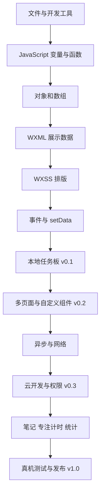
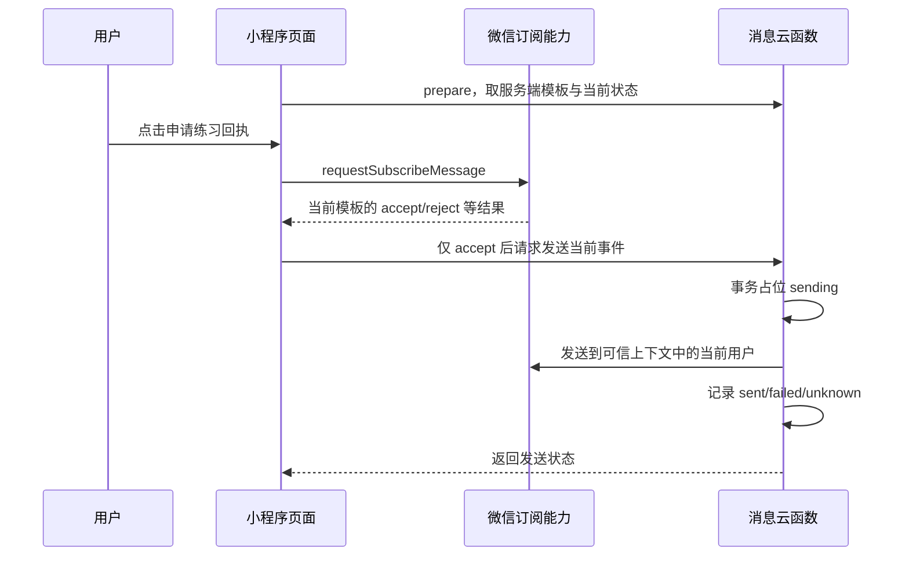
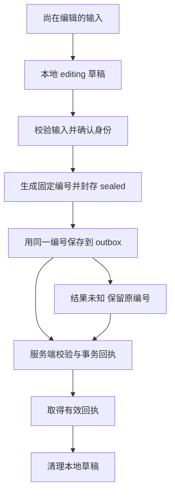
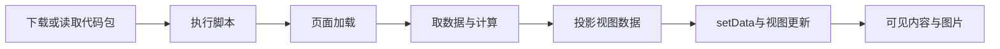
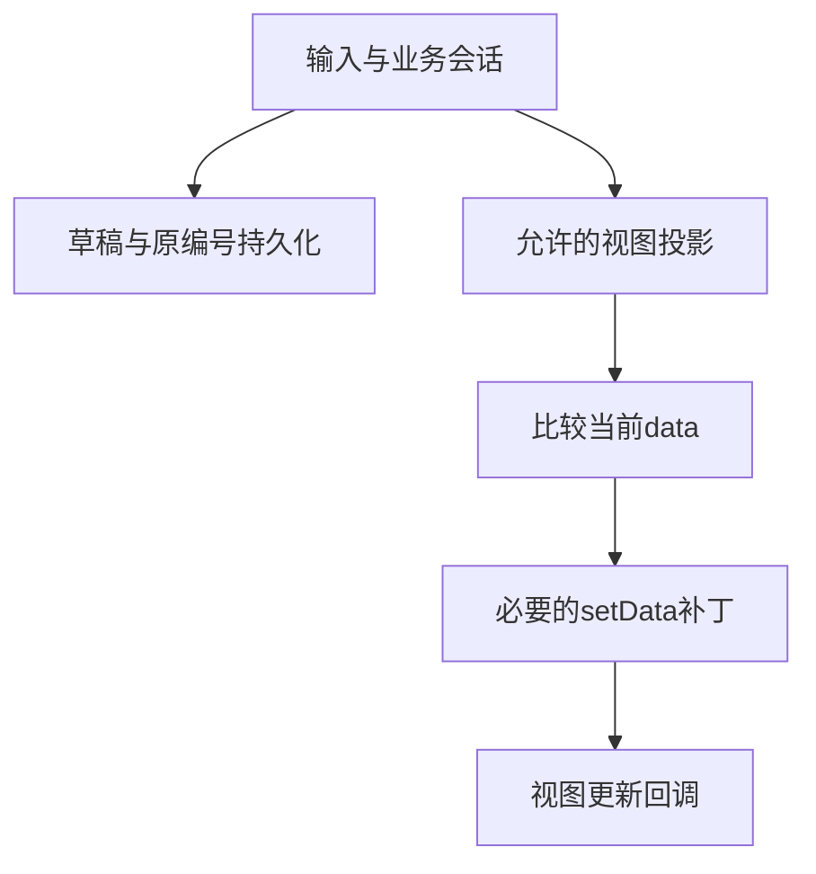
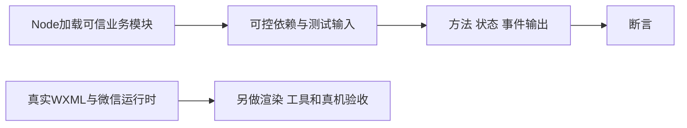

# 微信小程序开发教程 · 第 01—34 章合订版

此文件收录截至第 34 章的连续教程和相应示例/练习。 第01—36章主线正文已齐备；真实微信、云、数据治理及正式交付按实际验收表完成。目录见 [README](README.md)。整理日期：2026-11-03。

# 00 整体规划与最终项目

## 0.1 最终要达到什么程度

课程结束时，你应能独立读懂原生小程序项目，拆解需求，设计页面和数据，完成有后端的应用，并理解真机调试、权限、发布和维护。课程不以“背完所有 API”为目标；遇到新 API，能读文档、写最小示例、验证边界更有价值。

你现在不需要懂 HTML、CSS、JavaScript、数据库、服务器，也不需要先学 Vue 或 React。本课程会讲到必要的网页概念，但练习直接使用小程序文件。

### 开发的几个角色

| 词 | 初学者可以怎样理解 | 在课程中的例子 |
| --- | --- | --- |
| 需求 | 用户要解决的问题 | 我想知道今天还有哪些学习任务 |
| 界面/前端 | 用户看到和操作的部分 | 输入框、任务卡片、完成按钮 |
| 状态/数据 | 当前程序记住的内容 | 任务数组、选中的筛选条件 |
| 后端 | 在服务端执行业务、管理共享数据 | 校验身份后保存用户的任务 |
| 数据库 | 按规则长期存储和查询数据 | tasks 集合、notes 集合 |
| API/接口 | 约定好的调用方式 | 调用 `wx.showToast` 显示提示 |
| 调试 | 观察运行过程并定位错误 | 查为何点击按钮没有反应 |
| 部署/发布 | 把经过验证的版本提供给用户 | 上传、体验、审核、发布 |

前端不能因为能隐藏按钮，就获得安全性。后端必须校验当前调用者是否拥有对应数据。这会在云开发阶段详细训练。

## 0.2 技术路线和学习顺序

主线选择原生小程序：WXML 写结构，WXSS 写样式，JavaScript 写逻辑，JSON 写配置。先使用本地数据，再接模拟服务和云开发。TypeScript、框架和组件库放在后面比较学习。



这是课程的依赖关系，不要求你现在记住全部术语。

## 0.3 全部章节规划

第 01—36 章主线正文、示例和练习已提供，另有最终综合实践；真实账号、平台能力和正式交付仍需实际验收。第 10—15 章组成第二册，对应多页面与组件化的 v0.2；第 16—19 章组成第三册，对应本地 HTTP 服务与网络资源实验；第 20—23 章组成第四册，提供云环境、数据库、身份和 CRUD 权限；第 24—25 章组成第五册，提供私人缩略图、手动迁移、幂等写入与冲突处理；第六册第 26 章建立私人知识库；第七册第 27 章加入专注状态、后台恢复与会话记录；第八册第 28 章加入统计口径、固定时区、七日完整汇总、Canvas 图表和精确表格；第九册第 29 章加入文件、剪贴板、公开分享、上传下载、订阅回执与能力回退；第十册第30章进入体验与交付，加入统一反馈、网络与等待期限、读取实验和可恢复任务草稿。第十一册第31章加入视图投影、路径更新、有界分组列表、图片、普通分包和性能测量实验。第十二册第32章加入能力检测、未知值、窗口/大字/安全区、原生控件语义、配色与读屏验收，另有独立Skyline探针；主业务继续WebView。第十三册第33章系统整理纯函数、异步、组件方法与关键流程测试，加入结构化报告、局部覆盖率、故障变体及待执行渲染/工具/CI流程。第十四册第34章加入数据清单、平台隐私前置检查、原生同意页、发布材料与本地受阻检查；550个本地场景不代替真实后台、原生授权或审核。第十五册第35章加入默认关闭的本机诊断、观察层、环境核对、三组件源码清单、回退受阻检查与维护演练，共600本地场景。未配置真实告警、备份或回退。第十六册第36章提供真实TypeScript编译、npm锁文件和回环HTTP实验，并整理组件库/框架/独立后端路线与毕业实践；主工程600记录摘要匹配，扩展新跑50，跨工程650。云端源码与步骤已准备，真实账号部署、权限、读屏和真机性能验收待执行。

| 阶段 | 章 | 主题与关键知识 | 配套产出/验收 |
| --- | --- | --- | --- |
| A 起步 | 01 | 文件扩展名、UTF-8、账号、工具、项目根目录、四类文件 | 能导入、编译、修改计数器 |
| A 起步 | 02 | let/const、类型、比较、条件、循环、函数、作用域 | 能写学习时长统计函数 |
| A 起步 | 03 | 对象/数组、增删改查、浅拷贝、this、回调和异步顺序 | 能处理任务数组并预测输出 |
| A 起步 | 04 | 组件、插值、条件、循环、key、属性与事件 | 渲染任务列表和空状态 |
| A 起步 | 05 | 选择器、盒模型、rpx/px、Flex、长文本与小屏 | 做出可读的任务卡片 |
| A 起步 | 06 | Page/data/setData、事件参数、dataset、冒泡、状态推导 | 实现输入、新增、完成切换 |
| A 起步 | 07 | App/Page 生命周期、模块导出、本地存储、异常 | 重启能恢复任务，保存失败有提示 |
| A 起步 | 08 | 组合实现任务板：新增、编辑、删除、搜索、筛选 | 完成 v0.1 功能清单 |
| A 起步 | 09 | 调试器、日志、最小复现、练习与参考答案 | 能独立定位三类故障 |
| B 页面与组件 | 10 | pages 注册、navigateTo/redirectTo/switchTab/navigateBack、页面栈 | 从列表打开任务详情，再返回 |
| B 页面与组件 | 11 | query 参数、编码、缺失 ID、页面间更新、EventChannel 的适用场景 | 编辑详情后列表同步刷新 |
| B 页面与组件 | 12 | tabBar、表单、picker/switch/textarea、校验与提交反馈 | 任务分类、优先级、截止日期 |
| B 页面与组件 | 13 | Component、properties、methods、triggerEvent、插槽、样式隔离 | 提取 task-card 和 empty-state |
| B 页面与组件 | 14 | 组件生命周期、observers、behaviors、页面生命周期关联 | 倒计时组件正确释放资源 |
| B 页面与组件 | 15 | services/utils/constants 分层、状态归属、Git 基础 | v0.2 多页面本地应用和版本快照 |
| C 网络与异步 | 16 | Promise、async/await、try/catch/finally、并发与串行 | 把回调服务改写成可等待的函数 |
| C 网络与异步 | 17 | HTTP、URL、GET/POST、JSON、状态码、wx.request、合法域名 | 使用课程自备接口，观察真实请求 |
| C 网络与异步 | 18 | 请求封装、loading/error/empty/success、取消、超时、重试边界 | 请求失败后可恢复；处理旧响应覆盖 |
| C 网络与异步 | 19 | 下拉刷新、分页、去重、防抖/节流、缓存策略 | 数据增加时仍能稳定浏览 |
| D 云开发与安全 | 20 | 云环境、客户端与服务端、云函数、环境 ID、成本和配额 | 部署第一个云函数并读日志 |
| D 云开发与安全 | 21 | 文档型数据库、字段设计、索引、查询条件、分页 | 建立 tasks/notes/focus_sessions |
| D 云开发与安全 | 22 | 登录态、OPENID、wx.login 与服务端会话、鉴权 | 理解身份获取和资料填写的区别 |
| D 云开发与安全 | 23 | 云端 CRUD、输入校验、数据归属、权限规则、最小权限 | 用户 A 不能读改用户 B 的任务 |
| D 云开发与安全 | 24 | 图片选择、临时文件、云存储、上传失败、删除与文件归属 | 私人缩略图库，为笔记附件作准备 |
| D 云开发与安全 | 25 | 数据迁移、重复提交、幂等、版本号、冲突策略、备份 | v0.3 云同步，离线写入有明确处理 |
| E 完整业务 | 26 | 富文本边界、笔记编辑、标签、搜索、资源链接收藏 | 私人知识库模块 |
| E 完整业务 | 27 | 时间戳、计时器、后台挂起、恢复、会话记录、防重复统计 | 专注计时以结束时间计算，而非盲减秒数 |
| E 完整业务 | 28 | 统计口径、日期边界、连续天数、图表基础/Canvas 入门 | 最近 7 天专注统计可人工复算 |
| E 完整业务 | 29 | 文件上传/下载、剪贴板、分享、订阅消息、能力检测 | 逐项核对权限后接入所需平台能力 |
| F 质量与交付 | 30 | 统一错误反馈、弱网、重入、表单草稿、空数据与恢复 | 全局体验走查清单 |
| F 质量与交付 | 31 | setData 成本、列表分页、图片尺寸、分包、首屏性能 | 固定模型对照、原生实验与待填真机测量表 |
| F 质量与交付 | 32 | 基础库兼容、WebView/Skyline 差异、无障碍、真机适配 | 兼容/可访问实验、独立渲染探针与待填真机矩阵 |
| F 质量与交付 | 33 | 纯函数测试、组件测试、关键流程自动化、回归测试 | 四组Node测试、500项本地回归及分层待验收表 |
| F 质量与交付 | 34 | 隐私声明、用户授权、账号类目、备案/审核要求查询、版本发布 | 对照当时官方要求准备提交材料 |
| F 质量与交付 | 35 | 日志、监控、错误定位、环境隔离、回滚与持续维护 | 可维护的教学候选、600本地回归与待执行真实演练 |
| G 延伸 | 36 | TypeScript、npm、WeUI 等组件库、框架选择、独立后端方案 | 独立TS/HTTP实验50项、工具选择与最终综合实践 |

课程覆盖常用开发主线和重要边界。支付、蓝牙、地图高级定位、直播、广告、小游戏等有独立业务和资质条件，作为按需专题，不能把本课程理解成覆盖微信平台的每一个接口。

## 0.4 贯穿项目：学伴 StudyHub

### 面向谁、解决什么

面向个人学习者，把“制定任务 → 执行专注 → 记录笔记 → 查看统计”连成一个闭环。默认私人数据，不先做公共社区。这样能集中练习开发能力，仍然有足够的页面、数据关系和异常场景。

### 最终页面蓝图

| 页面 | 功能 | 数据来源 |
| --- | --- | --- |
| 今日 | 今日待办、最近笔记、快捷开始专注 | 任务、笔记、专注会话 |
| 计划列表 | 分类、优先级、搜索、分页、完成切换 | tasks |
| 任务详情/编辑 | 标题、描述、日期、标签、状态 | tasks 单条记录 |
| 笔记列表/编辑/详情 | 正文、标签、图片、关联任务 | notes、云存储 |
| 专注 | 开始、暂停、恢复、结束、记录结果 | focus_sessions |
| 统计 | 任务完成数、学习分钟、最近七天趋势 | 经过约定口径的汇总 |
| 我的/设置 | 用户主动填写资料、同步状态、数据管理 | users、preferences |

### 版本路线

| 版本 | 章节范围 | 数据存在哪里 | 验收 |
| --- | --- | --- | --- |
| v0.1 | 01—09 | 本设备缓存 | 单页面任务板完整可用 |
| v0.2 | 10—15 | 本设备缓存 | 多页面、任务详情、自定义组件 |
| v0.3 | 16—25 | 云数据库与云存储 | 身份鉴别、数据隔离、失败可恢复 |
| v0.8 | 26—29 | 云端为主 | 笔记、计时、统计组成业务闭环 |
| v1.0 | 30—35 | 明确环境与版本 | 完成安全、兼容、性能、发布准备 |

### 数据模型草案

`tasks`：`_id`、所有者身份、`title`、`description`、`done`、`priority`、`categoryId`、`dueAt`、`createdAt`、`updatedAt`、`version`。

`notes`：`_id`、所有者身份、`kind`、`title`、纯文本 `content`、`tags`、资源 `url`、`favorite`、`assetIds`、可选的 `taskId`、版本与创建/更新时间。第 26 章使用资产 ID 引用私人图片，并在资产上维护 noteRefs；不把任意云 fileID 当作附件归属依据。

`focus_sessions`：`_id`、所有者身份、可选的 `taskId` 与标题快照、plannedSeconds、isDemo、state、accumulatedMs、运行段起点与期限、开始/结束/更新时间、版本。第 27 章用每用户 focus_slots 指向最近一轮，操作回执与会话变化一起提交；终态 DTO 计算有效整秒，后台没有持续计时云函数。

第 28 章直接读取普通终态会话生成七日统计，不新增持久汇总表。`focus-end-day-v1` 固定 UTC+08:00，以 endedAt 所在日归属整轮有效秒数；它不还原跨日真实运行分钟，也不从任务 updatedAt 推断完成历史。最多完整汇总窗口内 500 条符合条件的会话，超限或失败拒绝部分结果；分页读取不等于强一致审计快照。

第 29 章另加 notice_attempts 记录独立练习回执的发送尝试，原八集合加该集合共九个；先事务占位，再调用外部发送，不能将消息与数据库提交视为同一事务。文件导出只是汇总，公开分享只含固定教学数据。

第30章任务草稿存于本机，按在线确认的环境/账号分区，最多六份；本地revision与云端baseVersion分别协调缓存和数据库变化。sealed草稿保存原编号，可衔接outbox与历史回执，不新增云集合。知识库未提交草稿仍待按其业务单独扩展。

第31章只改变视图和客户端布局，没有新增云集合。完整DTO与模型保留业务数据，视图投影不替代写入校验、版本与原编号；列表换组不删除云任务。性能采样默认关闭，只保留允许的公开数值，不含URL或正文。

第32章兼容与可访问实验无新云集合。本地清单仅内存固定数据，不是新草稿协议；独立renderer-probe没有云或身份。共享任务卡片改交互入口，原数据所有者、版本与原编号语义保留。

第33章业务源码不变，新增电脑端测试和报告。假回执服务不连云；500项是本次场景数量，不是互不重复功能数。覆盖率只涉及指定运行加载的客户端JS，真实环境继续独立验收。

第34章不增加云集合。新增三个选读入口前置检查、数据与隐私页和发布材料；默认24个待办保留。完整数据导出、账户处理、期限与权利机制仍是生产阻塞，未实际上传、提审或发布。

第35章不新增云集合，云端与共享协议不变。日志只保留允许分类，默认关闭且不上传；环境核对不替代云权限。回退检查始终不执行，完整数据治理与真实恢复演练仍待完成。

第36章不改主业务工程。第17组是独立电脑工具实验，简化契约与固定actor不用于正式认证；完整小程序继续使用第16组。

这里的字段是设计草案。服务器上的所有者必须来自可信身份上下文，不能相信客户端提交的“我是某某”。云数据库的自动字段和权限模式会在第 21—23 章根据实际方案确定。

v0.1 只用 `id/title/done/createdAt`，先掌握最小模型，再做迁移。

## 0.5 学习节奏与验收

这是建议投入，不是保证工期。零基础完整走一遍，预留约 120—200 小时较合理；遇到账号、接口或发布条件时可能更久。第一阶段建议分 2—4 周完成，重在手写和改错。

每一章都用三个问题验收：这段代码输入是什么？中间改变了哪些数据？输出或界面是什么？如果只会复制，却不能回答这三个问题，请在当前章多做一个改造题。

最终验收至少包括：

1. 从空项目建立页面和组件，能解释目录结构。
2. 无网络、空数据、非法输入、重复点击时有明确行为。
3. 换设备后能看到自己的云端数据；另一个用户看不到。
4. 后台停留后恢复计时仍合理，不重复保存专注记录。
5. 搜索和分页不会重复、漏项或让旧请求覆盖新结果。
6. 真机运行、兼容性、隐私和发布条件经过实际核对。
7. 代码有层次，关键规则有测试或可复现的验收步骤。

## 0.6 本课程的说明方式

示例分为“独立可运行项目”“放入某文件的完整替换代码”“说明性片段”。没有注明完整项目的零散片段，不应随意拼接覆盖现有文件。

所有代码示例以教学清晰为先。早期的全量数组更新和同步缓存适用于小规模本地练习；随着数据量和多人访问引入，课程会明确改造这些选择，而不是把练习实现直接当作线上架构。

资料分批核验，最近续写完成于 2026-11-03。平台界面、资质、配额和能力会变化，后续涉及此类内容时需要再次查官方文档。来源和当前读取限制见 [99 资料说明](99-官方资料与核验说明.md)。


---

# 01 环境准备与第一个小程序

本章目标：认识文件与项目，能用微信开发者工具运行计数器，并解释页面中四类文件的分工。建议分两次、用 2—3 小时完成。

## 1.1 先懂文件、文件夹和代码

文件夹负责组织文件。文件由名字和扩展名组成：`index.js` 的名字是 `index`，扩展名是 `.js`。扩展名表示文件的用途，不是随便改成什么都能运行。

在 Windows 资源管理器中打开“查看”相关设置，显示“文件扩展名”。确认 `app.json` 没有被保存为 `app.json.txt`。使用编辑器保存为 UTF-8，避免中文乱码。

代码是按一定规则书写的指令。编辑器帮你写和检查代码，运行环境执行它；微信开发者工具同时提供编辑器、模拟器和调试器。

| 操作 | 含义 |
| --- | --- |
| 保存 Ctrl+S | 把当前编辑内容写入磁盘 |
| 编译 | 让开发工具处理项目并重新运行 |
| 预览 | 在允许的账号与工具条件下生成真机体验入口 |
| 调试 | 看日志、变量、网络和报错 |

不要把双击 `.wxml` 当成运行小程序。小程序需要微信的运行环境，不能像普通 `.html` 文件一样直接在浏览器里完整运行。

## 1.2 需要准备什么

准备电脑、微信账号、微信开发者工具，以及用于正式能力的小程序账号。编辑器先使用开发者工具自带的即可。本阶段不要求安装 Node.js、Git、数据库或购买服务器。

官方入口：

- [微信公众平台](https://mp.weixin.qq.com/)：注册并管理你自己的小程序账号。
- [微信开发者工具下载](https://developers.weixin.qq.com/miniprogram/dev/devtools/download.html)：按操作系统选择官方稳定版本。
- [官方起步文档](https://developers.weixin.qq.com/miniprogram/dev/framework/quickstart/)：核对工具界面与创建流程。

这些是官方操作入口。当前研究工具无法直接读取微信文档站，具体按钮名称请以你打开的界面为准。账号主体、测试入口、真机权限等不要根据老教程截图推断。

### AppID 到底是什么

AppID 是小程序账号的标识，用来告诉平台“这是哪个小程序”。在小程序管理后台的开发设置相关区域查找。注意区分小程序、公众号等不同账号的 AppID。

AppID 不是密码。AppSecret 是服务端密钥，不应写在客户端代码里。当前练习只需要 AppID，不需要把 AppSecret 填到任何示例文件。

如果当前工具提供测试入口，可以先用它学习基础界面和逻辑。教程项目中的 `touristappid` 也是占位配置；如果工具提示不支持，请在导入界面选择自己的 AppID。拥有测试入口不等于具备云开发和正式发布资格。

## 1.3 两种起步方法

### 方法 A：先运行已有示例，再手写

1. 安装并打开微信开发者工具，按界面要求登录。
2. 找到“小程序”的导入项目入口。
3. 目录选择本教程的 `示例代码/01-hello-counter`。
4. 选择你自己的 AppID 或工具允许的测试方式，开发类型选“小程序”。
5. 完成导入后点击编译，看到“我的第一个小程序”和数字 `0`。
6. 点击“学习一次 +1”，数字变成 `1`，再点击变成 `2`。
7. 点击“重新开始”，数字回到 `0`。

这一步的目的是证明工具能够运行项目。接下来自己创建一个同样的目录，手写代码，才是学习。

### 方法 B：从空目录创建

建立 `my-first-miniapp` 文件夹，在工具中新建原生 JavaScript 小程序，前期选择不需要云服务的方式。如果模板提供 TypeScript、框架或 Skyline 专项模板，先选基础 JavaScript 原生项目。本课程示例显式使用 WebView 渲染，降低起步配置差异。

如果模板自动生成了很多内容，不必在旧模板里四处寻找修改点；可以把本章列出的文件放进一个独立练习目录，再导入该目录。

## 1.4 项目目录地图

```text
my-first-miniapp/
├─ app.js
├─ app.json
├─ app.wxss
├─ project.config.json
├─ sitemap.json
└─ pages/
   └─ index/
      ├─ index.js
      ├─ index.json
      ├─ index.wxml
      └─ index.wxss
```

“根目录”指这棵树最上面的 `my-first-miniapp`。它包含 `app.json`。后面说 `pages/index/index.js`，意思是从根目录依次进入 `pages`、`index`，打开 `index.js`。

| 文件 | 作用 | 可以类比 |
| --- | --- | --- |
| WXML | 页面有哪些组件、怎样排列结构 | 房间的骨架 |
| WXSS | 尺寸、间距、颜色和布局 | 装修 |
| JS | 数据、计算、事件、接口调用 | 房间中的控制系统 |
| JSON | 项目或页面的配置 | 事先填写的设置表 |

`app.*` 对整个小程序起作用。`pages/index/index.*` 只描述当前页面。`project.config.json` 主要供开发者工具识别项目；`sitemap.json` 用来配置页面被微信搜索索引的规则，本教学示例不开放索引。

官方起步模板也采用 `app.json` 的 `pages` 和 `window` 组织页面及窗口配置，参见 [官方起步配置源码](https://github.com/wechat-miniprogram/miniprogram-quickstart/blob/master/app.json)。本文示例为重新编写的教学代码。

## 1.5 先写全局文件

### app.js 完整内容

```js
App({});
```

`App` 是小程序提供的注册函数。圆括号 `()` 表示调用；花括号 `{}` 是传入的配置对象。暂时没有额外配置，所以对象为空。这里不需要自己定义 `App`。

### app.json 完整内容

```json
{
  "pages": ["pages/index/index"],
  "window": {
    "navigationBarTitleText": "从零学小程序",
    "navigationBarBackgroundColor": "#ffffff",
    "navigationBarTextStyle": "black"
  },
  "renderer": "webview",
  "sitemapLocation": "sitemap.json"
}
```

逐项解释：

- `pages` 是页面路径数组。普通启动时，没有指定其他启动页的情况下，首项作为首页。
- `pages/index/index` 不写 `.js` 或 `.wxml`，框架会关联同名文件。
- `window` 是窗口配置对象；里面三项分别设置顶部标题、背景色、文字颜色。
- `renderer` 为本示例选择渲染方式；后面再比较渲染器。
- `sitemapLocation` 指向本项目的索引配置文件。

JSON 的属性名和字符串必须用英文双引号，不能写注释，最后一项后不能多写逗号。`{}` 是对象，`[]` 是数组，冒号连接名称和值，逗号分隔多项。先照规则写，第 02—03 章再系统学习。

### app.wxss 完整内容

```css
page {
  background: #f4f7fb;
  color: #1f2937;
  font-family: sans-serif;
}
```

这段样式选中页面，设置背景、文字颜色和字体。`#f4f7fb` 是十六进制颜色表示。

### sitemap.json 完整内容

```json
{
  "rules": [{ "action": "disallow", "page": "*" }]
}
```

本课程的练习页面不作为搜索内容。索引配置不等于数据访问权限，真正的数据隔离后面在服务端实现。

### project.config.json 完整内容

```json
{
  "appid": "touristappid",
  "compileType": "miniprogram",
  "projectname": "hello-counter",
  "miniprogramRoot": "./",
  "setting": { "es6": true }
}
```

`miniprogramRoot` 表示小程序代码根目录。此处 `./` 就是当前目录。工具可能自动补充其他配置，正常。导入失败时先检查 AppID 和根目录，不要先删除所有配置。

## 1.6 写首页四个文件

### pages/index/index.json

```json
{
  "navigationBarTitleText": "第一个计数器",
  "usingComponents": {}
}
```

当前页的标题会覆盖全局标题。`usingComponents` 以后用来登记自定义组件，现在为空。

### pages/index/index.wxml

```xml
<view class="card">
  <text class="title">我的第一个小程序</text>
  <text class="hint">今天已经学习了</text>
  <text class="count">{{count}}</text>
  <button type="primary" bindtap="onIncrease">学习一次 +1</button>
  <button bindtap="onReset">重新开始</button>
</view>
```

`view` 是布局容器，`text` 展示文字，`button` 是按钮。开始标签和结束标签成对出现。`class` 给组件指定样式类别。

`{{count}}` 表示显示 JS 数据里的 `count`，不是把这几个字符原样显示出来。`bindtap="onIncrease"` 表示点击时执行名为 `onIncrease` 的处理函数，此处没有括号。

### pages/index/index.js

```js
Page({
  data: {
    count: 0
  },

  onIncrease() {
    const nextCount = this.data.count + 1;
    this.setData({ count: nextCount });
  },

  onReset() {
    this.setData({ count: 0 });
  }
});
```

先按执行过程理解，不要求立即记住所有语法：

1. `Page({...})` 注册页面。
2. `data` 存初始界面数据，`count: 0` 表示数字一开始为零。
3. 用户点击按钮后，框架调用 `onIncrease`。
4. `this` 在这个页面方法中指页面实例；`this.data.count` 读取当前计数。
5. `const nextCount = ...` 创建一个名字，保存“旧数字加一”的结果。
6. `this.setData({ count: nextCount })` 提交新的页面数据，界面更新后显示新数字。
7. 另一个按钮把数字重新设置为 `0`。

`count` 和 `Count` 是两个不同名字。不要把页面方法改写成箭头函数；第 03、06 章会解释 `this` 的区别。

### pages/index/index.wxss

```css
.card {
  margin: 48rpx 32rpx;
  padding: 40rpx;
  background: #ffffff;
  border-radius: 24rpx;
}
.title, .hint, .count {
  display: block;
  text-align: center;
}
.title { font-size: 40rpx; font-weight: bold; }
.hint { margin-top: 32rpx; color: #64748b; }
.count { margin: 24rpx 0; font-size: 96rpx; color: #16794b; }
button { margin-top: 24rpx; }
```

以点号开头的 `.card` 对应 WXML 的 `class="card"`。`margin` 是外部间距，`padding` 是内部间距，`border-radius` 是圆角。`rpx` 是小程序常用的响应式尺寸单位，第 05 章会讲换算。

## 1.7 程序如何连起来

```text
app.json 声明首页
  → 框架读取首页文件
  → Page 的 data 提供 count = 0
  → WXML 把 count 渲染成数字
  → 用户点击按钮
  → bindtap 找到 onIncrease
  → JS 算出 nextCount
  → setData 提交新值
  → 屏幕显示变化
```

编程不是“某个标签有魔法”。你要能沿着这条链条指出每个名字在哪定义、在哪被使用。

## 1.8 第一次调试

在 `onIncrease` 的第一行加入：

```js
console.log('点击前的计数', this.data.count);
```

保存、编译、打开调试器的 Console，点击按钮，看日志。日志在调试器里显示，用户界面不会多出这行字。`console.log` 是观察工具，不负责更新页面。

若失败，依次检查：目录选对了吗？文件保存了吗？`pages` 路径正确吗？JS/WXML 的函数名完全一致吗？Console 第一条与你代码有关的红色错误是什么？

## 1.9 本章练习

1. 把标题改成“我的学习记录”。
2. 初始数字改成 `5`，编译后验证。
3. 新增“学习五次 +5”按钮，绑定一个新方法。
4. 把计数颜色改成蓝色，只修改 WXSS。

通过标准：不参考完整文件，也能指出“改变文字改 WXML，改变颜色改 WXSS，改变计算改 JS，改变标题配置改 JSON”。答案见第 09 章。

[下一章：JavaScript 基础语法](02-JavaScript基础语法.md)


---

# 02 JavaScript 基础语法

本章从“变量是什么”讲起，目标是能读懂和编写简单计算程序。建议 3—5 小时，分几次完成。不要一口气背语法，先预测输出，再运行验证。

## 2.1 这些练习在哪里运行

用第 01 章的计数器，在 `pages/index/index.js` 的 `Page` 配置中临时加入：

```js
onLoad() {
  console.log('我开始练习 JavaScript');
},
```

例如放在 `data` 后、`onIncrease` 前，注意配置项之间有逗号。后面不含 `Page` 的 JS 片段，都可以放到这个 `onLoad` 的花括号内，每次只练一个片段。编译后看 Console。不要把练习代码直接写进 WXML。

`onLoad` 是页面创建时框架会调用的方法，第 07 章会系统介绍。练习完移除临时代码，以免改变示例运行。

纯 JS 也可以在浏览器 Console 中练习，但浏览器没有小程序专用的 `Page`、`App`、`wx`。反过来，小程序逻辑代码也不能假定存在浏览器的 `document`、DOM 或 `localStorage`。语言和宿主环境是两回事。

## 2.2 从一条语句认识标点

```js
console.log('今天学习 30 分钟');
```

`console` 是提供日志功能的对象，`.` 读取它的 `log` 方法，`()` 调用方法，引号中的内容是字符串，`;` 结束语句。这里没有任何内容会自动出现在小程序页面上。

用英文输入状态书写引号、括号、冒号、逗号。中文 `“”`、`（）` 不能代替代码中的 `''`、`()`。

```js
// 单行注释：给阅读代码的人看
/* 多行注释：
   可以解释为什么要做某件事 */
console.log('程序只执行这一行');
```

注释不参与执行。缩进一般用两个空格，帮助看清结构，不要靠代码挤成一行来“显得熟练”。

## 2.3 变量：给值取一个名字

```js
let minutes = 20;
minutes = 35;
console.log(minutes); // 35

const subject = '微信小程序';
console.log(subject); // 微信小程序
```

`let minutes = 20` 包含三件事：创建名字 `minutes`，计算右侧的值 `20`，把它赋给该名字。后面的 `minutes = 35` 是重新赋值。

`const` 声明的名字不能再次赋值。优先用 `const`，确实需要重新赋值时再用 `let`。你会在旧教程看到 `var`，现阶段知道它也是声明变量的方式即可，不要混用来解决报错。

```js
const goal = 60;
// goal = 90; // 如果取消注释，会因重新赋值而报错
```

推荐名字：`taskTitle`、`totalMinutes`、`isFinished`。避免 `a1`、`xx` 这种无法解释含义的名字。名字区分大小写，不能以数字开头，不要用 `if`、`return` 等关键字。

关于声明和基础类型，可查 [MDN JavaScript 语法与类型](https://developer.mozilla.org/zh-CN/docs/Web/JavaScript/Guide/Grammar_and_types)。本章练习围绕学习任务重新编写。

## 2.4 常用数据类型

```js
const title = '学习变量';  // string 字符串
const minutes = 30;       // number 数字
const done = false;       // boolean 布尔值
const dueAt = null;       // 主动表示“没有截止时间”
let selectedTask;         // undefined 尚未赋值
```

字符串承载文字；数字用于计算；布尔值只有 `true` 和 `false`，用于表达是/否。`null` 常用于明确的空值，`undefined` 常出现在未赋值或读取不存在的属性时。

```js
console.log(typeof '30'); // string
console.log(typeof 30);   // number
console.log(typeof true); // boolean
```

`typeof` 可以帮助排查类型，但它不是万能判断器。例如 `typeof null` 是历史遗留的 `object`，数组也会得到 `object`；判断数组用 `Array.isArray`，下一章会用到。

数字 `30` 和字符串 `'30'` 看起来相似，行为可能完全不同。

```js
console.log(30 + 5);       // 35
console.log('30' + 5);     // '305'，发生字符串拼接
console.log(Number('30') + 5); // 35
console.log(Number('abc'));   // NaN，无法转换成有效数字
```

输入框拿到的值通常是字符串，`type="number"` 也不能替你保证业务数据有效。处理数字输入时，先去除首尾空格，检查不为空，再转换并验证：

```js
const raw = ' 25 ';
const cleaned = raw.trim();
const value = Number(cleaned);

if (cleaned === '' || !Number.isFinite(value) || value <= 0) {
  console.log('请输入大于 0 的有效分钟数');
} else {
  console.log('有效分钟数', value);
}
```

`Number('')` 会得到 `0`，所以空字符串需要先独立判断。`NaN` 不是普通数字，不能用 `value === NaN` 判断。

## 2.5 算术、比较和逻辑

| 运算 | 示例 | 结果/含义 |
| --- | --- | --- |
| 加减乘除 | `12 + 3`、`12 - 3`、`12 * 3`、`12 / 3` | 15、9、36、4 |
| 取余 | `13 % 5` | 3 |
| 严格相等 | `5 === 5`、`5 === '5'` | true、false |
| 严格不等 | `5 !== 3` | true |
| 大小比较 | `minutes >= 25` | 是否至少 25 分钟 |
| 与 | `hasTitle && isValid` | 两个条件都成立 |
| 或 | `isToday || isOverdue` | 至少一个条件成立 |
| 非 | `!done` | 把真变假、假变真 |

初学时优先使用 `===` 和 `!==`，避免 `==` 的隐式转换让结果难以预测。

```js
const total = 8;
const completed = 3;
const remaining = total - completed;
const percent = Math.round(completed / total * 100);
console.log(remaining, percent); // 5 38
```

`Math.round` 四舍五入。若 `total` 为零，不能直接套这个公式，应明确“没有任务时完成率为 0”：

```js
const total = 0;
const completed = 0;
const percent = total === 0 ? 0 : Math.round(completed / total * 100);
console.log(percent); // 0
```

`条件 ? 成立时的值 : 不成立时的值` 是三元运算符。适合选择一个简单结果，不要嵌套一串复杂业务。

### 真值和假值

在条件位置，`false`、`0`、`''`、`null`、`undefined`、`NaN` 等会被当成假；`[]`、`{}`、字符串 `'false'` 都是真。**判断空数组用 `tasks.length === 0`，不能用 `if (tasks)`。**

## 2.6 条件语句：按情况执行

```js
const minutes = 35;

if (minutes >= 60) {
  console.log('完成长时学习');
} else if (minutes >= 25) {
  console.log('完成一次专注');
} else {
  console.log('继续积累');
}
```

程序从上往下检查，命中一个分支后，不再进入后面的分支。这里输出“完成一次专注”。把 `60` 的判断放在 `25` 后面，会使超过 60 的情况先被 25 的分支截住。

验证标题是项目中的常见需求：

```js
const rawTitle = '   学习条件判断   ';
const title = rawTitle.trim();

if (title.length === 0) {
  console.log('标题不能为空');
} else if (title.length > 40) {
  console.log('标题过长');
} else {
  console.log('可以保存', title);
}
```

`.trim()` 返回去掉首尾空白的新字符串，不会删除中间空格。`.length` 是字符串长度；JavaScript 按 UTF-16 代码单元计算，表情符号不一定等于 1。早期项目把它当作技术长度限制，后面可按产品需求优化。

## 2.7 循环：重复处理

```js
let total = 0;

for (let day = 1; day <= 3; day += 1) {
  total += 20;
  console.log('第几天', day, '累计', total);
}
console.log('最终', total); // 60
```

`for` 圆括号内分三部分：

1. `let day = 1`：只执行一次，设置起点。
2. `day <= 3`：每轮开始前检查条件。
3. `day += 1`：每轮结束后让 day 加一。

`total += 20` 相当于 `total = total + 20`。不要漏掉让条件逐渐结束的操作，否则可能形成无限循环，导致程序卡住。

有数组以后，按元素处理还可以这样：

```js
const sessions = [20, 30, 25];
let total = 0;
for (const minutes of sessions) {
  total += minutes;
}
console.log(total); // 75
```

`[]` 中是一组值，`for...of` 逐个取出。本章先能理解重复相加，下一章详细学数组。

## 2.8 函数：给一段步骤取名字

```js
function minutesToSeconds(minutes) {
  return minutes * 60;
}

const result = minutesToSeconds(25);
console.log(result); // 1500
```

`function` 定义函数，`minutesToSeconds` 是函数名，定义处的 `minutes` 是形参，调用时的 `25` 是实参。`return` 把结果返回给调用者，同时结束本次函数执行。

“定义”和“执行”不同：只定义函数不会自动计算。函数可以多次调用，不同参数产生不同结果。

```js
console.log(minutesToSeconds(10)); // 600
console.log(minutesToSeconds(30)); // 1800
```

`console.log` 负责显示，`return` 负责交付结果，不可互相替代：

```js
function wrongAdd(a, b) {
  console.log(a + b);
}

const result = wrongAdd(2, 3); // Console 显示 5
console.log(result);          // undefined，没有 return
```

### 提前返回使校验更清楚

```js
function getTitleError(rawTitle) {
  const title = rawTitle.trim();
  if (title.length === 0) {
    return '标题不能为空';
  }
  if (title.length > 40) {
    return '标题不能超过 40 个代码单元';
  }
  return '';
}

console.log(getTitleError('   '));     // 标题不能为空
console.log(getTitleError('学习函数')); // 空字符串，表示没有错误
```

## 2.9 作用域：名字在哪能使用

```js
const subject = '小程序';

function printSubject() {
  const minutes = 25;
  console.log(subject, minutes);
}

printSubject();
// console.log(minutes); // 外面访问不到函数内部的 minutes
```

`let`、`const` 受块作用域约束，`if`、`for` 的花括号也会形成作用范围。不要通过把所有变量搬到文件最外层来解决访问问题；通常应通过参数传入、返回值传出。

常见区别：局部变量 `const count = 1` 不会自动变成页面数据。只有进入页面 `data` 并通过合适方式提交更新，WXML 才能使用它。

## 2.10 JSON 与 JavaScript 对象先分清

JS 中允许这样写：

```js
const config = {
  title: '我的学习',
  count: 0
};
```

JSON 文件中对应的写法是：

```json
{
  "title": "我的学习",
  "count": 0
}
```

JSON 是数据格式，不是放任意 JS 的地方。不能在 `app.json` 写函数、`const`、单引号字符串或注释。以后网络响应也常用 JSON，但“JSON 格式的文本”和“内存中的对象”仍是不同东西。

## 2.11 自测

1. 预测 `Number('12') + 3`、`'12' + 3`、`12 === '12'` 的结果。
2. 写一个函数 `getRemaining(total, completed)`，返回剩余任务数。
3. 写 `isValidMinutes(raw)`：字符串输入必须非空、转为有限数字、大于零且不超过 180。
4. 用循环把 `[15, 25, 40]` 求和。
5. 解释 `const` 为什么不等于“对象内部永远不能变化”（先带着问题进入下一章）。

通过标准：能手写条件函数，能解释参数和返回值，不把日志当返回值，不把字符串当数字。答案见第 09 章。

[下一章：对象、数组、函数与异步](03-对象数组函数与异步入门.md)


---

# 03 对象、数组、函数与异步入门

目标：把零散值组织成业务数据，完成任务数组的增删改查，并理解回调为什么会晚于下一行执行。建议 3—5 小时。纯 JS 片段仍放在第 02 章的临时 `onLoad` 中，每次单独运行。

## 3.1 对象：描述一个东西

```js
const task = {
  id: 't1',
  title: '学习数组',
  done: false,
  minutes: 25
};

console.log(task.title);    // 学习数组
console.log(task['done']); // false
```

对象用 `{}` 包起来，里面是“属性名: 值”。`id` 用于识别同一条任务，`title` 是标题，`done` 是完成状态。一个任务的多个属性属于同一组，比四个互不相关的变量更容易维护。

```js
task.done = true;
console.log(task.done); // true
```

为什么 `const` 没报错？因为 `task` 仍然指向原来的对象，只修改了对象内部。`task = {}` 才是给名字重新赋值，会报错。这是 JavaScript 规则；在小程序页面上，还需要遵守 `setData` 的更新规则。

嵌套对象：

```js
const user = {
  nickname: '小林',
  preference: { dailyGoal: 60 }
};
console.log(user.preference.dailyGoal); // 60
```

读取不存在的属性得到 `undefined`，继续在 `undefined` 上取属性会报错。不要假设后台或缓存里一定有某个字段，要在边界处验证。

## 3.2 数组：有顺序的一组东西

```js
const tasks = [
  { id: 't1', title: '学习变量', done: true },
  { id: 't2', title: '学习数组', done: false },
  { id: 't3', title: '完成练习', done: false }
];

console.log(tasks.length);   // 3
console.log(tasks[0].title); // 学习变量
console.log(tasks[2].id);    // t3
```

索引从 `0` 开始：第一个元素是 `[0]`，第三个是 `[2]`。数组长度为 3 时，`tasks[3]` 是越界读取，结果为 `undefined`。

**索引表示当前位置，ID 表示身份。** 你搜索或排序以后，原来第 3 条可能变成第 1 条，但它的 ID 不应变化。删除、编辑、组件列表 key 都应该优先使用稳定 ID。

```js
console.log(Array.isArray(tasks)); // true
console.log(Array.isArray({}));    // false
```

## 3.3 先用循环，再认识数组方法

计算已完成数量：

```js
let completed = 0;
for (const task of tasks) {
  if (task.done) {
    completed += 1;
  }
}
console.log(completed); // 1
```

数组方法把一些常见循环封装起来。初学时可以先写循环版，理解之后再用方法版；不要把 `map`、`filter` 当需要死记的咒语。

### filter：留下满足条件的元素

```js
const pending = tasks.filter(function (task) {
  return task.done === false;
});
console.log(pending.length); // 2
```

`filter` 逐条调用传入的函数。返回真则保留，返回假则不保留。得到一个新数组，原数组仍有 3 条。它是浅拷贝，留下的对象仍可能与原数组共享引用，参见 [MDN filter](https://developer.mozilla.org/zh-CN/docs/Web/JavaScript/Reference/Global_Objects/Array/filter)。

### 箭头函数：较短的函数写法

```js
const pending = tasks.filter((task) => {
  return task.done === false;
});

// 函数体只有返回表达式，可以缩短为：
const pendingAgain = tasks.filter(task => !task.done);
```

三种写法表达相同的筛选规则。`task => !task.done` 中，箭头左边是参数，右边是返回值。只要使用了 `{}` 作为函数体，需要自己写 `return`，否则得到 `undefined`。

### map：把每条记录转换成新的结果

```js
const titles = tasks.map(task => task.title);
console.log(titles); // ['学习变量', '学习数组', '完成练习']
```

这里输出仍有 3 项，每项从完整对象变成标题。`map` 返回新数组，适合转换；不适合用来筛选。方法说明见 [MDN map](https://developer.mozilla.org/zh-CN/docs/Web/JavaScript/Reference/Global_Objects/Array/map)。

### find：找第一条符合条件的记录

```js
const selected = tasks.find(task => task.id === 't2');
if (selected) {
  console.log(selected.title); // 学习数组
}

const missing = tasks.find(task => task.id === 'not-exist');
console.log(missing); // undefined
```

`filter` 返回数组，`find` 返回单个元素或 `undefined`，不要把它们混淆。

## 3.4 展开语法和浅拷贝

```js
const original = { id: 't1', title: '学习对象', done: false };
const changed = { ...original, done: true };

console.log(original.done); // false
console.log(changed.done);  // true
```

`...original` 把原对象的属性展开到新对象中，后面的同名 `done` 覆盖前面的值。顺序重要：`{ done: true, ...original }` 会被原来的 false 覆盖。

```js
const first = [1, 2];
const second = [...first, 3];
console.log(first);  // [1, 2]
console.log(second); // [1, 2, 3]
```

这是浅拷贝，只复制一层：

```js
const source = { settings: { goal: 25 } };
const copy = { ...source };
copy.settings.goal = 60;
console.log(source.settings.goal); // 60，共享嵌套对象
```

若只想改变新对象，应复制将要修改的嵌套层：

```js
const source = { settings: { goal: 25 } };
const copy = {
  ...source,
  settings: { ...source.settings, goal: 60 }
};
console.log(source.settings.goal); // 25
```

早期项目保持数据结构简单，降低嵌套更新难度。

## 3.5 对任务数组增删改查

以下各段都以 3.2 的原始 `tasks` 为起点，单独运行。

### 新增

```js
const newTask = { id: 't4', title: '学习事件', done: false };
const nextTasks = [newTask, ...tasks];
console.log(nextTasks.length); // 4，新任务放最前面
```

### 按 ID 删除

```js
const deleteId = 't2';
const nextTasks = tasks.filter(task => task.id !== deleteId);
console.log(nextTasks.map(task => task.id)); // ['t1', 't3']
```

保留 ID 不是 `t2` 的任务，自然就删除了 `t2`。

### 按 ID 切换状态

```js
const targetId = 't2';
const nextTasks = tasks.map(task => {
  if (task.id === targetId) {
    return { ...task, done: !task.done };
  }
  return task;
});
console.log(nextTasks[1].done); // true
console.log(tasks[1].done);     // false，原对象未直接修改
```

遍历每条任务：目标任务返回一个修改后的新对象，其他任务原样返回。长度保持不变。

### 按 ID 修改标题

```js
const nextTasks = tasks.map(task =>
  task.id === 't3' ? { ...task, title: '完成综合练习' } : task
);
```

### 搜索

```js
const keyword = ' 数组 '.trim().toLowerCase();
const visibleTasks = tasks.filter(task =>
  task.title.toLowerCase().includes(keyword)
);
console.log(visibleTasks.map(task => task.id)); // ['t2']
```

`toLowerCase` 转为小写，使英文大小写不影响匹配；`includes` 判断是否包含关键词。任何字符串都包含空字符串，所以关键词为空时自然全部通过。

## 3.6 解构、简写和方法

```js
const task = { id: 't1', title: '学习简写', done: false };
const { id, title } = task;
console.log(id, title);
```

等价于分别写 `const id = task.id`、`const title = task.title`。这叫对象解构。

```js
const title = '学习简写';
const task = { title }; // 等价于 { title: title }
```

当属性名和变量名一致时，可以简写。完整项目中的 `this.setData({ draft })` 就是把局部变量 draft 的值写入页面同名字段。

```js
const counter = {
  count: 0,
  increase() {
    this.count += 1;
  }
};
counter.increase();
console.log(counter.count); // 1
```

对象里存函数时，通常称“方法”。`increase() {}` 是方法的简写形式。

## 3.7 this 为什么容易出错

普通函数的 `this` 与调用方式有关。对于小程序页面，由框架调用的普通页面方法使用页面实例作为 `this`。因此这样写：

```js
Page({
  data: { count: 0 },
  onIncrease() {
    this.setData({ count: this.data.count + 1 });
  }
});
```

不要把方法随手改成：

```js
// 错误示范：顶层箭头函数不会获得页面实例的 this
Page({
  data: { count: 0 },
  onIncrease: () => {
    // this.setData(...) 在这里可能不是你期待的页面方法
  }
});
```

箭头函数没有自己的 `this`，沿定义位置向外寻找。恰好因为这个性质，它适合放在普通页面方法内部，作为需要继续访问页面的回调：

```js
// 这是 Page 配置中的一个方法片段
onAskReset() {
  wx.showModal({
    title: '确认',
    content: '要重新计数吗？',
    success: (result) => {
      if (result.confirm) {
        this.setData({ count: 0 });
      }
    }
  });
}
```

只先记住：**页面方法用普通方法；方法内部需沿用页面 this 的回调用箭头函数。** 不是所有地方都必须改成箭头。

## 3.8 回调与异步：下一行不等于上一步完成

```js
console.log('A');
setTimeout(() => {
  console.log('B');
}, 1000);
console.log('C');
```

通常先输出 A、C，大约一秒后输出 B。`setTimeout` 登记“以后执行的函数”，登记后马上继续下一行。1000 是毫秒，表示计时阈值，不保证恰好 1000 毫秒准时执行。

传给其他函数、供它在合适时机调用的函数，叫回调。`map` 的回调通常同步执行；定时器、网络、用户弹窗的回调经常异步执行。**有回调不等于一定异步。**

常见错误：

```js
let message = '尚未完成';
setTimeout(() => {
  message = '已经完成';
}, 1000);
console.log(message); // 尚未完成
```

依赖结果的操作要在完成位置处理，或后面改用 Promise/async/await。第 16 章会系统展开异步、异常和请求竞态；本阶段先能预测顺序，避免提前读取还不存在的结果。

## 3.9 错误与 try/catch

```js
try {
  const value = JSON.parse('{坏数据');
  console.log(value);
} catch (error) {
  console.error('解析失败', error);
}
```

`try` 执行可能抛出异常的代码，`catch` 接住异常并给出处理。不要使用空的 `catch` 吞掉错误，也不要把整个程序全部包进去却不定位问题。

外层同步的 `try/catch` 不能自动接住未来异步回调里抛出的异常。异步 API 的 `fail`、Promise 的拒绝和 `await` 的异常处理会在网络阶段详细训练。

## 3.10 小综合：只计算，不操作界面

```js
function summarize(tasks) {
  const completed = tasks.filter(task => task.done).length;
  return {
    total: tasks.length,
    completed,
    remaining: tasks.length - completed
  };
}

const report = summarize([
  { id: 'a', title: '读文档', done: true },
  { id: 'b', title: '写练习', done: false }
]);
console.log(report); // { total: 2, completed: 1, remaining: 1 }
```

这类只根据输入计算结果、不依赖页面和缓存的函数，容易复用和验证。后续项目会把它放到 `utils/task.js`。

## 3.11 本章练习

1. 从任务数组中提取所有标题。
2. 删除 ID 为 `t1` 的任务，原数组保持不变。
3. 把 ID 为 `t2` 的任务标题改为“复习数组”，其他字段保持不变。
4. 筛选“未完成且标题包含学习”的任务。
5. 解释 `const b = a`、`const b = [...a]`、深层逐级复制分别有什么区别。
6. 预测异步示例的日志顺序，并说出原因。

[下一章：WXML 页面结构](04-WXML页面结构与模板语法.md)


---

# 04 WXML 页面结构与模板语法

目标：把数据变成可见结构，正确使用条件、列表和输入组件。建议 2—3 小时。本章先搭页面，交互方法在第 06 章完成。

## 4.1 WXML 和 HTML 有什么关系

WXML 是小程序的界面描述语言。它也使用标签，但不是把 HTML 文件改一个扩展名就能运行。普通网页的 `div/span/img`，在这里常分别使用 `view/text/image`；功能和规则应以小程序组件文档为准。

你不用先学完网页开发。先掌握标签、属性、嵌套，再用少量常用组件完成页面。

```xml
<view class="card">
  <text class="title">今天的学习</text>
  <text>先完成一个小目标</text>
</view>
```

`view` 是父组件，两个 `text` 是子组件。标签必须正确嵌套，不能写成先开始 view、再开始 text，却先结束 view。`class="card"` 中 class 是属性名，card 是属性值。

注释这样写：

```xml
<!-- 这里是页面顶部卡片 -->
```

不是 JS 的 `//`。不同文件类型使用不同注释语法。

## 4.2 常用组件清单

| 组件 | 用途 | 初次使用要点 |
| --- | --- | --- |
| view | 分组和布局 | 通常由它承担背景、间距、Flex |
| text | 文字 | 需要文字单独占行时给它 block 样式 |
| button | 触发操作 | 用 bindtap 绑定方法，有默认样式 |
| input | 单行输入 | 从 bindinput 事件的 detail.value 取值 |
| textarea | 多行输入 | 适合备注、笔记正文 |
| image | 图片 | 使用 src 和 mode，通常要指定尺寸 |
| scroll-view | 局部滚动区 | 纵向滚动通常需要明确高度约束 |
| navigator | 页面跳转入口 | 后续结合页面注册和路由学习 |
| block | 逻辑分组 | 自身不产生可供布局的可视容器 |

图片的说明性例子：

```xml
<!-- 前提：你在项目根目录准备了 assets/cover.png -->
<image class="cover" src="/assets/cover.png" mode="aspectFit" />
```

`aspectFit` 保持比例并使整张图放入指定区域。不要在尚未放入图片时把加载失败误当语法问题。本次两个完整项目不依赖图片文件。

## 4.3 数据绑定：从 JS 读值

在临时练习页面的 JS 写完整配置：

```js
Page({
  data: {
    nickname: '小林',
    completed: 2,
    total: 5,
    loading: false,
    selectedId: 't1'
  }
});
```

对应 WXML：

```xml
<view>
  <text>你好，{{nickname}}</text>
  <text>已完成 {{completed}} / {{total}}</text>
  <text>剩余 {{total - completed}} 项</text>
  <button disabled="{{loading}}">保存</button>
</view>
```

`{{}}` 中写数据字段名或模板支持的简单表达式。文字中和属性值中都可以绑定。`disabled="{{loading}}"` 传入布尔值 false，按钮可以用；把 JS 中 loading 改为 true 再编译，按钮禁用。

不要写 `disabled="false"` 来表达布尔假，非空字符串可能被当作真。需要布尔值时使用 `{{false}}` 或绑定布尔字段。

### 三种位置的变量名不要混淆

```xml
<text>{{nickname}}</text>
```

这里读的是 `Page` 的 `data.nickname`，不是 `onLoad` 里随便定义的局部 `const nickname`，也不写 `{{this.data.nickname}}`。

## 4.4 条件渲染 wx:if

```xml
<view wx:if="{{loading}}">正在加载……</view>
<view wx:else>加载完成</view>
```

`wx:if` 为真时创建前面的节点；否则走紧邻的 `wx:else` 分支。多分支可以使用 `wx:elif`。

```xml
<view wx:if="{{status === 'loading'}}">加载中</view>
<view wx:elif="{{status === 'error'}}">加载失败，请重试</view>
<view wx:else>准备好了</view>
```

对应 data 中必须有 status，例如 `status: 'loading'`。

### wx:if 和 hidden 的区别

```xml
<view wx:if="{{showTip}}">按条件创建和销毁</view>
<view hidden="{{!showTip}}">节点保留，仅隐藏</view>
```

选择时考虑状态和切换成本：完全不需要时可用 `wx:if`；需要频繁切换显示、保留内部状态时可以研究 `hidden`。不要靠 CSS 隐藏敏感内容作为权限控制。

## 4.5 列表渲染 wx:for

练习页面 JS：

```js
Page({
  data: {
    tasks: [
      { id: 't1', title: '学习 WXML', done: true },
      { id: 't2', title: '写一个列表', done: false }
    ]
  }
});
```

WXML：

```xml
<view class="task" wx:for="{{tasks}}" wx:key="id">
  <text>{{index + 1}}. {{item.title}}</text>
  <text>{{item.done ? '已完成' : '待完成'}}</text>
</view>
```

框架遍历 tasks，每条产生一个 view。默认 `item` 是当前元素，`index` 是从 0 开始的位置。`wx:key="id"` 告诉框架，每个元素中的 id 属性可以稳定识别该项。

**这里写 `id`，不写 `{{item.id}}`。** key 应唯一且稳定。会删除、排序的列表，不要把索引当身份。

自定义变量名：

```xml
<view wx:for="{{tasks}}" wx:for-item="task" wx:for-index="position" wx:key="id">
  <text>{{position + 1}}. {{task.title}}</text>
</view>
```

这样在嵌套列表中更容易区分内外元素。

如果数组是 `['语法', '布局']` 这样的唯一字符串列表，可以使用 `wx:key="*this"`。如果元素值重复，就需要另行设计唯一标识。

## 4.6 空状态和列表分开

```xml
<view wx:if="{{tasks.length === 0}}" class="empty">
  还没有任务，先添加一个吧。
</view>
<block wx:else>
  <view wx:for="{{tasks}}" wx:key="id" class="task">
    <text>{{item.title}}</text>
  </view>
</block>
```

`block` 只负责把多项逻辑组织起来，不给它设置 margin 来期待出现间距。需要可布局容器时使用 `view`。

不要在同一个节点上同时塞复杂的 `wx:if` 和 `wx:for` 来筛选数据。先在 JS 生成 `visibleTasks`，模板只负责渲染，逻辑更清楚，也能单独验证。

## 4.7 输入框先认识绑定关系

```xml
<input
  value="{{draft}}"
  placeholder="例如：学习 WXML"
  maxlength="40"
  bindinput="onDraftInput"
/>
<button bindtap="onSave">保存任务</button>
```

需要 data 中有 `draft: ''`，还需要定义 onDraftInput 和 onSave，完整写法在第 06 章。

`value` 负责从数据传到输入框；`bindinput` 负责把输入变化交给 JS。普通 `value="{{draft}}"` 不代表自动双向同步，必须在事件处理里更新数据。本课先使用显式事件；其他绑定能力后续按需再学。

`maxlength` 是输入组件的前端限制。业务方法仍要校验，因为数据也可能来自缓存、接口或其他调用路径。

## 4.8 事件绑定写名字，参数走事件对象

```xml
<button bindtap="onRemove" data-id="{{item.id}}">删除</button>
```

上面是列表内部的片段。`bindtap` 写方法名，不写 `onRemove(item.id)`。通过 `data-id` 带上当前任务身份，在 JS 的事件参数中取值。第 06 章详细演示。

## 4.9 模板里能做哪些计算

可以使用模板支持的简单数据访问、运算、比较和三元表达式，例如：

```xml
<text>{{done ? '已完成' : '待完成'}}</text>
<view class="task {{done ? 'task--done' : ''}}">任务</view>
```

不要把 WXML 当作任意 JavaScript 执行环境。诸如 `tasks.filter(...)`、页面方法调用、复杂日期格式化，先在 JS 里计算出字段再交给模板。

```js
// 放在一个页面方法里，tasks 已定义时使用
const pendingTasks = tasks.filter(task => !task.done);
this.setData({ pendingTasks });
```

## 4.10 本章练习

1. 显示任务总数和每条标题。
2. 已完成任务后面显示“已完成”，其他显示“进行中”。
3. 把 tasks 改成空数组，出现空状态。
4. 把循环变量名改为 task，确认所有引用都同步修改。
5. 解释 `wx:key="id"` 为什么不是“每条任务显示 id”。

参考官方结构：[起步模板的 WXML 源码](https://github.com/wechat-miniprogram/miniprogram-quickstart/blob/master/pages/index/index.wxml)。这个历史模板含旧的用户信息获取写法，本课程仅参考结构和绑定，**不要照搬其中的头像昵称授权流程**。现代账号资料能力将在第 22 章重新查证。

[下一章：WXSS 样式与 Flex 布局](05-WXSS样式与Flex布局.md)


---

# 05 WXSS 样式与 Flex 布局

目标：能从一个页面草图写出样式，理解尺寸和间距，能解决文字太长、按钮挤压等实际问题。建议 2—4 小时。

## 5.1 一条样式规则怎么读

```css
.card {
  background: #ffffff;
  padding: 24rpx;
  border-radius: 20rpx;
}
```

`.card` 是选择器，决定样式用到哪里；`{}` 内每条是“属性: 值;”。WXML 中写 `class="card"` 的组件会匹配这个选择器。代码写在 `.wxss` 文件，不要再套 `<style>` 标签。

WXSS 基于 CSS 扩展，但不能据此假设所有浏览器特性、所有渲染器行为完全一致。本阶段只使用常用、容易理解的规则。官方起步示例也演示了 class、Flex 和 rpx，见 [官方 WXSS 源码](https://github.com/wechat-miniprogram/miniprogram-quickstart/blob/master/pages/index/index.wxss)。

## 5.2 常见选择器

```css
page { background: #f4f7fb; }   /* 当前页面 */
text { color: #334155; }       /* text 组件 */
.title { font-size: 36rpx; }   /* 指定 class */
#main { padding: 24rpx; }      /* 指定 id，早期少用 */
.card .title { color: #16794b; } /* card 内的 title */
.title, .subtitle { display: block; } /* 两个选择器共用规则 */
```

一个组件可以有多个类：

```xml
<view class="card selected">选中的卡片</view>
```

不写 `class=".card"`，点号只出现在 WXSS 选择器中。

多个规则作用于同一属性时，选择器的优先级、来源和先后顺序会影响结果。初学时保持简单：主要用 class，避免层层嵌套和大量 `!important`。看到样式没生效，先查 class 名字和当前生效规则。

## 5.3 盒模型：内容外面还有空间

```text
外部：margin（和别人的距离）
┌──────── border（边框）────────┐
│ padding（内容和边框之间）      │
│     content（文字或图片）      │
└─────────────────────────────┘
```

```css
.card {
  width: 600rpx;
  padding: 24rpx;
  border: 2rpx solid #dbe3ec;
  margin: 24rpx auto;
}
```

在默认 content-box 计算方式下，实际横向占用还要加上左右 padding 和 border。若希望 width 包含内部间距和边框：

```css
.card {
  box-sizing: border-box;
  width: 100%;
  padding: 24rpx;
}
```

本课程项目会为常用组件设置 `box-sizing: border-box`，减少尺寸误算。

间距简写：

- `margin: 20rpx`：四边均 20。
- `margin: 20rpx 32rpx`：上下 20，左右 32。
- `margin: 10rpx 20rpx 30rpx 40rpx`：上、右、下、左。
- `margin: 24rpx auto`：上下固定，左右自动分配，常用于固定宽度块居中。

`margin` 和 `padding` 不能互换。例如卡片内文字贴边，应增加 padding；两张卡片太近，应增加 margin。

## 5.4 rpx、px、% 各做什么

在常见小程序布局中，屏幕宽度以 750rpx 为参考。若可用宽度为 375 逻辑像素，则 100rpx 对应约 50px；宽度为 414 时约为 55.2px。

```text
某个 rpx 数值对应的 px ≈ rpx 数值 × 当前可用宽度 / 750
```

注意这是布局参考，不是“手机实际物理像素”。旋转、平板、多窗口、渲染环境都可能影响可用宽度，最终要实际验证。

| 单位 | 常见用途 | 注意 |
| --- | --- | --- |
| rpx | 需要随屏幕宽度缩放的间距、卡片尺寸 | 不要所有尺寸机械照搬设计稿 |
| px | 比较稳定的细线等尺寸 | 不是固定数量的物理像素 |
| % | 相对父容器的尺寸 | 取决于父容器实际约束 |

用 rpx 不代表自动适配所有设备。适配还需要弹性布局、合理最大宽度、长文字处理和真机测试。

## 5.5 字体、颜色、边框

```css
.title {
  font-size: 36rpx;
  font-weight: 700;
  line-height: 1.5;
  color: #1f2937;
}
.subtitle {
  font-size: 26rpx;
  color: #64748b;
}
.card {
  border: 1px solid #e2e8f0;
  border-radius: 20rpx;
  background: #ffffff;
}
```

`line-height: 1.5` 表示行高约是字体尺寸的 1.5 倍。正文过小、对比过弱，即使布局没错也不好读。不要只通过颜色表达完成状态，搭配文字“已完成”。

## 5.6 Flex：把组件排成行或列

```xml
<view class="row">
  <text class="title">学习任务</text>
  <button class="small-button" size="mini">编辑</button>
</view>
```

```css
.row {
  display: flex;
  align-items: center;
  justify-content: space-between;
}
.small-button { margin: 0; }
```

`display: flex` 使 row 成为弹性容器。默认主轴为横向：`justify-content` 管横向分布，`align-items` 管纵向对齐。

| 属性 | 本课常用值 | 用途 |
| --- | --- | --- |
| flex-direction | row / column | 排成一行或一列 |
| justify-content | flex-start / center / space-between | 沿主轴排列 |
| align-items | stretch / center / flex-start | 沿交叉轴对齐 |
| flex-wrap | nowrap / wrap | 是否允许换行 |
| flex | 1 | 子项占用剩余空间 |
| flex-shrink | 0 | 子项不被挤小 |

如果方向改成 column，主轴变纵向，“主轴横向”的记忆就失效了。永远先看 flex-direction。

## 5.7 输入框占满剩余宽度

```xml
<view class="editor-row">
  <input class="draft" placeholder="输入学习任务" />
  <button class="save-button" size="mini">添加</button>
</view>
```

```css
.editor-row { display: flex; align-items: center; }
.draft {
  flex: 1;
  min-width: 0;
  padding: 16rpx;
  border: 1px solid #cbd5e1;
  border-radius: 12rpx;
}
.save-button { flex-shrink: 0; margin: 0 0 0 16rpx; }
```

`flex: 1` 让输入框吃掉剩余空间，按钮保留自身需要的宽度。`min-width: 0` 允许弹性子项在必要时缩小，解决某些内容把容器撑爆的问题。

小屏仍然拥挤时，可以把输入和提交按钮拆成上下两行。本课程完整项目采用容易适配的布局，不追求强塞一行。

## 5.8 长文本是必须测试的情况

任务标题可能很长或是一整串英文：

```css
.task-title {
  display: block;
  line-height: 1.5;
  overflow-wrap: break-word;
  word-break: break-all;
}
```

如果产品只要单行省略：

```css
.one-line {
  overflow: hidden;
  white-space: nowrap;
  text-overflow: ellipsis;
}
```

省略号需要可约束的宽度；在 Flex 里经常还需要给所在子项 `min-width: 0`。不要为了视觉整齐让用户永远看不到完整内容，详情页应提供完整文本。

## 5.9 条件样式

```xml
<view class="task {{item.done ? 'task--done' : ''}}">
  <text class="task-title">{{item.title}}</text>
</view>
```

```css
.task { background: #ffffff; }
.task--done { background: #eef8f1; }
.task--done .task-title {
  text-decoration: line-through;
  color: #64748b;
}
```

JS 只负责改变 done；WXML 根据 done 决定类名；WXSS 决定对应外观。不需要在 JS 里寻找 DOM 再改 style。

## 5.10 全局与页面样式

`app.wxss` 放整个项目的基础样式；某页的 `.wxss` 放该页专用样式。不要把所有页面都叫 `.title` 却期待它们永远互不影响，后面组件化还会涉及样式隔离。

button 具有默认样式，修改时可能还要处理它的伪元素边框：

```css
.plain-button::after { border: 0; }
```

这只是针对默认边框的调整，不是所有样式问题都靠 `::after` 解决。

## 5.11 本章小项目：统计卡片

WXML：

```xml
<view class="stats">
  <view class="stat"><text class="number">8</text><text>全部</text></view>
  <view class="stat"><text class="number">3</text><text>完成</text></view>
  <view class="stat"><text class="number">5</text><text>剩余</text></view>
</view>
```

WXSS：

```css
.stats {
  display: flex;
  padding: 24rpx;
  background: #ffffff;
  border-radius: 20rpx;
}
.stat { flex: 1; text-align: center; font-size: 26rpx; color: #64748b; }
.number { display: block; font-size: 48rpx; color: #16794b; font-weight: 700; }
```

先使用静态数字练布局，再把数字换成数据绑定。将“排版问题”和“数据问题”分步验证，更容易定位故障。

## 5.12 本章练习

1. 让统计卡片横向三等分。
2. 增加第四项“完成率”，看看 Flex 如何分配。
3. 把横向统计改为纵向，说明主轴如何变化。
4. 给任务卡片增加内部留白，而不改变卡片之间的距离。
5. 在窄屏模拟器输入 40 个英文字符，确保没有横向溢出。

[下一章：数据驱动与事件](06-数据驱动与事件处理.md)


---

# 06 数据驱动与事件处理

目标：理解从用户操作到界面更新的完整过程。本章建议 3—4 小时，先运行下面的小实验，再读任务板源码。

## 6.1 Page 的 data 不只是普通变量

```js
Page({
  data: {
    draft: '',
    tasks: [],
    total: 0
  }
});
```

这些字段是页面初始数据，模板可以直接使用 `{{draft}}`、`{{tasks}}`、`{{total}}`。数据名尽量表达业务含义：draft 是草稿，tasks 是任务列表，total 是总数。

局部计算结果不必都塞进 data。只有界面需要或页面状态需要维护的数据才放进去；定时器句柄、函数等也不应放入要发送到视图的数据中。

## 6.2 修改界面使用 setData

```js
// 页面方法中的片段
this.setData({ total: 3 });
```

这里提交部分字段，其他字段不因本次调用而全部清空。可以一次更新多个互相关联字段：

```js
this.setData({
  tasks: nextTasks,
  total: nextTasks.length,
  draft: ''
});
```

不要写：

```js
// 错误示范：直接改 this.data 不会可靠驱动视图同步
this.data.total = 3;
```

`setData` 同步改变对应的 `this.data`，视图更新异步完成。需要在本次渲染完成后操作时，用它提供的回调：

```js
this.setData({ total: 3 }, () => {
  console.log('这一轮视图更新完成');
});
```

不要把 `await this.setData(...)` 当作等待视图完成的通用写法。它的完成通知不是一个你可以随意依赖的原生 Promise 返回值。

官方类型定义明确记录了 `setData` 的同步/异步边界、可序列化数据要求和直接修改 data 的问题，参见 [微信官方组件实例方法定义](https://github.com/wechat-miniprogram/api-typings/blob/master/types/wx/lib.wx.component.d.ts)。

### 更新嵌套字段

```js
this.setData({
  'profile.nickname': '小林',
  'tasks[0].done': true
});
```

这是字段路径，带点号和方括号的键要放在字符串中。早期项目使用生成新数组的写法更容易推理；数据量增加后再研究减少传输量。无论哪种方式，都不要每次把与界面无关的大量数据发送过去。

## 6.3 一个可完整运行的输入实验

在独立练习副本中，用以下代码替换首页 WXML 和 JS，WXSS 可以暂时沿用计数器样式。

WXML：

```xml
<view class="card">
  <input value="{{draft}}" placeholder="输入任务标题" maxlength="40" bindinput="onDraftInput" />
  <text class="hint">当前输入：{{draft}}</text>
  <button bindtap="onAdd">添加</button>
  <view wx:if="{{tasks.length === 0}}">还没有任务</view>
  <view wx:for="{{tasks}}" wx:key="id">
    <text>{{item.title}}</text>
  </view>
</view>
```

JS：

```js
Page({
  data: { draft: '', tasks: [] },

  onDraftInput(event) {
    this.setData({ draft: event.detail.value });
  },

  onAdd() {
    const title = this.data.draft.trim();
    if (title.length === 0 || title.length > 40) {
      wx.showToast({ title: '请输入 1—40 个代码单元的标题', icon: 'none' });
      return;
    }
    const task = {
      id: 'task_' + Date.now() + '_' + Math.random().toString(36).slice(2, 10),
      title,
      done: false
    };
    this.setData({ tasks: [task, ...this.data.tasks], draft: '' });
  }
});
```

操作：输入“学习事件”，下方同步显示；点添加，列表出现任务，输入框清空；只输入空格再点添加，显示提示，列表不变。

流程逐步解释：

1. 输入组件产生 input 事件。
2. 框架把事件对象传入 `onDraftInput`，参数名 event 是我们自己取的。
3. `event.detail.value` 是组件提供的新值。
4. setData 把新值保存到 draft，模板也会更新。
5. 点击添加时读取 draft，清理首尾空格，校验有效性。
6. 构建新任务，将它放在数组前面。
7. 同时提交任务数组并清空草稿。

这里临时使用“时间戳 + 随机串”作为本地 ID，教学项目第 08 章还会加已有 ID 冲突检查。它不适合充当密码、身份凭证或云端鉴权依据。

## 6.4 event 的三个常见字段

| 字段 | 表示什么 | 使用场景 |
| --- | --- | --- |
| detail | 该类型事件额外提供的信息 | input 的 value，switch 的 value |
| target | 最初触发事件的源组件 | 判断点击是否来自内部子组件 |
| currentTarget | 绑定当前处理函数的组件 | 读取写在按钮上的 dataset |

不是所有事件的 `detail` 都有 value。先看组件文档，必要时 `console.log(event)` 观察。定义可参见 [官方事件类型源码](https://github.com/wechat-miniprogram/api-typings/blob/master/types/wx/lib.wx.event.d.ts)。

## 6.5 用 dataset 携带任务身份

列表内部：

```xml
<button data-id="{{item.id}}" bindtap="onToggle">
  <text>切换状态</text>
</button>
```

页面方法片段：

```js
onToggle(event) {
  const id = event.currentTarget.dataset.id;
  const nextTasks = this.data.tasks.map(task =>
    task.id === id ? { ...task, done: !task.done } : task
  );
  this.setData({ tasks: nextTasks });
}
```

事件绑定在 button 上；即使最初点击内部 text，currentTarget 仍指向这个 button。把数据写在按钮，却从 target 读取，可能在点击不同位置时表现不一致。

`data-task-id` 通常对应 `dataset.taskId`，带短横线的名字会转为驼峰形式。本课程先用简单的 `data-id`。

不要传数组索引去操作完整数据。搜索后“当前显示的第 1 项”可能是原数组第 20 项；稳定 ID 才能找对任务。

## 6.6 事件冒泡和 catchtap

```xml
<view bindtap="onOpenDetail">
  <text>任务卡片，点击打开详情</text>
  <button catchtap="onRemove">删除</button>
</view>
```

对 tap 这种可冒泡事件，内部按钮被点后，事件可能继续到外层。`bindtap` 绑定但不阻止这种传播；`catchtap` 可以阻止该事件继续冒泡。

如果删除按钮也让你进入详情，先查冒泡。当前 v0.1 卡片容器没有绑定跳转，按钮之间不需要用 catchtap；到多页面版本再按需要使用。

## 6.7 数据驱动为什么要求统一计算

假设页面同时存 tasks、total、completed、remaining、visibleTasks。新增任务时只改 tasks，却忘了 total，页面就会自相矛盾。

更好的方式是指定来源：

```text
原始状态：tasks + keyword + filter
                  ↓ 统一计算
派生结果：total / completed / remaining / visibleTasks
                  ↓
              WXML 展示
```

```js
function buildView(tasks, keyword, filter) {
  const normalized = keyword.trim().toLowerCase();
  const completed = tasks.filter(task => task.done).length;
  const visibleTasks = tasks.filter(task => {
    const matchesKeyword = task.title.toLowerCase().includes(normalized);
    const matchesFilter = filter === 'all'
      || (filter === 'pending' && !task.done)
      || (filter === 'done' && task.done);
    return matchesKeyword && matchesFilter;
  });
  return {
    total: tasks.length,
    completed,
    remaining: tasks.length - completed,
    visibleTasks
  };
}
```

每次原始状态变化，都重新算一次派生结果。对于上限 200 条的教学数据，这个全量方案清楚且足够简单；大型列表会在性能阶段进一步优化。

顶部统计按全部任务计算，列表按条件筛选。这个口径是产品决定，不是框架规定。你需要能解释“为什么只显示 1 条，顶部仍是 8 条”。

## 6.8 编辑状态也是数据

```js
data: {
  draft: '',
  editingId: ''
}
```

`editingId === ''` 表示新增模式，有 ID 表示正在编辑那条任务。编辑时把标题放回 draft，保存时按 ID 修改，取消时清空二者。

```xml
<button bindtap="onSave">{{editingId ? '保存修改' : '添加任务'}}</button>
```

不需要额外维护一个 `isEditing` 再让它和 editingId 互相同步。能够可靠计算出来的状态，尽量减少重复存储。

## 6.9 提示与确认不是一回事

`wx.showToast` 给短暂反馈；`wx.showModal` 用来让用户做明确选择，例如删除确认。删除逻辑应放在“确认”分支：

```js
wx.showModal({
  title: '删除任务',
  content: '确认删除吗？',
  success: (result) => {
    if (!result.confirm) return;
    // 在这里执行删除及保存
  },
  fail: (error) => {
    console.error('弹窗失败', error);
  }
});
```

不能在调用 showModal 的下一行直接删除，那时用户还没做选择。接口参数可查 [官方交互 API 定义](https://github.com/wechat-miniprogram/api-typings/blob/master/types/wx/lib.wx.api.d.ts)。

## 6.10 本章练习

1. 添加任务后把“已添加”显示为 toast。
2. 增加只看待完成按钮，让筛选条件进入 data。
3. 给删除按钮加内部 text，分别打印 target 和 currentTarget。
4. 解释新增后只修改 `this.data.tasks` 有什么问题。
5. 说出至少三个需要更新派生统计的操作。

[下一章：生命周期、模块化与本地存储](07-生命周期模块化与本地存储.md)


---

# 07 生命周期、模块化与本地存储

目标：了解页面何时执行代码，能把逻辑拆成文件，能保存并恢复本地任务，知道失败时如何保护数据。建议 3—4 小时。

## 7.1 生命周期：由框架在特定时机调用的方法

你不必每次手动执行页面初始化。框架在特定阶段调用约定名称的方法，这些方法叫生命周期函数。

| 页面方法 | 常见触发时机 | 适合做什么 |
| --- | --- | --- |
| onLoad(options) | 当前页面实例加载 | 读路由参数、初始化数据 |
| onShow() | 页面变为可见 | 返回页面时刷新必要状态 |
| onReady() | 首次渲染准备完成 | 依赖首次界面准备完成的操作 |
| onHide() | 页面被隐藏 | 暂停界面级工作 |
| onUnload() | 当前页面实例卸载 | 清理定时器、监听等资源 |

普通首次打开页面通常可观察到 onLoad → onShow → onReady。页面隐藏后返回，通常再次执行 onShow，而不是再次创建同一个实例。具体路由行为会在第 10 章验证。

注意：App 也有 onShow/onHide，作用对象是整个小程序；不是某个具体页面。App 的 `onLaunch` 用于小程序初始化阶段。

定义依据可查 [官方 Page 生命周期类型](https://github.com/wechat-miniprogram/api-typings/blob/master/types/wx/lib.wx.page.d.ts)。

## 7.2 用日志亲眼观察

在独立练习页中临时添加：

```js
Page({
  data: {},
  onLoad(options) { console.log('页面 onLoad', options); },
  onShow() { console.log('页面 onShow'); },
  onReady() { console.log('页面 onReady'); },
  onHide() { console.log('页面 onHide'); },
  onUnload() { console.log('页面 onUnload'); }
});
```

然后编译、切换到后台再回来，观察 Console。后续加入第二个页面后，再比较 navigateTo 后返回与卸载重建的区别。

别在 onLoad 和 onShow 无条件各请求一次相同接口，首次打开会重复。v0.1 单页面只在 onLoad 读取本地任务；多页面编辑时，再设计返回刷新方式。

## 7.3 定时器属于需要清理的资源

下面只是生命周期练习片段，不是最终专注计时算法：

```js
onShow() {
  if (this._timer) return;
  this._timer = setInterval(() => {
    console.log('页面可见时每秒观察一次');
  }, 1000);
},

stopTimer() {
  if (this._timer) {
    clearInterval(this._timer);
    this._timer = null;
  }
},

onHide() { this.stopTimer(); },
onUnload() { this.stopTimer(); }
```

`this._timer` 是实例上的普通字段，不参与视图渲染，没有放进 data。隐藏和卸载都清理，是因为隐藏不等于卸载。

手机后台可能暂停计时器。真正的专注计时需要记录开始/结束时间，恢复后重新计算，不能只靠每秒减 1；这在第 27 章展开。

## 7.4 模块化：让每个文件负责一类事

页面越写越长时，可以拆出独立函数。

在项目根目录新建 `utils/math.js`：

```js
function minutesToSeconds(minutes) {
  return minutes * 60;
}

module.exports = { minutesToSeconds };
```

首页 `pages/index/index.js`：

```js
const { minutesToSeconds } = require('../../utils/math');

Page({
  data: {},
  onLoad() {
    console.log(minutesToSeconds(25)); // 1500
  }
});
```

`module.exports` 决定这个文件向外提供什么；`require` 把模块提供的内容读取进来。这里只用 CommonJS 模块风格，暂时不要混用其他写法。

路径解释：当前文件在 `pages/index/`，`../` 上到 pages，再 `../` 上到根目录，随后进入 utils。文件名常可以省略 `.js`。路径使用 `/`，与 Windows 资源管理器显示的反斜杠区分开。

每个 JS 文件有自己的模块作用域。一个文件中的局部 const 不会自动出现在另一个文件，必须导出、导入或通过明确的数据通道传递。

## 7.5 为什么任务板拆三层

```text
pages/index/index.js  接事件、控制编辑状态、给用户反馈
          ↓
utils/task.js        标题校验、创建任务、筛选和统计
          ↓ 被页面组合使用
services/storage.js  统一读写缓存，校验缓存结构
```

更准确的依赖关系是：页面调用 utils 和 services；services 也复用 utils 的数据校验。utils 不依赖页面或 wx。

这样改筛选规则不用碰存储，改存储键名不用碰 WXML。不要为了“架构”把每两行都拆一个文件，职责清楚比目录多更重要。

## 7.6 内存与本地缓存不是同一回事

data 中的任务在当前运行时内存里；重启页面实例或小程序后不能靠它自动恢复。缓存是另一个保存位置，需要主动读写。

```js
wx.setStorageSync('studyhub.example', { title: '学习缓存', done: false });
const saved = wx.getStorageSync('studyhub.example');
console.log(saved.title); // 学习缓存
```

这里可以直接保存对象或数组，不必先 JSON.stringify，再忘了取出后 JSON.parse。API 本身支持的可序列化数据和异常处理可查 [官方存储 API 定义](https://github.com/wechat-miniprogram/api-typings/blob/master/types/wx/lib.wx.api.d.ts)。

上面是最小演示。实际代码必须处理读写失败；缓存可能被清理，也不等于云端备份。模拟器和手机的缓存不是同一个空间，同账号换设备也不能靠本地缓存同步。

## 7.7 同步与异步缓存

`wx.setStorageSync`、`wx.getStorageSync` 是同步调用，调用结束后继续下一步，失败时可能抛异常。适合当前少量教学数据，不能在大量输入事件或启动阶段疯狂读写。

异步版本 `wx.setStorage`、`wx.getStorage` 通过回调等形式通知结果。后续学习异步封装时再改造；不要误以为名字少了 Sync 就自动变成 Promise 业务架构。

本地缓存用于持久化，不适合被滥用为页面间每次通信的“万能消息总线”。后续有更明确的状态归属和页面通信方案。

## 7.8 一个安全一些的读取函数

完整项目会严格校验每个任务。先看简化思路：

```js
function loadTasks() {
  const value = wx.getStorageSync('studyhub.tasks.v1');
  if (value === '' || value === undefined) return [];
  if (!Array.isArray(value)) {
    throw new Error('任务缓存不是数组');
  }
  return value;
}
```

“没有缓存”可以理解成首次启动；“有缓存但格式不合法”可能是旧版本或被误改，两者不能都悄悄变成空数组再保存覆盖。完整示例遇到非法数据会暂停修改，保留原缓存，提示排查。

边界校验至少检查：数组、条数、唯一 ID、合法标题、布尔完成状态、有效时间戳。这些校验也能在未来迁移数据格式时帮助发现不兼容。

## 7.9 保存失败时怎么办

当前项目采用适合小规模同步缓存的顺序：

```text
生成 nextTasks
    ↓
先尝试写入缓存
    ├─ 失败：提示、保留旧界面和草稿
    └─ 成功：更新 tasks、统计和列表，按需要清空草稿
```

```js
// Page 内的方法片段；saveTasks 与 buildView 已导入
commitTasks(tasks, extraData = {}) {
  try {
    saveTasks(tasks);
  } catch (error) {
    console.error('保存失败', error);
    wx.showToast({ title: '保存失败，请重试', icon: 'none' });
    return false;
  }
  this.setData({
    tasks,
    ...buildView(tasks, this.data.keyword, this.data.filter),
    ...extraData
  });
  return true;
}
```

`extraData = {}` 是默认参数。调用者不传时使用空对象；新增成功可以传 `{ draft: '', editingId: '' }`，切换完成状态则不需要清空草稿。

完整项目在这个方法里还检查读取异常状态。这里的顺序不能直接套到所有网络场景：云端写入会有延迟、重复提交和部分失败，后面要设计 loading、幂等与冲突处理。

## 7.10 数据保存在哪个时机

每次任务新增、编辑、完成切换、删除，保存一次。搜索词和筛选条件不需要在本版持久化。不要只在 onUnload 里保存：小程序可能在后台被系统终止，不能保证所有清理回调都执行。

## 7.11 本章练习

1. 在 onLoad 读取一条练习数据，显示在界面上。
2. 改完后重新编译，验证缓存仍在。
3. 比较只更新 data、不写缓存与写缓存的区别。
4. 把“分钟转秒”函数移到 utils 并正确导入。
5. 解释为什么读取异常时不能无提示地初始化并保存空数组。

[下一章：完整实战任务板](08-实战学伴任务板v0.1.md)


---

# 08 实战：学伴任务板 v0.1

本章把前面知识组合成一个完整作品。建议 4—6 小时，分“先跑通、理解数据、理解事件、改造功能”四次完成。完整源文件在 `示例代码/02-study-board`，本章末尾也附有逐文件源码。

## 8.1 先写需求，再写代码

本版应做到：

1. 新增任务，去除标题首尾空格，拒绝空标题和超长标题。
2. 按 ID 编辑标题，保留原来的完成状态和创建时间。
3. 切换已完成/待完成。
4. 删除前确认，取消时不删除。
5. 按标题搜索，英文忽略大小写。
6. 全部/待完成/已完成三个筛选条件可与搜索组合使用。
7. 顶部统计始终针对全部任务，列表显示匹配项。
8. 重启后从当前设备缓存恢复。
9. 首次无任务、没有匹配结果、读写缓存失败都有明确反馈。

范围约定：这是个人本地教学版，最多 200 条任务，标题按 JavaScript `.length` 限制为 40。条数和标题上限是本课程主动设置的业务限制，不是微信平台的统一限额。版本尚未包含云端、账号、跨设备同步、多页面、笔记、计时与统计图。

## 8.2 导入与预期结果

1. 开发者工具导入 `示例代码/02-study-board`，确认其中有 app.json。
2. 使用自己的 AppID 或工具允许的测试方式。
3. 编译后应看到“学伴 · 从一个小目标开始”，三个统计数字都是 0。
4. 输入“学习 WXML”，点添加，全部=1、已完成=0、待完成=1。
5. 点标记完成，全部=1、已完成=1、待完成=0，卡片出现完成文字和删除线。
6. 重新编译，任务仍在。若手动清理了工具缓存，预期会丢失本地记录。

不要在浏览器打开 index.wxml。这里的“重新编译”也不能替代真机预览；手机会有自己的缓存空间。

## 8.3 目录和依赖

```text
02-study-board/
├─ app.js / app.json / app.wxss
├─ project.config.json / sitemap.json
├─ pages/index/index.js
├─ pages/index/index.json
├─ pages/index/index.wxml
├─ pages/index/index.wxss
├─ utils/task.js
└─ services/storage.js
```

页面 JS 调用 task.js 的计算函数和 storage.js 的存储函数；存储模块复用 task.js 的校验函数。没有循环依赖，没有外部安装包。

## 8.4 一条任务的数据模型

```js
{
  id: 'task_某个唯一标识',
  title: '学习 WXML',
  done: false,
  createdAt: 1790000000000
}
```

示例时间戳只用于说明形状，实际由 Date.now() 生成。单位是毫秒，不是秒。

| 字段 | 类型 | 为什么需要 |
| --- | --- | --- |
| id | 字符串 | 搜索/筛选后仍能准确编辑和删除 |
| title | 字符串 | 用户可读的标题，不承担身份职责 |
| done | 布尔值 | 同一个字段决定文字、样式、筛选和统计 |
| createdAt | 有限且非负的数字 | 记录创建时间，为后续排序和统计预留 |

允许同名任务。两条标题一样不代表是同一条记录，所以不能用标题当 key。

## 8.5 页面状态表

| 字段 | 初始值 | 含义 |
| --- | --- | --- |
| draft | `''` | 新增或编辑时的输入草稿 |
| editingId | `''` | 空为新增模式，否则是编辑目标 |
| keyword | `''` | 搜索框内容 |
| filter | `'all'` | all/pending/done 三种条件 |
| tasks | `[]` | 全部已加载任务，是主要数据来源 |
| visibleTasks | `[]` | 从 tasks 和条件算出来的显示列表 |
| total | `0` | 全部任务数 |
| completed | `0` | 全部已完成数 |
| remaining | `0` | 全部待完成数 |
| storageError | `false` | 是否因读取失败而暂停修改 |

只有 tasks 会存到缓存。draft、搜索词、筛选条件和编辑模式在重启后恢复初始值，这是本版明确的设计。

## 8.6 读懂 utils/task.js

### 标题校验 getTitleError

```js
function getTitleError(rawTitle) {
  if (typeof rawTitle !== 'string') return '标题必须是文字';
  const title = rawTitle.trim();
  if (title.length === 0) return '请先输入任务标题';
  if (title.length > MAX_TITLE_LENGTH) return '标题不能超过 40 个代码单元';
  return '';
}
```

先检查类型，避免对数字调用 trim。之后先处理空字符串，再处理上限。用空字符串表示没有错误，调用者通过 `if (error)` 判断。返回描述而不是在函数里弹 toast，可以让这段规则被测试、页面和缓存校验重复利用。

### 缓存结构校验 isValidTasks

先检查 value 是数组且没有超过业务条数上限；再逐条检查 ID、标题、done、createdAt。`Set` 是去重集合，用 `has` 检测 ID 是否出现过，用 `add` 记住当前 ID。任一记录不合法就返回 false，全部通过才返回 true。

本函数只确认当前版本需要的结构，不会静默修改旧数据。新增字段时应规划迁移，而不是任意改变规则后让已有用户突然无法读取。

### 创建任务 createTask

```js
const now = Date.now();
const baseId = 'task_' + now + '_' + Math.random().toString(36).slice(2, 10);
```

Date.now 生成毫秒时间戳，随机数转为 36 进制字符串并截取一段，组合成本地候选 ID。接着用已有 ID 集合检查冲突，若冲突追加编号，直到找到未使用的值。

创建函数再次检查标题，返回一个全新对象。它不操作页面、不保存缓存。后面云端会采用云数据库/服务端认可的 ID 和身份方案，不把随机 ID 当安全机制。

### 派生视图 buildView

先把搜索词 trim 并转小写；算出所有任务中的 completed；然后逐条检查“搜索条件”和“状态条件”，两者都成立才显示。

```js
return matchesKeyword && matchesFilter;
```

filter 为 all，状态条件无条件通过；pending 只通过 !done；done 只通过 done。顶部总数来自原始 tasks，不能从 visibleTasks.length 反推。

## 8.7 读懂 services/storage.js

存储键固定为 `studyhub.tasks.v1`。这减少了散落字符串拼错的风险，也为后续迁移预留版本概念。它是缓存键名，不是云环境 ID。

`loadTasks` 处理三种情况：

1. 没有缓存：返回空数组，正常首次启动。
2. 有合法缓存：返回任务。
3. 有不合法缓存或 API 抛异常：让异常交给页面，不自行覆盖数据。

`saveTasks` 先验证传入数组，再写缓存。不在存储服务里弹提示，让页面决定用户应该看到什么。

这里保存的是数组本身，不是字符串化后的数组；如果你手动往缓存里写 `'[]'`，它是字符串，当前校验会拒绝。需要明确区分文本和数组。

## 8.8 初始化与读取失败

`onLoad` 调用 `onReload`。读取成功时，用一个 setData 同时设置 tasks 和派生结果，清空草稿/编辑状态，解除读取异常状态。

读取失败则记录 Console 错误，把 storageError 设为 true，显示警告和“重新读取”。输入和修改按钮禁用，方法内部也有 canWrite 检查。这两道检查分别服务于界面反馈和逻辑边界。

若后续一次重读失败，页面可能仍保留上次成功读取的数据显示，但它不会允许继续修改，避免把不可靠状态写回。警告会说明应先处理缓存问题。

## 8.9 统一提交 commitTasks

```js
const saved = this.commitTasks(nextTasks, { draft: '', editingId: '' });
```

这个方法承担所有数据变更的共同步骤：检查可写 → 保存 → 保存失败就提示并返回 false → 成功后更新 tasks/派生结果/附加页面状态 → 返回 true。

为什么返回布尔值？页面只有在成功时才显示“已添加/已保存修改”。否则会出现底层保存失败，上层仍宣布成功的问题。

extraData 的职责是附加 UI 状态。任务切换不清空草稿；新增/编辑成功则清空。未来扩展时不要从外部传入任意对象覆盖 tasks 或统计字段，保持调用约定清楚。

## 8.10 新增与编辑 onSave

两者共用输入框和保存按钮：

```text
检查 storageError
    ↓
校验标题、去除首尾空格
    ↓
editingId 有值？
  ├─ 有：确认任务仍存在 → 按 ID 修改 title
  └─ 无：检查 200 条上限 → 创建新任务并放到数组最前面
    ↓
commitTasks
  ├─ 成功：清空编辑状态、给成功提示
  └─ 失败：保留草稿和旧任务，方便重试
```

`some` 判断数组中是否存在符合条件的元素，返回布尔值；与 find 返回元素不同。编辑不存在的任务时，不能自动“顺手新增”一条，应提示状态已经变化。

编辑的核心：

```js
nextTasks = this.data.tasks.map(task =>
  task.id === editingId ? { ...task, title } : task
);
```

只覆盖 title，因此 done、createdAt、id 都保留。如果你直接返回 `{ title }`，其他字段会丢失，后续存储校验也会失败。

## 8.11 开始编辑与取消编辑

`onEdit` 从 currentTarget.dataset.id 取身份，find 找任务，把 title 放进 draft，把 id 放进 editingId，然后滚动到页面顶部，让输入框出现在用户视野内。

`onCancelEdit` 清空 draft 和 editingId，不写缓存。取消的意思是放弃本次草稿，不是删除原任务。

此时用户还可以筛选和搜索，编辑目标靠 ID 保持，不依赖列表当前位置。

## 8.12 完成切换 onToggle

使用 map 找目标，返回 `{ ...task, done: !task.done }`，其余原样返回。调用 commitTasks 后会重新计算列表和统计。

如果当前筛选是“待完成”，你把某条标记完成，它会立即从当前列表消失；顶部已完成数增加。这是正确结果，不是任务丢失。切换到“已完成”就能看到。

## 8.13 删除 onRemove

先查找任务，展示包含标题的确认框。只有 result.confirm 为真才生成删除后的数组。

确认回调中使用的是**回调发生时的 this.data.tasks**，而不是在打开弹窗之前就构造一份旧快照。这样不会因为等待用户确认而把期间的新状态覆盖回去。

如果被删除的任务恰好正在编辑，成功提交时同时清空编辑状态。删除取消、弹窗失败或缓存保存失败，都不应该宣称删除成功。

## 8.14 搜索与筛选

`onKeywordInput` 读取新 keyword，结合当前 filter 重算；`onFilterChange` 读取按钮 data-filter，先确认是 all/pending/done 之一，再结合当前 keyword 重算。

这些操作没有改动任务内容，不调用 saveTasks。输入筛选文字不会每敲一个字就把整个任务数组再写一次缓存。

## 8.15 对照 WXML 看结构

页面按顶部说明、读取异常警告、统计、编辑区、搜索筛选区、空状态、任务列表排列。

| WXML 部分 | 依赖字段 | 用户动作 |
| --- | --- | --- |
| 警告区 | storageError | onReload |
| 统计区 | total/completed/remaining | 无 |
| 编辑区 | draft/editingId/storageError | onDraftInput/onSave/onCancelEdit |
| 搜索区 | keyword/filter | onKeywordInput/onFilterChange |
| 空状态 | total/visibleTasks/storageError | 无 |
| 列表 | visibleTasks/item.done/item.id | onToggle/onEdit/onRemove |

理解它们的对应关系后，你应该能回答：按钮名字对不上会怎样？输入数据为什么在 detail？列表 key 为什么用 id？首次为空和搜索无结果为什么是两句不同文案？

## 8.16 对照 WXSS 看外观

统计区用 Flex 让三个子项等分；卡片用 padding 保持内部留白；actions 用 flex-wrap 允许窄屏换行；task-title 处理长英文；完成卡片改变背景、字体并添加删除线。

页面没有强行把三个操作按钮放进一个不能换行的横条。请在开发者工具中至少选两个不同宽度，输入长标题观察结果，再在手机上核对字体、按钮和输入体验。

## 8.17 逐项验收

| 操作 | 预期 |
| --- | --- |
| 首次打开 | 数字全为 0，出现添加提示 |
| 空字符串、全空格保存 | 提示错误，没有新任务 |
| 新增两个同名任务 | 存在两条独立记录，ID 不同 |
| 新增“Learn WXML”，搜索“wxml” | 能匹配，不区分英文大小写 |
| 完成一条任务 | 计数、状态文字、样式同步变化 |
| 已完成筛选 + 不匹配关键词 | 结果为空，顶部全量统计不变 |
| 编辑已完成任务 | 改标题但仍是已完成，创建时间保留 |
| 取消编辑 | 原任务不变，输入框回到新增模式 |
| 删除时点取消 | 任务数不变 |
| 确认删除正在编辑的任务 | 删除成功后退出编辑模式 |
| 重新编译 | 任务恢复；草稿和搜索条件重置 |
| 写缓存失败 | 任务和草稿不被错误清空，可重试 |
| 缓存格式不合法 | 显示警告、暂停修改、原缓存保留 |

最后两项可通过本教程验证脚本模拟；在开发工具手工操作前先备份练习数据，步骤见第 09 章。

## 8.18 还没有解决什么

本版本适合上限明确的单设备学习任务，不提供跨设备备份。大量任务需要分页；网络写入需要状态管理；不同用户的数据需要服务端鉴权；以后加入详情页要处理返回刷新；数据模型改版要做迁移。

这些是后续版本的具体工作项，不要把当前能跑通的本地缓存方案直接等同于线上完整产品。

## 8.19 本章改造练习

1. 在顶部增加完成率，空任务时为 0。
2. 增加“清除搜索”按钮，只清 keyword，保留 filter。
3. 增加标题长度提示，让用户输入时看到 draft.length。
4. 设计“清除全部已完成”功能：确认后按 ID/状态删除，只有保存成功才退出相关编辑状态。
5. 思考加入“优先级”后，哪些文件和校验需要改，旧缓存怎样迁移。

先独立实现前两项，再看第 09 章。第五项是设计题，进入云开发前还会专门训练数据迁移。

## 8.20 完整源码

下面的源码由同目录中实际示例文件整理生成。每段标题是要写入的文件路径；逐文件创建，不要把整个章节一次粘贴到一个 JS 文件里。

<!-- SOURCE_APPENDIX_START -->

### 文件：app.js

```js
App({});
```

### 文件：app.json

```json
{
  "pages": ["pages/index/index"],
  "window": {
    "navigationBarTitleText": "学伴 · 本地任务板",
    "navigationBarBackgroundColor": "#f4f7fb",
    "navigationBarTextStyle": "black"
  },
  "renderer": "webview",
  "sitemapLocation": "sitemap.json"
}
```

### 文件：app.wxss

```css
page {
  background: #f4f7fb;
  color: #1f2937;
  font-family: sans-serif;
  font-size: 28rpx;
  line-height: 1.5;
}
view, text, input, button {
  box-sizing: border-box;
}
button { font-size: 28rpx; }
```

### 文件：project.config.json

```json
{
  "appid": "touristappid",
  "compileType": "miniprogram",
  "projectname": "study-board-local",
  "miniprogramRoot": "./",
  "setting": { "es6": true }
}
```

### 文件：sitemap.json

```json
{
  "rules": [{ "action": "disallow", "page": "*" }]
}
```

### 文件：utils/task.js

```js
// 纯数据逻辑：这里不调用 wx，不依赖任何页面。
const MAX_TITLE_LENGTH = 40;
const MAX_TASKS = 200;

function getTitleError(rawTitle) {
  if (typeof rawTitle !== 'string') return '标题必须是文字';
  const title = rawTitle.trim();
  if (title.length === 0) return '请先输入任务标题';
  if (title.length > MAX_TITLE_LENGTH) return '标题不能超过 40 个代码单元';
  return '';
}

function isValidTasks(value) {
  if (!Array.isArray(value) || value.length > MAX_TASKS) return false;
  const ids = new Set();
  for (const task of value) {
    if (!task || typeof task !== 'object') return false;
    if (typeof task.id !== 'string' || task.id.length === 0) return false;
    if (ids.has(task.id)) return false;
    if (getTitleError(task.title)) return false;
    if (typeof task.done !== 'boolean') return false;
    if (!Number.isFinite(task.createdAt) || task.createdAt < 0) return false;
    ids.add(task.id);
  }
  return true;
}

function createTask(rawTitle, existingTasks) {
  const error = getTitleError(rawTitle);
  if (error) throw new Error(error);
  const ids = new Set(existingTasks.map(task => task.id));
  const now = Date.now();
  const baseId = 'task_' + now + '_' + Math.random().toString(36).slice(2, 10);
  let id = baseId;
  let suffix = 1;
  while (ids.has(id)) {
    id = baseId + '_' + suffix;
    suffix += 1;
  }
  return { id, title: rawTitle.trim(), done: false, createdAt: now };
}

function buildView(tasks, keyword, filter) {
  const normalizedKeyword = keyword.trim().toLowerCase();
  const completed = tasks.filter(task => task.done).length;
  const visibleTasks = tasks.filter(task => {
    const matchesKeyword = task.title.toLowerCase().includes(normalizedKeyword);
    const matchesFilter = filter === 'all'
      || (filter === 'pending' && !task.done)
      || (filter === 'done' && task.done);
    return matchesKeyword && matchesFilter;
  });
  return {
    total: tasks.length,
    completed,
    remaining: tasks.length - completed,
    visibleTasks
  };
}

module.exports = {
  MAX_TITLE_LENGTH,
  MAX_TASKS,
  getTitleError,
  isValidTasks,
  createTask,
  buildView
};
```

### 文件：services/storage.js

```js
const { isValidTasks } = require('../utils/task');
const STORAGE_KEY = 'studyhub.tasks.v1';

function loadTasks() {
  const value = wx.getStorageSync(STORAGE_KEY);
  // getStorageSync 未读到值时通常返回空字符串。
  if (value === '' || value === undefined) return [];
  if (!isValidTasks(value)) throw new Error('缓存格式不符合当前版本');
  return value;
}

function saveTasks(tasks) {
  if (!isValidTasks(tasks)) throw new Error('拒绝保存不合法的任务数据');
  wx.setStorageSync(STORAGE_KEY, tasks);
}

module.exports = { STORAGE_KEY, loadTasks, saveTasks };
```

### 文件：pages/index/index.json

```json
{
  "navigationBarTitleText": "学伴 · 本地任务板",
  "usingComponents": {}
}
```

### 文件：pages/index/index.js

```js
const { MAX_TASKS, getTitleError, createTask, buildView } = require('../../utils/task');
const { loadTasks, saveTasks } = require('../../services/storage');

Page({
  data: {
    draft: '',
    editingId: '',
    keyword: '',
    filter: 'all',
    tasks: [],
    visibleTasks: [],
    total: 0,
    completed: 0,
    remaining: 0,
    storageError: false
  },

  onLoad() {
    this.onReload();
  },

  onReload() {
    try {
      const tasks = loadTasks();
      this.setData({
        tasks,
        ...buildView(tasks, this.data.keyword, this.data.filter),
        storageError: false,
        draft: '',
        editingId: ''
      });
    } catch (error) {
      console.error('读取任务失败', error);
      this.setData({ storageError: true });
      wx.showToast({ title: '读取失败，暂时禁止修改', icon: 'none' });
    }
  },

  canWrite() {
    if (!this.data.storageError) return true;
    wx.showToast({ title: '请先解决缓存读取问题', icon: 'none' });
    return false;
  },

  // 小规模同步缓存：保存成功后才更新界面。
  commitTasks(tasks, extraData = {}) {
    if (!this.canWrite()) return false;
    try {
      saveTasks(tasks);
    } catch (error) {
      console.error('保存任务失败', error);
      wx.showToast({ title: '保存失败，请重试', icon: 'none' });
      return false;
    }
    this.setData({
      tasks,
      ...buildView(tasks, this.data.keyword, this.data.filter),
      ...extraData
    });
    return true;
  },

  onDraftInput(event) {
    this.setData({ draft: event.detail.value });
  },

  onSave() {
    if (!this.canWrite()) return;
    const error = getTitleError(this.data.draft);
    if (error) {
      wx.showToast({ title: error, icon: 'none' });
      return;
    }
    const title = this.data.draft.trim();
    const editingId = this.data.editingId;
    let nextTasks;
    if (editingId) {
      const exists = this.data.tasks.some(task => task.id === editingId);
      if (!exists) {
        wx.showToast({ title: '任务已不存在，请取消编辑', icon: 'none' });
        return;
      }
      nextTasks = this.data.tasks.map(task =>
        task.id === editingId ? { ...task, title } : task
      );
    } else {
      if (this.data.tasks.length >= MAX_TASKS) {
        wx.showToast({ title: '本地教学版最多保存 200 项', icon: 'none' });
        return;
      }
      nextTasks = [createTask(title, this.data.tasks), ...this.data.tasks];
    }
    const saved = this.commitTasks(nextTasks, { draft: '', editingId: '' });
    if (saved) {
      wx.showToast({ title: editingId ? '已保存修改' : '已添加', icon: 'success' });
    }
  },

  onEdit(event) {
    if (!this.canWrite()) return;
    const id = event.currentTarget.dataset.id;
    const task = this.data.tasks.find(item => item.id === id);
    if (!task) return;
    this.setData({ editingId: id, draft: task.title });
    wx.pageScrollTo({ scrollTop: 0, duration: 200 });
  },

  onCancelEdit() {
    this.setData({ editingId: '', draft: '' });
  },

  onToggle(event) {
    if (!this.canWrite()) return;
    const id = event.currentTarget.dataset.id;
    if (!this.data.tasks.some(task => task.id === id)) return;
    const nextTasks = this.data.tasks.map(task =>
      task.id === id ? { ...task, done: !task.done } : task
    );
    this.commitTasks(nextTasks);
  },

  onRemove(event) {
    if (!this.canWrite()) return;
    const id = event.currentTarget.dataset.id;
    const task = this.data.tasks.find(item => item.id === id);
    if (!task) return;
    wx.showModal({
      title: '删除任务',
      content: '确认删除“' + task.title + '”吗？',
      success: (result) => {
        if (!result.confirm) return;
        const nextTasks = this.data.tasks.filter(item => item.id !== id);
        const extraData = this.data.editingId === id ? { editingId: '', draft: '' } : {};
        this.commitTasks(nextTasks, extraData);
      },
      fail: (error) => {
        console.error('弹窗失败', error);
        wx.showToast({ title: '未能确认，请重试', icon: 'none' });
      }
    });
  },

  onKeywordInput(event) {
    const keyword = event.detail.value;
    this.setData({
      keyword,
      ...buildView(this.data.tasks, keyword, this.data.filter)
    });
  },

  onFilterChange(event) {
    const filter = event.currentTarget.dataset.filter;
    if (!['all', 'pending', 'done'].includes(filter)) return;
    this.setData({
      filter,
      ...buildView(this.data.tasks, this.data.keyword, filter)
    });
  }
});
```

### 文件：pages/index/index.wxml

```xml
<view class="page">
  <view class="intro">
    <text class="title">学伴 · 从一个小目标开始</text>
    <text class="subtitle">本地教学版：任务只保存在当前设备，尚未接入云同步。</text>
  </view>

  <view class="warning" wx:if="{{storageError}}">
    <text>缓存读取失败。为避免覆盖原数据，已暂停修改。请按教程第 09 章排查。</text>
    <button size="mini" bindtap="onReload">重新读取</button>
  </view>

  <view class="stats">
    <view class="stat"><text class="number">{{total}}</text><text>全部任务</text></view>
    <view class="stat"><text class="number">{{completed}}</text><text>已完成</text></view>
    <view class="stat"><text class="number">{{remaining}}</text><text>待完成</text></view>
  </view>

  <view class="panel">
    <text class="section-title">{{editingId ? '修改任务标题' : '添加学习任务'}}</text>
    <input class="input" value="{{draft}}" placeholder="例如：用 25 分钟学习 WXML"
      maxlength="40" disabled="{{storageError}}" bindinput="onDraftInput" />
    <text class="hint">标题上限 40 个代码单元；本地教学版最多 200 项。</text>
    <button type="primary" disabled="{{storageError}}" bindtap="onSave">
      {{editingId ? '保存修改' : '添加任务'}}
    </button>
    <button wx:if="{{editingId}}" bindtap="onCancelEdit">取消编辑</button>
  </view>

  <view class="panel">
    <input class="input" value="{{keyword}}" placeholder="搜索任务标题"
      maxlength="100" bindinput="onKeywordInput" />
    <view class="filters">
      <button class="filter {{filter === 'all' ? 'filter--active' : ''}}"
        size="mini" data-filter="all" bindtap="onFilterChange">全部</button>
      <button class="filter {{filter === 'pending' ? 'filter--active' : ''}}"
        size="mini" data-filter="pending" bindtap="onFilterChange">待完成</button>
      <button class="filter {{filter === 'done' ? 'filter--active' : ''}}"
        size="mini" data-filter="done" bindtap="onFilterChange">已完成</button>
    </view>
    <text class="hint">当前显示 {{visibleTasks.length}} 项；顶部统计始终按全部任务计算。</text>
  </view>

  <view class="empty" wx:if="{{!storageError && total === 0}}">还没有任务，先添加一个小目标吧。</view>
  <view class="empty" wx:elif="{{!storageError && visibleTasks.length === 0}}">没有符合搜索和筛选条件的任务。</view>

  <view class="task {{item.done ? 'task--done' : ''}}"
    wx:for="{{visibleTasks}}" wx:key="id">
    <text class="task-title">{{item.title}}</text>
    <text class="status">{{item.done ? '已完成' : '待完成'}}</text>
    <view class="actions">
      <button size="mini" disabled="{{storageError}}" data-id="{{item.id}}"
        bindtap="onToggle">{{item.done ? '恢复待办' : '标记完成'}}</button>
      <button size="mini" disabled="{{storageError}}" data-id="{{item.id}}" bindtap="onEdit">编辑</button>
      <button class="danger" size="mini" disabled="{{storageError}}"
        data-id="{{item.id}}" bindtap="onRemove">删除</button>
    </view>
  </view>
</view>
```

### 文件：pages/index/index.wxss

```css
.page { max-width: 960rpx; margin: 0 auto; padding: 32rpx 24rpx 80rpx; }
.intro { margin-bottom: 24rpx; }
.title { display: block; font-size: 38rpx; font-weight: 700; }
.subtitle { display: block; margin-top: 12rpx; color: #64748b; font-size: 26rpx; }
.stats { display: flex; padding: 24rpx 12rpx; background: #ffffff; border-radius: 20rpx; }
.stat { flex: 1; text-align: center; font-size: 24rpx; color: #64748b; }
.number { display: block; font-size: 48rpx; color: #16794b; font-weight: 700; }
.panel, .task { margin-top: 24rpx; padding: 24rpx; border-radius: 20rpx; background: #ffffff; }
.section-title { display: block; margin-bottom: 16rpx; font-weight: 700; }
.input { width: 100%; height: 88rpx; padding: 16rpx; border: 1px solid #cbd5e1; border-radius: 12rpx; background: #ffffff; }
.hint { display: block; color: #64748b; font-size: 24rpx; margin: 12rpx 0 20rpx; }
.panel button { margin-top: 16rpx; }
.filters { display: flex; flex-wrap: wrap; margin-top: 16rpx; }
.filters .filter { margin: 0 12rpx 12rpx 0; font-size: 26rpx; }
.filter--active { color: #ffffff; background: #16794b; }
.empty { margin: 40rpx 0; padding: 32rpx; text-align: center; color: #64748b; }
.task--done { background: #edf7ef; }
.task-title { display: block; font-weight: 700; overflow-wrap: break-word; word-break: break-all; }
.task--done .task-title { text-decoration: line-through; color: #64748b; }
.status { display: block; margin-top: 12rpx; color: #64748b; font-size: 24rpx; }
.actions { display: flex; flex-wrap: wrap; margin-top: 20rpx; }
.actions button { margin: 0 12rpx 12rpx 0; font-size: 24rpx; }
.danger { color: #b42318; }
.warning { margin-bottom: 24rpx; padding: 24rpx; background: #fff4dc; border-radius: 16rpx; color: #7a4b00; }
.warning text { display: block; }
.warning button { margin-top: 16rpx; }
```

<!-- SOURCE_APPENDIX_END -->

[下一章：调试、练习与参考答案](09-调试练习与参考答案.md)


---

# 09 调试、练习与参考答案

本章目标：遇到问题能找到原因，并能在已有项目上独立增加功能。建议 2—4 小时。先做题，再对照答案；不同实现只要满足需求和边界，也可能正确。

## 9.1 一个可重复的排错流程

1. 写清预期：我输入“学习布局”，点击添加，应该出现一条任务。
2. 写清实际：按钮有反应，但任务没出现；还是完全没有任何反馈？
3. 看第一条与自己代码相关的 Console 错误，不要先盯着后面一串连带错误。
4. 检查事件是否进入方法：在方法第一行加日志。
5. 检查输入：draft、event.detail、dataset.id 是否符合预期。
6. 检查计算结果：nextTasks 是否正确，buildView 是否把目标筛掉了。
7. 检查提交：存储是否报错，是否执行 setData。
8. 检查模板：绑定字段、wx:if 和 class 名是否一致。
9. 每次只改一个可疑点，保存、重新编译、重复同一操作。

不要一出错就删除项目重建。会复现、会缩小范围，是开发能力的一部分。

## 9.2 常见报错对照

| 现象/错误 | 常见原因 | 先检查什么 |
| --- | --- | --- |
| app.json 解析失败 | 单引号、注释、漏逗号、多逗号 | 错误行前后两行，全部键是否双引号 |
| 页面路径找不到 | pages 注册错误、文件不在根目录 | 根目录和四个文件的同名前缀 |
| Unexpected token | 标点或结构错误 | 中英文引号、缺括号、对象项间逗号 |
| xxx is not defined | 名字拼错或超出作用域 | 定义在哪里、大小写、模块是否导入 |
| Cannot read properties of undefined | 数据还没有、数组越界、find 没结果 | 读取前打印对象，检查不存在情况 |
| this.setData is not a function | 页面方法 this 不正确 | 是否把页面方法写成箭头函数 |
| 点按钮没反应 | 方法名不一致或绑定错位置 | bindtap 名字和 Page 方法名 |
| 输入框能打字但保存读不到 | 未在 bindinput 同步 draft | event.detail.value 和 setData |
| 数字变成 251 | 把输入字符串与数字相加 | typeof、Number 转换及校验 |
| 数据改了，页面不变 | 直接修改 this.data | 是否调用 setData |
| 筛选后编辑错任务 | 使用显示列表索引操作完整数组 | 改用稳定 id |
| 切换完成后任务“消失” | 当前筛选只显示待完成 | 切到已完成/全部确认 |
| 删除同时跳详情 | 子元素事件冒泡 | 对需要拦截的位置使用 catchtap |
| 重新打开任务没了 | 只存在内存、换设备、缓存被清理 | 是否保存、相同 AppID/设备与环境 |
| 样式不生效 | 类名写错、规则覆盖、改错文件 | WXML class 和 WXSS 选择器 |
| 图片显示失败 | 资源没放入、路径错误、网络条件不符 | 本地文件真实存在和 src 路径 |

读报错时先找“文件名:行号”。真正错误有时在前一行，例如上一行忘记逗号，工具却在下一行发现无法解析。

## 9.3 日志和断点怎样用

```js
console.log('准备保存', {
  draft: this.data.draft,
  editingId: this.data.editingId,
  total: this.data.tasks.length
});
```

给日志加动作说明，避免满屏只有 `1`、`2`。不要在正式环境记录密钥、会话凭证或用户隐私正文。自己练习时也养成只记录必要信息的习惯。

在调试器 Sources/源代码相关面板定位 JS 文件，点击可执行行旁的行号设置断点，重复用户操作，观察变量与调用栈。工具版本界面会变化，但流程是“找到代码 → 暂停 → 看输入 → 单步执行 → 看结果”。

若 Console 能打印新数据而页面没变化，用 WXML/数据调试面板核对实际 data 字段，再检查模板条件。后续网络问题还需要 Network 面板，不能只凭 toast 文案判断请求成功。

## 9.4 怎样提交一个有用的问题

可以复制这个模板：

```text
我正在学：第 06 章，第 6.5 节
项目目录：示例代码/02-study-board 的练习副本
预期：在“待完成”筛选下点击某任务，完成后它从该列表消失
实际：点了第二条，第一条却被修改
复现：新建三条任务 → 搜索第三条 → 点击标记完成
错误原文：如有，完整粘贴第一条相关错误
相关文件：index.wxml 的按钮 + index.js 的 onToggle
已经检查：data-id、dataset.id、setData
```

不要只说“报错了”或粘贴整个项目而没有操作步骤。缩小到一个最小复现，比盲改多处更有效。

## 9.5 缓存异常怎样排查

先在工具的 Storage/存储面板查 `studyhub.tasks.v1`：是否存在？实际类型是不是数组？每项是否有唯一字符串 id、合法 title、布尔 done、有效数字 createdAt？

如需观察，在小程序逻辑 Console 中执行：

```js
wx.getStorageSync('studyhub.tasks.v1');
```

不要执行清空整个小程序所有缓存的代码来“碰运气”。如果决定放弃这份练习数据，先把该键的内容复制到单独备份文件，确认可放弃，再在你的学习环境中只删除这个练习键：

```js
// 会删除这个练习项目的本地任务。备份并明确决定重置后再执行。
wx.removeStorageSync('studyhub.tasks.v1');
```

随后重新编译或点击重新读取。这个操作是练习恢复方法，不是正常用户数据迁移策略。

要测试读取/写入 API 失败，优先运行本教程验证脚本的模拟场景，不必真的把手机存储塞满。也可以在练习副本中临时让 loadTasks/saveTasks 抛异常，观察反馈后撤销修改，避免误改原示例。

## 9.6 分级练习清单

### 一级：独立写语法

1. 输入分钟数字符串，返回是否合法。
2. 输入任务数组，输出完成率，空数组返回 0。
3. 按 ID 编辑一条标题，原数组与原对象不改变。
4. 同时按搜索词和完成状态筛选。

### 二级：独立改页面

1. 顶部增加“完成率”。
2. 增加“清除搜索”，保留当前状态筛选。
3. 增加草稿长度提示。
4. 给处于编辑状态的任务卡片增加可读的提示。

### 三级：设计边界

1. 清除已完成任务时，怎样处理正在编辑的那一条？
2. 加入 priority 字段后，旧缓存没有这个字段怎么办？
3. 改用网络保存后，用户连续点击两次保存会怎样？
4. 同名任务是否应该禁止？依据是什么？

一级、二级做对以后再进入多页面，三级暂时能提出合理方案即可。

## 9.7 第 01 章参考答案

标题文字改 WXML；顶部导航标题改页面 JSON；字体颜色改 WXSS；计算与初始值改 JS。

增加按钮：

```xml
<button bindtap="onIncreaseFive">学习五次 +5</button>
```

在 Page 配置里增加方法，注意与相邻配置项之间的逗号：

```js
onIncreaseFive() {
  this.setData({ count: this.data.count + 5 });
}
```

初始值改 data.count，蓝色可改 `.count { color: #2563eb; }`。这些练习不要直接改变本教程基准源文件，最好在自己的副本中操作。

## 9.8 第 02 章参考答案

三个表达式依次为数字 15、字符串 `'123'`、false。

```js
function getRemaining(total, completed) {
  return total - completed;
}

function isValidMinutes(raw) {
  if (typeof raw !== 'string' || raw.trim() === '') return false;
  const value = Number(raw);
  return Number.isFinite(value) && value > 0 && value <= 180;
}

let total = 0;
for (const minutes of [15, 25, 40]) {
  total += minutes;
}
console.log(total); // 80
```

这里 getRemaining 假定调用者传入合法计数；如果要接收不可信输入，应额外验证范围，不能用它来允许 completed 大于 total。isValidMinutes 按题目允许小数，若要求整数，需要再加 Number.isInteger。

const 固定的是变量绑定，对象内容仍可改；界面更新又是另外一条 setData 规则。

## 9.9 第 03 章参考答案

```js
const titles = tasks.map(task => task.title);
const withoutT1 = tasks.filter(task => task.id !== 't1');
const edited = tasks.map(task =>
  task.id === 't2' ? { ...task, title: '复习数组' } : task
);
const result = tasks.filter(task =>
  !task.done && task.title.includes('学习')
);
```

`const b = a` 共享同一个数组；`[...a]` 新建外层数组，里面的对象仍共享；逐级复制受影响层才能隔离对应嵌套修改。没有必要不分场景地对所有数据做深拷贝。

异步日志是 A、C、B，因为登记计时器后同步代码继续执行，回调稍后才运行。

## 9.10 第 04—05 章参考要点

显示总数用 `{{tasks.length}}`；状态文字用 `{{item.done ? '已完成' : '进行中'}}`；空状态判断 `tasks.length === 0`。改循环别名后，模板引用也从 item 改为 task。wx:key 给框架识别身份，本身不生成可见文字。

三等分是父级 display:flex + 三个子项 flex:1；增加第四项后自动四等分。改 flex-direction:column 后主轴纵向。内部留白改 padding，卡片间距改 margin。长英文要处理可用宽度、min-width 和换行规则，不能只盲目缩小字号。

## 9.11 第 06—07 章参考要点

新增成功后显示 toast；输入筛选时只重新计算，不改任务；currentTarget 是绑定方法的按钮，target 可能是内部 text。

新增、删除、切换完成、编辑标题（尤其在搜索时）都要重新计算派生结果。改变搜索词和筛选条件同样要重算显示列表。

用 setData 更新的是当前页面运行状态；调用缓存 API 才把内容写到持久化位置。生命周期日志会帮助区分第一次加载和再次显示。模块共享通过 module.exports/require，不靠隐式全局变量。

读取失败不能静默写空数组，因为可能覆盖仍可恢复的原数据。同步缓存写入失败应保留旧任务和草稿，向用户提示重试。

## 9.12 第 08 章改造答案：完成率

修改 `utils/task.js` 的 buildView，在其返回对象中加入：

```js
completionRate: tasks.length === 0 ? 0 : Math.round(completed / tasks.length * 100)
```

注意与前后字段之间的逗号。同时在首页 data 初始值增加 `completionRate: 0`，在 WXML 的 stats 内增加：

```xml
<view class="stat">
  <text class="number">{{completionRate}}%</text>
  <text>完成率</text>
</view>
```

buildView 在各个状态变化路径都会被调用，所以不必在每个事件里各写一次公式。新增第四项后还要检查小屏文字是否拥挤，这也是功能验收的一部分。

## 9.13 清除搜索与字数提示

在 Page 配置中加：

```js
onClearKeyword() {
  this.setData({
    keyword: '',
    ...buildView(this.data.tasks, '', this.data.filter)
  });
}
```

搜索框附近增加按钮：

```xml
<button size="mini" bindtap="onClearKeyword">清除搜索</button>
```

没有重置 filter，满足题意，也不写缓存。

草稿提示直接绑定：

```xml
<text class="hint">当前长度 {{draft.length}} / 40</text>
```

再次提醒 `.length` 的口径；若产品要按用户感知字符计数，后续需要明确表情等情况的处理。

## 9.14 清除已完成的参考实现

这是 Page 配置中新增的方法，复用现有 canWrite 和 commitTasks：

```js
onClearCompleted() {
  if (!this.canWrite()) return;
  if (!this.data.tasks.some(task => task.done)) {
    wx.showToast({ title: '没有已完成任务', icon: 'none' });
    return;
  }
  wx.showModal({
    title: '清除已完成',
    content: '确认删除全部已完成任务吗？',
    success: (result) => {
      if (!result.confirm) return;
      const nextTasks = this.data.tasks.filter(task => !task.done);
      const editingSurvives = nextTasks.some(task => task.id === this.data.editingId);
      const extraData = this.data.editingId && !editingSurvives
        ? { editingId: '', draft: '' }
        : {};
      this.commitTasks(nextTasks, extraData);
    },
    fail: (error) => {
      console.error('确认失败', error);
      wx.showToast({ title: '未能确认，请重试', icon: 'none' });
    }
  });
}
```

需要另外在 WXML 加绑定到 onClearCompleted 的按钮。这个操作以全部任务为范围，确认文案应说清楚；如果想只清除当前搜索结果中的完成任务，就必须换一套需求和实现。

验收：有/无已完成、取消、确认、正在编辑待办、正在编辑已完成、保存失败这六类情况。不能只试一次正常删除就宣布完成。

## 9.15 迁移设计题参考

给旧任务添加 priority，不应立刻要求所有缓存都具有该字段然后把旧数据判坏。可以先识别版本、备份旧值、把缺失 priority 显式填为默认值，再校验新结构、成功写入新键或新版本。失败时保留旧数据并允许恢复。

网络保存时要禁用重复提交或明确管理提交状态；服务端还需幂等或版本控制。客户端禁用按钮只是体验措施，不能替代服务端正确性。

是否允许同名任务取决于业务：每天重复“读书”可能合理；如果需要重复任务规则，应建模为计划/实例，不能只粗暴以标题去重。

## 9.16 本套示例如何验证

验证脚本位于 `验证/verify.cjs`。它在 Node.js 中模拟少量 wx 和 Page 行为，检查 22 个逻辑场景，包括：空标题、搜索筛选组合、编辑保留字段、删除取消、持久化恢复、读写失败、数据校验、条数上限、ID 冲突处理。

你不必为了本阶段学习安装 Node.js；有环境并想复核时，在教程目录打开终端运行：

```powershell
node .\验证\verify.cjs
```

这不是真实微信运行环境。最终还需在微信开发者工具编译，核对 WXML/WXSS 渲染、输入组件、弹窗、滚动和真机表现。维护者实际检查结果另见 `验证/验证记录.md`。

## 9.17 进入下一阶段的门槛

能从空页面做出一个小任务列表，能说明稳定 ID、setData 和持久化的区别，能独立增加完成率或清除搜索，能在失败时保留数据，再进入第 10 章。

后续从“多页面与路由”继续，不跳过本地多页面与组件化直接照抄云函数。完整后续顺序见 [整体规划](00-整体规划与最终项目.md)。


---

# 10 多页面、路由与页面栈

本章开始第二阶段。建议 2—3 小时。目标是能把单页面应用拆成几个有明确职责的页面，并选对跳转方式。先完成第 01—09 章，再继续。

## 10.1 第二阶段会做出什么

导入本教程 `示例代码/03-studyhub-v02`，它是独立小程序。不要把其中几份文件零散覆盖到 v0.1 项目。

v0.2 包含四页：任务列表、概览、任务详情、任务编辑。底部两个标签对应列表与概览；详情和编辑是临时打开的普通页面。新增分类、优先级、截止日期和备注，再用自定义组件复用任务卡片。

完整学习顺序是：本章认识页面 → 第 11 章传递身份并刷新 → 第 12 章编辑表单 → 第 13 章拆组件 → 第 14 章管理生命周期 → 第 15 章整合和验收。可以先运行最终代码观察，再自己从 v0.1 副本逐步实现。

## 10.2 什么算一个页面

一个页面对应同路径前缀下的 JS、JSON、WXML、WXSS。例如：

```text
pages/detail/index.js
pages/detail/index.json
pages/detail/index.wxml
pages/detail/index.wxss
```

四个文件的前缀都叫 `pages/detail/index`。再把这个不带扩展名的前缀登记到 app.json 的 pages 数组。新建文件夹本身不会让框架自动登记页面。

```json
{
  "pages": [
    "pages/tasks/index",
    "pages/overview/index",
    "pages/detail/index",
    "pages/editor/index"
  ]
}
```

上面只展示 pages 配置项。实际 app.json 还有 window、tabBar、renderer 等，不要用片段抹掉其余配置。

## 10.3 为什么不把所有内容藏在同一页

v0.1 把编辑框和列表放在一起很适合入门。增加备注、日期等字段后，编辑区变长，会挤压列表；详情还可能有笔记和专注入口。拆页让用户当前任务更集中，也让代码按用途组织。

但不是每个弹出内容都要新建页面。短提示用 toast，确认用 modal，重复的小块界面用组件。页面是导航和生命周期单位，组件是页面中的可复用界面单位。

## 10.4 路由：告诉框架去哪里

```js
wx.navigateTo({
  url: '/pages/detail/index?id=task_123',
  fail(error) {
    console.error('打开详情失败', error);
    wx.showToast({ title: '页面跳转失败', icon: 'none' });
  }
});
```

`url` 是应用内部路径，不是磁盘路径，也不是完整网页地址。开头 `/` 表示从小程序根路径开始。`?id=task_123` 是参数，下一章详细讲。

`fail` 接住跳转失败，例如页面未登记、使用了错误的路由类型。不要把“执行到这一行”当成“目标页一定打开”。

## 10.5 页面栈：一叠尚未关闭的页面

从列表打开详情，再打开编辑，可以想成：

```text
栈底 [任务列表] → [任务详情] → [任务编辑] 栈顶
```

最上面是当前页。返回一次后编辑关闭，详情重新显示；再返回，详情关闭，列表重新显示。原页面可以保留，并不意味着它的数据会自动更新。

在调试 Console 中观察：

```js
const pages = getCurrentPages();
console.log(pages.map(page => page.route));
```

这是观察，不是让你 push/splice 修改页面栈。栈由框架管理，必须通过路由 API 改变。官方说明也明确禁止直接改页面栈，见 [官方 Page 定义及 getCurrentPages 注释](https://github.com/wechat-miniprogram/api-typings/blob/master/types/wx/lib.wx.page.d.ts)。

## 10.6 五种常见跳转方式

| API | 当前页怎样处理 | 目标 | 典型用途 |
| --- | --- | --- | --- |
| navigateTo | 保留，目标压到上面 | 普通页面 | 列表 → 详情 |
| navigateBack | 关闭当前一页或多页 | 已存在的前页 | 编辑 → 原详情 |
| redirectTo | 关闭当前，再打开目标 | 普通页面 | 用新步骤替换当前步骤 |
| switchTab | 打开底部标签页，关闭其他非标签页 | tabBar 页面 | 详情 → 任务标签 |
| reLaunch | 关闭已有页面，再打开目标 | 应用内页面 | 某些需要重置导航上下文的流程 |

```js
wx.navigateBack({ delta: 1 });
wx.redirectTo({ url: '/pages/detail/index?id=task_123' });
wx.switchTab({ url: '/pages/tasks/index' });
wx.reLaunch({ url: '/pages/tasks/index' });
```

这些是分别演示用的调用，不能连着执行来“试试看”。一次只试一种，先画出预计的页面栈，再观察日志。

navigateTo/redirectTo 不能用于 tabBar 页；switchTab 不能用于普通详情。导航 API 的定义和约束参见 [微信官方路由 API 注释](https://github.com/wechat-miniprogram/api-typings/blob/master/types/wx/lib.wx.api.d.ts)。页面层数有平台限制，应避免无意义地不断打开同一路径；实际限制请对照当前官方文档。

## 10.7 在项目中建立两个底部标签

本例 app.json 中的真实配置：

```json
"tabBar": {
  "color": "#64748b",
  "selectedColor": "#16794b",
  "backgroundColor": "#ffffff",
  "list": [
    { "pagePath": "pages/tasks/index", "text": "任务" },
    { "pagePath": "pages/overview/index", "text": "概览" }
  ]
}
```

这是一项配置片段，外层仍是整个 app.json 对象。`pagePath` 必须在 pages 中出现，且这里不带开头 `/`。本例先用文字标签，不引入图标资源。

底部标签切换属于框架导航。页面可能已经创建并保留，切回时不要期待 onLoad 一定重新执行。对当前项目，列表和概览都在 onShow 刷新数据。

switchTab 的 url 不应通过 query 承担标签页业务传参。需要切换后选择某个筛选条件时，应设计明确的状态传递协议，后面再扩展，不能随手拼一个 query 假定框架会处理。

## 10.8 哪些地方用 navigator

WXML 也可以声明跳转入口：

```xml
<navigator url="/pages/editor/index" open-type="navigate">新建任务</navigator>
<navigator url="/pages/overview/index" open-type="switchTab">查看概览</navigator>
```

适合直接声明的导航。若需要先校验、保存、记录错误或根据条件选择目标，通常在 JS 中调用 API 更清楚。本课程统一把复杂导航集中在 services/navigation.js。

不要把 navigator 当网页任意超链接使用；外部网页相关能力和条件另有规定。

## 10.9 直接打开某页时，返回可能没有上一级

开发工具的编译入口、分享进入或其他入口，可能直接来到某个详情页。此时页面栈只有一层，盲目 navigateBack 无法回到一个不存在的列表。

项目中的返回函数：

```js
function backOrList() {
  if (getCurrentPages().length > 1) {
    wx.navigateBack({ delta: 1, fail: goToList });
  } else {
    goToList();
  }
}

function goToList() {
  wx.switchTab({ url: '/pages/tasks/index', fail: showFailure });
}
```

函数名 showFailure 来自同文件的错误处理函数。先判断是否有上一层；返回失败再回列表，避免用户困在错误页。完整文件见 [第二阶段源码附录](第二阶段-完整源码附录.md)。

## 10.10 生命周期实验

在列表、详情、编辑页的相关生命周期中加入带页面名的日志：

```js
onLoad(options) { console.log('详情 load', options); },
onShow() { console.log('详情 show'); },
onHide() { console.log('详情 hide'); },
onUnload() { console.log('详情 unload'); }
```

这是观察片段，不要直接用它替换真实的初始化和刷新代码；可把日志加到现有方法内。进入详情、进入编辑、返回详情、回列表，记录每次哪些页面隐藏、显示或卸载。

应建立的理解：隐藏可能保留页面实例；卸载才销毁该实例；回到前一页通常是重新显示，而非重新加载。这正是下一章要处理返回刷新问题的原因。

## 10.11 常见错误和练习

路径找不到：检查 pages 登记、大小写、四文件位置，url 是否误写 `.wxml`。不能跳到标签页：检查是否用了 navigateTo。返回没有反应：查看页面栈和 fail。原页数据没变：进入下一章研究 onShow 刷新。

练习：

1. 从任务页打开详情，再打开编辑，画出页面栈。
2. 用 redirectTo 替代“详情 → 编辑”，返回后会去哪里？先推理再在副本中验证。
3. 在概览中增加“回到任务标签”入口。
4. 把详情设为工具编译入口，不带 ID，确认出现明确错误并能返回。

答案见 [第二阶段练习与参考答案](第二阶段-练习与参考答案.md)。

[下一章：路由传参和页面更新](11-路由传参与页面更新.md)


---

# 11 路由传参、页面更新与通信

建议 2—3 小时。目标是让列表准确打开某条详情，编辑后各页显示一致，并能区分 query、EventChannel 和持久化各自的职责。

## 11.1 先传身份，再查数据

列表打开详情，最小必要信息是“哪条任务”，所以只传 ID：

```js
wx.navigateTo({
  url: '/pages/detail/index?id=' + encodeURIComponent(task.id)
});
```

详情不相信 URL 是最新任务正文，而是拿 ID 到统一的数据入口读取当前记录。这样标题在别处改过，详情仍可读到当前值；任务已删除，也能明确显示不存在。

不要把整个 tasks 数组拼进 URL。数据会膨胀，结构难编码，也可能暴露不需要传的内容；把页面之间的数据一致性问题转成“传一个大快照”并没有解决。

## 11.2 query 由哪些部分构成

```text
/pages/detail/index?id=task_123&source=list
└──── 页面路径 ────┘ └── 参数名=值，以 & 分隔 ──┘
```

`?` 开始参数区，`&` 连接多个参数，`=` 连接名字和值。ID 是字符串，不要因为某段看起来像数字就全部转 Number，否则会丢失前导零或超出安全整数范围。

在 onLoad 接收：

```js
onLoad(options) {
  console.log(options.id);
  console.log(options.source);
}
```

onLoad 的参数是框架提供的普通对象，不是 JSON 字符串，不要直接 JSON.parse(options)。官方定义把 query 值表示为字符串或缺失，参见 [官方 Page onLoad 定义](https://github.com/wechat-miniprogram/api-typings/blob/master/types/wx/lib.wx.page.d.ts)。

## 11.3 为什么要谈编码

普通文字可能含空格、中文、`&`、`?`、`%`。直接拼接会和 URL 结构混淆：

```js
const source = '布局 & 事件';
const encoded = encodeURIComponent(source);
console.log(encoded);
console.log(decodeURIComponent(encoded)); // 布局 & 事件
```

这是纯 JS 编码/解码实验。编码的目的是让一个值不会被误当成 URL 分隔符；不是加密。不要机械对所有 options 值再解码一次，多次解码可能破坏含 `%` 的原文或抛异常。要明确入口提供的值处于哪种编码状态。

本项目限制任务 ID 为字母、数字、下划线和短横线，长度 1—160；生成的 v0.1/v0.2 ID 满足这个约定。导航时仍使用 encodeURIComponent，接收时只校验，不做二次解码，避免歧义。需要传复杂临时数据时使用后面的 EventChannel。

## 11.4 缺失 ID 和非法 ID 是两种状态

编辑页没有 ID 表示新建；详情必须有 ID。明确提供空字符串或奇怪字符，不应悄悄变成新建。

```js
function readId(options, required) {
  const id = options && options.id;
  if (id === undefined && !required) return '';
  if (!isValidId(id)) throw new Error('缺少或不合法的任务 ID');
  return id;
}
```

isValidId 在 utils/task.js 中。`undefined` 表示没传，`''` 表示传了空值。第二个参数 required 控制是否必填。

接收边界校验不是安全鉴权。将来云端即使收到格式正确的 ID，也仍要校验当前用户是否能访问那条数据。

## 11.5 详情至少有四种状态

```text
loading：准备读取
ready：记录存在
missing：ID 合法，但记录不存在
error：参数或存储读取出错
```

项目中的核心方法：

```js
refresh() {
  try {
    const task = repository.getTask(this._id);
    this.setData({
      task,
      meta: task ? taskMeta(task) : '',
      status: task ? 'ready' : 'missing',
      errorMessage: ''
    });
  } catch (error) {
    this.setData({ status: 'error', task: null, errorMessage: error.message });
  }
}
```

返回 null 代表“没有这条记录”；抛异常代表读取没有可靠完成。这两者应显示不同文案。不能一律渲染一个标题为空的卡片，否则用户无法判断发生了什么。

## 11.6 为什么编辑完列表没有自动变化

每个页面都有自己的 data。编辑页提交成功，改变的是统一数据入口中的任务，不会自动把列表那份 data 改掉。

本地版选择简单明确的刷新策略：

```js
// 任务列表
onShow() { this.refresh(); }

// 详情
onShow() { if (this._id) this.refresh(); }
```

列表 refresh 读任务后，用原来的 keyword/filter/categoryIndex 重新计算。它不把搜索条件每次都重置。详情同样在编辑页返回后重读 ID 对应记录。

本阶段同步缓存数据量上限 200 条，返回刷新容易理解。以后网络调用有成本、延迟和竞态，会改为缓存策略或脏标记等方案；不要在 onLoad 和 onShow 同时无条件请求两次。

## 11.7 编辑页为什么只在 onLoad 填一次表单

列表适合 onShow 重读，编辑表单不适合每次 show 都覆盖。用户输入未保存内容后切到后台再回来，若 onShow 重新加载旧任务，就会把草稿抹掉。

所以编辑页在 onLoad 确定编辑目标、填初值；随后字段由用户操作维护。本版明确约定离开未提交页面会放弃草稿，页面正文有说明。自动草稿和离开确认放在后续体验章节。

“所有页面统一在 onShow 刷新”是过度概括。刷新时机必须结合页面职责。

## 11.8 统一数据入口，减少各页各写一套

```text
列表 → repository.listTasks / toggleTask
详情 → repository.getTask / toggleTask / removeTask
编辑 → repository.getTask / saveTask
概览 → repository.listTasks
```

repository 的实现本阶段是缓存，页面不必知道缓存键名。将来换云端时，不需要先到每个页面搜索 `wx.getStorageSync`。

它提供“数据读写入口”，并不意味着把缓存当消息总线。本地数据简单，因此每次变更重读并校验；后续需要会话内状态服务和异步仓储时会明确升级。

## 11.9 EventChannel：打开者与被打开页之间的临时通信

它适合某次 navigateTo 产生的页面关系，例如选择器返回选择结果、临时预览传递一个对象。不是持久化，也不是所有页面都能收到的全局广播。

下面是独立的说明片段，当前 v0.2 主流程靠 onShow 刷新，不依赖这个事件。

打开者：

```js
wx.navigateTo({
  url: '/pages/editor/index?id=' + encodeURIComponent(id),
  events: {
    taskSaved: (payload) => {
      console.log('这一次编辑保存了', payload.id);
      this.refresh();
    }
  }
});
```

编辑页保存成功后，可在页面方法中通知：

```js
const channel = this.getOpenerEventChannel();
if (channel && typeof channel.emit === 'function') {
  channel.emit('taskSaved', { id: savedTask.id });
}
```

这里 savedTask 是 repository.saveTask 的成功返回值。先保存成功，再通知，不能通知完却保存失败。直接启动编辑页时不能假设一定有打开者，页面核心功能也不能只靠通道传入数据。

`emit/on/once/off` 的定义可参见 [官方 EventChannel API](https://github.com/wechat-miniprogram/api-typings/blob/master/types/wx/lib.wx.api.d.ts)。自行注册长期监听时要保留函数引用并在合适生命周期解除，避免重复监听。

## 11.10 三种常见通信方式怎么选

| 方式 | 适合 | 不适合 |
| --- | --- | --- |
| query | 小量定位信息，如 ID、模式 | 大对象、完整正文、密钥 |
| EventChannel | 一次打开关系中的临时数据和结果 | 跨重启恢复、任意页面全局共享 |
| 数据服务/仓储 | 多页读取同一份任务、持久化 | 替代所有交互回调或把缓存当广播 |

偶尔通过 getCurrentPages 找前页直接调用方法，简单演示里能看到，但容易与页面层数耦合、缺少直接启动兜底。本课程优先明确的数据入口与生命周期刷新。

## 11.11 一个完整验证过程

1. 新建标题“学习路由”的任务。
2. 列表点卡片 → 详情 → 编辑，改为“复习路由”，保存。
3. 回到详情，标题应立即是新值。
4. 再返回列表，应显示新值，原搜索条件仍保留。
5. 把某条详情设置为直接编译入口，传一个不存在 ID，应显示不存在并能回列表。
6. 在编辑页输入草稿，切到后台再回来，草稿不应被旧值覆盖。

练习：给详情区分“参数错误”和“任务不存在”；设计一个可选 source 参数用于日志，不能让它改变任务归属。思考为什么标签页切换不使用 EventChannel。

[下一章：表单、分类与日期](12-表单分类优先级与日期.md)


---

# 12 表单、分类、优先级与日期

建议 3—4 小时。本章把“一个标题输入框”升级为完整任务编辑表单，练习 input、textarea、picker、switch 和 form，同时区分界面限制、业务校验和存储格式。

## 12.1 先定义一条完整任务

```js
{
  id: 'task_123',
  title: '完成组件练习',
  description: '先做 task-card，再验证自定义事件。',
  category: 'project',
  priority: 'high',
  dueDate: '2026-10-31',
  done: false,
  createdAt: 1800000000000,
  updatedAt: 1800000000000
}
```

时间戳是形状示意，实际由 Date.now 生成。dueDate 是用户选择的日历日期，和“某一时刻的时间戳”不同。

标题最多 40、备注最多 1000、日期限定 2000—2099 年，是当前课程的业务约定。默认分类 general、优先级 normal、无截止日期、未完成。

## 12.2 显示文字和存储值分开

```js
const CATEGORIES = [
  { id: 'general', label: '通用' },
  { id: 'syntax', label: '基础语法' },
  { id: 'layout', label: '页面布局' },
  { id: 'project', label: '项目实践' }
];
```

label 用来显示，id 用来存储。将来把“基础语法”改成“语法基础”，已有记录仍用 syntax，不需要批量替换旧文字。

优先级同样用 low/normal/high 三种稳定值。不要以 picker 的当前位置 0/1/2 作为永久业务身份，选项重排后含义可能变化。

## 12.3 草稿字段和已保存任务不是一回事

编辑页 data 存 title、description、categoryIndex、priorityIndex、dueDate、done 等草稿字段。进入时从任务复制初值，输入期间不改仓储，点保存才提交。

这样取消编辑不会改变原任务。每打一字就写仓储，会把“取消”变成很难实现的回滚操作，也会增加同步缓存读写次数。

初始化只发生在 onLoad，原因见上一章。input/textarea 的 value 绑定加事件同步，保证发生校验错误时草稿仍在页面 data 中。

## 12.4 input：单行文字

```xml
<input class="input" name="title" value="{{title}}" maxlength="40"
  data-field="title" placeholder="输入学习目标" bindinput="onTextInput" />
```

逐项解释：

- name 是 form 提交时的字段名，不是 JS 变量声明。
- value 显示当前草稿。
- maxlength 是输入组件的长度限制。
- data-field 给通用输入方法说明“这次改哪个字段”。
- placeholder 是空输入提示，不是已填写的值。
- bindinput 接收用户输入变化。

共享处理方法：

```js
onTextInput(event) {
  const field = event.currentTarget.dataset.field;
  if (field === 'title' || field === 'description') {
    this.setData({ [field]: event.detail.value, formError: '' });
  }
}
```

`[field]` 是 JavaScript 的计算属性名。如果 field 等于 title，就形成 `{ title: 新值 }`。外面先限制允许的字段，避免通用方法意外覆盖 saving、blocked 等内部状态。

## 12.5 textarea：多行备注

```xml
<textarea class="textarea" name="description" value="{{description}}"
  maxlength="1000" data-field="description" placeholder="补充具体步骤"
  bindinput="onTextInput" />
```

它和 input 一样通过 detail.value 取文本，但适合换行。详情页使用 white-space:pre-wrap 展示备注，让换行保留。

不要把用户输入直接当作 WXML 标签插进去。普通文本应按普通文本显示；富文本需要独立的内容约定与处理，本阶段不引入。

## 12.6 普通 picker：选择分类

```xml
<picker range="{{categories}}" range-key="label" value="{{categoryIndex}}" bindchange="onCategory">
  <view class="picker">{{categories[categoryIndex].label}}</view>
</picker>
```

range 提供选项数组；range-key 告诉它显示对象的 label；value 是当前选项索引；内部 view 是选择器关闭时显示的内容。

```js
onCategory(event) {
  const index = Number(event.detail.value);
  if (Number.isInteger(index) && index >= 0 && index < CATEGORIES.length) {
    this.setData({ categoryIndex: index });
  }
}
```

选择器事件值应当在边界处转成我们需要的数字，并验证范围。不能未经检查就用 CATEGORIES[index].id，否则非法索引会访问 undefined。

保存时转换为业务值：`category: CATEGORIES[this.data.categoryIndex].id`。重新编辑时反向找到位置：

```js
categoryIndex: CATEGORIES.findIndex(item => item.id === task.category)
```

findIndex 找不到时返回 -1。本项目仓储先验证枚举，正常数据一定存在对应选项；如果以后分类允许删除，还要设计旧任务分类的兜底显示。

## 12.7 日期 picker：可选截止日期

```xml
<picker mode="date" value="{{dueDate}}" start="2000-01-01" end="2099-12-31" bindchange="onDate">
  <view class="picker">{{dueDate || '点击选择日期'}}</view>
</picker>
<button size="mini" bindtap="onClearDate">清除日期</button>
```

```js
onDate(event) { this.setData({ dueDate: event.detail.value }); },
onClearDate() { this.setData({ dueDate: '' }); }
```

空字符串明确表示“没有截止日期”。清除日期不是设为今天，也不是把字段设成 undefined。统一空值表示，可以减少显示和校验时的分支。

日历日期 `'2026-10-31'` 不携带时区、小时。不要为了显示日期就机械转 UTC 时间戳，再遇到时区变化显示成前一天。以后定义截止时刻时，应另外明确业务时区和一天的边界。

## 12.8 验证日期不能只看正则

`2026-02-31` 符合“4 位-2 位-2 位”的外形，但不是有效日历日期。项目中的校验先看格式，再构造日期，比较年/月/日是否一致：

```js
function isValidDate(value) {
  if (value === '') return true;
  if (typeof value !== 'string' || !/^\d{4}-\d{2}-\d{2}$/.test(value)) return false;
  const [year, month, day] = value.split('-').map(Number);
  if (year < 2000 || year > 2099) return false;
  const date = new Date(year, month - 1, day);
  return date.getFullYear() === year
    && date.getMonth() === month - 1
    && date.getDate() === day;
}
```

split 按短横线拆分，map(Number) 把每段转数字，数组解构分别取出。Date 的月份参数从 0 开始，所以减 1。某些非法日期会被 Date 自动进位，反向比较就能识别出来。

可独立运行：2024-02-29 应通过，2025-02-29 不通过。以后云端也应有同样的业务校验，不只依赖前端 picker。

## 12.9 switch：布尔状态

```xml
<switch name="done" checked="{{done}}" bindchange="onDone" />
```

```js
onDone(event) { this.setData({ done: event.detail.value }); }
```

switch 提供的 value 对应布尔选择。字符串 `'false'` 不应作为完成状态写入数据；它是非空字符串，在条件判断中会被当成真。

这个字段在 form 中通过 name="done" 参与提交。注意 checked 是当前显示状态，name 是提交时的键，它们职责不同。

## 12.10 form 如何收集字段

```xml
<form bindsubmit="onSubmit">
  <input name="title" value="{{title}}" />
  <textarea name="description" value="{{description}}" />
  <switch name="done" checked="{{done}}" />
  <button form-type="submit">保存任务</button>
</form>
```

这个简化片段说明收集机制。点击 submit 按钮后：

```js
const values = event.detail.value;
console.log(values.title, values.description, values.done);
```

没有 name 的输入不会凭变量名自动进入 values。项目中的分类、优先级、日期由页面 data 明确提供；title/description/done 从 form 的命名字段读取，不要求所有字段都采用同一种收集手段。

普通“清除日期”按钮没有 form-type="submit"，不会当成保存操作。不要把所有按钮都设置为 submit。

组件参数和事件可对照 [微信基础组件文档入口](https://developers.weixin.qq.com/miniprogram/dev/component/)。当前检索环境仍无法直接读取该站；正文同时结合官方类型定义和本项目模拟检查，原生 form/picker/switch 的派发结果须在开发工具核对。

## 12.11 校验应放在哪

三层各有作用：

| 位置 | 本阶段做什么 | 为什么不能独自承担全部校验 |
| --- | --- | --- |
| 输入组件 | maxlength、日期范围、选择列表 | 数据也可能来自旧缓存或别的调用 |
| 业务函数 validateFields | 类型、非空、上限、枚举、实际日期 | 将来服务端不能相信客户端结果 |
| 仓储/存储 | 保存前检查完整数据结构 | 类型正确不代表用户有权限 |

validateFields 返回错误文字，仓储保存遇到错误会抛异常，编辑页把异常信息显示到 formError。正文保留草稿供修改，不把每次校验失败当系统崩溃。

## 12.12 保存状态机

```text
正常编辑 → saving=true
    ├─ 校验/读取/保存失败 → saving=false，显示错误，草稿保留
    └─ 保存成功 → saved=true，返回前页；跳转未完成时显示返回入口
```

方法开头：

```js
if (this.data.saving || this.data.saved || this.data.blocked) return;
```

saving 阻止处理中再次提交，saved 阻止已成功的页面因重复事件新增第二份，blocked 阻止初始化失败后继续写入。它们分别表达不同阶段，不是为了多写几个布尔值。

同步缓存通常很快，loading 可能肉眼看不到，但明确状态转换能为之后异步保存打基础。云端仍需要幂等，按钮禁用不是服务端去重规则。

## 12.13 编辑已经不存在的任务

保存修改时仓储重新读取最新任务，如果目标 ID 不存在，抛出“任务已不存在，不能覆盖或重新创建”。不能因为查不到就当新增，否则被删除的旧数据会被意外复活。

这是“创建”和“更新”必须区分的理由。用户看到同一个保存按钮，代码仍需要知道自己执行哪一种业务操作。

## 12.14 练习与验收

依次测试：全空格标题、40/41 长度边界、备注换行、分类重进后回填、high 优先级、选日期再清除、切换 done、取消编辑、读写失败。

练习：

1. 给备注增加当前长度提示。
2. 把优先级默认值设为 high，同时保证编辑旧任务时仍回填原值。
3. 设计“预计分钟数”字段，范围 1—180，允许留空；先列出类型与空值约定，再写转换和校验。
4. 解释为什么不能把 picker 索引长期存成分类身份。

[下一章：自定义组件](13-自定义组件与组件通信.md)


---

# 13 自定义组件与组件通信

建议 3—4 小时。本章让你能独立把重复界面封装成组件，理解属性输入、自定义事件输出、插槽和样式隔离。

## 13.1 页面和组件怎样区分

页面负责导航、读取数据、管理当前业务状态。组件通常嵌在页面中，负责一个有明确边界的小界面。

任务卡片在列表、搜索结果等地方都可能出现。把结构和内部样式复制多次，改一处文案就要追着改很多文件。组件化把这些规则放到同一位置。

但不要把每个 text 都拆成组件。适合抽取的通常是重复出现、具有独立交互、可以清楚描述输入和输出的单元。

## 13.2 一个组件也有四类文件

```text
components/task-card/index.js
components/task-card/index.json
components/task-card/index.wxml
components/task-card/index.wxss
```

index.json：

```json
{ "component": true }
```

index.js 使用 `Component({...})` 注册，不是 `Page({...})`。页面再通过 usingComponents 注册这个组件名称。

```json
{
  "usingComponents": {
    "task-card": "/components/task-card/index"
  }
}
```

这里的 task-card 是你给页面使用的标签名；路径指四文件共同的前缀。路径错、少 component:true、调用名称拼错，都会使组件无法正常识别。

## 13.3 先画组件的输入和输出

```text
页面把 task、disabled 传给卡片
              ↓ properties
        task-card 显示任务
              ↓ triggerEvent
页面接收 open{id} / toggle{id}，决定导航或保存
```

卡片不自己读写缓存。它告诉父页面“用户想切换这条任务”，父页面负责决定能不能改、怎样保存、失败提示什么。这样卡片可以复用，也不会在多个地方各保存一套数据。

## 13.4 properties：父页面传进来的属性

```js
properties: {
  task: { type: Object, value: null },
  disabled: { type: Boolean, value: false }
}
```

type 声明预期类型，value 是默认值。任务默认 null，因为组件创建时不能假定记录已经存在。template 中先用 wx:if="{{task}}" 保护依赖 task 的结构。

页面使用：

```xml
<task-card task="{{item}}" disabled="{{false}}" />
```

task 要用绑定传对象；写 `task="item"` 只是字符串，不是当前循环对象。布尔属性也要传布尔值，不能随便写 `'false'`。

组件可以通过 this.data.task 或 this.properties.task 读取输入，但不要直接修改传入对象的 done。输入数据由父级拥有，组件应该发出意图，让父级更新并重新传入。

## 13.5 methods：组件的方法放在这里

页面方法直接在 Page 配置上；组件方法放在 methods 中：

```js
Component({
  properties: { task: { type: Object, value: null } },
  methods: {
    onOpen() {
      if (!this.data.task) return;
      this.triggerEvent('open', { id: this.data.task.id });
    }
  }
});
```

WXML 的 bindtap="onOpen" 会找到这个 methods.onOpen。把方法错放到顶层，是初学组件时很常见的问题。

Component 的属性、方法和事件接口可参见 [微信官方组件定义](https://github.com/wechat-miniprogram/api-typings/blob/master/types/wx/lib.wx.component.d.ts)。

## 13.6 triggerEvent：输出一个业务事件

```js
this.triggerEvent('toggle', { id: this.data.task.id });
```

第一个参数是事件名字，第二个参数会成为接收方 event.detail。不是直接调用父页面同名函数，也不是自动保存数据。

父页面：

```xml
<task-card task="{{item}}" bind:toggle="onToggleTask" bind:open="onOpenTask" />
```

```js
onToggleTask(event) {
  try {
    repository.toggleTask(event.detail.id);
    this.refresh();
  } catch (error) {
    wx.showToast({ title: error.message, icon: 'none' });
  }
}
```

这里从 detail.id 取组件主动输出的业务身份；不是从 dataset 取值。dataset 用于节点上 data-* 属性，detail 是事件提供的参数，两者来源不同。

事件命名尽量围绕意图，例如 open、toggle、remove。不要暴露内部具体按钮叫 button2，让外部调用者依赖内部排版。

## 13.7 内部冒泡和自定义事件是两回事

卡片的容器绑定打开详情，内部按钮切换完成：

```xml
<view bindtap="onOpen">
  <text>{{task.title}}</text>
  <button catchtap="onToggle">标记完成</button>
</view>
```

catchtap 阻止按钮 tap 在组件内部继续冒泡到容器，避免同时打开详情。之后 onToggle 主动 triggerEvent('toggle')，这是另外一个业务事件。

自定义事件的 bubbles、composed 等选项影响是否向上冒泡和越过组件边界。本项目由页面直接监听 task-card，默认选项足够；不要为了“能收到”把所有选项都设 true，否则层级复杂后容易误触其他监听器。

## 13.8 data：组件自己的内部显示状态

卡片内部还有 meta 字符串，用于显示分类、优先级和截止日期。它是输入 task 推导的显示结果，不是第二份独立业务事实。

```js
data: { meta: '' },
observers: {
  task(task) {
    this.setData({ meta: task ? taskMeta(task) : '' });
  }
}
```

taskMeta 是纯函数。为什么不直接把一长段查表逻辑写进 WXML？因为模板不适合任意 JS 查找，函数也更容易复用和检查。observers 的触发和循环风险在下一章详细讲。

## 13.9 slot：把某个位置留给使用者

卡片不必预先知道所有附加内容。组件模板放一个占位：

```xml
<view class="extra"><slot /></view>
```

页面使用：

```xml
<task-card task="{{item}}" bind:open="onOpenTask" bind:toggle="onToggleTask">
  <text class="muted">点击卡片查看详情</text>
</task-card>
```

内部这段 text 被投放到 slot 位置。slot 不是把字符串拼成模板，也不是新的页面。内容仍由提供它的页面编写，卡片只决定留出哪个位置。

## 13.10 具名插槽：复用空状态

empty-state 只负责标题、说明和按钮区域，不决定按钮该做什么：

```js
Component({
  options: { multipleSlots: true },
  properties: {
    title: { type: String, value: '暂无内容' },
    message: { type: String, value: '' }
  }
});
```

组件模板：

```xml
<view class="empty">
  <text>{{title}}</text>
  <text>{{message}}</text>
  <slot name="action" />
</view>
```

页面分别使用：

```xml
<empty-state title="还没有任务" message="从一个小目标开始">
  <button slot="action" bindtap="onCreate">添加第一项</button>
</empty-state>

<empty-state title="读取失败" message="请检查后重试">
  <button slot="action" bindtap="refresh">重新读取</button>
</empty-state>
```

按钮由页面定义，因此 onCreate/refresh 也是页面方法。使用具名插槽时声明 multipleSlots，名称必须两边一致。

## 13.11 样式隔离：同叫 title 不必互相干扰

组件选项：

```js
options: { styleIsolation: 'isolated' }
```

task-card 的 `.title` 样式放在组件自己的 WXSS，页面的 `.title` 放在 app.wxss/页面 WXSS。隔离可以减少普通 class 规则意外影响组件内部，但仍要理解继承、插槽和框架支持边界，不能把它当所有 CSS 的绝对屏障。

常见模式 isolated、apply-shared、shared 的影响范围不同，贸然改成 shared 可能让多个页面样式互相影响。先保持隔离，确有主题需求再学习 externalClasses 等明确扩展点。

## 13.12 选择组件实例：什么时候才需要

页面可以按 id 查询子组件实例后调用公开方法，例如：

```xml
<demo-countdown id="demoTimer" duration="{{10}}" />
```

```js
const timer = this.selectComponent('#demoTimer');
if (timer) timer.onReset();
```

这是说明片段。适合确有必要的命令式操作，不要为了读取 task.done 穿透组件内部。对于普通输入数据用 properties，普通用户动作用事件，边界会更清楚。

selectComponent 调用时组件必须已经存在。wx:if 为假或者尚未渲染完成时可能取不到，不要把它放在任何生命周期都假定成功。

## 13.13 检查一个组件是否设计清楚

能否用一句话说明它负责什么？输入是什么？输出事件携带什么？数据谁拥有？副作用由谁执行？样式在哪维护？隐藏/销毁时是否有资源要释放？

task-card 的答案：显示一条任务并输出操作意图；接 task/disabled；输出 open/toggle 和 id；任务归父页面/仓储；卡片不持久化；样式自带；没有定时资源。

## 13.14 练习与验收

1. 增加 remove 自定义事件，卡片只发 ID，页面确认后调用仓储删除。
2. 给 empty-state 增加默认图标文字属性，不依赖远程图片。
3. 复制两张卡片，一张禁用，确认禁用卡片不会发业务事件。
4. 点“标记完成”，确认没有同时导航到详情。
5. 把页面 .title 改成红色，观察卡片内部标题是否意外跟着变化，解释样式归属。

完整 task-card、empty-state 的四文件见 [第二阶段源码附录](第二阶段-完整源码附录.md)。

[下一章：组件生命周期、观察器与 Behavior](14-组件生命周期观察器与Behavior.md)


---

# 14 组件生命周期、观察器与 Behavior

建议 3—4 小时。这一章通过概览页的 10/20 秒倒计时，训练“什么时候初始化、什么时候停止后台工作、什么时候释放资源”。它是生命周期实验，还不是完整专注产品。

## 14.1 页面和组件各有生命周期

页面用 onLoad/onShow/onHide/onUnload，组件实例有自己的创建、挂载、准备和移除过程。页面还在，并不代表里面每个组件一直都在。

```xml
<demo-countdown wx:if="{{showTimer}}" duration="{{duration}}" bind:finish="onFinish" />
```

showTimer 从 true 改 false，会移除组件实例；再改 true，创建的是新实例。反过来，仅切换底部标签可能保留页面及其中组件，只是所在页暂时隐藏。

## 14.2 lifetimes 的常见阶段

| 阶段 | 含义 | 本例用途 |
| --- | --- | --- |
| created | 组件实例刚创建 | 不依赖界面的普通字段准备，不能在这里 setData |
| attached | 进入页面节点树 | 初始化状态、标记存活 |
| ready | 首次布局准备完成 | 需要布局完成后再做的工作 |
| detached | 从页面节点树移除 | 清理定时器、取消订阅、停止后续更新 |

```js
lifetimes: {
  attached() {
    this._alive = true;
    this._visible = true;
    this.onReset();
  },
  detached() {
    this._alive = false;
    this._visible = false;
  }
}
```

片段来自完整倒计时。定时器清理由它使用的 Behavior 负责，下文会解释；只复制这几行并不能获得完整清理效果。阶段语义和 created 限制可查 [官方组件生命周期定义](https://github.com/wechat-miniprogram/api-typings/blob/master/types/wx/lib.wx.component.d.ts)。

## 14.3 pageLifetimes：组件所在页面的显示状态

```js
pageLifetimes: {
  show() {
    this._visible = true;
    this.syncClock();
    this.ensureTicker();
  },
  hide() {
    this._visible = false;
    this.clearTicker();
  }
}
```

这里写 show/hide，不是 onShow/onHide。它们描述“组件所在页面”的变化，不是整个应用唯一的全局回调。

页面隐藏时停止轮询，避免没有可见界面还每 250ms 更新；页面回来先按真实时间校正，再决定是否重新轮询。组件销毁时还需要 detached 清理，因为销毁和隐藏不是同一件事。

## 14.4 data 和实例字段怎样划分

| 数据 | 放在哪里 | 原因 |
| --- | --- | --- |
| remaining | data | 界面显示剩余秒数 |
| label | data | 界面显示格式化时间 |
| running | data | 控制文字和按钮状态 |
| _timer | 普通实例字段 | 定时器资源句柄，不发送到视图 |
| _endAt | 普通实例字段 | 内部计算的结束时间 |
| _alive/_visible | 普通实例字段 | 控制回调是否还能工作 |
| _finished | 普通实例字段 | 本轮是否已经发过完成事件 |

前面的下划线是本课程命名习惯，不是 JavaScript 自动私有化。组件外部仍不应依赖这些内部字段。

## 14.5 为什么不每秒直接 remaining -= 1

定时器可能延迟，手机后台也可能暂停回调。假设本该执行 10 次，实际只执行 6 次，盲减法就多出 4 秒。

本例开始时记录结束时间：

```js
this._endAt = Date.now() + this.data.remaining * 1000;
```

刷新时计算：

```js
const remaining = Math.max(0, Math.ceil((this._endAt - Date.now()) / 1000));
```

差值以毫秒为单位，除 1000 转秒，ceil 向上取整，max 保证不出现负数。即使回调中途没有运行，返回页面仍能从当前时间算出合理结果。

这是显示倒计时的基础策略。系统时间被用户改动、暂停后毫秒精度、应用被结束后的恢复、专注记录落库，仍有更多问题；第 27 章会补齐。当前实验暂停时按整秒保留剩余量，不声称提供毫秒精度的学习统计。

## 14.6 开始为什么要防止重复建立定时器

```js
ensureTicker() {
  if (!this._alive || !this._visible || !this.data.running || this._timer != null) return;
  this._timer = setInterval(() => this.syncClock(), 250);
}
```

只有组件存活、页面可见、处于运行状态且没有定时器，才建立一个。这里 `!= null` 是有意同时识别 null 和 undefined 的简写；其他业务比较仍以严格相等为主，也可以改成两个明确的严格判断。

重复点击开始或多次 show，不应多建一份轮询。否则同一界面可能被多个回调同时更新，销毁时只清一个句柄还会泄漏剩下的资源。

250ms 是刷新频率，不代表每次扣掉 0.25 秒。每次仍根据 _endAt 计算，这两个职责必须分开。

## 14.7 暂停、重置和隐藏分别意味着什么

暂停：先校正一次当前显示，清轮询，running=false，保留整秒 remaining；继续时从剩余量建立新结束时间。

重置：清轮询、清结束时间和完成标记，重新从 duration 属性得到初始值。

隐藏：只停止可视轮询，仍保持 running 和 _endAt。时间继续流逝，返回时校正。

移除：实例退出，资源清理，后续不再 setData；重新创建后从 duration 开始。这里没有实现跨实例保存会话。

这四个词不是同一种操作，用同一段“清空全部状态”的代码处理会使行为难以解释。

## 14.8 完成事件只发送一次

```js
if (remaining === 0) {
  this.setData({ running: false });
  this._endAt = 0;
  this.clearTicker();
  if (!this._finished) {
    this._finished = true;
    this.triggerEvent('finish', {});
  }
}
```

_finished 记录这轮是否已通知。父页面收到 finish 后只增加“本页本次运行收到次数”，不写学习记录，也不把该计数宣称为学习时长。

第 27 章真正保存专注会话时，还要用业务身份和幂等规则防止重复落库。组件内部防重复是其中一个环节。

## 14.9 observers：对输入和数据变化做响应

```js
observers: {
  duration() {
    if (this._alive) this.onReset();
  }
}
```

父页把 duration 从 10 改成 20，组件重置当前实验。初始化阶段可能先收到属性变化，_alive 防止还未挂载就执行依赖挂载状态的步骤；attached 里会用最终属性再初始化。

上一章卡片也有 task observer：task 变了重新计算 meta。不要把 observer 当作只能在 DOM 上运行的浏览器事件，它是组件数据机制的一部分。

### 观察什么，就尽量避免在内部又改同一依赖

```js
// 不推荐的循环思路
observers: {
  count(value) {
    this.setData({ count: value + 1 });
  }
}
```

观察 count，又无条件更新 count，可能形成持续触发。更合理的是观察原始输入，更新独立的派生字段；确需归一化时也要有明确终止条件。

可以观察多个字段，如 `'firstName,lastName'`，或按框架支持的路径观察嵌套对象。不要刚开始就对所有数据使用宽泛观察，把业务状态流变得难以追踪。

## 14.10 Behavior：共享一组组件能力

普通工具函数用于共享计算。Behavior 可以共享组件方法、数据或生命周期，它与组件实例机制结合。

本例 `behaviors/timer-cleanup.js`：

```js
module.exports = Behavior({
  methods: {
    clearTicker() {
      if (this._timer !== null && this._timer !== undefined) {
        clearInterval(this._timer);
        this._timer = null;
      }
    }
  },
  lifetimes: {
    detached() { this.clearTicker(); }
  }
});
```

组件引入：

```js
const timerCleanup = require('../../behaviors/timer-cleanup');
Component({
  behaviors: [timerCleanup]
  // 其余配置见完整源码；需要在多个配置项之间加逗号。
});
```

上面引入代码只演示 behaviors 配置，完整项目另有 methods/lifetimes。Behavior 的 clearTicker 成为实例可调用方法，移除时清理 _timer。组件自身 detached 仍执行它的标记逻辑。

共享生命周期与同名方法有合并/覆盖规则，不能仅按普通对象展开推断所有细节。本课程避免在 Behavior 和组件中定义同名业务方法；具体定义见 [官方 Behavior 类型与接口](https://github.com/wechat-miniprogram/api-typings/blob/master/types/wx/lib.wx.behavior.d.ts)。

## 14.11 不要过早把所有逻辑塞进 Behavior

formatSeconds、标题校验、日期校验是普通纯函数；不需要组件实例，放 utils 即可。轮询清理依赖实例句柄与 detached，才适合演示 Behavior。

Behavior 与组件都用 `_timer` 是明确约定。如果一个组件要管理两个独立定时器，不能直接拿一个字段硬套，需要更清楚的资源管理方式。共享越多，越要写清依赖和冲突。

## 14.12 手动实验顺序

1. 打开概览，点击开始，看到从 00:10 逐渐减少。
2. 再点开始不应产生第二轮；点暂停后数字不再变化。
3. 点继续，切换任务标签，等待几秒再回概览，显示应按时间校正。
4. 在隐藏时等到超过结束时间，再返回，只应收到一次 finish。
5. 运行中切换时长，当前轮停止并重置为新时长。
6. 运行中点移除组件，再重新创建，出现新初始状态。
7. 查看验证脚本中的定时器资源检查，理解移除后必须没有残留轮询。

模拟环境能确认代码分支与资源句柄处理；微信原生生命周期派发、后台策略和页面切换效果仍要在工具和手机核对。

## 14.13 练习

1. 用日志观察 attached/detached 与 page show/hide 的区别。
2. 加入一个 status-label 内部派生字段，确保 observer 不观察它自己。
3. 设计两个倒计时同时放在一页，为什么不能把 _timer 放到模块最外层？
4. 把 Behavior 清理逻辑内联到组件，比较哪一种更容易读；两种都应确保销毁释放资源。

[下一章：分层、迁移与完整项目验收](15-项目分层数据迁移与Git入门.md)


---

# 15 项目分层、数据迁移与 Git 入门

建议 3—5 小时。本章把第 10—14 章连成完整 v0.2，说明数据由谁管理、改动放在哪，并用一套场景验证功能。最后建立本地代码版本快照。

## 15.1 这次完整项目的目录

```text
03-studyhub-v02/
├─ app.js / app.json / app.wxss
├─ project.config.json / sitemap.json / .gitignore
├─ constants/index.js
├─ utils/task.js
├─ services/
│  ├─ task-repository.js
│  └─ navigation.js
├─ behaviors/timer-cleanup.js
├─ components/
│  ├─ task-card/          四文件
│  ├─ empty-state/        四文件
│  └─ demo-countdown/     四文件
└─ pages/
   ├─ tasks/              列表四文件
   ├─ overview/           概览四文件
   ├─ detail/             详情四文件
   └─ editor/             表单四文件
```

完整逐文件源代码见 [第二阶段完整源码附录](第二阶段-完整源码附录.md)，实际文件在 `示例代码/03-studyhub-v02`。不依赖父目录其他项目，复制这个目录可以单独导入。

## 15.2 用“变化原因”决定放在哪

| 想改变什么 | 应优先看哪里 |
| --- | --- |
| 分类选项与优先级 | constants/index.js |
| 标题、日期和结构规则 | utils/task.js |
| 数据保存格式、迁移、CRUD | services/task-repository.js |
| 页面路径和返回策略 | services/navigation.js |
| 输入、点击、错误反馈 | 对应页面 JS |
| 一张卡片的内部外观 | components/task-card/index.wxss |
| 卡片输出的事件 | components/task-card/index.js |
| 可视计时的开始暂停销毁 | demo-countdown 与 timer-cleanup |

不是为了多建目录，而是让“改一件事”需要碰的地方可预期。还没有重复和复杂度时，不必继续抽象更多工厂和继承层。

## 15.3 哪些数据由谁拥有

仓储管理已保存的任务集合；页面拥有当前搜索条件、当前编辑草稿和界面状态；卡片接收 task 输入但不拥有独立可修改的任务副本；计时组件拥有自己这轮演示运行状态。

如果把同一条任务在 globalData、缓存、页面、组件里各存一份并各自修改，就很难回答哪份才是当前值。本例采用明确入口和返回刷新，先把一致性做简单。

## 15.4 仓储是什么

repository 是一种职责名称：为业务提供读取和修改数据的方法。本阶段方法包括：

```js
listTasks();
getTask(id);
saveTask(id, fields);
toggleTask(id);
removeTask(id);
```

页面不直接接触 STORAGE_KEY。仓储内部使用同步缓存，存储格式变了，页面只要遵循方法约定即可。

读取返回副本，而不是把可变的内部对象引用送给页面随便改。JSON 深拷贝在本项目只含字符串/数字/布尔值/普通对象/数组的模型上适用；不要把它当支持任意函数、循环引用或特殊类型的万能复制算法。

## 15.5 为什么每次修改先读取最新数据

用户可能从列表进入详情，又进入编辑。不同页面保留着不同时间点的数据。仓储执行修改前重读，再按 ID 生成下一份数组，避免拿旧列表把另一条刚新增的任务抹掉。

这在本地同步、单进程、少量数据条件下简单有效。它不是数据库事务，也不能解决未来多设备同时写入。第 25 章会引入版本、幂等和冲突策略。

## 15.6 v0.1 与 v0.2 的格式不同

v0.1 缓存键 `studyhub.tasks.v1`，值是数组。v0.2 新键 `studyhub.tasks.v2`，值是版本封套：

```js
{
  schemaVersion: 2,
  tasks: [ /* 当前版本的完整任务 */ ]
}
```

schemaVersion 是数据结构版本，不是 UI 标题上的产品版本号。独立给新结构一个键，允许保留旧值，便于学习时对照和失败恢复。

## 15.7 迁移的确切流程

```text
读取 v2 键
  ├─ 存在且合法 → 使用它
  ├─ 存在但不合法 → 报错，停止，不用旧版悄悄覆盖
  └─ 不存在 → 读取 v1
       ├─ 不存在 → 首次使用，空数组
       ├─ 不合法 → 报错，保留原值
       └─ 合法 → 补齐新字段 → 校验 → 写新键成功 → 返回迁移结果
```

新字段默认：description=''、category='general'、priority='normal'、dueDate=''、updatedAt=createdAt。旧 ID、标题、完成状态和创建时间保留，标题按当前规则去除首尾空白。

本课程生成的旧 ID 符合 v0.2 安全字符约定。若你手工改成了带空格、百分号等 ID，迁移会拒绝并保留旧值，不能无提示地替换身份。

为什么发现坏 v2 不回退旧 v1？因为旧值可能早已落后。回退再保存会覆盖用户之后新增的数据，使数据看似“恢复成功”却倒退。

## 15.8 怎样亲自试迁移

如果同一个 AppID、同一个工具/设备上下文能读到旧键，导入 v0.2 首次读取时即可迁移。不同 AppID 或不同设备的缓存不能因此自动相通。

建议使用专门的学习账号环境和备份副本：先在 v0.1 创建两条，备份 v1 值；再导入 v0.2，检查 v2 新字段和旧键仍在。不必删除旧键来验证迁移。

注意课程示例保留两套不同版本缓存。迁移完成后再回 v0.1 修改，只会改旧键，v0.2 不会反复同步旧数据。本项目是一条迁移路径，不是两个版本之间的双向同步系统。

## 15.9 异常反馈的分工

工具函数返回校验结果，仓储抛出业务/存储异常，页面展示用户能理解的反馈并保留草稿。不要在最底层先 toast，页面再 toast，结果一次失败连弹两次。

异常要指出失败阶段。编辑目标不存在、缓存格式不对、用户标题为空，应有不同反馈。未来换成网络后，还要区分未连接、超时、服务端业务错误和权限错误。

## 15.10 Git 是什么，为什么现在学

Git 记录文件的版本历史。它让你知道一次功能改了哪些行，能回看先前提交。它不是微信后台，也不等于 GitHub；本地使用不需要上传到任何网站。

在你自己的 v0.2 练习副本中打开 PowerShell，先确认当前位置是项目根目录，再按步骤执行：

```powershell
git --version
git init
git status
```

第一条确认已安装。git init 只初始化当前项目目录，别在整个桌面或个人主目录随便初始化。

如 Git 提示没有提交身份，可对当前仓库设置你自己的名字和邮箱，不必修改全局设置：

```powershell
git config user.name "你的名字"
git config user.email "你的邮箱"
```

这些是示例，换成你自己的值。它们用于提交作者信息，不是登录密码。

## 15.11 建立第一个快照

先查看 .gitignore，忽略工具本机配置和依赖产物。检查即将加入的文件中没有密钥或私人数据，再执行：

```powershell
git add .
git diff --cached
git commit -m "Complete StudyHub v0.2 local app"
git status
```

add 把文件变化加入暂存区；diff --cached 让你检查将提交的内容；commit 创建本地快照；status 看剩余变化。只有确认当前目录和内容正确后，才执行 git add .。

本教程仅提供命令，不会替你自动在现有课程目录创建仓库或提交。你应在自己的练习项目中操作并理解每一步。

## 15.12 修改后的常用命令

```powershell
git diff
git status
git log --oneline -5
```

diff 看尚未暂存的差异；log 看提交历史。想研究新功能可创建分支：

```powershell
git switch -c feature-priority-filter
```

分支不是复制到另一个文件夹。Git 会在同一工作目录中切换文件版本，未提交改动也需要认真处理。本阶段先掌握查看、暂存、提交；不要为“恢复干净”随意使用会丢弃工作的命令。

入门依据可查 [Git 官方教程](https://git-scm.com/docs/gittutorial)。

## 15.13 从空白重做的建议顺序

1. 建立 app 配置和四个空页面，先验证路由和 tabBar。
2. 写 constants 与纯数据函数，验证字段和日期。
3. 写仓储与迁移，用小样本检查读写。
4. 先用普通 WXML 做列表，再连接详情与表单。
5. 把稳定的卡片结构抽为组件，接自定义事件。
6. 增加空状态与错误恢复。
7. 最后加生命周期实验，验证隐藏/移除清理。

这样每一步都有可观察结果，不是复制所有文件后才发现不知道哪里错。

## 15.14 完整验收表

| 场景 | 应看到什么 |
| --- | --- |
| 首次打开 | 空状态，有创建入口 |
| 创建全部字段 | 列表和详情显示正确，重新打开编辑回填 |
| 编辑后返回两层 | 详情与列表都显示新值 |
| 已完成/分类/关键词组合 | 正确过滤，顶部仍为全部任务统计 |
| 分类重排 | 业务身份保持 id，不依赖旧索引 |
| 缺失/非法/不存在 ID | 明确错误或不存在提示，可返回 |
| 直接启动详情 | 返回按钮有标签页兜底 |
| 全空格、超长、非法日期 | 阻止保存，草稿不丢 |
| 保存失败 | 停留编辑页，可修复后重试 |
| 重复提交事件 | 本页已保存后不创建第二份 |
| 已删除记录再保存 | 报不存在，不复活 |
| 迁移写失败 | 旧键保留，不采用未保存的新结果 |
| 坏 v2 + 好 v1 | 报错，不能静默倒退 |
| 卡片完成按钮 | 只切状态，不同时打开详情 |
| 切标签/改时长/移除计时组件 | 对应暂停轮询、重置、释放资源 |

自动验证见 `验证/verify-v02.cjs`，它模拟了 33 个逻辑场景。真实页面栈、原生表单、WXML 渲染、插槽样式、手机后台生命周期需在微信开发者工具和真机完成核对；本批没有宣称已经执行这些原生验证。

## 15.15 第二阶段结束后你应会什么

能解释页面栈，能按 ID 打开与编辑任务，能建立多字段表单，能封装 properties + 事件 + slot 的组件，能在生命周期里清理资源，能让数据版本平稳迁移，并能为自己的作品建立本地代码快照。

第 16 章起进入 Promise、async/await 和网络。先把 v0.2 验收完成，再把同步仓储改造成异步接口，会更容易理解为什么需要加载状态、竞态处理和重试规则。

[第二阶段练习与参考答案](第二阶段-练习与参考答案.md) · [完整源码附录](第二阶段-完整源码附录.md)


---

# 第二阶段练习与参考答案

对应第 10—15 章。请先在自己的项目副本中尝试，保存一个可运行版本后再改。以下片段明确说明放置位置，不代表可以把不同文件的代码混在一起。

## 一 页面栈与跳转

### 1 navigateTo 与 redirectTo 的结果

列表 navigateTo 详情，再 navigateTo 编辑：栈为列表 → 详情 → 编辑，返回一次到详情。

列表 navigateTo 详情，详情 redirectTo 编辑：原详情关闭，栈为列表 → 编辑，返回到列表。若用户希望保存后回到详情，不能不考虑这一变化就替换路由方法。

### 2 概览页回到任务标签

页面 JS 方法：

```js
onGoTasks() {
  wx.switchTab({
    url: '/pages/tasks/index',
    fail: error => {
      console.error('切换失败', error);
      wx.showToast({ title: '切换失败，请重试', icon: 'none' });
    }
  });
}
```

WXML 对应 `<button bindtap="onGoTasks">查看任务</button>`。也可以复用 navigation.goToList，避免路径散落。

### 3 直接打开详情

无 ID → 参数错误；合法格式但不存在 → missing；有记录 → ready。页面栈只有一层时返回改用 switchTab 回任务页。验收不能只覆盖“从列表进入”的路径。

## 二 参数与数据刷新

### 1 为什么只传 ID

ID 定位当前记录。整条正文作为 URL 快照会过时，记录在仓储中又被修改时，两份数据容易冲突。ID 仍需校验，未来服务端还需鉴权。

### 2 怎么保留搜索条件

列表 onShow 只重读 tasks，沿用 data.keyword、filter 和 categoryIndex 重算 visibleTasks。不要在 refresh 的 setData 中无条件重置它们。

### 3 source 参数怎样使用

source 可用于有限日志标记，如 list/overview。接收时使用允许列表，未知值归为 unknown；不能把 source 当 owner 身份，也不要记录用户正文。

### 4 EventChannel 不等于数据库

它跟本次打开关系关联，不能保证跨重启和任意入口都存在。核心详情按 ID 读取，临时通知在保存成功后发送。是否收到通知不应决定数据到底有没有保存。

## 三 表单练习

### 1 备注长度提示

在 textarea 后加：

```xml
<text class="muted">{{description.length}} / 1000</text>
```

它依赖现有 onTextInput 把输入同步到 description。界面上限与业务上限仍需保持一致。

### 2 默认高优先级

将编辑页 data.priorityIndex 初始值改为 PRIORITIES 中 high 对应的索引。更稳妥地按 ID 查找默认值，而不是记死数字。编辑已有任务时 onLoad 仍按 task.priority 回填，不应强行覆盖为 high。

若仓储/迁移默认优先级也要改，先明确这是“新任务默认值”还是“所有旧任务一并改值”，不要把两个需求混淆。

### 3 可空预计分钟数

一种清晰约定：草稿用字符串，已保存数据用 null 表示未设，非空必须是整数 1—180。

```js
function parseEstimatedMinutes(raw) {
  if (typeof raw !== 'string') throw new Error('预计分钟数格式不正确');
  const text = raw.trim();
  if (text === '') return null;
  const value = Number(text);
  if (!Number.isInteger(value) || value < 1 || value > 180) {
    throw new Error('请输入 1—180 的整数');
  }
  return value;
}
```

需要同时修改：表单收集、数据模型、validateFields/validateTasks、saveTask 清理字段、展示、旧数据迁移默认值。只加输入框会让字段在保存时丢失。

## 四 组件练习：增加删除意图

task-card 的 methods 新增：

```js
onRemove() {
  if (this.data.disabled || !this.data.task) return;
  this.triggerEvent('remove', { id: this.data.task.id });
}
```

组件 WXML 在卡片内加 `<button size="mini" catchtap="onRemove">删除</button>`。父页 task-card 标签增加 `bind:remove="onRemoveTask"`。

父页的方法可写为：

```js
onRemoveTask(event) {
  const id = event.detail.id;
  wx.showModal({
    title: '删除任务',
    content: '确认删除这条任务吗？',
    success: result => {
      if (!result.confirm) return;
      try {
        repository.removeTask(id);
        this.refresh();
      } catch (error) {
        wx.showToast({ title: error.message, icon: 'none' });
      }
    },
    fail: () => wx.showToast({ title: '未能确认，请重试', icon: 'none' })
  });
}
```

卡片发意图，页面确认并持久化。拒绝把 wx.removeStorage 或整个仓储直接塞进卡片内部，才能保持它的复用边界。

验收：点击内部文字和按钮不同位置；取消不删除；确认后列表/统计更新；保存失败不移除；删除按钮不同时触发 open。

## 五 空状态与样式

给 empty-state 添加 iconText String 属性，默认可用“提示”；组件模板用普通 text 显示它。页面可以传“暂无任务”类文案，不需要联网下载图片。

样式隔离实验中，组件内部标题应由组件自己的 .title 决定。插槽内容来自父页，可能使用父页样式；颜色、字体等继承也需要观察。不要把“普通 class 隔离”误解成所有样式完全不可能传播。

## 六 生命周期与资源

### 1 隐藏和销毁

切换底部标签通常能观察到页面/组件所在页 hide/show，不必销毁整个组件；wx:if=false 则移除实例，之后再创建有新的 attached。

### 2 两个计时器为什么不能共享模块变量

若把 let timer 放在模块顶层，两个实例会共同读写一个句柄，其中一个销毁可能清掉另一个。句柄放在 this._timer，每个实例独立保存；共享的 Behavior 方法依赖当前实例 this。

### 3 把 Behavior 内联

可以移除 behaviors 引入，把 clearTicker 方法放进组件 methods，并在组件 detached 中调用它，再标记 _alive=false。不能只移除 Behavior 却忘了清理资源。

### 4 observer 安全依赖

例如观察 running 更新 statusLabel，避免观察 statusLabel 又无条件更新它自身。派生状态简单时，也可以直接用 WXML 三元表达式，不需要所有文案都存成另一个字段。

## 七 分层与迁移设计题

1. 新增分类选项：改 constants；若删除旧选项，还要处理已有任务的类别，不可只删除显示选项。
2. 迁移写失败：保留旧键，让异常上报，不能以“我已经在内存转换好了”为理由宣布迁移完成。
3. 坏 v2：暂停读写、备份和排查，不自动拿落后的 v1 覆盖。
4. 已删除任务再保存：更新失败并提示，不能悄悄复活；新建和更新须明确区分。
5. 保存成功但跳转失败：保留 saved=true 和返回入口，不让用户反复点保存生成重复任务。
6. 本地版本快照：在自己的练习目录中检查 diff 再 commit；本地提交不等于已上传或已发布。

## 八 自己讲一次项目

不用看代码，用五分钟说明：从点击一张卡片到编辑成功返回，经历哪些文件和方法；缓存迁移何时发生；卡片为什么不保存任务；倒计时为什么不盲目减秒；什么检查还必须在真实微信环境做。

讲不清哪一步，就回到对应章做一个最小例子。能够解释整条数据流，比一口气复制完整项目更能帮助你进入下一阶段。


---

# 第二阶段完整源码附录

对应 `示例代码/03-studyhub-v02`。原生多页面与组件，逐文件对应实际项目。每段标题是相对项目根目录的实际路径，请逐文件创建。

## 文件：.gitignore

```text
project.private.config.json
node_modules/
miniprogram_npm/
.DS_Store
```

## 文件：app.js

```js
App({});
```

## 文件：app.json

```json
{
  "pages": ["pages/tasks/index", "pages/overview/index", "pages/detail/index", "pages/editor/index"],
  "window": {
    "navigationBarTitleText": "学伴 v0.2",
    "navigationBarBackgroundColor": "#f4f7fb",
    "navigationBarTextStyle": "black"
  },
  "tabBar": {
    "color": "#64748b", "selectedColor": "#16794b", "backgroundColor": "#ffffff",
    "list": [
      { "pagePath": "pages/tasks/index", "text": "任务" },
      { "pagePath": "pages/overview/index", "text": "概览" }
    ]
  },
  "renderer": "webview",
  "sitemapLocation": "sitemap.json"
}
```

## 文件：app.wxss

```css
page { background: #f4f7fb; color: #1f2937; font-family: sans-serif; font-size: 28rpx; line-height: 1.6; }
.page { max-width: 960rpx; margin: 0 auto; padding: 28rpx 24rpx 72rpx; }
.panel { margin-bottom: 24rpx; padding: 24rpx; background: #fff; border-radius: 20rpx; }
.title { display: block; font-size: 38rpx; font-weight: 700; }
.section-title { display: block; font-size: 30rpx; font-weight: 700; margin: 12rpx 0; }
.muted { display: block; color: #64748b; font-size: 26rpx; }
.input, .textarea, .picker { box-sizing: border-box; width: 100%; margin: 12rpx 0; padding: 16rpx; border: 1px solid #cbd5e1; border-radius: 12rpx; background: #fff; }
.input { height: 88rpx; }
.textarea { min-height: 200rpx; }
.error { display: block; color: #b42318; margin: 16rpx 0; }
.actions { display: flex; flex-wrap: wrap; margin-top: 16rpx; }
.actions button { margin: 0 12rpx 12rpx 0; }
button { font-size: 28rpx; }
.spaced { margin-top: 20rpx; }
```

## 文件：behaviors/timer-cleanup.js

```js
// 可被多个使用 _timer 的组件复用；组件自己的 detached 仍会执行。
module.exports = Behavior({
  methods: {
    clearTicker() {
      if (this._timer !== null && this._timer !== undefined) {
        clearInterval(this._timer);
        this._timer = null;
      }
    }
  },
  lifetimes: {
    detached() { this.clearTicker(); }
  }
});
```

## 文件：components/demo-countdown/index.js

```js
const timerCleanup = require('../../behaviors/timer-cleanup');
const { formatSeconds } = require('../../utils/task');
Component({
  behaviors: [timerCleanup],
  options: { styleIsolation: 'isolated' },
  properties: { duration: { type: Number, value: 10 } },
  data: { remaining: 10, label: '00:10', running: false },
  observers: {
    duration() { if (this._alive) this.onReset(); }
  },
  lifetimes: {
    attached() {
      this._alive = true;
      this._visible = true;
      this.onReset();
    },
    detached() {
      this._alive = false;
      this._visible = false;
      // Behavior 会负责 clearTicker；此处不再向已移除的组件 setData。
    }
  },
  pageLifetimes: {
    show() {
      this._visible = true;
      this.syncClock();
      this.ensureTicker();
    },
    hide() {
      this._visible = false;
      this.clearTicker();
    }
  },
  methods: {
    onReset() {
      this.clearTicker();
      this._endAt = 0;
      this._finished = false;
      const value = this.data.duration;
      const remaining = Number.isFinite(value) && value >= 1 && value <= 3600 ? Math.floor(value) : 10;
      this.setData({ remaining, label: formatSeconds(remaining), running: false });
    },
    onStart() {
      if (this.data.running) return;
      if (this.data.remaining === 0) this.onReset();
      this._finished = false;
      this._endAt = Date.now() + this.data.remaining * 1000;
      this.setData({ running: true });
      this.syncClock();
      this.ensureTicker();
    },
    onPause() {
      if (!this.data.running) return;
      this.syncClock();
      this._endAt = 0;
      this.clearTicker();
      this.setData({ running: false });
    },
    ensureTicker() {
      if (!this._alive || !this._visible || !this.data.running || this._timer != null) return;
      this._timer = setInterval(() => this.syncClock(), 250);
    },
    syncClock() {
      if (!this._alive || !this.data.running) return;
      const remaining = Math.max(0, Math.ceil((this._endAt - Date.now()) / 1000));
      this.setData({ remaining, label: formatSeconds(remaining) });
      if (remaining === 0) {
        this.setData({ running: false });
        this._endAt = 0;
        this.clearTicker();
        if (!this._finished) {
          this._finished = true;
          this.triggerEvent('finish', {});
        }
      }
    }
  }
});
```

## 文件：components/demo-countdown/index.json

```json
{ "component": true }
```

## 文件：components/demo-countdown/index.wxml

```xml
<view class="timer">
  <text class="label">{{label}}</text>
  <text class="hint">{{running ? '运行中：按结束时间重新计算' : '已暂停或尚未开始'}}</text>
  <view class="buttons">
    <button size="mini" disabled="{{running}}" bindtap="onStart">开始 / 继续</button>
    <button size="mini" disabled="{{!running}}" bindtap="onPause">暂停</button>
    <button size="mini" bindtap="onReset">重置</button>
  </view>
</view>
```

## 文件：components/demo-countdown/index.wxss

```css
.timer { padding: 24rpx; background: #edf7f1; border-radius: 16rpx; }
.label { display: block; text-align: center; font-size: 64rpx; color: #16794b; }
.hint { display: block; text-align: center; font-size: 24rpx; color: #64748b; }
.buttons { display: flex; flex-wrap: wrap; margin-top: 20rpx; }
button { margin: 0 12rpx 12rpx 0; font-size: 24rpx; }
```

## 文件：components/empty-state/index.js

```js
Component({
  options: { multipleSlots: true, styleIsolation: 'isolated' },
  properties: {
    title: { type: String, value: '暂无内容' },
    message: { type: String, value: '' }
  }
});
```

## 文件：components/empty-state/index.json

```json
{ "component": true }
```

## 文件：components/empty-state/index.wxml

```xml
<view class="empty">
  <text class="title">{{title}}</text>
  <text class="message">{{message}}</text>
  <slot name="action" />
</view>
```

## 文件：components/empty-state/index.wxss

```css
.empty { padding: 40rpx 24rpx; text-align: center; background: #fff; border-radius: 20rpx; }
.title { display: block; font-weight: 700; color: #334155; }
.message { display: block; margin: 16rpx 0; font-size: 26rpx; color: #64748b; }
```

## 文件：components/task-card/index.js

```js
const { taskMeta } = require('../../utils/task');
Component({
  options: { styleIsolation: 'isolated' },
  properties: {
    task: { type: Object, value: null },
    disabled: { type: Boolean, value: false }
  },
  data: { meta: '' },
  observers: {
    task(task) {
      this.setData({ meta: task ? taskMeta(task) : '' });
    }
  },
  methods: {
    onOpen() {
      if (this.data.disabled || !this.data.task) return;
      this.triggerEvent('open', { id: this.data.task.id });
    },
    onToggle() {
      if (this.data.disabled || !this.data.task) return;
      this.triggerEvent('toggle', { id: this.data.task.id });
    }
  }
});
```

## 文件：components/task-card/index.json

```json
{ "component": true }
```

## 文件：components/task-card/index.wxml

```xml
<view wx:if="{{task}}" class="card {{task.done ? 'card--done' : ''}}" bindtap="onOpen">
  <text class="title">{{task.title}}</text>
  <text class="meta">{{meta}}</text>
  <text class="status">{{task.done ? '已完成' : '待完成'}}</text>
  <button size="mini" disabled="{{disabled}}" catchtap="onToggle">{{task.done ? '恢复待办' : '标记完成'}}</button>
  <view class="extra"><slot /></view>
</view>
```

## 文件：components/task-card/index.wxss

```css
.card { box-sizing: border-box; margin: 20rpx 0; padding: 24rpx; background: #fff; border-radius: 20rpx; color: #1f2937; }
.card--done { background: #eaf5ee; }
.title { display: block; font-weight: 700; font-size: 30rpx; word-break: break-all; }
.card--done .title { text-decoration: line-through; }
.meta, .status { display: block; margin: 12rpx 0; font-size: 24rpx; color: #64748b; }
button { margin: 12rpx 0 0; font-size: 24rpx; }
.extra { margin-top: 12rpx; }
```

## 文件：constants/index.js

```js
const STORAGE_KEY = 'studyhub.tasks.v2';
const LEGACY_KEY = 'studyhub.tasks.v1';
const MAX_TASKS = 200;
const CATEGORIES = [
  { id: 'general', label: '通用' },
  { id: 'syntax', label: '基础语法' },
  { id: 'layout', label: '页面布局' },
  { id: 'project', label: '项目实践' }
];
const PRIORITIES = [
  { id: 'low', label: '低' },
  { id: 'normal', label: '普通' },
  { id: 'high', label: '高' }
];
module.exports = { STORAGE_KEY, LEGACY_KEY, MAX_TASKS, CATEGORIES, PRIORITIES };
```

## 文件：pages/detail/index.js

```js
const repository = require('../../services/task-repository');
const navigation = require('../../services/navigation');
const { taskMeta } = require('../../utils/task');
Page({
  data: { status: 'loading', task: null, meta: '', errorMessage: '' },
  onLoad(options) {
    try { this._id = navigation.readId(options, true); }
    catch (error) { this.setData({ status: 'error', errorMessage: error.message }); }
  },
  onShow() { if (this._id) this.refresh(); },
  refresh() {
    try {
      const task = repository.getTask(this._id);
      this.setData({ task, meta: task ? taskMeta(task) : '',
        status: task ? 'ready' : 'missing', errorMessage: '' });
    } catch (error) {
      this.setData({ status: 'error', task: null, errorMessage: error.message });
    }
  },
  onEdit() { if (this.data.task) navigation.openEditor(this._id); },
  onToggle() {
    try { repository.toggleTask(this._id); this.refresh(); }
    catch (error) { wx.showToast({ title: error.message, icon: 'none' }); }
  },
  onDelete() {
    if (!this.data.task) return;
    wx.showModal({
      title: '删除任务', content: '确认删除“' + this.data.task.title + '”吗？',
      success: (result) => {
        if (!result.confirm) return;
        try { repository.removeTask(this._id); navigation.backOrList(); }
        catch (error) { wx.showToast({ title: error.message, icon: 'none' }); }
      },
      fail: () => wx.showToast({ title: '未能确认，请重试', icon: 'none' })
    });
  },
  onBack() { navigation.backOrList(); },
  onGoList() { navigation.goToList(); }
});
```

## 文件：pages/detail/index.json

```json
{ "navigationBarTitleText": "任务详情", "usingComponents": { "empty-state": "/components/empty-state/index" } }
```

## 文件：pages/detail/index.wxml

```xml
<view class="page">
  <block wx:if="{{status === 'ready'}}">
    <view class="panel">
      <text class="title task-title">{{task.title}}</text>
      <text class="muted">{{meta}}</text>
      <text class="section-title">{{task.done ? '已完成' : '待完成'}}</text>
      <text class="description" user-select="{{true}}">{{task.description || '暂无备注'}}</text>
    </view>
    <button type="primary" bindtap="onEdit">编辑任务</button>
    <button class="spaced" bindtap="onToggle">{{task.done ? '恢复待办' : '标记完成'}}</button>
    <button class="spaced" bindtap="onDelete">删除任务</button>
  </block>
  <empty-state wx:elif="{{status === 'missing'}}" title="任务已不存在" message="它可能已被删除，请返回列表确认">
    <button slot="action" bindtap="onGoList">回到任务列表</button>
  </empty-state>
  <empty-state wx:elif="{{status === 'error'}}" title="无法打开任务" message="{{errorMessage}}">
    <button slot="action" bindtap="onGoList">回到任务列表</button>
  </empty-state>
  <text wx:else>正在读取任务……</text>
  <button class="spaced" bindtap="onBack">返回</button>
</view>
```

## 文件：pages/detail/index.wxss

```css
.task-title { word-break: break-all; }
.description { display: block; white-space: pre-wrap; word-break: break-all; }
```

## 文件：pages/editor/index.js

```js
const repository = require('../../services/task-repository');
const navigation = require('../../services/navigation');
const { CATEGORIES, PRIORITIES } = require('../../constants/index');
Page({
  data: {
    editing: false, title: '', description: '', dueDate: '', done: false,
    categories: CATEGORIES, priorities: PRIORITIES, categoryIndex: 0, priorityIndex: 1,
    saving: false, saved: false, blocked: false, formError: ''
  },
  onLoad(options) {
    try {
      this._id = navigation.readId(options, false);
      if (this._id) {
        const task = repository.getTask(this._id);
        if (!task) throw new Error('任务已不存在，无法编辑');
        this.setData({ editing: true, title: task.title, description: task.description,
          dueDate: task.dueDate, done: task.done,
          categoryIndex: CATEGORIES.findIndex(item => item.id === task.category),
          priorityIndex: PRIORITIES.findIndex(item => item.id === task.priority) });
      } else {
        repository.listTasks(); // 新建前也检查缓存/迁移，失败时不允许覆盖。
      }
    } catch (error) {
      this.setData({ blocked: true, formError: error.message });
    }
  },
  onTextInput(event) {
    const field = event.currentTarget.dataset.field;
    if (field === 'title' || field === 'description') {
      this.setData({ [field]: event.detail.value, formError: '' });
    }
  },
  onCategory(event) {
    const index = Number(event.detail.value);
    if (Number.isInteger(index) && index >= 0 && index < CATEGORIES.length) this.setData({ categoryIndex: index });
  },
  onPriority(event) {
    const index = Number(event.detail.value);
    if (Number.isInteger(index) && index >= 0 && index < PRIORITIES.length) this.setData({ priorityIndex: index });
  },
  onDate(event) { this.setData({ dueDate: event.detail.value }); },
  onClearDate() { this.setData({ dueDate: '' }); },
  onDone(event) { this.setData({ done: event.detail.value }); },
  onSubmit(event) {
    if (this.data.saving || this.data.saved || this.data.blocked) return;
    this.setData({ saving: true, formError: '' });
    try {
      const values = event.detail.value;
      repository.saveTask(this._id, {
        title: values.title, description: values.description, done: values.done,
        category: CATEGORIES[this.data.categoryIndex].id,
        priority: PRIORITIES[this.data.priorityIndex].id, dueDate: this.data.dueDate
      });
      this.setData({ saving: false, saved: true });
      wx.showToast({ title: '已保存', icon: 'success' });
      navigation.backOrList();
    } catch (error) {
      this.setData({ saving: false, formError: error.message });
    }
  },
  onBack() { navigation.backOrList(); }
});
```

## 文件：pages/editor/index.json

```json
{ "navigationBarTitleText": "新建 / 编辑任务", "usingComponents": {} }
```

## 文件：pages/editor/index.wxml

```xml
<view class="page">
  <text class="title">{{editing ? '编辑任务' : '新建任务'}}</text>
  <text wx:if="{{formError}}" class="error">{{formError}}</text>
  <view wx:if="{{saved}}" class="panel"><text>已经保存。如未自动返回，请点击下面的返回按钮。</text></view>
  <form wx:elif="{{!blocked}}" bindsubmit="onSubmit">
    <view class="panel spaced">
      <text class="section-title">标题</text>
      <input class="input" name="title" value="{{title}}" maxlength="40" data-field="title"
        placeholder="输入学习目标" bindinput="onTextInput" />
      <text class="muted">{{title.length}} / 40</text>
      <text class="section-title">备注</text>
      <textarea class="textarea" name="description" value="{{description}}" maxlength="1000"
        data-field="description" placeholder="补充具体步骤" bindinput="onTextInput" />
      <text class="section-title">分类</text>
      <picker range="{{categories}}" range-key="label" value="{{categoryIndex}}" bindchange="onCategory">
        <view class="picker">{{categories[categoryIndex].label}}</view>
      </picker>
      <text class="section-title">优先级</text>
      <picker range="{{priorities}}" range-key="label" value="{{priorityIndex}}" bindchange="onPriority">
        <view class="picker">{{priorities[priorityIndex].label}}</view>
      </picker>
      <text class="section-title">截止日期（可选）</text>
      <picker mode="date" value="{{dueDate}}" start="2000-01-01" end="2099-12-31" bindchange="onDate">
        <view class="picker">{{dueDate || '点击选择日期'}}</view>
      </picker>
      <button size="mini" bindtap="onClearDate">清除日期</button>
      <view class="switch-row"><text>已经完成</text><switch name="done" checked="{{done}}" bindchange="onDone" /></view>
    </view>
    <button type="primary" form-type="submit" loading="{{saving}}" disabled="{{saving}}">保存任务</button>
  </form>
  <button class="spaced" bindtap="onBack">{{saved ? '返回' : '取消并返回'}}</button>
  <text class="muted spaced">本阶段草稿不自动保存；离开未提交的页面会放弃本次修改。</text>
</view>
```

## 文件：pages/editor/index.wxss

```css
.switch-row { display: flex; align-items: center; justify-content: space-between; margin-top: 24rpx; }
```

## 文件：pages/overview/index.js

```js
const repository = require('../../services/task-repository');
const { summarize } = require('../../utils/task');
Page({
  data: { total: 0, completed: 0, remaining: 0, errorMessage: '', showTimer: true, duration: 10, finishedCount: 0 },
  onShow() {
    try { this.setData({ ...summarize(repository.listTasks()), errorMessage: '' }); }
    catch (error) { this.setData({ errorMessage: error.message }); }
  },
  onToggleTimer() { this.setData({ showTimer: !this.data.showTimer }); },
  onChangeDuration() { this.setData({ duration: this.data.duration === 10 ? 20 : 10 }); },
  onFinish() { this.setData({ finishedCount: this.data.finishedCount + 1 }); }
});
```

## 文件：pages/overview/index.json

```json
{ "navigationBarTitleText": "学伴 · 概览", "usingComponents": { "demo-countdown": "/components/demo-countdown/index" } }
```

## 文件：pages/overview/index.wxml

```xml
<view class="page">
  <view class="panel">
    <text class="title">学习概览</text>
    <text wx:if="{{errorMessage}}" class="error">{{errorMessage}}</text>
    <block wx:else><text>全部 {{total}} · 已完成 {{completed}} · 待完成 {{remaining}}</text></block>
    <text class="muted">切回此标签时会重新读取本地任务。</text>
  </view>
  <view class="panel">
    <text class="section-title">组件生命周期实验</text>
    <text class="muted">这是 10 / 20 秒演示，不保存学习记录。切换标签会停止界面轮询，返回后按结束时间校正；移除组件后重新创建会重置。</text>
    <view class="actions">
      <button size="mini" bindtap="onToggleTimer">{{showTimer ? '移除计时组件' : '重新创建组件'}}</button>
      <button size="mini" bindtap="onChangeDuration">切换时长（{{duration}} 秒）</button>
    </view>
    <demo-countdown wx:if="{{showTimer}}" duration="{{duration}}" bind:finish="onFinish" />
    <text class="muted">本页本次运行收到完成事件：{{finishedCount}} 次</text>
  </view>
</view>
```

## 文件：pages/overview/index.wxss

```css
/* 页面通用样式在 app.wxss，倒计时样式由组件自行维护。 */
```

## 文件：pages/tasks/index.js

```js
const repository = require('../../services/task-repository');
const navigation = require('../../services/navigation');
const { CATEGORIES } = require('../../constants/index');
const { buildList } = require('../../utils/task');
const categoryOptions = [{ id: 'all', label: '全部分类' }, ...CATEGORIES];
Page({
  data: {
    keyword: '', filter: 'all', categoryIndex: 0, categoryOptions,
    tasks: [], visibleTasks: [], total: 0, completed: 0, remaining: 0,
    status: 'loading', errorMessage: ''
  },
  onShow() { this.refresh(); },
  refresh() {
    try {
      const tasks = repository.listTasks();
      this.setData({ tasks, status: 'ready', errorMessage: '',
        ...buildList(tasks, this.data.keyword, this.data.filter, categoryOptions[this.data.categoryIndex].id) });
    } catch (error) {
      console.error('读取列表失败', error);
      this.setData({ status: 'error', errorMessage: error.message, tasks: [], visibleTasks: [],
        total: 0, completed: 0, remaining: 0 });
    }
  },
  recompute(extra = {}) {
    const state = { ...this.data, ...extra };
    this.setData({ ...extra,
      ...buildList(state.tasks, state.keyword, state.filter, categoryOptions[state.categoryIndex].id) });
  },
  onKeywordInput(event) { this.recompute({ keyword: event.detail.value }); },
  onFilter(event) {
    const filter = event.currentTarget.dataset.filter;
    if (['all', 'pending', 'done'].includes(filter)) this.recompute({ filter });
  },
  onCategory(event) {
    const index = Number(event.detail.value);
    if (Number.isInteger(index) && index >= 0 && index < categoryOptions.length) {
      this.recompute({ categoryIndex: index });
    }
  },
  onCreate() { navigation.openEditor(); },
  onOpenTask(event) { navigation.openDetail(event.detail.id); },
  onToggleTask(event) {
    try {
      repository.toggleTask(event.detail.id);
      this.refresh();
    } catch (error) {
      wx.showToast({ title: error.message, icon: 'none' });
    }
  }
});
```

## 文件：pages/tasks/index.json

```json
{
  "navigationBarTitleText": "学伴 · 任务",
  "usingComponents": {
    "task-card": "/components/task-card/index",
    "empty-state": "/components/empty-state/index"
  }
}
```

## 文件：pages/tasks/index.wxml

```xml
<view class="page">
  <text class="title">我的学习计划</text>
  <text class="muted">全部 {{total}} · 已完成 {{completed}} · 待完成 {{remaining}}</text>
  <button class="spaced" type="primary" disabled="{{status !== 'ready'}}" bindtap="onCreate">新建任务</button>
  <view class="panel spaced">
    <input class="input" value="{{keyword}}" maxlength="100" placeholder="搜索任务标题" bindinput="onKeywordInput" />
    <picker range="{{categoryOptions}}" range-key="label" value="{{categoryIndex}}" bindchange="onCategory">
      <view class="picker">分类：{{categoryOptions[categoryIndex].label}}</view>
    </picker>
    <view class="actions">
      <button size="mini" type="{{filter === 'all' ? 'primary' : 'default'}}" data-filter="all" bindtap="onFilter">全部</button>
      <button size="mini" type="{{filter === 'pending' ? 'primary' : 'default'}}" data-filter="pending" bindtap="onFilter">待完成</button>
      <button size="mini" type="{{filter === 'done' ? 'primary' : 'default'}}" data-filter="done" bindtap="onFilter">已完成</button>
    </view>
  </view>
  <empty-state wx:if="{{status === 'error'}}" title="读取失败" message="{{errorMessage}}">
    <button slot="action" bindtap="refresh">重新读取</button>
  </empty-state>
  <empty-state wx:elif="{{status === 'loading'}}" title="正在准备" message="请稍候" />
  <empty-state wx:elif="{{total === 0}}" title="还没有任务" message="从一个小目标开始">
    <button slot="action" bindtap="onCreate">添加第一项</button>
  </empty-state>
  <empty-state wx:elif="{{visibleTasks.length === 0}}" title="没有匹配任务" message="试着调整关键词、分类或完成状态" />
  <task-card wx:for="{{visibleTasks}}" wx:key="id" task="{{item}}" bind:open="onOpenTask" bind:toggle="onToggleTask">
    <text class="muted">点击卡片查看详情</text>
  </task-card>
</view>
```

## 文件：pages/tasks/index.wxss

```css
/* 基础布局在 app.wxss；task-card 内部样式在组件自己的 WXSS 中。 */
```

## 文件：project.config.json

```json
{
  "appid": "touristappid", "compileType": "miniprogram", "projectname": "studyhub-v02",
  "miniprogramRoot": "./", "setting": { "es6": true }
}
```

## 文件：README.md

```markdown
# 学伴 v0.2 本地多页面教学项目

在微信开发者工具中导入当前目录，使用自己的 AppID 或工具支持的测试方式。本项目不需要 npm、云环境或服务器。课程正文位于上两级教程目录，第 10—15 章。

页面：任务列表、概览、详情、编辑。任务支持分类、优先级、可选日期、备注、完成状态、搜索和本地持久化。概览页另有生命周期倒计时实验，不保存学习记录。

缓存：v2 键为 `studyhub.tasks.v2`，第一次发现没有 v2 时尝试从 `studyhub.tasks.v1` 迁移；旧键保留。迁移后两版不会双向同步。工具模拟器与手机缓存空间不同。

关键验收：创建 → 查看详情 → 编辑 → 返回后更新；非法/不存在 ID 有提示；保存失败保留草稿；点卡片内部切换按钮不同时打开详情；倒计时隐藏后恢复、移除后清理。

33 个模拟逻辑场景已验证。微信原生编译、表单事件、实际页面栈和真机显示尚需导入后核对，详细边界见教程的验证记录。
```

## 文件：services/navigation.js

```js
const { isValidId } = require('../utils/task');
const LIST_PATH = '/pages/tasks/index';

function showFailure(error) {
  console.error('页面跳转失败', error);
  wx.showToast({ title: '页面跳转失败，请重试', icon: 'none' });
}

function openDetail(id) {
  if (!isValidId(id)) throw new Error('任务标识不合法');
  wx.navigateTo({ url: '/pages/detail/index?id=' + encodeURIComponent(id), fail: showFailure });
}

function openEditor(id = '') {
  if (id && !isValidId(id)) throw new Error('任务标识不合法');
  const suffix = id ? '?id=' + encodeURIComponent(id) : '';
  wx.navigateTo({ url: '/pages/editor/index' + suffix, fail: showFailure });
}

function readId(options, required) {
  const id = options && options.id;
  if (id === undefined && !required) return '';
  if (!isValidId(id)) throw new Error('缺少或不合法的任务 ID');
  // 课程 ID 仅用字母、数字、下划线和短横线，不需要再次解码。
  return id;
}

function goToList() {
  wx.switchTab({ url: LIST_PATH, fail: showFailure });
}

function backOrList() {
  if (getCurrentPages().length > 1) {
    wx.navigateBack({ delta: 1, fail: goToList });
  } else {
    goToList();
  }
}

module.exports = { openDetail, openEditor, readId, goToList, backOrList };
```

## 文件：services/task-repository.js

```js
const { STORAGE_KEY, LEGACY_KEY, MAX_TASKS } = require('../constants/index');
const { validateTasks, validateFields, migrateV1, createId } = require('../utils/task');
const copy = value => JSON.parse(JSON.stringify(value));

function write(tasks) {
  if (!validateTasks(tasks)) throw new Error('拒绝保存非法任务数据');
  wx.setStorageSync(STORAGE_KEY, { schemaVersion: 2, tasks });
}

function listTasks() {
  const stored = wx.getStorageSync(STORAGE_KEY);
  if (stored !== '' && stored !== undefined) {
    if (!stored || stored.schemaVersion !== 2 || !validateTasks(stored.tasks)) {
      throw new Error('v0.2 缓存格式错误，请先备份排查');
    }
    return copy(stored.tasks);
  }
  const legacy = wx.getStorageSync(LEGACY_KEY);
  if (legacy === '' || legacy === undefined) return [];
  const migrated = migrateV1(legacy);
  write(migrated); // 成功后才采用迁移结果；旧键始终保留。
  return copy(migrated);
}

function getTask(id) {
  return listTasks().find(task => task.id === id) || null;
}

function saveTask(id, fields) {
  const error = validateFields(fields);
  if (error) throw new Error(error);
  const tasks = listTasks();
  const now = Date.now();
  const clean = { title: fields.title.trim(), description: fields.description.trim(),
    category: fields.category, priority: fields.priority, dueDate: fields.dueDate, done: fields.done };
  let saved;
  let nextTasks;
  if (id) {
    const current = tasks.find(task => task.id === id);
    if (!current) throw new Error('任务已不存在，不能覆盖或重新创建');
    saved = { ...current, ...clean, updatedAt: Math.max(now, current.updatedAt) };
    nextTasks = tasks.map(task => task.id === id ? saved : task);
  } else {
    if (tasks.length >= MAX_TASKS) throw new Error('本地教学版最多 200 条任务');
    saved = { ...clean, id: createId(tasks), createdAt: now, updatedAt: now };
    nextTasks = [saved, ...tasks];
  }
  write(nextTasks);
  return copy(saved);
}

function toggleTask(id) {
  const tasks = listTasks();
  if (!tasks.some(task => task.id === id)) throw new Error('任务已不存在');
  const next = tasks.map(task => task.id === id
    ? { ...task, done: !task.done, updatedAt: Math.max(Date.now(), task.updatedAt) } : task);
  write(next);
}

function removeTask(id) {
  const tasks = listTasks();
  if (!tasks.some(task => task.id === id)) throw new Error('任务已不存在');
  write(tasks.filter(task => task.id !== id));
}

module.exports = { listTasks, getTask, saveTask, toggleTask, removeTask };
```

## 文件：sitemap.json

```json
{ "rules": [{ "action": "disallow", "page": "*" }] }
```

## 文件：utils/task.js

```js
const { MAX_TASKS, CATEGORIES, PRIORITIES } = require('../constants/index');

function isValidDate(value) {
  if (value === '') return true;
  if (typeof value !== 'string' || !/^\d{4}-\d{2}-\d{2}$/.test(value)) return false;
  const [year, month, day] = value.split('-').map(Number);
  if (year < 2000 || year > 2099) return false;
  const date = new Date(year, month - 1, day);
  return date.getFullYear() === year && date.getMonth() === month - 1 && date.getDate() === day;
}

function validateFields(value) {
  if (!value || typeof value !== 'object') return '表单数据不完整';
  if (typeof value.title !== 'string' || !value.title.trim()) return '请输入任务标题';
  if (value.title.trim().length > 40) return '标题不能超过 40 个代码单元';
  if (typeof value.description !== 'string' || value.description.length > 1000) return '备注最多 1000 个代码单元';
  if (!CATEGORIES.some(item => item.id === value.category)) return '分类不合法';
  if (!PRIORITIES.some(item => item.id === value.priority)) return '优先级不合法';
  if (!isValidDate(value.dueDate)) return '日期须为 2000—2099 年内的有效日期';
  if (typeof value.done !== 'boolean') return '完成状态不合法';
  return '';
}

function isValidId(value) {
  return typeof value === 'string' && /^[A-Za-z0-9_-]{1,160}$/.test(value);
}

function validateTasks(tasks) {
  if (!Array.isArray(tasks) || tasks.length > MAX_TASKS) return false;
  const ids = new Set();
  return tasks.every(task => {
    if (!task || !isValidId(task.id) || ids.has(task.id) || validateFields(task)) return false;
    if (!Number.isFinite(task.createdAt) || task.createdAt < 0) return false;
    if (!Number.isFinite(task.updatedAt) || task.updatedAt < task.createdAt) return false;
    ids.add(task.id);
    return true;
  });
}

function migrateV1(tasks) {
  if (!Array.isArray(tasks) || tasks.length > MAX_TASKS) throw new Error('旧版缓存不是合法任务数组');
  const migrated = tasks.map(task => {
    if (!task || !isValidId(task.id) || typeof task.title !== 'string'
      || typeof task.done !== 'boolean' || !Number.isFinite(task.createdAt)) {
      throw new Error('旧版任务字段不合法，原数据已保留');
    }
    return {
      id: task.id, title: task.title.trim(), done: task.done, createdAt: task.createdAt,
      updatedAt: task.createdAt, description: '', category: 'general', priority: 'normal', dueDate: ''
    };
  });
  if (!validateTasks(migrated)) throw new Error('旧版数据无法安全迁移，原数据已保留');
  return migrated;
}

function createId(tasks) {
  const ids = new Set(tasks.map(task => task.id));
  const base = 'task_' + Date.now() + '_' + Math.random().toString(36).slice(2, 10);
  let id = base;
  let suffix = 1;
  while (ids.has(id)) { id = base + '_' + suffix; suffix += 1; }
  return id;
}

function summarize(tasks) {
  const completed = tasks.filter(task => task.done).length;
  return { total: tasks.length, completed, remaining: tasks.length - completed };
}

function buildList(tasks, keyword, filter, category) {
  const normalized = keyword.trim().toLowerCase();
  return {
    ...summarize(tasks),
    visibleTasks: tasks.filter(task => {
      const matchesText = task.title.toLowerCase().includes(normalized);
      const matchesStatus = filter === 'all' || (filter === 'done' && task.done)
        || (filter === 'pending' && !task.done);
      return matchesText && matchesStatus && (category === 'all' || task.category === category);
    })
  };
}

function taskMeta(task) {
  const category = CATEGORIES.find(item => item.id === task.category);
  const priority = PRIORITIES.find(item => item.id === task.priority);
  return (category ? category.label : '未知分类') + ' · ' + (priority ? priority.label : '未知')
    + '优先级 · ' + (task.dueDate || '无截止日期');
}

function formatSeconds(seconds) {
  const safe = Number.isFinite(seconds) ? Math.max(0, Math.floor(seconds)) : 0;
  return String(Math.floor(safe / 60)).padStart(2, '0') + ':' + String(safe % 60).padStart(2, '0');
}

module.exports = { isValidDate, validateFields, isValidId, validateTasks, migrateV1,
  createId, summarize, buildList, taskMeta, formatSeconds };
```


---

# 16 Promise 与 async/await 系统入门

建议 3—5 小时，分三次完成：先看执行顺序，再写 Promise 链，最后用 async/await 组织流程。前提是第 03 章的函数、回调和 this，以及第 07 章的异常处理。

本阶段完整示例在 `示例代码/04-studyhub-network`。第 17 章再启动服务端；本章纯语言例子可先放入练习页 onLoad 中运行，一次只运行一段。

## 16.1 从“稍后得到结果”出发

本地同步缓存调用返回后，下一行就能使用结果。网络请求则需要等待服务器和网络：调用发出后，JS 不能马上假定结果已经存在。

```js
let title = '还没拿到';
setTimeout(() => {
  title = '学习 Promise';
}, 500);
console.log(title); // 还没拿到
```

先前使用回调通知完成。步骤越来越多时，读取用户 → 读取任务 → 查询统计，层层嵌套会使顺序和错误处理分散。Promise 提供统一的结果对象，方便组合这些未来结果。

## 16.2 Promise 的三种状态

| 状态 | 含义 | 结果 |
| --- | --- | --- |
| pending | 结果未确定 | 等待完成或失败 |
| fulfilled | 已成功 | 有一个成功值 |
| rejected | 已失败 | 有一个失败原因 |

状态一旦由 pending 确定，就不会再次改变。失败原因通常使用 Error 对象，便于携带 message 和调用栈。

“创建 Promise”不等于“自动放到后台线程”。创建时传入的执行函数会立即运行，其中的网络或计时器才可能在稍后完成。

## 16.3 创建第一个 Promise

```js
function waitForLesson() {
  return new Promise((resolve, reject) => {
    setTimeout(() => {
      resolve({ title: '学习 Promise', minutes: 25 });
    }, 500);
  });
}

waitForLesson().then(lesson => {
  console.log(lesson.title); // 大约半秒后
});
console.log('请求已登记'); // 先输出
```

逐项解释：new Promise 创建对象；传入函数接收 resolve/reject；resolve 提交成功值；函数返回 Promise，调用者用 then 处理成功。reject 在这段里尚未使用，不需要为了“用全参数”硬加一个失败。

resolve 不等于 return。调用 resolve 后，当前执行函数中的后续同步语句仍可能继续。若逻辑需要立刻结束，用 `return` 明确退出。

Promise 概念与组合方法可参考 [MDN Promise 指南](https://developer.mozilla.org/zh-CN/docs/Web/JavaScript/Guide/Using_promises)，本章示例围绕课程重新编写。

## 16.4 亲眼看执行顺序

```js
console.log('A');
const promise = new Promise(resolve => {
  console.log('B');
  resolve('D');
});
promise.then(value => console.log(value));
console.log('C');
```

输出 A、B、C、D。执行函数立即运行，所以 B 在 C 前；then 回调通过微任务机制稍后执行，即使 Promise 已经成功，也不会直接插队执行这个 then。

初学先掌握“同步语句先完成，已准备好的 Promise 回调随后处理”，不必立刻背全部事件循环细节。实际调试还要区分网络、计时器、框架渲染等不同调度机制。

## 16.5 then 返回的是另一个 Promise

```js
Promise.resolve(25)
  .then(minutes => minutes * 60)
  .then(seconds => {
    console.log(seconds); // 1500
    return seconds + 60;
  })
  .then(result => console.log(result)); // 1560
```

每个 then 返回新 Promise。回调返回普通值，下一步收到它；返回另一个 Promise，下一步等待它的结果；回调抛异常，链转入失败。

缺少 return 的例子：

```js
Promise.resolve(25)
  .then(minutes => {
    minutes * 60; // 算了但没返回
  })
  .then(value => console.log(value)); // undefined
```

要么写 `return minutes * 60`，要么用无花括号的箭头函数简写。不要只看屏幕有没有日志，还要看结果有没有沿链传下去。

## 16.6 失败、catch 和继续执行

```js
function parseMinutes(raw) {
  return Promise.resolve().then(() => {
    const value = Number(raw);
    if (!raw.trim() || !Number.isFinite(value) || value <= 0) {
      throw new Error('分钟数无效');
    }
    return value;
  });
}

parseMinutes('abc')
  .then(value => console.log('有效', value))
  .catch(error => console.log('失败原因', error.message));
```

catch 接到前面链路的拒绝。catch 若返回一个普通值，后面的链会恢复成功；若希望继续让调用者知道失败，应该再次 throw。

```js
Promise.reject(new Error('读取失败'))
  .catch(error => {
    console.log(error.message);
    return []; // 明确选择空数组作为降级结果
  })
  .then(tasks => console.log(tasks.length)); // 0
```

降级不是随意吞错。任务读取失败时用空数组再保存可能破坏数据，所以本课程的任务仓储不会这样处理。资源列表也会保留“失败”与“真实为空”的区别。

## 16.7 finally：成功失败都要做的清理

```js
loadSomething()
  .then(value => { /* 使用结果 */ })
  .catch(error => { /* 展示错误 */ })
  .finally(() => { /* 收起 loading */ });
```

这是说明片段，loadSomething 需要由你定义。finally 适合清理，不适合放“保存成功”的 toast。它不接收成功值；正常情况下保留之前的结果。若 finally 自己抛错或返回一个拒绝的 Promise，仍会影响最终结果。

## 16.8 async 函数总是返回 Promise

```js
async function getGoal() {
  return 25;
}

const result = getGoal();
console.log(result); // 一个 Promise，不是数字 25
getGoal().then(value => console.log(value)); // 25
```

加 async 不是“把内部代码自动挪到另一个线程”。它主要改变函数返回和内部等待的表达方式。语法定义见 [MDN async function](https://developer.mozilla.org/zh-CN/docs/Web/JavaScript/Reference/Statements/async_function)。

## 16.9 await 等待结果，不阻塞整个界面

```js
async function study() {
  console.log('开始等待');
  const lesson = await waitForLesson();
  console.log('拿到', lesson.title);
  return lesson.minutes;
}

study().then(minutes => console.log('最终分钟', minutes));
console.log('这行先继续');
```

await 暂停当前 async 函数后续部分，外部同步代码可以继续。Promise 成功后，lesson 才拿到成功值；失败时会像在 await 位置抛异常。

在本课程 CommonJS 小程序文件里，把 await 写在 async 函数中。不要看到其他运行环境支持顶层 await，就直接复制进当前文件顶层。

长时间同步 for 循环仍然会卡住线程。给函数加 async，不会让其中的大计算自动变得流畅。

## 16.10 用 try/catch/finally 组织页面方法

```js
// Page 配置中的说明片段；fetchLesson 约定返回 Promise。
async onLoadLesson() {
  this.setData({ loading: true, error: '' });
  try {
    const lesson = await fetchLesson();
    this.setData({ lesson });
  } catch (error) {
    this.setData({ error: error.message });
  } finally {
    this.setData({ loading: false });
  }
}
```

这一写法把一次调用的正常结果、失败和清理放在一起。但多个请求相互替换时，仅这个模式不够：旧请求 finally 也可能关闭新请求的 loading。第 18 章会加入请求序号来隔离旧流程。

不要在 finally 中随便 return，它可能覆盖之前的返回值或异常。清理代码应尽量简单。

## 16.11 串行与并发

串行：下一步依赖上一步。

```js
const user = await loadUser();
const tasks = await loadTasksForUser(user.id);
```

并发：两项互不依赖，可以先同时发起，再一起等待。

```js
const [tasks, notes] = await Promise.all([loadTasks(), loadNotes()]);
```

这些函数为说明用，需要实际实现。Promise.all 返回结果顺序与输入顺序对应，而不是谁先完成就排在前面。任一输入失败，组合结果失败；**它不会自动取消其余已经发出的请求**。自动取消需要请求层提供能力并由你调用。

可对照 [MDN Promise.all](https://developer.mozilla.org/en-US/docs/Web/JavaScript/Reference/Global_Objects/Promise/all) 和 [ECMAScript Promise.all 规范](https://tc39.es/ecma262/multipage/control-abstraction-objects.html#sec-promise.all)。阅读翻译资料时也要交叉核对“组合失败”与“中断底层操作”这两个不同概念。

## 16.12 allSettled：允许独立失败

```js
const results = await Promise.allSettled([loadTasks(), loadNotes()]);
for (const result of results) {
  if (result.status === 'fulfilled') {
    console.log('成功', result.value);
  } else {
    console.log('失败', result.reason);
  }
}
```

适合两个区块独立展示，一个失败不妨碍另一个。需要检查每个结果，不能因为外层成功返回就说所有业务都成功。参考 [MDN allSettled](https://developer.mozilla.org/zh-CN/docs/Web/JavaScript/Reference/Global_Objects/Promise/allSettled)。

Promise.race 选择最先确定的结果，也不自动取消输掉的任务。简单地 race 一个超时 Promise，如果不 abort 底层请求，网络仍可能继续。

## 16.13 循环中常见的两个陷阱

```js
// 不适合用来“等整个循环完成”
tasks.forEach(async task => {
  await saveTask(task);
});
console.log('这里不代表全部保存完成');
```

按顺序保存：

```js
for (const task of tasks) {
  await saveTask(task);
}
```

允许并发且数量很少：

```js
await Promise.all(tasks.map(task => saveTask(task)));
```

很多数据时应限制并发，而不是一次发出几百个请求。本阶段一次只允许一个列表加载动作，降低服务端压力和状态复杂度。

## 16.14 封装回调时不要使用 async 执行函数

推荐的 Promise 创建形式是普通执行函数，内部把底层成功/失败接到 resolve/reject。不要写 `new Promise(async (resolve, reject) => {...})` 然后以为内层 await 的异常会自动正确交给外层。

更直接的规则：已有 Promise 就用 async/await 组合，不要再套一层；只有把回调 API 转成 Promise 时才需要手动创建。

## 16.15 本章练习

1. 预测 A/B/C/D 示例顺序，再自己加入一条 then。
2. 写 wait(ms)，返回一段时间后成功的 Promise。
3. 把两个 then 改为 async/await，保留错误反馈。
4. 让任务区块失败、笔记区块成功，分别用 all 和 allSettled 观察结果。
5. 解释 await wx.request(...) 为什么不能在没有明确返回约定时直接当“等到业务成功”。本课会显式封装，避免混淆 RequestTask 与结果。

[下一章：HTTP、接口与本地服务](17-HTTP接口与本地服务入门.md)


---

# 17 HTTP、接口与本地服务入门

建议 3—5 小时。本章第一次让小程序连接一个真正的本地 HTTP 服务。先理解请求/响应，再启动服务，最后导入网络实验项目。无需数据库、付费服务器或第三方 API Key。

## 17.1 前端和服务端是两个运行环境

```text
微信开发工具中的小程序
    └─ wx.request 发出请求
            ↓ HTTP
电脑上运行的 Node.js 教学服务
    └─ 查找固定资源并返回 JSON
            ↓
小程序收到响应，更新界面
```

服务端不是一个特殊的网页页面，而是监听端口、接收请求的程序。本项目 server/server.cjs 用 Node.js 标准库运行；miniprogram 中的代码交给微信开发工具运行。

同为 JavaScript，不代表 API 相同。服务端有 node:http、文件与进程能力；小程序有 wx、Page、Component。不要在 Node 终端里直接执行 Page 文件期待出现界面，也不要把 node:http 导入小程序客户端。

## 17.2 一个 URL 怎么读

```text
http://127.0.0.1:3210/api/resources?q=WXML&limit=10
  协议     地址     端口       路径          查询参数
```

http 是本地实验协议；127.0.0.1 指当前设备自己；3210 是服务监听端口；/api/resources 定位接口；q 和 limit 描述本次查询。

端口可以类比同一栋楼里的不同窗口。程序没有监听这个端口，或者访问了另一台设备的回环地址，就找不到服务。

## 17.3 HTTP 请求由什么组成

| 部分 | 本项目例子 | 职责 |
| --- | --- | --- |
| 方法 | GET / POST | 表达读取或提交等操作意图 |
| 地址 | /api/resources | 指向某个接口 |
| 查询参数 | q、category、cursor、limit | 描述读取条件 |
| 请求头 | content-type: application/json | 说明发送的数据格式等元信息 |
| 请求体 | `{ "title": "学习网络" }` | POST 等请求携带的内容 |

GET 本例只读资源；POST /api/echo 用来观察 JSON 请求体，并不保存任务。实际 API 的业务由服务端定义，不是换个方法名就自动创建数据库记录。

## 17.4 响应的三层结果

1. 有没有成功建立连接并收到响应：网络层。
2. HTTP 状态码是什么：协议层，例如 200、400、404、503。
3. body 是否符合约定、业务是否成功：应用层。

本项目成功响应：

```json
{
  "ok": true,
  "data": {
    "items": [],
    "nextCursor": null,
    "total": 0
  }
}
```

业务失败响应可能仍是 HTTP 200：

```json
{
  "ok": false,
  "error": {
    "code": "DEMO_REJECTED",
    "message": "模拟业务拒绝，请切回正常模式"
  }
}
```

ok/data/error 是我们为课程制定的接口契约，不是微信为所有服务器强制规定的字段。调用别人的接口时必须先看对方文档。

## 17.5 常见状态码先掌握这些

| 状态 | 含义 | 本课处理思路 |
| --- | --- | --- |
| 200 | 本次 HTTP 请求成功返回 | 继续看业务和结构 |
| 400 | 请求参数或格式不符合要求 | 修正输入，不盲目自动重试 |
| 401 | 缺少或无效的认证 | 后续登录章节处理 |
| 403 | 不允许访问 | 后续权限章节处理 |
| 404 | 找不到对应资源/接口 | 检查路径和资源状态 |
| 405 | 方法不允许 | 检查 GET/POST 等方法 |
| 413 | 请求体过大 | 减少数据或调整明确的业务限制 |
| 503 | 服务暂时不可用 | 本课 GET 可有限重试 |

更多解释见 [MDN HTTP 状态码](https://developer.mozilla.org/zh-CN/docs/Web/HTTP/Reference/Status)。不要把所有 4xx/5xx 都归成“用户网络不好”。

## 17.6 JSON 文本和 JS 对象的转换

服务器用 JSON.stringify 把对象写成响应文本，客户端解析后得到对象。微信请求配置 dataType:'json' 时会处理 JSON 解析，通常不要再对 response.data 无条件 JSON.parse。

```js
const object = { title: '学习 HTTP', done: false };
const text = JSON.stringify(object);
console.log(typeof text); // string
console.log(JSON.parse(text).title); // 学习 HTTP
```

Content-Type 用来说明内容格式，不会把一段坏 JSON 自动修好。状态码 200 却返回 HTML 错误页，依然不能当资源数组渲染。

## 17.7 认识这次的项目目录

```text
04-studyhub-network/
├─ project.config.json
├─ README.md
├─ server/
│  ├─ server.cjs
│  └─ fixtures.cjs
└─ miniprogram/
   ├─ app.js / app.json / app.wxss
   ├─ config/network.js
   ├─ services/request.js / resource-api.js / resource-cache.js
   ├─ models/resource-pager.js
   ├─ pages/resources/          新增资源页
   └─ 之前 v0.2 的页面、组件与本地任务仓储
```

导入开发工具时选外层 04-studyhub-network。project.config.json 的 miniprogramRoot 为 miniprogram/，所以服务端文件不属于小程序代码目录。先前版本没有这一层目录，是因为当时只需要客户端。

## 17.8 安装或确认 Node.js

若电脑已有 Node.js，打开 PowerShell：

```powershell
node --version
```

如果提示找不到命令，从 [Node.js 官方下载入口](https://nodejs.org/en/download) 安装适合系统的 LTS 版本，安装后重新打开终端。无需因为某个教程截图不同就安装多个版本。

本项目服务端只用标准库，没有第三方依赖，不需要 npm install。本课的 `.cjs` 扩展名明确选择 CommonJS 模块方式；小程序的 require 仍由微信环境处理。

## 17.9 启动服务端

在项目外层目录打开终端。例如当前课程位置：

```powershell
Set-Location -LiteralPath 'C:\Users\17597\Desktop\微信小程序综合实践作业\微信小程序从零开发教程\示例代码\04-studyhub-network'
node .\server\server.cjs
```

看到 `StudyHub teaching server: http://127.0.0.1:3210/health` 后，让这个终端保持运行。按 Ctrl+C 才会停止服务。

在浏览器打开 [本地健康检查](http://127.0.0.1:3210/health)，应看到 ok:true，资源数量 45。这只证明电脑能访问本机服务，还不能证明手机或小程序已满足各自网络条件。

端口已占用会报错。可以先停止占用该端口的你自己的旧教学服务，或显式换端口：

```powershell
node .\server\server.cjs --port 3211
```

换端口时还要同步修改 miniprogram/config/network.js 的 BASE_URL，不是只改一边。

## 17.10 用 PowerShell 直接请求，隔离客户端问题

另开一个终端：

```powershell
Invoke-RestMethod -Uri 'http://127.0.0.1:3210/api/resources?q=WXML&limit=10'
```

测试 JSON POST：

```powershell
$lessonBody = @{ title = '学习网络'; count = 2 } | ConvertTo-Json
Invoke-RestMethod -Uri 'http://127.0.0.1:3210/api/echo' -Method Post -ContentType 'application/json; charset=utf-8' -Body ([System.Text.Encoding]::UTF8.GetBytes($lessonBody))
```

lessonBody 是本次练习变量；UTF-8 字节明确编码，避免不同 PowerShell 版本处理中文请求体时出现差异。返回 data.received 应包含刚才提交的字段。

命令调用成功而小程序失败，优先查客户端地址与平台网络设置；命令也失败，先查服务是否启动、端口和请求路径。

## 17.11 导入小程序与本地调试条件

1. 导入 04-studyhub-network 外层目录，填自己的 AppID 或工具允许的测试方式。
2. 确认识别的小程序目录是 miniprogram/。
3. BASE_URL 保持 http://127.0.0.1:3210，与服务端一致。
4. 本项目为本地实验在 project.config.json 中设置 urlCheck:false。若工具仍拦截，请在当前版本的“本地设置”相关界面核对合法域名/HTTPS 校验选项，仅用于本机调试。
5. 编译后打开底部“资源”标签，正常模式应出现第一页 10 条。

微信正式网络能力有合法域名、HTTPS 等平台要求；开发工具临时放宽校验不是线上配置方案。正式环境应使用满足平台要求的服务地址，不能把 localhost 和这个调试设置当作发布后可用的网络方案。官方入口：[网络能力说明](https://developers.weixin.qq.com/miniprogram/dev/framework/ability/network.html)。

当前检索工具仍无法直接读取微信文档站，操作界面和账号条件应以你实际打开的官方文档及开发工具为准。本次实际核对了 [官方请求 API 类型与注释](https://github.com/wechat-miniprogram/api-typings/blob/master/types/wx/lib.wx.api.d.ts)。

## 17.12 第一个原生 wx.request 例子

在练习页方法中可这样观察回调：

```js
wx.request({
  url: 'http://127.0.0.1:3210/api/resources',
  method: 'GET',
  data: { q: 'WXML', limit: 10 },
  timeout: 1800,
  success(response) {
    console.log('HTTP 状态', response.statusCode);
    console.log('响应数据', response.data);
  },
  fail(error) {
    console.error('传输失败', error);
  },
  complete() {
    console.log('这次底层调用已结束');
  }
});
```

success 表示进入响应处理路径，不等于业务已成功；仍要看 statusCode、ok 和数据形状。complete 也不能用作成功提示，因为失败后同样会执行。下一章会把判断统一放进请求层。

## 17.13 服务端是怎样响应的

关键步骤：createServer 注册每次请求的处理函数；URL 解析路径和参数；校验 q/category/cursor/limit；从固定数组筛选与切片；writeHead 设置状态与内容格式；end 发出 JSON 文本。

```js
const filtered = resources.filter(item =>
  item.title.toLowerCase().includes(q)
  && (category === 'all' || item.category === category)
);
const items = filtered.slice(offset, offset + limit);
```

这是服务端处理，不需要页面下载 45 条后再假装网络分页。服务端仍然用内存中的固定课程资源，没有数据库，重启不会丢失这些固定条目；也没有实现账号和私人云端任务。

Node 的 http.createServer、请求和响应 API 可查 [Node.js 官方 HTTP 文档](https://nodejs.org/api/http.html)。完整服务端见源码附录。

## 17.14 手机上的 127.0.0.1 是谁

它指手机自己，不是电脑。仅在电脑开发工具中用回环地址跑通，并不保证真机可连接。

如需在可信局域网继续实验，可以手动以 `--host 0.0.0.0` 启动教学服务，并把 BASE_URL 改为电脑实际局域网 IPv4 地址和端口。电脑与手机需要网络可达，系统防火墙和微信真机调试条件也可能影响连接。本课程不会替你自动修改防火墙。

0.0.0.0 是监听地址，不是让手机填写的目标地址。不要把电脑内网地址写成所有用户都能访问的正式后端；正式部署在后续阶段处理。

## 17.15 常见问题与练习

connection refused：程序没启动、端口不对或服务已退出。timeout：地址不可达、网络慢或特意选择了延迟模式。HTTP 404：接口路径不对。浏览器能打开但小程序失败：查合法域名/HTTPS 设置与客户端地址。网页 CORS 与原生小程序的平台网络限制不同，不要遇到所有请求问题都盲目添加 Access-Control-Allow-Origin。

练习：请求第二页 cursor=10；把 limit 改成 -1 观察 400；请求不存在路径观察 404；POST 一个中文对象；切到业务拒绝模式，解释为何 HTTP 200 仍要提示失败。

[下一章：请求封装、取消与竞态](18-请求封装错误处理与竞态控制.md)


---

# 18 请求封装、错误处理、取消与竞态控制

建议 3—5 小时。目标不是背完长文件，而是按“底层回调 → Promise → 接口数据校验 → 页面状态”的顺序理解职责，并能解释失败和取消时发生了什么。

## 18.1 为什么不在每个页面复制 wx.request

如果每页各写 statusCode 判断、业务错误、JSON 校验、超时和重试，一处改进很难同步到所有页面。请求层集中处理通用协议，资源接口层处理资源字段，页面决定用户看到什么。

```text
资源页
  → resource-pager：状态与请求序号
  → resource-api：资源接口路径、参数、数据校验
  → request：wx.request、HTTP、业务封套、超时、有限重试
  → 本地服务
```

分层不是把错误藏起来。每一层应有清楚约定：收到什么、返回什么、失败怎样通知。

## 18.2 最小 Promise 封装先写出来

下面是学习片段，完整项目还包含取消、有限重试和协议检查：

```js
function getResources() {
  return new Promise((resolve, reject) => {
    wx.request({
      url: 'http://127.0.0.1:3210/api/resources',
      success(response) {
        if (response.statusCode !== 200) {
          reject(new Error('HTTP 状态异常：' + response.statusCode));
          return;
        }
        resolve(response.data);
      },
      fail(error) {
        reject(new Error(error.errMsg || '网络连接失败'));
      }
    });
  });
}
```

使用：

```js
try {
  const body = await getResources();
  console.log(body);
} catch (error) {
  console.log(error.message);
}
```

这段使用代码放在 async 函数中。resolve/reject 只转交结果，实际网络能力仍来自 wx.request。

## 18.3 完整项目为什么返回 handle

```js
const handle = fetchPage({ keyword: 'WXML', category: 'all', cursor: null, mode: 'normal' });
const data = await handle.promise;
```

handle 是普通对象，有 promise 和 cancel 两个成员。promise 代表最终结果，cancel 控制底层操作。**await handle 不会替你等待 handle.promise。**

```js
handle.cancel();
```

取消会让这次 promise 以 cancelled 原因拒绝，也会尽可能中断底层 RequestTask。这样的约定比把自定义属性偷偷加到 Promise 上更容易看懂。

## 18.4 先检查 HTTP，再检查业务封套

完整请求层只接受本课程 `{ ok, data, error }` 约定：

```js
if (response.statusCode < 200 || response.statusCode >= 300) {
  // 交给 HTTP 错误与有限重试规则
  return;
}
const body = response.data;
if (!body || typeof body !== 'object' || typeof body.ok !== 'boolean') {
  // protocol：不是约定封套
} else if (!body.ok) {
  // business：服务器明确拒绝
} else {
  // 成功，把 body.data 交给接口层
}
```

这是核心判断的说明片段，完整 finish/fail 调用在 services/request.js。不能只写注释里的逻辑却期待 Promise 自动完成。

HTTP 成功后服务端仍可能返回业务拒绝。业务成功后 data 也可能格式错误，所以接口层仍要验证资源数组。

## 18.5 错误类型比一条万能文案更有用

| kind | 含义 | 当前策略 |
| --- | --- | --- |
| network | 无法可靠取得响应 | GET 最多一次自动重试 |
| timeout | 等待超过本次限制 | GET 最多一次自动重试 |
| http | 收到非 2xx 响应 | 仅选定的临时错误有限重试 |
| business | 服务端 ok:false | 直接展示业务原因，不自动重试 |
| protocol | 封套或资源结构不合法 | 停止渲染错误数据，不自动重试 |
| cancelled | 本次操作被主动取消 | 通常不向用户弹错误 |

项目用普通 Error 加 kind/statusCode 字段，不需要你先学复杂类继承：

```js
function makeError(kind, message, extra = {}) {
  const error = new Error(message);
  Object.assign(error, { kind }, extra);
  return error;
}
```

message 给反馈使用，kind 帮助策略判断。不能根据所有中文提示文字的内容来猜业务类型。

## 18.6 为什么重试必须有限且有条件

本课明确规则：只有 GET；最多额外一次；仅 network、timeout 或 HTTP 502/503/504；首次失败后稍等再试。400、业务拒绝、结构错误不自动重试。

```text
第一次请求
  ├─ 成功 → 返回
  ├─ 符合规则的临时失败 → 等待 200ms → 再试一次
  └─ 其他失败 → 返回错误
第二次请求
  ├─ 成功 → 返回
  └─ 失败 → 返回错误，不再递归
```

这个数字是教学策略，不是所有项目的最佳参数。生产系统还可能处理 Retry-After、退避、抖动与整体预算，不能照搬一个无限 retry 函数。

POST 即使因超时没看到结果，服务端也可能已经写入。自动重复提交可能创建两份记录。本课 echo 不写库，但封装仍不自动重试 POST，为后续幂等设计建立正确边界。

## 18.7 超时时间是等待上限，不是业务撤销

配置 timeout:1800 表示本次底层调用的等待限制。若允许一次重试，总等待可能接近两次上限加重试间隔；不是界面必定 1.8 秒结束。

超时或取消不等于服务端什么都没做。这也是写操作之后需要查状态、幂等和业务确认的原因。当前资源 GET 没有服务端写入，比较适合练习取消。

## 18.8 取消时为什么先改变状态

项目中 cancel 的顺序：

1. 检查是否已经完成。
2. 设 settled=true，让任何稍后回调失效。
3. 清除尚未执行的重试计时器。
4. 拒绝 promise，通知等待者本次已取消。
5. 尝试 task.abort()。

如果先 abort，底层 fail 可能立刻进入普通网络失败路径，反而又安排一次重试。先失效能保证取消不会自己变成重试。

RequestTask.abort 的能力可参见 [微信官方 RequestTask 定义](https://github.com/wechat-miniprogram/api-typings/blob/master/types/wx/lib.wx.api.d.ts)。这也是为什么用 Promise 包一层时不能把请求句柄丢掉。

## 18.9 settled 和单次回调保护

Promise 自己只确定一次，但你的回调内部仍可能重复操作，例如安排重试或改页面。项目用 settled 记录整个操作结束，用 ended 记录某次传输回调是否处理过。

```js
const once = callback => value => {
  if (ended || settled) return;
  ended = true;
  callback(value);
};
```

这是函数返回函数，外层接处理逻辑，内层接实际响应。用于保证当前传输即使出现重复或迟到回调，也只处理一次。并不意味着所有 API 都会重复回调，而是明确控制封装自己的副作用。

## 18.10 为什么还要验证资源数据

```js
{
  items: [
    { id: 'resource_001', title: 'JavaScript：变量练习', summary: '练习说明', category: 'syntax', minutes: 10 }
  ],
  nextCursor: '10',
  total: 45
}
```

resource-api 检查 items 是数组，每项具有需要的字段和类型，分钟数是合法整数，nextCursor 是 null 或非空字符串，total 是非负整数。

只检查 ok:true 不够。接口误返回 `items:'不是数组'` 时，页面若直接 wx:for 或调用 map，错误会出现在距离真正原因很远的地方。

校验逻辑位于接口边界，页面收到的是已符合当前契约的数据。后端也校验请求输入，不能因为前端提供 picker 就相信参数一定合法。

## 18.11 竞态：后发的请求先完成

用户先搜索 WXML，随后改为 HTTP。假设：

```text
请求 A：WXML ───────────────────→ 最后返回
请求 B：HTTP ───────→ 先返回
```

如果每个成功回调都无条件 setData，A 会把 B 的结果覆盖，输入框显示 HTTP，列表却显示 WXML。

本课分两道处理：取消旧请求减少无用工作；用 generation 检查旧流程仍不仍属于当前界面。**请求成功返回不等于它仍有资格更新页面。**

## 18.12 请求序号的最小思想

```js
const version = ++this._requestVersion;
try {
  const data = await handle.promise;
  if (!this._alive || version !== this._requestVersion) return;
  this.setData({ items: data.items });
} catch (error) {
  if (!this._alive || version !== this._requestVersion) return;
  if (error.kind !== 'cancelled') this.setData({ error: error.message });
} finally {
  if (this._alive && version === this._requestVersion) {
    this.setData({ loading: false });
  }
}
```

这是原理片段：_requestVersion 初始为 0、_alive 初始为 true，handle 由本次请求提供，卸载时要失效。完整项目把它收在 resource-pager 的 generation 中，避免页面重复实现。

三个位置都要检查：旧成功不能覆盖，旧失败不能弹错，旧 finally 不能把新请求的 loading 关掉。

## 18.13 完整模型中如何让旧请求失效

```js
function invalidate() {
  generation += 1;
  const previous = active;
  active = null;
  if (previous) previous.cancel();
}
```

先递增序号，再取消旧 handle。新的 replace 保存当前序号。每次结果到来先比较；不一致就退出。即使 abort 已经来不及阻止网络响应，比较仍然有效。

搜索变化、刷新、隐藏页面和卸载都要考虑失效。仅在 onUnload 取消不够，因为底部标签隐藏时页面实例可能保留。

## 18.14 页面销毁后的异步回调

卸载时设置 _alive=false、清防抖计时器、dispose 模型。模型不再 publish，旧 Promise 仍有 catch 处理，避免未处理拒绝和已销毁页面更新。

注意取消不是让代码神秘消失。等待中的 async 函数仍可能继续到 catch/finally，所以这些分支也必须知道操作已经失效。

## 18.15 本章实验

打开资源页切换模式：

- 正常：收到合法列表。
- 首次失败后恢复：服务对同一条件首次返回 503，允许的重试成功；服务重启才清空该实验记忆。
- HTTP 503：两次仍失败，出现错误反馈。
- 业务拒绝：HTTP 200，直接业务错误，不自动重试。
- 结构错误：封套成功，但列表结构不合法。
- 延迟 4 秒：超过当前单次 1.8 秒超时，按规则重试后仍可能失败。

真正的乱序控制由验证脚本用可控 Promise 稳定复现，不能仅靠“我快速打了几次字没看到问题”证明正确。

## 18.16 练习

1. 把 GET 的 retries 设为 0，观察 503 请求次数。
2. 解释为什么错误结构不应自动重试。
3. 画出 cancel 时 retryTimer、settled、RequestTask 的变化。
4. 给错误面板增加“确认本地服务已启动”的文字，保留真实错误原因。
5. 复述旧成功、旧失败、旧 finally 分别可能造成什么错误。

[下一章：分页、刷新、防抖与缓存](19-分页刷新防抖与缓存实战.md)


---

# 19 分页、下拉刷新、搜索防抖与缓存实战

建议 4—6 小时，把资源页从导入到完整验收做一遍。目标是遇到新关键词、加载下一页、失败重试、切换标签时，都能说明列表和请求处于什么状态。

## 19.1 本章完整作品

保留 v0.2 的本地任务列表、详情、编辑、概览，新增资源标签。资源来自本地 HTTP 服务的 45 条固定练习；可以搜索、按类筛选、分页、下拉刷新、切换故障模式，并加入本地学习任务。

任务仍保存在设备缓存，资源是网络数据；没有把本地任务自动同步到服务端，也没有账号和云数据库。第 20 章起才进入这些内容。

先按第 17 章启动服务并导入 `示例代码/04-studyhub-network`。完整源码另见 [第三阶段源码附录](第三阶段-完整源码附录.md)，这里按职责解释关键部分。

## 19.2 为什么要分页

数据量大时，一次下载和渲染所有记录会增加等待、流量和界面成本。分页让服务只返回这一批需要的内容。

本接口的契约：

| 请求字段 | 含义 | 本例 |
| --- | --- | --- |
| q | 标题关键词 | WXML |
| category | 分类 | all/syntax/layout/network |
| limit | 每页数量 | 客户端固定 10，服务端允许 1—20 |
| cursor | 下一批起点 | 首次不传，后续传上次 nextCursor |
| mode/delayMs | 只用于教学故障实验 | 正常或模拟错误/延迟 |

响应 items 是本页，nextCursor 为 null 代表服务声明没有下一页，total 是筛选后总数。

## 19.3 游标和页码怎样区分

页码分页常用 page=1/2/3；游标分页让客户端把服务给出的标记原样带回。客户端一般不应该自己猜 nextCursor。

本教学服务的数据固定不变，为了可读性，用偏移量的字符串 `'10'`、`'20'` 作为游标。它不是面向动态数据库的完整稳定游标方案。

```text
第一次：不带 cursor → 返回 0—9，nextCursor='10'
第二次：cursor='10' → 返回 10—19，nextCursor='20'
……最后：nextCursor=null
```

动态数据会新增删除，偏移量方案可能重复或漏项；真正稳定分页需要确定排序和适合的游标/快照策略。按 ID 去重只能去掉重复项，不能凭空找回漏项。

## 19.4 先定义页面状态

| 状态字段 | 职责 |
| --- | --- |
| items | 当前可以显示的结果 |
| status | idle/loading/ready/empty/error，描述主区域 |
| refreshing | 正在重新获取第一页，保留已有内容 |
| loadingMore | 正在加载下一页 |
| error | 第一页加载或刷新错误 |
| moreError | 下一页错误，已有列表仍正常 |
| cursor/hasMore | 当前已提交的分页位置 |
| fromCache | 目前显示的是缓存，还没有被新响应确认 |

不能用一个 loading 同时代表首次请求、刷新、下一页和保存任务。先定义状态，WXML 才能给出符合场景的反馈。

## 19.5 模型和页面的分工

resource-pager 管请求序号、活动 handle、结果合并和状态；页面把输入变成查询，接收模型 publish 的状态并 setData；resource-api 负责具体请求和验证；cache 只保存最近第一页。

```js
this._pager = createPager({
  fetchPage,
  publish: state => {
    if (this._alive) this.setData(state);
  },
  onFirstPage: (query, items) => cache.put(query, items)
});
```

这是“把函数作为参数交给另一段逻辑”的实际使用。createPager 不直接调用 wx.setData，因此可以在 Node 中用可控 Promise 验证，而不用模拟整个微信渲染器。

## 19.6 重新查询 replace 做什么

1. 比较是否仍是同一查询，只有明确 retain 且相同时才保留旧结果。
2. 递增 generation，取消旧请求。
3. 清下一页错误和旧 cursor，建立这次第一页状态。
4. 请求第一页。
5. 只有仍属于当前 generation 的结果才能提交。
6. 成功后替换列表与游标；失败时保留允许保留的内容并展示错误。

换关键词时不能把旧关键词结果标成新结果继续显示。刷新同一条件则可以保留已有列表，减少闪烁，但要显示正在更新。

## 19.7 为什么成功后才提交游标

如果在发请求时就把 cursor 往后推进，下一页失败后再点重试，可能跳过那一页。

```text
已成功提交 cursor='10'
    ↓ 请求这一页
失败：cursor 仍为 '10'，可以重试
成功：把 nextCursor 提交为新的当前位置
```

项目把 requestedCursor 保存为这次请求的局部值。只有成功结果通过有效性检查才更新 state.cursor。

## 19.8 加载更多要有一个入口和忙碌检查

```js
if (disposed || active || !state.hasMore || !query) {
  return Promise.resolve();
}
```

页面底部按钮和 onReachBottom 都调用同一个 loadMore。active 非空时不再发第二次，避免滚动事件连续到来产生重复请求。

加载下一页失败，只设置 moreError 和 loadingMore=false，不清 items，也不把整个页面改成首次错误。用户仍能读已有结果，并在底部重试同一页。

## 19.9 合并时按稳定 ID 去重

```js
function unique(items) {
  const seen = new Set();
  return items.filter(item => {
    if (seen.has(item.id)) return false;
    seen.add(item.id);
    return true;
  });
}
const merged = unique([...oldItems, ...newItems]);
```

这里保留第一次出现的记录。如果接口允许同一记录更新后在后页重现，需要明确是否以后值覆盖前值，不能假设任何去重写法都等价。

本课还检查 nextCursor 是否与刚请求的 cursor 相同；没有推进就报错，避免自动进入原地循环。但这不代替服务端正确的分页契约。

## 19.10 刷新不能混入旧的下一页

原列表的下一页还在请求时，用户下拉刷新。刷新递增 generation，旧下一页即使后来成功，也不能合并到新第一页。

```text
旧列表下一页 A ─────────────→ 被判定过期
新第一页 B ─────→ 提交新列表
```

只有“结果最新”的判断还不够，还要知道它属于哪个关键词、分类和刷新轮次。generation 表示这一轮列表身份。

## 19.11 下拉刷新：开启、等待、结束

页面 JSON 开启：

```json
{
  "enablePullDownRefresh": true,
  "onReachBottomDistance": 100
}
```

这是配置片段，原文件还有 usingComponents。下拉触发 onPullDownRefresh，结束时调用 wx.stopPullDownRefresh。项目用 finally 收尾，同时检查当前刷新轮次：

```js
async onPullDownRefresh() {
  clearTimeout(this._debounce);
  const version = (this._pullVersion || 0) + 1;
  this._pullVersion = version;
  try {
    await this.reload({ retain: true });
  } finally {
    if (this._alive && this._visible && version === this._pullVersion) {
      wx.stopPullDownRefresh();
    }
  }
}
```

同样防止旧 finally 干扰新刷新，也避免卸载后操作别的页面的刷新提示。界面已经显示了错误，并不意味着原生下拉动画会自动收起。

## 19.12 搜索防抖：等待输入暂时停下来

用户输入“Promise”，不必每个字符都请求一次。每次输入先清上次计时器，300ms 没有新输入才查：

```js
onKeyword(event) {
  this.setData({ keyword: event.detail.value });
  clearTimeout(this._debounce);
  this._pager.pause(true);
  this._debounce = setTimeout(() => this.reload(), 300);
}
```

关键是第三行：输入一变就让旧请求失效并清旧结果，而不是等 300ms 之后才处理。否则在等待期间，旧响应仍可能把已经不匹配输入框的内容显示出来。

切分类、切实验模式时取消防抖计时器，立即请求。隐藏或卸载时也清计时器，防止离开后突然发出搜索。

## 19.13 防抖与节流不是一个词

防抖强调连续触发后安静一段时间再执行，适合搜索输入。节流强调持续触发期间按频率执行，适合某些高频观察。

加载更多并不一定再包一个通用节流。当前模型通过 active 检查，保证一次只加载一页；如果网络需要 2 秒，靠“每 300ms 最多一次”仍然可能同时发出很多请求。

先确定业务约束，再选择工具，不能把 debounce/throttle 当所有性能问题的通用答案。

## 19.14 缓存不是“永远不用网络”

本课策略：仅缓存正常模式的第一页，按关键词/分类/模式区分；会话内 30 秒有效，最多 10 组；返回资源页可先展示缓存，然后重新请求校正。

```text
命中缓存 → 立刻显示 → 标注缓存/更新中 → 发起第一页
    ├─ 成功：新数据替换缓存显示，更新当前缓存
    └─ 失败：保留缓存，明确说明本次更新失败
```

缓存是模块中的 Map，不写任务持久化键，不自动跨重启恢复。缓存只保存 items 和保存时间，不把之前的下一页游标当成当前可靠游标。

## 19.15 缓存键、过期与副本

key 由 `[keyword.trim(), category, mode]` 序列化生成。不能所有搜索共用一个 'resources' 键，否则搜索 A 会读到搜索 B 的内容。

get 返回副本，避免页面修改缓存引用。过期返回 null，超过数量上限删除较早条目。故障实验模式不写缓存，避免错误实验污染正常结果。

缓存命中不等于数据一定最新，界面必须表达正在更新或更新失败。尚未确认第一页时，底部不能因为 hasMore 暂为 false 就宣称已经到底。

## 19.16 切换标签与重新显示

onHide 清防抖并 pause 模型；onShow 结合当前查询读取可用第一页缓存，再请求；onUnload 设置 _alive=false 并 dispose。

这个版本返回页面会重新从第一页建立分页上下文，而不是永久保留已经加载的所有页。它是明确的简单策略。若希望保留滚动位置和所有分页，需要设计更完整的页面缓存和失效规则，后续可按需求扩展。

## 19.17 把网络资源加入本地任务

资源记录和任务记录是两种数据。点击“加入学习任务”时，页面读取对应资源，构造任务字段，再调用已有本地 repository.saveTask。

```js
repository.saveTask('', {
  title: ('学习：' + item.title).slice(0, 40),
  description: item.summary,
  category: item.category === 'network' ? 'project' : item.category,
  priority: 'normal',
  dueDate: '',
  done: false
});
```

category 做映射，是因为资源分类 network 不在当前任务枚举中。不要把两个概念都叫“分类”，就以为字段值天然完全兼容。

加入任务后切到任务标签，onShow 会读到新任务。仍允许多次加入同一资源，产生多个任务；如果要禁止重复，必须增加来源标识和对应业务规则，不能仅比较标题。

## 19.18 完整验收清单

| 场景 | 预期 |
| --- | --- |
| 服务正常、首次打开 | 第一页 10 条，可加载更多 |
| 连续加载到结束 | 共 45 条，不重复，最后不再请求 |
| 关键词无匹配 | empty，不是假失败 |
| 切分类与关键词组合 | 使用同一查询条件分页 |
| 连续输入 | 最后暂停输入后查询，旧响应不能覆盖 |
| 下一页失败 | 已有列表保留，游标不提前推进 |
| 下一页失败后重试 | 重试刚失败的一页 |
| 加载下一页时刷新 | 旧页不能并入新第一页 |
| 刷新失败 | 保留已有内容并说明更新失败 |
| 切标签再回来 | 可先用短缓存，再校正 |
| 隐藏/卸载时仍有请求 | 取消并隔离迟到结果，不更新已销毁页面 |
| 资源加入任务 | 本地任务出现，不宣称已经云同步 |

实际测试记录见 `验证/第三阶段验证记录.md`。本批已用真实本机 HTTP 和受控异步模型验证关键路径；微信原生请求栈、界面渲染、下拉事件和手机网络仍需要工具/真机验收。

## 19.19 练习

1. 把 PAGE_SIZE 改为 7，核对 45 条最终仍完整且不重复。
2. 刷新时保留内容，新增一条“上次结果可能不是最新”的明确提示。
3. 比较防抖前后输入一段词产生的请求数，先定义统计口径。
4. 增加一个“只看网络资源”快捷按钮，保证取消旧请求、重置分页。
5. 设计把资源加入任务后防重复的模型，说明旧任务如何兼容。
6. 解释为什么去重不能解决偏移分页的漏项问题。

第 20 章将进入云开发环境与云函数。当前先把本地服务和客户端请求契约跑通，再理解后端身份、数据库权限与云端写入会更清楚。

[第三阶段练习与参考答案](第三阶段-练习与参考答案.md) · [完整源码附录](第三阶段-完整源码附录.md)


---

# 第三阶段练习与参考答案

对应第 16—19 章。练习副本中修改，保留能运行的原始示例。完整项目在 `示例代码/04-studyhub-network`，包含独立小程序目录与 Node.js 服务。

## 一 Promise 基础

### 1 执行顺序

第 16 章示例为 A、B、C、D。Promise 执行函数立即运行；then 回调在后续微任务阶段执行。如果在原 then 后再登记一个 then，顺序还取决于它是否在同一条链上，先画依赖再运行。

### 2 wait(ms)

```js
function wait(ms) {
  return new Promise(resolve => setTimeout(resolve, ms));
}

async function run() {
  console.log('开始');
  await wait(300);
  console.log('稍后');
}
run().catch(error => console.error(error));
```

这只保证回调不早于计时门槛准备执行，不保证在精确 300ms 时准点执行。

### 3 把链改为 await

```js
function loadMinutes() {
  return Promise.resolve(25);
}

async function calculate() {
  try {
    const minutes = await loadMinutes();
    const seconds = minutes * 60;
    console.log(seconds);
    return seconds;
  } catch (error) {
    console.error('计算失败', error);
    throw error;
  }
}

calculate().catch(error => console.log('调用者收到失败', error.message));
```

成功时结果是 1500；calculate 返回 Promise。若 catch 只打印不 throw，调用者会拿到一个成功的 undefined，这可能不是你想表达的契约。

### 4 all 与 allSettled

```js
const tasks = Promise.reject(new Error('任务加载失败'));
const notes = Promise.resolve(['笔记 A']);

Promise.all([tasks, notes]).catch(error => console.log(error.message));
Promise.allSettled([tasks, notes]).then(results => console.log(results));
```

all 的组合结果失败；allSettled 给出 rejected 和 fulfilled 两项。两者都不自动撤销已经发出的底层任务。这里两个组合都及时登记了失败处理，不会故意留下未处理拒绝。

### 5 等待哪个对象

本课 fetchPage 返回 `{ promise, cancel }`，所以等待 handle.promise。直接 await handle 得到的仍是普通 handle，不是资源数据。微信原生 API 的返回形式应逐个看文档，不能假设都和当前封装一样。

## 二 HTTP 实验

### 1 第二页

```powershell
Invoke-RestMethod -Uri 'http://127.0.0.1:3210/api/resources?limit=10&cursor=10'
```

应返回下一批，nextCursor 可能为 '20'。这是固定数据下的实验约定，不要在其他接口中自行把 cursor 加 10。

### 2 400 和 404

limit=-1 会因服务端整数/范围校验返回 400。访问 /api/not-exist 返回 404。PowerShell 对非成功状态的显示方式可能与浏览器不同，关注实际状态和响应数据，不要只看红字多少。

### 3 中文 JSON

请求体先 ConvertTo-Json，再按 UTF-8 发送。服务端累积字节后一次性解码和解析，避免把分块传输中的某个中文字符从中间拆坏。

### 4 HTTP 200 不代表业务同意

HTTP 200 表示收到对应成功状态响应；ok:false 是这个接口明确表达的业务失败。错误封套由服务端和客户端共同约定，并非平台替你统一定义。

## 三 重试与取消

### 1 禁用本次自动重试

调用封装时传 retries:0。服务返回 HTTP 503，Network 面板应只有一次该操作的请求；统计时要排除页面自动刷新等其他操作。

### 2 结构错误为什么不重试

同一接口如果返回不符合契约的数据，反复请求通常无法修复程序或版本不匹配。应展示错误并定位接口，而不是制造更多请求。业务拒绝也需要先修正条件。

### 3 取消顺序

settled=true → 清重试计时器 → promise 以 cancelled 拒绝 → 中断 RequestTask。先标记失效避免 abort 的 fail 被当成普通网络失败再重试。

### 4 旧流程的三种污染

旧成功覆盖新列表；旧失败给当前成功页面显示错误；旧 finally 把新加载标志关闭。只保护 then/try 成功分支不够。

### 5 一个失败提示改造

在首次错误 empty-state 的按钮附近添加“确认本地教学服务已启动，地址和端口与 config/network.js 一致”的普通 text。保留 error 原因，不要把所有错误都改成“请开服务”，因为业务/结构错误并不是服务没启动。

## 四 分页和刷新

### 1 每页 7 条

只改客户端 config/network.js 的 PAGE_SIZE 为 7。服务按 limit 生成下一游标，客户端原样使用 nextCursor，最后仍应收齐 45 个唯一 ID。

如果代码某处写死 cursor += 10，这个实验会暴露它。最后一页数量可能少于 7，这是正常情况。

### 2 下一页失败

保留 items、cursor，设置 moreError；重试再次请求当前 cursor。不要预先推进，也不要把已有结果全部清空。

### 3 刷新保留内容

同一查询 retain:true 时可以保留已有列表，并显示 refreshing。失败后 error 说明本次更新没有成功，不把旧数据包装成刚从网络确认的新数据。

可以在资源页加：

```xml
<text wx:if="{{refreshing || error}}" class="muted">当前结果可能不是最新，请留意更新状态。</text>
```

这是界面提示，不是用来驱动请求的逻辑字段。

## 五 搜索与缓存

### 1 如何统计防抖效果

定义一次用户输入序列，例如每隔 100ms 输入一个字符，最后等待 500ms。统计发往 /api/resources 的实际请求次数，并分别记录正常请求和自动重试。不要把“输入事件数”误当“网络请求数”。

防抖不保证所有情况下只有一次：用户中途停顿超过 300ms，就可能合理地发出多次；旧请求仍需要隔离。

### 2 快捷筛选网络类

在资源页 Page 中增加：

```js
onOnlyNetwork() {
  clearTimeout(this._debounce);
  const categoryIndex = this.data.categories.findIndex(item => item.id === 'network');
  if (categoryIndex < 0) return;
  this.setData({ categoryIndex });
  this.reload();
}
```

WXML 加绑定按钮。reload 会通过 replace 取消旧请求并重建第一页，不要只改分类文案却沿用原游标。

### 3 缓存为什么按条件区分

相同页面的不同关键词和分类，对应不同结果。只用统一键名会把另一条件的数据当成当前结果。当前缓存有 TTL 和数量上限，且只在正常模式工作。

### 4 仅按 ID 去重为什么不保证完整

若偏移分页期间列表前面删除一条，后页起点可能越过原来未返回的记录。去重只能识别已有重复，无法知道那条缺失记录是什么。动态数据要在服务端定义稳定排序、游标或快照规则。

## 六 资源加入任务的防重复设计

可以在任务模型增加可空 sourceResourceId。旧任务迁移为 null；资源创建任务时写资源 ID；仓储按明确范围检查，例如“是否已有来自此资源的未完成任务”。

需要同步修改：模型校验、仓储清理字段、旧数据迁移、创建入口、重复时的用户反馈以及测试。仅在按钮点击后暂时禁用，不会阻止换页面或重启后再次加入。

还要先回答：已完成的资源可否再学习？是否允许同资源多个不同计划？没有业务定义，就无法确定去重规则。

## 七 本阶段最终自测

关闭服务 → 首次请求失败；启动服务 → 点重试恢复；下拉刷新 → 收起动画；加载第二页时刷新 → 没有混入旧页；连续搜索 → 最终条件匹配；隐藏后再显示 → 缓存标记与网络状态明确；加入资源 → 本地任务出现。

能解释这些路径，再进入云开发。不要用“当前网络一直正常”代替失败场景验证。


---

# 第三阶段完整源码附录

对应 `示例代码/04-studyhub-network`。客户端在 miniprogram/，本地服务在 server/，按第 17 章先启动服务。每段标题是相对项目根目录的实际路径，请逐文件创建。

## 文件：.gitignore

```text
project.private.config.json
node_modules/
miniprogram_npm/
*.log
```

## 文件：miniprogram/app.js

```js
App({});
```

## 文件：miniprogram/app.json

```json
{
  "pages": [
    "pages/tasks/index",
    "pages/overview/index",
    "pages/detail/index",
    "pages/editor/index",
    "pages/resources/index"
  ],
  "window": {
    "navigationBarTitleText": "学伴 · 网络实验",
    "navigationBarBackgroundColor": "#f4f7fb",
    "navigationBarTextStyle": "black"
  },
  "tabBar": {
    "color": "#64748b",
    "selectedColor": "#16794b",
    "backgroundColor": "#ffffff",
    "list": [
      {
        "pagePath": "pages/tasks/index",
        "text": "任务"
      },
      {
        "pagePath": "pages/overview/index",
        "text": "概览"
      },
      {
        "pagePath": "pages/resources/index",
        "text": "资源"
      }
    ]
  },
  "renderer": "webview",
  "sitemapLocation": "sitemap.json"
}
```

## 文件：miniprogram/app.wxss

```css
page { background: #f4f7fb; color: #1f2937; font-family: sans-serif; font-size: 28rpx; line-height: 1.6; }
.page { max-width: 960rpx; margin: 0 auto; padding: 28rpx 24rpx 72rpx; }
.panel { margin-bottom: 24rpx; padding: 24rpx; background: #fff; border-radius: 20rpx; }
.title { display: block; font-size: 38rpx; font-weight: 700; }
.section-title { display: block; font-size: 30rpx; font-weight: 700; margin: 12rpx 0; }
.muted { display: block; color: #64748b; font-size: 26rpx; }
.input, .textarea, .picker { box-sizing: border-box; width: 100%; margin: 12rpx 0; padding: 16rpx; border: 1px solid #cbd5e1; border-radius: 12rpx; background: #fff; }
.input { height: 88rpx; }
.textarea { min-height: 200rpx; }
.error { display: block; color: #b42318; margin: 16rpx 0; }
.actions { display: flex; flex-wrap: wrap; margin-top: 16rpx; }
.actions button { margin: 0 12rpx 12rpx 0; }
button { font-size: 28rpx; }
.spaced { margin-top: 20rpx; }
```

## 文件：miniprogram/behaviors/timer-cleanup.js

```js
// 可被多个使用 _timer 的组件复用；组件自己的 detached 仍会执行。
module.exports = Behavior({
  methods: {
    clearTicker() {
      if (this._timer !== null && this._timer !== undefined) {
        clearInterval(this._timer);
        this._timer = null;
      }
    }
  },
  lifetimes: {
    detached() { this.clearTicker(); }
  }
});
```

## 文件：miniprogram/components/demo-countdown/index.js

```js
const timerCleanup = require('../../behaviors/timer-cleanup');
const { formatSeconds } = require('../../utils/task');
Component({
  behaviors: [timerCleanup],
  options: { styleIsolation: 'isolated' },
  properties: { duration: { type: Number, value: 10 } },
  data: { remaining: 10, label: '00:10', running: false },
  observers: {
    duration() { if (this._alive) this.onReset(); }
  },
  lifetimes: {
    attached() {
      this._alive = true;
      this._visible = true;
      this.onReset();
    },
    detached() {
      this._alive = false;
      this._visible = false;
      // Behavior 会负责 clearTicker；此处不再向已移除的组件 setData。
    }
  },
  pageLifetimes: {
    show() {
      this._visible = true;
      this.syncClock();
      this.ensureTicker();
    },
    hide() {
      this._visible = false;
      this.clearTicker();
    }
  },
  methods: {
    onReset() {
      this.clearTicker();
      this._endAt = 0;
      this._finished = false;
      const value = this.data.duration;
      const remaining = Number.isFinite(value) && value >= 1 && value <= 3600 ? Math.floor(value) : 10;
      this.setData({ remaining, label: formatSeconds(remaining), running: false });
    },
    onStart() {
      if (this.data.running) return;
      if (this.data.remaining === 0) this.onReset();
      this._finished = false;
      this._endAt = Date.now() + this.data.remaining * 1000;
      this.setData({ running: true });
      this.syncClock();
      this.ensureTicker();
    },
    onPause() {
      if (!this.data.running) return;
      this.syncClock();
      this._endAt = 0;
      this.clearTicker();
      this.setData({ running: false });
    },
    ensureTicker() {
      if (!this._alive || !this._visible || !this.data.running || this._timer != null) return;
      this._timer = setInterval(() => this.syncClock(), 250);
    },
    syncClock() {
      if (!this._alive || !this.data.running) return;
      const remaining = Math.max(0, Math.ceil((this._endAt - Date.now()) / 1000));
      this.setData({ remaining, label: formatSeconds(remaining) });
      if (remaining === 0) {
        this.setData({ running: false });
        this._endAt = 0;
        this.clearTicker();
        if (!this._finished) {
          this._finished = true;
          this.triggerEvent('finish', {});
        }
      }
    }
  }
});
```

## 文件：miniprogram/components/demo-countdown/index.json

```json
{ "component": true }
```

## 文件：miniprogram/components/demo-countdown/index.wxml

```xml
<view class="timer">
  <text class="label">{{label}}</text>
  <text class="hint">{{running ? '运行中：按结束时间重新计算' : '已暂停或尚未开始'}}</text>
  <view class="buttons">
    <button size="mini" disabled="{{running}}" bindtap="onStart">开始 / 继续</button>
    <button size="mini" disabled="{{!running}}" bindtap="onPause">暂停</button>
    <button size="mini" bindtap="onReset">重置</button>
  </view>
</view>
```

## 文件：miniprogram/components/demo-countdown/index.wxss

```css
.timer { padding: 24rpx; background: #edf7f1; border-radius: 16rpx; }
.label { display: block; text-align: center; font-size: 64rpx; color: #16794b; }
.hint { display: block; text-align: center; font-size: 24rpx; color: #64748b; }
.buttons { display: flex; flex-wrap: wrap; margin-top: 20rpx; }
button { margin: 0 12rpx 12rpx 0; font-size: 24rpx; }
```

## 文件：miniprogram/components/empty-state/index.js

```js
Component({
  options: { multipleSlots: true, styleIsolation: 'isolated' },
  properties: {
    title: { type: String, value: '暂无内容' },
    message: { type: String, value: '' }
  }
});
```

## 文件：miniprogram/components/empty-state/index.json

```json
{ "component": true }
```

## 文件：miniprogram/components/empty-state/index.wxml

```xml
<view class="empty">
  <text class="title">{{title}}</text>
  <text class="message">{{message}}</text>
  <slot name="action" />
</view>
```

## 文件：miniprogram/components/empty-state/index.wxss

```css
.empty { padding: 40rpx 24rpx; text-align: center; background: #fff; border-radius: 20rpx; }
.title { display: block; font-weight: 700; color: #334155; }
.message { display: block; margin: 16rpx 0; font-size: 26rpx; color: #64748b; }
```

## 文件：miniprogram/components/task-card/index.js

```js
const { taskMeta } = require('../../utils/task');
Component({
  options: { styleIsolation: 'isolated' },
  properties: {
    task: { type: Object, value: null },
    disabled: { type: Boolean, value: false }
  },
  data: { meta: '' },
  observers: {
    task(task) {
      this.setData({ meta: task ? taskMeta(task) : '' });
    }
  },
  methods: {
    onOpen() {
      if (this.data.disabled || !this.data.task) return;
      this.triggerEvent('open', { id: this.data.task.id });
    },
    onToggle() {
      if (this.data.disabled || !this.data.task) return;
      this.triggerEvent('toggle', { id: this.data.task.id });
    }
  }
});
```

## 文件：miniprogram/components/task-card/index.json

```json
{ "component": true }
```

## 文件：miniprogram/components/task-card/index.wxml

```xml
<view wx:if="{{task}}" class="card {{task.done ? 'card--done' : ''}}" bindtap="onOpen">
  <text class="title">{{task.title}}</text>
  <text class="meta">{{meta}}</text>
  <text class="status">{{task.done ? '已完成' : '待完成'}}</text>
  <button size="mini" disabled="{{disabled}}" catchtap="onToggle">{{task.done ? '恢复待办' : '标记完成'}}</button>
  <view class="extra"><slot /></view>
</view>
```

## 文件：miniprogram/components/task-card/index.wxss

```css
.card { box-sizing: border-box; margin: 20rpx 0; padding: 24rpx; background: #fff; border-radius: 20rpx; color: #1f2937; }
.card--done { background: #eaf5ee; }
.title { display: block; font-weight: 700; font-size: 30rpx; word-break: break-all; }
.card--done .title { text-decoration: line-through; }
.meta, .status { display: block; margin: 12rpx 0; font-size: 24rpx; color: #64748b; }
button { margin: 12rpx 0 0; font-size: 24rpx; }
.extra { margin-top: 12rpx; }
```

## 文件：miniprogram/config/network.js

```js
// 默认只用于本机开发工具。手机上的 127.0.0.1 指手机自己。
module.exports = {
  BASE_URL: 'http://127.0.0.1:3210',
  TIMEOUT_MS: 1800,
  PAGE_SIZE: 10
};
```

## 文件：miniprogram/constants/index.js

```js
const STORAGE_KEY = 'studyhub.tasks.v2';
const LEGACY_KEY = 'studyhub.tasks.v1';
const MAX_TASKS = 200;
const CATEGORIES = [
  { id: 'general', label: '通用' },
  { id: 'syntax', label: '基础语法' },
  { id: 'layout', label: '页面布局' },
  { id: 'project', label: '项目实践' }
];
const PRIORITIES = [
  { id: 'low', label: '低' },
  { id: 'normal', label: '普通' },
  { id: 'high', label: '高' }
];
module.exports = { STORAGE_KEY, LEGACY_KEY, MAX_TASKS, CATEGORIES, PRIORITIES };
```

## 文件：miniprogram/models/resource-pager.js

```js
// 与页面分离的异步状态逻辑；请求序号才是旧响应不能覆盖的最后一道检查。
function unique(items) {
  const seen = new Set();
  return items.filter(item => { if (seen.has(item.id)) return false; seen.add(item.id); return true; });
}
function createPager({ fetchPage, publish, onFirstPage = () => {} }) {
  let state = { items: [], status: 'idle', refreshing: false, loadingMore: false,
    error: '', moreError: '', cursor: null, hasMore: false, fromCache: false };
  let query = null;
  let generation = 0;
  let active = null;
  let disposed = false;
  const emit = patch => { state = { ...state, ...patch }; if (!disposed) publish(state); };
  function invalidate() {
    generation += 1;
    const previous = active;
    active = null;
    if (previous) previous.cancel();
  }
  function replace(nextQuery, options = {}) {
    if (disposed) return Promise.resolve();
    const sameQuery = query && JSON.stringify(query) === JSON.stringify(nextQuery);
    const previousItems = options.retain && sameQuery ? state.items : [];
    invalidate();
    const version = generation;
    query = { ...nextQuery };
    const seed = options.seed;
    const items = seed ? unique(seed.items) : previousItems;
    emit({ items, status: items.length ? 'ready' : 'loading', refreshing: items.length > 0,
      loadingMore: false, error: '', moreError: '', cursor: null, hasMore: false, fromCache: Boolean(seed) });
    let handle;
    try { handle = fetchPage({ ...query, cursor: null }); }
    catch (error) { emit({ status: items.length ? 'ready' : 'error', refreshing: false, error: error.message }); return Promise.resolve(); }
    active = handle;
    return handle.promise.then(data => {
      if (disposed || version !== generation) return;
      const fresh = unique(data.items);
      emit({ items: fresh, status: fresh.length ? 'ready' : 'empty', refreshing: false,
        cursor: data.nextCursor, hasMore: data.nextCursor !== null, fromCache: false });
      onFirstPage(query, fresh);
    }).catch(error => {
      if (disposed || version !== generation || error.kind === 'cancelled') return;
      emit({ status: state.items.length ? 'ready' : 'error', refreshing: false, error: error.message });
    }).finally(() => { if (version === generation) active = null; });
  }
  function loadMore() {
    if (disposed || active || !state.hasMore || !query) return Promise.resolve();
    const version = generation;
    const requestedCursor = state.cursor;
    emit({ loadingMore: true, moreError: '' });
    let handle;
    try { handle = fetchPage({ ...query, cursor: requestedCursor }); }
    catch (error) { emit({ loadingMore: false, moreError: error.message }); return Promise.resolve(); }
    active = handle;
    return handle.promise.then(data => {
      if (disposed || version !== generation) return;
      if (data.nextCursor !== null && data.nextCursor === requestedCursor) throw new Error('服务端游标没有推进，请先刷新');
      emit({ items: unique([...state.items, ...data.items]), cursor: data.nextCursor,
        hasMore: data.nextCursor !== null, loadingMore: false });
    }).catch(error => {
      if (disposed || version !== generation || error.kind === 'cancelled') return;
      emit({ loadingMore: false, moreError: error.message });
    }).finally(() => { if (version === generation) active = null; });
  }
  function pause(clear = false) {
    if (disposed) return;
    invalidate();
    emit({ ...(clear ? { items: [], cursor: null, hasMore: false, fromCache: false } : {}),
      status: !clear && state.items.length ? 'ready' : 'idle', refreshing: false, loadingMore: false, error: '', moreError: '' });
  }
  function dispose() { disposed = true; invalidate(); }
  return { replace, loadMore, pause, dispose, getState: () => state };
}
module.exports = { createPager, unique };
```

## 文件：miniprogram/pages/detail/index.js

```js
const repository = require('../../services/task-repository');
const navigation = require('../../services/navigation');
const { taskMeta } = require('../../utils/task');
Page({
  data: { status: 'loading', task: null, meta: '', errorMessage: '' },
  onLoad(options) {
    try { this._id = navigation.readId(options, true); }
    catch (error) { this.setData({ status: 'error', errorMessage: error.message }); }
  },
  onShow() { if (this._id) this.refresh(); },
  refresh() {
    try {
      const task = repository.getTask(this._id);
      this.setData({ task, meta: task ? taskMeta(task) : '',
        status: task ? 'ready' : 'missing', errorMessage: '' });
    } catch (error) {
      this.setData({ status: 'error', task: null, errorMessage: error.message });
    }
  },
  onEdit() { if (this.data.task) navigation.openEditor(this._id); },
  onToggle() {
    try { repository.toggleTask(this._id); this.refresh(); }
    catch (error) { wx.showToast({ title: error.message, icon: 'none' }); }
  },
  onDelete() {
    if (!this.data.task) return;
    wx.showModal({
      title: '删除任务', content: '确认删除“' + this.data.task.title + '”吗？',
      success: (result) => {
        if (!result.confirm) return;
        try { repository.removeTask(this._id); navigation.backOrList(); }
        catch (error) { wx.showToast({ title: error.message, icon: 'none' }); }
      },
      fail: () => wx.showToast({ title: '未能确认，请重试', icon: 'none' })
    });
  },
  onBack() { navigation.backOrList(); },
  onGoList() { navigation.goToList(); }
});
```

## 文件：miniprogram/pages/detail/index.json

```json
{ "navigationBarTitleText": "任务详情", "usingComponents": { "empty-state": "/components/empty-state/index" } }
```

## 文件：miniprogram/pages/detail/index.wxml

```xml
<view class="page">
  <block wx:if="{{status === 'ready'}}">
    <view class="panel">
      <text class="title task-title">{{task.title}}</text>
      <text class="muted">{{meta}}</text>
      <text class="section-title">{{task.done ? '已完成' : '待完成'}}</text>
      <text class="description" user-select="{{true}}">{{task.description || '暂无备注'}}</text>
    </view>
    <button type="primary" bindtap="onEdit">编辑任务</button>
    <button class="spaced" bindtap="onToggle">{{task.done ? '恢复待办' : '标记完成'}}</button>
    <button class="spaced" bindtap="onDelete">删除任务</button>
  </block>
  <empty-state wx:elif="{{status === 'missing'}}" title="任务已不存在" message="它可能已被删除，请返回列表确认">
    <button slot="action" bindtap="onGoList">回到任务列表</button>
  </empty-state>
  <empty-state wx:elif="{{status === 'error'}}" title="无法打开任务" message="{{errorMessage}}">
    <button slot="action" bindtap="onGoList">回到任务列表</button>
  </empty-state>
  <text wx:else>正在读取任务……</text>
  <button class="spaced" bindtap="onBack">返回</button>
</view>
```

## 文件：miniprogram/pages/detail/index.wxss

```css
.task-title { word-break: break-all; }
.description { display: block; white-space: pre-wrap; word-break: break-all; }
```

## 文件：miniprogram/pages/editor/index.js

```js
const repository = require('../../services/task-repository');
const navigation = require('../../services/navigation');
const { CATEGORIES, PRIORITIES } = require('../../constants/index');
Page({
  data: {
    editing: false, title: '', description: '', dueDate: '', done: false,
    categories: CATEGORIES, priorities: PRIORITIES, categoryIndex: 0, priorityIndex: 1,
    saving: false, saved: false, blocked: false, formError: ''
  },
  onLoad(options) {
    try {
      this._id = navigation.readId(options, false);
      if (this._id) {
        const task = repository.getTask(this._id);
        if (!task) throw new Error('任务已不存在，无法编辑');
        this.setData({ editing: true, title: task.title, description: task.description,
          dueDate: task.dueDate, done: task.done,
          categoryIndex: CATEGORIES.findIndex(item => item.id === task.category),
          priorityIndex: PRIORITIES.findIndex(item => item.id === task.priority) });
      } else {
        repository.listTasks(); // 新建前也检查缓存/迁移，失败时不允许覆盖。
      }
    } catch (error) {
      this.setData({ blocked: true, formError: error.message });
    }
  },
  onTextInput(event) {
    const field = event.currentTarget.dataset.field;
    if (field === 'title' || field === 'description') {
      this.setData({ [field]: event.detail.value, formError: '' });
    }
  },
  onCategory(event) {
    const index = Number(event.detail.value);
    if (Number.isInteger(index) && index >= 0 && index < CATEGORIES.length) this.setData({ categoryIndex: index });
  },
  onPriority(event) {
    const index = Number(event.detail.value);
    if (Number.isInteger(index) && index >= 0 && index < PRIORITIES.length) this.setData({ priorityIndex: index });
  },
  onDate(event) { this.setData({ dueDate: event.detail.value }); },
  onClearDate() { this.setData({ dueDate: '' }); },
  onDone(event) { this.setData({ done: event.detail.value }); },
  onSubmit(event) {
    if (this.data.saving || this.data.saved || this.data.blocked) return;
    this.setData({ saving: true, formError: '' });
    try {
      const values = event.detail.value;
      repository.saveTask(this._id, {
        title: values.title, description: values.description, done: values.done,
        category: CATEGORIES[this.data.categoryIndex].id,
        priority: PRIORITIES[this.data.priorityIndex].id, dueDate: this.data.dueDate
      });
      this.setData({ saving: false, saved: true });
      wx.showToast({ title: '已保存', icon: 'success' });
      navigation.backOrList();
    } catch (error) {
      this.setData({ saving: false, formError: error.message });
    }
  },
  onBack() { navigation.backOrList(); }
});
```

## 文件：miniprogram/pages/editor/index.json

```json
{ "navigationBarTitleText": "新建 / 编辑任务", "usingComponents": {} }
```

## 文件：miniprogram/pages/editor/index.wxml

```xml
<view class="page">
  <text class="title">{{editing ? '编辑任务' : '新建任务'}}</text>
  <text wx:if="{{formError}}" class="error">{{formError}}</text>
  <view wx:if="{{saved}}" class="panel"><text>已经保存。如未自动返回，请点击下面的返回按钮。</text></view>
  <form wx:elif="{{!blocked}}" bindsubmit="onSubmit">
    <view class="panel spaced">
      <text class="section-title">标题</text>
      <input class="input" name="title" value="{{title}}" maxlength="40" data-field="title"
        placeholder="输入学习目标" bindinput="onTextInput" />
      <text class="muted">{{title.length}} / 40</text>
      <text class="section-title">备注</text>
      <textarea class="textarea" name="description" value="{{description}}" maxlength="1000"
        data-field="description" placeholder="补充具体步骤" bindinput="onTextInput" />
      <text class="section-title">分类</text>
      <picker range="{{categories}}" range-key="label" value="{{categoryIndex}}" bindchange="onCategory">
        <view class="picker">{{categories[categoryIndex].label}}</view>
      </picker>
      <text class="section-title">优先级</text>
      <picker range="{{priorities}}" range-key="label" value="{{priorityIndex}}" bindchange="onPriority">
        <view class="picker">{{priorities[priorityIndex].label}}</view>
      </picker>
      <text class="section-title">截止日期（可选）</text>
      <picker mode="date" value="{{dueDate}}" start="2000-01-01" end="2099-12-31" bindchange="onDate">
        <view class="picker">{{dueDate || '点击选择日期'}}</view>
      </picker>
      <button size="mini" bindtap="onClearDate">清除日期</button>
      <view class="switch-row"><text>已经完成</text><switch name="done" checked="{{done}}" bindchange="onDone" /></view>
    </view>
    <button type="primary" form-type="submit" loading="{{saving}}" disabled="{{saving}}">保存任务</button>
  </form>
  <button class="spaced" bindtap="onBack">{{saved ? '返回' : '取消并返回'}}</button>
  <text class="muted spaced">本阶段草稿不自动保存；离开未提交的页面会放弃本次修改。</text>
</view>
```

## 文件：miniprogram/pages/editor/index.wxss

```css
.switch-row { display: flex; align-items: center; justify-content: space-between; margin-top: 24rpx; }
```

## 文件：miniprogram/pages/overview/index.js

```js
const repository = require('../../services/task-repository');
const { summarize } = require('../../utils/task');
Page({
  data: { total: 0, completed: 0, remaining: 0, errorMessage: '', showTimer: true, duration: 10, finishedCount: 0 },
  onShow() {
    try { this.setData({ ...summarize(repository.listTasks()), errorMessage: '' }); }
    catch (error) { this.setData({ errorMessage: error.message }); }
  },
  onToggleTimer() { this.setData({ showTimer: !this.data.showTimer }); },
  onChangeDuration() { this.setData({ duration: this.data.duration === 10 ? 20 : 10 }); },
  onFinish() { this.setData({ finishedCount: this.data.finishedCount + 1 }); }
});
```

## 文件：miniprogram/pages/overview/index.json

```json
{ "navigationBarTitleText": "学伴 · 概览", "usingComponents": { "demo-countdown": "/components/demo-countdown/index" } }
```

## 文件：miniprogram/pages/overview/index.wxml

```xml
<view class="page">
  <view class="panel">
    <text class="title">学习概览</text>
    <text wx:if="{{errorMessage}}" class="error">{{errorMessage}}</text>
    <block wx:else><text>全部 {{total}} · 已完成 {{completed}} · 待完成 {{remaining}}</text></block>
    <text class="muted">切回此标签时会重新读取本地任务。</text>
  </view>
  <view class="panel">
    <text class="section-title">组件生命周期实验</text>
    <text class="muted">这是 10 / 20 秒演示，不保存学习记录。切换标签会停止界面轮询，返回后按结束时间校正；移除组件后重新创建会重置。</text>
    <view class="actions">
      <button size="mini" bindtap="onToggleTimer">{{showTimer ? '移除计时组件' : '重新创建组件'}}</button>
      <button size="mini" bindtap="onChangeDuration">切换时长（{{duration}} 秒）</button>
    </view>
    <demo-countdown wx:if="{{showTimer}}" duration="{{duration}}" bind:finish="onFinish" />
    <text class="muted">本页本次运行收到完成事件：{{finishedCount}} 次</text>
  </view>
</view>
```

## 文件：miniprogram/pages/overview/index.wxss

```css
/* 页面通用样式在 app.wxss，倒计时样式由组件自行维护。 */
```

## 文件：miniprogram/pages/resources/index.js

```js
const { fetchPage } = require('../../services/resource-api');
const cache = require('../../services/resource-cache');
const { createPager } = require('../../models/resource-pager');
const repository = require('../../services/task-repository');
const categories = [{ id: 'all', label: '全部分类' }, { id: 'syntax', label: '语法' },
  { id: 'layout', label: '布局' }, { id: 'network', label: '网络' }];
const modes = [{ id: 'normal', label: '正常' }, { id: 'flaky', label: '首次失败后恢复' },
  { id: 'http503', label: 'HTTP 503' }, { id: 'business', label: '业务拒绝' },
  { id: 'malformed', label: '结构错误' }, { id: 'slow', label: '延迟 4 秒（超时）' }];
Page({
  data: { keyword: '', categories, categoryIndex: 0, modes, modeIndex: 0,
    items: [], status: 'idle', refreshing: false, loadingMore: false,
    error: '', moreError: '', hasMore: false, fromCache: false },
  onLoad() {
    this._alive = true;
    this._pager = createPager({ fetchPage,
      publish: state => { if (this._alive) this.setData(state); },
      onFirstPage: (query, items) => cache.put(query, items) });
  },
  onShow() { this._visible = true; this.reload({ useCache: true }); },
  onHide() { this._visible = false; clearTimeout(this._debounce); this._pager.pause(); },
  onUnload() { this._alive = false; clearTimeout(this._debounce); this._pager.dispose(); },
  getQuery() {
    return { keyword: this.data.keyword.trim(), category: categories[this.data.categoryIndex].id,
      mode: modes[this.data.modeIndex].id };
  },
  reload(options = {}) {
    if (!this._alive || !this._visible) return Promise.resolve();
    const query = this.getQuery();
    return this._pager.replace(query, { retain: Boolean(options.retain), seed: options.useCache ? cache.get(query) : null });
  },
  onKeyword(event) {
    this.setData({ keyword: event.detail.value });
    clearTimeout(this._debounce);
    this._pager.pause(true); // 输入一变，旧请求立即失效；不等防抖时间结束。
    this._debounce = setTimeout(() => this.reload(), 300);
  },
  onCategory(event) {
    const index = Number(event.detail.value);
    if (!Number.isInteger(index) || index < 0 || index >= categories.length) return;
    clearTimeout(this._debounce); this.setData({ categoryIndex: index }); this.reload();
  },
  onMode(event) {
    const index = Number(event.detail.value);
    if (!Number.isInteger(index) || index < 0 || index >= modes.length) return;
    clearTimeout(this._debounce); this.setData({ modeIndex: index }); this.reload();
  },
  async onPullDownRefresh() {
    clearTimeout(this._debounce);
    const version = (this._pullVersion || 0) + 1;
    this._pullVersion = version;
    try { await this.reload({ retain: true }); }
    finally {
      if (this._alive && this._visible && version === this._pullVersion) wx.stopPullDownRefresh();
    }
  },
  onReachBottom() { return this._pager.loadMore(); },
  onMore() { return this._pager.loadMore(); },
  onRetry() { return this.reload({ retain: true }); },
  onAddTask(event) {
    const id = event.currentTarget.dataset.id;
    const item = this.data.items.find(resource => resource.id === id);
    if (!item) return;
    try {
      repository.saveTask('', { title: ('学习：' + item.title).slice(0, 40), description: item.summary,
        category: item.category === 'network' ? 'project' : item.category,
        priority: 'normal', dueDate: '', done: false });
      wx.showToast({ title: '已加入本地任务', icon: 'success' });
    } catch (error) { wx.showToast({ title: error.message, icon: 'none' }); }
  }
});
```

## 文件：miniprogram/pages/resources/index.json

```json
{
  "navigationBarTitleText": "学伴 · 网络资源实验",
  "enablePullDownRefresh": true,
  "onReachBottomDistance": 100,
  "usingComponents": { "empty-state": "/components/empty-state/index" }
}
```

## 文件：miniprogram/pages/resources/index.wxml

```xml
<view class="page">
  <view class="panel">
    <text class="title">网络资源实验</text>
    <text class="muted">先运行本地教学服务。资源来自网络，学习任务仍保存在本设备。</text>
    <input class="input" value="{{keyword}}" maxlength="80" placeholder="搜索，例如 WXML、HTTP、Promise" bindinput="onKeyword" />
    <picker range="{{categories}}" range-key="label" value="{{categoryIndex}}" bindchange="onCategory">
      <view class="picker">分类：{{categories[categoryIndex].label}}</view>
    </picker>
    <picker range="{{modes}}" range-key="label" value="{{modeIndex}}" bindchange="onMode">
      <view class="picker">实验模式：{{modes[modeIndex].label}}</view>
    </picker>
    <text class="muted">搜索防抖 300ms；GET 最多自动重试 1 次；支持页面下拉刷新。</text>
  </view>
  <view wx:if="{{fromCache}}" class="notice">正在显示 30 秒内的第一页缓存，请留意网络更新状态。</view>
  <view wx:if="{{refreshing}}" class="notice">正在更新第一页……</view>
  <view wx:if="{{error && items.length > 0}}" class="panel">
    <text class="error">更新失败，保留已有内容：{{error}}</text>
    <button size="mini" bindtap="onRetry">重试更新</button>
  </view>
  <empty-state wx:if="{{status === 'loading'}}" title="正在加载" message="正在等待资源接口" />
  <empty-state wx:elif="{{status === 'error'}}" title="读取失败" message="{{error}}">
    <button slot="action" bindtap="onRetry">重试</button>
  </empty-state>
  <empty-state wx:elif="{{status === 'empty'}}" title="没有匹配资源" message="调整关键词或分类再试" />
  <text wx:elif="{{status === 'idle'}}" class="muted">输入后稍候开始搜索。</text>
  <view class="panel" wx:for="{{items}}" wx:key="id">
    <text class="section-title">{{item.title}}</text>
    <text class="muted">{{item.category}} · 建议 {{item.minutes}} 分钟</text>
    <text class="summary">{{item.summary}}</text>
    <button size="mini" data-id="{{item.id}}" bindtap="onAddTask">加入学习任务</button>
  </view>
  <view wx:if="{{items.length > 0}}" class="panel">
    <text wx:if="{{moreError}}" class="error">加载下一页失败：{{moreError}}</text>
    <text wx:if="{{refreshing}}" class="muted">正在校正第一页，暂不加载下一页。</text>
    <button wx:elif="{{hasMore}}" loading="{{loadingMore}}" disabled="{{loadingMore || refreshing}}" bindtap="onMore">
      {{loadingMore ? '正在加载' : moreError ? '重试下一页' : '加载更多'}}
    </button>
    <text wx:elif="{{error}}" class="muted">第一页更新未完成，请先重试更新。</text>
    <text wx:else class="muted">已经到底了，共显示 {{items.length}} 项。</text>
  </view>
</view>
```

## 文件：miniprogram/pages/resources/index.wxss

```css
.summary { display: block; margin: 20rpx 0; word-break: break-all; }
.notice { margin-bottom: 20rpx; padding: 16rpx; background: #fff4dc; color: #7a4b00; border-radius: 12rpx; font-size: 26rpx; }
```

## 文件：miniprogram/pages/tasks/index.js

```js
const repository = require('../../services/task-repository');
const navigation = require('../../services/navigation');
const { CATEGORIES } = require('../../constants/index');
const { buildList } = require('../../utils/task');
const categoryOptions = [{ id: 'all', label: '全部分类' }, ...CATEGORIES];
Page({
  data: {
    keyword: '', filter: 'all', categoryIndex: 0, categoryOptions,
    tasks: [], visibleTasks: [], total: 0, completed: 0, remaining: 0,
    status: 'loading', errorMessage: ''
  },
  onShow() { this.refresh(); },
  refresh() {
    try {
      const tasks = repository.listTasks();
      this.setData({ tasks, status: 'ready', errorMessage: '',
        ...buildList(tasks, this.data.keyword, this.data.filter, categoryOptions[this.data.categoryIndex].id) });
    } catch (error) {
      console.error('读取列表失败', error);
      this.setData({ status: 'error', errorMessage: error.message, tasks: [], visibleTasks: [],
        total: 0, completed: 0, remaining: 0 });
    }
  },
  recompute(extra = {}) {
    const state = { ...this.data, ...extra };
    this.setData({ ...extra,
      ...buildList(state.tasks, state.keyword, state.filter, categoryOptions[state.categoryIndex].id) });
  },
  onKeywordInput(event) { this.recompute({ keyword: event.detail.value }); },
  onFilter(event) {
    const filter = event.currentTarget.dataset.filter;
    if (['all', 'pending', 'done'].includes(filter)) this.recompute({ filter });
  },
  onCategory(event) {
    const index = Number(event.detail.value);
    if (Number.isInteger(index) && index >= 0 && index < categoryOptions.length) {
      this.recompute({ categoryIndex: index });
    }
  },
  onCreate() { navigation.openEditor(); },
  onOpenTask(event) { navigation.openDetail(event.detail.id); },
  onToggleTask(event) {
    try {
      repository.toggleTask(event.detail.id);
      this.refresh();
    } catch (error) {
      wx.showToast({ title: error.message, icon: 'none' });
    }
  }
});
```

## 文件：miniprogram/pages/tasks/index.json

```json
{
  "navigationBarTitleText": "学伴 · 任务",
  "usingComponents": {
    "task-card": "/components/task-card/index",
    "empty-state": "/components/empty-state/index"
  }
}
```

## 文件：miniprogram/pages/tasks/index.wxml

```xml
<view class="page">
  <text class="title">我的学习计划</text>
  <text class="muted">全部 {{total}} · 已完成 {{completed}} · 待完成 {{remaining}}</text>
  <button class="spaced" type="primary" disabled="{{status !== 'ready'}}" bindtap="onCreate">新建任务</button>
  <view class="panel spaced">
    <input class="input" value="{{keyword}}" maxlength="100" placeholder="搜索任务标题" bindinput="onKeywordInput" />
    <picker range="{{categoryOptions}}" range-key="label" value="{{categoryIndex}}" bindchange="onCategory">
      <view class="picker">分类：{{categoryOptions[categoryIndex].label}}</view>
    </picker>
    <view class="actions">
      <button size="mini" type="{{filter === 'all' ? 'primary' : 'default'}}" data-filter="all" bindtap="onFilter">全部</button>
      <button size="mini" type="{{filter === 'pending' ? 'primary' : 'default'}}" data-filter="pending" bindtap="onFilter">待完成</button>
      <button size="mini" type="{{filter === 'done' ? 'primary' : 'default'}}" data-filter="done" bindtap="onFilter">已完成</button>
    </view>
  </view>
  <empty-state wx:if="{{status === 'error'}}" title="读取失败" message="{{errorMessage}}">
    <button slot="action" bindtap="refresh">重新读取</button>
  </empty-state>
  <empty-state wx:elif="{{status === 'loading'}}" title="正在准备" message="请稍候" />
  <empty-state wx:elif="{{total === 0}}" title="还没有任务" message="从一个小目标开始">
    <button slot="action" bindtap="onCreate">添加第一项</button>
  </empty-state>
  <empty-state wx:elif="{{visibleTasks.length === 0}}" title="没有匹配任务" message="试着调整关键词、分类或完成状态" />
  <task-card wx:for="{{visibleTasks}}" wx:key="id" task="{{item}}" bind:open="onOpenTask" bind:toggle="onToggleTask">
    <text class="muted">点击卡片查看详情</text>
  </task-card>
</view>
```

## 文件：miniprogram/pages/tasks/index.wxss

```css
/* 基础布局在 app.wxss；task-card 内部样式在组件自己的 WXSS 中。 */
```

## 文件：miniprogram/services/navigation.js

```js
const { isValidId } = require('../utils/task');
const LIST_PATH = '/pages/tasks/index';

function showFailure(error) {
  console.error('页面跳转失败', error);
  wx.showToast({ title: '页面跳转失败，请重试', icon: 'none' });
}

function openDetail(id) {
  if (!isValidId(id)) throw new Error('任务标识不合法');
  wx.navigateTo({ url: '/pages/detail/index?id=' + encodeURIComponent(id), fail: showFailure });
}

function openEditor(id = '') {
  if (id && !isValidId(id)) throw new Error('任务标识不合法');
  const suffix = id ? '?id=' + encodeURIComponent(id) : '';
  wx.navigateTo({ url: '/pages/editor/index' + suffix, fail: showFailure });
}

function readId(options, required) {
  const id = options && options.id;
  if (id === undefined && !required) return '';
  if (!isValidId(id)) throw new Error('缺少或不合法的任务 ID');
  // 课程 ID 仅用字母、数字、下划线和短横线，不需要再次解码。
  return id;
}

function goToList() {
  wx.switchTab({ url: LIST_PATH, fail: showFailure });
}

function backOrList() {
  if (getCurrentPages().length > 1) {
    wx.navigateBack({ delta: 1, fail: goToList });
  } else {
    goToList();
  }
}

module.exports = { openDetail, openEditor, readId, goToList, backOrList };
```

## 文件：miniprogram/services/request.js

```js
const { BASE_URL, TIMEOUT_MS } = require('../config/network');

function makeError(kind, message, extra = {}) {
  const error = new Error(message);
  Object.assign(error, { kind }, extra);
  return error;
}

// transport 采用 wx.request 的回调约定，便于用独立适配器验证。
function createRequester({ baseURL, timeout = TIMEOUT_MS, transport }) {
  return function request({ path, method = 'GET', data = {}, retries = 1, timeoutMs = timeout }) {
    let task = null;
    let retryTimer = null;
    let settled = false;
    let attempts = 0;
    let rejectPromise;
    const verb = method.toUpperCase();
    const retryLimit = verb === 'GET' ? Math.max(0, Math.min(1, Math.floor(retries) || 0)) : 0;
    const promise = new Promise((resolve, reject) => {
      rejectPromise = reject;
      function finish(error, value) {
        if (settled) return;
        settled = true;
        clearTimeout(retryTimer);
        if (error) reject(error); else resolve(value);
      }
      function fail(error) {
        if (settled) return;
        const transient = ['network', 'timeout'].includes(error.kind)
          || (error.kind === 'http' && [502, 503, 504].includes(error.statusCode));
        if (transient && attempts <= retryLimit) {
          retryTimer = setTimeout(run, 200 * attempts);
        } else {
          finish(error);
        }
      }
      function run() {
        if (settled) return;
        attempts += 1;
        let ended = false;
        const once = callback => value => {
          if (ended || settled) return;
          ended = true;
          callback(value);
        };
        try {
          task = transport({
            url: baseURL.replace(/\/$/, '') + path,
            method: verb, data, timeout: timeoutMs,
            header: { 'content-type': 'application/json' }, dataType: 'json',
            success: once(response => {
              if (response.statusCode < 200 || response.statusCode >= 300) {
                fail(makeError('http', 'HTTP 请求失败：' + response.statusCode, { statusCode: response.statusCode }));
                return;
              }
              const body = response.data;
              if (!body || typeof body !== 'object' || typeof body.ok !== 'boolean') {
                finish(makeError('protocol', '响应不是约定的数据格式'));
              } else if (!body.ok) {
                finish(makeError('business', body.error && body.error.message || '业务处理失败'));
              } else {
                finish(null, body.data);
              }
            }),
            fail: once(error => {
              const message = String(error && error.errMsg || '网络连接失败');
              const kind = /abort/i.test(message) ? 'cancelled' : /timeout/i.test(message) ? 'timeout' : 'network';
              fail(makeError(kind, kind === 'timeout' ? '请求超时，请重试' : kind === 'cancelled' ? '请求已取消' : '无法连接教学服务，请检查地址和服务端'));
            })
          });
        } catch (error) {
          if (!ended) { ended = true; finish(makeError('network', error.message || '无法发起请求')); }
        }
      }
      run();
    });
    function cancel() {
      if (settled) return;
      settled = true; // 先失效，再中断；abort 的回调不能重新触发重试。
      clearTimeout(retryTimer);
      rejectPromise(makeError('cancelled', '请求已取消'));
      if (task && typeof task.abort === 'function') task.abort();
    }
    return { promise, cancel };
  };
}

const request = createRequester({ baseURL: BASE_URL, transport: options => wx.request(options) });
module.exports = { createRequester, request, makeError };
```

## 文件：miniprogram/services/resource-api.js

```js
const { request, makeError } = require('./request');
const { PAGE_SIZE } = require('../config/network');
const CATEGORIES = ['syntax', 'layout', 'network'];

function validatePage(data) {
  const validItems = data && Array.isArray(data.items) && data.items.every(item =>
    item && typeof item.id === 'string' && item.id.length > 0
    && typeof item.title === 'string' && item.title.length > 0
    && typeof item.summary === 'string' && CATEGORIES.includes(item.category)
    && Number.isInteger(item.minutes) && item.minutes > 0 && item.minutes <= 180);
  if (!validItems || !(data.nextCursor === null || (typeof data.nextCursor === 'string' && data.nextCursor.length > 0))
    || !Number.isInteger(data.total) || data.total < 0) {
    throw makeError('protocol', '资源列表结构不合法');
  }
  return data;
}

function fetchPage({ keyword = '', category = 'all', cursor = null, mode = 'normal' }) {
  const data = { q: keyword.trim(), category, limit: PAGE_SIZE,
    mode: mode === 'slow' ? 'normal' : mode, delayMs: mode === 'slow' ? 4000 : 0 };
  if (cursor !== null) data.cursor = cursor;
  const handle = request({ path: '/api/resources', data });
  return { promise: handle.promise.then(validatePage), cancel: handle.cancel };
}

module.exports = { fetchPage, validatePage };
```

## 文件：miniprogram/services/resource-cache.js

```js
// 只缓存第一页；会话内短缓存，既不代替服务端，也不保存分页游标。
const entries = new Map();
const TTL_MS = 30000;
const MAX_ENTRIES = 10;
const copy = value => JSON.parse(JSON.stringify(value));
function key(query) { return JSON.stringify([query.keyword.trim(), query.category, query.mode]); }
function get(query) {
  if (query.mode !== 'normal') return null;
  const item = entries.get(key(query));
  if (!item || Date.now() - item.savedAt > TTL_MS) { entries.delete(key(query)); return null; }
  return copy(item);
}
function put(query, items) {
  if (query.mode !== 'normal') return;
  const id = key(query);
  entries.delete(id);
  entries.set(id, { items: copy(items), savedAt: Date.now() });
  while (entries.size > MAX_ENTRIES) entries.delete(entries.keys().next().value);
}
module.exports = { get, put, TTL_MS };
```

## 文件：miniprogram/services/task-repository.js

```js
const { STORAGE_KEY, LEGACY_KEY, MAX_TASKS } = require('../constants/index');
const { validateTasks, validateFields, migrateV1, createId } = require('../utils/task');
const copy = value => JSON.parse(JSON.stringify(value));

function write(tasks) {
  if (!validateTasks(tasks)) throw new Error('拒绝保存非法任务数据');
  wx.setStorageSync(STORAGE_KEY, { schemaVersion: 2, tasks });
}

function listTasks() {
  const stored = wx.getStorageSync(STORAGE_KEY);
  if (stored !== '' && stored !== undefined) {
    if (!stored || stored.schemaVersion !== 2 || !validateTasks(stored.tasks)) {
      throw new Error('v0.2 缓存格式错误，请先备份排查');
    }
    return copy(stored.tasks);
  }
  const legacy = wx.getStorageSync(LEGACY_KEY);
  if (legacy === '' || legacy === undefined) return [];
  const migrated = migrateV1(legacy);
  write(migrated); // 成功后才采用迁移结果；旧键始终保留。
  return copy(migrated);
}

function getTask(id) {
  return listTasks().find(task => task.id === id) || null;
}

function saveTask(id, fields) {
  const error = validateFields(fields);
  if (error) throw new Error(error);
  const tasks = listTasks();
  const now = Date.now();
  const clean = { title: fields.title.trim(), description: fields.description.trim(),
    category: fields.category, priority: fields.priority, dueDate: fields.dueDate, done: fields.done };
  let saved;
  let nextTasks;
  if (id) {
    const current = tasks.find(task => task.id === id);
    if (!current) throw new Error('任务已不存在，不能覆盖或重新创建');
    saved = { ...current, ...clean, updatedAt: Math.max(now, current.updatedAt) };
    nextTasks = tasks.map(task => task.id === id ? saved : task);
  } else {
    if (tasks.length >= MAX_TASKS) throw new Error('本地教学版最多 200 条任务');
    saved = { ...clean, id: createId(tasks), createdAt: now, updatedAt: now };
    nextTasks = [saved, ...tasks];
  }
  write(nextTasks);
  return copy(saved);
}

function toggleTask(id) {
  const tasks = listTasks();
  if (!tasks.some(task => task.id === id)) throw new Error('任务已不存在');
  const next = tasks.map(task => task.id === id
    ? { ...task, done: !task.done, updatedAt: Math.max(Date.now(), task.updatedAt) } : task);
  write(next);
}

function removeTask(id) {
  const tasks = listTasks();
  if (!tasks.some(task => task.id === id)) throw new Error('任务已不存在');
  write(tasks.filter(task => task.id !== id));
}

module.exports = { listTasks, getTask, saveTask, toggleTask, removeTask };
```

## 文件：miniprogram/sitemap.json

```json
{ "rules": [{ "action": "disallow", "page": "*" }] }
```

## 文件：miniprogram/utils/task.js

```js
const { MAX_TASKS, CATEGORIES, PRIORITIES } = require('../constants/index');

function isValidDate(value) {
  if (value === '') return true;
  if (typeof value !== 'string' || !/^\d{4}-\d{2}-\d{2}$/.test(value)) return false;
  const [year, month, day] = value.split('-').map(Number);
  if (year < 2000 || year > 2099) return false;
  const date = new Date(year, month - 1, day);
  return date.getFullYear() === year && date.getMonth() === month - 1 && date.getDate() === day;
}

function validateFields(value) {
  if (!value || typeof value !== 'object') return '表单数据不完整';
  if (typeof value.title !== 'string' || !value.title.trim()) return '请输入任务标题';
  if (value.title.trim().length > 40) return '标题不能超过 40 个代码单元';
  if (typeof value.description !== 'string' || value.description.length > 1000) return '备注最多 1000 个代码单元';
  if (!CATEGORIES.some(item => item.id === value.category)) return '分类不合法';
  if (!PRIORITIES.some(item => item.id === value.priority)) return '优先级不合法';
  if (!isValidDate(value.dueDate)) return '日期须为 2000—2099 年内的有效日期';
  if (typeof value.done !== 'boolean') return '完成状态不合法';
  return '';
}

function isValidId(value) {
  return typeof value === 'string' && /^[A-Za-z0-9_-]{1,160}$/.test(value);
}

function validateTasks(tasks) {
  if (!Array.isArray(tasks) || tasks.length > MAX_TASKS) return false;
  const ids = new Set();
  return tasks.every(task => {
    if (!task || !isValidId(task.id) || ids.has(task.id) || validateFields(task)) return false;
    if (!Number.isFinite(task.createdAt) || task.createdAt < 0) return false;
    if (!Number.isFinite(task.updatedAt) || task.updatedAt < task.createdAt) return false;
    ids.add(task.id);
    return true;
  });
}

function migrateV1(tasks) {
  if (!Array.isArray(tasks) || tasks.length > MAX_TASKS) throw new Error('旧版缓存不是合法任务数组');
  const migrated = tasks.map(task => {
    if (!task || !isValidId(task.id) || typeof task.title !== 'string'
      || typeof task.done !== 'boolean' || !Number.isFinite(task.createdAt)) {
      throw new Error('旧版任务字段不合法，原数据已保留');
    }
    return {
      id: task.id, title: task.title.trim(), done: task.done, createdAt: task.createdAt,
      updatedAt: task.createdAt, description: '', category: 'general', priority: 'normal', dueDate: ''
    };
  });
  if (!validateTasks(migrated)) throw new Error('旧版数据无法安全迁移，原数据已保留');
  return migrated;
}

function createId(tasks) {
  const ids = new Set(tasks.map(task => task.id));
  const base = 'task_' + Date.now() + '_' + Math.random().toString(36).slice(2, 10);
  let id = base;
  let suffix = 1;
  while (ids.has(id)) { id = base + '_' + suffix; suffix += 1; }
  return id;
}

function summarize(tasks) {
  const completed = tasks.filter(task => task.done).length;
  return { total: tasks.length, completed, remaining: tasks.length - completed };
}

function buildList(tasks, keyword, filter, category) {
  const normalized = keyword.trim().toLowerCase();
  return {
    ...summarize(tasks),
    visibleTasks: tasks.filter(task => {
      const matchesText = task.title.toLowerCase().includes(normalized);
      const matchesStatus = filter === 'all' || (filter === 'done' && task.done)
        || (filter === 'pending' && !task.done);
      return matchesText && matchesStatus && (category === 'all' || task.category === category);
    })
  };
}

function taskMeta(task) {
  const category = CATEGORIES.find(item => item.id === task.category);
  const priority = PRIORITIES.find(item => item.id === task.priority);
  return (category ? category.label : '未知分类') + ' · ' + (priority ? priority.label : '未知')
    + '优先级 · ' + (task.dueDate || '无截止日期');
}

function formatSeconds(seconds) {
  const safe = Number.isFinite(seconds) ? Math.max(0, Math.floor(seconds)) : 0;
  return String(Math.floor(safe / 60)).padStart(2, '0') + ':' + String(safe % 60).padStart(2, '0');
}

module.exports = { isValidDate, validateFields, isValidId, validateTasks, migrateV1,
  createId, summarize, buildList, taskMeta, formatSeconds };
```

## 文件：project.config.json

```json
{
  "appid": "touristappid", "compileType": "miniprogram", "projectname": "studyhub-network",
  "miniprogramRoot": "miniprogram/",
  "setting": { "es6": true, "urlCheck": false }
}
```

## 文件：README.md

```markdown
# 学伴网络实验版：第 16—19 章

本项目保留 v0.2 本地任务功能，新增网络资源标签。资源服务提供 45 条固定练习；支持分页、搜索、分类、下拉刷新、故障模拟和加入本地任务。尚未实现账号、云数据库或任务云同步。

## 运行步骤

1. 确认安装 Node.js，在此目录打开 PowerShell。
2. 运行 `node .\server\server.cjs`，保持终端运行。
3. 浏览器访问 [本地健康检查](http://127.0.0.1:3210/health)，应看到资源数量 45。
4. 微信开发者工具导入此目录，填自己的 AppID 或工具允许的测试方式。
5. project.config.json 指定 miniprogramRoot 为 miniprogram/；本地实验 urlCheck:false 只用于开发工具连接 HTTP 回环服务，正式服务应满足平台 HTTPS/合法域名要求。
6. 打开“资源”标签，正常模式显示第一页；切换实验模式观察失败与恢复。

默认 BASE_URL 在 miniprogram/config/network.js。3210 被占用时可 `node .\server\server.cjs --port 3211`，同时改客户端地址。停止服务按 Ctrl+C。

手机的 127.0.0.1 指手机自己。局域网调试需要用电脑实际地址、显式监听参数以及符合当前微信工具/真机条件；详见 [第 17 章](../../17-HTTP接口与本地服务入门.md)。

## 接口约定

- GET /health：健康检查。
- GET /api/resources：q/category/limit/cursor，返回 items/nextCursor/total。
- POST /api/echo：JSON 回显，不持久化。
- 资源实验 mode：normal、flaky、http503、business、malformed；delayMs 可模拟延迟。

flaky 对同一组条件首次失败后恢复，重启服务重置该实验记忆。客户端 slow 模式对应 4 秒延迟，用于观察 1.8 秒单次超时和有限重试。

资源分页数据固定，字符串游标内部是偏移量；不应当作动态数据库稳定分页方案照搬。任务仍使用 studyhub.tasks.v2 本地缓存。

本批通过 38 个验证场景，包含实际本机 HTTP。微信原生 wx.request、WXML、下拉刷新与真机网络仍需实际验收，见教程验证记录。
```

## 文件：server/fixtures.cjs

```js
// 课程原创的固定练习数据，不依赖第三方公开接口。
const groups = [
  { id: 'syntax', label: 'JavaScript', topics: ['变量', '条件判断', '循环', '函数', '对象', '数组', '展开语法', '作用域', 'this', '回调', 'Promise', 'async await', '异常处理', '模块化', 'JSON'] },
  { id: 'layout', label: '页面布局', topics: ['WXML', 'WXSS', 'Flex', '盒模型', '列表渲染', '条件渲染', '组件插槽', '表单', '选择器', 'rpx', '长文本', '空状态', '按钮事件', '样式隔离', '页面适配'] },
  { id: 'network', label: '网络开发', topics: ['HTTP', 'GET', 'POST', '状态码', 'JSON响应', '请求超时', '取消请求', '有限重试', '竞态处理', '游标分页', '加载更多', '下拉刷新', '搜索防抖', '缓存策略', '数据校验'] }
];
const resources = groups.flatMap((group, groupIndex) => group.topics.map((topic, index) => ({
  id: 'resource_' + String(groupIndex * 15 + index + 1).padStart(3, '0'),
  title: group.label + '：' + topic + '练习', category: group.id,
  summary: '围绕“' + topic + '”写一个最小示例，先预测结果，再运行、修改并解释变化。',
  minutes: 10 + (index % 5) * 5
})));
module.exports = { resources };
```

## 文件：server/server.cjs

```js
const http = require('node:http');
const { resources } = require('./fixtures.cjs');

function send(res, status, body) {
  if (res.destroyed || res.writableEnded) return;
  res.writeHead(status, { 'content-type': 'application/json; charset=utf-8', 'cache-control': 'no-store' });
  res.end(JSON.stringify(body));
}
const failure = (code, message) => ({ ok: false, error: { code, message } });
function integer(value, fallback, min, max) {
  if (value === null) return fallback;
  if (!/^\d+$/.test(value)) throw new Error('分页或延迟参数必须是整数');
  const result = Number(value);
  if (!Number.isSafeInteger(result) || result < min || result > max) throw new Error('分页或延迟参数超出范围');
  return result;
}

function createServer() {
  const seen = new Set();
  return http.createServer(async (req, res) => {
    try {
      const url = new URL(req.url, 'http://localhost');
      if (req.method === 'GET' && url.pathname === '/health') {
        send(res, 200, { ok: true, data: { service: 'studyhub-network-lab', resourceCount: resources.length } });
        return;
      }
      if (req.method === 'POST' && url.pathname === '/api/echo') {
        const chunks = [];
        let bytes = 0;
        for await (const chunk of req) {
          bytes += chunk.length;
          if (bytes > 8192) {
            send(res, 413, failure('TOO_LARGE', '教学 echo 请求最多 8KB'));
            return;
          }
          chunks.push(chunk);
        }
        const text = Buffer.concat(chunks).toString('utf8');
        let input;
        try { input = JSON.parse(text); } catch { send(res, 400, failure('BAD_JSON', '请求体不是合法 JSON')); return; }
        if (!input || typeof input !== 'object' || Array.isArray(input)) {
          send(res, 400, failure('BAD_INPUT', '请求体必须是 JSON 对象')); return;
        }
        send(res, 200, { ok: true, data: { received: input } });
        return;
      }
      if (url.pathname !== '/api/resources') { send(res, 404, failure('NOT_FOUND', '接口不存在')); return; }
      if (req.method !== 'GET') {
        res.setHeader('allow', 'GET'); send(res, 405, failure('METHOD_NOT_ALLOWED', '资源接口仅用于读取')); return;
      }
      const q = (url.searchParams.get('q') || '').trim().toLowerCase();
      const category = url.searchParams.get('category') || 'all';
      const mode = url.searchParams.get('mode') || 'normal';
      const limit = integer(url.searchParams.get('limit'), 10, 1, 20);
      const offset = integer(url.searchParams.get('cursor'), 0, 0, resources.length);
      const delayMs = integer(url.searchParams.get('delayMs'), 0, 0, 5000);
      if (q.length > 80 || !['all', 'syntax', 'layout', 'network'].includes(category)
        || !['normal', 'http503', 'business', 'malformed', 'flaky'].includes(mode)) {
        send(res, 400, failure('BAD_QUERY', '搜索或实验模式参数不合法')); return;
      }
      const respond = () => {
        if (mode === 'http503') { send(res, 503, failure('TEMPORARY', '模拟服务暂时不可用')); return; }
        if (mode === 'business') { send(res, 200, failure('DEMO_REJECTED', '模拟业务拒绝，请切回正常模式')); return; }
        if (mode === 'malformed') { send(res, 200, { ok: true, data: { items: '这不是数组' } }); return; }
        const flakyKey = JSON.stringify([q, category, offset, limit]);
        if (mode === 'flaky' && !seen.has(flakyKey)) {
          seen.add(flakyKey); send(res, 503, failure('TRY_AGAIN', '第一次模拟失败，下一次可成功')); return;
        }
        const filtered = resources.filter(item => item.title.toLowerCase().includes(q)
          && (category === 'all' || item.category === category));
        const items = filtered.slice(offset, offset + limit);
        const nextCursor = offset + limit < filtered.length ? String(offset + limit) : null;
        send(res, 200, { ok: true, data: { items, nextCursor, total: filtered.length } });
      };
      if (delayMs > 0) {
        const timer = setTimeout(respond, delayMs);
        res.once('close', () => clearTimeout(timer));
      } else {
        respond();
      }
    } catch (error) {
      send(res, 400, failure('BAD_REQUEST', error.message || '请求不合法'));
    }
  });
}

if (require.main === module) {
  const args = process.argv.slice(2);
  const readArg = (name, fallback) => { const index = args.indexOf(name); return index < 0 ? fallback : args[index + 1]; };
  const host = readArg('--host', '127.0.0.1');
  const port = Number(readArg('--port', '3210'));
  if (!host || !Number.isInteger(port) || port < 1 || port > 65535) throw new Error('请提供有效 host/port');
  const server = createServer();
  server.on('error', error => { console.error('教学服务启动失败：', error.message); process.exitCode = 1; });
  server.listen(port, host, () => console.log('StudyHub teaching server: http://' + host + ':' + port + '/health'));
}
module.exports = { createServer };
```


---

# 20 云开发环境与第一个云函数

建议 3—5 小时。目标是理解云环境、客户端与云函数的分工，配置自己的学习环境，部署一个能回应的小函数，并知道怎样查看失败原因。

本章需要你自己的小程序账号和可用云环境。本教程已经准备了完整源码，但没有访问或开通你的云账号。是否可开通、套餐与资源额度，以你操作时的官方后台为准。

## 20.1 云开发解决哪些问题

上一阶段电脑运行 Node 服务，关闭终端后接口就停止。正式使用需要持续可访问的服务、数据库和身份处理。云开发把一部分后端基础设施交给平台管理，但业务校验、权限、数据模型和费用仍由开发者负责。

```text
微信小程序：输入、展示、页面状态
          ↓ wx.cloud.callFunction
云函数：识别调用者、校验请求、执行业务
          ↓ 服务端数据库 SDK
数据库：长期保存任务、查询与条件更新
```

小程序不因为能调用某个函数，就自动获得修改任意数据的权利。第 23 章会把权限落实到每次业务操作。

## 20.2 先明确本课程采用哪条路线

本批选择：原生微信小程序 `wx.cloud`、传统文档型数据库、Node.js 普通云函数、`wx-server-sdk` 固定为 4.0.2。

这是为课程选择的可核对基线，不宣称它是所有场景最新或唯一的方案。官方仓库的 [v4.0.2 包配置](https://github.com/wechat-miniprogram/wx-server-sdk/blob/v4.0.2/package.json) 可确认版本与依赖；升级 SDK 要重新检查行为，不能随手改成 latest。

当前 CloudBase 同时存在不同数据库模式。官方 [数据库安全规则](https://docs.cloudbase.net/database/security-rules) 明确区分传统模式与 PG 模式。**本批的集合规则 JSON 不适用于 PG 的 GRANT/RLS。** 如果你的环境只有另一种模式，先理解本地示例，再按对应官方模式适配，不要为了照着界面走而混用规则。

## 20.3 几种 ID 与密钥分清

| 名称 | 表示什么 | 放在哪里 |
| --- | --- | --- |
| AppID | 哪个小程序 | 工具导入配置；服务端允许的调用方配置 |
| 环境 ID | 哪个云资源环境 | 客户端云配置；部署时选定环境 |
| 云函数名 | 调用哪个业务入口 | 例如 helloCloud、studyhub |
| OPENID | 当前微信用户在对应小程序下的身份标识 | 云函数可信上下文中读取 |
| AppSecret/访问密钥 | 敏感服务端凭证 | 不写进小程序客户端，不发给用户 |

环境 ID 是资源标识，不等于密码。知道环境 ID 也不应该获得访问他人任务的权利；真正边界由平台身份、访问规则和云函数业务检查组成。

## 20.4 创建学习环境前要核对什么

登录自己的小程序管理与开发环境，确认账号有权限使用云开发。查看当前环境类型、可用地域、套餐、额度、到期时间和超限处理方式。

不要根据旧教程断言所有账号都可永久免费使用。CloudBase 的计费方案会变化，参照当前 [资源点计费说明](https://docs.cloudbase.net/quick-start/resource-point) 与控制台实际显示。教程不要求你自动开启超额按量，也不替你购买或转换套餐。

为练习建立独立环境，名称可叫 studyhub-dev。环境名称只是便于人阅读，实际 ENV_ID 应从后台复制。以后正式环境另行区分，避免调试时误改正式数据。

## 20.5 本次独立示例目录

```text
05-studyhub-cloud/
├─ project.config.json
├─ miniprogram/
│  ├─ config/cloud.js
│  ├─ app.js / app.json / app.wxss
│  ├─ services/cloud-client.js / cloud-repository.js
│  ├─ pages/tasks、detail、editor、account
│  └─ components、utils、constants
├─ cloudfunctions/
│  ├─ helloCloud/
│  │  ├─ index.js
│  │  └─ package.json
│  └─ studyhub/
│     ├─ index.js / domain.js / database-store.js
│     └─ package.json
└─ database/
   ├─ permissions.json
   └─ indexes-plan.json
```

导入外层 05-studyhub-cloud，填自己的真实 AppID。project.config.json 指定 miniprogramRoot 和 cloudfunctionRoot，让工具分别识别客户端与云函数目录。测试占位账号不能据此保证云能力可用。

本示例聚焦云端任务与身份；上一阶段的本地 HTTP 资源实验仍保留在第四个示例中。本版不会自动把设备缓存上传，迁移和幂等在第 25 章处理。

## 20.6 配置客户端环境

`miniprogram/config/cloud.js`：

```js
module.exports = {
  ENV_ID: '',
  FUNCTION_NAME: 'studyhub'
};
```

把空字符串替换成你自己环境的真实 ID。不要把 AppID 误填到 ENV_ID，也不要照抄别人环境 ID。

`app.js` 的关键步骤：

```js
wx.cloud.init({ env: ENV_ID });
```

完整代码还检查 ENV_ID 是否填写、wx.cloud 是否存在，并把初始化结果放到 globalData。cloudReady=true **只表示本地初始化调用完成**，不代表函数部署、身份和数据库都已经验收。

官方云开发入口：[微信云开发起步](https://developers.weixin.qq.com/miniprogram/dev/wxcloud/basis/getting-started.html)。本次检索工具无法直接读取该站，按钮位置和账号条件需以你的实际界面为准；函数接口同时参考了 [官方服务端 SDK](https://github.com/wechat-miniprogram/wx-server-sdk)。

## 20.7 先部署 helloCloud

实际文件如下：

```js
const cloud = require('wx-server-sdk');
cloud.init({ env: cloud.DYNAMIC_CURRENT_ENV });

exports.main = async () => {
  const context = cloud.getWXContext();
  return {
    ok: true,
    data: {
      message: '云函数已响应',
      serverTime: Date.now(),
      hasWechatIdentity: Boolean(context.OPENID && context.APPID)
    }
  };
};
```

require 导入服务端 SDK；DYNAMIC_CURRENT_ENV 指向函数当前运行环境；exports.main 是平台调用入口；return 的对象成为云函数结果。Date.now 在云端运行，不是手机提交的时间。

helloCloud 不操作数据库，只验证调用链。它只返回上下文是否存在，不把原始身份或环境凭证整包返回。

## 20.8 package.json 与依赖安装

```json
{
  "name": "studyhub-hello-cloud",
  "version": "1.0.0",
  "private": true,
  "main": "index.js",
  "dependencies": {
    "wx-server-sdk": "4.0.2"
  }
}
```

这次云函数确实需要 npm 依赖，和上阶段只用 Node 标准库不同。依赖安装在云函数目录/云端构建环境，不是把 wx-server-sdk 放进小程序客户端。

在开发工具或对应云控制台选择当前学习环境，部署 helloCloud，并选择由云端安装依赖的方式；常见入口叫“上传并部署：云端安装依赖”，具体名称以当前工具为准。也可以在函数目录安装后按官方流程部署，正式项目应保存锁文件并审核依赖变化。

选择平台当前支持且兼容此代码的 Node.js 运行时。不要根据老截图固定使用已经不支持的运行时，也不要把本地语法通过当作云运行时兼容已确认。

## 20.9 在小程序里调用它

原生形式：

```js
wx.cloud.callFunction({
  name: 'helloCloud',
  config: { env: ENV_ID },
  data: {},
  success(response) {
    console.log(response.result);
  },
  fail(error) {
    console.error('调用失败', error);
  }
});
```

云函数的业务返回值位于 response.result。与上一阶段 wx.request 的 response.data 不同，不要混用这两个字段。

本示例已封装为 cloud-client.ping，打开“身份与环境”页点击“调用 helloCloud”即可观察。身份验证区可能因主业务尚未部署而失败，独立的 hello 按钮仍可用于检查初始链路。

CloudBase 官方 [调用普通云函数](https://docs.cloudbase.net/cloud-function/how-use) 也给出原生小程序调用方式。不同入口的鉴权上下文可能不同，本课只走原生 wx.cloud 调用，不开放 HTTP 网关入口。

## 20.10 下一步部署主业务

在第 21 章建立 studyhub_tasks 集合、配置规则和索引后，部署 studyhub 函数。它另有一项服务端环境变量：

```text
STUDYHUB_APP_ID = 你的真实小程序 AppID
```

在 studyhub 函数的运行配置/环境变量区域设置它，然后确认新配置已经生效。这个值是允许的调用方，不是从客户端 event 读取。未配置时函数会返回 NOT_CONFIGURED，不允许无条件开放。

两个函数分别有自己的 package.json，需要分别部署并安装依赖。修改本地文件并不等于云端代码已经更新，确认部署状态、目标环境和版本后再测试。

## 20.11 云函数日志怎么看

调用失败先区分：客户端无法到达函数、函数入口抛错、业务明确拒绝。查看客户端错误和云控制台对应函数日志、时间、版本与请求标识，确认是在同一个环境里查。

典型检查顺序：ENV_ID → AppID 与环境关系 → 函数名 → 是否部署成功 → 依赖是否安装 → 运行时 → 环境变量 → 数据库集合与权限。

不要通过把数据库设为所有人可写来“修复”一个实际是函数名拼错的问题。日志也不要记录 AppSecret、完整会话密钥或整份用户正文。

## 20.12 本章验收与练习

验收：能明确指出代码在哪执行；hello 返回 serverTime；配置错误时能识别失败阶段；把本地函数文字改一下并重新部署后，客户端能看到新版本文字。

练习：给 hello 返回课程版本字符串；临时把函数名改错观察失败；解释为什么云函数调用成功不等于后续数据库业务成功；列出开发/正式环境混淆会造成的两个具体问题。

[下一章：文档数据库、模型与查询](21-文档数据库模型索引与分页.md)


---

# 21 文档数据库、数据模型、索引与分页

建议 3—5 小时。目标是理解集合和文档，设计能被业务正确使用的字段，建立学习集合，并读懂真实云端仓储的查询条件。

## 21.1 文档数据库不是“上传一个 JSON 文件”

数据库中的集合可以类比一类记录的容器，每份文档代表一条业务记录。文档有唯一 _id 和多个字段，数据库提供查询、索引、条件更新等能力。

JSON 能表示数据外形，但数据库还存在字段类型、唯一身份、权限、查询和更新语义。把所有用户任务放进一个巨大数组文档，会使分页、并发修改和权限控制变难。

CloudBase 的 [文档数据库概述](https://docs.cloudbase.net/database/introduce) 介绍了文档存储与平台创建集合入口。本课使用传统文档模式，不能把下面操作直接当作 PostgreSQL 表和 RLS 配置。

## 21.2 先明确实际创建哪些集合

| 集合 | 现在做什么 | 后续用途 |
| --- | --- | --- |
| studyhub_tasks | 本批实际读写的云端任务 | 完整任务管理 |
| studyhub_notes | 先规划结构，可在需要时建立 | 第 24、26 章笔记与图片 |
| studyhub_focus_sessions | 先规划结构，可在需要时建立 | 第 27 章专注会话 |

在控制台或工具的数据库管理中，新建 studyhub_tasks，名称与代码完全一致。可以暂时不建立未使用的集合；建立了也应先限制客户端直接访问，不应为了空集合演示而开放权限。

## 21.3 任务文档结构

```js
{
  _id: '数据库生成的标识',
  ownerAppId: '可信调用上下文中的 APPID',
  ownerId: '可信调用上下文中的 OPENID',
  title: '完成数据库练习',
  description: '核对查询和索引',
  category: 'project',
  priority: 'normal',
  dueDate: '',
  done: false,
  version: 1,
  createdAt: 1800000000000,
  updatedAt: 1800000000000
}
```

示例时间戳只说明形状。云函数创建时使用服务端运行时间；客户端不能提交 owner、版本或时间字段。

| 字段组 | 来源 | 能否由普通表单直接修改 |
| --- | --- | --- |
| title/description/category/priority/dueDate/done | 经服务端校验的输入 | 可以，限允许字段 |
| ownerAppId/ownerId | 云函数可信上下文 | 不可以 |
| _id | 数据库创建结果 | 不可以 |
| version | 服务端初始化与条件递增 | 不可以任意指定新值 |
| createdAt/updatedAt | 服务端时间 | 不可以 |

## 21.4 为什么有 ownerAppId 和 ownerId

OPENID 的意义与小程序有关。本课把所属小程序和用户同时写入文档，并在每次查询中带上二者。未来环境共享或支持多个应用时，不会仅凭一个客户端自报的字符串确定归属。

不直接用客户端提交的 _openid 或 ownerId。云函数经常具有高于普通客户端的数据库访问能力，业务数据归属必须在服务端实现，而不是认为某个系统字段会替所有入口自动完成规则。

## 21.5 字段类型和时间

标题是字符串，done 是布尔值，version 是正整数。字符串 'false' 不是布尔假，字符串 '1' 不是我们约定的版本整数。

本课程用数字毫秒时间戳方便和前面 JS 练习衔接；也可以选择数据库 Date/serverDate 类型，但一旦选择就要统一序列化、排序与展示方式。相关类型可查 [官方字段类型说明](https://docs.cloudbase.net/database/data-type)。

dueDate 继续使用可空的日历日期字符串，不与某个具体时刻混为一谈。版本号用于表达更新次序，不依赖手机时间；服务端时间也不应被当作天然唯一 ID。

## 21.6 客户端规则先收紧

在 studyhub_tasks 的传统安全规则中设置：

```json
{
  "read": false,
  "write": false
}
```

这份内容也放在 database/permissions.json，**把文件放进项目不会自动部署规则**，需要在控制台按当前环境入口应用并确认。

本课程让客户端通过云函数读写，不直接访问集合。规则负责限制普通客户端直连；云函数内部的所有者检查是另一层，下一章继续解释身份，第 23 章做权限验收。

若配置后云函数访问被拒绝，先核对环境模式、SDK、运行角色和实际权限模型，不要为了跑通改成公开读写。PG 模式不能使用这段规则，官方 [安全规则文档](https://docs.cloudbase.net/database/security-rules) 对适用模式有明确区分。

## 21.7 从一条查询读懂链式调用

本课服务端片段：

```js
const response = await db.collection('studyhub_tasks')
  .where({ ownerAppId: actor.ownerAppId, ownerId: actor.ownerId })
  .orderBy('_id', 'asc')
  .limit(11)
  .get();
```

collection 选择集合；where 约束范围；orderBy 指定顺序；limit 限制返回数；get 执行查询，await 等到结果。前面的链不等于已经下载了整个数据库。

actor 由服务端可信上下文生成，不来自页面表单。response.data 是查询结果数组，后面再转换为给客户端的公开形状。

## 21.8 精确查询一条可访问任务

```js
const response = await collection.where({
  ownerAppId: actor.ownerAppId,
  ownerId: actor.ownerId,
  _id: id
}).limit(1).get();
```

把身份条件与 ID 一起查询。找不到时统一返回不存在或不可访问，不告诉调用者“这个 ID 确实属于另一个用户”。

只知道 ID 不等于有权限；长随机 ID 不能替代所有者检查。

## 21.9 条件新增、更新和删除

新增时先校验输入，再组合只读字段：

```js
const document = {
  ...fields,
  ownerAppId: actor.ownerAppId,
  ownerId: actor.ownerId,
  version: 1,
  createdAt: timestamp,
  updatedAt: timestamp
};
const result = await collection.add({ data: document });
```

这里 fields 已经过允许列表校验，不能把原始 event 整包展开进数据库。result._id 是新文档标识。

更新和删除包含 _id、所有者、预期 version，避免直接按 ID 改任意数据；具体代码和版本冲突在第 23 章讲解。SDK 的调用形状参考 [固定版本类型定义](https://github.com/wechat-miniprogram/wx-server-sdk/blob/v4.0.2/index.d.ts)，不同 SDK 的参数包装可能不同，不能把 Web SDK 代码原样混入本例。

## 21.10 索引帮助数据库定位记录

索引可以理解为按特定字段组织的查找目录。经常按 ownerAppId、ownerId、_id 查询并排序，就应考虑对应联合索引。过滤 done 时又有另一组查询形状。

database/indexes-plan.json 记录两组教学计划：

1. ownerAppId 升序、ownerId 升序、_id 升序。
2. ownerAppId 升序、ownerId 升序、done 升序、_id 升序。

它不是平台自动导入格式，需要在控制台按当前索引界面创建并等待就绪。若环境提示某个系统字段索引或查询组合有特殊限制，以当前官方说明和实际查询建议适配，不要把计划文件当成已上线结果。

索引不是权限。为所有数据建了索引，也不能授权用户读取别人的任务；索引也有存储和写入成本。参考 [官方索引管理](https://docs.cloudbase.net/database/data-index)。

## 21.11 从固定偏移改为按 ID 的 keyset 查询

上一阶段固定数组用偏移量字符串。云端任务会新增删除，本批改用最后一条 ID 作为后续查询条件：

```js
if (cursor !== null) {
  condition._id = db.command.gt(cursor);
}
```

再按 _id 升序。客户端只原样携带 nextCursor，不自行加页码。本例 `_id` 顺序不等于创建时间顺序，界面已经注明。

一次请求业务需要 10 条，数据库多查一条：返回 11 条说明还有后页，只向客户端给前 10 条；下一游标取第 10 条的 ID。少于或等于 10 条则 nextCursor=null。

这种方式减少偏移量随前面删除而变化的问题，但不提供整个浏览过程的数据库快照。筛选状态变化、并发新增及删除仍可能改变后续结果，刷新才能重建当前视图。

## 21.12 不要只在客户端过滤归属

错误思路：云函数取全集合 → 返回给客户端 → 页面 filter 自己的用户。即使界面没显示，其他人的记录已经泄露。

正确思路：服务端查询先限定当前可信用户，再分页，输出时只包含需要的公开字段。这里也不把 ownerId 原样传到列表作为 UI 必需数据。

## 21.13 为笔记和专注提前设计字段

studyhub_notes 可规划 ownerAppId/ownerId、title、content、tags、imageFileIds、taskId、version 和时间字段。

studyhub_focus_sessions 可规划 owner、taskId、startedAt、endedAt、effectiveSeconds、status、幂等标识与版本。它们不是现在就信任客户端提交的最终统计值；将来写入时还要设计时长规则和重复处理。

先列模型是为了看清数据关系，不代表这些功能已完成。不要提前把所有表开放给客户端，等到业务上线再补安全规则。

## 21.14 本章练习与验收

用自己的学习环境建立任务集合，应用直连规则，按计划核对索引；经云函数创建两条后在后台观察类型；改变 done 后观察版本递增；列出返回客户端时被省略的字段。

练习：画一份笔记文档；解释 _id 和 ownerId 分别解决什么问题；把每页 limit 改为 5，说明数据库为什么查 6；说明按 ID 排序为什么不应标注“最新任务优先”。

[下一章：微信身份、登录态与个人资料](22-微信身份登录态与个人资料.md)


---

# 22 微信身份、登录态与个人资料

建议 3—4 小时。目标是区分“识别当前用户”“保持业务会话”“取得头像昵称等资料”和“允许访问某条记录”，并知道本课云函数相信哪一份身份。

## 22.1 先回答四个不同的问题

| 问题 | 对应概念 | 本课做法 |
| --- | --- | --- |
| 当前调用者是谁 | 身份识别 | 原生云调用上下文的 OPENID + APPID |
| 之后的请求怎样证明还是这个人 | 会话/登录态 | 本课使用平台原生云调用链；独立后端另建业务会话 |
| 可否读取或修改这条任务 | 授权/数据权限 | 服务端查询和更新包含当前所有者 |
| 用户愿意提供哪些资料 | 资料与能力授权 | 本批不采集头像、昵称、手机号 |

这些问题可能在一个产品界面上挨着出现，但不能混成一个“点登录就全都有了”。

## 22.2 OPENID 的作用范围

OPENID 是用户在对应小程序下的身份标识，不是昵称、手机号或密码。同一用户在不同小程序下不能简单假定 OPENID 相同。

APPID 表示哪个小程序。云函数验证它等于本学习环境允许的 STUDYHUB_APP_ID，并用二者组合确定记录归属。

UNIONID 在满足相关条件时可用于关联身份，但不是每次都一定有。当前任务隔离不依赖 UNIONID，不能为了拿不到它就放弃身份验证。字段可选性也可从 [固定版本 getWXContext 定义](https://github.com/wechat-miniprogram/wx-server-sdk/blob/v4.0.2/index.d.ts) 核对。

## 22.3 本课的可信身份从哪里来

```js
const context = cloud.getWXContext();
const openid = context.OPENID;
const appid = context.APPID;
```

这段在云函数内执行，由原生微信云调用上下文提供。主业务入口把读取上下文的函数传给 domain：

```js
getContext: () => cloud.getWXContext()
```

domain 不从 event.ownerId、event.OPENID 或客户端 localStorage/缓存里推断用户。它先检查上下文、配置和 AppID，再执行任何业务动作。

本代码在每次业务调用时执行 getContext，不把首次调用者的身份放进模块全局长期复用。数据服务可以复用，用户身份仍须按本次调用确认。

## 22.4 为什么忽略 event.userInfo

某些平台调用会附带 userInfo 元数据，直接把所有额外字段一律判非法可能影响正常入口。本课先复制 event，并移除 userInfo；业务身份仍只用 getWXContext。

```js
event = { ...event };
delete event.userInfo;
```

这不是相信 userInfo，而是明确它不参与权限判断。客户端就算提交 `{ userInfo: { openId: '别人的值' } }`，也不能改变可信上下文。ownerId 等额外业务字段仍会被允许列表拒绝。

不要把开发控制台手动写入的 event.userInfo 当成真实微信用户身份；本地模拟也只是验证代码分支。

## 22.5 whoami 为什么返回核对标记

本例“身份与环境”页显示 AppID 与 userTag。userTag 是服务端对当前组合身份算出的短摘要，方便人工区分测试账号；不作为登录凭证，不参与授权。

服务器实际查询仍使用完整可信身份。客户端不能提交另一个 userTag 来切换账户，也不应该在本地缓存里改一个字段就获得别人权限。

这个接口让你验证“身份是由云端确认的”，同时避免让原始 OPENID 成为 UI 的常规展示内容。

## 22.6 原生云开发是否还要手动 wx.login

本课程主线通过原生 wx.cloud.callFunction 调用，并在云函数内取得可信上下文，不再另外用客户端传入的 code 换身份。不要把独立后端的登录流程生硬插入当前云函数，再重复维护两套身份来源。

这不代表 wx.login 没用。使用自己的普通服务器、特定业务会话或其他接入方式时，需要理解它的登录链路。不同调用入口是否有微信身份上下文，应按实际平台文档和结果核对，不能拿本课原生调用假设套到 HTTP 网关、Web 或微搭入口。

## 22.7 独立后端的标准思路

```text
小程序调用 wx.login
    ↓ 得到临时 code
把 code 发给自己的服务端
    ↓ 服务端用应用凭证与微信校验/交换
获得可确认的微信身份与相关会话信息
    ↓ 自己建立业务会话
向客户端返回业务会话凭证
    ↓ 后续业务请求由服务端验证会话与权限
```

客户端只提交临时 code，不携带 AppSecret。服务端取得的 session_key 也不应当作给客户端展示或自由转发的业务令牌。

官方查阅入口：[小程序登录说明](https://developers.weixin.qq.com/miniprogram/dev/framework/open-ability/login.html)、[code2Session](https://developers.weixin.qq.com/miniprogram/dev/OpenApiDoc/user-login/code2Session.html)。本次检索工具仍无法直接读取这些页面，实际接入时按当前官方接口、有效期和错误处理要求核对；本批不部署独立服务器登录实现。

## 22.8 认识 wx.login 的结果

```js
wx.login({
  success(result) {
    if (!result.code) {
      console.log('未取得有效 code');
      return;
    }
    // 把 code 交给你自己的登录服务；不是在此填写 AppSecret。
  },
  fail(error) {
    console.error('登录调用失败', error);
  }
});
```

这是解释独立后端流程的片段，不需要加进本课云端项目。code 是临时交换凭证，不是永久用户 ID，不应长期缓存并反复充当登录令牌。

wx.login 调用成功本身，也不代表自己的服务器已经创建会话、取得业务权限或拿到用户资料。

## 22.9 wx.checkSession 检查什么

它检查微信相关登录态是否过期，不会替你验证自己服务器的业务 token、数据库角色或某条记录归属。

```text
微信登录态有效 ≠ 业务服务器会话必然有效
业务会话有效 ≠ 可以修改任意任务
```

微信维护登录态有效逻辑，不能自行假设固定永久有效。相关语义可对照 [微信官方 wx.checkSession 类型注释](https://github.com/wechat-miniprogram/api-typings/blob/master/types/wx/lib.wx.api.d.ts)。

## 22.10 头像、昵称和手机号是另外的需求

获得 OPENID 不意味着能自动读取这些资料。本课无需它们也能隔离任务，所以先不收集。需要个人资料时，应明确用途、当前能力入口、用户主动操作和拒绝后的可用性。

不要照搬旧 quickstart 的 getUserInfo 按钮或过时文章，以为所有版本仍允许相同获取方式。相关能力变化较快，后续实际加入时再次查官方要求。

如果只是产品内的显示名，也可以由用户主动填写，而不是强制声称必须取得微信昵称才算登录。显示名仍然只是资料，不应作为任务的所有者身份。

## 22.11 云函数调用权限与业务权限

平台可以限制谁能调用函数；函数内部再判断能操作哪些业务记录。这两层不能互相替代。

官方 [云函数访问控制](https://docs.cloudbase.net/cloud-function/security-rules) 说明了函数级规则与不同入口的适用范围。示例 `security/function-invoke-rules.json` 采用默认拒绝、明确列出 helloCloud 和 studyhub 需登录调用的计划。

它是环境级规则示例，不会因文件存在自动应用。仅在本课独立学习环境中按当前控制台配置；已有环境需要合并原有规则，不能覆盖其他业务函数的配置。

即使平台已判断调用者登录，studyhub 仍检查 APPID/OPENID，并在每次数据库查询中带所有者。不能只写“登录即可调用”，然后在函数里读取全体用户数据。

## 22.12 管理员与普通用户的边界

拥有环境管理权限的人可能通过管理控制台查看环境数据。普通用户隔离不是对平台管理员的端到端加密保证。

测试时也要区分：管理控制台读到全部数据，不能据此说客户端规则失效；普通客户端读到别人数据，则是另一类需要立即排查的问题。

## 22.13 常见误解

“昵称相同就是同一个人”：不成立。昵称可改且可重复。

“把 OPENID 写到缓存就完成安全登录”：不成立。服务端需要可信证据，不能信客户端自报。

“拿到 task ID 就能编辑”：不成立。ID 定位记录，权限决定可否访问。

“没有 UNIONID 就没有用户”：不成立。当前小程序业务可基于自己的可信 OPENID 范围设计。

“云函数测试里手填 userInfo 就等于真机用户”：不成立。真实调用上下文与 event 数据不同。

## 22.14 本章验收与练习

使用真实账号 A、B 分别打开同一 AppID 的学习版本，观察 whoami 的用户核对标记是否不同；无配置时能识别 NOT_CONFIGURED；配置 APPID 不匹配时身份被拒绝。

练习：画出原生云开发和独立后端两条身份流程；解释 profile 与 principal 的区别；把 event.userInfo 改成另一个值，确认不会改变可信用户；说明 checkSession 为什么不能替代某条任务的所有者校验。

[下一章：云端 CRUD 与数据权限](23-云端CRUD校验与数据权限.md)


---

# 23 云端 CRUD、输入校验与数据权限

建议 4—6 小时。目标是把任务新增、查询、修改、删除放到真实服务端边界，并完成一套可复现的权限验收。完整客户端和云函数见 [第四阶段源码附录](第四阶段-完整源码附录.md)。

## 23.1 先写下允许的操作

| 操作 | 客户端可提供 | 服务端决定 |
| --- | --- | --- |
| whoami | action | 当前可信身份的核对信息 |
| list | cursor、limit、filter | 所有者范围、查询、分页与公开字段 |
| get | id | 该用户是否能访问 |
| create | 六个可编辑字段 | 所有者、ID、版本、时间 |
| update | id、预期 version、六个字段 | 条件修改和版本递增 |
| remove | id、预期 version | 是否允许删除 |

这里六个字段是 title、description、category、priority、dueDate、done。客户端不传任意数据库查询条件，也不能传“只看所有用户”的管理选项。

## 23.2 从原始输入到数据库有四道步骤

```text
云函数可信身份检查
    ↓
操作与允许字段检查
    ↓
类型、长度、枚举、日期、ID、版本校验
    ↓
带所有者范围的数据库操作
```

前端 maxlength 和 picker 是体验限制。攻击者或错误客户端仍可能直接构造请求，所以服务端验证必须存在。

## 23.3 允许列表比“先全收再删几个字段”清楚

```js
const FIELD_KEYS = ['title', 'description', 'category', 'priority', 'dueDate', 'done'];
```

cleanFields 检查没有未知字段，然后从这六项构造一个新对象。输入里出现 ownerId、createdAt、_id、version 等就拒绝，而不是靠覆盖顺序碰巧避免部分问题。

不要写 `collection.add({ data: event })`，也不要允许客户端直接选择集合名或传入任意 where 对象。业务接口应表达业务意图。

## 23.4 服务端类型校验的具体例子

title 必须是字符串，trim 后非空且不超过 40；description 必须是字符串且不超过 1000；分类和优先级必须在枚举中；done 必须是布尔值；日期必须真实存在。

id 只接受约定字符和长度；version 只接受指定范围内的正整数。因此把 `{ "$ne": null }` 当标题或 ID 传入，不会变成数据库操作符，而是先被拒绝。

这不是“所有数据库注入问题都自动解决了”，而是通过窄业务接口消除当前入口接受任意查询结构的机会。

## 23.5 数据访问层统一加范围

```js
const scope = actor => ({
  ownerAppId: actor.ownerAppId,
  ownerId: actor.ownerId
});
```

list/get/update/remove 都从这个范围开始。创建的所有者也来自同一个 actor。没有一个页面可以通过删掉 UI 按钮来改变服务端范围。

云函数使用服务端 SDK，不能把客户端数据库规则当作函数内部数据归属检查。本课客户端直连默认拒绝，云函数中再逐项校验，两层都有明确职责。

## 23.6 查询别人和查询不存在记录统一反馈

get 使用当前 owner 加 _id 查询，没找到就返回 NOT_FOUND，文案为不存在或不可访问。不会先按 ID 查全库，再告诉用户“这条任务属于谁”。

更新和删除没有匹配到条件时返回 NOT_FOUND_OR_CONFLICT，同时覆盖不存在、不可访问和版本变化。客户端可以要求刷新核对，不需要得到别人的身份或记录状态。

## 23.7 为什么已经有权限还需要版本

用户自己也可能开了两个编辑页面，或者在两台设备同时改任务。两份表单都基于 version=1，第一份保存后变成 version=2；第二份旧表单不应无提示覆盖第一份。

更新条件：

```js
const result = await collection.where({
  ownerAppId: actor.ownerAppId,
  ownerId: actor.ownerId,
  _id: id,
  version
}).update({
  data: {
    ...fields,
    updatedAt: timestamp,
    version: db.command.inc(1)
  }
});
```

只有匹配预期版本的那条记录才更新，匹配成功才把版本加一。判断 result.stats.updated 是否为 1。

不要先 get 检查版本，再无条件按 ID update；两个动作之间可能已经有另一份修改。条件必须进入实际写操作。

这使用单文档条件写语义，不等于多文档事务。需要多个集合一起成功/失败、创建幂等或自动合并冲突时，第 25 章继续展开。

## 23.8 删除同样要检查版本

删除条件包括所有者、ID、version，检查 stats.removed 是否为 1。用户基于旧详情点删除时，如果记录已变化，就先核对，不能无提示删除新版本。

已经删除的任务再次 update 会失败，不会自动创建回来。update 与 create 保持两个明确动作。

## 23.9 公开返回形状与数据库文档分开

数据库 _id 映射到客户端 id；返回可编辑字段、版本和时间；ownerId/ownerAppId 等内部归属字段不作为页面必需数据返回。

这份转换不是安全校验的替代品。先在数据库范围里限定可访问记录，再决定输出哪些字段。不能先泄露原始文档，再让客户端省略显示。

## 23.10 前端如何组织异步调用

cloud-client 负责 wx.cloud.callFunction 与 `{ok,data,error}` 封套。cloud-repository 负责 list/get/create/update/remove 的参数和结果形状。页面负责 loading、草稿、导航和反馈。

云函数调用不等于上一章的 RequestTask，没有因为写成 Promise 就获得可撤销服务端写入的能力。页面隐藏/卸载主要用请求序号隔离迟到更新，不能把离开页面当作保存撤销。

任务列表、详情在 onShow 读取当前数据；编辑只初始化一次草稿；保存成功后返回，前页再刷新。这样延续了前面多页面阶段的状态归属。

## 23.11 结果未确认时为什么先停止再次提交

服务端可能已经创建任务，只是响应没到客户端。如果此时自动重试 create，可能出现两份任务。

本阶段遇到 TRANSPORT、PROTOCOL、INTERNAL 等不能可靠确认写入结果的情况，编辑页保留草稿，显示 uncertain，并暂停再次提交，提示先回列表核对。

这是当前阶段明确的保守交互，不是完整幂等方案。第 25 章会让请求带稳定业务操作标识，并由服务端去重。现在也不实现离线自动上传队列。

## 23.12 错误反馈的层次

| 错误码 | 意义 | 用户可做什么 |
| --- | --- | --- |
| NOT_CONFIGURED | ENV_ID、允许的 APPID 等配置缺失 | 核对部署和配置 |
| UNAUTHENTICATED | 当前可信身份缺失或应用不匹配 | 核对原生调用、账号和环境 |
| INVALID_INPUT | 请求结构或字段不符合业务 | 修改输入/客户端代码 |
| NOT_FOUND | 任务不存在或不可访问 | 返回列表核对 |
| NOT_FOUND_OR_CONFLICT | 无匹配写条件 | 刷新并处理新版本 |
| TRANSPORT | 调用结果未确认 | 核对网络/部署，先查任务结果 |
| PROTOCOL | 响应形状与客户端不一致 | 核对客户端与函数版本 |
| INTERNAL | 内部数据库等异常 | 查云函数日志，避免盲目重试写入 |

内部异常不原样把数据库栈或查询细节返给客户端；日志记录可定位的错误类型，不打印完整身份与正文。

## 23.13 最小权限的具体落地

普通客户端只调用列出的业务函数，不直连 tasks 集合；函数入口只接受已定义动作；每个动作限定字段和数据范围；跨应用身份被拒绝；函数部署与环境管理权限只给需要维护的人。

`security/function-invoke-rules.json` 是传统函数级调用规则计划，`database/permissions.json` 是集合直连规则，两者不是一个文件。平台当前规则可能还涉及其他入口，参照 [云函数访问控制](https://docs.cloudbase.net/cloud-function/security-rules) 核对，不能用一个公开 HTTP 入口绕过原生身份逻辑。

## 23.14 真实双账号验收准备

使用你有权限管理的学习小程序和独立环境。账号 A、B 应是同一个 AppID 下可访问该学习版本的真实微信用户；按平台要求加入开发/体验成员。

用两台设备或切换开发工具实际登录者，确认 whoami 的核对标记不同。不要只在控制台 event 中把 openid-A 改成 openid-B，就宣称真实用户已经隔离。

准备一条 A 的任务，记录它的 _id 和当前 version。可以由有权限的环境管理者在数据库中核对；管理者看到全库属于管理能力，不是普通客户端权限证明。

## 23.15 双账号操作矩阵

| 调用者与动作 | 预期 |
| --- | --- |
| A 创建 | 所有者由 A 的可信上下文填入 |
| A list/get 自己任务 | 成功 |
| B list | 只看到 B 的任务 |
| B get A 的 ID | NOT_FOUND，不能获得正文 |
| B update/remove A 的 ID | 拒绝，A 记录不变 |
| B 伪造 event.userInfo 为 A | 不改变 B 的身份 |
| B 提交 ownerId=A | INVALID_INPUT |
| A 用旧 version 再写 | 拒绝覆盖新版本 |
| 普通客户端直接访问集合 | 按配置被拒绝 |

例如 B 在自己的小程序逻辑 Console 中执行：

```js
wx.cloud.callFunction({
  name: 'studyhub',
  data: { action: 'get', id: '替换成A任务的真实ID' },
  success: response => console.log(response.result),
  fail: error => console.error(error)
});
```

这里用默认初始化环境；若你的调试环境不一致，显式 config.env。只在自己的学习项目和授权环境做验收。

## 23.16 检查客户端直连是否关闭

普通客户端尝试 `wx.cloud.database().collection('studyhub_tasks').limit(1).get()`，应按已配置规则被拒绝。再通过 studyhub 的 list 读取自己的任务应成功。

如果两者都失败，不能因此认定权限隔离完成；可能是整个环境未初始化、集合名错或函数没部署。必须同时有允许的正向操作和应拒绝的反向操作。

## 23.17 本地验证能证明什么

`验证/verify-cloud.cjs` 已通过 36 个场景，使用内存数据库与 SDK 桩。它能验证代码从可信上下文取身份、每次查询携带 owner、版本条件写入、输入允许列表，以及前端不确定状态。

它不能证明真实数据库安全规则已经部署、SDK 在你的运行时可用、IAM 配置正确、真实双账号已经通过。对应人工验收表保留为空，见 [第四阶段部署与双账号验收清单](第四阶段-部署与双账号验收清单.md)。

## 23.18 本章练习与后续

练习：给客户端新增非法字段并观察拒绝；把 update 的 version 临时改为旧值；比较 get 不存在与跨用户结果；设计“允许协作者读取但不可编辑”的模型；列出创建幂等与版本检查分别解决的问题。

第 24 章进入图片和云存储，第 25 章处理数据迁移、幂等与冲突，之后再把云端能力和完整学习业务整合。

[第四阶段练习与答案](第四阶段-练习与参考答案.md) · [完整源码](第四阶段-完整源码附录.md)


---

# 第四阶段练习与参考答案

对应第 20—23 章。请先在独立学习环境和项目副本中尝试。以下云操作需要你自己的账号权限；本文没有替你部署真实环境。

## 一 云函数与环境

### 1 给 hello 增加版本

在 helloCloud 返回的 data 中加 `lessonVersion: 'cloud-intro-1'`，重新部署函数，再由客户端观察结果。只修改本地文件却不部署，远端不会自动出现新文字。

### 2 改错函数名

客户端调用不存在的函数时应进入调用失败路径。先检查目标环境、函数名和部署状态，不把它当作数据库权限问题处理。

### 3 函数调用成功不等于业务成功

callFunction 的成功回调说明进入结果处理；response.result 还可能是 ok:false。即使 ok:true，数据结构也要满足客户端契约。不能在底层 success 的第一行就无条件显示“保存完成”。

### 4 开发环境与正式环境混淆

可能读到空列表而误以为数据丢失；也可能把测试创建、删除写到真实用户的数据。ENV_ID、函数部署版本、数据库管理页面必须对应同一环境。

## 二 数据模型

### 1 笔记文档草案

```js
{
  _id: '数据库标识',
  ownerAppId: '服务端取得的应用身份',
  ownerId: '服务端取得的用户身份',
  title: '学习记录',
  content: '正文',
  tags: ['数据库'],
  imageFileIds: [],
  taskId: null,
  version: 1,
  createdAt: 1800000000000,
  updatedAt: 1800000000000
}
```

这是后续设计草案。tag 数量、文字上限、图片归属、关联任务权限等还要定义，不能只把模型抄进数据库就宣布业务完成。

### 2 ID 与 owner

_id 定位文档；owner 决定当前用户能否访问。即使 ID 难猜，也不能取消 owner 条件。昵称、标题、客户端缓存中的用户字段都不适合作为可信归属依据。

### 3 每页 5 条为什么查 6

多出来的第 6 条只用来判断后面还有数据。对外返回前 5 条，nextCursor 用第 5 条 ID；第 6 条应在下一次正常查询中返回，而不是被丢掉。

### 4 按 ID 不是按最新创建排序

本例没有声称 ID 的字典顺序表示时间。若需求是最新任务优先，需要明确 createdAt 加唯一 ID 的复合顺序、相应索引和游标，再处理并列时间。

## 三 身份与资料

### 1 两条流程

原生云调用：平台调用链 → 云函数 getWXContext → 可信身份 → 业务权限。

独立后端：wx.login → 临时 code → 服务端校验交换 → 自己建立会话 → 后续请求验证会话与权限。

不能把两者的输入和凭证混用，更不能把 AppSecret 写进小程序客户端。

### 2 profile 与 principal

profile 是用户主动提供的显示资料，如显示名、头像。principal 是服务端能确认的当前调用者身份。profile 可修改、可重复，不决定任务归属。

### 3 伪造 userInfo

在客户端请求里填另一个 userInfo，服务端仍只读 getWXContext。没有可信上下文时请求被拒绝；存在 B 的上下文时仍是 B，不能变成 A。

### 4 checkSession 的边界

它不查询你的任务所有者，不验证独立后端 token 是否仍有效，也不代替业务授权。身份、会话和访问某条记录是三个不同问题。

## 四 输入允许列表

在 create 的 fields 中临时加入 `ownerId:'someone'`，应得到 INVALID_INPUT。也分别测试 createdAt、version、_id 等字段。

再把 title 改成对象，done 改成字符串 'false'，version 改成字符串 '1'。服务端都应按类型拒绝，而不是靠隐式转换“凑合保存”。

要删除这些测试字段并恢复正常请求，证明正确输入仍可成功。只有拒绝案例而没有正常成功，不能证明权限逻辑正确。

## 五 版本条件写入

先获取 version=1；用它成功改一次，变成 version=2；再提交 version=1，应拒绝并保留新值。

错误实现是：先查记录属于自己且 version=1，然后按 ID 无条件 update。查和写之间可能发生变化。正确实现把 owner、ID、version 都放进实际更新条件。

删除也同理。别人在你打开详情后修改了任务，你的旧版本删除请求应先被拒绝，提示重新核对。

## 六 共享协作者设计题

一种思路是保留 owner，另外建立明确的协作者关系或成员集合，区分 viewer/editor 等角色。读取条件和修改权限分别判断；协作者不能任意修改 owner 或成员角色。

需要考虑邀请由谁发起、撤销何时生效、成员列表能否公开、关联笔记是否同样共享、每次操作是否重查当前权限。本课的私人任务模型不会因为前端增加一个“分享给朋友”按钮就自动具备协作权限。

## 七 幂等与版本各解决什么

版本检查防止旧编辑覆盖新编辑；幂等防止同一次业务操作因重发而重复执行。给 create 加 version=1 不会阻止生成两条独立任务。

第 25 章会设计稳定请求标识与服务端去重。当前在结果不明确时停止再次提交，并提示回列表核对，是阶段性行为。

## 八 当前测试应怎样表述

准确表述：本地 36 个模拟场景通过；云函数源码、数据库适配器调用条件和客户端状态逻辑已检查。

不能据此表述：真实云规则已经生效、两个真实用户已经隔离、真实 SDK 已在该账号部署完成。使用 [部署与双账号验收表](第四阶段-部署与双账号验收清单.md) 记录这些实际操作。


---

# 第四阶段部署与双账号验收清单

适用：第 20—23 章、`示例代码/05-studyhub-cloud`。这是一份供学习者在自己的账号中执行的记录表。**当前真实云部署、权限规则应用和双账号项目均待执行。** 本教程已完成的是源码准备、本地模拟与静态检查。

## 一 环境记录

| 项目 | 你的记录 |
| --- | --- |
| 小程序 AppID | 待填写，不是 AppSecret |
| 环境 ID | 待填写 |
| 数据库模式 | 待确认：本例要求传统文档型数据库 |
| 地域与学习环境名称 | 待填写 |
| 当前套餐、到期时间与额度 | 待查控制台 |
| 超额处理与告警设置 | 待确认 |
| 云函数运行时 | 待填写并验证兼容 |
| SDK 根依赖 | 本课固定 wx-server-sdk 4.0.2 |

本例不要求转换数据库模式或自动开通超限计费。已有环境有其他业务时，先核对配置影响范围；学习环境与正式环境分开。

## 二 按顺序部署

- [ ] 导入 05-studyhub-cloud 外层目录，填真实小程序 AppID。
- [ ] 填 miniprogram/config/cloud.js 的 ENV_ID。
- [ ] 确认工具识别 miniprogram/ 与 cloudfunctions/。
- [ ] 建立 studyhub_tasks 集合。
- [ ] 在传统模式下应用 database/permissions.json，确认客户端直连读写为拒绝。
- [ ] 按 database/indexes-plan.json 手动核对和建立适用索引，等待就绪。
- [ ] 部署 helloCloud，并安装 package.json 中依赖。
- [ ] 从真实小程序调用 helloCloud，确认返回与身份上下文标记。
- [ ] 给 studyhub 函数配置 STUDYHUB_APP_ID=真实小程序 AppID。
- [ ] 部署 studyhub，确认依赖、环境变量、运行时和版本生效。
- [ ] 在独立学习环境核对 security/function-invoke-rules.json 计划；已有环境合并既有规则，不覆盖其他函数。
- [ ] 重新编译小程序，打开身份与环境页，确认 whoami 成功。

权限配置文件和索引计划不会自动因上传代码而生效。若控制台模式不对应，按当前官方文档调整，不把 PG/RLS 与传统集合规则混用。

## 三 正向功能

- [ ] 创建一条任务，填写全部六个可编辑字段。
- [ ] 查看详情，再编辑返回，列表和详情都更新。
- [ ] 标记完成/恢复待办，version 每次成功更新递增。
- [ ] 创建超过一页的任务，加载后页，ID 不重复。
- [ ] 全部/待完成/已完成筛选仍按当前用户范围查询。
- [ ] 删除确认取消不删除，确认成功后列表不再出现。
- [ ] 重新打开同一账号/同一环境仍读到自己的云任务。

## 四 双账号身份

账号 A 与 B 都应具备访问这个学习小程序版本的权限，且属于同一个 AppID。不要通过换成另一个应用来代替双用户验证。

| 项目 | A | B |
| --- | --- | --- |
| 实际微信测试账号 | 待记录 | 待记录 |
| whoami 用户核对标记 | 待记录 | 待记录 |
| 创建的任务 ID | 待记录 | 待记录 |
| 当前版本 | 待记录 | 待记录 |

userTag 只是方便区分，不是令牌。不要把完整凭证或敏感资料填进可公开的作业文件。

## 五 反向权限验证

- [ ] B list 不能看到 A 的任务。
- [ ] B 按 A 的 ID get，返回 NOT_FOUND，不出现正文或所有者信息。
- [ ] B 按 A 的 ID 与已知版本 update，返回拒绝，A 的记录未变。
- [ ] B 按 A 的 ID remove，返回拒绝，A 的记录仍在。
- [ ] 客户端提交 ownerId/ownerAppId/createdAt 等额外字段，被 INVALID_INPUT 拒绝。
- [ ] event.userInfo 中伪造 A 的身份，不改变 B 的可信身份。
- [ ] 在普通客户端直接查询 studyhub_tasks，被集合规则拒绝。
- [ ] 允许的函数调用可以读取自己的记录，证明不是整个环境均不可用。

## 六 版本与失败

- [ ] 两个编辑者拿同一 version，先成功提交后，另一份旧版本不能覆盖。
- [ ] 已删除记录再 update，不自动重新创建。
- [ ] 保存中离开页面，迟到结果不更新已卸载页；同时理解服务端写入仍可能已发生。
- [ ] 人为断网/调用失败时显示结果未确认，保留草稿，不盲目重复创建。
- [ ] 修正配置后重新读取能恢复；不通过开放数据库读写绕过问题。

## 七 完成记录

执行日期：待填写。执行者：待填写。客户端版本/函数版本：待填写。未通过项与复现步骤：待填写。

当前本地验证记录在 `验证/第四阶段验证记录.md`；真实验收完成后，把实际结果记录在你自己的副本中。第 24—25 章再加入云存储、迁移、幂等和更完整冲突处理。


---

# 第四阶段完整源码附录

对应 `示例代码/05-studyhub-cloud`。客户端在 miniprogram/，云函数在 cloudfunctions/。需真实 AppID、ENV_ID 与部署。权限和索引计划须手动应用并验收。每段标题是相对项目根目录的实际路径，请逐文件创建。

## 文件：.gitignore

```text
project.private.config.json
node_modules/
**/node_modules/
.env
.env.*
*.log
```

## 文件：cloudfunctions/helloCloud/index.js

```js
const cloud = require('wx-server-sdk');
cloud.init({ env: cloud.DYNAMIC_CURRENT_ENV });
exports.main = async () => {
  const context = cloud.getWXContext();
  return { ok: true, data: { message: '云函数已响应', serverTime: Date.now(),
    hasWechatIdentity: Boolean(context.OPENID && context.APPID) } };
};
```

## 文件：cloudfunctions/helloCloud/package.json

```json
{
  "name": "studyhub-hello-cloud", "version": "1.0.0", "private": true,
  "main": "index.js", "dependencies": { "wx-server-sdk": "4.0.2" }
}
```

## 文件：cloudfunctions/studyhub/database-store.js

```js
function createDatabaseStore(db) {
  const collection = db.collection('studyhub_tasks');
  const scope = actor => ({ ownerAppId: actor.ownerAppId, ownerId: actor.ownerId });
  return {
    async list(actor, { cursor, limit, filter }) {
      const condition = scope(actor);
      if (filter !== 'all') condition.done = filter === 'done';
      if (cursor !== null) condition._id = db.command.gt(cursor);
      const response = await collection.where(condition).orderBy('_id', 'asc').limit(limit).get();
      return response.data;
    },
    async get(actor, id) {
      const response = await collection.where({ ...scope(actor), _id: id }).limit(1).get();
      return response.data[0] || null;
    },
    async create(actor, fields, timestamp) {
      const document = { ...fields, ...scope(actor), version: 1, createdAt: timestamp, updatedAt: timestamp };
      const result = await collection.add({ data: document });
      return { ...document, _id: result._id };
    },
    async update(actor, id, version, fields, timestamp) {
      const result = await collection.where({ ...scope(actor), _id: id, version }).update({
        data: { ...fields, updatedAt: timestamp, version: db.command.inc(1) }
      });
      return result.stats.updated === 1;
    },
    async remove(actor, id, version) {
      const result = await collection.where({ ...scope(actor), _id: id, version }).remove();
      return result.stats.removed === 1;
    }
  };
}
module.exports = { createDatabaseStore };
```

## 文件：cloudfunctions/studyhub/domain.js

```js
const crypto = require('node:crypto');
const CATEGORIES = ['general', 'syntax', 'layout', 'project'];
const PRIORITIES = ['low', 'normal', 'high'];
const FIELD_KEYS = ['title', 'description', 'category', 'priority', 'dueDate', 'done'];

function reject(code, message) { throw Object.assign(new Error(message), { publicCode: code }); }
function isObject(value) { return value !== null && typeof value === 'object' && !Array.isArray(value); }
function assertKeys(value, allowed) {
  if (!isObject(value) || Object.keys(value).some(key => !allowed.includes(key))) {
    reject('INVALID_INPUT', '请求包含不允许的字段或结构');
  }
}
function validDate(value) {
  if (value === '') return true;
  if (typeof value !== 'string' || !/^\d{4}-\d{2}-\d{2}$/.test(value)) return false;
  const [year, month, day] = value.split('-').map(Number);
  const date = new Date(year, month - 1, day);
  return year >= 2000 && year <= 2099 && date.getFullYear() === year
    && date.getMonth() === month - 1 && date.getDate() === day;
}
function cleanFields(value) {
  assertKeys(value, FIELD_KEYS);
  if (typeof value.title !== 'string' || !value.title.trim() || value.title.trim().length > 40) reject('INVALID_INPUT', '标题长度须为 1—40 个代码单元');
  if (typeof value.description !== 'string' || value.description.length > 1000) reject('INVALID_INPUT', '备注最多 1000 个代码单元');
  if (!CATEGORIES.includes(value.category) || !PRIORITIES.includes(value.priority)) reject('INVALID_INPUT', '分类或优先级不合法');
  if (!validDate(value.dueDate) || typeof value.done !== 'boolean') reject('INVALID_INPUT', '日期或完成状态不合法');
  return { title: value.title.trim(), description: value.description.trim(), category: value.category,
    priority: value.priority, dueDate: value.dueDate, done: value.done };
}
function validId(id) { return typeof id === 'string' && /^[A-Za-z0-9_-]{1,128}$/.test(id); }
function checkId(id) { if (!validId(id)) reject('INVALID_INPUT', '任务 ID 不合法'); }
function checkVersion(version) {
  if (!Number.isSafeInteger(version) || version < 1 || version > 1000000000) reject('INVALID_INPUT', '任务版本不合法');
}
function principal(context, expectedAppId) {
  if (!expectedAppId) reject('NOT_CONFIGURED', '云函数未配置允许的小程序 AppID');
  if (!context || typeof context.OPENID !== 'string' || !context.OPENID
    || typeof context.APPID !== 'string' || context.APPID !== expectedAppId) {
    reject('UNAUTHENTICATED', '缺少有效的微信调用身份');
  }
  return { ownerId: context.OPENID, ownerAppId: context.APPID };
}
function publicTask(task) {
  checkId(task._id);
  checkVersion(task.version);
  if (!Number.isFinite(task.createdAt) || !Number.isFinite(task.updatedAt)) throw new Error('Stored task time invalid');
  const fields = Object.fromEntries(FIELD_KEYS.map(key => [key, task[key]]));
  return { id: task._id, ...cleanFields(fields), createdAt: task.createdAt,
    updatedAt: task.updatedAt, version: task.version };
}

function createHandler({ store, getContext, expectedAppId, now = Date.now, logger = console }) {
  return async function handle(event) {
    try {
      const actor = principal(getContext(), expectedAppId);
      if (!isObject(event)) reject('INVALID_INPUT', '请求必须是对象');
      event = { ...event };
      delete event.userInfo; // 兼容平台附带的信息；身份只取 getWXContext，不信任此字段。
      const action = event.action;
      let data;
      if (action === 'whoami') {
        assertKeys(event, ['action']);
        data = { authenticated: true, appId: actor.ownerAppId,
          userTag: crypto.createHash('sha256').update(actor.ownerAppId + ':' + actor.ownerId).digest('hex').slice(0, 12) };
      } else if (action === 'list') {
        assertKeys(event, ['action', 'cursor', 'limit', 'filter']);
        const cursor = event.cursor === undefined || event.cursor === null ? null : event.cursor;
        if (cursor !== null) checkId(cursor);
        const limit = event.limit === undefined ? 10 : event.limit;
        if (!Number.isInteger(limit) || limit < 1 || limit > 20) reject('INVALID_INPUT', '每页数量须为 1—20');
        const filter = event.filter === undefined ? 'all' : event.filter;
        if (!['all', 'pending', 'done'].includes(filter)) reject('INVALID_INPUT', '筛选条件不合法');
        const rows = await store.list(actor, { cursor, limit: limit + 1, filter });
        const items = rows.slice(0, limit).map(publicTask);
        data = { items, nextCursor: rows.length > limit ? items[items.length - 1].id : null };
      } else if (action === 'get') {
        assertKeys(event, ['action', 'id']); checkId(event.id);
        const task = await store.get(actor, event.id);
        if (!task) reject('NOT_FOUND', '任务不存在或不可访问');
        data = publicTask(task);
      } else if (action === 'create') {
        assertKeys(event, ['action', 'fields']);
        const fields = cleanFields(event.fields);
        data = publicTask(await store.create(actor, fields, now()));
      } else if (action === 'update') {
        assertKeys(event, ['action', 'id', 'version', 'fields']); checkId(event.id); checkVersion(event.version);
        const fields = cleanFields(event.fields);
        const changed = await store.update(actor, event.id, event.version, fields, now());
        if (!changed) reject('NOT_FOUND_OR_CONFLICT', '任务不存在、不可访问或已变化，请刷新核对');
        data = { id: event.id, version: event.version + 1 };
      } else if (action === 'remove') {
        assertKeys(event, ['action', 'id', 'version']); checkId(event.id); checkVersion(event.version);
        const changed = await store.remove(actor, event.id, event.version);
        if (!changed) reject('NOT_FOUND_OR_CONFLICT', '任务不存在、不可访问或已变化，请刷新核对');
        data = { id: event.id, removed: true };
      } else {
        reject('INVALID_INPUT', '不支持的操作');
      }
      return { ok: true, data };
    } catch (error) {
      if (error.publicCode) return { ok: false, error: { code: error.publicCode, message: error.message } };
      logger.error({ type: 'studyhub-internal-error', code: error.errCode || error.code || error.name || 'UNKNOWN' });
      return { ok: false, error: { code: 'INTERNAL', message: '服务暂时不可用，请查看云函数日志' } };
    }
  };
}
module.exports = { createHandler, cleanFields, validDate, validId, principal };
```

## 文件：cloudfunctions/studyhub/index.js

```js
const cloud = require('wx-server-sdk');
const { createHandler } = require('./domain');
const { createDatabaseStore } = require('./database-store');
cloud.init({ env: cloud.DYNAMIC_CURRENT_ENV });
const handler = createHandler({
  store: createDatabaseStore(cloud.database()),
  getContext: () => cloud.getWXContext(),
  expectedAppId: process.env.STUDYHUB_APP_ID,
  logger: console
});
exports.main = event => handler(event);
```

## 文件：cloudfunctions/studyhub/package.json

```json
{
  "name": "studyhub-cloud-function", "version": "0.3.0", "private": true,
  "main": "index.js", "dependencies": { "wx-server-sdk": "4.0.2" }
}
```

## 文件：database/indexes-plan.json

```json
{
  "note": "这是手动建索引的教学计划，不是平台自动部署配置。仅传统文档型数据库。",
  "collection": "studyhub_tasks",
  "indexes": [
    { "name": "owner_id_page", "fields": [
      { "name": "ownerAppId", "order": "asc" }, { "name": "ownerId", "order": "asc" }, { "name": "_id", "order": "asc" }
    ] },
    { "name": "owner_done_id_page", "fields": [
      { "name": "ownerAppId", "order": "asc" }, { "name": "ownerId", "order": "asc" },
      { "name": "done", "order": "asc" }, { "name": "_id", "order": "asc" }
    ] }
  ]
}
```

## 文件：database/permissions.json

```json
{
  "read": false,
  "write": false
}
```

## 文件：miniprogram/app.js

```js
const { ENV_ID } = require('./config/cloud');
App({
  globalData: { cloudReady: false, bootError: '' },
  onLaunch() {
    if (!ENV_ID) { this.globalData.bootError = '请先填写 config/cloud.js 的 ENV_ID'; return; }
    if (!wx.cloud) { this.globalData.bootError = '当前环境不支持 wx.cloud，请检查基础库和工具'; return; }
    try {
      wx.cloud.init({ env: ENV_ID });
      this.globalData.cloudReady = true; // 只表示本地初始化完成，不代表部署/身份已经验收。
    } catch (error) { this.globalData.bootError = error.message || '云能力初始化失败'; }
  }
});
```

## 文件：miniprogram/app.json

```json
{
  "pages": ["pages/tasks/index", "pages/account/index", "pages/detail/index", "pages/editor/index"],
  "window": { "navigationBarTitleText": "学伴 · 云端入门", "navigationBarBackgroundColor": "#f4f7fb", "navigationBarTextStyle": "black" },
  "tabBar": { "color": "#64748b", "selectedColor": "#16794b", "backgroundColor": "#ffffff",
    "list": [{ "pagePath": "pages/tasks/index", "text": "云端任务" }, { "pagePath": "pages/account/index", "text": "身份与环境" }] },
  "renderer": "webview", "sitemapLocation": "sitemap.json"
}
```

## 文件：miniprogram/app.wxss

```css
page { background: #f4f7fb; color: #1f2937; font-family: sans-serif; font-size: 28rpx; line-height: 1.6; }
.page { max-width: 960rpx; margin: 0 auto; padding: 28rpx 24rpx 72rpx; }
.panel { margin-bottom: 24rpx; padding: 24rpx; background: #fff; border-radius: 20rpx; }
.title { display: block; font-size: 38rpx; font-weight: 700; }
.section-title { display: block; font-size: 30rpx; font-weight: 700; margin: 12rpx 0; }
.muted { display: block; color: #64748b; font-size: 26rpx; }
.input, .textarea, .picker { box-sizing: border-box; width: 100%; margin: 12rpx 0; padding: 16rpx; border: 1px solid #cbd5e1; border-radius: 12rpx; background: #fff; }
.input { height: 88rpx; }
.textarea { min-height: 200rpx; }
.error { display: block; color: #b42318; margin: 16rpx 0; }
.actions { display: flex; flex-wrap: wrap; margin-top: 16rpx; }
.actions button { margin: 0 12rpx 12rpx 0; }
button { font-size: 28rpx; }
.spaced { margin-top: 20rpx; }
```

## 文件：miniprogram/components/empty-state/index.js

```js
Component({
  options: { multipleSlots: true, styleIsolation: 'isolated' },
  properties: {
    title: { type: String, value: '暂无内容' },
    message: { type: String, value: '' }
  }
});
```

## 文件：miniprogram/components/empty-state/index.json

```json
{ "component": true }
```

## 文件：miniprogram/components/empty-state/index.wxml

```xml
<view class="empty">
  <text class="title">{{title}}</text>
  <text class="message">{{message}}</text>
  <slot name="action" />
</view>
```

## 文件：miniprogram/components/empty-state/index.wxss

```css
.empty { padding: 40rpx 24rpx; text-align: center; background: #fff; border-radius: 20rpx; }
.title { display: block; font-weight: 700; color: #334155; }
.message { display: block; margin: 16rpx 0; font-size: 26rpx; color: #64748b; }
```

## 文件：miniprogram/components/task-card/index.js

```js
const { taskMeta } = require('../../utils/task');
Component({
  options: { styleIsolation: 'isolated' },
  properties: {
    task: { type: Object, value: null },
    disabled: { type: Boolean, value: false }
  },
  data: { meta: '' },
  observers: {
    task(task) {
      this.setData({ meta: task ? taskMeta(task) : '' });
    }
  },
  methods: {
    onOpen() {
      if (this.data.disabled || !this.data.task) return;
      this.triggerEvent('open', { id: this.data.task.id });
    },
    onToggle() {
      if (this.data.disabled || !this.data.task) return;
      this.triggerEvent('toggle', { id: this.data.task.id });
    }
  }
});
```

## 文件：miniprogram/components/task-card/index.json

```json
{ "component": true }
```

## 文件：miniprogram/components/task-card/index.wxml

```xml
<view wx:if="{{task}}" class="card {{task.done ? 'card--done' : ''}}" bindtap="onOpen">
  <text class="title">{{task.title}}</text>
  <text class="meta">{{meta}}</text>
  <text class="status">{{task.done ? '已完成' : '待完成'}}</text>
  <button size="mini" disabled="{{disabled}}" catchtap="onToggle">{{task.done ? '恢复待办' : '标记完成'}}</button>
  <view class="extra"><slot /></view>
</view>
```

## 文件：miniprogram/components/task-card/index.wxss

```css
.card { box-sizing: border-box; margin: 20rpx 0; padding: 24rpx; background: #fff; border-radius: 20rpx; color: #1f2937; }
.card--done { background: #eaf5ee; }
.title { display: block; font-weight: 700; font-size: 30rpx; word-break: break-all; }
.card--done .title { text-decoration: line-through; }
.meta, .status { display: block; margin: 12rpx 0; font-size: 24rpx; color: #64748b; }
button { margin: 12rpx 0 0; font-size: 24rpx; }
.extra { margin-top: 12rpx; }
```

## 文件：miniprogram/config/cloud.js

```js
// 环境 ID 是资源标识，不是密钥。填写自己的传统文档数据库环境。
module.exports = { ENV_ID: '', FUNCTION_NAME: 'studyhub' };
```

## 文件：miniprogram/constants/index.js

```js
const CATEGORIES = [{ id: 'general', label: '通用' }, { id: 'syntax', label: '基础语法' },
  { id: 'layout', label: '页面布局' }, { id: 'project', label: '项目实践' }];
const PRIORITIES = [{ id: 'low', label: '低' }, { id: 'normal', label: '普通' }, { id: 'high', label: '高' }];
module.exports = { CATEGORIES, PRIORITIES };
```

## 文件：miniprogram/pages/account/index.js

```js
const repository = require('../../services/cloud-repository');
const { ping } = require('../../services/cloud-client');
Page({
  data: { userTag: '', appId: '', status: 'loading', errorMessage: '', pingMessage: '', pingBusy: false },
  onLoad() { this._alive = true; this._epoch = 0; },
  onShow() { this._visible = true; this.refresh(); },
  onHide() { this._visible = false; this._epoch += 1; },
  onUnload() { this._alive = false; this._epoch += 1; },
  async refresh() {
    const epoch = ++this._epoch;
    this.setData({ status: 'loading', errorMessage: '', userTag: '', appId: '' });
    try {
      const identity = await repository.whoami();
      if (this._alive && epoch === this._epoch) this.setData({ userTag: identity.userTag, appId: identity.appId, status: 'ready' });
    } catch (error) { if (this._alive && epoch === this._epoch) this.setData({ status: 'error', errorMessage: error.message }); }
  },
  async onPing() {
    if (this.data.pingBusy) return;
    this.setData({ pingBusy: true });
    try {
      const result = await ping();
      if (this._alive && this._visible) this.setData({ pingMessage: result.message + '；微信身份上下文：' + (result.hasWechatIdentity ? '存在' : '不存在') });
    } catch (error) { if (this._alive && this._visible) this.setData({ pingMessage: error.message }); }
    finally { if (this._alive) this.setData({ pingBusy: false }); }
  }
});
```

## 文件：miniprogram/pages/account/index.json

```json
{ "navigationBarTitleText": "身份与环境", "usingComponents": {} }
```

## 文件：miniprogram/pages/account/index.wxml

```xml
<view class="page">
  <view class="panel">
    <text class="title">可信身份与环境</text>
    <text wx:if="{{status === 'loading'}}">正在验证……</text>
    <block wx:elif="{{status === 'ready'}}">
      <text class="muted">AppID：{{appId}}</text><text class="muted">用户核对标记：{{userTag}}</text>
      <text class="muted">标记只是方便人工区分测试用户，不是登录凭证。</text>
    </block>
    <text wx:else class="error">{{errorMessage}}</text>
    <button bindtap="refresh">重新验证身份</button>
  </view>
  <view class="panel">
    <button loading="{{pingBusy}}" disabled="{{pingBusy}}" bindtap="onPing">调用 helloCloud</button>
    <text class="muted spaced">{{pingMessage}}</text>
    <text class="muted spaced">本例不获取头像、昵称或手机号。身份识别与个人资料授权是不同能力。</text>
  </view>
</view>
```

## 文件：miniprogram/pages/account/index.wxss

```css
/* 使用 app.wxss 的通用页面样式。 */
```

## 文件：miniprogram/pages/detail/index.js

```js
const repository = require('../../services/cloud-repository');
const navigation = require('../../services/navigation');
const { taskMeta, pickFields } = require('../../utils/task');
Page({
  data: { task: null, meta: '', status: 'loading', errorMessage: '', busy: false },
  onLoad(options) {
    this._alive = true; this._epoch = 0;
    try { this._id = navigation.readId(options, true); }
    catch (error) { this.setData({ status: 'error', errorMessage: error.message }); }
  },
  onShow() { this._visible = true; if (this._id) this.refresh(); },
  onHide() { this._visible = false; this._epoch += 1; },
  onUnload() { this._alive = false; this._epoch += 1; },
  async refresh() {
    const epoch = ++this._epoch;
    this.setData({ status: 'loading', errorMessage: '' });
    try {
      const task = await repository.get(this._id);
      if (this._alive && epoch === this._epoch) this.setData({ task, meta: taskMeta(task), status: 'ready' });
    } catch (error) {
      if (this._alive && epoch === this._epoch) this.setData({ status: 'error', task: null, errorMessage: error.message });
    }
  },
  onEdit() { if (this.data.task && !this.data.busy) navigation.openEditor(this._id); },
  async onToggle() {
    if (!this.data.task || this.data.busy) return;
    const task = this.data.task;
    this.setData({ busy: true });
    try {
      await repository.update(task.id, task.version, { ...pickFields(task), done: !task.done });
      if (this._alive && this._visible) await this.refresh();
    } catch (error) { if (this._alive && this._visible) wx.showToast({ title: error.message, icon: 'none' }); }
    finally { if (this._alive) this.setData({ busy: false }); }
  },
  onRemove() {
    if (!this.data.task || this.data.busy) return;
    const task = this.data.task;
    wx.showModal({ title: '删除云端任务', content: '确认删除“' + task.title + '”吗？',
      success: async result => {
        if (!result.confirm || !this._alive || !this._visible || this.data.busy) return;
        this.setData({ busy: true });
        try {
          await repository.remove(task.id, task.version);
          if (this._alive && this._visible) navigation.backOrList();
        } catch (error) { if (this._alive && this._visible) wx.showToast({ title: error.message, icon: 'none' }); }
        finally { if (this._alive) this.setData({ busy: false }); }
      }, fail: () => wx.showToast({ title: '未能确认，请重试', icon: 'none' }) });
  },
  onBack() { navigation.backOrList(); }
});
```

## 文件：miniprogram/pages/detail/index.json

```json
{ "navigationBarTitleText": "云端任务详情", "usingComponents": { "empty-state": "/components/empty-state/index" } }
```

## 文件：miniprogram/pages/detail/index.wxml

```xml
<view class="page">
  <view wx:if="{{status === 'ready'}}" class="panel">
    <text class="title">{{task.title}}</text><text class="muted">{{meta}}</text>
    <text class="muted">当前版本：{{task.version}} · {{task.done ? '已完成' : '待完成'}}</text>
    <text class="description">{{task.description || '暂无备注'}}</text>
    <button type="primary" disabled="{{busy}}" bindtap="onEdit">编辑</button>
    <button class="spaced" disabled="{{busy}}" bindtap="onToggle">切换完成状态</button>
    <button class="spaced" disabled="{{busy}}" bindtap="onRemove">删除</button>
  </view>
  <empty-state wx:elif="{{status === 'error'}}" title="无法读取任务" message="{{errorMessage}}" />
  <text wx:else>正在读取……</text>
  <button class="spaced" bindtap="onBack">返回</button>
</view>
```

## 文件：miniprogram/pages/detail/index.wxss

```css
.description { display: block; white-space: pre-wrap; word-break: break-all; margin: 24rpx 0; }
.title { word-break: break-all; }
```

## 文件：miniprogram/pages/editor/index.js

```js
const repository = require('../../services/cloud-repository');
const navigation = require('../../services/navigation');
const { CATEGORIES, PRIORITIES } = require('../../constants/index');
const { validateFields } = require('../../utils/task');
Page({
  data: { title: '', description: '', done: false, dueDate: '', categoryIndex: 0, priorityIndex: 1,
    categories: CATEGORIES, priorities: PRIORITIES, editing: false, loading: true,
    saving: false, saved: false, blocked: false, uncertain: false, errorMessage: '' },
  async onLoad(options) {
    this._alive = true;
    try {
      this._id = navigation.readId(options, false);
      if (this._id) {
        const task = await repository.get(this._id);
        if (!this._alive) return;
        this._version = task.version;
        this.setData({ editing: true, title: task.title, description: task.description, done: task.done,
          dueDate: task.dueDate, categoryIndex: CATEGORIES.findIndex(item => item.id === task.category),
          priorityIndex: PRIORITIES.findIndex(item => item.id === task.priority) });
      }
    } catch (error) { if (this._alive) this.setData({ blocked: true, errorMessage: error.message }); }
    finally { if (this._alive) this.setData({ loading: false }); }
  },
  onUnload() { this._alive = false; },
  onText(event) {
    const key = event.currentTarget.dataset.field;
    if (key === 'title' || key === 'description') this.setData({ [key]: event.detail.value });
  },
  onCategory(event) {
    const index = Number(event.detail.value);
    if (Number.isInteger(index) && index >= 0 && index < CATEGORIES.length) this.setData({ categoryIndex: index });
  },
  onPriority(event) {
    const index = Number(event.detail.value);
    if (Number.isInteger(index) && index >= 0 && index < PRIORITIES.length) this.setData({ priorityIndex: index });
  },
  onDate(event) { this.setData({ dueDate: event.detail.value }); },
  onClearDate() { this.setData({ dueDate: '' }); },
  onDone(event) { this.setData({ done: event.detail.value }); },
  async onSubmit(event) {
    if (this.data.loading || this.data.saving || this.data.saved || this.data.blocked || this.data.uncertain) return;
    const values = event.detail.value;
    const fields = { title: values.title, description: values.description, done: values.done,
      category: CATEGORIES[this.data.categoryIndex].id, priority: PRIORITIES[this.data.priorityIndex].id, dueDate: this.data.dueDate };
    const errorMessage = validateFields(fields);
    if (errorMessage) { this.setData({ errorMessage }); return; }
    this.setData({ saving: true, errorMessage: '' });
    try {
      if (this._id) await repository.update(this._id, this._version, fields);
      else await repository.create(fields);
      if (!this._alive) return;
      this.setData({ saved: true });
      wx.showToast({ title: '云端已保存', icon: 'success' });
      navigation.backOrList();
    } catch (error) {
      if (this._alive) this.setData({ errorMessage: error.message,
        uncertain: ['TRANSPORT', 'PROTOCOL', 'INTERNAL'].includes(error.code) });
    } finally { if (this._alive) this.setData({ saving: false }); }
  },
  onBack() { navigation.backOrList(); }
});
```

## 文件：miniprogram/pages/editor/index.json

```json
{ "navigationBarTitleText": "新建 / 编辑云端任务", "usingComponents": {} }
```

## 文件：miniprogram/pages/editor/index.wxml

```xml
<view class="page">
  <text class="title">{{editing ? '编辑云端任务' : '创建云端任务'}}</text>
  <text wx:if="{{errorMessage}}" class="error">{{errorMessage}}</text>
  <text wx:if="{{uncertain}}" class="error">结果未确认，先返回列表核对。本阶段尚未实现创建幂等，不自动重试保存。</text>
  <text wx:if="{{loading}}">正在读取……</text>
  <form wx:elif="{{!blocked && !saved}}" bindsubmit="onSubmit">
    <view class="panel spaced">
      <text class="section-title">标题</text>
      <input class="input" name="title" value="{{title}}" maxlength="40" placeholder="学习目标" data-field="title" bindinput="onText" />
      <text class="section-title">备注</text>
      <textarea class="textarea" name="description" value="{{description}}" maxlength="1000" data-field="description" bindinput="onText" />
      <picker range="{{categories}}" range-key="label" value="{{categoryIndex}}" bindchange="onCategory"><view class="picker">分类：{{categories[categoryIndex].label}}</view></picker>
      <picker range="{{priorities}}" range-key="label" value="{{priorityIndex}}" bindchange="onPriority"><view class="picker">优先级：{{priorities[priorityIndex].label}}</view></picker>
      <picker mode="date" value="{{dueDate}}" start="2000-01-01" end="2099-12-31" bindchange="onDate"><view class="picker">{{dueDate || '选择截止日期'}}</view></picker>
      <button size="mini" bindtap="onClearDate">清除日期</button>
      <view class="switch-row"><text>已经完成</text><switch name="done" checked="{{done}}" bindchange="onDone" /></view>
    </view>
    <button type="primary" form-type="submit" loading="{{saving}}" disabled="{{saving || uncertain}}">保存到云端</button>
  </form>
  <text wx:if="{{saved}}">已保存，可以返回核对。</text>
  <button class="spaced" bindtap="onBack">返回</button>
  <text class="muted spaced">草稿不自动保存；离开页面不会撤销已经发出的云端写入。</text>
</view>
```

## 文件：miniprogram/pages/editor/index.wxss

```css
.switch-row { display: flex; justify-content: space-between; align-items: center; margin-top: 24rpx; }
```

## 文件：miniprogram/pages/tasks/index.js

```js
const repository = require('../../services/cloud-repository');
const navigation = require('../../services/navigation');
const { pickFields } = require('../../utils/task');
Page({
  data: { items: [], filter: 'all', cursor: null, hasMore: false, status: 'loading', errorMessage: '', loadingMore: false, actionBusy: false },
  onLoad() { this._alive = true; this._epoch = 0; },
  onShow() { this._visible = true; this.refresh(); },
  onHide() { this._visible = false; this._epoch += 1; },
  onUnload() { this._alive = false; this._epoch += 1; },
  async refresh() {
    const epoch = ++this._epoch;
    this.setData({ status: 'loading', errorMessage: '', loadingMore: false, items: [], cursor: null, hasMore: false });
    try {
      const page = await repository.list({ filter: this.data.filter });
      if (!this._alive || epoch !== this._epoch) return;
      this.setData({ items: page.items, cursor: page.nextCursor, hasMore: page.nextCursor !== null, status: page.items.length ? 'ready' : 'empty' });
    } catch (error) {
      if (this._alive && epoch === this._epoch) this.setData({ status: 'error', errorMessage: error.message });
    }
  },
  async onMore() {
    if (this.data.loadingMore || !this.data.hasMore || this.data.status !== 'ready') return;
    const epoch = this._epoch;
    this.setData({ loadingMore: true, errorMessage: '' });
    try {
      const page = await repository.list({ filter: this.data.filter, cursor: this.data.cursor });
      if (!this._alive || epoch !== this._epoch) return;
      const seen = new Set(this.data.items.map(task => task.id));
      this.setData({ items: [...this.data.items, ...page.items.filter(task => !seen.has(task.id))],
        cursor: page.nextCursor, hasMore: page.nextCursor !== null });
    } catch (error) { if (this._alive && epoch === this._epoch) this.setData({ errorMessage: error.message }); }
    finally { if (this._alive && epoch === this._epoch) this.setData({ loadingMore: false }); }
  },
  onFilter(event) {
    const filter = event.currentTarget.dataset.filter;
    if (!['all', 'pending', 'done'].includes(filter)) return;
    this.setData({ filter }); this.refresh();
  },
  onCreate() { navigation.openEditor(); },
  onOpen(event) { navigation.openDetail(event.detail.id); },
  async onToggle(event) {
    if (this.data.actionBusy) return;
    const task = this.data.items.find(item => item.id === event.detail.id);
    if (!task) return;
    this.setData({ actionBusy: true });
    try {
      await repository.update(task.id, task.version, { ...pickFields(task), done: !task.done });
      if (this._alive && this._visible) await this.refresh();
    } catch (error) { if (this._alive && this._visible) wx.showToast({ title: error.message, icon: 'none' }); }
    finally { if (this._alive) this.setData({ actionBusy: false }); }
  }
});
```

## 文件：miniprogram/pages/tasks/index.json

```json
{ "navigationBarTitleText": "学伴 · 云端任务", "usingComponents": {
  "task-card": "/components/task-card/index", "empty-state": "/components/empty-state/index"
} }
```

## 文件：miniprogram/pages/tasks/index.wxml

```xml
<view class="page">
  <text class="title">云端学习任务</text>
  <text class="muted">数据经云函数按当前身份隔离；本版不自动导入本地缓存。</text>
  <button class="spaced" type="primary" disabled="{{status === 'loading' || status === 'error'}}" bindtap="onCreate">新建云端任务</button>
  <view class="actions">
    <button size="mini" data-filter="all" bindtap="onFilter">全部</button>
    <button size="mini" data-filter="pending" bindtap="onFilter">待完成</button>
    <button size="mini" data-filter="done" bindtap="onFilter">已完成</button>
    <button size="mini" bindtap="refresh">刷新</button>
  </view>
  <text class="muted">当前筛选：{{filter}}；按 ID 升序，不表示创建时间顺序。</text>
  <empty-state wx:if="{{status === 'loading'}}" title="正在读取云端任务" />
  <empty-state wx:elif="{{status === 'error'}}" title="读取失败" message="{{errorMessage}}">
    <button slot="action" bindtap="refresh">重新读取</button>
  </empty-state>
  <empty-state wx:elif="{{status === 'empty'}}" title="当前条件下没有任务" message="也请确认环境和微信账号是否正确" />
  <task-card wx:for="{{items}}" wx:key="id" task="{{item}}" disabled="{{actionBusy}}" bind:open="onOpen" bind:toggle="onToggle" />
  <text wx:if="{{status === 'ready' && errorMessage}}" class="error">{{errorMessage}}</text>
  <button wx:if="{{hasMore}}" loading="{{loadingMore}}" disabled="{{loadingMore}}" bindtap="onMore">加载下一页</button>
</view>
```

## 文件：miniprogram/pages/tasks/index.wxss

```css
/* 卡片样式由 task-card 组件维护。 */
```

## 文件：miniprogram/services/cloud-client.js

```js
const { ENV_ID, FUNCTION_NAME } = require('../config/cloud');
function error(code, message) { return Object.assign(new Error(message), { code }); }
function invoke(name, data) {
  return new Promise((resolve, reject) => {
    const app = getApp();
    if (!app.globalData.cloudReady) { reject(error('NOT_CONFIGURED', app.globalData.bootError || '云能力尚未初始化')); return; }
    wx.cloud.callFunction({
      name, data, config: { env: ENV_ID },
      success(response) {
        const body = response.result;
        if (!body || typeof body.ok !== 'boolean') { reject(error('PROTOCOL', '云函数响应格式不合法')); return; }
        if (!body.ok) { reject(error(body.error && body.error.code || 'BUSINESS', body.error && body.error.message || '云端操作失败')); return; }
        resolve(body.data);
      },
      fail(failure) {
        console.error('云函数传输失败', { errMsg: failure.errMsg });
        reject(error('TRANSPORT', '调用结果未确认，请核对环境、部署与网络，并检查任务是否已保存'));
      }
    });
  });
}
function call(action, data = {}) { return invoke(FUNCTION_NAME, { ...data, action }); }
module.exports = { call, ping: () => invoke('helloCloud', {}) };
```

## 文件：miniprogram/services/cloud-repository.js

```js
const { call } = require('./cloud-client');
const { validTask } = require('../utils/task');
function protocol() { return Object.assign(new Error('云端任务结构不合法'), { code: 'PROTOCOL' }); }
async function list({ cursor = null, filter = 'all' } = {}) {
  const data = await call('list', { cursor, filter, limit: 10 });
  if (!data || !Array.isArray(data.items) || !data.items.every(validTask)
    || !(data.nextCursor === null || typeof data.nextCursor === 'string')) throw protocol();
  return data;
}
async function get(id) { const task = await call('get', { id }); if (!validTask(task)) throw protocol(); return task; }
async function create(fields) { const task = await call('create', { fields }); if (!validTask(task)) throw protocol(); return task; }
async function update(id, version, fields) {
  const result = await call('update', { id, version, fields });
  if (!result || result.id !== id || result.version !== version + 1) throw protocol();
  return result;
}
async function remove(id, version) {
  const result = await call('remove', { id, version });
  if (!result || result.id !== id || result.removed !== true) throw protocol();
  return result;
}
async function whoami() {
  const result = await call('whoami');
  if (!result || result.authenticated !== true || typeof result.appId !== 'string'
    || typeof result.userTag !== 'string' || !/^[a-f0-9]{12}$/.test(result.userTag)) throw protocol();
  return result;
}
module.exports = { list, get, create, update, remove, whoami };
```

## 文件：miniprogram/services/navigation.js

```js
const { isValidId } = require('../utils/task');
const LIST_PATH = '/pages/tasks/index';

function showFailure(error) {
  console.error('页面跳转失败', error);
  wx.showToast({ title: '页面跳转失败，请重试', icon: 'none' });
}

function openDetail(id) {
  if (!isValidId(id)) throw new Error('任务标识不合法');
  wx.navigateTo({ url: '/pages/detail/index?id=' + encodeURIComponent(id), fail: showFailure });
}

function openEditor(id = '') {
  if (id && !isValidId(id)) throw new Error('任务标识不合法');
  const suffix = id ? '?id=' + encodeURIComponent(id) : '';
  wx.navigateTo({ url: '/pages/editor/index' + suffix, fail: showFailure });
}

function readId(options, required) {
  const id = options && options.id;
  if (id === undefined && !required) return '';
  if (!isValidId(id)) throw new Error('缺少或不合法的任务 ID');
  // 课程 ID 仅用字母、数字、下划线和短横线，不需要再次解码。
  return id;
}

function goToList() {
  wx.switchTab({ url: LIST_PATH, fail: showFailure });
}

function backOrList() {
  if (getCurrentPages().length > 1) {
    wx.navigateBack({ delta: 1, fail: goToList });
  } else {
    goToList();
  }
}

module.exports = { openDetail, openEditor, readId, goToList, backOrList };
```

## 文件：miniprogram/sitemap.json

```json
{ "rules": [{ "action": "disallow", "page": "*" }] }
```

## 文件：miniprogram/utils/task.js

```js
const { CATEGORIES, PRIORITIES } = require('../constants/index');
function isValidId(id) { return typeof id === 'string' && /^[A-Za-z0-9_-]{1,128}$/.test(id); }
function validDate(value) {
  if (value === '') return true;
  if (typeof value !== 'string' || !/^\d{4}-\d{2}-\d{2}$/.test(value)) return false;
  const [year, month, day] = value.split('-').map(Number);
  const date = new Date(year, month - 1, day);
  return year >= 2000 && year <= 2099 && date.getFullYear() === year && date.getMonth() === month - 1 && date.getDate() === day;
}
function validateFields(value) {
  if (!value || typeof value.title !== 'string' || !value.title.trim() || value.title.trim().length > 40) return '标题长度须为 1—40';
  if (typeof value.description !== 'string' || value.description.length > 1000) return '备注最多 1000 个代码单元';
  if (!CATEGORIES.some(item => item.id === value.category) || !PRIORITIES.some(item => item.id === value.priority)) return '分类或优先级不合法';
  if (!validDate(value.dueDate) || typeof value.done !== 'boolean') return '日期或完成状态不合法';
  return '';
}
function pickFields(task) {
  return { title: task.title, description: task.description, category: task.category,
    priority: task.priority, dueDate: task.dueDate, done: task.done };
}
function validTask(task) {
  return task && isValidId(task.id) && !validateFields(task) && Number.isFinite(task.createdAt)
    && Number.isFinite(task.updatedAt) && Number.isSafeInteger(task.version) && task.version >= 1;
}
function taskMeta(task) {
  const category = CATEGORIES.find(item => item.id === task.category);
  const priority = PRIORITIES.find(item => item.id === task.priority);
  return (category ? category.label : '未知分类') + ' · ' + (priority ? priority.label : '未知') + '优先级 · ' + (task.dueDate || '无截止日期');
}
module.exports = { isValidId, validateFields, pickFields, validTask, taskMeta };
```

## 文件：project.config.json

```json
{
  "appid": "", "compileType": "miniprogram",
  "projectname": "studyhub-cloud", "miniprogramRoot": "miniprogram/",
  "cloudfunctionRoot": "cloudfunctions/", "setting": { "es6": true, "urlCheck": true }
}
```

## 文件：README.md

```markdown
# 学伴云端入门版：第 20—23 章

原生 wx.cloud + 传统文档型数据库 + 普通 Node 云函数。云函数依赖固定 wx-server-sdk 4.0.2。包含云端任务列表、详情、编辑、身份核对和 helloCloud。

## 配置与部署

1. 导入当前外层目录，选择你自己的真实 AppID。
2. 填 miniprogram/config/cloud.js 的 ENV_ID。
3. 学习环境建立 studyhub_tasks；传统规则设置 read:false/write:false，客户端仅走云函数。
4. database/indexes-plan.json 是手动索引计划，不是自动部署格式。
5. 分别部署 helloCloud 和 studyhub，云端安装各自 package.json 依赖。
6. 给 studyhub 配置环境变量 STUDYHUB_APP_ID=你的真实 AppID，并确认生效。
7. 按当前平台入口核对 security/function-invoke-rules.json。它是环境级规则示例，只在独立学习环境使用或与既有规则正确合并，不会自动应用。
8. 从小程序调用 hello 与 whoami，再执行双账号验收。

本课程规则不适用于 PG/RLS；遇到不同数据库模式需要按对应官方文档适配。本例不要求你转换套餐，也不保证所有账号有免费云额度。

## 业务边界

所有者只来自云函数可信上下文，客户端 owner 字段被拒绝。更新和删除包含所有者与 version 条件。列表按 _id 升序分页，不表示按创建时间排序。

本版不自动迁移设备缓存、不提供图片/云存储、不实现创建幂等或离线队列；对应后续第 24—25 章。保存结果未确认时先回列表核对，避免重复提交。

当前完成 36 个本地模拟场景，未连接真实云账号、未安装和执行真实 SDK、未部署规则，也未执行真实双账号验收。完整步骤见 [第 20 章](../../20-云开发环境与第一个云函数.md) 和 [验收清单](../../第四阶段-部署与双账号验收清单.md)。
```

## 文件：security/function-invoke-rules.json

```json
{
  "*": { "invoke": false },
  "helloCloud": { "invoke": "auth != null" },
  "studyhub": { "invoke": "auth != null" }
}
```


---

# 第 24 章：图片选择、云存储与文件归属

前置：[第 23 章：云端 CRUD 与权限](23-云端CRUD校验与数据权限.md)。本章与第 25 章共用独立示例 `示例代码/06-studyhub-sync`。完整逐文件代码见 [第五阶段源码附录](第五阶段-完整源码附录.md)。编写与核验日期：2026-11-02。

学完后，你应能解释一张图片从手机相册进入云存储，再由另一次小程序启动读取出来的全过程；能区分临时路径、云文件标识和访问地址；能让用户 A 无法通过修改请求读取、删除用户 B 的图片。

本章先做独立的“私人图片实验”，第 26 章再把图片与笔记关联。本例保存缩略图，**不备份原图**。图片相关的重试编号先作为现成服务使用，第 25 章会拆开讲解它的实现。

## 24.1 从一张课堂白板照片理解整个需求

设想你在“学伴”中记录一张白板照片。需求不是让页面暂时出现一幅图，而是：

1. 由你主动选择照片，可以取消。
2. 页面显示本地预览，提示压缩后的大小。
3. 点击保存后上传到自己的云环境，并登记谁拥有这张图。
4. 关闭小程序后重新进入，仍能看到图片记录并请求预览。
5. 另一个微信用户不能读取或删除这张图。
6. 网络失败时告诉你哪些操作已经确认，哪些需要继续核对。

先认识五种数据：

| 名称 | 例子 | 用途 | 能否当作长期业务主键 |
| --- | --- | --- | --- |
| 本地临时文件路径 | 平台返回的临时路径 | 本次压缩、预览、上传 | 不能，生命周期受平台管理 |
| 本地用户文件路径 | `wx.env.USER_DATA_PATH` 下的文件 | 本设备保存预览副本 | 不能跨设备使用 |
| 云端相对路径 cloudPath | `studyhub-private/用户摘要/随机编号.jpg` | 指定对象存储中的位置 | 由服务端生成，不能据此代替鉴权 |
| 云文件标识 fileID | `cloud://...` 形式的标识 | SDK 读写指定云文件 | 可在服务端持久保存，但它本身不是访问许可 |
| 业务资产 ID | `studyhub_assets` 的 `_id` | 图片列表、归属检查、删除状态 | 是，客户端通过它表达“我要这张图” |

HTTP 临时访问地址还属于另一类：它用于在有效期内访问资源，可能携带签名。不要把带签名的地址写进长期笔记正文，也不要把“我把链接发给别人后，对方一定无法打开”当作隐私保证。具体权限与签名行为要按实际环境验证。

数据库保存图片的**业务记录**；云存储保存图片的**二进制内容**。不要把几 MB 的原图塞进任务文档或 `setData`。本章虽然会使用 Base64 通过云函数传输小图，但不会把图片正文长期保存在数据库中。

## 24.2 先完成最小的本地选择实验

先在你自己的练习项目创建 `pages/image-lab/index` 四文件，并把 `pages/image-lab/index` 加到 `app.json.pages`。下面是独立的中间练习，不需要改写最终示例中的图库页面。

`index.json`：

```json
{ "navigationBarTitleText": "本地图片练习" }
```

`index.wxml`：

```xml
<view class="page">
  <button bindtap="onChoose" disabled="{{busy}}">从相册或相机选择图片</button>
  <text>{{message}}</text>
  <image wx:if="{{path}}" src="{{path}}" mode="aspectFit" class="photo" />
</view>
```

`index.wxss`：

```css
.page { padding: 32rpx; }
.photo { display: block; width: 100%; height: 480rpx; margin-top: 24rpx; }
```

`index.js`：

```js
Page({
  data: { path: '', message: '还没有选择图片', busy: false },
  onLoad() { this._alive = true; },
  onUnload() { this._alive = false; },
  onChoose() {
    if (this.data.busy) return;
    this.setData({ busy: true });
    wx.chooseMedia({
      count: 1,
      mediaType: ['image'],
      sourceType: ['album', 'camera'],
      success: result => {
        if (!this._alive) return;
        const first = result.tempFiles && result.tempFiles[0];
        if (!first) { this.setData({ message: '没有获得图片文件' }); return; }
        this.setData({ path: first.tempFilePath, message: '本地预览成功，尚未上传' });
      },
      fail: error => {
        if (!this._alive) return;
        this.setData({ message: /cancel/.test(error.errMsg || '')
          ? '已取消，原预览保留' : error.errMsg || '选择失败' });
      },
      complete: () => {
        if (this._alive) this.setData({ busy: false });
      }
    });
  }
});
```

逐段理解：

- `count: 1` 让这次练习只处理一张图片，避免一开始就引入多文件顺序、局部失败与并发限制。
- `mediaType: ['image']` 明确只选择图片。照片接口、视频接口与任意文件选择接口的结果字段不完全相同。
- `sourceType` 允许相册和相机；它不能替代用户的操作，也不能绕过实际权限。
- `result.tempFiles` 是文件数组。`[0]` 取第一个元素，`tempFilePath` 才是能传给图片组件的路径。
- 箭头函数保留页面方法中的 `this`。改成普通函数后直接使用 `this.setData`，可能失去正确的页面上下文。
- `success` 表示选择成功，和“上传成功”“数据库保存成功”是三件不同的事。
- `complete` 不论成功失败都会执行，适合收起忙碌状态。`fail` 中的取消要作为正常分支处理。
- `_alive` 防止页面已经销毁后，异步回调继续更新页面。它不会取消相册、网络或服务端操作。

做三次检查：选一张图能显示；再次选择后取消仍显示原图；离开页面后不会继续更新已销毁页面。临时路径的具体格式应由 API 返回，不要自己拼接。

官方入口：[wx.chooseMedia](https://developers.weixin.qq.com/miniprogram/dev/api/media/video/wx.chooseMedia.html)。本次工具无法直接读取该微信页面，实际核对了微信团队维护的 [API 类型及注释](https://github.com/wechat-miniprogram/api-typings/blob/master/types/wx/lib.wx.api.d.ts)；真实隐私声明、权限流程和真机表现仍需实际验证。

## 24.3 图片组件的 mode：看清图片还是填满容器

```xml
<image src="{{path}}" mode="aspectFit" />
<image src="{{path}}" mode="aspectFill" />
<image src="{{path}}" mode="widthFix" />
```

`aspectFit` 让整张图片进入指定框，可能留白，适合读白板内容。`aspectFill` 保持比例填满框，可能裁掉边缘，适合头像或列表封面。`widthFix` 固定宽度并按比例调整高度，适合正文中的长图，但仍需控制过长内容造成的页面开销。

图片组件的尺寸不会自动等于原图像素。原图 4000×3000，并不表示页面要设置 `width:4000px`。WXSS 控制显示尺寸，压缩操作控制传输与存储尺寸；缩小 CSS 宽度并不会把上传文件本身变小。

如果显示异常，先核对 `src` 是否真的拿到了值，再核对文件生命周期、宽高和 mode。别一看到白框就认定云端权限失败。

## 24.4 把回调包装成 Promise，再顺序压缩

最终示例的 `services/images.js` 使用两个小包装：

```js
const api = (name, options) => new Promise((resolve, reject) => {
  wx[name]({ ...options, success: resolve, fail: reject });
});

function file(method, options) {
  return new Promise((resolve, reject) => {
    wx.getFileSystemManager()[method]({
      ...options, success: resolve, fail: reject
    });
  });
}
```

这里的方括号是第 03 章学过的动态属性访问：`wx['chooseMedia']` 和 `wx.chooseMedia` 都能取到同一个属性。我们把接口名作为字符串传入，从而复用“成功 resolve、失败 reject”的结构。

这个包装只适合本章这些回调风格接口，不是所有微信 API 的万能适配器。例如需要持续监听进度、保留任务句柄、订阅多个事件时，应单独设计接口，不要只留下一个 Promise。

现在可以写出顺序清楚的三步：

```js
const chosen = await api('chooseMedia', {
  count: 1,
  mediaType: ['image'],
  sourceType: ['album', 'camera']
});

const compressed = await api('compressImage', {
  src: chosen.tempFiles[0].tempFilePath,
  quality: 35,
  compressedWidth: 320
});

const image = await file('readFile', {
  filePath: compressed.tempFilePath,
  encoding: 'base64'
});
```

第一步返回原始选中文件；第二步返回压缩后的**另一个临时路径**；第三步读取的是压缩结果。如果第三步仍传原路径，你看似写了压缩操作，实际上传的仍是原图。

`quality` 不是“把文件压到原来的 35%”。它是质量参数，结果大小与格式、像素和画面复杂程度有关。官方类型注释说明该质量参数仅对 JPG 有效；PNG 等图片应重点考虑尺寸与实际结果。

`compressedWidth: 320` 指像素宽度，不是 `rpx`。不指定高度时按比例缩放。本课程此参数要求基础库支持 2.26.0 或以上；只检测 `compressImage` 这个接口存在，不足以证明其所有新参数可用。应同时选择符合要求的基础库并在真机检查压缩结果。[参数与版本注释](https://github.com/wechat-miniprogram/api-typings/blob/master/types/wx/lib.wx.api.d.ts)

本示例把目标宽度设小，是为了观察可靠写入的完整过程。想保存能清楚阅读的原始课件，需要在后续设计大图链路和费用控制，不能只把这里的上限随手调大。

## 24.5 字节、KiB、Base64 与大小限制

一字节是 8 个二进制位。`64 * 1024` 字节等于 64 KiB；课程中的上限是 **65,536 字节**，不是平台的固定上传上限。

Base64 把二进制内容编码成文本，方便放进 JSON。它一般使数据体积增大约三分之一，实际还包括填充和 JSON 开销。它不是压缩，更不是加密。

对于 API 生成的标准 Base64 字符串，可以这样反算字节数：

```js
const bytes = base64.length / 4 * 3
  - (base64.endsWith('==') ? 2 : base64.endsWith('=') ? 1 : 0);

if (bytes > 64 * 1024) {
  throw new Error('压缩后仍超过 64 KiB，请选择更小图片');
}
```

运算顺序是先按每 4 个字符约等于 3 个字节计算，再减去末尾填充造成的差额。这个公式的前提是输入来自规范编码；服务端仍要独立验证输入，不能信任客户端计算的 `bytes`。

最终客户端只把 `selectedPath`、`selectedBytes`、标题和忙碌状态放进 `data`。大字符串放在页面实例的 `this._base64`，不经 `setData` 发给视图层：

```js
this._base64 = result.base64;
this.setData({ selectedPath: result.localPath, selectedBytes: result.bytes });
```

`_base64` 的下划线只是命名约定，不会让它变成加密数据或真正的语言私有字段。这里的作用是避免无意义的渲染传输。

## 24.6 原生 wx.cloud.uploadFile 怎样使用

你需要认识平台原生上传接口，即使本章最终私人图库采用另一条数据通道。

下面是**单独测试环境中的接口语法练习**。先完成云初始化，并为这次实验配置经过验证的、适合该文件的访问规则。它不与最终示例中“客户端禁止直连存储”的规则同时运行：

```js
function uploadOne(filePath, cloudPath) {
  return new Promise((resolve, reject) => {
    wx.cloud.uploadFile({
      filePath,
      cloudPath,
      success: result => resolve(result.fileID),
      fail: reject
    });
  });
}

// filePath 必须是选择或压缩接口返回的实际路径。
// cloudPath 此处只是语法演示；实际业务须设计命名、归属和防覆盖策略。
// const fileID = await uploadOne(filePath, 'image-lab/本次唯一文件名.jpg');
```

两个参数不要混淆：`filePath` 指向设备上的文件；`cloudPath` 指向云端对象的位置。返回的 `fileID` 才是后续云文件接口使用的标识。上传成功还没有自动创建你的业务图片文档。

如果要再次读取，在满足当前权限的条件下可以调用：

```js
wx.cloud.downloadFile({
  fileID,
  success(result) {
    wx.previewImage({ current: result.tempFilePath, urls: [result.tempFilePath] });
  },
  fail(error) { console.error(error.errMsg); }
});
```

这里的 `fileID` 要来自已经核对过的上传结果或业务记录，不能直接写一个未定义变量后期待它自动出现。客户端下载返回本地临时路径；服务端 SDK 的下载返回值不同，后面会讲。

微信官方的 [云 API 类型](https://github.com/wechat-miniprogram/api-typings/blob/master/types/wx/lib.wx.cloud.d.ts) 声明了客户端上传、下载和临时地址接口；服务端的参数应查固定版本 [wx-server-sdk 4.0.2](https://github.com/wechat-miniprogram/wx-server-sdk/blob/v4.0.2/index.d.ts)。不要把两个 SDK 的例子混用。

为什么不直接把 fileID 交给云函数登记为“我的图”？因为调用者可以修改请求。如果函数接受任意 fileID，又通过服务端权限读取它，函数可能变成读取他人文件的通道。仅检查字符串以 `cloud://` 开头，或者路径中出现当前用户字样，都不能证明文件归属。

## 24.7 本项目采用的私人缩略图通道

为了在这个学习阶段明确验证所有权，本项目选择：

```text
选择图片 → 压缩 → 本地读取 Base64 → 云函数鉴权和校验
        → 服务端生成唯一路径并上传 → 数据库登记资产与所有者

请求资产 ID → 云函数检查资产所有者与状态 → 服务端下载
          → 返回小图 Base64 → 客户端写入预览文件 → 显示
```

客户端不能任意指定 fileID 或云路径；云函数从微信上下文取得 `ownerId/ownerAppId`，从自己登记的文档取得 fileID。云存储的客户端规则为：

```json
{ "read": false, "write": false }
```

该规则在传统云存储规则中禁止客户端直接访问；管理员和具有相应权限的服务端访问仍需独立控制。[官方云存储安全规则](https://docs.cloudbase.net/storage/security-rules)

这条设计将归属检查集中在服务端，便于学习和测试，但增加了函数调用、编码、内存和传输开销。因此本例只接收 64 KiB 缩略图，不适合原图、大文件或视频。生产项目可以设计直传和所有者规则，但需要补齐上传凭证、实际文件创建者、资产登记和访问控制之间的验证链。

**路径是组织方式，归属检查才是授权依据。** 哈希后的用户目录还可以避免把原始 OPENID 直接写进路径，但哈希目录并没有替代身份验证。

## 24.8 配置独立教学环境

按下面顺序做，避免“页面能打开，所有请求却都失败”：

1. 导入 `示例代码/06-studyhub-sync` 外层目录，填自己的 AppID。
2. 编辑 `miniprogram/config/cloud.js`，填写正确 ENV_ID；函数名保持 `studyhub`。
3. 按项目中的 `database/collections-plan.json` 建立五个传统文档集合：任务、操作回执、迁移映射、图片资产、上传日志。
4. 每个集合都配置客户端不能直接读写。规则文件只是模板，放在代码目录不会自动生效。
5. 配置任务查询索引，以及图片的 `ownerAppId + ownerId + _id` 查询索引。
6. 在这一个教学环境应用上面的云存储规则。
7. 部署 `helloCloud` 和 `studyhub`，安装固定版本依赖；给 `studyhub` 配置 `STUDYHUB_APP_ID`。
8. 核对服务角色权限、函数调用权限和实际 Node 运行时。不要把数据库客户端规则等同于云函数自身鉴权。
9. 打开“身份与环境”先验证，再进入“私人图片实验”。

如果沿用第 23 章的环境，本章的 `studyhub` 是升级后的同名函数，入口加载 `sync-domain.js`。旧客户端缺少 opId，写入会被拒绝。学习时推荐独立环境；正式产品需要版本兼容方案，不能直接照搬教学升级。

本课程准备了这些步骤，但没有替你开通、部署或操作真实云账号。可在 [第五阶段验收表](第五阶段-部署故障与双账号验收清单.md) 中记录实际结果。

## 24.9 服务端怎样验证图片

客户端校验有助于尽早提示用户；服务端校验决定哪些内容能进入你的存储。最终 `images.js` 的 `decodeImage` 做四层检查：

1. 必须是字符串，编码长度不能明显超过业务上限。
2. 字符与填充必须符合标准 Base64 形式。
3. 解码后不能超过 65,536 字节，再编码必须与输入一致。
4. 文件开头等特征必须符合本例接受的 PNG 或 JPEG。

其中的关键语法：

```js
const buffer = Buffer.from(value, 'base64');
const contentHash = crypto.createHash('sha256').update(buffer).digest('hex');
```

`Buffer` 是 Node 环境中表示二进制数据的对象，不是小程序页面中的普通数组。`Buffer.from` 把 Base64 还原成字节；`buffer.length` 是字节数。`sha256` 为内容产生摘要，用于比较“这次重试是否仍是同一份内容”，不能把它当成加密。

服务端根据识别结果选择 `.png` 或 `.jpg`。客户端的 `caption` 只是标题，不参与文件名拼接；云路径由服务端生成，避免用户提交 `../`、其他人的目录或任意对象标识。

注意检查的能力边界：本例验证文件特征，**没有完整解码图片、限制解码后像素、扫描恶意载荷、执行内容审核或清除 EXIF**。一个字节头看起来像 JPEG 的文件仍可能损坏。面向公众开放时应增加实际解码与重新编码、像素/资源限制和必要的内容处理。本地测试中的少量特征字节只是校验夹具，不是“真实图片渲染通过”的证据。

## 24.10 资产文档与上传日志为什么分开

资产文档是给业务使用的记录，例如：

```js
{
  _id: '由服务端生成的图片编号',
  ownerId: '来自微信上下文',
  ownerAppId: '来自微信上下文',
  fileID: '云上传返回的真实标识',
  caption: '课堂白板',
  extension: 'jpg',
  size: 24576,
  state: 'active',
  createdAt: 1800000000000
}
```

客户端列表只拿到 ID、标题、格式、大小、状态与时间，不拿所有者字段和 fileID。省略字段可以减少泄露与误用，但真正的安全仍来自每次调用的权限检查。

上传日志记录每一次**物理尝试**：

| 状态 | 说明 | 能否直接认定文件可删除 |
| --- | --- | --- |
| uploading | 已登记准备上传，可能尚未拿到 fileID | 不能，可能上传成功但回写失败 |
| uploaded | 已拿到 fileID，尚未确认被资产采用 | 不能，先核对事务和引用 |
| attached | 已与资产一起登记成功 | 不能，通常是有效文件 |
| discarded | 已确认本次输给另一候选并完成清理 | 可用于审计，不代表整个用户目录可删 |

例如上传完成后函数突然中止，没有日志就只剩一份难以解释的云文件。有日志后，管理员至少知道时间、路径、调用者范围和最后完成的步骤。

日志不是自动修复魔法。`uploading` 既可能表示还在上传，也可能表示文件已存在但结果丢失。需要结合函数运行记录和存储清单核对，不能简单规定“超过五分钟就删掉”。

## 24.11 上传与数据库为什么不能放进一个事务

数据库事务能让多份文档一起提交，但不会包住对象存储的上传。实际有两个系统：

```text
对象存储：上传文件 ─────────────── 已经产生物理对象
数据库：                 登记资产与回执 ── 可能成功，也可能失败
```

最终代码按以下顺序处理：

1. 检查同一操作编号是否已有回执；有则直接返回当时结果。
2. 为本次尝试生成新的随机候选 ID 和物理路径。
3. 写上传日志，再上传文件，再记录 fileID。
4. 在数据库事务中再次检查回执；只有一个候选能成为该操作的资产赢家。
5. 若事务明确告诉本次调用“赢家是另一个候选”，才清理本次未引用文件。
6. 若事务提交时抛错，不能猜测是否提交成功；保留候选和日志，等待同编号重试或人工核对。

为什么每次重试都要新的物理路径？假设两次尝试都写同一路径，较慢的那次可能在用户删除图片后又覆盖上传，导致文件重新出现。每次物理尝试独立命名，数据库只选一个有效引用，能避免这类覆盖关系。

为什么不能在 catch 中无条件删除刚上传的 fileID？因为“提交响应丢失”不等于“提交失败”。数据库可能已经成功引用它，直接删除会制造一条指向不存在文件的资产。

极端故障仍可能留下孤立候选。本项目提供 [示例目录中的运维核对流程](示例代码/06-studyhub-sync/运维核对与清理.md)，没有实现定时清理服务，也不声称孤立文件永远为零。

## 24.12 怎样预览：每次先检查归属

客户端只发业务 ID：

```js
const result = await call('imageRead', { id });
```

服务端读取资产，比较它的 `ownerId/ownerAppId` 与本次上下文，要求状态为 `active`，然后才用文档中的 fileID 下载。别先下载文件再检查身份，避免在权限检查前消耗资源和接触不应读取的内容。

服务端 SDK：

```js
const response = await cloud.downloadFile({ fileID });
const buffer = response.fileContent;
return { id, extension, base64: buffer.toString('base64') };
```

这里的 `fileContent` 是服务端二进制内容，和客户端 `downloadFile` 的 `tempFilePath` 不同。[固定 SDK 类型定义](https://github.com/wechat-miniprogram/wx-server-sdk/blob/v4.0.2/index.d.ts)

客户端拿到经过结构校验的小图后，把它写到用户文件目录：

```js
const path = wx.env.USER_DATA_PATH + '/studyhub-preview.' + result.extension;
await file('writeFile', {
  filePath: path,
  data: result.base64,
  encoding: 'base64'
});
await api('previewImage', { current: path, urls: [path] });
```

`encoding:'base64'` 告诉文件系统按编码还原字节，不是把整串字符当作可见文字写进 `.jpg`。路径采用两个固定文件名，最多分别保留一份 JPG 和 PNG 预览，避免每次生成新文件名后无限积累。

预览接口的 `success` 只表示调用成功，不表示用户已关闭预览。不能紧接着在 finally 中删文件。示例提供“清理本设备预览文件”按钮，在用户回到图库后主动清理。

已经下载的副本、系统缓存或用户截图无法靠云端删除远程收回。私人图片的访问控制应与设备数据清理分别考虑。Base64、剪贴板和本地缓存都不是加密保险箱。

## 24.13 删除分两步：停止访问，再清理物理文件

本例图片状态：

```text
active → deleting → deleted
            │
            └─ 清理失败：保留 deleting，允许再次重试
```

第一步在数据库事务中核对所有者，把 `active` 改为 `deleting` 并记录操作回执。此后新的 `imageRead` 请求被拒绝。

第二步调用文件删除接口，检查**逐文件返回状态**，确认清理成功后才改为 `deleted`。函数调用本身 resolve，不代表列表中每一个文件都删成功：

```js
const response = await cloud.deleteFile({ fileList: [fileID] });
const item = response.fileList && response.fileList[0];
if (!item || item.fileID !== fileID || item.status !== 0) {
  throw new Error('STORAGE_DELETE_UNCONFIRMED');
}
```

这段代码只自动接受明确的成功状态。遇到其他状态，保留清理记录，按当前官方接口与控制台核实；不要把未知错误一律解释为“文件原本不存在”。

如果清理失败，页面显示 `deleting` 并提供“重试清理”。`deleted` 记录仍可在列表中作为历史记录出现，预览按钮隐藏；后续若增加删除历史筛选，也要保留服务端状态约束。

这不保证阻止已经通过鉴权、正在传输中的下载，也不删除设备上已有副本。“停止后续读取”和“撤销一切过去发生的访问”不能混为一谈。

## 24.14 按文件阅读完整示例

建议按这条路线读 [完整源码附录](第五阶段-完整源码附录.md)，每读一项就在项目中定位一次：

| 文件 | 先看什么 | 回答的问题 |
| --- | --- | --- |
| `miniprogram/pages/gallery/index.wxml` | 选择、上传、预览、删除按钮 | 哪些状态允许点击 |
| `pages/gallery/index.js` | onChoose/onUpload/onPreview/onRemove | 哪些值渲染，哪些仅保留在实例 |
| `services/images.js` | choose/list/preview/clearPreview | 文件路径与 Base64 怎样转换 |
| `services/outbox.js` | imageUpload/imageRemove 响应检查 | 怎样判断能否移除待处理记录 |
| `cloudfunctions/studyhub/index.js` | storage 三个适配方法 | 客户端和服务端 SDK 的差别 |
| `images.js` | decodeImage、read、write、cleanup | 谁能决定文件路径和访问权限 |
| `transaction-store.js` | get/set/remove 与 commit | 文档事务包住了哪些步骤 |
| `security/storage-rules.json` | read/write false | 为什么最终示例不能客户端直传 |

图库页的 `busy` 用于阻止重复操作，`_epoch` 用于识别列表请求；这些改善界面行为。跨设备、重试和服务端并发仍要靠第 25 章的操作回执与事务解决。

## 24.15 动手实验与验收

先做正常流程：选择 PNG/JPEG，检查本地预览与字节数，填写标题，保存，再刷新、重开小程序和预览。检查数据库只有业务记录，图片内容在云存储中。

再做故障流程：取消相册；选择压缩后仍超限的图；让服务端返回失败；在自己的隔离环境模拟文件删除失败，观察 deleting 和重试。不要在有重要业务数据的环境中临时打开全员读写。

最后做双账号流程：A 上传，记录资产 ID；B 请求 A 的 imageRead 和 imageRemove，均应失败；B 的图片列表不能包含 A 的资产。还要从客户端尝试直连下载或写存储，验证规则实际生效。**页面看不到按钮不算权限验收**。

本地自动测试已覆盖归属、编码、大小、并发上传、登记结果不明、删除失败恢复与预览文件生命周期等逻辑。它没有调用真实云 SDK、没有运行系统相册，也没有证明真机渲染、云规则或费用已经验收。详细记录见 [第五阶段验证记录](验证/第五阶段验证记录.md)。

练习和参考答案见 [第五阶段练习](第五阶段-练习与参考答案.md)。完成本章后，继续 [第 25 章：迁移、幂等与冲突](25-数据迁移幂等写入与冲突处理.md)，把“保存成功却没收到回复”这件事处理完整。


---

# 第 25 章：数据迁移、幂等写入与冲突处理

前置：[第 24 章：图片与文件归属](24-图片选择云存储与文件归属.md)。继续使用 `示例代码/06-studyhub-sync`。源码见 [第五阶段完整源码附录](第五阶段-完整源码附录.md)，练习见 [第五阶段练习与答案](第五阶段-练习与参考答案.md)。日期：2026-11-02。

本章要把第 23 章中“写入结果不明，先核对”的限制继续推进：保存前留下操作记录；同一次保存可以用原编号重试；两份编辑发生冲突时保留草稿；旧本地任务经预览和确认后逐条进入云端。

这是一种**在线确认身份、手动恢复待处理操作**的教学方案，没有实现完整的离线数据库、后台自动同步或多人实时协作。先明确行为，再扩展能力，比一开始就用“自动同步”四个字包住所有问题更容易理解。

## 25.1 为什么“保存失败”有时并不准确

考虑下面的时间线：

```text
手机                         云函数与数据库
  │ ── 创建任务请求 ───────────> │
  │                             │ 保存任务成功
  │ <── 成功响应 ── 网络断开 ──── │
  │ 等待超时                    │
```

手机看到超时，但数据库里已经有任务。如果直接换一个编号再发“创建”，就可能多出第二条。用户没有双击也可能发生，因为网络失败与服务端执行结果不是同一个观察对象。

把失败分成三类：

| 类别 | 例子 | 已知事实 | 下一步 |
| --- | --- | --- | --- |
| 发请求前失败 | 标题不合法、本地待处理记录无法落盘 | 这次尚未发出业务写请求 | 修改输入或修复缓存 |
| 收到明确业务拒绝 | NOT_FOUND、CONFLICT、INVALID_INPUT | 本次对应写入被拒绝 | 保留必要草稿，按原因处理 |
| 结果未确认 | 传输异常、响应结构异常、提交响应丢失 | 不能仅据客户端推断写入是否发生 | 保留原操作编号并核对或重试 |

实际调用还有身份、环境、SDK 和内部错误等细节。本项目对不能证明安全结束的错误采取保守处理，不把它们自动解释为“数据库没有变化”。

## 25.2 幂等：同一次意图重复执行，不重复产生业务效果

可以把一次创建请求理解成一张有编号的订单式指令：

```js
{
  action: 'create',
  opId: 'op_一次保存产生的稳定编号',
  fields: {
    title: '学习 Promise',
    description: '',
    category: 'syntax',
    priority: 'normal',
    dueDate: '',
    done: false
  }
}
```

用户第一次按“保存”生成 opId；该保存重试时继续用这个 opId。用户真正要再创建一条相同标题的任务，应在前一次已经确认结束后产生新 opId。

“内容相同”不总等于“同一次意图”。用户可能确实需要两条名称相同的任务。因此服务端不能单纯以标题去重，或规定一天只能有一条相同任务。

本项目的约定是：

- 同一用户、同一 AppID、同一 opId、同一规范化请求：返回原操作结果。
- 同一用户、同一 opId、不同规范化内容：拒绝，返回 IDEMPOTENCY_MISMATCH。
- 不同用户使用相同 opId：分开处理，不相互读取回执。

这提供的是约定保留期内的业务去重能力，不等于网络只发送一次，也不等于每个物理上传只发生一次。第 24 章已经看到，一次逻辑上传可能产生多个候选文件。

## 25.3 先认识三个不同的编号

| 编号 | 什么时候生成 | 代表什么 | 编辑后会不会变化 |
| --- | --- | --- | --- |
| task.id | 创建任务时 | 哪一条任务 | 不变 |
| task.version | 服务端每次成功编辑时 | 这条任务的第几个版本 | 增加 |
| opId | 一次新的写入意图开始时 | 这次写操作 | 同次重试不变，新操作变化 |

例如任务 `T1` 当前版本 5。你提交一次修改，操作编号 `O9`，期望版本 5。成功后任务变为版本 6；重试 `O9` 返回当时的成功回执，不能再次改为版本 7。

另一个人或设备再编辑，应产生 `O10` 并基于最新版本 6 提交。不要把任务 ID 直接当作永久不变的更新操作编号，否则后续每次更新都会被误判为旧操作重放。

## 25.4 操作回执集合保存什么

本项目新增 `studyhub_ops`。一条回执可以抽象为：

```js
{
  _id: '由调用者范围和 opId 计算的摘要',
  ownerId: '可信 OPENID',
  ownerAppId: '可信 APPID',
  fingerprint: '规范化请求内容的摘要',
  result: { id: '任务ID', version: 6 },
  createdAt: 1800000000000
}
```

客户端不提交 ownerId，不决定回执所在用户范围。服务器计算：

```js
const receiptId = hash(JSON.stringify([
  actor.ownerAppId,
  actor.ownerId,
  opId
]));
```

数组保留字段边界，避免随手拼接字符串时产生歧义，例如两组不同字段恰好拼成同一串。SHA-256 用于得到固定长度的文档 ID，安全性不依赖客户端不知道这个算法。

`fingerprint` 用来判断请求内容是否被替换。它必须包含业务动作、目标、版本和本次字段；不能只对标题计算。图片上传则对图片字节产生内容摘要，再与标题和动作一起计算。

## 25.5 规范化、字段顺序与 JSON.stringify

JavaScript 中，这两个对象看起来内容相同：

```js
const a = { title: '学习', done: false };
const b = { done: false, title: '学习' };
```

但直接 `JSON.stringify` 后，文本顺序可能不同。因此本例不直接对用户传来的任意对象计算摘要，而是先校验，再按照服务端固定顺序构造新对象：

```js
const payload = {
  action: 'update',
  id: event.id,
  version: event.version,
  fields: cleanFields(event.fields)
};
const fingerprint = hash(JSON.stringify(payload));
```

`cleanFields` 返回固定顺序的六个字段，并裁剪允许裁剪的首尾空白。未知字段被拒绝，类型和枚举也要核对。这样摘要表达的是服务端认可的业务内容，不是任意原始 JSON。

本例内部的 `canonical` 只是对已经规范化的对象调用 `JSON.stringify`，**不是适用于任意嵌套 JSON 的通用规范化算法**。将来增加动态标签对象、数值精度或其他复杂数据类型，需要重新定义规范化协议。

语法回顾：`JSON.stringify` 把对象转换成 JSON 文本；`JSON.parse` 做反向转换。`JSON.parse(JSON.stringify(value))` 在本例中用于复制只有 JSON 值的普通对象。它不能完整复制 Date、Map、undefined、函数或循环引用。

## 25.6 为什么先查回执、后写任务仍然不够

下面的伪代码有竞态：

```js
if (!(await findReceipt(opId))) {
  await createTask(fields);
  await saveReceipt(opId);
}
```

两个函数实例可能同时查到“没有回执”，于是都创建任务。另一个问题是创建成功后进程中止，还没保存回执，下一次又会创建。

因此需要把**检查回执、业务变更、写回执**放在同一个数据库事务中：

```js
const result = await store.transaction(async tx => {
  const old = await tx.get('studyhub_ops', receiptId);
  if (old) {
    checkReceipt(old, fingerprint);
    return old.result;
  }

  // 校验所有者和版本，写入本次任务变更。
  const result = await applyBusinessChange(tx);
  await tx.set('studyhub_ops', receiptId, {
    ...actor, fingerprint, result, createdAt: timestamp
  });
  return result;
});
```

这是解释结构的伪代码，`applyBusinessChange` 是待展开的业务步骤；实际项目实现都在 `sync-domain.js`，没有依赖一个缺失的函数。

事务发生写冲突时，本次可能被数据库拒绝；客户端继续用原编号重试。这里并没有保证每个同时发出的请求都立刻成功，而是确保成功提交的状态保持一致。并发去重的真实数据库行为必须在你的云环境实际验证。

事务概念和服务端支持范围参考 [CloudBase 数据库事务](https://docs.cloudbase.net/database/transaction)。该文档与不同 SDK 包装层的返回值可能有差异，本例选用显式 startTransaction/commit，而不猜测 runTransaction 返回值是否包了一层 result。

## 25.7 读懂事务适配层

`transaction-store.js` 让业务代码只接触 get/set/remove 三个方法：

```js
const transaction = await db.startTransaction();
const tx = {
  async get(name, id) {
    return (await transaction.collection(name).doc(id).get()).data || null;
  },
  async set(name, id, value) {
    const data = { ...value };
    delete data._id;
    await transaction.collection(name).doc(id).set({ data });
  },
  async remove(name, id) {
    await transaction.collection(name).doc(id).remove();
  }
};

try {
  const result = await work(tx);
  await transaction.commit();
  return result;
} catch (error) {
  try { await transaction.rollback(); } catch (_) { /* 保留原错误 */ }
  throw error;
}
```

逐段解释：

- `work` 是业务回调，调用者传入 `async tx => {...}`。适配层负责事务生命周期，业务回调负责这次要读写哪些文档。
- `collection(name).doc(id)` 精确定位文档。服务端文档引用不自动执行我们业务上的 owner 检查，所以业务层必须比较可信身份。
- `set` 在文档 ID 位置写业务内容；先去掉对象里的 `_id`，避免把保留字段作为普通更新字段提交。
- `await work(tx)` 成功只表示业务步骤执行完，`await commit()` 后才返回成功结果。
- 出错时尝试 rollback。回滚本身也可能失败，所以不能让回滚错误掩盖原提交错误。
- 提交响应丢失时，服务端也未必能确定结果，必须允许同编号核对回执。

SDK 的“文档不存在”行为需要特别处理。固定版 4.0.2 的实现支持 `cloud.database({ throwOnNotFound: false })`，使缺失文档返回空结果，便于判断“还没有回执”。这是根据 [该版本实际实现](https://github.com/wechat-miniprogram/wx-server-sdk/blob/v4.0.2/index.js) 核对的选项，不是把所有 `.get()` 异常都 catch 后当作 null。

不要写这种兜底：

```js
// 错误示意：会把权限失败、网络失败也当作“没有回执”。
try { return await readReceipt(); } catch (_) { return null; }
```

数据库权限或网络失败时，应停止本次业务操作并保留可重试状态。

事务回调里只进行本次需要的数据库操作。不要在里面发送邮件、上传文件或弹客户端提示；事务可能重试或回滚，这些外部副作用不随文档回滚。

## 25.8 创建、更新与删除各怎样重试

### 创建

创建根据回执 ID 派生固定任务 ID，事务中写任务和回执。相同编号再次调用直接命中回执，不会创建新任务。

正常产生两个不同编号，可以创建两条同名任务。这是业务意图不同，不是去重失效。

### 更新

先找回执；若没有，再读任务、核对 owner 和 version。成功后版本加一，并把 `{id, version:新版本}` 写进回执。

**先找回执很关键**：第一次更新把版本 5 改成 6，重试仍携带期望版本 5。若先做版本比较，会错误地把自己的成功重试当成冲突。先命中原回执，才能知道“这个旧版本请求已经成功过”。

### 删除

先找回执；若没有，核对归属和版本，删除任务并同时写回执。再次调用时，任务已经不存在，但回执仍能回答上次确实成功。

任务删除不自动删除迁移映射；否则重新导入旧缓存会把它复活。图片删除还有物理清理步骤，按第 24 章的删除状态恢复，不能直接照搬任务硬删除。

## 25.9 回执是历史结果，不是当前数据快照

例子：

1. 操作 O1 创建任务 T1，返回版本 1。
2. 操作 O2 把 T1 编辑为版本 2。
3. 再重试 O1，回执仍返回创建当时的版本 1。

这是正确的重放语义。收到回执后应该刷新当前列表或详情，不能直接拿旧创建结果覆盖页面上更晚的版本。

同样，图片上传回执可能显示当时 state 为 active，但那张图后来已被删除。重试旧上传不会重新上传，预览仍以资产当前状态为准。

**不能随手为回执增加“七天自动删除”。** 如果旧客户端仍会重试，清掉回执可能重新触发操作；本例的固定 ID set 甚至可能覆盖旧记录。生产上需要一起设计：操作有效期、服务器拒绝过期请求、客户端升级、删除墓碑、迁移映射与保留期。本教学版默认保留回执与映射，明确承担相应存储开销。

## 25.10 本地 outbox：发出去之前先留下一份指令

outbox 可以理解为“尚未确认处理完的指令盒”。本例使用设备缓存保存：

```js
{
  schemaVersion: 1,
  items: [{
    owner: '环境:AppID:用户标记',
    opId: 'op_稳定编号',
    action: 'update',
    payload: { id: 'T1', version: 5, fields: { /* 六个字段 */ } },
    state: 'pending',
    createdAt: 1800000000000
  }]
}
```

`schemaVersion` 是本地记录结构版本；它与任务业务 version 不同。前者用于将来升级缓存格式，后者用于判断任务编辑冲突。

缓存 key 包含 ENV_ID、AppID 和当前服务端返回的 userTag。这用于把不同教学环境和用户的待处理记录分开，userTag 仍不是登录凭证。真实授权始终由服务端上下文决定。本例沿用便于核对的短摘要；生产应用应根据账户切换与碰撞需求设计稳定的本地命名空间。

本例每次读取或投递前重新调用 whoami，不能在无法确认身份时把待处理记录发送给“可能是上次”的账号。代价是网络不可用时不能新建可投递队列，也不能在线读取待处理页。课程没有把这个限制隐藏成“全离线已支持”。

## 25.11 先落盘、再发送、最后移除

核心顺序：

```js
save(owner, [...items, row]);
return deliver(owner, row.opId);
```

如果写缓存抛错，后面的 deliver 不会执行。不能为了界面看起来顺滑而 catch 后照常发送，否则客户端重启后可能找不到已经发出的操作编号。

投递时：

```js
const result = await send(row.action, {
  ...row.payload,
  opId: row.opId
});
save(owner, load(owner).filter(item => item.opId !== row.opId));
return result;
```

`send` 必须先核对业务响应结构，再让核心层删除记录。若返回 `{ok:true}` 但 data 缺少合法任务字段，不能先清空指令后才抛 PROTOCOL；否则下一次创建可能丢失原编号。最终 `outbox.js` 把响应校验放在移除队列之前。

成功响应后，本地“移除记录”也可能失败。这时仍保留原指令，再次投递由服务器回执去重。用户看到的是待确认，而不是假定操作没发生。

`load(owner)` 在异步请求结束后重新读取，避免用发请求前的旧数组覆盖同一期间加入的其他记录。本例使用同步缓存，在单一小程序逻辑环境中完成读改写；它不是跨进程事务数据库，也没有声称解决任意多端本地共享存储并发。

队列最多八条，超过后要求先处理已有记录，避免错误循环产生无限草稿和 Base64 缓存。这个上限也是教学业务约束，不是平台规定。

## 25.12 pending 与 blocked 分别怎么处理

```text
落盘成功 → pending → 发送 → 合法成功响应 → 移除
                    │
                    ├─ 结果不明 → 保持 pending → 原编号重试
                    └─ 业务拒绝 → blocked → 比较、备份、明确处理
```

pending 时可以手动点击“使用原编号重试”。为了防止“扔掉未知结果，再重新创建”，本例禁止直接丢弃 pending 后把它当作从未发生。

blocked 时不能直接重复旧版本写入。页面可以复制草稿；针对编辑冲突可以比较云端；确认放弃被拒绝的草稿后才移除本地记录。

界面中的 `error.queued` 也有作用：只有真正进入持久指令流程的错误，才提示“原操作已保留”。如果 whoami 在落盘前就失败，页面保留当前输入，但不能谎称重启后一定能从队列恢复。未提交草稿没有自动持久化。

这两个状态是恢复协议，不是简单的红色/绿色提示。你应该能解释每个按钮为什么存在，为什么有些状态不能重新生成编号。

## 25.13 本例能恢复哪些情况，不能恢复哪些情况

| 场景 | 本例行为 |
| --- | --- |
| 身份核对前断网 | 不发业务写入，不声称已经入队；页面输入仍在当前页面 |
| 操作已落盘，云调用超时 | 保留 pending，重新联网后手动原编号重试 |
| 云端成功，本地收到响应前退出 | 若设备记录仍在，重开后可查队列并重试 |
| 云端成功，本地清队列失败 | 保留同编号重试，不重复应用 |
| 用户清除了小程序全部缓存 | 本地待处理编号可能丢失，不能凭空恢复；先核对云端，切勿盲目重建 |
| 用户尚未提交就退出编辑页 | 本例未自动保存未提交草稿 |
| 两台设备同时修改 | 版本冲突，分别处理；没有自动合并 |
| 手机恢复网络 | 本例不会偷偷后台发送，用户主动重试 |

想扩展成完整离线模式，需要稳定身份绑定、草稿数据库、队列恢复、删除墓碑、依赖顺序、网络状态与失败策略。不能只增加一个 `wx.onNetworkStatusChange` 回调就宣称同步系统完成。

## 25.14 版本号怎样防止覆盖

设备 A 和设备 B 都读到任务版本 3：

```text
A：标题改成“学习 Promise.all”，基于 version 3 提交
B：备注改成“周末练习”，       基于 version 3 提交
```

A 先提交，任务变成版本 4。B 的请求仍基于版本 3，服务器返回 CONFLICT，且不覆盖 A 的结果。

服务端在同一事务中完成比较和写入：

```js
const task = await tx.get('studyhub_tasks', payload.id);
if (!owned(task, actor)) reject('NOT_FOUND', '任务不存在或不可访问');
if (task.version !== payload.version) {
  reject('CONFLICT', '任务已经变化，保留草稿并读取最新内容');
}
const next = {
  ...task,
  ...payload.fields,
  version: task.version + 1,
  updatedAt: Math.max(timestamp, task.updatedAt)
};
await tx.set('studyhub_tasks', task._id, next);
```

顺序很重要：先判断是不是自己的任务，再向调用者暴露“这条任务有冲突”。其他人的 ID 与不存在的 ID 统一返回不可访问，避免借冲突信息探测别人是否有某条记录。

updatedAt 记录服务器时间；它不承担唯一并发控制。两次更新可能时间相同，客户端时钟也可能不准，因此本例使用明确递增的版本号。

## 25.15 冲突出现后，先保留再比较

最终示例的编辑冲突流程：

1. 原请求落盘，保存当时的版本号与完整六字段草稿。
2. 服务器返回 CONFLICT，指令变成 blocked，草稿仍在。
3. 打开“待处理”，点击“比较草稿与云端”。
4. 读取最新任务，展示云端字段和原草稿。
5. 用户确认要用草稿覆盖展示的六个字段后，生成新 opId，基于刚读到的最新版本提交。
6. 如果期间云端又变了，继续冲突，仍不会盲写。

这里重新提交的是**全部六字段**，不是自动把 A 的标题和 B 的备注合并。页面确认文字会明确说明覆盖范围。你可以先复制草稿、放弃被拒绝的版本，再打开最新任务手动编辑，只提交你真正想保留的内容。

本例没有保存完整的原始基线版本，因此不能可靠判断每个字段“哪一边改过”。要实现三方合并，应同时保留：开始编辑时的 base、当前 local、服务器 latest。逐字段比较后，还要制定同一字段双方都改变时的规则。

```js
// 三方比较思路，属于扩展设计，不是最终示例已经实现的功能。
const localChanged = local.title !== base.title;
const remoteChanged = latest.title !== base.title;
const needsChoice = localChanged && remoteChanged && local.title !== latest.title;
```

删除冲突更不能自动转为创建。服务器说任务已不存在时，不应悄悄新建一条同名任务；用户需要决定是否创建新任务，并产生新的意图。

## 25.16 旧本地数据迁移：先解决“这是谁的数据”

早期示例中的设备缓存没有微信所有者字段。这意味着当前登录用户不一定就是旧缓存的作者：设备可能共用、账号可能换过。

所以本例不在 App.onLaunch 自动上传全部旧数据。迁移页面依次做：

1. 在线确认目标云身份，显示环境、AppID 与用户标记组成的范围。
2. 读取旧缓存，检查结构、ID、字段、数量和重复 ID。
3. 固定一份预览快照，显示将导入的标题与本地 ID。
4. 提供复制原始快照备份。
5. 用户确认这些记录应进入当前账号后，逐条导入。

同一个小程序 AppID 在本设备上的缓存，才可能被新代码读取。新建另一个测试 AppID 后“找不到旧任务”不一定是程序错误；它们可能根本不在同一缓存空间。不要为了演示而建议用户读取其他小程序的私有数据。

## 25.17 v1 与 v2 的结构转换

本地 v1：

```js
[
  { id: 'task_old_1', title: '学习 WXML', done: false, createdAt: 123456 }
]
```

本地 v2：

```js
{
  schemaVersion: 2,
  tasks: [{
    id: 'task_old_1',
    title: '学习 WXML',
    description: '',
    category: 'general',
    priority: 'normal',
    dueDate: '',
    done: false,
    createdAt: 123456,
    updatedAt: 123456
  }]
}
```

读取策略：若 v2 存在，只处理 v2；只有 v2 不存在时才处理 v1。损坏的 v2 不能被当作“不存在”后悄悄回退，否则可能导入过时数据，掩盖损坏。

v1 缺少的字段补默认值：

```js
const tasks = v1.map(item => ({
  ...item,
  description: '',
  category: 'general',
  priority: 'normal',
  dueDate: ''
}));
```

随后构造严格的六字段 `fields`，逐条调用字段校验；本地 ID 必须合法且没有重复。本例每次最多预览 200 条，一条坏数据就停止预览，原缓存保持原样。

云端 createdAt/updatedAt 使用导入时的服务器时间，表示云端记录生命周期。旧时间戳保留在原始备份中，不冒充服务器可信创建时间。未来需要按原始学习日期统计时，可明确新增来源时间字段，并标记其可信程度。

快照通过 JSON 值复制固定下来。执行过程中不反复读取缓存，否则导入到第 20 条时，源数组被改动，后续内容就与用户确认时不同。

## 25.18 为什么迁移还需要一张映射表

有操作回执还不够：第一次迁移成功后，设备缓存或待处理记录可能被清掉。用户再次预览，产生了新的 opId，仅凭操作回执无法识别它是同一条旧数据。

因此新增 `studyhub_migrations`，以以下范围计算映射 ID：

```text
AppID + 微信用户 + sourceKey + localId
```

其中 sourceKey 是 `studyhub.tasks.v1` 或 `studyhub.tasks.v2`；localId 是旧任务原 ID。映射保存规范化来源内容摘要与当时创建结果。

行为如下：

| 再次导入的情况 | 结果 |
| --- | --- |
| 同用户、同来源 key、同本地 ID、相同内容 | 返回原映射，不重复创建 |
| 同范围、同 ID、内容改变 | MIGRATION_SOURCE_CHANGED，要求手动核对 |
| 原云任务后来被编辑 | 再迁移不覆盖当前任务 |
| 原云任务后来被删除 | 再迁移不复活它 |
| 另一个用户确认导入同设备记录 | 属于另一个归属范围；必须重新人工确认 |

来源 key 是身份的一部分。本例不会自动识别“曾导入 v1，后来升级成 v2 的同一个业务对象”；二者可能形成不同映射。因此迁移前选定实际来源并保留备份，不要通过切换 sourceKey 绕过已经存在的映射。跨来源统一身份需要额外的迁移协议，本版没有实现。

映射和新任务、操作回执在同一事务中提交。不能先创建任务，最后才另存映射，否则中途失败仍可能重复导入。

## 25.19 串行导入、局部成功与再次执行

最终 `migration.run` 的核心结构：

```js
for (let index = 0; index < plan.items.length; index += 1) {
  const item = plan.items[index];
  await outbox.submit('importTask', {
    sourceKey: plan.sourceKey,
    localId: item.localId,
    fields: item.fields
  }, owner);
  progress(index + 1, plan.items.length);
}
```

这里没有使用 `forEach(async item => ...)`，因为 forEach 不会等待异步回调完成。`for + await` 明确地逐条确认，遇到错误立即停止后续条目，进度只增加已经确认的部分。

假设导入 30 条，第 12 条响应丢失：前 11 条已确认；第 12 条在 outbox 中待确认；第 13—30 条尚未发送。再次执行同一来源快照时，前 11 条由服务端映射去重，第 12 条使用保存的同内容指令或映射确认，之后再继续。

每次发送前会核对 `owner` 是否仍是预览时的目标范围。如果账号或环境变化，停止，不把剩余记录自动导入另一个账号。

这不是“30 条全部一起成功或失败”的大事务。逐条事务允许明确的局部成功，减少一次调用过长、重试范围过大和用户不知道进展的问题。本例没有承诺批量导入无上限。

旧 v1/v2 缓存始终保留，导入程序不删除它们。云端确认后，你仍应抽查标题、完成状态、分类和数量。再次执行只表示确认同源记录，不代表旧缓存会持续自动覆盖云端。

## 25.20 备份必须包含能恢复的数据

本例的“复制原始快照备份”包含 sourceKey、原始缓存内容和导出时间。它与只导出标题列表不同，能保留本地 ID、字段与原时间戳，方便核对。

复制后应由你手动保存到可信位置，并测试 JSON 能否解析、条目数量是否一致。剪贴板只是转运工具，内容可能被其他应用读取或覆盖，不是长期备份系统。

不要在迁移成功提示后立刻 `wx.clearStorageSync()`：那会同时清掉旧缓存、待处理操作、其他业务设置和可能尚未确认的内容。需要清理时，应按明确 key 和保留策略处理，并先确认备份。

数据库导出、文件备份和应用恢复也是不同任务。本章提供本地来源快照与运维核对步骤，没有实现一键完整云环境备份/恢复器，也没有把 JSON 备份文件自动上传到第三方服务。

## 25.21 跟着做一次完整实验

先完成第 24 章的部署准备，再按下面四轮操作：

**第一轮：确认普通写入。** 新建任务、编辑、切换完成状态、删除。核对任务版本只随成功编辑递增，回执中没有客户端伪造的所有者字段。

**第二轮：响应丢失。** 本地自动测试通过故障注入，在事务提交后故意抛错。观察第一次客户端得到不确定结果，第二次相同 opId 返回回执且只有一条任务。真实环境中应在隔离测试条件下实施故障演练，不能只依赖手速拔网线稳定复现某个时间窗口。

**第三轮：编辑冲突。** 两个客户端读取同一版本；A 保存后，B 提交旧版本；B 进入待处理页，核对草稿和最新数据，确认覆盖范围后重新提交。若云端再次改变，应再次冲突。

**第四轮：迁移。** 同 AppID 的本地练习缓存已有几条任务，预览、复制原备份、确认归属、导入。再次执行相同来源，应没有新增重复任务；修改某条已导入的旧来源内容，再导入应阻止覆盖并提示核对。

测试迁移时，用自己的少量练习数据。没有旧缓存时页面显示零条是正常结果，不应擅自注入虚构任务让用户误以为找到了原数据。

## 25.22 排错表

| 现象 | 先检查 |
| --- | --- |
| 所有写入提示操作编号不合法 | 是否仍部署旧客户端/错误入口，opId 是否丢失 |
| 第一次查回执就报文档不存在 | 是否使用本例缺失文档配置，依赖是否真为固定版本 |
| 查集合失败 | 五个集合是否在正确环境建立，服务角色是否有权限 |
| 同编号被判内容不同 | 重试是否修改了字段、目标、动作或版本 |
| 明明保存过，却在待处理里 | 本地清记录可能失败，或响应尚未确认；原编号重试并刷新 |
| 冲突后再点重试失败 | blocked 不能直接投递，需要比较和明确处理 |
| 换账号后待处理为空 | 队列按用户范围隔离；不要把旧账号记录搬给新账号 |
| 迁移后任务顺序不同 | 云列表按 ID 游标排序，不保证按旧缓存或创建时间排序 |
| 导入后旧缓存还在 | 是保留策略，不表示迁移失败 |
| 图片逻辑删除后仍占空间 | 查看 deleting 与上传日志，按清理流程核对物理文件 |

## 25.23 本章验收与下一阶段

能够用自己的话解释：为什么超时不能直接判定没保存；opId、任务 ID、版本号分别代表什么；为什么业务写入与回执要一起提交；为什么先验证身份再投递；为什么冲突时不能只“刷新后自动再保存”；为什么旧缓存要先确认归属。

本地脚本 `验证/verify-sync.cjs` 已通过 52 个场景，覆盖故障前/后提交、幂等、跨账号、版本冲突、来源映射、图片候选、删除恢复、outbox 落盘与重建、实际包装层响应校验及预览生命周期。内存模型对事务采用串行隔离，不能替代真实云数据库的并发、锁冲突或权限测试。[验证记录](验证/第五阶段验证记录.md)

真实 SDK 安装、函数部署、五集合规则、索引、存储权限、双账号、系统相册和真机表现尚未执行，按 [第五阶段清单](第五阶段-部署故障与双账号验收清单.md) 完成后再记录结论。

至此，v0.3 的教学源码具备私人云任务、图片实验、手动迁移与可恢复写入。第 26 章将继续做笔记、标签、搜索与资源收藏，并把这些已有的权限、附件和冲突机制用于完整业务。


---

# 第五阶段练习与参考答案

对应第 24—25 章。先写答案再看参考；除明确标为源码已有行为的部分外，扩展题是待你动手完成的训练，不代表示例已实现。完整代码见 [源码附录](第五阶段-完整源码附录.md)。

## A 图片基础与语法

### 1. 区分四种“地址”

题目：选择图片得到 tempFilePath，上传得到 fileID，下载到本设备得到用户文件路径，申请临时访问得到带签名 URL。哪些可以放进长期笔记正文？哪些可以直接发给另一个设备后期待同样有效？

参考：临时路径和本地用户文件路径只属于当前设备文件环境，不应作为跨设备正文资源标识。业务正文宜引用自己登记并经过鉴权的资产 ID；服务端保存真实 fileID。临时 URL 有时效与访问语义，不能当永久资源 ID。fileID 是标识，实际能否读仍由权限和当前接口决定。带签名 URL 不应随意转发或记录到公开日志。

### 2. 为什么缩小 image 宽度后上传文件仍然很大

题目：把 WXSS 中 `.photo { width: 100rpx; }` 改小，服务器收到的图片字节数没变，为什么？

参考：WXSS 只决定视图显示尺寸，原始文件内容未改变。需要调用压缩/重采样能力，并确保 readFile 或上传时传压缩后的路径。检查“压缩过但仍传原 tempFilePath”这种接线错误。

### 3. 改写 Promise 包装

题目：写出只包装 chooseMedia 的函数，不使用动态属性名。

```js
function chooseOneImage() {
  return new Promise((resolve, reject) => {
    wx.chooseMedia({
      count: 1,
      mediaType: ['image'],
      sourceType: ['album', 'camera'],
      success: resolve,
      fail: reject
    });
  });
}
```

解释：Promise 的执行器在调用函数时执行；成功结果使 await 得到 tempFiles，失败使 await 抛错。取消应由调用者识别并保留原有选择，不清空已经选中的图片。

### 4. 计算 Base64 大小

题目：`AQID` 表示几个字节？`AQI=` 呢？`AQ==` 呢？

参考：分别为 3、2、1。每 4 个字符先按 3 字节计算，再减末尾一个或两个填充。对任意不可信字符串不能只套公式，应先核对规范编码并在服务端解码后看真实长度。

### 5. 找出删除预览的错误

```js
wx.previewImage({
  urls: [path],
  success() { wx.getFileSystemManager().unlink({ filePath: path }); }
});
```

参考：success 不表示预览已关闭。此时删除可能影响正在显示的图片。最终源码保留两个固定预览文件路径，由用户回到图库后主动清理。若设计自动清理，应找到可靠的生命周期与显示状态约束，不能凭一个 success 回调推测关闭时机。

## B 文件归属与失败处理

### 6. 判断三个“安全检查”是否足够

题目：只判断 fileID 以 `cloud://` 开头；只判断路径包含自己的 userTag；只在 WXML 隐藏其他人的删除按钮。它们能证明文件属于当前用户吗？

参考：都不能。客户端请求可以修改，路径只是字符串，隐藏按钮只是界面行为。本例客户端只提交资产 ID；服务器查资产的可信归属与状态，再使用自己登记的 fileID；数据库和存储禁止客户端直连修改。直传方案还要核对实际文件创建者或安全上传凭证，不能只把任意 fileID 认领到当前账号。

### 7. 上传后数据库提交抛错，为什么不能立刻删文件

参考：提交可能已成功，只是响应丢失。文件已经被资产引用时删掉它，会破坏有效记录。本例保留候选和日志，原编号重试读回执；只有明确知道另一候选已经成为赢家，才清理本次未引用文件。进程中止留下的其他候选按运维核对流程处理。

### 8. 为什么每次物理上传使用新路径

参考：若两个并发尝试使用同一路径，较慢的上传可能在赢家已被删除后再次覆盖文件，或使清理动作误删赢家。独立物理路径把每次尝试分开，再用数据库回执选择唯一逻辑资产。代价是极端失败会产生待核对候选，必须保留日志与清理策略。

### 9. 删除返回 cleanupPending=true 时应怎样显示

参考：说明资产已停止接受新的读取，物理清理尚待确认；列表显示 deleting，并允许重试清理。不能显示“所有副本已永久删除”。已经下载、缓存或截图的内容也不会被云端删除远程收回。

### 10. 扩展题：同时上传三张图

要求：每张独立状态；取消不删除已成功文件；最多两张同时传；部分失败可以只重试失败项；不能只用 `Promise.all` 外层一个 catch 来清空所有选择。

参考设计：为每张本地选择建立独立 itemId、标题、压缩结果和待处理 opId；使用两个工作槽按索引取任务。成功项保留资产 ID，失败项保留原指令；最终显示逐项结果。压缩、上传、登记和清理是不同阶段，需要分别表达。这是扩展设计，示例目前只处理一张选择，不含上传进度或后台任务。

## C 幂等、队列与冲突

### 11. 按时间线推演创建重试

题目：O1 创建 T1，数据库提交成功，响应丢失；客户端重启，使用 O1 再发一次。服务器依次做什么？

参考：确认可信调用者；校验并规范化请求；计算该调用者的回执 ID 与请求摘要；事务读到原回执，核对摘要；返回原创建结果；不再写第二条任务。客户端确认响应结构后移除本地指令并刷新当前任务列表。

### 12. 找出事务范围错误

```js
await store.transaction(async tx => {
  await tx.set('studyhub_tasks', id, task);
});
await saveReceipt(opId, task);
```

参考：回执不在同一事务中，保存任务后进程中止会留下没有回执的业务效果。应在事务内部读回执、核对归属与版本、应用变更、写回执。文件上传等外部副作用又不能因为放在回调中就获得数据库原子性。

### 13. 为什么更新重试先看回执，再比较版本

参考：第一次成功可能已将版本 4 改为 5，重试仍带 version 4。先比较任务版本会把自己的成功重试判为冲突。原回执能证明同一个旧版本操作已经完成，返回它即可。真正的新操作必须新 opId，基于当前版本发出。

### 14. 选择正确处理策略

| 情况 | 参考策略 |
| --- | --- |
| 本地 save 抛错 | 不发业务写入，提示修复存储 |
| whoami 在落盘前失败 | 不声称已入队，保留当前页面输入 |
| 云调用传输失败 | 保留 pending，原编号重试 |
| 响应 data 缺少字段 | PROTOCOL，移除本地记录之前阻止确认 |
| CONFLICT | blocked，保留草稿并比较 |
| NOT_FOUND | 不自动转为创建，核对删除或归属 |
| 本地清指令失败 | 原记录保留，服务器回执支持再次投递 |

### 15. 扩展题：三个版本的字段合并

题目：base.title 为 A，local.title 为 B，latest.title 为 A；base.description 为空，local.description 为空，latest.description 为 C。若只考虑这两个普通文本字段，怎样合并？

参考：标题只有本地改，保留 B；备注只有远端改，保留 C。如果同一字段双方都改且不同，要求人工选择。这需要保存 base、local、latest，并基于最新版本提交新操作。本例只展示 local 和 latest，由用户明确选择是否覆盖全部六字段，没有自动三方合并。

### 16. 为什么不能把业务回执七天后直接删掉

参考：旧客户端可能在七天后继续重试。缺少回执可能重复应用操作，甚至覆盖固定 ID 的任务。还要考虑任务删除后的复活和迁移映射的保留。需要操作有效期、过期拒绝、墓碑、客户端升级和服务端保留期共同设计，不能单独加 TTL。

## D 迁移与综合实践

### 17. 三条旧任务在第二条超时

题目：第 1 条已确认，第 2 条结果不明，第 3 条尚未发送，用户应不应该清空所有记录从头创建？

参考：不应该。保留旧源数据和第 2 条 pending 指令；原编号核对第 2 条，或再次执行相同来源快照。服务端来源映射使已导入的第 1 条不会重复。第 3 条在流程继续后再发送。进度应明确只包含已确认条目。

### 18. v2 损坏但 v1 正常，要不要自动回退

参考：不能把损坏当不存在。v1 可能更旧，回退会掩盖错误并导入过时数据。先备份并修复 v2，或由用户在理解差异后另行确定来源；自动迁移只在 v2 确实不存在时读取 v1。

### 19. 映射中的 sourceKey 为什么不能随意改

参考：本例的来源身份由 sourceKey 和 localId 一起组成。把已导入的 v1 人为改名为 v2，可能被当作不同来源，产生重复记录。跨版本逻辑同一性需要额外协议。不要通过改 sourceKey 绕过 MIGRATION_SOURCE_CHANGED。

### 20. 综合改造：给待处理页增加筛选

要求：可以看全部、pending、blocked；筛选不改动原指令；重试仍用 opId；不能把 Base64 全文渲染到列表。

参考步骤：

1. 把完整指令数组保留在服务数据层或页面实例，展示层仅映射需要的摘要字段。
2. 增加 filter 状态，用 `.filter` 派生展示列表。
3. 事件从 `dataset.id` 读取 opId，操作前在真实队列重新定位记录。
4. 不用数组下标作为指令 ID，否则筛选后可能重试错误条目。
5. 覆盖“切换筛选后异步返回”“操作成功移除当前条目”“没有符合条件的记录”三种交互。

本改造尚未写入最终源码，适合你独立完成。完成后说明它改变了哪些界面状态、有没有改变服务器协议，以及为什么不需要重新编写幂等事务。


---

# 第五阶段部署、故障与双账号验收清单

日期：2026-11-02。配套 `示例代码/06-studyhub-sync`。下面是真实环境待做项目，初始均未勾选；本地模拟通过不能替代这些结果。

记录：执行日期 ______；小程序 AppID ______；云环境 ______；实际基础库/客户端版本 ______；实际 Node 运行时 ______；函数版本 ______。不填写 AppSecret、令牌或其他密钥。

## 1 部署前

- [ ] 使用独立教学环境，重要数据另有备份；确认当前套餐、资源额度与费用告警。
- [ ] 导入示例外层，AppID 与 ENV_ID 对应，代码根目录与云函数根目录正确。
- [ ] 两个云函数安装并执行固定 wx-server-sdk 4.0.2；记录实际依赖安装结果与运行时。
- [ ] studyhub 入口为 sync-domain；配置允许的 STUDYHUB_APP_ID；未开放匿名公共写入口。
- [ ] 五个传统文档集合建立；每一个客户端直连读取与写入均被拒绝。
- [ ] 任务和图片复合索引实际创建成功；错误日志没有遗漏的索引需求。
- [ ] 云存储客户端 read/write false 实际生效；服务角色仍能执行本例的必要操作。
- [ ] 同名函数升级或新环境部署后，没有另一个绕过新协议的旧写入口。
- [ ] 选择支持 chooseMedia 和 compressedWidth 的基础库；按实际使用配置隐私声明与权限流程。

## 2 两个真实微信账号

- [ ] A 与 B 显示不同用户标记；标记只用于核对，不作为授权参数。
- [ ] A 创建任务，B 的列表中没有它；B 的 get/update/remove 不能访问 A 的任务。
- [ ] A 上传图片，B 的列表没有它；B 的 imageRead/imageRemove 不能访问它。
- [ ] 客户端伪造 ownerId、任意 fileID、未知字段或修改云路径不能绕过检查。
- [ ] 客户端不能直接改资产状态、操作回执或迁移映射。
- [ ] 切换账号/环境后，旧账号 pending 没有被投递给新账号。

## 3 图片与文件状态

- [ ] 选择、取消、相机与相册在目标手机按预期工作；取消保留原选择。
- [ ] PNG/JPEG 能压缩，超过本例 64 KiB 时明确拒绝；非支持格式给出可理解提示。
- [ ] 标题、字节数、本地预览与实际保存内容一致；未把原图误当压缩图上传。
- [ ] 重开后能列出并预览自己的资产；预览不会在调用成功回调中提前删文件。
- [ ] 本设备预览清理按钮有效，用户知道这不删除系统截图或其他副本。
- [ ] 文件删除逐项 status 核对；失败保留 deleting，可继续清理。
- [ ] 上传日志可对照真实存储文件；不依时间或目录前缀盲删候选。

## 4 幂等与真实事务

- [ ] 相同 opId、相同规范化创建内容重复调用，只有一个业务任务。
- [ ] 相同 opId、不同内容明确拒绝；不同用户相同 opId 相互隔离。
- [ ] 并发请求、事务锁冲突、提交失败与回滚行为在真实数据库按协议工作。
- [ ] 自建隔离故障演练能够区分提交前失败、提交后响应丢失；原编号可恢复。
- [ ] 更新成功重试不重复增加版本；删除成功重试不报成一次新创建。
- [ ] 两客户端读同版本后先后编辑，后者保留冲突草稿。
- [ ] 比较云端后明确重提六字段，若云端再变化仍冲突。
- [ ] 写入响应结构检查在删除本地指令之前执行；本地写缓存失败时没有发业务写请求。

## 5 迁移与备份

- [ ] 同 AppID 的少量旧数据能预览；无数据时正确显示零条。
- [ ] 损坏 v2、重复 ID、非法字段会停止预览，不自动回退或清缓存。
- [ ] 目标账号可核对；原始快照成功复制并保存，能解析且条数正确。
- [ ] 用户确认归属后才开始，身份变化时停止剩余条目。
- [ ] 中途失败保留已确认部分，原来源再次执行不会重复创建。
- [ ] 同来源同 ID 内容改变时提示核对，不覆盖云端已编辑任务。
- [ ] 删除过的已迁移任务不会因重复导入而复活。
- [ ] 旧缓存没有被自动删除；没有给回执或映射添加未经设计的 TTL。

## 6 记录结论

实际通过项目与证据：______。

未通过项目、复现步骤和后续处理：______。

真实云测试日期与账号范围：______。只有执行后才填写通过；这份初始清单本身不证明任何真实环境操作已经完成。


---

# 第五阶段完整源码附录

对应 `示例代码/06-studyhub-sync`。私人缩略图、回执事务、手动迁移与冲突处理。按 README 部署；云环境与真机待验收。每段标题是相对项目根目录的实际路径，请逐文件创建。

## 文件：.gitignore

```text
project.private.config.json
node_modules/
**/node_modules/
.env
.env.*
*.log
```

## 文件：cloudfunctions/helloCloud/index.js

```js
const cloud = require('wx-server-sdk');
cloud.init({ env: cloud.DYNAMIC_CURRENT_ENV });
exports.main = async () => {
  const context = cloud.getWXContext();
  return { ok: true, data: { message: '云函数已响应', serverTime: Date.now(),
    hasWechatIdentity: Boolean(context.OPENID && context.APPID) } };
};
```

## 文件：cloudfunctions/helloCloud/package.json

```json
{
  "name": "studyhub-hello-cloud", "version": "1.0.0", "private": true,
  "main": "index.js", "dependencies": { "wx-server-sdk": "4.0.2" }
}
```

## 文件：cloudfunctions/studyhub/database-store.js

```js
function createDatabaseStore(db) {
  const collection = db.collection('studyhub_tasks');
  const scope = actor => ({ ownerAppId: actor.ownerAppId, ownerId: actor.ownerId });
  return {
    async list(actor, { cursor, limit, filter }) {
      const condition = scope(actor);
      if (filter !== 'all') condition.done = filter === 'done';
      if (cursor !== null) condition._id = db.command.gt(cursor);
      const response = await collection.where(condition).orderBy('_id', 'asc').limit(limit).get();
      return response.data;
    },
    async get(actor, id) {
      const response = await collection.where({ ...scope(actor), _id: id }).limit(1).get();
      return response.data[0] || null;
    }
  };
}
module.exports = { createDatabaseStore };
```

## 文件：cloudfunctions/studyhub/domain-base.js

```js
const crypto = require('node:crypto');
const CATEGORIES = ['general', 'syntax', 'layout', 'project'];
const PRIORITIES = ['low', 'normal', 'high'];
const FIELD_KEYS = ['title', 'description', 'category', 'priority', 'dueDate', 'done'];

function reject(code, message) { throw Object.assign(new Error(message), { publicCode: code }); }
function isObject(value) { return value !== null && typeof value === 'object' && !Array.isArray(value); }
function assertKeys(value, allowed) {
  if (!isObject(value) || Object.keys(value).some(key => !allowed.includes(key))) {
    reject('INVALID_INPUT', '请求包含不允许的字段或结构');
  }
}
function validDate(value) {
  if (value === '') return true;
  if (typeof value !== 'string' || !/^\d{4}-\d{2}-\d{2}$/.test(value)) return false;
  const [year, month, day] = value.split('-').map(Number);
  const date = new Date(year, month - 1, day);
  return year >= 2000 && year <= 2099 && date.getFullYear() === year
    && date.getMonth() === month - 1 && date.getDate() === day;
}
function cleanFields(value) {
  assertKeys(value, FIELD_KEYS);
  if (typeof value.title !== 'string' || !value.title.trim() || value.title.trim().length > 40) reject('INVALID_INPUT', '标题长度须为 1—40 个代码单元');
  if (typeof value.description !== 'string' || value.description.length > 1000) reject('INVALID_INPUT', '备注最多 1000 个代码单元');
  if (!CATEGORIES.includes(value.category) || !PRIORITIES.includes(value.priority)) reject('INVALID_INPUT', '分类或优先级不合法');
  if (!validDate(value.dueDate) || typeof value.done !== 'boolean') reject('INVALID_INPUT', '日期或完成状态不合法');
  return { title: value.title.trim(), description: value.description.trim(), category: value.category,
    priority: value.priority, dueDate: value.dueDate, done: value.done };
}
function validId(id) { return typeof id === 'string' && /^[A-Za-z0-9_-]{1,128}$/.test(id); }
function checkId(id) { if (!validId(id)) reject('INVALID_INPUT', '任务 ID 不合法'); }
function checkVersion(version) {
  if (!Number.isSafeInteger(version) || version < 1 || version > 1000000000) reject('INVALID_INPUT', '任务版本不合法');
}
function principal(context, expectedAppId) {
  if (!expectedAppId) reject('NOT_CONFIGURED', '云函数未配置允许的小程序 AppID');
  if (!context || typeof context.OPENID !== 'string' || !context.OPENID
    || typeof context.APPID !== 'string' || context.APPID !== expectedAppId) {
    reject('UNAUTHENTICATED', '缺少有效的微信调用身份');
  }
  return { ownerId: context.OPENID, ownerAppId: context.APPID };
}
function publicTask(task) {
  checkId(task._id);
  checkVersion(task.version);
  if (!Number.isFinite(task.createdAt) || !Number.isFinite(task.updatedAt)) throw new Error('Stored task time invalid');
  const fields = Object.fromEntries(FIELD_KEYS.map(key => [key, task[key]]));
  return { id: task._id, ...cleanFields(fields), createdAt: task.createdAt,
    updatedAt: task.updatedAt, version: task.version };
}

function createHandler({ store, getContext, expectedAppId, now = Date.now, logger = console }) {
  return async function handle(event) {
    try {
      const actor = principal(getContext(), expectedAppId);
      if (!isObject(event)) reject('INVALID_INPUT', '请求必须是对象');
      event = { ...event };
      delete event.userInfo; // 兼容平台附带的信息；身份只取 getWXContext，不信任此字段。
      const action = event.action;
      let data;
      if (action === 'whoami') {
        assertKeys(event, ['action']);
        data = { authenticated: true, appId: actor.ownerAppId,
          userTag: crypto.createHash('sha256').update(actor.ownerAppId + ':' + actor.ownerId).digest('hex').slice(0, 12) };
      } else if (action === 'list') {
        assertKeys(event, ['action', 'cursor', 'limit', 'filter']);
        const cursor = event.cursor === undefined || event.cursor === null ? null : event.cursor;
        if (cursor !== null) checkId(cursor);
        const limit = event.limit === undefined ? 10 : event.limit;
        if (!Number.isInteger(limit) || limit < 1 || limit > 20) reject('INVALID_INPUT', '每页数量须为 1—20');
        const filter = event.filter === undefined ? 'all' : event.filter;
        if (!['all', 'pending', 'done'].includes(filter)) reject('INVALID_INPUT', '筛选条件不合法');
        const rows = await store.list(actor, { cursor, limit: limit + 1, filter });
        const items = rows.slice(0, limit).map(publicTask);
        data = { items, nextCursor: rows.length > limit ? items[items.length - 1].id : null };
      } else if (action === 'get') {
        assertKeys(event, ['action', 'id']); checkId(event.id);
        const task = await store.get(actor, event.id);
        if (!task) reject('NOT_FOUND', '任务不存在或不可访问');
        data = publicTask(task);
      } else {
        reject('INVALID_INPUT', '不支持的操作');
      }
      return { ok: true, data };
    } catch (error) {
      if (error.publicCode) return { ok: false, error: { code: error.publicCode, message: error.message } };
      logger.error({ type: 'studyhub-internal-error', code: error.errCode || error.code || error.name || 'UNKNOWN' });
      return { ok: false, error: { code: 'INTERNAL', message: '服务暂时不可用，请查看云函数日志' } };
    }
  };
}
module.exports = { createHandler, cleanFields, validDate, validId, principal,
  reject, assertKeys, checkId, checkVersion, publicTask };
```

## 文件：cloudfunctions/studyhub/domain.js

```js
// 兼容旧的模块引用，写入统一进入新的事务协议。
module.exports = require('./sync-domain');
```

## 文件：cloudfunctions/studyhub/images.js

```js
const { reject, assertKeys, checkId } = require('./domain-base');
const MAX_BYTES = 64 * 1024; // 本课程缩略图上限，不是平台配额。
function decodeImage(value) {
  if (typeof value !== 'string' || value.length > Math.ceil(MAX_BYTES / 3) * 4
    || !/^(?:[A-Za-z0-9+/]{4})*(?:[A-Za-z0-9+/]{2}==|[A-Za-z0-9+/]{3}=)?$/.test(value)) reject('INVALID_IMAGE', '图片编码或大小不合法');
  const buffer = Buffer.from(value, 'base64');
  if (!buffer.length || buffer.length > MAX_BYTES || buffer.toString('base64') !== value) reject('INVALID_IMAGE', '图片编码或大小不合法');
  const png = buffer.length >= 24 && buffer.subarray(0, 8).equals(Buffer.from([137, 80, 78, 71, 13, 10, 26, 10]));
  const jpg = buffer.length >= 4 && buffer[0] === 255 && buffer[1] === 216 && buffer[2] === 255
    && buffer[buffer.length - 2] === 255 && buffer[buffer.length - 1] === 217;
  if (!png && !jpg) reject('INVALID_IMAGE', '教学版仅接收 PNG/JPEG 图片');
  // 文件特征检查，不等于安全解码、内容审核或移除 EXIF。
  return { buffer, extension: png ? 'png' : 'jpg' };
}
const dto = row => ({ id: row._id, caption: row.caption, extension: row.extension,
  size: row.size, state: row.state, createdAt: row.createdAt });
function createImageService({ store, storage, now, randomId, hash, owned, receiptId, checkReceipt }) {
  async function rowFor(actor, id) {
    checkId(id);
    const row = await store.transaction(tx => tx.get('studyhub_assets', id));
    if (!owned(row, actor)) reject('NOT_FOUND', '图片不存在或不可访问');
    return row;
  }
  async function cleanup(row) {
    try {
      await storage.remove(row.fileID);
      await store.transaction(async tx => {
        const current = await tx.get('studyhub_assets', row._id);
        if (current && current.state === 'deleting') await tx.set('studyhub_assets', row._id, { ...current, state: 'deleted' });
      });
      return false;
    } catch (_) { return true; } // 保留删除状态，可再次清理。
  }
  return {
    async read(actor, event) {
      if (event.action === 'imageList') {
        assertKeys(event, ['action', 'cursor']);
        const cursor = event.cursor === undefined || event.cursor === null ? null : event.cursor;
        if (cursor !== null) checkId(cursor);
        const rows = await store.listImages(actor, cursor, 11), items = rows.slice(0, 10).map(dto);
        return { items, nextCursor: rows.length > 10 ? items[items.length - 1].id : null };
      }
      assertKeys(event, ['action', 'id']);
      const row = await rowFor(actor, event.id);
      if (row.state !== 'active') reject('NOT_FOUND', '图片已删除或正在清理');
      const buffer = await storage.download(row.fileID);
      if (!Buffer.isBuffer(buffer) || buffer.length > MAX_BYTES) throw new Error('Invalid stored image');
      return { id: row._id, extension: row.extension, base64: buffer.toString('base64') };
    },
    async write(actor, event) {
      const rid = receiptId(actor, event.opId);
      if (event.action === 'imageRemove') {
        assertKeys(event, ['action', 'opId', 'id']); checkId(event.id);
        const fingerprint = hash(JSON.stringify({ action: event.action, id: event.id }));
        const row = await store.transaction(async tx => {
          checkReceipt(await tx.get('studyhub_ops', rid), fingerprint);
          const current = await tx.get('studyhub_assets', event.id);
          if (!owned(current, actor)) reject('NOT_FOUND', '图片不存在或不可访问');
          if (current.state === 'active') await tx.set('studyhub_assets', event.id, { ...current, state: 'deleting' });
          await tx.set('studyhub_ops', rid, { ...actor, fingerprint, result: { id: event.id, removed: true }, createdAt: now() });
          return current;
        });
        return { id: event.id, removed: true, cleanupPending: row.state === 'deleted' ? false : await cleanup(row) };
      }
      assertKeys(event, ['action', 'opId', 'caption', 'base64']);
      if (typeof event.caption !== 'string' || !event.caption.trim() || event.caption.length > 40) reject('INVALID_INPUT', '图片标题须为 1—40 个代码单元');
      const { buffer, extension } = decodeImage(event.base64), caption = event.caption.trim();
      const fingerprint = hash(JSON.stringify({ action: event.action, caption, contentHash: hash(buffer) }));
      const old = await store.transaction(async tx => checkReceipt(await tx.get('studyhub_ops', rid), fingerprint));
      if (old) return old.result;
      const candidateId = randomId(); // 物理上传路径每次唯一；重试不会覆盖赢家文件。
      const cloudPath = 'studyhub-private/' + hash(JSON.stringify(actor)) + '/' + candidateId + '.' + extension;
      const candidate = { ...actor, cloudPath, state: 'uploading', createdAt: now() };
      await store.transaction(tx => tx.set('studyhub_uploads', candidateId, candidate));
      const fileID = await storage.upload(cloudPath, buffer);
      if (typeof fileID !== 'string' || !fileID) throw new Error('Missing file ID');
      await store.transaction(tx => tx.set('studyhub_uploads', candidateId, { ...candidate, fileID, state: 'uploaded' }));
      const result = await store.transaction(async tx => {
        const receipt = checkReceipt(await tx.get('studyhub_ops', rid), fingerprint);
        if (receipt) return receipt.result;
        const upload = await tx.get('studyhub_uploads', candidateId);
        if (!upload || upload.state !== 'uploaded') throw new Error('Candidate not ready');
        const asset = { _id: candidateId, ...actor, fileID, caption, extension, size: buffer.length, state: 'active', createdAt: now() };
        await tx.set('studyhub_assets', candidateId, asset);
        await tx.set('studyhub_uploads', candidateId, { ...upload, state: 'attached' });
        await tx.set('studyhub_ops', rid, { ...actor, fingerprint, result: dto(asset), createdAt: now() });
        return dto(asset);
      });
      if (result.id !== candidateId) {
        // 明确读到另一赢家，才清理本次未引用文件；提交异常时不能猜测并删文件。
        try {
          await storage.remove(fileID);
          await store.transaction(tx => tx.set('studyhub_uploads', candidateId, { ...candidate, fileID, state: 'discarded' }));
        } catch (_) { /* uploaded 日志留给管理员核对。 */ }
      }
      return result;
    }
  };
}
module.exports = { createImageService, decodeImage, MAX_BYTES };
```

## 文件：cloudfunctions/studyhub/index.js

```js
const cloud = require('wx-server-sdk');
const { createHandler } = require('./sync-domain');
const { createTransactionStore } = require('./transaction-store');
cloud.init({ env: cloud.DYNAMIC_CURRENT_ENV });
const handler = createHandler({
  store: createTransactionStore(cloud.database({ throwOnNotFound: false })),
  storage: {
    async upload(cloudPath, buffer) { return (await cloud.uploadFile({ cloudPath, fileContent: buffer })).fileID; },
    async download(fileID) { return (await cloud.downloadFile({ fileID })).fileContent; },
    async remove(fileID) {
      const response = await cloud.deleteFile({ fileList: [fileID] });
      const item = response.fileList && response.fileList[0];
      if (!item || item.fileID !== fileID || item.status !== 0) throw new Error('STORAGE_DELETE_UNCONFIRMED');
    }
  },
  getContext: () => cloud.getWXContext(),
  expectedAppId: process.env.STUDYHUB_APP_ID,
  logger: console
});
exports.main = event => handler(event);
```

## 文件：cloudfunctions/studyhub/package.json

```json
{
  "name": "studyhub-cloud-function", "version": "0.3.0", "private": true,
  "main": "index.js", "dependencies": { "wx-server-sdk": "4.0.2" }
}
```

## 文件：cloudfunctions/studyhub/sync-domain.js

```js
const crypto = require('node:crypto');
const base = require('./domain-base');
const { createImageService } = require('./images');
const { reject, assertKeys, checkId, checkVersion, cleanFields, publicTask, principal } = base;
const hash = value => crypto.createHash('sha256').update(value).digest('hex');
const canonical = value => JSON.stringify(value); // 调用处先构造固定顺序、无未知字段的对象。
const owned = (row, actor) => row && row.ownerId === actor.ownerId && row.ownerAppId === actor.ownerAppId;
function operationId(id) {
  if (typeof id !== 'string' || !/^[A-Za-z0-9_-]{16,100}$/.test(id)) reject('INVALID_INPUT', '操作编号不合法');
}
function receiptId(actor, opId) { return hash(canonical([actor.ownerAppId, actor.ownerId, opId])); }
function checkReceipt(row, fingerprint) {
  if (row && row.fingerprint !== fingerprint) reject('IDEMPOTENCY_MISMATCH', '同一操作编号不能提交不同内容');
  return row;
}
function createHandler({ store, storage, getContext, expectedAppId, now = Date.now, logger = console,
  randomId = () => crypto.randomBytes(16).toString('hex') }) {
  const reader = base.createHandler({ store, getContext, expectedAppId, now, logger });
  const images = createImageService({ store, storage, now, randomId, hash, owned, receiptId, checkReceipt });
  return async function handle(input) {
    try {
      const actor = principal(getContext(), expectedAppId);
      assertKeys(input, ['action', 'userInfo', 'opId', 'id', 'version', 'fields', 'sourceKey', 'localId',
        'cursor', 'limit', 'filter', 'caption', 'base64']);
      const event = { ...input }; delete event.userInfo;
      const action = event.action;
      if (['whoami', 'list', 'get'].includes(action)) return reader(event);
      if (['imageList', 'imageRead'].includes(action)) return { ok: true, data: await images.read(actor, event) };
      operationId(event.opId);
      if (['imageUpload', 'imageRemove'].includes(action)) return { ok: true, data: await images.write(actor, event) };
      let payload;
      if (action === 'create') {
        assertKeys(event, ['action', 'opId', 'fields']); payload = { action, fields: cleanFields(event.fields) };
      } else if (action === 'update' || action === 'remove') {
        assertKeys(event, action === 'update' ? ['action', 'opId', 'id', 'version', 'fields'] : ['action', 'opId', 'id', 'version']);
        checkId(event.id); checkVersion(event.version);
        payload = { action, id: event.id, version: event.version };
        if (action === 'update') payload.fields = cleanFields(event.fields);
      } else if (action === 'importTask') {
        assertKeys(event, ['action', 'opId', 'sourceKey', 'localId', 'fields']); checkId(event.localId);
        if (!['studyhub.tasks.v1', 'studyhub.tasks.v2'].includes(event.sourceKey)) reject('INVALID_INPUT', '迁移来源不支持');
        payload = { action, sourceKey: event.sourceKey, localId: event.localId, fields: cleanFields(event.fields) };
      } else reject('INVALID_INPUT', '不支持的操作');
      const rid = receiptId(actor, event.opId), fingerprint = hash(canonical(payload)), timestamp = now();
      const data = await store.transaction(async tx => {
        const old = checkReceipt(await tx.get('studyhub_ops', rid), fingerprint);
        if (old) return old.result;
        let result;
        if (action === 'create' || action === 'importTask') {
          let mappingId;
          if (action === 'importTask') {
            mappingId = hash(canonical([actor.ownerAppId, actor.ownerId, payload.sourceKey, payload.localId]));
            const mapping = await tx.get('studyhub_migrations', mappingId);
            if (mapping) {
              if (mapping.fingerprint !== fingerprint) reject('MIGRATION_SOURCE_CHANGED', '该本地记录已导入且内容发生变化，请手动核对');
              result = mapping.result; // 后来删除了云任务，也不自动复活。
            }
          }
          if (!result) {
            const id = hash('task:' + (mappingId || rid));
            const task = { _id: id, ...actor, ...payload.fields, version: 1, createdAt: timestamp, updatedAt: timestamp };
            await tx.set('studyhub_tasks', id, task); result = publicTask(task);
            if (mappingId) await tx.set('studyhub_migrations', mappingId, { ...actor, fingerprint, result, createdAt: timestamp });
          }
        } else {
          const task = await tx.get('studyhub_tasks', payload.id);
          if (!owned(task, actor)) reject('NOT_FOUND', '任务不存在或不可访问');
          if (task.version !== payload.version) reject('CONFLICT', '任务已经变化，保留草稿并读取最新内容');
          if (action === 'update') {
            const next = { ...task, ...payload.fields, version: task.version + 1, updatedAt: Math.max(timestamp, task.updatedAt) };
            await tx.set('studyhub_tasks', task._id, next); result = { id: task._id, version: next.version };
          } else { await tx.remove('studyhub_tasks', task._id); result = { id: task._id, removed: true }; }
        }
        await tx.set('studyhub_ops', rid, { ...actor, fingerprint, result, createdAt: timestamp });
        return result;
      });
      return { ok: true, data };
    } catch (error) {
      if (error.publicCode) return { ok: false, error: { code: error.publicCode, message: error.message } };
      logger.error({ type: 'studyhub-sync-error', code: error.code || error.name || 'UNKNOWN' });
      return { ok: false, error: { code: 'INTERNAL', message: '结果尚未确认，请保留操作编号后重试' } };
    }
  };
}
module.exports = { createHandler };
```

## 文件：cloudfunctions/studyhub/transaction-store.js

```js
const { createDatabaseStore } = require('./database-store');
function createTransactionStore(db) {
  const simple = createDatabaseStore(db);
  return { list: simple.list, get: simple.get,
    async listImages(actor, cursor, limit) {
      const where = { ...actor }; if (cursor) where._id = db.command.gt(cursor);
      return (await db.collection('studyhub_assets').where(where).orderBy('_id', 'asc').limit(limit).get()).data;
    },
    async transaction(work) {
      const transaction = await db.startTransaction();
      const tx = {
        async get(name, id) { return (await transaction.collection(name).doc(id).get()).data || null; },
        async set(name, id, value) {
          const data = { ...value }; delete data._id;
          await transaction.collection(name).doc(id).set({ data });
        },
        async remove(name, id) { await transaction.collection(name).doc(id).remove(); }
      };
      try { const result = await work(tx); await transaction.commit(); return result; }
      catch (error) {
        try { await transaction.rollback(); } catch (_) { /* 保留原始错误；不猜测提交结果。 */ }
        throw error;
      }
    }
  };
}
module.exports = { createTransactionStore };
```

## 文件：database/collections-plan.json

```json
{
  "note": "传统文档数据库。手动建立以下集合并逐个禁止客户端直接读写；不是 CLI 自动部署配置。操作回执和迁移映射默认永久保留，不能直接加 TTL。",
  "collections": ["studyhub_tasks", "studyhub_ops", "studyhub_migrations", "studyhub_assets", "studyhub_uploads"],
  "clientPermissions": { "read": false, "write": false },
  "additionalIndexes": [{ "collection": "studyhub_assets", "fields": [["ownerAppId", "asc"], ["ownerId", "asc"], ["_id", "asc"]] }]
}
```

## 文件：database/indexes-plan.json

```json
{
  "note": "这是手动建索引的教学计划，不是平台自动部署配置。仅传统文档型数据库。",
  "collection": "studyhub_tasks",
  "indexes": [
    { "name": "owner_id_page", "fields": [
      { "name": "ownerAppId", "order": "asc" }, { "name": "ownerId", "order": "asc" }, { "name": "_id", "order": "asc" }
    ] },
    { "name": "owner_done_id_page", "fields": [
      { "name": "ownerAppId", "order": "asc" }, { "name": "ownerId", "order": "asc" },
      { "name": "done", "order": "asc" }, { "name": "_id", "order": "asc" }
    ] }
  ]
}
```

## 文件：database/permissions.json

```json
{
  "read": false,
  "write": false
}
```

## 文件：miniprogram/app.js

```js
const { ENV_ID } = require('./config/cloud');
App({
  globalData: { cloudReady: false, bootError: '' },
  onLaunch() {
    if (!ENV_ID) { this.globalData.bootError = '请先填写 config/cloud.js 的 ENV_ID'; return; }
    if (!wx.cloud) { this.globalData.bootError = '当前环境不支持 wx.cloud，请检查基础库和工具'; return; }
    try {
      wx.cloud.init({ env: ENV_ID });
      this.globalData.cloudReady = true; // 只表示本地初始化完成，不代表部署/身份已经验收。
    } catch (error) { this.globalData.bootError = error.message || '云能力初始化失败'; }
  }
});
```

## 文件：miniprogram/app.json

```json
{
  "pages": ["pages/tasks/index", "pages/account/index", "pages/detail/index", "pages/editor/index", "pages/gallery/index", "pages/pending/index", "pages/migrate/index"],
  "window": { "navigationBarTitleText": "学伴 · 云同步", "navigationBarBackgroundColor": "#f4f7fb", "navigationBarTextStyle": "black" },
  "tabBar": { "color": "#64748b", "selectedColor": "#16794b", "backgroundColor": "#ffffff",
    "list": [{ "pagePath": "pages/tasks/index", "text": "云端任务" }, { "pagePath": "pages/account/index", "text": "身份与环境" }] },
  "renderer": "webview", "sitemapLocation": "sitemap.json"
}
```

## 文件：miniprogram/app.wxss

```css
page { background: #f4f7fb; color: #1f2937; font-family: sans-serif; font-size: 28rpx; line-height: 1.6; }
.page { max-width: 960rpx; margin: 0 auto; padding: 28rpx 24rpx 72rpx; }
.panel { margin-bottom: 24rpx; padding: 24rpx; background: #fff; border-radius: 20rpx; }
.title { display: block; font-size: 38rpx; font-weight: 700; }
.section-title { display: block; font-size: 30rpx; font-weight: 700; margin: 12rpx 0; }
.muted { display: block; color: #64748b; font-size: 26rpx; }
.input, .textarea, .picker { box-sizing: border-box; width: 100%; margin: 12rpx 0; padding: 16rpx; border: 1px solid #cbd5e1; border-radius: 12rpx; background: #fff; }
.input { height: 88rpx; }
.textarea { min-height: 200rpx; }
.error { display: block; color: #b42318; margin: 16rpx 0; }
.actions { display: flex; flex-wrap: wrap; margin-top: 16rpx; }
.actions button { margin: 0 12rpx 12rpx 0; }
button { font-size: 28rpx; }
.spaced { margin-top: 20rpx; }
```

## 文件：miniprogram/components/empty-state/index.js

```js
Component({
  options: { multipleSlots: true, styleIsolation: 'isolated' },
  properties: {
    title: { type: String, value: '暂无内容' },
    message: { type: String, value: '' }
  }
});
```

## 文件：miniprogram/components/empty-state/index.json

```json
{ "component": true }
```

## 文件：miniprogram/components/empty-state/index.wxml

```xml
<view class="empty">
  <text class="title">{{title}}</text>
  <text class="message">{{message}}</text>
  <slot name="action" />
</view>
```

## 文件：miniprogram/components/empty-state/index.wxss

```css
.empty { padding: 40rpx 24rpx; text-align: center; background: #fff; border-radius: 20rpx; }
.title { display: block; font-weight: 700; color: #334155; }
.message { display: block; margin: 16rpx 0; font-size: 26rpx; color: #64748b; }
```

## 文件：miniprogram/components/task-card/index.js

```js
const { taskMeta } = require('../../utils/task');
Component({
  options: { styleIsolation: 'isolated' },
  properties: {
    task: { type: Object, value: null },
    disabled: { type: Boolean, value: false }
  },
  data: { meta: '' },
  observers: {
    task(task) {
      this.setData({ meta: task ? taskMeta(task) : '' });
    }
  },
  methods: {
    onOpen() {
      if (this.data.disabled || !this.data.task) return;
      this.triggerEvent('open', { id: this.data.task.id });
    },
    onToggle() {
      if (this.data.disabled || !this.data.task) return;
      this.triggerEvent('toggle', { id: this.data.task.id });
    }
  }
});
```

## 文件：miniprogram/components/task-card/index.json

```json
{ "component": true }
```

## 文件：miniprogram/components/task-card/index.wxml

```xml
<view wx:if="{{task}}" class="card {{task.done ? 'card--done' : ''}}" bindtap="onOpen">
  <text class="title">{{task.title}}</text>
  <text class="meta">{{meta}}</text>
  <text class="status">{{task.done ? '已完成' : '待完成'}}</text>
  <button size="mini" disabled="{{disabled}}" catchtap="onToggle">{{task.done ? '恢复待办' : '标记完成'}}</button>
  <view class="extra"><slot /></view>
</view>
```

## 文件：miniprogram/components/task-card/index.wxss

```css
.card { box-sizing: border-box; margin: 20rpx 0; padding: 24rpx; background: #fff; border-radius: 20rpx; color: #1f2937; }
.card--done { background: #eaf5ee; }
.title { display: block; font-weight: 700; font-size: 30rpx; word-break: break-all; }
.card--done .title { text-decoration: line-through; }
.meta, .status { display: block; margin: 12rpx 0; font-size: 24rpx; color: #64748b; }
button { margin: 12rpx 0 0; font-size: 24rpx; }
.extra { margin-top: 12rpx; }
```

## 文件：miniprogram/config/cloud.js

```js
// 环境 ID 是资源标识，不是密钥。填写自己的传统文档数据库环境。
module.exports = { ENV_ID: '', FUNCTION_NAME: 'studyhub' };
```

## 文件：miniprogram/constants/index.js

```js
const CATEGORIES = [{ id: 'general', label: '通用' }, { id: 'syntax', label: '基础语法' },
  { id: 'layout', label: '页面布局' }, { id: 'project', label: '项目实践' }];
const PRIORITIES = [{ id: 'low', label: '低' }, { id: 'normal', label: '普通' }, { id: 'high', label: '高' }];
module.exports = { CATEGORIES, PRIORITIES };
```

## 文件：miniprogram/pages/account/index.js

```js
const repository = require('../../services/cloud-repository');
const { ping } = require('../../services/cloud-client');
Page({
  data: { userTag: '', appId: '', status: 'loading', errorMessage: '', pingMessage: '', pingBusy: false },
  onLoad() { this._alive = true; this._epoch = 0; },
  onShow() { this._visible = true; this.refresh(); },
  onHide() { this._visible = false; this._epoch += 1; },
  onUnload() { this._alive = false; this._epoch += 1; },
  async refresh() {
    const epoch = ++this._epoch;
    this.setData({ status: 'loading', errorMessage: '', userTag: '', appId: '' });
    try {
      const identity = await repository.whoami();
      if (this._alive && epoch === this._epoch) this.setData({ userTag: identity.userTag, appId: identity.appId, status: 'ready' });
    } catch (error) { if (this._alive && epoch === this._epoch) this.setData({ status: 'error', errorMessage: error.message }); }
  },
  onGallery() { wx.navigateTo({ url: '/pages/gallery/index' }); },
  onPending() { wx.navigateTo({ url: '/pages/pending/index' }); },
  onMigrate() { wx.navigateTo({ url: '/pages/migrate/index' }); },
  async onPing() {
    if (this.data.pingBusy) return;
    this.setData({ pingBusy: true });
    try {
      const result = await ping();
      if (this._alive && this._visible) this.setData({ pingMessage: result.message + '；微信身份上下文：' + (result.hasWechatIdentity ? '存在' : '不存在') });
    } catch (error) { if (this._alive && this._visible) this.setData({ pingMessage: error.message }); }
    finally { if (this._alive) this.setData({ pingBusy: false }); }
  }
});
```

## 文件：miniprogram/pages/account/index.json

```json
{ "navigationBarTitleText": "身份与环境", "usingComponents": {} }
```

## 文件：miniprogram/pages/account/index.wxml

```xml
<view class="page">
  <view class="panel">
    <button bindtap="onGallery">私人图片实验</button>
    <button bindtap="onPending">待处理操作与冲突草稿</button>
    <button bindtap="onMigrate">预览并导入旧本地任务</button>
  </view>
  <view class="panel">
    <text class="title">可信身份与环境</text>
    <text wx:if="{{status === 'loading'}}">正在验证……</text>
    <block wx:elif="{{status === 'ready'}}">
      <text class="muted">AppID：{{appId}}</text><text class="muted">用户核对标记：{{userTag}}</text>
      <text class="muted">标记只是方便人工区分测试用户，不是登录凭证。</text>
    </block>
    <text wx:else class="error">{{errorMessage}}</text>
    <button bindtap="refresh">重新验证身份</button>
  </view>
  <view class="panel">
    <button loading="{{pingBusy}}" disabled="{{pingBusy}}" bindtap="onPing">调用 helloCloud</button>
    <text class="muted spaced">{{pingMessage}}</text>
    <text class="muted spaced">本例不获取头像、昵称或手机号。身份识别与个人资料授权是不同能力。</text>
  </view>
</view>
```

## 文件：miniprogram/pages/account/index.wxss

```css
/* 使用 app.wxss 的通用页面样式。 */
```

## 文件：miniprogram/pages/detail/index.js

```js
const repository = require('../../services/cloud-repository');
const navigation = require('../../services/navigation');
const { taskMeta, pickFields } = require('../../utils/task');
Page({
  data: { task: null, meta: '', status: 'loading', errorMessage: '', busy: false },
  onLoad(options) {
    this._alive = true; this._epoch = 0;
    try { this._id = navigation.readId(options, true); }
    catch (error) { this.setData({ status: 'error', errorMessage: error.message }); }
  },
  onShow() { this._visible = true; if (this._id) this.refresh(); },
  onHide() { this._visible = false; this._epoch += 1; },
  onUnload() { this._alive = false; this._epoch += 1; },
  async refresh() {
    const epoch = ++this._epoch;
    this.setData({ status: 'loading', errorMessage: '' });
    try {
      const task = await repository.get(this._id);
      if (this._alive && epoch === this._epoch) this.setData({ task, meta: taskMeta(task), status: 'ready' });
    } catch (error) {
      if (this._alive && epoch === this._epoch) this.setData({ status: 'error', task: null, errorMessage: error.message });
    }
  },
  onEdit() { if (this.data.task && !this.data.busy) navigation.openEditor(this._id); },
  async onToggle() {
    if (!this.data.task || this.data.busy) return;
    const task = this.data.task;
    this.setData({ busy: true });
    try {
      await repository.update(task.id, task.version, { ...pickFields(task), done: !task.done });
      if (this._alive && this._visible) await this.refresh();
    } catch (error) { if (this._alive && this._visible) wx.showToast({ title: error.message, icon: 'none' }); }
    finally { if (this._alive) this.setData({ busy: false }); }
  },
  onRemove() {
    if (!this.data.task || this.data.busy) return;
    const task = this.data.task;
    wx.showModal({ title: '删除云端任务', content: '确认删除“' + task.title + '”吗？',
      success: async result => {
        if (!result.confirm || !this._alive || !this._visible || this.data.busy) return;
        this.setData({ busy: true });
        try {
          await repository.remove(task.id, task.version);
          if (this._alive && this._visible) navigation.backOrList();
        } catch (error) { if (this._alive && this._visible) wx.showToast({ title: error.message, icon: 'none' }); }
        finally { if (this._alive) this.setData({ busy: false }); }
      }, fail: () => wx.showToast({ title: '未能确认，请重试', icon: 'none' }) });
  },
  onBack() { navigation.backOrList(); }
});
```

## 文件：miniprogram/pages/detail/index.json

```json
{ "navigationBarTitleText": "云端任务详情", "usingComponents": { "empty-state": "/components/empty-state/index" } }
```

## 文件：miniprogram/pages/detail/index.wxml

```xml
<view class="page">
  <view wx:if="{{status === 'ready'}}" class="panel">
    <text class="title">{{task.title}}</text><text class="muted">{{meta}}</text>
    <text class="muted">当前版本：{{task.version}} · {{task.done ? '已完成' : '待完成'}}</text>
    <text class="description">{{task.description || '暂无备注'}}</text>
    <button type="primary" disabled="{{busy}}" bindtap="onEdit">编辑</button>
    <button class="spaced" disabled="{{busy}}" bindtap="onToggle">切换完成状态</button>
    <button class="spaced" disabled="{{busy}}" bindtap="onRemove">删除</button>
  </view>
  <empty-state wx:elif="{{status === 'error'}}" title="无法读取任务" message="{{errorMessage}}" />
  <text wx:else>正在读取……</text>
  <button class="spaced" bindtap="onBack">返回</button>
</view>
```

## 文件：miniprogram/pages/detail/index.wxss

```css
.description { display: block; white-space: pre-wrap; word-break: break-all; margin: 24rpx 0; }
.title { word-break: break-all; }
```

## 文件：miniprogram/pages/editor/index.js

```js
const repository = require('../../services/cloud-repository');
const navigation = require('../../services/navigation');
const { CATEGORIES, PRIORITIES } = require('../../constants/index');
const { validateFields } = require('../../utils/task');
Page({
  data: { title: '', description: '', done: false, dueDate: '', categoryIndex: 0, priorityIndex: 1,
    categories: CATEGORIES, priorities: PRIORITIES, editing: false, loading: true,
    saving: false, saved: false, blocked: false, uncertain: false, errorMessage: '' },
  async onLoad(options) {
    this._alive = true;
    try {
      this._id = navigation.readId(options, false);
      if (this._id) {
        const task = await repository.get(this._id);
        if (!this._alive) return;
        this._version = task.version;
        this.setData({ editing: true, title: task.title, description: task.description, done: task.done,
          dueDate: task.dueDate, categoryIndex: CATEGORIES.findIndex(item => item.id === task.category),
          priorityIndex: PRIORITIES.findIndex(item => item.id === task.priority) });
      }
    } catch (error) { if (this._alive) this.setData({ blocked: true, errorMessage: error.message }); }
    finally { if (this._alive) this.setData({ loading: false }); }
  },
  onUnload() { this._alive = false; },
  onText(event) {
    const key = event.currentTarget.dataset.field;
    if (key === 'title' || key === 'description') this.setData({ [key]: event.detail.value });
  },
  onCategory(event) {
    const index = Number(event.detail.value);
    if (Number.isInteger(index) && index >= 0 && index < CATEGORIES.length) this.setData({ categoryIndex: index });
  },
  onPriority(event) {
    const index = Number(event.detail.value);
    if (Number.isInteger(index) && index >= 0 && index < PRIORITIES.length) this.setData({ priorityIndex: index });
  },
  onDate(event) { this.setData({ dueDate: event.detail.value }); },
  onClearDate() { this.setData({ dueDate: '' }); },
  onDone(event) { this.setData({ done: event.detail.value }); },
  async onSubmit(event) {
    if (this.data.loading || this.data.saving || this.data.saved || this.data.blocked || this.data.uncertain) return;
    const values = event.detail.value;
    const fields = { title: values.title, description: values.description, done: values.done,
      category: CATEGORIES[this.data.categoryIndex].id, priority: PRIORITIES[this.data.priorityIndex].id, dueDate: this.data.dueDate };
    const errorMessage = validateFields(fields);
    if (errorMessage) { this.setData({ errorMessage }); return; }
    this.setData({ saving: true, errorMessage: '' });
    try {
      if (this._id) await repository.update(this._id, this._version, fields);
      else await repository.create(fields);
      if (!this._alive) return;
      this.setData({ saved: true });
      wx.showToast({ title: '云端已保存', icon: 'success' });
      navigation.backOrList();
    } catch (error) {
      if (this._alive) this.setData({ errorMessage: error.message,
        uncertain: error.queued === true });
    } finally { if (this._alive) this.setData({ saving: false }); }
  },
  onBack() { navigation.backOrList(); },
  onPending() { wx.navigateTo({ url: '/pages/pending/index' }); }
});
```

## 文件：miniprogram/pages/editor/index.json

```json
{ "navigationBarTitleText": "新建 / 编辑云端任务", "usingComponents": {} }
```

## 文件：miniprogram/pages/editor/index.wxml

```xml
<view class="page">
  <text class="title">{{editing ? '编辑云端任务' : '创建云端任务'}}</text>
  <text wx:if="{{errorMessage}}" class="error">{{errorMessage}}</text>
  <text wx:if="{{uncertain}}" class="error">原操作记录已保留，请到“待处理”页面核对。结果未确认时用原编号重试；编辑冲突时先比较草稿与云端。</text>
  <text wx:if="{{loading}}">正在读取……</text>
  <form wx:elif="{{!blocked && !saved}}" bindsubmit="onSubmit">
    <view class="panel spaced">
      <text class="section-title">标题</text>
      <input class="input" name="title" value="{{title}}" maxlength="40" placeholder="学习目标" data-field="title" bindinput="onText" />
      <text class="section-title">备注</text>
      <textarea class="textarea" name="description" value="{{description}}" maxlength="1000" data-field="description" bindinput="onText" />
      <picker range="{{categories}}" range-key="label" value="{{categoryIndex}}" bindchange="onCategory"><view class="picker">分类：{{categories[categoryIndex].label}}</view></picker>
      <picker range="{{priorities}}" range-key="label" value="{{priorityIndex}}" bindchange="onPriority"><view class="picker">优先级：{{priorities[priorityIndex].label}}</view></picker>
      <picker mode="date" value="{{dueDate}}" start="2000-01-01" end="2099-12-31" bindchange="onDate"><view class="picker">{{dueDate || '选择截止日期'}}</view></picker>
      <button size="mini" bindtap="onClearDate">清除日期</button>
      <view class="switch-row"><text>已经完成</text><switch name="done" checked="{{done}}" bindchange="onDone" /></view>
    </view>
    <button type="primary" form-type="submit" loading="{{saving}}" disabled="{{saving || uncertain}}">保存到云端</button>
  </form>
  <text wx:if="{{saved}}">已保存，可以返回核对。</text>
  <button class="spaced" bindtap="onBack">返回</button>
  <button class="spaced" bindtap="onPending">查看待处理与冲突草稿</button>
  <text class="muted spaced">草稿不自动保存；离开页面不会撤销已经发出的云端写入。</text>
</view>
```

## 文件：miniprogram/pages/editor/index.wxss

```css
.switch-row { display: flex; justify-content: space-between; align-items: center; margin-top: 24rpx; }
```

## 文件：miniprogram/pages/gallery/index.js

```js
const images = require('../../services/images');
Page({
  data: { items: [], cursor: null, hasMore: false, busy: false, caption: '', selectedPath: '', selectedBytes: 0, errorMessage: '' },
  onLoad() { this._alive = true; this._epoch = 0; },
  onShow() { this.refresh(); },
  onUnload() { this._alive = false; this._epoch += 1; },
  onCaption(event) { this.setData({ caption: event.detail.value }); },
  async refresh() { await this.load(false); },
  async onMore() { if (this.data.hasMore) await this.load(true); },
  async load(more) {
    if (this.data.busy) return;
    const epoch = ++this._epoch; this.setData({ busy: true, errorMessage: '' });
    try {
      const page = await images.list(more ? this.data.cursor : null);
      if (this._alive && epoch === this._epoch) this.setData({ items: more ? [...this.data.items, ...page.items] : page.items,
        cursor: page.nextCursor, hasMore: page.nextCursor !== null });
    } catch (error) { if (this._alive) this.setData({ errorMessage: error.message }); }
    finally { if (this._alive) this.setData({ busy: false }); }
  },
  async onChoose() {
    if (this.data.busy) return; this.setData({ busy: true, errorMessage: '' });
    try {
      const result = await images.choose();
      if (this._alive) { this._base64 = result.base64; this.setData({ selectedPath: result.localPath, selectedBytes: result.bytes }); }
    } catch (error) { if (this._alive) this.setData({ errorMessage: /cancel/.test(error.errMsg || '') ? '已取消选择，原选择保留' : error.message || error.errMsg }); }
    finally { if (this._alive) this.setData({ busy: false }); }
  },
  async onUpload() {
    if (this.data.busy || !this._base64) return;
    if (!this.data.caption.trim()) { this.setData({ errorMessage: '请填写图片标题' }); return; }
    this.setData({ busy: true, errorMessage: '' });
    let saved = false;
    try {
      await images.upload(this.data.caption, this._base64);
      saved = true;
      if (this._alive) { this._base64 = ''; this.setData({ selectedPath: '', selectedBytes: 0, caption: '' }); }
    } catch (error) { if (this._alive) this.setData({ errorMessage: error.message + '；待处理页保留已发出的操作，请先核对再重新选择上传。' }); }
    finally { if (this._alive) this.setData({ busy: false }); }
    if (this._alive && saved) await this.refresh();
  },
  async onPreview(event) {
    if (this.data.busy) return; this.setData({ busy: true, errorMessage: '' });
    try { await images.preview(event.currentTarget.dataset.id); }
    catch (error) { if (this._alive) this.setData({ errorMessage: error.message || error.errMsg }); }
    finally { if (this._alive) this.setData({ busy: false }); }
  },
  async onRemove(event) {
    if (this.data.busy) return;
    const id = event.currentTarget.dataset.id;
    const answer = await new Promise(resolve => wx.showModal({ title: '删除图片', content: '停止云端访问并清理文件。已经下载到设备的副本仍需手动清理。', success: resolve, fail: () => resolve({ confirm: false }) }));
    if (!answer.confirm || !this._alive || this.data.busy) return;
    this.setData({ busy: true, errorMessage: '' });
    let notice = '';
    try {
      const result = await images.remove(id);
      if (result.cleanupPending) notice = '已停止访问，物理文件清理待重试。可再次点击清理。';
    } catch (error) { notice = error.message; }
    finally { if (this._alive) this.setData({ busy: false }); }
    if (this._alive) await this.refresh();
    if (this._alive && notice) this.setData({ errorMessage: notice });
  },
  async onClearPreview() { await images.clearPreview(); wx.showToast({ title: '预览缓存已清理' }); },
  onPending() { wx.navigateTo({ url: '/pages/pending/index' }); }
});
```

## 文件：miniprogram/pages/gallery/index.json

```json
{ "navigationBarTitleText": "私人图片实验" }
```

## 文件：miniprogram/pages/gallery/index.wxml

```xml
<view class="page">
  <text class="title">私人图片实验</text>
  <text class="muted">缩略图压缩目标 320px，业务上限 64 KiB；原图不会自动备份。仅支持 PNG/JPEG。</text>
  <view class="panel">
    <input class="input" maxlength="40" value="{{caption}}" bindinput="onCaption" placeholder="图片标题" />
    <button disabled="{{busy}}" bindtap="onChoose">选择并压缩一张图片</button>
    <image wx:if="{{selectedPath}}" class="thumbnail" mode="aspectFit" src="{{selectedPath}}" />
    <text wx:if="{{selectedPath}}">压缩后 {{selectedBytes}} 字节</text>
    <button type="primary" disabled="{{busy || !selectedPath}}" loading="{{busy}}" bindtap="onUpload">保存私人缩略图</button>
  </view>
  <text class="error" wx:if="{{errorMessage}}">{{errorMessage}}</text>
  <button disabled="{{busy}}" bindtap="refresh">刷新图片记录</button>
  <view class="panel" wx:for="{{items}}" wx:key="id">
    <text>{{item.caption}} · {{item.size}} 字节 · {{item.state}}</text>
    <button wx:if="{{item.state === 'active'}}" data-id="{{item.id}}" disabled="{{busy}}" bindtap="onPreview">验证归属后预览</button>
    <button wx:if="{{item.state !== 'deleted'}}" data-id="{{item.id}}" disabled="{{busy}}" bindtap="onRemove">{{item.state === 'deleting' ? '重试清理' : '删除'}}</button>
  </view>
  <button wx:if="{{hasMore}}" disabled="{{busy}}" bindtap="onMore">下一页</button>
  <button bindtap="onPending">查看待处理上传</button>
  <button bindtap="onClearPreview">清理本设备预览文件</button>
</view>
```

## 文件：miniprogram/pages/gallery/index.wxss

```css
.thumbnail { width: 320rpx; height: 240rpx; margin: 20rpx 0; }
```

## 文件：miniprogram/pages/migrate/index.js

```js
const migration = require('../../services/migration');
const outbox = require('../../services/outbox');
Page({
  data: { owner: '', sourceKey: '', titles: [], count: 0, completed: 0, busy: false, ready: false, errorMessage: '' },
  onLoad() { this._alive = true; }, onUnload() { this._alive = false; },
  async onPreview() {
    if (this.data.busy) return; this.setData({ busy: true, ready: false, errorMessage: '' });
    try {
      const owner = await outbox.identity(), plan = migration.snapshot();
      if (this._alive) { this._plan = plan; this._owner = owner; this.setData({ owner, sourceKey: plan.sourceKey,
        count: plan.items.length, titles: plan.items.map(item => ({ id: item.localId, title: item.fields.title })), completed: 0, ready: true }); }
    } catch (error) { if (this._alive) this.setData({ errorMessage: error.message }); }
    finally { if (this._alive) this.setData({ busy: false }); }
  },
  onBackup() { if (this._plan) wx.setClipboardData({ data: JSON.stringify(this._plan.backup, null, 2) }); },
  async onRun() {
    if (!this.data.ready || this.data.busy || !this.data.count) return;
    const plan = this._plan, owner = this._owner;
    const answer = await new Promise(resolve => wx.showModal({ title: '导入到所示云端账号？', content: '来源：' + plan.sourceKey + '，共 ' + plan.items.length + ' 条。设备缓存可能属于旧使用者，请确认归属并先备份。旧缓存会保留。', success: resolve, fail: () => resolve({ confirm: false }) }));
    if (!answer.confirm || !this._alive || this.data.busy) return;
    this.setData({ busy: true, completed: 0, errorMessage: '' });
    try { await migration.run(plan, completed => { if (this._alive) this.setData({ completed }); }, owner); }
    catch (error) { if (this._alive) this.setData({ errorMessage: error.message + '；已成功部分保留，核对后再次执行原来源快照可续传。' }); }
    finally { if (this._alive) this.setData({ busy: false }); }
  },
  onPending() { wx.navigateTo({ url: '/pages/pending/index' }); }
});
```

## 文件：miniprogram/pages/migrate/index.json

```json
{ "navigationBarTitleText": "旧缓存迁移" }
```

## 文件：miniprogram/pages/migrate/index.wxml

```xml
<view class="page">
  <text class="title">先预览，再手动导入</text>
  <text class="muted">同一 AppID 在本设备的旧缓存可读取；另一个测试 AppID 的缓存不会自动出现。全新设备没有旧缓存属于正常情况。</text>
  <button disabled="{{busy}}" bindtap="onPreview">读取快照并核对当前账号</button>
  <text class="error">{{errorMessage}}</text>
  <view wx:if="{{ready}}" class="panel">
    <text class="muted">目标：{{owner}}</text><text>来源：{{sourceKey}}，{{count}} 条</text>
    <button disabled="{{busy}}" bindtap="onBackup">复制原始快照备份</button>
    <text wx:for="{{titles}}" wx:key="id" class="task-row">{{item.id}}：{{item.title}}</text>
    <button type="primary" disabled="{{busy || !count}}" loading="{{busy}}" bindtap="onRun">确认归属后逐条导入</button>
    <text>本次已确认 {{completed}} / {{count}} 条</text>
  </view>
  <button bindtap="onPending">查看待处理记录</button>
</view>
```

## 文件：miniprogram/pages/migrate/index.wxss

```css
.task-row { margin: 12rpx 0; }
```

## 文件：miniprogram/pages/pending/index.js

```js
const outbox = require('../../services/outbox');
const repository = require('../../services/cloud-repository');
const { pickFields } = require('../../utils/task');
Page({
  data: { items: [], busy: false, errorMessage: '', conflictId: '', localText: '', cloudText: '' },
  onLoad() { this._alive = true; }, onShow() { this.refresh(); }, onUnload() { this._alive = false; },
  async refresh() {
    try {
      const items = await outbox.list();
      if (this._alive) this.setData({ items: items.map(row => ({ opId: row.opId, action: row.action, state: row.state,
        errorCode: row.errorCode || '', errorMessage: row.errorMessage || '',
        label: row.payload.fields ? row.payload.fields.title : row.payload.caption || row.payload.id || row.payload.localId })) });
    } catch (error) { if (this._alive) this.setData({ errorMessage: error.message }); }
  },
  async onRetry(event) {
    if (this.data.busy) return; this.setData({ busy: true, errorMessage: '' });
    try { await outbox.retry(event.currentTarget.dataset.id); }
    catch (error) { if (this._alive) this.setData({ errorMessage: error.message }); }
    finally { if (this._alive) { this.setData({ busy: false }); await this.refresh(); } }
  },
  async onCompare(event) {
    if (this.data.busy) return; this.setData({ busy: true, errorMessage: '', conflictId: '' });
    try {
      const row = (await outbox.list()).find(item => item.opId === event.currentTarget.dataset.id);
      if (!row || row.action !== 'update' || row.errorCode !== 'CONFLICT') throw new Error('该记录不是编辑冲突');
      const latest = await repository.get(row.payload.id);
      if (this._alive) { this._latestVersion = latest.version; this.setData({ conflictId: row.opId,
        localText: JSON.stringify(row.payload.fields, null, 2), cloudText: JSON.stringify(pickFields(latest), null, 2) }); }
    } catch (error) { if (this._alive) this.setData({ errorMessage: error.message }); }
    finally { if (this._alive) this.setData({ busy: false }); }
  },
  async onRebase() {
    if (this.data.busy || !this.data.conflictId) return;
    const opId = this.data.conflictId, version = this._latestVersion;
    const answer = await new Promise(resolve => wx.showModal({ title: '用保留草稿覆盖所示字段？', content: '会使用刚读取的版本号重新提交全部六个业务字段；期间再次变化仍会冲突。请先核对两份内容。', success: resolve, fail: () => resolve({ confirm: false }) }));
    if (!answer.confirm || !this._alive || this.data.busy) return;
    this.setData({ busy: true, errorMessage: '' });
    try { await outbox.rebase(opId, version); if (this._alive) this.setData({ conflictId: '' }); }
    catch (error) { if (this._alive) this.setData({ errorMessage: error.message }); }
    finally { if (this._alive) { this.setData({ busy: false }); await this.refresh(); } }
  },
  async onDiscard(event) {
    if (this.data.busy) return;
    const opId = event.currentTarget.dataset.id;
    const answer = await new Promise(resolve => wx.showModal({ title: '放弃被拒绝的草稿？', content: '仅能移除已收到业务拒绝的记录。需要保留内容时先点“复制草稿”。', success: resolve, fail: () => resolve({ confirm: false }) }));
    if (!answer.confirm || !this._alive || this.data.busy) return;
    this.setData({ busy: true });
    try { await outbox.discard(opId); if (this._alive) this.setData({ conflictId: '' }); }
    catch (error) { if (this._alive) this.setData({ errorMessage: error.message }); }
    finally { if (this._alive) { this.setData({ busy: false }); await this.refresh(); } }
  },
  async onCopy(event) {
    try {
      const row = (await outbox.list()).find(item => item.opId === event.currentTarget.dataset.id);
      if (row && this._alive) wx.setClipboardData({ data: JSON.stringify(row, null, 2) });
    } catch (error) { if (this._alive) this.setData({ errorMessage: error.message }); }
  }
});
```

## 文件：miniprogram/pages/pending/index.json

```json
{ "navigationBarTitleText": "待处理与冲突" }
```

## 文件：miniprogram/pages/pending/index.wxml

```xml
<view class="page">
  <text class="title">待处理操作与冲突草稿</text>
  <text class="muted">pending 表示结果未确认，可用原编号重试；blocked 表示业务拒绝，需核对。网络恢复后由你手动重试。</text>
  <text class="error">{{errorMessage}}</text>
  <button disabled="{{busy}}" bindtap="refresh">刷新</button>
  <view class="panel" wx:for="{{items}}" wx:key="opId">
    <text>{{item.action}} · {{item.label}}</text><text class="muted">{{item.opId}} · {{item.state}}</text>
    <text class="error">{{item.errorMessage}}</text>
    <button wx:if="{{item.state === 'pending'}}" data-id="{{item.opId}}" disabled="{{busy}}" bindtap="onRetry">使用原编号重试</button>
    <button wx:if="{{item.errorCode === 'CONFLICT' && item.action === 'update'}}" data-id="{{item.opId}}" disabled="{{busy}}" bindtap="onCompare">比较草稿与云端</button>
    <button data-id="{{item.opId}}" disabled="{{busy}}" bindtap="onCopy">复制草稿备份</button>
    <button wx:if="{{item.state === 'blocked'}}" data-id="{{item.opId}}" disabled="{{busy}}" bindtap="onDiscard">放弃被拒绝的草稿</button>
  </view>
  <view wx:if="{{conflictId}}" class="panel">
    <text>本地保留的六个字段：</text><text class="code">{{localText}}</text>
    <text>云端最新六个字段：</text><text class="code">{{cloudText}}</text>
    <button type="primary" disabled="{{busy}}" bindtap="onRebase">核对后重新提交保留草稿</button>
  </view>
</view>
```

## 文件：miniprogram/pages/pending/index.wxss

```css
.code { white-space: pre-wrap; font-family: monospace; font-size: 24rpx; word-break: break-all; }
```

## 文件：miniprogram/pages/tasks/index.js

```js
const repository = require('../../services/cloud-repository');
const navigation = require('../../services/navigation');
const { pickFields } = require('../../utils/task');
Page({
  data: { items: [], filter: 'all', cursor: null, hasMore: false, status: 'loading', errorMessage: '', loadingMore: false, actionBusy: false },
  onLoad() { this._alive = true; this._epoch = 0; },
  onShow() { this._visible = true; this.refresh(); },
  onHide() { this._visible = false; this._epoch += 1; },
  onUnload() { this._alive = false; this._epoch += 1; },
  async refresh() {
    const epoch = ++this._epoch;
    this.setData({ status: 'loading', errorMessage: '', loadingMore: false, items: [], cursor: null, hasMore: false });
    try {
      const page = await repository.list({ filter: this.data.filter });
      if (!this._alive || epoch !== this._epoch) return;
      this.setData({ items: page.items, cursor: page.nextCursor, hasMore: page.nextCursor !== null, status: page.items.length ? 'ready' : 'empty' });
    } catch (error) {
      if (this._alive && epoch === this._epoch) this.setData({ status: 'error', errorMessage: error.message });
    }
  },
  async onMore() {
    if (this.data.loadingMore || !this.data.hasMore || this.data.status !== 'ready') return;
    const epoch = this._epoch;
    this.setData({ loadingMore: true, errorMessage: '' });
    try {
      const page = await repository.list({ filter: this.data.filter, cursor: this.data.cursor });
      if (!this._alive || epoch !== this._epoch) return;
      const seen = new Set(this.data.items.map(task => task.id));
      this.setData({ items: [...this.data.items, ...page.items.filter(task => !seen.has(task.id))],
        cursor: page.nextCursor, hasMore: page.nextCursor !== null });
    } catch (error) { if (this._alive && epoch === this._epoch) this.setData({ errorMessage: error.message }); }
    finally { if (this._alive && epoch === this._epoch) this.setData({ loadingMore: false }); }
  },
  onFilter(event) {
    const filter = event.currentTarget.dataset.filter;
    if (!['all', 'pending', 'done'].includes(filter)) return;
    this.setData({ filter }); this.refresh();
  },
  onCreate() { navigation.openEditor(); },
  onOpen(event) { navigation.openDetail(event.detail.id); },
  async onToggle(event) {
    if (this.data.actionBusy) return;
    const task = this.data.items.find(item => item.id === event.detail.id);
    if (!task) return;
    this.setData({ actionBusy: true });
    try {
      await repository.update(task.id, task.version, { ...pickFields(task), done: !task.done });
      if (this._alive && this._visible) await this.refresh();
    } catch (error) { if (this._alive && this._visible) wx.showToast({ title: error.message, icon: 'none' }); }
    finally { if (this._alive) this.setData({ actionBusy: false }); }
  }
});
```

## 文件：miniprogram/pages/tasks/index.json

```json
{ "navigationBarTitleText": "学伴 · 云端任务", "usingComponents": {
  "task-card": "/components/task-card/index", "empty-state": "/components/empty-state/index"
} }
```

## 文件：miniprogram/pages/tasks/index.wxml

```xml
<view class="page">
  <text class="title">云端学习任务</text>
  <text class="muted">数据经云函数按当前身份隔离；本版不自动导入本地缓存。</text>
  <button class="spaced" type="primary" disabled="{{status === 'loading' || status === 'error'}}" bindtap="onCreate">新建云端任务</button>
  <view class="actions">
    <button size="mini" data-filter="all" bindtap="onFilter">全部</button>
    <button size="mini" data-filter="pending" bindtap="onFilter">待完成</button>
    <button size="mini" data-filter="done" bindtap="onFilter">已完成</button>
    <button size="mini" bindtap="refresh">刷新</button>
  </view>
  <text class="muted">当前筛选：{{filter}}；按 ID 升序，不表示创建时间顺序。</text>
  <empty-state wx:if="{{status === 'loading'}}" title="正在读取云端任务" />
  <empty-state wx:elif="{{status === 'error'}}" title="读取失败" message="{{errorMessage}}">
    <button slot="action" bindtap="refresh">重新读取</button>
  </empty-state>
  <empty-state wx:elif="{{status === 'empty'}}" title="当前条件下没有任务" message="也请确认环境和微信账号是否正确" />
  <task-card wx:for="{{items}}" wx:key="id" task="{{item}}" disabled="{{actionBusy}}" bind:open="onOpen" bind:toggle="onToggle" />
  <text wx:if="{{status === 'ready' && errorMessage}}" class="error">{{errorMessage}}</text>
  <button wx:if="{{hasMore}}" loading="{{loadingMore}}" disabled="{{loadingMore}}" bindtap="onMore">加载下一页</button>
</view>
```

## 文件：miniprogram/pages/tasks/index.wxss

```css
/* 卡片样式由 task-card 组件维护。 */
```

## 文件：miniprogram/services/cloud-client.js

```js
const { ENV_ID, FUNCTION_NAME } = require('../config/cloud');
function error(code, message) { return Object.assign(new Error(message), { code }); }
function invoke(name, data) {
  return new Promise((resolve, reject) => {
    const app = getApp();
    if (!app.globalData.cloudReady) { reject(error('NOT_CONFIGURED', app.globalData.bootError || '云能力尚未初始化')); return; }
    wx.cloud.callFunction({
      name, data, config: { env: ENV_ID },
      success(response) {
        const body = response.result;
        if (!body || typeof body.ok !== 'boolean') { reject(error('PROTOCOL', '云函数响应格式不合法')); return; }
        if (!body.ok) { reject(error(body.error && body.error.code || 'BUSINESS', body.error && body.error.message || '云端操作失败')); return; }
        resolve(body.data);
      },
      fail(failure) {
        console.error('云函数传输失败', { errMsg: failure.errMsg });
        reject(error('TRANSPORT', '调用结果未确认，请核对环境、部署与网络，并检查任务是否已保存'));
      }
    });
  });
}
function call(action, data = {}) { return invoke(FUNCTION_NAME, { ...data, action }); }
module.exports = { call, ping: () => invoke('helloCloud', {}) };
```

## 文件：miniprogram/services/cloud-repository.js

```js
const { call } = require('./cloud-client');
const { validTask } = require('../utils/task');
const outbox = require('./outbox');
function protocol() { return Object.assign(new Error('云端任务结构不合法'), { code: 'PROTOCOL' }); }
async function list({ cursor = null, filter = 'all' } = {}) {
  const data = await call('list', { cursor, filter, limit: 10 });
  if (!data || !Array.isArray(data.items) || !data.items.every(validTask)
    || !(data.nextCursor === null || typeof data.nextCursor === 'string')) throw protocol();
  return data;
}
async function get(id) { const task = await call('get', { id }); if (!validTask(task)) throw protocol(); return task; }
async function create(fields) { const task = await outbox.submit('create', { fields }); if (!validTask(task)) throw protocol(); return task; }
async function update(id, version, fields) {
  const result = await outbox.submit('update', { id, version, fields });
  if (!result || result.id !== id || result.version !== version + 1) throw protocol();
  return result;
}
async function remove(id, version) {
  const result = await outbox.submit('remove', { id, version });
  if (!result || result.id !== id || result.removed !== true) throw protocol();
  return result;
}
async function whoami() {
  const result = await call('whoami');
  if (!result || result.authenticated !== true || typeof result.appId !== 'string'
    || typeof result.userTag !== 'string' || !/^[a-f0-9]{12}$/.test(result.userTag)) throw protocol();
  return result;
}
module.exports = { list, get, create, update, remove, whoami };
```

## 文件：miniprogram/services/images.js

```js
const { call } = require('./cloud-client');
const outbox = require('./outbox');
const fs = () => wx.getFileSystemManager();
const api = (name, options) => new Promise((resolve, reject) => wx[name]({ ...options, success: resolve, fail: reject }));
function file(method, options) { return new Promise((resolve, reject) => fs()[method]({ ...options, success: resolve, fail: reject })); }
async function choose() {
  if (!wx.canIUse('chooseMedia') || !wx.canIUse('compressImage')) throw new Error('当前基础库不支持图片实验，请升级后再试');
  const result = await api('chooseMedia', { count: 1, mediaType: ['image'], sourceType: ['album', 'camera'] });
  if (!result.tempFiles || !result.tempFiles[0]) throw new Error('没有选择图片');
  const compressed = await api('compressImage', { src: result.tempFiles[0].tempFilePath, quality: 35, compressedWidth: 320 });
  const image = await file('readFile', { filePath: compressed.tempFilePath, encoding: 'base64' });
  const base64 = image.data;
  const bytes = base64.length / 4 * 3 - (base64.endsWith('==') ? 2 : base64.endsWith('=') ? 1 : 0);
  if (bytes > 64 * 1024) throw new Error('压缩后仍超过 64 KiB，请选择更小的 PNG/JPEG 图片');
  return { base64, localPath: compressed.tempFilePath, bytes };
}
function validAsset(item) {
  return item && typeof item.id === 'string' && /^[A-Za-z0-9_-]{1,128}$/.test(item.id)
    && typeof item.caption === 'string' && ['png', 'jpg'].includes(item.extension)
    && ['active', 'deleting', 'deleted'].includes(item.state);
}
async function list(cursor = null) {
  const result = await call('imageList', { cursor });
  if (!result || !Array.isArray(result.items) || !result.items.every(validAsset)
    || !(result.nextCursor === null || typeof result.nextCursor === 'string')) throw new Error('图片列表响应不合法');
  return result;
}
async function preview(id) {
  const result = await call('imageRead', { id });
  if (!result || result.id !== id || !/^[A-Za-z0-9_-]{1,128}$/.test(id)
    || !['png', 'jpg'].includes(result.extension) || typeof result.base64 !== 'string'
    || result.base64.length > 87384 || !/^[A-Za-z0-9+/]+={0,2}$/.test(result.base64)) throw new Error('图片响应不合法');
  const path = wx.env.USER_DATA_PATH + '/studyhub-preview.' + result.extension;
  await file('writeFile', { filePath: path, data: result.base64, encoding: 'base64' });
  await api('previewImage', { current: path, urls: [path] });
  // success 只表示成功调用预览，不表示用户已关闭；此处不能立即删文件。
}
async function clearPreview() {
  for (const extension of ['png', 'jpg']) {
    try { await file('unlink', { filePath: wx.env.USER_DATA_PATH + '/studyhub-preview.' + extension }); }
    catch (_) { /* 文件可能不存在。 */ }
  }
}
module.exports = { choose, list, preview, clearPreview,
  upload: (caption, base64) => outbox.submit('imageUpload', { caption, base64 }),
  remove: id => outbox.submit('imageRemove', { id }) };
```

## 文件：miniprogram/services/migration.js

```js
const { validateFields, isValidId } = require('../utils/task');
const outbox = require('./outbox');
const copy = value => JSON.parse(JSON.stringify(value));
function snapshot(read = key => wx.getStorageSync(key)) {
  const v2 = read('studyhub.tasks.v2');
  let sourceKey, tasks;
  if (v2 !== '' && v2 !== undefined) {
    if (!v2 || v2.schemaVersion !== 2 || !Array.isArray(v2.tasks)) throw new Error('v2 缓存损坏，先备份排查，不能回退覆盖');
    sourceKey = 'studyhub.tasks.v2'; tasks = v2.tasks;
  } else {
    sourceKey = 'studyhub.tasks.v1'; const v1 = read(sourceKey);
    if (v1 === '' || v1 === undefined) tasks = [];
    else if (!Array.isArray(v1)) throw new Error('v1 缓存不是数组');
    else tasks = v1.map(item => ({ ...item, description: '', category: 'general', priority: 'normal', dueDate: '' }));
  }
  if (tasks.length > 200) throw new Error('教学版每次最多导入 200 条');
  const ids = new Set();
  const items = tasks.map(task => {
    if (!task || !isValidId(task.id) || ids.has(task.id)) throw new Error('本地 ID 非法或重复');
    ids.add(task.id);
    const fields = { title: task.title, description: task.description, category: task.category,
      priority: task.priority, dueDate: task.dueDate, done: task.done };
    const error = validateFields(fields); if (error) throw new Error(error);
    return { localId: task.id, fields };
  });
  return copy({ sourceKey, items, backup: { sourceKey, raw: read(sourceKey), exportedAt: Date.now() } });
}
async function run(plan, progress, owner) {
  if (!owner) throw new Error('请先核对迁移所属账号和环境');
  for (let index = 0; index < plan.items.length; index += 1) {
    const item = plan.items[index];
    await outbox.submit('importTask', { sourceKey: plan.sourceKey, localId: item.localId, fields: item.fields }, owner);
    progress(index + 1, plan.items.length);
  }
}
module.exports = { snapshot, run };
```

## 文件：miniprogram/services/navigation.js

```js
const { isValidId } = require('../utils/task');
const LIST_PATH = '/pages/tasks/index';

function showFailure(error) {
  console.error('页面跳转失败', error);
  wx.showToast({ title: '页面跳转失败，请重试', icon: 'none' });
}

function openDetail(id) {
  if (!isValidId(id)) throw new Error('任务标识不合法');
  wx.navigateTo({ url: '/pages/detail/index?id=' + encodeURIComponent(id), fail: showFailure });
}

function openEditor(id = '') {
  if (id && !isValidId(id)) throw new Error('任务标识不合法');
  const suffix = id ? '?id=' + encodeURIComponent(id) : '';
  wx.navigateTo({ url: '/pages/editor/index' + suffix, fail: showFailure });
}

function readId(options, required) {
  const id = options && options.id;
  if (id === undefined && !required) return '';
  if (!isValidId(id)) throw new Error('缺少或不合法的任务 ID');
  // 课程 ID 仅用字母、数字、下划线和短横线，不需要再次解码。
  return id;
}

function goToList() {
  wx.switchTab({ url: LIST_PATH, fail: showFailure });
}

function backOrList() {
  if (getCurrentPages().length > 1) {
    wx.navigateBack({ delta: 1, fail: goToList });
  } else {
    goToList();
  }
}

module.exports = { openDetail, openEditor, readId, goToList, backOrList };
```

## 文件：miniprogram/services/outbox-core.js

```js
const clone = value => JSON.parse(JSON.stringify(value));
const fail = (code, message) => Object.assign(new Error(message), { code });
function createOutbox({ getIdentity, envId, read, write, send, newId }) {
  async function scope() {
    const user = await getIdentity(); // 每次重新确认当前身份，离线时不猜测归属。
    return envId + ':' + user.appId + ':' + user.userTag;
  }
  const keyFor = owner => 'studyhub.outbox.v1:' + owner;
  function load(owner) {
    const value = read(keyFor(owner));
    if (value === '' || value === undefined) return [];
    if (!value || value.schemaVersion !== 1 || !Array.isArray(value.items) || value.items.length > 8
      || value.items.some(row => !row || row.owner !== owner || !/^[A-Za-z0-9_-]{16,100}$/.test(row.opId)
        || !['pending', 'blocked'].includes(row.state) || typeof row.action !== 'string'
        || !row.payload || typeof row.payload !== 'object' || Array.isArray(row.payload))) {
      throw fail('LOCAL_DATA', '待处理记录损坏，请先导出缓存排查');
    }
    return clone(value.items);
  }
  function save(owner, items) {
    try { write(keyFor(owner), { schemaVersion: 1, items: clone(items) }); }
    catch (_) { throw fail('LOCAL_STORAGE', '本地记录保存失败，保留原记录后检查缓存空间'); }
  }
  const uncertain = code => !['INVALID_INPUT', 'INVALID_IMAGE', 'CONFLICT', 'NOT_FOUND', 'UNAUTHENTICATED',
    'IDEMPOTENCY_MISMATCH', 'MIGRATION_SOURCE_CHANGED'].includes(code);
  async function deliver(owner, opId) {
    if (await scope() !== owner) throw fail('IDENTITY_CHANGED', '当前账号或环境已经变化');
    const row = load(owner).find(item => item.opId === opId);
    if (!row || row.state !== 'pending') throw Object.assign(fail('LOCAL_STATE', '该操作不能直接重试，请到待处理页核对'), { queued: Boolean(row) });
    let result;
    try { result = await send(row.action, { ...clone(row.payload), opId: row.opId }); }
    catch (error) {
      // 本地状态始终重新读取，避免不同异步请求互相覆盖队列。
      const items = load(owner).map(item => item.opId === opId
        ? { ...item, state: uncertain(error.code) ? 'pending' : 'blocked', errorCode: error.code || 'UNKNOWN', errorMessage: error.message } : item);
      save(owner, items); error.queued = true; throw error;
    }
    try { save(owner, load(owner).filter(item => item.opId !== opId)); }
    catch (error) { error.queued = true; throw error; }
    return result;
  }
  return {
    identity: scope,
    async list() { const owner = await scope(); return load(owner); },
    async submit(action, payload, expectedOwner) {
      const owner = await scope(), items = load(owner), text = JSON.stringify(payload);
      if (expectedOwner && owner !== expectedOwner) throw fail('IDENTITY_CHANGED', '预览后账号或环境发生变化，请重新核对');
      const same = items.find(item => item.action === action && JSON.stringify(item.payload) === text);
      if (same) return deliver(owner, same.opId);
      if (items.length >= 8) throw fail('OUTBOX_FULL', '请先处理待确认或冲突操作');
      const row = { owner, opId: newId(), action, payload: clone(payload), state: 'pending', createdAt: Date.now() };
      save(owner, [...items, row]); // 必须先落盘，随后才发出云端写入。
      return deliver(owner, row.opId);
    },
    async retry(opId) { return deliver(await scope(), opId); },
    async discard(opId) {
      const owner = await scope(), items = load(owner), row = items.find(item => item.opId === opId);
      if (!row || row.state !== 'blocked') throw fail('LOCAL_STATE', '结果未确认的操作不可丢弃后重新提交');
      save(owner, items.filter(item => item.opId !== opId));
    },
    async rebase(opId, latestVersion) {
      const owner = await scope(), items = load(owner), row = items.find(item => item.opId === opId);
      if (!row || row.action !== 'update' || row.state !== 'blocked' || row.errorCode !== 'CONFLICT'
        || !Number.isSafeInteger(latestVersion) || latestVersion < 1) throw fail('LOCAL_STATE', '不是可处理的编辑冲突');
      const replacement = { ...row, opId: newId(), state: 'pending', errorCode: '', errorMessage: '',
        payload: { ...row.payload, version: latestVersion }, createdAt: Date.now() };
      save(owner, items.map(item => item.opId === opId ? replacement : item));
      return deliver(owner, replacement.opId);
    }
  };
}
module.exports = { createOutbox };
```

## 文件：miniprogram/services/outbox.js

```js
const { createOutbox } = require('./outbox-core');
const { call } = require('./cloud-client');
const { ENV_ID } = require('../config/cloud');
const { validTask } = require('../utils/task');
// 编号仅用于减少意外碰撞，不能作为授权凭证；服务端仍从微信上下文鉴权。
const newId = () => 'op_' + Date.now().toString(36) + '_' + Math.random().toString(36).slice(2, 13) + '_' + Math.random().toString(36).slice(2, 13);
const getIdentity = async () => {
  const identity = await call('whoami');
  if (!identity || identity.authenticated !== true || typeof identity.appId !== 'string' || !/^[a-f0-9]{12}$/.test(identity.userTag)) {
    throw Object.assign(new Error('身份响应不合法'), { code: 'PROTOCOL' });
  }
  return identity;
};
async function send(action, payload) {
  const result = await call(action, payload);
  let valid = false;
  if (action === 'create' || action === 'importTask') valid = validTask(result);
  if (action === 'update') valid = result && result.id === payload.id && result.version === payload.version + 1;
  if (action === 'remove') valid = result && result.id === payload.id && result.removed === true;
  if (action === 'imageUpload') valid = result && typeof result.id === 'string' && result.state === 'active';
  if (action === 'imageRemove') valid = result && result.id === payload.id && result.removed === true && typeof result.cleanupPending === 'boolean';
  if (!valid) throw Object.assign(new Error('写入响应不合法，保留原操作编号'), { code: 'PROTOCOL' });
  return result; // 确认结构后，outbox-core 才能移除待处理记录。
}
module.exports = createOutbox({ getIdentity, envId: ENV_ID, read: key => wx.getStorageSync(key),
  write: (key, value) => wx.setStorageSync(key, value), send, newId });
```

## 文件：miniprogram/sitemap.json

```json
{ "rules": [{ "action": "disallow", "page": "*" }] }
```

## 文件：miniprogram/utils/task.js

```js
const { CATEGORIES, PRIORITIES } = require('../constants/index');
function isValidId(id) { return typeof id === 'string' && /^[A-Za-z0-9_-]{1,128}$/.test(id); }
function validDate(value) {
  if (value === '') return true;
  if (typeof value !== 'string' || !/^\d{4}-\d{2}-\d{2}$/.test(value)) return false;
  const [year, month, day] = value.split('-').map(Number);
  const date = new Date(year, month - 1, day);
  return year >= 2000 && year <= 2099 && date.getFullYear() === year && date.getMonth() === month - 1 && date.getDate() === day;
}
function validateFields(value) {
  if (!value || typeof value.title !== 'string' || !value.title.trim() || value.title.trim().length > 40) return '标题长度须为 1—40';
  if (typeof value.description !== 'string' || value.description.length > 1000) return '备注最多 1000 个代码单元';
  if (!CATEGORIES.some(item => item.id === value.category) || !PRIORITIES.some(item => item.id === value.priority)) return '分类或优先级不合法';
  if (!validDate(value.dueDate) || typeof value.done !== 'boolean') return '日期或完成状态不合法';
  return '';
}
function pickFields(task) {
  return { title: task.title, description: task.description, category: task.category,
    priority: task.priority, dueDate: task.dueDate, done: task.done };
}
function validTask(task) {
  return task && isValidId(task.id) && !validateFields(task) && Number.isFinite(task.createdAt)
    && Number.isFinite(task.updatedAt) && Number.isSafeInteger(task.version) && task.version >= 1;
}
function taskMeta(task) {
  const category = CATEGORIES.find(item => item.id === task.category);
  const priority = PRIORITIES.find(item => item.id === task.priority);
  return (category ? category.label : '未知分类') + ' · ' + (priority ? priority.label : '未知') + '优先级 · ' + (task.dueDate || '无截止日期');
}
module.exports = { isValidId, validateFields, pickFields, validTask, taskMeta };
```

## 文件：project.config.json

```json
{
  "appid": "", "compileType": "miniprogram",
  "projectname": "studyhub-sync", "miniprogramRoot": "miniprogram/",
  "cloudfunctionRoot": "cloudfunctions/", "setting": { "es6": true, "urlCheck": true }
}
```

## 文件：README.md

```markdown
# 学伴 v0.3：图片与可恢复的云写入

对应第 24—25 章。导入这个外层目录，客户端根目录是 miniprogram/。独立保留 05 示例用于比较，不能把两个根目录合并。推荐使用单独的教学云环境。

## 准备与部署

1. project.config.json 的 appid 填自己的小程序 AppID；miniprogram/config/cloud.js 的 ENV_ID 填对应环境，FUNCTION_NAME 保持 studyhub。
2. 建立 database/collections-plan.json 中的五个传统文档集合，逐个应用 database/permissions.json 的客户端禁止直连读写规则。
3. 手动建立 database/indexes-plan.json 的任务索引和 collections-plan.json 中的图片索引。这两个文件是教学计划，没有自动部署效果。
4. 在该环境的云存储应用 security/storage-rules.json，禁止客户端直接读写。既有业务环境不要直接覆盖整套规则；使用独立教学环境最清楚。
5. 云函数依赖固定 wx-server-sdk 4.0.2，分别对 helloCloud、studyhub 安装依赖并部署。依照实际控制台/工具流程配置 STUDYHUB_APP_ID 为同一 AppID。运行时需要支持 Node 内置 crypto 与 Buffer；本地测试不证明云运行时已配置。
6. 按 security/function-invoke-rules.json 的意图配置小程序身份调用权限并核对当前平台规则格式。不要开放匿名 HTTP 云函数入口。服务角色也需要数据库事务与文件操作权限。
7. 若沿用 05 环境，应升级同名 studyhub 函数为本目录实现，确认入口 require('./sync-domain')，移除其他旧的无幂等写入口。旧版客户端没有 opId，写请求会被拒绝；不要在正式环境直接这样升级。
8. 先在“身份与环境”验证身份，再运行私人图片、迁移、待处理三个页面。基础库应支持 chooseMedia，使用 compressedWidth 需要 2.26.0 或以上；按当前工具和真机可用版本选择并实际测试。

## 做到了什么

- 任务 create/update/remove 先在设备保存操作编号，数据库事务同时提交业务变更与回执。同一账号、同一编号、同一规范化内容可安全重试。
- 编辑冲突保留六个业务字段，可比较最新云数据后明确重新提交，不自动覆盖。
- 迁移优先旧 v2，只有没有 v2 才读 v1；预览固定快照、显示目标账号、复制原始备份、手动确认并逐条导入。来源映射支持再次执行；旧缓存始终保留。
- 图片选择、压缩、大小限制、服务器文件特征校验；服务器生成路径、登记归属；读取只接受资产 ID，不接受任意 fileID。图库为第 26 章笔记附件作准备，尚未与笔记绑定。
- 图片删除先标记为 deleting，停止后续读取，再尝试物理删除；失败可重试。上传日志用于核对孤立文件。

## 当前边界

这是小尺寸缩略图教学方案：PNG/JPEG，64 KiB 上限，经过云函数传输 Base64，客户端存储关闭直连。该数字不是平台上传上限。原生 wx.cloud.uploadFile 另在第 24 章讲解；本示例没有采用它直传，也没有文件进度条或后台上传。

Base64 不是加密；本设备缓存、剪贴板和已下载预览都可能保留私人内容。预览只占用两个固定文件路径，可在图库主动清理。文件特征检查不是完整解码、内容审核或 EXIF 清除。面向公众的原图/大图/大规模服务需扩展处理流水线、额度、审核与隐私流程。

不是全离线客户端：保存前需要在线验证当前身份；断网时不能假装新请求已入队。只有成功落盘并进入投递的操作，才能在待处理页恢复。未提交的编辑草稿没有自动保存。没有后台自动同步，用户手动重试。

回执、映射不设 TTL；旧回执返回当时结果，随后应刷新当前列表。图片上传与数据库不是同一事务，极端故障可能留下孤立文件；按“运维核对与清理.md”手动核对，本例没有定时自动清理器。任务列表按 ID 游标排序，不保证按创建时间排列。

已执行 Node 本地故障注入测试与静态检查；未执行真实 SDK 安装、微信编译、云部署、云规则、双账号和真机验收。请逐项填写课程的第五阶段验收清单。
```

## 文件：security/function-invoke-rules.json

```json
{
  "*": { "invoke": false },
  "helloCloud": { "invoke": "auth != null" },
  "studyhub": { "invoke": "auth != null" }
}
```

## 文件：security/storage-rules.json

```json
{ "read": false, "write": false }
```

## 文件：运维核对与清理.md

```markdown
# 上传日志与文件核对

这是管理员的手动核对流程，没有定时清理任务，也没有从客户端调用的管理员删除入口。

1. 在独立教学环境操作，先备份数据库集合和存储文件清单，记录环境、时间和操作者。
2. 暂停此环境的上传写入口，等待在途云函数结束并核对运行日志。仅仅看到 uploading 状态超过几分钟，不足以确认它失败。
3. 导出 studyhub_uploads、studyhub_assets 和对应 studyhub_ops，结合云存储清单核对。不要把 JSON 格式的教学计划当作已应用的规则。
4. attached 表示曾被资产引用；必须进一步看资产状态和精确 fileID，不可因日志较旧就删除。
5. uploaded 可能是事务失败留下的候选，也可能是提交响应丢失。只有查明确实没有任何资产引用这个 fileID，且不会再有在途登记时，才能作为孤立候选清理。
6. uploading 可能是上传失败，也可能是存储成功、fileID 回写失败。通过日志中的精确 cloudPath 对照存储清单；不要对整个用户前缀执行删除。
7. deleting 资产应重试精确 fileID 的删除。检查 deleteFile 每一项的 status；只有实际确认不存在，才能标记 deleted。示例只自动接受 status===0，其他状态留待官方文档和控制台核实。
8. 清理后保存核对记录，再恢复写入口。任何存在引用或归属不明的文件暂不删除。

数据库事务只覆盖文档，不能把文件上传、数据库提交和物理删除变成同一事务。本示例保留日志并处理常见重试，但没有声称消除所有孤立文件，也没有实现生产级自动对账。

操作回执 studyhub_ops 保存原操作结果。旧操作重试返回当时回执，不保证对应任务或图片仍然存在。迁移映射也不能跟随任务删除，否则重复迁移会复活旧数据。若未来需要清理回执，应先设计过期操作拒绝规则、删除墓碑、迁移保留策略和客户端升级协议。
```


---

# 第 26 章：笔记、标签、搜索与资源收藏

前置：[第 25 章：迁移、幂等与冲突](25-数据迁移幂等写入与冲突处理.md)。本章配套第七个独立示例 `示例代码/07-studyhub-knowledge`，继承任务、私人图库和可恢复云写入能力。逐文件完整代码见 [第六阶段源码附录](第六阶段-完整源码附录.md)。日期：2026-11-02。

本章把已有能力连成一个私人知识库：写学习笔记、收藏资料网址、添加标签、标星、关联任务和图片、搜索与分页。另提供一个独立的原生富文本编辑器实验，帮助你看清 text、HTML 和 Delta 的区别。

本章正文较长。建议分成四次学习：先做模型与表单，再做正文显示，再接云端与附件关系，最后训练搜索、冲突和验收。每次运行一个小功能，不必一次理解所有文件。

## 26.1 先确定使用过程与交付范围

假设你刚完成“学习 Promise”的任务，想记录：

```text
标题：Promise.all 学习小结
正文：
# 今天理解的概念
- 多个异步结果可以组合等待
- 其中一个失败会使组合结果拒绝
组合失败并不自动取消其他底层任务。

标签：JavaScript，异步
资料：https://developer.mozilla.org/...
图片：课堂白板
关联任务：学习 Promise
星标：是
```

另一种需求只有一个资料网址和简短备注，比如“官方路由文档”。这两种内容有相同的标题、标签、时间、权限和收藏状态，可以共享一套模型，通过 `kind` 区分学习笔记与资源收藏。

完整操作路线：

```text
知识库列表 → 新建笔记/收藏资源 → 填表 → 选已有私人图片 → 保存
          → 详情 → 标星、复制网址、预览图片、编辑或删除

任务详情 → 为这个任务记录笔记 → 自动带入任务关联
```

本版的“收藏资源”是保存一个你主动填写的 HTTPS 网址，和收藏微信消息、文章到微信收藏夹是不同功能。它不抓取网页标题、下载正文或自动打开网页。星标则表示这条内容在本应用中值得优先查看。

当前正文持久化格式是纯文本，预览支持两种行首标记；不接收用户任意 HTML，也不是完整 Markdown 编辑器。第 26 章的原生 editor 实验不保存到云端。这样你能分别掌握“输入是什么”“保存什么”“显示什么”，再决定以后是否扩展格式。

## 26.2 建立笔记模型：先画字段表，再写页面

新增集合 `studyhub_notes`。一篇笔记的服务端文档：

```js
{
  _id: '服务端生成的内容ID',
  ownerAppId: '可信微信上下文中的APPID',
  ownerId: '可信微信上下文中的OPENID',
  kind: 'note',
  title: 'Promise.all 学习小结',
  content: '# 今天理解的概念\n- 组合等待\n组合失败不自动取消底层任务。',
  tags: ['javascript', '异步'],
  url: 'https://example.com/docs',
  favorite: true,
  assetIds: ['图片资产ID'],
  taskId: '可选任务ID',
  version: 1,
  createdAt: 1800000000000,
  updatedAt: 1800000000000
}
```

| 字段 | 类型 | 本章约束 | 为什么这样设计 |
| --- | --- | --- | --- |
| kind | 字符串 | note/link | 决定正文与网址哪些必填 |
| title | 字符串 | 去首尾空白后 1—60 个代码单元 | 列表需要清楚的标题 |
| content | 字符串 | 最多 8000；笔记不能空 | 控制文档、渲染和搜索开销 |
| tags | 字符串数组 | 规范化去重后最多 5 个 | 一篇笔记可属于多个主题 |
| url | 字符串 | 最多 800；资源收藏必填 HTTPS | 资料地址与正文分别处理 |
| favorite | 布尔值 | true/false | 明确提交目标状态 |
| assetIds | 字符串数组 | 最多 3 个不同 ID | 引用第 24 章的私人图片资产 |
| taskId | 字符串 | 空串或自己的任务 ID | 可选的学习任务关联 |
| version | 整数 | 成功编辑后增加 | 判断编辑冲突 |
| owner 与时间 | 服务端生成 | 客户端不能伪造 | 确定归属与可信记录时间 |

这些长度和数量是教学业务上限，不是平台固定上限。JavaScript 的 `.length` 计算 UTF-16 代码单元；例如一个常见表情可能占两个单元，不能把限制写成“恰好 60 个任意可见字符”。

客户端只提交八个业务字段，所有者、文档 ID、版本变化和时间仍由服务器控制。关联图片保存资产 ID，不把设备临时路径、任意 fileID 或带签名 URL 塞进正文。

### 一张表还是两张表

本例把笔记和资源收藏放在同一个集合，因为两者共享大部分字段和查询方式。若未来收藏有自己的抓取、失效检查、访问历史等复杂流程，可以拆分模型。拆分的依据是行为与约束，不是看到两个中文名称就一定建两张表。

## 26.3 标签输入为什么是字符串，保存却是数组

表单中用户输入：

```text
 JavaScript, 异步，javascript
```

输入框的值是字符串；数据库希望保存的是规范化主题集合：

```js
['javascript', '异步']
```

页面先按中英文逗号拆分：

```js
const rawTags = tagsInput
  .split(/[,，]/)
  .map(tag => tag.trim())
  .filter(Boolean);
```

逐步观察：

1. `/[,，]/` 是一个字符集合，表示英文逗号或中文逗号。这里用正则只处理分隔符，不会把搜索词当正则执行。
2. `.split(...)` 得到各个片段。
3. `.map(...)` 去掉每个片段两边空白。
4. `.filter(Boolean)` 去掉空字符串，例如结尾多输入一个逗号产生的空项。

然后按统一规则转换：

```js
const tags = [...new Set(rawTags.map(normalizeTag))].sort();
```

`Set` 是不重复值的集合；展开语法 `[...]` 把它变回数组；`.sort()` 让相同标签集合有稳定的顺序，便于第 25 章计算规范化请求摘要。原输入数组没有被原地排序或改写。

本例 `normalizeTag` 的规则是：去首尾空白、拉丁字母转小写、每项 1—12 个常用汉字/英文字母/数字/下划线/短横线。表情、空格、`#` 等字符暂不支持。`JS` 与 `js` 是同一标签，但 `js` 与 `javascript` 不自动当作同义词。

不要只在页面里规范标签。用户可以修改请求，服务器必须重复执行同样的字段规则。项目中客户端和云函数各有一个相同的 `knowledge-schema.js`；部署目录不同，不能在云函数里 require 一个只存在于小程序目录的文件。整理脚本核对两个副本完全一致。

## 26.4 字段校验是一个可以复用的纯函数

核心接口：

```js
const clean = schema.cleanFields(input);
```

输入是八字段对象；成功返回规范化的新对象；失败抛出带错误代码的 Error。它不操作页面、不写数据库、不弹提示，因此可以在客户端、服务器和 Node 测试中复用。

看一个简化片段：

```js
function cleanFields(value) {
  if (typeof value.title !== 'string' || !value.title.trim()) {
    throw new Error('标题不能为空');
  }
  const content = value.content.replace(/\r\n?/g, '\n').trim();
  if (value.kind === 'note' && !content) {
    throw new Error('学习笔记需要正文');
  }
  return {
    kind: value.kind,
    title: value.title.trim(),
    content
    // 完整源码还校验并返回标签、网址、星标、图片与任务关联。
  };
}
```

这里的 `.replace(/\r\n?/g, '\n')` 把常见的 CRLF 或 CR 换行统一为 LF；正文首尾空白按协议裁剪，行内内容仍保留。导入文本与手机输入可能采用不同换行形式，统一后更容易比较和搜索。

完整函数先检查对象形状、字段允许列表与类型，再调用字符串方法。不能先 `String(value.title)` 强行转换任何东西，否则对象、数组、null 也可能变成看似能保存的标题。

客户端 catch 后把错误展示给用户；服务端把公开校验错误放进统一响应。数据库异常仍返回受控错误，不把内部查询、完整笔记或用户身份打进公开提示。

## 26.5 纯文本、HTML、节点数组和 Delta 是四种东西

| 形式 | 例子 | 表达什么 |
| --- | --- | --- |
| 纯文本 | `今天学习 Promise` | 字符本身 |
| HTML 字符串 | `<p>今天学习 <b>Promise</b></p>` | 带标签的内容描述 |
| rich-text 节点数组 | `[{name:'p',children:[...]}]` | 由对象构成的显示树 |
| editor Delta | `{ops:[{insert:'Promise',attributes:{bold:true}}]}` | 编辑器内容与格式的一种结构表示 |

这些形式不能互相随意赋值。把 HTML 字符串放进普通 `<text>{{html}}</text>` 时，应看到标签文本；想当结构显示要使用对应组件与输入格式。把 Delta 对象直接赋给 rich-text 的 nodes，也不会自动转换。

原生小程序不是浏览器 DOM 环境。不要在页面里使用 `document.querySelector`、`innerHTML` 或网页 contenteditable 逻辑。小程序组件、上下文对象和视图更新有自己的接口。

本项目选择：**保存纯文本，在客户端构造有限的节点树预览；图片和资源网址由独立业务字段控制。** 这样一段输入中的 `` 不会自动发起外部图片请求，任意样式也不会进入渲染树。

官方 rich-text 页面本次仍无法由检索工具直接读取；节点的 name/children/type/text 结构对照了 [微信官方 rich-text 示例](https://github.com/wechat-miniprogram/miniprogram-demo/blob/master/miniprogram/packageComponent/pages/content/rich-text/rich-text.js)。具体支持标签、渲染器和基础库仍需在实际开发者工具与手机核对。

## 26.6 自己构造第一棵 rich-text 节点树

先看不涉及用户输入的最小例子：

```js
Page({
  data: {
    nodes: [{
      name: 'p',
      children: [
        { type: 'text', text: '今天理解了 ' },
        { name: 'strong', children: [{ type: 'text', text: 'Promise' }] }
      ]
    }]
  }
});
```

```xml
<rich-text nodes="{{nodes}}" />
```

树结构是：

```text
p 段落
├─ text：今天理解了
└─ strong 加粗
   └─ text：Promise
```

`name` 表示节点标签，`children` 是子节点数组；文字节点使用 `type:'text'` 与 `text`。你不是创建一个可以任意执行脚本的网页，而是在给组件一份受其规则限制的显示描述。

实际安全设计仍应从业务输入开始：即使某组件忽略部分不支持的标签，也不能据此把任意用户 HTML 直接当作可信数据保存，尤其将来还可能在网页、导出文件或其他客户端显示。

## 26.7 实现本章的轻量排版器

规定两条语法：一行以 `# ` 开头显示为标题；以 `- ` 开头显示为列表项。其他非空行显示为段落，空行结束当前列表。这里只处理行首标记，不解析行内加粗、代码块、链接或图片。

完整的 `utils/note-nodes.js`：

```js
function toNodes(content) {
  const lines = String(content).replace(/\r\n?/g, '\n').split('\n');
  const nodes = [];
  let list = null;

  for (const line of lines) {
    if (!line.trim()) {
      list = null;
      continue;
    }
    const item = {
      type: 'text',
      text: line.startsWith('# ') || line.startsWith('- ')
        ? line.slice(2)
        : line
    };
    if (line.startsWith('- ')) {
      if (!list) {
        list = { name: 'ul', children: [] };
        nodes.push(list);
      }
      list.children.push({ name: 'li', children: [item] });
    } else {
      list = null;
      nodes.push({
        name: line.startsWith('# ') ? 'h2' : 'p',
        children: [item]
      });
    }
  }
  return nodes;
}
module.exports = { toNodes };
```

把输入 `# 概念\n- 等待\n- 异常\n结束` 手工代入：

1. 第一行生成 h2，文字去掉开头两个字符。
2. 第二行第一次遇到列表，创建 ul；把第一个 li 放进去。
3. 第三行继续使用同一个 ul，追加第二个 li。
4. 第四行结束列表，创建 p。

`list` 指向刚放进 nodes 的那个对象；向 `list.children` 追加，也会改变 nodes 中对应列表的子节点。这是对象引用的效果，可回看第 03 章。

用户输入 `<script>alert(1)</script>` 时，这一行落在文字节点的 text 中，不会被本函数解析成 script 节点。输入 `` 也只作为普通文字。这种方法依靠有限语法构造允许的节点，和“写一个正则删掉 HTML 的 script 标签”是不同的实现。

这不是完整 Markdown，也不会保留所有代码缩进或复杂表格格式。想增加代码块、公式、嵌套列表时，应扩展有明确类型与限制的内容模型，并为新语法添加测试，而不是不断堆叠字符串替换。

## 26.8 原生 editor：先做独立实验

项目新增 `pages/editor-lab`，从知识库列表点击“原生富文本编辑器练习”进入。它只在本地实验，不写云端。

WXML 的关键部分：

```xml
<editor id="editor" placeholder="在这里输入"
  bindready="onEditorReady" bindinput="onInput" />
<button disabled="{{!ready}}" bindtap="onBold">加粗选区</button>
<button disabled="{{!ready}}" bindtap="onRead">读取三种结果</button>
```

普通 input 的值可以通过事件读取，而富文本编辑器还提供 `EditorContext`。需要等组件 ready 后，用选择器查询取得上下文：

```js
onEditorReady() {
  wx.createSelectorQuery()
    .select('#editor')
    .context(result => {
      if (!this._alive || !result || !result.context) return;
      this._editor = result.context;
      this.setData({ ready: true });
    })
    .exec();
}
```

`.select('#editor')` 按 ID 选择组件；`.context(...)` 请求上下文；`.exec()` 执行查询。这个上下文是原生能力对象，不是可序列化的页面展示数据，放在实例 `_editor` 中，不能塞进 setData。

对选区设置加粗：

```js
this._editor.format('bold');
```

读取内容：

```js
this._editor.getContents({
  success: result => {
    if (!this._alive) return;
    this.setData({
      text: result.text.slice(0, 2000),
      html: result.html.slice(0, 3000),
      deltaText: JSON.stringify(result.delta).slice(0, 3000)
    });
  }
});
```

官方类型定义说明 getContents 返回 `text`、`html`、`delta`；setContents 可传 HTML 或 Delta，同时提供时以 Delta 为准。[微信官方 EditorContext 类型与注释](https://github.com/wechat-miniprogram/api-typings/blob/master/types/wx/lib.wx.api.d.ts)

实验步骤：输入几行文字，选中一个词，加粗，读取三种结果。观察纯文本中没有标签，HTML 有标签，Delta 中有操作及属性。再点击示例按钮，用 `{ops:[{insert:'输入你的学习总结\n'}]}` 初始化内容。

展示结果使用 `<text>{{html}}</text>` 和 `<text>{{deltaText}}</text>`，便于看结构，没有把输入 HTML 再解释成页面。截取长度只是限制实验输出，不是编辑器输入长度控制，也不能直接用截断后的 HTML/Delta 保存业务内容。

原生键盘、选区保持、工具栏和 editor 高度适配需要实际手机验证。本次参考 [微信官方 editor 示例](https://github.com/wechat-miniprogram/miniprogram-demo/blob/master/miniprogram/packageComponent/pages/form/editor/editor.js)，但没有照搬历史系统信息或用户授权流程。

## 26.9 为什么本章没有把 editor 的 HTML 直接保存

如果采用富文本持久化，你至少还要定义：允许的标签与属性、外部图片来源、内嵌资产 ID、链接协议、Delta 操作类型、最大节点数和深度、内容大小、格式版本，以及编辑与展示如何往返保持一致。

例如一张编辑器图片可能含本地临时路径。直接保存 HTML 后，另一个设备拿不到这个路径。也可能含一个任意外部网址，展示时就产生未设计的网络请求。它们都没有自动变成本章已经鉴权的私人资产。

将来可以选择“有限 Delta + 服务器校验 + 受控渲染”或“自己定义的内容块模型”。本章先把文本编辑、资源与图片关系实现完整；editor 实验负责让你认识接口和数据形式，不把还没完成的格式协议藏起来。

## 26.10 搭建业务表单：输入状态与提交快照

`pages/knowledge-editor/index.wxml` 负责输入：

```xml
<form bindsubmit="onSubmit">
  <input value="{{title}}" maxlength="60"
    data-field="title" bindinput="onText" placeholder="标题" />
  <textarea value="{{content}}" maxlength="8000"
    data-field="content" bindinput="onText" />
  <input value="{{tagsInput}}" data-field="tagsInput"
    bindinput="onText" placeholder="用逗号分隔标签" />
  <button form-type="submit">保存</button>
</form>
```

这是结构示意；实际文件还有类型、网址、星标、附件、关联任务、状态禁用和提示。不要用这段简写覆盖完整页面后期待其余功能仍然存在。

本页使用“事件更新页面数据，提交时从数据构造快照”的方式：

```js
onText(event) {
  const field = event.currentTarget.dataset.field;
  if (['title', 'content', 'tagsInput', 'url'].includes(field)) {
    this.setData({ [field]: event.detail.value });
  }
}
```

`[field]` 是计算属性名；允许列表防止任意 dataset 值改变保存状态或其他页面数据。最终源码还用 `locked()` 阻止正在保存、已经保存或需要恢复时继续修改输入。

提交时：

```js
let fields;
try {
  fields = this.fields();
} catch (error) {
  this.setData({ errorMessage: error.message });
  return;
}
this.setData({ saving: true, errorMessage: '' });
```

`this.fields()` 一次性读取页面的八个业务字段并规范化，得到这次保存的固定内容。后面的 await 不应该再从随时变化的输入框拼接半新半旧请求。

本页不是依赖 `event.detail.value` 获取全部数据，所以这些输入框不必通过 name 收集字段。第 12 章用 form 的 detail.value 也是有效方法；关键是选定一种一致的数据来源，别一半从 data、一半从另一次事件读。

需要区分两种持久化：输入刚改变时只在当前页面；点击保存后，先由第 25 章 outbox 落盘再投递。未提交的草稿没有自动保存，不能把“输入框还看得见”当作退出后能恢复。

## 26.11 资源网址：客户端预检查，服务端完整解析

客户端先检查 HTTPS 开头、长度和明显空白，帮助用户尽早改错。它不假定小程序逻辑层一定提供浏览器的全局 URL 对象。

服务端在 Node 中使用 WHATWG URL：

```js
const { URL } = require('node:url');

function normalizeUrl(value) {
  let url;
  try {
    url = new URL(value);
  } catch (_) {
    throw new Error('资源网址无法解析');
  }
  if (url.protocol !== 'https:' || !url.hostname
      || url.username || url.password
      || (url.port && url.port !== '443')) {
    throw new Error('只接收没有用户名密码的 HTTPS 默认端口网址');
  }
  return url.href;
}
```

完整源码还检查规范化后的长度，并将校验异常转成统一公开错误。这里的 new URL 负责解析与序列化，不访问网站。[Node URL 官方文档](https://nodejs.org/api/url.html)

例子：

| 输入 | 本例结果 |
| --- | --- |
| `https://EXAMPLE.com:443/docs?q=1#part` | 规范化为小写主机与默认端口形式，保留 query/hash |
| `http://example.com` | 拒绝，业务只接收 HTTPS |
| `javascript:...` 或 `data:...` | 拒绝 |
| 带用户名密码的 URL | 拒绝 |
| 显式非默认端口 | 本教学版拒绝 |
| 含空白、反斜杠或无效结构 | 由前置检查或解析拒绝 |

URL 语法合法不代表网页内容可靠、永远在线或值得信任。不要在界面上显示“已通过安全认证”这样的结论。本版也不自动下载 URL，因此不会把用户填写的地址交给服务器发起任意网络请求。

详情页提供显式复制：

```js
wx.setClipboardData({ data: note.url });
```

用户再自行决定去哪里打开。原生小程序内打开网页需要另外设计 web-view 及当前平台要求，不能把网页 `<a href>` 当作这里已经完成的路由能力。

## 26.12 把服务端拆成入口、业务与数据库适配

请求链：

```text
页面 → knowledge-repository → cloud-client/outbox
    → studyhub 入口 → sync-domain 路由和鉴权
    → knowledge 业务 → transaction-store → 数据库
```

知识库动作：

| action | 读/写 | 主要参数 | 返回 |
| --- | --- | --- | --- |
| noteList | 读 | q/tag/kind/favoriteOnly/cursor | 摘要列表、检查数量、下一游标 |
| noteGet | 读 | id | 完整私人业务 DTO |
| noteCreate | 写 | opId、fields | 创建当时的完整业务 DTO |
| noteUpdate | 写 | opId、id、version、fields | ID 与新版本 |
| noteRemove | 写 | opId、id、version | ID 与删除确认 |

`sync-domain.js` 仍先从微信上下文取得可信身份。只有明确列出的读写动作才能进入知识库服务；未知动作和多余字段被拒绝。

读取单篇时，服务器通过 ID 取文档，再比较 ownerAppId/ownerId。不存在和别人的记录都返回 NOT_FOUND，不把版本、标题或作者信息泄露给其他调用者。

详情 DTO 显式选业务字段：

```js
const detail = row => ({
  id: row._id,
  ...fieldsOf(row),
  version: row.version,
  createdAt: row.createdAt,
  updatedAt: row.updatedAt
});
```

不能直接 `return row`，否则后台新增的管理字段、所有者或内部修复标记也可能随响应发给客户端。列表又进一步只返回 140 单元摘要和附件数量，避免为了展示一行卡片传回整篇正文。

## 26.13 笔记写入继续使用回执与版本

本章没有另起一套“简单保存”接口绕过第 25 章。笔记创建、编辑、删除同样需要 opId；服务器计算包含动作与规范化八字段的摘要。

事务大致按以下顺序执行：

```text
读本次操作回执
  ├─ 已存在且内容相同 → 返回原结果
  └─ 不存在
     → 更新/删除时读笔记并核对所有者与版本
     → 校验关联任务及图片
     → 更新附件引用计数
     → 写入或删除笔记
     → 写本次操作回执
     → 一起提交
```

这里关联关系也是本次事务的一部分。若图片校验失败，不能留下“笔记已经保存、引用计数没加”的中间状态。若提交后响应丢失，用原 opId 重试，也不能再次增加计数。

星标写入提交明确的布尔值：

```js
await repository.update(note.id, note.version, {
  ...pickFields(note),
  favorite: !note.favorite
});
```

`!note.favorite` 在客户端快照上求一次目标状态；服务器收到的是 `favorite:true` 或 false。若服务器每收到一次请求就执行 toggle，传输重试可能把状态切回去，所以不能把“用户点一下”直接等同于“每次到达都反转”。

## 26.14 关联任务：保存 ID，不复制整条任务

任务详情新增按钮，打开笔记编辑页并带入 taskId。编辑页读取当前任务标题作为提示，保存时只把 ID 放进笔记。

为什么不复制整个任务对象？因为任务标题和状态会继续变化，复制后容易出现两个来源的内容不一致。关系字段告诉程序“这篇笔记与哪条任务有关”，不是把任务变成笔记的一部分。

服务器在保存时确认 taskId 指向自己的任务；客户端显示过标题不代表服务端可以省略验证。别人的任务和不存在的任务统一返回 RELATED_TASK_UNAVAILABLE。

删除任务采用保留笔记的策略：旧 taskId 可以成为失效的历史关联，笔记正文仍然能读。编辑时如果任务已不存在，用户可以解除关联后保存。删除笔记也不依赖关联任务仍然存在。

这是一个明确的业务取舍：学习记录不应该随着待办事项删除而无声丢失。它不是数据库已经替我们建立了关系约束；文档数据库中的普通字符串 ID 不会自动检查外键或执行级联删除。

## 26.15 图片关联更严格：引用计数与事务

同一张白板图可能被两篇笔记使用。若在图库中直接删图，两篇笔记都会失去附件。因此资产新增 `noteRefs`：当前有多少篇笔记引用它。

例子：

```text
图片 P：noteRefs = 0
新建笔记 A，引用 P → 1
新建笔记 B，也引用 P → 2
A 修改正文、仍引用 P → 2
A 移除 P → 1
删除 B → 0
此时才允许从图库删除 P
```

单篇笔记的 assetIds 不允许重复，最多三张；这样一篇笔记对同一图片最多贡献一次引用。

更新时计算每张图的差值：

```js
const delta = Number(after.includes(id)) - Number(before.includes(id));
```

`before` 是旧附件列表，`after` 是新列表；`Number(true)` 为 1，`Number(false)` 为 0：

| 旧列表有它 | 新列表有它 | delta | 含义 |
| --- | --- | --- | --- |
| 否 | 是 | +1 | 新增引用 |
| 是 | 是 | 0 | 继续保留 |
| 是 | 否 | -1 | 解除引用 |
| 否 | 否 | 0 | 与本次变更无关 |

业务函数先对前后列表取并集，读取相关资产，检查新增/保留资产属于当前用户且 state 为 active。再检查计数是非负安全整数，最后把变化后的资产、笔记与回执一起提交。

这里没有“先把 noteRefs 全部加一，再删掉没选的”这种容易漂移的步骤。重复回执直接返回，删除重试也不会重复减一。

图库删图函数同样读取该资产：noteRefs 大于零返回 ASSET_IN_USE；计数损坏则停止操作并要求管理员核对，不猜测为零。新增引用与删图都读取并改变同一资产文档，真实事务应协调这两种写入；本地串行模型只能验证状态逻辑，真实锁冲突仍要在云环境测试。

删除笔记只解除引用，原图仍留在私人图库。删除物理文件由用户另行发起，继续遵循第 24 章的 deleting/deleted 清理流程。

### 为什么不能把旧删图函数保留着

如果一个旧云函数不知道 noteRefs，它可能绕过新的引用保护。因此本章应整体升级同名 studyhub 或使用独立环境，关闭其他无引用检查的删图入口。只有所有相关写入口遵守协议，计数才有意义。

管理员直接改数据库或删除云文件也会破坏关系。本例提供核对说明，没有自动关系修复器。已有外部笔记导入时，必须先按资产 ID 统计真实引用，再核对计数，不能把缺失字段一律当作已经完成迁移。

## 26.16 从图库选择附件，而不是输入文件路径

笔记编辑页分两组显示：已选图片、可选私人图库。用户可以去图库上传，再返回刷新选项；只能选择列表中的可用资产，最多三张。

关键状态：

```js
data: {
  assetIds: [],         // 将提交的 ID
  assetRows: [],        // 已加载的图库记录，用于显示标题和选择状态
  selected: [],         // 生成的已选摘要
  hasMoreAssets: false,
  loadingAssets: false
}
```

不要把 `assetRows[index]` 的数组下标存到笔记里。分页、排序或删除会改变下标，真正稳定的业务标识是资产 ID。

编辑旧笔记时，已选图片可能不在图库第一页。页面仍保留其 ID，并提供移除按钮；继续加载图库后能补充标题。不能因为当前页没加载它，就自动把它从笔记中删除。

图库只显示当前用户的资产是用户体验；服务端保存时再核对归属和状态才是授权。请求被篡改成其他人的图片 ID 时，应返回 ATTACHMENT_UNAVAILABLE。

## 26.17 搜索需求先说清：搜哪里，怎样算命中

本例搜索规则：

- 仅遍历自己的笔记和资源收藏。
- 关键词在标题、正文、标签、网址中做字面子串匹配。
- 拉丁字母统一小写后比较；不提供分词、拼音、同义词或排序相关度。
- 标签筛选按完整规范标签匹配，`js` 不等于 `js-extra`。
- 类型与“只看星标”可一起筛选。
- 按 ID 继续遍历，用户可点“继续查找 / 下一页”。

最核心的匹配：

```js
const haystack = [row.title, row.content, row.url, ...row.tags]
  .join('\n')
  .toLowerCase();
const matched = haystack.includes(query.q);
```

`includes` 是字面比较。搜索 `Promise.all` 中的点号就是点号，`.*` 也是两个普通字符，不会被当成正则通配符。没有把未经处理的用户关键词交给 `new RegExp`。

服务器先做所有者范围查询，再匹配自己的记录。客户端不能先请求全体用户的笔记，然后只在页面中筛掉别人的数据。

## 26.18 为什么不能只筛第一页就说“没有结果”

假设有 100 篇笔记，关键词只出现在第 85 篇。若只取前 10 篇，然后客户端 filter，会得到空数组，但不能据此宣称全部没有。

本例采用有界遍历：每次服务器最多检查 40 条自己的记录，最多返回 10 个匹配；再用游标继续。它比一次读取全部正文更可控，也比只查第一页更诚实，但仍不是大规模全文检索方案。

数据库适配：

```js
const where = { ownerAppId: actor.ownerAppId, ownerId: actor.ownerId };
if (cursor) where._id = db.command.gt(cursor);
const rows = (await db.collection('studyhub_notes')
  .where(where)
  .orderBy('_id', 'asc')
  .limit(41)
  .get()).data;
```

为什么取 41 条？前 40 条是本轮检查预算，第 41 条用来判断是否还有后续。实际还可能在命中 10 条后提前停止。

循环核心：

```js
const items = [];
let scanned = 0;
while (scanned < Math.min(rows.length, 40) && items.length < 10) {
  const row = rows[scanned++];
  if (matches(row, query)) items.push(summary(row));
}
const hasMore = rows.length > scanned;
const nextCursor = hasMore ? rows[scanned - 1]._id : null;
```

`scanned++` 先用当前下标取记录，再让计数增加。`nextCursor` 指向最后**实际检查**的记录，不是最后命中的记录。

如果前 40 条都没命中，最后命中根本不存在，但遍历仍应向前推进。若游标停在原地，客户端就会反复扫描相同范围。另一方面，若只处理前 10 个命中就把游标跳到第 41 条，会跳过中间未检查记录，造成漏结果。

返回 `items:[]` 且 `nextCursor` 非空时，页面显示“目前还未找到，仍可继续查找”；只有当前遍历耗尽且累计没有结果，才显示空结果。内容新增、修改或删除后，重新搜索开始新一轮；本版不提供跨多次请求的一致性快照。

## 26.19 这种搜索适合什么规模，怎样升级

本例会读取有限范围的正文后在服务端检查，查询的所有者与 ID 游标可以设计索引，但正文子串匹配本身并没有变成全文索引。检查越多范围，调用与读取成本越高。

不要把改成数据库正则就当作性能优化。官方索引文档说明正则查询不应被假定能由索引加速；应根据具体数据库能力评估全文检索、搜索专用字段或独立检索服务。[CloudBase 文档数据库索引](https://docs.cloudbase.net/database/data-index)

未来升级可以分层进行：常用的完整标签与星标筛选用明确字段及索引；全文搜索使用与当前数据库配套的检索能力；返回摘要与游标；限制查询长度、请求频率、搜索范围与成本。新增索引需要分析真实查询，不能给每个大正文字段都加普通索引。

本章不要求你先购买搜索服务，也不把其他数据库、CloudBase Web SDK 与微信 SDK 的语法混用。先理解当前教学实现的正确性和代价。

## 26.20 防抖与竞态：输入一变，旧结果就要失效

列表输入后等待 300ms 发起搜索，复用第 19 章的防抖思想。更重要的是，不能等新请求开始时才让旧请求失效。

```js
onInput(event) {
  this.setData({ q: event.detail.value, items: [], hasMore: false });
  this.cancel(); // 立即增加 epoch，并清除旧计时器
  this._timer = setTimeout(() => {
    if (this._alive && this._visible) this.refresh();
  }, 300);
}
```

设想旧搜索已经在途，用户输入新关键词，300ms 还没到，旧响应先返回。若此时 epoch 没变，旧结果仍可能显示在新关键词下面。因此输入事件立刻使旧响应失效，稍后才执行新请求。

刷新或下一页读取前记录 epoch，返回后比较：

```js
if (!this._alive || !this._visible || epoch !== this._epoch) return;
```

隐藏页面时清掉计时器并增加 epoch；销毁页面后也不再更新。这些动作不取消已经执行的云函数，只是不让旧结果覆盖当前视图。

分页使用上一次成功查询的规范化条件 `_query`，不能拿新输入配旧游标。筛选条件改变就重新开始，累计结果按 ID 去重；客户端协议检查拒绝不向前推进的游标，避免无限加载同一批。

## 26.21 冲突页也要理解笔记的八字段

待处理页现在支持任务 update 和笔记 noteUpdate 两种冲突。对笔记读取最新版本后，比较的是：

```text
kind、title、content、tags、url、favorite、assetIds、taskId
```

确认重新提交会覆盖这八个业务字段，包括附件与任务关系。不能只在提示里写“保存正文”，实际却同时覆盖标签和附件。用户应先核对两份内容，必要时复制草稿备份，手动基于最新内容编辑。

重新提交生成新的 opId，使用刚读到的版本；原冲突请求已明确被拒绝。若云端再变化，继续冲突，附件计数也不会在失败事务中提前改变。

其他业务拒绝的处理：

| 错误 | 含义 | 本版处理路线 |
| --- | --- | --- |
| ATTACHMENT_UNAVAILABLE | 附件失效或不可访问 | 先复制草稿备份，处理被拒绝记录，重新编辑并移除失效附件 |
| RELATED_TASK_UNAVAILABLE | 关联任务已删除或不可访问 | 解除关联后保存 |
| ASSET_IN_USE | 图库删除被实际引用阻止 | 从所有相关笔记解除引用，再处理被拒绝删除指令后发起新删除 |
| CONFLICT | 编辑基于旧版本 | 比较草稿与最新云端，再明确选择 |
| TRANSPORT/PROTOCOL/INTERNAL | 结果未确认 | 保留 pending，使用原编号核对或重试 |

本例对于已明确拒绝的业务操作使用 blocked。处理后可以在待处理页放弃被拒绝指令；pending 不能被随意丢弃再当作新操作。没有实现自动修改草稿、自动三方合并或失败更新自动转创建。

## 26.22 从空目录运行第七个示例

推荐保留 06 作对照，在自己的独立教学环境运行 07：

1. 导入 `示例代码/07-studyhub-knowledge` 外层目录。填自己的 AppID，客户端 ENV_ID 对应这个环境。
2. 按 `database/collections-plan.json` 建立六个传统文档集合；新增的是 studyhub_notes，其余五个与上章相同。
3. 每个集合都禁止客户端直接读写；存储继续禁止客户端直连。模板放在代码目录不会自动生效。
4. 建任务所需索引，以及资产、笔记的 ownerAppId + ownerId + _id 索引。
5. 安装并部署固定版 wx-server-sdk 4.0.2，配置 STUDYHUB_APP_ID、函数调用权限与服务角色。实际 Node 运行时按当前云环境核对。
6. 确认入口是本版 sync-domain，相关删图动作都执行引用检查。
7. 先用身份页与任务读写确认基础链路，再测知识库、图库和 editor 实验。
8. 在至少两台目标手机或两组实际条件中核对输入、键盘、排版、预览与权限。

若沿用原环境，已有资产没有 noteRefs 且从未被笔记引用时，本代码按零引用开始。已有手工导入笔记则不同，必须核对计数。本课程没有声称一段缺省值判断能替代任意旧业务的数据迁移。

本次没有在你的真实账号中执行以上部署。使用 [第六阶段验收表](第六阶段-部署与知识库验收清单.md) 记录实际结果。

## 26.23 按功能阅读源码，而不是一次背下整个项目

| 想理解的功能 | 主要文件 | 阅读重点 |
| --- | --- | --- |
| 字段规则 | shared/knowledge-schema 与云端副本 | 允许列表、类型、规范化、新对象 |
| 正文预览 | utils/note-nodes | 行解析、对象引用、文字节点 |
| 原生富文本实验 | pages/editor-lab | ready、context、get/setContents |
| 笔记表单 | pages/knowledge-editor | data、事件、提交快照、锁定状态 |
| 关系与事务 | cloudfunctions/studyhub/knowledge | owner、version、附件差值、回执 |
| 图库删除保护 | cloudfunctions/studyhub/images | noteRefs 与原删除状态机 |
| 受限搜索 | knowledge.read 与 transaction-store.listKnowledge | 范围查询、预算、推进游标 |
| 搜索页面 | pages/knowledge | 防抖、epoch、空中间批次 |
| 冲突处理 | pages/pending 与 outbox | 任务/笔记两种完整字段、明确重提 |

所有文件的完整正文见 [源码附录](第六阶段-完整源码附录.md)。源码附录由实际项目生成，不是另一份长期手工维护的旧代码；两处字段协议副本也会自动核对。

## 26.24 动手验收与常见问题

建议先输入三条内容：一篇有两标签的学习笔记；一条有网址和星标的资源收藏；一篇关联任务并引用图片的笔记。

依次检查：列表、详情、编辑返回、星标筛选、完整标签筛选、标题/正文/网址关键词搜索、分批继续、复制网址、查看关联任务、图片预览、删除笔记后原图保留。

再做关系实验：两篇笔记引用同一图；删除一篇，图库仍应阻止删图；解除另一篇引用，处理那条被拒绝的删除指令后，才允许另行删图。

最后做安全与故障：B 请求 A 的 noteGet/noteUpdate/noteRemove；伪造附件和任务 ID；同 opId 改内容；更新响应丢失；两个客户端编辑同版本。检查不只是页面提示，还包括笔记数量、版本、引用计数与回执。

| 问题 | 检查方向 |
| --- | --- |
| 标签看起来一样却没有命中 | 是否按完整标签筛选，是否存在不同词形或不支持字符 |
| 当前批次没有结果，但能继续 | 正常；后续范围尚未检查 |
| 图片没有在选项第一页出现 | 继续读取图库，不要自动丢掉已有选择 |
| 笔记删了，图片还在 | 设计如此，只解除引用 |
| 改正文也报关联任务失效 | 任务可能已删除，先解除关联 |
| 删图提示仍被引用 | 检查所有笔记与引用计数，不只当前页面 |
| editor 能输入但没有上下文 | 等 ready，核对组件 ID、接口和基础库 |
| 普通 text 显示 HTML 标签 | text 展示的是文字，符合实验目的 |
| 保存时有待处理记录 | 按其状态处理；不能一概重新生成编号 |

本章新增 56 个本地场景，连同在新项目执行的 52 个继承场景共 108 个。涵盖协议、URL、权限、幂等、冲突、引用增减、搜索推进、页面竞态、草稿锁定与 editor 迟到回调。它们使用内存串行事务与 API 桩，不是实际微信组件运行，也没有验证真实云锁冲突、规则、函数部署或手机渲染。[第六阶段验证记录](验证/第六阶段验证记录.md)

练习与答案见 [第六阶段练习](第六阶段-练习与参考答案.md)。下一章是第 27 章：专注计时、后台挂起与恢复、会话记录和防重复统计，将把任务执行过程加入这个学习闭环。


---

# 第六阶段练习与参考答案（第 26 章）

先完成 [第 26 章](26-笔记标签搜索与资源收藏.md)，再做以下练习。标为扩展的题目尚未写入最终示例；其余答案解释当前源码的行为。

## 1. 八个业务字段与服务端字段

题目：列出客户端允许提交的八个字段。为什么 ownerId、createdAt、version 不能塞进 fields？

参考：kind、title、content、tags、url、favorite、assetIds、taskId。ownerId 必须来自可信上下文，时间由服务端记录，版本由成功事务递增。客户端在请求根部提交期望 version，表示“我基于哪个版本编辑”，不决定写入后的最终版本。未知 fields 属性应被拒绝，而不是静默允许其改变文档。

## 2. 手工执行标签规范化

题目：输入 ` JS, 异步，js,,布局 `，依次写出 split、trim/filter、normalize/Set、sort 的结果。

参考：先得到原始片段，再裁剪为 `['JS','异步','js','布局']`；小写并去重得到 `['js','异步','布局']`；最后按 JavaScript 字符串排序规则稳定排序。排序不是按输入先后，也不是自动中文拼音排序。最多五个不同标签，单标签字符规则仍要分别检查。

## 3. 判断标签的命中范围

题目：完整标签筛选 js，是否匹配 js-extra？关键词搜索 js 是否可能匹配它？

参考：完整标签不匹配，因为 includes 是对标签数组检查完整值。关键词在组合文本中做子串匹配，可能命中 js-extra。产品应分别说明“指定完整标签”和“关键词”，避免把两种语义混在一起。

## 4. 写出排版节点

题目：`# 复习\n- 变量\n- 函数\n\n下一步做练习` 会生成哪些顶层节点？

参考：h2、ul、p。ul 有两个 li；空行使当前 list 结束，但本例不会为空行生成额外占位节点。代码中的 list 与 nodes 内的 ul 是同一个对象引用。

## 5. 输入 HTML 后会发生什么

题目：正文为 ``。它会自动下载这张图吗？

参考：本例排版器把整行放入文字节点，不生成 img 节点，因此不会按这个字符串创建外链图片。实际图片必须通过独立 assetIds 关系和已有图库能力访问。这不是通用 HTML 消毒器，不能把它用于任意 HTML 后声称已经支持全部富文本。

## 6. 对比 editor 的三种返回值

题目：在原生 editor 中输入一句话，把其中一个词加粗，然后 getContents。text、html、delta 分别用于什么？

参考：text 用于观察纯文字；html 是标签形式；delta 是编辑器内容/格式的结构描述。实验把三者作为文字展示。不能把 Delta 当 rich-text nodes，不能在每次输入时用 setContents 覆盖编辑器，否则可能破坏光标和选区。格式往返与附件协议尚需另行设计。

## 7. 为什么只截断实验展示

题目：`result.html.slice(0,3000)` 能否作为正式富文本存储的长度限制？

参考：不能。截断可能破坏标签或结构，Delta 截断 JSON 也可能无法解析。本实验只限制输出展示。业务保存需要对完整内容校验大小、类型、节点数、深度和允许属性，拒绝超限，而不是随意截断后继续保存。

## 8. URL 判断题

题目：HTTPS 网址通过 URL 解析，是否代表网站可信？是否已经请求过该网址？

参考：都不代表。解析只是得到协议、主机、端口等结构，本例只保存并允许复制，不抓取网页。语法校验不证明内容安全或永久可用；将来自动抓取需要单独设计网络访问策略和资源限制。

## 9. 为何复制网址不等于网页跳转

参考：wx.setClipboardData 只操作剪贴板。小程序页面路由、外部网页 web-view、微信收藏和本应用资源收藏是不同能力。当前业务按钮应写“复制资源网址”，不要暗示已经实现一键打开所有网页或同步到微信收藏夹。

## 10. 附件引用计数手算

题目：旧附件为 `[A,B]`，新附件为 `[B,C]`。A、B、C 的计数各如何变化？

参考：A -1，B 0，C +1。并集只保留每个 ID 一次，逐项计算 Number(after.includes(id)) 减 Number(before.includes(id))。所有变化与笔记、回执在同一事务中提交，重复成功回执不再次改变计数。

## 11. 两篇笔记引用同图

题目：两篇笔记引用 P，删除一篇后能否立即从图库删 P？删完两篇是否会自动删 P？

参考：第一步引用数从 2 到 1，图库拒绝删除。全部解除引用后为 0，但原图仍保留，用户另行发起图片删除。笔记删除与文件物理清理分别负责不同业务效果。

## 12. 事务提交后响应丢失

题目：笔记已创建、noteRefs 已加一，但客户端没收到成功响应，再次提交是否会加二？

参考：同用户、同 opId、同规范化内容先命中回执，返回原结果，不重复创建或增加引用。若用户清掉队列并随意生成新编号，可能属于新的创建意图；所以 pending 不能当作确定失败丢弃。

## 13. 控制台改文档能否保持引用正确

参考：不一定。管理员直接删除笔记或文件绕过应用事务，计数与真实关系可能漂移。应暂停相关写入、备份、按所有笔记的 assetIds 重算并核对真实存储。此版本提供人工核对流程，没有自动修复器。

## 14. 搜索第 45 条才命中

题目：前 40 条没命中，第 45 条命中。本例第一轮应返回什么？第二轮从哪里开始？

参考：第一轮 items 为空、scanned 为 40、nextCursor 指向第 40 条实际检查记录；页面显示仍可继续。第二轮查询大于这个 ID 的记录，因此能找到第 45 条。若将空数组当作整体结束，会漏结果；若游标不推进，会无限重复第一轮。

## 15. 只返回十个命中时游标放在哪里

题目：读取了 41 条，第 17 条是本轮第十个命中，游标应放第 17 条还是第 41 条？

参考：第 17 条。18—41 还未被这轮循环检查，不能跳过。游标表示最后实际处理的位置，不是最后从数据库取回的位置。下一轮会从 18 起继续。

## 16. 搜索不是正则

题目：搜索 `Promise.all`，为什么 `PromiseXall` 不匹配？

参考：includes 按字面子串匹配，点号没有正则意义。本例也没有中文分词或拼音搜索。扩展正则搜索前必须定义语义、输入限制与性能边界，不能直接 new RegExp 接收用户任意模式。

## 17. 竞态时间线

题目：旧请求在途；用户输入新词；防抖 300ms 还没到，旧响应返回。怎样保证不显示旧内容？

参考：输入时立刻增加 epoch 并清空旧计时器，而不是等新请求开始才增加。旧响应比较 epoch 后退出。隐藏页也使 epoch 失效并清计时器。请求本身未必取消，失效的是它更新当前界面的资格。

## 18. 扩展：标题与正文分别搜索

要求：增加范围 all/title/content，并保持分页正确。

参考设计：在客户端查询状态增加 scope，服务端允许列表和枚举同时增加；matches 按范围选择文本；改变范围立刻重置游标与 epoch；分页继续使用上次成功查询条件。索引与性能仍需根据真实方案分析，这个 UI 开关不会自动让正文检索变快。源码当前没有该筛选。

## 19. 扩展：笔记附件列表显示缩略图

要求：不要在列表中放任意 URL，不要每次 setData 传全部 Base64，控制并发与缓存。

参考设计：使用资产 ID 请求有权限的小图，下载后保存受控设备文件；建立按用户范围和资产版本/状态管理的有限缓存；限制同时下载数量；页面销毁后停止更新；解除引用不自动删原图。还需定义注销、清理与失效策略。当前示例详情用按钮按需预览，没有预先下载整页缩略图。

## 20. 综合改造：可归档笔记

要求：增加 archived 布尔字段，默认列表只显示未归档；归档后仍保留附件引用，彻底删除才解除；重试不能反复切换。

参考步骤：修改两处字段协议并保持一致；明确默认值与旧文档迁移；提交显式 archived 目标值，沿用版本和回执；搜索查询带归档范围，条件变化重置游标；引用 delta 仍只根据 assetIds；补“旧文档、重复请求、归档后查看、归档后删图、解除归档冲突”测试。此题属于扩展需求，最终源码未实现 archived。


---

# 第六阶段部署与知识库验收清单

第 26 章配套 `示例代码/07-studyhub-knowledge`。编写日期：2026-11-02。下面是真实环境待执行项目，初始均未勾选；108 个本地场景不代表这些操作已经完成。

记录：日期 ______；AppID ______；ENV_ID ______；实际 Node/SDK 版本 ______；微信/基础库/设备 ______；部署函数版本 ______。不记录密钥。

## 配置与入口

- [ ] 独立教学环境或有明确升级步骤与备份；核对实际套餐、额度与费用。
- [ ] 小程序根目录、云函数根目录、AppID、ENV_ID 对应正确。
- [ ] 六个传统文档集合均已建立；所有客户端直接读写都被拒绝。
- [ ] 任务索引和资产/笔记 ownerAppId + ownerId + _id 索引实际生效。
- [ ] 服务端安装并运行 wx-server-sdk 4.0.2，运行时支持所用 Node 能力与事务。
- [ ] STUDYHUB_APP_ID、调用权限、服务角色、存储规则与业务鉴权分别核对。
- [ ] 全部图片删除都通过本版引用检查；没有遗留旧函数或匿名入口绕过保护。
- [ ] 两份 knowledge-schema 内容一致；真实部署包含云函数目录中的副本。

## 正常业务与原生组件

- [ ] 创建、读取、编辑、删除笔记；资源收藏支持网址和摘要。
- [ ] 标签裁剪、小写、去重、排序、数量及字符限制符合说明。
- [ ] 星标按目标布尔值保存，重复请求不反转。
- [ ] # 标题、- 列表和普通段落可显示；用户 HTML 保持文字而非任意节点。
- [ ] editor 实验能取得上下文、选区加粗、读取三种结果和初始化；退出不保存云端。
- [ ] 键盘、长文、光标、选区、页面返回和 rich-text 在目标手机可用。
- [ ] 复制网址正确，界面没有暗示自动网页跳转或微信收藏能力。
- [ ] 任务详情可新建关联笔记；任务删除后笔记仍在，编辑可解除失效关联。

## 图片关系与真实事务

- [ ] 创建含图笔记后 noteRefs 正确加一；重复回执不重复增加。
- [ ] 仅改正文不增减引用；替换附件分别减旧加新。
- [ ] 两篇引用同图，删除一篇后仍不能删图；全部解除后可另行删图。
- [ ] 删笔记只解除引用，物理文件继续留在图库。
- [ ] 附图与删图并发时真实数据库阻止无效关联，记录实际锁冲突/重试结果。
- [ ] 提交前失败与提交后响应丢失的隔离故障演练保持笔记、计数、回执一致。
- [ ] 被拒绝的删图指令可以明确放弃，解除全部引用后重新发起；pending 不被丢弃。
- [ ] 人工导入或控制台变更引起的计数偏差有备份与核对流程。

## 搜索与页面状态

- [ ] 标题、正文、标签、网址可字面搜索，拉丁字母忽略大小写。
- [ ] 完整标签不误匹配其他标签；类型与星标筛选可组合。
- [ ] 前批无命中但后批有结果时仍可继续，最终能找到。
- [ ] 十个命中后游标从最后实际检查项继续，无遗漏或重复。
- [ ] 快速改词、切换条件、隐藏页面和迟到响应不显示旧结果。
- [ ] 当前搜索没有快照保证；内容变化后刷新重新检索，界面提示符合实际。

## 权限、冲突与恢复

- [ ] A/B 真实账号的列表与 noteGet/noteUpdate/noteRemove 完全隔离。
- [ ] 伪造其他账号附件或任务 ID 被服务端拒绝，客户端隐藏按钮不作为证据。
- [ ] 字段允许列表拒绝 owner、任意 HTML/nodes 和未知属性。
- [ ] 两端读同版本后编辑，旧版本草稿保留，比较后明确重提八字段。
- [ ] 请求已落盘但响应不明，原编号在重启后可恢复；合法响应结构确认后才清指令。
- [ ] 未提交草稿、完整离线、后台同步、全文索引和自动关系修复的限制被正确理解。

真实结果、证据和未通过项：______。

只有实际执行后才勾选；本清单和本地模拟不能证明云权限、真实并发、组件编译或真机已通过。


---

# 第六阶段完整源码附录

对应 `示例代码/07-studyhub-knowledge`。第 26 章私人知识库。正文、标签、资源、星标、图片引用与搜索；需六集合和完整云端部署。每段标题是相对项目根目录的实际路径，请逐文件创建。

## 文件：.gitignore

```text
project.private.config.json
node_modules/
**/node_modules/
.env
.env.*
*.log
```

## 文件：cloudfunctions/helloCloud/index.js

```js
const cloud = require('wx-server-sdk');
cloud.init({ env: cloud.DYNAMIC_CURRENT_ENV });
exports.main = async () => {
  const context = cloud.getWXContext();
  return { ok: true, data: { message: '云函数已响应', serverTime: Date.now(),
    hasWechatIdentity: Boolean(context.OPENID && context.APPID) } };
};
```

## 文件：cloudfunctions/helloCloud/package.json

```json
{
  "name": "studyhub-hello-cloud", "version": "1.0.0", "private": true,
  "main": "index.js", "dependencies": { "wx-server-sdk": "4.0.2" }
}
```

## 文件：cloudfunctions/studyhub/database-store.js

```js
function createDatabaseStore(db) {
  const collection = db.collection('studyhub_tasks');
  const scope = actor => ({ ownerAppId: actor.ownerAppId, ownerId: actor.ownerId });
  return {
    async list(actor, { cursor, limit, filter }) {
      const condition = scope(actor);
      if (filter !== 'all') condition.done = filter === 'done';
      if (cursor !== null) condition._id = db.command.gt(cursor);
      const response = await collection.where(condition).orderBy('_id', 'asc').limit(limit).get();
      return response.data;
    },
    async get(actor, id) {
      const response = await collection.where({ ...scope(actor), _id: id }).limit(1).get();
      return response.data[0] || null;
    }
  };
}
module.exports = { createDatabaseStore };
```

## 文件：cloudfunctions/studyhub/domain-base.js

```js
const crypto = require('node:crypto');
const CATEGORIES = ['general', 'syntax', 'layout', 'project'];
const PRIORITIES = ['low', 'normal', 'high'];
const FIELD_KEYS = ['title', 'description', 'category', 'priority', 'dueDate', 'done'];

function reject(code, message) { throw Object.assign(new Error(message), { publicCode: code }); }
function isObject(value) { return value !== null && typeof value === 'object' && !Array.isArray(value); }
function assertKeys(value, allowed) {
  if (!isObject(value) || Object.keys(value).some(key => !allowed.includes(key))) {
    reject('INVALID_INPUT', '请求包含不允许的字段或结构');
  }
}
function validDate(value) {
  if (value === '') return true;
  if (typeof value !== 'string' || !/^\d{4}-\d{2}-\d{2}$/.test(value)) return false;
  const [year, month, day] = value.split('-').map(Number);
  const date = new Date(year, month - 1, day);
  return year >= 2000 && year <= 2099 && date.getFullYear() === year
    && date.getMonth() === month - 1 && date.getDate() === day;
}
function cleanFields(value) {
  assertKeys(value, FIELD_KEYS);
  if (typeof value.title !== 'string' || !value.title.trim() || value.title.trim().length > 40) reject('INVALID_INPUT', '标题长度须为 1—40 个代码单元');
  if (typeof value.description !== 'string' || value.description.length > 1000) reject('INVALID_INPUT', '备注最多 1000 个代码单元');
  if (!CATEGORIES.includes(value.category) || !PRIORITIES.includes(value.priority)) reject('INVALID_INPUT', '分类或优先级不合法');
  if (!validDate(value.dueDate) || typeof value.done !== 'boolean') reject('INVALID_INPUT', '日期或完成状态不合法');
  return { title: value.title.trim(), description: value.description.trim(), category: value.category,
    priority: value.priority, dueDate: value.dueDate, done: value.done };
}
function validId(id) { return typeof id === 'string' && /^[A-Za-z0-9_-]{1,128}$/.test(id); }
function checkId(id) { if (!validId(id)) reject('INVALID_INPUT', '任务 ID 不合法'); }
function checkVersion(version) {
  if (!Number.isSafeInteger(version) || version < 1 || version > 1000000000) reject('INVALID_INPUT', '任务版本不合法');
}
function principal(context, expectedAppId) {
  if (!expectedAppId) reject('NOT_CONFIGURED', '云函数未配置允许的小程序 AppID');
  if (!context || typeof context.OPENID !== 'string' || !context.OPENID
    || typeof context.APPID !== 'string' || context.APPID !== expectedAppId) {
    reject('UNAUTHENTICATED', '缺少有效的微信调用身份');
  }
  return { ownerId: context.OPENID, ownerAppId: context.APPID };
}
function publicTask(task) {
  checkId(task._id);
  checkVersion(task.version);
  if (!Number.isFinite(task.createdAt) || !Number.isFinite(task.updatedAt)) throw new Error('Stored task time invalid');
  const fields = Object.fromEntries(FIELD_KEYS.map(key => [key, task[key]]));
  return { id: task._id, ...cleanFields(fields), createdAt: task.createdAt,
    updatedAt: task.updatedAt, version: task.version };
}

function createHandler({ store, getContext, expectedAppId, now = Date.now, logger = console }) {
  return async function handle(event) {
    try {
      const actor = principal(getContext(), expectedAppId);
      if (!isObject(event)) reject('INVALID_INPUT', '请求必须是对象');
      event = { ...event };
      delete event.userInfo; // 兼容平台附带的信息；身份只取 getWXContext，不信任此字段。
      const action = event.action;
      let data;
      if (action === 'whoami') {
        assertKeys(event, ['action']);
        data = { authenticated: true, appId: actor.ownerAppId,
          userTag: crypto.createHash('sha256').update(actor.ownerAppId + ':' + actor.ownerId).digest('hex').slice(0, 12) };
      } else if (action === 'list') {
        assertKeys(event, ['action', 'cursor', 'limit', 'filter']);
        const cursor = event.cursor === undefined || event.cursor === null ? null : event.cursor;
        if (cursor !== null) checkId(cursor);
        const limit = event.limit === undefined ? 10 : event.limit;
        if (!Number.isInteger(limit) || limit < 1 || limit > 20) reject('INVALID_INPUT', '每页数量须为 1—20');
        const filter = event.filter === undefined ? 'all' : event.filter;
        if (!['all', 'pending', 'done'].includes(filter)) reject('INVALID_INPUT', '筛选条件不合法');
        const rows = await store.list(actor, { cursor, limit: limit + 1, filter });
        const items = rows.slice(0, limit).map(publicTask);
        data = { items, nextCursor: rows.length > limit ? items[items.length - 1].id : null };
      } else if (action === 'get') {
        assertKeys(event, ['action', 'id']); checkId(event.id);
        const task = await store.get(actor, event.id);
        if (!task) reject('NOT_FOUND', '任务不存在或不可访问');
        data = publicTask(task);
      } else {
        reject('INVALID_INPUT', '不支持的操作');
      }
      return { ok: true, data };
    } catch (error) {
      if (error.publicCode) return { ok: false, error: { code: error.publicCode, message: error.message } };
      logger.error({ type: 'studyhub-internal-error', code: error.errCode || error.code || error.name || 'UNKNOWN' });
      return { ok: false, error: { code: 'INTERNAL', message: '服务暂时不可用，请查看云函数日志' } };
    }
  };
}
module.exports = { createHandler, cleanFields, validDate, validId, principal,
  reject, assertKeys, checkId, checkVersion, publicTask };
```

## 文件：cloudfunctions/studyhub/domain.js

```js
// 兼容旧的模块引用，写入统一进入新的事务协议。
module.exports = require('./sync-domain');
```

## 文件：cloudfunctions/studyhub/images.js

```js
const { reject, assertKeys, checkId } = require('./domain-base');
const MAX_BYTES = 64 * 1024; // 本课程缩略图上限，不是平台配额。
function decodeImage(value) {
  if (typeof value !== 'string' || value.length > Math.ceil(MAX_BYTES / 3) * 4
    || !/^(?:[A-Za-z0-9+/]{4})*(?:[A-Za-z0-9+/]{2}==|[A-Za-z0-9+/]{3}=)?$/.test(value)) reject('INVALID_IMAGE', '图片编码或大小不合法');
  const buffer = Buffer.from(value, 'base64');
  if (!buffer.length || buffer.length > MAX_BYTES || buffer.toString('base64') !== value) reject('INVALID_IMAGE', '图片编码或大小不合法');
  const png = buffer.length >= 24 && buffer.subarray(0, 8).equals(Buffer.from([137, 80, 78, 71, 13, 10, 26, 10]));
  const jpg = buffer.length >= 4 && buffer[0] === 255 && buffer[1] === 216 && buffer[2] === 255
    && buffer[buffer.length - 2] === 255 && buffer[buffer.length - 1] === 217;
  if (!png && !jpg) reject('INVALID_IMAGE', '教学版仅接收 PNG/JPEG 图片');
  // 文件特征检查，不等于安全解码、内容审核或移除 EXIF。
  return { buffer, extension: png ? 'png' : 'jpg' };
}
const dto = row => ({ id: row._id, caption: row.caption, extension: row.extension,
  size: row.size, state: row.state, createdAt: row.createdAt });
function createImageService({ store, storage, now, randomId, hash, owned, receiptId, checkReceipt }) {
  async function rowFor(actor, id) {
    checkId(id);
    const row = await store.transaction(tx => tx.get('studyhub_assets', id));
    if (!owned(row, actor)) reject('NOT_FOUND', '图片不存在或不可访问');
    return row;
  }
  async function cleanup(row) {
    try {
      await storage.remove(row.fileID);
      await store.transaction(async tx => {
        const current = await tx.get('studyhub_assets', row._id);
        if (current && current.state === 'deleting') await tx.set('studyhub_assets', row._id, { ...current, state: 'deleted' });
      });
      return false;
    } catch (_) { return true; } // 保留删除状态，可再次清理。
  }
  return {
    async read(actor, event) {
      if (event.action === 'imageList') {
        assertKeys(event, ['action', 'cursor']);
        const cursor = event.cursor === undefined || event.cursor === null ? null : event.cursor;
        if (cursor !== null) checkId(cursor);
        const rows = await store.listImages(actor, cursor, 11), items = rows.slice(0, 10).map(dto);
        return { items, nextCursor: rows.length > 10 ? items[items.length - 1].id : null };
      }
      assertKeys(event, ['action', 'id']);
      const row = await rowFor(actor, event.id);
      if (row.state !== 'active') reject('NOT_FOUND', '图片已删除或正在清理');
      const buffer = await storage.download(row.fileID);
      if (!Buffer.isBuffer(buffer) || buffer.length > MAX_BYTES) throw new Error('Invalid stored image');
      return { id: row._id, extension: row.extension, base64: buffer.toString('base64') };
    },
    async write(actor, event) {
      const rid = receiptId(actor, event.opId);
      if (event.action === 'imageRemove') {
        assertKeys(event, ['action', 'opId', 'id']); checkId(event.id);
        const fingerprint = hash(JSON.stringify({ action: event.action, id: event.id }));
        const row = await store.transaction(async tx => {
          checkReceipt(await tx.get('studyhub_ops', rid), fingerprint);
          const current = await tx.get('studyhub_assets', event.id);
          if (!owned(current, actor)) reject('NOT_FOUND', '图片不存在或不可访问');
          if (current.noteRefs !== undefined && (!Number.isSafeInteger(current.noteRefs) || current.noteRefs < 0)) throw new Error('Invalid reference count');
          if (current.noteRefs > 0) reject('ASSET_IN_USE', '图片仍被笔记引用，请先从笔记中移除附件');
          if (current.state === 'active') await tx.set('studyhub_assets', event.id, { ...current, state: 'deleting' });
          await tx.set('studyhub_ops', rid, { ...actor, fingerprint, result: { id: event.id, removed: true }, createdAt: now() });
          return current;
        });
        return { id: event.id, removed: true, cleanupPending: row.state === 'deleted' ? false : await cleanup(row) };
      }
      assertKeys(event, ['action', 'opId', 'caption', 'base64']);
      if (typeof event.caption !== 'string' || !event.caption.trim() || event.caption.length > 40) reject('INVALID_INPUT', '图片标题须为 1—40 个代码单元');
      const { buffer, extension } = decodeImage(event.base64), caption = event.caption.trim();
      const fingerprint = hash(JSON.stringify({ action: event.action, caption, contentHash: hash(buffer) }));
      const old = await store.transaction(async tx => checkReceipt(await tx.get('studyhub_ops', rid), fingerprint));
      if (old) return old.result;
      const candidateId = randomId(); // 物理上传路径每次唯一；重试不会覆盖赢家文件。
      const cloudPath = 'studyhub-private/' + hash(JSON.stringify(actor)) + '/' + candidateId + '.' + extension;
      const candidate = { ...actor, cloudPath, state: 'uploading', createdAt: now() };
      await store.transaction(tx => tx.set('studyhub_uploads', candidateId, candidate));
      const fileID = await storage.upload(cloudPath, buffer);
      if (typeof fileID !== 'string' || !fileID) throw new Error('Missing file ID');
      await store.transaction(tx => tx.set('studyhub_uploads', candidateId, { ...candidate, fileID, state: 'uploaded' }));
      const result = await store.transaction(async tx => {
        const receipt = checkReceipt(await tx.get('studyhub_ops', rid), fingerprint);
        if (receipt) return receipt.result;
        const upload = await tx.get('studyhub_uploads', candidateId);
        if (!upload || upload.state !== 'uploaded') throw new Error('Candidate not ready');
        const asset = { _id: candidateId, ...actor, fileID, caption, extension, size: buffer.length, state: 'active', noteRefs: 0, createdAt: now() };
        await tx.set('studyhub_assets', candidateId, asset);
        await tx.set('studyhub_uploads', candidateId, { ...upload, state: 'attached' });
        await tx.set('studyhub_ops', rid, { ...actor, fingerprint, result: dto(asset), createdAt: now() });
        return dto(asset);
      });
      if (result.id !== candidateId) {
        // 明确读到另一赢家，才清理本次未引用文件；提交异常时不能猜测并删文件。
        try {
          await storage.remove(fileID);
          await store.transaction(tx => tx.set('studyhub_uploads', candidateId, { ...candidate, fileID, state: 'discarded' }));
        } catch (_) { /* uploaded 日志留给管理员核对。 */ }
      }
      return result;
    }
  };
}
module.exports = { createImageService, decodeImage, MAX_BYTES };
```

## 文件：cloudfunctions/studyhub/index.js

```js
const cloud = require('wx-server-sdk');
const { createHandler } = require('./sync-domain');
const { createTransactionStore } = require('./transaction-store');
cloud.init({ env: cloud.DYNAMIC_CURRENT_ENV });
const handler = createHandler({
  store: createTransactionStore(cloud.database({ throwOnNotFound: false })),
  storage: {
    async upload(cloudPath, buffer) { return (await cloud.uploadFile({ cloudPath, fileContent: buffer })).fileID; },
    async download(fileID) { return (await cloud.downloadFile({ fileID })).fileContent; },
    async remove(fileID) {
      const response = await cloud.deleteFile({ fileList: [fileID] });
      const item = response.fileList && response.fileList[0];
      if (!item || item.fileID !== fileID || item.status !== 0) throw new Error('STORAGE_DELETE_UNCONFIRMED');
    }
  },
  getContext: () => cloud.getWXContext(),
  expectedAppId: process.env.STUDYHUB_APP_ID,
  logger: console
});
exports.main = event => handler(event);
```

## 文件：cloudfunctions/studyhub/knowledge-schema.js

```js
// 纯 JavaScript 校验。服务端保留完全相同副本，由整理脚本核对一致性。
const KEYS = ['kind', 'title', 'content', 'tags', 'url', 'favorite', 'assetIds', 'taskId'];
const validId = value => typeof value === 'string' && /^[A-Za-z0-9_-]{1,128}$/.test(value);
function invalid(message) { throw Object.assign(new Error(message), { code: 'INVALID_INPUT', publicCode: 'INVALID_INPUT' }); }
function normalizeTag(value) {
  if (typeof value !== 'string') invalid('标签必须是文字');
  const tag = value.trim().toLowerCase();
  if (!/^[a-z0-9_\-\u3400-\u9fff]{1,12}$/.test(tag)) invalid('每个标签限 1—12 个汉字、字母、数字、下划线或短横线');
  return tag;
}
function cleanFields(value, normalizeUrl = url => url) {
  if (!value || typeof value !== 'object' || Array.isArray(value) || Object.keys(value).some(key => !KEYS.includes(key))) invalid('笔记字段不合法');
  if (!['note', 'link'].includes(value.kind)) invalid('内容类型不合法');
  if (typeof value.title !== 'string' || !value.title.trim() || value.title.trim().length > 60) invalid('标题限 1—60 个代码单元');
  if (typeof value.content !== 'string' || value.content.length > 8000) invalid('正文最多 8000 个代码单元');
  const content = value.content.replace(/\r\n?/g, '\n').trim();
  if (value.kind === 'note' && !content) invalid('学习笔记需要正文');
  if (!Array.isArray(value.tags) || value.tags.length > 10) invalid('标签输入过多');
  const tags = [...new Set(value.tags.map(normalizeTag))].sort();
  if (tags.length > 5) invalid('最多保留 5 个不同标签');
  if (typeof value.url !== 'string' || value.url.length > 800) invalid('资源网址最多 800 个代码单元');
  let url = value.url.trim();
  if (value.kind === 'link' && !url) invalid('资源收藏需要 HTTPS 网址');
  if (url && (!/^https:\/\/[^\s\\]+$/i.test(url) || /[\u0000-\u001f\u007f]/.test(url))) invalid('请输入完整 HTTPS 网址，不含空白或反斜杠');
  if (url) url = normalizeUrl(url); // 服务端再用 Node URL 做权威解析。
  if (typeof value.favorite !== 'boolean') invalid('收藏状态必须是布尔值');
  if (!Array.isArray(value.assetIds) || value.assetIds.length > 3 || !value.assetIds.every(validId)
    || new Set(value.assetIds).size !== value.assetIds.length) invalid('最多选择 3 张不同的图片');
  if (value.taskId !== '' && !validId(value.taskId)) invalid('关联任务不合法');
  return { kind: value.kind, title: value.title.trim(), content, tags, url, favorite: value.favorite,
    assetIds: [...value.assetIds].sort(), taskId: value.taskId };
}
const pickFields = note => Object.fromEntries(KEYS.map(key => [key, note[key]]));
function validNote(note) {
  try { cleanFields(pickFields(note)); } catch (_) { return false; }
  return validId(note.id) && Number.isSafeInteger(note.version) && note.version > 0
    && Number.isFinite(note.createdAt) && Number.isFinite(note.updatedAt);
}
module.exports = { KEYS, validId, normalizeTag, cleanFields, pickFields, validNote, invalid };
```

## 文件：cloudfunctions/studyhub/knowledge.js

```js
const { URL } = require('node:url');
const schema = require('./knowledge-schema');
const { reject, assertKeys, checkId, checkVersion } = require('./domain-base');
function normalizeUrl(value) {
  let url;
  try { url = new URL(value); } catch (_) { schema.invalid('资源网址无法解析'); }
  if (url.protocol !== 'https:' || !url.hostname || url.username || url.password || (url.port && url.port !== '443')) {
    schema.invalid('资源仅支持没有用户名密码的 HTTPS 默认端口网址');
  }
  if (url.href.length > 800) schema.invalid('规范化后的资源网址过长');
  return url.href; // 只保存网址，不请求网页、解析标题或打开 web-view。
}
const fieldsOf = row => schema.cleanFields(schema.pickFields(row), normalizeUrl);
const detail = row => ({ id: row._id, ...fieldsOf(row), version: row.version, createdAt: row.createdAt, updatedAt: row.updatedAt });
const summary = row => { const note = detail(row); const { content, assetIds, ...rest } = note;
  return { ...rest, excerpt: content.slice(0, 140), assetCount: assetIds.length }; };
function parseQuery(event) {
  assertKeys(event, ['action', 'q', 'tag', 'kind', 'favoriteOnly', 'cursor']);
  const q = event.q === undefined ? '' : event.q;
  if (typeof q !== 'string' || q.length > 40) schema.invalid('关键词最多 40 个代码单元');
  const tag = event.tag === undefined || event.tag === '' ? '' : schema.normalizeTag(event.tag);
  const kind = event.kind === undefined ? 'all' : event.kind;
  if (!['all', 'note', 'link'].includes(kind)) schema.invalid('类型筛选不合法');
  const favoriteOnly = event.favoriteOnly === undefined ? false : event.favoriteOnly;
  if (typeof favoriteOnly !== 'boolean') schema.invalid('收藏筛选不合法');
  const cursor = event.cursor === undefined || event.cursor === null ? null : event.cursor;
  if (cursor !== null) checkId(cursor);
  return { q: q.trim().toLowerCase(), tag, kind, favoriteOnly, cursor };
}
function matches(row, query) {
  if (query.kind !== 'all' && row.kind !== query.kind) return false;
  if (query.favoriteOnly && !row.favorite) return false;
  if (query.tag && !row.tags.includes(query.tag)) return false;
  return !query.q || [row.title, row.content, row.url, ...row.tags].join('\n').toLowerCase().includes(query.q);
}
function createKnowledgeService({ store, now, hash, owned, receiptId, checkReceipt }) {
  return {
    async read(actor, event) {
      if (event.action === 'noteGet') {
        assertKeys(event, ['action', 'id']); checkId(event.id);
        const row = await store.transaction(tx => tx.get('studyhub_notes', event.id));
        if (!owned(row, actor)) reject('NOT_FOUND', '内容不存在或不可访问');
        return detail(row);
      }
      const query = parseQuery(event);
      const rows = await store.listKnowledge(actor, query.cursor, 41);
      const items = []; let scanned = 0;
      // 有界遍历：最多检查 40 条，最多返回 10 个命中；游标指向最后实际检查的记录。
      while (scanned < Math.min(rows.length, 40) && items.length < 10) {
        const row = rows[scanned++];
        if (matches(row, query)) items.push(summary(row));
      }
      const hasMore = rows.length > scanned;
      return { items, scanned, nextCursor: hasMore ? rows[scanned - 1]._id : null };
    },
    async write(actor, event) {
      const action = event.action;
      assertKeys(event, action === 'noteCreate' ? ['action', 'opId', 'fields']
        : action === 'noteUpdate' ? ['action', 'opId', 'id', 'version', 'fields'] : ['action', 'opId', 'id', 'version']);
      const payload = { action };
      if (action !== 'noteCreate') { checkId(event.id); checkVersion(event.version); Object.assign(payload, { id: event.id, version: event.version }); }
      if (action !== 'noteRemove') payload.fields = schema.cleanFields(event.fields, normalizeUrl);
      const rid = receiptId(actor, event.opId), fingerprint = hash(JSON.stringify(payload)), timestamp = now();
      return store.transaction(async tx => {
        const receipt = checkReceipt(await tx.get('studyhub_ops', rid), fingerprint);
        if (receipt) return receipt.result;
        let old = null;
        if (action !== 'noteCreate') {
          old = await tx.get('studyhub_notes', payload.id);
          if (!owned(old, actor)) reject('NOT_FOUND', '内容不存在或不可访问');
          if (old.version !== payload.version) reject('CONFLICT', '内容已变化，请保留草稿并比较最新版本');
        }
        const before = old ? old.assetIds : [], after = payload.fields ? payload.fields.assetIds : [];
        if (payload.fields && payload.fields.taskId) {
          const task = await tx.get('studyhub_tasks', payload.fields.taskId);
          if (!owned(task, actor)) reject('RELATED_TASK_UNAVAILABLE', '关联任务已删除或不可访问，请解除关联后再保存');
        }
        const assets = [];
        for (const id of [...new Set([...before, ...after])].sort()) {
          const asset = await tx.get('studyhub_assets', id);
          if (after.includes(id) && (!owned(asset, actor) || asset.state !== 'active')) {
            reject('ATTACHMENT_UNAVAILABLE', '图片已删除或不可访问，请移除失效附件后再保存');
          }
          const delta = Number(after.includes(id)) - Number(before.includes(id));
          if (delta && owned(asset, actor)) {
            const count = asset.noteRefs === undefined ? 0 : asset.noteRefs;
            if (!Number.isSafeInteger(count) || count < 0 || !Number.isSafeInteger(count + delta) || count + delta < 0) throw new Error('Asset reference count needs repair');
            assets.push({ ...asset, noteRefs: count + delta });
          }
        }
        // 读完相关文档后，再写引用计数、笔记与操作回执。
        for (const asset of assets) await tx.set('studyhub_assets', asset._id, asset);
        let result;
        if (action === 'noteRemove') {
          await tx.remove('studyhub_notes', old._id); result = { id: old._id, removed: true };
        } else {
          const id = old ? old._id : hash('note:' + rid);
          const row = { _id: id, ...actor, ...payload.fields, version: old ? old.version + 1 : 1,
            createdAt: old ? old.createdAt : timestamp, updatedAt: old ? Math.max(timestamp, old.updatedAt) : timestamp };
          await tx.set('studyhub_notes', id, row);
          result = action === 'noteCreate' ? detail(row) : { id, version: row.version };
        }
        await tx.set('studyhub_ops', rid, { ...actor, fingerprint, result, createdAt: timestamp });
        return result;
      });
    }
  };
}
module.exports = { createKnowledgeService, normalizeUrl, parseQuery, matches };
```

## 文件：cloudfunctions/studyhub/package.json

```json
{
  "name": "studyhub-cloud-function", "version": "0.3.0", "private": true,
  "main": "index.js", "dependencies": { "wx-server-sdk": "4.0.2" }
}
```

## 文件：cloudfunctions/studyhub/sync-domain.js

```js
const crypto = require('node:crypto');
const base = require('./domain-base');
const { createImageService } = require('./images');
const { createKnowledgeService } = require('./knowledge');
const { reject, assertKeys, checkId, checkVersion, cleanFields, publicTask, principal } = base;
const hash = value => crypto.createHash('sha256').update(value).digest('hex');
const canonical = value => JSON.stringify(value); // 调用处先构造固定顺序、无未知字段的对象。
const owned = (row, actor) => row && row.ownerId === actor.ownerId && row.ownerAppId === actor.ownerAppId;
function operationId(id) {
  if (typeof id !== 'string' || !/^[A-Za-z0-9_-]{16,100}$/.test(id)) reject('INVALID_INPUT', '操作编号不合法');
}
function receiptId(actor, opId) { return hash(canonical([actor.ownerAppId, actor.ownerId, opId])); }
function checkReceipt(row, fingerprint) {
  if (row && row.fingerprint !== fingerprint) reject('IDEMPOTENCY_MISMATCH', '同一操作编号不能提交不同内容');
  return row;
}
function createHandler({ store, storage, getContext, expectedAppId, now = Date.now, logger = console,
  randomId = () => crypto.randomBytes(16).toString('hex') }) {
  const reader = base.createHandler({ store, getContext, expectedAppId, now, logger });
  const images = createImageService({ store, storage, now, randomId, hash, owned, receiptId, checkReceipt });
  const knowledge = createKnowledgeService({ store, now, hash, owned, receiptId, checkReceipt });
  return async function handle(input) {
    try {
      const actor = principal(getContext(), expectedAppId);
      assertKeys(input, ['action', 'userInfo', 'opId', 'id', 'version', 'fields', 'sourceKey', 'localId',
        'cursor', 'limit', 'filter', 'caption', 'base64', 'q', 'tag', 'kind', 'favoriteOnly']);
      const event = { ...input }; delete event.userInfo;
      const action = event.action;
      if (['whoami', 'list', 'get'].includes(action)) return reader(event);
      if (['imageList', 'imageRead'].includes(action)) return { ok: true, data: await images.read(actor, event) };
      if (['noteList', 'noteGet'].includes(action)) return { ok: true, data: await knowledge.read(actor, event) };
      operationId(event.opId);
      if (['noteCreate', 'noteUpdate', 'noteRemove'].includes(action)) return { ok: true, data: await knowledge.write(actor, event) };
      if (['imageUpload', 'imageRemove'].includes(action)) return { ok: true, data: await images.write(actor, event) };
      let payload;
      if (action === 'create') {
        assertKeys(event, ['action', 'opId', 'fields']); payload = { action, fields: cleanFields(event.fields) };
      } else if (action === 'update' || action === 'remove') {
        assertKeys(event, action === 'update' ? ['action', 'opId', 'id', 'version', 'fields'] : ['action', 'opId', 'id', 'version']);
        checkId(event.id); checkVersion(event.version);
        payload = { action, id: event.id, version: event.version };
        if (action === 'update') payload.fields = cleanFields(event.fields);
      } else if (action === 'importTask') {
        assertKeys(event, ['action', 'opId', 'sourceKey', 'localId', 'fields']); checkId(event.localId);
        if (!['studyhub.tasks.v1', 'studyhub.tasks.v2'].includes(event.sourceKey)) reject('INVALID_INPUT', '迁移来源不支持');
        payload = { action, sourceKey: event.sourceKey, localId: event.localId, fields: cleanFields(event.fields) };
      } else reject('INVALID_INPUT', '不支持的操作');
      const rid = receiptId(actor, event.opId), fingerprint = hash(canonical(payload)), timestamp = now();
      const data = await store.transaction(async tx => {
        const old = checkReceipt(await tx.get('studyhub_ops', rid), fingerprint);
        if (old) return old.result;
        let result;
        if (action === 'create' || action === 'importTask') {
          let mappingId;
          if (action === 'importTask') {
            mappingId = hash(canonical([actor.ownerAppId, actor.ownerId, payload.sourceKey, payload.localId]));
            const mapping = await tx.get('studyhub_migrations', mappingId);
            if (mapping) {
              if (mapping.fingerprint !== fingerprint) reject('MIGRATION_SOURCE_CHANGED', '该本地记录已导入且内容发生变化，请手动核对');
              result = mapping.result; // 后来删除了云任务，也不自动复活。
            }
          }
          if (!result) {
            const id = hash('task:' + (mappingId || rid));
            const task = { _id: id, ...actor, ...payload.fields, version: 1, createdAt: timestamp, updatedAt: timestamp };
            await tx.set('studyhub_tasks', id, task); result = publicTask(task);
            if (mappingId) await tx.set('studyhub_migrations', mappingId, { ...actor, fingerprint, result, createdAt: timestamp });
          }
        } else {
          const task = await tx.get('studyhub_tasks', payload.id);
          if (!owned(task, actor)) reject('NOT_FOUND', '任务不存在或不可访问');
          if (task.version !== payload.version) reject('CONFLICT', '任务已经变化，保留草稿并读取最新内容');
          if (action === 'update') {
            const next = { ...task, ...payload.fields, version: task.version + 1, updatedAt: Math.max(timestamp, task.updatedAt) };
            await tx.set('studyhub_tasks', task._id, next); result = { id: task._id, version: next.version };
          } else { await tx.remove('studyhub_tasks', task._id); result = { id: task._id, removed: true }; }
        }
        await tx.set('studyhub_ops', rid, { ...actor, fingerprint, result, createdAt: timestamp });
        return result;
      });
      return { ok: true, data };
    } catch (error) {
      if (error.publicCode) return { ok: false, error: { code: error.publicCode, message: error.message } };
      logger.error({ type: 'studyhub-sync-error', code: error.code || error.name || 'UNKNOWN' });
      return { ok: false, error: { code: 'INTERNAL', message: '结果尚未确认，请保留操作编号后重试' } };
    }
  };
}
module.exports = { createHandler };
```

## 文件：cloudfunctions/studyhub/transaction-store.js

```js
const { createDatabaseStore } = require('./database-store');
function createTransactionStore(db) {
  const simple = createDatabaseStore(db);
  return { list: simple.list, get: simple.get,
    async listKnowledge(actor, cursor, limit) {
      const where = { ...actor }; if (cursor) where._id = db.command.gt(cursor);
      return (await db.collection('studyhub_notes').where(where).orderBy('_id', 'asc').limit(limit).get()).data;
    },
    async listImages(actor, cursor, limit) {
      const where = { ...actor }; if (cursor) where._id = db.command.gt(cursor);
      return (await db.collection('studyhub_assets').where(where).orderBy('_id', 'asc').limit(limit).get()).data;
    },
    async transaction(work) {
      const transaction = await db.startTransaction();
      const tx = {
        async get(name, id) { return (await transaction.collection(name).doc(id).get()).data || null; },
        async set(name, id, value) {
          const data = { ...value }; delete data._id;
          await transaction.collection(name).doc(id).set({ data });
        },
        async remove(name, id) { await transaction.collection(name).doc(id).remove(); }
      };
      try { const result = await work(tx); await transaction.commit(); return result; }
      catch (error) {
        try { await transaction.rollback(); } catch (_) { /* 保留原始错误；不猜测提交结果。 */ }
        throw error;
      }
    }
  };
}
module.exports = { createTransactionStore };
```

## 文件：database/collections-plan.json

```json
{
  "note": "传统文档数据库。手动建立以下集合并逐个禁止客户端直接读写；不是 CLI 自动部署配置。操作回执和迁移映射默认永久保留，不能直接加 TTL。",
  "collections": ["studyhub_tasks", "studyhub_ops", "studyhub_migrations", "studyhub_assets", "studyhub_uploads", "studyhub_notes"],
  "clientPermissions": { "read": false, "write": false },
  "additionalIndexes": [
    { "collection": "studyhub_assets", "fields": [["ownerAppId", "asc"], ["ownerId", "asc"], ["_id", "asc"]] },
    { "collection": "studyhub_notes", "fields": [["ownerAppId", "asc"], ["ownerId", "asc"], ["_id", "asc"]] }
  ]
}
```

## 文件：database/indexes-plan.json

```json
{
  "note": "这是手动建索引的教学计划，不是平台自动部署配置。仅传统文档型数据库。",
  "collection": "studyhub_tasks",
  "indexes": [
    { "name": "owner_id_page", "fields": [
      { "name": "ownerAppId", "order": "asc" }, { "name": "ownerId", "order": "asc" }, { "name": "_id", "order": "asc" }
    ] },
    { "name": "owner_done_id_page", "fields": [
      { "name": "ownerAppId", "order": "asc" }, { "name": "ownerId", "order": "asc" },
      { "name": "done", "order": "asc" }, { "name": "_id", "order": "asc" }
    ] }
  ]
}
```

## 文件：database/permissions.json

```json
{
  "read": false,
  "write": false
}
```

## 文件：miniprogram/app.js

```js
const { ENV_ID } = require('./config/cloud');
App({
  globalData: { cloudReady: false, bootError: '' },
  onLaunch() {
    if (!ENV_ID) { this.globalData.bootError = '请先填写 config/cloud.js 的 ENV_ID'; return; }
    if (!wx.cloud) { this.globalData.bootError = '当前环境不支持 wx.cloud，请检查基础库和工具'; return; }
    try {
      wx.cloud.init({ env: ENV_ID });
      this.globalData.cloudReady = true; // 只表示本地初始化完成，不代表部署/身份已经验收。
    } catch (error) { this.globalData.bootError = error.message || '云能力初始化失败'; }
  }
});
```

## 文件：miniprogram/app.json

```json
{
  "pages": ["pages/tasks/index", "pages/knowledge/index", "pages/account/index", "pages/detail/index", "pages/editor/index", "pages/gallery/index", "pages/pending/index", "pages/migrate/index", "pages/knowledge-detail/index", "pages/knowledge-editor/index", "pages/editor-lab/index"],
  "window": { "navigationBarTitleText": "学伴 · 私人知识库", "navigationBarBackgroundColor": "#f4f7fb", "navigationBarTextStyle": "black" },
  "tabBar": { "color": "#64748b", "selectedColor": "#16794b", "backgroundColor": "#ffffff",
    "list": [{ "pagePath": "pages/tasks/index", "text": "云端任务" }, { "pagePath": "pages/knowledge/index", "text": "知识库" }, { "pagePath": "pages/account/index", "text": "身份与环境" }] },
  "renderer": "webview", "sitemapLocation": "sitemap.json"
}
```

## 文件：miniprogram/app.wxss

```css
page { background: #f4f7fb; color: #1f2937; font-family: sans-serif; font-size: 28rpx; line-height: 1.6; }
.page { max-width: 960rpx; margin: 0 auto; padding: 28rpx 24rpx 72rpx; }
.panel { margin-bottom: 24rpx; padding: 24rpx; background: #fff; border-radius: 20rpx; }
.title { display: block; font-size: 38rpx; font-weight: 700; }
.section-title { display: block; font-size: 30rpx; font-weight: 700; margin: 12rpx 0; }
.muted { display: block; color: #64748b; font-size: 26rpx; }
.input, .textarea, .picker { box-sizing: border-box; width: 100%; margin: 12rpx 0; padding: 16rpx; border: 1px solid #cbd5e1; border-radius: 12rpx; background: #fff; }
.input { height: 88rpx; }
.textarea { min-height: 200rpx; }
.error { display: block; color: #b42318; margin: 16rpx 0; }
.actions { display: flex; flex-wrap: wrap; margin-top: 16rpx; }
.actions button { margin: 0 12rpx 12rpx 0; }
button { font-size: 28rpx; }
.spaced { margin-top: 20rpx; }
```

## 文件：miniprogram/components/empty-state/index.js

```js
Component({
  options: { multipleSlots: true, styleIsolation: 'isolated' },
  properties: {
    title: { type: String, value: '暂无内容' },
    message: { type: String, value: '' }
  }
});
```

## 文件：miniprogram/components/empty-state/index.json

```json
{ "component": true }
```

## 文件：miniprogram/components/empty-state/index.wxml

```xml
<view class="empty">
  <text class="title">{{title}}</text>
  <text class="message">{{message}}</text>
  <slot name="action" />
</view>
```

## 文件：miniprogram/components/empty-state/index.wxss

```css
.empty { padding: 40rpx 24rpx; text-align: center; background: #fff; border-radius: 20rpx; }
.title { display: block; font-weight: 700; color: #334155; }
.message { display: block; margin: 16rpx 0; font-size: 26rpx; color: #64748b; }
```

## 文件：miniprogram/components/task-card/index.js

```js
const { taskMeta } = require('../../utils/task');
Component({
  options: { styleIsolation: 'isolated' },
  properties: {
    task: { type: Object, value: null },
    disabled: { type: Boolean, value: false }
  },
  data: { meta: '' },
  observers: {
    task(task) {
      this.setData({ meta: task ? taskMeta(task) : '' });
    }
  },
  methods: {
    onOpen() {
      if (this.data.disabled || !this.data.task) return;
      this.triggerEvent('open', { id: this.data.task.id });
    },
    onToggle() {
      if (this.data.disabled || !this.data.task) return;
      this.triggerEvent('toggle', { id: this.data.task.id });
    }
  }
});
```

## 文件：miniprogram/components/task-card/index.json

```json
{ "component": true }
```

## 文件：miniprogram/components/task-card/index.wxml

```xml
<view wx:if="{{task}}" class="card {{task.done ? 'card--done' : ''}}" bindtap="onOpen">
  <text class="title">{{task.title}}</text>
  <text class="meta">{{meta}}</text>
  <text class="status">{{task.done ? '已完成' : '待完成'}}</text>
  <button size="mini" disabled="{{disabled}}" catchtap="onToggle">{{task.done ? '恢复待办' : '标记完成'}}</button>
  <view class="extra"><slot /></view>
</view>
```

## 文件：miniprogram/components/task-card/index.wxss

```css
.card { box-sizing: border-box; margin: 20rpx 0; padding: 24rpx; background: #fff; border-radius: 20rpx; color: #1f2937; }
.card--done { background: #eaf5ee; }
.title { display: block; font-weight: 700; font-size: 30rpx; word-break: break-all; }
.card--done .title { text-decoration: line-through; }
.meta, .status { display: block; margin: 12rpx 0; font-size: 24rpx; color: #64748b; }
button { margin: 12rpx 0 0; font-size: 24rpx; }
.extra { margin-top: 12rpx; }
```

## 文件：miniprogram/config/cloud.js

```js
// 环境 ID 是资源标识，不是密钥。填写自己的传统文档数据库环境。
module.exports = { ENV_ID: '', FUNCTION_NAME: 'studyhub' };
```

## 文件：miniprogram/constants/index.js

```js
const CATEGORIES = [{ id: 'general', label: '通用' }, { id: 'syntax', label: '基础语法' },
  { id: 'layout', label: '页面布局' }, { id: 'project', label: '项目实践' }];
const PRIORITIES = [{ id: 'low', label: '低' }, { id: 'normal', label: '普通' }, { id: 'high', label: '高' }];
module.exports = { CATEGORIES, PRIORITIES };
```

## 文件：miniprogram/pages/account/index.js

```js
const repository = require('../../services/cloud-repository');
const { ping } = require('../../services/cloud-client');
Page({
  data: { userTag: '', appId: '', status: 'loading', errorMessage: '', pingMessage: '', pingBusy: false },
  onLoad() { this._alive = true; this._epoch = 0; },
  onShow() { this._visible = true; this.refresh(); },
  onHide() { this._visible = false; this._epoch += 1; },
  onUnload() { this._alive = false; this._epoch += 1; },
  async refresh() {
    const epoch = ++this._epoch;
    this.setData({ status: 'loading', errorMessage: '', userTag: '', appId: '' });
    try {
      const identity = await repository.whoami();
      if (this._alive && epoch === this._epoch) this.setData({ userTag: identity.userTag, appId: identity.appId, status: 'ready' });
    } catch (error) { if (this._alive && epoch === this._epoch) this.setData({ status: 'error', errorMessage: error.message }); }
  },
  onGallery() { wx.navigateTo({ url: '/pages/gallery/index' }); },
  onPending() { wx.navigateTo({ url: '/pages/pending/index' }); },
  onMigrate() { wx.navigateTo({ url: '/pages/migrate/index' }); },
  async onPing() {
    if (this.data.pingBusy) return;
    this.setData({ pingBusy: true });
    try {
      const result = await ping();
      if (this._alive && this._visible) this.setData({ pingMessage: result.message + '；微信身份上下文：' + (result.hasWechatIdentity ? '存在' : '不存在') });
    } catch (error) { if (this._alive && this._visible) this.setData({ pingMessage: error.message }); }
    finally { if (this._alive) this.setData({ pingBusy: false }); }
  }
});
```

## 文件：miniprogram/pages/account/index.json

```json
{ "navigationBarTitleText": "身份与环境", "usingComponents": {} }
```

## 文件：miniprogram/pages/account/index.wxml

```xml
<view class="page">
  <view class="panel">
    <button bindtap="onGallery">私人图片实验</button>
    <button bindtap="onPending">待处理操作与冲突草稿</button>
    <button bindtap="onMigrate">预览并导入旧本地任务</button>
  </view>
  <view class="panel">
    <text class="title">可信身份与环境</text>
    <text wx:if="{{status === 'loading'}}">正在验证……</text>
    <block wx:elif="{{status === 'ready'}}">
      <text class="muted">AppID：{{appId}}</text><text class="muted">用户核对标记：{{userTag}}</text>
      <text class="muted">标记只是方便人工区分测试用户，不是登录凭证。</text>
    </block>
    <text wx:else class="error">{{errorMessage}}</text>
    <button bindtap="refresh">重新验证身份</button>
  </view>
  <view class="panel">
    <button loading="{{pingBusy}}" disabled="{{pingBusy}}" bindtap="onPing">调用 helloCloud</button>
    <text class="muted spaced">{{pingMessage}}</text>
    <text class="muted spaced">本例不获取头像、昵称或手机号。身份识别与个人资料授权是不同能力。</text>
  </view>
</view>
```

## 文件：miniprogram/pages/account/index.wxss

```css
/* 使用 app.wxss 的通用页面样式。 */
```

## 文件：miniprogram/pages/detail/index.js

```js
const repository = require('../../services/cloud-repository');
const navigation = require('../../services/navigation');
const { taskMeta, pickFields } = require('../../utils/task');
Page({
  data: { task: null, meta: '', status: 'loading', errorMessage: '', busy: false },
  onLoad(options) {
    this._alive = true; this._epoch = 0;
    try { this._id = navigation.readId(options, true); }
    catch (error) { this.setData({ status: 'error', errorMessage: error.message }); }
  },
  onShow() { this._visible = true; if (this._id) this.refresh(); },
  onHide() { this._visible = false; this._epoch += 1; },
  onUnload() { this._alive = false; this._epoch += 1; },
  async refresh() {
    const epoch = ++this._epoch;
    this.setData({ status: 'loading', errorMessage: '' });
    try {
      const task = await repository.get(this._id);
      if (this._alive && epoch === this._epoch) this.setData({ task, meta: taskMeta(task), status: 'ready' });
    } catch (error) {
      if (this._alive && epoch === this._epoch) this.setData({ status: 'error', task: null, errorMessage: error.message });
    }
  },
  onEdit() { if (this.data.task && !this.data.busy) navigation.openEditor(this._id); },
  async onToggle() {
    if (!this.data.task || this.data.busy) return;
    const task = this.data.task;
    this.setData({ busy: true });
    try {
      await repository.update(task.id, task.version, { ...pickFields(task), done: !task.done });
      if (this._alive && this._visible) await this.refresh();
    } catch (error) { if (this._alive && this._visible) wx.showToast({ title: error.message, icon: 'none' }); }
    finally { if (this._alive) this.setData({ busy: false }); }
  },
  onRemove() {
    if (!this.data.task || this.data.busy) return;
    const task = this.data.task;
    wx.showModal({ title: '删除云端任务', content: '确认删除“' + task.title + '”吗？',
      success: async result => {
        if (!result.confirm || !this._alive || !this._visible || this.data.busy) return;
        this.setData({ busy: true });
        try {
          await repository.remove(task.id, task.version);
          if (this._alive && this._visible) navigation.backOrList();
        } catch (error) { if (this._alive && this._visible) wx.showToast({ title: error.message, icon: 'none' }); }
        finally { if (this._alive) this.setData({ busy: false }); }
      }, fail: () => wx.showToast({ title: '未能确认，请重试', icon: 'none' }) });
  },
  onBack() { navigation.backOrList(); },
  onNote() { if (this.data.task && !this.data.busy) require('../../services/knowledge-navigation').editor({ taskId: this._id }); }
});
```

## 文件：miniprogram/pages/detail/index.json

```json
{ "navigationBarTitleText": "云端任务详情", "usingComponents": { "empty-state": "/components/empty-state/index" } }
```

## 文件：miniprogram/pages/detail/index.wxml

```xml
<view class="page">
  <view wx:if="{{status === 'ready'}}" class="panel">
    <text class="title">{{task.title}}</text><text class="muted">{{meta}}</text>
    <text class="muted">当前版本：{{task.version}} · {{task.done ? '已完成' : '待完成'}}</text>
    <text class="description">{{task.description || '暂无备注'}}</text>
    <button type="primary" disabled="{{busy}}" bindtap="onEdit">编辑</button>
    <button class="spaced" disabled="{{busy}}" bindtap="onNote">为这个任务记录笔记</button>
    <button class="spaced" disabled="{{busy}}" bindtap="onToggle">切换完成状态</button>
    <button class="spaced" disabled="{{busy}}" bindtap="onRemove">删除</button>
  </view>
  <empty-state wx:elif="{{status === 'error'}}" title="无法读取任务" message="{{errorMessage}}" />
  <text wx:else>正在读取……</text>
  <button class="spaced" bindtap="onBack">返回</button>
</view>
```

## 文件：miniprogram/pages/detail/index.wxss

```css
.description { display: block; white-space: pre-wrap; word-break: break-all; margin: 24rpx 0; }
.title { word-break: break-all; }
```

## 文件：miniprogram/pages/editor/index.js

```js
const repository = require('../../services/cloud-repository');
const navigation = require('../../services/navigation');
const { CATEGORIES, PRIORITIES } = require('../../constants/index');
const { validateFields } = require('../../utils/task');
Page({
  data: { title: '', description: '', done: false, dueDate: '', categoryIndex: 0, priorityIndex: 1,
    categories: CATEGORIES, priorities: PRIORITIES, editing: false, loading: true,
    saving: false, saved: false, blocked: false, uncertain: false, errorMessage: '' },
  async onLoad(options) {
    this._alive = true;
    try {
      this._id = navigation.readId(options, false);
      if (this._id) {
        const task = await repository.get(this._id);
        if (!this._alive) return;
        this._version = task.version;
        this.setData({ editing: true, title: task.title, description: task.description, done: task.done,
          dueDate: task.dueDate, categoryIndex: CATEGORIES.findIndex(item => item.id === task.category),
          priorityIndex: PRIORITIES.findIndex(item => item.id === task.priority) });
      }
    } catch (error) { if (this._alive) this.setData({ blocked: true, errorMessage: error.message }); }
    finally { if (this._alive) this.setData({ loading: false }); }
  },
  onUnload() { this._alive = false; },
  onText(event) {
    const key = event.currentTarget.dataset.field;
    if (key === 'title' || key === 'description') this.setData({ [key]: event.detail.value });
  },
  onCategory(event) {
    const index = Number(event.detail.value);
    if (Number.isInteger(index) && index >= 0 && index < CATEGORIES.length) this.setData({ categoryIndex: index });
  },
  onPriority(event) {
    const index = Number(event.detail.value);
    if (Number.isInteger(index) && index >= 0 && index < PRIORITIES.length) this.setData({ priorityIndex: index });
  },
  onDate(event) { this.setData({ dueDate: event.detail.value }); },
  onClearDate() { this.setData({ dueDate: '' }); },
  onDone(event) { this.setData({ done: event.detail.value }); },
  async onSubmit(event) {
    if (this.data.loading || this.data.saving || this.data.saved || this.data.blocked || this.data.uncertain) return;
    const values = event.detail.value;
    const fields = { title: values.title, description: values.description, done: values.done,
      category: CATEGORIES[this.data.categoryIndex].id, priority: PRIORITIES[this.data.priorityIndex].id, dueDate: this.data.dueDate };
    const errorMessage = validateFields(fields);
    if (errorMessage) { this.setData({ errorMessage }); return; }
    this.setData({ saving: true, errorMessage: '' });
    try {
      if (this._id) await repository.update(this._id, this._version, fields);
      else await repository.create(fields);
      if (!this._alive) return;
      this.setData({ saved: true });
      wx.showToast({ title: '云端已保存', icon: 'success' });
      navigation.backOrList();
    } catch (error) {
      if (this._alive) this.setData({ errorMessage: error.message,
        uncertain: error.queued === true });
    } finally { if (this._alive) this.setData({ saving: false }); }
  },
  onBack() { navigation.backOrList(); },
  onPending() { wx.navigateTo({ url: '/pages/pending/index' }); }
});
```

## 文件：miniprogram/pages/editor/index.json

```json
{ "navigationBarTitleText": "新建 / 编辑云端任务", "usingComponents": {} }
```

## 文件：miniprogram/pages/editor/index.wxml

```xml
<view class="page">
  <text class="title">{{editing ? '编辑云端任务' : '创建云端任务'}}</text>
  <text wx:if="{{errorMessage}}" class="error">{{errorMessage}}</text>
  <text wx:if="{{uncertain}}" class="error">原操作记录已保留，请到“待处理”页面核对。结果未确认时用原编号重试；编辑冲突时先比较草稿与云端。</text>
  <text wx:if="{{loading}}">正在读取……</text>
  <form wx:elif="{{!blocked && !saved}}" bindsubmit="onSubmit">
    <view class="panel spaced">
      <text class="section-title">标题</text>
      <input class="input" name="title" value="{{title}}" maxlength="40" placeholder="学习目标" data-field="title" bindinput="onText" />
      <text class="section-title">备注</text>
      <textarea class="textarea" name="description" value="{{description}}" maxlength="1000" data-field="description" bindinput="onText" />
      <picker range="{{categories}}" range-key="label" value="{{categoryIndex}}" bindchange="onCategory"><view class="picker">分类：{{categories[categoryIndex].label}}</view></picker>
      <picker range="{{priorities}}" range-key="label" value="{{priorityIndex}}" bindchange="onPriority"><view class="picker">优先级：{{priorities[priorityIndex].label}}</view></picker>
      <picker mode="date" value="{{dueDate}}" start="2000-01-01" end="2099-12-31" bindchange="onDate"><view class="picker">{{dueDate || '选择截止日期'}}</view></picker>
      <button size="mini" bindtap="onClearDate">清除日期</button>
      <view class="switch-row"><text>已经完成</text><switch name="done" checked="{{done}}" bindchange="onDone" /></view>
    </view>
    <button type="primary" form-type="submit" loading="{{saving}}" disabled="{{saving || uncertain}}">保存到云端</button>
  </form>
  <text wx:if="{{saved}}">已保存，可以返回核对。</text>
  <button class="spaced" bindtap="onBack">返回</button>
  <button class="spaced" bindtap="onPending">查看待处理与冲突草稿</button>
  <text class="muted spaced">草稿不自动保存；离开页面不会撤销已经发出的云端写入。</text>
</view>
```

## 文件：miniprogram/pages/editor/index.wxss

```css
.switch-row { display: flex; justify-content: space-between; align-items: center; margin-top: 24rpx; }
```

## 文件：miniprogram/pages/editor-lab/index.js

```js
// 独立本地实验：不调用云端，不把 HTML/Delta 当作知识库的持久化格式。
Page({
  data: { ready: false, count: 0, text: '', html: '', deltaText: '', errorMessage: '' },
  onLoad() { this._alive = true; }, onUnload() { this._alive = false; this._editor = null; },
  onEditorReady() {
    wx.createSelectorQuery().select('#editor').context(result => {
      if (!this._alive) return;
      if (!result || !result.context) { this.setData({ errorMessage: '未获得编辑器上下文' }); return; }
      this._editor = result.context; this.setData({ ready: true });
    }).exec();
  },
  onInput(event) { if (this._alive) this.setData({ count: String(event.detail.text || '').length }); },
  onBold() { if (this._editor) this._editor.format('bold'); },
  onSeed() {
    if (!this._editor) return;
    this._editor.setContents({ delta: { ops: [{ insert: '输入你的学习总结\n' }] },
      success: () => { if (this._alive) this.setData({ count: '输入你的学习总结\n'.length, text: '', html: '', deltaText: '' }); },
      fail: error => { if (this._alive) this.setData({ errorMessage: error.errMsg }); } });
  },
  onRead() {
    if (!this._editor) return;
    this._editor.getContents({
      success: result => {
        if (this._alive) this.setData({ text: result.text.slice(0, 2000), html: result.html.slice(0, 3000),
          deltaText: JSON.stringify(result.delta).slice(0, 3000), errorMessage: '' });
      },
      fail: error => { if (this._alive) this.setData({ errorMessage: error.errMsg }); }
    });
  }
});
```

## 文件：miniprogram/pages/editor-lab/index.json

```json
{ "navigationBarTitleText": "原生编辑器实验" }
```

## 文件：miniprogram/pages/editor-lab/index.wxml

```xml
<view class="page">
  <text class="title">原生富文本编辑器实验</text><text class="muted">本页不保存云端；离开后输入会丢失。先输入文字，再选中一段并加粗。</text>
  <editor id="editor" class="editor" placeholder="在这里输入" bindready="onEditorReady" bindinput="onInput" />
  <view class="actions"><button disabled="{{!ready}}" bindtap="onBold">加粗选区</button><button disabled="{{!ready}}" bindtap="onRead">读取三种结果</button></view>
  <button disabled="{{!ready}}" bindtap="onSeed">用示例文本替换当前输入</button>
  <text>当前 text.length：{{count}}</text><text class="error">{{errorMessage}}</text>
  <view class="panel"><text>text（仅显示前 2000 单元）</text><text class="code">{{text}}</text></view>
  <view class="panel"><text>HTML（仅显示前 3000 单元）</text><text class="code">{{html}}</text></view>
  <view class="panel"><text>Delta JSON（仅显示前 3000 单元）</text><text class="code">{{deltaText}}</text></view>
</view>
```

## 文件：miniprogram/pages/editor-lab/index.wxss

```css
.editor { min-height: 360rpx; border: 1rpx solid #cbd5e1; background: white; padding: 20rpx; margin: 20rpx 0; }
.code { display: block; white-space: pre-wrap; word-break: break-all; font-family: monospace; font-size: 24rpx; }
```

## 文件：miniprogram/pages/gallery/index.js

```js
const images = require('../../services/images');
Page({
  data: { items: [], cursor: null, hasMore: false, busy: false, caption: '', selectedPath: '', selectedBytes: 0, errorMessage: '' },
  onLoad() { this._alive = true; this._epoch = 0; },
  onShow() { this.refresh(); },
  onUnload() { this._alive = false; this._epoch += 1; },
  onCaption(event) { this.setData({ caption: event.detail.value }); },
  async refresh() { await this.load(false); },
  async onMore() { if (this.data.hasMore) await this.load(true); },
  async load(more) {
    if (this.data.busy) return;
    const epoch = ++this._epoch; this.setData({ busy: true, errorMessage: '' });
    try {
      const page = await images.list(more ? this.data.cursor : null);
      if (this._alive && epoch === this._epoch) this.setData({ items: more ? [...this.data.items, ...page.items] : page.items,
        cursor: page.nextCursor, hasMore: page.nextCursor !== null });
    } catch (error) { if (this._alive) this.setData({ errorMessage: error.message }); }
    finally { if (this._alive) this.setData({ busy: false }); }
  },
  async onChoose() {
    if (this.data.busy) return; this.setData({ busy: true, errorMessage: '' });
    try {
      const result = await images.choose();
      if (this._alive) { this._base64 = result.base64; this.setData({ selectedPath: result.localPath, selectedBytes: result.bytes }); }
    } catch (error) { if (this._alive) this.setData({ errorMessage: /cancel/.test(error.errMsg || '') ? '已取消选择，原选择保留' : error.message || error.errMsg }); }
    finally { if (this._alive) this.setData({ busy: false }); }
  },
  async onUpload() {
    if (this.data.busy || !this._base64) return;
    if (!this.data.caption.trim()) { this.setData({ errorMessage: '请填写图片标题' }); return; }
    this.setData({ busy: true, errorMessage: '' });
    let saved = false;
    try {
      await images.upload(this.data.caption, this._base64);
      saved = true;
      if (this._alive) { this._base64 = ''; this.setData({ selectedPath: '', selectedBytes: 0, caption: '' }); }
    } catch (error) { if (this._alive) this.setData({ errorMessage: error.message + '；待处理页保留已发出的操作，请先核对再重新选择上传。' }); }
    finally { if (this._alive) this.setData({ busy: false }); }
    if (this._alive && saved) await this.refresh();
  },
  async onPreview(event) {
    if (this.data.busy) return; this.setData({ busy: true, errorMessage: '' });
    try { await images.preview(event.currentTarget.dataset.id); }
    catch (error) { if (this._alive) this.setData({ errorMessage: error.message || error.errMsg }); }
    finally { if (this._alive) this.setData({ busy: false }); }
  },
  async onRemove(event) {
    if (this.data.busy) return;
    const id = event.currentTarget.dataset.id;
    const answer = await new Promise(resolve => wx.showModal({ title: '删除图片', content: '停止云端访问并清理文件。已经下载到设备的副本仍需手动清理。', success: resolve, fail: () => resolve({ confirm: false }) }));
    if (!answer.confirm || !this._alive || this.data.busy) return;
    this.setData({ busy: true, errorMessage: '' });
    let notice = '';
    try {
      const result = await images.remove(id);
      if (result.cleanupPending) notice = '已停止访问，物理文件清理待重试。可再次点击清理。';
    } catch (error) { notice = error.message; }
    finally { if (this._alive) this.setData({ busy: false }); }
    if (this._alive) await this.refresh();
    if (this._alive && notice) this.setData({ errorMessage: notice });
  },
  async onClearPreview() { await images.clearPreview(); wx.showToast({ title: '预览缓存已清理' }); },
  onPending() { wx.navigateTo({ url: '/pages/pending/index' }); }
});
```

## 文件：miniprogram/pages/gallery/index.json

```json
{ "navigationBarTitleText": "私人图片实验" }
```

## 文件：miniprogram/pages/gallery/index.wxml

```xml
<view class="page">
  <text class="title">私人图片实验</text>
  <text class="muted">缩略图压缩目标 320px，业务上限 64 KiB；原图不会自动备份。仅支持 PNG/JPEG。</text>
  <view class="panel">
    <input class="input" maxlength="40" value="{{caption}}" bindinput="onCaption" placeholder="图片标题" />
    <button disabled="{{busy}}" bindtap="onChoose">选择并压缩一张图片</button>
    <image wx:if="{{selectedPath}}" class="thumbnail" mode="aspectFit" src="{{selectedPath}}" />
    <text wx:if="{{selectedPath}}">压缩后 {{selectedBytes}} 字节</text>
    <button type="primary" disabled="{{busy || !selectedPath}}" loading="{{busy}}" bindtap="onUpload">保存私人缩略图</button>
  </view>
  <text class="error" wx:if="{{errorMessage}}">{{errorMessage}}</text>
  <button disabled="{{busy}}" bindtap="refresh">刷新图片记录</button>
  <view class="panel" wx:for="{{items}}" wx:key="id">
    <text>{{item.caption}} · {{item.size}} 字节 · {{item.state}}</text>
    <button wx:if="{{item.state === 'active'}}" data-id="{{item.id}}" disabled="{{busy}}" bindtap="onPreview">验证归属后预览</button>
    <button wx:if="{{item.state !== 'deleted'}}" data-id="{{item.id}}" disabled="{{busy}}" bindtap="onRemove">{{item.state === 'deleting' ? '重试清理' : '删除'}}</button>
  </view>
  <button wx:if="{{hasMore}}" disabled="{{busy}}" bindtap="onMore">下一页</button>
  <button bindtap="onPending">查看待处理上传</button>
  <button bindtap="onClearPreview">清理本设备预览文件</button>
</view>
```

## 文件：miniprogram/pages/gallery/index.wxss

```css
.thumbnail { width: 320rpx; height: 240rpx; margin: 20rpx 0; }
```

## 文件：miniprogram/pages/knowledge/index.js

```js
const repository = require('../../services/knowledge-repository');
const navigation = require('../../services/knowledge-navigation');
const { normalizeTag } = require('../../shared/knowledge-schema');
Page({
  data: { q: '', tag: '', kindIndex: 0, kinds: ['全部', '学习笔记', '资源收藏'], favoriteOnly: false,
    items: [], status: 'loading', cursor: null, hasMore: false, loadingMore: false, errorMessage: '', scanned: 0 },
  onLoad() { this._alive = true; this._epoch = 0; },
  onShow() { this._visible = true; this.refresh(); },
  onHide() { this._visible = false; this.cancel(); },
  onUnload() { this._alive = false; this.cancel(); },
  cancel() { this._epoch += 1; clearTimeout(this._timer); },
  query() {
    return { q: this.data.q.trim(), tag: this.data.tag.trim() ? normalizeTag(this.data.tag) : '',
      kind: ['all', 'note', 'link'][this.data.kindIndex], favoriteOnly: this.data.favoriteOnly };
  },
  onInput(event) {
    const field = event.currentTarget.dataset.field;
    if (!['q', 'tag'].includes(field)) return;
    this.setData({ [field]: event.detail.value, items: [], status: 'waiting', hasMore: false, cursor: null, loadingMore: false });
    this.cancel(); this._timer = setTimeout(() => { if (this._alive && this._visible) this.refresh(); }, 300);
  },
  onKind(event) { const index = Number(event.detail.value); if (![0, 1, 2].includes(index)) return; this.setData({ kindIndex: index }); this.refresh(); },
  onFavorite(event) { this.setData({ favoriteOnly: event.detail.value }); this.refresh(); },
  async refresh() {
    this.cancel(); const epoch = this._epoch; let query;
    this.setData({ items: [], status: 'loading', loadingMore: false, cursor: null, hasMore: false, scanned: 0, errorMessage: '' });
    try {
      query = this.query(); const page = await repository.list(query);
      if (!this._alive || !this._visible || epoch !== this._epoch) return;
      this._query = query; this.apply(page, false);
    } catch (error) { if (this._alive && epoch === this._epoch) this.setData({ status: 'error', errorMessage: error.message }); }
  },
  apply(page, more) {
    const old = more ? this.data.items : [], seen = new Set(old.map(item => item.id));
    const items = [...old, ...page.items.filter(item => !seen.has(item.id))];
    this.setData({ items, cursor: page.nextCursor, hasMore: page.nextCursor !== null,
      scanned: (more ? this.data.scanned : 0) + page.scanned, status: items.length ? 'ready' : page.nextCursor ? 'searching' : 'empty' });
  },
  async onMore() {
    if (!this.data.hasMore || this.data.loadingMore || !this._query) return;
    const epoch = this._epoch, cursor = this.data.cursor; this.setData({ loadingMore: true, errorMessage: '' });
    try {
      const page = await repository.list(this._query, cursor);
      if (this._alive && this._visible && epoch === this._epoch) this.apply(page, true);
    } catch (error) { if (this._alive && epoch === this._epoch) this.setData({ errorMessage: error.message }); }
    finally { if (this._alive && epoch === this._epoch) this.setData({ loadingMore: false }); }
  },
  onOpen(event) { navigation.detail(event.currentTarget.dataset.id); },
  onNewNote() { navigation.editor(); }, onNewLink() { navigation.editor({ kind: 'link' }); },
  onLab() { wx.navigateTo({ url: '/pages/editor-lab/index' }); }
});
```

## 文件：miniprogram/pages/knowledge/index.json

```json
{ "navigationBarTitleText": "私人知识库" }
```

## 文件：miniprogram/pages/knowledge/index.wxml

```xml
<view class="page">
  <text class="title">私人知识库</text>
  <view class="actions"><button bindtap="onNewNote">写笔记</button><button bindtap="onNewLink">收藏资源</button></view>
  <view class="panel">
    <input class="input" maxlength="40" value="{{q}}" data-field="q" bindinput="onInput" placeholder="搜索标题、正文、标签或网址" />
    <input class="input" maxlength="12" value="{{tag}}" data-field="tag" bindinput="onInput" placeholder="指定完整标签，可留空" />
    <picker range="{{kinds}}" value="{{kindIndex}}" bindchange="onKind"><view class="picker">类型：{{kinds[kindIndex]}}</view></picker>
    <view><text>只看星标</text><switch checked="{{favoriteOnly}}" bindchange="onFavorite" /></view>
    <button bindtap="refresh">重新搜索</button>
  </view>
  <text wx:if="{{status === 'loading' || status === 'waiting'}}">正在查找……</text>
  <text wx:if="{{status === 'searching'}}">目前还未找到，仍有内容可以继续查找。</text>
  <text wx:if="{{status === 'empty'}}">当前检索范围已查完，没有符合条件的内容。</text>
  <text class="error">{{errorMessage}}</text>
  <view class="panel" wx:for="{{items}}" wx:key="id" data-id="{{item.id}}" bindtap="onOpen">
    <text class="section-title">{{item.favorite ? '★ ' : ''}}{{item.title}}</text>
    <text class="muted">{{item.kind === 'note' ? '学习笔记' : '资源收藏'}} · {{item.assetCount}} 张图片</text>
    <text class="excerpt">{{item.excerpt}}</text><text class="tags">{{item.tags}}</text>
  </view>
  <button wx:if="{{hasMore}}" disabled="{{loadingMore}}" loading="{{loadingMore}}" bindtap="onMore">继续查找 / 下一页</button>
  <text class="muted" wx:if="{{!hasMore && items.length}}">当前检索范围已查完。内容变化后可重新搜索。</text>
  <button class="spaced" bindtap="onLab">原生富文本编辑器练习</button>
</view>
```

## 文件：miniprogram/pages/knowledge/index.wxss

```css
.excerpt { display: block; margin-top: 16rpx; white-space: pre-wrap; word-break: break-all; }
.tags { display: block; color: #16794b; font-size: 24rpx; margin-top: 12rpx; }
```

## 文件：miniprogram/pages/knowledge-detail/index.js

```js
const repository = require('../../services/knowledge-repository');
const navigation = require('../../services/knowledge-navigation');
const taskNavigation = require('../../services/navigation');
const images = require('../../services/images');
const { validId, pickFields } = require('../../shared/knowledge-schema');
const { toNodes } = require('../../utils/note-nodes');
const confirm = options => new Promise(resolve => wx.showModal({ ...options, success: resolve, fail: () => resolve({ confirm: false }) }));
Page({
  data: { note: null, nodes: [], status: 'loading', busy: false, errorMessage: '' },
  onLoad(options) { this._alive = true; this._epoch = 0; if (options && validId(options.id)) this._id = options.id; else this.setData({ status: 'error', errorMessage: '缺少或不合法的内容编号' }); },
  onShow() { this._visible = true; if (this._id) this.refresh(); },
  onHide() { this._visible = false; this._epoch += 1; }, onUnload() { this._alive = false; this._epoch += 1; },
  async refresh() {
    const epoch = ++this._epoch; this.setData({ status: 'loading', errorMessage: '' });
    try { const note = await repository.get(this._id); if (this._alive && epoch === this._epoch) this.setData({ note, nodes: toNodes(note.content), status: 'ready' }); }
    catch (error) { if (this._alive && epoch === this._epoch) this.setData({ status: 'error', note: null, errorMessage: error.message }); }
  },
  onEdit() { if (!this.data.busy && this.data.note) navigation.editor({ id: this._id }); },
  async onStar() {
    if (this.data.busy || !this.data.note) return;
    const note = this.data.note; this.setData({ busy: true, errorMessage: '' });
    try { await repository.update(note.id, note.version, { ...pickFields(note), favorite: !note.favorite }); if (this._alive && this._visible) await this.refresh(); }
    catch (error) { if (this._alive) this.setData({ errorMessage: error.message + (error.queued ? '；请到待处理页核对原操作。' : '') }); }
    finally { if (this._alive) this.setData({ busy: false }); }
  },
  async onRemove() {
    if (this.data.busy || !this.data.note) return;
    const note = this.data.note;
    const answer = await confirm({ title: '删除这条内容？', content: '会解除图片引用；图片仍保留在私人图库中。' });
    if (!answer.confirm || !this._alive || this.data.busy) return;
    this.setData({ busy: true, errorMessage: '' });
    try { await repository.remove(note.id, note.version); if (this._alive && this._visible) navigation.back(); }
    catch (error) { if (this._alive) this.setData({ errorMessage: error.message + (error.queued ? '；请到待处理页核对原操作。' : '') }); }
    finally { if (this._alive) this.setData({ busy: false }); }
  },
  async onPreview(event) {
    if (this.data.busy || !this.data.note || !this.data.note.assetIds.includes(event.currentTarget.dataset.id)) return;
    this.setData({ busy: true, errorMessage: '' });
    try { await images.preview(event.currentTarget.dataset.id); }
    catch (error) { if (this._alive) this.setData({ errorMessage: error.message || error.errMsg }); }
    finally { if (this._alive) this.setData({ busy: false }); }
  },
  onCopyLink() { if (this.data.note && this.data.note.url) wx.setClipboardData({ data: this.data.note.url }); },
  onTask() { if (this.data.note && this.data.note.taskId) taskNavigation.openDetail(this.data.note.taskId); },
  onPending() { wx.navigateTo({ url: '/pages/pending/index' }); }, onBack() { navigation.back(); }
});
```

## 文件：miniprogram/pages/knowledge-detail/index.json

```json
{ "navigationBarTitleText": "知识库详情" }
```

## 文件：miniprogram/pages/knowledge-detail/index.wxml

```xml
<view class="page">
  <text wx:if="{{status === 'loading'}}">正在读取……</text><text class="error">{{errorMessage}}</text>
  <block wx:if="{{status === 'ready' && note}}">
    <text class="title">{{note.title}}</text><text class="muted">{{note.kind === 'note' ? '学习笔记' : '资源收藏'}} · 版本 {{note.version}}</text>
    <text class="muted">标签：{{note.tags}}</text>
    <view class="panel"><rich-text nodes="{{nodes}}" /></view>
    <view wx:if="{{note.url}}" class="panel"><text class="url">{{note.url}}</text><button bindtap="onCopyLink">复制资源网址</button></view>
    <view class="panel" wx:if="{{note.assetIds.length}}">
      <text>关联图片</text><button wx:for="{{note.assetIds}}" wx:key="*this" data-id="{{item}}" disabled="{{busy}}" bindtap="onPreview">预览图片 {{index + 1}}</button>
    </view>
    <button wx:if="{{note.taskId}}" bindtap="onTask">查看关联任务</button>
    <view class="actions"><button disabled="{{busy}}" bindtap="onStar">{{note.favorite ? '取消星标' : '加星标'}}</button><button disabled="{{busy}}" bindtap="onEdit">编辑</button></view>
    <button disabled="{{busy}}" bindtap="onRemove">删除此内容</button>
  </block>
  <button disabled="{{busy}}" wx:if="{{status === 'error'}}" bindtap="refresh">重新读取</button>
  <button bindtap="onPending">待处理与冲突草稿</button><button bindtap="onBack">返回</button>
</view>
```

## 文件：miniprogram/pages/knowledge-detail/index.wxss

```css
.url { display: block; word-break: break-all; }
```

## 文件：miniprogram/pages/knowledge-editor/index.js

```js
const repository = require('../../services/knowledge-repository');
const tasks = require('../../services/cloud-repository');
const images = require('../../services/images');
const navigation = require('../../services/knowledge-navigation');
const schema = require('../../shared/knowledge-schema');
const { toNodes } = require('../../utils/note-nodes');
Page({
  data: { title: '', content: '', tagsInput: '', url: '', favorite: false, assetIds: [], taskId: '', taskTitle: '',
    kindIndex: 0, kinds: ['学习笔记', '资源收藏'], loading: true, saving: false, blocked: false, saved: false,
    recoveryRequired: false, errorMessage: '', nodes: [], assetRows: [], selected: [], loadingAssets: false, hasMoreAssets: false, assetError: '' },
  async onLoad(options = {}) {
    this._alive = true; this._assetEpoch = 0;
    try {
      if (options.id !== undefined && !schema.validId(options.id)) throw new Error('内容编号不合法');
      if (options.taskId !== undefined && !schema.validId(options.taskId)) throw new Error('关联任务编号不合法');
      if (options.kind !== undefined && !['note', 'link'].includes(options.kind)) throw new Error('内容类型不合法');
      this._id = options.id || '';
      let taskId = options.taskId || '';
      if (this._id) {
        const note = await repository.get(this._id); if (!this._alive) return;
        this._version = note.version; taskId = note.taskId;
        this.setData({ title: note.title, content: note.content, tagsInput: note.tags.join(', '), url: note.url,
          favorite: note.favorite, kindIndex: note.kind === 'link' ? 1 : 0, assetIds: note.assetIds, taskId });
      } else this.setData({ kindIndex: options.kind === 'link' ? 1 : 0, taskId });
      if (taskId) {
        try { const task = await tasks.get(taskId); if (this._alive) this.setData({ taskTitle: task.title }); }
        catch (_) { if (this._alive) this.setData({ taskTitle: '关联任务暂不可用，可解除关联后保存' }); }
      }
      if (this._alive) { this._initialized = true; this.updateSelected(); await this.loadAssets(false); }
    } catch (error) { if (this._alive) this.setData({ blocked: true, errorMessage: error.message }); }
    finally { if (this._alive) this.setData({ loading: false }); }
  },
  onShow() { if (this._initialized && this._alive) this.loadAssets(false); },
  onUnload() { this._alive = false; this._assetEpoch += 1; },
  locked() { return this.data.loading || this.data.saving || this.data.saved || this.data.blocked || this.data.recoveryRequired; },
  onText(event) {
    const field = event.currentTarget.dataset.field;
    if (!this.locked() && ['title', 'content', 'tagsInput', 'url'].includes(field)) this.setData({ [field]: event.detail.value });
  },
  onKind(event) { const index = Number(event.detail.value); if (!this.locked() && [0, 1].includes(index)) this.setData({ kindIndex: index }); },
  onFavorite(event) { if (!this.locked()) this.setData({ favorite: event.detail.value }); },
  onUnlinkTask() { if (!this.locked()) this.setData({ taskId: '', taskTitle: '' }); },
  fields() {
    return schema.cleanFields({ kind: this.data.kindIndex === 1 ? 'link' : 'note', title: this.data.title,
      content: this.data.content, tags: this.data.tagsInput.split(/[,，]/).map(tag => tag.trim()).filter(Boolean),
      url: this.data.url, favorite: this.data.favorite, assetIds: this.data.assetIds, taskId: this.data.taskId });
  },
  onPreview() { if (!this.data.loading) this.setData({ nodes: toNodes(this.data.content) }); },
  async loadAssets(more) {
    if (this.data.loadingAssets) return;
    const epoch = ++this._assetEpoch; this.setData({ loadingAssets: true, assetError: '' });
    try {
      const page = await images.list(more ? this._assetCursor : null);
      if (!this._alive || epoch !== this._assetEpoch) return;
      const previous = more ? this.data.assetRows : [], seen = new Set(previous.map(item => item.id));
      const rows = [...previous, ...page.items.filter(item => item.state === 'active' && !seen.has(item.id))];
      this._assetCursor = page.nextCursor;
      this.setData({ assetRows: rows, hasMoreAssets: page.nextCursor !== null }); this.updateSelected();
    } catch (error) { if (this._alive && epoch === this._assetEpoch) this.setData({ assetError: error.message }); }
    finally { if (this._alive && epoch === this._assetEpoch) this.setData({ loadingAssets: false }); }
  },
  onMoreAssets() { if (this.data.hasMoreAssets) this.loadAssets(true); },
  onRefreshAssets() { this.loadAssets(false); },
  updateSelected() {
    const selected = this.data.assetIds.map(id => { const asset = this.data.assetRows.find(row => row.id === id); return { id, caption: asset ? asset.caption : '已关联图片（可移除）' }; });
    this.setData({ selected, assetRows: this.data.assetRows.map(row => ({ ...row, selected: this.data.assetIds.includes(row.id) })) });
  },
  onAsset(event) {
    if (this.locked()) return;
    const id = event.currentTarget.dataset.id, ids = this.data.assetIds;
    if (!schema.validId(id)) return;
    if (!ids.includes(id) && !this.data.assetRows.some(row => row.id === id)) return;
    if (!ids.includes(id) && ids.length >= 3) { this.setData({ assetError: '最多选择三张图片' }); return; }
    this.setData({ assetIds: ids.includes(id) ? ids.filter(value => value !== id) : [...ids, id] }); this.updateSelected();
  },
  async onSubmit() {
    if (this.locked()) return;
    let fields;
    try { fields = this.fields(); } catch (error) { this.setData({ errorMessage: error.message }); return; }
    this.setData({ saving: true, errorMessage: '' });
    try {
      if (this._id) await repository.update(this._id, this._version, fields); else await repository.create(fields);
      if (this._alive) { this.setData({ saved: true }); wx.showToast({ title: '已保存' }); navigation.back(); }
    } catch (error) { if (this._alive) this.setData({ errorMessage: error.message, recoveryRequired: error.queued === true }); }
    finally { if (this._alive) this.setData({ saving: false }); }
  },
  onGallery() { if (!this.data.saving) wx.navigateTo({ url: '/pages/gallery/index' }); },
  onPending() { wx.navigateTo({ url: '/pages/pending/index' }); }, onBack() { navigation.back(); }
});
```

## 文件：miniprogram/pages/knowledge-editor/index.json

```json
{ "navigationBarTitleText": "编辑知识库内容" }
```

## 文件：miniprogram/pages/knowledge-editor/index.wxml

```xml
<view class="page">
  <text class="title">笔记与资源收藏</text><text wx:if="{{loading}}">正在读取……</text><text class="error">{{errorMessage}}</text>
  <text wx:if="{{recoveryRequired}}" class="error">原操作与草稿已保留，请到待处理页核对；冲突时比较最新内容后再选择。</text>
  <form wx:if="{{!loading && !blocked && !saved}}" bindsubmit="onSubmit">
    <view class="panel">
      <picker range="{{kinds}}" value="{{kindIndex}}" disabled="{{saving || recoveryRequired}}" bindchange="onKind"><view class="picker">类型：{{kinds[kindIndex]}}</view></picker>
      <input class="input" value="{{title}}" maxlength="60" disabled="{{saving || recoveryRequired}}" data-field="title" bindinput="onText" placeholder="标题" />
      <textarea class="body-input" value="{{content}}" maxlength="8000" disabled="{{saving || recoveryRequired}}" data-field="content" bindinput="onText" placeholder="正文：# 空格表示标题，- 空格表示列表项" />
      <text class="muted">学习笔记需要正文。资源收藏需要 HTTPS 网址，可附摘要；此处仅支持两种行首排版标记。</text>
      <input class="input" value="{{tagsInput}}" maxlength="130" disabled="{{saving || recoveryRequired}}" data-field="tagsInput" bindinput="onText" placeholder="标签，用逗号分隔，最多五个" />
      <input class="input" value="{{url}}" maxlength="800" disabled="{{saving || recoveryRequired}}" data-field="url" bindinput="onText" placeholder="资源网址（HTTPS）" />
      <view><text>加星标</text><switch checked="{{favorite}}" disabled="{{saving || recoveryRequired}}" bindchange="onFavorite" /></view>
      <view wx:if="{{taskId}}"><text>关联任务：{{taskTitle}}</text><button disabled="{{saving || recoveryRequired}}" bindtap="onUnlinkTask">解除任务关联</button></view>
    </view>
    <view class="panel">
      <text>已选图片：{{assetIds.length}} / 3</text>
      <button wx:for="{{selected}}" wx:key="id" data-id="{{item.id}}" disabled="{{saving || recoveryRequired}}" bindtap="onAsset">移除：{{item.caption}}</button>
      <text class="muted">从私人图库中选择，移除关联不会删除原图。</text><text class="error">{{assetError}}</text>
      <button wx:for="{{assetRows}}" wx:key="id" data-id="{{item.id}}" disabled="{{saving || recoveryRequired}}" bindtap="onAsset">{{item.selected ? '已选择：' : '选择：'}}{{item.caption}}</button>
      <button wx:if="{{hasMoreAssets}}" disabled="{{loadingAssets}}" bindtap="onMoreAssets">继续读取图库</button>
      <button disabled="{{loadingAssets}}" bindtap="onRefreshAssets">刷新图库选项</button><button bindtap="onGallery">去图库上传图片</button>
    </view>
    <button bindtap="onPreview">预览正文排版</button><view class="panel"><rich-text nodes="{{nodes}}" /></view>
    <button type="primary" form-type="submit" loading="{{saving}}" disabled="{{saving || recoveryRequired}}">保存到私人知识库</button>
  </form>
  <button bindtap="onPending">待处理与冲突草稿</button><button bindtap="onBack">返回</button>
  <text class="muted">未提交的输入不自动保存。离开页面不会取消已经发出的云端写入。</text>
</view>
```

## 文件：miniprogram/pages/knowledge-editor/index.wxss

```css
.body-input { width: 100%; height: 480rpx; box-sizing: border-box; border: 1rpx solid #cbd5e1; padding: 16rpx; margin: 16rpx 0; }
```

## 文件：miniprogram/pages/migrate/index.js

```js
const migration = require('../../services/migration');
const outbox = require('../../services/outbox');
Page({
  data: { owner: '', sourceKey: '', titles: [], count: 0, completed: 0, busy: false, ready: false, errorMessage: '' },
  onLoad() { this._alive = true; }, onUnload() { this._alive = false; },
  async onPreview() {
    if (this.data.busy) return; this.setData({ busy: true, ready: false, errorMessage: '' });
    try {
      const owner = await outbox.identity(), plan = migration.snapshot();
      if (this._alive) { this._plan = plan; this._owner = owner; this.setData({ owner, sourceKey: plan.sourceKey,
        count: plan.items.length, titles: plan.items.map(item => ({ id: item.localId, title: item.fields.title })), completed: 0, ready: true }); }
    } catch (error) { if (this._alive) this.setData({ errorMessage: error.message }); }
    finally { if (this._alive) this.setData({ busy: false }); }
  },
  onBackup() { if (this._plan) wx.setClipboardData({ data: JSON.stringify(this._plan.backup, null, 2) }); },
  async onRun() {
    if (!this.data.ready || this.data.busy || !this.data.count) return;
    const plan = this._plan, owner = this._owner;
    const answer = await new Promise(resolve => wx.showModal({ title: '导入到所示云端账号？', content: '来源：' + plan.sourceKey + '，共 ' + plan.items.length + ' 条。设备缓存可能属于旧使用者，请确认归属并先备份。旧缓存会保留。', success: resolve, fail: () => resolve({ confirm: false }) }));
    if (!answer.confirm || !this._alive || this.data.busy) return;
    this.setData({ busy: true, completed: 0, errorMessage: '' });
    try { await migration.run(plan, completed => { if (this._alive) this.setData({ completed }); }, owner); }
    catch (error) { if (this._alive) this.setData({ errorMessage: error.message + '；已成功部分保留，核对后再次执行原来源快照可续传。' }); }
    finally { if (this._alive) this.setData({ busy: false }); }
  },
  onPending() { wx.navigateTo({ url: '/pages/pending/index' }); }
});
```

## 文件：miniprogram/pages/migrate/index.json

```json
{ "navigationBarTitleText": "旧缓存迁移" }
```

## 文件：miniprogram/pages/migrate/index.wxml

```xml
<view class="page">
  <text class="title">先预览，再手动导入</text>
  <text class="muted">同一 AppID 在本设备的旧缓存可读取；另一个测试 AppID 的缓存不会自动出现。全新设备没有旧缓存属于正常情况。</text>
  <button disabled="{{busy}}" bindtap="onPreview">读取快照并核对当前账号</button>
  <text class="error">{{errorMessage}}</text>
  <view wx:if="{{ready}}" class="panel">
    <text class="muted">目标：{{owner}}</text><text>来源：{{sourceKey}}，{{count}} 条</text>
    <button disabled="{{busy}}" bindtap="onBackup">复制原始快照备份</button>
    <text wx:for="{{titles}}" wx:key="id" class="task-row">{{item.id}}：{{item.title}}</text>
    <button type="primary" disabled="{{busy || !count}}" loading="{{busy}}" bindtap="onRun">确认归属后逐条导入</button>
    <text>本次已确认 {{completed}} / {{count}} 条</text>
  </view>
  <button bindtap="onPending">查看待处理记录</button>
</view>
```

## 文件：miniprogram/pages/migrate/index.wxss

```css
.task-row { margin: 12rpx 0; }
```

## 文件：miniprogram/pages/pending/index.js

```js
const outbox = require('../../services/outbox');
const repository = require('../../services/cloud-repository');
const { pickFields } = require('../../utils/task');
const knowledge = require('../../services/knowledge-repository');
const noteSchema = require('../../shared/knowledge-schema');
Page({
  data: { items: [], busy: false, errorMessage: '', conflictId: '', localText: '', cloudText: '' },
  onLoad() { this._alive = true; }, onShow() { this.refresh(); }, onUnload() { this._alive = false; },
  async refresh() {
    try {
      const items = await outbox.list();
      if (this._alive) this.setData({ items: items.map(row => ({ opId: row.opId, action: row.action, state: row.state,
        errorCode: row.errorCode || '', errorMessage: row.errorMessage || '',
        label: row.payload.fields ? row.payload.fields.title : row.payload.caption || row.payload.id || row.payload.localId })) });
    } catch (error) { if (this._alive) this.setData({ errorMessage: error.message }); }
  },
  async onRetry(event) {
    if (this.data.busy) return; this.setData({ busy: true, errorMessage: '' });
    try { await outbox.retry(event.currentTarget.dataset.id); }
    catch (error) { if (this._alive) this.setData({ errorMessage: error.message }); }
    finally { if (this._alive) { this.setData({ busy: false }); await this.refresh(); } }
  },
  async onCompare(event) {
    if (this.data.busy) return; this.setData({ busy: true, errorMessage: '', conflictId: '' });
    try {
      const row = (await outbox.list()).find(item => item.opId === event.currentTarget.dataset.id);
      if (!row || !['update', 'noteUpdate'].includes(row.action) || row.errorCode !== 'CONFLICT') throw new Error('该记录不是编辑冲突');
      const latest = row.action === 'noteUpdate' ? await knowledge.get(row.payload.id) : await repository.get(row.payload.id);
      if (this._alive) { this._latestVersion = latest.version; this.setData({ conflictId: row.opId,
        localText: JSON.stringify(row.payload.fields, null, 2), cloudText: JSON.stringify(row.action === 'noteUpdate' ? noteSchema.pickFields(latest) : pickFields(latest), null, 2) }); }
    } catch (error) { if (this._alive) this.setData({ errorMessage: error.message }); }
    finally { if (this._alive) this.setData({ busy: false }); }
  },
  async onRebase() {
    if (this.data.busy || !this.data.conflictId) return;
    const opId = this.data.conflictId, version = this._latestVersion;
    const answer = await new Promise(resolve => wx.showModal({ title: '用保留草稿覆盖所示字段？', content: '将重新提交展示的全部业务字段。笔记包括标签、附件和任务关联；期间再次变化仍会冲突。请先核对两份内容。', success: resolve, fail: () => resolve({ confirm: false }) }));
    if (!answer.confirm || !this._alive || this.data.busy) return;
    this.setData({ busy: true, errorMessage: '' });
    try { await outbox.rebase(opId, version); if (this._alive) this.setData({ conflictId: '' }); }
    catch (error) { if (this._alive) this.setData({ errorMessage: error.message }); }
    finally { if (this._alive) { this.setData({ busy: false }); await this.refresh(); } }
  },
  async onDiscard(event) {
    if (this.data.busy) return;
    const opId = event.currentTarget.dataset.id;
    const answer = await new Promise(resolve => wx.showModal({ title: '放弃被拒绝的草稿？', content: '仅能移除已收到业务拒绝的记录。需要保留内容时先点“复制草稿”。', success: resolve, fail: () => resolve({ confirm: false }) }));
    if (!answer.confirm || !this._alive || this.data.busy) return;
    this.setData({ busy: true });
    try { await outbox.discard(opId); if (this._alive) this.setData({ conflictId: '' }); }
    catch (error) { if (this._alive) this.setData({ errorMessage: error.message }); }
    finally { if (this._alive) { this.setData({ busy: false }); await this.refresh(); } }
  },
  async onCopy(event) {
    try {
      const row = (await outbox.list()).find(item => item.opId === event.currentTarget.dataset.id);
      if (row && this._alive) wx.setClipboardData({ data: JSON.stringify(row, null, 2) });
    } catch (error) { if (this._alive) this.setData({ errorMessage: error.message }); }
  }
});
```

## 文件：miniprogram/pages/pending/index.json

```json
{ "navigationBarTitleText": "待处理与冲突" }
```

## 文件：miniprogram/pages/pending/index.wxml

```xml
<view class="page">
  <text class="title">待处理操作与冲突草稿</text>
  <text class="muted">pending 表示结果未确认，可用原编号重试；blocked 表示业务拒绝，需核对。网络恢复后由你手动重试。</text>
  <text class="error">{{errorMessage}}</text>
  <button disabled="{{busy}}" bindtap="refresh">刷新</button>
  <view class="panel" wx:for="{{items}}" wx:key="opId">
    <text>{{item.action}} · {{item.label}}</text><text class="muted">{{item.opId}} · {{item.state}}</text>
    <text class="error">{{item.errorMessage}}</text>
    <button wx:if="{{item.state === 'pending'}}" data-id="{{item.opId}}" disabled="{{busy}}" bindtap="onRetry">使用原编号重试</button>
    <button wx:if="{{item.errorCode === 'CONFLICT' && (item.action === 'update' || item.action === 'noteUpdate')}}" data-id="{{item.opId}}" disabled="{{busy}}" bindtap="onCompare">比较草稿与云端</button>
    <button data-id="{{item.opId}}" disabled="{{busy}}" bindtap="onCopy">复制草稿备份</button>
    <button wx:if="{{item.state === 'blocked'}}" data-id="{{item.opId}}" disabled="{{busy}}" bindtap="onDiscard">放弃被拒绝的草稿</button>
  </view>
  <view wx:if="{{conflictId}}" class="panel">
    <text>本地保留的业务字段：</text><text class="code">{{localText}}</text>
    <text>云端最新业务字段：</text><text class="code">{{cloudText}}</text>
    <button type="primary" disabled="{{busy}}" bindtap="onRebase">核对后重新提交保留草稿</button>
  </view>
</view>
```

## 文件：miniprogram/pages/pending/index.wxss

```css
.code { white-space: pre-wrap; font-family: monospace; font-size: 24rpx; word-break: break-all; }
```

## 文件：miniprogram/pages/tasks/index.js

```js
const repository = require('../../services/cloud-repository');
const navigation = require('../../services/navigation');
const { pickFields } = require('../../utils/task');
Page({
  data: { items: [], filter: 'all', cursor: null, hasMore: false, status: 'loading', errorMessage: '', loadingMore: false, actionBusy: false },
  onLoad() { this._alive = true; this._epoch = 0; },
  onShow() { this._visible = true; this.refresh(); },
  onHide() { this._visible = false; this._epoch += 1; },
  onUnload() { this._alive = false; this._epoch += 1; },
  async refresh() {
    const epoch = ++this._epoch;
    this.setData({ status: 'loading', errorMessage: '', loadingMore: false, items: [], cursor: null, hasMore: false });
    try {
      const page = await repository.list({ filter: this.data.filter });
      if (!this._alive || epoch !== this._epoch) return;
      this.setData({ items: page.items, cursor: page.nextCursor, hasMore: page.nextCursor !== null, status: page.items.length ? 'ready' : 'empty' });
    } catch (error) {
      if (this._alive && epoch === this._epoch) this.setData({ status: 'error', errorMessage: error.message });
    }
  },
  async onMore() {
    if (this.data.loadingMore || !this.data.hasMore || this.data.status !== 'ready') return;
    const epoch = this._epoch;
    this.setData({ loadingMore: true, errorMessage: '' });
    try {
      const page = await repository.list({ filter: this.data.filter, cursor: this.data.cursor });
      if (!this._alive || epoch !== this._epoch) return;
      const seen = new Set(this.data.items.map(task => task.id));
      this.setData({ items: [...this.data.items, ...page.items.filter(task => !seen.has(task.id))],
        cursor: page.nextCursor, hasMore: page.nextCursor !== null });
    } catch (error) { if (this._alive && epoch === this._epoch) this.setData({ errorMessage: error.message }); }
    finally { if (this._alive && epoch === this._epoch) this.setData({ loadingMore: false }); }
  },
  onFilter(event) {
    const filter = event.currentTarget.dataset.filter;
    if (!['all', 'pending', 'done'].includes(filter)) return;
    this.setData({ filter }); this.refresh();
  },
  onCreate() { navigation.openEditor(); },
  onOpen(event) { navigation.openDetail(event.detail.id); },
  async onToggle(event) {
    if (this.data.actionBusy) return;
    const task = this.data.items.find(item => item.id === event.detail.id);
    if (!task) return;
    this.setData({ actionBusy: true });
    try {
      await repository.update(task.id, task.version, { ...pickFields(task), done: !task.done });
      if (this._alive && this._visible) await this.refresh();
    } catch (error) { if (this._alive && this._visible) wx.showToast({ title: error.message, icon: 'none' }); }
    finally { if (this._alive) this.setData({ actionBusy: false }); }
  }
});
```

## 文件：miniprogram/pages/tasks/index.json

```json
{ "navigationBarTitleText": "学伴 · 云端任务", "usingComponents": {
  "task-card": "/components/task-card/index", "empty-state": "/components/empty-state/index"
} }
```

## 文件：miniprogram/pages/tasks/index.wxml

```xml
<view class="page">
  <text class="title">云端学习任务</text>
  <text class="muted">数据经云函数按当前身份隔离；本版不自动导入本地缓存。</text>
  <button class="spaced" type="primary" disabled="{{status === 'loading' || status === 'error'}}" bindtap="onCreate">新建云端任务</button>
  <view class="actions">
    <button size="mini" data-filter="all" bindtap="onFilter">全部</button>
    <button size="mini" data-filter="pending" bindtap="onFilter">待完成</button>
    <button size="mini" data-filter="done" bindtap="onFilter">已完成</button>
    <button size="mini" bindtap="refresh">刷新</button>
  </view>
  <text class="muted">当前筛选：{{filter}}；按 ID 升序，不表示创建时间顺序。</text>
  <empty-state wx:if="{{status === 'loading'}}" title="正在读取云端任务" />
  <empty-state wx:elif="{{status === 'error'}}" title="读取失败" message="{{errorMessage}}">
    <button slot="action" bindtap="refresh">重新读取</button>
  </empty-state>
  <empty-state wx:elif="{{status === 'empty'}}" title="当前条件下没有任务" message="也请确认环境和微信账号是否正确" />
  <task-card wx:for="{{items}}" wx:key="id" task="{{item}}" disabled="{{actionBusy}}" bind:open="onOpen" bind:toggle="onToggle" />
  <text wx:if="{{status === 'ready' && errorMessage}}" class="error">{{errorMessage}}</text>
  <button wx:if="{{hasMore}}" loading="{{loadingMore}}" disabled="{{loadingMore}}" bindtap="onMore">加载下一页</button>
</view>
```

## 文件：miniprogram/pages/tasks/index.wxss

```css
/* 卡片样式由 task-card 组件维护。 */
```

## 文件：miniprogram/services/cloud-client.js

```js
const { ENV_ID, FUNCTION_NAME } = require('../config/cloud');
function error(code, message) { return Object.assign(new Error(message), { code }); }
function invoke(name, data) {
  return new Promise((resolve, reject) => {
    const app = getApp();
    if (!app.globalData.cloudReady) { reject(error('NOT_CONFIGURED', app.globalData.bootError || '云能力尚未初始化')); return; }
    wx.cloud.callFunction({
      name, data, config: { env: ENV_ID },
      success(response) {
        const body = response.result;
        if (!body || typeof body.ok !== 'boolean') { reject(error('PROTOCOL', '云函数响应格式不合法')); return; }
        if (!body.ok) { reject(error(body.error && body.error.code || 'BUSINESS', body.error && body.error.message || '云端操作失败')); return; }
        resolve(body.data);
      },
      fail(failure) {
        console.error('云函数传输失败', { errMsg: failure.errMsg });
        reject(error('TRANSPORT', '调用结果未确认，请核对环境、部署与网络，并检查任务是否已保存'));
      }
    });
  });
}
function call(action, data = {}) { return invoke(FUNCTION_NAME, { ...data, action }); }
module.exports = { call, ping: () => invoke('helloCloud', {}) };
```

## 文件：miniprogram/services/cloud-repository.js

```js
const { call } = require('./cloud-client');
const { validTask } = require('../utils/task');
const outbox = require('./outbox');
function protocol() { return Object.assign(new Error('云端任务结构不合法'), { code: 'PROTOCOL' }); }
async function list({ cursor = null, filter = 'all' } = {}) {
  const data = await call('list', { cursor, filter, limit: 10 });
  if (!data || !Array.isArray(data.items) || !data.items.every(validTask)
    || !(data.nextCursor === null || typeof data.nextCursor === 'string')) throw protocol();
  return data;
}
async function get(id) { const task = await call('get', { id }); if (!validTask(task)) throw protocol(); return task; }
async function create(fields) { const task = await outbox.submit('create', { fields }); if (!validTask(task)) throw protocol(); return task; }
async function update(id, version, fields) {
  const result = await outbox.submit('update', { id, version, fields });
  if (!result || result.id !== id || result.version !== version + 1) throw protocol();
  return result;
}
async function remove(id, version) {
  const result = await outbox.submit('remove', { id, version });
  if (!result || result.id !== id || result.removed !== true) throw protocol();
  return result;
}
async function whoami() {
  const result = await call('whoami');
  if (!result || result.authenticated !== true || typeof result.appId !== 'string'
    || typeof result.userTag !== 'string' || !/^[a-f0-9]{12}$/.test(result.userTag)) throw protocol();
  return result;
}
module.exports = { list, get, create, update, remove, whoami };
```

## 文件：miniprogram/services/images.js

```js
const { call } = require('./cloud-client');
const outbox = require('./outbox');
const fs = () => wx.getFileSystemManager();
const api = (name, options) => new Promise((resolve, reject) => wx[name]({ ...options, success: resolve, fail: reject }));
function file(method, options) { return new Promise((resolve, reject) => fs()[method]({ ...options, success: resolve, fail: reject })); }
async function choose() {
  if (!wx.canIUse('chooseMedia') || !wx.canIUse('compressImage')) throw new Error('当前基础库不支持图片实验，请升级后再试');
  const result = await api('chooseMedia', { count: 1, mediaType: ['image'], sourceType: ['album', 'camera'] });
  if (!result.tempFiles || !result.tempFiles[0]) throw new Error('没有选择图片');
  const compressed = await api('compressImage', { src: result.tempFiles[0].tempFilePath, quality: 35, compressedWidth: 320 });
  const image = await file('readFile', { filePath: compressed.tempFilePath, encoding: 'base64' });
  const base64 = image.data;
  const bytes = base64.length / 4 * 3 - (base64.endsWith('==') ? 2 : base64.endsWith('=') ? 1 : 0);
  if (bytes > 64 * 1024) throw new Error('压缩后仍超过 64 KiB，请选择更小的 PNG/JPEG 图片');
  return { base64, localPath: compressed.tempFilePath, bytes };
}
function validAsset(item) {
  return item && typeof item.id === 'string' && /^[A-Za-z0-9_-]{1,128}$/.test(item.id)
    && typeof item.caption === 'string' && ['png', 'jpg'].includes(item.extension)
    && ['active', 'deleting', 'deleted'].includes(item.state);
}
async function list(cursor = null) {
  const result = await call('imageList', { cursor });
  if (!result || !Array.isArray(result.items) || !result.items.every(validAsset)
    || !(result.nextCursor === null || typeof result.nextCursor === 'string')) throw new Error('图片列表响应不合法');
  return result;
}
async function preview(id) {
  const result = await call('imageRead', { id });
  if (!result || result.id !== id || !/^[A-Za-z0-9_-]{1,128}$/.test(id)
    || !['png', 'jpg'].includes(result.extension) || typeof result.base64 !== 'string'
    || result.base64.length > 87384 || !/^[A-Za-z0-9+/]+={0,2}$/.test(result.base64)) throw new Error('图片响应不合法');
  const path = wx.env.USER_DATA_PATH + '/studyhub-preview.' + result.extension;
  await file('writeFile', { filePath: path, data: result.base64, encoding: 'base64' });
  await api('previewImage', { current: path, urls: [path] });
  // success 只表示成功调用预览，不表示用户已关闭；此处不能立即删文件。
}
async function clearPreview() {
  for (const extension of ['png', 'jpg']) {
    try { await file('unlink', { filePath: wx.env.USER_DATA_PATH + '/studyhub-preview.' + extension }); }
    catch (_) { /* 文件可能不存在。 */ }
  }
}
module.exports = { choose, list, preview, clearPreview,
  upload: (caption, base64) => outbox.submit('imageUpload', { caption, base64 }),
  remove: id => outbox.submit('imageRemove', { id }) };
```

## 文件：miniprogram/services/knowledge-navigation.js

```js
const { validId } = require('../shared/knowledge-schema');
function detail(id) {
  if (!validId(id)) throw new Error('内容编号不合法');
  wx.navigateTo({ url: '/pages/knowledge-detail/index?id=' + encodeURIComponent(id) });
}
function editor({ id = '', taskId = '', kind = 'note' } = {}) {
  if ((id && !validId(id)) || (taskId && !validId(taskId)) || !['note', 'link'].includes(kind)) throw new Error('编辑参数不合法');
  wx.navigateTo({ url: '/pages/knowledge-editor/index?kind=' + kind + (id ? '&id=' + encodeURIComponent(id) : '')
    + (taskId ? '&taskId=' + encodeURIComponent(taskId) : '') });
}
function back() {
  const fallback = () => wx.switchTab({ url: '/pages/knowledge/index' });
  if (getCurrentPages().length > 1) wx.navigateBack({ delta: 1, fail: fallback }); else fallback();
}
module.exports = { detail, editor, back };
```

## 文件：miniprogram/services/knowledge-repository.js

```js
const { call } = require('./cloud-client');
const outbox = require('./outbox');
const { validNote, validId, normalizeTag } = require('../shared/knowledge-schema');
const protocol = () => Object.assign(new Error('知识库响应格式不合法'), { code: 'PROTOCOL' });
function validSummary(item) {
  return item && validId(item.id) && ['note', 'link'].includes(item.kind) && typeof item.title === 'string'
    && typeof item.excerpt === 'string' && item.excerpt.length <= 140 && typeof item.favorite === 'boolean'
    && typeof item.url === 'string' && Array.isArray(item.tags) && item.tags.length <= 5
    && item.tags.every(tag => { try { return normalizeTag(tag) === tag; } catch (_) { return false; } })
    && Number.isSafeInteger(item.assetCount) && item.assetCount >= 0 && item.assetCount <= 3
    && Number.isSafeInteger(item.version) && item.version > 0 && Number.isFinite(item.createdAt) && Number.isFinite(item.updatedAt);
}
async function list(query, cursor = null) {
  const page = await call('noteList', { ...query, cursor });
  if (!page || !Array.isArray(page.items) || page.items.length > 10 || !page.items.every(validSummary)
    || !Number.isInteger(page.scanned) || page.scanned < 0 || page.scanned > 40
    || !(page.nextCursor === null || validId(page.nextCursor))) throw protocol();
  if (page.nextCursor !== null && (page.nextCursor === cursor || page.scanned === 0)) throw protocol();
  return page;
}
async function get(id) { const note = await call('noteGet', { id }); if (!validNote(note)) throw protocol(); return note; }
module.exports = { list, get, validSummary,
  create: fields => outbox.submit('noteCreate', { fields }),
  update: (id, version, fields) => outbox.submit('noteUpdate', { id, version, fields }),
  remove: (id, version) => outbox.submit('noteRemove', { id, version }) };
```

## 文件：miniprogram/services/migration.js

```js
const { validateFields, isValidId } = require('../utils/task');
const outbox = require('./outbox');
const copy = value => JSON.parse(JSON.stringify(value));
function snapshot(read = key => wx.getStorageSync(key)) {
  const v2 = read('studyhub.tasks.v2');
  let sourceKey, tasks;
  if (v2 !== '' && v2 !== undefined) {
    if (!v2 || v2.schemaVersion !== 2 || !Array.isArray(v2.tasks)) throw new Error('v2 缓存损坏，先备份排查，不能回退覆盖');
    sourceKey = 'studyhub.tasks.v2'; tasks = v2.tasks;
  } else {
    sourceKey = 'studyhub.tasks.v1'; const v1 = read(sourceKey);
    if (v1 === '' || v1 === undefined) tasks = [];
    else if (!Array.isArray(v1)) throw new Error('v1 缓存不是数组');
    else tasks = v1.map(item => ({ ...item, description: '', category: 'general', priority: 'normal', dueDate: '' }));
  }
  if (tasks.length > 200) throw new Error('教学版每次最多导入 200 条');
  const ids = new Set();
  const items = tasks.map(task => {
    if (!task || !isValidId(task.id) || ids.has(task.id)) throw new Error('本地 ID 非法或重复');
    ids.add(task.id);
    const fields = { title: task.title, description: task.description, category: task.category,
      priority: task.priority, dueDate: task.dueDate, done: task.done };
    const error = validateFields(fields); if (error) throw new Error(error);
    return { localId: task.id, fields };
  });
  return copy({ sourceKey, items, backup: { sourceKey, raw: read(sourceKey), exportedAt: Date.now() } });
}
async function run(plan, progress, owner) {
  if (!owner) throw new Error('请先核对迁移所属账号和环境');
  for (let index = 0; index < plan.items.length; index += 1) {
    const item = plan.items[index];
    await outbox.submit('importTask', { sourceKey: plan.sourceKey, localId: item.localId, fields: item.fields }, owner);
    progress(index + 1, plan.items.length);
  }
}
module.exports = { snapshot, run };
```

## 文件：miniprogram/services/navigation.js

```js
const { isValidId } = require('../utils/task');
const LIST_PATH = '/pages/tasks/index';

function showFailure(error) {
  console.error('页面跳转失败', error);
  wx.showToast({ title: '页面跳转失败，请重试', icon: 'none' });
}

function openDetail(id) {
  if (!isValidId(id)) throw new Error('任务标识不合法');
  wx.navigateTo({ url: '/pages/detail/index?id=' + encodeURIComponent(id), fail: showFailure });
}

function openEditor(id = '') {
  if (id && !isValidId(id)) throw new Error('任务标识不合法');
  const suffix = id ? '?id=' + encodeURIComponent(id) : '';
  wx.navigateTo({ url: '/pages/editor/index' + suffix, fail: showFailure });
}

function readId(options, required) {
  const id = options && options.id;
  if (id === undefined && !required) return '';
  if (!isValidId(id)) throw new Error('缺少或不合法的任务 ID');
  // 课程 ID 仅用字母、数字、下划线和短横线，不需要再次解码。
  return id;
}

function goToList() {
  wx.switchTab({ url: LIST_PATH, fail: showFailure });
}

function backOrList() {
  if (getCurrentPages().length > 1) {
    wx.navigateBack({ delta: 1, fail: goToList });
  } else {
    goToList();
  }
}

module.exports = { openDetail, openEditor, readId, goToList, backOrList };
```

## 文件：miniprogram/services/outbox-core.js

```js
const clone = value => JSON.parse(JSON.stringify(value));
const fail = (code, message) => Object.assign(new Error(message), { code });
function createOutbox({ getIdentity, envId, read, write, send, newId }) {
  async function scope() {
    const user = await getIdentity(); // 每次重新确认当前身份，离线时不猜测归属。
    return envId + ':' + user.appId + ':' + user.userTag;
  }
  const keyFor = owner => 'studyhub.outbox.v1:' + owner;
  function load(owner) {
    const value = read(keyFor(owner));
    if (value === '' || value === undefined) return [];
    if (!value || value.schemaVersion !== 1 || !Array.isArray(value.items) || value.items.length > 8
      || value.items.some(row => !row || row.owner !== owner || !/^[A-Za-z0-9_-]{16,100}$/.test(row.opId)
        || !['pending', 'blocked'].includes(row.state) || typeof row.action !== 'string'
        || !row.payload || typeof row.payload !== 'object' || Array.isArray(row.payload))) {
      throw fail('LOCAL_DATA', '待处理记录损坏，请先导出缓存排查');
    }
    return clone(value.items);
  }
  function save(owner, items) {
    try { write(keyFor(owner), { schemaVersion: 1, items: clone(items) }); }
    catch (_) { throw fail('LOCAL_STORAGE', '本地记录保存失败，保留原记录后检查缓存空间'); }
  }
  const uncertain = code => !['INVALID_INPUT', 'INVALID_IMAGE', 'CONFLICT', 'NOT_FOUND', 'UNAUTHENTICATED',
    'IDEMPOTENCY_MISMATCH', 'MIGRATION_SOURCE_CHANGED', 'ATTACHMENT_UNAVAILABLE', 'RELATED_TASK_UNAVAILABLE', 'ASSET_IN_USE'].includes(code);
  async function deliver(owner, opId) {
    if (await scope() !== owner) throw fail('IDENTITY_CHANGED', '当前账号或环境已经变化');
    const row = load(owner).find(item => item.opId === opId);
    if (!row || row.state !== 'pending') throw Object.assign(fail('LOCAL_STATE', '该操作不能直接重试，请到待处理页核对'), { queued: Boolean(row) });
    let result;
    try { result = await send(row.action, { ...clone(row.payload), opId: row.opId }); }
    catch (error) {
      // 本地状态始终重新读取，避免不同异步请求互相覆盖队列。
      const items = load(owner).map(item => item.opId === opId
        ? { ...item, state: uncertain(error.code) ? 'pending' : 'blocked', errorCode: error.code || 'UNKNOWN', errorMessage: error.message } : item);
      save(owner, items); error.queued = true; throw error;
    }
    try { save(owner, load(owner).filter(item => item.opId !== opId)); }
    catch (error) { error.queued = true; throw error; }
    return result;
  }
  return {
    identity: scope,
    async list() { const owner = await scope(); return load(owner); },
    async submit(action, payload, expectedOwner) {
      const owner = await scope(), items = load(owner), text = JSON.stringify(payload);
      if (expectedOwner && owner !== expectedOwner) throw fail('IDENTITY_CHANGED', '预览后账号或环境发生变化，请重新核对');
      const same = items.find(item => item.action === action && JSON.stringify(item.payload) === text);
      if (same) return deliver(owner, same.opId);
      if (items.length >= 8) throw fail('OUTBOX_FULL', '请先处理待确认或冲突操作');
      const row = { owner, opId: newId(), action, payload: clone(payload), state: 'pending', createdAt: Date.now() };
      save(owner, [...items, row]); // 必须先落盘，随后才发出云端写入。
      return deliver(owner, row.opId);
    },
    async retry(opId) { return deliver(await scope(), opId); },
    async discard(opId) {
      const owner = await scope(), items = load(owner), row = items.find(item => item.opId === opId);
      if (!row || row.state !== 'blocked') throw fail('LOCAL_STATE', '结果未确认的操作不可丢弃后重新提交');
      save(owner, items.filter(item => item.opId !== opId));
    },
    async rebase(opId, latestVersion) {
      const owner = await scope(), items = load(owner), row = items.find(item => item.opId === opId);
      if (!row || !['update', 'noteUpdate'].includes(row.action) || row.state !== 'blocked' || row.errorCode !== 'CONFLICT'
        || !Number.isSafeInteger(latestVersion) || latestVersion < 1) throw fail('LOCAL_STATE', '不是可处理的编辑冲突');
      const replacement = { ...row, opId: newId(), state: 'pending', errorCode: '', errorMessage: '',
        payload: { ...row.payload, version: latestVersion }, createdAt: Date.now() };
      save(owner, items.map(item => item.opId === opId ? replacement : item));
      return deliver(owner, replacement.opId);
    }
  };
}
module.exports = { createOutbox };
```

## 文件：miniprogram/services/outbox.js

```js
const { createOutbox } = require('./outbox-core');
const { call } = require('./cloud-client');
const { ENV_ID } = require('../config/cloud');
const { validTask } = require('../utils/task');
const { validNote } = require('../shared/knowledge-schema');
// 编号仅用于减少意外碰撞，不能作为授权凭证；服务端仍从微信上下文鉴权。
const newId = () => 'op_' + Date.now().toString(36) + '_' + Math.random().toString(36).slice(2, 13) + '_' + Math.random().toString(36).slice(2, 13);
const getIdentity = async () => {
  const identity = await call('whoami');
  if (!identity || identity.authenticated !== true || typeof identity.appId !== 'string' || !/^[a-f0-9]{12}$/.test(identity.userTag)) {
    throw Object.assign(new Error('身份响应不合法'), { code: 'PROTOCOL' });
  }
  return identity;
};
async function send(action, payload) {
  const result = await call(action, payload);
  let valid = false;
  if (action === 'create' || action === 'importTask') valid = validTask(result);
  if (action === 'update') valid = result && result.id === payload.id && result.version === payload.version + 1;
  if (action === 'remove') valid = result && result.id === payload.id && result.removed === true;
  if (action === 'noteCreate') valid = validNote(result);
  if (action === 'noteUpdate') valid = result && result.id === payload.id && result.version === payload.version + 1;
  if (action === 'noteRemove') valid = result && result.id === payload.id && result.removed === true;
  if (action === 'imageUpload') valid = result && typeof result.id === 'string' && result.state === 'active';
  if (action === 'imageRemove') valid = result && result.id === payload.id && result.removed === true && typeof result.cleanupPending === 'boolean';
  if (!valid) throw Object.assign(new Error('写入响应不合法，保留原操作编号'), { code: 'PROTOCOL' });
  return result; // 确认结构后，outbox-core 才能移除待处理记录。
}
module.exports = createOutbox({ getIdentity, envId: ENV_ID, read: key => wx.getStorageSync(key),
  write: (key, value) => wx.setStorageSync(key, value), send, newId });
```

## 文件：miniprogram/shared/knowledge-schema.js

```js
// 纯 JavaScript 校验。服务端保留完全相同副本，由整理脚本核对一致性。
const KEYS = ['kind', 'title', 'content', 'tags', 'url', 'favorite', 'assetIds', 'taskId'];
const validId = value => typeof value === 'string' && /^[A-Za-z0-9_-]{1,128}$/.test(value);
function invalid(message) { throw Object.assign(new Error(message), { code: 'INVALID_INPUT', publicCode: 'INVALID_INPUT' }); }
function normalizeTag(value) {
  if (typeof value !== 'string') invalid('标签必须是文字');
  const tag = value.trim().toLowerCase();
  if (!/^[a-z0-9_\-\u3400-\u9fff]{1,12}$/.test(tag)) invalid('每个标签限 1—12 个汉字、字母、数字、下划线或短横线');
  return tag;
}
function cleanFields(value, normalizeUrl = url => url) {
  if (!value || typeof value !== 'object' || Array.isArray(value) || Object.keys(value).some(key => !KEYS.includes(key))) invalid('笔记字段不合法');
  if (!['note', 'link'].includes(value.kind)) invalid('内容类型不合法');
  if (typeof value.title !== 'string' || !value.title.trim() || value.title.trim().length > 60) invalid('标题限 1—60 个代码单元');
  if (typeof value.content !== 'string' || value.content.length > 8000) invalid('正文最多 8000 个代码单元');
  const content = value.content.replace(/\r\n?/g, '\n').trim();
  if (value.kind === 'note' && !content) invalid('学习笔记需要正文');
  if (!Array.isArray(value.tags) || value.tags.length > 10) invalid('标签输入过多');
  const tags = [...new Set(value.tags.map(normalizeTag))].sort();
  if (tags.length > 5) invalid('最多保留 5 个不同标签');
  if (typeof value.url !== 'string' || value.url.length > 800) invalid('资源网址最多 800 个代码单元');
  let url = value.url.trim();
  if (value.kind === 'link' && !url) invalid('资源收藏需要 HTTPS 网址');
  if (url && (!/^https:\/\/[^\s\\]+$/i.test(url) || /[\u0000-\u001f\u007f]/.test(url))) invalid('请输入完整 HTTPS 网址，不含空白或反斜杠');
  if (url) url = normalizeUrl(url); // 服务端再用 Node URL 做权威解析。
  if (typeof value.favorite !== 'boolean') invalid('收藏状态必须是布尔值');
  if (!Array.isArray(value.assetIds) || value.assetIds.length > 3 || !value.assetIds.every(validId)
    || new Set(value.assetIds).size !== value.assetIds.length) invalid('最多选择 3 张不同的图片');
  if (value.taskId !== '' && !validId(value.taskId)) invalid('关联任务不合法');
  return { kind: value.kind, title: value.title.trim(), content, tags, url, favorite: value.favorite,
    assetIds: [...value.assetIds].sort(), taskId: value.taskId };
}
const pickFields = note => Object.fromEntries(KEYS.map(key => [key, note[key]]));
function validNote(note) {
  try { cleanFields(pickFields(note)); } catch (_) { return false; }
  return validId(note.id) && Number.isSafeInteger(note.version) && note.version > 0
    && Number.isFinite(note.createdAt) && Number.isFinite(note.updatedAt);
}
module.exports = { KEYS, validId, normalizeTag, cleanFields, pickFields, validNote, invalid };
```

## 文件：miniprogram/sitemap.json

```json
{ "rules": [{ "action": "disallow", "page": "*" }] }
```

## 文件：miniprogram/utils/note-nodes.js

```js
// 仅支持行首“# ”和“- ”两种轻量标记；不是 Markdown/HTML 解析器。
function toNodes(content) {
  const lines = String(content).replace(/\r\n?/g, '\n').split('\n');
  const nodes = []; let list = null;
  for (const line of lines) {
    if (!line.trim()) { list = null; continue; }
    const item = { type: 'text', text: line.startsWith('# ') || line.startsWith('- ') ? line.slice(2) : line };
    if (line.startsWith('- ')) {
      if (!list) { list = { name: 'ul', children: [] }; nodes.push(list); }
      list.children.push({ name: 'li', children: [item] });
    } else {
      list = null; nodes.push({ name: line.startsWith('# ') ? 'h2' : 'p', children: [item] });
    }
  }
  return nodes;
}
module.exports = { toNodes };
```

## 文件：miniprogram/utils/task.js

```js
const { CATEGORIES, PRIORITIES } = require('../constants/index');
function isValidId(id) { return typeof id === 'string' && /^[A-Za-z0-9_-]{1,128}$/.test(id); }
function validDate(value) {
  if (value === '') return true;
  if (typeof value !== 'string' || !/^\d{4}-\d{2}-\d{2}$/.test(value)) return false;
  const [year, month, day] = value.split('-').map(Number);
  const date = new Date(year, month - 1, day);
  return year >= 2000 && year <= 2099 && date.getFullYear() === year && date.getMonth() === month - 1 && date.getDate() === day;
}
function validateFields(value) {
  if (!value || typeof value.title !== 'string' || !value.title.trim() || value.title.trim().length > 40) return '标题长度须为 1—40';
  if (typeof value.description !== 'string' || value.description.length > 1000) return '备注最多 1000 个代码单元';
  if (!CATEGORIES.some(item => item.id === value.category) || !PRIORITIES.some(item => item.id === value.priority)) return '分类或优先级不合法';
  if (!validDate(value.dueDate) || typeof value.done !== 'boolean') return '日期或完成状态不合法';
  return '';
}
function pickFields(task) {
  return { title: task.title, description: task.description, category: task.category,
    priority: task.priority, dueDate: task.dueDate, done: task.done };
}
function validTask(task) {
  return task && isValidId(task.id) && !validateFields(task) && Number.isFinite(task.createdAt)
    && Number.isFinite(task.updatedAt) && Number.isSafeInteger(task.version) && task.version >= 1;
}
function taskMeta(task) {
  const category = CATEGORIES.find(item => item.id === task.category);
  const priority = PRIORITIES.find(item => item.id === task.priority);
  return (category ? category.label : '未知分类') + ' · ' + (priority ? priority.label : '未知') + '优先级 · ' + (task.dueDate || '无截止日期');
}
module.exports = { isValidId, validateFields, pickFields, validTask, taskMeta };
```

## 文件：project.config.json

```json
{
  "appid": "", "compileType": "miniprogram",
  "projectname": "studyhub-knowledge", "miniprogramRoot": "miniprogram/",
  "cloudfunctionRoot": "cloudfunctions/", "setting": { "es6": true, "urlCheck": true }
}
```

## 文件：README.md

```markdown
# 学伴：私人知识库（第 26 章）

导入本外层目录；客户端根目录 miniprogram/，云函数根目录 cloudfunctions/。这是第七个独立示例，继承 06 的任务、图库、待处理与迁移能力，并增加知识库。推荐独立教学云环境。

## 从零运行

1. project.config.json 填自己的 AppID；miniprogram/config/cloud.js 填该环境 ENV_ID，FUNCTION_NAME 保持 studyhub。
2. 按 database/collections-plan.json 建立六个传统文档集合，包括新增 studyhub_notes。每个集合都应用 database/permissions.json 的客户端禁止直连读写规则。
3. 手动创建任务索引，以及资产、笔记的 ownerAppId + ownerId + _id 索引。计划 JSON 不会自动部署。搜索是有界遍历，不是全文索引。
4. 云存储应用 security/storage-rules.json；配置函数调用权限、服务角色与 STUDYHUB_APP_ID。按实际工具流程给 helloCloud、studyhub 安装 wx-server-sdk 4.0.2 并部署。实际 Node 运行时必须支持所用内置模块和事务 SDK。
5. 先验证身份，测试任务读写，再打开知识库。选择图片与 compressedWidth 按第 24 章准备基础库与隐私流程；编辑器实验需要支持 editor/EditorContext 的基础库。
6. 若升级 06 的环境，应整体部署本版 studyhub，不得保留绕过 noteRefs 检查的旧删图函数。不要混用多个版本的服务入口。已有外部导入笔记时，需要先核对并重建引用计数；本示例未实现管理员自动修复器。

## 这次新增

- 学习笔记与资源收藏共用 studyhub_notes，含标题、纯文本正文、规范标签、HTTPS 网址、星标、最多三张图片与可选任务关联。
- 知识库列表、详情、编辑三页，单独的原生 editor 实验页；任务详情可新建关联笔记。
- 正文的 # 空格与 - 空格分别显示为标题与列表，其他内容作为文字。不是通用 Markdown/HTML 渲染器。
- 每次搜索检查最多 40 条自己的记录、返回最多 10 个匹配项；没有命中的中间批次仍可继续。按 ID 游标遍历，内容变化时刷新，不承诺时间排序或数据库快照。
- 笔记创建、编辑、删除与操作回执、附件引用计数一起提交；多篇引用同一图片时，noteRefs 分别累计。仍被引用的图片不能删除，删笔记只解除引用，不物理删图。
- 笔记沿用持久 outbox、原编号重试和版本冲突比较。星标提交明确的 true/false，不由服务器执行反复 toggle。

## 操作路线

知识库 → 写笔记 → 输入正文与标签 → 去图库上传一张小图 → 返回编辑页刷新图库并选图 → 预览并保存。资源收藏填写 HTTPS 网址；详情页只提供复制网址，由用户自行打开，不会下载网页或自动跳转。

任务详情 → 为这个任务记录笔记。删除任务不删除笔记；编辑已失效关联的笔记时，可解除任务关联后保存。

图片被引用时删除会收到 ASSET_IN_USE，该指令在待处理中为 blocked。先从所有笔记中移除这张图，或删除相关笔记；在待处理页放弃那条已明确被拒绝的删除指令，再回图库发起新的删除。不要丢弃结果未知的 pending。

发生编辑冲突，在待处理页比较云端与保留草稿，确认后重新提交全部八个字段，包括附件与任务关联。其他业务拒绝可先复制草稿备份，修正来源或关联后重新编辑；不自动把失败的更新转成创建。

## 文件地图

cloudfunctions/studyhub/knowledge.js 是笔记业务；transaction-store.js 负责真实数据库适配；images.js 增加引用保护。miniprogram/shared/knowledge-schema.js 与云函数中的 knowledge-schema.js 必须保持完全一致，整理脚本会核对。服务端另外使用 Node URL 进行完整 URL 解析。

miniprogram/pages/knowledge* 是业务页面；pages/editor-lab 是本地富文本实验。实验页读取 text/html/delta 并作为文字展示，不保存云端，不接收任意 HTML 到业务模型。

## 验证范围与限制

新增 56 个本地场景，加上在本示例上通过的 52 个继承场景，共 108 个。使用内存串行事务与 API 桩，不连接云、不安装真实 SDK；不证明真实数据库锁冲突、规则、云部署、原生富文本编辑器、键盘、相册和真机已经通过。

本版仍需在线确认身份，未提交草稿不自动保存，没有后台同步；图片仍是 64 KiB 缩略图，没有原图备份、自动内容审核或完整云备份。搜索不是大规模全文检索；标签不包含表情、空格等字符。管理员绕过应用改文档、删存储文件会破坏关系，需按运维流程核对。
```

## 文件：security/function-invoke-rules.json

```json
{
  "*": { "invoke": false },
  "helloCloud": { "invoke": "auth != null" },
  "studyhub": { "invoke": "auth != null" }
}
```

## 文件：security/storage-rules.json

```json
{ "read": false, "write": false }
```

## 文件：运维核对与清理.md

```markdown
# 上传日志与文件核对

这是管理员的手动核对流程，没有定时清理任务，也没有从客户端调用的管理员删除入口。

第 26 章增加 studyhub_notes 与资产 noteRefs。应用事务维护引用计数，管理员核对时应按每个资产 ID 重新统计所有笔记的 assetIds；计数大于零或存在任何实际引用的文件均不能删除。新增附件和删除图片都必须经过本版函数，不能同时保留第 25 章的旧删图入口。应用内删笔记仅解除引用，不自动删文件；直接从控制台删笔记不会自动调整计数。发现偏差时暂停相关写入，备份后人工修复，本例没有自动修复工具。

1. 在独立教学环境操作，先备份数据库集合和存储文件清单，记录环境、时间和操作者。
2. 暂停此环境的上传写入口，等待在途云函数结束并核对运行日志。仅仅看到 uploading 状态超过几分钟，不足以确认它失败。
3. 导出 studyhub_uploads、studyhub_assets 和对应 studyhub_ops，结合云存储清单核对。不要把 JSON 格式的教学计划当作已应用的规则。
4. attached 表示曾被资产引用；必须进一步看资产状态和精确 fileID，不可因日志较旧就删除。
5. uploaded 可能是事务失败留下的候选，也可能是提交响应丢失。只有查明确实没有任何资产引用这个 fileID，且不会再有在途登记时，才能作为孤立候选清理。
6. uploading 可能是上传失败，也可能是存储成功、fileID 回写失败。通过日志中的精确 cloudPath 对照存储清单；不要对整个用户前缀执行删除。
7. deleting 资产应重试精确 fileID 的删除。检查 deleteFile 每一项的 status；只有实际确认不存在，才能标记 deleted。示例只自动接受 status===0，其他状态留待官方文档和控制台核实。
8. 清理后保存核对记录，再恢复写入口。任何存在引用或归属不明的文件暂不删除。

数据库事务只覆盖文档，不能把文件上传、数据库提交和物理删除变成同一事务。本示例保留日志并处理常见重试，但没有声称消除所有孤立文件，也没有实现生产级自动对账。

操作回执 studyhub_ops 保存原操作结果。旧操作重试返回当时回执，不保证对应任务或图片仍然存在。迁移映射也不能跟随任务删除，否则重复迁移会复活旧数据。若未来需要清理回执，应先设计过期操作拒绝规则、删除墓碑、迁移保留策略和客户端升级协议。
```


---

# 第 27 章：专注计时、后台恢复与会话记录

前置：[第 26 章：私人知识库](26-笔记标签搜索与资源收藏.md)。本章使用第八个独立示例 `示例代码/08-studyhub-focus`，新增专注页、专注记录页与本地五秒计时练习，保留已有任务、笔记、图库和待处理功能。完整逐文件代码见 [第七阶段源码附录](第七阶段-完整源码附录.md)。日期：2026-11-02。

学完后，你应能解释：为什么倒计时不能只靠每秒减一；暂停、继续和后台之间是什么关系；为什么显示到零不等于已经保存完成记录；进程退出后怎样恢复；重复请求为什么不会多记一轮。

本章把“让数字跳动”和“可靠记录一轮专注”分开教学。先做不需要云调用的五秒实验，再把时间模型、状态机、事务、界面和恢复连起来。

## 27.1 先决定计时规则

一个计时器可以有多种业务规则：切后台自动暂停、切后台继续、锁屏后停止、必须在线才能操作等。没有先定规则，就很难判断程序究竟是正常还是出错。

本项目采用：

| 情况 | 本章约定 |
| --- | --- |
| 开始一轮 | 云端确认后成为 running |
| 页面隐藏、切到其他 tab、切后台 | 本轮继续按时间累计，页面刷新器停止 |
| 主动暂停且云端确认 | 成为 paused，暂停区间不累计 |
| 继续且云端确认 | 从剩余时长继续，建立新的运行段期限 |
| 期限达到 | 后续核对时记 completed，时长封顶为计划时长 |
| 未到期主动结束 | 成为 stopped，保留已经确认的运行段时长 |
| 进程被关闭 | 云端会话保留，再次进入读取恢复 |
| 请求超时 | 结果待核对，保留原操作编号 |

同一用户最多一轮进行中会话，running 和 paused 都属于进行中。已经暂停的会话也不能被另一次“开始”无声替换。

时长选项为 10 秒实验、5 分钟、25 分钟、45 分钟。10 秒用于快速练习，服务器自动标记 `isDemo:true`；下一章统计会明确排除实验的口径。本章不声称计时能验证用户实际注意力，也没有实现后台闹钟或到时推送。

建议按四次练习完成：时间基础与本地实验；状态和云端事务；页面恢复与异常；记录、统计口径和综合验收。

## 27.2 毫秒、秒与时间戳

`Date.now()` 返回一个数字，表示从 Unix 时间起点到现在经过的毫秒数。它不是格式化后的日期文字，也不是“这轮专注的秒数”。[MDN Date.now](https://developer.mozilla.org/en-US/docs/Web/JavaScript/Reference/Global_Objects/Date/now)

```js
const startedAt = Date.now();
const plannedSeconds = 25 * 60;
const plannedMs = plannedSeconds * 1000;
const deadlineAt = startedAt + plannedMs;
```

单位关系：1 秒 = 1000 毫秒，1 分钟 = 60 秒。变量名中的 `Ms`、`Seconds`、`At` 有助于提醒自己区分单位和含义：

- plannedMs 是一段持续时间。
- startedAt 是一个时间点。
- deadlineAt 也是时间点，可以与“现在”比较。
- deadlineAt - startedAt 才得到持续时间。

常见错误是把 `25 * 60` 直接加到毫秒时间戳上，结果只增加 1500 毫秒。另一个错误是把 Date.now 这个函数本身当作数字；调用需要括号 `Date.now()`。

日期字符串适合展示，数值时间戳适合比较和做差。跨天、时区与日期统计留到第 28 章统一定义，不在这里通过截取随意格式的日期文本决定统计归属。

## 27.3 为什么每次回调减一会不准

先看容易写出的版本：

```js
let left = 1500;
setInterval(() => {
  left -= 1;
}, 1000);
```

这段代码把“执行了一次回调”当作“现实恰好经过一秒”。实际回调受脚本执行、渲染、系统调度和页面生命周期影响，可能延后。切后台或进程被回收后，也不能保证它继续按相同节奏运行。

比如现实过去 5 秒，但你的回调只执行两次，left 只减了 2。继续累积，显示和真实经过时间就越走越远。

改成根据时间点计算：

```js
const remainingMs = Math.max(0, deadlineAt - Date.now());
const remainingSeconds = Math.ceil(remainingMs / 1000);
```

定时器现在负责“隔一段时间刷新显示”，时间差负责“应该显示多少”。一次回调晚到几秒，下一次仍按当前时间重新计算。

`Math.max(0, ...)` 防止显示负数；`Math.ceil` 使剩余 1 毫秒仍显示 1 秒，到期才显示零。计入有效整秒时会使用 `Math.floor`，因为已累计 999 毫秒还不是完整一秒。

定时器回调延迟这一语言/运行机制可参考 [MDN setInterval](https://developer.mozilla.org/en-US/docs/Web/API/Window/setInterval)。该页面讲浏览器接口；本章在小程序中使用全局定时器，不使用 window 对象，也不把浏览器后台节流规则当作微信所有设备的精确规则。

## 27.4 本地五秒练习：先让原理跑起来

示例已登记 `pages/clock-lab/index`。从专注页点击“本地五秒计时练习”进入。它不调用云函数、不保存专注记录；也可把这四文件放进早期基础练习项目并登记页面，单独学习。

`index.json`：

```json
{ "navigationBarTitleText": "本地结束时间练习" }
```

`index.wxml` 的核心结构：

```xml
<view class="page">
  <text class="title">本地五秒练习</text>
  <text class="number">{{left}}</text>
  <text>{{message}}</text>
  <button bindtap="onStart">重新开始五秒练习</button>
</view>
```

`index.wxss`：

```css
.number { display: block; font-size: 100rpx; color: #16794b; margin: 48rpx; }
```

完整 JS 的逻辑如下，项目源码采用相同方法：

```js
Page({
  data: { left: 5, message: '点击开始五秒练习' },
  onLoad() { this._deadline = 0; },
  onShow() {
    this._visible = true;
    this.render();
    if (this._deadline) this.startTicker();
  },
  onHide() {
    this._visible = false;
    this.stopTicker();
  },
  onUnload() {
    this._visible = false;
    this.stopTicker();
  },
  onStart() {
    this._deadline = Date.now() + 5000;
    this.render();
    this.startTicker();
  },
  startTicker() {
    this.stopTicker();
    if (this._deadline && this._visible) {
      this._ticker = setInterval(() => this.render(), 200);
    }
  },
  stopTicker() {
    if (this._ticker !== undefined) clearInterval(this._ticker);
    this._ticker = undefined;
  },
  render() {
    if (!this._deadline || !this._visible) return;
    const left = Math.max(0, Math.ceil((this._deadline - Date.now()) / 1000));
    this.setData({ left, message: left ? '本地练习计时中' : '本地练习已到时，未保存云端' });
    if (!left) {
      this._deadline = 0;
      this.stopTicker();
    }
  }
});
```

逐段解释：

1. `_deadline` 是时间点，不是剩余秒数；这里只保存在页面实例中。
2. startTicker 先清掉原刷新器，因此重复点开始不会不断叠加 interval。
3. interval 每 200ms 提醒页面重算一次，不代表每次应该减 0.2 秒。
4. onHide 只清刷新器，保留 deadline；返回 onShow 时先重算，再决定是否恢复刷新。
5. 到零后停止刷新，避免已经结束仍持续消耗资源。
6. 页面卸载会清刷新器；进程重启后实例数据丢失，本地例子没有恢复协议。

试着开始后离开页面，过几秒再回来。它会根据原结束时间重算，而不是等回调补跑。若进程重启或设备时钟明显变化，这个简单例子就不够了，接下来要把业务状态交给云端。

## 27.5 画出状态机，再决定哪些按钮出现

状态机是一组“状态”和允许的转换。它让你不必在各个按钮中随意拼很多布尔值。

```text
没有会话 ──开始──> running 计时中 ──到时核对──> completed 已完成
                    │  ▲
                  暂停 继续
                    ▼  │
                  paused 已暂停
                    │
          running 或 paused ──提前结束──> stopped 提前结束
```

| 当前状态 | 可以做什么 | 不能直接做什么 |
| --- | --- | --- |
| 无会话 | 开始 | 暂停、继续、结束不存在的会话 |
| running | 暂停、提前结束、核对到时 | 再开一轮覆盖当前轮 |
| paused | 继续、提前结束 | 再开一轮，或把暂停区间算为运行 |
| completed/stopped | 查看记录、开始新一轮 | 继续旧轮 |

到时有优先级：服务器处理暂停或提前结束时，如果本轮已经到期，就形成 completed。客户端按键发生在某个时间，不代表请求恰好在同一毫秒抵达服务器。

页面按钮的显示帮助用户理解当前可操作范围；服务器仍独立校验状态与版本，不能只凭“按钮不会出现”保证转换合法。

## 27.6 用运行段描述暂停与继续

把一轮拆成多个运行段，暂停区间不属于运行段：

```text
开始 ──运行 600ms── 暂停 ──休息 5s── 继续 ──运行 600ms── 结束
有效运行 = 600 + 600 = 1200ms
最终完整秒数 = floor(1200 / 1000) = 1
```

如果每个段先 floor，会得到 0 + 0 = 0，丢失真实累计的完整一秒。于是内部保存毫秒，最终显示终态有效整秒时才取整。

关键字段：

| 字段 | 解释 |
| --- | --- |
| plannedSeconds | 计划时长 |
| accumulatedMs | 已经结算的运行段累计毫秒 |
| segmentStartedAt | 当前运行段起点；暂停和终态为 null |
| deadlineAt | 当前运行段按剩余时长计算的期限；暂停和终态为 null |
| startedAt | 整轮最初开始时间 |
| endedAt | 整轮结束时间；进行中为 null |
| updatedAt | 最近一次状态实际写入/核对时间 |
| version | 成功状态变化的版本 |

running 时关系为：

```js
deadlineAt = segmentStartedAt + plannedSeconds * 1000 - accumulatedMs;
```

paused 时 remainingMs 等于计划毫秒减 accumulatedMs，不需要随着现实时间变化。终态不再拥有一个继续运行的段起点。

## 27.7 建立云端会话文档

`studyhub_focus_sessions` 保存每轮会话：

```js
{
  _id: '由开始操作编号派生的会话ID',
  ownerId: '微信可信上下文',
  ownerAppId: '微信可信上下文',
  taskId: '',
  taskTitle: '',
  plannedSeconds: 1500,
  isDemo: false,
  state: 'running',
  accumulatedMs: 0,
  segmentStartedAt: 1800000000000,
  deadlineAt: 1800001500000,
  startedAt: 1800000000000,
  endedAt: null,
  updatedAt: 1800000000000,
  version: 1
}
```

客户端只在开始时提交 `{plannedSeconds, taskId}`。暂停、继续、结束提交会话 ID、期望版本与 opId，不提交自己计算的累计秒数、结束时间或实验标记。

服务器在开始时核对任务归属，保存任务标题快照。任务后来改名或删除，不改变这轮记录当时的标题，也不阻止它结束。这与第 26 章的实时任务引用用途不同：这里保存的是历史描述。

公开 DTO 不返回所有者。终态 DTO 额外计算：

```js
effectiveSeconds = Math.floor(accumulatedMs / 1000);
```

进行中这个值为 null，表示还没有最终有效秒数。底层文档保存 accumulatedMs；effectiveSeconds 是返回结果中计算的字段，下一章做统计不能误以为数据库已经有这个持久字段。

## 27.8 为什么还要一个“当前会话槽”

仅在页面里写 `if (!running)` 无法限制两台设备。它们可能同时认为没有进行中的专注，然后各创建一轮。

新增 `studyhub_focus_slots`，每用户只有一个固定文档 ID，指向最近一轮会话：

```js
{
  ownerId: '可信调用者',
  ownerAppId: '可信小程序',
  sessionId: '最近一轮会话ID'
}
```

文档 ID 用服务端对 AppID/OPENID 范围的摘要派生，不由客户端任意指定。

开始事务中读取同一个槽和它指向的会话：

1. 若旧轮仍 running/paused 且未到期，拒绝新开始。
2. 若旧运行轮已经到期，先在同一事务中结算为 completed。
3. 创建新会话，替换槽指向，并写操作回执，一起提交。

终态后槽仍保留最近记录，便于下次打开显示结果。它不是“只有运行中才存在”的临时开关。历史会话继续保留，下一次开始只改变指针，不覆盖上一轮。

这个设计依赖真实事务协调同一用户对槽的竞争。内存测试采用串行事务，能验证逻辑；真实数据库锁冲突、事务隔离和角色权限仍要实际验收。

## 27.9 暂停：结算当前段，再清掉运行期限

服务器收到有效暂停时：

```js
const elapsed = Math.max(0, timestampAt - row.segmentStartedAt);
const accumulatedMs = Math.min(
  row.plannedSeconds * 1000,
  row.accumulatedMs + elapsed
);
const next = {
  ...row,
  state: 'paused',
  accumulatedMs,
  segmentStartedAt: null,
  deadlineAt: null,
  endedAt: null,
  updatedAt: timestampAt,
  version: row.version + 1
};
```

代码在进入这个分支之前已经检查“是否到期”。如果到期，会生成 completed，不再生成一个剩余零毫秒的 paused。

timestampAt 使用服务器时间，并对该文档已写入的 updatedAt 做非回退处理。它有助于防止服务器实例时间小幅回退造成负累计，不代表所有服务器时钟具有无限精度或完全没有偏差。

暂停生效点以服务端处理这次转换的时间为准。断网时点击按钮不能保证本轮立即停止累计。界面收到未知结果时不直接改成“已暂停”，而是引导核对原指令。

## 27.10 继续：从剩余时长建立新的运行段

```js
const remainingMs = row.plannedSeconds * 1000 - row.accumulatedMs;
const next = {
  ...row,
  state: 'running',
  segmentStartedAt: timestampAt,
  deadlineAt: timestampAt + remainingMs,
  updatedAt: timestampAt,
  version: row.version + 1
};
```

这里不把暂停时长写进 accumulatedMs。假设计划 10 秒，已经运行 2.5 秒，暂停 20 秒，继续时仍剩 7.5 秒；新的期限是继续时刻加 7.5 秒。

重复继续请求若复用同一 opId，会读回原回执，不会再次把期限向后推。若使用新的编号，却基于已经变化的版本继续，会收到 FOCUS_CHANGED，要求核对当前状态。

## 27.11 提前结束与自然完成

提前结束：运行中先结算当前段；暂停中保持累计值；state 设为 stopped，endedAt 为本次结束时刻，清掉运行段与期限。

自然完成：累计毫秒设为计划毫秒，state 设为 completed，endedAt 设为原 deadlineAt，清掉运行段与期限。

```js
const completed = {
  ...row,
  state: 'completed',
  accumulatedMs: row.plannedSeconds * 1000,
  segmentStartedAt: null,
  deadlineAt: null,
  endedAt: row.deadlineAt,
  updatedAt: timestampAt,
  version: row.version + 1
};
```

为什么 endedAt 与 updatedAt 不一样？如果原期限为 10:25，用户到 12:00 才返回，逻辑结束是 10:25，实际写入核对发生在 12:00。不能把这段离开时间全部记为专注，也不能让未来按日统计时把结束日期错误地等同于核对日期。

completed 表示达到计划，stopped 表示提前结束。提前结束可以有有效时长，但不能自动算作一轮计划完成；下一章会分别定义总时长与完成轮次。

## 27.12 到时核对不是后台常驻函数

本例没有让云函数连续运行 25 分钟，也没有每秒调用云函数。数据库只保存时间点与状态，后续请求根据时间关系计算。

`focusCurrent` 在事务中读取最近会话：若 running 且服务器时间已达到 deadlineAt，幂等地写入 completed；否则返回当前状态。

这里的“读取当前”带有明确的到时核对副作用。它没有新增一条完成记录或累加某个统计总数，只把同一会话从运行态推进到终态。再次核对仍是同一条会话、同一个终态版本。

因此用户一直不回来、也没有新开始或核对请求时，数据库里的 running 可能尚未被物理改成 completed。逻辑期限仍保存在文档中；以后核对时，结束时间使用原期限。

历史页先核对最新会话，再读列表。下一章做统计也要考虑这条未核对最新会话，不能简单把所有数据库 running 当作永远没到期。

## 27.13 开始、暂停、继续、结束都使用同一套回执协议

本章复用第 25 章的持久 outbox 和服务端 `studyhub_ops`。新增动作：

| 动作 | 客户端业务参数 | 返回回执 |
| --- | --- | --- |
| focusStart | fields：plannedSeconds、taskId | sessionId、version、state |
| focusPause | id、version | 同上 |
| focusResume | id、version | 同上 |
| focusStop | id、version | 同上 |

每个写动作还需要 opId。服务器先读当前调用者范围内的回执，内容相同就返回原结果；只有没执行过时才验证状态、更新会话/槽并写回执。

暂停成功后响应丢失，重试不能再把同一运行段加一次。继续成功后响应丢失，重试不能从“重试时刻”再次建立更晚期限。结束重试不能添加另一条相同历史记录。

回执、会话变化与槽变化在同一事务提交：

```text
读回执 → 校验请求 → 读会话/槽 → 核对归属与版本
       → 计算状态变化 → 写会话/槽 → 写回执 → 提交
```

没有把客户端的“点击了完成”作为可信时长。请求中伪造 startedAt、accumulatedMs 或 isDemo 会被字段允许列表拒绝。

## 27.14 回执中的状态可能已经过时

假设：

```text
O1：开始 A，回执为 A/running/version1
A 到期，核对后成为 completed/version2
O2：开始 B
再重试 O1 → 仍返回当时 A/running/version1
```

这不是把 A 复活。服务器先找到旧回执，就返回旧操作结果，不重置会话槽，也不重新写 A。

因此客户端写入成功后执行：

```js
await repository.start(fields);
await this.sync();
```

而不是把回执的 running 直接赋给当前界面。sync 会读取现在的最近会话，可能已经是 B，也可能是被另一设备暂停或已经完成的会话。

这条规则也解释了为什么写回执返回精简确认，而当前会话接口返回完整 DTO 与服务器时间。二者回答的问题不同：前者确认“这个操作发生过什么”，后者回答“现在应该显示什么”。

## 27.15 专注状态冲突不能照搬笔记覆盖

第 26 章笔记冲突可以比较两份字段后明确覆盖；专注不是一份任意表单。不能在看到版本变化后，把本地旧 running 覆盖回云端 paused。

服务端要求 id/version 匹配。失败返回 FOCUS_CHANGED，客户端保留为 blocked：

1. 查看当前专注，核对它实际是计时、暂停还是终态。
2. 原指令已经明确被拒绝时，可以在待处理页放弃该指令。
3. 根据新状态决定是否发起一个新操作。

如果结果仍不明，保持 pending 并用原编号重试。不能因为界面上还显示“运行”，就连续生成多个新的暂停或结束操作。

同样，FOCUS_ACTIVE 表示已经有进行中的轮次。不要自动结束旧轮再开始新轮，除非用户另外明确选择了这种业务动作。本例让用户先回到当前专注核对。

## 27.16 客户端怎样估算服务器现在的时间

直接用手机 Date.now 与服务器 deadlineAt 做差，会受手机绝对时间设置影响。我们改为在一次当前会话响应中建立时间锚点。

仓储记录：

```js
const sentAt = Date.now();
const result = await call('focusCurrent');
const receivedAt = Date.now();
// result 内含 serverNow 和 session。
```

收到响应时，先把服务器返回的 serverNow 对应到本地 receivedAt。以后显示时计算：

```js
const estimatedServerNow = serverNow + localNow - receivedAt;
```

例如手机绝对时间比服务器快一天，`localNow - receivedAt` 仍是这次响应之后经过的本地时间。这个差值可以用于短期显示估算，业务转换仍由服务器确认。

本例不做网络往返补偿，所以显示可能滞后服务器；也没有宣称达到高精度计时。服务器时间是在请求处理和提交后取得，网络传输还会引入误差。

`createServerClock` 增加两个保守检查：

- 往返时间为负，或超过本例 10 秒预算，不建立可靠显示锚点，要求重新核对。
- 前台连续刷新中发生时间回退，或单次间隔超过 5 秒，冻结旧估算并要求同步。

5 秒可能来自设备改时，也可能只是前台长停顿；这里不尝试准确区分，而是重新获取云状态。较小的前跳不一定会被检测到，因此这仍是显示辅助，不是通用时钟变更检测器。

不要把浏览器 performance 对象直接当作小程序现成能力。将来使用单调时钟时，应先核对当前平台真正提供的接口与生命周期，再修改对应适配层。

## 27.17 把计时视图写成纯函数

`utils/focus-view.js` 中的 view 不操作数据库，也不改变会话对象：

```js
function view(session, estimatedNow) {
  const total = session.plannedSeconds * 1000;
  const remaining = session.state === 'running'
    ? Math.max(0, Math.min(
        total - session.accumulatedMs,
        session.deadlineAt - estimatedNow
      ))
    : total - session.accumulatedMs;

  return {
    countdown: formatSeconds(Math.ceil(remaining / 1000)),
    elapsed: formatSeconds(Math.floor((total - remaining) / 1000)),
    awaiting: session.state === 'running' && remaining === 0
  };
}
```

完整源码还处理无会话、中文状态标签与终态标记。

为什么 remaining 的上限是 `total - accumulatedMs`？因为已经在云端结算的旧运行段不能因为显示估算偏早又倒退。例如已经运行 2 秒，继续时不能突然显示有效累计回到零。

为什么零只设置 awaiting？因为这是客户端估算。它可以提示“显示已到零，等待云端确认”，但不能擅自把 state 改成 completed，也不能自行增加“今日完成一轮”。

纯函数方便测试：给定一份会话与时间值，立刻算出显示结果，不需要真的等 25 分钟。

把秒数变成分秒文字也可以是纯函数：

```js
function formatSeconds(seconds) {
  const value = Math.max(0, Math.floor(seconds));
  const minutes = Math.floor(value / 60);
  const rest = value % 60;
  return String(minutes).padStart(2, '0') + ':'
    + String(rest).padStart(2, '0');
}
```

`% 60` 取剩余秒，`padStart(2,'0')` 为不足两位的文字补前导零。比如 65 秒成为 01:05，1500 秒成为 25:00。内部仍用数字计算，最后一步才转成显示文本。

## 27.18 页面定时器只负责前台刷新

正式专注页每 500ms 刷新显示：

```js
startTicker() {
  this.stopTicker();
  if (this._alive && this._visible
      && this._session
      && this._session.state === 'running'
      && this.data.synced) {
    this._ticker = setInterval(() => this.render(), 500);
  }
}
```

500ms 是显示刷新频率，不是业务精度，不会让服务器每半秒保存一次。页面只把当前所需的倒计时、累计显示和状态更新给视图层。

隐藏页时：

```js
onHide() {
  this._visible = false;
  this._epoch += 1;
  this.stopTicker();
  this._clock = null;
  this.setScreen(false);
}
```

这里不发送 focusPause。本项目已经规定后台继续计时；隐藏视图和业务暂停是两个动作。

返回 onShow 时清理旧显示，重新核对身份范围、待处理操作和云端当前会话，再建立显示锚点与刷新器。页面销毁后通过 alive/epoch 防止旧请求回写。

微信官方类型说明 onHide 可能由页面跳转、tab 切换或进入后台触发，onUnload 则对应页面卸载；不能把每次 onHide 都当作用户退出，也不能把关键保存动作只留到这些回调中。[官方 Page 生命周期类型](https://github.com/wechat-miniprogram/api-typings/blob/master/types/wx/lib.wx.page.d.ts)

关键业务状态已经在开始和转换时落到云端，而不是赌退出前最后一次请求一定能完成。

## 27.19 sync：先恢复可信状态，再开放按钮

专注页 sync 的主要步骤：

```text
增加 epoch，停止旧刷新器
→ 读取当前账号范围的 outbox
→ 请求 focusCurrent，必要时核对到时终态
→ 检查响应结构，建立时间锚点
→ 显示最新会话
→ 没有专注待处理指令时开放状态操作
→ running 时启动前台刷新器
```

只要有 focusStart/focusPause/focusResume/focusStop 的 pending 或 blocked，页面就要求先处理原指令。这样不会在“上一次暂停到底成功没有”仍不清楚时，又发出一串新状态转换。

其他模块的待处理记录不会单独阻止专注操作，但全局 outbox 仍有容量上限，避免无限积累未知指令。

当本地显示到零时，页面尝试自动核对；本例每次前台/手动恢复周期最多三次，自动尝试之间有间隔，避免异常环境中反复调用。接口失败后可使用“核对当前专注”手动恢复。这个按钮不是“重新创建本轮”。

原生云调用何时返回仍受实际网络和平台影响；隐藏页面不等于取消服务端请求。晚到响应会被 epoch 忽略，但已经执行的写入仍应通过回执核对。

## 27.20 写入期间如何避免乐观显示误导

用户点击暂停后：

```js
this._writing = true;
this.setData({ busy: true, canWrite: false });
try {
  await repository.pause(session.id, session.version);
} catch (error) {
  // 不把当前会话直接改为 paused。
  this.setData({ synced: false, errorMessage: error.message });
  return;
} finally {
  this._writing = false;
  this.setData({ busy: false });
}
await this.sync();
```

实际源码还核对页面存活与可见性，并说明原操作是否已经进入持久队列。

如果服务器已经暂停而响应丢失，云端仍是 paused；回到页面或用原编号核对可以恢复。若请求根本未到服务器，本轮会继续 running，客户端不能以本地点击时间伪造一个可信暂停起点。

这套方案需要在线控制业务状态，不是完整离线番茄钟。网络不可用时可以看到上次估算，但不能保证暂停、继续或结束已经生效。读到最终状态前，界面保持明确的待核对提示。

## 27.21 从任务详情进入专注 tab

专注是 tabBar 页面，进入它使用 switchTab。任务 ID 不能按普通详情页那样直接拼在 switchTab 路径后面。

该路径限制对照了 [微信官方 SwitchTabOption 注释](https://github.com/wechat-miniprogram/api-typings/blob/master/types/wx/lib.wx.api.d.ts)。

本例使用一次性页面意图：

```js
const app = getApp();
app.globalData.focusTaskIntent = {
  taskId: task.id,
  taskTitle: task.title
};
wx.switchTab({ url: '/pages/focus/index' });
```

专注页 onShow 读取并删除这份意图，作为“下一轮关联任务”的选择。它不会覆盖云端正在进行的会话；若当前还有一轮，先显示并处理当前轮。

全局内存不是授权凭证，也不是进程重启后的恢复数据库。服务器开始时再次核对 taskId；实际当前轮从云端恢复。跳转失败时清理对应意图，避免以后意外带入旧选择。

如果未来想跨重启保留“下一轮草稿”，要按账号范围持久化并设计清理规则，不能把所有人共享的一个全局 key 当成可靠身份绑定。

## 27.22 屏幕常亮是可选显示能力

页面提供“此页计时中保持屏幕常亮”开关。仅当前台、已核对且 running 时申请：

```js
wx.setKeepScreenOn({
  keepScreenOn: true,
  fail() {
    // 提示未开启；本轮计时仍以云端状态继续。
  }
});
```

暂停、页面隐藏或卸载时恢复 false。常亮失败不能把会话改为 stopped，常亮成功也不能让客户端获得后台持续执行保证。

官方类型说明该设置仅在当前小程序中生效，离开小程序后失效；基础库与插件支持范围应按当前文档核对。[微信官方 setKeepScreenOn 注释](https://github.com/wechat-miniprogram/api-typings/blob/master/types/wx/lib.wx.api.d.ts)

本例不使用后台音频制造常驻，不实现系统闹钟、锁屏通知、订阅消息或到时后台推送。这些属于不同平台能力，后续应按各自的授权、适用场景和实际限制学习。

## 27.23 专注记录怎样展示

历史页先调用 current，核对最近一轮，再读取分页记录。每条显示：

- 开始时关联任务标题快照，或自由专注。
- 当前状态与普通/实验标记。
- 计划秒数、开始时间和结束时间。
- 终态有效计时；进行中则说明尚未形成终态记录。

列表按 ID 游标分页，不保证按开始时间排序。展示时间使用设备本地时区；第 28 章会另外确定统计日期边界，不能从展示文字反向猜统计日。

服务器 list/get 返回的是记录快照，不都负责核对终态。focusCurrent 是明确的当前状态核对入口；历史页按固定顺序调用它，减少把已经到期但尚未核对的最后一轮误当最终运行记录。

分页结果按 ID 去重。否则网络重试或用户刷新过程中重复追加同一记录，界面数量可能与数据库真实轮数不同。

## 27.24 防重复统计先从记录身份做对

本章没有在前端 onShow 或 render 中执行“今日专注数 +1”。结束效果体现在同一会话的终态，而不是每次看到完成界面就追加一条记录。

可靠基础包括：

1. 一次开始生成一个稳定 sessionId。
2. 一轮的暂停、继续与结束修改同一文档。
3. 回执和版本保护重复请求与并发转换。
4. 到时核对幂等，不反复增加终态版本。
5. 汇总只按明确的终态和实验范围计算，按唯一会话 ID 处理。

假设一轮计划 5 分钟：

| 结果 | 有效计时 | 计划完成轮次 |
| --- | --- | --- |
| completed | 300 秒 | 1 |
| 90 秒时 stopped | 90 秒 | 0 |
| paused | 尚未形成最终秒数 | 0 |
| running | 尚未形成最终秒数 | 0 |
| 10 秒实验 completed | 实验记录中的 10 秒 | 正式统计应按后续口径排除 |

这张表为下一章确定口径做准备，当前项目还没有统计图表。若将来维护专门汇总表，需要把“同一会话是否已贡献过汇总”也放入一致性设计，不能只在完成回调里调用 inc(1)。

## 27.25 身份、权限与不可相信的客户端时间

八个集合都禁止客户端直接读写，状态由云函数验证。focusStart 只允许计划时长和可选任务 ID；其他转换只允许 ID、版本和操作编号。

用户 B 请求 A 的 focusGet/pause/resume/stop，都应收到不可访问；不能先暴露“版本不匹配”帮助别人探测记录。当前会话槽的范围来自服务端身份。

客户端可以调整本地时间、修改请求或伪造视图。云端不信任它提交的 elapsed、startedAt、endedAt 或 owner 字段。不过使用服务器经过时间仍不证明人一直在学习；本产品是个人学习工具，没有实现考勤、防作弊或高精度计量系统。

损坏的槽、非法时长和计数不会被静默重置为空。先停止本次操作，核对配置或存储；管理员的直接改表/删记录也需要维护会话、槽和回执之间的关系。

## 27.26 部署与动手顺序

1. 保留第七个示例，导入 `示例代码/08-studyhub-focus` 外层，配置自己的 AppID/ENV_ID。
2. 建立八个传统文档集合，新增 focus_sessions 与 focus_slots；完整名称以 collections-plan.json 为准。
3. 所有集合禁止客户端直连读写，配置函数调用权限、服务角色与 STUDYHUB_APP_ID。
4. 增加会话 ownerAppId + ownerId + _id 分页索引，保留任务/资产/笔记所需索引。
5. 为 helloCloud/studyhub 安装固定 wx-server-sdk 4.0.2，整体部署本版入口；核对实际 Node 运行时。
6. 先运行本地五秒练习，再测试云端 10 秒实验，再使用正式时长。
7. 按清单记录前后台、锁屏、进程重启、网络中断、两端竞争与重复指令结果。

模板放进源码不会自动应用；本次没有在你的账号中执行真实云部署。[第七阶段部署与计时验收清单](第七阶段-部署与计时验收清单.md)

推荐实验：运行 2 秒后暂停，等一会再继续，最后提前结束；切后台超过期限再回来，核对 endedAt 和 updatedAt；两端同时点开始；暂停响应丢失后原编号重试；旧开始回执重放后确认最新槽没有倒回旧轮。

## 27.27 本地测试怎样覆盖时间问题

`验证/verify-focus.cjs` 通过可注入 now 函数推进服务器时间，不实际等待 25 分钟。页面测试也使用可控 Date.now 和定时器桩，让迟到响应、隐藏页面和秒数变化可重复观察。

71 个新增场景覆盖：

| 类别 | 重点 |
| --- | --- |
| 时间数学 | 毫秒累积、暂停排除、期限封顶、结束时间与核对时间 |
| 状态协议 | 合法转换、旧版本、到时优先、一账号一轮 |
| 故障恢复 | 提交前回滚、提交后响应丢失、原编号重放 |
| 权限 | 可信上下文、跨用户、关联任务、非法字段 |
| 页面与显示 | 时间锚点、明显跳时、到零待确认、隐藏清理、响应竞态 |
| 其他 | 常亮失败、tab 意图、历史分页、协议异常与待处理锁定 |

再加本版本上执行的 52 个基础与 56 个知识库继承场景，合计 179 个本地验证。内存事务采用串行隔离，不能证明真实云的锁冲突与权限已经通过；API 桩也不等于手机后台和屏幕能力运行。[第七阶段验证记录](验证/第七阶段验证记录.md)

微信 Page、常亮页面本次仍无法由检索工具直接读取，已核对官方类型与注释。实际 SDK 安装、微信编译、八集合规则、真实多设备和真机后台/进程测试都待你按清单执行。

## 27.28 常见问题与下一章

| 现象 | 先检查 |
| --- | --- |
| 离开专注页回来，数字跳过几秒 | 按时间差重算的正常表现，不是回调补跑 |
| 后台没有到时通知 | 本例没有后台通知能力 |
| 暂停按钮点了但仍待核对 | 网络结果未知，不能假定暂停已生效 |
| 到零后仍显示等待确认 | 先核对云端，自动尝试有预算，必要时手动恢复 |
| 开始提示已有进行中轮次 | 查看当前会话，暂停也属于进行中 |
| 回执里是旧 running | 它是历史操作结果，重新读 current |
| 结束时间早于实际返回时间 | endedAt 表示逻辑结束；updatedAt 表示核对写入 |
| 多次进入完成页没有增加轮数 | 同一会话只形成同一终态，符合去重原则 |
| 常亮失败 | 不影响云端计时，核对平台能力即可 |
| current 返回内部错误且槽指向缺失记录 | 按运维说明核对，不把损坏当空槽 |

练习与答案见 [第七阶段练习](第七阶段-练习与参考答案.md)。下一章第 28 章会做统计口径、时区与跨日边界、最近七天趋势和图表，把这里形成的可靠终态记录用于可人工复算的统计。


---

# 第七阶段练习与参考答案（第 27 章）

配套 [第 27 章](27-专注计时后台恢复与会话记录.md) 与第八个示例。先手算和写代码，再对答案；扩展题尚未写入交付源码。

## 1. 单位换算

题目：25 分钟是多少秒、多少毫秒？为什么 `Date.now() + 1500` 不是 25 分钟后？

参考：1500 秒、1,500,000 毫秒。Date.now 是毫秒时间戳，必须加毫秒持续时间。变量名用 plannedSeconds、plannedMs、deadlineAt 区分，比较前核对单位。

## 2. 回调迟到

题目：5 秒倒计时经过 4.5 秒后才执行第一次刷新，应该显示多少？若每次只减一，会显示多少？

参考：剩 0.5 秒，ceil 后显示 1；只减一则可能仍显示 4。刷新次数不是经过时间。回调只负责重新读取时间差。

## 3. 分秒显示

题目：写出 0、59、60、65、1500 秒的显示文字。

参考：00:00、00:59、01:00、01:05、25:00。分钟用 floor(value/60)，剩余秒用 value%60，再补零。不能把 1.5 分钟写成 01:50；小数分钟与分秒不是同一表示。

## 4. ceil 与 floor

题目：剩余 1ms 时倒计时显示几秒？累计 999ms 时终态有效秒数为多少？

参考：前者 1，后者 0。倒计时表示尚未用尽的时间，ceil 可避免提前显示零；有效完整秒用 floor。服务器仍根据毫秒期限决定状态。

## 5. 毫秒段累计

题目：运行 600ms，暂停 5 秒，再运行 600ms 后结束。累计多少毫秒、最终多少完整秒？

参考：1200ms、1 秒。暂停不算。先对每个段 floor 会得到 0+0，错误丢失一秒，所以内部先保留毫秒。

## 6. 继续时重建期限

题目：计划 10 秒，已累计 2500ms，20 秒后继续。新期限应是继续时刻加多少？

参考：7500ms。公式是 resumedAt + plannedSeconds*1000 - accumulatedMs。不能把原期限简单继续使用，也不能把整个暂停时长再加进有效累计。

## 7. 后台规则

题目：本项目切到知识库页是否应该调用 focusPause？为什么要清 interval？

参考：不调用，业务约定后台继续。清 interval 是清理当前视图的刷新资源，不改变云端计时。返回时读取云端并建立新锚点。

## 8. endedAt 与 updatedAt

题目：10:25 到期，12:00 返回核对，两个字段各表示什么？

参考：endedAt 为原逻辑期限 10:25；updatedAt 为本次落库核对时刻 12:00。下一章统计要明确使用哪个业务时间点，不能把晚返回的时间当作额外专注。

## 9. 状态转换判断

题目：paused 能否继续？completed 能否继续？paused 能否被另一个 start 覆盖？

参考：paused 可继续；completed 不可继续旧轮；paused 仍占用进行中位置，新开始被拒绝。用户可先结束旧轮，再开始新轮。

## 10. 迟到暂停

题目：服务器处理暂停时已经超过 deadline，结果是什么？如果此前 current 已经把版本推进了，旧版本暂停又会怎样？

参考：若版本仍匹配且本次转换发现到期，收敛为 completed。若之前已核对成新版本，旧请求返回 FOCUS_CHANGED。两种情况都不会产生零剩余的暂停或减少已完成时长。

## 11. 同时开始

题目：两台设备同时点开始，为什么页面各自一个 running 布尔值不能保护？

参考：设备状态不共享，两者都可能认为没开始。服务端事务读取同用户固定槽，协调槽、会话和回执的提交；只有一轮能成为进行中。真实数据库的冲突与重试需实际验证。

## 12. 原回执状态过时

题目：旧 O1 回执是 A/running，新一轮 B 已开始，再重试 O1 会不会复活 A？客户端下一步是什么？

参考：只返回旧历史回执，不重写 A 或槽。客户端随后读取 current，以最新槽与会话为准，不能直接拿回执状态更新当前倒计时。

## 13. 暂停结果未知

题目：点击暂停时断网，能否立即显示暂停并在一小时后把那一小时都扣掉？

参考：不能按本项目协议这样承诺。服务器转换时刻决定何时暂停；本地点击时间不被当作可信暂停起点。保留 pending 并核对；若需求是完整离线计时，需要另外设计受约束的本地事件与同步协议。

## 14. 完成防重复

题目：为什么 onShow 中看到 completed 就 `completedCount += 1` 是错误的？

参考：同一页面反复显示、重启恢复和网络重试都会多加。当前方案让同一 sessionId 形成同一终态；以后按唯一终态记录统计，或在汇总事务中记录已贡献的会话 ID。

## 15. 手机时间快一天

题目：服务器返回 serverNow S，手机收到时本地时间 L，500ms 后显示估算时间是什么？

参考：S + (L+500-L) = S+500。绝对偏差被抵消，但网络传输、设备后续跳时和前台停顿仍有影响，不能当作无限精度同步。

## 16. 常亮不是后台运行

题目：开启 wx.setKeepScreenOn 是否让小程序后台定时器持续运行？常亮失败是否应结束本轮？

参考：都不应该这样理解。它是当前小程序的显示设置，不能替代后台能力；失败只提示，云端会话继续按规则存在。隐藏和卸载时清理请求。

## 17. tab 页传参

题目：任务详情如何把 taskId 带到专注 tab？全局意图是否可靠保存和授权？

参考：先写一次性 globalData 意图，再 switchTab 到纯页面路径；专注 onShow 读取并删除。它只表达界面选择，不跨进程恢复，也不是授权。服务器开始时重新校验任务归属。

## 18. 扩展：自定义计划时长

要求：支持 1—90 分钟整数，仍保留独立实验模式。

参考步骤：明确 duration 与 isDemo 规则，更新两份共享协议、服务端允许范围和界面输入；不允许修改已开始轮次的计划；验证负数、小数、字符串、超长、重试摘要与旧记录兼容；别只删除 includes 校验就开放任意数值。此功能未写入当前示例。

## 19. 扩展：自动休息轮

要求：完成专注后可以主动开始 5 分钟休息，但不把休息计入专注统计。

参考设计：在会话类型中明确 focus/break，分别定义统计口径和界面；完成提示中的“开始休息”是新的意图与编号；不要在每次 onShow 看到完成时自动反复创建休息轮。后台通知仍需要单独平台能力，不能由这一字段顺带实现。

## 20. 综合推演

题目：A 开始 10 秒实验，运行 2 秒暂停成功但响应丢失；5 秒后原编号重试；再继续 1.5 秒提前结束。最终状态、累计毫秒与有效秒数各是多少？

参考：原暂停回执使累计仍为 2000ms，不因重试再累计；5 秒等待属于已暂停区间。继续后加 1500ms，最终 stopped、3500ms、3 秒，isDemo 为 true。该记录不是计划完成的一轮，正式统计还应按实验排除规则处理。


---

# 第七阶段部署与计时验收清单

第 27 章、第八个示例配套。日期：2026-11-02。以下为真实环境待执行项目，初始均未勾选；本地 179 个场景不能替代真机、云权限和真实事务验收。

记录：执行日期 ______；AppID/ENV_ID ______；微信/基础库/设备系统 ______；Node/SDK 版本 ______；函数版本 ______。不记录密钥。

## 配置与基本链路

- [ ] 导入示例外层，代码根目录和云函数目录正确，AppID/ENV_ID 对应。
- [ ] 八个传统文档集合建立且客户端直连读写都拒绝；会话与槽均受保护。
- [ ] 任务、资产、笔记和会话索引实际创建，错误日志无遗漏查询索引。
- [ ] wx-server-sdk 4.0.2 安装与实际运行通过；Node 运行时支持本例使用的能力。
- [ ] STUDYHUB_APP_ID、函数调用权限、服务角色、存储规则与业务鉴权分别核对。
- [ ] 两份 focus-contract 与两份 knowledge-schema 分别一致，部署包没有缺少共享文件。
- [ ] 不存在绕过本版专注槽、版本或附件保护的旧入口。

## 前台、后台与进程

- [ ] 本地五秒练习按期限重算；切页返回不依赖补跑回调，退出进程会丢失该实验状态。
- [ ] 云端 10 秒实验正确标记 isDemo，正常时长不被标记为实验。
- [ ] 开始、暂停、继续、提前结束及自然到时与说明一致。
- [ ] 切换 tab、切后台、锁屏后按规则继续；返回重新核对云端。
- [ ] 页面隐藏/卸载清掉前台刷新器，反复进入不叠加 interval。
- [ ] 强制结束进程、重新打开后从云端恢复当前或终态，不重新创建相同轮次。
- [ ] 常亮仅在当前专注页前台运行时申请；暂停、离开和卸载恢复关闭。
- [ ] 常亮失败不改变云端会话，后台没有被误认为一定有到时通知。

## 时间与状态边界

- [ ] 多段不足一秒的运行先累计毫秒，再在终态取整，暂停区间不累计。
- [ ] 在到期前、恰好到期和到期后暂停/结束，实际服务器状态符合到时优先规则。
- [ ] 数小时后返回仍只累计计划时长，endedAt 为期限，updatedAt 为核对写入时间。
- [ ] 进行中的 effectiveSeconds 为 null；终态按 accumulatedMs 计算，不信任客户端秒数。
- [ ] 设备时间明显回拨、前跳或前台长停顿后触发重新核对；显示误差不改变云端记录。
- [ ] 终态 completed 与 stopped 区分，提前结束时长不直接算计划完成轮数。
- [ ] 确认没有后台定时结算任务；统计前处理未核对最新会话的策略明确。

## 幂等、并发与恢复

- [ ] 同编号开始重试只一轮；同编号不同内容拒绝。
- [ ] 暂停/继续/结束提交后响应丢失，原编号恢复不重复累积或延长期限。
- [ ] 提交前失败时会话、槽和回执一起回滚。
- [ ] 两台设备同账号并发开始，真实事务只允许一轮进行中；记录锁冲突/重试证据。
- [ ] 暂停状态也阻止新开始；旧轮到时后可原子结算并开始新轮。
- [ ] 旧开始回执重放不会把槽指回旧轮，客户端写后重新读取 current。
- [ ] 旧版本返回 FOCUS_CHANGED，不把本地旧状态覆盖云端；blocked 与 pending 处理不同。
- [ ] 专注指令待核对期间禁止新状态指令；手动核对和原编号恢复可用。

## 权限、历史与统计准备

- [ ] A/B 真实账号 current/list/get 与状态操作完全隔离。
- [ ] 客户端伪造 owner、开始时间、累计时长和 isDemo 无法写入。
- [ ] 开始时只允许关联自己的任务，任务后来删除不破坏会话结束与快照。
- [ ] 历史页先核对最近一轮，分页不漏不重复；排序和设备本地时间展示说明正确。
- [ ] 未核对的 running 不当作最终时长；同一会话不会因反复显示完成页被多记。
- [ ] 管理员直接改表/删会话前有槽与回执的备份/核对策略，未随意加 TTL。
- [ ] 全部原有任务、知识库、图库、迁移与待处理流程在新部署中实际回归。

实际通过项、证据与未通过项：______。

这份清单本身不证明任何真实环境操作已执行。第 28 章继续做固定时区、跨日、实验排除和七天统计的人工复算。


---

# 第七阶段完整源码附录

对应 `示例代码/08-studyhub-focus`。第 27 章专注计时。八集合、会话槽、后台恢复与幂等终态；真实云与真机验收待执行。每段标题是相对项目根目录的实际路径，请逐文件创建。

## 文件：.gitignore

```text
project.private.config.json
node_modules/
**/node_modules/
.env
.env.*
*.log
```

## 文件：cloudfunctions/helloCloud/index.js

```js
const cloud = require('wx-server-sdk');
cloud.init({ env: cloud.DYNAMIC_CURRENT_ENV });
exports.main = async () => {
  const context = cloud.getWXContext();
  return { ok: true, data: { message: '云函数已响应', serverTime: Date.now(),
    hasWechatIdentity: Boolean(context.OPENID && context.APPID) } };
};
```

## 文件：cloudfunctions/helloCloud/package.json

```json
{
  "name": "studyhub-hello-cloud", "version": "1.0.0", "private": true,
  "main": "index.js", "dependencies": { "wx-server-sdk": "4.0.2" }
}
```

## 文件：cloudfunctions/studyhub/database-store.js

```js
function createDatabaseStore(db) {
  const collection = db.collection('studyhub_tasks');
  const scope = actor => ({ ownerAppId: actor.ownerAppId, ownerId: actor.ownerId });
  return {
    async list(actor, { cursor, limit, filter }) {
      const condition = scope(actor);
      if (filter !== 'all') condition.done = filter === 'done';
      if (cursor !== null) condition._id = db.command.gt(cursor);
      const response = await collection.where(condition).orderBy('_id', 'asc').limit(limit).get();
      return response.data;
    },
    async get(actor, id) {
      const response = await collection.where({ ...scope(actor), _id: id }).limit(1).get();
      return response.data[0] || null;
    }
  };
}
module.exports = { createDatabaseStore };
```

## 文件：cloudfunctions/studyhub/domain-base.js

```js
const crypto = require('node:crypto');
const CATEGORIES = ['general', 'syntax', 'layout', 'project'];
const PRIORITIES = ['low', 'normal', 'high'];
const FIELD_KEYS = ['title', 'description', 'category', 'priority', 'dueDate', 'done'];

function reject(code, message) { throw Object.assign(new Error(message), { publicCode: code }); }
function isObject(value) { return value !== null && typeof value === 'object' && !Array.isArray(value); }
function assertKeys(value, allowed) {
  if (!isObject(value) || Object.keys(value).some(key => !allowed.includes(key))) {
    reject('INVALID_INPUT', '请求包含不允许的字段或结构');
  }
}
function validDate(value) {
  if (value === '') return true;
  if (typeof value !== 'string' || !/^\d{4}-\d{2}-\d{2}$/.test(value)) return false;
  const [year, month, day] = value.split('-').map(Number);
  const date = new Date(year, month - 1, day);
  return year >= 2000 && year <= 2099 && date.getFullYear() === year
    && date.getMonth() === month - 1 && date.getDate() === day;
}
function cleanFields(value) {
  assertKeys(value, FIELD_KEYS);
  if (typeof value.title !== 'string' || !value.title.trim() || value.title.trim().length > 40) reject('INVALID_INPUT', '标题长度须为 1—40 个代码单元');
  if (typeof value.description !== 'string' || value.description.length > 1000) reject('INVALID_INPUT', '备注最多 1000 个代码单元');
  if (!CATEGORIES.includes(value.category) || !PRIORITIES.includes(value.priority)) reject('INVALID_INPUT', '分类或优先级不合法');
  if (!validDate(value.dueDate) || typeof value.done !== 'boolean') reject('INVALID_INPUT', '日期或完成状态不合法');
  return { title: value.title.trim(), description: value.description.trim(), category: value.category,
    priority: value.priority, dueDate: value.dueDate, done: value.done };
}
function validId(id) { return typeof id === 'string' && /^[A-Za-z0-9_-]{1,128}$/.test(id); }
function checkId(id) { if (!validId(id)) reject('INVALID_INPUT', '任务 ID 不合法'); }
function checkVersion(version) {
  if (!Number.isSafeInteger(version) || version < 1 || version > 1000000000) reject('INVALID_INPUT', '任务版本不合法');
}
function principal(context, expectedAppId) {
  if (!expectedAppId) reject('NOT_CONFIGURED', '云函数未配置允许的小程序 AppID');
  if (!context || typeof context.OPENID !== 'string' || !context.OPENID
    || typeof context.APPID !== 'string' || context.APPID !== expectedAppId) {
    reject('UNAUTHENTICATED', '缺少有效的微信调用身份');
  }
  return { ownerId: context.OPENID, ownerAppId: context.APPID };
}
function publicTask(task) {
  checkId(task._id);
  checkVersion(task.version);
  if (!Number.isFinite(task.createdAt) || !Number.isFinite(task.updatedAt)) throw new Error('Stored task time invalid');
  const fields = Object.fromEntries(FIELD_KEYS.map(key => [key, task[key]]));
  return { id: task._id, ...cleanFields(fields), createdAt: task.createdAt,
    updatedAt: task.updatedAt, version: task.version };
}

function createHandler({ store, getContext, expectedAppId, now = Date.now, logger = console }) {
  return async function handle(event) {
    try {
      const actor = principal(getContext(), expectedAppId);
      if (!isObject(event)) reject('INVALID_INPUT', '请求必须是对象');
      event = { ...event };
      delete event.userInfo; // 兼容平台附带的信息；身份只取 getWXContext，不信任此字段。
      const action = event.action;
      let data;
      if (action === 'whoami') {
        assertKeys(event, ['action']);
        data = { authenticated: true, appId: actor.ownerAppId,
          userTag: crypto.createHash('sha256').update(actor.ownerAppId + ':' + actor.ownerId).digest('hex').slice(0, 12) };
      } else if (action === 'list') {
        assertKeys(event, ['action', 'cursor', 'limit', 'filter']);
        const cursor = event.cursor === undefined || event.cursor === null ? null : event.cursor;
        if (cursor !== null) checkId(cursor);
        const limit = event.limit === undefined ? 10 : event.limit;
        if (!Number.isInteger(limit) || limit < 1 || limit > 20) reject('INVALID_INPUT', '每页数量须为 1—20');
        const filter = event.filter === undefined ? 'all' : event.filter;
        if (!['all', 'pending', 'done'].includes(filter)) reject('INVALID_INPUT', '筛选条件不合法');
        const rows = await store.list(actor, { cursor, limit: limit + 1, filter });
        const items = rows.slice(0, limit).map(publicTask);
        data = { items, nextCursor: rows.length > limit ? items[items.length - 1].id : null };
      } else if (action === 'get') {
        assertKeys(event, ['action', 'id']); checkId(event.id);
        const task = await store.get(actor, event.id);
        if (!task) reject('NOT_FOUND', '任务不存在或不可访问');
        data = publicTask(task);
      } else {
        reject('INVALID_INPUT', '不支持的操作');
      }
      return { ok: true, data };
    } catch (error) {
      if (error.publicCode) return { ok: false, error: { code: error.publicCode, message: error.message } };
      logger.error({ type: 'studyhub-internal-error', code: error.errCode || error.code || error.name || 'UNKNOWN' });
      return { ok: false, error: { code: 'INTERNAL', message: '服务暂时不可用，请查看云函数日志' } };
    }
  };
}
module.exports = { createHandler, cleanFields, validDate, validId, principal,
  reject, assertKeys, checkId, checkVersion, publicTask };
```

## 文件：cloudfunctions/studyhub/domain.js

```js
// 兼容旧的模块引用，写入统一进入新的事务协议。
module.exports = require('./sync-domain');
```

## 文件：cloudfunctions/studyhub/focus-contract.js

```js
// 客户端/云函数各保留一份相同协议；整理脚本检查内容一致。
const DURATIONS = [10, 300, 1500, 2700];
const STATES = ['running', 'paused', 'completed', 'stopped'];
const terminal = state => state === 'completed' || state === 'stopped';
const validId = value => typeof value === 'string' && /^[A-Za-z0-9_-]{1,128}$/.test(value);
const integer = value => Number.isSafeInteger(value) && value >= 0;
function validSession(row) {
  if (!row || !validId(row.id) || !DURATIONS.includes(row.plannedSeconds) || !STATES.includes(row.state)
    || !integer(row.version) || row.version < 1 || !integer(row.startedAt) || !integer(row.updatedAt) || row.updatedAt < row.startedAt
    || !integer(row.accumulatedMs) || row.accumulatedMs > row.plannedSeconds * 1000
    || !(row.taskId === '' || validId(row.taskId)) || typeof row.taskTitle !== 'string' || row.taskTitle.length > 40
    || (row.taskId && !row.taskTitle) || row.isDemo !== (row.plannedSeconds === 10)) return false;
  const remaining = row.plannedSeconds * 1000 - row.accumulatedMs;
  if (row.state === 'running') return remaining > 0 && integer(row.segmentStartedAt) && row.segmentStartedAt >= row.startedAt
    && row.updatedAt >= row.segmentStartedAt && row.deadlineAt === row.segmentStartedAt + remaining
    && row.endedAt === null && row.effectiveSeconds === null;
  if (row.segmentStartedAt !== null || row.deadlineAt !== null) return false;
  if (row.state === 'paused') return remaining > 0 && row.endedAt === null && row.effectiveSeconds === null;
  return integer(row.endedAt) && row.endedAt >= row.startedAt && row.endedAt <= row.updatedAt
    && row.effectiveSeconds === Math.floor(row.accumulatedMs / 1000)
    && (row.state === 'completed' ? remaining === 0 : remaining > 0);
}
function validAck(value) {
  return value && validId(value.sessionId) && Number.isSafeInteger(value.version) && value.version > 0 && STATES.includes(value.state);
}
module.exports = { DURATIONS, STATES, terminal, validId, validSession, validAck };
```

## 文件：cloudfunctions/studyhub/focus.js

```js
const { reject, assertKeys, checkId, checkVersion } = require('./domain-base');
const contract = require('./focus-contract');
const FIELDS = ['taskId', 'taskTitle', 'plannedSeconds', 'isDemo', 'state', 'accumulatedMs',
  'segmentStartedAt', 'deadlineAt', 'startedAt', 'endedAt', 'updatedAt', 'version'];
function dto(row) {
  const result = { id: row._id, ...Object.fromEntries(FIELDS.map(key => [key, row[key]])),
    effectiveSeconds: contract.terminal(row.state) ? Math.floor(row.accumulatedMs / 1000) : null };
  if (!contract.validSession(result)) throw new Error('Stored focus session is invalid');
  return result;
}
const ack = row => ({ sessionId: row._id, version: row.version, state: row.state });
const at = (row, timestamp) => Math.max(timestamp, row.updatedAt);
function settle(row, timestamp) {
  dto(row); // 存储损坏时停止，不猜测时长。
  const timestampAt = at(row, timestamp);
  if (row.state !== 'running' || timestampAt < row.deadlineAt) return row;
  return { ...row, state: 'completed', accumulatedMs: row.plannedSeconds * 1000,
    segmentStartedAt: null, deadlineAt: null, endedAt: row.deadlineAt,
    updatedAt: timestampAt, version: row.version + 1 };
}
function transition(row, action, timestamp) {
  if (!['focusPause', 'focusResume', 'focusStop'].includes(action)) reject('INVALID_INPUT', '不支持的专注状态转换');
  const settled = settle(row, timestamp);
  if (settled !== row) return settled; // 到时优先，迟到的暂停/结束不能减少已完成时长。
  const timestampAt = at(row, timestamp);
  if (contract.terminal(row.state)) {
    if (action === 'focusStop') return row;
    reject('FOCUS_CHANGED', '这轮专注已经结束，请核对当前状态');
  }
  if (action === 'focusPause' && row.state !== 'running') reject('FOCUS_CHANGED', '这轮专注已经暂停，请核对当前状态');
  if (action === 'focusResume' && row.state !== 'paused') reject('FOCUS_CHANGED', '这轮专注已经在计时，请核对当前状态');
  if (action === 'focusResume') {
    return { ...row, state: 'running', segmentStartedAt: timestampAt,
      deadlineAt: timestampAt + row.plannedSeconds * 1000 - row.accumulatedMs, updatedAt: timestampAt, version: row.version + 1 };
  }
  const elapsed = row.state === 'running' ? Math.max(0, timestampAt - row.segmentStartedAt) : 0;
  const accumulatedMs = Math.min(row.plannedSeconds * 1000, row.accumulatedMs + elapsed);
  return { ...row, state: action === 'focusPause' ? 'paused' : 'stopped', accumulatedMs,
    segmentStartedAt: null, deadlineAt: null, endedAt: action === 'focusPause' ? null : timestampAt,
    updatedAt: timestampAt, version: row.version + 1 };
}
function createFocusService({ store, now, hash, owned, receiptId, checkReceipt }) {
  const slotId = actor => hash(JSON.stringify([actor.ownerAppId, actor.ownerId]));
  async function latest(tx, actor) {
    const slot = await tx.get('studyhub_focus_slots', slotId(actor));
    if (!slot) return null;
    if (!owned(slot, actor)) throw new Error('Focus slot owner mismatch');
    const row = await tx.get('studyhub_focus_sessions', slot.sessionId);
    if (!owned(row, actor)) throw new Error('Focus slot points to an unavailable session');
    dto(row); return row;
  }
  return {
    async read(actor, event) {
      if (event.action === 'focusList') {
        assertKeys(event, ['action', 'cursor']);
        const cursor = event.cursor === undefined || event.cursor === null ? null : event.cursor;
        if (cursor !== null) checkId(cursor);
        const rows = await store.listFocus(actor, cursor, 11), items = rows.slice(0, 10).map(dto);
        return { items, nextCursor: rows.length > 10 ? items[items.length - 1].id : null };
      }
      if (event.action === 'focusGet') {
        assertKeys(event, ['action', 'id']); checkId(event.id);
        const row = await store.transaction(tx => tx.get('studyhub_focus_sessions', event.id));
        if (!owned(row, actor)) reject('NOT_FOUND', '专注记录不存在或不可访问');
        return { session: dto(row), serverNow: Math.max(now(), row.updatedAt) };
      }
      assertKeys(event, ['action']);
      const timestamp = now();
      const row = await store.transaction(async tx => {
        const old = await latest(tx, actor); if (!old) return null;
        const current = settle(old, timestamp);
        if (current !== old) await tx.set('studyhub_focus_sessions', old._id, current);
        return current;
      });
      // current 会幂等地核对到时终态；没有后台调度器，也不增加统计汇总计数。
      return { session: row ? dto(row) : null, serverNow: Math.max(now(), row ? row.updatedAt : 0) };
    },
    async write(actor, event) {
      const action = event.action;
      assertKeys(event, action === 'focusStart' ? ['action', 'opId', 'fields'] : ['action', 'opId', 'id', 'version']);
      const payload = { action };
      if (action === 'focusStart') {
        assertKeys(event.fields, ['plannedSeconds', 'taskId']);
        if (!contract.DURATIONS.includes(event.fields.plannedSeconds)) reject('INVALID_INPUT', '请选择本例支持的专注时长');
        if (event.fields.taskId !== '') checkId(event.fields.taskId);
        payload.fields = { plannedSeconds: event.fields.plannedSeconds, taskId: event.fields.taskId };
      } else {
        checkId(event.id); checkVersion(event.version); Object.assign(payload, { id: event.id, version: event.version });
      }
      const rid = receiptId(actor, event.opId), fingerprint = hash(JSON.stringify(payload)), timestamp = now();
      return store.transaction(async tx => {
        const receipt = checkReceipt(await tx.get('studyhub_ops', rid), fingerprint);
        if (receipt) return receipt.result;
        let result;
        if (action === 'focusStart') {
          const previous = await latest(tx, actor);
          const previousSettled = previous ? settle(previous, timestamp) : null;
          if (previousSettled && !contract.terminal(previousSettled.state)) reject('FOCUS_ACTIVE', '已有一轮进行中的专注，请先查看或结束它');
          let task = null;
          if (payload.fields.taskId) {
            task = await tx.get('studyhub_tasks', payload.fields.taskId);
            if (!owned(task, actor)) reject('RELATED_TASK_UNAVAILABLE', '关联任务已删除或不可访问');
          }
          const startAt = Math.max(timestamp, previousSettled ? previousSettled.updatedAt : 0);
          const row = { _id: hash('focus:' + rid), ...actor, ...payload.fields, taskTitle: task ? task.title : '',
            isDemo: payload.fields.plannedSeconds === 10, state: 'running', accumulatedMs: 0,
            segmentStartedAt: startAt, deadlineAt: startAt + payload.fields.plannedSeconds * 1000,
            startedAt: startAt, endedAt: null, updatedAt: startAt, version: 1 };
          dto(row);
          if (previousSettled && previousSettled !== previous) await tx.set('studyhub_focus_sessions', previous._id, previousSettled);
          await tx.set('studyhub_focus_sessions', row._id, row);
          await tx.set('studyhub_focus_slots', slotId(actor), { ...actor, sessionId: row._id });
          result = ack(row);
        } else {
          const row = await tx.get('studyhub_focus_sessions', payload.id);
          if (!owned(row, actor)) reject('NOT_FOUND', '专注记录不存在或不可访问');
          dto(row);
          if (row.version !== payload.version) reject('FOCUS_CHANGED', '专注状态已经变化，请核对后再操作');
          if (!contract.terminal(row.state)) {
            const slot = await tx.get('studyhub_focus_slots', slotId(actor));
            if (!owned(slot, actor) || slot.sessionId !== row._id) throw new Error('Active session slot mismatch');
          }
          const next = transition(row, action, timestamp); dto(next);
          if (next !== row) await tx.set('studyhub_focus_sessions', row._id, next);
          result = ack(next);
        }
        await tx.set('studyhub_ops', rid, { ...actor, fingerprint, result, createdAt: timestamp });
        return result;
      });
    }
  };
}
module.exports = { createFocusService, settle, transition, dto };
```

## 文件：cloudfunctions/studyhub/images.js

```js
const { reject, assertKeys, checkId } = require('./domain-base');
const MAX_BYTES = 64 * 1024; // 本课程缩略图上限，不是平台配额。
function decodeImage(value) {
  if (typeof value !== 'string' || value.length > Math.ceil(MAX_BYTES / 3) * 4
    || !/^(?:[A-Za-z0-9+/]{4})*(?:[A-Za-z0-9+/]{2}==|[A-Za-z0-9+/]{3}=)?$/.test(value)) reject('INVALID_IMAGE', '图片编码或大小不合法');
  const buffer = Buffer.from(value, 'base64');
  if (!buffer.length || buffer.length > MAX_BYTES || buffer.toString('base64') !== value) reject('INVALID_IMAGE', '图片编码或大小不合法');
  const png = buffer.length >= 24 && buffer.subarray(0, 8).equals(Buffer.from([137, 80, 78, 71, 13, 10, 26, 10]));
  const jpg = buffer.length >= 4 && buffer[0] === 255 && buffer[1] === 216 && buffer[2] === 255
    && buffer[buffer.length - 2] === 255 && buffer[buffer.length - 1] === 217;
  if (!png && !jpg) reject('INVALID_IMAGE', '教学版仅接收 PNG/JPEG 图片');
  // 文件特征检查，不等于安全解码、内容审核或移除 EXIF。
  return { buffer, extension: png ? 'png' : 'jpg' };
}
const dto = row => ({ id: row._id, caption: row.caption, extension: row.extension,
  size: row.size, state: row.state, createdAt: row.createdAt });
function createImageService({ store, storage, now, randomId, hash, owned, receiptId, checkReceipt }) {
  async function rowFor(actor, id) {
    checkId(id);
    const row = await store.transaction(tx => tx.get('studyhub_assets', id));
    if (!owned(row, actor)) reject('NOT_FOUND', '图片不存在或不可访问');
    return row;
  }
  async function cleanup(row) {
    try {
      await storage.remove(row.fileID);
      await store.transaction(async tx => {
        const current = await tx.get('studyhub_assets', row._id);
        if (current && current.state === 'deleting') await tx.set('studyhub_assets', row._id, { ...current, state: 'deleted' });
      });
      return false;
    } catch (_) { return true; } // 保留删除状态，可再次清理。
  }
  return {
    async read(actor, event) {
      if (event.action === 'imageList') {
        assertKeys(event, ['action', 'cursor']);
        const cursor = event.cursor === undefined || event.cursor === null ? null : event.cursor;
        if (cursor !== null) checkId(cursor);
        const rows = await store.listImages(actor, cursor, 11), items = rows.slice(0, 10).map(dto);
        return { items, nextCursor: rows.length > 10 ? items[items.length - 1].id : null };
      }
      assertKeys(event, ['action', 'id']);
      const row = await rowFor(actor, event.id);
      if (row.state !== 'active') reject('NOT_FOUND', '图片已删除或正在清理');
      const buffer = await storage.download(row.fileID);
      if (!Buffer.isBuffer(buffer) || buffer.length > MAX_BYTES) throw new Error('Invalid stored image');
      return { id: row._id, extension: row.extension, base64: buffer.toString('base64') };
    },
    async write(actor, event) {
      const rid = receiptId(actor, event.opId);
      if (event.action === 'imageRemove') {
        assertKeys(event, ['action', 'opId', 'id']); checkId(event.id);
        const fingerprint = hash(JSON.stringify({ action: event.action, id: event.id }));
        const row = await store.transaction(async tx => {
          checkReceipt(await tx.get('studyhub_ops', rid), fingerprint);
          const current = await tx.get('studyhub_assets', event.id);
          if (!owned(current, actor)) reject('NOT_FOUND', '图片不存在或不可访问');
          if (current.noteRefs !== undefined && (!Number.isSafeInteger(current.noteRefs) || current.noteRefs < 0)) throw new Error('Invalid reference count');
          if (current.noteRefs > 0) reject('ASSET_IN_USE', '图片仍被笔记引用，请先从笔记中移除附件');
          if (current.state === 'active') await tx.set('studyhub_assets', event.id, { ...current, state: 'deleting' });
          await tx.set('studyhub_ops', rid, { ...actor, fingerprint, result: { id: event.id, removed: true }, createdAt: now() });
          return current;
        });
        return { id: event.id, removed: true, cleanupPending: row.state === 'deleted' ? false : await cleanup(row) };
      }
      assertKeys(event, ['action', 'opId', 'caption', 'base64']);
      if (typeof event.caption !== 'string' || !event.caption.trim() || event.caption.length > 40) reject('INVALID_INPUT', '图片标题须为 1—40 个代码单元');
      const { buffer, extension } = decodeImage(event.base64), caption = event.caption.trim();
      const fingerprint = hash(JSON.stringify({ action: event.action, caption, contentHash: hash(buffer) }));
      const old = await store.transaction(async tx => checkReceipt(await tx.get('studyhub_ops', rid), fingerprint));
      if (old) return old.result;
      const candidateId = randomId(); // 物理上传路径每次唯一；重试不会覆盖赢家文件。
      const cloudPath = 'studyhub-private/' + hash(JSON.stringify(actor)) + '/' + candidateId + '.' + extension;
      const candidate = { ...actor, cloudPath, state: 'uploading', createdAt: now() };
      await store.transaction(tx => tx.set('studyhub_uploads', candidateId, candidate));
      const fileID = await storage.upload(cloudPath, buffer);
      if (typeof fileID !== 'string' || !fileID) throw new Error('Missing file ID');
      await store.transaction(tx => tx.set('studyhub_uploads', candidateId, { ...candidate, fileID, state: 'uploaded' }));
      const result = await store.transaction(async tx => {
        const receipt = checkReceipt(await tx.get('studyhub_ops', rid), fingerprint);
        if (receipt) return receipt.result;
        const upload = await tx.get('studyhub_uploads', candidateId);
        if (!upload || upload.state !== 'uploaded') throw new Error('Candidate not ready');
        const asset = { _id: candidateId, ...actor, fileID, caption, extension, size: buffer.length, state: 'active', noteRefs: 0, createdAt: now() };
        await tx.set('studyhub_assets', candidateId, asset);
        await tx.set('studyhub_uploads', candidateId, { ...upload, state: 'attached' });
        await tx.set('studyhub_ops', rid, { ...actor, fingerprint, result: dto(asset), createdAt: now() });
        return dto(asset);
      });
      if (result.id !== candidateId) {
        // 明确读到另一赢家，才清理本次未引用文件；提交异常时不能猜测并删文件。
        try {
          await storage.remove(fileID);
          await store.transaction(tx => tx.set('studyhub_uploads', candidateId, { ...candidate, fileID, state: 'discarded' }));
        } catch (_) { /* uploaded 日志留给管理员核对。 */ }
      }
      return result;
    }
  };
}
module.exports = { createImageService, decodeImage, MAX_BYTES };
```

## 文件：cloudfunctions/studyhub/index.js

```js
const cloud = require('wx-server-sdk');
const { createHandler } = require('./sync-domain');
const { createTransactionStore } = require('./transaction-store');
cloud.init({ env: cloud.DYNAMIC_CURRENT_ENV });
const handler = createHandler({
  store: createTransactionStore(cloud.database({ throwOnNotFound: false })),
  storage: {
    async upload(cloudPath, buffer) { return (await cloud.uploadFile({ cloudPath, fileContent: buffer })).fileID; },
    async download(fileID) { return (await cloud.downloadFile({ fileID })).fileContent; },
    async remove(fileID) {
      const response = await cloud.deleteFile({ fileList: [fileID] });
      const item = response.fileList && response.fileList[0];
      if (!item || item.fileID !== fileID || item.status !== 0) throw new Error('STORAGE_DELETE_UNCONFIRMED');
    }
  },
  getContext: () => cloud.getWXContext(),
  expectedAppId: process.env.STUDYHUB_APP_ID,
  logger: console
});
exports.main = event => handler(event);
```

## 文件：cloudfunctions/studyhub/knowledge-schema.js

```js
// 纯 JavaScript 校验。服务端保留完全相同副本，由整理脚本核对一致性。
const KEYS = ['kind', 'title', 'content', 'tags', 'url', 'favorite', 'assetIds', 'taskId'];
const validId = value => typeof value === 'string' && /^[A-Za-z0-9_-]{1,128}$/.test(value);
function invalid(message) { throw Object.assign(new Error(message), { code: 'INVALID_INPUT', publicCode: 'INVALID_INPUT' }); }
function normalizeTag(value) {
  if (typeof value !== 'string') invalid('标签必须是文字');
  const tag = value.trim().toLowerCase();
  if (!/^[a-z0-9_\-\u3400-\u9fff]{1,12}$/.test(tag)) invalid('每个标签限 1—12 个汉字、字母、数字、下划线或短横线');
  return tag;
}
function cleanFields(value, normalizeUrl = url => url) {
  if (!value || typeof value !== 'object' || Array.isArray(value) || Object.keys(value).some(key => !KEYS.includes(key))) invalid('笔记字段不合法');
  if (!['note', 'link'].includes(value.kind)) invalid('内容类型不合法');
  if (typeof value.title !== 'string' || !value.title.trim() || value.title.trim().length > 60) invalid('标题限 1—60 个代码单元');
  if (typeof value.content !== 'string' || value.content.length > 8000) invalid('正文最多 8000 个代码单元');
  const content = value.content.replace(/\r\n?/g, '\n').trim();
  if (value.kind === 'note' && !content) invalid('学习笔记需要正文');
  if (!Array.isArray(value.tags) || value.tags.length > 10) invalid('标签输入过多');
  const tags = [...new Set(value.tags.map(normalizeTag))].sort();
  if (tags.length > 5) invalid('最多保留 5 个不同标签');
  if (typeof value.url !== 'string' || value.url.length > 800) invalid('资源网址最多 800 个代码单元');
  let url = value.url.trim();
  if (value.kind === 'link' && !url) invalid('资源收藏需要 HTTPS 网址');
  if (url && (!/^https:\/\/[^\s\\]+$/i.test(url) || /[\u0000-\u001f\u007f]/.test(url))) invalid('请输入完整 HTTPS 网址，不含空白或反斜杠');
  if (url) url = normalizeUrl(url); // 服务端再用 Node URL 做权威解析。
  if (typeof value.favorite !== 'boolean') invalid('收藏状态必须是布尔值');
  if (!Array.isArray(value.assetIds) || value.assetIds.length > 3 || !value.assetIds.every(validId)
    || new Set(value.assetIds).size !== value.assetIds.length) invalid('最多选择 3 张不同的图片');
  if (value.taskId !== '' && !validId(value.taskId)) invalid('关联任务不合法');
  return { kind: value.kind, title: value.title.trim(), content, tags, url, favorite: value.favorite,
    assetIds: [...value.assetIds].sort(), taskId: value.taskId };
}
const pickFields = note => Object.fromEntries(KEYS.map(key => [key, note[key]]));
function validNote(note) {
  try { cleanFields(pickFields(note)); } catch (_) { return false; }
  return validId(note.id) && Number.isSafeInteger(note.version) && note.version > 0
    && Number.isFinite(note.createdAt) && Number.isFinite(note.updatedAt);
}
module.exports = { KEYS, validId, normalizeTag, cleanFields, pickFields, validNote, invalid };
```

## 文件：cloudfunctions/studyhub/knowledge.js

```js
const { URL } = require('node:url');
const schema = require('./knowledge-schema');
const { reject, assertKeys, checkId, checkVersion } = require('./domain-base');
function normalizeUrl(value) {
  let url;
  try { url = new URL(value); } catch (_) { schema.invalid('资源网址无法解析'); }
  if (url.protocol !== 'https:' || !url.hostname || url.username || url.password || (url.port && url.port !== '443')) {
    schema.invalid('资源仅支持没有用户名密码的 HTTPS 默认端口网址');
  }
  if (url.href.length > 800) schema.invalid('规范化后的资源网址过长');
  return url.href; // 只保存网址，不请求网页、解析标题或打开 web-view。
}
const fieldsOf = row => schema.cleanFields(schema.pickFields(row), normalizeUrl);
const detail = row => ({ id: row._id, ...fieldsOf(row), version: row.version, createdAt: row.createdAt, updatedAt: row.updatedAt });
const summary = row => { const note = detail(row); const { content, assetIds, ...rest } = note;
  return { ...rest, excerpt: content.slice(0, 140), assetCount: assetIds.length }; };
function parseQuery(event) {
  assertKeys(event, ['action', 'q', 'tag', 'kind', 'favoriteOnly', 'cursor']);
  const q = event.q === undefined ? '' : event.q;
  if (typeof q !== 'string' || q.length > 40) schema.invalid('关键词最多 40 个代码单元');
  const tag = event.tag === undefined || event.tag === '' ? '' : schema.normalizeTag(event.tag);
  const kind = event.kind === undefined ? 'all' : event.kind;
  if (!['all', 'note', 'link'].includes(kind)) schema.invalid('类型筛选不合法');
  const favoriteOnly = event.favoriteOnly === undefined ? false : event.favoriteOnly;
  if (typeof favoriteOnly !== 'boolean') schema.invalid('收藏筛选不合法');
  const cursor = event.cursor === undefined || event.cursor === null ? null : event.cursor;
  if (cursor !== null) checkId(cursor);
  return { q: q.trim().toLowerCase(), tag, kind, favoriteOnly, cursor };
}
function matches(row, query) {
  if (query.kind !== 'all' && row.kind !== query.kind) return false;
  if (query.favoriteOnly && !row.favorite) return false;
  if (query.tag && !row.tags.includes(query.tag)) return false;
  return !query.q || [row.title, row.content, row.url, ...row.tags].join('\n').toLowerCase().includes(query.q);
}
function createKnowledgeService({ store, now, hash, owned, receiptId, checkReceipt }) {
  return {
    async read(actor, event) {
      if (event.action === 'noteGet') {
        assertKeys(event, ['action', 'id']); checkId(event.id);
        const row = await store.transaction(tx => tx.get('studyhub_notes', event.id));
        if (!owned(row, actor)) reject('NOT_FOUND', '内容不存在或不可访问');
        return detail(row);
      }
      const query = parseQuery(event);
      const rows = await store.listKnowledge(actor, query.cursor, 41);
      const items = []; let scanned = 0;
      // 有界遍历：最多检查 40 条，最多返回 10 个命中；游标指向最后实际检查的记录。
      while (scanned < Math.min(rows.length, 40) && items.length < 10) {
        const row = rows[scanned++];
        if (matches(row, query)) items.push(summary(row));
      }
      const hasMore = rows.length > scanned;
      return { items, scanned, nextCursor: hasMore ? rows[scanned - 1]._id : null };
    },
    async write(actor, event) {
      const action = event.action;
      assertKeys(event, action === 'noteCreate' ? ['action', 'opId', 'fields']
        : action === 'noteUpdate' ? ['action', 'opId', 'id', 'version', 'fields'] : ['action', 'opId', 'id', 'version']);
      const payload = { action };
      if (action !== 'noteCreate') { checkId(event.id); checkVersion(event.version); Object.assign(payload, { id: event.id, version: event.version }); }
      if (action !== 'noteRemove') payload.fields = schema.cleanFields(event.fields, normalizeUrl);
      const rid = receiptId(actor, event.opId), fingerprint = hash(JSON.stringify(payload)), timestamp = now();
      return store.transaction(async tx => {
        const receipt = checkReceipt(await tx.get('studyhub_ops', rid), fingerprint);
        if (receipt) return receipt.result;
        let old = null;
        if (action !== 'noteCreate') {
          old = await tx.get('studyhub_notes', payload.id);
          if (!owned(old, actor)) reject('NOT_FOUND', '内容不存在或不可访问');
          if (old.version !== payload.version) reject('CONFLICT', '内容已变化，请保留草稿并比较最新版本');
        }
        const before = old ? old.assetIds : [], after = payload.fields ? payload.fields.assetIds : [];
        if (payload.fields && payload.fields.taskId) {
          const task = await tx.get('studyhub_tasks', payload.fields.taskId);
          if (!owned(task, actor)) reject('RELATED_TASK_UNAVAILABLE', '关联任务已删除或不可访问，请解除关联后再保存');
        }
        const assets = [];
        for (const id of [...new Set([...before, ...after])].sort()) {
          const asset = await tx.get('studyhub_assets', id);
          if (after.includes(id) && (!owned(asset, actor) || asset.state !== 'active')) {
            reject('ATTACHMENT_UNAVAILABLE', '图片已删除或不可访问，请移除失效附件后再保存');
          }
          const delta = Number(after.includes(id)) - Number(before.includes(id));
          if (delta && owned(asset, actor)) {
            const count = asset.noteRefs === undefined ? 0 : asset.noteRefs;
            if (!Number.isSafeInteger(count) || count < 0 || !Number.isSafeInteger(count + delta) || count + delta < 0) throw new Error('Asset reference count needs repair');
            assets.push({ ...asset, noteRefs: count + delta });
          }
        }
        // 读完相关文档后，再写引用计数、笔记与操作回执。
        for (const asset of assets) await tx.set('studyhub_assets', asset._id, asset);
        let result;
        if (action === 'noteRemove') {
          await tx.remove('studyhub_notes', old._id); result = { id: old._id, removed: true };
        } else {
          const id = old ? old._id : hash('note:' + rid);
          const row = { _id: id, ...actor, ...payload.fields, version: old ? old.version + 1 : 1,
            createdAt: old ? old.createdAt : timestamp, updatedAt: old ? Math.max(timestamp, old.updatedAt) : timestamp };
          await tx.set('studyhub_notes', id, row);
          result = action === 'noteCreate' ? detail(row) : { id, version: row.version };
        }
        await tx.set('studyhub_ops', rid, { ...actor, fingerprint, result, createdAt: timestamp });
        return result;
      });
    }
  };
}
module.exports = { createKnowledgeService, normalizeUrl, parseQuery, matches };
```

## 文件：cloudfunctions/studyhub/package.json

```json
{
  "name": "studyhub-cloud-function", "version": "0.3.0", "private": true,
  "main": "index.js", "dependencies": { "wx-server-sdk": "4.0.2" }
}
```

## 文件：cloudfunctions/studyhub/sync-domain.js

```js
const crypto = require('node:crypto');
const base = require('./domain-base');
const { createImageService } = require('./images');
const { createKnowledgeService } = require('./knowledge');
const { createFocusService } = require('./focus');
const { reject, assertKeys, checkId, checkVersion, cleanFields, publicTask, principal } = base;
const hash = value => crypto.createHash('sha256').update(value).digest('hex');
const canonical = value => JSON.stringify(value); // 调用处先构造固定顺序、无未知字段的对象。
const owned = (row, actor) => row && row.ownerId === actor.ownerId && row.ownerAppId === actor.ownerAppId;
function operationId(id) {
  if (typeof id !== 'string' || !/^[A-Za-z0-9_-]{16,100}$/.test(id)) reject('INVALID_INPUT', '操作编号不合法');
}
function receiptId(actor, opId) { return hash(canonical([actor.ownerAppId, actor.ownerId, opId])); }
function checkReceipt(row, fingerprint) {
  if (row && row.fingerprint !== fingerprint) reject('IDEMPOTENCY_MISMATCH', '同一操作编号不能提交不同内容');
  return row;
}
function createHandler({ store, storage, getContext, expectedAppId, now = Date.now, logger = console,
  randomId = () => crypto.randomBytes(16).toString('hex') }) {
  const reader = base.createHandler({ store, getContext, expectedAppId, now, logger });
  const images = createImageService({ store, storage, now, randomId, hash, owned, receiptId, checkReceipt });
  const knowledge = createKnowledgeService({ store, now, hash, owned, receiptId, checkReceipt });
  const focus = createFocusService({ store, now, hash, owned, receiptId, checkReceipt });
  return async function handle(input) {
    try {
      const actor = principal(getContext(), expectedAppId);
      assertKeys(input, ['action', 'userInfo', 'opId', 'id', 'version', 'fields', 'sourceKey', 'localId',
        'cursor', 'limit', 'filter', 'caption', 'base64', 'q', 'tag', 'kind', 'favoriteOnly']);
      const event = { ...input }; delete event.userInfo;
      const action = event.action;
      if (['whoami', 'list', 'get'].includes(action)) return reader(event);
      if (['imageList', 'imageRead'].includes(action)) return { ok: true, data: await images.read(actor, event) };
      if (['noteList', 'noteGet'].includes(action)) return { ok: true, data: await knowledge.read(actor, event) };
      if (['focusCurrent', 'focusGet', 'focusList'].includes(action)) return { ok: true, data: await focus.read(actor, event) };
      operationId(event.opId);
      if (['focusStart', 'focusPause', 'focusResume', 'focusStop'].includes(action)) return { ok: true, data: await focus.write(actor, event) };
      if (['noteCreate', 'noteUpdate', 'noteRemove'].includes(action)) return { ok: true, data: await knowledge.write(actor, event) };
      if (['imageUpload', 'imageRemove'].includes(action)) return { ok: true, data: await images.write(actor, event) };
      let payload;
      if (action === 'create') {
        assertKeys(event, ['action', 'opId', 'fields']); payload = { action, fields: cleanFields(event.fields) };
      } else if (action === 'update' || action === 'remove') {
        assertKeys(event, action === 'update' ? ['action', 'opId', 'id', 'version', 'fields'] : ['action', 'opId', 'id', 'version']);
        checkId(event.id); checkVersion(event.version);
        payload = { action, id: event.id, version: event.version };
        if (action === 'update') payload.fields = cleanFields(event.fields);
      } else if (action === 'importTask') {
        assertKeys(event, ['action', 'opId', 'sourceKey', 'localId', 'fields']); checkId(event.localId);
        if (!['studyhub.tasks.v1', 'studyhub.tasks.v2'].includes(event.sourceKey)) reject('INVALID_INPUT', '迁移来源不支持');
        payload = { action, sourceKey: event.sourceKey, localId: event.localId, fields: cleanFields(event.fields) };
      } else reject('INVALID_INPUT', '不支持的操作');
      const rid = receiptId(actor, event.opId), fingerprint = hash(canonical(payload)), timestamp = now();
      const data = await store.transaction(async tx => {
        const old = checkReceipt(await tx.get('studyhub_ops', rid), fingerprint);
        if (old) return old.result;
        let result;
        if (action === 'create' || action === 'importTask') {
          let mappingId;
          if (action === 'importTask') {
            mappingId = hash(canonical([actor.ownerAppId, actor.ownerId, payload.sourceKey, payload.localId]));
            const mapping = await tx.get('studyhub_migrations', mappingId);
            if (mapping) {
              if (mapping.fingerprint !== fingerprint) reject('MIGRATION_SOURCE_CHANGED', '该本地记录已导入且内容发生变化，请手动核对');
              result = mapping.result; // 后来删除了云任务，也不自动复活。
            }
          }
          if (!result) {
            const id = hash('task:' + (mappingId || rid));
            const task = { _id: id, ...actor, ...payload.fields, version: 1, createdAt: timestamp, updatedAt: timestamp };
            await tx.set('studyhub_tasks', id, task); result = publicTask(task);
            if (mappingId) await tx.set('studyhub_migrations', mappingId, { ...actor, fingerprint, result, createdAt: timestamp });
          }
        } else {
          const task = await tx.get('studyhub_tasks', payload.id);
          if (!owned(task, actor)) reject('NOT_FOUND', '任务不存在或不可访问');
          if (task.version !== payload.version) reject('CONFLICT', '任务已经变化，保留草稿并读取最新内容');
          if (action === 'update') {
            const next = { ...task, ...payload.fields, version: task.version + 1, updatedAt: Math.max(timestamp, task.updatedAt) };
            await tx.set('studyhub_tasks', task._id, next); result = { id: task._id, version: next.version };
          } else { await tx.remove('studyhub_tasks', task._id); result = { id: task._id, removed: true }; }
        }
        await tx.set('studyhub_ops', rid, { ...actor, fingerprint, result, createdAt: timestamp });
        return result;
      });
      return { ok: true, data };
    } catch (error) {
      if (error.publicCode) return { ok: false, error: { code: error.publicCode, message: error.message } };
      logger.error({ type: 'studyhub-sync-error', code: error.code || error.name || 'UNKNOWN' });
      return { ok: false, error: { code: 'INTERNAL', message: '结果尚未确认，请保留操作编号后重试' } };
    }
  };
}
module.exports = { createHandler };
```

## 文件：cloudfunctions/studyhub/transaction-store.js

```js
const { createDatabaseStore } = require('./database-store');
function createTransactionStore(db) {
  const simple = createDatabaseStore(db);
  return { list: simple.list, get: simple.get,
    async listFocus(actor, cursor, limit) {
      const where = { ...actor }; if (cursor) where._id = db.command.gt(cursor);
      return (await db.collection('studyhub_focus_sessions').where(where).orderBy('_id', 'asc').limit(limit).get()).data;
    },
    async listKnowledge(actor, cursor, limit) {
      const where = { ...actor }; if (cursor) where._id = db.command.gt(cursor);
      return (await db.collection('studyhub_notes').where(where).orderBy('_id', 'asc').limit(limit).get()).data;
    },
    async listImages(actor, cursor, limit) {
      const where = { ...actor }; if (cursor) where._id = db.command.gt(cursor);
      return (await db.collection('studyhub_assets').where(where).orderBy('_id', 'asc').limit(limit).get()).data;
    },
    async transaction(work) {
      const transaction = await db.startTransaction();
      const tx = {
        async get(name, id) { return (await transaction.collection(name).doc(id).get()).data || null; },
        async set(name, id, value) {
          const data = { ...value }; delete data._id;
          await transaction.collection(name).doc(id).set({ data });
        },
        async remove(name, id) { await transaction.collection(name).doc(id).remove(); }
      };
      try { const result = await work(tx); await transaction.commit(); return result; }
      catch (error) {
        try { await transaction.rollback(); } catch (_) { /* 保留原始错误；不猜测提交结果。 */ }
        throw error;
      }
    }
  };
}
module.exports = { createTransactionStore };
```

## 文件：database/collections-plan.json

```json
{
  "note": "传统文档数据库。手动建立以下集合并逐个禁止客户端直接读写；不是 CLI 自动部署配置。操作回执和迁移映射默认永久保留，不能直接加 TTL。",
  "collections": ["studyhub_tasks", "studyhub_ops", "studyhub_migrations", "studyhub_assets", "studyhub_uploads", "studyhub_notes", "studyhub_focus_sessions", "studyhub_focus_slots"],
  "clientPermissions": { "read": false, "write": false },
  "additionalIndexes": [
    { "collection": "studyhub_assets", "fields": [["ownerAppId", "asc"], ["ownerId", "asc"], ["_id", "asc"]] },
    { "collection": "studyhub_notes", "fields": [["ownerAppId", "asc"], ["ownerId", "asc"], ["_id", "asc"]] },
    { "collection": "studyhub_focus_sessions", "fields": [["ownerAppId", "asc"], ["ownerId", "asc"], ["_id", "asc"]] }
  ]
}
```

## 文件：database/indexes-plan.json

```json
{
  "note": "这是手动建索引的教学计划，不是平台自动部署配置。仅传统文档型数据库。",
  "collection": "studyhub_tasks",
  "indexes": [
    { "name": "owner_id_page", "fields": [
      { "name": "ownerAppId", "order": "asc" }, { "name": "ownerId", "order": "asc" }, { "name": "_id", "order": "asc" }
    ] },
    { "name": "owner_done_id_page", "fields": [
      { "name": "ownerAppId", "order": "asc" }, { "name": "ownerId", "order": "asc" },
      { "name": "done", "order": "asc" }, { "name": "_id", "order": "asc" }
    ] }
  ]
}
```

## 文件：database/permissions.json

```json
{
  "read": false,
  "write": false
}
```

## 文件：miniprogram/app.js

```js
const { ENV_ID } = require('./config/cloud');
App({
  globalData: { cloudReady: false, bootError: '' },
  onLaunch() {
    if (!ENV_ID) { this.globalData.bootError = '请先填写 config/cloud.js 的 ENV_ID'; return; }
    if (!wx.cloud) { this.globalData.bootError = '当前环境不支持 wx.cloud，请检查基础库和工具'; return; }
    try {
      wx.cloud.init({ env: ENV_ID });
      this.globalData.cloudReady = true; // 只表示本地初始化完成，不代表部署/身份已经验收。
    } catch (error) { this.globalData.bootError = error.message || '云能力初始化失败'; }
  }
});
```

## 文件：miniprogram/app.json

```json
{
  "pages": ["pages/tasks/index", "pages/knowledge/index", "pages/focus/index", "pages/account/index", "pages/detail/index", "pages/editor/index", "pages/gallery/index", "pages/pending/index", "pages/migrate/index", "pages/knowledge-detail/index", "pages/knowledge-editor/index", "pages/editor-lab/index", "pages/focus-history/index", "pages/clock-lab/index"],
  "window": { "navigationBarTitleText": "学伴 · 专注计时", "navigationBarBackgroundColor": "#f4f7fb", "navigationBarTextStyle": "black" },
  "tabBar": { "color": "#64748b", "selectedColor": "#16794b", "backgroundColor": "#ffffff",
    "list": [{ "pagePath": "pages/tasks/index", "text": "云端任务" }, { "pagePath": "pages/knowledge/index", "text": "知识库" }, { "pagePath": "pages/focus/index", "text": "专注" }, { "pagePath": "pages/account/index", "text": "身份与环境" }] },
  "renderer": "webview", "sitemapLocation": "sitemap.json"
}
```

## 文件：miniprogram/app.wxss

```css
page { background: #f4f7fb; color: #1f2937; font-family: sans-serif; font-size: 28rpx; line-height: 1.6; }
.page { max-width: 960rpx; margin: 0 auto; padding: 28rpx 24rpx 72rpx; }
.panel { margin-bottom: 24rpx; padding: 24rpx; background: #fff; border-radius: 20rpx; }
.title { display: block; font-size: 38rpx; font-weight: 700; }
.section-title { display: block; font-size: 30rpx; font-weight: 700; margin: 12rpx 0; }
.muted { display: block; color: #64748b; font-size: 26rpx; }
.input, .textarea, .picker { box-sizing: border-box; width: 100%; margin: 12rpx 0; padding: 16rpx; border: 1px solid #cbd5e1; border-radius: 12rpx; background: #fff; }
.input { height: 88rpx; }
.textarea { min-height: 200rpx; }
.error { display: block; color: #b42318; margin: 16rpx 0; }
.actions { display: flex; flex-wrap: wrap; margin-top: 16rpx; }
.actions button { margin: 0 12rpx 12rpx 0; }
button { font-size: 28rpx; }
.spaced { margin-top: 20rpx; }
```

## 文件：miniprogram/components/empty-state/index.js

```js
Component({
  options: { multipleSlots: true, styleIsolation: 'isolated' },
  properties: {
    title: { type: String, value: '暂无内容' },
    message: { type: String, value: '' }
  }
});
```

## 文件：miniprogram/components/empty-state/index.json

```json
{ "component": true }
```

## 文件：miniprogram/components/empty-state/index.wxml

```xml
<view class="empty">
  <text class="title">{{title}}</text>
  <text class="message">{{message}}</text>
  <slot name="action" />
</view>
```

## 文件：miniprogram/components/empty-state/index.wxss

```css
.empty { padding: 40rpx 24rpx; text-align: center; background: #fff; border-radius: 20rpx; }
.title { display: block; font-weight: 700; color: #334155; }
.message { display: block; margin: 16rpx 0; font-size: 26rpx; color: #64748b; }
```

## 文件：miniprogram/components/task-card/index.js

```js
const { taskMeta } = require('../../utils/task');
Component({
  options: { styleIsolation: 'isolated' },
  properties: {
    task: { type: Object, value: null },
    disabled: { type: Boolean, value: false }
  },
  data: { meta: '' },
  observers: {
    task(task) {
      this.setData({ meta: task ? taskMeta(task) : '' });
    }
  },
  methods: {
    onOpen() {
      if (this.data.disabled || !this.data.task) return;
      this.triggerEvent('open', { id: this.data.task.id });
    },
    onToggle() {
      if (this.data.disabled || !this.data.task) return;
      this.triggerEvent('toggle', { id: this.data.task.id });
    }
  }
});
```

## 文件：miniprogram/components/task-card/index.json

```json
{ "component": true }
```

## 文件：miniprogram/components/task-card/index.wxml

```xml
<view wx:if="{{task}}" class="card {{task.done ? 'card--done' : ''}}" bindtap="onOpen">
  <text class="title">{{task.title}}</text>
  <text class="meta">{{meta}}</text>
  <text class="status">{{task.done ? '已完成' : '待完成'}}</text>
  <button size="mini" disabled="{{disabled}}" catchtap="onToggle">{{task.done ? '恢复待办' : '标记完成'}}</button>
  <view class="extra"><slot /></view>
</view>
```

## 文件：miniprogram/components/task-card/index.wxss

```css
.card { box-sizing: border-box; margin: 20rpx 0; padding: 24rpx; background: #fff; border-radius: 20rpx; color: #1f2937; }
.card--done { background: #eaf5ee; }
.title { display: block; font-weight: 700; font-size: 30rpx; word-break: break-all; }
.card--done .title { text-decoration: line-through; }
.meta, .status { display: block; margin: 12rpx 0; font-size: 24rpx; color: #64748b; }
button { margin: 12rpx 0 0; font-size: 24rpx; }
.extra { margin-top: 12rpx; }
```

## 文件：miniprogram/config/cloud.js

```js
// 环境 ID 是资源标识，不是密钥。填写自己的传统文档数据库环境。
module.exports = { ENV_ID: '', FUNCTION_NAME: 'studyhub' };
```

## 文件：miniprogram/constants/index.js

```js
const CATEGORIES = [{ id: 'general', label: '通用' }, { id: 'syntax', label: '基础语法' },
  { id: 'layout', label: '页面布局' }, { id: 'project', label: '项目实践' }];
const PRIORITIES = [{ id: 'low', label: '低' }, { id: 'normal', label: '普通' }, { id: 'high', label: '高' }];
module.exports = { CATEGORIES, PRIORITIES };
```

## 文件：miniprogram/pages/account/index.js

```js
const repository = require('../../services/cloud-repository');
const { ping } = require('../../services/cloud-client');
Page({
  data: { userTag: '', appId: '', status: 'loading', errorMessage: '', pingMessage: '', pingBusy: false },
  onLoad() { this._alive = true; this._epoch = 0; },
  onShow() { this._visible = true; this.refresh(); },
  onHide() { this._visible = false; this._epoch += 1; },
  onUnload() { this._alive = false; this._epoch += 1; },
  async refresh() {
    const epoch = ++this._epoch;
    this.setData({ status: 'loading', errorMessage: '', userTag: '', appId: '' });
    try {
      const identity = await repository.whoami();
      if (this._alive && epoch === this._epoch) this.setData({ userTag: identity.userTag, appId: identity.appId, status: 'ready' });
    } catch (error) { if (this._alive && epoch === this._epoch) this.setData({ status: 'error', errorMessage: error.message }); }
  },
  onGallery() { wx.navigateTo({ url: '/pages/gallery/index' }); },
  onPending() { wx.navigateTo({ url: '/pages/pending/index' }); },
  onMigrate() { wx.navigateTo({ url: '/pages/migrate/index' }); },
  async onPing() {
    if (this.data.pingBusy) return;
    this.setData({ pingBusy: true });
    try {
      const result = await ping();
      if (this._alive && this._visible) this.setData({ pingMessage: result.message + '；微信身份上下文：' + (result.hasWechatIdentity ? '存在' : '不存在') });
    } catch (error) { if (this._alive && this._visible) this.setData({ pingMessage: error.message }); }
    finally { if (this._alive) this.setData({ pingBusy: false }); }
  }
});
```

## 文件：miniprogram/pages/account/index.json

```json
{ "navigationBarTitleText": "身份与环境", "usingComponents": {} }
```

## 文件：miniprogram/pages/account/index.wxml

```xml
<view class="page">
  <view class="panel">
    <button bindtap="onGallery">私人图片实验</button>
    <button bindtap="onPending">待处理操作与冲突草稿</button>
    <button bindtap="onMigrate">预览并导入旧本地任务</button>
  </view>
  <view class="panel">
    <text class="title">可信身份与环境</text>
    <text wx:if="{{status === 'loading'}}">正在验证……</text>
    <block wx:elif="{{status === 'ready'}}">
      <text class="muted">AppID：{{appId}}</text><text class="muted">用户核对标记：{{userTag}}</text>
      <text class="muted">标记只是方便人工区分测试用户，不是登录凭证。</text>
    </block>
    <text wx:else class="error">{{errorMessage}}</text>
    <button bindtap="refresh">重新验证身份</button>
  </view>
  <view class="panel">
    <button loading="{{pingBusy}}" disabled="{{pingBusy}}" bindtap="onPing">调用 helloCloud</button>
    <text class="muted spaced">{{pingMessage}}</text>
    <text class="muted spaced">本例不获取头像、昵称或手机号。身份识别与个人资料授权是不同能力。</text>
  </view>
</view>
```

## 文件：miniprogram/pages/account/index.wxss

```css
/* 使用 app.wxss 的通用页面样式。 */
```

## 文件：miniprogram/pages/clock-lab/index.js

```js
// 本地五秒练习，不调用云、不保存专注记录；进程重启会丢失本例状态。
Page({
  data: { left: 5, message: '点击开始五秒练习' },
  onLoad() { this._deadline = 0; },
  onShow() { this._visible = true; this.render(); if (this._deadline) this.startTicker(); },
  onHide() { this._visible = false; this.stopTicker(); },
  onUnload() { this._visible = false; this.stopTicker(); },
  onStart() { this._deadline = Date.now() + 5000; this.render(); this.startTicker(); },
  startTicker() { this.stopTicker(); if (this._deadline && this._visible) this._ticker = setInterval(() => this.render(), 200); },
  stopTicker() { if (this._ticker !== undefined) clearInterval(this._ticker); this._ticker = undefined; },
  render() {
    if (!this._deadline || !this._visible) return;
    const left = Math.max(0, Math.ceil((this._deadline - Date.now()) / 1000));
    this.setData({ left, message: left ? '本地练习计时中' : '本地练习已到时，未保存云端' });
    if (!left) { this._deadline = 0; this.stopTicker(); }
  }
});
```

## 文件：miniprogram/pages/clock-lab/index.json

```json
{ "navigationBarTitleText": "本地结束时间练习" }
```

## 文件：miniprogram/pages/clock-lab/index.wxml

```xml
<view class="page">
  <text class="title">本地五秒练习</text><text class="number">{{left}}</text><text>{{message}}</text>
  <button bindtap="onStart">重新开始五秒练习</button>
  <text class="muted">可切换到其他页面再返回，观察按结束时间重算。退出进程会丢失本例状态；这里不创建云端专注记录。</text>
</view>
```

## 文件：miniprogram/pages/clock-lab/index.wxss

```css
.number { display: block; font-size: 100rpx; color: #16794b; margin: 48rpx; }
```

## 文件：miniprogram/pages/detail/index.js

```js
const repository = require('../../services/cloud-repository');
const navigation = require('../../services/navigation');
const { taskMeta, pickFields } = require('../../utils/task');
Page({
  data: { task: null, meta: '', status: 'loading', errorMessage: '', busy: false },
  onLoad(options) {
    this._alive = true; this._epoch = 0;
    try { this._id = navigation.readId(options, true); }
    catch (error) { this.setData({ status: 'error', errorMessage: error.message }); }
  },
  onShow() { this._visible = true; if (this._id) this.refresh(); },
  onHide() { this._visible = false; this._epoch += 1; },
  onUnload() { this._alive = false; this._epoch += 1; },
  async refresh() {
    const epoch = ++this._epoch;
    this.setData({ status: 'loading', errorMessage: '' });
    try {
      const task = await repository.get(this._id);
      if (this._alive && epoch === this._epoch) this.setData({ task, meta: taskMeta(task), status: 'ready' });
    } catch (error) {
      if (this._alive && epoch === this._epoch) this.setData({ status: 'error', task: null, errorMessage: error.message });
    }
  },
  onEdit() { if (this.data.task && !this.data.busy) navigation.openEditor(this._id); },
  async onToggle() {
    if (!this.data.task || this.data.busy) return;
    const task = this.data.task;
    this.setData({ busy: true });
    try {
      await repository.update(task.id, task.version, { ...pickFields(task), done: !task.done });
      if (this._alive && this._visible) await this.refresh();
    } catch (error) { if (this._alive && this._visible) wx.showToast({ title: error.message, icon: 'none' }); }
    finally { if (this._alive) this.setData({ busy: false }); }
  },
  onRemove() {
    if (!this.data.task || this.data.busy) return;
    const task = this.data.task;
    wx.showModal({ title: '删除云端任务', content: '确认删除“' + task.title + '”吗？',
      success: async result => {
        if (!result.confirm || !this._alive || !this._visible || this.data.busy) return;
        this.setData({ busy: true });
        try {
          await repository.remove(task.id, task.version);
          if (this._alive && this._visible) navigation.backOrList();
        } catch (error) { if (this._alive && this._visible) wx.showToast({ title: error.message, icon: 'none' }); }
        finally { if (this._alive) this.setData({ busy: false }); }
      }, fail: () => wx.showToast({ title: '未能确认，请重试', icon: 'none' }) });
  },
  onBack() { navigation.backOrList(); },
  onNote() { if (this.data.task && !this.data.busy) require('../../services/knowledge-navigation').editor({ taskId: this._id }); },
  onFocus() { if (this.data.task && !this.data.busy) require('../../services/focus-navigation').forTask(this.data.task); }
});
```

## 文件：miniprogram/pages/detail/index.json

```json
{ "navigationBarTitleText": "云端任务详情", "usingComponents": { "empty-state": "/components/empty-state/index" } }
```

## 文件：miniprogram/pages/detail/index.wxml

```xml
<view class="page">
  <view wx:if="{{status === 'ready'}}" class="panel">
    <text class="title">{{task.title}}</text><text class="muted">{{meta}}</text>
    <text class="muted">当前版本：{{task.version}} · {{task.done ? '已完成' : '待完成'}}</text>
    <text class="description">{{task.description || '暂无备注'}}</text>
    <button type="primary" disabled="{{busy}}" bindtap="onEdit">编辑</button>
    <button class="spaced" disabled="{{busy}}" bindtap="onNote">为这个任务记录笔记</button>
    <button class="spaced" disabled="{{busy}}" bindtap="onFocus">为这个任务开始专注</button>
    <button class="spaced" disabled="{{busy}}" bindtap="onToggle">切换完成状态</button>
    <button class="spaced" disabled="{{busy}}" bindtap="onRemove">删除</button>
  </view>
  <empty-state wx:elif="{{status === 'error'}}" title="无法读取任务" message="{{errorMessage}}" />
  <text wx:else>正在读取……</text>
  <button class="spaced" bindtap="onBack">返回</button>
</view>
```

## 文件：miniprogram/pages/detail/index.wxss

```css
.description { display: block; white-space: pre-wrap; word-break: break-all; margin: 24rpx 0; }
.title { word-break: break-all; }
```

## 文件：miniprogram/pages/editor/index.js

```js
const repository = require('../../services/cloud-repository');
const navigation = require('../../services/navigation');
const { CATEGORIES, PRIORITIES } = require('../../constants/index');
const { validateFields } = require('../../utils/task');
Page({
  data: { title: '', description: '', done: false, dueDate: '', categoryIndex: 0, priorityIndex: 1,
    categories: CATEGORIES, priorities: PRIORITIES, editing: false, loading: true,
    saving: false, saved: false, blocked: false, uncertain: false, errorMessage: '' },
  async onLoad(options) {
    this._alive = true;
    try {
      this._id = navigation.readId(options, false);
      if (this._id) {
        const task = await repository.get(this._id);
        if (!this._alive) return;
        this._version = task.version;
        this.setData({ editing: true, title: task.title, description: task.description, done: task.done,
          dueDate: task.dueDate, categoryIndex: CATEGORIES.findIndex(item => item.id === task.category),
          priorityIndex: PRIORITIES.findIndex(item => item.id === task.priority) });
      }
    } catch (error) { if (this._alive) this.setData({ blocked: true, errorMessage: error.message }); }
    finally { if (this._alive) this.setData({ loading: false }); }
  },
  onUnload() { this._alive = false; },
  onText(event) {
    const key = event.currentTarget.dataset.field;
    if (key === 'title' || key === 'description') this.setData({ [key]: event.detail.value });
  },
  onCategory(event) {
    const index = Number(event.detail.value);
    if (Number.isInteger(index) && index >= 0 && index < CATEGORIES.length) this.setData({ categoryIndex: index });
  },
  onPriority(event) {
    const index = Number(event.detail.value);
    if (Number.isInteger(index) && index >= 0 && index < PRIORITIES.length) this.setData({ priorityIndex: index });
  },
  onDate(event) { this.setData({ dueDate: event.detail.value }); },
  onClearDate() { this.setData({ dueDate: '' }); },
  onDone(event) { this.setData({ done: event.detail.value }); },
  async onSubmit(event) {
    if (this.data.loading || this.data.saving || this.data.saved || this.data.blocked || this.data.uncertain) return;
    const values = event.detail.value;
    const fields = { title: values.title, description: values.description, done: values.done,
      category: CATEGORIES[this.data.categoryIndex].id, priority: PRIORITIES[this.data.priorityIndex].id, dueDate: this.data.dueDate };
    const errorMessage = validateFields(fields);
    if (errorMessage) { this.setData({ errorMessage }); return; }
    this.setData({ saving: true, errorMessage: '' });
    try {
      if (this._id) await repository.update(this._id, this._version, fields);
      else await repository.create(fields);
      if (!this._alive) return;
      this.setData({ saved: true });
      wx.showToast({ title: '云端已保存', icon: 'success' });
      navigation.backOrList();
    } catch (error) {
      if (this._alive) this.setData({ errorMessage: error.message,
        uncertain: error.queued === true });
    } finally { if (this._alive) this.setData({ saving: false }); }
  },
  onBack() { navigation.backOrList(); },
  onPending() { wx.navigateTo({ url: '/pages/pending/index' }); }
});
```

## 文件：miniprogram/pages/editor/index.json

```json
{ "navigationBarTitleText": "新建 / 编辑云端任务", "usingComponents": {} }
```

## 文件：miniprogram/pages/editor/index.wxml

```xml
<view class="page">
  <text class="title">{{editing ? '编辑云端任务' : '创建云端任务'}}</text>
  <text wx:if="{{errorMessage}}" class="error">{{errorMessage}}</text>
  <text wx:if="{{uncertain}}" class="error">原操作记录已保留，请到“待处理”页面核对。结果未确认时用原编号重试；编辑冲突时先比较草稿与云端。</text>
  <text wx:if="{{loading}}">正在读取……</text>
  <form wx:elif="{{!blocked && !saved}}" bindsubmit="onSubmit">
    <view class="panel spaced">
      <text class="section-title">标题</text>
      <input class="input" name="title" value="{{title}}" maxlength="40" placeholder="学习目标" data-field="title" bindinput="onText" />
      <text class="section-title">备注</text>
      <textarea class="textarea" name="description" value="{{description}}" maxlength="1000" data-field="description" bindinput="onText" />
      <picker range="{{categories}}" range-key="label" value="{{categoryIndex}}" bindchange="onCategory"><view class="picker">分类：{{categories[categoryIndex].label}}</view></picker>
      <picker range="{{priorities}}" range-key="label" value="{{priorityIndex}}" bindchange="onPriority"><view class="picker">优先级：{{priorities[priorityIndex].label}}</view></picker>
      <picker mode="date" value="{{dueDate}}" start="2000-01-01" end="2099-12-31" bindchange="onDate"><view class="picker">{{dueDate || '选择截止日期'}}</view></picker>
      <button size="mini" bindtap="onClearDate">清除日期</button>
      <view class="switch-row"><text>已经完成</text><switch name="done" checked="{{done}}" bindchange="onDone" /></view>
    </view>
    <button type="primary" form-type="submit" loading="{{saving}}" disabled="{{saving || uncertain}}">保存到云端</button>
  </form>
  <text wx:if="{{saved}}">已保存，可以返回核对。</text>
  <button class="spaced" bindtap="onBack">返回</button>
  <button class="spaced" bindtap="onPending">查看待处理与冲突草稿</button>
  <text class="muted spaced">草稿不自动保存；离开页面不会撤销已经发出的云端写入。</text>
</view>
```

## 文件：miniprogram/pages/editor/index.wxss

```css
.switch-row { display: flex; justify-content: space-between; align-items: center; margin-top: 24rpx; }
```

## 文件：miniprogram/pages/editor-lab/index.js

```js
// 独立本地实验：不调用云端，不把 HTML/Delta 当作知识库的持久化格式。
Page({
  data: { ready: false, count: 0, text: '', html: '', deltaText: '', errorMessage: '' },
  onLoad() { this._alive = true; }, onUnload() { this._alive = false; this._editor = null; },
  onEditorReady() {
    wx.createSelectorQuery().select('#editor').context(result => {
      if (!this._alive) return;
      if (!result || !result.context) { this.setData({ errorMessage: '未获得编辑器上下文' }); return; }
      this._editor = result.context; this.setData({ ready: true });
    }).exec();
  },
  onInput(event) { if (this._alive) this.setData({ count: String(event.detail.text || '').length }); },
  onBold() { if (this._editor) this._editor.format('bold'); },
  onSeed() {
    if (!this._editor) return;
    this._editor.setContents({ delta: { ops: [{ insert: '输入你的学习总结\n' }] },
      success: () => { if (this._alive) this.setData({ count: '输入你的学习总结\n'.length, text: '', html: '', deltaText: '' }); },
      fail: error => { if (this._alive) this.setData({ errorMessage: error.errMsg }); } });
  },
  onRead() {
    if (!this._editor) return;
    this._editor.getContents({
      success: result => {
        if (this._alive) this.setData({ text: result.text.slice(0, 2000), html: result.html.slice(0, 3000),
          deltaText: JSON.stringify(result.delta).slice(0, 3000), errorMessage: '' });
      },
      fail: error => { if (this._alive) this.setData({ errorMessage: error.errMsg }); }
    });
  }
});
```

## 文件：miniprogram/pages/editor-lab/index.json

```json
{ "navigationBarTitleText": "原生编辑器实验" }
```

## 文件：miniprogram/pages/editor-lab/index.wxml

```xml
<view class="page">
  <text class="title">原生富文本编辑器实验</text><text class="muted">本页不保存云端；离开后输入会丢失。先输入文字，再选中一段并加粗。</text>
  <editor id="editor" class="editor" placeholder="在这里输入" bindready="onEditorReady" bindinput="onInput" />
  <view class="actions"><button disabled="{{!ready}}" bindtap="onBold">加粗选区</button><button disabled="{{!ready}}" bindtap="onRead">读取三种结果</button></view>
  <button disabled="{{!ready}}" bindtap="onSeed">用示例文本替换当前输入</button>
  <text>当前 text.length：{{count}}</text><text class="error">{{errorMessage}}</text>
  <view class="panel"><text>text（仅显示前 2000 单元）</text><text class="code">{{text}}</text></view>
  <view class="panel"><text>HTML（仅显示前 3000 单元）</text><text class="code">{{html}}</text></view>
  <view class="panel"><text>Delta JSON（仅显示前 3000 单元）</text><text class="code">{{deltaText}}</text></view>
</view>
```

## 文件：miniprogram/pages/editor-lab/index.wxss

```css
.editor { min-height: 360rpx; border: 1rpx solid #cbd5e1; background: white; padding: 20rpx; margin: 20rpx 0; }
.code { display: block; white-space: pre-wrap; word-break: break-all; font-family: monospace; font-size: 24rpx; }
```

## 文件：miniprogram/pages/focus/index.js

```js
const repository = require('../../services/focus-repository');
const outbox = require('../../services/outbox');
const { terminal, validId } = require('../../shared/focus-contract');
const { view, createServerClock } = require('../../utils/focus-view');
Page({
  data: { session: null, countdown: '--:--', elapsed: '00:00', label: '正在核对', awaiting: false,
    loading: true, busy: false, synced: false, canWrite: false, pendingCount: 0, errorMessage: '',
    taskId: '', taskTitle: '', durationIndex: 2, durations: ['10 秒实验', '5 分钟', '25 分钟', '45 分钟'],
    keepAwake: false, screenMessage: '' },
  onLoad() { this._alive = true; this._epoch = 0; this._writing = false; this._autoCount = 0; this._nextAutoAt = 0; },
  onShow() {
    this._visible = true; this._autoCount = 0; this._nextAutoAt = 0;
    const app = getApp(), intent = app.globalData.focusTaskIntent;
    delete app.globalData.focusTaskIntent;
    if (intent && validId(intent.taskId)) this.setData({ taskId: intent.taskId, taskTitle: intent.taskTitle });
    this._session = null; this.setData({ session: null, ...view(null), synced: false, busy: this._writing });
    this.sync();
  },
  onHide() { this._visible = false; this._epoch += 1; this.stopTicker(); this._clock = null; this.setScreen(false); },
  onUnload() { this._alive = false; this._visible = false; this._epoch += 1; this.stopTicker(); this._clock = null; this.setScreen(false); },
  stopTicker() { if (this._ticker !== undefined) clearInterval(this._ticker); this._ticker = undefined; },
  startTicker() {
    this.stopTicker();
    if (this._alive && this._visible && this._session && this._session.state === 'running' && this.data.synced) {
      this._ticker = setInterval(() => this.render(), 500);
    }
  },
  onSync() { if (!this._writing) this.sync(); },
  async sync(automatic = false) {
    if (!this._alive || !this._visible) return;
    if (!automatic) this._autoCount = 0;
    const epoch = ++this._epoch; this.stopTicker(); this._clock = null;
    this.setData({ loading: true, synced: false, canWrite: false, errorMessage: '' }); this.setScreen(false);
    try {
      const items = await outbox.list();
      if (!this._alive || !this._visible || epoch !== this._epoch) return;
      const snapshot = await repository.current();
      if (!this._alive || !this._visible || epoch !== this._epoch) return;
      this._session = snapshot.session;
      const pendingCount = items.filter(item => ['focusStart', 'focusPause', 'focusResume', 'focusStop'].includes(item.action)).length;
      this.setData({ session: snapshot.session, pendingCount });
      this._clock = createServerClock(snapshot.serverNow, snapshot.sentAt, snapshot.receivedAt);
      this.setData({ synced: true, loading: false, canWrite: !pendingCount && !this._writing });
      this.render(); this.startTicker();
    } catch (error) {
      if (this._alive && epoch === this._epoch) this.setData({ errorMessage: error.message, synced: false, canWrite: false });
    } finally { if (this._alive && epoch === this._epoch) this.setData({ loading: false }); }
  },
  render() {
    if (!this._alive || !this._visible || !this._clock) return;
    const reading = this._clock.read(Date.now());
    if (reading.needsSync) {
      this.setData({ synced: false, canWrite: false, errorMessage: '设备时间或页面运行间隔发生变化，请核对云端' });
      this.stopTicker(); this.setScreen(false); this.autoSync(); return;
    }
    this.setData(view(this._session, reading.now));
    this.setScreen(Boolean(this.data.keepAwake && this._session && this._session.state === 'running' && this.data.synced));
    if (this.data.awaiting) this.autoSync();
  },
  autoSync() {
    if (this.data.loading || this._writing || this._autoCount >= 3 || Date.now() < this._nextAutoAt) return;
    this._autoCount += 1; this._nextAutoAt = Date.now() + 2000; this.sync(true);
  },
  onDuration(event) { const index = Number(event.detail.value); if (!this._writing && [0, 1, 2, 3].includes(index)) this.setData({ durationIndex: index }); },
  onClearTask() { if (!this._writing) this.setData({ taskId: '', taskTitle: '' }); },
  async write(action, target) {
    if (!this.data.canWrite || this._writing) return;
    this._writing = true; this.setData({ busy: true, canWrite: false, errorMessage: '' });
    try {
      if (action === 'start') await repository.start({ plannedSeconds: [10, 300, 1500, 2700][this.data.durationIndex], taskId: this.data.taskId });
      else await repository[action](target.id, target.version);
    } catch (error) {
      if (this._alive && this._visible) this.setData({ errorMessage: error.message + (error.queued ? '；原操作已保留，请到待处理页核对。' : ''), synced: false });
      return;
    } finally {
      this._writing = false;
      if (this._alive) this.setData({ busy: false });
    }
    // 回执可能是过去的结果；写入确认后重新读取最新会话，不把旧回执直接当当前状态。
    if (this._alive && this._visible) await this.sync();
  },
  onStart() { if (!this._session || terminal(this._session.state)) this.write('start'); },
  onPause() { if (this._session && this._session.state === 'running') this.write('pause', this._session); },
  onResume() { if (this._session && this._session.state === 'paused') this.write('resume', this._session); },
  async onStop() {
    if (!this._session || terminal(this._session.state) || !this.data.canWrite) return;
    const target = this._session;
    const answer = await new Promise(resolve => wx.showModal({ title: '提前结束本轮专注？', content: '按云端确认的计时段保存，暂停时长不累计；已到时则记为完成。', success: resolve, fail: () => resolve({ confirm: false }) }));
    if (answer.confirm && this._alive && this._visible) await this.write('stop', target);
  },
  onScreen(event) { this.setData({ keepAwake: event.detail.value, screenMessage: '' }); this.render(); },
  setScreen(wanted) {
    if (this._screenTarget === wanted) return; this._screenTarget = wanted;
    if (typeof wx.setKeepScreenOn !== 'function') {
      if (wanted && this._alive) this.setData({ screenMessage: '当前环境不支持屏幕常亮，计时可继续' }); return;
    }
    wx.setKeepScreenOn({ keepScreenOn: wanted, fail: () => {
      if (wanted && this._screenTarget === wanted && this._alive && this._visible) this.setData({ screenMessage: '未能开启常亮，计时可继续' });
    } });
  },
  onHistory() { wx.navigateTo({ url: '/pages/focus-history/index' }); },
  onLab() { wx.navigateTo({ url: '/pages/clock-lab/index' }); },
  onPending() { wx.navigateTo({ url: '/pages/pending/index' }); }
});
```

## 文件：miniprogram/pages/focus/index.json

```json
{ "navigationBarTitleText": "专注计时" }
```

## 文件：miniprogram/pages/focus/index.wxml

```xml
<view class="page">
  <text class="title">专注计时</text><text class="muted">后台继续计时；需要休息时请主动暂停。返回后会重新核对云端。</text>
  <view class="panel clock-panel">
    <text class="state">{{label}}</text><text class="countdown">{{countdown}}</text>
    <text>累计计时{{session && session.state === 'running' ? '（显示估算）' : ''}}：{{elapsed}}</text>
    <text wx:if="{{session}}" class="muted">{{session.taskTitle || '未关联任务'}}{{session.isDemo ? ' · 实验会话' : ''}}</text>
    <text wx:if="{{awaiting}}" class="muted">显示已到零，等待云端确认本轮结果。</text>
    <text wx:if="{{!synced}}" class="muted">当前显示尚待核对，操作暂不可用。</text>
  </view>
  <text class="error">{{errorMessage}}</text>
  <text wx:if="{{pendingCount}}" class="error">有 {{pendingCount}} 条专注操作待核对，请先处理原指令。</text>
  <button disabled="{{busy || loading}}" loading="{{loading}}" bindtap="onSync">核对当前专注</button>
  <block wx:if="{{session && (session.state === 'running' || session.state === 'paused')}}">
    <button wx:if="{{session.state === 'running'}}" disabled="{{!canWrite || busy}}" bindtap="onPause">暂停</button>
    <button wx:else disabled="{{!canWrite || busy}}" bindtap="onResume">继续</button>
    <button disabled="{{!canWrite || busy}}" bindtap="onStop">提前结束</button>
  </block>
  <view wx:else class="panel">
    <picker range="{{durations}}" value="{{durationIndex}}" disabled="{{busy}}" bindchange="onDuration"><view class="picker">下一轮：{{durations[durationIndex]}}</view></picker>
    <text class="muted">{{taskId ? '下一轮关联：' + taskTitle : '可从任务详情选择要专注的任务'}}</text>
    <button wx:if="{{taskId}}" disabled="{{busy}}" bindtap="onClearTask">解除下一轮任务关联</button>
    <button type="primary" disabled="{{!canWrite || busy}}" loading="{{busy}}" bindtap="onStart">开始新一轮</button>
  </view>
  <view class="panel"><text>此页计时中保持屏幕常亮</text><switch checked="{{keepAwake}}" bindchange="onScreen" /><text class="muted">{{screenMessage}}</text></view>
  <button bindtap="onHistory">专注记录</button><button bindtap="onPending">待处理与结果核对</button>
  <button bindtap="onLab">本地五秒计时练习</button>
  <text class="muted">计时记录表示按约定累计的时间，不验证实际注意力。10 秒选项用于实验。</text>
</view>
```

## 文件：miniprogram/pages/focus/index.wxss

```css
.clock-panel { display: flex; flex-direction: column; align-items: center; padding: 48rpx 24rpx; }
.countdown { font-size: 100rpx; font-weight: 700; font-variant-numeric: tabular-nums; color: #16794b; }
.state { font-size: 32rpx; margin-bottom: 12rpx; }
```

## 文件：miniprogram/pages/focus-history/index.js

```js
const repository = require('../../services/focus-repository');
const { labels, localTime, formatSeconds } = require('../../utils/focus-view');
const mapRow = row => ({ ...row, label: labels[row.state], startedText: localTime(row.startedAt), endedText: localTime(row.endedAt),
  effectiveText: row.effectiveSeconds === null ? '尚未形成终态记录' : formatSeconds(row.effectiveSeconds) });
Page({
  data: { items: [], cursor: null, hasMore: false, loading: false, loadingMore: false, errorMessage: '' },
  onLoad() { this._alive = true; this._epoch = 0; }, onShow() { this._visible = true; this.refresh(); },
  onHide() { this._visible = false; this._epoch += 1; }, onUnload() { this._alive = false; this._epoch += 1; },
  async refresh() {
    const epoch = ++this._epoch; this.setData({ loading: true, loadingMore: false, items: [], cursor: null, hasMore: false, errorMessage: '' });
    try {
      await repository.current(); // 先核对最近一轮的到时终态，再读取历史。
      if (!this._alive || !this._visible || epoch !== this._epoch) return;
      const page = await repository.list();
      if (this._alive && this._visible && epoch === this._epoch) this.setData({ items: page.items.map(mapRow), cursor: page.nextCursor, hasMore: page.nextCursor !== null });
    } catch (error) { if (this._alive && epoch === this._epoch) this.setData({ errorMessage: error.message }); }
    finally { if (this._alive && epoch === this._epoch) this.setData({ loading: false }); }
  },
  async onMore() {
    if (!this.data.hasMore || this.data.loadingMore || this.data.loading) return;
    const epoch = this._epoch; this.setData({ loadingMore: true });
    try {
      const page = await repository.list(this.data.cursor);
      if (!this._alive || !this._visible || epoch !== this._epoch) return;
      const seen = new Set(this.data.items.map(row => row.id));
      this.setData({ items: [...this.data.items, ...page.items.filter(row => !seen.has(row.id)).map(mapRow)], cursor: page.nextCursor, hasMore: page.nextCursor !== null });
    } catch (error) { if (this._alive && epoch === this._epoch) this.setData({ errorMessage: error.message }); }
    finally { if (this._alive && epoch === this._epoch) this.setData({ loadingMore: false }); }
  },
  onFocus() { wx.switchTab({ url: '/pages/focus/index' }); }
});
```

## 文件：miniprogram/pages/focus-history/index.json

```json
{ "navigationBarTitleText": "专注记录" }
```

## 文件：miniprogram/pages/focus-history/index.wxml

```xml
<view class="page">
  <text class="title">专注记录</text><text class="muted">时间按设备本地显示；按记录 ID 分页，排列不代表开始时间先后。</text>
  <button disabled="{{loading}}" loading="{{loading}}" bindtap="refresh">重新读取</button><text class="error">{{errorMessage}}</text>
  <text wx:if="{{!loading && !items.length && !errorMessage}}">还没有专注记录。</text>
  <view class="panel" wx:for="{{items}}" wx:key="id">
    <text class="section-title">{{item.taskTitle || '自由专注'}} · {{item.label}}</text><text class="muted">{{item.isDemo ? '实验会话' : '普通会话'}} · 计划 {{item.plannedSeconds}} 秒</text>
    <text class="time">开始：{{item.startedText}}</text><text class="time">结束：{{item.endedText}}</text><text>有效计时：{{item.effectiveText}}</text>
  </view>
  <button wx:if="{{hasMore}}" loading="{{loadingMore}}" disabled="{{loadingMore}}" bindtap="onMore">下一页</button><button bindtap="onFocus">回到专注</button>
</view>
```

## 文件：miniprogram/pages/focus-history/index.wxss

```css
.time { display: block; font-size: 26rpx; margin: 12rpx 0; }
```

## 文件：miniprogram/pages/gallery/index.js

```js
const images = require('../../services/images');
Page({
  data: { items: [], cursor: null, hasMore: false, busy: false, caption: '', selectedPath: '', selectedBytes: 0, errorMessage: '' },
  onLoad() { this._alive = true; this._epoch = 0; },
  onShow() { this.refresh(); },
  onUnload() { this._alive = false; this._epoch += 1; },
  onCaption(event) { this.setData({ caption: event.detail.value }); },
  async refresh() { await this.load(false); },
  async onMore() { if (this.data.hasMore) await this.load(true); },
  async load(more) {
    if (this.data.busy) return;
    const epoch = ++this._epoch; this.setData({ busy: true, errorMessage: '' });
    try {
      const page = await images.list(more ? this.data.cursor : null);
      if (this._alive && epoch === this._epoch) this.setData({ items: more ? [...this.data.items, ...page.items] : page.items,
        cursor: page.nextCursor, hasMore: page.nextCursor !== null });
    } catch (error) { if (this._alive) this.setData({ errorMessage: error.message }); }
    finally { if (this._alive) this.setData({ busy: false }); }
  },
  async onChoose() {
    if (this.data.busy) return; this.setData({ busy: true, errorMessage: '' });
    try {
      const result = await images.choose();
      if (this._alive) { this._base64 = result.base64; this.setData({ selectedPath: result.localPath, selectedBytes: result.bytes }); }
    } catch (error) { if (this._alive) this.setData({ errorMessage: /cancel/.test(error.errMsg || '') ? '已取消选择，原选择保留' : error.message || error.errMsg }); }
    finally { if (this._alive) this.setData({ busy: false }); }
  },
  async onUpload() {
    if (this.data.busy || !this._base64) return;
    if (!this.data.caption.trim()) { this.setData({ errorMessage: '请填写图片标题' }); return; }
    this.setData({ busy: true, errorMessage: '' });
    let saved = false;
    try {
      await images.upload(this.data.caption, this._base64);
      saved = true;
      if (this._alive) { this._base64 = ''; this.setData({ selectedPath: '', selectedBytes: 0, caption: '' }); }
    } catch (error) { if (this._alive) this.setData({ errorMessage: error.message + '；待处理页保留已发出的操作，请先核对再重新选择上传。' }); }
    finally { if (this._alive) this.setData({ busy: false }); }
    if (this._alive && saved) await this.refresh();
  },
  async onPreview(event) {
    if (this.data.busy) return; this.setData({ busy: true, errorMessage: '' });
    try { await images.preview(event.currentTarget.dataset.id); }
    catch (error) { if (this._alive) this.setData({ errorMessage: error.message || error.errMsg }); }
    finally { if (this._alive) this.setData({ busy: false }); }
  },
  async onRemove(event) {
    if (this.data.busy) return;
    const id = event.currentTarget.dataset.id;
    const answer = await new Promise(resolve => wx.showModal({ title: '删除图片', content: '停止云端访问并清理文件。已经下载到设备的副本仍需手动清理。', success: resolve, fail: () => resolve({ confirm: false }) }));
    if (!answer.confirm || !this._alive || this.data.busy) return;
    this.setData({ busy: true, errorMessage: '' });
    let notice = '';
    try {
      const result = await images.remove(id);
      if (result.cleanupPending) notice = '已停止访问，物理文件清理待重试。可再次点击清理。';
    } catch (error) { notice = error.message; }
    finally { if (this._alive) this.setData({ busy: false }); }
    if (this._alive) await this.refresh();
    if (this._alive && notice) this.setData({ errorMessage: notice });
  },
  async onClearPreview() { await images.clearPreview(); wx.showToast({ title: '预览缓存已清理' }); },
  onPending() { wx.navigateTo({ url: '/pages/pending/index' }); }
});
```

## 文件：miniprogram/pages/gallery/index.json

```json
{ "navigationBarTitleText": "私人图片实验" }
```

## 文件：miniprogram/pages/gallery/index.wxml

```xml
<view class="page">
  <text class="title">私人图片实验</text>
  <text class="muted">缩略图压缩目标 320px，业务上限 64 KiB；原图不会自动备份。仅支持 PNG/JPEG。</text>
  <view class="panel">
    <input class="input" maxlength="40" value="{{caption}}" bindinput="onCaption" placeholder="图片标题" />
    <button disabled="{{busy}}" bindtap="onChoose">选择并压缩一张图片</button>
    <image wx:if="{{selectedPath}}" class="thumbnail" mode="aspectFit" src="{{selectedPath}}" />
    <text wx:if="{{selectedPath}}">压缩后 {{selectedBytes}} 字节</text>
    <button type="primary" disabled="{{busy || !selectedPath}}" loading="{{busy}}" bindtap="onUpload">保存私人缩略图</button>
  </view>
  <text class="error" wx:if="{{errorMessage}}">{{errorMessage}}</text>
  <button disabled="{{busy}}" bindtap="refresh">刷新图片记录</button>
  <view class="panel" wx:for="{{items}}" wx:key="id">
    <text>{{item.caption}} · {{item.size}} 字节 · {{item.state}}</text>
    <button wx:if="{{item.state === 'active'}}" data-id="{{item.id}}" disabled="{{busy}}" bindtap="onPreview">验证归属后预览</button>
    <button wx:if="{{item.state !== 'deleted'}}" data-id="{{item.id}}" disabled="{{busy}}" bindtap="onRemove">{{item.state === 'deleting' ? '重试清理' : '删除'}}</button>
  </view>
  <button wx:if="{{hasMore}}" disabled="{{busy}}" bindtap="onMore">下一页</button>
  <button bindtap="onPending">查看待处理上传</button>
  <button bindtap="onClearPreview">清理本设备预览文件</button>
</view>
```

## 文件：miniprogram/pages/gallery/index.wxss

```css
.thumbnail { width: 320rpx; height: 240rpx; margin: 20rpx 0; }
```

## 文件：miniprogram/pages/knowledge/index.js

```js
const repository = require('../../services/knowledge-repository');
const navigation = require('../../services/knowledge-navigation');
const { normalizeTag } = require('../../shared/knowledge-schema');
Page({
  data: { q: '', tag: '', kindIndex: 0, kinds: ['全部', '学习笔记', '资源收藏'], favoriteOnly: false,
    items: [], status: 'loading', cursor: null, hasMore: false, loadingMore: false, errorMessage: '', scanned: 0 },
  onLoad() { this._alive = true; this._epoch = 0; },
  onShow() { this._visible = true; this.refresh(); },
  onHide() { this._visible = false; this.cancel(); },
  onUnload() { this._alive = false; this.cancel(); },
  cancel() { this._epoch += 1; clearTimeout(this._timer); },
  query() {
    return { q: this.data.q.trim(), tag: this.data.tag.trim() ? normalizeTag(this.data.tag) : '',
      kind: ['all', 'note', 'link'][this.data.kindIndex], favoriteOnly: this.data.favoriteOnly };
  },
  onInput(event) {
    const field = event.currentTarget.dataset.field;
    if (!['q', 'tag'].includes(field)) return;
    this.setData({ [field]: event.detail.value, items: [], status: 'waiting', hasMore: false, cursor: null, loadingMore: false });
    this.cancel(); this._timer = setTimeout(() => { if (this._alive && this._visible) this.refresh(); }, 300);
  },
  onKind(event) { const index = Number(event.detail.value); if (![0, 1, 2].includes(index)) return; this.setData({ kindIndex: index }); this.refresh(); },
  onFavorite(event) { this.setData({ favoriteOnly: event.detail.value }); this.refresh(); },
  async refresh() {
    this.cancel(); const epoch = this._epoch; let query;
    this.setData({ items: [], status: 'loading', loadingMore: false, cursor: null, hasMore: false, scanned: 0, errorMessage: '' });
    try {
      query = this.query(); const page = await repository.list(query);
      if (!this._alive || !this._visible || epoch !== this._epoch) return;
      this._query = query; this.apply(page, false);
    } catch (error) { if (this._alive && epoch === this._epoch) this.setData({ status: 'error', errorMessage: error.message }); }
  },
  apply(page, more) {
    const old = more ? this.data.items : [], seen = new Set(old.map(item => item.id));
    const items = [...old, ...page.items.filter(item => !seen.has(item.id))];
    this.setData({ items, cursor: page.nextCursor, hasMore: page.nextCursor !== null,
      scanned: (more ? this.data.scanned : 0) + page.scanned, status: items.length ? 'ready' : page.nextCursor ? 'searching' : 'empty' });
  },
  async onMore() {
    if (!this.data.hasMore || this.data.loadingMore || !this._query) return;
    const epoch = this._epoch, cursor = this.data.cursor; this.setData({ loadingMore: true, errorMessage: '' });
    try {
      const page = await repository.list(this._query, cursor);
      if (this._alive && this._visible && epoch === this._epoch) this.apply(page, true);
    } catch (error) { if (this._alive && epoch === this._epoch) this.setData({ errorMessage: error.message }); }
    finally { if (this._alive && epoch === this._epoch) this.setData({ loadingMore: false }); }
  },
  onOpen(event) { navigation.detail(event.currentTarget.dataset.id); },
  onNewNote() { navigation.editor(); }, onNewLink() { navigation.editor({ kind: 'link' }); },
  onLab() { wx.navigateTo({ url: '/pages/editor-lab/index' }); }
});
```

## 文件：miniprogram/pages/knowledge/index.json

```json
{ "navigationBarTitleText": "私人知识库" }
```

## 文件：miniprogram/pages/knowledge/index.wxml

```xml
<view class="page">
  <text class="title">私人知识库</text>
  <view class="actions"><button bindtap="onNewNote">写笔记</button><button bindtap="onNewLink">收藏资源</button></view>
  <view class="panel">
    <input class="input" maxlength="40" value="{{q}}" data-field="q" bindinput="onInput" placeholder="搜索标题、正文、标签或网址" />
    <input class="input" maxlength="12" value="{{tag}}" data-field="tag" bindinput="onInput" placeholder="指定完整标签，可留空" />
    <picker range="{{kinds}}" value="{{kindIndex}}" bindchange="onKind"><view class="picker">类型：{{kinds[kindIndex]}}</view></picker>
    <view><text>只看星标</text><switch checked="{{favoriteOnly}}" bindchange="onFavorite" /></view>
    <button bindtap="refresh">重新搜索</button>
  </view>
  <text wx:if="{{status === 'loading' || status === 'waiting'}}">正在查找……</text>
  <text wx:if="{{status === 'searching'}}">目前还未找到，仍有内容可以继续查找。</text>
  <text wx:if="{{status === 'empty'}}">当前检索范围已查完，没有符合条件的内容。</text>
  <text class="error">{{errorMessage}}</text>
  <view class="panel" wx:for="{{items}}" wx:key="id" data-id="{{item.id}}" bindtap="onOpen">
    <text class="section-title">{{item.favorite ? '★ ' : ''}}{{item.title}}</text>
    <text class="muted">{{item.kind === 'note' ? '学习笔记' : '资源收藏'}} · {{item.assetCount}} 张图片</text>
    <text class="excerpt">{{item.excerpt}}</text><text class="tags">{{item.tags}}</text>
  </view>
  <button wx:if="{{hasMore}}" disabled="{{loadingMore}}" loading="{{loadingMore}}" bindtap="onMore">继续查找 / 下一页</button>
  <text class="muted" wx:if="{{!hasMore && items.length}}">当前检索范围已查完。内容变化后可重新搜索。</text>
  <button class="spaced" bindtap="onLab">原生富文本编辑器练习</button>
</view>
```

## 文件：miniprogram/pages/knowledge/index.wxss

```css
.excerpt { display: block; margin-top: 16rpx; white-space: pre-wrap; word-break: break-all; }
.tags { display: block; color: #16794b; font-size: 24rpx; margin-top: 12rpx; }
```

## 文件：miniprogram/pages/knowledge-detail/index.js

```js
const repository = require('../../services/knowledge-repository');
const navigation = require('../../services/knowledge-navigation');
const taskNavigation = require('../../services/navigation');
const images = require('../../services/images');
const { validId, pickFields } = require('../../shared/knowledge-schema');
const { toNodes } = require('../../utils/note-nodes');
const confirm = options => new Promise(resolve => wx.showModal({ ...options, success: resolve, fail: () => resolve({ confirm: false }) }));
Page({
  data: { note: null, nodes: [], status: 'loading', busy: false, errorMessage: '' },
  onLoad(options) { this._alive = true; this._epoch = 0; if (options && validId(options.id)) this._id = options.id; else this.setData({ status: 'error', errorMessage: '缺少或不合法的内容编号' }); },
  onShow() { this._visible = true; if (this._id) this.refresh(); },
  onHide() { this._visible = false; this._epoch += 1; }, onUnload() { this._alive = false; this._epoch += 1; },
  async refresh() {
    const epoch = ++this._epoch; this.setData({ status: 'loading', errorMessage: '' });
    try { const note = await repository.get(this._id); if (this._alive && epoch === this._epoch) this.setData({ note, nodes: toNodes(note.content), status: 'ready' }); }
    catch (error) { if (this._alive && epoch === this._epoch) this.setData({ status: 'error', note: null, errorMessage: error.message }); }
  },
  onEdit() { if (!this.data.busy && this.data.note) navigation.editor({ id: this._id }); },
  async onStar() {
    if (this.data.busy || !this.data.note) return;
    const note = this.data.note; this.setData({ busy: true, errorMessage: '' });
    try { await repository.update(note.id, note.version, { ...pickFields(note), favorite: !note.favorite }); if (this._alive && this._visible) await this.refresh(); }
    catch (error) { if (this._alive) this.setData({ errorMessage: error.message + (error.queued ? '；请到待处理页核对原操作。' : '') }); }
    finally { if (this._alive) this.setData({ busy: false }); }
  },
  async onRemove() {
    if (this.data.busy || !this.data.note) return;
    const note = this.data.note;
    const answer = await confirm({ title: '删除这条内容？', content: '会解除图片引用；图片仍保留在私人图库中。' });
    if (!answer.confirm || !this._alive || this.data.busy) return;
    this.setData({ busy: true, errorMessage: '' });
    try { await repository.remove(note.id, note.version); if (this._alive && this._visible) navigation.back(); }
    catch (error) { if (this._alive) this.setData({ errorMessage: error.message + (error.queued ? '；请到待处理页核对原操作。' : '') }); }
    finally { if (this._alive) this.setData({ busy: false }); }
  },
  async onPreview(event) {
    if (this.data.busy || !this.data.note || !this.data.note.assetIds.includes(event.currentTarget.dataset.id)) return;
    this.setData({ busy: true, errorMessage: '' });
    try { await images.preview(event.currentTarget.dataset.id); }
    catch (error) { if (this._alive) this.setData({ errorMessage: error.message || error.errMsg }); }
    finally { if (this._alive) this.setData({ busy: false }); }
  },
  onCopyLink() { if (this.data.note && this.data.note.url) wx.setClipboardData({ data: this.data.note.url }); },
  onTask() { if (this.data.note && this.data.note.taskId) taskNavigation.openDetail(this.data.note.taskId); },
  onPending() { wx.navigateTo({ url: '/pages/pending/index' }); }, onBack() { navigation.back(); }
});
```

## 文件：miniprogram/pages/knowledge-detail/index.json

```json
{ "navigationBarTitleText": "知识库详情" }
```

## 文件：miniprogram/pages/knowledge-detail/index.wxml

```xml
<view class="page">
  <text wx:if="{{status === 'loading'}}">正在读取……</text><text class="error">{{errorMessage}}</text>
  <block wx:if="{{status === 'ready' && note}}">
    <text class="title">{{note.title}}</text><text class="muted">{{note.kind === 'note' ? '学习笔记' : '资源收藏'}} · 版本 {{note.version}}</text>
    <text class="muted">标签：{{note.tags}}</text>
    <view class="panel"><rich-text nodes="{{nodes}}" /></view>
    <view wx:if="{{note.url}}" class="panel"><text class="url">{{note.url}}</text><button bindtap="onCopyLink">复制资源网址</button></view>
    <view class="panel" wx:if="{{note.assetIds.length}}">
      <text>关联图片</text><button wx:for="{{note.assetIds}}" wx:key="*this" data-id="{{item}}" disabled="{{busy}}" bindtap="onPreview">预览图片 {{index + 1}}</button>
    </view>
    <button wx:if="{{note.taskId}}" bindtap="onTask">查看关联任务</button>
    <view class="actions"><button disabled="{{busy}}" bindtap="onStar">{{note.favorite ? '取消星标' : '加星标'}}</button><button disabled="{{busy}}" bindtap="onEdit">编辑</button></view>
    <button disabled="{{busy}}" bindtap="onRemove">删除此内容</button>
  </block>
  <button disabled="{{busy}}" wx:if="{{status === 'error'}}" bindtap="refresh">重新读取</button>
  <button bindtap="onPending">待处理与冲突草稿</button><button bindtap="onBack">返回</button>
</view>
```

## 文件：miniprogram/pages/knowledge-detail/index.wxss

```css
.url { display: block; word-break: break-all; }
```

## 文件：miniprogram/pages/knowledge-editor/index.js

```js
const repository = require('../../services/knowledge-repository');
const tasks = require('../../services/cloud-repository');
const images = require('../../services/images');
const navigation = require('../../services/knowledge-navigation');
const schema = require('../../shared/knowledge-schema');
const { toNodes } = require('../../utils/note-nodes');
Page({
  data: { title: '', content: '', tagsInput: '', url: '', favorite: false, assetIds: [], taskId: '', taskTitle: '',
    kindIndex: 0, kinds: ['学习笔记', '资源收藏'], loading: true, saving: false, blocked: false, saved: false,
    recoveryRequired: false, errorMessage: '', nodes: [], assetRows: [], selected: [], loadingAssets: false, hasMoreAssets: false, assetError: '' },
  async onLoad(options = {}) {
    this._alive = true; this._assetEpoch = 0;
    try {
      if (options.id !== undefined && !schema.validId(options.id)) throw new Error('内容编号不合法');
      if (options.taskId !== undefined && !schema.validId(options.taskId)) throw new Error('关联任务编号不合法');
      if (options.kind !== undefined && !['note', 'link'].includes(options.kind)) throw new Error('内容类型不合法');
      this._id = options.id || '';
      let taskId = options.taskId || '';
      if (this._id) {
        const note = await repository.get(this._id); if (!this._alive) return;
        this._version = note.version; taskId = note.taskId;
        this.setData({ title: note.title, content: note.content, tagsInput: note.tags.join(', '), url: note.url,
          favorite: note.favorite, kindIndex: note.kind === 'link' ? 1 : 0, assetIds: note.assetIds, taskId });
      } else this.setData({ kindIndex: options.kind === 'link' ? 1 : 0, taskId });
      if (taskId) {
        try { const task = await tasks.get(taskId); if (this._alive) this.setData({ taskTitle: task.title }); }
        catch (_) { if (this._alive) this.setData({ taskTitle: '关联任务暂不可用，可解除关联后保存' }); }
      }
      if (this._alive) { this._initialized = true; this.updateSelected(); await this.loadAssets(false); }
    } catch (error) { if (this._alive) this.setData({ blocked: true, errorMessage: error.message }); }
    finally { if (this._alive) this.setData({ loading: false }); }
  },
  onShow() { if (this._initialized && this._alive) this.loadAssets(false); },
  onUnload() { this._alive = false; this._assetEpoch += 1; },
  locked() { return this.data.loading || this.data.saving || this.data.saved || this.data.blocked || this.data.recoveryRequired; },
  onText(event) {
    const field = event.currentTarget.dataset.field;
    if (!this.locked() && ['title', 'content', 'tagsInput', 'url'].includes(field)) this.setData({ [field]: event.detail.value });
  },
  onKind(event) { const index = Number(event.detail.value); if (!this.locked() && [0, 1].includes(index)) this.setData({ kindIndex: index }); },
  onFavorite(event) { if (!this.locked()) this.setData({ favorite: event.detail.value }); },
  onUnlinkTask() { if (!this.locked()) this.setData({ taskId: '', taskTitle: '' }); },
  fields() {
    return schema.cleanFields({ kind: this.data.kindIndex === 1 ? 'link' : 'note', title: this.data.title,
      content: this.data.content, tags: this.data.tagsInput.split(/[,，]/).map(tag => tag.trim()).filter(Boolean),
      url: this.data.url, favorite: this.data.favorite, assetIds: this.data.assetIds, taskId: this.data.taskId });
  },
  onPreview() { if (!this.data.loading) this.setData({ nodes: toNodes(this.data.content) }); },
  async loadAssets(more) {
    if (this.data.loadingAssets) return;
    const epoch = ++this._assetEpoch; this.setData({ loadingAssets: true, assetError: '' });
    try {
      const page = await images.list(more ? this._assetCursor : null);
      if (!this._alive || epoch !== this._assetEpoch) return;
      const previous = more ? this.data.assetRows : [], seen = new Set(previous.map(item => item.id));
      const rows = [...previous, ...page.items.filter(item => item.state === 'active' && !seen.has(item.id))];
      this._assetCursor = page.nextCursor;
      this.setData({ assetRows: rows, hasMoreAssets: page.nextCursor !== null }); this.updateSelected();
    } catch (error) { if (this._alive && epoch === this._assetEpoch) this.setData({ assetError: error.message }); }
    finally { if (this._alive && epoch === this._assetEpoch) this.setData({ loadingAssets: false }); }
  },
  onMoreAssets() { if (this.data.hasMoreAssets) this.loadAssets(true); },
  onRefreshAssets() { this.loadAssets(false); },
  updateSelected() {
    const selected = this.data.assetIds.map(id => { const asset = this.data.assetRows.find(row => row.id === id); return { id, caption: asset ? asset.caption : '已关联图片（可移除）' }; });
    this.setData({ selected, assetRows: this.data.assetRows.map(row => ({ ...row, selected: this.data.assetIds.includes(row.id) })) });
  },
  onAsset(event) {
    if (this.locked()) return;
    const id = event.currentTarget.dataset.id, ids = this.data.assetIds;
    if (!schema.validId(id)) return;
    if (!ids.includes(id) && !this.data.assetRows.some(row => row.id === id)) return;
    if (!ids.includes(id) && ids.length >= 3) { this.setData({ assetError: '最多选择三张图片' }); return; }
    this.setData({ assetIds: ids.includes(id) ? ids.filter(value => value !== id) : [...ids, id] }); this.updateSelected();
  },
  async onSubmit() {
    if (this.locked()) return;
    let fields;
    try { fields = this.fields(); } catch (error) { this.setData({ errorMessage: error.message }); return; }
    this.setData({ saving: true, errorMessage: '' });
    try {
      if (this._id) await repository.update(this._id, this._version, fields); else await repository.create(fields);
      if (this._alive) { this.setData({ saved: true }); wx.showToast({ title: '已保存' }); navigation.back(); }
    } catch (error) { if (this._alive) this.setData({ errorMessage: error.message, recoveryRequired: error.queued === true }); }
    finally { if (this._alive) this.setData({ saving: false }); }
  },
  onGallery() { if (!this.data.saving) wx.navigateTo({ url: '/pages/gallery/index' }); },
  onPending() { wx.navigateTo({ url: '/pages/pending/index' }); }, onBack() { navigation.back(); }
});
```

## 文件：miniprogram/pages/knowledge-editor/index.json

```json
{ "navigationBarTitleText": "编辑知识库内容" }
```

## 文件：miniprogram/pages/knowledge-editor/index.wxml

```xml
<view class="page">
  <text class="title">笔记与资源收藏</text><text wx:if="{{loading}}">正在读取……</text><text class="error">{{errorMessage}}</text>
  <text wx:if="{{recoveryRequired}}" class="error">原操作与草稿已保留，请到待处理页核对；冲突时比较最新内容后再选择。</text>
  <form wx:if="{{!loading && !blocked && !saved}}" bindsubmit="onSubmit">
    <view class="panel">
      <picker range="{{kinds}}" value="{{kindIndex}}" disabled="{{saving || recoveryRequired}}" bindchange="onKind"><view class="picker">类型：{{kinds[kindIndex]}}</view></picker>
      <input class="input" value="{{title}}" maxlength="60" disabled="{{saving || recoveryRequired}}" data-field="title" bindinput="onText" placeholder="标题" />
      <textarea class="body-input" value="{{content}}" maxlength="8000" disabled="{{saving || recoveryRequired}}" data-field="content" bindinput="onText" placeholder="正文：# 空格表示标题，- 空格表示列表项" />
      <text class="muted">学习笔记需要正文。资源收藏需要 HTTPS 网址，可附摘要；此处仅支持两种行首排版标记。</text>
      <input class="input" value="{{tagsInput}}" maxlength="130" disabled="{{saving || recoveryRequired}}" data-field="tagsInput" bindinput="onText" placeholder="标签，用逗号分隔，最多五个" />
      <input class="input" value="{{url}}" maxlength="800" disabled="{{saving || recoveryRequired}}" data-field="url" bindinput="onText" placeholder="资源网址（HTTPS）" />
      <view><text>加星标</text><switch checked="{{favorite}}" disabled="{{saving || recoveryRequired}}" bindchange="onFavorite" /></view>
      <view wx:if="{{taskId}}"><text>关联任务：{{taskTitle}}</text><button disabled="{{saving || recoveryRequired}}" bindtap="onUnlinkTask">解除任务关联</button></view>
    </view>
    <view class="panel">
      <text>已选图片：{{assetIds.length}} / 3</text>
      <button wx:for="{{selected}}" wx:key="id" data-id="{{item.id}}" disabled="{{saving || recoveryRequired}}" bindtap="onAsset">移除：{{item.caption}}</button>
      <text class="muted">从私人图库中选择，移除关联不会删除原图。</text><text class="error">{{assetError}}</text>
      <button wx:for="{{assetRows}}" wx:key="id" data-id="{{item.id}}" disabled="{{saving || recoveryRequired}}" bindtap="onAsset">{{item.selected ? '已选择：' : '选择：'}}{{item.caption}}</button>
      <button wx:if="{{hasMoreAssets}}" disabled="{{loadingAssets}}" bindtap="onMoreAssets">继续读取图库</button>
      <button disabled="{{loadingAssets}}" bindtap="onRefreshAssets">刷新图库选项</button><button bindtap="onGallery">去图库上传图片</button>
    </view>
    <button bindtap="onPreview">预览正文排版</button><view class="panel"><rich-text nodes="{{nodes}}" /></view>
    <button type="primary" form-type="submit" loading="{{saving}}" disabled="{{saving || recoveryRequired}}">保存到私人知识库</button>
  </form>
  <button bindtap="onPending">待处理与冲突草稿</button><button bindtap="onBack">返回</button>
  <text class="muted">未提交的输入不自动保存。离开页面不会取消已经发出的云端写入。</text>
</view>
```

## 文件：miniprogram/pages/knowledge-editor/index.wxss

```css
.body-input { width: 100%; height: 480rpx; box-sizing: border-box; border: 1rpx solid #cbd5e1; padding: 16rpx; margin: 16rpx 0; }
```

## 文件：miniprogram/pages/migrate/index.js

```js
const migration = require('../../services/migration');
const outbox = require('../../services/outbox');
Page({
  data: { owner: '', sourceKey: '', titles: [], count: 0, completed: 0, busy: false, ready: false, errorMessage: '' },
  onLoad() { this._alive = true; }, onUnload() { this._alive = false; },
  async onPreview() {
    if (this.data.busy) return; this.setData({ busy: true, ready: false, errorMessage: '' });
    try {
      const owner = await outbox.identity(), plan = migration.snapshot();
      if (this._alive) { this._plan = plan; this._owner = owner; this.setData({ owner, sourceKey: plan.sourceKey,
        count: plan.items.length, titles: plan.items.map(item => ({ id: item.localId, title: item.fields.title })), completed: 0, ready: true }); }
    } catch (error) { if (this._alive) this.setData({ errorMessage: error.message }); }
    finally { if (this._alive) this.setData({ busy: false }); }
  },
  onBackup() { if (this._plan) wx.setClipboardData({ data: JSON.stringify(this._plan.backup, null, 2) }); },
  async onRun() {
    if (!this.data.ready || this.data.busy || !this.data.count) return;
    const plan = this._plan, owner = this._owner;
    const answer = await new Promise(resolve => wx.showModal({ title: '导入到所示云端账号？', content: '来源：' + plan.sourceKey + '，共 ' + plan.items.length + ' 条。设备缓存可能属于旧使用者，请确认归属并先备份。旧缓存会保留。', success: resolve, fail: () => resolve({ confirm: false }) }));
    if (!answer.confirm || !this._alive || this.data.busy) return;
    this.setData({ busy: true, completed: 0, errorMessage: '' });
    try { await migration.run(plan, completed => { if (this._alive) this.setData({ completed }); }, owner); }
    catch (error) { if (this._alive) this.setData({ errorMessage: error.message + '；已成功部分保留，核对后再次执行原来源快照可续传。' }); }
    finally { if (this._alive) this.setData({ busy: false }); }
  },
  onPending() { wx.navigateTo({ url: '/pages/pending/index' }); }
});
```

## 文件：miniprogram/pages/migrate/index.json

```json
{ "navigationBarTitleText": "旧缓存迁移" }
```

## 文件：miniprogram/pages/migrate/index.wxml

```xml
<view class="page">
  <text class="title">先预览，再手动导入</text>
  <text class="muted">同一 AppID 在本设备的旧缓存可读取；另一个测试 AppID 的缓存不会自动出现。全新设备没有旧缓存属于正常情况。</text>
  <button disabled="{{busy}}" bindtap="onPreview">读取快照并核对当前账号</button>
  <text class="error">{{errorMessage}}</text>
  <view wx:if="{{ready}}" class="panel">
    <text class="muted">目标：{{owner}}</text><text>来源：{{sourceKey}}，{{count}} 条</text>
    <button disabled="{{busy}}" bindtap="onBackup">复制原始快照备份</button>
    <text wx:for="{{titles}}" wx:key="id" class="task-row">{{item.id}}：{{item.title}}</text>
    <button type="primary" disabled="{{busy || !count}}" loading="{{busy}}" bindtap="onRun">确认归属后逐条导入</button>
    <text>本次已确认 {{completed}} / {{count}} 条</text>
  </view>
  <button bindtap="onPending">查看待处理记录</button>
</view>
```

## 文件：miniprogram/pages/migrate/index.wxss

```css
.task-row { margin: 12rpx 0; }
```

## 文件：miniprogram/pages/pending/index.js

```js
const outbox = require('../../services/outbox');
const repository = require('../../services/cloud-repository');
const { pickFields } = require('../../utils/task');
const knowledge = require('../../services/knowledge-repository');
const noteSchema = require('../../shared/knowledge-schema');
Page({
  data: { items: [], busy: false, errorMessage: '', conflictId: '', localText: '', cloudText: '' },
  onLoad() { this._alive = true; }, onShow() { this.refresh(); }, onUnload() { this._alive = false; },
  async refresh() {
    try {
      const items = await outbox.list();
      if (this._alive) this.setData({ items: items.map(row => ({ opId: row.opId, action: row.action, state: row.state,
        errorCode: row.errorCode || '', errorMessage: row.errorMessage || '',
        isFocus: ['focusStart', 'focusPause', 'focusResume', 'focusStop'].includes(row.action),
        label: row.action === 'focusStart' ? '开始一轮专注' : row.action.startsWith('focus') ? '专注状态操作'
          : row.payload.fields ? row.payload.fields.title : row.payload.caption || row.payload.id || row.payload.localId })) });
    } catch (error) { if (this._alive) this.setData({ errorMessage: error.message }); }
  },
  async onRetry(event) {
    if (this.data.busy) return; this.setData({ busy: true, errorMessage: '' });
    try { await outbox.retry(event.currentTarget.dataset.id); }
    catch (error) { if (this._alive) this.setData({ errorMessage: error.message }); }
    finally { if (this._alive) { this.setData({ busy: false }); await this.refresh(); } }
  },
  async onCompare(event) {
    if (this.data.busy) return; this.setData({ busy: true, errorMessage: '', conflictId: '' });
    try {
      const row = (await outbox.list()).find(item => item.opId === event.currentTarget.dataset.id);
      if (!row || !['update', 'noteUpdate'].includes(row.action) || row.errorCode !== 'CONFLICT') throw new Error('该记录不是编辑冲突');
      const latest = row.action === 'noteUpdate' ? await knowledge.get(row.payload.id) : await repository.get(row.payload.id);
      if (this._alive) { this._latestVersion = latest.version; this.setData({ conflictId: row.opId,
        localText: JSON.stringify(row.payload.fields, null, 2), cloudText: JSON.stringify(row.action === 'noteUpdate' ? noteSchema.pickFields(latest) : pickFields(latest), null, 2) }); }
    } catch (error) { if (this._alive) this.setData({ errorMessage: error.message }); }
    finally { if (this._alive) this.setData({ busy: false }); }
  },
  async onRebase() {
    if (this.data.busy || !this.data.conflictId) return;
    const opId = this.data.conflictId, version = this._latestVersion;
    const answer = await new Promise(resolve => wx.showModal({ title: '用保留草稿覆盖所示字段？', content: '将重新提交展示的全部业务字段。笔记包括标签、附件和任务关联；期间再次变化仍会冲突。请先核对两份内容。', success: resolve, fail: () => resolve({ confirm: false }) }));
    if (!answer.confirm || !this._alive || this.data.busy) return;
    this.setData({ busy: true, errorMessage: '' });
    try { await outbox.rebase(opId, version); if (this._alive) this.setData({ conflictId: '' }); }
    catch (error) { if (this._alive) this.setData({ errorMessage: error.message }); }
    finally { if (this._alive) { this.setData({ busy: false }); await this.refresh(); } }
  },
  async onDiscard(event) {
    if (this.data.busy) return;
    const opId = event.currentTarget.dataset.id;
    const answer = await new Promise(resolve => wx.showModal({ title: '放弃被拒绝的草稿？', content: '仅能移除已收到业务拒绝的记录。需要保留内容时先点“复制草稿”。', success: resolve, fail: () => resolve({ confirm: false }) }));
    if (!answer.confirm || !this._alive || this.data.busy) return;
    this.setData({ busy: true });
    try { await outbox.discard(opId); if (this._alive) this.setData({ conflictId: '' }); }
    catch (error) { if (this._alive) this.setData({ errorMessage: error.message }); }
    finally { if (this._alive) { this.setData({ busy: false }); await this.refresh(); } }
  },
  onFocus() { wx.switchTab({ url: '/pages/focus/index' }); },
  async onCopy(event) {
    try {
      const row = (await outbox.list()).find(item => item.opId === event.currentTarget.dataset.id);
      if (row && this._alive) wx.setClipboardData({ data: JSON.stringify(row, null, 2) });
    } catch (error) { if (this._alive) this.setData({ errorMessage: error.message }); }
  }
});
```

## 文件：miniprogram/pages/pending/index.json

```json
{ "navigationBarTitleText": "待处理与冲突" }
```

## 文件：miniprogram/pages/pending/index.wxml

```xml
<view class="page">
  <text class="title">待处理操作与冲突草稿</text>
  <text class="muted">pending 表示结果未确认，可用原编号重试；blocked 表示业务拒绝，需核对。网络恢复后由你手动重试。</text>
  <text class="error">{{errorMessage}}</text>
  <button disabled="{{busy}}" bindtap="refresh">刷新</button>
  <view class="panel" wx:for="{{items}}" wx:key="opId">
    <text>{{item.action}} · {{item.label}}</text><text class="muted">{{item.opId}} · {{item.state}}</text>
    <text class="error">{{item.errorMessage}}</text>
    <button wx:if="{{item.isFocus}}" bindtap="onFocus">核对当前专注状态</button>
    <button wx:if="{{item.state === 'pending'}}" data-id="{{item.opId}}" disabled="{{busy}}" bindtap="onRetry">使用原编号重试</button>
    <button wx:if="{{item.errorCode === 'CONFLICT' && (item.action === 'update' || item.action === 'noteUpdate')}}" data-id="{{item.opId}}" disabled="{{busy}}" bindtap="onCompare">比较草稿与云端</button>
    <button data-id="{{item.opId}}" disabled="{{busy}}" bindtap="onCopy">复制草稿备份</button>
    <button wx:if="{{item.state === 'blocked'}}" data-id="{{item.opId}}" disabled="{{busy}}" bindtap="onDiscard">放弃被拒绝的草稿</button>
  </view>
  <view wx:if="{{conflictId}}" class="panel">
    <text>本地保留的业务字段：</text><text class="code">{{localText}}</text>
    <text>云端最新业务字段：</text><text class="code">{{cloudText}}</text>
    <button type="primary" disabled="{{busy}}" bindtap="onRebase">核对后重新提交保留草稿</button>
  </view>
  <text class="muted">专注状态变化时先核对当前会话。结果未确认仍用原编号重试；已明确拒绝的指令可放弃后根据当前状态重新操作。</text>
</view>
```

## 文件：miniprogram/pages/pending/index.wxss

```css
.code { white-space: pre-wrap; font-family: monospace; font-size: 24rpx; word-break: break-all; }
```

## 文件：miniprogram/pages/tasks/index.js

```js
const repository = require('../../services/cloud-repository');
const navigation = require('../../services/navigation');
const { pickFields } = require('../../utils/task');
Page({
  data: { items: [], filter: 'all', cursor: null, hasMore: false, status: 'loading', errorMessage: '', loadingMore: false, actionBusy: false },
  onLoad() { this._alive = true; this._epoch = 0; },
  onShow() { this._visible = true; this.refresh(); },
  onHide() { this._visible = false; this._epoch += 1; },
  onUnload() { this._alive = false; this._epoch += 1; },
  async refresh() {
    const epoch = ++this._epoch;
    this.setData({ status: 'loading', errorMessage: '', loadingMore: false, items: [], cursor: null, hasMore: false });
    try {
      const page = await repository.list({ filter: this.data.filter });
      if (!this._alive || epoch !== this._epoch) return;
      this.setData({ items: page.items, cursor: page.nextCursor, hasMore: page.nextCursor !== null, status: page.items.length ? 'ready' : 'empty' });
    } catch (error) {
      if (this._alive && epoch === this._epoch) this.setData({ status: 'error', errorMessage: error.message });
    }
  },
  async onMore() {
    if (this.data.loadingMore || !this.data.hasMore || this.data.status !== 'ready') return;
    const epoch = this._epoch;
    this.setData({ loadingMore: true, errorMessage: '' });
    try {
      const page = await repository.list({ filter: this.data.filter, cursor: this.data.cursor });
      if (!this._alive || epoch !== this._epoch) return;
      const seen = new Set(this.data.items.map(task => task.id));
      this.setData({ items: [...this.data.items, ...page.items.filter(task => !seen.has(task.id))],
        cursor: page.nextCursor, hasMore: page.nextCursor !== null });
    } catch (error) { if (this._alive && epoch === this._epoch) this.setData({ errorMessage: error.message }); }
    finally { if (this._alive && epoch === this._epoch) this.setData({ loadingMore: false }); }
  },
  onFilter(event) {
    const filter = event.currentTarget.dataset.filter;
    if (!['all', 'pending', 'done'].includes(filter)) return;
    this.setData({ filter }); this.refresh();
  },
  onCreate() { navigation.openEditor(); },
  onOpen(event) { navigation.openDetail(event.detail.id); },
  async onToggle(event) {
    if (this.data.actionBusy) return;
    const task = this.data.items.find(item => item.id === event.detail.id);
    if (!task) return;
    this.setData({ actionBusy: true });
    try {
      await repository.update(task.id, task.version, { ...pickFields(task), done: !task.done });
      if (this._alive && this._visible) await this.refresh();
    } catch (error) { if (this._alive && this._visible) wx.showToast({ title: error.message, icon: 'none' }); }
    finally { if (this._alive) this.setData({ actionBusy: false }); }
  }
});
```

## 文件：miniprogram/pages/tasks/index.json

```json
{ "navigationBarTitleText": "学伴 · 云端任务", "usingComponents": {
  "task-card": "/components/task-card/index", "empty-state": "/components/empty-state/index"
} }
```

## 文件：miniprogram/pages/tasks/index.wxml

```xml
<view class="page">
  <text class="title">云端学习任务</text>
  <text class="muted">数据经云函数按当前身份隔离；本版不自动导入本地缓存。</text>
  <button class="spaced" type="primary" disabled="{{status === 'loading' || status === 'error'}}" bindtap="onCreate">新建云端任务</button>
  <view class="actions">
    <button size="mini" data-filter="all" bindtap="onFilter">全部</button>
    <button size="mini" data-filter="pending" bindtap="onFilter">待完成</button>
    <button size="mini" data-filter="done" bindtap="onFilter">已完成</button>
    <button size="mini" bindtap="refresh">刷新</button>
  </view>
  <text class="muted">当前筛选：{{filter}}；按 ID 升序，不表示创建时间顺序。</text>
  <empty-state wx:if="{{status === 'loading'}}" title="正在读取云端任务" />
  <empty-state wx:elif="{{status === 'error'}}" title="读取失败" message="{{errorMessage}}">
    <button slot="action" bindtap="refresh">重新读取</button>
  </empty-state>
  <empty-state wx:elif="{{status === 'empty'}}" title="当前条件下没有任务" message="也请确认环境和微信账号是否正确" />
  <task-card wx:for="{{items}}" wx:key="id" task="{{item}}" disabled="{{actionBusy}}" bind:open="onOpen" bind:toggle="onToggle" />
  <text wx:if="{{status === 'ready' && errorMessage}}" class="error">{{errorMessage}}</text>
  <button wx:if="{{hasMore}}" loading="{{loadingMore}}" disabled="{{loadingMore}}" bindtap="onMore">加载下一页</button>
</view>
```

## 文件：miniprogram/pages/tasks/index.wxss

```css
/* 卡片样式由 task-card 组件维护。 */
```

## 文件：miniprogram/services/cloud-client.js

```js
const { ENV_ID, FUNCTION_NAME } = require('../config/cloud');
function error(code, message) { return Object.assign(new Error(message), { code }); }
function invoke(name, data) {
  return new Promise((resolve, reject) => {
    const app = getApp();
    if (!app.globalData.cloudReady) { reject(error('NOT_CONFIGURED', app.globalData.bootError || '云能力尚未初始化')); return; }
    wx.cloud.callFunction({
      name, data, config: { env: ENV_ID },
      success(response) {
        const body = response.result;
        if (!body || typeof body.ok !== 'boolean') { reject(error('PROTOCOL', '云函数响应格式不合法')); return; }
        if (!body.ok) { reject(error(body.error && body.error.code || 'BUSINESS', body.error && body.error.message || '云端操作失败')); return; }
        resolve(body.data);
      },
      fail(failure) {
        console.error('云函数传输失败', { errMsg: failure.errMsg });
        reject(error('TRANSPORT', '调用结果未确认，请核对环境、部署与网络，并检查任务是否已保存'));
      }
    });
  });
}
function call(action, data = {}) { return invoke(FUNCTION_NAME, { ...data, action }); }
module.exports = { call, ping: () => invoke('helloCloud', {}) };
```

## 文件：miniprogram/services/cloud-repository.js

```js
const { call } = require('./cloud-client');
const { validTask } = require('../utils/task');
const outbox = require('./outbox');
function protocol() { return Object.assign(new Error('云端任务结构不合法'), { code: 'PROTOCOL' }); }
async function list({ cursor = null, filter = 'all' } = {}) {
  const data = await call('list', { cursor, filter, limit: 10 });
  if (!data || !Array.isArray(data.items) || !data.items.every(validTask)
    || !(data.nextCursor === null || typeof data.nextCursor === 'string')) throw protocol();
  return data;
}
async function get(id) { const task = await call('get', { id }); if (!validTask(task)) throw protocol(); return task; }
async function create(fields) { const task = await outbox.submit('create', { fields }); if (!validTask(task)) throw protocol(); return task; }
async function update(id, version, fields) {
  const result = await outbox.submit('update', { id, version, fields });
  if (!result || result.id !== id || result.version !== version + 1) throw protocol();
  return result;
}
async function remove(id, version) {
  const result = await outbox.submit('remove', { id, version });
  if (!result || result.id !== id || result.removed !== true) throw protocol();
  return result;
}
async function whoami() {
  const result = await call('whoami');
  if (!result || result.authenticated !== true || typeof result.appId !== 'string'
    || typeof result.userTag !== 'string' || !/^[a-f0-9]{12}$/.test(result.userTag)) throw protocol();
  return result;
}
module.exports = { list, get, create, update, remove, whoami };
```

## 文件：miniprogram/services/focus-navigation.js

```js
const { validId } = require('../shared/focus-contract');
function forTask(task) {
  if (!task || !validId(task.id)) throw new Error('任务编号不合法');
  const app = getApp(), intent = { taskId: task.id, taskTitle: task.title };
  app.globalData.focusTaskIntent = intent;
  wx.switchTab({ url: '/pages/focus/index', fail() {
    if (app.globalData.focusTaskIntent === intent) delete app.globalData.focusTaskIntent;
    wx.showToast({ title: '未能打开专注页', icon: 'none' });
  } });
}
module.exports = { forTask };
```

## 文件：miniprogram/services/focus-repository.js

```js
const { call } = require('./cloud-client');
const outbox = require('./outbox');
const { validSession, validId } = require('../shared/focus-contract');
const protocol = () => Object.assign(new Error('专注记录响应格式不合法'), { code: 'PROTOCOL' });
async function snapshot(action, payload = {}) {
  const sentAt = Date.now(); const result = await call(action, payload); const receivedAt = Date.now();
  if (!result || !Number.isSafeInteger(result.serverNow) || result.serverNow < 0
    || !(result.session === null || validSession(result.session)) || (action === 'focusGet' && (!result.session || result.session.id !== payload.id))) throw protocol();
  return { ...result, sentAt, receivedAt };
}
async function list(cursor = null) {
  const page = await call('focusList', { cursor });
  if (!page || !Array.isArray(page.items) || page.items.length > 10 || !page.items.every(validSession)
    || !(page.nextCursor === null || validId(page.nextCursor)) || (page.nextCursor !== null && page.nextCursor === cursor)) throw protocol();
  return page;
}
module.exports = { current: () => snapshot('focusCurrent'), get: id => snapshot('focusGet', { id }), list,
  start: fields => outbox.submit('focusStart', { fields }),
  pause: (id, version) => outbox.submit('focusPause', { id, version }),
  resume: (id, version) => outbox.submit('focusResume', { id, version }),
  stop: (id, version) => outbox.submit('focusStop', { id, version }) };
```

## 文件：miniprogram/services/images.js

```js
const { call } = require('./cloud-client');
const outbox = require('./outbox');
const fs = () => wx.getFileSystemManager();
const api = (name, options) => new Promise((resolve, reject) => wx[name]({ ...options, success: resolve, fail: reject }));
function file(method, options) { return new Promise((resolve, reject) => fs()[method]({ ...options, success: resolve, fail: reject })); }
async function choose() {
  if (!wx.canIUse('chooseMedia') || !wx.canIUse('compressImage')) throw new Error('当前基础库不支持图片实验，请升级后再试');
  const result = await api('chooseMedia', { count: 1, mediaType: ['image'], sourceType: ['album', 'camera'] });
  if (!result.tempFiles || !result.tempFiles[0]) throw new Error('没有选择图片');
  const compressed = await api('compressImage', { src: result.tempFiles[0].tempFilePath, quality: 35, compressedWidth: 320 });
  const image = await file('readFile', { filePath: compressed.tempFilePath, encoding: 'base64' });
  const base64 = image.data;
  const bytes = base64.length / 4 * 3 - (base64.endsWith('==') ? 2 : base64.endsWith('=') ? 1 : 0);
  if (bytes > 64 * 1024) throw new Error('压缩后仍超过 64 KiB，请选择更小的 PNG/JPEG 图片');
  return { base64, localPath: compressed.tempFilePath, bytes };
}
function validAsset(item) {
  return item && typeof item.id === 'string' && /^[A-Za-z0-9_-]{1,128}$/.test(item.id)
    && typeof item.caption === 'string' && ['png', 'jpg'].includes(item.extension)
    && ['active', 'deleting', 'deleted'].includes(item.state);
}
async function list(cursor = null) {
  const result = await call('imageList', { cursor });
  if (!result || !Array.isArray(result.items) || !result.items.every(validAsset)
    || !(result.nextCursor === null || typeof result.nextCursor === 'string')) throw new Error('图片列表响应不合法');
  return result;
}
async function preview(id) {
  const result = await call('imageRead', { id });
  if (!result || result.id !== id || !/^[A-Za-z0-9_-]{1,128}$/.test(id)
    || !['png', 'jpg'].includes(result.extension) || typeof result.base64 !== 'string'
    || result.base64.length > 87384 || !/^[A-Za-z0-9+/]+={0,2}$/.test(result.base64)) throw new Error('图片响应不合法');
  const path = wx.env.USER_DATA_PATH + '/studyhub-preview.' + result.extension;
  await file('writeFile', { filePath: path, data: result.base64, encoding: 'base64' });
  await api('previewImage', { current: path, urls: [path] });
  // success 只表示成功调用预览，不表示用户已关闭；此处不能立即删文件。
}
async function clearPreview() {
  for (const extension of ['png', 'jpg']) {
    try { await file('unlink', { filePath: wx.env.USER_DATA_PATH + '/studyhub-preview.' + extension }); }
    catch (_) { /* 文件可能不存在。 */ }
  }
}
module.exports = { choose, list, preview, clearPreview,
  upload: (caption, base64) => outbox.submit('imageUpload', { caption, base64 }),
  remove: id => outbox.submit('imageRemove', { id }) };
```

## 文件：miniprogram/services/knowledge-navigation.js

```js
const { validId } = require('../shared/knowledge-schema');
function detail(id) {
  if (!validId(id)) throw new Error('内容编号不合法');
  wx.navigateTo({ url: '/pages/knowledge-detail/index?id=' + encodeURIComponent(id) });
}
function editor({ id = '', taskId = '', kind = 'note' } = {}) {
  if ((id && !validId(id)) || (taskId && !validId(taskId)) || !['note', 'link'].includes(kind)) throw new Error('编辑参数不合法');
  wx.navigateTo({ url: '/pages/knowledge-editor/index?kind=' + kind + (id ? '&id=' + encodeURIComponent(id) : '')
    + (taskId ? '&taskId=' + encodeURIComponent(taskId) : '') });
}
function back() {
  const fallback = () => wx.switchTab({ url: '/pages/knowledge/index' });
  if (getCurrentPages().length > 1) wx.navigateBack({ delta: 1, fail: fallback }); else fallback();
}
module.exports = { detail, editor, back };
```

## 文件：miniprogram/services/knowledge-repository.js

```js
const { call } = require('./cloud-client');
const outbox = require('./outbox');
const { validNote, validId, normalizeTag } = require('../shared/knowledge-schema');
const protocol = () => Object.assign(new Error('知识库响应格式不合法'), { code: 'PROTOCOL' });
function validSummary(item) {
  return item && validId(item.id) && ['note', 'link'].includes(item.kind) && typeof item.title === 'string'
    && typeof item.excerpt === 'string' && item.excerpt.length <= 140 && typeof item.favorite === 'boolean'
    && typeof item.url === 'string' && Array.isArray(item.tags) && item.tags.length <= 5
    && item.tags.every(tag => { try { return normalizeTag(tag) === tag; } catch (_) { return false; } })
    && Number.isSafeInteger(item.assetCount) && item.assetCount >= 0 && item.assetCount <= 3
    && Number.isSafeInteger(item.version) && item.version > 0 && Number.isFinite(item.createdAt) && Number.isFinite(item.updatedAt);
}
async function list(query, cursor = null) {
  const page = await call('noteList', { ...query, cursor });
  if (!page || !Array.isArray(page.items) || page.items.length > 10 || !page.items.every(validSummary)
    || !Number.isInteger(page.scanned) || page.scanned < 0 || page.scanned > 40
    || !(page.nextCursor === null || validId(page.nextCursor))) throw protocol();
  if (page.nextCursor !== null && (page.nextCursor === cursor || page.scanned === 0)) throw protocol();
  return page;
}
async function get(id) { const note = await call('noteGet', { id }); if (!validNote(note)) throw protocol(); return note; }
module.exports = { list, get, validSummary,
  create: fields => outbox.submit('noteCreate', { fields }),
  update: (id, version, fields) => outbox.submit('noteUpdate', { id, version, fields }),
  remove: (id, version) => outbox.submit('noteRemove', { id, version }) };
```

## 文件：miniprogram/services/migration.js

```js
const { validateFields, isValidId } = require('../utils/task');
const outbox = require('./outbox');
const copy = value => JSON.parse(JSON.stringify(value));
function snapshot(read = key => wx.getStorageSync(key)) {
  const v2 = read('studyhub.tasks.v2');
  let sourceKey, tasks;
  if (v2 !== '' && v2 !== undefined) {
    if (!v2 || v2.schemaVersion !== 2 || !Array.isArray(v2.tasks)) throw new Error('v2 缓存损坏，先备份排查，不能回退覆盖');
    sourceKey = 'studyhub.tasks.v2'; tasks = v2.tasks;
  } else {
    sourceKey = 'studyhub.tasks.v1'; const v1 = read(sourceKey);
    if (v1 === '' || v1 === undefined) tasks = [];
    else if (!Array.isArray(v1)) throw new Error('v1 缓存不是数组');
    else tasks = v1.map(item => ({ ...item, description: '', category: 'general', priority: 'normal', dueDate: '' }));
  }
  if (tasks.length > 200) throw new Error('教学版每次最多导入 200 条');
  const ids = new Set();
  const items = tasks.map(task => {
    if (!task || !isValidId(task.id) || ids.has(task.id)) throw new Error('本地 ID 非法或重复');
    ids.add(task.id);
    const fields = { title: task.title, description: task.description, category: task.category,
      priority: task.priority, dueDate: task.dueDate, done: task.done };
    const error = validateFields(fields); if (error) throw new Error(error);
    return { localId: task.id, fields };
  });
  return copy({ sourceKey, items, backup: { sourceKey, raw: read(sourceKey), exportedAt: Date.now() } });
}
async function run(plan, progress, owner) {
  if (!owner) throw new Error('请先核对迁移所属账号和环境');
  for (let index = 0; index < plan.items.length; index += 1) {
    const item = plan.items[index];
    await outbox.submit('importTask', { sourceKey: plan.sourceKey, localId: item.localId, fields: item.fields }, owner);
    progress(index + 1, plan.items.length);
  }
}
module.exports = { snapshot, run };
```

## 文件：miniprogram/services/navigation.js

```js
const { isValidId } = require('../utils/task');
const LIST_PATH = '/pages/tasks/index';

function showFailure(error) {
  console.error('页面跳转失败', error);
  wx.showToast({ title: '页面跳转失败，请重试', icon: 'none' });
}

function openDetail(id) {
  if (!isValidId(id)) throw new Error('任务标识不合法');
  wx.navigateTo({ url: '/pages/detail/index?id=' + encodeURIComponent(id), fail: showFailure });
}

function openEditor(id = '') {
  if (id && !isValidId(id)) throw new Error('任务标识不合法');
  const suffix = id ? '?id=' + encodeURIComponent(id) : '';
  wx.navigateTo({ url: '/pages/editor/index' + suffix, fail: showFailure });
}

function readId(options, required) {
  const id = options && options.id;
  if (id === undefined && !required) return '';
  if (!isValidId(id)) throw new Error('缺少或不合法的任务 ID');
  // 课程 ID 仅用字母、数字、下划线和短横线，不需要再次解码。
  return id;
}

function goToList() {
  wx.switchTab({ url: LIST_PATH, fail: showFailure });
}

function backOrList() {
  if (getCurrentPages().length > 1) {
    wx.navigateBack({ delta: 1, fail: goToList });
  } else {
    goToList();
  }
}

module.exports = { openDetail, openEditor, readId, goToList, backOrList };
```

## 文件：miniprogram/services/outbox-core.js

```js
const clone = value => JSON.parse(JSON.stringify(value));
const fail = (code, message) => Object.assign(new Error(message), { code });
function createOutbox({ getIdentity, envId, read, write, send, newId }) {
  async function scope() {
    const user = await getIdentity(); // 每次重新确认当前身份，离线时不猜测归属。
    return envId + ':' + user.appId + ':' + user.userTag;
  }
  const keyFor = owner => 'studyhub.outbox.v1:' + owner;
  function load(owner) {
    const value = read(keyFor(owner));
    if (value === '' || value === undefined) return [];
    if (!value || value.schemaVersion !== 1 || !Array.isArray(value.items) || value.items.length > 8
      || value.items.some(row => !row || row.owner !== owner || !/^[A-Za-z0-9_-]{16,100}$/.test(row.opId)
        || !['pending', 'blocked'].includes(row.state) || typeof row.action !== 'string'
        || !row.payload || typeof row.payload !== 'object' || Array.isArray(row.payload))) {
      throw fail('LOCAL_DATA', '待处理记录损坏，请先导出缓存排查');
    }
    return clone(value.items);
  }
  function save(owner, items) {
    try { write(keyFor(owner), { schemaVersion: 1, items: clone(items) }); }
    catch (_) { throw fail('LOCAL_STORAGE', '本地记录保存失败，保留原记录后检查缓存空间'); }
  }
  const uncertain = code => !['INVALID_INPUT', 'INVALID_IMAGE', 'CONFLICT', 'NOT_FOUND', 'UNAUTHENTICATED',
    'IDEMPOTENCY_MISMATCH', 'MIGRATION_SOURCE_CHANGED', 'ATTACHMENT_UNAVAILABLE', 'RELATED_TASK_UNAVAILABLE', 'ASSET_IN_USE',
    'FOCUS_ACTIVE', 'FOCUS_CHANGED'].includes(code);
  async function deliver(owner, opId) {
    if (await scope() !== owner) throw fail('IDENTITY_CHANGED', '当前账号或环境已经变化');
    const row = load(owner).find(item => item.opId === opId);
    if (!row || row.state !== 'pending') throw Object.assign(fail('LOCAL_STATE', '该操作不能直接重试，请到待处理页核对'), { queued: Boolean(row) });
    let result;
    try { result = await send(row.action, { ...clone(row.payload), opId: row.opId }); }
    catch (error) {
      // 本地状态始终重新读取，避免不同异步请求互相覆盖队列。
      const items = load(owner).map(item => item.opId === opId
        ? { ...item, state: uncertain(error.code) ? 'pending' : 'blocked', errorCode: error.code || 'UNKNOWN', errorMessage: error.message } : item);
      save(owner, items); error.queued = true; throw error;
    }
    try { save(owner, load(owner).filter(item => item.opId !== opId)); }
    catch (error) { error.queued = true; throw error; }
    return result;
  }
  return {
    identity: scope,
    async list() { const owner = await scope(); return load(owner); },
    async submit(action, payload, expectedOwner) {
      const owner = await scope(), items = load(owner), text = JSON.stringify(payload);
      if (expectedOwner && owner !== expectedOwner) throw fail('IDENTITY_CHANGED', '预览后账号或环境发生变化，请重新核对');
      const same = items.find(item => item.action === action && JSON.stringify(item.payload) === text);
      if (same) return deliver(owner, same.opId);
      if (items.length >= 8) throw fail('OUTBOX_FULL', '请先处理待确认或冲突操作');
      const row = { owner, opId: newId(), action, payload: clone(payload), state: 'pending', createdAt: Date.now() };
      save(owner, [...items, row]); // 必须先落盘，随后才发出云端写入。
      return deliver(owner, row.opId);
    },
    async retry(opId) { return deliver(await scope(), opId); },
    async discard(opId) {
      const owner = await scope(), items = load(owner), row = items.find(item => item.opId === opId);
      if (!row || row.state !== 'blocked') throw fail('LOCAL_STATE', '结果未确认的操作不可丢弃后重新提交');
      save(owner, items.filter(item => item.opId !== opId));
    },
    async rebase(opId, latestVersion) {
      const owner = await scope(), items = load(owner), row = items.find(item => item.opId === opId);
      if (!row || !['update', 'noteUpdate'].includes(row.action) || row.state !== 'blocked' || row.errorCode !== 'CONFLICT'
        || !Number.isSafeInteger(latestVersion) || latestVersion < 1) throw fail('LOCAL_STATE', '不是可处理的编辑冲突');
      const replacement = { ...row, opId: newId(), state: 'pending', errorCode: '', errorMessage: '',
        payload: { ...row.payload, version: latestVersion }, createdAt: Date.now() };
      save(owner, items.map(item => item.opId === opId ? replacement : item));
      return deliver(owner, replacement.opId);
    }
  };
}
module.exports = { createOutbox };
```

## 文件：miniprogram/services/outbox.js

```js
const { createOutbox } = require('./outbox-core');
const { call } = require('./cloud-client');
const { ENV_ID } = require('../config/cloud');
const { validTask } = require('../utils/task');
const { validNote } = require('../shared/knowledge-schema');
const { validAck } = require('../shared/focus-contract');
// 编号仅用于减少意外碰撞，不能作为授权凭证；服务端仍从微信上下文鉴权。
const newId = () => 'op_' + Date.now().toString(36) + '_' + Math.random().toString(36).slice(2, 13) + '_' + Math.random().toString(36).slice(2, 13);
const getIdentity = async () => {
  const identity = await call('whoami');
  if (!identity || identity.authenticated !== true || typeof identity.appId !== 'string' || !/^[a-f0-9]{12}$/.test(identity.userTag)) {
    throw Object.assign(new Error('身份响应不合法'), { code: 'PROTOCOL' });
  }
  return identity;
};
async function send(action, payload) {
  const result = await call(action, payload);
  let valid = false;
  if (action === 'create' || action === 'importTask') valid = validTask(result);
  if (action === 'update') valid = result && result.id === payload.id && result.version === payload.version + 1;
  if (action === 'remove') valid = result && result.id === payload.id && result.removed === true;
  if (action === 'noteCreate') valid = validNote(result);
  if (action === 'noteUpdate') valid = result && result.id === payload.id && result.version === payload.version + 1;
  if (action === 'noteRemove') valid = result && result.id === payload.id && result.removed === true;
  if (action === 'imageUpload') valid = result && typeof result.id === 'string' && result.state === 'active';
  if (action === 'imageRemove') valid = result && result.id === payload.id && result.removed === true && typeof result.cleanupPending === 'boolean';
  if (action === 'focusStart') valid = validAck(result) && result.version === 1 && result.state === 'running';
  if (['focusPause', 'focusResume', 'focusStop'].includes(action)) valid = validAck(result) && result.sessionId === payload.id
    && result.version >= payload.version && result.version <= payload.version + 1;
  if (!valid) throw Object.assign(new Error('写入响应不合法，保留原操作编号'), { code: 'PROTOCOL' });
  return result; // 确认结构后，outbox-core 才能移除待处理记录。
}
module.exports = createOutbox({ getIdentity, envId: ENV_ID, read: key => wx.getStorageSync(key),
  write: (key, value) => wx.setStorageSync(key, value), send, newId });
```

## 文件：miniprogram/shared/focus-contract.js

```js
// 客户端/云函数各保留一份相同协议；整理脚本检查内容一致。
const DURATIONS = [10, 300, 1500, 2700];
const STATES = ['running', 'paused', 'completed', 'stopped'];
const terminal = state => state === 'completed' || state === 'stopped';
const validId = value => typeof value === 'string' && /^[A-Za-z0-9_-]{1,128}$/.test(value);
const integer = value => Number.isSafeInteger(value) && value >= 0;
function validSession(row) {
  if (!row || !validId(row.id) || !DURATIONS.includes(row.plannedSeconds) || !STATES.includes(row.state)
    || !integer(row.version) || row.version < 1 || !integer(row.startedAt) || !integer(row.updatedAt) || row.updatedAt < row.startedAt
    || !integer(row.accumulatedMs) || row.accumulatedMs > row.plannedSeconds * 1000
    || !(row.taskId === '' || validId(row.taskId)) || typeof row.taskTitle !== 'string' || row.taskTitle.length > 40
    || (row.taskId && !row.taskTitle) || row.isDemo !== (row.plannedSeconds === 10)) return false;
  const remaining = row.plannedSeconds * 1000 - row.accumulatedMs;
  if (row.state === 'running') return remaining > 0 && integer(row.segmentStartedAt) && row.segmentStartedAt >= row.startedAt
    && row.updatedAt >= row.segmentStartedAt && row.deadlineAt === row.segmentStartedAt + remaining
    && row.endedAt === null && row.effectiveSeconds === null;
  if (row.segmentStartedAt !== null || row.deadlineAt !== null) return false;
  if (row.state === 'paused') return remaining > 0 && row.endedAt === null && row.effectiveSeconds === null;
  return integer(row.endedAt) && row.endedAt >= row.startedAt && row.endedAt <= row.updatedAt
    && row.effectiveSeconds === Math.floor(row.accumulatedMs / 1000)
    && (row.state === 'completed' ? remaining === 0 : remaining > 0);
}
function validAck(value) {
  return value && validId(value.sessionId) && Number.isSafeInteger(value.version) && value.version > 0 && STATES.includes(value.state);
}
module.exports = { DURATIONS, STATES, terminal, validId, validSession, validAck };
```

## 文件：miniprogram/shared/knowledge-schema.js

```js
// 纯 JavaScript 校验。服务端保留完全相同副本，由整理脚本核对一致性。
const KEYS = ['kind', 'title', 'content', 'tags', 'url', 'favorite', 'assetIds', 'taskId'];
const validId = value => typeof value === 'string' && /^[A-Za-z0-9_-]{1,128}$/.test(value);
function invalid(message) { throw Object.assign(new Error(message), { code: 'INVALID_INPUT', publicCode: 'INVALID_INPUT' }); }
function normalizeTag(value) {
  if (typeof value !== 'string') invalid('标签必须是文字');
  const tag = value.trim().toLowerCase();
  if (!/^[a-z0-9_\-\u3400-\u9fff]{1,12}$/.test(tag)) invalid('每个标签限 1—12 个汉字、字母、数字、下划线或短横线');
  return tag;
}
function cleanFields(value, normalizeUrl = url => url) {
  if (!value || typeof value !== 'object' || Array.isArray(value) || Object.keys(value).some(key => !KEYS.includes(key))) invalid('笔记字段不合法');
  if (!['note', 'link'].includes(value.kind)) invalid('内容类型不合法');
  if (typeof value.title !== 'string' || !value.title.trim() || value.title.trim().length > 60) invalid('标题限 1—60 个代码单元');
  if (typeof value.content !== 'string' || value.content.length > 8000) invalid('正文最多 8000 个代码单元');
  const content = value.content.replace(/\r\n?/g, '\n').trim();
  if (value.kind === 'note' && !content) invalid('学习笔记需要正文');
  if (!Array.isArray(value.tags) || value.tags.length > 10) invalid('标签输入过多');
  const tags = [...new Set(value.tags.map(normalizeTag))].sort();
  if (tags.length > 5) invalid('最多保留 5 个不同标签');
  if (typeof value.url !== 'string' || value.url.length > 800) invalid('资源网址最多 800 个代码单元');
  let url = value.url.trim();
  if (value.kind === 'link' && !url) invalid('资源收藏需要 HTTPS 网址');
  if (url && (!/^https:\/\/[^\s\\]+$/i.test(url) || /[\u0000-\u001f\u007f]/.test(url))) invalid('请输入完整 HTTPS 网址，不含空白或反斜杠');
  if (url) url = normalizeUrl(url); // 服务端再用 Node URL 做权威解析。
  if (typeof value.favorite !== 'boolean') invalid('收藏状态必须是布尔值');
  if (!Array.isArray(value.assetIds) || value.assetIds.length > 3 || !value.assetIds.every(validId)
    || new Set(value.assetIds).size !== value.assetIds.length) invalid('最多选择 3 张不同的图片');
  if (value.taskId !== '' && !validId(value.taskId)) invalid('关联任务不合法');
  return { kind: value.kind, title: value.title.trim(), content, tags, url, favorite: value.favorite,
    assetIds: [...value.assetIds].sort(), taskId: value.taskId };
}
const pickFields = note => Object.fromEntries(KEYS.map(key => [key, note[key]]));
function validNote(note) {
  try { cleanFields(pickFields(note)); } catch (_) { return false; }
  return validId(note.id) && Number.isSafeInteger(note.version) && note.version > 0
    && Number.isFinite(note.createdAt) && Number.isFinite(note.updatedAt);
}
module.exports = { KEYS, validId, normalizeTag, cleanFields, pickFields, validNote, invalid };
```

## 文件：miniprogram/sitemap.json

```json
{ "rules": [{ "action": "disallow", "page": "*" }] }
```

## 文件：miniprogram/utils/focus-view.js

```js
const { terminal } = require('../shared/focus-contract');
const labels = { running: '计时中', paused: '已暂停', completed: '已完成', stopped: '提前结束' };
function formatSeconds(seconds) {
  const value = Math.max(0, Math.floor(seconds));
  return String(Math.floor(value / 60)).padStart(2, '0') + ':' + String(value % 60).padStart(2, '0');
}
function view(session, estimatedNow) {
  if (!session) return { countdown: '--:--', elapsed: '00:00', label: '尚未开始', awaiting: false };
  const total = session.plannedSeconds * 1000;
  const remaining = session.state === 'running' ? Math.max(0, Math.min(total - session.accumulatedMs, session.deadlineAt - estimatedNow)) : total - session.accumulatedMs;
  return { countdown: formatSeconds(Math.ceil(remaining / 1000)), elapsed: formatSeconds(Math.floor((total - remaining) / 1000)),
    label: labels[session.state], awaiting: session.state === 'running' && remaining === 0, terminal: terminal(session.state) };
}
function localTime(timestamp) {
  if (timestamp === null) return '尚未结束';
  const d = new Date(timestamp), pad = value => String(value).padStart(2, '0');
  return d.getFullYear() + '-' + pad(d.getMonth() + 1) + '-' + pad(d.getDate()) + ' ' + pad(d.getHours()) + ':' + pad(d.getMinutes()) + ':' + pad(d.getSeconds());
}
function createServerClock(serverNow, sentAt, receivedAt) {
  if (![serverNow, sentAt, receivedAt].every(Number.isSafeInteger) || receivedAt < sentAt || receivedAt - sentAt > 10000) {
    throw Object.assign(new Error('本轮时间核对误差较大，请重新核对云端'), { code: 'CLOCK_SYNC' });
  }
  let lastLocal = receivedAt, lastEstimated = serverNow, stale = false;
  return {
    read(localNow) {
      if (!Number.isSafeInteger(localNow) || localNow < lastLocal || localNow - lastLocal > 5000) stale = true;
      if (!stale) { lastEstimated = serverNow + localNow - receivedAt; lastLocal = localNow; }
      return { now: lastEstimated, needsSync: stale };
    }
  };
}
module.exports = { view, formatSeconds, localTime, createServerClock, labels };
```

## 文件：miniprogram/utils/note-nodes.js

```js
// 仅支持行首“# ”和“- ”两种轻量标记；不是 Markdown/HTML 解析器。
function toNodes(content) {
  const lines = String(content).replace(/\r\n?/g, '\n').split('\n');
  const nodes = []; let list = null;
  for (const line of lines) {
    if (!line.trim()) { list = null; continue; }
    const item = { type: 'text', text: line.startsWith('# ') || line.startsWith('- ') ? line.slice(2) : line };
    if (line.startsWith('- ')) {
      if (!list) { list = { name: 'ul', children: [] }; nodes.push(list); }
      list.children.push({ name: 'li', children: [item] });
    } else {
      list = null; nodes.push({ name: line.startsWith('# ') ? 'h2' : 'p', children: [item] });
    }
  }
  return nodes;
}
module.exports = { toNodes };
```

## 文件：miniprogram/utils/task.js

```js
const { CATEGORIES, PRIORITIES } = require('../constants/index');
function isValidId(id) { return typeof id === 'string' && /^[A-Za-z0-9_-]{1,128}$/.test(id); }
function validDate(value) {
  if (value === '') return true;
  if (typeof value !== 'string' || !/^\d{4}-\d{2}-\d{2}$/.test(value)) return false;
  const [year, month, day] = value.split('-').map(Number);
  const date = new Date(year, month - 1, day);
  return year >= 2000 && year <= 2099 && date.getFullYear() === year && date.getMonth() === month - 1 && date.getDate() === day;
}
function validateFields(value) {
  if (!value || typeof value.title !== 'string' || !value.title.trim() || value.title.trim().length > 40) return '标题长度须为 1—40';
  if (typeof value.description !== 'string' || value.description.length > 1000) return '备注最多 1000 个代码单元';
  if (!CATEGORIES.some(item => item.id === value.category) || !PRIORITIES.some(item => item.id === value.priority)) return '分类或优先级不合法';
  if (!validDate(value.dueDate) || typeof value.done !== 'boolean') return '日期或完成状态不合法';
  return '';
}
function pickFields(task) {
  return { title: task.title, description: task.description, category: task.category,
    priority: task.priority, dueDate: task.dueDate, done: task.done };
}
function validTask(task) {
  return task && isValidId(task.id) && !validateFields(task) && Number.isFinite(task.createdAt)
    && Number.isFinite(task.updatedAt) && Number.isSafeInteger(task.version) && task.version >= 1;
}
function taskMeta(task) {
  const category = CATEGORIES.find(item => item.id === task.category);
  const priority = PRIORITIES.find(item => item.id === task.priority);
  return (category ? category.label : '未知分类') + ' · ' + (priority ? priority.label : '未知') + '优先级 · ' + (task.dueDate || '无截止日期');
}
module.exports = { isValidId, validateFields, pickFields, validTask, taskMeta };
```

## 文件：project.config.json

```json
{
  "appid": "", "compileType": "miniprogram",
  "projectname": "studyhub-focus", "miniprogramRoot": "miniprogram/",
  "cloudfunctionRoot": "cloudfunctions/", "setting": { "es6": true, "urlCheck": true }
}
```

## 文件：README.md

```markdown
# 学伴：专注计时（第 27 章）

导入本外层目录；客户端 miniprogram/，云函数 cloudfunctions/。继承 07 的任务、私人知识库、图库与待处理能力。新增专注 tab、记录页和本地五秒练习。

## 部署

1. 填自己的 AppID 和 miniprogram/config/cloud.js 中对应的 ENV_ID。
2. 按 database/collections-plan.json 建立八个传统文档集合。新增 studyhub_focus_sessions（会话）与 studyhub_focus_slots（每个用户最近会话指针）。全部集合禁止客户端直接读写。
3. 创建任务、资产、笔记和会话分页需要的索引。focus_slots 使用服务端派生的文档 ID 访问，不把 owner 字符串交给客户端控制。
4. 云存储继续禁止客户端直接访问，应用函数仍按归属检查；配置 STUDYHUB_APP_ID、服务角色和函数调用权限。
5. 给 helloCloud、studyhub 安装 wx-server-sdk 4.0.2 并整体部署本版入口。不要保留绕过新协议的旧写入口。两个共享协议文件都必须包含在云函数包中。
6. 先核对身份与任务，再用 10 秒实验完成开始、暂停、继续、结束、切后台和重新进入。真实微信/基础库/Node 运行时按自己的环境记录，源码准备不等于部署成功。

## 计时规则

- 云端控制状态与时间：开始时保存运行段起点和期限；暂停时累计运行段毫秒，继续时按剩余毫秒重建期限。
- 后台继续计时，只有云端确认的暂停不累计。断网不能保证暂停立即生效；未知结果应保留原操作并核对。
- 一账号同时最多一轮 running/paused。会话槽即使指向终态也保留最近记录；下一次开始原子替换指针，历史不会被覆盖。
- focusCurrent 会在到时后幂等写入 completed，endedAt 为原期限，updatedAt 为核对时间。没有持续运行的后台函数或定时清算任务；到时终态在后续核对/开始时落库。
- 完成和提前结束都保留 accumulatedMs；返回 DTO 的 effectiveSeconds 在终态按整秒向下取整。暂停段先保留毫秒，不能每段先取整。
- 10 秒用于实验，isDemo 由服务器派生。下一章统计会明确如何排除实验以及如何计算完成轮次与有效时长，本章没有统计图表。

## 界面与恢复

页面定时器只按期限刷新显示。隐藏页清理刷新器和常亮请求，重新显示先读云端。估算到零时请求核对，不在客户端直接写 completed 或增加统计。

客户端使用本次响应的 serverNow 与本地接收时刻建立估算锚点；不做网络补偿，因此显示可能滞后。响应过慢、设备明显回拨/跳时或前台长停顿会要求重新核对。这不是任意时钟变更检测器，也不是高精度或防作弊证明。

开始/暂停/继续/结束沿用持久 outbox 和版本。专注相关 pending/blocked 未处理时锁住新状态操作，先去待处理页核对。状态已变化不走笔记的整字段覆盖：已明确拒绝的指令可放弃，基于当前状态再操作；未知结果仍重试原编号。

历史页先核对最新会话再分页，按 ID 排列，不保证时间顺序。关联任务标题作为开始时快照保留，任务后来删除也能结束本轮。

常亮仅是当前专注页前台计时中的可选显示能力，不让 JavaScript 获得后台运行保证。没有后台音频、闹钟、订阅提醒或后台到时推送。

## 学习入口

先打开本地五秒练习，观察隐藏后按结束时间重算；本地练习不需要调用云，不持久化到进程重启，也不生成云会话。之后再配置云端体验真实会话。

任务详情的“为这个任务开始专注”通过一次性全局意图进入 tab 页；不能把 query 拼到 switchTab。全局意图只是界面选择，服务器仍核对 taskId 的实际归属。

## 测试范围

71 个新增可控时钟/状态/故障/页面场景，加上在本版本执行的 52 个基础与 56 个知识库继承场景，共 179 个本地验证。未安装真实 SDK，未执行微信编译、云事务/锁冲突、云权限、真实多设备或真机后台测试。

代码将时间记录与注意力区分；没有证明用户一直在学习。回执与会话不能随意加 TTL 或直接从控制台删除。下一章会进一步定义统计日期边界和汇总口径。
```

## 文件：security/function-invoke-rules.json

```json
{
  "*": { "invoke": false },
  "helloCloud": { "invoke": "auth != null" },
  "studyhub": { "invoke": "auth != null" }
}
```

## 文件：security/storage-rules.json

```json
{ "read": false, "write": false }
```

## 文件：运维核对与清理.md

```markdown
# 上传日志与文件核对

这是管理员的手动核对流程，没有定时清理任务，也没有从客户端调用的管理员删除入口。

第 27 章新增 focus_sessions 与 focus_slots。每个用户的槽保留最近一轮会话 ID，终态也保留；不得在保留槽时直接删除对应会话。发现槽指向不存在/他人的会话、同用户多个进行中会话或非法累计时长时，先暂停相关写入并备份，再核对会话、槽和操作回执；代码不会猜测为空槽并自动另开。没有自动管理员修复器。focusCurrent 到时核对会写终态，但不是后台调度任务。进行中记录不能直接当最终统计记录；终态的实际 endedAt 与核对时 updatedAt 含义不同。回执重放可能返回旧状态，恢复时必须再次读当前会话。

第 26 章增加 studyhub_notes 与资产 noteRefs。应用事务维护引用计数，管理员核对时应按每个资产 ID 重新统计所有笔记的 assetIds；计数大于零或存在任何实际引用的文件均不能删除。新增附件和删除图片都必须经过本版函数，不能同时保留第 25 章的旧删图入口。应用内删笔记仅解除引用，不自动删文件；直接从控制台删笔记不会自动调整计数。发现偏差时暂停相关写入，备份后人工修复，本例没有自动修复工具。

1. 在独立教学环境操作，先备份数据库集合和存储文件清单，记录环境、时间和操作者。
2. 暂停此环境的上传写入口，等待在途云函数结束并核对运行日志。仅仅看到 uploading 状态超过几分钟，不足以确认它失败。
3. 导出 studyhub_uploads、studyhub_assets 和对应 studyhub_ops，结合云存储清单核对。不要把 JSON 格式的教学计划当作已应用的规则。
4. attached 表示曾被资产引用；必须进一步看资产状态和精确 fileID，不可因日志较旧就删除。
5. uploaded 可能是事务失败留下的候选，也可能是提交响应丢失。只有查明确实没有任何资产引用这个 fileID，且不会再有在途登记时，才能作为孤立候选清理。
6. uploading 可能是上传失败，也可能是存储成功、fileID 回写失败。通过日志中的精确 cloudPath 对照存储清单；不要对整个用户前缀执行删除。
7. deleting 资产应重试精确 fileID 的删除。检查 deleteFile 每一项的 status；只有实际确认不存在，才能标记 deleted。示例只自动接受 status===0，其他状态留待官方文档和控制台核实。
8. 清理后保存核对记录，再恢复写入口。任何存在引用或归属不明的文件暂不删除。

数据库事务只覆盖文档，不能把文件上传、数据库提交和物理删除变成同一事务。本示例保留日志并处理常见重试，但没有声称消除所有孤立文件，也没有实现生产级自动对账。

操作回执 studyhub_ops 保存原操作结果。旧操作重试返回当时回执，不保证对应任务或图片仍然存在。迁移映射也不能跟随任务删除，否则重复迁移会复活旧数据。若未来需要清理回执，应先设计过期操作拒绝规则、删除墓碑、迁移保留策略和客户端升级协议。
```


---

# 第 28 章：统计口径、跨日边界与最近七天图表

前置：[第 27 章：专注计时与会话记录](27-专注计时后台恢复与会话记录.md)。本章配套第九个独立示例 `示例代码/09-studyhub-stats`，新增统计页、七日柱状图、精确数值表和本地统计练习。完整逐文件代码见 [第八阶段源码附录](第八阶段-完整源码附录.md)。日期：2026-11-02。

学完后，你应能从专注终态记录手算七天结果；说清楚时区、跨日、取整和分母；确保多页数据读完才展示完整汇总；理解 Canvas 的坐标、比例、像素比和生命周期。

建议分四次学习：先定口径并手算，再做日期与纯函数，再接云端完整读取，最后画图和验收。图表是结果的表达，前面的数据规则决定它表达的内容是否可信。

## 28.1 先定义一句完整的统计需求

“显示最近七天学习时长”至少缺了六个条件：

1. 按哪个时区算一天？
2. 七天是否包含今天，还是最近 168 小时？
3. 提前结束、进行中、实验会话怎么算？
4. 跨午夜的一轮归哪天？
5. 毫秒怎样变成秒和分钟？
6. 记录超过一页，或者中途失败，能不能显示前一页的合计？

本章的完整定义是：**按固定 UTC+08:00，统计截止日及前六个日历日中，以结束日归属的普通终态会话；逐轮取有效整秒后求和，排除实验和进行中；完整读取本窗口最多 500 条符合条件的记录，超限或失败时不返回部分汇总。**

这条规则命名为 `focus-end-day-v1`。版本号不是装饰：将来改为按运行段分日，或改变实验范围时，旧结果就不能与新结果混在一起比较。

## 28.2 先看最终页面，再分解字段

统计页显示：

| 指标 | 定义 |
| --- | --- |
| 有效分钟 | 有效整秒合计除以 60，显示一位小数 |
| 精确合计秒数 | 所有可统计会话的有效整秒之和 |
| 计划完成轮次 | completed 的普通会话数 |
| 提前结束轮次 | stopped 的普通会话数 |
| 活跃天数 | 七日内有效秒数大于零的日期数 |
| 窗口内最长连续活跃 | 七个日期中连续非零日的最大长度 |
| 七天日均分钟 | 总秒数除以 7 再除以 60 |
| 计划完成率 | completed / (completed + stopped) |

没有终态样本时，完成率显示横杠，不显示 NaN，也不把“没有样本”解释为一次实际的 0% 表现。

零秒提前结束仍是一条 stopped，但不使当天变成活跃日。实验即使已经 completed，也不进入正式统计。进行中尚没有最终有效秒数，不用客户端倒计时估算来填历史柱子。

## 28.3 时间戳没有“手机当前时区”的标签

同一个毫秒时间戳描述同一个时间点，不同地区可以显示成不同日期。例如 UTC 的 10 月 31 日 16:00，在本章固定 UTC+08:00 口径中已经是 11 月 1 日 00:00。

不要用服务器或手机的本地 `getDate()` 直接决定统计日，否则两台设备设置不同，就可能出现不同合计。

本章明确使用固定偏移：

```js
const DAY_MS = 86400000;
const OFFSET_MS = 8 * 3600000;

const ordinal = timestamp => Math.floor((timestamp + OFFSET_MS) / DAY_MS);
const keyForOrdinal = value => new Date(value * DAY_MS).toISOString().slice(0, 10);
const dayKey = timestamp => keyForOrdinal(ordinal(timestamp));
```

逐步理解：

1. 加八小时，把统计时区的日界线转换到 UTC 日期轴上。
2. 除以一天毫秒并 floor，得到整数“日期序号”。
3. 日期序号可以加一、减六，而不必自己判断每个月有几天。
4. 通过 UTC 的 ISO 日期表示得到 YYYY-MM-DD。

我们没有改变原始时间戳，只在划分统计日时采用固定偏移。本版没有全球时区切换或夏令时规则库，也没有声称任意时区的一天永远都是 24 小时；这里的 24 小时来自固定偏移的业务约定。

## 28.4 解析日期时拒绝自动“纠错”

JavaScript 日期构造可以把越界日期滚动到别的日期，例如把不合法的月底输入滚到下个月。统计接口不能悄悄替用户改查询日期。

```js
function parseDay(value) {
  if (!/^\d{4}-\d{2}-\d{2}$/.test(value)) throw new Error('格式错误');
  const [year, month, day] = value.split('-').map(Number);
  const timestamp = Date.UTC(year, month - 1, day);
  const date = new Date(timestamp);
  if (date.getUTCFullYear() !== year
      || date.getUTCMonth() !== month - 1
      || date.getUTCDate() !== day) {
    throw new Error('日期不存在');
  }
  return timestamp / DAY_MS;
}
```

完整源码还检查类型与允许年份 2000—2099。`Date.UTC` 按 UTC 解释数值年月日，月份从 0 开始，返回毫秒数；它不同于受本地时区影响的某些日期构造形式。[MDN Date.UTC](https://developer.mozilla.org/en-US/docs/Web/JavaScript/Reference/Global_Objects/Date/UTC)

因此 2024-02-29 合法，2026-02-29 不合法。别通过字符串大小比较证明日期存在；应先验证再比较范围。

## 28.5 最近七天不是滚动 168 小时

假设统计时区现在是 2026-11-02 12:00。最近七个日历日是：

```text
10-27、10-28、10-29、10-30、10-31、11-01、11-02
```

开始边界是 10 月 27 日 00:00。今天只统计到核对时刻，不把 11 月 2 日尚未发生的时间算进去。它不是从现在往前减恰好 168 小时得到的另一组范围。

窗口代码：

```js
const last = parseDay(dateTo);
const first = last - 6;
const startAt = first * DAY_MS - OFFSET_MS;
const endExclusive = (last + 1) * DAY_MS - OFFSET_MS;
const cutoffExclusive = Math.min(endExclusive, asOf + 1);
```

dateTo 是截止日，asOf 是服务器核对时间。默认截止日来自服务器时间，而不是手机 Date.now。用户可查询历史截止日，不能查询未来日期。

减 OFFSET_MS 是把统计时区午夜重新转回真正的毫秒时间点，交给数据库比较。当前窗口的截止限定在 asOf；历史窗口则完整包含截止日的全天。

## 28.6 用左闭右开范围避免午夜双计

范围条件：

```js
endedAt >= startAt && endedAt < cutoffExclusive
```

包含左边界，不包含右边界，叫左闭右开。比如统计截止 11 月 1 日的窗口，11 月 2 日 00:00 正好处在右边界，应属于下一天，不能同时算进 11 月 1 日。

当前日的 asOf 是整数毫秒，本例使用 asOf+1 作为右开边界，表示包含恰好结束在 asOf 的记录。不要把这种做法套到任意浮点时间或其他单位中；前提是我们的时间戳用整数毫秒。

把三个边界单独测试：startAt-1 排除；startAt 包含；历史 endExclusive 排除。比只测试某个中午的普通记录更容易发现日期错误。

## 28.7 跨日策略：整轮归结束日

一轮 5 分钟从 10 月 31 日 23:57 运行到 11 月 1 日 00:02。本章将 300 秒全部归 11 月 1 日，10 月 31 日不为这轮增加秒数。

这表示“按结束日归属的会话有效时长”，并不表示“那一天真实发生的运行分钟”。页面会显示这项口径。

为什么不直接按 startedAt/endedAt 拆？因为上一章存在暂停：你只知道累计运行了多少毫秒，不知道所有历史暂停各落在午夜哪一边。仅凭整轮起止点与累计时长，无法唯一还原每天运行分钟。

如果将来需要真实分日时长，应保留足够的运行段日志，并把每段与每日范围求交：

```js
const overlapMs = Math.max(0,
  Math.min(segmentEnd, dayEnd) - Math.max(segmentStart, dayStart)
);
```

这是扩展思路，当前项目没有保存完整历史段，也没有把旧记录伪造成能准确拆分的数据。改用段归属后，应升级统计口径版本并设计旧数据如何处理。

## 28.8 有效时长：先每轮取整，再求和

第 27 章终态 DTO 的有效秒数：

```js
const seconds = Math.floor(session.accumulatedMs / 1000);
```

本章沿用它，再对不同会话求和。注意两种算法不总一样：

```text
会话 A：600ms → 0 个完整秒
会话 B：600ms → 0 个完整秒
本章合计：0 + 0 = 0 秒

如果先把不同会话毫秒相加再 floor：floor(1200/1000)=1 秒
```

同一会话内多个运行段先累计毫秒，解决暂停分段损失；不同会话各自形成有效整秒后再汇总，保持与历史记录中每轮有效秒数一致。两层取整不能混为一谈。

分钟只在展示时计算：

```js
const minutesText = (totalSeconds / 60).toFixed(1);
```

不能先把每轮四舍五入成一位小数分钟再求和。一秒可能显示为 0.0 分钟，所以页面同时保留精确秒数和完整表格，避免仅凭圆整文字误读。

## 28.9 先创建七个零桶，再填数据

统计桶可以理解为“每个日期对应的一个小盒子”：

```js
const days = Array.from({ length: 7 }, (_, index) => ({
  date: keyForOrdinal(firstOrdinal + index),
  totalSeconds: 0,
  completedSessions: 0,
  stoppedSessions: 0,
  finishedSessions: 0
}));
```

`Array.from` 建立七项；每次回调返回新的对象。不要用 `Array(7).fill({totalSeconds:0})`，那会让七个位置共享同一个对象，改一项可能所有日期一起变。

即使某天没有记录，也保留它：折线/柱状图才有完整日期轴，连续天数才知道在哪里中断，日均的分母也才明确。

归属到哪个桶：

```js
const index = ordinal(session.endedAt) - firstOrdinal;
const day = days[index];
day.totalSeconds += Math.floor(session.accumulatedMs / 1000);
day.finishedSessions += 1;
if (session.state === 'completed') day.completedSessions += 1;
else day.stoppedSessions += 1;
```

这段代码只在通过归属、类型、终态、实验和窗口筛选后执行。不要对未知状态一律当作 stopped，也不要把缺失时间当成零后继续统计。

## 28.10 重复记录与冲突版本怎样处理

一条会话 ID 应只贡献一次。共享纯函数 aggregate 使用 Map 保存已经见过的 ID 与固定字段签名：

- 完全相同的重复输入跳过，结果不重复增加。
- 同 ID 出现不同版本或不同内容，拒绝汇总，要求核对数据。
- 不合法的会话直接拒绝，不被当成零时长隐藏掉。

服务端分页另外要求每批 ID 严格向前，不接受重复或停滞游标。正常数据库一条文档只有一条记录；这些检查用于防止适配器、分页和未来改造出现异常。

“加一个 Set”不等于完整数据正确性。它不能检测漏掉的分页，也不能决定冲突版本谁正确，所以还要有完整读取和协议校验。

## 28.11 活跃天数与连续天数

活跃条件定义为当天有效整秒 > 0，不要求必须完成一个计划轮次。

```js
let streak = 0;
let longest = 0;
let activeDays = 0;
for (const day of days) {
  if (day.totalSeconds > 0) {
    activeDays += 1;
    streak += 1;
  } else {
    streak = 0;
  }
  longest = Math.max(longest, streak);
}
```

例如 `[0,300,60,0,0,1800,150]`，活跃日有四个，连续段分别长 2 和 2，所以最长为 2。

这里必须按连续日期迭代，而不是只对有记录日期计数。也不能把一日三轮当作连续三天。

我们展示“窗口内最长连续活跃”，不是全历史最长，也不是带有特殊容错规则的当前打卡天数。如果七天全活跃，只能说窗口内有七天连续，窗口外可能更长，当前数据无法断言。

## 28.12 固定例子：先手算，再看程序

本地统计练习采用固定数据，核对时间为 UTC+08:00 的 2026-11-02 12:00，不读取或写入你的云记录。

| 结束日 | 会话情况 | 计入有效秒数 | 完成 / 提前结束 |
| --- | --- | --- | --- |
| 10-27 | 无 | 0 | 0 / 0 |
| 10-28 | 普通 5 分钟完成 | 300 | 1 / 0 |
| 10-29 | 普通会话运行 60 秒提前结束 | 60 | 0 / 1 |
| 10-30 | 无 | 0 | 0 / 0 |
| 10-31 | 有一轮从 23:57 开始，次日结束 | 0 | 0 / 0 |
| 11-01 | 跨日 300 秒完成，加普通 1500 秒完成 | 1800 | 2 / 0 |
| 11-02 | 150099ms 提前结束；另有 10 秒实验完成 | 150 | 0 / 1 |

所以：

```text
有效秒数 = 300 + 60 + 1800 + 150 = 2310
显示分钟 = 2310 / 60 = 38.5
完成轮次 = 3；提前结束轮次 = 2；终态普通轮次 = 5
完成率 = 3 / 5 = 60%
活跃日 = 4；窗口内最长连续 = 2
按七天日均 = 2310 / 7 / 60 = 5.5 分钟
```

实验的十秒不计入。跨日轮次只在结束日贡献一次。这个例子可用来逐项判断程序哪里出了问题，而不是只看柱状图“好像差不多”。

## 28.13 汇总函数保持纯净

共享模块 `stats-core.js` 的主要入口：

```js
const report = aggregate(rows, endDate, asOf);
```

rows 是已取得的专注 DTO 数组；endDate 是截止日；asOf 是核对时刻。函数不读微信身份、不请求网络、不操作 Canvas，也不悄悄使用手机今天的日期。

它依次做：建窗口、建零桶、验证记录、识别重复、按规则过滤、归到结束日、求合计与连续值，最后返回报告。

把 asOf 当作参数，就可以在 Node 测试中固定“现在”，复现跨年、闰年、午夜和窗口右边界。把输入数组倒过来处理，应得到相同结果；原数组和记录不应被改写。

共享文件同时存在客户端与云函数目录，因为部署根目录不同。整理脚本核对两份字节内容一致，不能让手机按一套口径展示、服务器却按另一套口径返回。

## 28.14 云端统计前先核对最近会话

接口为：

```js
{ action: 'statsWeek', endDate: '2026-11-02' }
```

endDate 可省略，由服务器按固定统计时区选择今天。请求不能指定 ownerId、时区、任意 limit 或分页游标来改变约定。

服务器流程：

```text
鉴别可信调用者 → 校验日期
→ focusCurrent 核对最近一轮到时状态
→ 固定本轮 asOf 与日期窗口
→ 完整分批读取符合条件的私人终态记录
→ 纯函数汇总 → 返回带口径版本的报告
```

为什么先核对？第 27 章没有常驻后台结算任务。用户过了期限才直接打开统计，最近一轮可能仍保存为 running；不先处理它，就可能漏掉刚完成的一轮。

即使选择历史窗口，这次当前核对也只按专注协议推进最近状态。汇总仍按 endedAt 与所选窗口过滤，不会把今天的结束随意放进旧日期。

## 28.15 数据库查询先限制归属与范围

`transaction-store.js` 中新增 statsBatch：

```js
const command = db.command;
const where = {
  ...actor,
  isDemo: false,
  state: command.in(['completed', 'stopped']),
  endedAt: command.gte(startAt).and(command.lt(cutoffExclusive))
};
if (cursor !== null) where._id = command.gt(cursor);

const rows = (await db.collection('studyhub_focus_sessions')
  .where(where)
  .orderBy('_id', 'asc')
  .limit(51)
  .get()).data;
```

actor 由服务端微信上下文生成，包含 ownerId/ownerAppId。`in` 表示允许两种终态；`gte` 与 `lt` 组合成左闭右开时间范围。

`_id` 游标用于稳定向前读取，图表最终按日期桶排序，不依赖记录 ID 恰好是时间顺序。

固定版本 SDK 中这些比较与组合操作可在 [wx-server-sdk 4.0.2 类型定义](https://github.com/wechat-miniprogram/wx-server-sdk/blob/v4.0.2/index.d.ts) 核对。不要把其他数据库或 CloudBase Web SDK 的返回字段直接搬到这里。

查询 limit 限制返回条数，不保证底层只扫描同样数量的索引项。多条件、范围和排序需要真实索引与查询代价验证。本项目附候选计划，不宣称一个 JSON 文件已经替你建立最优索引。[CloudBase 索引说明](https://docs.cloudbase.net/database/data-index)

旧数据若缺少 isDemo 等协议字段，需要先做迁移与核对，不能一概当作普通有效记录。查询返回的记录若结构损坏，业务层拒绝汇总，不用“出错就当零”掩盖问题。

## 28.16 分页必须读完，才能称为完整汇总

读取第一页后立刻求总数，会把“第一页合计”误写成“七天合计”。本章由服务器内部继续读取，不让用户猜是不是还需要多点几次才能凑齐指标。

每批最多处理 50 条，多取 1 条判断后续：

```js
const rows = [];
let cursor = null;
while (true) {
  const page = await store.statsBatch(actor, {
    startAt, cutoffExclusive, cursor, limit: 51
  });
  // 完整源码先校验所属范围、记录结构和 ID 单调推进。
  if (rows.length + page.length > 500) {
    throw new Error('超过教学版完整汇总上限');
  }
  rows.push(...page.slice(0, 50));
  if (page.length <= 50) break;
  cursor = page[49]._id;
}
```

这段是便于解释的结构示意；实际代码把公开超限错误设为 STATS_TOO_LARGE，其他适配器或数据库异常按统一内部错误处理。

第 51 条只是探测，不在本轮入数组；下一轮从第 50 条之后继续，就能读到它。恰好 500 条可在十批内完成；如果探测到第 501 条，明确拒绝，不把前 500 条标成完整合计。

中途某批失败，也不返回已经得到的部分总数。页面清掉旧报告并展示错误，用户重新核对，而不是把上次日期的数字挂在新日期下。

500、50、51 都是教学方案参数，不是平台配额承诺。大规模应用可以用更适当的读取、聚合、增量汇总或后台作业，必须连同成本、超时、重试和一致性设计一起升级。

## 28.17 complete 不等于全库强一致快照

报告带有：

```js
{
  policyVersion: 'focus-end-day-v1',
  timezone: 'UTC+08:00',
  consistency: 'paged-read',
  complete: true,
  asOf,
  dateFrom,
  dateTo,
  days,
  totals
}
```

complete 表示本次分页没有被截断，且未出现已识别的错误。它不把多次数据库请求变成一个强一致全库事务快照。

读取期间若有并发状态转换或管理员修改，重新生成的结果可能变化。asOf 用于确定本次日期与截止范围，不是“以后给我相同时间戳就能重放完全相同历史状态”的审计快照编号。

如果产品需要冻结报表、审计或财务级对账，应选择相应数据库一致性能力，并保存来源范围、版本或不可变快照。本章的私人学习统计没有实现这套系统，也不会用一个漂亮的 complete 字段代替它。

## 28.18 客户端先核对报告，再渲染

`stats-repository.js` 取得 data 后调用 validReport，检查：

- 口径版本、固定时区、一致性标记与完整标记匹配。
- 恰好七个日期，连续且与所选窗口一致。
- 秒数和轮次是非负安全整数。
- 每日 completed + stopped = finished。
- 总计等于七天分项求和，活跃与最长连续可重算一致。
- 窗口边界、会话数与教学上限一致。

```js
const report = await call('statsWeek', payload);
if (!validReport(report)) {
  throw Object.assign(new Error('统计响应不完整或口径不匹配'), {
    code: 'PROTOCOL'
  });
}
```

这不能凭空证明服务器来源数据毫无遗漏，但能阻止旧口径、半份结果、合计不一致和错误类型直接变成图表。

`week-report` 组件也做校验，便于本地练习和其他页面复用。它只负责展示已经有效的报告，不在每次绘图时重新请求和汇总数据。

## 28.19 切日期时处理请求竞态

页面 onShow 默认查询最近七天；日期选择变成历史截止日后重新请求。每次开始增加 epoch，隐藏和卸载时也使旧 epoch 失效。

```js
const epoch = ++this._epoch;
this.setData({ status: 'loading', report: null, errorMessage: '' });
const report = await repository.week(endDate);
if (!this._alive || !this._visible || epoch !== this._epoch) return;
this.setData({ status: 'ready', report });
```

用户先选 11 月 1 日，又选 11 月 2 日，先前响应即使更晚回来，也没有资格覆盖新选择。请求失效不等于取消服务端已经执行的当前会话核对。

“最近七天”按钮把 endDate 恢复为未指定，后续按服务器今天计算。初次请求不依赖手机日期；日期选择器的上限也来自服务器报告中的今天。

状态有 loading/ready/error。没有记录是 ready 的七个零桶，不是网络错误；网络错误也不能伪装成“你最近没学习”。

## 28.20 先学 Canvas 坐标和柱高公式

Canvas 左上角是原点，x 向右增大，y 向下增大。想让数值越大柱子越高，需要从底边往上计算：

```js
const ratio = daySeconds / axisMaxSeconds;
const barHeight = plotHeight * ratio;
const barY = plotTop + plotHeight - barHeight;
```

若绘图区高 180px，最大值 1800 秒，一天 300 秒，则柱高 30px。y 是柱子顶边，不是从底部向上的正数。

零值柱高是 0，不人为画一个“至少 4px”的绿色柱，否则零数据也会像有活动。纵轴为空时至少采用一分钟范围，避免除零；这只是显示尺度，不表示用户有一分钟记录。

横轴分七格：

```js
const step = plotWidth / 7;
const barWidth = step * 0.56;
const x = plotLeft + step * index + (step - barWidth) / 2;
```

每根柱子在自己的格子中居中。窄图只显示日号，完整日期仍在表格；纵轴大数值需要更多左侧留白，不能假设所有刻度都是一位数。

布局计算放在纯函数 `layout` 中，绘图放在 `draw` 中。这样可以检查柱高、比例、底边和留白，而不必把每项数学都藏进原生回调。

## 28.21 使用 Canvas 2D 节点

组件 WXML：

```xml
<canvas type="2d" id="chart" class="chart" />
```

取得节点与显示尺寸：

```js
wx.createSelectorQuery()
  .in(this)
  .select('#chart')
  .fields({ node: true, size: true })
  .exec(rows => {
    const result = rows[0];
    const canvas = result.node;
    const ctx = canvas.getContext('2d');
    // 核对尺寸与节点后再设置位图与绘制。
  });
```

`.in(this)` 把选择范围限制在当前自定义组件内，防止页面或另一个组件中同名 ID 串用。节点查找是异步过程，ready 之前或节点不存在时不能直接假设一定得到 canvas。

本章使用 Canvas 2D 节点 API，绘制会作用到其上下文，不使用旧 CanvasContext 的 `.draw()` 批量提交方式。不要把两套示例的方法混在一起。

微信 Canvas 页面本次仍无法直接读取；节点查询、getContext 与 DPR 设置对照了 [官方 Canvas 2D 示例](https://github.com/wechat-miniprogram/miniprogram-demo/blob/master/miniprogram/packageComponent/pages/canvas/canvas-2d/canvas-2d.js)，组件选择范围核对了 [官方 API 类型](https://github.com/wechat-miniprogram/api-typings/blob/master/types/wx/lib.wx.api.d.ts)。实际基础库、渲染器和字体仍需真机验证。

## 28.22 显示尺寸与位图尺寸：理解 DPR

假设组件在页面占 343×230 个逻辑像素，设备像素比是 2：

```js
canvas.width = 343 * 2;
canvas.height = 230 * 2;
ctx.scale(2, 2);
```

位图有更多像素，绘图代码仍按 343×230 的逻辑坐标书写。WXSS 的宽高负责页面占位，canvas.width/height 负责内部位图，两者不是同一个量。

只放大位图而不缩放上下文，内容可能只占一部分；不断重复 scale 而不重置，会累积放大并裁切。源码每次重绘先设置位图宽高，再 scale 一次。

本例通过 `wx.getWindowInfo` 读取 pixelRatio，能力不可用时用 1 倍，教学上限为 3 倍以控制位图内存。它不是所有设备都必须用 3 的平台规定。[官方窗口信息 API 注释](https://github.com/wechat-miniprogram/api-typings/blob/master/types/wx/lib.wx.api.d.ts)

不要把 rpx 直接当成查询得到的像素。组件样式用 460rpx 高，实际 node 查询会给出当前页面对应的逻辑尺寸，绘图按查询结果计算。

## 28.23 绘制网格、柱子和文字

`draw` 的核心顺序：

```js
ctx.clearRect(0, 0, width, height);
ctx.fillStyle = '#ffffff';
ctx.fillRect(0, 0, width, height);

ctx.strokeStyle = '#e2e8f0';
ctx.beginPath();
ctx.moveTo(left, tickY);
ctx.lineTo(left + plotWidth, tickY);
ctx.stroke();

ctx.fillStyle = '#16794b';
ctx.fillRect(barX, barY, barWidth, barHeight);

ctx.fillStyle = '#475569';
ctx.textAlign = 'center';
ctx.fillText(dateLabel, labelX, labelY);
```

fillRect 填充矩形，moveTo/lineTo 描述线段，stroke 画线，fillText 画文字。颜色、字体、对齐方式都是上下文状态，绘制前应明确设置，不靠上一轮碰巧留下的值。

本例是静态图表，数据或尺寸变化时重绘，不需要持续 requestAnimationFrame。读图表格始终保留：颜色、屏幕尺寸或 Canvas 支持状况不应该让用户失去精确数字。

布局重放预览：[有数据](验证/第八阶段柱状图预览-normal.png)、[零数据](验证/第八阶段柱状图预览-empty.png)。它们由项目实际 draw 函数导出的绘图指令经 Pillow 重放，已目视核对标签、刻度、柱高和零数据布局；**不是微信截图，也不能证明原生字体或真机渲染已验收**。

## 28.24 组件生命周期与迟到绘图

stats-chart 在 attached 标记存活，在 ready 后允许查询节点；属性 days 改变、页面显示或尺寸改变时安排一次绘图。短时间多次更新先清掉旧任务，避免重复查询。

每次安排增加 epoch。查询回调返回时检查：

```js
if (!this._alive || !this._visible || epoch !== this._epoch) return;
```

这样用户切日后，旧查询不能把旧数据画到新图；隐藏或卸载后也不继续操作旧节点。

Canvas 不可用、尺寸不合法或上下文异常时，组件显示回退提示，数值表仍然存在。绘图失败不代表统计为零，不能清空正确报告来掩盖问题。

## 28.25 为什么暂时不画“每天完成任务数”

现有任务只保留当前 done 与 updatedAt。updatedAt 也会在改标题、备注或日期时变化；一条任务可以完成后重新打开。仅凭这些字段，不能还原过去每天发生了几次完成。

因此本章统计来自有明确开始/结束和终态的专注记录。想增加任务历史，应先定义“重复完成是否算新事件”“删除后如何保留历史”，再保存完成事件或相应模型，而不是把 updatedAt 当作 completedAt。

当前任务库存中有多少已完成，和某天发生多少次完成，是存量与流量的不同问题。统计图不会替缺失的历史数据补出事实。

## 28.26 从本地练习到真实云数据

第九个示例在原八集合上增加统计读逻辑，没有新增统计表。部署步骤：

1. 导入外层目录，填自己的 AppID、ENV_ID，保留正确代码/云函数根目录。
2. 核对八集合规则、服务角色、函数调用权限和 STUDYHUB_APP_ID。
3. 整体部署本版 studyhub，包含三组共享文件及统计模块，安装固定 SDK 依赖。
4. 按 stats-index-plan.json 核对实际查询所需索引、顺序、延迟与费用；文件本身不自动生效。
5. 先打开本地统计练习，确认固定结果 2310 秒；再切零数据例子。
6. 用普通专注时长生成真实记录。若只做过十秒实验，正式统计为零是正确结果。
7. 普通会话提前结束几秒也可以贡献有效秒数，但不会增加计划完成轮次。

不要把练习固定数据当成你的云统计。练习页不写云，不为了让图有柱子就自动给账号制造记录。

## 28.27 验证与性能边界

新增 60 个本地场景，验证日期、闰年、时区、左右边界、取整、实验排除、重复和冲突、连续值、先核对当前、分页、权限、500/501 条、错误中断、页面竞态、Canvas 几何与生命周期等。

加上在新版本执行的 52 个基础、56 个知识库、71 个计时场景，共 239 个本地验证。数据库采用内存串行模型，Canvas 使用调用桩；布局重放也不是实际微信绘图。[第八阶段验证记录](验证/第八阶段验证记录.md)

真实 SDK 安装、微信编译、云索引/规则/并发以及不同手机上的字体、像素比、旋转和 Canvas 渲染尚未执行，按 [部署与统计验收表](第八阶段-部署与统计验收清单.md) 记录。

完整读取上限、索引、函数时间和多次查询一致性都是真实边界。将来升级预计算汇总，需要继续使用唯一会话身份、幂等贡献、修正/删除策略和口径版本，而不只是把每次刷新得到的数字累加进一个总数。

## 28.28 常见问题与下一章

| 现象 | 先检查 |
| --- | --- |
| 云端有记录但统计为零 | 是否只有实验、进行中、窗口外或零有效整秒记录 |
| 午夜附近日期与历史页不一样 | 历史页按设备本地展示，本章固定 UTC+08:00 |
| 跨日一轮全部出现在次日 | 本章按结束日归属，符合已公开口径 |
| 分钟显示与逐项圆整相加差一点 | 合计按精确秒数计算，展示圆整不能反过来求总计 |
| 活跃四天但最长连续只有二 | 零桶会打断连续段；不是把所有活跃天简单相加 |
| 报告提示超限 | 不返回截断合计，需升级完整读取/汇总方案 |
| 图没有柱子但表格有数据 | 检查组件节点、Canvas 能力、尺寸与绘图异常 |
| 重绘后图变得很大 | 检查是否反复 scale，是否先重置位图宽高 |
| 切日期后出现旧数值 | 检查 epoch 与查询条件是否绑定 |
| 结束日与核对写入日期混淆 | 汇总依 endedAt，不依 updatedAt |

练习与参考答案见 [第八阶段练习](第八阶段-练习与参考答案.md)。下一章第 29 章进入文件、剪贴板、分享、订阅消息与能力检测，继续按实际平台条件接入相应功能。


---

# 第八阶段练习与参考答案（第 28 章）

对应 [第 28 章](28-统计口径跨日边界与七天图表.md) 与第九个示例。先手算再运行；扩展题未写入本版源码。

## 1. 把“最近七天”写成明确规则

题目：说明时区、日期范围、会话范围、跨日归属与取整。

参考：固定 UTC+08:00；截止日及前六个日历日；普通 completed/stopped 终态；整轮归 endedAt 所在日；每轮 accumulatedMs 先 floor 成整秒再相加。当前窗口只计到服务器 asOf。它不是手机本地日期的最近 168 小时。

## 2. 午夜属于哪天

题目：UTC 2026-10-31 16:00 在本章统计日中是什么？前一毫秒呢？

参考：分别为 2026-11-01 与 2026-10-31。通过加固定八小时后取 UTC 日期序号判断，不依赖本地 getDate。

## 3. 日期校验

题目：2024-02-29、2026-02-29、2026-04-31 哪些合法？为什么不能只检查正则？

参考：只有第一项合法。正则只检查格式；Date.UTC 构造后还要比对 UTC 年月日，防止越界滚动被当成用户原输入。

## 4. 窗口边界

题目：截止日 2026-11-01，右边界是 11-02 00:00。恰好在此时 endedAt 的会话是否计入？

参考：不计入，范围右开。下一窗口中的 11-02 可以包含它。当前日 asOf 的包含使用整数毫秒与 asOf+1 右开边界，单位必须一致。

## 5. 取整顺序

题目：两轮各累计 600ms；一轮有两个各 600ms 的运行段。结果分别是什么？

参考：前者每轮零个完整秒，合计零；后者同一轮先累积为 1200ms，再形成一个完整秒。跨轮和轮内分段的处理层级不同。

## 6. 为什么不能先圆整分钟再求和

题目：每轮秒数先 toFixed(1) 成分钟文本，再相加有何问题？

参考：提前圆整丢失精度，而且 toFixed 返回字符串，直接相加还可能变成拼接。本例对精确整数秒求和，最后一步才格式化分钟；表格保留精确秒数。

## 7. 完成率分母

题目：三轮 completed、两轮 stopped、四轮 running、一个实验 completed，完成率是多少？没有终态样本时呢？

参考：3/(3+2)=60%，进行中与实验不进入分母。没有终态样本显示横杠，区分没有样本与有样本但全未完成。

## 8. 活跃与连续

题目：日秒数 `[0,300,60,0,0,1800,150]`，活跃天数与最长连续是多少？

参考：4 与 2。零桶必须保留；不能把所有活跃日期简单相加当成连续。结果只针对窗口内，不能推断全历史最长值。

## 9. 跨日拆分是否可恢复

题目：只有 startedAt、endedAt、accumulatedMs，能否唯一知道午夜前后的真实运行分钟？

参考：存在暂停时不能。不同运行/暂停分布可能有相同的整轮起止和累计值。需要完整运行段或足够事件日志，再与日区间求交；本例选择透明的结束日归属。

## 10. 晚返回不等于晚结束

题目：10-30 到期，11-02 才核对写 completed，应归哪天？

参考：按服务器保存的 endedAt 归 10-30；updatedAt 的 11-02 是核对写入时间，不是额外专注，也不是本章结束日。

## 11. 重复与冲突

题目：同 ID 同内容两次输入，和同 ID 不同版本两次输入，本例怎样处理？

参考：前者只贡献一次；后者拒绝汇总，不随意选一个或双计。去重不解决漏页，所以还要完整读取和游标检查。

## 12. 补零数组的陷阱

```js
const days = Array(7).fill({ totalSeconds: 0 });
days[0].totalSeconds += 60;
```

题目：为什么可能七项都变？如何修复？

参考：fill 放入同一个对象引用。使用 Array.from 的回调，每次返回新对象，同时给每项正确日期。对象的浅拷贝与引用可回看第 03 章。

## 13. 第 51 条的作用

题目：本批取到 51 条时处理多少，下一游标放在哪里？

参考：处理前 50 条，游标在第 50 条；第 51 条说明还有后续，下一请求会重新读到它。若游标放到第 51 条却不计它，会漏一条。

## 14. 超限与中途失败

题目：读到第 501 条或第二批网络/数据库异常，能否返回已有数字并标 complete？

参考：不能。前者 STATS_TOO_LARGE，后者受控错误；界面不把旧报告或部分合计放在新日期下。上限是教学选择，升级须连同完整性、成本和一致性处理。

## 15. complete 与快照

题目：complete=true 是否意味着读取期间任何并发更新都不影响它，且未来可以重放同一个 asOf 得到同一结果？

参考：不是。本例标记 consistency=paged-read，完整表示未截断，不是全库强一致审计快照。需要冻结报表时另行设计不可变来源和快照能力。

## 16. 柱高公式

题目：绘图区高 180px，纵轴上限 1800 秒，某日 300 秒，柱高多少？为什么 y 要从底边减？

参考：30px。Canvas y 向下增大，柱顶 y=top+plotHeight-barHeight；数值越大顶边越靠上，底边保持一致。

## 17. 零图与 DPR

题目：全零怎样避免 NaN？逻辑宽 343px、DPR2，位图宽和绘制坐标怎样设置？

参考：纵轴至少给一个非零显示范围，零柱仍高零。位图宽686，scale(2,2) 后仍按343逻辑坐标绘制；每次重绘先重置位图尺寸，不重复累积缩放。

## 18. 统计任务完成历史

题目：现有 task.done 与 task.updatedAt 能否直接生成每天完成任务数？

参考：不能还原历史事件。updatedAt 还可能来自改标题，done 可反复切换。应先定义重复完成、删除与重开规则，再保存事件或合适字段。当前库存与历史流量是不同指标。

## 19. 扩展：每日目标达成率

要求：用户选择每日 30 分钟目标，显示七天达成天数与比例。

参考设计：明确目标是否按历史版本生效；每日有效秒数>=1800 时达成；分母是完整七天还是只结束的日历日，要公开说明。若今天尚未结束也计入分母，应提示。目标字段和统计版本需要与保存/迁移规则一致。本版没有该目标功能。

## 20. 综合人工复算

题目：运行本地练习，写出总秒数、分钟、完成/提前结束、活跃、最长连续、日均与完成率；切零数据后又应是什么？

参考：2310 秒、38.5 分钟、3/2、4 天、2 天、5.5 分钟、60%。零数据七桶全零，完成率横杠，其他计数零。两种例子都不向云端写入记录；图表不支持时，表格仍应能核对全部结果。


---

# 第八阶段部署与统计验收清单

对应第 28 章与 `示例代码/09-studyhub-stats`。日期：2026-11-02。以下真实环境项目初始均未勾选；239 个本地场景、静态布局重放不等于云端或真机验收。

记录：日期 ______；AppID/ENV_ID ______；Node/SDK ______；微信/基础库/渲染器/设备 ______；函数版本 ______。不记录密钥。

## 配置与数据来源

- [ ] 整体部署新 studyhub，包含 stats 模块及三组共享文件，使用预定 SDK 和实际支持的 Node 运行时。
- [ ] 八集合客户端直连拒绝；函数身份、调用规则、服务角色和原业务权限分别核对。
- [ ] 统计请求只能查询当前用户；owner、时区、任意 limit/cursor 不能由请求改写协议。
- [ ] 新增候选索引按真实查询核对，记录索引字段顺序、查询延迟、扫描量与成本；不把计划 JSON 当作已生效。
- [ ] 老记录的 isDemo/终态/时间字段格式已核对，缺字段数据有迁移方案。
- [ ] statsWeek 先核对最近一轮，刚到时的普通会话正确进入其结束日。

## 口径与日期

- [ ] 页面公开固定 UTC+08:00、结束日归属、实验/进行中排除与逐轮整秒规则。
- [ ] 手机改到其他时区，统计日期和数值仍按协议，历史页展示时区区别清楚。
- [ ] 截止日及前六日连续，月底、跨年、闰年与非法日期符合预期。
- [ ] 左边界包含，历史右边界排除；恰好当前 asOf 结束的记录按整数毫秒规则处理。
- [ ] 今日只计到本轮核对时刻，不计未来记录；历史窗口完整包含截止日。
- [ ] 跨午夜和有暂停的记录没有被错误推断为逐日真实运行分钟。
- [ ] 晚核对使用 endedAt 归属，没有拿 updatedAt 当实际结束。

## 数值与完整性

- [ ] completed/stopped 的秒数、轮次、分母和零样本展示与定义一致。
- [ ] 实验、running、paused 不进入正式总数；零秒 stopped 不算活跃日。
- [ ] 每轮取整后求和，与历史有效秒数一致；分钟只做展示圆整。
- [ ] 无记录也有七个零桶，最长连续不跨过零日，不被标成全历史连续。
- [ ] 123 条、多于一页、相同 endedAt 的多条数据完整读取，无漏无重复。
- [ ] 500 条完整、501 条明确超限，中途失败不返回部分合计。
- [ ] complete/paged-read 含义明确，持续写入下刷新可变，不声称全库审计快照。
- [ ] A/B 真实账号同日期结果隔离，不泄露他人的记录或聚合数。

## 页面与图表

- [ ] 固定练习结果可人工复算：2310 秒、38.5 分钟、3/2 轮、4 活跃、2 最长、60% 完成率。
- [ ] 本地练习明确标记固定数据，不写云端；真实零数据没有自动注入假记录。
- [ ] 快速换截止日、切 tab 和迟到响应不覆盖新报告，失败不会保留错误日期的旧报告。
- [ ] 七日柱高、纵轴单位、刻度、日期标签与精确数值表对应。
- [ ] 零图无假柱、无 NaN，空完成率为横杠；一秒的精确值仍可在表格看到。
- [ ] 不同像素比、窄屏、大刻度、旋转/尺寸变化和重复绘制没有累积缩放或标签裁切。
- [ ] 隐藏/卸载后旧节点查询不绘制；Canvas 不支持时可读取完整数值表。
- [ ] 不把静态布局预览当作微信字体、组件编译或真机绘制通过证据。

## 回归与记录

- [ ] 原任务、知识库、图片引用、迁移、专注和待处理流程在真实新部署中回归。
- [ ] 查询超过教学边界时有升级方案，不靠静默截断或随意加总解决。
- [ ] 没有从 task.updatedAt 伪造历史完成事件，也没有把多次查看统计当作新增贡献。

实际通过项、证据、未通过项与改进计划：______。

完成真实执行后再勾选。下一章继续平台能力，仍应按实际账号、隐私和基础库条件逐项核对。


---

# 第八阶段完整源码附录

对应 `示例代码/09-studyhub-stats`。第 28 章七日统计。固定 UTC+08:00、整轮归结束日、完整分页、Canvas 2D 与精确表格；真实索引、微信编译和真机待验收。每段标题是相对项目根目录的实际路径，请逐文件创建。

## 文件：.gitignore

```text
project.private.config.json
node_modules/
**/node_modules/
.env
.env.*
*.log
```

## 文件：cloudfunctions/helloCloud/index.js

```js
const cloud = require('wx-server-sdk');
cloud.init({ env: cloud.DYNAMIC_CURRENT_ENV });
exports.main = async () => {
  const context = cloud.getWXContext();
  return { ok: true, data: { message: '云函数已响应', serverTime: Date.now(),
    hasWechatIdentity: Boolean(context.OPENID && context.APPID) } };
};
```

## 文件：cloudfunctions/helloCloud/package.json

```json
{
  "name": "studyhub-hello-cloud", "version": "1.0.0", "private": true,
  "main": "index.js", "dependencies": { "wx-server-sdk": "4.0.2" }
}
```

## 文件：cloudfunctions/studyhub/database-store.js

```js
function createDatabaseStore(db) {
  const collection = db.collection('studyhub_tasks');
  const scope = actor => ({ ownerAppId: actor.ownerAppId, ownerId: actor.ownerId });
  return {
    async list(actor, { cursor, limit, filter }) {
      const condition = scope(actor);
      if (filter !== 'all') condition.done = filter === 'done';
      if (cursor !== null) condition._id = db.command.gt(cursor);
      const response = await collection.where(condition).orderBy('_id', 'asc').limit(limit).get();
      return response.data;
    },
    async get(actor, id) {
      const response = await collection.where({ ...scope(actor), _id: id }).limit(1).get();
      return response.data[0] || null;
    }
  };
}
module.exports = { createDatabaseStore };
```

## 文件：cloudfunctions/studyhub/domain-base.js

```js
const crypto = require('node:crypto');
const CATEGORIES = ['general', 'syntax', 'layout', 'project'];
const PRIORITIES = ['low', 'normal', 'high'];
const FIELD_KEYS = ['title', 'description', 'category', 'priority', 'dueDate', 'done'];

function reject(code, message) { throw Object.assign(new Error(message), { publicCode: code }); }
function isObject(value) { return value !== null && typeof value === 'object' && !Array.isArray(value); }
function assertKeys(value, allowed) {
  if (!isObject(value) || Object.keys(value).some(key => !allowed.includes(key))) {
    reject('INVALID_INPUT', '请求包含不允许的字段或结构');
  }
}
function validDate(value) {
  if (value === '') return true;
  if (typeof value !== 'string' || !/^\d{4}-\d{2}-\d{2}$/.test(value)) return false;
  const [year, month, day] = value.split('-').map(Number);
  const date = new Date(year, month - 1, day);
  return year >= 2000 && year <= 2099 && date.getFullYear() === year
    && date.getMonth() === month - 1 && date.getDate() === day;
}
function cleanFields(value) {
  assertKeys(value, FIELD_KEYS);
  if (typeof value.title !== 'string' || !value.title.trim() || value.title.trim().length > 40) reject('INVALID_INPUT', '标题长度须为 1—40 个代码单元');
  if (typeof value.description !== 'string' || value.description.length > 1000) reject('INVALID_INPUT', '备注最多 1000 个代码单元');
  if (!CATEGORIES.includes(value.category) || !PRIORITIES.includes(value.priority)) reject('INVALID_INPUT', '分类或优先级不合法');
  if (!validDate(value.dueDate) || typeof value.done !== 'boolean') reject('INVALID_INPUT', '日期或完成状态不合法');
  return { title: value.title.trim(), description: value.description.trim(), category: value.category,
    priority: value.priority, dueDate: value.dueDate, done: value.done };
}
function validId(id) { return typeof id === 'string' && /^[A-Za-z0-9_-]{1,128}$/.test(id); }
function checkId(id) { if (!validId(id)) reject('INVALID_INPUT', '任务 ID 不合法'); }
function checkVersion(version) {
  if (!Number.isSafeInteger(version) || version < 1 || version > 1000000000) reject('INVALID_INPUT', '任务版本不合法');
}
function principal(context, expectedAppId) {
  if (!expectedAppId) reject('NOT_CONFIGURED', '云函数未配置允许的小程序 AppID');
  if (!context || typeof context.OPENID !== 'string' || !context.OPENID
    || typeof context.APPID !== 'string' || context.APPID !== expectedAppId) {
    reject('UNAUTHENTICATED', '缺少有效的微信调用身份');
  }
  return { ownerId: context.OPENID, ownerAppId: context.APPID };
}
function publicTask(task) {
  checkId(task._id);
  checkVersion(task.version);
  if (!Number.isFinite(task.createdAt) || !Number.isFinite(task.updatedAt)) throw new Error('Stored task time invalid');
  const fields = Object.fromEntries(FIELD_KEYS.map(key => [key, task[key]]));
  return { id: task._id, ...cleanFields(fields), createdAt: task.createdAt,
    updatedAt: task.updatedAt, version: task.version };
}

function createHandler({ store, getContext, expectedAppId, now = Date.now, logger = console }) {
  return async function handle(event) {
    try {
      const actor = principal(getContext(), expectedAppId);
      if (!isObject(event)) reject('INVALID_INPUT', '请求必须是对象');
      event = { ...event };
      delete event.userInfo; // 兼容平台附带的信息；身份只取 getWXContext，不信任此字段。
      const action = event.action;
      let data;
      if (action === 'whoami') {
        assertKeys(event, ['action']);
        data = { authenticated: true, appId: actor.ownerAppId,
          userTag: crypto.createHash('sha256').update(actor.ownerAppId + ':' + actor.ownerId).digest('hex').slice(0, 12) };
      } else if (action === 'list') {
        assertKeys(event, ['action', 'cursor', 'limit', 'filter']);
        const cursor = event.cursor === undefined || event.cursor === null ? null : event.cursor;
        if (cursor !== null) checkId(cursor);
        const limit = event.limit === undefined ? 10 : event.limit;
        if (!Number.isInteger(limit) || limit < 1 || limit > 20) reject('INVALID_INPUT', '每页数量须为 1—20');
        const filter = event.filter === undefined ? 'all' : event.filter;
        if (!['all', 'pending', 'done'].includes(filter)) reject('INVALID_INPUT', '筛选条件不合法');
        const rows = await store.list(actor, { cursor, limit: limit + 1, filter });
        const items = rows.slice(0, limit).map(publicTask);
        data = { items, nextCursor: rows.length > limit ? items[items.length - 1].id : null };
      } else if (action === 'get') {
        assertKeys(event, ['action', 'id']); checkId(event.id);
        const task = await store.get(actor, event.id);
        if (!task) reject('NOT_FOUND', '任务不存在或不可访问');
        data = publicTask(task);
      } else {
        reject('INVALID_INPUT', '不支持的操作');
      }
      return { ok: true, data };
    } catch (error) {
      if (error.publicCode) return { ok: false, error: { code: error.publicCode, message: error.message } };
      logger.error({ type: 'studyhub-internal-error', code: error.errCode || error.code || error.name || 'UNKNOWN' });
      return { ok: false, error: { code: 'INTERNAL', message: '服务暂时不可用，请查看云函数日志' } };
    }
  };
}
module.exports = { createHandler, cleanFields, validDate, validId, principal,
  reject, assertKeys, checkId, checkVersion, publicTask };
```

## 文件：cloudfunctions/studyhub/domain.js

```js
// 兼容旧的模块引用，写入统一进入新的事务协议。
module.exports = require('./sync-domain');
```

## 文件：cloudfunctions/studyhub/focus-contract.js

```js
// 客户端/云函数各保留一份相同协议；整理脚本检查内容一致。
const DURATIONS = [10, 300, 1500, 2700];
const STATES = ['running', 'paused', 'completed', 'stopped'];
const terminal = state => state === 'completed' || state === 'stopped';
const validId = value => typeof value === 'string' && /^[A-Za-z0-9_-]{1,128}$/.test(value);
const integer = value => Number.isSafeInteger(value) && value >= 0;
function validSession(row) {
  if (!row || !validId(row.id) || !DURATIONS.includes(row.plannedSeconds) || !STATES.includes(row.state)
    || !integer(row.version) || row.version < 1 || !integer(row.startedAt) || !integer(row.updatedAt) || row.updatedAt < row.startedAt
    || !integer(row.accumulatedMs) || row.accumulatedMs > row.plannedSeconds * 1000
    || !(row.taskId === '' || validId(row.taskId)) || typeof row.taskTitle !== 'string' || row.taskTitle.length > 40
    || (row.taskId && !row.taskTitle) || row.isDemo !== (row.plannedSeconds === 10)) return false;
  const remaining = row.plannedSeconds * 1000 - row.accumulatedMs;
  if (row.state === 'running') return remaining > 0 && integer(row.segmentStartedAt) && row.segmentStartedAt >= row.startedAt
    && row.updatedAt >= row.segmentStartedAt && row.deadlineAt === row.segmentStartedAt + remaining
    && row.endedAt === null && row.effectiveSeconds === null;
  if (row.segmentStartedAt !== null || row.deadlineAt !== null) return false;
  if (row.state === 'paused') return remaining > 0 && row.endedAt === null && row.effectiveSeconds === null;
  return integer(row.endedAt) && row.endedAt >= row.startedAt && row.endedAt <= row.updatedAt
    && row.effectiveSeconds === Math.floor(row.accumulatedMs / 1000)
    && (row.state === 'completed' ? remaining === 0 : remaining > 0);
}
function validAck(value) {
  return value && validId(value.sessionId) && Number.isSafeInteger(value.version) && value.version > 0 && STATES.includes(value.state);
}
module.exports = { DURATIONS, STATES, terminal, validId, validSession, validAck };
```

## 文件：cloudfunctions/studyhub/focus.js

```js
const { reject, assertKeys, checkId, checkVersion } = require('./domain-base');
const contract = require('./focus-contract');
const FIELDS = ['taskId', 'taskTitle', 'plannedSeconds', 'isDemo', 'state', 'accumulatedMs',
  'segmentStartedAt', 'deadlineAt', 'startedAt', 'endedAt', 'updatedAt', 'version'];
function dto(row) {
  const result = { id: row._id, ...Object.fromEntries(FIELDS.map(key => [key, row[key]])),
    effectiveSeconds: contract.terminal(row.state) ? Math.floor(row.accumulatedMs / 1000) : null };
  if (!contract.validSession(result)) throw new Error('Stored focus session is invalid');
  return result;
}
const ack = row => ({ sessionId: row._id, version: row.version, state: row.state });
const at = (row, timestamp) => Math.max(timestamp, row.updatedAt);
function settle(row, timestamp) {
  dto(row); // 存储损坏时停止，不猜测时长。
  const timestampAt = at(row, timestamp);
  if (row.state !== 'running' || timestampAt < row.deadlineAt) return row;
  return { ...row, state: 'completed', accumulatedMs: row.plannedSeconds * 1000,
    segmentStartedAt: null, deadlineAt: null, endedAt: row.deadlineAt,
    updatedAt: timestampAt, version: row.version + 1 };
}
function transition(row, action, timestamp) {
  if (!['focusPause', 'focusResume', 'focusStop'].includes(action)) reject('INVALID_INPUT', '不支持的专注状态转换');
  const settled = settle(row, timestamp);
  if (settled !== row) return settled; // 到时优先，迟到的暂停/结束不能减少已完成时长。
  const timestampAt = at(row, timestamp);
  if (contract.terminal(row.state)) {
    if (action === 'focusStop') return row;
    reject('FOCUS_CHANGED', '这轮专注已经结束，请核对当前状态');
  }
  if (action === 'focusPause' && row.state !== 'running') reject('FOCUS_CHANGED', '这轮专注已经暂停，请核对当前状态');
  if (action === 'focusResume' && row.state !== 'paused') reject('FOCUS_CHANGED', '这轮专注已经在计时，请核对当前状态');
  if (action === 'focusResume') {
    return { ...row, state: 'running', segmentStartedAt: timestampAt,
      deadlineAt: timestampAt + row.plannedSeconds * 1000 - row.accumulatedMs, updatedAt: timestampAt, version: row.version + 1 };
  }
  const elapsed = row.state === 'running' ? Math.max(0, timestampAt - row.segmentStartedAt) : 0;
  const accumulatedMs = Math.min(row.plannedSeconds * 1000, row.accumulatedMs + elapsed);
  return { ...row, state: action === 'focusPause' ? 'paused' : 'stopped', accumulatedMs,
    segmentStartedAt: null, deadlineAt: null, endedAt: action === 'focusPause' ? null : timestampAt,
    updatedAt: timestampAt, version: row.version + 1 };
}
function createFocusService({ store, now, hash, owned, receiptId, checkReceipt }) {
  const slotId = actor => hash(JSON.stringify([actor.ownerAppId, actor.ownerId]));
  async function latest(tx, actor) {
    const slot = await tx.get('studyhub_focus_slots', slotId(actor));
    if (!slot) return null;
    if (!owned(slot, actor)) throw new Error('Focus slot owner mismatch');
    const row = await tx.get('studyhub_focus_sessions', slot.sessionId);
    if (!owned(row, actor)) throw new Error('Focus slot points to an unavailable session');
    dto(row); return row;
  }
  return {
    async read(actor, event) {
      if (event.action === 'focusList') {
        assertKeys(event, ['action', 'cursor']);
        const cursor = event.cursor === undefined || event.cursor === null ? null : event.cursor;
        if (cursor !== null) checkId(cursor);
        const rows = await store.listFocus(actor, cursor, 11), items = rows.slice(0, 10).map(dto);
        return { items, nextCursor: rows.length > 10 ? items[items.length - 1].id : null };
      }
      if (event.action === 'focusGet') {
        assertKeys(event, ['action', 'id']); checkId(event.id);
        const row = await store.transaction(tx => tx.get('studyhub_focus_sessions', event.id));
        if (!owned(row, actor)) reject('NOT_FOUND', '专注记录不存在或不可访问');
        return { session: dto(row), serverNow: Math.max(now(), row.updatedAt) };
      }
      assertKeys(event, ['action']);
      const timestamp = now();
      const row = await store.transaction(async tx => {
        const old = await latest(tx, actor); if (!old) return null;
        const current = settle(old, timestamp);
        if (current !== old) await tx.set('studyhub_focus_sessions', old._id, current);
        return current;
      });
      // current 会幂等地核对到时终态；没有后台调度器，也不增加统计汇总计数。
      return { session: row ? dto(row) : null, serverNow: Math.max(now(), row ? row.updatedAt : 0) };
    },
    async write(actor, event) {
      const action = event.action;
      assertKeys(event, action === 'focusStart' ? ['action', 'opId', 'fields'] : ['action', 'opId', 'id', 'version']);
      const payload = { action };
      if (action === 'focusStart') {
        assertKeys(event.fields, ['plannedSeconds', 'taskId']);
        if (!contract.DURATIONS.includes(event.fields.plannedSeconds)) reject('INVALID_INPUT', '请选择本例支持的专注时长');
        if (event.fields.taskId !== '') checkId(event.fields.taskId);
        payload.fields = { plannedSeconds: event.fields.plannedSeconds, taskId: event.fields.taskId };
      } else {
        checkId(event.id); checkVersion(event.version); Object.assign(payload, { id: event.id, version: event.version });
      }
      const rid = receiptId(actor, event.opId), fingerprint = hash(JSON.stringify(payload)), timestamp = now();
      return store.transaction(async tx => {
        const receipt = checkReceipt(await tx.get('studyhub_ops', rid), fingerprint);
        if (receipt) return receipt.result;
        let result;
        if (action === 'focusStart') {
          const previous = await latest(tx, actor);
          const previousSettled = previous ? settle(previous, timestamp) : null;
          if (previousSettled && !contract.terminal(previousSettled.state)) reject('FOCUS_ACTIVE', '已有一轮进行中的专注，请先查看或结束它');
          let task = null;
          if (payload.fields.taskId) {
            task = await tx.get('studyhub_tasks', payload.fields.taskId);
            if (!owned(task, actor)) reject('RELATED_TASK_UNAVAILABLE', '关联任务已删除或不可访问');
          }
          const startAt = Math.max(timestamp, previousSettled ? previousSettled.updatedAt : 0);
          const row = { _id: hash('focus:' + rid), ...actor, ...payload.fields, taskTitle: task ? task.title : '',
            isDemo: payload.fields.plannedSeconds === 10, state: 'running', accumulatedMs: 0,
            segmentStartedAt: startAt, deadlineAt: startAt + payload.fields.plannedSeconds * 1000,
            startedAt: startAt, endedAt: null, updatedAt: startAt, version: 1 };
          dto(row);
          if (previousSettled && previousSettled !== previous) await tx.set('studyhub_focus_sessions', previous._id, previousSettled);
          await tx.set('studyhub_focus_sessions', row._id, row);
          await tx.set('studyhub_focus_slots', slotId(actor), { ...actor, sessionId: row._id });
          result = ack(row);
        } else {
          const row = await tx.get('studyhub_focus_sessions', payload.id);
          if (!owned(row, actor)) reject('NOT_FOUND', '专注记录不存在或不可访问');
          dto(row);
          if (row.version !== payload.version) reject('FOCUS_CHANGED', '专注状态已经变化，请核对后再操作');
          if (!contract.terminal(row.state)) {
            const slot = await tx.get('studyhub_focus_slots', slotId(actor));
            if (!owned(slot, actor) || slot.sessionId !== row._id) throw new Error('Active session slot mismatch');
          }
          const next = transition(row, action, timestamp); dto(next);
          if (next !== row) await tx.set('studyhub_focus_sessions', row._id, next);
          result = ack(next);
        }
        await tx.set('studyhub_ops', rid, { ...actor, fingerprint, result, createdAt: timestamp });
        return result;
      });
    }
  };
}
module.exports = { createFocusService, settle, transition, dto };
```

## 文件：cloudfunctions/studyhub/images.js

```js
const { reject, assertKeys, checkId } = require('./domain-base');
const MAX_BYTES = 64 * 1024; // 本课程缩略图上限，不是平台配额。
function decodeImage(value) {
  if (typeof value !== 'string' || value.length > Math.ceil(MAX_BYTES / 3) * 4
    || !/^(?:[A-Za-z0-9+/]{4})*(?:[A-Za-z0-9+/]{2}==|[A-Za-z0-9+/]{3}=)?$/.test(value)) reject('INVALID_IMAGE', '图片编码或大小不合法');
  const buffer = Buffer.from(value, 'base64');
  if (!buffer.length || buffer.length > MAX_BYTES || buffer.toString('base64') !== value) reject('INVALID_IMAGE', '图片编码或大小不合法');
  const png = buffer.length >= 24 && buffer.subarray(0, 8).equals(Buffer.from([137, 80, 78, 71, 13, 10, 26, 10]));
  const jpg = buffer.length >= 4 && buffer[0] === 255 && buffer[1] === 216 && buffer[2] === 255
    && buffer[buffer.length - 2] === 255 && buffer[buffer.length - 1] === 217;
  if (!png && !jpg) reject('INVALID_IMAGE', '教学版仅接收 PNG/JPEG 图片');
  // 文件特征检查，不等于安全解码、内容审核或移除 EXIF。
  return { buffer, extension: png ? 'png' : 'jpg' };
}
const dto = row => ({ id: row._id, caption: row.caption, extension: row.extension,
  size: row.size, state: row.state, createdAt: row.createdAt });
function createImageService({ store, storage, now, randomId, hash, owned, receiptId, checkReceipt }) {
  async function rowFor(actor, id) {
    checkId(id);
    const row = await store.transaction(tx => tx.get('studyhub_assets', id));
    if (!owned(row, actor)) reject('NOT_FOUND', '图片不存在或不可访问');
    return row;
  }
  async function cleanup(row) {
    try {
      await storage.remove(row.fileID);
      await store.transaction(async tx => {
        const current = await tx.get('studyhub_assets', row._id);
        if (current && current.state === 'deleting') await tx.set('studyhub_assets', row._id, { ...current, state: 'deleted' });
      });
      return false;
    } catch (_) { return true; } // 保留删除状态，可再次清理。
  }
  return {
    async read(actor, event) {
      if (event.action === 'imageList') {
        assertKeys(event, ['action', 'cursor']);
        const cursor = event.cursor === undefined || event.cursor === null ? null : event.cursor;
        if (cursor !== null) checkId(cursor);
        const rows = await store.listImages(actor, cursor, 11), items = rows.slice(0, 10).map(dto);
        return { items, nextCursor: rows.length > 10 ? items[items.length - 1].id : null };
      }
      assertKeys(event, ['action', 'id']);
      const row = await rowFor(actor, event.id);
      if (row.state !== 'active') reject('NOT_FOUND', '图片已删除或正在清理');
      const buffer = await storage.download(row.fileID);
      if (!Buffer.isBuffer(buffer) || buffer.length > MAX_BYTES) throw new Error('Invalid stored image');
      return { id: row._id, extension: row.extension, base64: buffer.toString('base64') };
    },
    async write(actor, event) {
      const rid = receiptId(actor, event.opId);
      if (event.action === 'imageRemove') {
        assertKeys(event, ['action', 'opId', 'id']); checkId(event.id);
        const fingerprint = hash(JSON.stringify({ action: event.action, id: event.id }));
        const row = await store.transaction(async tx => {
          checkReceipt(await tx.get('studyhub_ops', rid), fingerprint);
          const current = await tx.get('studyhub_assets', event.id);
          if (!owned(current, actor)) reject('NOT_FOUND', '图片不存在或不可访问');
          if (current.noteRefs !== undefined && (!Number.isSafeInteger(current.noteRefs) || current.noteRefs < 0)) throw new Error('Invalid reference count');
          if (current.noteRefs > 0) reject('ASSET_IN_USE', '图片仍被笔记引用，请先从笔记中移除附件');
          if (current.state === 'active') await tx.set('studyhub_assets', event.id, { ...current, state: 'deleting' });
          await tx.set('studyhub_ops', rid, { ...actor, fingerprint, result: { id: event.id, removed: true }, createdAt: now() });
          return current;
        });
        return { id: event.id, removed: true, cleanupPending: row.state === 'deleted' ? false : await cleanup(row) };
      }
      assertKeys(event, ['action', 'opId', 'caption', 'base64']);
      if (typeof event.caption !== 'string' || !event.caption.trim() || event.caption.length > 40) reject('INVALID_INPUT', '图片标题须为 1—40 个代码单元');
      const { buffer, extension } = decodeImage(event.base64), caption = event.caption.trim();
      const fingerprint = hash(JSON.stringify({ action: event.action, caption, contentHash: hash(buffer) }));
      const old = await store.transaction(async tx => checkReceipt(await tx.get('studyhub_ops', rid), fingerprint));
      if (old) return old.result;
      const candidateId = randomId(); // 物理上传路径每次唯一；重试不会覆盖赢家文件。
      const cloudPath = 'studyhub-private/' + hash(JSON.stringify(actor)) + '/' + candidateId + '.' + extension;
      const candidate = { ...actor, cloudPath, state: 'uploading', createdAt: now() };
      await store.transaction(tx => tx.set('studyhub_uploads', candidateId, candidate));
      const fileID = await storage.upload(cloudPath, buffer);
      if (typeof fileID !== 'string' || !fileID) throw new Error('Missing file ID');
      await store.transaction(tx => tx.set('studyhub_uploads', candidateId, { ...candidate, fileID, state: 'uploaded' }));
      const result = await store.transaction(async tx => {
        const receipt = checkReceipt(await tx.get('studyhub_ops', rid), fingerprint);
        if (receipt) return receipt.result;
        const upload = await tx.get('studyhub_uploads', candidateId);
        if (!upload || upload.state !== 'uploaded') throw new Error('Candidate not ready');
        const asset = { _id: candidateId, ...actor, fileID, caption, extension, size: buffer.length, state: 'active', noteRefs: 0, createdAt: now() };
        await tx.set('studyhub_assets', candidateId, asset);
        await tx.set('studyhub_uploads', candidateId, { ...upload, state: 'attached' });
        await tx.set('studyhub_ops', rid, { ...actor, fingerprint, result: dto(asset), createdAt: now() });
        return dto(asset);
      });
      if (result.id !== candidateId) {
        // 明确读到另一赢家，才清理本次未引用文件；提交异常时不能猜测并删文件。
        try {
          await storage.remove(fileID);
          await store.transaction(tx => tx.set('studyhub_uploads', candidateId, { ...candidate, fileID, state: 'discarded' }));
        } catch (_) { /* uploaded 日志留给管理员核对。 */ }
      }
      return result;
    }
  };
}
module.exports = { createImageService, decodeImage, MAX_BYTES };
```

## 文件：cloudfunctions/studyhub/index.js

```js
const cloud = require('wx-server-sdk');
const { createHandler } = require('./sync-domain');
const { createTransactionStore } = require('./transaction-store');
cloud.init({ env: cloud.DYNAMIC_CURRENT_ENV });
const handler = createHandler({
  store: createTransactionStore(cloud.database({ throwOnNotFound: false })),
  storage: {
    async upload(cloudPath, buffer) { return (await cloud.uploadFile({ cloudPath, fileContent: buffer })).fileID; },
    async download(fileID) { return (await cloud.downloadFile({ fileID })).fileContent; },
    async remove(fileID) {
      const response = await cloud.deleteFile({ fileList: [fileID] });
      const item = response.fileList && response.fileList[0];
      if (!item || item.fileID !== fileID || item.status !== 0) throw new Error('STORAGE_DELETE_UNCONFIRMED');
    }
  },
  getContext: () => cloud.getWXContext(),
  expectedAppId: process.env.STUDYHUB_APP_ID,
  logger: console
});
exports.main = event => handler(event);
```

## 文件：cloudfunctions/studyhub/knowledge-schema.js

```js
// 纯 JavaScript 校验。服务端保留完全相同副本，由整理脚本核对一致性。
const KEYS = ['kind', 'title', 'content', 'tags', 'url', 'favorite', 'assetIds', 'taskId'];
const validId = value => typeof value === 'string' && /^[A-Za-z0-9_-]{1,128}$/.test(value);
function invalid(message) { throw Object.assign(new Error(message), { code: 'INVALID_INPUT', publicCode: 'INVALID_INPUT' }); }
function normalizeTag(value) {
  if (typeof value !== 'string') invalid('标签必须是文字');
  const tag = value.trim().toLowerCase();
  if (!/^[a-z0-9_\-\u3400-\u9fff]{1,12}$/.test(tag)) invalid('每个标签限 1—12 个汉字、字母、数字、下划线或短横线');
  return tag;
}
function cleanFields(value, normalizeUrl = url => url) {
  if (!value || typeof value !== 'object' || Array.isArray(value) || Object.keys(value).some(key => !KEYS.includes(key))) invalid('笔记字段不合法');
  if (!['note', 'link'].includes(value.kind)) invalid('内容类型不合法');
  if (typeof value.title !== 'string' || !value.title.trim() || value.title.trim().length > 60) invalid('标题限 1—60 个代码单元');
  if (typeof value.content !== 'string' || value.content.length > 8000) invalid('正文最多 8000 个代码单元');
  const content = value.content.replace(/\r\n?/g, '\n').trim();
  if (value.kind === 'note' && !content) invalid('学习笔记需要正文');
  if (!Array.isArray(value.tags) || value.tags.length > 10) invalid('标签输入过多');
  const tags = [...new Set(value.tags.map(normalizeTag))].sort();
  if (tags.length > 5) invalid('最多保留 5 个不同标签');
  if (typeof value.url !== 'string' || value.url.length > 800) invalid('资源网址最多 800 个代码单元');
  let url = value.url.trim();
  if (value.kind === 'link' && !url) invalid('资源收藏需要 HTTPS 网址');
  if (url && (!/^https:\/\/[^\s\\]+$/i.test(url) || /[\u0000-\u001f\u007f]/.test(url))) invalid('请输入完整 HTTPS 网址，不含空白或反斜杠');
  if (url) url = normalizeUrl(url); // 服务端再用 Node URL 做权威解析。
  if (typeof value.favorite !== 'boolean') invalid('收藏状态必须是布尔值');
  if (!Array.isArray(value.assetIds) || value.assetIds.length > 3 || !value.assetIds.every(validId)
    || new Set(value.assetIds).size !== value.assetIds.length) invalid('最多选择 3 张不同的图片');
  if (value.taskId !== '' && !validId(value.taskId)) invalid('关联任务不合法');
  return { kind: value.kind, title: value.title.trim(), content, tags, url, favorite: value.favorite,
    assetIds: [...value.assetIds].sort(), taskId: value.taskId };
}
const pickFields = note => Object.fromEntries(KEYS.map(key => [key, note[key]]));
function validNote(note) {
  try { cleanFields(pickFields(note)); } catch (_) { return false; }
  return validId(note.id) && Number.isSafeInteger(note.version) && note.version > 0
    && Number.isFinite(note.createdAt) && Number.isFinite(note.updatedAt);
}
module.exports = { KEYS, validId, normalizeTag, cleanFields, pickFields, validNote, invalid };
```

## 文件：cloudfunctions/studyhub/knowledge.js

```js
const { URL } = require('node:url');
const schema = require('./knowledge-schema');
const { reject, assertKeys, checkId, checkVersion } = require('./domain-base');
function normalizeUrl(value) {
  let url;
  try { url = new URL(value); } catch (_) { schema.invalid('资源网址无法解析'); }
  if (url.protocol !== 'https:' || !url.hostname || url.username || url.password || (url.port && url.port !== '443')) {
    schema.invalid('资源仅支持没有用户名密码的 HTTPS 默认端口网址');
  }
  if (url.href.length > 800) schema.invalid('规范化后的资源网址过长');
  return url.href; // 只保存网址，不请求网页、解析标题或打开 web-view。
}
const fieldsOf = row => schema.cleanFields(schema.pickFields(row), normalizeUrl);
const detail = row => ({ id: row._id, ...fieldsOf(row), version: row.version, createdAt: row.createdAt, updatedAt: row.updatedAt });
const summary = row => { const note = detail(row); const { content, assetIds, ...rest } = note;
  return { ...rest, excerpt: content.slice(0, 140), assetCount: assetIds.length }; };
function parseQuery(event) {
  assertKeys(event, ['action', 'q', 'tag', 'kind', 'favoriteOnly', 'cursor']);
  const q = event.q === undefined ? '' : event.q;
  if (typeof q !== 'string' || q.length > 40) schema.invalid('关键词最多 40 个代码单元');
  const tag = event.tag === undefined || event.tag === '' ? '' : schema.normalizeTag(event.tag);
  const kind = event.kind === undefined ? 'all' : event.kind;
  if (!['all', 'note', 'link'].includes(kind)) schema.invalid('类型筛选不合法');
  const favoriteOnly = event.favoriteOnly === undefined ? false : event.favoriteOnly;
  if (typeof favoriteOnly !== 'boolean') schema.invalid('收藏筛选不合法');
  const cursor = event.cursor === undefined || event.cursor === null ? null : event.cursor;
  if (cursor !== null) checkId(cursor);
  return { q: q.trim().toLowerCase(), tag, kind, favoriteOnly, cursor };
}
function matches(row, query) {
  if (query.kind !== 'all' && row.kind !== query.kind) return false;
  if (query.favoriteOnly && !row.favorite) return false;
  if (query.tag && !row.tags.includes(query.tag)) return false;
  return !query.q || [row.title, row.content, row.url, ...row.tags].join('\n').toLowerCase().includes(query.q);
}
function createKnowledgeService({ store, now, hash, owned, receiptId, checkReceipt }) {
  return {
    async read(actor, event) {
      if (event.action === 'noteGet') {
        assertKeys(event, ['action', 'id']); checkId(event.id);
        const row = await store.transaction(tx => tx.get('studyhub_notes', event.id));
        if (!owned(row, actor)) reject('NOT_FOUND', '内容不存在或不可访问');
        return detail(row);
      }
      const query = parseQuery(event);
      const rows = await store.listKnowledge(actor, query.cursor, 41);
      const items = []; let scanned = 0;
      // 有界遍历：最多检查 40 条，最多返回 10 个命中；游标指向最后实际检查的记录。
      while (scanned < Math.min(rows.length, 40) && items.length < 10) {
        const row = rows[scanned++];
        if (matches(row, query)) items.push(summary(row));
      }
      const hasMore = rows.length > scanned;
      return { items, scanned, nextCursor: hasMore ? rows[scanned - 1]._id : null };
    },
    async write(actor, event) {
      const action = event.action;
      assertKeys(event, action === 'noteCreate' ? ['action', 'opId', 'fields']
        : action === 'noteUpdate' ? ['action', 'opId', 'id', 'version', 'fields'] : ['action', 'opId', 'id', 'version']);
      const payload = { action };
      if (action !== 'noteCreate') { checkId(event.id); checkVersion(event.version); Object.assign(payload, { id: event.id, version: event.version }); }
      if (action !== 'noteRemove') payload.fields = schema.cleanFields(event.fields, normalizeUrl);
      const rid = receiptId(actor, event.opId), fingerprint = hash(JSON.stringify(payload)), timestamp = now();
      return store.transaction(async tx => {
        const receipt = checkReceipt(await tx.get('studyhub_ops', rid), fingerprint);
        if (receipt) return receipt.result;
        let old = null;
        if (action !== 'noteCreate') {
          old = await tx.get('studyhub_notes', payload.id);
          if (!owned(old, actor)) reject('NOT_FOUND', '内容不存在或不可访问');
          if (old.version !== payload.version) reject('CONFLICT', '内容已变化，请保留草稿并比较最新版本');
        }
        const before = old ? old.assetIds : [], after = payload.fields ? payload.fields.assetIds : [];
        if (payload.fields && payload.fields.taskId) {
          const task = await tx.get('studyhub_tasks', payload.fields.taskId);
          if (!owned(task, actor)) reject('RELATED_TASK_UNAVAILABLE', '关联任务已删除或不可访问，请解除关联后再保存');
        }
        const assets = [];
        for (const id of [...new Set([...before, ...after])].sort()) {
          const asset = await tx.get('studyhub_assets', id);
          if (after.includes(id) && (!owned(asset, actor) || asset.state !== 'active')) {
            reject('ATTACHMENT_UNAVAILABLE', '图片已删除或不可访问，请移除失效附件后再保存');
          }
          const delta = Number(after.includes(id)) - Number(before.includes(id));
          if (delta && owned(asset, actor)) {
            const count = asset.noteRefs === undefined ? 0 : asset.noteRefs;
            if (!Number.isSafeInteger(count) || count < 0 || !Number.isSafeInteger(count + delta) || count + delta < 0) throw new Error('Asset reference count needs repair');
            assets.push({ ...asset, noteRefs: count + delta });
          }
        }
        // 读完相关文档后，再写引用计数、笔记与操作回执。
        for (const asset of assets) await tx.set('studyhub_assets', asset._id, asset);
        let result;
        if (action === 'noteRemove') {
          await tx.remove('studyhub_notes', old._id); result = { id: old._id, removed: true };
        } else {
          const id = old ? old._id : hash('note:' + rid);
          const row = { _id: id, ...actor, ...payload.fields, version: old ? old.version + 1 : 1,
            createdAt: old ? old.createdAt : timestamp, updatedAt: old ? Math.max(timestamp, old.updatedAt) : timestamp };
          await tx.set('studyhub_notes', id, row);
          result = action === 'noteCreate' ? detail(row) : { id, version: row.version };
        }
        await tx.set('studyhub_ops', rid, { ...actor, fingerprint, result, createdAt: timestamp });
        return result;
      });
    }
  };
}
module.exports = { createKnowledgeService, normalizeUrl, parseQuery, matches };
```

## 文件：cloudfunctions/studyhub/package.json

```json
{
  "name": "studyhub-cloud-function", "version": "0.3.0", "private": true,
  "main": "index.js", "dependencies": { "wx-server-sdk": "4.0.2" }
}
```

## 文件：cloudfunctions/studyhub/stats-core.js

```js
const { validSession, terminal } = require('./focus-contract');
const DAY_MS = 86400000;
const OFFSET_MS = 8 * 3600000;
const POLICY = 'focus-end-day-v1';
const MAX_SESSIONS = 500; // 教学业务上限，不是平台配额。
const FOCUS_KEYS = ['id', 'taskId', 'taskTitle', 'plannedSeconds', 'isDemo', 'state', 'accumulatedMs',
  'segmentStartedAt', 'deadlineAt', 'startedAt', 'endedAt', 'updatedAt', 'version', 'effectiveSeconds'];
function invalid(message) { throw Object.assign(new Error(message), { code: 'INVALID_INPUT', publicCode: 'INVALID_INPUT' }); }
const ordinal = timestamp => Math.floor((timestamp + OFFSET_MS) / DAY_MS);
const keyForOrdinal = value => new Date(value * DAY_MS).toISOString().slice(0, 10);
const dayKey = timestamp => keyForOrdinal(ordinal(timestamp));
function parseDay(value) {
  if (typeof value !== 'string' || !/^\d{4}-\d{2}-\d{2}$/.test(value)) invalid('日期格式须为 YYYY-MM-DD');
  const [year, month, day] = value.split('-').map(Number);
  const timestamp = Date.UTC(year, month - 1, day), date = new Date(timestamp);
  if (year < 2000 || year > 2099 || date.getUTCFullYear() !== year || date.getUTCMonth() !== month - 1 || date.getUTCDate() !== day) invalid('统计日期不合法');
  return timestamp / DAY_MS;
}
function weekWindow(endDate, asOf) {
  if (!Number.isSafeInteger(asOf) || asOf < 0) invalid('核对时间不合法');
  const dateTo = endDate === undefined ? dayKey(asOf) : endDate;
  const last = parseDay(dateTo);
  if (last > ordinal(asOf)) invalid('不能查询未来日期');
  const first = last - 6;
  const startAt = first * DAY_MS - OFFSET_MS, endExclusive = (last + 1) * DAY_MS - OFFSET_MS;
  return { dateFrom: keyForOrdinal(first), dateTo, startAt, endExclusive,
    cutoffExclusive: Math.min(endExclusive, asOf + 1), firstOrdinal: first };
}
function summaries(days) {
  const totals = { totalSeconds: 0, completedSessions: 0, stoppedSessions: 0, finishedSessions: 0,
    activeDays: 0, longestActiveDays: 0 };
  let streak = 0;
  for (const day of days) {
    totals.totalSeconds += day.totalSeconds;
    totals.completedSessions += day.completedSessions;
    totals.stoppedSessions += day.stoppedSessions;
    totals.finishedSessions += day.finishedSessions;
    if (day.totalSeconds > 0) { totals.activeDays += 1; streak += 1; } else streak = 0;
    totals.longestActiveDays = Math.max(totals.longestActiveDays, streak);
  }
  return totals;
}
function aggregate(rows, endDate, asOf) {
  const window = weekWindow(endDate, asOf);
  const days = Array.from({ length: 7 }, (_, index) => ({ date: keyForOrdinal(window.firstOrdinal + index),
    totalSeconds: 0, completedSessions: 0, stoppedSessions: 0, finishedSessions: 0 }));
  const identities = new Map();
  for (const row of rows) {
    if (!validSession(row)) throw new Error('无效专注记录，拒绝汇总');
    const signature = JSON.stringify(FOCUS_KEYS.map(key => row[key]));
    if (identities.has(row.id)) {
      if (identities.get(row.id) !== signature) throw new Error('同一会话出现冲突版本，拒绝汇总');
      continue; // 完全相同的重复输入只贡献一次。
    }
    identities.set(row.id, signature);
    if (row.isDemo || !terminal(row.state) || row.endedAt < window.startAt || row.endedAt >= window.cutoffExclusive) continue;
    const day = days[ordinal(row.endedAt) - window.firstOrdinal];
    day.totalSeconds += Math.floor(row.accumulatedMs / 1000);
    day.finishedSessions += 1;
    if (row.state === 'completed') day.completedSessions += 1; else day.stoppedSessions += 1;
  }
  const totals = summaries(days);
  if (totals.finishedSessions > MAX_SESSIONS) throw new Error('统计记录超过教学上限');
  return { policyVersion: POLICY, timezone: 'UTC+08:00', consistency: 'paged-read', complete: true,
    dateFrom: window.dateFrom, dateTo: window.dateTo, asOf, startAt: window.startAt,
    endExclusive: window.endExclusive, cutoffExclusive: window.cutoffExclusive,
    maxSessions: MAX_SESSIONS, sessionCount: totals.finishedSessions, days, totals };
}
function validReport(report) {
  try {
    if (!report || report.policyVersion !== POLICY || report.timezone !== 'UTC+08:00' || report.consistency !== 'paged-read'
      || report.complete !== true || report.maxSessions !== MAX_SESSIONS || !Array.isArray(report.days) || report.days.length !== 7) return false;
    const window = weekWindow(report.dateTo, report.asOf);
    for (const key of ['dateFrom', 'dateTo', 'startAt', 'endExclusive', 'cutoffExclusive']) if (report[key] !== window[key]) return false;
    for (let index = 0; index < 7; index++) {
      const day = report.days[index];
      if (!day || day.date !== keyForOrdinal(window.firstOrdinal + index)) return false;
      if (!['totalSeconds', 'completedSessions', 'stoppedSessions', 'finishedSessions'].every(key => Number.isSafeInteger(day[key]) && day[key] >= 0)) return false;
      if (day.completedSessions + day.stoppedSessions !== day.finishedSessions || day.finishedSessions > MAX_SESSIONS
        || day.totalSeconds > day.finishedSessions * 2700 || day.totalSeconds < day.completedSessions * 300) return false;
    }
    const totals = summaries(report.days);
    if (!report.totals || !Object.keys(totals).every(key => report.totals[key] === totals[key])) return false;
    return report.sessionCount === totals.finishedSessions && report.sessionCount <= MAX_SESSIONS;
  } catch (_) { return false; }
}
module.exports = { DAY_MS, OFFSET_MS, POLICY, MAX_SESSIONS, ordinal, dayKey, parseDay, weekWindow, aggregate, summaries, validReport };
```

## 文件：cloudfunctions/studyhub/stats.js

```js
const { assertKeys, reject } = require('./domain-base');
const { dto } = require('./focus');
const { terminal } = require('./focus-contract');
const core = require('./stats-core');
function createStatsService({ store, now, owned, focus }) {
  return {
    async read(actor, event) {
      assertKeys(event, ['action', 'endDate']);
      // 先校验输入，避免无效查询触发无关核对。
      core.weekWindow(event.endDate, now());
      const latest = await focus.read(actor, { action: 'focusCurrent' });
      const asOf = Math.max(now(), latest.serverNow);
      const window = core.weekWindow(event.endDate, asOf);
      const rows = []; let cursor = null;
      while (true) {
        const page = await store.statsBatch(actor, { startAt: window.startAt,
          cutoffExclusive: window.cutoffExclusive, cursor, limit: 51 });
        if (!Array.isArray(page) || page.length > 51) throw new Error('Invalid statistics page');
        let previous = cursor;
        const clean = page.map(row => {
          if (!owned(row, actor) || (previous !== null && row._id <= previous)) throw new Error('Statistics scope or cursor mismatch');
          previous = row._id;
          const value = dto(row);
          if (value.isDemo || !terminal(value.state) || value.endedAt < window.startAt || value.endedAt >= window.cutoffExclusive) throw new Error('Statistics filter mismatch');
          return value;
        });
        // 多取的一条用于证明是否还存在后续；不能把超限结果当完整统计返回。
        if (rows.length + clean.length > core.MAX_SESSIONS) reject('STATS_TOO_LARGE', '记录超过教学版完整汇总上限，请升级统计读取或汇总方案');
        rows.push(...clean.slice(0, 50));
        if (clean.length <= 50) break;
        cursor = clean[49].id;
      }
      return core.aggregate(rows, window.dateTo, asOf);
    }
  };
}
module.exports = { createStatsService };
```

## 文件：cloudfunctions/studyhub/sync-domain.js

```js
const crypto = require('node:crypto');
const base = require('./domain-base');
const { createImageService } = require('./images');
const { createKnowledgeService } = require('./knowledge');
const { createFocusService } = require('./focus');
const { createStatsService } = require('./stats');
const { reject, assertKeys, checkId, checkVersion, cleanFields, publicTask, principal } = base;
const hash = value => crypto.createHash('sha256').update(value).digest('hex');
const canonical = value => JSON.stringify(value); // 调用处先构造固定顺序、无未知字段的对象。
const owned = (row, actor) => row && row.ownerId === actor.ownerId && row.ownerAppId === actor.ownerAppId;
function operationId(id) {
  if (typeof id !== 'string' || !/^[A-Za-z0-9_-]{16,100}$/.test(id)) reject('INVALID_INPUT', '操作编号不合法');
}
function receiptId(actor, opId) { return hash(canonical([actor.ownerAppId, actor.ownerId, opId])); }
function checkReceipt(row, fingerprint) {
  if (row && row.fingerprint !== fingerprint) reject('IDEMPOTENCY_MISMATCH', '同一操作编号不能提交不同内容');
  return row;
}
function createHandler({ store, storage, getContext, expectedAppId, now = Date.now, logger = console,
  randomId = () => crypto.randomBytes(16).toString('hex') }) {
  const reader = base.createHandler({ store, getContext, expectedAppId, now, logger });
  const images = createImageService({ store, storage, now, randomId, hash, owned, receiptId, checkReceipt });
  const knowledge = createKnowledgeService({ store, now, hash, owned, receiptId, checkReceipt });
  const focus = createFocusService({ store, now, hash, owned, receiptId, checkReceipt });
  const stats = createStatsService({ store, now, owned, focus });
  return async function handle(input) {
    try {
      const actor = principal(getContext(), expectedAppId);
      assertKeys(input, ['action', 'userInfo', 'opId', 'id', 'version', 'fields', 'sourceKey', 'localId',
        'cursor', 'limit', 'filter', 'caption', 'base64', 'q', 'tag', 'kind', 'favoriteOnly', 'endDate']);
      const event = { ...input }; delete event.userInfo;
      const action = event.action;
      if (['whoami', 'list', 'get'].includes(action)) return reader(event);
      if (['imageList', 'imageRead'].includes(action)) return { ok: true, data: await images.read(actor, event) };
      if (['noteList', 'noteGet'].includes(action)) return { ok: true, data: await knowledge.read(actor, event) };
      if (['focusCurrent', 'focusGet', 'focusList'].includes(action)) return { ok: true, data: await focus.read(actor, event) };
      if (action === 'statsWeek') return { ok: true, data: await stats.read(actor, event) };
      operationId(event.opId);
      if (['focusStart', 'focusPause', 'focusResume', 'focusStop'].includes(action)) return { ok: true, data: await focus.write(actor, event) };
      if (['noteCreate', 'noteUpdate', 'noteRemove'].includes(action)) return { ok: true, data: await knowledge.write(actor, event) };
      if (['imageUpload', 'imageRemove'].includes(action)) return { ok: true, data: await images.write(actor, event) };
      let payload;
      if (action === 'create') {
        assertKeys(event, ['action', 'opId', 'fields']); payload = { action, fields: cleanFields(event.fields) };
      } else if (action === 'update' || action === 'remove') {
        assertKeys(event, action === 'update' ? ['action', 'opId', 'id', 'version', 'fields'] : ['action', 'opId', 'id', 'version']);
        checkId(event.id); checkVersion(event.version);
        payload = { action, id: event.id, version: event.version };
        if (action === 'update') payload.fields = cleanFields(event.fields);
      } else if (action === 'importTask') {
        assertKeys(event, ['action', 'opId', 'sourceKey', 'localId', 'fields']); checkId(event.localId);
        if (!['studyhub.tasks.v1', 'studyhub.tasks.v2'].includes(event.sourceKey)) reject('INVALID_INPUT', '迁移来源不支持');
        payload = { action, sourceKey: event.sourceKey, localId: event.localId, fields: cleanFields(event.fields) };
      } else reject('INVALID_INPUT', '不支持的操作');
      const rid = receiptId(actor, event.opId), fingerprint = hash(canonical(payload)), timestamp = now();
      const data = await store.transaction(async tx => {
        const old = checkReceipt(await tx.get('studyhub_ops', rid), fingerprint);
        if (old) return old.result;
        let result;
        if (action === 'create' || action === 'importTask') {
          let mappingId;
          if (action === 'importTask') {
            mappingId = hash(canonical([actor.ownerAppId, actor.ownerId, payload.sourceKey, payload.localId]));
            const mapping = await tx.get('studyhub_migrations', mappingId);
            if (mapping) {
              if (mapping.fingerprint !== fingerprint) reject('MIGRATION_SOURCE_CHANGED', '该本地记录已导入且内容发生变化，请手动核对');
              result = mapping.result; // 后来删除了云任务，也不自动复活。
            }
          }
          if (!result) {
            const id = hash('task:' + (mappingId || rid));
            const task = { _id: id, ...actor, ...payload.fields, version: 1, createdAt: timestamp, updatedAt: timestamp };
            await tx.set('studyhub_tasks', id, task); result = publicTask(task);
            if (mappingId) await tx.set('studyhub_migrations', mappingId, { ...actor, fingerprint, result, createdAt: timestamp });
          }
        } else {
          const task = await tx.get('studyhub_tasks', payload.id);
          if (!owned(task, actor)) reject('NOT_FOUND', '任务不存在或不可访问');
          if (task.version !== payload.version) reject('CONFLICT', '任务已经变化，保留草稿并读取最新内容');
          if (action === 'update') {
            const next = { ...task, ...payload.fields, version: task.version + 1, updatedAt: Math.max(timestamp, task.updatedAt) };
            await tx.set('studyhub_tasks', task._id, next); result = { id: task._id, version: next.version };
          } else { await tx.remove('studyhub_tasks', task._id); result = { id: task._id, removed: true }; }
        }
        await tx.set('studyhub_ops', rid, { ...actor, fingerprint, result, createdAt: timestamp });
        return result;
      });
      return { ok: true, data };
    } catch (error) {
      if (error.publicCode) return { ok: false, error: { code: error.publicCode, message: error.message } };
      logger.error({ type: 'studyhub-sync-error', code: error.code || error.name || 'UNKNOWN' });
      return { ok: false, error: { code: 'INTERNAL', message: '结果尚未确认，请保留操作编号后重试' } };
    }
  };
}
module.exports = { createHandler };
```

## 文件：cloudfunctions/studyhub/transaction-store.js

```js
const { createDatabaseStore } = require('./database-store');
function createTransactionStore(db) {
  const simple = createDatabaseStore(db);
  return { list: simple.list, get: simple.get,
    async statsBatch(actor, { startAt, cutoffExclusive, cursor, limit }) {
      const command = db.command;
      const where = { ...actor, isDemo: false, state: command.in(['completed', 'stopped']),
        endedAt: command.gte(startAt).and(command.lt(cutoffExclusive)) };
      if (cursor !== null) where._id = command.gt(cursor);
      return (await db.collection('studyhub_focus_sessions').where(where).orderBy('_id', 'asc').limit(limit).get()).data;
    },
    async listFocus(actor, cursor, limit) {
      const where = { ...actor }; if (cursor) where._id = db.command.gt(cursor);
      return (await db.collection('studyhub_focus_sessions').where(where).orderBy('_id', 'asc').limit(limit).get()).data;
    },
    async listKnowledge(actor, cursor, limit) {
      const where = { ...actor }; if (cursor) where._id = db.command.gt(cursor);
      return (await db.collection('studyhub_notes').where(where).orderBy('_id', 'asc').limit(limit).get()).data;
    },
    async listImages(actor, cursor, limit) {
      const where = { ...actor }; if (cursor) where._id = db.command.gt(cursor);
      return (await db.collection('studyhub_assets').where(where).orderBy('_id', 'asc').limit(limit).get()).data;
    },
    async transaction(work) {
      const transaction = await db.startTransaction();
      const tx = {
        async get(name, id) { return (await transaction.collection(name).doc(id).get()).data || null; },
        async set(name, id, value) {
          const data = { ...value }; delete data._id;
          await transaction.collection(name).doc(id).set({ data });
        },
        async remove(name, id) { await transaction.collection(name).doc(id).remove(); }
      };
      try { const result = await work(tx); await transaction.commit(); return result; }
      catch (error) {
        try { await transaction.rollback(); } catch (_) { /* 保留原始错误；不猜测提交结果。 */ }
        throw error;
      }
    }
  };
}
module.exports = { createTransactionStore };
```

## 文件：database/collections-plan.json

```json
{
  "note": "传统文档数据库。手动建立以下集合并逐个禁止客户端直接读写；不是 CLI 自动部署配置。操作回执和迁移映射默认永久保留，不能直接加 TTL。",
  "collections": ["studyhub_tasks", "studyhub_ops", "studyhub_migrations", "studyhub_assets", "studyhub_uploads", "studyhub_notes", "studyhub_focus_sessions", "studyhub_focus_slots"],
  "clientPermissions": { "read": false, "write": false },
  "additionalIndexes": [
    { "collection": "studyhub_assets", "fields": [["ownerAppId", "asc"], ["ownerId", "asc"], ["_id", "asc"]] },
    { "collection": "studyhub_notes", "fields": [["ownerAppId", "asc"], ["ownerId", "asc"], ["_id", "asc"]] },
    { "collection": "studyhub_focus_sessions", "fields": [["ownerAppId", "asc"], ["ownerId", "asc"], ["_id", "asc"]] }
  ]
}
```

## 文件：database/indexes-plan.json

```json
{
  "note": "这是手动建索引的教学计划，不是平台自动部署配置。仅传统文档型数据库。",
  "collection": "studyhub_tasks",
  "indexes": [
    { "name": "owner_id_page", "fields": [
      { "name": "ownerAppId", "order": "asc" }, { "name": "ownerId", "order": "asc" }, { "name": "_id", "order": "asc" }
    ] },
    { "name": "owner_done_id_page", "fields": [
      { "name": "ownerAppId", "order": "asc" }, { "name": "ownerId", "order": "asc" },
      { "name": "done", "order": "asc" }, { "name": "_id", "order": "asc" }
    ] }
  ]
}
```

## 文件：database/permissions.json

```json
{
  "read": false,
  "write": false
}
```

## 文件：database/stats-index-plan.json

```json
{
  "note": "手动核对计划，非自动部署。statsBatch 同时按 owner、isDemo、state、endedAt 范围与 _id 游标查询。先保留已有 ownerAppId+ownerId+_id 索引，并在实际环境查看所需复合索引与查询代价；不能仅凭此文件认定命中最优索引。",
  "collection": "studyhub_focus_sessions",
  "candidateIndex": [
    { "name": "ownerAppId", "order": "asc" }, { "name": "ownerId", "order": "asc" },
    { "name": "isDemo", "order": "asc" }, { "name": "state", "order": "asc" },
    { "name": "_id", "order": "asc" }, { "name": "endedAt", "order": "asc" }
  ],
  "mustVerify": ["当前传统文档环境是否要求其他字段顺序或组合索引", "多状态与范围过滤的执行计划", "真实批次延迟和函数运行/费用预算"],
  "businessLimit": { "batchSize": 50, "probeLimit": 51, "maxSessions": 500 }
}
```

## 文件：miniprogram/app.js

```js
const { ENV_ID } = require('./config/cloud');
App({
  globalData: { cloudReady: false, bootError: '' },
  onLaunch() {
    if (!ENV_ID) { this.globalData.bootError = '请先填写 config/cloud.js 的 ENV_ID'; return; }
    if (!wx.cloud) { this.globalData.bootError = '当前环境不支持 wx.cloud，请检查基础库和工具'; return; }
    try {
      wx.cloud.init({ env: ENV_ID });
      this.globalData.cloudReady = true; // 只表示本地初始化完成，不代表部署/身份已经验收。
    } catch (error) { this.globalData.bootError = error.message || '云能力初始化失败'; }
  }
});
```

## 文件：miniprogram/app.json

```json
{
  "pages": ["pages/tasks/index", "pages/knowledge/index", "pages/focus/index", "pages/stats/index", "pages/account/index", "pages/detail/index", "pages/editor/index", "pages/gallery/index", "pages/pending/index", "pages/migrate/index", "pages/knowledge-detail/index", "pages/knowledge-editor/index", "pages/editor-lab/index", "pages/focus-history/index", "pages/clock-lab/index", "pages/stats-lab/index"],
  "window": { "navigationBarTitleText": "学伴 · 七天统计", "navigationBarBackgroundColor": "#f4f7fb", "navigationBarTextStyle": "black" },
  "tabBar": { "color": "#64748b", "selectedColor": "#16794b", "backgroundColor": "#ffffff",
    "list": [{ "pagePath": "pages/tasks/index", "text": "云端任务" }, { "pagePath": "pages/knowledge/index", "text": "知识库" }, { "pagePath": "pages/focus/index", "text": "专注" }, { "pagePath": "pages/stats/index", "text": "统计" }, { "pagePath": "pages/account/index", "text": "身份与环境" }] },
  "renderer": "webview", "sitemapLocation": "sitemap.json"
}
```

## 文件：miniprogram/app.wxss

```css
page { background: #f4f7fb; color: #1f2937; font-family: sans-serif; font-size: 28rpx; line-height: 1.6; }
.page { max-width: 960rpx; margin: 0 auto; padding: 28rpx 24rpx 72rpx; }
.panel { margin-bottom: 24rpx; padding: 24rpx; background: #fff; border-radius: 20rpx; }
.title { display: block; font-size: 38rpx; font-weight: 700; }
.section-title { display: block; font-size: 30rpx; font-weight: 700; margin: 12rpx 0; }
.muted { display: block; color: #64748b; font-size: 26rpx; }
.input, .textarea, .picker { box-sizing: border-box; width: 100%; margin: 12rpx 0; padding: 16rpx; border: 1px solid #cbd5e1; border-radius: 12rpx; background: #fff; }
.input { height: 88rpx; }
.textarea { min-height: 200rpx; }
.error { display: block; color: #b42318; margin: 16rpx 0; }
.actions { display: flex; flex-wrap: wrap; margin-top: 16rpx; }
.actions button { margin: 0 12rpx 12rpx 0; }
button { font-size: 28rpx; }
.spaced { margin-top: 20rpx; }
```

## 文件：miniprogram/components/empty-state/index.js

```js
Component({
  options: { multipleSlots: true, styleIsolation: 'isolated' },
  properties: {
    title: { type: String, value: '暂无内容' },
    message: { type: String, value: '' }
  }
});
```

## 文件：miniprogram/components/empty-state/index.json

```json
{ "component": true }
```

## 文件：miniprogram/components/empty-state/index.wxml

```xml
<view class="empty">
  <text class="title">{{title}}</text>
  <text class="message">{{message}}</text>
  <slot name="action" />
</view>
```

## 文件：miniprogram/components/empty-state/index.wxss

```css
.empty { padding: 40rpx 24rpx; text-align: center; background: #fff; border-radius: 20rpx; }
.title { display: block; font-weight: 700; color: #334155; }
.message { display: block; margin: 16rpx 0; font-size: 26rpx; color: #64748b; }
```

## 文件：miniprogram/components/stats-chart/index.js

```js
const { layout, draw, pixelRatio } = require('../../utils/stats-chart');
Component({
  properties: { days: { type: Array, value: [] } },
  data: { unavailable: false },
  observers: { days() { this.schedule(); } },
  lifetimes: {
    attached() { this._alive = true; this._visible = true; this._epoch = 0; },
    ready() { this._ready = true; this.schedule(); },
    detached() { this._alive = false; this._epoch += 1; clearTimeout(this._timer); }
  },
  pageLifetimes: {
    show() { this._visible = true; this.schedule(); },
    hide() { this._visible = false; this._epoch += 1; clearTimeout(this._timer); },
    resize() { this.schedule(); }
  },
  methods: {
    schedule() {
      this._epoch = (this._epoch || 0) + 1; clearTimeout(this._timer);
      if (!this._alive || !this._ready || !this._visible || this.data.unavailable || this.properties.days.length !== 7) return;
      const epoch = this._epoch;
      this._timer = setTimeout(() => this.paint(epoch), 0);
    },
    paint(epoch) {
      if (!this._alive || !this._visible || epoch !== this._epoch) return;
      const days = this.properties.days.map(day => ({ ...day }));
      try {
        wx.createSelectorQuery().in(this).select('#chart').fields({ node: true, size: true }).exec(rows => {
          if (!this._alive || !this._visible || epoch !== this._epoch) return;
          try {
            const result = rows && rows[0], canvas = result && result.node;
            if (!canvas || typeof canvas.getContext !== 'function') throw new Error('Canvas 2D unavailable');
            const plan = layout(result.width, result.height, days), ctx = canvas.getContext('2d');
            let ratio = 1;
            try { if (typeof wx.getWindowInfo === 'function') ratio = pixelRatio(wx.getWindowInfo().pixelRatio); } catch (_) { /* 使用 1 倍画布。 */ }
            canvas.width = Math.round(result.width * ratio); canvas.height = Math.round(result.height * ratio);
            ctx.scale(ratio, ratio); // 宽高赋值先重置位图和变换，避免多次重绘累积缩放。
            draw(ctx, plan);
          } catch (_) { this.setData({ unavailable: true }); }
        });
      } catch (_) { if (this._alive && epoch === this._epoch) this.setData({ unavailable: true }); }
    }
  }
});
```

## 文件：miniprogram/components/stats-chart/index.json

```json
{ "component": true }
```

## 文件：miniprogram/components/stats-chart/index.wxml

```xml
<view>
  <canvas wx:if="{{!unavailable}}" type="2d" id="chart" class="chart" />
  <text wx:else class="fallback">当前环境未能绘制图表，请查看下方完整数值表。</text>
</view>
```

## 文件：miniprogram/components/stats-chart/index.wxss

```css
.chart { width: 100%; height: 460rpx; }
.fallback { display: block; padding: 32rpx; color: #64748b; }
```

## 文件：miniprogram/components/task-card/index.js

```js
const { taskMeta } = require('../../utils/task');
Component({
  options: { styleIsolation: 'isolated' },
  properties: {
    task: { type: Object, value: null },
    disabled: { type: Boolean, value: false }
  },
  data: { meta: '' },
  observers: {
    task(task) {
      this.setData({ meta: task ? taskMeta(task) : '' });
    }
  },
  methods: {
    onOpen() {
      if (this.data.disabled || !this.data.task) return;
      this.triggerEvent('open', { id: this.data.task.id });
    },
    onToggle() {
      if (this.data.disabled || !this.data.task) return;
      this.triggerEvent('toggle', { id: this.data.task.id });
    }
  }
});
```

## 文件：miniprogram/components/task-card/index.json

```json
{ "component": true }
```

## 文件：miniprogram/components/task-card/index.wxml

```xml
<view wx:if="{{task}}" class="card {{task.done ? 'card--done' : ''}}" bindtap="onOpen">
  <text class="title">{{task.title}}</text>
  <text class="meta">{{meta}}</text>
  <text class="status">{{task.done ? '已完成' : '待完成'}}</text>
  <button size="mini" disabled="{{disabled}}" catchtap="onToggle">{{task.done ? '恢复待办' : '标记完成'}}</button>
  <view class="extra"><slot /></view>
</view>
```

## 文件：miniprogram/components/task-card/index.wxss

```css
.card { box-sizing: border-box; margin: 20rpx 0; padding: 24rpx; background: #fff; border-radius: 20rpx; color: #1f2937; }
.card--done { background: #eaf5ee; }
.title { display: block; font-weight: 700; font-size: 30rpx; word-break: break-all; }
.card--done .title { text-decoration: line-through; }
.meta, .status { display: block; margin: 12rpx 0; font-size: 24rpx; color: #64748b; }
button { margin: 12rpx 0 0; font-size: 24rpx; }
.extra { margin-top: 12rpx; }
```

## 文件：miniprogram/components/week-report/index.js

```js
const { validReport } = require('../../shared/stats-core');
const { display } = require('../../utils/stats-display');
Component({
  properties: { report: { type: Object, value: null } },
  data: { ready: false, presentation: null, days: [], totals: null, dateFrom: '', dateTo: '' },
  observers: {
    report(report) {
      if (!validReport(report)) { this.setData({ ready: false, presentation: null, days: [], totals: null }); return; }
      this.setData({ ready: true, presentation: display(report), days: report.days, totals: report.totals,
        dateFrom: report.dateFrom, dateTo: report.dateTo });
    }
  }
});
```

## 文件：miniprogram/components/week-report/index.json

```json
{ "component": true, "usingComponents": { "stats-chart": "../stats-chart/index" } }
```

## 文件：miniprogram/components/week-report/index.wxml

```xml
<view wx:if="{{ready}}">
  <text class="range">{{dateFrom}} — {{dateTo}}</text>
  <text class="policy">固定 UTC+08:00，整轮有效时长按结束日归属；实验和进行中不计入。</text>
  <view class="cards">
    <view class="card"><text class="value">{{presentation.totalMinutes}}</text><text>有效分钟</text><text class="small">精确合计 {{totals.totalSeconds}} 秒</text></view>
    <view class="card"><text class="value">{{totals.completedSessions}}</text><text>计划完成轮次</text><text class="small">提前结束 {{totals.stoppedSessions}} 轮</text></view>
    <view class="card"><text class="value">{{totals.activeDays}}</text><text>活跃天数 / 7</text><text class="small">至少 1 个有效整秒</text></view>
    <view class="card"><text class="value">{{totals.longestActiveDays}}</text><text>窗口内最长连续活跃</text><text class="small">不是全历史连续天数</text></view>
  </view>
  <text class="policy">按七天日均 {{presentation.averageMinutes}} 分钟；终态轮次中的计划完成率 {{presentation.completedRate}}。</text>
  <text class="chart-title">每日有效分钟</text><stats-chart days="{{days}}" />
  <view class="table">
    <view class="row heading"><text>日期</text><text>有效秒 / 分钟</text><text>完成 / 提前结束</text></view>
    <view class="row" wx:for="{{presentation.rows}}" wx:key="date"><text>{{item.date}}</text><text>{{item.totalSeconds}} / {{item.minutes}}</text><text>{{item.completedSessions}} / {{item.stoppedSessions}}</text></view>
  </view>
  <text class="policy">核对时刻：{{presentation.asOfText}}（UTC+08:00）。生成期间有新记录时，请刷新核对。</text>
</view>
<text wx:else class="policy">统计数据尚未通过完整性校验。</text>
```

## 文件：miniprogram/components/week-report/index.wxss

```css
.range { display: block; font-size: 30rpx; font-weight: 600; margin: 20rpx 0; }
.policy { display: block; color: #64748b; font-size: 24rpx; line-height: 1.7; margin: 18rpx 0; }
.cards { display: flex; flex-wrap: wrap; gap: 16rpx; }
.card { flex: 1 1 40%; padding: 24rpx 16rpx; background: #f1f8f3; border-radius: 12rpx; display: flex; flex-direction: column; font-size: 24rpx; }
.value { font-size: 44rpx; font-weight: 700; color: #16794b; }
.small { font-size: 20rpx; color: #64748b; margin-top: 12rpx; }
.chart-title { display: block; font-size: 30rpx; margin: 28rpx 0 12rpx; }
.table { border: 1rpx solid #e2e8f0; }
.row { display: flex; padding: 18rpx 8rpx; border-bottom: 1rpx solid #e2e8f0; font-size: 22rpx; }
.row text { flex: 1; text-align: center; }
.heading { background: #f8fafc; font-weight: 600; }
```

## 文件：miniprogram/config/cloud.js

```js
// 环境 ID 是资源标识，不是密钥。填写自己的传统文档数据库环境。
module.exports = { ENV_ID: '', FUNCTION_NAME: 'studyhub' };
```

## 文件：miniprogram/constants/index.js

```js
const CATEGORIES = [{ id: 'general', label: '通用' }, { id: 'syntax', label: '基础语法' },
  { id: 'layout', label: '页面布局' }, { id: 'project', label: '项目实践' }];
const PRIORITIES = [{ id: 'low', label: '低' }, { id: 'normal', label: '普通' }, { id: 'high', label: '高' }];
module.exports = { CATEGORIES, PRIORITIES };
```

## 文件：miniprogram/pages/account/index.js

```js
const repository = require('../../services/cloud-repository');
const { ping } = require('../../services/cloud-client');
Page({
  data: { userTag: '', appId: '', status: 'loading', errorMessage: '', pingMessage: '', pingBusy: false },
  onLoad() { this._alive = true; this._epoch = 0; },
  onShow() { this._visible = true; this.refresh(); },
  onHide() { this._visible = false; this._epoch += 1; },
  onUnload() { this._alive = false; this._epoch += 1; },
  async refresh() {
    const epoch = ++this._epoch;
    this.setData({ status: 'loading', errorMessage: '', userTag: '', appId: '' });
    try {
      const identity = await repository.whoami();
      if (this._alive && epoch === this._epoch) this.setData({ userTag: identity.userTag, appId: identity.appId, status: 'ready' });
    } catch (error) { if (this._alive && epoch === this._epoch) this.setData({ status: 'error', errorMessage: error.message }); }
  },
  onGallery() { wx.navigateTo({ url: '/pages/gallery/index' }); },
  onPending() { wx.navigateTo({ url: '/pages/pending/index' }); },
  onMigrate() { wx.navigateTo({ url: '/pages/migrate/index' }); },
  async onPing() {
    if (this.data.pingBusy) return;
    this.setData({ pingBusy: true });
    try {
      const result = await ping();
      if (this._alive && this._visible) this.setData({ pingMessage: result.message + '；微信身份上下文：' + (result.hasWechatIdentity ? '存在' : '不存在') });
    } catch (error) { if (this._alive && this._visible) this.setData({ pingMessage: error.message }); }
    finally { if (this._alive) this.setData({ pingBusy: false }); }
  }
});
```

## 文件：miniprogram/pages/account/index.json

```json
{ "navigationBarTitleText": "身份与环境", "usingComponents": {} }
```

## 文件：miniprogram/pages/account/index.wxml

```xml
<view class="page">
  <view class="panel">
    <button bindtap="onGallery">私人图片实验</button>
    <button bindtap="onPending">待处理操作与冲突草稿</button>
    <button bindtap="onMigrate">预览并导入旧本地任务</button>
  </view>
  <view class="panel">
    <text class="title">可信身份与环境</text>
    <text wx:if="{{status === 'loading'}}">正在验证……</text>
    <block wx:elif="{{status === 'ready'}}">
      <text class="muted">AppID：{{appId}}</text><text class="muted">用户核对标记：{{userTag}}</text>
      <text class="muted">标记只是方便人工区分测试用户，不是登录凭证。</text>
    </block>
    <text wx:else class="error">{{errorMessage}}</text>
    <button bindtap="refresh">重新验证身份</button>
  </view>
  <view class="panel">
    <button loading="{{pingBusy}}" disabled="{{pingBusy}}" bindtap="onPing">调用 helloCloud</button>
    <text class="muted spaced">{{pingMessage}}</text>
    <text class="muted spaced">本例不获取头像、昵称或手机号。身份识别与个人资料授权是不同能力。</text>
  </view>
</view>
```

## 文件：miniprogram/pages/account/index.wxss

```css
/* 使用 app.wxss 的通用页面样式。 */
```

## 文件：miniprogram/pages/clock-lab/index.js

```js
// 本地五秒练习，不调用云、不保存专注记录；进程重启会丢失本例状态。
Page({
  data: { left: 5, message: '点击开始五秒练习' },
  onLoad() { this._deadline = 0; },
  onShow() { this._visible = true; this.render(); if (this._deadline) this.startTicker(); },
  onHide() { this._visible = false; this.stopTicker(); },
  onUnload() { this._visible = false; this.stopTicker(); },
  onStart() { this._deadline = Date.now() + 5000; this.render(); this.startTicker(); },
  startTicker() { this.stopTicker(); if (this._deadline && this._visible) this._ticker = setInterval(() => this.render(), 200); },
  stopTicker() { if (this._ticker !== undefined) clearInterval(this._ticker); this._ticker = undefined; },
  render() {
    if (!this._deadline || !this._visible) return;
    const left = Math.max(0, Math.ceil((this._deadline - Date.now()) / 1000));
    this.setData({ left, message: left ? '本地练习计时中' : '本地练习已到时，未保存云端' });
    if (!left) { this._deadline = 0; this.stopTicker(); }
  }
});
```

## 文件：miniprogram/pages/clock-lab/index.json

```json
{ "navigationBarTitleText": "本地结束时间练习" }
```

## 文件：miniprogram/pages/clock-lab/index.wxml

```xml
<view class="page">
  <text class="title">本地五秒练习</text><text class="number">{{left}}</text><text>{{message}}</text>
  <button bindtap="onStart">重新开始五秒练习</button>
  <text class="muted">可切换到其他页面再返回，观察按结束时间重算。退出进程会丢失本例状态；这里不创建云端专注记录。</text>
</view>
```

## 文件：miniprogram/pages/clock-lab/index.wxss

```css
.number { display: block; font-size: 100rpx; color: #16794b; margin: 48rpx; }
```

## 文件：miniprogram/pages/detail/index.js

```js
const repository = require('../../services/cloud-repository');
const navigation = require('../../services/navigation');
const { taskMeta, pickFields } = require('../../utils/task');
Page({
  data: { task: null, meta: '', status: 'loading', errorMessage: '', busy: false },
  onLoad(options) {
    this._alive = true; this._epoch = 0;
    try { this._id = navigation.readId(options, true); }
    catch (error) { this.setData({ status: 'error', errorMessage: error.message }); }
  },
  onShow() { this._visible = true; if (this._id) this.refresh(); },
  onHide() { this._visible = false; this._epoch += 1; },
  onUnload() { this._alive = false; this._epoch += 1; },
  async refresh() {
    const epoch = ++this._epoch;
    this.setData({ status: 'loading', errorMessage: '' });
    try {
      const task = await repository.get(this._id);
      if (this._alive && epoch === this._epoch) this.setData({ task, meta: taskMeta(task), status: 'ready' });
    } catch (error) {
      if (this._alive && epoch === this._epoch) this.setData({ status: 'error', task: null, errorMessage: error.message });
    }
  },
  onEdit() { if (this.data.task && !this.data.busy) navigation.openEditor(this._id); },
  async onToggle() {
    if (!this.data.task || this.data.busy) return;
    const task = this.data.task;
    this.setData({ busy: true });
    try {
      await repository.update(task.id, task.version, { ...pickFields(task), done: !task.done });
      if (this._alive && this._visible) await this.refresh();
    } catch (error) { if (this._alive && this._visible) wx.showToast({ title: error.message, icon: 'none' }); }
    finally { if (this._alive) this.setData({ busy: false }); }
  },
  onRemove() {
    if (!this.data.task || this.data.busy) return;
    const task = this.data.task;
    wx.showModal({ title: '删除云端任务', content: '确认删除“' + task.title + '”吗？',
      success: async result => {
        if (!result.confirm || !this._alive || !this._visible || this.data.busy) return;
        this.setData({ busy: true });
        try {
          await repository.remove(task.id, task.version);
          if (this._alive && this._visible) navigation.backOrList();
        } catch (error) { if (this._alive && this._visible) wx.showToast({ title: error.message, icon: 'none' }); }
        finally { if (this._alive) this.setData({ busy: false }); }
      }, fail: () => wx.showToast({ title: '未能确认，请重试', icon: 'none' }) });
  },
  onBack() { navigation.backOrList(); },
  onNote() { if (this.data.task && !this.data.busy) require('../../services/knowledge-navigation').editor({ taskId: this._id }); },
  onFocus() { if (this.data.task && !this.data.busy) require('../../services/focus-navigation').forTask(this.data.task); }
});
```

## 文件：miniprogram/pages/detail/index.json

```json
{ "navigationBarTitleText": "云端任务详情", "usingComponents": { "empty-state": "/components/empty-state/index" } }
```

## 文件：miniprogram/pages/detail/index.wxml

```xml
<view class="page">
  <view wx:if="{{status === 'ready'}}" class="panel">
    <text class="title">{{task.title}}</text><text class="muted">{{meta}}</text>
    <text class="muted">当前版本：{{task.version}} · {{task.done ? '已完成' : '待完成'}}</text>
    <text class="description">{{task.description || '暂无备注'}}</text>
    <button type="primary" disabled="{{busy}}" bindtap="onEdit">编辑</button>
    <button class="spaced" disabled="{{busy}}" bindtap="onNote">为这个任务记录笔记</button>
    <button class="spaced" disabled="{{busy}}" bindtap="onFocus">为这个任务开始专注</button>
    <button class="spaced" disabled="{{busy}}" bindtap="onToggle">切换完成状态</button>
    <button class="spaced" disabled="{{busy}}" bindtap="onRemove">删除</button>
  </view>
  <empty-state wx:elif="{{status === 'error'}}" title="无法读取任务" message="{{errorMessage}}" />
  <text wx:else>正在读取……</text>
  <button class="spaced" bindtap="onBack">返回</button>
</view>
```

## 文件：miniprogram/pages/detail/index.wxss

```css
.description { display: block; white-space: pre-wrap; word-break: break-all; margin: 24rpx 0; }
.title { word-break: break-all; }
```

## 文件：miniprogram/pages/editor/index.js

```js
const repository = require('../../services/cloud-repository');
const navigation = require('../../services/navigation');
const { CATEGORIES, PRIORITIES } = require('../../constants/index');
const { validateFields } = require('../../utils/task');
Page({
  data: { title: '', description: '', done: false, dueDate: '', categoryIndex: 0, priorityIndex: 1,
    categories: CATEGORIES, priorities: PRIORITIES, editing: false, loading: true,
    saving: false, saved: false, blocked: false, uncertain: false, errorMessage: '' },
  async onLoad(options) {
    this._alive = true;
    try {
      this._id = navigation.readId(options, false);
      if (this._id) {
        const task = await repository.get(this._id);
        if (!this._alive) return;
        this._version = task.version;
        this.setData({ editing: true, title: task.title, description: task.description, done: task.done,
          dueDate: task.dueDate, categoryIndex: CATEGORIES.findIndex(item => item.id === task.category),
          priorityIndex: PRIORITIES.findIndex(item => item.id === task.priority) });
      }
    } catch (error) { if (this._alive) this.setData({ blocked: true, errorMessage: error.message }); }
    finally { if (this._alive) this.setData({ loading: false }); }
  },
  onUnload() { this._alive = false; },
  onText(event) {
    const key = event.currentTarget.dataset.field;
    if (key === 'title' || key === 'description') this.setData({ [key]: event.detail.value });
  },
  onCategory(event) {
    const index = Number(event.detail.value);
    if (Number.isInteger(index) && index >= 0 && index < CATEGORIES.length) this.setData({ categoryIndex: index });
  },
  onPriority(event) {
    const index = Number(event.detail.value);
    if (Number.isInteger(index) && index >= 0 && index < PRIORITIES.length) this.setData({ priorityIndex: index });
  },
  onDate(event) { this.setData({ dueDate: event.detail.value }); },
  onClearDate() { this.setData({ dueDate: '' }); },
  onDone(event) { this.setData({ done: event.detail.value }); },
  async onSubmit(event) {
    if (this.data.loading || this.data.saving || this.data.saved || this.data.blocked || this.data.uncertain) return;
    const values = event.detail.value;
    const fields = { title: values.title, description: values.description, done: values.done,
      category: CATEGORIES[this.data.categoryIndex].id, priority: PRIORITIES[this.data.priorityIndex].id, dueDate: this.data.dueDate };
    const errorMessage = validateFields(fields);
    if (errorMessage) { this.setData({ errorMessage }); return; }
    this.setData({ saving: true, errorMessage: '' });
    try {
      if (this._id) await repository.update(this._id, this._version, fields);
      else await repository.create(fields);
      if (!this._alive) return;
      this.setData({ saved: true });
      wx.showToast({ title: '云端已保存', icon: 'success' });
      navigation.backOrList();
    } catch (error) {
      if (this._alive) this.setData({ errorMessage: error.message,
        uncertain: error.queued === true });
    } finally { if (this._alive) this.setData({ saving: false }); }
  },
  onBack() { navigation.backOrList(); },
  onPending() { wx.navigateTo({ url: '/pages/pending/index' }); }
});
```

## 文件：miniprogram/pages/editor/index.json

```json
{ "navigationBarTitleText": "新建 / 编辑云端任务", "usingComponents": {} }
```

## 文件：miniprogram/pages/editor/index.wxml

```xml
<view class="page">
  <text class="title">{{editing ? '编辑云端任务' : '创建云端任务'}}</text>
  <text wx:if="{{errorMessage}}" class="error">{{errorMessage}}</text>
  <text wx:if="{{uncertain}}" class="error">原操作记录已保留，请到“待处理”页面核对。结果未确认时用原编号重试；编辑冲突时先比较草稿与云端。</text>
  <text wx:if="{{loading}}">正在读取……</text>
  <form wx:elif="{{!blocked && !saved}}" bindsubmit="onSubmit">
    <view class="panel spaced">
      <text class="section-title">标题</text>
      <input class="input" name="title" value="{{title}}" maxlength="40" placeholder="学习目标" data-field="title" bindinput="onText" />
      <text class="section-title">备注</text>
      <textarea class="textarea" name="description" value="{{description}}" maxlength="1000" data-field="description" bindinput="onText" />
      <picker range="{{categories}}" range-key="label" value="{{categoryIndex}}" bindchange="onCategory"><view class="picker">分类：{{categories[categoryIndex].label}}</view></picker>
      <picker range="{{priorities}}" range-key="label" value="{{priorityIndex}}" bindchange="onPriority"><view class="picker">优先级：{{priorities[priorityIndex].label}}</view></picker>
      <picker mode="date" value="{{dueDate}}" start="2000-01-01" end="2099-12-31" bindchange="onDate"><view class="picker">{{dueDate || '选择截止日期'}}</view></picker>
      <button size="mini" bindtap="onClearDate">清除日期</button>
      <view class="switch-row"><text>已经完成</text><switch name="done" checked="{{done}}" bindchange="onDone" /></view>
    </view>
    <button type="primary" form-type="submit" loading="{{saving}}" disabled="{{saving || uncertain}}">保存到云端</button>
  </form>
  <text wx:if="{{saved}}">已保存，可以返回核对。</text>
  <button class="spaced" bindtap="onBack">返回</button>
  <button class="spaced" bindtap="onPending">查看待处理与冲突草稿</button>
  <text class="muted spaced">草稿不自动保存；离开页面不会撤销已经发出的云端写入。</text>
</view>
```

## 文件：miniprogram/pages/editor/index.wxss

```css
.switch-row { display: flex; justify-content: space-between; align-items: center; margin-top: 24rpx; }
```

## 文件：miniprogram/pages/editor-lab/index.js

```js
// 独立本地实验：不调用云端，不把 HTML/Delta 当作知识库的持久化格式。
Page({
  data: { ready: false, count: 0, text: '', html: '', deltaText: '', errorMessage: '' },
  onLoad() { this._alive = true; }, onUnload() { this._alive = false; this._editor = null; },
  onEditorReady() {
    wx.createSelectorQuery().select('#editor').context(result => {
      if (!this._alive) return;
      if (!result || !result.context) { this.setData({ errorMessage: '未获得编辑器上下文' }); return; }
      this._editor = result.context; this.setData({ ready: true });
    }).exec();
  },
  onInput(event) { if (this._alive) this.setData({ count: String(event.detail.text || '').length }); },
  onBold() { if (this._editor) this._editor.format('bold'); },
  onSeed() {
    if (!this._editor) return;
    this._editor.setContents({ delta: { ops: [{ insert: '输入你的学习总结\n' }] },
      success: () => { if (this._alive) this.setData({ count: '输入你的学习总结\n'.length, text: '', html: '', deltaText: '' }); },
      fail: error => { if (this._alive) this.setData({ errorMessage: error.errMsg }); } });
  },
  onRead() {
    if (!this._editor) return;
    this._editor.getContents({
      success: result => {
        if (this._alive) this.setData({ text: result.text.slice(0, 2000), html: result.html.slice(0, 3000),
          deltaText: JSON.stringify(result.delta).slice(0, 3000), errorMessage: '' });
      },
      fail: error => { if (this._alive) this.setData({ errorMessage: error.errMsg }); }
    });
  }
});
```

## 文件：miniprogram/pages/editor-lab/index.json

```json
{ "navigationBarTitleText": "原生编辑器实验" }
```

## 文件：miniprogram/pages/editor-lab/index.wxml

```xml
<view class="page">
  <text class="title">原生富文本编辑器实验</text><text class="muted">本页不保存云端；离开后输入会丢失。先输入文字，再选中一段并加粗。</text>
  <editor id="editor" class="editor" placeholder="在这里输入" bindready="onEditorReady" bindinput="onInput" />
  <view class="actions"><button disabled="{{!ready}}" bindtap="onBold">加粗选区</button><button disabled="{{!ready}}" bindtap="onRead">读取三种结果</button></view>
  <button disabled="{{!ready}}" bindtap="onSeed">用示例文本替换当前输入</button>
  <text>当前 text.length：{{count}}</text><text class="error">{{errorMessage}}</text>
  <view class="panel"><text>text（仅显示前 2000 单元）</text><text class="code">{{text}}</text></view>
  <view class="panel"><text>HTML（仅显示前 3000 单元）</text><text class="code">{{html}}</text></view>
  <view class="panel"><text>Delta JSON（仅显示前 3000 单元）</text><text class="code">{{deltaText}}</text></view>
</view>
```

## 文件：miniprogram/pages/editor-lab/index.wxss

```css
.editor { min-height: 360rpx; border: 1rpx solid #cbd5e1; background: white; padding: 20rpx; margin: 20rpx 0; }
.code { display: block; white-space: pre-wrap; word-break: break-all; font-family: monospace; font-size: 24rpx; }
```

## 文件：miniprogram/pages/focus/index.js

```js
const repository = require('../../services/focus-repository');
const outbox = require('../../services/outbox');
const { terminal, validId } = require('../../shared/focus-contract');
const { view, createServerClock } = require('../../utils/focus-view');
Page({
  data: { session: null, countdown: '--:--', elapsed: '00:00', label: '正在核对', awaiting: false,
    loading: true, busy: false, synced: false, canWrite: false, pendingCount: 0, errorMessage: '',
    taskId: '', taskTitle: '', durationIndex: 2, durations: ['10 秒实验', '5 分钟', '25 分钟', '45 分钟'],
    keepAwake: false, screenMessage: '' },
  onLoad() { this._alive = true; this._epoch = 0; this._writing = false; this._autoCount = 0; this._nextAutoAt = 0; },
  onShow() {
    this._visible = true; this._autoCount = 0; this._nextAutoAt = 0;
    const app = getApp(), intent = app.globalData.focusTaskIntent;
    delete app.globalData.focusTaskIntent;
    if (intent && validId(intent.taskId)) this.setData({ taskId: intent.taskId, taskTitle: intent.taskTitle });
    this._session = null; this.setData({ session: null, ...view(null), synced: false, busy: this._writing });
    this.sync();
  },
  onHide() { this._visible = false; this._epoch += 1; this.stopTicker(); this._clock = null; this.setScreen(false); },
  onUnload() { this._alive = false; this._visible = false; this._epoch += 1; this.stopTicker(); this._clock = null; this.setScreen(false); },
  stopTicker() { if (this._ticker !== undefined) clearInterval(this._ticker); this._ticker = undefined; },
  startTicker() {
    this.stopTicker();
    if (this._alive && this._visible && this._session && this._session.state === 'running' && this.data.synced) {
      this._ticker = setInterval(() => this.render(), 500);
    }
  },
  onSync() { if (!this._writing) this.sync(); },
  async sync(automatic = false) {
    if (!this._alive || !this._visible) return;
    if (!automatic) this._autoCount = 0;
    const epoch = ++this._epoch; this.stopTicker(); this._clock = null;
    this.setData({ loading: true, synced: false, canWrite: false, errorMessage: '' }); this.setScreen(false);
    try {
      const items = await outbox.list();
      if (!this._alive || !this._visible || epoch !== this._epoch) return;
      const snapshot = await repository.current();
      if (!this._alive || !this._visible || epoch !== this._epoch) return;
      this._session = snapshot.session;
      const pendingCount = items.filter(item => ['focusStart', 'focusPause', 'focusResume', 'focusStop'].includes(item.action)).length;
      this.setData({ session: snapshot.session, pendingCount });
      this._clock = createServerClock(snapshot.serverNow, snapshot.sentAt, snapshot.receivedAt);
      this.setData({ synced: true, loading: false, canWrite: !pendingCount && !this._writing });
      this.render(); this.startTicker();
    } catch (error) {
      if (this._alive && epoch === this._epoch) this.setData({ errorMessage: error.message, synced: false, canWrite: false });
    } finally { if (this._alive && epoch === this._epoch) this.setData({ loading: false }); }
  },
  render() {
    if (!this._alive || !this._visible || !this._clock) return;
    const reading = this._clock.read(Date.now());
    if (reading.needsSync) {
      this.setData({ synced: false, canWrite: false, errorMessage: '设备时间或页面运行间隔发生变化，请核对云端' });
      this.stopTicker(); this.setScreen(false); this.autoSync(); return;
    }
    this.setData(view(this._session, reading.now));
    this.setScreen(Boolean(this.data.keepAwake && this._session && this._session.state === 'running' && this.data.synced));
    if (this.data.awaiting) this.autoSync();
  },
  autoSync() {
    if (this.data.loading || this._writing || this._autoCount >= 3 || Date.now() < this._nextAutoAt) return;
    this._autoCount += 1; this._nextAutoAt = Date.now() + 2000; this.sync(true);
  },
  onDuration(event) { const index = Number(event.detail.value); if (!this._writing && [0, 1, 2, 3].includes(index)) this.setData({ durationIndex: index }); },
  onClearTask() { if (!this._writing) this.setData({ taskId: '', taskTitle: '' }); },
  async write(action, target) {
    if (!this.data.canWrite || this._writing) return;
    this._writing = true; this.setData({ busy: true, canWrite: false, errorMessage: '' });
    try {
      if (action === 'start') await repository.start({ plannedSeconds: [10, 300, 1500, 2700][this.data.durationIndex], taskId: this.data.taskId });
      else await repository[action](target.id, target.version);
    } catch (error) {
      if (this._alive && this._visible) this.setData({ errorMessage: error.message + (error.queued ? '；原操作已保留，请到待处理页核对。' : ''), synced: false });
      return;
    } finally {
      this._writing = false;
      if (this._alive) this.setData({ busy: false });
    }
    // 回执可能是过去的结果；写入确认后重新读取最新会话，不把旧回执直接当当前状态。
    if (this._alive && this._visible) await this.sync();
  },
  onStart() { if (!this._session || terminal(this._session.state)) this.write('start'); },
  onPause() { if (this._session && this._session.state === 'running') this.write('pause', this._session); },
  onResume() { if (this._session && this._session.state === 'paused') this.write('resume', this._session); },
  async onStop() {
    if (!this._session || terminal(this._session.state) || !this.data.canWrite) return;
    const target = this._session;
    const answer = await new Promise(resolve => wx.showModal({ title: '提前结束本轮专注？', content: '按云端确认的计时段保存，暂停时长不累计；已到时则记为完成。', success: resolve, fail: () => resolve({ confirm: false }) }));
    if (answer.confirm && this._alive && this._visible) await this.write('stop', target);
  },
  onScreen(event) { this.setData({ keepAwake: event.detail.value, screenMessage: '' }); this.render(); },
  setScreen(wanted) {
    if (this._screenTarget === wanted) return; this._screenTarget = wanted;
    if (typeof wx.setKeepScreenOn !== 'function') {
      if (wanted && this._alive) this.setData({ screenMessage: '当前环境不支持屏幕常亮，计时可继续' }); return;
    }
    wx.setKeepScreenOn({ keepScreenOn: wanted, fail: () => {
      if (wanted && this._screenTarget === wanted && this._alive && this._visible) this.setData({ screenMessage: '未能开启常亮，计时可继续' });
    } });
  },
  onHistory() { wx.navigateTo({ url: '/pages/focus-history/index' }); },
  onLab() { wx.navigateTo({ url: '/pages/clock-lab/index' }); },
  onPending() { wx.navigateTo({ url: '/pages/pending/index' }); }
});
```

## 文件：miniprogram/pages/focus/index.json

```json
{ "navigationBarTitleText": "专注计时" }
```

## 文件：miniprogram/pages/focus/index.wxml

```xml
<view class="page">
  <text class="title">专注计时</text><text class="muted">后台继续计时；需要休息时请主动暂停。返回后会重新核对云端。</text>
  <view class="panel clock-panel">
    <text class="state">{{label}}</text><text class="countdown">{{countdown}}</text>
    <text>累计计时{{session && session.state === 'running' ? '（显示估算）' : ''}}：{{elapsed}}</text>
    <text wx:if="{{session}}" class="muted">{{session.taskTitle || '未关联任务'}}{{session.isDemo ? ' · 实验会话' : ''}}</text>
    <text wx:if="{{awaiting}}" class="muted">显示已到零，等待云端确认本轮结果。</text>
    <text wx:if="{{!synced}}" class="muted">当前显示尚待核对，操作暂不可用。</text>
  </view>
  <text class="error">{{errorMessage}}</text>
  <text wx:if="{{pendingCount}}" class="error">有 {{pendingCount}} 条专注操作待核对，请先处理原指令。</text>
  <button disabled="{{busy || loading}}" loading="{{loading}}" bindtap="onSync">核对当前专注</button>
  <block wx:if="{{session && (session.state === 'running' || session.state === 'paused')}}">
    <button wx:if="{{session.state === 'running'}}" disabled="{{!canWrite || busy}}" bindtap="onPause">暂停</button>
    <button wx:else disabled="{{!canWrite || busy}}" bindtap="onResume">继续</button>
    <button disabled="{{!canWrite || busy}}" bindtap="onStop">提前结束</button>
  </block>
  <view wx:else class="panel">
    <picker range="{{durations}}" value="{{durationIndex}}" disabled="{{busy}}" bindchange="onDuration"><view class="picker">下一轮：{{durations[durationIndex]}}</view></picker>
    <text class="muted">{{taskId ? '下一轮关联：' + taskTitle : '可从任务详情选择要专注的任务'}}</text>
    <button wx:if="{{taskId}}" disabled="{{busy}}" bindtap="onClearTask">解除下一轮任务关联</button>
    <button type="primary" disabled="{{!canWrite || busy}}" loading="{{busy}}" bindtap="onStart">开始新一轮</button>
  </view>
  <view class="panel"><text>此页计时中保持屏幕常亮</text><switch checked="{{keepAwake}}" bindchange="onScreen" /><text class="muted">{{screenMessage}}</text></view>
  <button bindtap="onHistory">专注记录</button><button bindtap="onPending">待处理与结果核对</button>
  <button bindtap="onLab">本地五秒计时练习</button>
  <text class="muted">计时记录表示按约定累计的时间，不验证实际注意力。10 秒选项用于实验。</text>
</view>
```

## 文件：miniprogram/pages/focus/index.wxss

```css
.clock-panel { display: flex; flex-direction: column; align-items: center; padding: 48rpx 24rpx; }
.countdown { font-size: 100rpx; font-weight: 700; font-variant-numeric: tabular-nums; color: #16794b; }
.state { font-size: 32rpx; margin-bottom: 12rpx; }
```

## 文件：miniprogram/pages/focus-history/index.js

```js
const repository = require('../../services/focus-repository');
const { labels, localTime, formatSeconds } = require('../../utils/focus-view');
const mapRow = row => ({ ...row, label: labels[row.state], startedText: localTime(row.startedAt), endedText: localTime(row.endedAt),
  effectiveText: row.effectiveSeconds === null ? '尚未形成终态记录' : formatSeconds(row.effectiveSeconds) });
Page({
  data: { items: [], cursor: null, hasMore: false, loading: false, loadingMore: false, errorMessage: '' },
  onLoad() { this._alive = true; this._epoch = 0; }, onShow() { this._visible = true; this.refresh(); },
  onHide() { this._visible = false; this._epoch += 1; }, onUnload() { this._alive = false; this._epoch += 1; },
  async refresh() {
    const epoch = ++this._epoch; this.setData({ loading: true, loadingMore: false, items: [], cursor: null, hasMore: false, errorMessage: '' });
    try {
      await repository.current(); // 先核对最近一轮的到时终态，再读取历史。
      if (!this._alive || !this._visible || epoch !== this._epoch) return;
      const page = await repository.list();
      if (this._alive && this._visible && epoch === this._epoch) this.setData({ items: page.items.map(mapRow), cursor: page.nextCursor, hasMore: page.nextCursor !== null });
    } catch (error) { if (this._alive && epoch === this._epoch) this.setData({ errorMessage: error.message }); }
    finally { if (this._alive && epoch === this._epoch) this.setData({ loading: false }); }
  },
  async onMore() {
    if (!this.data.hasMore || this.data.loadingMore || this.data.loading) return;
    const epoch = this._epoch; this.setData({ loadingMore: true });
    try {
      const page = await repository.list(this.data.cursor);
      if (!this._alive || !this._visible || epoch !== this._epoch) return;
      const seen = new Set(this.data.items.map(row => row.id));
      this.setData({ items: [...this.data.items, ...page.items.filter(row => !seen.has(row.id)).map(mapRow)], cursor: page.nextCursor, hasMore: page.nextCursor !== null });
    } catch (error) { if (this._alive && epoch === this._epoch) this.setData({ errorMessage: error.message }); }
    finally { if (this._alive && epoch === this._epoch) this.setData({ loadingMore: false }); }
  },
  onFocus() { wx.switchTab({ url: '/pages/focus/index' }); },
  onStats() { wx.switchTab({ url: '/pages/stats/index' }); }
});
```

## 文件：miniprogram/pages/focus-history/index.json

```json
{ "navigationBarTitleText": "专注记录" }
```

## 文件：miniprogram/pages/focus-history/index.wxml

```xml
<view class="page">
  <text class="title">专注记录</text><text class="muted">时间按设备本地显示；按记录 ID 分页，排列不代表开始时间先后。</text>
  <button disabled="{{loading}}" loading="{{loading}}" bindtap="refresh">重新读取</button><text class="error">{{errorMessage}}</text>
  <text wx:if="{{!loading && !items.length && !errorMessage}}">还没有专注记录。</text>
  <view class="panel" wx:for="{{items}}" wx:key="id">
    <text class="section-title">{{item.taskTitle || '自由专注'}} · {{item.label}}</text><text class="muted">{{item.isDemo ? '实验会话' : '普通会话'}} · 计划 {{item.plannedSeconds}} 秒</text>
    <text class="time">开始：{{item.startedText}}</text><text class="time">结束：{{item.endedText}}</text><text>有效计时：{{item.effectiveText}}</text>
  </view>
  <button wx:if="{{hasMore}}" loading="{{loadingMore}}" disabled="{{loadingMore}}" bindtap="onMore">下一页</button><button bindtap="onFocus">回到专注</button><button bindtap="onStats">查看七天统计</button>
</view>
```

## 文件：miniprogram/pages/focus-history/index.wxss

```css
.time { display: block; font-size: 26rpx; margin: 12rpx 0; }
```

## 文件：miniprogram/pages/gallery/index.js

```js
const images = require('../../services/images');
Page({
  data: { items: [], cursor: null, hasMore: false, busy: false, caption: '', selectedPath: '', selectedBytes: 0, errorMessage: '' },
  onLoad() { this._alive = true; this._epoch = 0; },
  onShow() { this.refresh(); },
  onUnload() { this._alive = false; this._epoch += 1; },
  onCaption(event) { this.setData({ caption: event.detail.value }); },
  async refresh() { await this.load(false); },
  async onMore() { if (this.data.hasMore) await this.load(true); },
  async load(more) {
    if (this.data.busy) return;
    const epoch = ++this._epoch; this.setData({ busy: true, errorMessage: '' });
    try {
      const page = await images.list(more ? this.data.cursor : null);
      if (this._alive && epoch === this._epoch) this.setData({ items: more ? [...this.data.items, ...page.items] : page.items,
        cursor: page.nextCursor, hasMore: page.nextCursor !== null });
    } catch (error) { if (this._alive) this.setData({ errorMessage: error.message }); }
    finally { if (this._alive) this.setData({ busy: false }); }
  },
  async onChoose() {
    if (this.data.busy) return; this.setData({ busy: true, errorMessage: '' });
    try {
      const result = await images.choose();
      if (this._alive) { this._base64 = result.base64; this.setData({ selectedPath: result.localPath, selectedBytes: result.bytes }); }
    } catch (error) { if (this._alive) this.setData({ errorMessage: /cancel/.test(error.errMsg || '') ? '已取消选择，原选择保留' : error.message || error.errMsg }); }
    finally { if (this._alive) this.setData({ busy: false }); }
  },
  async onUpload() {
    if (this.data.busy || !this._base64) return;
    if (!this.data.caption.trim()) { this.setData({ errorMessage: '请填写图片标题' }); return; }
    this.setData({ busy: true, errorMessage: '' });
    let saved = false;
    try {
      await images.upload(this.data.caption, this._base64);
      saved = true;
      if (this._alive) { this._base64 = ''; this.setData({ selectedPath: '', selectedBytes: 0, caption: '' }); }
    } catch (error) { if (this._alive) this.setData({ errorMessage: error.message + '；待处理页保留已发出的操作，请先核对再重新选择上传。' }); }
    finally { if (this._alive) this.setData({ busy: false }); }
    if (this._alive && saved) await this.refresh();
  },
  async onPreview(event) {
    if (this.data.busy) return; this.setData({ busy: true, errorMessage: '' });
    try { await images.preview(event.currentTarget.dataset.id); }
    catch (error) { if (this._alive) this.setData({ errorMessage: error.message || error.errMsg }); }
    finally { if (this._alive) this.setData({ busy: false }); }
  },
  async onRemove(event) {
    if (this.data.busy) return;
    const id = event.currentTarget.dataset.id;
    const answer = await new Promise(resolve => wx.showModal({ title: '删除图片', content: '停止云端访问并清理文件。已经下载到设备的副本仍需手动清理。', success: resolve, fail: () => resolve({ confirm: false }) }));
    if (!answer.confirm || !this._alive || this.data.busy) return;
    this.setData({ busy: true, errorMessage: '' });
    let notice = '';
    try {
      const result = await images.remove(id);
      if (result.cleanupPending) notice = '已停止访问，物理文件清理待重试。可再次点击清理。';
    } catch (error) { notice = error.message; }
    finally { if (this._alive) this.setData({ busy: false }); }
    if (this._alive) await this.refresh();
    if (this._alive && notice) this.setData({ errorMessage: notice });
  },
  async onClearPreview() { await images.clearPreview(); wx.showToast({ title: '预览缓存已清理' }); },
  onPending() { wx.navigateTo({ url: '/pages/pending/index' }); }
});
```

## 文件：miniprogram/pages/gallery/index.json

```json
{ "navigationBarTitleText": "私人图片实验" }
```

## 文件：miniprogram/pages/gallery/index.wxml

```xml
<view class="page">
  <text class="title">私人图片实验</text>
  <text class="muted">缩略图压缩目标 320px，业务上限 64 KiB；原图不会自动备份。仅支持 PNG/JPEG。</text>
  <view class="panel">
    <input class="input" maxlength="40" value="{{caption}}" bindinput="onCaption" placeholder="图片标题" />
    <button disabled="{{busy}}" bindtap="onChoose">选择并压缩一张图片</button>
    <image wx:if="{{selectedPath}}" class="thumbnail" mode="aspectFit" src="{{selectedPath}}" />
    <text wx:if="{{selectedPath}}">压缩后 {{selectedBytes}} 字节</text>
    <button type="primary" disabled="{{busy || !selectedPath}}" loading="{{busy}}" bindtap="onUpload">保存私人缩略图</button>
  </view>
  <text class="error" wx:if="{{errorMessage}}">{{errorMessage}}</text>
  <button disabled="{{busy}}" bindtap="refresh">刷新图片记录</button>
  <view class="panel" wx:for="{{items}}" wx:key="id">
    <text>{{item.caption}} · {{item.size}} 字节 · {{item.state}}</text>
    <button wx:if="{{item.state === 'active'}}" data-id="{{item.id}}" disabled="{{busy}}" bindtap="onPreview">验证归属后预览</button>
    <button wx:if="{{item.state !== 'deleted'}}" data-id="{{item.id}}" disabled="{{busy}}" bindtap="onRemove">{{item.state === 'deleting' ? '重试清理' : '删除'}}</button>
  </view>
  <button wx:if="{{hasMore}}" disabled="{{busy}}" bindtap="onMore">下一页</button>
  <button bindtap="onPending">查看待处理上传</button>
  <button bindtap="onClearPreview">清理本设备预览文件</button>
</view>
```

## 文件：miniprogram/pages/gallery/index.wxss

```css
.thumbnail { width: 320rpx; height: 240rpx; margin: 20rpx 0; }
```

## 文件：miniprogram/pages/knowledge/index.js

```js
const repository = require('../../services/knowledge-repository');
const navigation = require('../../services/knowledge-navigation');
const { normalizeTag } = require('../../shared/knowledge-schema');
Page({
  data: { q: '', tag: '', kindIndex: 0, kinds: ['全部', '学习笔记', '资源收藏'], favoriteOnly: false,
    items: [], status: 'loading', cursor: null, hasMore: false, loadingMore: false, errorMessage: '', scanned: 0 },
  onLoad() { this._alive = true; this._epoch = 0; },
  onShow() { this._visible = true; this.refresh(); },
  onHide() { this._visible = false; this.cancel(); },
  onUnload() { this._alive = false; this.cancel(); },
  cancel() { this._epoch += 1; clearTimeout(this._timer); },
  query() {
    return { q: this.data.q.trim(), tag: this.data.tag.trim() ? normalizeTag(this.data.tag) : '',
      kind: ['all', 'note', 'link'][this.data.kindIndex], favoriteOnly: this.data.favoriteOnly };
  },
  onInput(event) {
    const field = event.currentTarget.dataset.field;
    if (!['q', 'tag'].includes(field)) return;
    this.setData({ [field]: event.detail.value, items: [], status: 'waiting', hasMore: false, cursor: null, loadingMore: false });
    this.cancel(); this._timer = setTimeout(() => { if (this._alive && this._visible) this.refresh(); }, 300);
  },
  onKind(event) { const index = Number(event.detail.value); if (![0, 1, 2].includes(index)) return; this.setData({ kindIndex: index }); this.refresh(); },
  onFavorite(event) { this.setData({ favoriteOnly: event.detail.value }); this.refresh(); },
  async refresh() {
    this.cancel(); const epoch = this._epoch; let query;
    this.setData({ items: [], status: 'loading', loadingMore: false, cursor: null, hasMore: false, scanned: 0, errorMessage: '' });
    try {
      query = this.query(); const page = await repository.list(query);
      if (!this._alive || !this._visible || epoch !== this._epoch) return;
      this._query = query; this.apply(page, false);
    } catch (error) { if (this._alive && epoch === this._epoch) this.setData({ status: 'error', errorMessage: error.message }); }
  },
  apply(page, more) {
    const old = more ? this.data.items : [], seen = new Set(old.map(item => item.id));
    const items = [...old, ...page.items.filter(item => !seen.has(item.id))];
    this.setData({ items, cursor: page.nextCursor, hasMore: page.nextCursor !== null,
      scanned: (more ? this.data.scanned : 0) + page.scanned, status: items.length ? 'ready' : page.nextCursor ? 'searching' : 'empty' });
  },
  async onMore() {
    if (!this.data.hasMore || this.data.loadingMore || !this._query) return;
    const epoch = this._epoch, cursor = this.data.cursor; this.setData({ loadingMore: true, errorMessage: '' });
    try {
      const page = await repository.list(this._query, cursor);
      if (this._alive && this._visible && epoch === this._epoch) this.apply(page, true);
    } catch (error) { if (this._alive && epoch === this._epoch) this.setData({ errorMessage: error.message }); }
    finally { if (this._alive && epoch === this._epoch) this.setData({ loadingMore: false }); }
  },
  onOpen(event) { navigation.detail(event.currentTarget.dataset.id); },
  onNewNote() { navigation.editor(); }, onNewLink() { navigation.editor({ kind: 'link' }); },
  onLab() { wx.navigateTo({ url: '/pages/editor-lab/index' }); }
});
```

## 文件：miniprogram/pages/knowledge/index.json

```json
{ "navigationBarTitleText": "私人知识库" }
```

## 文件：miniprogram/pages/knowledge/index.wxml

```xml
<view class="page">
  <text class="title">私人知识库</text>
  <view class="actions"><button bindtap="onNewNote">写笔记</button><button bindtap="onNewLink">收藏资源</button></view>
  <view class="panel">
    <input class="input" maxlength="40" value="{{q}}" data-field="q" bindinput="onInput" placeholder="搜索标题、正文、标签或网址" />
    <input class="input" maxlength="12" value="{{tag}}" data-field="tag" bindinput="onInput" placeholder="指定完整标签，可留空" />
    <picker range="{{kinds}}" value="{{kindIndex}}" bindchange="onKind"><view class="picker">类型：{{kinds[kindIndex]}}</view></picker>
    <view><text>只看星标</text><switch checked="{{favoriteOnly}}" bindchange="onFavorite" /></view>
    <button bindtap="refresh">重新搜索</button>
  </view>
  <text wx:if="{{status === 'loading' || status === 'waiting'}}">正在查找……</text>
  <text wx:if="{{status === 'searching'}}">目前还未找到，仍有内容可以继续查找。</text>
  <text wx:if="{{status === 'empty'}}">当前检索范围已查完，没有符合条件的内容。</text>
  <text class="error">{{errorMessage}}</text>
  <view class="panel" wx:for="{{items}}" wx:key="id" data-id="{{item.id}}" bindtap="onOpen">
    <text class="section-title">{{item.favorite ? '★ ' : ''}}{{item.title}}</text>
    <text class="muted">{{item.kind === 'note' ? '学习笔记' : '资源收藏'}} · {{item.assetCount}} 张图片</text>
    <text class="excerpt">{{item.excerpt}}</text><text class="tags">{{item.tags}}</text>
  </view>
  <button wx:if="{{hasMore}}" disabled="{{loadingMore}}" loading="{{loadingMore}}" bindtap="onMore">继续查找 / 下一页</button>
  <text class="muted" wx:if="{{!hasMore && items.length}}">当前检索范围已查完。内容变化后可重新搜索。</text>
  <button class="spaced" bindtap="onLab">原生富文本编辑器练习</button>
</view>
```

## 文件：miniprogram/pages/knowledge/index.wxss

```css
.excerpt { display: block; margin-top: 16rpx; white-space: pre-wrap; word-break: break-all; }
.tags { display: block; color: #16794b; font-size: 24rpx; margin-top: 12rpx; }
```

## 文件：miniprogram/pages/knowledge-detail/index.js

```js
const repository = require('../../services/knowledge-repository');
const navigation = require('../../services/knowledge-navigation');
const taskNavigation = require('../../services/navigation');
const images = require('../../services/images');
const { validId, pickFields } = require('../../shared/knowledge-schema');
const { toNodes } = require('../../utils/note-nodes');
const confirm = options => new Promise(resolve => wx.showModal({ ...options, success: resolve, fail: () => resolve({ confirm: false }) }));
Page({
  data: { note: null, nodes: [], status: 'loading', busy: false, errorMessage: '' },
  onLoad(options) { this._alive = true; this._epoch = 0; if (options && validId(options.id)) this._id = options.id; else this.setData({ status: 'error', errorMessage: '缺少或不合法的内容编号' }); },
  onShow() { this._visible = true; if (this._id) this.refresh(); },
  onHide() { this._visible = false; this._epoch += 1; }, onUnload() { this._alive = false; this._epoch += 1; },
  async refresh() {
    const epoch = ++this._epoch; this.setData({ status: 'loading', errorMessage: '' });
    try { const note = await repository.get(this._id); if (this._alive && epoch === this._epoch) this.setData({ note, nodes: toNodes(note.content), status: 'ready' }); }
    catch (error) { if (this._alive && epoch === this._epoch) this.setData({ status: 'error', note: null, errorMessage: error.message }); }
  },
  onEdit() { if (!this.data.busy && this.data.note) navigation.editor({ id: this._id }); },
  async onStar() {
    if (this.data.busy || !this.data.note) return;
    const note = this.data.note; this.setData({ busy: true, errorMessage: '' });
    try { await repository.update(note.id, note.version, { ...pickFields(note), favorite: !note.favorite }); if (this._alive && this._visible) await this.refresh(); }
    catch (error) { if (this._alive) this.setData({ errorMessage: error.message + (error.queued ? '；请到待处理页核对原操作。' : '') }); }
    finally { if (this._alive) this.setData({ busy: false }); }
  },
  async onRemove() {
    if (this.data.busy || !this.data.note) return;
    const note = this.data.note;
    const answer = await confirm({ title: '删除这条内容？', content: '会解除图片引用；图片仍保留在私人图库中。' });
    if (!answer.confirm || !this._alive || this.data.busy) return;
    this.setData({ busy: true, errorMessage: '' });
    try { await repository.remove(note.id, note.version); if (this._alive && this._visible) navigation.back(); }
    catch (error) { if (this._alive) this.setData({ errorMessage: error.message + (error.queued ? '；请到待处理页核对原操作。' : '') }); }
    finally { if (this._alive) this.setData({ busy: false }); }
  },
  async onPreview(event) {
    if (this.data.busy || !this.data.note || !this.data.note.assetIds.includes(event.currentTarget.dataset.id)) return;
    this.setData({ busy: true, errorMessage: '' });
    try { await images.preview(event.currentTarget.dataset.id); }
    catch (error) { if (this._alive) this.setData({ errorMessage: error.message || error.errMsg }); }
    finally { if (this._alive) this.setData({ busy: false }); }
  },
  onCopyLink() { if (this.data.note && this.data.note.url) wx.setClipboardData({ data: this.data.note.url }); },
  onTask() { if (this.data.note && this.data.note.taskId) taskNavigation.openDetail(this.data.note.taskId); },
  onPending() { wx.navigateTo({ url: '/pages/pending/index' }); }, onBack() { navigation.back(); }
});
```

## 文件：miniprogram/pages/knowledge-detail/index.json

```json
{ "navigationBarTitleText": "知识库详情" }
```

## 文件：miniprogram/pages/knowledge-detail/index.wxml

```xml
<view class="page">
  <text wx:if="{{status === 'loading'}}">正在读取……</text><text class="error">{{errorMessage}}</text>
  <block wx:if="{{status === 'ready' && note}}">
    <text class="title">{{note.title}}</text><text class="muted">{{note.kind === 'note' ? '学习笔记' : '资源收藏'}} · 版本 {{note.version}}</text>
    <text class="muted">标签：{{note.tags}}</text>
    <view class="panel"><rich-text nodes="{{nodes}}" /></view>
    <view wx:if="{{note.url}}" class="panel"><text class="url">{{note.url}}</text><button bindtap="onCopyLink">复制资源网址</button></view>
    <view class="panel" wx:if="{{note.assetIds.length}}">
      <text>关联图片</text><button wx:for="{{note.assetIds}}" wx:key="*this" data-id="{{item}}" disabled="{{busy}}" bindtap="onPreview">预览图片 {{index + 1}}</button>
    </view>
    <button wx:if="{{note.taskId}}" bindtap="onTask">查看关联任务</button>
    <view class="actions"><button disabled="{{busy}}" bindtap="onStar">{{note.favorite ? '取消星标' : '加星标'}}</button><button disabled="{{busy}}" bindtap="onEdit">编辑</button></view>
    <button disabled="{{busy}}" bindtap="onRemove">删除此内容</button>
  </block>
  <button disabled="{{busy}}" wx:if="{{status === 'error'}}" bindtap="refresh">重新读取</button>
  <button bindtap="onPending">待处理与冲突草稿</button><button bindtap="onBack">返回</button>
</view>
```

## 文件：miniprogram/pages/knowledge-detail/index.wxss

```css
.url { display: block; word-break: break-all; }
```

## 文件：miniprogram/pages/knowledge-editor/index.js

```js
const repository = require('../../services/knowledge-repository');
const tasks = require('../../services/cloud-repository');
const images = require('../../services/images');
const navigation = require('../../services/knowledge-navigation');
const schema = require('../../shared/knowledge-schema');
const { toNodes } = require('../../utils/note-nodes');
Page({
  data: { title: '', content: '', tagsInput: '', url: '', favorite: false, assetIds: [], taskId: '', taskTitle: '',
    kindIndex: 0, kinds: ['学习笔记', '资源收藏'], loading: true, saving: false, blocked: false, saved: false,
    recoveryRequired: false, errorMessage: '', nodes: [], assetRows: [], selected: [], loadingAssets: false, hasMoreAssets: false, assetError: '' },
  async onLoad(options = {}) {
    this._alive = true; this._assetEpoch = 0;
    try {
      if (options.id !== undefined && !schema.validId(options.id)) throw new Error('内容编号不合法');
      if (options.taskId !== undefined && !schema.validId(options.taskId)) throw new Error('关联任务编号不合法');
      if (options.kind !== undefined && !['note', 'link'].includes(options.kind)) throw new Error('内容类型不合法');
      this._id = options.id || '';
      let taskId = options.taskId || '';
      if (this._id) {
        const note = await repository.get(this._id); if (!this._alive) return;
        this._version = note.version; taskId = note.taskId;
        this.setData({ title: note.title, content: note.content, tagsInput: note.tags.join(', '), url: note.url,
          favorite: note.favorite, kindIndex: note.kind === 'link' ? 1 : 0, assetIds: note.assetIds, taskId });
      } else this.setData({ kindIndex: options.kind === 'link' ? 1 : 0, taskId });
      if (taskId) {
        try { const task = await tasks.get(taskId); if (this._alive) this.setData({ taskTitle: task.title }); }
        catch (_) { if (this._alive) this.setData({ taskTitle: '关联任务暂不可用，可解除关联后保存' }); }
      }
      if (this._alive) { this._initialized = true; this.updateSelected(); await this.loadAssets(false); }
    } catch (error) { if (this._alive) this.setData({ blocked: true, errorMessage: error.message }); }
    finally { if (this._alive) this.setData({ loading: false }); }
  },
  onShow() { if (this._initialized && this._alive) this.loadAssets(false); },
  onUnload() { this._alive = false; this._assetEpoch += 1; },
  locked() { return this.data.loading || this.data.saving || this.data.saved || this.data.blocked || this.data.recoveryRequired; },
  onText(event) {
    const field = event.currentTarget.dataset.field;
    if (!this.locked() && ['title', 'content', 'tagsInput', 'url'].includes(field)) this.setData({ [field]: event.detail.value });
  },
  onKind(event) { const index = Number(event.detail.value); if (!this.locked() && [0, 1].includes(index)) this.setData({ kindIndex: index }); },
  onFavorite(event) { if (!this.locked()) this.setData({ favorite: event.detail.value }); },
  onUnlinkTask() { if (!this.locked()) this.setData({ taskId: '', taskTitle: '' }); },
  fields() {
    return schema.cleanFields({ kind: this.data.kindIndex === 1 ? 'link' : 'note', title: this.data.title,
      content: this.data.content, tags: this.data.tagsInput.split(/[,，]/).map(tag => tag.trim()).filter(Boolean),
      url: this.data.url, favorite: this.data.favorite, assetIds: this.data.assetIds, taskId: this.data.taskId });
  },
  onPreview() { if (!this.data.loading) this.setData({ nodes: toNodes(this.data.content) }); },
  async loadAssets(more) {
    if (this.data.loadingAssets) return;
    const epoch = ++this._assetEpoch; this.setData({ loadingAssets: true, assetError: '' });
    try {
      const page = await images.list(more ? this._assetCursor : null);
      if (!this._alive || epoch !== this._assetEpoch) return;
      const previous = more ? this.data.assetRows : [], seen = new Set(previous.map(item => item.id));
      const rows = [...previous, ...page.items.filter(item => item.state === 'active' && !seen.has(item.id))];
      this._assetCursor = page.nextCursor;
      this.setData({ assetRows: rows, hasMoreAssets: page.nextCursor !== null }); this.updateSelected();
    } catch (error) { if (this._alive && epoch === this._assetEpoch) this.setData({ assetError: error.message }); }
    finally { if (this._alive && epoch === this._assetEpoch) this.setData({ loadingAssets: false }); }
  },
  onMoreAssets() { if (this.data.hasMoreAssets) this.loadAssets(true); },
  onRefreshAssets() { this.loadAssets(false); },
  updateSelected() {
    const selected = this.data.assetIds.map(id => { const asset = this.data.assetRows.find(row => row.id === id); return { id, caption: asset ? asset.caption : '已关联图片（可移除）' }; });
    this.setData({ selected, assetRows: this.data.assetRows.map(row => ({ ...row, selected: this.data.assetIds.includes(row.id) })) });
  },
  onAsset(event) {
    if (this.locked()) return;
    const id = event.currentTarget.dataset.id, ids = this.data.assetIds;
    if (!schema.validId(id)) return;
    if (!ids.includes(id) && !this.data.assetRows.some(row => row.id === id)) return;
    if (!ids.includes(id) && ids.length >= 3) { this.setData({ assetError: '最多选择三张图片' }); return; }
    this.setData({ assetIds: ids.includes(id) ? ids.filter(value => value !== id) : [...ids, id] }); this.updateSelected();
  },
  async onSubmit() {
    if (this.locked()) return;
    let fields;
    try { fields = this.fields(); } catch (error) { this.setData({ errorMessage: error.message }); return; }
    this.setData({ saving: true, errorMessage: '' });
    try {
      if (this._id) await repository.update(this._id, this._version, fields); else await repository.create(fields);
      if (this._alive) { this.setData({ saved: true }); wx.showToast({ title: '已保存' }); navigation.back(); }
    } catch (error) { if (this._alive) this.setData({ errorMessage: error.message, recoveryRequired: error.queued === true }); }
    finally { if (this._alive) this.setData({ saving: false }); }
  },
  onGallery() { if (!this.data.saving) wx.navigateTo({ url: '/pages/gallery/index' }); },
  onPending() { wx.navigateTo({ url: '/pages/pending/index' }); }, onBack() { navigation.back(); }
});
```

## 文件：miniprogram/pages/knowledge-editor/index.json

```json
{ "navigationBarTitleText": "编辑知识库内容" }
```

## 文件：miniprogram/pages/knowledge-editor/index.wxml

```xml
<view class="page">
  <text class="title">笔记与资源收藏</text><text wx:if="{{loading}}">正在读取……</text><text class="error">{{errorMessage}}</text>
  <text wx:if="{{recoveryRequired}}" class="error">原操作与草稿已保留，请到待处理页核对；冲突时比较最新内容后再选择。</text>
  <form wx:if="{{!loading && !blocked && !saved}}" bindsubmit="onSubmit">
    <view class="panel">
      <picker range="{{kinds}}" value="{{kindIndex}}" disabled="{{saving || recoveryRequired}}" bindchange="onKind"><view class="picker">类型：{{kinds[kindIndex]}}</view></picker>
      <input class="input" value="{{title}}" maxlength="60" disabled="{{saving || recoveryRequired}}" data-field="title" bindinput="onText" placeholder="标题" />
      <textarea class="body-input" value="{{content}}" maxlength="8000" disabled="{{saving || recoveryRequired}}" data-field="content" bindinput="onText" placeholder="正文：# 空格表示标题，- 空格表示列表项" />
      <text class="muted">学习笔记需要正文。资源收藏需要 HTTPS 网址，可附摘要；此处仅支持两种行首排版标记。</text>
      <input class="input" value="{{tagsInput}}" maxlength="130" disabled="{{saving || recoveryRequired}}" data-field="tagsInput" bindinput="onText" placeholder="标签，用逗号分隔，最多五个" />
      <input class="input" value="{{url}}" maxlength="800" disabled="{{saving || recoveryRequired}}" data-field="url" bindinput="onText" placeholder="资源网址（HTTPS）" />
      <view><text>加星标</text><switch checked="{{favorite}}" disabled="{{saving || recoveryRequired}}" bindchange="onFavorite" /></view>
      <view wx:if="{{taskId}}"><text>关联任务：{{taskTitle}}</text><button disabled="{{saving || recoveryRequired}}" bindtap="onUnlinkTask">解除任务关联</button></view>
    </view>
    <view class="panel">
      <text>已选图片：{{assetIds.length}} / 3</text>
      <button wx:for="{{selected}}" wx:key="id" data-id="{{item.id}}" disabled="{{saving || recoveryRequired}}" bindtap="onAsset">移除：{{item.caption}}</button>
      <text class="muted">从私人图库中选择，移除关联不会删除原图。</text><text class="error">{{assetError}}</text>
      <button wx:for="{{assetRows}}" wx:key="id" data-id="{{item.id}}" disabled="{{saving || recoveryRequired}}" bindtap="onAsset">{{item.selected ? '已选择：' : '选择：'}}{{item.caption}}</button>
      <button wx:if="{{hasMoreAssets}}" disabled="{{loadingAssets}}" bindtap="onMoreAssets">继续读取图库</button>
      <button disabled="{{loadingAssets}}" bindtap="onRefreshAssets">刷新图库选项</button><button bindtap="onGallery">去图库上传图片</button>
    </view>
    <button bindtap="onPreview">预览正文排版</button><view class="panel"><rich-text nodes="{{nodes}}" /></view>
    <button type="primary" form-type="submit" loading="{{saving}}" disabled="{{saving || recoveryRequired}}">保存到私人知识库</button>
  </form>
  <button bindtap="onPending">待处理与冲突草稿</button><button bindtap="onBack">返回</button>
  <text class="muted">未提交的输入不自动保存。离开页面不会取消已经发出的云端写入。</text>
</view>
```

## 文件：miniprogram/pages/knowledge-editor/index.wxss

```css
.body-input { width: 100%; height: 480rpx; box-sizing: border-box; border: 1rpx solid #cbd5e1; padding: 16rpx; margin: 16rpx 0; }
```

## 文件：miniprogram/pages/migrate/index.js

```js
const migration = require('../../services/migration');
const outbox = require('../../services/outbox');
Page({
  data: { owner: '', sourceKey: '', titles: [], count: 0, completed: 0, busy: false, ready: false, errorMessage: '' },
  onLoad() { this._alive = true; }, onUnload() { this._alive = false; },
  async onPreview() {
    if (this.data.busy) return; this.setData({ busy: true, ready: false, errorMessage: '' });
    try {
      const owner = await outbox.identity(), plan = migration.snapshot();
      if (this._alive) { this._plan = plan; this._owner = owner; this.setData({ owner, sourceKey: plan.sourceKey,
        count: plan.items.length, titles: plan.items.map(item => ({ id: item.localId, title: item.fields.title })), completed: 0, ready: true }); }
    } catch (error) { if (this._alive) this.setData({ errorMessage: error.message }); }
    finally { if (this._alive) this.setData({ busy: false }); }
  },
  onBackup() { if (this._plan) wx.setClipboardData({ data: JSON.stringify(this._plan.backup, null, 2) }); },
  async onRun() {
    if (!this.data.ready || this.data.busy || !this.data.count) return;
    const plan = this._plan, owner = this._owner;
    const answer = await new Promise(resolve => wx.showModal({ title: '导入到所示云端账号？', content: '来源：' + plan.sourceKey + '，共 ' + plan.items.length + ' 条。设备缓存可能属于旧使用者，请确认归属并先备份。旧缓存会保留。', success: resolve, fail: () => resolve({ confirm: false }) }));
    if (!answer.confirm || !this._alive || this.data.busy) return;
    this.setData({ busy: true, completed: 0, errorMessage: '' });
    try { await migration.run(plan, completed => { if (this._alive) this.setData({ completed }); }, owner); }
    catch (error) { if (this._alive) this.setData({ errorMessage: error.message + '；已成功部分保留，核对后再次执行原来源快照可续传。' }); }
    finally { if (this._alive) this.setData({ busy: false }); }
  },
  onPending() { wx.navigateTo({ url: '/pages/pending/index' }); }
});
```

## 文件：miniprogram/pages/migrate/index.json

```json
{ "navigationBarTitleText": "旧缓存迁移" }
```

## 文件：miniprogram/pages/migrate/index.wxml

```xml
<view class="page">
  <text class="title">先预览，再手动导入</text>
  <text class="muted">同一 AppID 在本设备的旧缓存可读取；另一个测试 AppID 的缓存不会自动出现。全新设备没有旧缓存属于正常情况。</text>
  <button disabled="{{busy}}" bindtap="onPreview">读取快照并核对当前账号</button>
  <text class="error">{{errorMessage}}</text>
  <view wx:if="{{ready}}" class="panel">
    <text class="muted">目标：{{owner}}</text><text>来源：{{sourceKey}}，{{count}} 条</text>
    <button disabled="{{busy}}" bindtap="onBackup">复制原始快照备份</button>
    <text wx:for="{{titles}}" wx:key="id" class="task-row">{{item.id}}：{{item.title}}</text>
    <button type="primary" disabled="{{busy || !count}}" loading="{{busy}}" bindtap="onRun">确认归属后逐条导入</button>
    <text>本次已确认 {{completed}} / {{count}} 条</text>
  </view>
  <button bindtap="onPending">查看待处理记录</button>
</view>
```

## 文件：miniprogram/pages/migrate/index.wxss

```css
.task-row { margin: 12rpx 0; }
```

## 文件：miniprogram/pages/pending/index.js

```js
const outbox = require('../../services/outbox');
const repository = require('../../services/cloud-repository');
const { pickFields } = require('../../utils/task');
const knowledge = require('../../services/knowledge-repository');
const noteSchema = require('../../shared/knowledge-schema');
Page({
  data: { items: [], busy: false, errorMessage: '', conflictId: '', localText: '', cloudText: '' },
  onLoad() { this._alive = true; }, onShow() { this.refresh(); }, onUnload() { this._alive = false; },
  async refresh() {
    try {
      const items = await outbox.list();
      if (this._alive) this.setData({ items: items.map(row => ({ opId: row.opId, action: row.action, state: row.state,
        errorCode: row.errorCode || '', errorMessage: row.errorMessage || '',
        isFocus: ['focusStart', 'focusPause', 'focusResume', 'focusStop'].includes(row.action),
        label: row.action === 'focusStart' ? '开始一轮专注' : row.action.startsWith('focus') ? '专注状态操作'
          : row.payload.fields ? row.payload.fields.title : row.payload.caption || row.payload.id || row.payload.localId })) });
    } catch (error) { if (this._alive) this.setData({ errorMessage: error.message }); }
  },
  async onRetry(event) {
    if (this.data.busy) return; this.setData({ busy: true, errorMessage: '' });
    try { await outbox.retry(event.currentTarget.dataset.id); }
    catch (error) { if (this._alive) this.setData({ errorMessage: error.message }); }
    finally { if (this._alive) { this.setData({ busy: false }); await this.refresh(); } }
  },
  async onCompare(event) {
    if (this.data.busy) return; this.setData({ busy: true, errorMessage: '', conflictId: '' });
    try {
      const row = (await outbox.list()).find(item => item.opId === event.currentTarget.dataset.id);
      if (!row || !['update', 'noteUpdate'].includes(row.action) || row.errorCode !== 'CONFLICT') throw new Error('该记录不是编辑冲突');
      const latest = row.action === 'noteUpdate' ? await knowledge.get(row.payload.id) : await repository.get(row.payload.id);
      if (this._alive) { this._latestVersion = latest.version; this.setData({ conflictId: row.opId,
        localText: JSON.stringify(row.payload.fields, null, 2), cloudText: JSON.stringify(row.action === 'noteUpdate' ? noteSchema.pickFields(latest) : pickFields(latest), null, 2) }); }
    } catch (error) { if (this._alive) this.setData({ errorMessage: error.message }); }
    finally { if (this._alive) this.setData({ busy: false }); }
  },
  async onRebase() {
    if (this.data.busy || !this.data.conflictId) return;
    const opId = this.data.conflictId, version = this._latestVersion;
    const answer = await new Promise(resolve => wx.showModal({ title: '用保留草稿覆盖所示字段？', content: '将重新提交展示的全部业务字段。笔记包括标签、附件和任务关联；期间再次变化仍会冲突。请先核对两份内容。', success: resolve, fail: () => resolve({ confirm: false }) }));
    if (!answer.confirm || !this._alive || this.data.busy) return;
    this.setData({ busy: true, errorMessage: '' });
    try { await outbox.rebase(opId, version); if (this._alive) this.setData({ conflictId: '' }); }
    catch (error) { if (this._alive) this.setData({ errorMessage: error.message }); }
    finally { if (this._alive) { this.setData({ busy: false }); await this.refresh(); } }
  },
  async onDiscard(event) {
    if (this.data.busy) return;
    const opId = event.currentTarget.dataset.id;
    const answer = await new Promise(resolve => wx.showModal({ title: '放弃被拒绝的草稿？', content: '仅能移除已收到业务拒绝的记录。需要保留内容时先点“复制草稿”。', success: resolve, fail: () => resolve({ confirm: false }) }));
    if (!answer.confirm || !this._alive || this.data.busy) return;
    this.setData({ busy: true });
    try { await outbox.discard(opId); if (this._alive) this.setData({ conflictId: '' }); }
    catch (error) { if (this._alive) this.setData({ errorMessage: error.message }); }
    finally { if (this._alive) { this.setData({ busy: false }); await this.refresh(); } }
  },
  onFocus() { wx.switchTab({ url: '/pages/focus/index' }); },
  async onCopy(event) {
    try {
      const row = (await outbox.list()).find(item => item.opId === event.currentTarget.dataset.id);
      if (row && this._alive) wx.setClipboardData({ data: JSON.stringify(row, null, 2) });
    } catch (error) { if (this._alive) this.setData({ errorMessage: error.message }); }
  }
});
```

## 文件：miniprogram/pages/pending/index.json

```json
{ "navigationBarTitleText": "待处理与冲突" }
```

## 文件：miniprogram/pages/pending/index.wxml

```xml
<view class="page">
  <text class="title">待处理操作与冲突草稿</text>
  <text class="muted">pending 表示结果未确认，可用原编号重试；blocked 表示业务拒绝，需核对。网络恢复后由你手动重试。</text>
  <text class="error">{{errorMessage}}</text>
  <button disabled="{{busy}}" bindtap="refresh">刷新</button>
  <view class="panel" wx:for="{{items}}" wx:key="opId">
    <text>{{item.action}} · {{item.label}}</text><text class="muted">{{item.opId}} · {{item.state}}</text>
    <text class="error">{{item.errorMessage}}</text>
    <button wx:if="{{item.isFocus}}" bindtap="onFocus">核对当前专注状态</button>
    <button wx:if="{{item.state === 'pending'}}" data-id="{{item.opId}}" disabled="{{busy}}" bindtap="onRetry">使用原编号重试</button>
    <button wx:if="{{item.errorCode === 'CONFLICT' && (item.action === 'update' || item.action === 'noteUpdate')}}" data-id="{{item.opId}}" disabled="{{busy}}" bindtap="onCompare">比较草稿与云端</button>
    <button data-id="{{item.opId}}" disabled="{{busy}}" bindtap="onCopy">复制草稿备份</button>
    <button wx:if="{{item.state === 'blocked'}}" data-id="{{item.opId}}" disabled="{{busy}}" bindtap="onDiscard">放弃被拒绝的草稿</button>
  </view>
  <view wx:if="{{conflictId}}" class="panel">
    <text>本地保留的业务字段：</text><text class="code">{{localText}}</text>
    <text>云端最新业务字段：</text><text class="code">{{cloudText}}</text>
    <button type="primary" disabled="{{busy}}" bindtap="onRebase">核对后重新提交保留草稿</button>
  </view>
  <text class="muted">专注状态变化时先核对当前会话。结果未确认仍用原编号重试；已明确拒绝的指令可放弃后根据当前状态重新操作。</text>
</view>
```

## 文件：miniprogram/pages/pending/index.wxss

```css
.code { white-space: pre-wrap; font-family: monospace; font-size: 24rpx; word-break: break-all; }
```

## 文件：miniprogram/pages/stats/index.js

```js
const repository = require('../../services/stats-repository');
const { dayKey } = require('../../shared/stats-core');
Page({
  data: { status: 'loading', report: null, endDate: '', today: '', errorMessage: '' },
  onLoad() { this._alive = true; this._epoch = 0; },
  onShow() { this._visible = true; this.refresh(); },
  onHide() { this._visible = false; this._epoch += 1; }, onUnload() { this._alive = false; this._epoch += 1; },
  async refresh() {
    const epoch = ++this._epoch, endDate = this.data.endDate || undefined;
    this.setData({ status: 'loading', report: null, errorMessage: '' });
    try {
      const report = await repository.week(endDate);
      if (!this._alive || !this._visible || epoch !== this._epoch) return;
      this.setData({ status: 'ready', report, today: dayKey(report.asOf) });
    } catch (error) { if (this._alive && epoch === this._epoch) this.setData({ status: 'error', report: null, errorMessage: error.message }); }
  },
  onDate(event) { this.setData({ endDate: event.detail.value }); this.refresh(); },
  onLatest() { this.setData({ endDate: '' }); this.refresh(); },
  onLab() { wx.navigateTo({ url: '/pages/stats-lab/index' }); },
  onHistory() { wx.navigateTo({ url: '/pages/focus-history/index' }); }
});
```

## 文件：miniprogram/pages/stats/index.json

```json
{ "navigationBarTitleText": "七天专注统计", "usingComponents": { "week-report": "/components/week-report/index" } }
```

## 文件：miniprogram/pages/stats/index.wxml

```xml
<view class="page">
  <text class="title">七天专注统计</text>
  <text class="muted">默认包含统计时区的今天及前六天，也可选择一个历史截止日。</text>
  <picker wx:if="{{today}}" mode="date" start="2000-01-01" end="{{today}}" value="{{endDate || today}}" bindchange="onDate"><view class="picker">选择截止日：{{endDate || '跟随今天'}}</view></picker>
  <view class="actions"><button bindtap="onLatest">最近七天</button><button bindtap="refresh">重新核对</button></view>
  <text wx:if="{{status === 'loading'}}">正在完整读取本窗口的可统计记录……</text>
  <text wx:if="{{status === 'error'}}" class="error">{{errorMessage}}</text>
  <week-report wx:if="{{status === 'ready'}}" report="{{report}}" />
  <button class="spaced" bindtap="onHistory">查看专注记录</button><button bindtap="onLab">本地统计与图表练习</button>
  <text class="muted">超出教学版完整汇总上限时会明确报错；不会将未读完的结果显示为完整合计。</text>
</view>
```

## 文件：miniprogram/pages/stats/index.wxss

```css
/* 通用布局使用 app.wxss。 */
```

## 文件：miniprogram/pages/stats-lab/index.js

```js
const lab = require('../../utils/stats-lab-data');
Page({
  data: { report: null, example: '有记录的例子' },
  onLoad() { this.setData({ report: lab.report() }); },
  onNormal() { this.setData({ report: lab.report(), example: '有记录的例子' }); },
  onEmpty() { this.setData({ report: lab.report('empty'), example: '零数据例子' }); }
});
```

## 文件：miniprogram/pages/stats-lab/index.json

```json
{ "navigationBarTitleText": "本地统计练习", "usingComponents": { "week-report": "/components/week-report/index" } }
```

## 文件：miniprogram/pages/stats-lab/index.wxml

```xml
<view class="page">
  <text class="title">本地统计练习</text><text class="muted">固定教学数据，不读取你的记录、不写云端。当前：{{example}}。</text>
  <view class="actions"><button bindtap="onNormal">有记录的例子</button><button bindtap="onEmpty">零数据例子</button></view>
  <week-report wx:if="{{report}}" report="{{report}}" />
</view>
```

## 文件：miniprogram/pages/stats-lab/index.wxss

```css
/* 通用布局使用 app.wxss。 */
```

## 文件：miniprogram/pages/tasks/index.js

```js
const repository = require('../../services/cloud-repository');
const navigation = require('../../services/navigation');
const { pickFields } = require('../../utils/task');
Page({
  data: { items: [], filter: 'all', cursor: null, hasMore: false, status: 'loading', errorMessage: '', loadingMore: false, actionBusy: false },
  onLoad() { this._alive = true; this._epoch = 0; },
  onShow() { this._visible = true; this.refresh(); },
  onHide() { this._visible = false; this._epoch += 1; },
  onUnload() { this._alive = false; this._epoch += 1; },
  async refresh() {
    const epoch = ++this._epoch;
    this.setData({ status: 'loading', errorMessage: '', loadingMore: false, items: [], cursor: null, hasMore: false });
    try {
      const page = await repository.list({ filter: this.data.filter });
      if (!this._alive || epoch !== this._epoch) return;
      this.setData({ items: page.items, cursor: page.nextCursor, hasMore: page.nextCursor !== null, status: page.items.length ? 'ready' : 'empty' });
    } catch (error) {
      if (this._alive && epoch === this._epoch) this.setData({ status: 'error', errorMessage: error.message });
    }
  },
  async onMore() {
    if (this.data.loadingMore || !this.data.hasMore || this.data.status !== 'ready') return;
    const epoch = this._epoch;
    this.setData({ loadingMore: true, errorMessage: '' });
    try {
      const page = await repository.list({ filter: this.data.filter, cursor: this.data.cursor });
      if (!this._alive || epoch !== this._epoch) return;
      const seen = new Set(this.data.items.map(task => task.id));
      this.setData({ items: [...this.data.items, ...page.items.filter(task => !seen.has(task.id))],
        cursor: page.nextCursor, hasMore: page.nextCursor !== null });
    } catch (error) { if (this._alive && epoch === this._epoch) this.setData({ errorMessage: error.message }); }
    finally { if (this._alive && epoch === this._epoch) this.setData({ loadingMore: false }); }
  },
  onFilter(event) {
    const filter = event.currentTarget.dataset.filter;
    if (!['all', 'pending', 'done'].includes(filter)) return;
    this.setData({ filter }); this.refresh();
  },
  onCreate() { navigation.openEditor(); },
  onOpen(event) { navigation.openDetail(event.detail.id); },
  async onToggle(event) {
    if (this.data.actionBusy) return;
    const task = this.data.items.find(item => item.id === event.detail.id);
    if (!task) return;
    this.setData({ actionBusy: true });
    try {
      await repository.update(task.id, task.version, { ...pickFields(task), done: !task.done });
      if (this._alive && this._visible) await this.refresh();
    } catch (error) { if (this._alive && this._visible) wx.showToast({ title: error.message, icon: 'none' }); }
    finally { if (this._alive) this.setData({ actionBusy: false }); }
  }
});
```

## 文件：miniprogram/pages/tasks/index.json

```json
{ "navigationBarTitleText": "学伴 · 云端任务", "usingComponents": {
  "task-card": "/components/task-card/index", "empty-state": "/components/empty-state/index"
} }
```

## 文件：miniprogram/pages/tasks/index.wxml

```xml
<view class="page">
  <text class="title">云端学习任务</text>
  <text class="muted">数据经云函数按当前身份隔离；本版不自动导入本地缓存。</text>
  <button class="spaced" type="primary" disabled="{{status === 'loading' || status === 'error'}}" bindtap="onCreate">新建云端任务</button>
  <view class="actions">
    <button size="mini" data-filter="all" bindtap="onFilter">全部</button>
    <button size="mini" data-filter="pending" bindtap="onFilter">待完成</button>
    <button size="mini" data-filter="done" bindtap="onFilter">已完成</button>
    <button size="mini" bindtap="refresh">刷新</button>
  </view>
  <text class="muted">当前筛选：{{filter}}；按 ID 升序，不表示创建时间顺序。</text>
  <empty-state wx:if="{{status === 'loading'}}" title="正在读取云端任务" />
  <empty-state wx:elif="{{status === 'error'}}" title="读取失败" message="{{errorMessage}}">
    <button slot="action" bindtap="refresh">重新读取</button>
  </empty-state>
  <empty-state wx:elif="{{status === 'empty'}}" title="当前条件下没有任务" message="也请确认环境和微信账号是否正确" />
  <task-card wx:for="{{items}}" wx:key="id" task="{{item}}" disabled="{{actionBusy}}" bind:open="onOpen" bind:toggle="onToggle" />
  <text wx:if="{{status === 'ready' && errorMessage}}" class="error">{{errorMessage}}</text>
  <button wx:if="{{hasMore}}" loading="{{loadingMore}}" disabled="{{loadingMore}}" bindtap="onMore">加载下一页</button>
</view>
```

## 文件：miniprogram/pages/tasks/index.wxss

```css
/* 卡片样式由 task-card 组件维护。 */
```

## 文件：miniprogram/services/cloud-client.js

```js
const { ENV_ID, FUNCTION_NAME } = require('../config/cloud');
function error(code, message) { return Object.assign(new Error(message), { code }); }
function invoke(name, data) {
  return new Promise((resolve, reject) => {
    const app = getApp();
    if (!app.globalData.cloudReady) { reject(error('NOT_CONFIGURED', app.globalData.bootError || '云能力尚未初始化')); return; }
    wx.cloud.callFunction({
      name, data, config: { env: ENV_ID },
      success(response) {
        const body = response.result;
        if (!body || typeof body.ok !== 'boolean') { reject(error('PROTOCOL', '云函数响应格式不合法')); return; }
        if (!body.ok) { reject(error(body.error && body.error.code || 'BUSINESS', body.error && body.error.message || '云端操作失败')); return; }
        resolve(body.data);
      },
      fail(failure) {
        console.error('云函数传输失败', { errMsg: failure.errMsg });
        reject(error('TRANSPORT', '调用结果未确认，请核对环境、部署与网络，并检查任务是否已保存'));
      }
    });
  });
}
function call(action, data = {}) { return invoke(FUNCTION_NAME, { ...data, action }); }
module.exports = { call, ping: () => invoke('helloCloud', {}) };
```

## 文件：miniprogram/services/cloud-repository.js

```js
const { call } = require('./cloud-client');
const { validTask } = require('../utils/task');
const outbox = require('./outbox');
function protocol() { return Object.assign(new Error('云端任务结构不合法'), { code: 'PROTOCOL' }); }
async function list({ cursor = null, filter = 'all' } = {}) {
  const data = await call('list', { cursor, filter, limit: 10 });
  if (!data || !Array.isArray(data.items) || !data.items.every(validTask)
    || !(data.nextCursor === null || typeof data.nextCursor === 'string')) throw protocol();
  return data;
}
async function get(id) { const task = await call('get', { id }); if (!validTask(task)) throw protocol(); return task; }
async function create(fields) { const task = await outbox.submit('create', { fields }); if (!validTask(task)) throw protocol(); return task; }
async function update(id, version, fields) {
  const result = await outbox.submit('update', { id, version, fields });
  if (!result || result.id !== id || result.version !== version + 1) throw protocol();
  return result;
}
async function remove(id, version) {
  const result = await outbox.submit('remove', { id, version });
  if (!result || result.id !== id || result.removed !== true) throw protocol();
  return result;
}
async function whoami() {
  const result = await call('whoami');
  if (!result || result.authenticated !== true || typeof result.appId !== 'string'
    || typeof result.userTag !== 'string' || !/^[a-f0-9]{12}$/.test(result.userTag)) throw protocol();
  return result;
}
module.exports = { list, get, create, update, remove, whoami };
```

## 文件：miniprogram/services/focus-navigation.js

```js
const { validId } = require('../shared/focus-contract');
function forTask(task) {
  if (!task || !validId(task.id)) throw new Error('任务编号不合法');
  const app = getApp(), intent = { taskId: task.id, taskTitle: task.title };
  app.globalData.focusTaskIntent = intent;
  wx.switchTab({ url: '/pages/focus/index', fail() {
    if (app.globalData.focusTaskIntent === intent) delete app.globalData.focusTaskIntent;
    wx.showToast({ title: '未能打开专注页', icon: 'none' });
  } });
}
module.exports = { forTask };
```

## 文件：miniprogram/services/focus-repository.js

```js
const { call } = require('./cloud-client');
const outbox = require('./outbox');
const { validSession, validId } = require('../shared/focus-contract');
const protocol = () => Object.assign(new Error('专注记录响应格式不合法'), { code: 'PROTOCOL' });
async function snapshot(action, payload = {}) {
  const sentAt = Date.now(); const result = await call(action, payload); const receivedAt = Date.now();
  if (!result || !Number.isSafeInteger(result.serverNow) || result.serverNow < 0
    || !(result.session === null || validSession(result.session)) || (action === 'focusGet' && (!result.session || result.session.id !== payload.id))) throw protocol();
  return { ...result, sentAt, receivedAt };
}
async function list(cursor = null) {
  const page = await call('focusList', { cursor });
  if (!page || !Array.isArray(page.items) || page.items.length > 10 || !page.items.every(validSession)
    || !(page.nextCursor === null || validId(page.nextCursor)) || (page.nextCursor !== null && page.nextCursor === cursor)) throw protocol();
  return page;
}
module.exports = { current: () => snapshot('focusCurrent'), get: id => snapshot('focusGet', { id }), list,
  start: fields => outbox.submit('focusStart', { fields }),
  pause: (id, version) => outbox.submit('focusPause', { id, version }),
  resume: (id, version) => outbox.submit('focusResume', { id, version }),
  stop: (id, version) => outbox.submit('focusStop', { id, version }) };
```

## 文件：miniprogram/services/images.js

```js
const { call } = require('./cloud-client');
const outbox = require('./outbox');
const fs = () => wx.getFileSystemManager();
const api = (name, options) => new Promise((resolve, reject) => wx[name]({ ...options, success: resolve, fail: reject }));
function file(method, options) { return new Promise((resolve, reject) => fs()[method]({ ...options, success: resolve, fail: reject })); }
async function choose() {
  if (!wx.canIUse('chooseMedia') || !wx.canIUse('compressImage')) throw new Error('当前基础库不支持图片实验，请升级后再试');
  const result = await api('chooseMedia', { count: 1, mediaType: ['image'], sourceType: ['album', 'camera'] });
  if (!result.tempFiles || !result.tempFiles[0]) throw new Error('没有选择图片');
  const compressed = await api('compressImage', { src: result.tempFiles[0].tempFilePath, quality: 35, compressedWidth: 320 });
  const image = await file('readFile', { filePath: compressed.tempFilePath, encoding: 'base64' });
  const base64 = image.data;
  const bytes = base64.length / 4 * 3 - (base64.endsWith('==') ? 2 : base64.endsWith('=') ? 1 : 0);
  if (bytes > 64 * 1024) throw new Error('压缩后仍超过 64 KiB，请选择更小的 PNG/JPEG 图片');
  return { base64, localPath: compressed.tempFilePath, bytes };
}
function validAsset(item) {
  return item && typeof item.id === 'string' && /^[A-Za-z0-9_-]{1,128}$/.test(item.id)
    && typeof item.caption === 'string' && ['png', 'jpg'].includes(item.extension)
    && ['active', 'deleting', 'deleted'].includes(item.state);
}
async function list(cursor = null) {
  const result = await call('imageList', { cursor });
  if (!result || !Array.isArray(result.items) || !result.items.every(validAsset)
    || !(result.nextCursor === null || typeof result.nextCursor === 'string')) throw new Error('图片列表响应不合法');
  return result;
}
async function preview(id) {
  const result = await call('imageRead', { id });
  if (!result || result.id !== id || !/^[A-Za-z0-9_-]{1,128}$/.test(id)
    || !['png', 'jpg'].includes(result.extension) || typeof result.base64 !== 'string'
    || result.base64.length > 87384 || !/^[A-Za-z0-9+/]+={0,2}$/.test(result.base64)) throw new Error('图片响应不合法');
  const path = wx.env.USER_DATA_PATH + '/studyhub-preview.' + result.extension;
  await file('writeFile', { filePath: path, data: result.base64, encoding: 'base64' });
  await api('previewImage', { current: path, urls: [path] });
  // success 只表示成功调用预览，不表示用户已关闭；此处不能立即删文件。
}
async function clearPreview() {
  for (const extension of ['png', 'jpg']) {
    try { await file('unlink', { filePath: wx.env.USER_DATA_PATH + '/studyhub-preview.' + extension }); }
    catch (_) { /* 文件可能不存在。 */ }
  }
}
module.exports = { choose, list, preview, clearPreview,
  upload: (caption, base64) => outbox.submit('imageUpload', { caption, base64 }),
  remove: id => outbox.submit('imageRemove', { id }) };
```

## 文件：miniprogram/services/knowledge-navigation.js

```js
const { validId } = require('../shared/knowledge-schema');
function detail(id) {
  if (!validId(id)) throw new Error('内容编号不合法');
  wx.navigateTo({ url: '/pages/knowledge-detail/index?id=' + encodeURIComponent(id) });
}
function editor({ id = '', taskId = '', kind = 'note' } = {}) {
  if ((id && !validId(id)) || (taskId && !validId(taskId)) || !['note', 'link'].includes(kind)) throw new Error('编辑参数不合法');
  wx.navigateTo({ url: '/pages/knowledge-editor/index?kind=' + kind + (id ? '&id=' + encodeURIComponent(id) : '')
    + (taskId ? '&taskId=' + encodeURIComponent(taskId) : '') });
}
function back() {
  const fallback = () => wx.switchTab({ url: '/pages/knowledge/index' });
  if (getCurrentPages().length > 1) wx.navigateBack({ delta: 1, fail: fallback }); else fallback();
}
module.exports = { detail, editor, back };
```

## 文件：miniprogram/services/knowledge-repository.js

```js
const { call } = require('./cloud-client');
const outbox = require('./outbox');
const { validNote, validId, normalizeTag } = require('../shared/knowledge-schema');
const protocol = () => Object.assign(new Error('知识库响应格式不合法'), { code: 'PROTOCOL' });
function validSummary(item) {
  return item && validId(item.id) && ['note', 'link'].includes(item.kind) && typeof item.title === 'string'
    && typeof item.excerpt === 'string' && item.excerpt.length <= 140 && typeof item.favorite === 'boolean'
    && typeof item.url === 'string' && Array.isArray(item.tags) && item.tags.length <= 5
    && item.tags.every(tag => { try { return normalizeTag(tag) === tag; } catch (_) { return false; } })
    && Number.isSafeInteger(item.assetCount) && item.assetCount >= 0 && item.assetCount <= 3
    && Number.isSafeInteger(item.version) && item.version > 0 && Number.isFinite(item.createdAt) && Number.isFinite(item.updatedAt);
}
async function list(query, cursor = null) {
  const page = await call('noteList', { ...query, cursor });
  if (!page || !Array.isArray(page.items) || page.items.length > 10 || !page.items.every(validSummary)
    || !Number.isInteger(page.scanned) || page.scanned < 0 || page.scanned > 40
    || !(page.nextCursor === null || validId(page.nextCursor))) throw protocol();
  if (page.nextCursor !== null && (page.nextCursor === cursor || page.scanned === 0)) throw protocol();
  return page;
}
async function get(id) { const note = await call('noteGet', { id }); if (!validNote(note)) throw protocol(); return note; }
module.exports = { list, get, validSummary,
  create: fields => outbox.submit('noteCreate', { fields }),
  update: (id, version, fields) => outbox.submit('noteUpdate', { id, version, fields }),
  remove: (id, version) => outbox.submit('noteRemove', { id, version }) };
```

## 文件：miniprogram/services/migration.js

```js
const { validateFields, isValidId } = require('../utils/task');
const outbox = require('./outbox');
const copy = value => JSON.parse(JSON.stringify(value));
function snapshot(read = key => wx.getStorageSync(key)) {
  const v2 = read('studyhub.tasks.v2');
  let sourceKey, tasks;
  if (v2 !== '' && v2 !== undefined) {
    if (!v2 || v2.schemaVersion !== 2 || !Array.isArray(v2.tasks)) throw new Error('v2 缓存损坏，先备份排查，不能回退覆盖');
    sourceKey = 'studyhub.tasks.v2'; tasks = v2.tasks;
  } else {
    sourceKey = 'studyhub.tasks.v1'; const v1 = read(sourceKey);
    if (v1 === '' || v1 === undefined) tasks = [];
    else if (!Array.isArray(v1)) throw new Error('v1 缓存不是数组');
    else tasks = v1.map(item => ({ ...item, description: '', category: 'general', priority: 'normal', dueDate: '' }));
  }
  if (tasks.length > 200) throw new Error('教学版每次最多导入 200 条');
  const ids = new Set();
  const items = tasks.map(task => {
    if (!task || !isValidId(task.id) || ids.has(task.id)) throw new Error('本地 ID 非法或重复');
    ids.add(task.id);
    const fields = { title: task.title, description: task.description, category: task.category,
      priority: task.priority, dueDate: task.dueDate, done: task.done };
    const error = validateFields(fields); if (error) throw new Error(error);
    return { localId: task.id, fields };
  });
  return copy({ sourceKey, items, backup: { sourceKey, raw: read(sourceKey), exportedAt: Date.now() } });
}
async function run(plan, progress, owner) {
  if (!owner) throw new Error('请先核对迁移所属账号和环境');
  for (let index = 0; index < plan.items.length; index += 1) {
    const item = plan.items[index];
    await outbox.submit('importTask', { sourceKey: plan.sourceKey, localId: item.localId, fields: item.fields }, owner);
    progress(index + 1, plan.items.length);
  }
}
module.exports = { snapshot, run };
```

## 文件：miniprogram/services/navigation.js

```js
const { isValidId } = require('../utils/task');
const LIST_PATH = '/pages/tasks/index';

function showFailure(error) {
  console.error('页面跳转失败', error);
  wx.showToast({ title: '页面跳转失败，请重试', icon: 'none' });
}

function openDetail(id) {
  if (!isValidId(id)) throw new Error('任务标识不合法');
  wx.navigateTo({ url: '/pages/detail/index?id=' + encodeURIComponent(id), fail: showFailure });
}

function openEditor(id = '') {
  if (id && !isValidId(id)) throw new Error('任务标识不合法');
  const suffix = id ? '?id=' + encodeURIComponent(id) : '';
  wx.navigateTo({ url: '/pages/editor/index' + suffix, fail: showFailure });
}

function readId(options, required) {
  const id = options && options.id;
  if (id === undefined && !required) return '';
  if (!isValidId(id)) throw new Error('缺少或不合法的任务 ID');
  // 课程 ID 仅用字母、数字、下划线和短横线，不需要再次解码。
  return id;
}

function goToList() {
  wx.switchTab({ url: LIST_PATH, fail: showFailure });
}

function backOrList() {
  if (getCurrentPages().length > 1) {
    wx.navigateBack({ delta: 1, fail: goToList });
  } else {
    goToList();
  }
}

module.exports = { openDetail, openEditor, readId, goToList, backOrList };
```

## 文件：miniprogram/services/outbox-core.js

```js
const clone = value => JSON.parse(JSON.stringify(value));
const fail = (code, message) => Object.assign(new Error(message), { code });
function createOutbox({ getIdentity, envId, read, write, send, newId }) {
  async function scope() {
    const user = await getIdentity(); // 每次重新确认当前身份，离线时不猜测归属。
    return envId + ':' + user.appId + ':' + user.userTag;
  }
  const keyFor = owner => 'studyhub.outbox.v1:' + owner;
  function load(owner) {
    const value = read(keyFor(owner));
    if (value === '' || value === undefined) return [];
    if (!value || value.schemaVersion !== 1 || !Array.isArray(value.items) || value.items.length > 8
      || value.items.some(row => !row || row.owner !== owner || !/^[A-Za-z0-9_-]{16,100}$/.test(row.opId)
        || !['pending', 'blocked'].includes(row.state) || typeof row.action !== 'string'
        || !row.payload || typeof row.payload !== 'object' || Array.isArray(row.payload))) {
      throw fail('LOCAL_DATA', '待处理记录损坏，请先导出缓存排查');
    }
    return clone(value.items);
  }
  function save(owner, items) {
    try { write(keyFor(owner), { schemaVersion: 1, items: clone(items) }); }
    catch (_) { throw fail('LOCAL_STORAGE', '本地记录保存失败，保留原记录后检查缓存空间'); }
  }
  const uncertain = code => !['INVALID_INPUT', 'INVALID_IMAGE', 'CONFLICT', 'NOT_FOUND', 'UNAUTHENTICATED',
    'IDEMPOTENCY_MISMATCH', 'MIGRATION_SOURCE_CHANGED', 'ATTACHMENT_UNAVAILABLE', 'RELATED_TASK_UNAVAILABLE', 'ASSET_IN_USE',
    'FOCUS_ACTIVE', 'FOCUS_CHANGED'].includes(code);
  async function deliver(owner, opId) {
    if (await scope() !== owner) throw fail('IDENTITY_CHANGED', '当前账号或环境已经变化');
    const row = load(owner).find(item => item.opId === opId);
    if (!row || row.state !== 'pending') throw Object.assign(fail('LOCAL_STATE', '该操作不能直接重试，请到待处理页核对'), { queued: Boolean(row) });
    let result;
    try { result = await send(row.action, { ...clone(row.payload), opId: row.opId }); }
    catch (error) {
      // 本地状态始终重新读取，避免不同异步请求互相覆盖队列。
      const items = load(owner).map(item => item.opId === opId
        ? { ...item, state: uncertain(error.code) ? 'pending' : 'blocked', errorCode: error.code || 'UNKNOWN', errorMessage: error.message } : item);
      save(owner, items); error.queued = true; throw error;
    }
    try { save(owner, load(owner).filter(item => item.opId !== opId)); }
    catch (error) { error.queued = true; throw error; }
    return result;
  }
  return {
    identity: scope,
    async list() { const owner = await scope(); return load(owner); },
    async submit(action, payload, expectedOwner) {
      const owner = await scope(), items = load(owner), text = JSON.stringify(payload);
      if (expectedOwner && owner !== expectedOwner) throw fail('IDENTITY_CHANGED', '预览后账号或环境发生变化，请重新核对');
      const same = items.find(item => item.action === action && JSON.stringify(item.payload) === text);
      if (same) return deliver(owner, same.opId);
      if (items.length >= 8) throw fail('OUTBOX_FULL', '请先处理待确认或冲突操作');
      const row = { owner, opId: newId(), action, payload: clone(payload), state: 'pending', createdAt: Date.now() };
      save(owner, [...items, row]); // 必须先落盘，随后才发出云端写入。
      return deliver(owner, row.opId);
    },
    async retry(opId) { return deliver(await scope(), opId); },
    async discard(opId) {
      const owner = await scope(), items = load(owner), row = items.find(item => item.opId === opId);
      if (!row || row.state !== 'blocked') throw fail('LOCAL_STATE', '结果未确认的操作不可丢弃后重新提交');
      save(owner, items.filter(item => item.opId !== opId));
    },
    async rebase(opId, latestVersion) {
      const owner = await scope(), items = load(owner), row = items.find(item => item.opId === opId);
      if (!row || !['update', 'noteUpdate'].includes(row.action) || row.state !== 'blocked' || row.errorCode !== 'CONFLICT'
        || !Number.isSafeInteger(latestVersion) || latestVersion < 1) throw fail('LOCAL_STATE', '不是可处理的编辑冲突');
      const replacement = { ...row, opId: newId(), state: 'pending', errorCode: '', errorMessage: '',
        payload: { ...row.payload, version: latestVersion }, createdAt: Date.now() };
      save(owner, items.map(item => item.opId === opId ? replacement : item));
      return deliver(owner, replacement.opId);
    }
  };
}
module.exports = { createOutbox };
```

## 文件：miniprogram/services/outbox.js

```js
const { createOutbox } = require('./outbox-core');
const { call } = require('./cloud-client');
const { ENV_ID } = require('../config/cloud');
const { validTask } = require('../utils/task');
const { validNote } = require('../shared/knowledge-schema');
const { validAck } = require('../shared/focus-contract');
// 编号仅用于减少意外碰撞，不能作为授权凭证；服务端仍从微信上下文鉴权。
const newId = () => 'op_' + Date.now().toString(36) + '_' + Math.random().toString(36).slice(2, 13) + '_' + Math.random().toString(36).slice(2, 13);
const getIdentity = async () => {
  const identity = await call('whoami');
  if (!identity || identity.authenticated !== true || typeof identity.appId !== 'string' || !/^[a-f0-9]{12}$/.test(identity.userTag)) {
    throw Object.assign(new Error('身份响应不合法'), { code: 'PROTOCOL' });
  }
  return identity;
};
async function send(action, payload) {
  const result = await call(action, payload);
  let valid = false;
  if (action === 'create' || action === 'importTask') valid = validTask(result);
  if (action === 'update') valid = result && result.id === payload.id && result.version === payload.version + 1;
  if (action === 'remove') valid = result && result.id === payload.id && result.removed === true;
  if (action === 'noteCreate') valid = validNote(result);
  if (action === 'noteUpdate') valid = result && result.id === payload.id && result.version === payload.version + 1;
  if (action === 'noteRemove') valid = result && result.id === payload.id && result.removed === true;
  if (action === 'imageUpload') valid = result && typeof result.id === 'string' && result.state === 'active';
  if (action === 'imageRemove') valid = result && result.id === payload.id && result.removed === true && typeof result.cleanupPending === 'boolean';
  if (action === 'focusStart') valid = validAck(result) && result.version === 1 && result.state === 'running';
  if (['focusPause', 'focusResume', 'focusStop'].includes(action)) valid = validAck(result) && result.sessionId === payload.id
    && result.version >= payload.version && result.version <= payload.version + 1;
  if (!valid) throw Object.assign(new Error('写入响应不合法，保留原操作编号'), { code: 'PROTOCOL' });
  return result; // 确认结构后，outbox-core 才能移除待处理记录。
}
module.exports = createOutbox({ getIdentity, envId: ENV_ID, read: key => wx.getStorageSync(key),
  write: (key, value) => wx.setStorageSync(key, value), send, newId });
```

## 文件：miniprogram/services/stats-repository.js

```js
const { call } = require('./cloud-client');
const { validReport } = require('../shared/stats-core');
async function week(endDate) {
  const report = await call('statsWeek', endDate === undefined ? {} : { endDate });
  if (!validReport(report)) throw Object.assign(new Error('统计响应不完整或口径不匹配'), { code: 'PROTOCOL' });
  return report;
}
module.exports = { week };
```

## 文件：miniprogram/shared/focus-contract.js

```js
// 客户端/云函数各保留一份相同协议；整理脚本检查内容一致。
const DURATIONS = [10, 300, 1500, 2700];
const STATES = ['running', 'paused', 'completed', 'stopped'];
const terminal = state => state === 'completed' || state === 'stopped';
const validId = value => typeof value === 'string' && /^[A-Za-z0-9_-]{1,128}$/.test(value);
const integer = value => Number.isSafeInteger(value) && value >= 0;
function validSession(row) {
  if (!row || !validId(row.id) || !DURATIONS.includes(row.plannedSeconds) || !STATES.includes(row.state)
    || !integer(row.version) || row.version < 1 || !integer(row.startedAt) || !integer(row.updatedAt) || row.updatedAt < row.startedAt
    || !integer(row.accumulatedMs) || row.accumulatedMs > row.plannedSeconds * 1000
    || !(row.taskId === '' || validId(row.taskId)) || typeof row.taskTitle !== 'string' || row.taskTitle.length > 40
    || (row.taskId && !row.taskTitle) || row.isDemo !== (row.plannedSeconds === 10)) return false;
  const remaining = row.plannedSeconds * 1000 - row.accumulatedMs;
  if (row.state === 'running') return remaining > 0 && integer(row.segmentStartedAt) && row.segmentStartedAt >= row.startedAt
    && row.updatedAt >= row.segmentStartedAt && row.deadlineAt === row.segmentStartedAt + remaining
    && row.endedAt === null && row.effectiveSeconds === null;
  if (row.segmentStartedAt !== null || row.deadlineAt !== null) return false;
  if (row.state === 'paused') return remaining > 0 && row.endedAt === null && row.effectiveSeconds === null;
  return integer(row.endedAt) && row.endedAt >= row.startedAt && row.endedAt <= row.updatedAt
    && row.effectiveSeconds === Math.floor(row.accumulatedMs / 1000)
    && (row.state === 'completed' ? remaining === 0 : remaining > 0);
}
function validAck(value) {
  return value && validId(value.sessionId) && Number.isSafeInteger(value.version) && value.version > 0 && STATES.includes(value.state);
}
module.exports = { DURATIONS, STATES, terminal, validId, validSession, validAck };
```

## 文件：miniprogram/shared/knowledge-schema.js

```js
// 纯 JavaScript 校验。服务端保留完全相同副本，由整理脚本核对一致性。
const KEYS = ['kind', 'title', 'content', 'tags', 'url', 'favorite', 'assetIds', 'taskId'];
const validId = value => typeof value === 'string' && /^[A-Za-z0-9_-]{1,128}$/.test(value);
function invalid(message) { throw Object.assign(new Error(message), { code: 'INVALID_INPUT', publicCode: 'INVALID_INPUT' }); }
function normalizeTag(value) {
  if (typeof value !== 'string') invalid('标签必须是文字');
  const tag = value.trim().toLowerCase();
  if (!/^[a-z0-9_\-\u3400-\u9fff]{1,12}$/.test(tag)) invalid('每个标签限 1—12 个汉字、字母、数字、下划线或短横线');
  return tag;
}
function cleanFields(value, normalizeUrl = url => url) {
  if (!value || typeof value !== 'object' || Array.isArray(value) || Object.keys(value).some(key => !KEYS.includes(key))) invalid('笔记字段不合法');
  if (!['note', 'link'].includes(value.kind)) invalid('内容类型不合法');
  if (typeof value.title !== 'string' || !value.title.trim() || value.title.trim().length > 60) invalid('标题限 1—60 个代码单元');
  if (typeof value.content !== 'string' || value.content.length > 8000) invalid('正文最多 8000 个代码单元');
  const content = value.content.replace(/\r\n?/g, '\n').trim();
  if (value.kind === 'note' && !content) invalid('学习笔记需要正文');
  if (!Array.isArray(value.tags) || value.tags.length > 10) invalid('标签输入过多');
  const tags = [...new Set(value.tags.map(normalizeTag))].sort();
  if (tags.length > 5) invalid('最多保留 5 个不同标签');
  if (typeof value.url !== 'string' || value.url.length > 800) invalid('资源网址最多 800 个代码单元');
  let url = value.url.trim();
  if (value.kind === 'link' && !url) invalid('资源收藏需要 HTTPS 网址');
  if (url && (!/^https:\/\/[^\s\\]+$/i.test(url) || /[\u0000-\u001f\u007f]/.test(url))) invalid('请输入完整 HTTPS 网址，不含空白或反斜杠');
  if (url) url = normalizeUrl(url); // 服务端再用 Node URL 做权威解析。
  if (typeof value.favorite !== 'boolean') invalid('收藏状态必须是布尔值');
  if (!Array.isArray(value.assetIds) || value.assetIds.length > 3 || !value.assetIds.every(validId)
    || new Set(value.assetIds).size !== value.assetIds.length) invalid('最多选择 3 张不同的图片');
  if (value.taskId !== '' && !validId(value.taskId)) invalid('关联任务不合法');
  return { kind: value.kind, title: value.title.trim(), content, tags, url, favorite: value.favorite,
    assetIds: [...value.assetIds].sort(), taskId: value.taskId };
}
const pickFields = note => Object.fromEntries(KEYS.map(key => [key, note[key]]));
function validNote(note) {
  try { cleanFields(pickFields(note)); } catch (_) { return false; }
  return validId(note.id) && Number.isSafeInteger(note.version) && note.version > 0
    && Number.isFinite(note.createdAt) && Number.isFinite(note.updatedAt);
}
module.exports = { KEYS, validId, normalizeTag, cleanFields, pickFields, validNote, invalid };
```

## 文件：miniprogram/shared/stats-core.js

```js
const { validSession, terminal } = require('./focus-contract');
const DAY_MS = 86400000;
const OFFSET_MS = 8 * 3600000;
const POLICY = 'focus-end-day-v1';
const MAX_SESSIONS = 500; // 教学业务上限，不是平台配额。
const FOCUS_KEYS = ['id', 'taskId', 'taskTitle', 'plannedSeconds', 'isDemo', 'state', 'accumulatedMs',
  'segmentStartedAt', 'deadlineAt', 'startedAt', 'endedAt', 'updatedAt', 'version', 'effectiveSeconds'];
function invalid(message) { throw Object.assign(new Error(message), { code: 'INVALID_INPUT', publicCode: 'INVALID_INPUT' }); }
const ordinal = timestamp => Math.floor((timestamp + OFFSET_MS) / DAY_MS);
const keyForOrdinal = value => new Date(value * DAY_MS).toISOString().slice(0, 10);
const dayKey = timestamp => keyForOrdinal(ordinal(timestamp));
function parseDay(value) {
  if (typeof value !== 'string' || !/^\d{4}-\d{2}-\d{2}$/.test(value)) invalid('日期格式须为 YYYY-MM-DD');
  const [year, month, day] = value.split('-').map(Number);
  const timestamp = Date.UTC(year, month - 1, day), date = new Date(timestamp);
  if (year < 2000 || year > 2099 || date.getUTCFullYear() !== year || date.getUTCMonth() !== month - 1 || date.getUTCDate() !== day) invalid('统计日期不合法');
  return timestamp / DAY_MS;
}
function weekWindow(endDate, asOf) {
  if (!Number.isSafeInteger(asOf) || asOf < 0) invalid('核对时间不合法');
  const dateTo = endDate === undefined ? dayKey(asOf) : endDate;
  const last = parseDay(dateTo);
  if (last > ordinal(asOf)) invalid('不能查询未来日期');
  const first = last - 6;
  const startAt = first * DAY_MS - OFFSET_MS, endExclusive = (last + 1) * DAY_MS - OFFSET_MS;
  return { dateFrom: keyForOrdinal(first), dateTo, startAt, endExclusive,
    cutoffExclusive: Math.min(endExclusive, asOf + 1), firstOrdinal: first };
}
function summaries(days) {
  const totals = { totalSeconds: 0, completedSessions: 0, stoppedSessions: 0, finishedSessions: 0,
    activeDays: 0, longestActiveDays: 0 };
  let streak = 0;
  for (const day of days) {
    totals.totalSeconds += day.totalSeconds;
    totals.completedSessions += day.completedSessions;
    totals.stoppedSessions += day.stoppedSessions;
    totals.finishedSessions += day.finishedSessions;
    if (day.totalSeconds > 0) { totals.activeDays += 1; streak += 1; } else streak = 0;
    totals.longestActiveDays = Math.max(totals.longestActiveDays, streak);
  }
  return totals;
}
function aggregate(rows, endDate, asOf) {
  const window = weekWindow(endDate, asOf);
  const days = Array.from({ length: 7 }, (_, index) => ({ date: keyForOrdinal(window.firstOrdinal + index),
    totalSeconds: 0, completedSessions: 0, stoppedSessions: 0, finishedSessions: 0 }));
  const identities = new Map();
  for (const row of rows) {
    if (!validSession(row)) throw new Error('无效专注记录，拒绝汇总');
    const signature = JSON.stringify(FOCUS_KEYS.map(key => row[key]));
    if (identities.has(row.id)) {
      if (identities.get(row.id) !== signature) throw new Error('同一会话出现冲突版本，拒绝汇总');
      continue; // 完全相同的重复输入只贡献一次。
    }
    identities.set(row.id, signature);
    if (row.isDemo || !terminal(row.state) || row.endedAt < window.startAt || row.endedAt >= window.cutoffExclusive) continue;
    const day = days[ordinal(row.endedAt) - window.firstOrdinal];
    day.totalSeconds += Math.floor(row.accumulatedMs / 1000);
    day.finishedSessions += 1;
    if (row.state === 'completed') day.completedSessions += 1; else day.stoppedSessions += 1;
  }
  const totals = summaries(days);
  if (totals.finishedSessions > MAX_SESSIONS) throw new Error('统计记录超过教学上限');
  return { policyVersion: POLICY, timezone: 'UTC+08:00', consistency: 'paged-read', complete: true,
    dateFrom: window.dateFrom, dateTo: window.dateTo, asOf, startAt: window.startAt,
    endExclusive: window.endExclusive, cutoffExclusive: window.cutoffExclusive,
    maxSessions: MAX_SESSIONS, sessionCount: totals.finishedSessions, days, totals };
}
function validReport(report) {
  try {
    if (!report || report.policyVersion !== POLICY || report.timezone !== 'UTC+08:00' || report.consistency !== 'paged-read'
      || report.complete !== true || report.maxSessions !== MAX_SESSIONS || !Array.isArray(report.days) || report.days.length !== 7) return false;
    const window = weekWindow(report.dateTo, report.asOf);
    for (const key of ['dateFrom', 'dateTo', 'startAt', 'endExclusive', 'cutoffExclusive']) if (report[key] !== window[key]) return false;
    for (let index = 0; index < 7; index++) {
      const day = report.days[index];
      if (!day || day.date !== keyForOrdinal(window.firstOrdinal + index)) return false;
      if (!['totalSeconds', 'completedSessions', 'stoppedSessions', 'finishedSessions'].every(key => Number.isSafeInteger(day[key]) && day[key] >= 0)) return false;
      if (day.completedSessions + day.stoppedSessions !== day.finishedSessions || day.finishedSessions > MAX_SESSIONS
        || day.totalSeconds > day.finishedSessions * 2700 || day.totalSeconds < day.completedSessions * 300) return false;
    }
    const totals = summaries(report.days);
    if (!report.totals || !Object.keys(totals).every(key => report.totals[key] === totals[key])) return false;
    return report.sessionCount === totals.finishedSessions && report.sessionCount <= MAX_SESSIONS;
  } catch (_) { return false; }
}
module.exports = { DAY_MS, OFFSET_MS, POLICY, MAX_SESSIONS, ordinal, dayKey, parseDay, weekWindow, aggregate, summaries, validReport };
```

## 文件：miniprogram/sitemap.json

```json
{ "rules": [{ "action": "disallow", "page": "*" }] }
```

## 文件：miniprogram/utils/focus-view.js

```js
const { terminal } = require('../shared/focus-contract');
const labels = { running: '计时中', paused: '已暂停', completed: '已完成', stopped: '提前结束' };
function formatSeconds(seconds) {
  const value = Math.max(0, Math.floor(seconds));
  return String(Math.floor(value / 60)).padStart(2, '0') + ':' + String(value % 60).padStart(2, '0');
}
function view(session, estimatedNow) {
  if (!session) return { countdown: '--:--', elapsed: '00:00', label: '尚未开始', awaiting: false };
  const total = session.plannedSeconds * 1000;
  const remaining = session.state === 'running' ? Math.max(0, Math.min(total - session.accumulatedMs, session.deadlineAt - estimatedNow)) : total - session.accumulatedMs;
  return { countdown: formatSeconds(Math.ceil(remaining / 1000)), elapsed: formatSeconds(Math.floor((total - remaining) / 1000)),
    label: labels[session.state], awaiting: session.state === 'running' && remaining === 0, terminal: terminal(session.state) };
}
function localTime(timestamp) {
  if (timestamp === null) return '尚未结束';
  const d = new Date(timestamp), pad = value => String(value).padStart(2, '0');
  return d.getFullYear() + '-' + pad(d.getMonth() + 1) + '-' + pad(d.getDate()) + ' ' + pad(d.getHours()) + ':' + pad(d.getMinutes()) + ':' + pad(d.getSeconds());
}
function createServerClock(serverNow, sentAt, receivedAt) {
  if (![serverNow, sentAt, receivedAt].every(Number.isSafeInteger) || receivedAt < sentAt || receivedAt - sentAt > 10000) {
    throw Object.assign(new Error('本轮时间核对误差较大，请重新核对云端'), { code: 'CLOCK_SYNC' });
  }
  let lastLocal = receivedAt, lastEstimated = serverNow, stale = false;
  return {
    read(localNow) {
      if (!Number.isSafeInteger(localNow) || localNow < lastLocal || localNow - lastLocal > 5000) stale = true;
      if (!stale) { lastEstimated = serverNow + localNow - receivedAt; lastLocal = localNow; }
      return { now: lastEstimated, needsSync: stale };
    }
  };
}
module.exports = { view, formatSeconds, localTime, createServerClock, labels };
```

## 文件：miniprogram/utils/note-nodes.js

```js
// 仅支持行首“# ”和“- ”两种轻量标记；不是 Markdown/HTML 解析器。
function toNodes(content) {
  const lines = String(content).replace(/\r\n?/g, '\n').split('\n');
  const nodes = []; let list = null;
  for (const line of lines) {
    if (!line.trim()) { list = null; continue; }
    const item = { type: 'text', text: line.startsWith('# ') || line.startsWith('- ') ? line.slice(2) : line };
    if (line.startsWith('- ')) {
      if (!list) { list = { name: 'ul', children: [] }; nodes.push(list); }
      list.children.push({ name: 'li', children: [item] });
    } else {
      list = null; nodes.push({ name: line.startsWith('# ') ? 'h2' : 'p', children: [item] });
    }
  }
  return nodes;
}
module.exports = { toNodes };
```

## 文件：miniprogram/utils/stats-chart.js

```js
function layout(width, height, days) {
  if (!Number.isFinite(width) || !Number.isFinite(height) || width < 180 || height < 120 || !Array.isArray(days) || days.length !== 7
    || !days.every(day => day && /^\d{4}-\d{2}-\d{2}$/.test(day.date) && Number.isFinite(day.totalSeconds) && day.totalSeconds >= 0)) throw new Error('图表尺寸或数据不合法');
  const axisMax = Math.ceil(Math.max(60, ...days.map(day => day.totalSeconds)) / 60) * 60;
  const left = Math.max(42, (axisMax / 60).toFixed(1).length * 6 + 14), right = 12, top = 24, bottom = 34;
  const plotWidth = width - left - right, plotHeight = height - top - bottom;
  const step = plotWidth / 7, barWidth = step * 0.56;
  return { width, height, left, top, plotWidth, plotHeight, axisMax,
    ticks: [0, axisMax / 2, axisMax].map(value => ({ y: top + plotHeight * (1 - value / axisMax), label: (value / 60).toFixed(1) })),
    bars: days.map((day, index) => ({ x: left + step * index + (step - barWidth) / 2,
      y: top + plotHeight * (1 - day.totalSeconds / axisMax), width: barWidth, height: plotHeight * day.totalSeconds / axisMax,
      labelX: left + step * (index + 0.5), label: width < 300 ? day.date.slice(8) : day.date.slice(5), value: day.totalSeconds })) };
}
function draw(ctx, plan) {
  ctx.clearRect(0, 0, plan.width, plan.height);
  ctx.fillStyle = '#ffffff'; ctx.fillRect(0, 0, plan.width, plan.height);
  ctx.font = '11px sans-serif'; ctx.textBaseline = 'middle'; ctx.textAlign = 'right';
  for (const tick of plan.ticks) {
    ctx.strokeStyle = '#e2e8f0'; ctx.beginPath(); ctx.moveTo(plan.left, tick.y); ctx.lineTo(plan.left + plan.plotWidth, tick.y); ctx.stroke();
    ctx.fillStyle = '#64748b'; ctx.fillText(tick.label, plan.left - 6, tick.y);
  }
  ctx.textAlign = 'left'; ctx.fillStyle = '#64748b'; ctx.fillText('分钟', 2, 10);
  for (const bar of plan.bars) {
    ctx.fillStyle = '#16794b'; if (bar.height > 0) ctx.fillRect(bar.x, bar.y, bar.width, bar.height);
    ctx.fillStyle = '#475569'; ctx.textAlign = 'center'; ctx.fillText(bar.label, bar.labelX, plan.top + plan.plotHeight + 18);
  }
}
function pixelRatio(value) { return Number.isFinite(value) && value > 0 ? Math.min(3, Math.max(1, value)) : 1; }
module.exports = { layout, draw, pixelRatio };
```

## 文件：miniprogram/utils/stats-display.js

```js
const { OFFSET_MS, dayKey } = require('../shared/stats-core');
const pad = value => String(value).padStart(2, '0');
function timestampText(value) {
  const date = new Date(value + OFFSET_MS);
  return dayKey(value) + ' ' + pad(date.getUTCHours()) + ':' + pad(date.getUTCMinutes()) + ':' + pad(date.getUTCSeconds());
}
function display(report) {
  const totals = report.totals;
  return { totalMinutes: (totals.totalSeconds / 60).toFixed(1), averageMinutes: (totals.totalSeconds / 7 / 60).toFixed(1),
    completedRate: totals.finishedSessions ? (totals.completedSessions / totals.finishedSessions * 100).toFixed(1) + '%' : '—',
    asOfText: timestampText(report.asOf), rows: report.days.map(day => ({ ...day, minutes: (day.totalSeconds / 60).toFixed(1) })) };
}
module.exports = { display, timestampText };
```

## 文件：miniprogram/utils/stats-lab-data.js

```js
const { aggregate } = require('../shared/stats-core');
const asOf = Date.UTC(2026, 10, 2, 4); // 固定的 UTC+08:00 2026-11-02 12:00，本地教学数据。
const ended = (day, hour = 12, minute = 0) => Date.UTC(2026, 9, day, hour - 8, minute);
function record(id, endAt, accumulatedMs, state = 'completed', plannedSeconds = 300) {
  const startedAt = endAt - accumulatedMs;
  return { id, taskId: '', taskTitle: '', plannedSeconds, isDemo: plannedSeconds === 10, state,
    accumulatedMs, segmentStartedAt: null, deadlineAt: null, startedAt, endedAt: endAt,
    updatedAt: endAt, version: 2, effectiveSeconds: Math.floor(accumulatedMs / 1000) };
}
function dataset(name) {
  if (name === 'empty') return [];
  const nov1 = Date.UTC(2026, 10, 1, 4), nov2 = Date.UTC(2026, 10, 2, 3);
  return [record('oct28', ended(28), 300000), record('oct29', ended(29), 60000, 'stopped'),
    record('nov1-cross', Date.UTC(2026, 9, 31, 16, 2), 300000), // 10月31日23:57 到 11月1日00:02。
    record('nov1-extra', nov1, 1500000, 'completed', 1500), record('nov2', nov2, 150099, 'stopped'),
    record('demo', nov2, 10000, 'completed', 10)];
}
function report(name = 'normal') { return aggregate(dataset(name), '2026-11-02', asOf); }
module.exports = { asOf, record, dataset, report };
```

## 文件：miniprogram/utils/task.js

```js
const { CATEGORIES, PRIORITIES } = require('../constants/index');
function isValidId(id) { return typeof id === 'string' && /^[A-Za-z0-9_-]{1,128}$/.test(id); }
function validDate(value) {
  if (value === '') return true;
  if (typeof value !== 'string' || !/^\d{4}-\d{2}-\d{2}$/.test(value)) return false;
  const [year, month, day] = value.split('-').map(Number);
  const date = new Date(year, month - 1, day);
  return year >= 2000 && year <= 2099 && date.getFullYear() === year && date.getMonth() === month - 1 && date.getDate() === day;
}
function validateFields(value) {
  if (!value || typeof value.title !== 'string' || !value.title.trim() || value.title.trim().length > 40) return '标题长度须为 1—40';
  if (typeof value.description !== 'string' || value.description.length > 1000) return '备注最多 1000 个代码单元';
  if (!CATEGORIES.some(item => item.id === value.category) || !PRIORITIES.some(item => item.id === value.priority)) return '分类或优先级不合法';
  if (!validDate(value.dueDate) || typeof value.done !== 'boolean') return '日期或完成状态不合法';
  return '';
}
function pickFields(task) {
  return { title: task.title, description: task.description, category: task.category,
    priority: task.priority, dueDate: task.dueDate, done: task.done };
}
function validTask(task) {
  return task && isValidId(task.id) && !validateFields(task) && Number.isFinite(task.createdAt)
    && Number.isFinite(task.updatedAt) && Number.isSafeInteger(task.version) && task.version >= 1;
}
function taskMeta(task) {
  const category = CATEGORIES.find(item => item.id === task.category);
  const priority = PRIORITIES.find(item => item.id === task.priority);
  return (category ? category.label : '未知分类') + ' · ' + (priority ? priority.label : '未知') + '优先级 · ' + (task.dueDate || '无截止日期');
}
module.exports = { isValidId, validateFields, pickFields, validTask, taskMeta };
```

## 文件：project.config.json

```json
{
  "appid": "", "compileType": "miniprogram",
  "projectname": "studyhub-stats", "miniprogramRoot": "miniprogram/",
  "cloudfunctionRoot": "cloudfunctions/", "setting": { "es6": true, "urlCheck": true }
}
```

## 文件：README.md

```markdown
# 学伴：七天专注统计（第 28 章）

导入本外层目录，客户端 miniprogram/，云函数 cloudfunctions/。继承 08 的全部能力，新增统计 tab、七日柱状图/数值表与不调用云的固定数据练习。

## 运行与部署

1. 填自己的 AppID、ENV_ID，仍使用同名 studyhub 函数与 wx-server-sdk 4.0.2。按实际环境配置 STUDYHUB_APP_ID、调用规则、服务角色。
2. 仍是八个传统文档集合，全部禁止客户端直接读写；保留原有存储、任务、附件、笔记和会话权限。
3. 保留 collections-plan.json 的索引，再参考 stats-index-plan.json 核对实际统计查询需要的索引、字段顺序、执行代价。该计划不会自动创建索引，也没有声称已在真实环境验证最优方案。
4. 整体部署本版 helloCloud/studyhub，包含 focus-contract、knowledge-schema、stats-core 等云函数内的共享文件。客户端共享文件与云端副本必须一致。
5. 先从统计页打开本地统计与图表练习，无需调用云，固定结果可手算。真实记录只有 10 秒实验时，正式统计为零属于正常。
6. 运行一轮普通时长，或普通时长开始后提前结束几秒，再查看真实统计。至少一个有效整秒才算活跃日；提前结束不算计划完成轮次。

## 固定统计口径 focus-end-day-v1

- 统计时区固定 UTC+08:00，包含截止日和前六个日历日，不随手机时区改变；没有全球夏令时支持。
- 只计 state 为 completed/stopped、isDemo=false 的终态。进行中与实验不计入。
- 每轮累计毫秒先 floor 成整秒，再跨记录相加，与第 27 章终态有效秒数一致。分钟只用于展示，不能先四舍五入再汇总。
- 整轮全部有效秒数归到 endedAt 所在日。跨日不拆真实运行分钟；当前模型未存完整历史运行段，不能靠 startedAt/endedAt 推断暂停分布。
- completed 增加计划完成轮次；stopped 只增加提前结束轮次与已有有效秒数。完成率分母为这两类终态总轮次，无样本显示横杠。
- 活跃日要求当天有效整秒>0。最长连续只指所选七日窗口内，不是全历史连续天数。

## 完整读取与一致性

statsWeek 先通过 focusCurrent 核对最近一轮到时状态，再按当前调用者、终态、实验、结束时间范围与 ID 游标分批读取。每批处理 50 条，多取 1 条探测后续。

最多完整汇总 500 条符合条件的记录，第 501 条返回 STATS_TOO_LARGE；中途失败不返回部分合计。该数字是教学上限。complete=true 表示本次没有截断，不代表跨多次数据库查询的强一致快照。生成期间有并发变化时刷新核对；本例没有审计快照或预计算汇总表。

## 页面与图表

报告协议校验七日连续、口径版本、时区、总分合计与轮次关系，防止旧口径或部分结果被直接渲染。切日期或隐藏页面时，旧响应不能覆盖新状态。

Canvas 2D 使用组件范围内的节点查询、逻辑坐标与有界 DPR；每次设置位图宽高后重新 scale，避免缩放累积。零数据没有假柱，窄图缩短日期标签，完整日期和精确秒数始终在表格中。Canvas 不支持时仍可读表格。

固定本地例子总计 2310 秒、38.5 分钟、3 次完成、2 次提前结束、4 个活跃日、窗口内最长连续 2 天、完成率 60%。实验记录排除。

## 验证范围

60 个新增统计/日期/分页/页面/Canvas 桩场景，加上在本版执行的 52+56+71 个继承场景，共 239 个本地验证。两个布局预览由同一 draw 函数的指令重放生成，不是微信截图。

未执行真实 SDK 安装、微信编译、云事务/索引/权限、真实多设备、Canvas 字体与真机渲染验收。请按第八阶段清单记录结果。主教程与业务测试不依赖 Pillow；可选布局预览脚本使用带 Pillow 的 Python。
```

## 文件：security/function-invoke-rules.json

```json
{
  "*": { "invoke": false },
  "helloCloud": { "invoke": "auth != null" },
  "studyhub": { "invoke": "auth != null" }
}
```

## 文件：security/storage-rules.json

```json
{ "read": false, "write": false }
```

## 文件：运维核对与清理.md

```markdown
# 上传日志与文件核对

这是管理员的手动核对流程，没有定时清理任务，也没有从客户端调用的管理员删除入口。

第 28 章 statsWeek 会先核对最近会话，再按固定 UTC+08:00 和结束日口径读取普通终态。当前没有持久汇总表；complete 表示分页未截断，不是全库强一致快照。修复历史会话后重新生成统计，核对旧记录的 isDemo/endedAt/accumulatedMs；不能把缺失标记默认成普通会话，或用 updatedAt 替代结束日。超出 500 条符合条件的记录会明确拒绝，不能由运维静默截取前若干条当作完整报告。

第 27 章新增 focus_sessions 与 focus_slots。每个用户的槽保留最近一轮会话 ID，终态也保留；不得在保留槽时直接删除对应会话。发现槽指向不存在/他人的会话、同用户多个进行中会话或非法累计时长时，先暂停相关写入并备份，再核对会话、槽和操作回执；代码不会猜测为空槽并自动另开。没有自动管理员修复器。focusCurrent 到时核对会写终态，但不是后台调度任务。进行中记录不能直接当最终统计记录；终态的实际 endedAt 与核对时 updatedAt 含义不同。回执重放可能返回旧状态，恢复时必须再次读当前会话。

第 26 章增加 studyhub_notes 与资产 noteRefs。应用事务维护引用计数，管理员核对时应按每个资产 ID 重新统计所有笔记的 assetIds；计数大于零或存在任何实际引用的文件均不能删除。新增附件和删除图片都必须经过本版函数，不能同时保留第 25 章的旧删图入口。应用内删笔记仅解除引用，不自动删文件；直接从控制台删笔记不会自动调整计数。发现偏差时暂停相关写入，备份后人工修复，本例没有自动修复工具。

1. 在独立教学环境操作，先备份数据库集合和存储文件清单，记录环境、时间和操作者。
2. 暂停此环境的上传写入口，等待在途云函数结束并核对运行日志。仅仅看到 uploading 状态超过几分钟，不足以确认它失败。
3. 导出 studyhub_uploads、studyhub_assets 和对应 studyhub_ops，结合云存储清单核对。不要把 JSON 格式的教学计划当作已应用的规则。
4. attached 表示曾被资产引用；必须进一步看资产状态和精确 fileID，不可因日志较旧就删除。
5. uploaded 可能是事务失败留下的候选，也可能是提交响应丢失。只有查明确实没有任何资产引用这个 fileID，且不会再有在途登记时，才能作为孤立候选清理。
6. uploading 可能是上传失败，也可能是存储成功、fileID 回写失败。通过日志中的精确 cloudPath 对照存储清单；不要对整个用户前缀执行删除。
7. deleting 资产应重试精确 fileID 的删除。检查 deleteFile 每一项的 status；只有实际确认不存在，才能标记 deleted。示例只自动接受 status===0，其他状态留待官方文档和控制台核实。
8. 清理后保存核对记录，再恢复写入口。任何存在引用或归属不明的文件暂不删除。

数据库事务只覆盖文档，不能把文件上传、数据库提交和物理删除变成同一事务。本示例保留日志并处理常见重试，但没有声称消除所有孤立文件，也没有实现生产级自动对账。

操作回执 studyhub_ops 保存原操作结果。旧操作重试返回当时回执，不保证对应任务或图片仍然存在。迁移映射也不能跟随任务删除，否则重复迁移会复活旧数据。若未来需要清理回执，应先设计过期操作拒绝规则、删除墓碑、迁移保留策略和客户端升级协议。
```


---

# 第 29 章：文件、剪贴板、分享、订阅消息与能力检测

前置：[第 28 章](28-统计口径跨日边界与七天图表.md)。配套第十个独立示例：`示例代码/10-studyhub-platform`。完整逐文件代码见 [第九阶段源码附录](第九阶段-完整源码附录.md)。本章日期：2026-11-02。

本章把“学伴”的数据带到平台能力中：把七日报告写成文件、从聊天重新选取校验、复制摘要、转发公开练习页；再练习 HTTP 文件上传下载，以及一次订阅回执的完整调用链。你将学会区分：本地路径和网络地址、文件内容与来源真实性、接口成功回调与业务成功、订阅同意与发送确认。

建议分五次学习：文件模型与本地往返；剪贴板与分享；本地 HTTP 文件实验；订阅消息配置与状态机；故障和真机验收。账号或模板暂不满足条件时，先完成文件和公开练习，消息部分保留源码与待验收记录，不把模拟调用说成真实发出。

## 29.1 先看本章做出的功能

在“身份与环境”页进入“文件、剪贴板、分享与订阅消息练习”。

| 板块 | 操作 | 实际结果 |
| --- | --- | --- |
| 报告文件 | 生成、重新读取、聊天选择、转发、清理 | 有版本的 JSON 汇总文件 |
| 剪贴板 | 复制摘要、主动读取预览 | 明确触发的文本交换 |
| 小程序卡片 | 转发固定练习 | 对方打开公开固定数据页 |
| 文件网络 | 上传固定报告、下载、校验、另存 | Node 服务与小程序的文件调用链 |
| 订阅回执 | 准备配置、点击申请、发送、核对 | 独立云函数和发送尝试状态 |

前九个项目继续保留。不要把整个教程目录导入开发者工具，也不要覆盖第九个项目；导入本章第十个外层目录。

## 29.2 四种“文件位置”不能混用

| 位置 | 例子 | 含义 |
| --- | --- | --- |
| 代码包内资源 | `/images/logo.png` | 随代码发布，不能当成运行时输出目录 |
| 本地临时路径 | 选择或下载接口返回的路径 | 由当前平台环境管理，不能承诺永久有效 |
| 小程序用户目录 | `wx.env.USER_DATA_PATH + '/week.json'` | 小程序可管理的本地文件，不等于系统下载目录 |
| 网络/云存储 | HTTPS URL、`cloud://...` fileID | 远程资源标识，仍需要对应接口、归属和权限 |

文件路径是“去哪里找”，文件内容是“里面是什么”。把路径字符串存在数据库里，不等于上传了文件；把 fileID 放到别人手机上，也不意味着对方获得读取权限。

HTTP 下载得到临时路径后，若要在自己的目录维护，需要明确另存和清理策略。第 24 章私人图片通过受控云函数代理，不能为了练习 `wx.cloud.downloadFile` 就开放已有私人存储规则。

官方示例展示了 [云文件上传](https://github.com/wechat-miniprogram/miniprogram-demo/blob/master/miniprogram/packageAPI/pages/network/upload-file/upload-file.js) 与 [云文件下载](https://github.com/wechat-miniprogram/miniprogram-demo/blob/master/miniprogram/packageAPI/pages/network/download-file/download-file.js) 的 filePath、fileID 和 tempFilePath；仓库中的环境 ID 与清理做法是该示例自身配置，不能照搬成你的私人附件策略。

## 29.3 导出的是什么：汇总文件，不是完整备份

本章导出七日统计，不包含任务、笔记全文、所有专注记录、附件、操作回执或账号凭证。恢复整个账号需要另一套备份和迁移协议。

文件顶层结构：

```json
{
  "format": "studyhub-week-report",
  "version": 1,
  "source": "demo",
  "report": {
    "policyVersion": "focus-end-day-v1"
  }
}
```

这是缩略结构示意，report 还必须有第 28 章定义的完整日期、边界、七日分项与合计；不要把上面几行当作可导入的完整文件。

format 标识这是哪类文件；version 标识文件容器版本；policyVersion 标识内部统计口径。文件包装变化和业务统计规则变化是两件事，因此分别留版本。

source 取 demo/cloud，记录生成时选择的来源。外部文件可以被任意修改，所以 source 不是签名，也不是服务器出具的真实性凭证。本章从聊天选择文件后只校验与核对合计，不写入私人云数据库。

## 29.4 用字段允许列表避免意外导出

不能因为接口对象目前很干净，就写 `JSON.stringify(response)` 导出所有内容。将来对象加入身份、日志、内部地址或调试字段，文件也会悄悄带出去。

`utils/report-file.js` 的 selectReport 先调用 validReport，然后显式挑选字段：

```js
const keys = ['policyVersion', 'timezone', 'consistency', 'complete',
  'dateFrom', 'dateTo', 'asOf', 'startAt', 'endExclusive',
  'cutoffExclusive', 'maxSessions', 'sessionCount'];
const out = {};
keys.forEach(key => { out[key] = report[key]; });

out.days = report.days.map(day => ({
  date: day.date,
  totalSeconds: day.totalSeconds,
  completedSessions: day.completedSessions,
  stoppedSessions: day.stoppedSessions,
  finishedSessions: day.finishedSessions
}));
```

keys 是允许导出的键；forEach 按键复制；map 给每一天创建新对象，额外属性不会跟过去。totals 也按允许列表生成。

这和第 23 章后端输入允许列表的思路相通：明确自己接收或输出什么，减少对象未来变化产生的副作用。

## 29.5 字符长度不等于 UTF-8 文件字节

字符串 `.length` 按 UTF-16 代码单元计数，不能直接拿来证明一个 UTF-8 文件占多少字节。

```js
function utf8Bytes(text) {
  let bytes = 0;
  for (const char of text) {
    const cp = char.codePointAt(0);
    bytes += cp <= 0x7f ? 1
      : cp <= 0x7ff ? 2
      : cp <= 0xffff ? 3 : 4;
  }
  return bytes;
}
```

for...of 按迭代出来的字符处理，能把正常代理对组成一个码点；ASCII 占 1 字节，常见汉字通常 3 字节，常见补充平面表情通常 4 字节。比如 `A学😀` 的 UTF-8 长度是 8 字节。

本章限定报告文件 32 KiB，即 32768 字节。它是课程业务限制，不是微信的文件容量规定。实际文件先通过 stat 检查，再读取；解码后的文本还会重新检查大小和内容。

JSON.stringify 的结果是字符串；JSON.parse 只解析 JSON 数据，不能把文件内容交给 eval 或 Function 执行。

## 29.6 回调封装要保留接收对象

`services/platform-api.js` 封装普通微信 API，也可封装 FileSystemManager 方法：

```js
function call(name, options = {}, owner = wx) {
  return new Promise((resolve, reject) => {
    if (typeof owner[name] !== 'function') {
      reject(new Error('当前环境不支持此接口'));
      return;
    }
    owner[name]({ ...options, success: resolve, fail: reject });
  });
}
```

完整源码还处理同步异常和取消错误。`owner[name](...)` 保留方法所属对象；不能随意先取出方法再裸调用，以免依赖 this 的接口失去接收对象。

调用普通接口：`call('setClipboardData', {data: text})`。调用文件管理器：`call('writeFile', options, manager)`。

这里封装的是回调结果，不适合把所有接口一律变成“只剩 Promise”。上传下载还需要保留 task，后面会单独处理。

## 29.7 写入自己的用户目录

核心写入代码：

```js
const fs = wx.getFileSystemManager();
const filePath = wx.env.USER_DATA_PATH + '/studyhub-week-demo.json';
await call('writeFile', {
  filePath,
  data: pack(report, 'demo'),
  encoding: 'utf8'
}, fs);
```

`pack` 先校验并挑选字段，再 JSON.stringify；writeFile 的成功才表示本次本地写入被确认。磁盘空间、权限或运行环境异常都应显示失败，不要在调用之前就提示保存成功。

本例用 demo/cloud/download 三个固定文件槽，同一槽覆盖上次文件，避免每点一次就生成一个永不清理的新文件。它没有提供历史文件版本库。

槽名只允许固定枚举，不能把用户标题或外部文件名拼成输出路径。例如 `../../somewhere` 不该成为可用槽名。

## 29.8 先 stat，再 readFile，再校验内容

```js
const result = await call('stat', { path: filePath }, fs);
if (result.stats.isDirectory() || result.stats.size > 32768) {
  throw new Error('不是允许的小型文件');
}
const content = await call('readFile', {
  filePath,
  encoding: 'utf8'
}, fs);
const value = unpack(content.data);
```

stat 检查文件属性与字节大小，readFile 读取内容，unpack 解析容器版本并调用统计协议校验。

文件存在不代表内容正确；后缀 `.json` 不代表 JSON 语法正确；JSON 可解析也不代表七日合计正确。每一层检查解决不同的问题。

本例读取时兼容一个开头的 UTF-8 BOM，之后仍检查格式。缺失字段、错误合计、未知版本与损坏 JSON 都会失败，不会伪装为七天零数据。

## 29.9 从聊天选择报告文件

```js
const result = await call('chooseMessageFile', {
  count: 1,
  type: 'file',
  extension: ['json']
});
const path = result.tempFiles[0].path;
const value = await read(path);
```

它是从微信聊天文件选择，不是随意遍历手机文件系统。extension 是选择界面的过滤条件，真正的内容仍要读取校验。[官方 API 类型中的 ChooseMessageFileOption](https://github.com/wechat-miniprogram/api-typings/blob/master/types/wx/lib.wx.api.d.ts)

本章界面只提示外部文件的已校验合计，不把它替换成你的真实云记录，也不因文件写了 cloud 就标为可信云统计。

用户取消是正常路径：保留原报告，显示已取消。不要把取消当成程序崩溃，也不要在取消后立刻再次打开选择器。

原生选择界面可能引起页面可见性变化；本例的本地文件动作在返回后检查实例是否仍存活，不把每次临时隐藏都理解为用户永久离开。网络传输和消息配置的可见性处理另有规则。

## 29.10 本地文件清理与转发

清理调用 unlink，且仅接收固定槽名。如果删除接口失败，本例报告“清理未确认”，不把所有错误都解释为“文件本来不存在”。

文件转发使用 `wx.shareFileMessage`，由用户选择聊天：

```js
await call('shareFileMessage', {
  filePath: saved.filePath,
  fileName: saved.fileName
});
```

API 存在时可以尝试，失败仍要处理。官方类型注释标明该接口的最低基础库；不要仅因模拟器中出现函数就推断所有手机可用。[官方 ShareFileMessage 类型与注释](https://github.com/wechat-miniprogram/api-typings/blob/master/types/wx/lib.wx.api.d.ts)

生成本地文件和转发文件是两个操作。用户自己选择要转发的内容；接口返回也不等于收件人已经阅读。真正包含私人汇总的 cloud 文件，用户转发后属于一次主动披露，页面文案应清楚说明当前来源。

## 29.11 不同格式要选择对应的预览工具

JSON 报告适合用程序解析，再用页面展示。不要为了调用 openDocument 就把 JSON 改名成 `.pdf`。

若业务确实生成受支持的文档格式，可在获得真实本地文件后调用：

```js
wx.openDocument({
  filePath: localDocumentPath,
  showMenu: true,
  success() { console.log('文档打开接口已返回'); },
  fail() { /* 提示格式、路径或环境不满足 */ }
});
```

这是接入真实文档时的说明片段，不是本章 JSON 报告的运行步骤。本章没有生成 PDF/Word，也没有把扩展名伪装当作格式转换。

## 29.12 剪贴板：明确复制，明确读取

复制摘要：

```js
await call('setClipboardData', {
  data: summary(report, source)
});
```

summary 明确写出来源、日期、精确秒数和 UTC+08:00 结束日口径，避免离开页面后只剩一个容易误解的数字。

主动读取：

```js
const result = await call('getClipboardData');
this.setData({ clipboardPreview: result.data.slice(0, 200) });
```

用户点击“主动读取剪贴板预览”才调用。预览只留在当前页，不上报云端，不写日志；卸载页面后不保存这段预览。slice 的 200 是代码单元上限，可能截断复杂表情，若要完整字符可另用按字符迭代的截取函数。

不要在 onShow 自动读取剪贴板来猜用户意图。接口可调用和用户期望你读取，是两个需要分别满足的条件。涉及实际隐私声明和接口使用要求时，以当前账号和官方平台要求为准。

## 29.13 分享小程序卡片，分享的是入口

WXML：

```xml
<button open-type="share">转发公开固定练习卡片</button>
```

页面配置：

```js
onShareAppMessage() {
  return {
    title: '一起学习小程序：七天统计练习',
    path: '/pages/public-lab/index?demo=normal',
    imageUrl: '/assets/public-study-card.png'
  };
}
```

由用户通过分享按钮或相关菜单发起，返回值配置标题与页面路径。[官方 Page 分享回调定义](https://github.com/wechat-miniprogram/api-typings/blob/master/types/wx/lib.wx.page.d.ts)

分享路径不是权限凭证。把私人任务 ID 发给另一用户，服务器仍应按对方身份鉴权，不能因为“是好友发来的”就跳过归属检查。

还要明确设置 imageUrl。官方类型说明默认使用截图；当前平台页可能包含私人报告或剪贴板预览，所以本例打包一张固定公开封面。只修改path却任由当前页截图进入卡片，仍可能泄露信息。封面是600×480的教学图形，可用项目内 `node tools/make-share-card.cjs` 重建，不读取用户数据。

先使用现成封面完成练习即可；生成器作为可选的资源重建工具供参考。本章重点是如何选择分享内容和接入平台能力，PNG编码细节留作后续拓展。

本章选择公开固定练习页，接收方看到明确的教学标记和固定 2310 秒；不是分享者的私人统计。页面独立启动就能展示，不依赖上一个页面的内存或先登录查到分享者身份。

## 29.14 为什么不能把私人报告塞进 query

错误思路：

```js
// 不用于本项目
path: '/pages/report/index?ownerId=' + userId
  + '&report=' + encodeURIComponent(JSON.stringify(privateReport))
```

这会把数据放进入口参数，可能被复制、改写、记录或再次传播。URL 编码只是解决特殊字符，不会加密，不会鉴权，也不会使内容可信。

若将来实现真正的公开分享，应另建分享对象，设计明确的公开字段、过期、撤销、访问范围和删除策略。私人正文和公开摘要不能只是同一个接口加上 `public=true` 就完成安全设计。

本章没有朋友圈专题、分享成功奖励或公开私人笔记。不同分享能力要分别查当前支持条件，不能从 onShareAppMessage 推断其他能力完全相同。

## 29.15 HTTP 文件传输与 JSON 请求的区别

普通 `wx.request` 常发送 JSON；`wx.uploadFile` 用本地 filePath，通过 multipart/form-data 上传；`wx.downloadFile` 把响应写到临时文件并返回 tempFilePath。

```js
const task = wx.uploadFile({
  url: origin + '/upload',
  filePath: saved.filePath,
  name: 'file',
  success(response) {
    if (response.statusCode !== 200) return;
    const body = JSON.parse(response.data);
  }
});
```

name 是表单文件字段名，不是文件名。本章服务只接收 name=file。上传接口的 data 响应为字符串，需按约定解析；success 回调中也要核对 HTTP 状态和业务响应。[官方 UploadFileSuccessCallbackResult](https://github.com/wechat-miniprogram/api-typings/blob/master/types/wx/lib.wx.api.d.ts)

不要自行把 Content-Type 固定成 application/json 或乱填 multipart boundary；边界与文件体应由上传接口按协议生成。它不同于把 filePath 字符串直接 JSON.stringify 发给服务器。

## 29.16 保留 task：进度、中止与有限生命周期

本例 transfer 返回两部分：

```js
const operation = upload(filePath, progress => {
  this.setData({ progress });
});
this._transfer = operation;
const response = await operation.promise;
```

operation.abort() 会调用底层 task.abort；task.onProgressUpdate 监听进度。Promise 用于等待结果，task 用于控制这次传输，不能二选一。

进度显示限制在 0—100；终态之后忽略迟到进度。百分之百只表示传输进度，不等于服务器已经完成校验、登记或返回业务成功。

页面隐藏/卸载时请求中止当前传输；中止不会撤销服务端已经接收到并处理的请求。上传结果未确认时不自动重传。对于真正的私人附件，应像第 25 章一样设计操作编号、归属、确认和孤立文件核对。

## 29.17 启动课程本地文件服务

配套服务只用 Node 标准库，没有第三方依赖。先在第十个项目目录打开终端：

```powershell
node server/file-lab.cjs
```

默认监听本机 127.0.0.1:8877。客户端配置：

```js
module.exports = {
  ENABLE_LOCAL_FILE_LAB: true,
  FILE_LAB_ORIGIN: 'http://127.0.0.1:8877'
};
```

初始开关为 false，不会在你未准备服务时自动请求网络。开发者工具本地 HTTP 实验涉及合法域名检查设置；按照第 17 章临时调试方法操作，结束后恢复。关闭检查不适用于正式发布。

手机中的 127.0.0.1 是手机自身。若在可信局域网练习，需要服务显式监听可访问地址、电脑实际私有 IP、同网段与防火墙配置；这些仍不能代替正式 HTTPS、合法上传/下载域名和鉴权。示例地址限制为本机或私有 IPv4 HTTP 源，不能直接改成匿名公网文件站。

例如在 PowerShell 中为这次本地服务设置监听地址：

```powershell
$env:FILE_LAB_HOST = '0.0.0.0'
node server/file-lab.cjs
# Ctrl+C 结束后，清除当前终端的这项配置：
Remove-Item Env:FILE_LAB_HOST
```

客户端把 origin 改为电脑实际私有 IP，如 `http://192.168.1.8:8877`；示例 IP 需要替换成你自己的。0.0.0.0 是服务监听地址，不是客户端访问地址。不要为了连接实验而关闭整机防火墙；按你管理的网络规则配置必要访问。

服务运行时可以用 Ctrl+C 结束。Node HTTP 的请求流、响应和监听概念参考 [Node 官方 HTTP 文档](https://nodejs.org/api/http.html)。本章不要求你把所有网络底层细节一次记住。

## 29.18 本地服务为什么只接收固定报告

匿名教学服务没有用户登录与文件所有者模型。本例把网络实验限定为固定教学内容：无论页面当前选了 demo 还是 cloud，上传按钮都会重新生成同一份固定报告；服务端还比较实际字节与固定文件是否完全相同。

本地服务规则：

- 只接收一个约定字段的 multipart 文件，不接受任意二进制。
- 请求体最多 64 KiB，文件内容最多 32 KiB。
- 仅在内存保存最多 20 份固定报告，十分钟过期。
- 返回随机编号；下载只接受该格式编号，不拼接磁盘路径。
- 重启后编号全部失效，没有持久备份语义。

multipart 解析器只支持本实验约定的单文件结构。它不是通用上传框架，也没有生产级恶意连接防护、审计或访问控制。超过上限明确返回 413/429，而不是悄悄截断。

不要只在客户端禁用私人文件选择就认为后端安全；服务端实际核对内容，才能阻止改造客户端上传其他数据。

## 29.19 下载后仍要检查文件

```js
const response = await downloadOperation.promise;
const value = await files.read(response);
if (pack(value.report, value.source) !== pack(lab.report(), 'demo')) {
  throw new Error('不是固定教学报告');
}
await files.save(value.report, 'demo', 'download');
```

这里 downloadOperation.promise 返回临时路径，read 再做 stat、内容解析和协议校验；最后另存为固定 download 槽。

HTTP 200 不证明内容是预期报告，也不证明来源真实性。错误页、旧版本文件或被修改的数据都要在后续校验中识别。

临时文件由平台管理，固定 download 槽由课程覆盖管理；当前界面的清理按钮只清理当前 demo/cloud 报告槽。扩展历史下载管理时，应增加明确的文件列表与逐项清理，不扫描删除整个 USER_DATA_PATH。

## 29.20 订阅消息的三步，不是一个按钮 API



一次性订阅需要按模板取得相应发送机会。它不是永久通知权限；每次成功弹窗调用也不代表所有模板都被同意。用户此前保存过选择时，可能不再次弹窗，仍应读取本次返回结果。

本例只请求一个模板，不依赖“一次最多几个模板”的数字。实际检索中旧资料与当前类型注释对批量数量存在差异，因此不要从旧教程抄一个平台上限当作永久规则。

能力与调用结构交叉参考 [官方订阅 API 注释](https://github.com/wechat-miniprogram/api-typings/blob/master/types/wx/lib.wx.api.d.ts)；微信文档正文在当前检索环境仍无法读取。账号模板可用性与实际发送需要真实环境确认。

## 29.21 先准备模板，再在点击中直接申请

官方注释要求在用户点击或相应支付回调等允许的触发条件下申请。不要在 onLoad 弹框，也不要点击后先 await 网络，再假设仍保留同样的用户触发条件。

本例 onShow 提前调用独立云函数的 prepare，取得模板 ID、日期、事件编号和状态。按钮点击中立即调用：

```js
const result = await call('requestSubscribeMessage', {
  tmplIds: [prepared.templateId]
});
const answer = result[prepared.templateId];
if (answer !== 'accept') return;
await notice.send(prepared.id);
```

await 等待的是刚发起的授权请求；发起这个接口之前没有网络 await。封装内部的 Promise executor 会同步执行，因此仍在按钮处理链中调用微信接口。

不要检查 `result.errMsg` 就认为同意，也不要把结果写死成 result.templateId。方括号取值是因为属性名来自真实模板 ID。

reject、ban、filter 和未知值均不调用服务端发送。总开关与 itemSettings 可帮助说明设置，但不是可用发送次数的可靠账本，也不能替代本次授权和发送结果。

## 29.22 选择真实匹配模板，配置独立消息函数

新增 `cloudfunctions/studyhubNotice`，固定 wx-server-sdk 4.0.2，与原 studyhub 分开部署，避免把发送消息混进任务或专注事务。

服务端环境变量：

| 变量 | 用途 |
| --- | --- |
| STUDYHUB_APP_ID | 允许的真实小程序 AppID |
| NOTICE_ENABLED | 字符串 true 才考虑启用，默认关闭 |
| NOTICE_TEMPLATE_ID | 真实可用的一次性模板 ID |
| NOTICE_THING_KEY | 对应“练习内容/事项”等匹配含义的 thing 字段键 |
| NOTICE_TIME_KEY | 对应“完成时间”等匹配含义的 time 字段键 |
| NOTICE_PAGE_STATE | developer / trial / formal，与实际跳转版本一致 |

本教学适配器只生成“平台能力练习已完成”和服务器完成时间两个字段。因此必须选用业务含义匹配、字段恰好满足本适配器的模板；thing1/time2 只是字段键示例，不代表每个模板都这样。若模板需要更多必填字段或含义不同，应连同后端映射和校验一起改造，不能把无关内容硬塞进订单/医疗等模板。

云函数环境变量是字符串，所以代码比较 `NOTICE_ENABLED === 'true'`，不是把任意非空字符串都当成启用；字符串 `'false'` 本身在普通 if 中也是真值。readConfig 还校验字段键和跳转版本，配置不完整就保持关闭。

没有合适模板或账号暂不支持时，保持关闭，其他功能照常练习。长期订阅和设备订阅的资质、规则另行查证，本章不承诺普通账号可用。

云调用参数的 camelCase 写法可交叉参考 [CloudBase 订阅消息配方](https://docs.cloudbase.net/recipes/add-subscribe-message-cloud-function)。该配方使用独立 CloudBase 路线，且不同语言页面的适用说明存在差异；这里只核对调用形状，不把它的登录、额度表或部署流程直接搬进本项目。原 wx.cloud 项目的账号关联、函数权限和实际 SDK 执行仍需按微信文档与控制台验收。

## 29.23 服务端固定接收人、内容与页面

客户端只传 action 和当前事件 id。不能传 touser、templateId、任意 data、ownerId 或“我已经同意”的可信标记。

```js
const context = cloud.getWXContext();
// 先核对 APPID 与非空 OPENID。
const payload = {
  touser: context.OPENID,
  templateId: configuredTemplate,
  page: 'pages/public-lab/index?demo=normal',
  miniprogramState: configuredPageState,
  lang: 'zh_CN',
  data: {
    [configuredThingKey]: { value: '平台能力练习已完成' },
    [configuredTimeKey]: { value: serverTimeText }
  }
};
await cloud.openapi.subscribeMessage.send(payload);
```

云调用使用 templateId/miniprogramState 等字段；直接调用微信 REST 接口时字段命名与凭证管理不同，不要混抄。本项目不把 access_token 或 AppSecret 放在客户端。

客户端 accept 只用于正常流程，攻击者仍可绕过客户端直接请求自己的发送接口。服务器固定当前用户和业务内容，限制尝试次数；微信平台继续校验该用户是否有对应发送机会。我们没有实现自制的可信授权次数账本。

## 29.24 新增第九个集合，而不是开放现有规则

原 collections-plan.json 八集合保持原业务。新增 `database/notice-plan.json` 列出 `studyhub_notice_attempts`，总共九集合，均禁止客户端直接读写。

消息集合字段包括 ownerId/ownerAppId、day、state、templateId、createdAt/updatedAt，以及已识别的平台结果码。按文档 ID 直接查找，不需要为了本章添加全表遍历。

ID 由服务端 SHA256 计算：

```js
JSON.stringify([APPID, OPENID, day, 'platform-receipt-v1'])
```

day 使用固定 UTC+08:00。ID 不包含模板 ID，所以同一天换模板不能绕过一次尝试边界。这里的哈希不是保密凭证，真正的权限来自可信微信身份和服务端归属校验。

每用户每统计日最多一次发送尝试是本课程业务规则，不是微信平台每日配额。跨日会得到新编号；旧编号过期。失败或未知也不在当天自动重新发送，这是一项有明确代价的保守策略。

## 29.25 发送状态机：先占位，再调用外部接口

| 状态 | 本章含义 | 再次请求如何处理 |
| --- | --- | --- |
| ready | 当天还没有已记录的发送尝试 | 可以在用户申请后尝试 |
| sending | 占位已保存，发送进度需核对 | 返回状态，不再次调用发送 |
| sent | 获得明确的接口接受结果 | 返回状态，不重复发送 |
| failed | 获得明确的非零平台错误 | 当天不再尝试 |
| unknown | 未取得明确结果，或结果持久化未确认 | 人工核对，不自动重发 |

ready 是 prepare 派生的状态，不需要预先写一条待发送文档。真正 send 时，在数据库事务中检查记录不存在，再写 sending；已有任何尝试记录都不重复获得资格。

事务提交确认后，才调用一次外部 OpenAPI。外部发送不放在可能重新执行的事务回调里。发送结果再用另一事务落库。

本地测试用串行事务验证资格逻辑，真实数据库冲突、提交确认和 SDK 行为仍需实际验收。业务层限制发起次数不等于承诺平台端“严格恰好送达一次”。

## 29.26 三种故障，为什么不能同一方式重试

1. 占位事务提交前失败：没有确认资格，不调用外部发送。重新核对仍可能 ready。
2. 占位实际提交但响应丢失：记录可能是 sending，但本轮还没调用发送。保守地不再取得资格，可能漏发。
3. 平台已经接受，响应或后续落库失败：不能证明没发，显示 unknown 或持续 sending，不自动重发。

这体现了数据库与微信外部接口不共享事务的边界。为避免重复，本版接受部分不确定故障中漏发的可能，不会把一个 catch 后重试说成可靠消息系统。

运维应结合精确事件 ID、函数日志和平台结果核对；不得仅因记录旧就删除后让客户端重新发送。生产级可靠通知需要进一步设计任务队列、租约、平台可用的查询/幂等能力、审计和人工处置，不是添加一个 setTimeout。

## 29.27 发送接口返回，不等于用户已经看到

本例仅在明确整数结果码为零时记录 sent；明确非零记录 failed；超时、断线或缺少可识别的结果记录 unknown。SDK 实际返回形状应在真实环境核对。

界面文案写“平台接口已接受；实际展示和送达需手机核对”，不写“对方已阅读”。消息显示还涉及客户端、模板、版本路径与平台处理。

常见排查方向：没有对应订阅机会、模板被删除、字段不匹配、时间格式不合要求、页面路径与版本不符、函数缺少云调用权限或身份关联。错误码解释应查当前官方资料，不把任何非零码都笼统解释为“用户拒绝”。

`config.json` 附有 subscribeMessage.send 的声明。文件存在不等于后台权限已生效，仍需检查部署方式、服务角色、函数调用规则和当前环境的 OpenAPI 配置。

## 29.28 能力检测分成四层

```js
const hasFunction = typeof wx.shareFileMessage === 'function';
const supportsFeature = typeof wx.canIUse === 'function'
  && wx.canIUse('button.open-type.share');
```

第一层：代码接口是否存在；第二层：具体参数/组件能力是否支持；第三层：账号、配置、用户权限与网络是否满足；第四层：本次实际调用是否成功。

canIUse 适合检测受支持的具体能力表达式；不能用一个 true 推断模板已配置、用户已同意或文件服务器可用。版本字符串也不能直接字典比较，例如把 2.10 错判为小于 2.9。

本例能力表显示“接口存在/不存在”，刻意不写“功能可用”。入口的失败分支仍然保留：不支持转文件时可以读取并复制摘要；云消息关闭时可以练习本地文件；图表能力不足时仍有表格。

不要为了检查能力就真的读取剪贴板、打开相册或申请订阅。检测与使用应有不同的副作用。

## 29.29 页面并发、取消与迟到结果

平台页使用 `_busy` 阻止重复操作，data.busy 负责禁用按钮。二者职责不同：实例字段控制逻辑重入，响应式字段控制用户反馈。

页面卸载后 `_alive=false`，异步结果不再 setData；消息配置请求还使用单独的请求序号，隐藏后迟到的 prepare 不能重新开启按钮。文件传输隐藏时请求 abort。

消息授权的回调返回后还检查存活与可见性；即使本次得到 accept，页面已经离开时也不盲目继续发起服务端发送。已获得的机会与本次业务是否继续，是不同状态。

本例不保证把所有原生面板的显示/隐藏行为在各端模拟一致，所以选择器、转发面板、后台返回必须真机走查。遇到平台回调顺序差异，先记录事件序列再调整，不靠猜测修复。

## 29.30 按顺序运行与验收

1. 先导入项目，进入平台能力页，用默认固定报告完成生成、重读、复制和取消选择。
2. 将报告主动转发到自己的测试聊天，再从聊天选择它校验；记录能力不支持的实际行为。
3. 从分享卡片直接启动公开页，确认无登录前置也显示固定数据，未读取分享者云数据。
4. 启动本地服务并启用实验配置，上传、下载、断网、中止、过期和重启逐一核对。
5. 云数据能力按原八集合及 studyhub 步骤部署；云报告仍只归当前用户。
6. 选择匹配模板，增加第九集合、权限与 studyhubNotice；配置后点击申请并在手机核对一次回执。
7. 重复点击、拒绝授权、错误模板、超时与消息状态落库异常分别验收，记录不能确认的结果。

完整表见 [部署与平台能力验收清单](第九阶段-部署与平台能力验收清单.md)。不要直接把本地实验开关、匿名服务或未确认的 SDK 返回形状当作上线配置。

## 29.31 本地测试证明了什么

本章新增 59 个场景：报告文件、UTF-8、字段挑选、选择与清理、剪贴板时机、传输状态、真实本机回环 HTTP、公开分享、消息鉴权、一次尝试资格、故障边界和页面迟到结果。

另在第十个项目执行 52 个基础、56 个知识库、71 个计时、60 个统计继承场景，共 298 个本地验证。微信 API 和 OpenAPI 用桩；本地 HTTP 上传下载是真实回环请求。[第九阶段验证记录](验证/第九阶段验证记录.md)

尚未执行真实微信文件选择/转发/剪贴板、微信编译、真实 SDK 安装、消息云函数部署、OpenAPI 权限、模板授权和真实消息发送。云事务是内存串行模型，不证明真实并发与规则生效。

## 29.32 常见问题与下一阶段

| 现象 | 检查方向 |
| --- | --- |
| 已写入但手机文件管理器看不到 | USER_DATA_PATH 是小程序用户目录，不是系统下载目录 |
| 后缀正确却导入失败 | 内容、版本、大小、七日口径和合计是否正确 |
| 模拟器上传成功，手机连不上 | 手机 localhost、局域网监听、防火墙和域名配置 |
| 上传 success 但业务失败 | HTTP 状态码、响应 JSON 与业务字段 |
| 下载 404 | 服务重启、十分钟过期、编号错误 |
| 卡片打开后看不到我的真实报告 | 本章卡片刻意分享公开固定练习 |
| 授权 success 但没发消息 | 检查当前模板的动态键，是否 accept |
| 已 accept，但服务器拒绝 | 模板、字段、发送机会、身份关联与权限逐项查 |
| 记录长时间 sending | 不确定窗口，需要人工核对，不能直接删除并重试 |
| 能力表显示存在但操作失败 | 存在性只是第一层，继续查权限、配置和实际运行环境 |

练习见 [第九阶段练习与参考答案](第九阶段-练习与参考答案.md)。至此，计划、知识库、专注、统计和常见平台交互已有完整教学实现与本地验证；真实环境验收仍需逐项完成。

下一章第 30 章进入质量与交付阶段，统一错误反馈、弱网恢复、重入控制、表单草稿和空状态，把已有功能整理为更连贯的用户体验。


---

# 第九阶段练习与参考答案（第 29 章）

对应 [第 29 章](29-文件剪贴板分享订阅消息与能力检测.md)。先说明输入、输出与故障结果，再看代码；扩展题未写入本版功能。

## 1. 文件位置

题：filePath、HTTPS URL、cloud fileID 和代码包路径能否互换？

答：不能。它们定位不同存储空间，需要对应接口。本地路径写入数据库不等于上传，fileID也不自动授予别人权限。

## 2. 保存与备份

题：导出七天报告能恢复全部账号吗？

答：不能。文件只有汇总，没有原始任务、笔记、专注、附件和回执。完整备份需另定数据范围、版本、归属、恢复顺序和冲突规则。

## 3. 两个版本

题：version 与 policyVersion 分别控制什么？

答：文件容器格式与统计口径。包装变化不等于跨日归属规则变化，应分别设计兼容。

## 4. 字节计数

题：`A学😀` 的 UTF-8 字节数是多少？

答：1+3+4=8。.length计算UTF-16代码单元，不能当作UTF-8文件字节。实际读取先stat，再验证文本。

## 5. 输出允许列表

题：report 多了 ownerId/debug，为什么不直接序列化整个对象？

答：会意外导出新增信息。selectReport挑选固定字段，days/totals也重新构造。输入校验和输出披露控制是两层职责。

## 6. 文件三层校验

题：后缀json、JSON可解析、业务有效分别证明什么？

答：名称提示、语法正确、版本/日期/数值/合计满足协议。三者均不能证明外部文件由可信服务器签发。

## 7. 来源标签

题：聊天文件的 source=cloud 是否可信？

答：标签可修改，不是签名。本例只预览合计，不写云；可信报表要另建可核验来源体系。

## 8. 固定文件槽

题：为何不用任意用户标题和时间不断生成文件？

答：任意标题涉及路径处理，无限文件需要容量与清理策略。固定demo/cloud/download简化管理，代价是覆盖同槽旧文件。

## 9. 用户取消

题：取消选文件后应怎样处理？

答：保留原报告、结束忙碌状态，可轻提示取消，不立即重开。区分取消、不支持、格式、网络和业务错误。

## 10. 方法接收对象

题：为什么用 `owner[name](options)`？

答：保留方法所属对象，避免裸调用丢失this。封装不能无依据地假定平台方法不依赖接收关系。

## 11. 三层上传结果

题：success回调、HTTP200、ok=true是否相同？

答：不是。回调后查HTTP，再解析业务协议；业务成功也不等于对方已阅读。上传响应data是字符串。

## 12. task与Promise

题：只返回Promise会失去什么？

答：可能丢失中止和进度控制。本例保留promise/abort；100%不是服务器业务登记确认，终态后忽略迟到进度。

## 13. 中止与撤销

题：中止后服务端仍可能保存文件吗？

答：可能。请求中止不是分布式回滚。真实附件需要操作编号、归属、登记和孤立文件核对；未知结果不盲目重传。

## 14. 手机localhost

题：电脑能连接127.0.0.1，手机为何不行？

答：手机localhost指手机自身。局域网需电脑私有IP、监听地址、同网段、防火墙和微信网络配置；正式环境用HTTPS/合法域名和鉴权。

## 15. 后端也要拒绝

题：按钮固定上传练习报告，后端还需要核对吗？

答：需要，客户端可被改造。本例服务比较实际固定字节；没有用户归属的匿名实验不能成为生产私人文件站。

## 16. 分享与权限

题：把笔记ID放进卡片，好友就能读取私人笔记吗？

答：不应能，服务端仍按访问者身份鉴权。本例只分享固定公开页，并指定公开封面，避免默认截图泄露当前页内容；真实公开分享需要字段、过期、撤销和权限模型。

## 17. 授权触发时机

题：点击后先await网络prepare再申请有何问题？

答：等待后未必满足用户触发要求。提前准备，点击直接申请；读取真实模板ID动态键，只在accept后请求发送。

## 18. 同意、发送与已读

题：accept、sent、已读各表示什么？

答：本次模板同意、本例识别到平台接受、用户阅读事实。前两者不能证明第三者；未知结果不能解释成没发。

## 19. 外部发送与事务

题：发送放进事务回调，或catch后立刻重试为何危险？

答：事务可能失败或重跑，外部消息不会一起回滚。本例先占位，再发送，最后记状态；不确定时不重发，接受可能漏发的代价，不保证恰好送达一次。

## 20. 扩展：任务到期提醒

题：从立即练习回执扩展为任务到期通知，需要增加什么？

答：定义具体订阅事件、取消和修改失效、服务端调度、时区、租约/并发领取、发送机会、核对与重试、日志权限。页面setTimeout不能保证后台到时执行。本版没有后台提醒、长期订阅或可靠投递队列。


---

# 第九阶段部署与平台能力验收清单

对应第29章和 `示例代码/10-studyhub-platform`。日期：2026-11-02。真实微信/云环境项目均未执行；298个本地验证包含真实回环HTTP，不包含微信消息发送。

记录：日期______；AppID/ENV_ID______；微信/基础库/设备______；SDK/运行时______；模板及函数版本______。不记录密钥。

## 文件与剪贴板

- [ ] 用户目录写入、重读得到2310秒，与系统下载目录区别清楚。
- [ ] 写入失败、路径不可读、过大文件、损坏JSON、未知版本和错误合计有受控反馈。
- [ ] 固定槽覆盖与转发期间的行为符合预期；切换来源后不转发旧来源文件。
- [ ] 清理仅作用于课程槽，不删除整个用户目录。
- [ ] 真机聊天选JSON、取消、面板返回和页面生命周期顺序核对。
- [ ] 外部文件不写云，source标签不当真实性证明。
- [ ] 用户主动转发文件，当前来源清楚；不支持时可改用摘要。
- [ ] 剪贴板点击后才读，预览不上报、不写日志、不长期保存。

## 分享

- [ ] 卡片直接进入公开固定页，不依赖上页内存或分享者登录态。
- [ ] 标题/路径没有私人报告、身份、凭证、正文或fileID。
- [ ] 固定公开封面实际显示，没有回退为含私人摘要或剪贴板的当前页截图。
- [ ] 接收者看到固定教学标记，私人接口仍按访问者鉴权。
- [ ] 不把接口返回解释为送达、阅读或奖励依据。

## HTTP文件实验

- [ ] 服务已启动，配置地址正确，开关启用有记录，实验后恢复调试设置。
- [ ] 手机localhost、私有IP、监听、防火墙与域名分别核对。
- [ ] 上传按钮与服务端都只允许固定报告，拒绝私人或修改内容。
- [ ] 微信原生multipart与课程单文件解析器实际兼容，不能只用Node构造请求证明。
- [ ] HTTP错误、协议错误、取消、后台、迟到进度、弱网正确处理。
- [ ] 下载后检查大小和口径，再另存download槽；临时路径不当永久地址。
- [ ] 十分钟、二十份、重启、413/429和404边界核对。
- [ ] 匿名实验不开放为公网私人服务；正式方案另有HTTPS、合法域名、鉴权和归属。

## 消息配置

- [ ] 原八集合加studyhub_notice_attempts，共九集合，客户端直连都拒绝。
- [ ] studyhubNotice真实SDK安装、函数调用规则、服务角色、身份关联和OpenAPI权限生效。
- [ ] 选择真实含义匹配的thing/time模板；更多必填字段先改后端映射。
- [ ] 环境变量与developer/trial/formal对应，配置不足保持关闭。
- [ ] 客户端不能指定接收人、任意模板/内容或伪造可信授权账本。
- [ ] 点击内直接申请；accept/reject/ban/filter/异常逐一核对。
- [ ] 不把设置项或保存过的accept当无限发送权限，不诱导反复授权。

## 消息状态与故障

- [ ] 每用户每统计日一次尝试是业务规则；跨日编号与旧编号过期正确。
- [ ] 真实并发下只有占位成功者调用发送，真实事务冲突已核对。
- [ ] 外部发送不在可能重执行的事务回调内。
- [ ] 真实SDK结果明确区分接受、非零错误与未知。
- [ ] sending/unknown只核对，不因记录旧而删除重发，可能漏发的代价说明清楚。
- [ ] 手机实际收到一次回执，跳转正确版本；接口接受不写成已读。
- [ ] 没有把立即回执说成后台提醒、消息队列或恰好一次送达。

## 回归

- [ ] 原任务、知识库、图片、迁移、专注和统计在真实新部署回归。
- [ ] 能力存在但配置不满足时有回退，真实微信编译和设备行为有记录。
- [ ] 本地298项与真实执行结果分开记载，不提前勾选。

实际通过项、失败证据与待处理问题：______。


---

# 第九阶段完整源码附录

对应 `示例代码/10-studyhub-platform`。第 29 章文件、剪贴板、分享与订阅回执。独立消息函数和固定报告 HTTP 实验；真实微信、九集合权限和发送待验收。每段标题是相对项目根目录的实际路径，请逐文件创建。

## 文件：.gitignore

```text
project.private.config.json
node_modules/
**/node_modules/
.env
.env.*
*.log
```

## 文件：cloudfunctions/helloCloud/index.js

```js
const cloud = require('wx-server-sdk');
cloud.init({ env: cloud.DYNAMIC_CURRENT_ENV });
exports.main = async () => {
  const context = cloud.getWXContext();
  return { ok: true, data: { message: '云函数已响应', serverTime: Date.now(),
    hasWechatIdentity: Boolean(context.OPENID && context.APPID) } };
};
```

## 文件：cloudfunctions/helloCloud/package.json

```json
{
  "name": "studyhub-hello-cloud", "version": "1.0.0", "private": true,
  "main": "index.js", "dependencies": { "wx-server-sdk": "4.0.2" }
}
```

## 文件：cloudfunctions/studyhub/database-store.js

```js
function createDatabaseStore(db) {
  const collection = db.collection('studyhub_tasks');
  const scope = actor => ({ ownerAppId: actor.ownerAppId, ownerId: actor.ownerId });
  return {
    async list(actor, { cursor, limit, filter }) {
      const condition = scope(actor);
      if (filter !== 'all') condition.done = filter === 'done';
      if (cursor !== null) condition._id = db.command.gt(cursor);
      const response = await collection.where(condition).orderBy('_id', 'asc').limit(limit).get();
      return response.data;
    },
    async get(actor, id) {
      const response = await collection.where({ ...scope(actor), _id: id }).limit(1).get();
      return response.data[0] || null;
    }
  };
}
module.exports = { createDatabaseStore };
```

## 文件：cloudfunctions/studyhub/domain-base.js

```js
const crypto = require('node:crypto');
const CATEGORIES = ['general', 'syntax', 'layout', 'project'];
const PRIORITIES = ['low', 'normal', 'high'];
const FIELD_KEYS = ['title', 'description', 'category', 'priority', 'dueDate', 'done'];

function reject(code, message) { throw Object.assign(new Error(message), { publicCode: code }); }
function isObject(value) { return value !== null && typeof value === 'object' && !Array.isArray(value); }
function assertKeys(value, allowed) {
  if (!isObject(value) || Object.keys(value).some(key => !allowed.includes(key))) {
    reject('INVALID_INPUT', '请求包含不允许的字段或结构');
  }
}
function validDate(value) {
  if (value === '') return true;
  if (typeof value !== 'string' || !/^\d{4}-\d{2}-\d{2}$/.test(value)) return false;
  const [year, month, day] = value.split('-').map(Number);
  const date = new Date(year, month - 1, day);
  return year >= 2000 && year <= 2099 && date.getFullYear() === year
    && date.getMonth() === month - 1 && date.getDate() === day;
}
function cleanFields(value) {
  assertKeys(value, FIELD_KEYS);
  if (typeof value.title !== 'string' || !value.title.trim() || value.title.trim().length > 40) reject('INVALID_INPUT', '标题长度须为 1—40 个代码单元');
  if (typeof value.description !== 'string' || value.description.length > 1000) reject('INVALID_INPUT', '备注最多 1000 个代码单元');
  if (!CATEGORIES.includes(value.category) || !PRIORITIES.includes(value.priority)) reject('INVALID_INPUT', '分类或优先级不合法');
  if (!validDate(value.dueDate) || typeof value.done !== 'boolean') reject('INVALID_INPUT', '日期或完成状态不合法');
  return { title: value.title.trim(), description: value.description.trim(), category: value.category,
    priority: value.priority, dueDate: value.dueDate, done: value.done };
}
function validId(id) { return typeof id === 'string' && /^[A-Za-z0-9_-]{1,128}$/.test(id); }
function checkId(id) { if (!validId(id)) reject('INVALID_INPUT', '任务 ID 不合法'); }
function checkVersion(version) {
  if (!Number.isSafeInteger(version) || version < 1 || version > 1000000000) reject('INVALID_INPUT', '任务版本不合法');
}
function principal(context, expectedAppId) {
  if (!expectedAppId) reject('NOT_CONFIGURED', '云函数未配置允许的小程序 AppID');
  if (!context || typeof context.OPENID !== 'string' || !context.OPENID
    || typeof context.APPID !== 'string' || context.APPID !== expectedAppId) {
    reject('UNAUTHENTICATED', '缺少有效的微信调用身份');
  }
  return { ownerId: context.OPENID, ownerAppId: context.APPID };
}
function publicTask(task) {
  checkId(task._id);
  checkVersion(task.version);
  if (!Number.isFinite(task.createdAt) || !Number.isFinite(task.updatedAt)) throw new Error('Stored task time invalid');
  const fields = Object.fromEntries(FIELD_KEYS.map(key => [key, task[key]]));
  return { id: task._id, ...cleanFields(fields), createdAt: task.createdAt,
    updatedAt: task.updatedAt, version: task.version };
}

function createHandler({ store, getContext, expectedAppId, now = Date.now, logger = console }) {
  return async function handle(event) {
    try {
      const actor = principal(getContext(), expectedAppId);
      if (!isObject(event)) reject('INVALID_INPUT', '请求必须是对象');
      event = { ...event };
      delete event.userInfo; // 兼容平台附带的信息；身份只取 getWXContext，不信任此字段。
      const action = event.action;
      let data;
      if (action === 'whoami') {
        assertKeys(event, ['action']);
        data = { authenticated: true, appId: actor.ownerAppId,
          userTag: crypto.createHash('sha256').update(actor.ownerAppId + ':' + actor.ownerId).digest('hex').slice(0, 12) };
      } else if (action === 'list') {
        assertKeys(event, ['action', 'cursor', 'limit', 'filter']);
        const cursor = event.cursor === undefined || event.cursor === null ? null : event.cursor;
        if (cursor !== null) checkId(cursor);
        const limit = event.limit === undefined ? 10 : event.limit;
        if (!Number.isInteger(limit) || limit < 1 || limit > 20) reject('INVALID_INPUT', '每页数量须为 1—20');
        const filter = event.filter === undefined ? 'all' : event.filter;
        if (!['all', 'pending', 'done'].includes(filter)) reject('INVALID_INPUT', '筛选条件不合法');
        const rows = await store.list(actor, { cursor, limit: limit + 1, filter });
        const items = rows.slice(0, limit).map(publicTask);
        data = { items, nextCursor: rows.length > limit ? items[items.length - 1].id : null };
      } else if (action === 'get') {
        assertKeys(event, ['action', 'id']); checkId(event.id);
        const task = await store.get(actor, event.id);
        if (!task) reject('NOT_FOUND', '任务不存在或不可访问');
        data = publicTask(task);
      } else {
        reject('INVALID_INPUT', '不支持的操作');
      }
      return { ok: true, data };
    } catch (error) {
      if (error.publicCode) return { ok: false, error: { code: error.publicCode, message: error.message } };
      logger.error({ type: 'studyhub-internal-error', code: error.errCode || error.code || error.name || 'UNKNOWN' });
      return { ok: false, error: { code: 'INTERNAL', message: '服务暂时不可用，请查看云函数日志' } };
    }
  };
}
module.exports = { createHandler, cleanFields, validDate, validId, principal,
  reject, assertKeys, checkId, checkVersion, publicTask };
```

## 文件：cloudfunctions/studyhub/domain.js

```js
// 兼容旧的模块引用，写入统一进入新的事务协议。
module.exports = require('./sync-domain');
```

## 文件：cloudfunctions/studyhub/focus-contract.js

```js
// 客户端/云函数各保留一份相同协议；整理脚本检查内容一致。
const DURATIONS = [10, 300, 1500, 2700];
const STATES = ['running', 'paused', 'completed', 'stopped'];
const terminal = state => state === 'completed' || state === 'stopped';
const validId = value => typeof value === 'string' && /^[A-Za-z0-9_-]{1,128}$/.test(value);
const integer = value => Number.isSafeInteger(value) && value >= 0;
function validSession(row) {
  if (!row || !validId(row.id) || !DURATIONS.includes(row.plannedSeconds) || !STATES.includes(row.state)
    || !integer(row.version) || row.version < 1 || !integer(row.startedAt) || !integer(row.updatedAt) || row.updatedAt < row.startedAt
    || !integer(row.accumulatedMs) || row.accumulatedMs > row.plannedSeconds * 1000
    || !(row.taskId === '' || validId(row.taskId)) || typeof row.taskTitle !== 'string' || row.taskTitle.length > 40
    || (row.taskId && !row.taskTitle) || row.isDemo !== (row.plannedSeconds === 10)) return false;
  const remaining = row.plannedSeconds * 1000 - row.accumulatedMs;
  if (row.state === 'running') return remaining > 0 && integer(row.segmentStartedAt) && row.segmentStartedAt >= row.startedAt
    && row.updatedAt >= row.segmentStartedAt && row.deadlineAt === row.segmentStartedAt + remaining
    && row.endedAt === null && row.effectiveSeconds === null;
  if (row.segmentStartedAt !== null || row.deadlineAt !== null) return false;
  if (row.state === 'paused') return remaining > 0 && row.endedAt === null && row.effectiveSeconds === null;
  return integer(row.endedAt) && row.endedAt >= row.startedAt && row.endedAt <= row.updatedAt
    && row.effectiveSeconds === Math.floor(row.accumulatedMs / 1000)
    && (row.state === 'completed' ? remaining === 0 : remaining > 0);
}
function validAck(value) {
  return value && validId(value.sessionId) && Number.isSafeInteger(value.version) && value.version > 0 && STATES.includes(value.state);
}
module.exports = { DURATIONS, STATES, terminal, validId, validSession, validAck };
```

## 文件：cloudfunctions/studyhub/focus.js

```js
const { reject, assertKeys, checkId, checkVersion } = require('./domain-base');
const contract = require('./focus-contract');
const FIELDS = ['taskId', 'taskTitle', 'plannedSeconds', 'isDemo', 'state', 'accumulatedMs',
  'segmentStartedAt', 'deadlineAt', 'startedAt', 'endedAt', 'updatedAt', 'version'];
function dto(row) {
  const result = { id: row._id, ...Object.fromEntries(FIELDS.map(key => [key, row[key]])),
    effectiveSeconds: contract.terminal(row.state) ? Math.floor(row.accumulatedMs / 1000) : null };
  if (!contract.validSession(result)) throw new Error('Stored focus session is invalid');
  return result;
}
const ack = row => ({ sessionId: row._id, version: row.version, state: row.state });
const at = (row, timestamp) => Math.max(timestamp, row.updatedAt);
function settle(row, timestamp) {
  dto(row); // 存储损坏时停止，不猜测时长。
  const timestampAt = at(row, timestamp);
  if (row.state !== 'running' || timestampAt < row.deadlineAt) return row;
  return { ...row, state: 'completed', accumulatedMs: row.plannedSeconds * 1000,
    segmentStartedAt: null, deadlineAt: null, endedAt: row.deadlineAt,
    updatedAt: timestampAt, version: row.version + 1 };
}
function transition(row, action, timestamp) {
  if (!['focusPause', 'focusResume', 'focusStop'].includes(action)) reject('INVALID_INPUT', '不支持的专注状态转换');
  const settled = settle(row, timestamp);
  if (settled !== row) return settled; // 到时优先，迟到的暂停/结束不能减少已完成时长。
  const timestampAt = at(row, timestamp);
  if (contract.terminal(row.state)) {
    if (action === 'focusStop') return row;
    reject('FOCUS_CHANGED', '这轮专注已经结束，请核对当前状态');
  }
  if (action === 'focusPause' && row.state !== 'running') reject('FOCUS_CHANGED', '这轮专注已经暂停，请核对当前状态');
  if (action === 'focusResume' && row.state !== 'paused') reject('FOCUS_CHANGED', '这轮专注已经在计时，请核对当前状态');
  if (action === 'focusResume') {
    return { ...row, state: 'running', segmentStartedAt: timestampAt,
      deadlineAt: timestampAt + row.plannedSeconds * 1000 - row.accumulatedMs, updatedAt: timestampAt, version: row.version + 1 };
  }
  const elapsed = row.state === 'running' ? Math.max(0, timestampAt - row.segmentStartedAt) : 0;
  const accumulatedMs = Math.min(row.plannedSeconds * 1000, row.accumulatedMs + elapsed);
  return { ...row, state: action === 'focusPause' ? 'paused' : 'stopped', accumulatedMs,
    segmentStartedAt: null, deadlineAt: null, endedAt: action === 'focusPause' ? null : timestampAt,
    updatedAt: timestampAt, version: row.version + 1 };
}
function createFocusService({ store, now, hash, owned, receiptId, checkReceipt }) {
  const slotId = actor => hash(JSON.stringify([actor.ownerAppId, actor.ownerId]));
  async function latest(tx, actor) {
    const slot = await tx.get('studyhub_focus_slots', slotId(actor));
    if (!slot) return null;
    if (!owned(slot, actor)) throw new Error('Focus slot owner mismatch');
    const row = await tx.get('studyhub_focus_sessions', slot.sessionId);
    if (!owned(row, actor)) throw new Error('Focus slot points to an unavailable session');
    dto(row); return row;
  }
  return {
    async read(actor, event) {
      if (event.action === 'focusList') {
        assertKeys(event, ['action', 'cursor']);
        const cursor = event.cursor === undefined || event.cursor === null ? null : event.cursor;
        if (cursor !== null) checkId(cursor);
        const rows = await store.listFocus(actor, cursor, 11), items = rows.slice(0, 10).map(dto);
        return { items, nextCursor: rows.length > 10 ? items[items.length - 1].id : null };
      }
      if (event.action === 'focusGet') {
        assertKeys(event, ['action', 'id']); checkId(event.id);
        const row = await store.transaction(tx => tx.get('studyhub_focus_sessions', event.id));
        if (!owned(row, actor)) reject('NOT_FOUND', '专注记录不存在或不可访问');
        return { session: dto(row), serverNow: Math.max(now(), row.updatedAt) };
      }
      assertKeys(event, ['action']);
      const timestamp = now();
      const row = await store.transaction(async tx => {
        const old = await latest(tx, actor); if (!old) return null;
        const current = settle(old, timestamp);
        if (current !== old) await tx.set('studyhub_focus_sessions', old._id, current);
        return current;
      });
      // current 会幂等地核对到时终态；没有后台调度器，也不增加统计汇总计数。
      return { session: row ? dto(row) : null, serverNow: Math.max(now(), row ? row.updatedAt : 0) };
    },
    async write(actor, event) {
      const action = event.action;
      assertKeys(event, action === 'focusStart' ? ['action', 'opId', 'fields'] : ['action', 'opId', 'id', 'version']);
      const payload = { action };
      if (action === 'focusStart') {
        assertKeys(event.fields, ['plannedSeconds', 'taskId']);
        if (!contract.DURATIONS.includes(event.fields.plannedSeconds)) reject('INVALID_INPUT', '请选择本例支持的专注时长');
        if (event.fields.taskId !== '') checkId(event.fields.taskId);
        payload.fields = { plannedSeconds: event.fields.plannedSeconds, taskId: event.fields.taskId };
      } else {
        checkId(event.id); checkVersion(event.version); Object.assign(payload, { id: event.id, version: event.version });
      }
      const rid = receiptId(actor, event.opId), fingerprint = hash(JSON.stringify(payload)), timestamp = now();
      return store.transaction(async tx => {
        const receipt = checkReceipt(await tx.get('studyhub_ops', rid), fingerprint);
        if (receipt) return receipt.result;
        let result;
        if (action === 'focusStart') {
          const previous = await latest(tx, actor);
          const previousSettled = previous ? settle(previous, timestamp) : null;
          if (previousSettled && !contract.terminal(previousSettled.state)) reject('FOCUS_ACTIVE', '已有一轮进行中的专注，请先查看或结束它');
          let task = null;
          if (payload.fields.taskId) {
            task = await tx.get('studyhub_tasks', payload.fields.taskId);
            if (!owned(task, actor)) reject('RELATED_TASK_UNAVAILABLE', '关联任务已删除或不可访问');
          }
          const startAt = Math.max(timestamp, previousSettled ? previousSettled.updatedAt : 0);
          const row = { _id: hash('focus:' + rid), ...actor, ...payload.fields, taskTitle: task ? task.title : '',
            isDemo: payload.fields.plannedSeconds === 10, state: 'running', accumulatedMs: 0,
            segmentStartedAt: startAt, deadlineAt: startAt + payload.fields.plannedSeconds * 1000,
            startedAt: startAt, endedAt: null, updatedAt: startAt, version: 1 };
          dto(row);
          if (previousSettled && previousSettled !== previous) await tx.set('studyhub_focus_sessions', previous._id, previousSettled);
          await tx.set('studyhub_focus_sessions', row._id, row);
          await tx.set('studyhub_focus_slots', slotId(actor), { ...actor, sessionId: row._id });
          result = ack(row);
        } else {
          const row = await tx.get('studyhub_focus_sessions', payload.id);
          if (!owned(row, actor)) reject('NOT_FOUND', '专注记录不存在或不可访问');
          dto(row);
          if (row.version !== payload.version) reject('FOCUS_CHANGED', '专注状态已经变化，请核对后再操作');
          if (!contract.terminal(row.state)) {
            const slot = await tx.get('studyhub_focus_slots', slotId(actor));
            if (!owned(slot, actor) || slot.sessionId !== row._id) throw new Error('Active session slot mismatch');
          }
          const next = transition(row, action, timestamp); dto(next);
          if (next !== row) await tx.set('studyhub_focus_sessions', row._id, next);
          result = ack(next);
        }
        await tx.set('studyhub_ops', rid, { ...actor, fingerprint, result, createdAt: timestamp });
        return result;
      });
    }
  };
}
module.exports = { createFocusService, settle, transition, dto };
```

## 文件：cloudfunctions/studyhub/images.js

```js
const { reject, assertKeys, checkId } = require('./domain-base');
const MAX_BYTES = 64 * 1024; // 本课程缩略图上限，不是平台配额。
function decodeImage(value) {
  if (typeof value !== 'string' || value.length > Math.ceil(MAX_BYTES / 3) * 4
    || !/^(?:[A-Za-z0-9+/]{4})*(?:[A-Za-z0-9+/]{2}==|[A-Za-z0-9+/]{3}=)?$/.test(value)) reject('INVALID_IMAGE', '图片编码或大小不合法');
  const buffer = Buffer.from(value, 'base64');
  if (!buffer.length || buffer.length > MAX_BYTES || buffer.toString('base64') !== value) reject('INVALID_IMAGE', '图片编码或大小不合法');
  const png = buffer.length >= 24 && buffer.subarray(0, 8).equals(Buffer.from([137, 80, 78, 71, 13, 10, 26, 10]));
  const jpg = buffer.length >= 4 && buffer[0] === 255 && buffer[1] === 216 && buffer[2] === 255
    && buffer[buffer.length - 2] === 255 && buffer[buffer.length - 1] === 217;
  if (!png && !jpg) reject('INVALID_IMAGE', '教学版仅接收 PNG/JPEG 图片');
  // 文件特征检查，不等于安全解码、内容审核或移除 EXIF。
  return { buffer, extension: png ? 'png' : 'jpg' };
}
const dto = row => ({ id: row._id, caption: row.caption, extension: row.extension,
  size: row.size, state: row.state, createdAt: row.createdAt });
function createImageService({ store, storage, now, randomId, hash, owned, receiptId, checkReceipt }) {
  async function rowFor(actor, id) {
    checkId(id);
    const row = await store.transaction(tx => tx.get('studyhub_assets', id));
    if (!owned(row, actor)) reject('NOT_FOUND', '图片不存在或不可访问');
    return row;
  }
  async function cleanup(row) {
    try {
      await storage.remove(row.fileID);
      await store.transaction(async tx => {
        const current = await tx.get('studyhub_assets', row._id);
        if (current && current.state === 'deleting') await tx.set('studyhub_assets', row._id, { ...current, state: 'deleted' });
      });
      return false;
    } catch (_) { return true; } // 保留删除状态，可再次清理。
  }
  return {
    async read(actor, event) {
      if (event.action === 'imageList') {
        assertKeys(event, ['action', 'cursor']);
        const cursor = event.cursor === undefined || event.cursor === null ? null : event.cursor;
        if (cursor !== null) checkId(cursor);
        const rows = await store.listImages(actor, cursor, 11), items = rows.slice(0, 10).map(dto);
        return { items, nextCursor: rows.length > 10 ? items[items.length - 1].id : null };
      }
      assertKeys(event, ['action', 'id']);
      const row = await rowFor(actor, event.id);
      if (row.state !== 'active') reject('NOT_FOUND', '图片已删除或正在清理');
      const buffer = await storage.download(row.fileID);
      if (!Buffer.isBuffer(buffer) || buffer.length > MAX_BYTES) throw new Error('Invalid stored image');
      return { id: row._id, extension: row.extension, base64: buffer.toString('base64') };
    },
    async write(actor, event) {
      const rid = receiptId(actor, event.opId);
      if (event.action === 'imageRemove') {
        assertKeys(event, ['action', 'opId', 'id']); checkId(event.id);
        const fingerprint = hash(JSON.stringify({ action: event.action, id: event.id }));
        const row = await store.transaction(async tx => {
          checkReceipt(await tx.get('studyhub_ops', rid), fingerprint);
          const current = await tx.get('studyhub_assets', event.id);
          if (!owned(current, actor)) reject('NOT_FOUND', '图片不存在或不可访问');
          if (current.noteRefs !== undefined && (!Number.isSafeInteger(current.noteRefs) || current.noteRefs < 0)) throw new Error('Invalid reference count');
          if (current.noteRefs > 0) reject('ASSET_IN_USE', '图片仍被笔记引用，请先从笔记中移除附件');
          if (current.state === 'active') await tx.set('studyhub_assets', event.id, { ...current, state: 'deleting' });
          await tx.set('studyhub_ops', rid, { ...actor, fingerprint, result: { id: event.id, removed: true }, createdAt: now() });
          return current;
        });
        return { id: event.id, removed: true, cleanupPending: row.state === 'deleted' ? false : await cleanup(row) };
      }
      assertKeys(event, ['action', 'opId', 'caption', 'base64']);
      if (typeof event.caption !== 'string' || !event.caption.trim() || event.caption.length > 40) reject('INVALID_INPUT', '图片标题须为 1—40 个代码单元');
      const { buffer, extension } = decodeImage(event.base64), caption = event.caption.trim();
      const fingerprint = hash(JSON.stringify({ action: event.action, caption, contentHash: hash(buffer) }));
      const old = await store.transaction(async tx => checkReceipt(await tx.get('studyhub_ops', rid), fingerprint));
      if (old) return old.result;
      const candidateId = randomId(); // 物理上传路径每次唯一；重试不会覆盖赢家文件。
      const cloudPath = 'studyhub-private/' + hash(JSON.stringify(actor)) + '/' + candidateId + '.' + extension;
      const candidate = { ...actor, cloudPath, state: 'uploading', createdAt: now() };
      await store.transaction(tx => tx.set('studyhub_uploads', candidateId, candidate));
      const fileID = await storage.upload(cloudPath, buffer);
      if (typeof fileID !== 'string' || !fileID) throw new Error('Missing file ID');
      await store.transaction(tx => tx.set('studyhub_uploads', candidateId, { ...candidate, fileID, state: 'uploaded' }));
      const result = await store.transaction(async tx => {
        const receipt = checkReceipt(await tx.get('studyhub_ops', rid), fingerprint);
        if (receipt) return receipt.result;
        const upload = await tx.get('studyhub_uploads', candidateId);
        if (!upload || upload.state !== 'uploaded') throw new Error('Candidate not ready');
        const asset = { _id: candidateId, ...actor, fileID, caption, extension, size: buffer.length, state: 'active', noteRefs: 0, createdAt: now() };
        await tx.set('studyhub_assets', candidateId, asset);
        await tx.set('studyhub_uploads', candidateId, { ...upload, state: 'attached' });
        await tx.set('studyhub_ops', rid, { ...actor, fingerprint, result: dto(asset), createdAt: now() });
        return dto(asset);
      });
      if (result.id !== candidateId) {
        // 明确读到另一赢家，才清理本次未引用文件；提交异常时不能猜测并删文件。
        try {
          await storage.remove(fileID);
          await store.transaction(tx => tx.set('studyhub_uploads', candidateId, { ...candidate, fileID, state: 'discarded' }));
        } catch (_) { /* uploaded 日志留给管理员核对。 */ }
      }
      return result;
    }
  };
}
module.exports = { createImageService, decodeImage, MAX_BYTES };
```

## 文件：cloudfunctions/studyhub/index.js

```js
const cloud = require('wx-server-sdk');
const { createHandler } = require('./sync-domain');
const { createTransactionStore } = require('./transaction-store');
cloud.init({ env: cloud.DYNAMIC_CURRENT_ENV });
const handler = createHandler({
  store: createTransactionStore(cloud.database({ throwOnNotFound: false })),
  storage: {
    async upload(cloudPath, buffer) { return (await cloud.uploadFile({ cloudPath, fileContent: buffer })).fileID; },
    async download(fileID) { return (await cloud.downloadFile({ fileID })).fileContent; },
    async remove(fileID) {
      const response = await cloud.deleteFile({ fileList: [fileID] });
      const item = response.fileList && response.fileList[0];
      if (!item || item.fileID !== fileID || item.status !== 0) throw new Error('STORAGE_DELETE_UNCONFIRMED');
    }
  },
  getContext: () => cloud.getWXContext(),
  expectedAppId: process.env.STUDYHUB_APP_ID,
  logger: console
});
exports.main = event => handler(event);
```

## 文件：cloudfunctions/studyhub/knowledge-schema.js

```js
// 纯 JavaScript 校验。服务端保留完全相同副本，由整理脚本核对一致性。
const KEYS = ['kind', 'title', 'content', 'tags', 'url', 'favorite', 'assetIds', 'taskId'];
const validId = value => typeof value === 'string' && /^[A-Za-z0-9_-]{1,128}$/.test(value);
function invalid(message) { throw Object.assign(new Error(message), { code: 'INVALID_INPUT', publicCode: 'INVALID_INPUT' }); }
function normalizeTag(value) {
  if (typeof value !== 'string') invalid('标签必须是文字');
  const tag = value.trim().toLowerCase();
  if (!/^[a-z0-9_\-\u3400-\u9fff]{1,12}$/.test(tag)) invalid('每个标签限 1—12 个汉字、字母、数字、下划线或短横线');
  return tag;
}
function cleanFields(value, normalizeUrl = url => url) {
  if (!value || typeof value !== 'object' || Array.isArray(value) || Object.keys(value).some(key => !KEYS.includes(key))) invalid('笔记字段不合法');
  if (!['note', 'link'].includes(value.kind)) invalid('内容类型不合法');
  if (typeof value.title !== 'string' || !value.title.trim() || value.title.trim().length > 60) invalid('标题限 1—60 个代码单元');
  if (typeof value.content !== 'string' || value.content.length > 8000) invalid('正文最多 8000 个代码单元');
  const content = value.content.replace(/\r\n?/g, '\n').trim();
  if (value.kind === 'note' && !content) invalid('学习笔记需要正文');
  if (!Array.isArray(value.tags) || value.tags.length > 10) invalid('标签输入过多');
  const tags = [...new Set(value.tags.map(normalizeTag))].sort();
  if (tags.length > 5) invalid('最多保留 5 个不同标签');
  if (typeof value.url !== 'string' || value.url.length > 800) invalid('资源网址最多 800 个代码单元');
  let url = value.url.trim();
  if (value.kind === 'link' && !url) invalid('资源收藏需要 HTTPS 网址');
  if (url && (!/^https:\/\/[^\s\\]+$/i.test(url) || /[\u0000-\u001f\u007f]/.test(url))) invalid('请输入完整 HTTPS 网址，不含空白或反斜杠');
  if (url) url = normalizeUrl(url); // 服务端再用 Node URL 做权威解析。
  if (typeof value.favorite !== 'boolean') invalid('收藏状态必须是布尔值');
  if (!Array.isArray(value.assetIds) || value.assetIds.length > 3 || !value.assetIds.every(validId)
    || new Set(value.assetIds).size !== value.assetIds.length) invalid('最多选择 3 张不同的图片');
  if (value.taskId !== '' && !validId(value.taskId)) invalid('关联任务不合法');
  return { kind: value.kind, title: value.title.trim(), content, tags, url, favorite: value.favorite,
    assetIds: [...value.assetIds].sort(), taskId: value.taskId };
}
const pickFields = note => Object.fromEntries(KEYS.map(key => [key, note[key]]));
function validNote(note) {
  try { cleanFields(pickFields(note)); } catch (_) { return false; }
  return validId(note.id) && Number.isSafeInteger(note.version) && note.version > 0
    && Number.isFinite(note.createdAt) && Number.isFinite(note.updatedAt);
}
module.exports = { KEYS, validId, normalizeTag, cleanFields, pickFields, validNote, invalid };
```

## 文件：cloudfunctions/studyhub/knowledge.js

```js
const { URL } = require('node:url');
const schema = require('./knowledge-schema');
const { reject, assertKeys, checkId, checkVersion } = require('./domain-base');
function normalizeUrl(value) {
  let url;
  try { url = new URL(value); } catch (_) { schema.invalid('资源网址无法解析'); }
  if (url.protocol !== 'https:' || !url.hostname || url.username || url.password || (url.port && url.port !== '443')) {
    schema.invalid('资源仅支持没有用户名密码的 HTTPS 默认端口网址');
  }
  if (url.href.length > 800) schema.invalid('规范化后的资源网址过长');
  return url.href; // 只保存网址，不请求网页、解析标题或打开 web-view。
}
const fieldsOf = row => schema.cleanFields(schema.pickFields(row), normalizeUrl);
const detail = row => ({ id: row._id, ...fieldsOf(row), version: row.version, createdAt: row.createdAt, updatedAt: row.updatedAt });
const summary = row => { const note = detail(row); const { content, assetIds, ...rest } = note;
  return { ...rest, excerpt: content.slice(0, 140), assetCount: assetIds.length }; };
function parseQuery(event) {
  assertKeys(event, ['action', 'q', 'tag', 'kind', 'favoriteOnly', 'cursor']);
  const q = event.q === undefined ? '' : event.q;
  if (typeof q !== 'string' || q.length > 40) schema.invalid('关键词最多 40 个代码单元');
  const tag = event.tag === undefined || event.tag === '' ? '' : schema.normalizeTag(event.tag);
  const kind = event.kind === undefined ? 'all' : event.kind;
  if (!['all', 'note', 'link'].includes(kind)) schema.invalid('类型筛选不合法');
  const favoriteOnly = event.favoriteOnly === undefined ? false : event.favoriteOnly;
  if (typeof favoriteOnly !== 'boolean') schema.invalid('收藏筛选不合法');
  const cursor = event.cursor === undefined || event.cursor === null ? null : event.cursor;
  if (cursor !== null) checkId(cursor);
  return { q: q.trim().toLowerCase(), tag, kind, favoriteOnly, cursor };
}
function matches(row, query) {
  if (query.kind !== 'all' && row.kind !== query.kind) return false;
  if (query.favoriteOnly && !row.favorite) return false;
  if (query.tag && !row.tags.includes(query.tag)) return false;
  return !query.q || [row.title, row.content, row.url, ...row.tags].join('\n').toLowerCase().includes(query.q);
}
function createKnowledgeService({ store, now, hash, owned, receiptId, checkReceipt }) {
  return {
    async read(actor, event) {
      if (event.action === 'noteGet') {
        assertKeys(event, ['action', 'id']); checkId(event.id);
        const row = await store.transaction(tx => tx.get('studyhub_notes', event.id));
        if (!owned(row, actor)) reject('NOT_FOUND', '内容不存在或不可访问');
        return detail(row);
      }
      const query = parseQuery(event);
      const rows = await store.listKnowledge(actor, query.cursor, 41);
      const items = []; let scanned = 0;
      // 有界遍历：最多检查 40 条，最多返回 10 个命中；游标指向最后实际检查的记录。
      while (scanned < Math.min(rows.length, 40) && items.length < 10) {
        const row = rows[scanned++];
        if (matches(row, query)) items.push(summary(row));
      }
      const hasMore = rows.length > scanned;
      return { items, scanned, nextCursor: hasMore ? rows[scanned - 1]._id : null };
    },
    async write(actor, event) {
      const action = event.action;
      assertKeys(event, action === 'noteCreate' ? ['action', 'opId', 'fields']
        : action === 'noteUpdate' ? ['action', 'opId', 'id', 'version', 'fields'] : ['action', 'opId', 'id', 'version']);
      const payload = { action };
      if (action !== 'noteCreate') { checkId(event.id); checkVersion(event.version); Object.assign(payload, { id: event.id, version: event.version }); }
      if (action !== 'noteRemove') payload.fields = schema.cleanFields(event.fields, normalizeUrl);
      const rid = receiptId(actor, event.opId), fingerprint = hash(JSON.stringify(payload)), timestamp = now();
      return store.transaction(async tx => {
        const receipt = checkReceipt(await tx.get('studyhub_ops', rid), fingerprint);
        if (receipt) return receipt.result;
        let old = null;
        if (action !== 'noteCreate') {
          old = await tx.get('studyhub_notes', payload.id);
          if (!owned(old, actor)) reject('NOT_FOUND', '内容不存在或不可访问');
          if (old.version !== payload.version) reject('CONFLICT', '内容已变化，请保留草稿并比较最新版本');
        }
        const before = old ? old.assetIds : [], after = payload.fields ? payload.fields.assetIds : [];
        if (payload.fields && payload.fields.taskId) {
          const task = await tx.get('studyhub_tasks', payload.fields.taskId);
          if (!owned(task, actor)) reject('RELATED_TASK_UNAVAILABLE', '关联任务已删除或不可访问，请解除关联后再保存');
        }
        const assets = [];
        for (const id of [...new Set([...before, ...after])].sort()) {
          const asset = await tx.get('studyhub_assets', id);
          if (after.includes(id) && (!owned(asset, actor) || asset.state !== 'active')) {
            reject('ATTACHMENT_UNAVAILABLE', '图片已删除或不可访问，请移除失效附件后再保存');
          }
          const delta = Number(after.includes(id)) - Number(before.includes(id));
          if (delta && owned(asset, actor)) {
            const count = asset.noteRefs === undefined ? 0 : asset.noteRefs;
            if (!Number.isSafeInteger(count) || count < 0 || !Number.isSafeInteger(count + delta) || count + delta < 0) throw new Error('Asset reference count needs repair');
            assets.push({ ...asset, noteRefs: count + delta });
          }
        }
        // 读完相关文档后，再写引用计数、笔记与操作回执。
        for (const asset of assets) await tx.set('studyhub_assets', asset._id, asset);
        let result;
        if (action === 'noteRemove') {
          await tx.remove('studyhub_notes', old._id); result = { id: old._id, removed: true };
        } else {
          const id = old ? old._id : hash('note:' + rid);
          const row = { _id: id, ...actor, ...payload.fields, version: old ? old.version + 1 : 1,
            createdAt: old ? old.createdAt : timestamp, updatedAt: old ? Math.max(timestamp, old.updatedAt) : timestamp };
          await tx.set('studyhub_notes', id, row);
          result = action === 'noteCreate' ? detail(row) : { id, version: row.version };
        }
        await tx.set('studyhub_ops', rid, { ...actor, fingerprint, result, createdAt: timestamp });
        return result;
      });
    }
  };
}
module.exports = { createKnowledgeService, normalizeUrl, parseQuery, matches };
```

## 文件：cloudfunctions/studyhub/package.json

```json
{
  "name": "studyhub-cloud-function", "version": "0.3.0", "private": true,
  "main": "index.js", "dependencies": { "wx-server-sdk": "4.0.2" }
}
```

## 文件：cloudfunctions/studyhub/stats-core.js

```js
const { validSession, terminal } = require('./focus-contract');
const DAY_MS = 86400000;
const OFFSET_MS = 8 * 3600000;
const POLICY = 'focus-end-day-v1';
const MAX_SESSIONS = 500; // 教学业务上限，不是平台配额。
const FOCUS_KEYS = ['id', 'taskId', 'taskTitle', 'plannedSeconds', 'isDemo', 'state', 'accumulatedMs',
  'segmentStartedAt', 'deadlineAt', 'startedAt', 'endedAt', 'updatedAt', 'version', 'effectiveSeconds'];
function invalid(message) { throw Object.assign(new Error(message), { code: 'INVALID_INPUT', publicCode: 'INVALID_INPUT' }); }
const ordinal = timestamp => Math.floor((timestamp + OFFSET_MS) / DAY_MS);
const keyForOrdinal = value => new Date(value * DAY_MS).toISOString().slice(0, 10);
const dayKey = timestamp => keyForOrdinal(ordinal(timestamp));
function parseDay(value) {
  if (typeof value !== 'string' || !/^\d{4}-\d{2}-\d{2}$/.test(value)) invalid('日期格式须为 YYYY-MM-DD');
  const [year, month, day] = value.split('-').map(Number);
  const timestamp = Date.UTC(year, month - 1, day), date = new Date(timestamp);
  if (year < 2000 || year > 2099 || date.getUTCFullYear() !== year || date.getUTCMonth() !== month - 1 || date.getUTCDate() !== day) invalid('统计日期不合法');
  return timestamp / DAY_MS;
}
function weekWindow(endDate, asOf) {
  if (!Number.isSafeInteger(asOf) || asOf < 0) invalid('核对时间不合法');
  const dateTo = endDate === undefined ? dayKey(asOf) : endDate;
  const last = parseDay(dateTo);
  if (last > ordinal(asOf)) invalid('不能查询未来日期');
  const first = last - 6;
  const startAt = first * DAY_MS - OFFSET_MS, endExclusive = (last + 1) * DAY_MS - OFFSET_MS;
  return { dateFrom: keyForOrdinal(first), dateTo, startAt, endExclusive,
    cutoffExclusive: Math.min(endExclusive, asOf + 1), firstOrdinal: first };
}
function summaries(days) {
  const totals = { totalSeconds: 0, completedSessions: 0, stoppedSessions: 0, finishedSessions: 0,
    activeDays: 0, longestActiveDays: 0 };
  let streak = 0;
  for (const day of days) {
    totals.totalSeconds += day.totalSeconds;
    totals.completedSessions += day.completedSessions;
    totals.stoppedSessions += day.stoppedSessions;
    totals.finishedSessions += day.finishedSessions;
    if (day.totalSeconds > 0) { totals.activeDays += 1; streak += 1; } else streak = 0;
    totals.longestActiveDays = Math.max(totals.longestActiveDays, streak);
  }
  return totals;
}
function aggregate(rows, endDate, asOf) {
  const window = weekWindow(endDate, asOf);
  const days = Array.from({ length: 7 }, (_, index) => ({ date: keyForOrdinal(window.firstOrdinal + index),
    totalSeconds: 0, completedSessions: 0, stoppedSessions: 0, finishedSessions: 0 }));
  const identities = new Map();
  for (const row of rows) {
    if (!validSession(row)) throw new Error('无效专注记录，拒绝汇总');
    const signature = JSON.stringify(FOCUS_KEYS.map(key => row[key]));
    if (identities.has(row.id)) {
      if (identities.get(row.id) !== signature) throw new Error('同一会话出现冲突版本，拒绝汇总');
      continue; // 完全相同的重复输入只贡献一次。
    }
    identities.set(row.id, signature);
    if (row.isDemo || !terminal(row.state) || row.endedAt < window.startAt || row.endedAt >= window.cutoffExclusive) continue;
    const day = days[ordinal(row.endedAt) - window.firstOrdinal];
    day.totalSeconds += Math.floor(row.accumulatedMs / 1000);
    day.finishedSessions += 1;
    if (row.state === 'completed') day.completedSessions += 1; else day.stoppedSessions += 1;
  }
  const totals = summaries(days);
  if (totals.finishedSessions > MAX_SESSIONS) throw new Error('统计记录超过教学上限');
  return { policyVersion: POLICY, timezone: 'UTC+08:00', consistency: 'paged-read', complete: true,
    dateFrom: window.dateFrom, dateTo: window.dateTo, asOf, startAt: window.startAt,
    endExclusive: window.endExclusive, cutoffExclusive: window.cutoffExclusive,
    maxSessions: MAX_SESSIONS, sessionCount: totals.finishedSessions, days, totals };
}
function validReport(report) {
  try {
    if (!report || report.policyVersion !== POLICY || report.timezone !== 'UTC+08:00' || report.consistency !== 'paged-read'
      || report.complete !== true || report.maxSessions !== MAX_SESSIONS || !Array.isArray(report.days) || report.days.length !== 7) return false;
    const window = weekWindow(report.dateTo, report.asOf);
    for (const key of ['dateFrom', 'dateTo', 'startAt', 'endExclusive', 'cutoffExclusive']) if (report[key] !== window[key]) return false;
    for (let index = 0; index < 7; index++) {
      const day = report.days[index];
      if (!day || day.date !== keyForOrdinal(window.firstOrdinal + index)) return false;
      if (!['totalSeconds', 'completedSessions', 'stoppedSessions', 'finishedSessions'].every(key => Number.isSafeInteger(day[key]) && day[key] >= 0)) return false;
      if (day.completedSessions + day.stoppedSessions !== day.finishedSessions || day.finishedSessions > MAX_SESSIONS
        || day.totalSeconds > day.finishedSessions * 2700 || day.totalSeconds < day.completedSessions * 300) return false;
    }
    const totals = summaries(report.days);
    if (!report.totals || !Object.keys(totals).every(key => report.totals[key] === totals[key])) return false;
    return report.sessionCount === totals.finishedSessions && report.sessionCount <= MAX_SESSIONS;
  } catch (_) { return false; }
}
module.exports = { DAY_MS, OFFSET_MS, POLICY, MAX_SESSIONS, ordinal, dayKey, parseDay, weekWindow, aggregate, summaries, validReport };
```

## 文件：cloudfunctions/studyhub/stats.js

```js
const { assertKeys, reject } = require('./domain-base');
const { dto } = require('./focus');
const { terminal } = require('./focus-contract');
const core = require('./stats-core');
function createStatsService({ store, now, owned, focus }) {
  return {
    async read(actor, event) {
      assertKeys(event, ['action', 'endDate']);
      // 先校验输入，避免无效查询触发无关核对。
      core.weekWindow(event.endDate, now());
      const latest = await focus.read(actor, { action: 'focusCurrent' });
      const asOf = Math.max(now(), latest.serverNow);
      const window = core.weekWindow(event.endDate, asOf);
      const rows = []; let cursor = null;
      while (true) {
        const page = await store.statsBatch(actor, { startAt: window.startAt,
          cutoffExclusive: window.cutoffExclusive, cursor, limit: 51 });
        if (!Array.isArray(page) || page.length > 51) throw new Error('Invalid statistics page');
        let previous = cursor;
        const clean = page.map(row => {
          if (!owned(row, actor) || (previous !== null && row._id <= previous)) throw new Error('Statistics scope or cursor mismatch');
          previous = row._id;
          const value = dto(row);
          if (value.isDemo || !terminal(value.state) || value.endedAt < window.startAt || value.endedAt >= window.cutoffExclusive) throw new Error('Statistics filter mismatch');
          return value;
        });
        // 多取的一条用于证明是否还存在后续；不能把超限结果当完整统计返回。
        if (rows.length + clean.length > core.MAX_SESSIONS) reject('STATS_TOO_LARGE', '记录超过教学版完整汇总上限，请升级统计读取或汇总方案');
        rows.push(...clean.slice(0, 50));
        if (clean.length <= 50) break;
        cursor = clean[49].id;
      }
      return core.aggregate(rows, window.dateTo, asOf);
    }
  };
}
module.exports = { createStatsService };
```

## 文件：cloudfunctions/studyhub/sync-domain.js

```js
const crypto = require('node:crypto');
const base = require('./domain-base');
const { createImageService } = require('./images');
const { createKnowledgeService } = require('./knowledge');
const { createFocusService } = require('./focus');
const { createStatsService } = require('./stats');
const { reject, assertKeys, checkId, checkVersion, cleanFields, publicTask, principal } = base;
const hash = value => crypto.createHash('sha256').update(value).digest('hex');
const canonical = value => JSON.stringify(value); // 调用处先构造固定顺序、无未知字段的对象。
const owned = (row, actor) => row && row.ownerId === actor.ownerId && row.ownerAppId === actor.ownerAppId;
function operationId(id) {
  if (typeof id !== 'string' || !/^[A-Za-z0-9_-]{16,100}$/.test(id)) reject('INVALID_INPUT', '操作编号不合法');
}
function receiptId(actor, opId) { return hash(canonical([actor.ownerAppId, actor.ownerId, opId])); }
function checkReceipt(row, fingerprint) {
  if (row && row.fingerprint !== fingerprint) reject('IDEMPOTENCY_MISMATCH', '同一操作编号不能提交不同内容');
  return row;
}
function createHandler({ store, storage, getContext, expectedAppId, now = Date.now, logger = console,
  randomId = () => crypto.randomBytes(16).toString('hex') }) {
  const reader = base.createHandler({ store, getContext, expectedAppId, now, logger });
  const images = createImageService({ store, storage, now, randomId, hash, owned, receiptId, checkReceipt });
  const knowledge = createKnowledgeService({ store, now, hash, owned, receiptId, checkReceipt });
  const focus = createFocusService({ store, now, hash, owned, receiptId, checkReceipt });
  const stats = createStatsService({ store, now, owned, focus });
  return async function handle(input) {
    try {
      const actor = principal(getContext(), expectedAppId);
      assertKeys(input, ['action', 'userInfo', 'opId', 'id', 'version', 'fields', 'sourceKey', 'localId',
        'cursor', 'limit', 'filter', 'caption', 'base64', 'q', 'tag', 'kind', 'favoriteOnly', 'endDate']);
      const event = { ...input }; delete event.userInfo;
      const action = event.action;
      if (['whoami', 'list', 'get'].includes(action)) return reader(event);
      if (['imageList', 'imageRead'].includes(action)) return { ok: true, data: await images.read(actor, event) };
      if (['noteList', 'noteGet'].includes(action)) return { ok: true, data: await knowledge.read(actor, event) };
      if (['focusCurrent', 'focusGet', 'focusList'].includes(action)) return { ok: true, data: await focus.read(actor, event) };
      if (action === 'statsWeek') return { ok: true, data: await stats.read(actor, event) };
      operationId(event.opId);
      if (['focusStart', 'focusPause', 'focusResume', 'focusStop'].includes(action)) return { ok: true, data: await focus.write(actor, event) };
      if (['noteCreate', 'noteUpdate', 'noteRemove'].includes(action)) return { ok: true, data: await knowledge.write(actor, event) };
      if (['imageUpload', 'imageRemove'].includes(action)) return { ok: true, data: await images.write(actor, event) };
      let payload;
      if (action === 'create') {
        assertKeys(event, ['action', 'opId', 'fields']); payload = { action, fields: cleanFields(event.fields) };
      } else if (action === 'update' || action === 'remove') {
        assertKeys(event, action === 'update' ? ['action', 'opId', 'id', 'version', 'fields'] : ['action', 'opId', 'id', 'version']);
        checkId(event.id); checkVersion(event.version);
        payload = { action, id: event.id, version: event.version };
        if (action === 'update') payload.fields = cleanFields(event.fields);
      } else if (action === 'importTask') {
        assertKeys(event, ['action', 'opId', 'sourceKey', 'localId', 'fields']); checkId(event.localId);
        if (!['studyhub.tasks.v1', 'studyhub.tasks.v2'].includes(event.sourceKey)) reject('INVALID_INPUT', '迁移来源不支持');
        payload = { action, sourceKey: event.sourceKey, localId: event.localId, fields: cleanFields(event.fields) };
      } else reject('INVALID_INPUT', '不支持的操作');
      const rid = receiptId(actor, event.opId), fingerprint = hash(canonical(payload)), timestamp = now();
      const data = await store.transaction(async tx => {
        const old = checkReceipt(await tx.get('studyhub_ops', rid), fingerprint);
        if (old) return old.result;
        let result;
        if (action === 'create' || action === 'importTask') {
          let mappingId;
          if (action === 'importTask') {
            mappingId = hash(canonical([actor.ownerAppId, actor.ownerId, payload.sourceKey, payload.localId]));
            const mapping = await tx.get('studyhub_migrations', mappingId);
            if (mapping) {
              if (mapping.fingerprint !== fingerprint) reject('MIGRATION_SOURCE_CHANGED', '该本地记录已导入且内容发生变化，请手动核对');
              result = mapping.result; // 后来删除了云任务，也不自动复活。
            }
          }
          if (!result) {
            const id = hash('task:' + (mappingId || rid));
            const task = { _id: id, ...actor, ...payload.fields, version: 1, createdAt: timestamp, updatedAt: timestamp };
            await tx.set('studyhub_tasks', id, task); result = publicTask(task);
            if (mappingId) await tx.set('studyhub_migrations', mappingId, { ...actor, fingerprint, result, createdAt: timestamp });
          }
        } else {
          const task = await tx.get('studyhub_tasks', payload.id);
          if (!owned(task, actor)) reject('NOT_FOUND', '任务不存在或不可访问');
          if (task.version !== payload.version) reject('CONFLICT', '任务已经变化，保留草稿并读取最新内容');
          if (action === 'update') {
            const next = { ...task, ...payload.fields, version: task.version + 1, updatedAt: Math.max(timestamp, task.updatedAt) };
            await tx.set('studyhub_tasks', task._id, next); result = { id: task._id, version: next.version };
          } else { await tx.remove('studyhub_tasks', task._id); result = { id: task._id, removed: true }; }
        }
        await tx.set('studyhub_ops', rid, { ...actor, fingerprint, result, createdAt: timestamp });
        return result;
      });
      return { ok: true, data };
    } catch (error) {
      if (error.publicCode) return { ok: false, error: { code: error.publicCode, message: error.message } };
      logger.error({ type: 'studyhub-sync-error', code: error.code || error.name || 'UNKNOWN' });
      return { ok: false, error: { code: 'INTERNAL', message: '结果尚未确认，请保留操作编号后重试' } };
    }
  };
}
module.exports = { createHandler };
```

## 文件：cloudfunctions/studyhub/transaction-store.js

```js
const { createDatabaseStore } = require('./database-store');
function createTransactionStore(db) {
  const simple = createDatabaseStore(db);
  return { list: simple.list, get: simple.get,
    async statsBatch(actor, { startAt, cutoffExclusive, cursor, limit }) {
      const command = db.command;
      const where = { ...actor, isDemo: false, state: command.in(['completed', 'stopped']),
        endedAt: command.gte(startAt).and(command.lt(cutoffExclusive)) };
      if (cursor !== null) where._id = command.gt(cursor);
      return (await db.collection('studyhub_focus_sessions').where(where).orderBy('_id', 'asc').limit(limit).get()).data;
    },
    async listFocus(actor, cursor, limit) {
      const where = { ...actor }; if (cursor) where._id = db.command.gt(cursor);
      return (await db.collection('studyhub_focus_sessions').where(where).orderBy('_id', 'asc').limit(limit).get()).data;
    },
    async listKnowledge(actor, cursor, limit) {
      const where = { ...actor }; if (cursor) where._id = db.command.gt(cursor);
      return (await db.collection('studyhub_notes').where(where).orderBy('_id', 'asc').limit(limit).get()).data;
    },
    async listImages(actor, cursor, limit) {
      const where = { ...actor }; if (cursor) where._id = db.command.gt(cursor);
      return (await db.collection('studyhub_assets').where(where).orderBy('_id', 'asc').limit(limit).get()).data;
    },
    async transaction(work) {
      const transaction = await db.startTransaction();
      const tx = {
        async get(name, id) { return (await transaction.collection(name).doc(id).get()).data || null; },
        async set(name, id, value) {
          const data = { ...value }; delete data._id;
          await transaction.collection(name).doc(id).set({ data });
        },
        async remove(name, id) { await transaction.collection(name).doc(id).remove(); }
      };
      try { const result = await work(tx); await transaction.commit(); return result; }
      catch (error) {
        try { await transaction.rollback(); } catch (_) { /* 保留原始错误；不猜测提交结果。 */ }
        throw error;
      }
    }
  };
}
module.exports = { createTransactionStore };
```

## 文件：cloudfunctions/studyhubNotice/config.json

```json
{ "permissions": { "openapi": ["subscribeMessage.send"] } }
```

## 文件：cloudfunctions/studyhubNotice/domain.js

```js
const crypto = require('node:crypto');
const COLLECTION = 'studyhub_notice_attempts';
const states = ['ready', 'sending', 'sent', 'failed', 'unknown'];
function reject(code, message) { throw Object.assign(new Error(message), { publicCode: code }); }
function keys(value, allowed) {
  if (!value || typeof value !== 'object' || Array.isArray(value) || Object.keys(value).some(key => !allowed.includes(key))) reject('INVALID_INPUT', '消息请求字段不合法');
}
function dayKey(timestamp) { return new Date(timestamp + 8 * 3600000).toISOString().slice(0, 10); }
function timeText(timestamp) { return new Date(timestamp + 8 * 3600000).toISOString().slice(0, 19).replace('T', ' '); }
function readConfig(env) {
  const c = { enabled: env.NOTICE_ENABLED === 'true', appId: env.STUDYHUB_APP_ID,
    templateId: env.NOTICE_TEMPLATE_ID || '', thingKey: env.NOTICE_THING_KEY || '', timeKey: env.NOTICE_TIME_KEY || '',
    pageState: env.NOTICE_PAGE_STATE || 'developer' };
  c.enabled = c.enabled && /^[A-Za-z0-9_-]{10,200}$/.test(c.templateId) && /^thing[1-9]\d?$/.test(c.thingKey)
    && /^time[1-9]\d?$/.test(c.timeKey) && ['developer', 'trial', 'formal'].includes(c.pageState);
  return c;
}
function createHandler({ store, getContext, config, send, now = Date.now, logger = console }) {
  return async input => {
    try {
      keys(input, ['action', 'id']);
      const context = getContext();
      if (!config.appId) reject('NOT_CONFIGURED', '请配置消息函数允许的 AppID');
      if (!context || context.APPID !== config.appId || typeof context.OPENID !== 'string' || !context.OPENID) reject('UNAUTHENTICATED', '缺少可信微信调用身份');
      const actor = { ownerId: context.OPENID, ownerAppId: context.APPID };
      if (!['prepare', 'send'].includes(input.action)) reject('INVALID_INPUT', '不支持的消息操作');
      if (input.action === 'prepare') keys(input, ['action']);
      if (!config.enabled) return { ok: true, data: { enabled: false, message: '订阅消息未启用，请按清单配置真实模板与权限' } };
      const timestamp = now(), day = dayKey(timestamp);
      // 与模板 ID 无关：即使当日换模板也不能再产生第二次尝试。
      const id = crypto.createHash('sha256').update(JSON.stringify([actor.ownerAppId, actor.ownerId, day, 'platform-receipt-v1'])).digest('hex');
      const check = row => {
        if (row && (row.ownerId !== actor.ownerId || row.ownerAppId !== actor.ownerAppId || !states.includes(row.state) || row.state === 'ready')) throw new Error('Stored notice attempt invalid');
        return row;
      };
      const result = state => ({ enabled: true, id, day, templateId: config.templateId, state });
      if (input.action === 'prepare') {
        const old = check(await store.get(id));
        return { ok: true, data: result(old ? old.state : 'ready') };
      }
      if (input.id !== id) reject('EXPIRED', '发送编号已过期或不属于当前用户，请重新核对');
      const claim = await store.transaction(async tx => {
        const old = check(await tx.get(id));
        if (old) return { claimed: false, state: old.state };
        await tx.set(id, { ...actor, day, state: 'sending', templateId: config.templateId, createdAt: timestamp, updatedAt: timestamp });
        return { claimed: true };
      });
      if (!claim.claimed) return { ok: true, data: result(claim.state) };
      let state = 'unknown', platformCode = null;
      try {
        const response = await send({ touser: actor.ownerId, templateId: config.templateId,
          page: 'pages/public-lab/index?demo=normal', miniprogramState: config.pageState, lang: 'zh_CN',
          data: { [config.thingKey]: { value: '平台能力练习已完成' }, [config.timeKey]: { value: timeText(timestamp) } } });
        const code = response && (response.errCode !== undefined ? response.errCode : response.errcode);
        if (Number.isInteger(code)) { platformCode = code; state = code === 0 ? 'sent' : 'failed'; }
      } catch (error) {
        const code = error.errCode !== undefined ? error.errCode : error.errcode;
        if (Number.isInteger(code) && code !== 0) { platformCode = code; state = 'failed'; }
        // 无明确平台结果的超时/断线，不能当作没有发送并重试。
      }
      try {
        await store.transaction(async tx => {
          const row = check(await tx.get(id));
          if (!row || row.state !== 'sending') throw new Error('Notice claim changed');
          await tx.set(id, { ...row, state, platformCode, updatedAt: now() });
        });
      } catch (_) { state = 'unknown'; }
      return { ok: true, data: result(state) };
    } catch (error) {
      if (error.publicCode) return { ok: false, error: { code: error.publicCode, message: error.message } };
      logger.error({ type: 'notice-unconfirmed', code: error.code || error.name || 'UNKNOWN' });
      return { ok: false, error: { code: 'UNCONFIRMED', message: '消息操作未确认，只核对状态，不自动重新发送' } };
    }
  };
}
module.exports = { COLLECTION, states, dayKey, timeText, readConfig, createHandler };
```

## 文件：cloudfunctions/studyhubNotice/index.js

```js
const cloud = require('wx-server-sdk');
const { createHandler, readConfig } = require('./domain');
const { createStore } = require('./store');
cloud.init({ env: cloud.DYNAMIC_CURRENT_ENV });
const handle = createHandler({ store: createStore(cloud.database({ throwOnNotFound: false })),
  getContext: () => cloud.getWXContext(), config: readConfig(process.env),
  send: payload => cloud.openapi.subscribeMessage.send(payload) });
exports.main = event => handle(event);
```

## 文件：cloudfunctions/studyhubNotice/package.json

```json
{
  "name": "studyhub-notice", "version": "1.0.0", "private": true,
  "main": "index.js", "dependencies": { "wx-server-sdk": "4.0.2" }
}
```

## 文件：cloudfunctions/studyhubNotice/store.js

```js
const { COLLECTION } = require('./domain');
function createStore(db) {
  return {
    async get(id) { return (await db.collection(COLLECTION).doc(id).get()).data || null; },
    async transaction(work) {
      const transaction = await db.startTransaction();
      const tx = {
        async get(id) { return (await transaction.collection(COLLECTION).doc(id).get()).data || null; },
        async set(id, value) { const data = { ...value }; delete data._id; await transaction.collection(COLLECTION).doc(id).set({ data }); }
      };
      try { const result = await work(tx); await transaction.commit(); return result; }
      catch (error) { try { await transaction.rollback(); } catch (_) { /* 保留未确认结果。 */ } throw error; }
    }
  };
}
module.exports = { createStore };
```

## 文件：database/collections-plan.json

```json
{
  "note": "传统文档数据库。手动建立以下集合并逐个禁止客户端直接读写；不是 CLI 自动部署配置。操作回执和迁移映射默认永久保留，不能直接加 TTL。",
  "collections": ["studyhub_tasks", "studyhub_ops", "studyhub_migrations", "studyhub_assets", "studyhub_uploads", "studyhub_notes", "studyhub_focus_sessions", "studyhub_focus_slots"],
  "clientPermissions": { "read": false, "write": false },
  "additionalIndexes": [
    { "collection": "studyhub_assets", "fields": [["ownerAppId", "asc"], ["ownerId", "asc"], ["_id", "asc"]] },
    { "collection": "studyhub_notes", "fields": [["ownerAppId", "asc"], ["ownerId", "asc"], ["_id", "asc"]] },
    { "collection": "studyhub_focus_sessions", "fields": [["ownerAppId", "asc"], ["ownerId", "asc"], ["_id", "asc"]] }
  ]
}
```

## 文件：database/indexes-plan.json

```json
{
  "note": "这是手动建索引的教学计划，不是平台自动部署配置。仅传统文档型数据库。",
  "collection": "studyhub_tasks",
  "indexes": [
    { "name": "owner_id_page", "fields": [
      { "name": "ownerAppId", "order": "asc" }, { "name": "ownerId", "order": "asc" }, { "name": "_id", "order": "asc" }
    ] },
    { "name": "owner_done_id_page", "fields": [
      { "name": "ownerAppId", "order": "asc" }, { "name": "ownerId", "order": "asc" },
      { "name": "done", "order": "asc" }, { "name": "_id", "order": "asc" }
    ] }
  ]
}
```

## 文件：database/notice-plan.json

```json
{
  "additionalCollections": ["studyhub_notice_attempts"],
  "clientPermissions": { "read": false, "write": false },
  "primaryLookup": "文档 ID：SHA256(APPID、OPENID、UTC+08:00 日期、固定事件类型)",
  "manualDeployment": true,
  "note": "原 collections-plan.json 的八集合保留；本章消息另增一集合，合计九个。先应用拒绝客户端直连规则；配置函数调用权限、服务角色和 OpenAPI 权限并真实验收。"
}
```

## 文件：database/permissions.json

```json
{
  "read": false,
  "write": false
}
```

## 文件：database/stats-index-plan.json

```json
{
  "note": "手动核对计划，非自动部署。statsBatch 同时按 owner、isDemo、state、endedAt 范围与 _id 游标查询。先保留已有 ownerAppId+ownerId+_id 索引，并在实际环境查看所需复合索引与查询代价；不能仅凭此文件认定命中最优索引。",
  "collection": "studyhub_focus_sessions",
  "candidateIndex": [
    { "name": "ownerAppId", "order": "asc" }, { "name": "ownerId", "order": "asc" },
    { "name": "isDemo", "order": "asc" }, { "name": "state", "order": "asc" },
    { "name": "_id", "order": "asc" }, { "name": "endedAt", "order": "asc" }
  ],
  "mustVerify": ["当前传统文档环境是否要求其他字段顺序或组合索引", "多状态与范围过滤的执行计划", "真实批次延迟和函数运行/费用预算"],
  "businessLimit": { "batchSize": 50, "probeLimit": 51, "maxSessions": 500 }
}
```

## 文件：miniprogram/app.js

```js
const { ENV_ID } = require('./config/cloud');
App({
  globalData: { cloudReady: false, bootError: '' },
  onLaunch() {
    if (!ENV_ID) { this.globalData.bootError = '请先填写 config/cloud.js 的 ENV_ID'; return; }
    if (!wx.cloud) { this.globalData.bootError = '当前环境不支持 wx.cloud，请检查基础库和工具'; return; }
    try {
      wx.cloud.init({ env: ENV_ID });
      this.globalData.cloudReady = true; // 只表示本地初始化完成，不代表部署/身份已经验收。
    } catch (error) { this.globalData.bootError = error.message || '云能力初始化失败'; }
  }
});
```

## 文件：miniprogram/app.json

```json
{
  "pages": ["pages/tasks/index", "pages/knowledge/index", "pages/focus/index", "pages/stats/index", "pages/account/index", "pages/detail/index", "pages/editor/index", "pages/gallery/index", "pages/pending/index", "pages/migrate/index", "pages/knowledge-detail/index", "pages/knowledge-editor/index", "pages/editor-lab/index", "pages/focus-history/index", "pages/clock-lab/index", "pages/stats-lab/index", "pages/platform/index", "pages/public-lab/index"],
  "window": { "navigationBarTitleText": "学伴 · 平台能力", "navigationBarBackgroundColor": "#f4f7fb", "navigationBarTextStyle": "black" },
  "tabBar": { "color": "#64748b", "selectedColor": "#16794b", "backgroundColor": "#ffffff",
    "list": [{ "pagePath": "pages/tasks/index", "text": "云端任务" }, { "pagePath": "pages/knowledge/index", "text": "知识库" }, { "pagePath": "pages/focus/index", "text": "专注" }, { "pagePath": "pages/stats/index", "text": "统计" }, { "pagePath": "pages/account/index", "text": "身份与环境" }] },
  "renderer": "webview", "sitemapLocation": "sitemap.json"
}
```

## 文件：miniprogram/app.wxss

```css
page { background: #f4f7fb; color: #1f2937; font-family: sans-serif; font-size: 28rpx; line-height: 1.6; }
.page { max-width: 960rpx; margin: 0 auto; padding: 28rpx 24rpx 72rpx; }
.panel { margin-bottom: 24rpx; padding: 24rpx; background: #fff; border-radius: 20rpx; }
.title { display: block; font-size: 38rpx; font-weight: 700; }
.section-title { display: block; font-size: 30rpx; font-weight: 700; margin: 12rpx 0; }
.muted { display: block; color: #64748b; font-size: 26rpx; }
.input, .textarea, .picker { box-sizing: border-box; width: 100%; margin: 12rpx 0; padding: 16rpx; border: 1px solid #cbd5e1; border-radius: 12rpx; background: #fff; }
.input { height: 88rpx; }
.textarea { min-height: 200rpx; }
.error { display: block; color: #b42318; margin: 16rpx 0; }
.actions { display: flex; flex-wrap: wrap; margin-top: 16rpx; }
.actions button { margin: 0 12rpx 12rpx 0; }
button { font-size: 28rpx; }
.spaced { margin-top: 20rpx; }
```

## 文件：miniprogram/assets/public-study-card.png

固定公开二进制资源，随项目提供；在本项目目录运行 `node tools/make-share-card.cjs` 可重新生成。

[查看图片](示例代码/10-studyhub-platform/miniprogram/assets/public-study-card.png)

## 文件：miniprogram/components/empty-state/index.js

```js
Component({
  options: { multipleSlots: true, styleIsolation: 'isolated' },
  properties: {
    title: { type: String, value: '暂无内容' },
    message: { type: String, value: '' }
  }
});
```

## 文件：miniprogram/components/empty-state/index.json

```json
{ "component": true }
```

## 文件：miniprogram/components/empty-state/index.wxml

```xml
<view class="empty">
  <text class="title">{{title}}</text>
  <text class="message">{{message}}</text>
  <slot name="action" />
</view>
```

## 文件：miniprogram/components/empty-state/index.wxss

```css
.empty { padding: 40rpx 24rpx; text-align: center; background: #fff; border-radius: 20rpx; }
.title { display: block; font-weight: 700; color: #334155; }
.message { display: block; margin: 16rpx 0; font-size: 26rpx; color: #64748b; }
```

## 文件：miniprogram/components/stats-chart/index.js

```js
const { layout, draw, pixelRatio } = require('../../utils/stats-chart');
Component({
  properties: { days: { type: Array, value: [] } },
  data: { unavailable: false },
  observers: { days() { this.schedule(); } },
  lifetimes: {
    attached() { this._alive = true; this._visible = true; this._epoch = 0; },
    ready() { this._ready = true; this.schedule(); },
    detached() { this._alive = false; this._epoch += 1; clearTimeout(this._timer); }
  },
  pageLifetimes: {
    show() { this._visible = true; this.schedule(); },
    hide() { this._visible = false; this._epoch += 1; clearTimeout(this._timer); },
    resize() { this.schedule(); }
  },
  methods: {
    schedule() {
      this._epoch = (this._epoch || 0) + 1; clearTimeout(this._timer);
      if (!this._alive || !this._ready || !this._visible || this.data.unavailable || this.properties.days.length !== 7) return;
      const epoch = this._epoch;
      this._timer = setTimeout(() => this.paint(epoch), 0);
    },
    paint(epoch) {
      if (!this._alive || !this._visible || epoch !== this._epoch) return;
      const days = this.properties.days.map(day => ({ ...day }));
      try {
        wx.createSelectorQuery().in(this).select('#chart').fields({ node: true, size: true }).exec(rows => {
          if (!this._alive || !this._visible || epoch !== this._epoch) return;
          try {
            const result = rows && rows[0], canvas = result && result.node;
            if (!canvas || typeof canvas.getContext !== 'function') throw new Error('Canvas 2D unavailable');
            const plan = layout(result.width, result.height, days), ctx = canvas.getContext('2d');
            let ratio = 1;
            try { if (typeof wx.getWindowInfo === 'function') ratio = pixelRatio(wx.getWindowInfo().pixelRatio); } catch (_) { /* 使用 1 倍画布。 */ }
            canvas.width = Math.round(result.width * ratio); canvas.height = Math.round(result.height * ratio);
            ctx.scale(ratio, ratio); // 宽高赋值先重置位图和变换，避免多次重绘累积缩放。
            draw(ctx, plan);
          } catch (_) { this.setData({ unavailable: true }); }
        });
      } catch (_) { if (this._alive && epoch === this._epoch) this.setData({ unavailable: true }); }
    }
  }
});
```

## 文件：miniprogram/components/stats-chart/index.json

```json
{ "component": true }
```

## 文件：miniprogram/components/stats-chart/index.wxml

```xml
<view>
  <canvas wx:if="{{!unavailable}}" type="2d" id="chart" class="chart" />
  <text wx:else class="fallback">当前环境未能绘制图表，请查看下方完整数值表。</text>
</view>
```

## 文件：miniprogram/components/stats-chart/index.wxss

```css
.chart { width: 100%; height: 460rpx; }
.fallback { display: block; padding: 32rpx; color: #64748b; }
```

## 文件：miniprogram/components/task-card/index.js

```js
const { taskMeta } = require('../../utils/task');
Component({
  options: { styleIsolation: 'isolated' },
  properties: {
    task: { type: Object, value: null },
    disabled: { type: Boolean, value: false }
  },
  data: { meta: '' },
  observers: {
    task(task) {
      this.setData({ meta: task ? taskMeta(task) : '' });
    }
  },
  methods: {
    onOpen() {
      if (this.data.disabled || !this.data.task) return;
      this.triggerEvent('open', { id: this.data.task.id });
    },
    onToggle() {
      if (this.data.disabled || !this.data.task) return;
      this.triggerEvent('toggle', { id: this.data.task.id });
    }
  }
});
```

## 文件：miniprogram/components/task-card/index.json

```json
{ "component": true }
```

## 文件：miniprogram/components/task-card/index.wxml

```xml
<view wx:if="{{task}}" class="card {{task.done ? 'card--done' : ''}}" bindtap="onOpen">
  <text class="title">{{task.title}}</text>
  <text class="meta">{{meta}}</text>
  <text class="status">{{task.done ? '已完成' : '待完成'}}</text>
  <button size="mini" disabled="{{disabled}}" catchtap="onToggle">{{task.done ? '恢复待办' : '标记完成'}}</button>
  <view class="extra"><slot /></view>
</view>
```

## 文件：miniprogram/components/task-card/index.wxss

```css
.card { box-sizing: border-box; margin: 20rpx 0; padding: 24rpx; background: #fff; border-radius: 20rpx; color: #1f2937; }
.card--done { background: #eaf5ee; }
.title { display: block; font-weight: 700; font-size: 30rpx; word-break: break-all; }
.card--done .title { text-decoration: line-through; }
.meta, .status { display: block; margin: 12rpx 0; font-size: 24rpx; color: #64748b; }
button { margin: 12rpx 0 0; font-size: 24rpx; }
.extra { margin-top: 12rpx; }
```

## 文件：miniprogram/components/week-report/index.js

```js
const { validReport } = require('../../shared/stats-core');
const { display } = require('../../utils/stats-display');
Component({
  properties: { report: { type: Object, value: null } },
  data: { ready: false, presentation: null, days: [], totals: null, dateFrom: '', dateTo: '' },
  observers: {
    report(report) {
      if (!validReport(report)) { this.setData({ ready: false, presentation: null, days: [], totals: null }); return; }
      this.setData({ ready: true, presentation: display(report), days: report.days, totals: report.totals,
        dateFrom: report.dateFrom, dateTo: report.dateTo });
    }
  }
});
```

## 文件：miniprogram/components/week-report/index.json

```json
{ "component": true, "usingComponents": { "stats-chart": "../stats-chart/index" } }
```

## 文件：miniprogram/components/week-report/index.wxml

```xml
<view wx:if="{{ready}}">
  <text class="range">{{dateFrom}} — {{dateTo}}</text>
  <text class="policy">固定 UTC+08:00，整轮有效时长按结束日归属；实验和进行中不计入。</text>
  <view class="cards">
    <view class="card"><text class="value">{{presentation.totalMinutes}}</text><text>有效分钟</text><text class="small">精确合计 {{totals.totalSeconds}} 秒</text></view>
    <view class="card"><text class="value">{{totals.completedSessions}}</text><text>计划完成轮次</text><text class="small">提前结束 {{totals.stoppedSessions}} 轮</text></view>
    <view class="card"><text class="value">{{totals.activeDays}}</text><text>活跃天数 / 7</text><text class="small">至少 1 个有效整秒</text></view>
    <view class="card"><text class="value">{{totals.longestActiveDays}}</text><text>窗口内最长连续活跃</text><text class="small">不是全历史连续天数</text></view>
  </view>
  <text class="policy">按七天日均 {{presentation.averageMinutes}} 分钟；终态轮次中的计划完成率 {{presentation.completedRate}}。</text>
  <text class="chart-title">每日有效分钟</text><stats-chart days="{{days}}" />
  <view class="table">
    <view class="row heading"><text>日期</text><text>有效秒 / 分钟</text><text>完成 / 提前结束</text></view>
    <view class="row" wx:for="{{presentation.rows}}" wx:key="date"><text>{{item.date}}</text><text>{{item.totalSeconds}} / {{item.minutes}}</text><text>{{item.completedSessions}} / {{item.stoppedSessions}}</text></view>
  </view>
  <text class="policy">核对时刻：{{presentation.asOfText}}（UTC+08:00）。生成期间有新记录时，请刷新核对。</text>
</view>
<text wx:else class="policy">统计数据尚未通过完整性校验。</text>
```

## 文件：miniprogram/components/week-report/index.wxss

```css
.range { display: block; font-size: 30rpx; font-weight: 600; margin: 20rpx 0; }
.policy { display: block; color: #64748b; font-size: 24rpx; line-height: 1.7; margin: 18rpx 0; }
.cards { display: flex; flex-wrap: wrap; gap: 16rpx; }
.card { flex: 1 1 40%; padding: 24rpx 16rpx; background: #f1f8f3; border-radius: 12rpx; display: flex; flex-direction: column; font-size: 24rpx; }
.value { font-size: 44rpx; font-weight: 700; color: #16794b; }
.small { font-size: 20rpx; color: #64748b; margin-top: 12rpx; }
.chart-title { display: block; font-size: 30rpx; margin: 28rpx 0 12rpx; }
.table { border: 1rpx solid #e2e8f0; }
.row { display: flex; padding: 18rpx 8rpx; border-bottom: 1rpx solid #e2e8f0; font-size: 22rpx; }
.row text { flex: 1; text-align: center; }
.heading { background: #f8fafc; font-weight: 600; }
```

## 文件：miniprogram/config/cloud.js

```js
// 环境 ID 是资源标识，不是密钥。填写自己的传统文档数据库环境。
module.exports = { ENV_ID: '', FUNCTION_NAME: 'studyhub' };
```

## 文件：miniprogram/config/platform.js

```js
module.exports = {
  // 默认不发 HTTP 请求。仅在明确启动配套本地服务后启用。
  ENABLE_LOCAL_FILE_LAB: false,
  FILE_LAB_ORIGIN: 'http://127.0.0.1:8877'
};
```

## 文件：miniprogram/constants/index.js

```js
const CATEGORIES = [{ id: 'general', label: '通用' }, { id: 'syntax', label: '基础语法' },
  { id: 'layout', label: '页面布局' }, { id: 'project', label: '项目实践' }];
const PRIORITIES = [{ id: 'low', label: '低' }, { id: 'normal', label: '普通' }, { id: 'high', label: '高' }];
module.exports = { CATEGORIES, PRIORITIES };
```

## 文件：miniprogram/pages/account/index.js

```js
const repository = require('../../services/cloud-repository');
const { ping } = require('../../services/cloud-client');
Page({
  data: { userTag: '', appId: '', status: 'loading', errorMessage: '', pingMessage: '', pingBusy: false },
  onLoad() { this._alive = true; this._epoch = 0; },
  onShow() { this._visible = true; this.refresh(); },
  onHide() { this._visible = false; this._epoch += 1; },
  onUnload() { this._alive = false; this._epoch += 1; },
  async refresh() {
    const epoch = ++this._epoch;
    this.setData({ status: 'loading', errorMessage: '', userTag: '', appId: '' });
    try {
      const identity = await repository.whoami();
      if (this._alive && epoch === this._epoch) this.setData({ userTag: identity.userTag, appId: identity.appId, status: 'ready' });
    } catch (error) { if (this._alive && epoch === this._epoch) this.setData({ status: 'error', errorMessage: error.message }); }
  },
  onGallery() { wx.navigateTo({ url: '/pages/gallery/index' }); },
  onPending() { wx.navigateTo({ url: '/pages/pending/index' }); },
  onMigrate() { wx.navigateTo({ url: '/pages/migrate/index' }); },
  onPlatform() { wx.navigateTo({ url: '/pages/platform/index' }); },
  async onPing() {
    if (this.data.pingBusy) return;
    this.setData({ pingBusy: true });
    try {
      const result = await ping();
      if (this._alive && this._visible) this.setData({ pingMessage: result.message + '；微信身份上下文：' + (result.hasWechatIdentity ? '存在' : '不存在') });
    } catch (error) { if (this._alive && this._visible) this.setData({ pingMessage: error.message }); }
    finally { if (this._alive) this.setData({ pingBusy: false }); }
  }
});
```

## 文件：miniprogram/pages/account/index.json

```json
{ "navigationBarTitleText": "身份与环境", "usingComponents": {} }
```

## 文件：miniprogram/pages/account/index.wxml

```xml
<view class="page">
  <view class="panel">
    <button bindtap="onPlatform">文件、剪贴板、分享与订阅消息练习</button>
    <button bindtap="onGallery">私人图片实验</button>
    <button bindtap="onPending">待处理操作与冲突草稿</button>
    <button bindtap="onMigrate">预览并导入旧本地任务</button>
  </view>
  <view class="panel">
    <text class="title">可信身份与环境</text>
    <text wx:if="{{status === 'loading'}}">正在验证……</text>
    <block wx:elif="{{status === 'ready'}}">
      <text class="muted">AppID：{{appId}}</text><text class="muted">用户核对标记：{{userTag}}</text>
      <text class="muted">标记只是方便人工区分测试用户，不是登录凭证。</text>
    </block>
    <text wx:else class="error">{{errorMessage}}</text>
    <button bindtap="refresh">重新验证身份</button>
  </view>
  <view class="panel">
    <button loading="{{pingBusy}}" disabled="{{pingBusy}}" bindtap="onPing">调用 helloCloud</button>
    <text class="muted spaced">{{pingMessage}}</text>
    <text class="muted spaced">本例不获取头像、昵称或手机号。身份识别与个人资料授权是不同能力。</text>
  </view>
</view>
```

## 文件：miniprogram/pages/account/index.wxss

```css
/* 使用 app.wxss 的通用页面样式。 */
```

## 文件：miniprogram/pages/clock-lab/index.js

```js
// 本地五秒练习，不调用云、不保存专注记录；进程重启会丢失本例状态。
Page({
  data: { left: 5, message: '点击开始五秒练习' },
  onLoad() { this._deadline = 0; },
  onShow() { this._visible = true; this.render(); if (this._deadline) this.startTicker(); },
  onHide() { this._visible = false; this.stopTicker(); },
  onUnload() { this._visible = false; this.stopTicker(); },
  onStart() { this._deadline = Date.now() + 5000; this.render(); this.startTicker(); },
  startTicker() { this.stopTicker(); if (this._deadline && this._visible) this._ticker = setInterval(() => this.render(), 200); },
  stopTicker() { if (this._ticker !== undefined) clearInterval(this._ticker); this._ticker = undefined; },
  render() {
    if (!this._deadline || !this._visible) return;
    const left = Math.max(0, Math.ceil((this._deadline - Date.now()) / 1000));
    this.setData({ left, message: left ? '本地练习计时中' : '本地练习已到时，未保存云端' });
    if (!left) { this._deadline = 0; this.stopTicker(); }
  }
});
```

## 文件：miniprogram/pages/clock-lab/index.json

```json
{ "navigationBarTitleText": "本地结束时间练习" }
```

## 文件：miniprogram/pages/clock-lab/index.wxml

```xml
<view class="page">
  <text class="title">本地五秒练习</text><text class="number">{{left}}</text><text>{{message}}</text>
  <button bindtap="onStart">重新开始五秒练习</button>
  <text class="muted">可切换到其他页面再返回，观察按结束时间重算。退出进程会丢失本例状态；这里不创建云端专注记录。</text>
</view>
```

## 文件：miniprogram/pages/clock-lab/index.wxss

```css
.number { display: block; font-size: 100rpx; color: #16794b; margin: 48rpx; }
```

## 文件：miniprogram/pages/detail/index.js

```js
const repository = require('../../services/cloud-repository');
const navigation = require('../../services/navigation');
const { taskMeta, pickFields } = require('../../utils/task');
Page({
  data: { task: null, meta: '', status: 'loading', errorMessage: '', busy: false },
  onLoad(options) {
    this._alive = true; this._epoch = 0;
    try { this._id = navigation.readId(options, true); }
    catch (error) { this.setData({ status: 'error', errorMessage: error.message }); }
  },
  onShow() { this._visible = true; if (this._id) this.refresh(); },
  onHide() { this._visible = false; this._epoch += 1; },
  onUnload() { this._alive = false; this._epoch += 1; },
  async refresh() {
    const epoch = ++this._epoch;
    this.setData({ status: 'loading', errorMessage: '' });
    try {
      const task = await repository.get(this._id);
      if (this._alive && epoch === this._epoch) this.setData({ task, meta: taskMeta(task), status: 'ready' });
    } catch (error) {
      if (this._alive && epoch === this._epoch) this.setData({ status: 'error', task: null, errorMessage: error.message });
    }
  },
  onEdit() { if (this.data.task && !this.data.busy) navigation.openEditor(this._id); },
  async onToggle() {
    if (!this.data.task || this.data.busy) return;
    const task = this.data.task;
    this.setData({ busy: true });
    try {
      await repository.update(task.id, task.version, { ...pickFields(task), done: !task.done });
      if (this._alive && this._visible) await this.refresh();
    } catch (error) { if (this._alive && this._visible) wx.showToast({ title: error.message, icon: 'none' }); }
    finally { if (this._alive) this.setData({ busy: false }); }
  },
  onRemove() {
    if (!this.data.task || this.data.busy) return;
    const task = this.data.task;
    wx.showModal({ title: '删除云端任务', content: '确认删除“' + task.title + '”吗？',
      success: async result => {
        if (!result.confirm || !this._alive || !this._visible || this.data.busy) return;
        this.setData({ busy: true });
        try {
          await repository.remove(task.id, task.version);
          if (this._alive && this._visible) navigation.backOrList();
        } catch (error) { if (this._alive && this._visible) wx.showToast({ title: error.message, icon: 'none' }); }
        finally { if (this._alive) this.setData({ busy: false }); }
      }, fail: () => wx.showToast({ title: '未能确认，请重试', icon: 'none' }) });
  },
  onBack() { navigation.backOrList(); },
  onNote() { if (this.data.task && !this.data.busy) require('../../services/knowledge-navigation').editor({ taskId: this._id }); },
  onFocus() { if (this.data.task && !this.data.busy) require('../../services/focus-navigation').forTask(this.data.task); }
});
```

## 文件：miniprogram/pages/detail/index.json

```json
{ "navigationBarTitleText": "云端任务详情", "usingComponents": { "empty-state": "/components/empty-state/index" } }
```

## 文件：miniprogram/pages/detail/index.wxml

```xml
<view class="page">
  <view wx:if="{{status === 'ready'}}" class="panel">
    <text class="title">{{task.title}}</text><text class="muted">{{meta}}</text>
    <text class="muted">当前版本：{{task.version}} · {{task.done ? '已完成' : '待完成'}}</text>
    <text class="description">{{task.description || '暂无备注'}}</text>
    <button type="primary" disabled="{{busy}}" bindtap="onEdit">编辑</button>
    <button class="spaced" disabled="{{busy}}" bindtap="onNote">为这个任务记录笔记</button>
    <button class="spaced" disabled="{{busy}}" bindtap="onFocus">为这个任务开始专注</button>
    <button class="spaced" disabled="{{busy}}" bindtap="onToggle">切换完成状态</button>
    <button class="spaced" disabled="{{busy}}" bindtap="onRemove">删除</button>
  </view>
  <empty-state wx:elif="{{status === 'error'}}" title="无法读取任务" message="{{errorMessage}}" />
  <text wx:else>正在读取……</text>
  <button class="spaced" bindtap="onBack">返回</button>
</view>
```

## 文件：miniprogram/pages/detail/index.wxss

```css
.description { display: block; white-space: pre-wrap; word-break: break-all; margin: 24rpx 0; }
.title { word-break: break-all; }
```

## 文件：miniprogram/pages/editor/index.js

```js
const repository = require('../../services/cloud-repository');
const navigation = require('../../services/navigation');
const { CATEGORIES, PRIORITIES } = require('../../constants/index');
const { validateFields } = require('../../utils/task');
Page({
  data: { title: '', description: '', done: false, dueDate: '', categoryIndex: 0, priorityIndex: 1,
    categories: CATEGORIES, priorities: PRIORITIES, editing: false, loading: true,
    saving: false, saved: false, blocked: false, uncertain: false, errorMessage: '' },
  async onLoad(options) {
    this._alive = true;
    try {
      this._id = navigation.readId(options, false);
      if (this._id) {
        const task = await repository.get(this._id);
        if (!this._alive) return;
        this._version = task.version;
        this.setData({ editing: true, title: task.title, description: task.description, done: task.done,
          dueDate: task.dueDate, categoryIndex: CATEGORIES.findIndex(item => item.id === task.category),
          priorityIndex: PRIORITIES.findIndex(item => item.id === task.priority) });
      }
    } catch (error) { if (this._alive) this.setData({ blocked: true, errorMessage: error.message }); }
    finally { if (this._alive) this.setData({ loading: false }); }
  },
  onUnload() { this._alive = false; },
  onText(event) {
    const key = event.currentTarget.dataset.field;
    if (key === 'title' || key === 'description') this.setData({ [key]: event.detail.value });
  },
  onCategory(event) {
    const index = Number(event.detail.value);
    if (Number.isInteger(index) && index >= 0 && index < CATEGORIES.length) this.setData({ categoryIndex: index });
  },
  onPriority(event) {
    const index = Number(event.detail.value);
    if (Number.isInteger(index) && index >= 0 && index < PRIORITIES.length) this.setData({ priorityIndex: index });
  },
  onDate(event) { this.setData({ dueDate: event.detail.value }); },
  onClearDate() { this.setData({ dueDate: '' }); },
  onDone(event) { this.setData({ done: event.detail.value }); },
  async onSubmit(event) {
    if (this.data.loading || this.data.saving || this.data.saved || this.data.blocked || this.data.uncertain) return;
    const values = event.detail.value;
    const fields = { title: values.title, description: values.description, done: values.done,
      category: CATEGORIES[this.data.categoryIndex].id, priority: PRIORITIES[this.data.priorityIndex].id, dueDate: this.data.dueDate };
    const errorMessage = validateFields(fields);
    if (errorMessage) { this.setData({ errorMessage }); return; }
    this.setData({ saving: true, errorMessage: '' });
    try {
      if (this._id) await repository.update(this._id, this._version, fields);
      else await repository.create(fields);
      if (!this._alive) return;
      this.setData({ saved: true });
      wx.showToast({ title: '云端已保存', icon: 'success' });
      navigation.backOrList();
    } catch (error) {
      if (this._alive) this.setData({ errorMessage: error.message,
        uncertain: error.queued === true });
    } finally { if (this._alive) this.setData({ saving: false }); }
  },
  onBack() { navigation.backOrList(); },
  onPending() { wx.navigateTo({ url: '/pages/pending/index' }); }
});
```

## 文件：miniprogram/pages/editor/index.json

```json
{ "navigationBarTitleText": "新建 / 编辑云端任务", "usingComponents": {} }
```

## 文件：miniprogram/pages/editor/index.wxml

```xml
<view class="page">
  <text class="title">{{editing ? '编辑云端任务' : '创建云端任务'}}</text>
  <text wx:if="{{errorMessage}}" class="error">{{errorMessage}}</text>
  <text wx:if="{{uncertain}}" class="error">原操作记录已保留，请到“待处理”页面核对。结果未确认时用原编号重试；编辑冲突时先比较草稿与云端。</text>
  <text wx:if="{{loading}}">正在读取……</text>
  <form wx:elif="{{!blocked && !saved}}" bindsubmit="onSubmit">
    <view class="panel spaced">
      <text class="section-title">标题</text>
      <input class="input" name="title" value="{{title}}" maxlength="40" placeholder="学习目标" data-field="title" bindinput="onText" />
      <text class="section-title">备注</text>
      <textarea class="textarea" name="description" value="{{description}}" maxlength="1000" data-field="description" bindinput="onText" />
      <picker range="{{categories}}" range-key="label" value="{{categoryIndex}}" bindchange="onCategory"><view class="picker">分类：{{categories[categoryIndex].label}}</view></picker>
      <picker range="{{priorities}}" range-key="label" value="{{priorityIndex}}" bindchange="onPriority"><view class="picker">优先级：{{priorities[priorityIndex].label}}</view></picker>
      <picker mode="date" value="{{dueDate}}" start="2000-01-01" end="2099-12-31" bindchange="onDate"><view class="picker">{{dueDate || '选择截止日期'}}</view></picker>
      <button size="mini" bindtap="onClearDate">清除日期</button>
      <view class="switch-row"><text>已经完成</text><switch name="done" checked="{{done}}" bindchange="onDone" /></view>
    </view>
    <button type="primary" form-type="submit" loading="{{saving}}" disabled="{{saving || uncertain}}">保存到云端</button>
  </form>
  <text wx:if="{{saved}}">已保存，可以返回核对。</text>
  <button class="spaced" bindtap="onBack">返回</button>
  <button class="spaced" bindtap="onPending">查看待处理与冲突草稿</button>
  <text class="muted spaced">草稿不自动保存；离开页面不会撤销已经发出的云端写入。</text>
</view>
```

## 文件：miniprogram/pages/editor/index.wxss

```css
.switch-row { display: flex; justify-content: space-between; align-items: center; margin-top: 24rpx; }
```

## 文件：miniprogram/pages/editor-lab/index.js

```js
// 独立本地实验：不调用云端，不把 HTML/Delta 当作知识库的持久化格式。
Page({
  data: { ready: false, count: 0, text: '', html: '', deltaText: '', errorMessage: '' },
  onLoad() { this._alive = true; }, onUnload() { this._alive = false; this._editor = null; },
  onEditorReady() {
    wx.createSelectorQuery().select('#editor').context(result => {
      if (!this._alive) return;
      if (!result || !result.context) { this.setData({ errorMessage: '未获得编辑器上下文' }); return; }
      this._editor = result.context; this.setData({ ready: true });
    }).exec();
  },
  onInput(event) { if (this._alive) this.setData({ count: String(event.detail.text || '').length }); },
  onBold() { if (this._editor) this._editor.format('bold'); },
  onSeed() {
    if (!this._editor) return;
    this._editor.setContents({ delta: { ops: [{ insert: '输入你的学习总结\n' }] },
      success: () => { if (this._alive) this.setData({ count: '输入你的学习总结\n'.length, text: '', html: '', deltaText: '' }); },
      fail: error => { if (this._alive) this.setData({ errorMessage: error.errMsg }); } });
  },
  onRead() {
    if (!this._editor) return;
    this._editor.getContents({
      success: result => {
        if (this._alive) this.setData({ text: result.text.slice(0, 2000), html: result.html.slice(0, 3000),
          deltaText: JSON.stringify(result.delta).slice(0, 3000), errorMessage: '' });
      },
      fail: error => { if (this._alive) this.setData({ errorMessage: error.errMsg }); }
    });
  }
});
```

## 文件：miniprogram/pages/editor-lab/index.json

```json
{ "navigationBarTitleText": "原生编辑器实验" }
```

## 文件：miniprogram/pages/editor-lab/index.wxml

```xml
<view class="page">
  <text class="title">原生富文本编辑器实验</text><text class="muted">本页不保存云端；离开后输入会丢失。先输入文字，再选中一段并加粗。</text>
  <editor id="editor" class="editor" placeholder="在这里输入" bindready="onEditorReady" bindinput="onInput" />
  <view class="actions"><button disabled="{{!ready}}" bindtap="onBold">加粗选区</button><button disabled="{{!ready}}" bindtap="onRead">读取三种结果</button></view>
  <button disabled="{{!ready}}" bindtap="onSeed">用示例文本替换当前输入</button>
  <text>当前 text.length：{{count}}</text><text class="error">{{errorMessage}}</text>
  <view class="panel"><text>text（仅显示前 2000 单元）</text><text class="code">{{text}}</text></view>
  <view class="panel"><text>HTML（仅显示前 3000 单元）</text><text class="code">{{html}}</text></view>
  <view class="panel"><text>Delta JSON（仅显示前 3000 单元）</text><text class="code">{{deltaText}}</text></view>
</view>
```

## 文件：miniprogram/pages/editor-lab/index.wxss

```css
.editor { min-height: 360rpx; border: 1rpx solid #cbd5e1; background: white; padding: 20rpx; margin: 20rpx 0; }
.code { display: block; white-space: pre-wrap; word-break: break-all; font-family: monospace; font-size: 24rpx; }
```

## 文件：miniprogram/pages/focus/index.js

```js
const repository = require('../../services/focus-repository');
const outbox = require('../../services/outbox');
const { terminal, validId } = require('../../shared/focus-contract');
const { view, createServerClock } = require('../../utils/focus-view');
Page({
  data: { session: null, countdown: '--:--', elapsed: '00:00', label: '正在核对', awaiting: false,
    loading: true, busy: false, synced: false, canWrite: false, pendingCount: 0, errorMessage: '',
    taskId: '', taskTitle: '', durationIndex: 2, durations: ['10 秒实验', '5 分钟', '25 分钟', '45 分钟'],
    keepAwake: false, screenMessage: '' },
  onLoad() { this._alive = true; this._epoch = 0; this._writing = false; this._autoCount = 0; this._nextAutoAt = 0; },
  onShow() {
    this._visible = true; this._autoCount = 0; this._nextAutoAt = 0;
    const app = getApp(), intent = app.globalData.focusTaskIntent;
    delete app.globalData.focusTaskIntent;
    if (intent && validId(intent.taskId)) this.setData({ taskId: intent.taskId, taskTitle: intent.taskTitle });
    this._session = null; this.setData({ session: null, ...view(null), synced: false, busy: this._writing });
    this.sync();
  },
  onHide() { this._visible = false; this._epoch += 1; this.stopTicker(); this._clock = null; this.setScreen(false); },
  onUnload() { this._alive = false; this._visible = false; this._epoch += 1; this.stopTicker(); this._clock = null; this.setScreen(false); },
  stopTicker() { if (this._ticker !== undefined) clearInterval(this._ticker); this._ticker = undefined; },
  startTicker() {
    this.stopTicker();
    if (this._alive && this._visible && this._session && this._session.state === 'running' && this.data.synced) {
      this._ticker = setInterval(() => this.render(), 500);
    }
  },
  onSync() { if (!this._writing) this.sync(); },
  async sync(automatic = false) {
    if (!this._alive || !this._visible) return;
    if (!automatic) this._autoCount = 0;
    const epoch = ++this._epoch; this.stopTicker(); this._clock = null;
    this.setData({ loading: true, synced: false, canWrite: false, errorMessage: '' }); this.setScreen(false);
    try {
      const items = await outbox.list();
      if (!this._alive || !this._visible || epoch !== this._epoch) return;
      const snapshot = await repository.current();
      if (!this._alive || !this._visible || epoch !== this._epoch) return;
      this._session = snapshot.session;
      const pendingCount = items.filter(item => ['focusStart', 'focusPause', 'focusResume', 'focusStop'].includes(item.action)).length;
      this.setData({ session: snapshot.session, pendingCount });
      this._clock = createServerClock(snapshot.serverNow, snapshot.sentAt, snapshot.receivedAt);
      this.setData({ synced: true, loading: false, canWrite: !pendingCount && !this._writing });
      this.render(); this.startTicker();
    } catch (error) {
      if (this._alive && epoch === this._epoch) this.setData({ errorMessage: error.message, synced: false, canWrite: false });
    } finally { if (this._alive && epoch === this._epoch) this.setData({ loading: false }); }
  },
  render() {
    if (!this._alive || !this._visible || !this._clock) return;
    const reading = this._clock.read(Date.now());
    if (reading.needsSync) {
      this.setData({ synced: false, canWrite: false, errorMessage: '设备时间或页面运行间隔发生变化，请核对云端' });
      this.stopTicker(); this.setScreen(false); this.autoSync(); return;
    }
    this.setData(view(this._session, reading.now));
    this.setScreen(Boolean(this.data.keepAwake && this._session && this._session.state === 'running' && this.data.synced));
    if (this.data.awaiting) this.autoSync();
  },
  autoSync() {
    if (this.data.loading || this._writing || this._autoCount >= 3 || Date.now() < this._nextAutoAt) return;
    this._autoCount += 1; this._nextAutoAt = Date.now() + 2000; this.sync(true);
  },
  onDuration(event) { const index = Number(event.detail.value); if (!this._writing && [0, 1, 2, 3].includes(index)) this.setData({ durationIndex: index }); },
  onClearTask() { if (!this._writing) this.setData({ taskId: '', taskTitle: '' }); },
  async write(action, target) {
    if (!this.data.canWrite || this._writing) return;
    this._writing = true; this.setData({ busy: true, canWrite: false, errorMessage: '' });
    try {
      if (action === 'start') await repository.start({ plannedSeconds: [10, 300, 1500, 2700][this.data.durationIndex], taskId: this.data.taskId });
      else await repository[action](target.id, target.version);
    } catch (error) {
      if (this._alive && this._visible) this.setData({ errorMessage: error.message + (error.queued ? '；原操作已保留，请到待处理页核对。' : ''), synced: false });
      return;
    } finally {
      this._writing = false;
      if (this._alive) this.setData({ busy: false });
    }
    // 回执可能是过去的结果；写入确认后重新读取最新会话，不把旧回执直接当当前状态。
    if (this._alive && this._visible) await this.sync();
  },
  onStart() { if (!this._session || terminal(this._session.state)) this.write('start'); },
  onPause() { if (this._session && this._session.state === 'running') this.write('pause', this._session); },
  onResume() { if (this._session && this._session.state === 'paused') this.write('resume', this._session); },
  async onStop() {
    if (!this._session || terminal(this._session.state) || !this.data.canWrite) return;
    const target = this._session;
    const answer = await new Promise(resolve => wx.showModal({ title: '提前结束本轮专注？', content: '按云端确认的计时段保存，暂停时长不累计；已到时则记为完成。', success: resolve, fail: () => resolve({ confirm: false }) }));
    if (answer.confirm && this._alive && this._visible) await this.write('stop', target);
  },
  onScreen(event) { this.setData({ keepAwake: event.detail.value, screenMessage: '' }); this.render(); },
  setScreen(wanted) {
    if (this._screenTarget === wanted) return; this._screenTarget = wanted;
    if (typeof wx.setKeepScreenOn !== 'function') {
      if (wanted && this._alive) this.setData({ screenMessage: '当前环境不支持屏幕常亮，计时可继续' }); return;
    }
    wx.setKeepScreenOn({ keepScreenOn: wanted, fail: () => {
      if (wanted && this._screenTarget === wanted && this._alive && this._visible) this.setData({ screenMessage: '未能开启常亮，计时可继续' });
    } });
  },
  onHistory() { wx.navigateTo({ url: '/pages/focus-history/index' }); },
  onLab() { wx.navigateTo({ url: '/pages/clock-lab/index' }); },
  onPending() { wx.navigateTo({ url: '/pages/pending/index' }); }
});
```

## 文件：miniprogram/pages/focus/index.json

```json
{ "navigationBarTitleText": "专注计时" }
```

## 文件：miniprogram/pages/focus/index.wxml

```xml
<view class="page">
  <text class="title">专注计时</text><text class="muted">后台继续计时；需要休息时请主动暂停。返回后会重新核对云端。</text>
  <view class="panel clock-panel">
    <text class="state">{{label}}</text><text class="countdown">{{countdown}}</text>
    <text>累计计时{{session && session.state === 'running' ? '（显示估算）' : ''}}：{{elapsed}}</text>
    <text wx:if="{{session}}" class="muted">{{session.taskTitle || '未关联任务'}}{{session.isDemo ? ' · 实验会话' : ''}}</text>
    <text wx:if="{{awaiting}}" class="muted">显示已到零，等待云端确认本轮结果。</text>
    <text wx:if="{{!synced}}" class="muted">当前显示尚待核对，操作暂不可用。</text>
  </view>
  <text class="error">{{errorMessage}}</text>
  <text wx:if="{{pendingCount}}" class="error">有 {{pendingCount}} 条专注操作待核对，请先处理原指令。</text>
  <button disabled="{{busy || loading}}" loading="{{loading}}" bindtap="onSync">核对当前专注</button>
  <block wx:if="{{session && (session.state === 'running' || session.state === 'paused')}}">
    <button wx:if="{{session.state === 'running'}}" disabled="{{!canWrite || busy}}" bindtap="onPause">暂停</button>
    <button wx:else disabled="{{!canWrite || busy}}" bindtap="onResume">继续</button>
    <button disabled="{{!canWrite || busy}}" bindtap="onStop">提前结束</button>
  </block>
  <view wx:else class="panel">
    <picker range="{{durations}}" value="{{durationIndex}}" disabled="{{busy}}" bindchange="onDuration"><view class="picker">下一轮：{{durations[durationIndex]}}</view></picker>
    <text class="muted">{{taskId ? '下一轮关联：' + taskTitle : '可从任务详情选择要专注的任务'}}</text>
    <button wx:if="{{taskId}}" disabled="{{busy}}" bindtap="onClearTask">解除下一轮任务关联</button>
    <button type="primary" disabled="{{!canWrite || busy}}" loading="{{busy}}" bindtap="onStart">开始新一轮</button>
  </view>
  <view class="panel"><text>此页计时中保持屏幕常亮</text><switch checked="{{keepAwake}}" bindchange="onScreen" /><text class="muted">{{screenMessage}}</text></view>
  <button bindtap="onHistory">专注记录</button><button bindtap="onPending">待处理与结果核对</button>
  <button bindtap="onLab">本地五秒计时练习</button>
  <text class="muted">计时记录表示按约定累计的时间，不验证实际注意力。10 秒选项用于实验。</text>
</view>
```

## 文件：miniprogram/pages/focus/index.wxss

```css
.clock-panel { display: flex; flex-direction: column; align-items: center; padding: 48rpx 24rpx; }
.countdown { font-size: 100rpx; font-weight: 700; font-variant-numeric: tabular-nums; color: #16794b; }
.state { font-size: 32rpx; margin-bottom: 12rpx; }
```

## 文件：miniprogram/pages/focus-history/index.js

```js
const repository = require('../../services/focus-repository');
const { labels, localTime, formatSeconds } = require('../../utils/focus-view');
const mapRow = row => ({ ...row, label: labels[row.state], startedText: localTime(row.startedAt), endedText: localTime(row.endedAt),
  effectiveText: row.effectiveSeconds === null ? '尚未形成终态记录' : formatSeconds(row.effectiveSeconds) });
Page({
  data: { items: [], cursor: null, hasMore: false, loading: false, loadingMore: false, errorMessage: '' },
  onLoad() { this._alive = true; this._epoch = 0; }, onShow() { this._visible = true; this.refresh(); },
  onHide() { this._visible = false; this._epoch += 1; }, onUnload() { this._alive = false; this._epoch += 1; },
  async refresh() {
    const epoch = ++this._epoch; this.setData({ loading: true, loadingMore: false, items: [], cursor: null, hasMore: false, errorMessage: '' });
    try {
      await repository.current(); // 先核对最近一轮的到时终态，再读取历史。
      if (!this._alive || !this._visible || epoch !== this._epoch) return;
      const page = await repository.list();
      if (this._alive && this._visible && epoch === this._epoch) this.setData({ items: page.items.map(mapRow), cursor: page.nextCursor, hasMore: page.nextCursor !== null });
    } catch (error) { if (this._alive && epoch === this._epoch) this.setData({ errorMessage: error.message }); }
    finally { if (this._alive && epoch === this._epoch) this.setData({ loading: false }); }
  },
  async onMore() {
    if (!this.data.hasMore || this.data.loadingMore || this.data.loading) return;
    const epoch = this._epoch; this.setData({ loadingMore: true });
    try {
      const page = await repository.list(this.data.cursor);
      if (!this._alive || !this._visible || epoch !== this._epoch) return;
      const seen = new Set(this.data.items.map(row => row.id));
      this.setData({ items: [...this.data.items, ...page.items.filter(row => !seen.has(row.id)).map(mapRow)], cursor: page.nextCursor, hasMore: page.nextCursor !== null });
    } catch (error) { if (this._alive && epoch === this._epoch) this.setData({ errorMessage: error.message }); }
    finally { if (this._alive && epoch === this._epoch) this.setData({ loadingMore: false }); }
  },
  onFocus() { wx.switchTab({ url: '/pages/focus/index' }); },
  onStats() { wx.switchTab({ url: '/pages/stats/index' }); }
});
```

## 文件：miniprogram/pages/focus-history/index.json

```json
{ "navigationBarTitleText": "专注记录" }
```

## 文件：miniprogram/pages/focus-history/index.wxml

```xml
<view class="page">
  <text class="title">专注记录</text><text class="muted">时间按设备本地显示；按记录 ID 分页，排列不代表开始时间先后。</text>
  <button disabled="{{loading}}" loading="{{loading}}" bindtap="refresh">重新读取</button><text class="error">{{errorMessage}}</text>
  <text wx:if="{{!loading && !items.length && !errorMessage}}">还没有专注记录。</text>
  <view class="panel" wx:for="{{items}}" wx:key="id">
    <text class="section-title">{{item.taskTitle || '自由专注'}} · {{item.label}}</text><text class="muted">{{item.isDemo ? '实验会话' : '普通会话'}} · 计划 {{item.plannedSeconds}} 秒</text>
    <text class="time">开始：{{item.startedText}}</text><text class="time">结束：{{item.endedText}}</text><text>有效计时：{{item.effectiveText}}</text>
  </view>
  <button wx:if="{{hasMore}}" loading="{{loadingMore}}" disabled="{{loadingMore}}" bindtap="onMore">下一页</button><button bindtap="onFocus">回到专注</button><button bindtap="onStats">查看七天统计</button>
</view>
```

## 文件：miniprogram/pages/focus-history/index.wxss

```css
.time { display: block; font-size: 26rpx; margin: 12rpx 0; }
```

## 文件：miniprogram/pages/gallery/index.js

```js
const images = require('../../services/images');
Page({
  data: { items: [], cursor: null, hasMore: false, busy: false, caption: '', selectedPath: '', selectedBytes: 0, errorMessage: '' },
  onLoad() { this._alive = true; this._epoch = 0; },
  onShow() { this.refresh(); },
  onUnload() { this._alive = false; this._epoch += 1; },
  onCaption(event) { this.setData({ caption: event.detail.value }); },
  async refresh() { await this.load(false); },
  async onMore() { if (this.data.hasMore) await this.load(true); },
  async load(more) {
    if (this.data.busy) return;
    const epoch = ++this._epoch; this.setData({ busy: true, errorMessage: '' });
    try {
      const page = await images.list(more ? this.data.cursor : null);
      if (this._alive && epoch === this._epoch) this.setData({ items: more ? [...this.data.items, ...page.items] : page.items,
        cursor: page.nextCursor, hasMore: page.nextCursor !== null });
    } catch (error) { if (this._alive) this.setData({ errorMessage: error.message }); }
    finally { if (this._alive) this.setData({ busy: false }); }
  },
  async onChoose() {
    if (this.data.busy) return; this.setData({ busy: true, errorMessage: '' });
    try {
      const result = await images.choose();
      if (this._alive) { this._base64 = result.base64; this.setData({ selectedPath: result.localPath, selectedBytes: result.bytes }); }
    } catch (error) { if (this._alive) this.setData({ errorMessage: /cancel/.test(error.errMsg || '') ? '已取消选择，原选择保留' : error.message || error.errMsg }); }
    finally { if (this._alive) this.setData({ busy: false }); }
  },
  async onUpload() {
    if (this.data.busy || !this._base64) return;
    if (!this.data.caption.trim()) { this.setData({ errorMessage: '请填写图片标题' }); return; }
    this.setData({ busy: true, errorMessage: '' });
    let saved = false;
    try {
      await images.upload(this.data.caption, this._base64);
      saved = true;
      if (this._alive) { this._base64 = ''; this.setData({ selectedPath: '', selectedBytes: 0, caption: '' }); }
    } catch (error) { if (this._alive) this.setData({ errorMessage: error.message + '；待处理页保留已发出的操作，请先核对再重新选择上传。' }); }
    finally { if (this._alive) this.setData({ busy: false }); }
    if (this._alive && saved) await this.refresh();
  },
  async onPreview(event) {
    if (this.data.busy) return; this.setData({ busy: true, errorMessage: '' });
    try { await images.preview(event.currentTarget.dataset.id); }
    catch (error) { if (this._alive) this.setData({ errorMessage: error.message || error.errMsg }); }
    finally { if (this._alive) this.setData({ busy: false }); }
  },
  async onRemove(event) {
    if (this.data.busy) return;
    const id = event.currentTarget.dataset.id;
    const answer = await new Promise(resolve => wx.showModal({ title: '删除图片', content: '停止云端访问并清理文件。已经下载到设备的副本仍需手动清理。', success: resolve, fail: () => resolve({ confirm: false }) }));
    if (!answer.confirm || !this._alive || this.data.busy) return;
    this.setData({ busy: true, errorMessage: '' });
    let notice = '';
    try {
      const result = await images.remove(id);
      if (result.cleanupPending) notice = '已停止访问，物理文件清理待重试。可再次点击清理。';
    } catch (error) { notice = error.message; }
    finally { if (this._alive) this.setData({ busy: false }); }
    if (this._alive) await this.refresh();
    if (this._alive && notice) this.setData({ errorMessage: notice });
  },
  async onClearPreview() { await images.clearPreview(); wx.showToast({ title: '预览缓存已清理' }); },
  onPending() { wx.navigateTo({ url: '/pages/pending/index' }); }
});
```

## 文件：miniprogram/pages/gallery/index.json

```json
{ "navigationBarTitleText": "私人图片实验" }
```

## 文件：miniprogram/pages/gallery/index.wxml

```xml
<view class="page">
  <text class="title">私人图片实验</text>
  <text class="muted">缩略图压缩目标 320px，业务上限 64 KiB；原图不会自动备份。仅支持 PNG/JPEG。</text>
  <view class="panel">
    <input class="input" maxlength="40" value="{{caption}}" bindinput="onCaption" placeholder="图片标题" />
    <button disabled="{{busy}}" bindtap="onChoose">选择并压缩一张图片</button>
    <image wx:if="{{selectedPath}}" class="thumbnail" mode="aspectFit" src="{{selectedPath}}" />
    <text wx:if="{{selectedPath}}">压缩后 {{selectedBytes}} 字节</text>
    <button type="primary" disabled="{{busy || !selectedPath}}" loading="{{busy}}" bindtap="onUpload">保存私人缩略图</button>
  </view>
  <text class="error" wx:if="{{errorMessage}}">{{errorMessage}}</text>
  <button disabled="{{busy}}" bindtap="refresh">刷新图片记录</button>
  <view class="panel" wx:for="{{items}}" wx:key="id">
    <text>{{item.caption}} · {{item.size}} 字节 · {{item.state}}</text>
    <button wx:if="{{item.state === 'active'}}" data-id="{{item.id}}" disabled="{{busy}}" bindtap="onPreview">验证归属后预览</button>
    <button wx:if="{{item.state !== 'deleted'}}" data-id="{{item.id}}" disabled="{{busy}}" bindtap="onRemove">{{item.state === 'deleting' ? '重试清理' : '删除'}}</button>
  </view>
  <button wx:if="{{hasMore}}" disabled="{{busy}}" bindtap="onMore">下一页</button>
  <button bindtap="onPending">查看待处理上传</button>
  <button bindtap="onClearPreview">清理本设备预览文件</button>
</view>
```

## 文件：miniprogram/pages/gallery/index.wxss

```css
.thumbnail { width: 320rpx; height: 240rpx; margin: 20rpx 0; }
```

## 文件：miniprogram/pages/knowledge/index.js

```js
const repository = require('../../services/knowledge-repository');
const navigation = require('../../services/knowledge-navigation');
const { normalizeTag } = require('../../shared/knowledge-schema');
Page({
  data: { q: '', tag: '', kindIndex: 0, kinds: ['全部', '学习笔记', '资源收藏'], favoriteOnly: false,
    items: [], status: 'loading', cursor: null, hasMore: false, loadingMore: false, errorMessage: '', scanned: 0 },
  onLoad() { this._alive = true; this._epoch = 0; },
  onShow() { this._visible = true; this.refresh(); },
  onHide() { this._visible = false; this.cancel(); },
  onUnload() { this._alive = false; this.cancel(); },
  cancel() { this._epoch += 1; clearTimeout(this._timer); },
  query() {
    return { q: this.data.q.trim(), tag: this.data.tag.trim() ? normalizeTag(this.data.tag) : '',
      kind: ['all', 'note', 'link'][this.data.kindIndex], favoriteOnly: this.data.favoriteOnly };
  },
  onInput(event) {
    const field = event.currentTarget.dataset.field;
    if (!['q', 'tag'].includes(field)) return;
    this.setData({ [field]: event.detail.value, items: [], status: 'waiting', hasMore: false, cursor: null, loadingMore: false });
    this.cancel(); this._timer = setTimeout(() => { if (this._alive && this._visible) this.refresh(); }, 300);
  },
  onKind(event) { const index = Number(event.detail.value); if (![0, 1, 2].includes(index)) return; this.setData({ kindIndex: index }); this.refresh(); },
  onFavorite(event) { this.setData({ favoriteOnly: event.detail.value }); this.refresh(); },
  async refresh() {
    this.cancel(); const epoch = this._epoch; let query;
    this.setData({ items: [], status: 'loading', loadingMore: false, cursor: null, hasMore: false, scanned: 0, errorMessage: '' });
    try {
      query = this.query(); const page = await repository.list(query);
      if (!this._alive || !this._visible || epoch !== this._epoch) return;
      this._query = query; this.apply(page, false);
    } catch (error) { if (this._alive && epoch === this._epoch) this.setData({ status: 'error', errorMessage: error.message }); }
  },
  apply(page, more) {
    const old = more ? this.data.items : [], seen = new Set(old.map(item => item.id));
    const items = [...old, ...page.items.filter(item => !seen.has(item.id))];
    this.setData({ items, cursor: page.nextCursor, hasMore: page.nextCursor !== null,
      scanned: (more ? this.data.scanned : 0) + page.scanned, status: items.length ? 'ready' : page.nextCursor ? 'searching' : 'empty' });
  },
  async onMore() {
    if (!this.data.hasMore || this.data.loadingMore || !this._query) return;
    const epoch = this._epoch, cursor = this.data.cursor; this.setData({ loadingMore: true, errorMessage: '' });
    try {
      const page = await repository.list(this._query, cursor);
      if (this._alive && this._visible && epoch === this._epoch) this.apply(page, true);
    } catch (error) { if (this._alive && epoch === this._epoch) this.setData({ errorMessage: error.message }); }
    finally { if (this._alive && epoch === this._epoch) this.setData({ loadingMore: false }); }
  },
  onOpen(event) { navigation.detail(event.currentTarget.dataset.id); },
  onNewNote() { navigation.editor(); }, onNewLink() { navigation.editor({ kind: 'link' }); },
  onLab() { wx.navigateTo({ url: '/pages/editor-lab/index' }); }
});
```

## 文件：miniprogram/pages/knowledge/index.json

```json
{ "navigationBarTitleText": "私人知识库" }
```

## 文件：miniprogram/pages/knowledge/index.wxml

```xml
<view class="page">
  <text class="title">私人知识库</text>
  <view class="actions"><button bindtap="onNewNote">写笔记</button><button bindtap="onNewLink">收藏资源</button></view>
  <view class="panel">
    <input class="input" maxlength="40" value="{{q}}" data-field="q" bindinput="onInput" placeholder="搜索标题、正文、标签或网址" />
    <input class="input" maxlength="12" value="{{tag}}" data-field="tag" bindinput="onInput" placeholder="指定完整标签，可留空" />
    <picker range="{{kinds}}" value="{{kindIndex}}" bindchange="onKind"><view class="picker">类型：{{kinds[kindIndex]}}</view></picker>
    <view><text>只看星标</text><switch checked="{{favoriteOnly}}" bindchange="onFavorite" /></view>
    <button bindtap="refresh">重新搜索</button>
  </view>
  <text wx:if="{{status === 'loading' || status === 'waiting'}}">正在查找……</text>
  <text wx:if="{{status === 'searching'}}">目前还未找到，仍有内容可以继续查找。</text>
  <text wx:if="{{status === 'empty'}}">当前检索范围已查完，没有符合条件的内容。</text>
  <text class="error">{{errorMessage}}</text>
  <view class="panel" wx:for="{{items}}" wx:key="id" data-id="{{item.id}}" bindtap="onOpen">
    <text class="section-title">{{item.favorite ? '★ ' : ''}}{{item.title}}</text>
    <text class="muted">{{item.kind === 'note' ? '学习笔记' : '资源收藏'}} · {{item.assetCount}} 张图片</text>
    <text class="excerpt">{{item.excerpt}}</text><text class="tags">{{item.tags}}</text>
  </view>
  <button wx:if="{{hasMore}}" disabled="{{loadingMore}}" loading="{{loadingMore}}" bindtap="onMore">继续查找 / 下一页</button>
  <text class="muted" wx:if="{{!hasMore && items.length}}">当前检索范围已查完。内容变化后可重新搜索。</text>
  <button class="spaced" bindtap="onLab">原生富文本编辑器练习</button>
</view>
```

## 文件：miniprogram/pages/knowledge/index.wxss

```css
.excerpt { display: block; margin-top: 16rpx; white-space: pre-wrap; word-break: break-all; }
.tags { display: block; color: #16794b; font-size: 24rpx; margin-top: 12rpx; }
```

## 文件：miniprogram/pages/knowledge-detail/index.js

```js
const repository = require('../../services/knowledge-repository');
const navigation = require('../../services/knowledge-navigation');
const taskNavigation = require('../../services/navigation');
const images = require('../../services/images');
const { validId, pickFields } = require('../../shared/knowledge-schema');
const { toNodes } = require('../../utils/note-nodes');
const confirm = options => new Promise(resolve => wx.showModal({ ...options, success: resolve, fail: () => resolve({ confirm: false }) }));
Page({
  data: { note: null, nodes: [], status: 'loading', busy: false, errorMessage: '' },
  onLoad(options) { this._alive = true; this._epoch = 0; if (options && validId(options.id)) this._id = options.id; else this.setData({ status: 'error', errorMessage: '缺少或不合法的内容编号' }); },
  onShow() { this._visible = true; if (this._id) this.refresh(); },
  onHide() { this._visible = false; this._epoch += 1; }, onUnload() { this._alive = false; this._epoch += 1; },
  async refresh() {
    const epoch = ++this._epoch; this.setData({ status: 'loading', errorMessage: '' });
    try { const note = await repository.get(this._id); if (this._alive && epoch === this._epoch) this.setData({ note, nodes: toNodes(note.content), status: 'ready' }); }
    catch (error) { if (this._alive && epoch === this._epoch) this.setData({ status: 'error', note: null, errorMessage: error.message }); }
  },
  onEdit() { if (!this.data.busy && this.data.note) navigation.editor({ id: this._id }); },
  async onStar() {
    if (this.data.busy || !this.data.note) return;
    const note = this.data.note; this.setData({ busy: true, errorMessage: '' });
    try { await repository.update(note.id, note.version, { ...pickFields(note), favorite: !note.favorite }); if (this._alive && this._visible) await this.refresh(); }
    catch (error) { if (this._alive) this.setData({ errorMessage: error.message + (error.queued ? '；请到待处理页核对原操作。' : '') }); }
    finally { if (this._alive) this.setData({ busy: false }); }
  },
  async onRemove() {
    if (this.data.busy || !this.data.note) return;
    const note = this.data.note;
    const answer = await confirm({ title: '删除这条内容？', content: '会解除图片引用；图片仍保留在私人图库中。' });
    if (!answer.confirm || !this._alive || this.data.busy) return;
    this.setData({ busy: true, errorMessage: '' });
    try { await repository.remove(note.id, note.version); if (this._alive && this._visible) navigation.back(); }
    catch (error) { if (this._alive) this.setData({ errorMessage: error.message + (error.queued ? '；请到待处理页核对原操作。' : '') }); }
    finally { if (this._alive) this.setData({ busy: false }); }
  },
  async onPreview(event) {
    if (this.data.busy || !this.data.note || !this.data.note.assetIds.includes(event.currentTarget.dataset.id)) return;
    this.setData({ busy: true, errorMessage: '' });
    try { await images.preview(event.currentTarget.dataset.id); }
    catch (error) { if (this._alive) this.setData({ errorMessage: error.message || error.errMsg }); }
    finally { if (this._alive) this.setData({ busy: false }); }
  },
  onCopyLink() { if (this.data.note && this.data.note.url) wx.setClipboardData({ data: this.data.note.url }); },
  onTask() { if (this.data.note && this.data.note.taskId) taskNavigation.openDetail(this.data.note.taskId); },
  onPending() { wx.navigateTo({ url: '/pages/pending/index' }); }, onBack() { navigation.back(); }
});
```

## 文件：miniprogram/pages/knowledge-detail/index.json

```json
{ "navigationBarTitleText": "知识库详情" }
```

## 文件：miniprogram/pages/knowledge-detail/index.wxml

```xml
<view class="page">
  <text wx:if="{{status === 'loading'}}">正在读取……</text><text class="error">{{errorMessage}}</text>
  <block wx:if="{{status === 'ready' && note}}">
    <text class="title">{{note.title}}</text><text class="muted">{{note.kind === 'note' ? '学习笔记' : '资源收藏'}} · 版本 {{note.version}}</text>
    <text class="muted">标签：{{note.tags}}</text>
    <view class="panel"><rich-text nodes="{{nodes}}" /></view>
    <view wx:if="{{note.url}}" class="panel"><text class="url">{{note.url}}</text><button bindtap="onCopyLink">复制资源网址</button></view>
    <view class="panel" wx:if="{{note.assetIds.length}}">
      <text>关联图片</text><button wx:for="{{note.assetIds}}" wx:key="*this" data-id="{{item}}" disabled="{{busy}}" bindtap="onPreview">预览图片 {{index + 1}}</button>
    </view>
    <button wx:if="{{note.taskId}}" bindtap="onTask">查看关联任务</button>
    <view class="actions"><button disabled="{{busy}}" bindtap="onStar">{{note.favorite ? '取消星标' : '加星标'}}</button><button disabled="{{busy}}" bindtap="onEdit">编辑</button></view>
    <button disabled="{{busy}}" bindtap="onRemove">删除此内容</button>
  </block>
  <button disabled="{{busy}}" wx:if="{{status === 'error'}}" bindtap="refresh">重新读取</button>
  <button bindtap="onPending">待处理与冲突草稿</button><button bindtap="onBack">返回</button>
</view>
```

## 文件：miniprogram/pages/knowledge-detail/index.wxss

```css
.url { display: block; word-break: break-all; }
```

## 文件：miniprogram/pages/knowledge-editor/index.js

```js
const repository = require('../../services/knowledge-repository');
const tasks = require('../../services/cloud-repository');
const images = require('../../services/images');
const navigation = require('../../services/knowledge-navigation');
const schema = require('../../shared/knowledge-schema');
const { toNodes } = require('../../utils/note-nodes');
Page({
  data: { title: '', content: '', tagsInput: '', url: '', favorite: false, assetIds: [], taskId: '', taskTitle: '',
    kindIndex: 0, kinds: ['学习笔记', '资源收藏'], loading: true, saving: false, blocked: false, saved: false,
    recoveryRequired: false, errorMessage: '', nodes: [], assetRows: [], selected: [], loadingAssets: false, hasMoreAssets: false, assetError: '' },
  async onLoad(options = {}) {
    this._alive = true; this._assetEpoch = 0;
    try {
      if (options.id !== undefined && !schema.validId(options.id)) throw new Error('内容编号不合法');
      if (options.taskId !== undefined && !schema.validId(options.taskId)) throw new Error('关联任务编号不合法');
      if (options.kind !== undefined && !['note', 'link'].includes(options.kind)) throw new Error('内容类型不合法');
      this._id = options.id || '';
      let taskId = options.taskId || '';
      if (this._id) {
        const note = await repository.get(this._id); if (!this._alive) return;
        this._version = note.version; taskId = note.taskId;
        this.setData({ title: note.title, content: note.content, tagsInput: note.tags.join(', '), url: note.url,
          favorite: note.favorite, kindIndex: note.kind === 'link' ? 1 : 0, assetIds: note.assetIds, taskId });
      } else this.setData({ kindIndex: options.kind === 'link' ? 1 : 0, taskId });
      if (taskId) {
        try { const task = await tasks.get(taskId); if (this._alive) this.setData({ taskTitle: task.title }); }
        catch (_) { if (this._alive) this.setData({ taskTitle: '关联任务暂不可用，可解除关联后保存' }); }
      }
      if (this._alive) { this._initialized = true; this.updateSelected(); await this.loadAssets(false); }
    } catch (error) { if (this._alive) this.setData({ blocked: true, errorMessage: error.message }); }
    finally { if (this._alive) this.setData({ loading: false }); }
  },
  onShow() { if (this._initialized && this._alive) this.loadAssets(false); },
  onUnload() { this._alive = false; this._assetEpoch += 1; },
  locked() { return this.data.loading || this.data.saving || this.data.saved || this.data.blocked || this.data.recoveryRequired; },
  onText(event) {
    const field = event.currentTarget.dataset.field;
    if (!this.locked() && ['title', 'content', 'tagsInput', 'url'].includes(field)) this.setData({ [field]: event.detail.value });
  },
  onKind(event) { const index = Number(event.detail.value); if (!this.locked() && [0, 1].includes(index)) this.setData({ kindIndex: index }); },
  onFavorite(event) { if (!this.locked()) this.setData({ favorite: event.detail.value }); },
  onUnlinkTask() { if (!this.locked()) this.setData({ taskId: '', taskTitle: '' }); },
  fields() {
    return schema.cleanFields({ kind: this.data.kindIndex === 1 ? 'link' : 'note', title: this.data.title,
      content: this.data.content, tags: this.data.tagsInput.split(/[,，]/).map(tag => tag.trim()).filter(Boolean),
      url: this.data.url, favorite: this.data.favorite, assetIds: this.data.assetIds, taskId: this.data.taskId });
  },
  onPreview() { if (!this.data.loading) this.setData({ nodes: toNodes(this.data.content) }); },
  async loadAssets(more) {
    if (this.data.loadingAssets) return;
    const epoch = ++this._assetEpoch; this.setData({ loadingAssets: true, assetError: '' });
    try {
      const page = await images.list(more ? this._assetCursor : null);
      if (!this._alive || epoch !== this._assetEpoch) return;
      const previous = more ? this.data.assetRows : [], seen = new Set(previous.map(item => item.id));
      const rows = [...previous, ...page.items.filter(item => item.state === 'active' && !seen.has(item.id))];
      this._assetCursor = page.nextCursor;
      this.setData({ assetRows: rows, hasMoreAssets: page.nextCursor !== null }); this.updateSelected();
    } catch (error) { if (this._alive && epoch === this._assetEpoch) this.setData({ assetError: error.message }); }
    finally { if (this._alive && epoch === this._assetEpoch) this.setData({ loadingAssets: false }); }
  },
  onMoreAssets() { if (this.data.hasMoreAssets) this.loadAssets(true); },
  onRefreshAssets() { this.loadAssets(false); },
  updateSelected() {
    const selected = this.data.assetIds.map(id => { const asset = this.data.assetRows.find(row => row.id === id); return { id, caption: asset ? asset.caption : '已关联图片（可移除）' }; });
    this.setData({ selected, assetRows: this.data.assetRows.map(row => ({ ...row, selected: this.data.assetIds.includes(row.id) })) });
  },
  onAsset(event) {
    if (this.locked()) return;
    const id = event.currentTarget.dataset.id, ids = this.data.assetIds;
    if (!schema.validId(id)) return;
    if (!ids.includes(id) && !this.data.assetRows.some(row => row.id === id)) return;
    if (!ids.includes(id) && ids.length >= 3) { this.setData({ assetError: '最多选择三张图片' }); return; }
    this.setData({ assetIds: ids.includes(id) ? ids.filter(value => value !== id) : [...ids, id] }); this.updateSelected();
  },
  async onSubmit() {
    if (this.locked()) return;
    let fields;
    try { fields = this.fields(); } catch (error) { this.setData({ errorMessage: error.message }); return; }
    this.setData({ saving: true, errorMessage: '' });
    try {
      if (this._id) await repository.update(this._id, this._version, fields); else await repository.create(fields);
      if (this._alive) { this.setData({ saved: true }); wx.showToast({ title: '已保存' }); navigation.back(); }
    } catch (error) { if (this._alive) this.setData({ errorMessage: error.message, recoveryRequired: error.queued === true }); }
    finally { if (this._alive) this.setData({ saving: false }); }
  },
  onGallery() { if (!this.data.saving) wx.navigateTo({ url: '/pages/gallery/index' }); },
  onPending() { wx.navigateTo({ url: '/pages/pending/index' }); }, onBack() { navigation.back(); }
});
```

## 文件：miniprogram/pages/knowledge-editor/index.json

```json
{ "navigationBarTitleText": "编辑知识库内容" }
```

## 文件：miniprogram/pages/knowledge-editor/index.wxml

```xml
<view class="page">
  <text class="title">笔记与资源收藏</text><text wx:if="{{loading}}">正在读取……</text><text class="error">{{errorMessage}}</text>
  <text wx:if="{{recoveryRequired}}" class="error">原操作与草稿已保留，请到待处理页核对；冲突时比较最新内容后再选择。</text>
  <form wx:if="{{!loading && !blocked && !saved}}" bindsubmit="onSubmit">
    <view class="panel">
      <picker range="{{kinds}}" value="{{kindIndex}}" disabled="{{saving || recoveryRequired}}" bindchange="onKind"><view class="picker">类型：{{kinds[kindIndex]}}</view></picker>
      <input class="input" value="{{title}}" maxlength="60" disabled="{{saving || recoveryRequired}}" data-field="title" bindinput="onText" placeholder="标题" />
      <textarea class="body-input" value="{{content}}" maxlength="8000" disabled="{{saving || recoveryRequired}}" data-field="content" bindinput="onText" placeholder="正文：# 空格表示标题，- 空格表示列表项" />
      <text class="muted">学习笔记需要正文。资源收藏需要 HTTPS 网址，可附摘要；此处仅支持两种行首排版标记。</text>
      <input class="input" value="{{tagsInput}}" maxlength="130" disabled="{{saving || recoveryRequired}}" data-field="tagsInput" bindinput="onText" placeholder="标签，用逗号分隔，最多五个" />
      <input class="input" value="{{url}}" maxlength="800" disabled="{{saving || recoveryRequired}}" data-field="url" bindinput="onText" placeholder="资源网址（HTTPS）" />
      <view><text>加星标</text><switch checked="{{favorite}}" disabled="{{saving || recoveryRequired}}" bindchange="onFavorite" /></view>
      <view wx:if="{{taskId}}"><text>关联任务：{{taskTitle}}</text><button disabled="{{saving || recoveryRequired}}" bindtap="onUnlinkTask">解除任务关联</button></view>
    </view>
    <view class="panel">
      <text>已选图片：{{assetIds.length}} / 3</text>
      <button wx:for="{{selected}}" wx:key="id" data-id="{{item.id}}" disabled="{{saving || recoveryRequired}}" bindtap="onAsset">移除：{{item.caption}}</button>
      <text class="muted">从私人图库中选择，移除关联不会删除原图。</text><text class="error">{{assetError}}</text>
      <button wx:for="{{assetRows}}" wx:key="id" data-id="{{item.id}}" disabled="{{saving || recoveryRequired}}" bindtap="onAsset">{{item.selected ? '已选择：' : '选择：'}}{{item.caption}}</button>
      <button wx:if="{{hasMoreAssets}}" disabled="{{loadingAssets}}" bindtap="onMoreAssets">继续读取图库</button>
      <button disabled="{{loadingAssets}}" bindtap="onRefreshAssets">刷新图库选项</button><button bindtap="onGallery">去图库上传图片</button>
    </view>
    <button bindtap="onPreview">预览正文排版</button><view class="panel"><rich-text nodes="{{nodes}}" /></view>
    <button type="primary" form-type="submit" loading="{{saving}}" disabled="{{saving || recoveryRequired}}">保存到私人知识库</button>
  </form>
  <button bindtap="onPending">待处理与冲突草稿</button><button bindtap="onBack">返回</button>
  <text class="muted">未提交的输入不自动保存。离开页面不会取消已经发出的云端写入。</text>
</view>
```

## 文件：miniprogram/pages/knowledge-editor/index.wxss

```css
.body-input { width: 100%; height: 480rpx; box-sizing: border-box; border: 1rpx solid #cbd5e1; padding: 16rpx; margin: 16rpx 0; }
```

## 文件：miniprogram/pages/migrate/index.js

```js
const migration = require('../../services/migration');
const outbox = require('../../services/outbox');
Page({
  data: { owner: '', sourceKey: '', titles: [], count: 0, completed: 0, busy: false, ready: false, errorMessage: '' },
  onLoad() { this._alive = true; }, onUnload() { this._alive = false; },
  async onPreview() {
    if (this.data.busy) return; this.setData({ busy: true, ready: false, errorMessage: '' });
    try {
      const owner = await outbox.identity(), plan = migration.snapshot();
      if (this._alive) { this._plan = plan; this._owner = owner; this.setData({ owner, sourceKey: plan.sourceKey,
        count: plan.items.length, titles: plan.items.map(item => ({ id: item.localId, title: item.fields.title })), completed: 0, ready: true }); }
    } catch (error) { if (this._alive) this.setData({ errorMessage: error.message }); }
    finally { if (this._alive) this.setData({ busy: false }); }
  },
  onBackup() { if (this._plan) wx.setClipboardData({ data: JSON.stringify(this._plan.backup, null, 2) }); },
  async onRun() {
    if (!this.data.ready || this.data.busy || !this.data.count) return;
    const plan = this._plan, owner = this._owner;
    const answer = await new Promise(resolve => wx.showModal({ title: '导入到所示云端账号？', content: '来源：' + plan.sourceKey + '，共 ' + plan.items.length + ' 条。设备缓存可能属于旧使用者，请确认归属并先备份。旧缓存会保留。', success: resolve, fail: () => resolve({ confirm: false }) }));
    if (!answer.confirm || !this._alive || this.data.busy) return;
    this.setData({ busy: true, completed: 0, errorMessage: '' });
    try { await migration.run(plan, completed => { if (this._alive) this.setData({ completed }); }, owner); }
    catch (error) { if (this._alive) this.setData({ errorMessage: error.message + '；已成功部分保留，核对后再次执行原来源快照可续传。' }); }
    finally { if (this._alive) this.setData({ busy: false }); }
  },
  onPending() { wx.navigateTo({ url: '/pages/pending/index' }); }
});
```

## 文件：miniprogram/pages/migrate/index.json

```json
{ "navigationBarTitleText": "旧缓存迁移" }
```

## 文件：miniprogram/pages/migrate/index.wxml

```xml
<view class="page">
  <text class="title">先预览，再手动导入</text>
  <text class="muted">同一 AppID 在本设备的旧缓存可读取；另一个测试 AppID 的缓存不会自动出现。全新设备没有旧缓存属于正常情况。</text>
  <button disabled="{{busy}}" bindtap="onPreview">读取快照并核对当前账号</button>
  <text class="error">{{errorMessage}}</text>
  <view wx:if="{{ready}}" class="panel">
    <text class="muted">目标：{{owner}}</text><text>来源：{{sourceKey}}，{{count}} 条</text>
    <button disabled="{{busy}}" bindtap="onBackup">复制原始快照备份</button>
    <text wx:for="{{titles}}" wx:key="id" class="task-row">{{item.id}}：{{item.title}}</text>
    <button type="primary" disabled="{{busy || !count}}" loading="{{busy}}" bindtap="onRun">确认归属后逐条导入</button>
    <text>本次已确认 {{completed}} / {{count}} 条</text>
  </view>
  <button bindtap="onPending">查看待处理记录</button>
</view>
```

## 文件：miniprogram/pages/migrate/index.wxss

```css
.task-row { margin: 12rpx 0; }
```

## 文件：miniprogram/pages/pending/index.js

```js
const outbox = require('../../services/outbox');
const repository = require('../../services/cloud-repository');
const { pickFields } = require('../../utils/task');
const knowledge = require('../../services/knowledge-repository');
const noteSchema = require('../../shared/knowledge-schema');
Page({
  data: { items: [], busy: false, errorMessage: '', conflictId: '', localText: '', cloudText: '' },
  onLoad() { this._alive = true; }, onShow() { this.refresh(); }, onUnload() { this._alive = false; },
  async refresh() {
    try {
      const items = await outbox.list();
      if (this._alive) this.setData({ items: items.map(row => ({ opId: row.opId, action: row.action, state: row.state,
        errorCode: row.errorCode || '', errorMessage: row.errorMessage || '',
        isFocus: ['focusStart', 'focusPause', 'focusResume', 'focusStop'].includes(row.action),
        label: row.action === 'focusStart' ? '开始一轮专注' : row.action.startsWith('focus') ? '专注状态操作'
          : row.payload.fields ? row.payload.fields.title : row.payload.caption || row.payload.id || row.payload.localId })) });
    } catch (error) { if (this._alive) this.setData({ errorMessage: error.message }); }
  },
  async onRetry(event) {
    if (this.data.busy) return; this.setData({ busy: true, errorMessage: '' });
    try { await outbox.retry(event.currentTarget.dataset.id); }
    catch (error) { if (this._alive) this.setData({ errorMessage: error.message }); }
    finally { if (this._alive) { this.setData({ busy: false }); await this.refresh(); } }
  },
  async onCompare(event) {
    if (this.data.busy) return; this.setData({ busy: true, errorMessage: '', conflictId: '' });
    try {
      const row = (await outbox.list()).find(item => item.opId === event.currentTarget.dataset.id);
      if (!row || !['update', 'noteUpdate'].includes(row.action) || row.errorCode !== 'CONFLICT') throw new Error('该记录不是编辑冲突');
      const latest = row.action === 'noteUpdate' ? await knowledge.get(row.payload.id) : await repository.get(row.payload.id);
      if (this._alive) { this._latestVersion = latest.version; this.setData({ conflictId: row.opId,
        localText: JSON.stringify(row.payload.fields, null, 2), cloudText: JSON.stringify(row.action === 'noteUpdate' ? noteSchema.pickFields(latest) : pickFields(latest), null, 2) }); }
    } catch (error) { if (this._alive) this.setData({ errorMessage: error.message }); }
    finally { if (this._alive) this.setData({ busy: false }); }
  },
  async onRebase() {
    if (this.data.busy || !this.data.conflictId) return;
    const opId = this.data.conflictId, version = this._latestVersion;
    const answer = await new Promise(resolve => wx.showModal({ title: '用保留草稿覆盖所示字段？', content: '将重新提交展示的全部业务字段。笔记包括标签、附件和任务关联；期间再次变化仍会冲突。请先核对两份内容。', success: resolve, fail: () => resolve({ confirm: false }) }));
    if (!answer.confirm || !this._alive || this.data.busy) return;
    this.setData({ busy: true, errorMessage: '' });
    try { await outbox.rebase(opId, version); if (this._alive) this.setData({ conflictId: '' }); }
    catch (error) { if (this._alive) this.setData({ errorMessage: error.message }); }
    finally { if (this._alive) { this.setData({ busy: false }); await this.refresh(); } }
  },
  async onDiscard(event) {
    if (this.data.busy) return;
    const opId = event.currentTarget.dataset.id;
    const answer = await new Promise(resolve => wx.showModal({ title: '放弃被拒绝的草稿？', content: '仅能移除已收到业务拒绝的记录。需要保留内容时先点“复制草稿”。', success: resolve, fail: () => resolve({ confirm: false }) }));
    if (!answer.confirm || !this._alive || this.data.busy) return;
    this.setData({ busy: true });
    try { await outbox.discard(opId); if (this._alive) this.setData({ conflictId: '' }); }
    catch (error) { if (this._alive) this.setData({ errorMessage: error.message }); }
    finally { if (this._alive) { this.setData({ busy: false }); await this.refresh(); } }
  },
  onFocus() { wx.switchTab({ url: '/pages/focus/index' }); },
  async onCopy(event) {
    try {
      const row = (await outbox.list()).find(item => item.opId === event.currentTarget.dataset.id);
      if (row && this._alive) wx.setClipboardData({ data: JSON.stringify(row, null, 2) });
    } catch (error) { if (this._alive) this.setData({ errorMessage: error.message }); }
  }
});
```

## 文件：miniprogram/pages/pending/index.json

```json
{ "navigationBarTitleText": "待处理与冲突" }
```

## 文件：miniprogram/pages/pending/index.wxml

```xml
<view class="page">
  <text class="title">待处理操作与冲突草稿</text>
  <text class="muted">pending 表示结果未确认，可用原编号重试；blocked 表示业务拒绝，需核对。网络恢复后由你手动重试。</text>
  <text class="error">{{errorMessage}}</text>
  <button disabled="{{busy}}" bindtap="refresh">刷新</button>
  <view class="panel" wx:for="{{items}}" wx:key="opId">
    <text>{{item.action}} · {{item.label}}</text><text class="muted">{{item.opId}} · {{item.state}}</text>
    <text class="error">{{item.errorMessage}}</text>
    <button wx:if="{{item.isFocus}}" bindtap="onFocus">核对当前专注状态</button>
    <button wx:if="{{item.state === 'pending'}}" data-id="{{item.opId}}" disabled="{{busy}}" bindtap="onRetry">使用原编号重试</button>
    <button wx:if="{{item.errorCode === 'CONFLICT' && (item.action === 'update' || item.action === 'noteUpdate')}}" data-id="{{item.opId}}" disabled="{{busy}}" bindtap="onCompare">比较草稿与云端</button>
    <button data-id="{{item.opId}}" disabled="{{busy}}" bindtap="onCopy">复制草稿备份</button>
    <button wx:if="{{item.state === 'blocked'}}" data-id="{{item.opId}}" disabled="{{busy}}" bindtap="onDiscard">放弃被拒绝的草稿</button>
  </view>
  <view wx:if="{{conflictId}}" class="panel">
    <text>本地保留的业务字段：</text><text class="code">{{localText}}</text>
    <text>云端最新业务字段：</text><text class="code">{{cloudText}}</text>
    <button type="primary" disabled="{{busy}}" bindtap="onRebase">核对后重新提交保留草稿</button>
  </view>
  <text class="muted">专注状态变化时先核对当前会话。结果未确认仍用原编号重试；已明确拒绝的指令可放弃后根据当前状态重新操作。</text>
</view>
```

## 文件：miniprogram/pages/pending/index.wxss

```css
.code { white-space: pre-wrap; font-family: monospace; font-size: 24rpx; word-break: break-all; }
```

## 文件：miniprogram/pages/platform/index.js

```js
const api = require('../../services/platform-api');
const files = require('../../services/report-files');
const format = require('../../utils/report-file');
const lab = require('../../utils/stats-lab-data');
const stats = require('../../services/stats-repository');
const transfer = require('../../services/file-transfer');
const notice = require('../../services/notice-repository');
const share = require('../../utils/public-share');
Page({
  data: { capabilities: [], report: null, source: 'demo', sourceText: '固定练习', busy: false, message: '', fileName: '',
    progress: 0, transferId: '', clipboardPreview: '', noticeText: '尚未核对消息配置', noticeReady: false },
  onLoad() { this._alive = true; this._epoch = 0; this._noticeEpoch = 0; this._busy = false;
    this.setData({ capabilities: api.capabilities(), report: lab.report() }); },
  onShow() { this._visible = true; if (!this._busy) this.refreshNotice(); },
  onHide() { this._visible = false; this._noticeEpoch += 1; if (this._transfer) this._transfer.abort(); },
  onUnload() { this._alive = false; this._epoch += 1; this._noticeEpoch += 1; if (this._transfer) this._transfer.abort(); },
  async run(work) {
    if (this._busy) return;
    this._busy = true; const epoch = this._epoch;
    this.setData({ busy: true, message: '' });
    try { await work(); }
    catch (error) { if (this._alive && epoch === this._epoch) this.setData({ message: error.code === 'CANCELLED' ? '已取消，原数据保持。' : error.message }); }
    finally { this._busy = false; if (this._alive && epoch === this._epoch) this.setData({ busy: false }); }
  },
  onDemo() { if (!this._busy) { this._file = null; this.setData({ report: lab.report(), source: 'demo', sourceText: '固定练习', fileName: '', message: '' }); } },
  onCloud() { return this.run(async () => {
    const report = await stats.week();
    if (!this._alive) return;
    this._file = null; this.setData({ report, source: 'cloud', sourceText: '当前身份的云端读取结果', fileName: '', message: '已读取；导出前请确认汇总内容。' });
  }); },
  onSave() { return this.run(async () => {
    const saved = await files.save(this.data.report, this.data.source);
    if (!this._alive) return;
    this._file = saved; this.setData({ fileName: saved.fileName, message: '已写入小程序本地目录：' + saved.bytes + ' 字节；这还不是手机“下载”目录或完整备份。' });
  }); },
  onShareFile() { return this.run(async () => {
    if (!this._file) throw api.error('LOCAL_STATE', '请先生成本地报告文件');
    await api.call('shareFileMessage', { filePath: this._file.filePath, fileName: this._file.fileName });
    if (this._alive) this.setData({ message: '文件转发接口已返回；不据此判断对方是否接收或阅读。' });
  }); },
  onReadOwn() { return this.run(async () => {
    if (!this._file) throw api.error('LOCAL_STATE', '请先生成文件');
    const value = await files.read(this._file.filePath);
    if (this._alive) this.setData({ message: '本地重新读取并校验通过：' + value.report.totals.totalSeconds + ' 秒。' });
  }); },
  onChoose() { return this.run(async () => {
    const value = await files.choose();
    if (this._alive) this.setData({ message: '外部文件格式校验通过：' + value.report.totals.totalSeconds + ' 秒；仅预览合计，不写云，不将文件自称的来源当作真实性证明。' });
  }); },
  onClearFile() { return this.run(async () => {
    if (!this._file) throw api.error('LOCAL_STATE', '当前页面没有待清理的课程文件');
    const slot = this.data.source; await files.remove(slot);
    if (this._alive) { this._file = null; this.setData({ fileName: '', message: '已清理当前课程文件槽。' }); }
  }); },
  onCopy() { return this.run(async () => {
    await api.call('setClipboardData', { data: format.summary(this.data.report, this.data.source) });
    if (this._alive) this.setData({ message: '摘要已复制。' });
  }); },
  onPaste() { return this.run(async () => {
    const value = await api.call('getClipboardData');
    if (this._alive) this.setData({ clipboardPreview: typeof value.data === 'string' ? value.data.slice(0, 200) : '', message: '仅在本页预览前 200 个代码单元，不上传剪贴板。' });
  }); },
  onUploadDemo() { return this.run(async () => {
    // 无论当前屏幕是否选择云报告，网络实验始终重新生成固定练习文件。
    this.setData({ transferId: '', progress: 0 });
    const saved = await files.save(lab.report(), 'demo');
    if (!this._alive || !this._visible) return;
    const operation = transfer.upload(saved.filePath, progress => { if (this._alive && this._visible) this.setData({ progress }); });
    this._transfer = operation;
    try { const result = await operation.promise; if (this._alive) this.setData({ transferId: result.id, message: '固定练习已上传，编号在本地服务中保留十分钟。' }); }
    finally { if (this._transfer === operation) this._transfer = null; }
  }); },
  onDownloadDemo() { return this.run(async () => {
    const operation = transfer.download(this.data.transferId, progress => { if (this._alive && this._visible) this.setData({ progress }); });
    this._transfer = operation;
    try {
      const path = await operation.promise, value = await files.read(path);
      if (!this._alive) return;
      if (format.pack(value.report, value.source) !== format.pack(lab.report(), 'demo')) throw api.error('PROTOCOL', '下载内容不是固定教学报告');
      await files.save(value.report, 'demo', 'download');
      if (this._alive) this.setData({ message: '下载到临时路径，校验后另存 download 槽；重启服务或十分钟后旧编号失效。' });
    } finally { if (this._transfer === operation) this._transfer = null; }
  }); },
  onCancelTransfer() { if (this._transfer) this._transfer.abort(); },
  async refreshNotice() {
    const epoch = ++this._noticeEpoch;
    this.setData({ noticeReady: false });
    try {
      const value = await notice.prepare();
      if (!this._alive || !this._visible || epoch !== this._noticeEpoch) return;
      this._notice = value; this.setData({ noticeText: notice.stateText(value), noticeReady: value.enabled && value.state === 'ready' });
    } catch (error) { if (this._alive && this._visible && epoch === this._noticeEpoch) this.setData({ noticeText: error.message }); }
  },
  onNotice() {
    if (this._busy || !this._visible || !this.data.noticeReady || !this._notice) return;
    const prepared = this._notice;
    // run 的 work 立即执行；下面调用前没有 await，不先跑网络再尝试弹授权界面。
    return this.run(async () => {
      const result = await api.call('requestSubscribeMessage', { tmplIds: [prepared.templateId] });
      if (!this._alive || !this._visible) return;
      const answer = result[prepared.templateId];
      if (answer !== 'accept') { this.setData({ noticeText: '本模板结果：' + (answer || '未确认') + '；未请求服务端发送。' }); return; }
      this.setData({ noticeReady: false, noticeText: '已同意本次申请，正在请求服务端发送练习回执……' });
      try { const value = await notice.send(prepared.id); if (this._alive) this.setData({ noticeText: notice.stateText(value) }); }
      catch (error) { if (this._alive) this.setData({ noticeText: error.message + '；请点“核对状态”，不要自动再次发送。' }); }
    });
  },
  onShareAppMessage() { return share.card(); }
});
```

## 文件：miniprogram/pages/platform/index.json

```json
{ "navigationBarTitleText": "平台能力练习" }
```

## 文件：miniprogram/pages/platform/index.wxml

```xml
<view class="page">
  <view class="panel"><text class="title">平台能力练习中心</text><text class="muted">按钮按需调用能力。API 存在不等于账号、权限、网络或真机环境满足要求。</text>
    <view wx:for="{{capabilities}}" wx:key="name"><text>{{item.name}}：{{item.supported ? '接口存在' : '接口不存在'}}</text></view>
  </view>
  <view class="panel"><text class="section-title">一、报告文件</text><text class="muted">当前来源：{{sourceText}}；总秒数：{{report.totals.totalSeconds}}</text>
    <button disabled="{{busy}}" bindtap="onDemo">使用固定练习</button><button disabled="{{busy}}" bindtap="onCloud">读取我的云报告</button>
    <button disabled="{{busy}}" bindtap="onSave">生成本地 JSON 报告</button><text class="muted">当前文件：{{fileName || '未生成'}}</text>
    <button disabled="{{busy}}" bindtap="onReadOwn">重新读取并校验</button><button disabled="{{busy}}" bindtap="onShareFile">主动选择聊天转发此文件</button>
    <button disabled="{{busy}}" bindtap="onChoose">从聊天选择报告，仅核对合计</button><button disabled="{{busy}}" bindtap="onClearFile">清理当前报告槽</button>
    <text class="muted">文件可以被修改，格式校验不能证明真实性；不导入云数据。固定槽会覆盖同类上一次文件。download 槽由下载实验覆盖管理。</text>
  </view>
  <view class="panel"><text class="section-title">二、剪贴板与小程序卡片</text>
    <button disabled="{{busy}}" bindtap="onCopy">复制当前报告摘要</button><button disabled="{{busy}}" bindtap="onPaste">主动读取剪贴板预览</button>
    <text class="preview" selectable="{{true}}">{{clipboardPreview}}</text><button open-type="share">转发公开固定练习卡片</button>
    <text class="muted">卡片始终进入公开固定数据页，不把私人报告、身份或 fileID 塞入路径。</text>
  </view>
  <view class="panel"><text class="section-title">三、本地文件上传下载</text><text class="muted">先启动 server/file-lab.cjs 并配置地址。始终上传固定练习；匿名教学服务不接收私人报告。</text>
    <button disabled="{{busy}}" bindtap="onUploadDemo">上传固定练习文件</button><button disabled="{{busy || !transferId}}" bindtap="onDownloadDemo">下载、校验并另存</button>
    <progress percent="{{progress}}" show-info="{{true}}" /><button bindtap="onCancelTransfer">取消正在进行的传输</button>
    <text class="muted">编号：{{transferId || '暂无'}}；切后台会请求中止传输，中止不撤销服务端已经完成的操作。</text>
  </view>
  <view class="panel"><text class="section-title">四、一次订阅练习回执</text><text class="muted">配置真实匹配模板后，点按钮申请本次回执，同意后请求立即发送。没有定时提醒；每用户每统计日最多一次发送尝试。</text>
    <text class="muted">{{noticeText}}</text><button disabled="{{busy || !noticeReady}}" bindtap="onNotice">申请并发送一次练习回执</button>
    <button disabled="{{busy}}" bindtap="refreshNotice">核对状态与配置</button>
  </view>
  <view class="panel"><text class="muted">{{message}}</text><text wx:if="{{busy}}">操作处理中……</text></view>
</view>
```

## 文件：miniprogram/pages/platform/index.wxss

```css
button { margin: 16rpx 0; } .preview { display: block; white-space: pre-wrap; overflow-wrap: anywhere; color: #475569; } progress { margin-top: 20rpx; }
```

## 文件：miniprogram/pages/public-lab/index.js

```js
const lab = require('../../utils/stats-lab-data');
const share = require('../../utils/public-share');
Page({
  data: { report: null, label: '固定教学数据，不是分享者的私人报告' },
  onLoad() { this.setData({ report: lab.report() }); },
  onShareAppMessage() { return share.card(); },
  onStart() { wx.switchTab({ url: '/pages/tasks/index' }); }
});
```

## 文件：miniprogram/pages/public-lab/index.json

```json
{ "navigationBarTitleText": "公开统计练习", "usingComponents": { "week-report": "/components/week-report/index" } }
```

## 文件：miniprogram/pages/public-lab/index.wxml

```xml
<view class="page"><view class="panel"><text class="title">一起学习小程序</text><text class="muted">{{label}}</text>
<button open-type="share">转发这份固定练习</button><button bindtap="onStart">进入我自己的任务页</button></view>
<week-report report="{{report}}" /></view>
```

## 文件：miniprogram/pages/public-lab/index.wxss

```css
button { margin-top: 20rpx; }
```

## 文件：miniprogram/pages/stats/index.js

```js
const repository = require('../../services/stats-repository');
const { dayKey } = require('../../shared/stats-core');
Page({
  data: { status: 'loading', report: null, endDate: '', today: '', errorMessage: '' },
  onLoad() { this._alive = true; this._epoch = 0; },
  onShow() { this._visible = true; this.refresh(); },
  onHide() { this._visible = false; this._epoch += 1; }, onUnload() { this._alive = false; this._epoch += 1; },
  async refresh() {
    const epoch = ++this._epoch, endDate = this.data.endDate || undefined;
    this.setData({ status: 'loading', report: null, errorMessage: '' });
    try {
      const report = await repository.week(endDate);
      if (!this._alive || !this._visible || epoch !== this._epoch) return;
      this.setData({ status: 'ready', report, today: dayKey(report.asOf) });
    } catch (error) { if (this._alive && epoch === this._epoch) this.setData({ status: 'error', report: null, errorMessage: error.message }); }
  },
  onDate(event) { this.setData({ endDate: event.detail.value }); this.refresh(); },
  onLatest() { this.setData({ endDate: '' }); this.refresh(); },
  onLab() { wx.navigateTo({ url: '/pages/stats-lab/index' }); },
  onHistory() { wx.navigateTo({ url: '/pages/focus-history/index' }); }
});
```

## 文件：miniprogram/pages/stats/index.json

```json
{ "navigationBarTitleText": "七天专注统计", "usingComponents": { "week-report": "/components/week-report/index" } }
```

## 文件：miniprogram/pages/stats/index.wxml

```xml
<view class="page">
  <text class="title">七天专注统计</text>
  <text class="muted">默认包含统计时区的今天及前六天，也可选择一个历史截止日。</text>
  <picker wx:if="{{today}}" mode="date" start="2000-01-01" end="{{today}}" value="{{endDate || today}}" bindchange="onDate"><view class="picker">选择截止日：{{endDate || '跟随今天'}}</view></picker>
  <view class="actions"><button bindtap="onLatest">最近七天</button><button bindtap="refresh">重新核对</button></view>
  <text wx:if="{{status === 'loading'}}">正在完整读取本窗口的可统计记录……</text>
  <text wx:if="{{status === 'error'}}" class="error">{{errorMessage}}</text>
  <week-report wx:if="{{status === 'ready'}}" report="{{report}}" />
  <button class="spaced" bindtap="onHistory">查看专注记录</button><button bindtap="onLab">本地统计与图表练习</button>
  <text class="muted">超出教学版完整汇总上限时会明确报错；不会将未读完的结果显示为完整合计。</text>
</view>
```

## 文件：miniprogram/pages/stats/index.wxss

```css
/* 通用布局使用 app.wxss。 */
```

## 文件：miniprogram/pages/stats-lab/index.js

```js
const lab = require('../../utils/stats-lab-data');
Page({
  data: { report: null, example: '有记录的例子' },
  onLoad() { this.setData({ report: lab.report() }); },
  onNormal() { this.setData({ report: lab.report(), example: '有记录的例子' }); },
  onEmpty() { this.setData({ report: lab.report('empty'), example: '零数据例子' }); }
});
```

## 文件：miniprogram/pages/stats-lab/index.json

```json
{ "navigationBarTitleText": "本地统计练习", "usingComponents": { "week-report": "/components/week-report/index" } }
```

## 文件：miniprogram/pages/stats-lab/index.wxml

```xml
<view class="page">
  <text class="title">本地统计练习</text><text class="muted">固定教学数据，不读取你的记录、不写云端。当前：{{example}}。</text>
  <view class="actions"><button bindtap="onNormal">有记录的例子</button><button bindtap="onEmpty">零数据例子</button></view>
  <week-report wx:if="{{report}}" report="{{report}}" />
</view>
```

## 文件：miniprogram/pages/stats-lab/index.wxss

```css
/* 通用布局使用 app.wxss。 */
```

## 文件：miniprogram/pages/tasks/index.js

```js
const repository = require('../../services/cloud-repository');
const navigation = require('../../services/navigation');
const { pickFields } = require('../../utils/task');
Page({
  data: { items: [], filter: 'all', cursor: null, hasMore: false, status: 'loading', errorMessage: '', loadingMore: false, actionBusy: false },
  onLoad() { this._alive = true; this._epoch = 0; },
  onShow() { this._visible = true; this.refresh(); },
  onHide() { this._visible = false; this._epoch += 1; },
  onUnload() { this._alive = false; this._epoch += 1; },
  async refresh() {
    const epoch = ++this._epoch;
    this.setData({ status: 'loading', errorMessage: '', loadingMore: false, items: [], cursor: null, hasMore: false });
    try {
      const page = await repository.list({ filter: this.data.filter });
      if (!this._alive || epoch !== this._epoch) return;
      this.setData({ items: page.items, cursor: page.nextCursor, hasMore: page.nextCursor !== null, status: page.items.length ? 'ready' : 'empty' });
    } catch (error) {
      if (this._alive && epoch === this._epoch) this.setData({ status: 'error', errorMessage: error.message });
    }
  },
  async onMore() {
    if (this.data.loadingMore || !this.data.hasMore || this.data.status !== 'ready') return;
    const epoch = this._epoch;
    this.setData({ loadingMore: true, errorMessage: '' });
    try {
      const page = await repository.list({ filter: this.data.filter, cursor: this.data.cursor });
      if (!this._alive || epoch !== this._epoch) return;
      const seen = new Set(this.data.items.map(task => task.id));
      this.setData({ items: [...this.data.items, ...page.items.filter(task => !seen.has(task.id))],
        cursor: page.nextCursor, hasMore: page.nextCursor !== null });
    } catch (error) { if (this._alive && epoch === this._epoch) this.setData({ errorMessage: error.message }); }
    finally { if (this._alive && epoch === this._epoch) this.setData({ loadingMore: false }); }
  },
  onFilter(event) {
    const filter = event.currentTarget.dataset.filter;
    if (!['all', 'pending', 'done'].includes(filter)) return;
    this.setData({ filter }); this.refresh();
  },
  onCreate() { navigation.openEditor(); },
  onOpen(event) { navigation.openDetail(event.detail.id); },
  async onToggle(event) {
    if (this.data.actionBusy) return;
    const task = this.data.items.find(item => item.id === event.detail.id);
    if (!task) return;
    this.setData({ actionBusy: true });
    try {
      await repository.update(task.id, task.version, { ...pickFields(task), done: !task.done });
      if (this._alive && this._visible) await this.refresh();
    } catch (error) { if (this._alive && this._visible) wx.showToast({ title: error.message, icon: 'none' }); }
    finally { if (this._alive) this.setData({ actionBusy: false }); }
  }
});
```

## 文件：miniprogram/pages/tasks/index.json

```json
{ "navigationBarTitleText": "学伴 · 云端任务", "usingComponents": {
  "task-card": "/components/task-card/index", "empty-state": "/components/empty-state/index"
} }
```

## 文件：miniprogram/pages/tasks/index.wxml

```xml
<view class="page">
  <text class="title">云端学习任务</text>
  <text class="muted">数据经云函数按当前身份隔离；本版不自动导入本地缓存。</text>
  <button class="spaced" type="primary" disabled="{{status === 'loading' || status === 'error'}}" bindtap="onCreate">新建云端任务</button>
  <view class="actions">
    <button size="mini" data-filter="all" bindtap="onFilter">全部</button>
    <button size="mini" data-filter="pending" bindtap="onFilter">待完成</button>
    <button size="mini" data-filter="done" bindtap="onFilter">已完成</button>
    <button size="mini" bindtap="refresh">刷新</button>
  </view>
  <text class="muted">当前筛选：{{filter}}；按 ID 升序，不表示创建时间顺序。</text>
  <empty-state wx:if="{{status === 'loading'}}" title="正在读取云端任务" />
  <empty-state wx:elif="{{status === 'error'}}" title="读取失败" message="{{errorMessage}}">
    <button slot="action" bindtap="refresh">重新读取</button>
  </empty-state>
  <empty-state wx:elif="{{status === 'empty'}}" title="当前条件下没有任务" message="也请确认环境和微信账号是否正确" />
  <task-card wx:for="{{items}}" wx:key="id" task="{{item}}" disabled="{{actionBusy}}" bind:open="onOpen" bind:toggle="onToggle" />
  <text wx:if="{{status === 'ready' && errorMessage}}" class="error">{{errorMessage}}</text>
  <button wx:if="{{hasMore}}" loading="{{loadingMore}}" disabled="{{loadingMore}}" bindtap="onMore">加载下一页</button>
</view>
```

## 文件：miniprogram/pages/tasks/index.wxss

```css
/* 卡片样式由 task-card 组件维护。 */
```

## 文件：miniprogram/services/cloud-client.js

```js
const { ENV_ID, FUNCTION_NAME } = require('../config/cloud');
function error(code, message) { return Object.assign(new Error(message), { code }); }
function invoke(name, data) {
  return new Promise((resolve, reject) => {
    const app = getApp();
    if (!app.globalData.cloudReady) { reject(error('NOT_CONFIGURED', app.globalData.bootError || '云能力尚未初始化')); return; }
    wx.cloud.callFunction({
      name, data, config: { env: ENV_ID },
      success(response) {
        const body = response.result;
        if (!body || typeof body.ok !== 'boolean') { reject(error('PROTOCOL', '云函数响应格式不合法')); return; }
        if (!body.ok) { reject(error(body.error && body.error.code || 'BUSINESS', body.error && body.error.message || '云端操作失败')); return; }
        resolve(body.data);
      },
      fail(failure) {
        console.error('云函数传输失败', { errMsg: failure.errMsg });
        reject(error('TRANSPORT', '调用结果未确认，请核对环境、部署与网络，并检查任务是否已保存'));
      }
    });
  });
}
function call(action, data = {}) { return invoke(FUNCTION_NAME, { ...data, action }); }
module.exports = { call, ping: () => invoke('helloCloud', {}) };
```

## 文件：miniprogram/services/cloud-repository.js

```js
const { call } = require('./cloud-client');
const { validTask } = require('../utils/task');
const outbox = require('./outbox');
function protocol() { return Object.assign(new Error('云端任务结构不合法'), { code: 'PROTOCOL' }); }
async function list({ cursor = null, filter = 'all' } = {}) {
  const data = await call('list', { cursor, filter, limit: 10 });
  if (!data || !Array.isArray(data.items) || !data.items.every(validTask)
    || !(data.nextCursor === null || typeof data.nextCursor === 'string')) throw protocol();
  return data;
}
async function get(id) { const task = await call('get', { id }); if (!validTask(task)) throw protocol(); return task; }
async function create(fields) { const task = await outbox.submit('create', { fields }); if (!validTask(task)) throw protocol(); return task; }
async function update(id, version, fields) {
  const result = await outbox.submit('update', { id, version, fields });
  if (!result || result.id !== id || result.version !== version + 1) throw protocol();
  return result;
}
async function remove(id, version) {
  const result = await outbox.submit('remove', { id, version });
  if (!result || result.id !== id || result.removed !== true) throw protocol();
  return result;
}
async function whoami() {
  const result = await call('whoami');
  if (!result || result.authenticated !== true || typeof result.appId !== 'string'
    || typeof result.userTag !== 'string' || !/^[a-f0-9]{12}$/.test(result.userTag)) throw protocol();
  return result;
}
module.exports = { list, get, create, update, remove, whoami };
```

## 文件：miniprogram/services/file-transfer.js

```js
const api = require('./platform-api');
const config = require('../config/platform');
function origin() {
  if (!config.ENABLE_LOCAL_FILE_LAB) throw api.error('NOT_CONFIGURED', '请先启动本地文件服务并启用课程配置');
  // 此匿名实验只连接本机/私有 IPv4 地址；上线服务必须重新设计 HTTPS、鉴权和文件归属。
  const value = config.FILE_LAB_ORIGIN;
  if (typeof value !== 'string' || !/^http:\/\/(?:localhost|127\.0\.0\.1|10(?:\.\d{1,3}){3}|192\.168(?:\.\d{1,3}){2}|172\.(?:1[6-9]|2\d|3[01])(?:\.\d{1,3}){2}):\d{2,5}$/.test(value)) throw api.error('CONFIG', '实验地址必须是配置中的本机或私有 IPv4 HTTP 源');
  return value;
}
function transfer(name, options, progress) {
  let task, settled = false;
  const promise = new Promise((resolve, reject) => {
    if (!api.available(name)) { reject(api.error('UNSUPPORTED', '当前环境不支持文件传输')); return; }
    const done = (fn, value) => { if (!settled) { settled = true; fn(value); } };
    try {
      task = wx[name]({ ...options, timeout: 15000,
        success(response) {
          if (response.statusCode !== 200) { done(reject, api.error('HTTP', '文件服务返回 HTTP ' + response.statusCode)); return; }
          done(resolve, response);
        },
        fail(failure) { done(reject, api.error(/abort|cancel/i.test(failure.errMsg || '') ? 'CANCELLED' : 'TRANSFER', '传输未确认，请检查网络；不会自动重试上传')); }
      });
      if (task && typeof task.onProgressUpdate === 'function') task.onProgressUpdate(value => {
        if (!settled && progress && Number.isFinite(value.progress)) progress(Math.max(0, Math.min(100, Math.floor(value.progress))));
      });
    } catch (_) { done(reject, api.error('TRANSFER', '启动文件传输失败')); }
  });
  return { promise, abort() { if (!settled && task && typeof task.abort === 'function') task.abort(); } };
}
function upload(filePath, progress) {
  const result = transfer('uploadFile', { url: origin() + '/upload', filePath, name: 'file' }, progress);
  return { abort: result.abort, promise: result.promise.then(response => {
    let body; try { body = JSON.parse(response.data); } catch (_) { throw api.error('PROTOCOL', '上传响应不是 JSON 文本'); }
    if (!body || body.ok !== true || !/^[a-f0-9]{32}$/.test(body.id)) throw api.error('PROTOCOL', '上传响应编号不合法');
    return { id: body.id };
  }) };
}
function download(id, progress) {
  if (typeof id !== 'string' || !/^[a-f0-9]{32}$/.test(id)) throw api.error('INVALID_INPUT', '下载编号不合法');
  const result = transfer('downloadFile', { url: origin() + '/files/' + id }, progress);
  return { abort: result.abort, promise: result.promise.then(response => {
    if (typeof response.tempFilePath !== 'string' || !response.tempFilePath) throw api.error('PROTOCOL', '下载缺少临时路径');
    return response.tempFilePath;
  }) };
}
module.exports = { origin, transfer, upload, download };
```

## 文件：miniprogram/services/focus-navigation.js

```js
const { validId } = require('../shared/focus-contract');
function forTask(task) {
  if (!task || !validId(task.id)) throw new Error('任务编号不合法');
  const app = getApp(), intent = { taskId: task.id, taskTitle: task.title };
  app.globalData.focusTaskIntent = intent;
  wx.switchTab({ url: '/pages/focus/index', fail() {
    if (app.globalData.focusTaskIntent === intent) delete app.globalData.focusTaskIntent;
    wx.showToast({ title: '未能打开专注页', icon: 'none' });
  } });
}
module.exports = { forTask };
```

## 文件：miniprogram/services/focus-repository.js

```js
const { call } = require('./cloud-client');
const outbox = require('./outbox');
const { validSession, validId } = require('../shared/focus-contract');
const protocol = () => Object.assign(new Error('专注记录响应格式不合法'), { code: 'PROTOCOL' });
async function snapshot(action, payload = {}) {
  const sentAt = Date.now(); const result = await call(action, payload); const receivedAt = Date.now();
  if (!result || !Number.isSafeInteger(result.serverNow) || result.serverNow < 0
    || !(result.session === null || validSession(result.session)) || (action === 'focusGet' && (!result.session || result.session.id !== payload.id))) throw protocol();
  return { ...result, sentAt, receivedAt };
}
async function list(cursor = null) {
  const page = await call('focusList', { cursor });
  if (!page || !Array.isArray(page.items) || page.items.length > 10 || !page.items.every(validSession)
    || !(page.nextCursor === null || validId(page.nextCursor)) || (page.nextCursor !== null && page.nextCursor === cursor)) throw protocol();
  return page;
}
module.exports = { current: () => snapshot('focusCurrent'), get: id => snapshot('focusGet', { id }), list,
  start: fields => outbox.submit('focusStart', { fields }),
  pause: (id, version) => outbox.submit('focusPause', { id, version }),
  resume: (id, version) => outbox.submit('focusResume', { id, version }),
  stop: (id, version) => outbox.submit('focusStop', { id, version }) };
```

## 文件：miniprogram/services/images.js

```js
const { call } = require('./cloud-client');
const outbox = require('./outbox');
const fs = () => wx.getFileSystemManager();
const api = (name, options) => new Promise((resolve, reject) => wx[name]({ ...options, success: resolve, fail: reject }));
function file(method, options) { return new Promise((resolve, reject) => fs()[method]({ ...options, success: resolve, fail: reject })); }
async function choose() {
  if (!wx.canIUse('chooseMedia') || !wx.canIUse('compressImage')) throw new Error('当前基础库不支持图片实验，请升级后再试');
  const result = await api('chooseMedia', { count: 1, mediaType: ['image'], sourceType: ['album', 'camera'] });
  if (!result.tempFiles || !result.tempFiles[0]) throw new Error('没有选择图片');
  const compressed = await api('compressImage', { src: result.tempFiles[0].tempFilePath, quality: 35, compressedWidth: 320 });
  const image = await file('readFile', { filePath: compressed.tempFilePath, encoding: 'base64' });
  const base64 = image.data;
  const bytes = base64.length / 4 * 3 - (base64.endsWith('==') ? 2 : base64.endsWith('=') ? 1 : 0);
  if (bytes > 64 * 1024) throw new Error('压缩后仍超过 64 KiB，请选择更小的 PNG/JPEG 图片');
  return { base64, localPath: compressed.tempFilePath, bytes };
}
function validAsset(item) {
  return item && typeof item.id === 'string' && /^[A-Za-z0-9_-]{1,128}$/.test(item.id)
    && typeof item.caption === 'string' && ['png', 'jpg'].includes(item.extension)
    && ['active', 'deleting', 'deleted'].includes(item.state);
}
async function list(cursor = null) {
  const result = await call('imageList', { cursor });
  if (!result || !Array.isArray(result.items) || !result.items.every(validAsset)
    || !(result.nextCursor === null || typeof result.nextCursor === 'string')) throw new Error('图片列表响应不合法');
  return result;
}
async function preview(id) {
  const result = await call('imageRead', { id });
  if (!result || result.id !== id || !/^[A-Za-z0-9_-]{1,128}$/.test(id)
    || !['png', 'jpg'].includes(result.extension) || typeof result.base64 !== 'string'
    || result.base64.length > 87384 || !/^[A-Za-z0-9+/]+={0,2}$/.test(result.base64)) throw new Error('图片响应不合法');
  const path = wx.env.USER_DATA_PATH + '/studyhub-preview.' + result.extension;
  await file('writeFile', { filePath: path, data: result.base64, encoding: 'base64' });
  await api('previewImage', { current: path, urls: [path] });
  // success 只表示成功调用预览，不表示用户已关闭；此处不能立即删文件。
}
async function clearPreview() {
  for (const extension of ['png', 'jpg']) {
    try { await file('unlink', { filePath: wx.env.USER_DATA_PATH + '/studyhub-preview.' + extension }); }
    catch (_) { /* 文件可能不存在。 */ }
  }
}
module.exports = { choose, list, preview, clearPreview,
  upload: (caption, base64) => outbox.submit('imageUpload', { caption, base64 }),
  remove: id => outbox.submit('imageRemove', { id }) };
```

## 文件：miniprogram/services/knowledge-navigation.js

```js
const { validId } = require('../shared/knowledge-schema');
function detail(id) {
  if (!validId(id)) throw new Error('内容编号不合法');
  wx.navigateTo({ url: '/pages/knowledge-detail/index?id=' + encodeURIComponent(id) });
}
function editor({ id = '', taskId = '', kind = 'note' } = {}) {
  if ((id && !validId(id)) || (taskId && !validId(taskId)) || !['note', 'link'].includes(kind)) throw new Error('编辑参数不合法');
  wx.navigateTo({ url: '/pages/knowledge-editor/index?kind=' + kind + (id ? '&id=' + encodeURIComponent(id) : '')
    + (taskId ? '&taskId=' + encodeURIComponent(taskId) : '') });
}
function back() {
  const fallback = () => wx.switchTab({ url: '/pages/knowledge/index' });
  if (getCurrentPages().length > 1) wx.navigateBack({ delta: 1, fail: fallback }); else fallback();
}
module.exports = { detail, editor, back };
```

## 文件：miniprogram/services/knowledge-repository.js

```js
const { call } = require('./cloud-client');
const outbox = require('./outbox');
const { validNote, validId, normalizeTag } = require('../shared/knowledge-schema');
const protocol = () => Object.assign(new Error('知识库响应格式不合法'), { code: 'PROTOCOL' });
function validSummary(item) {
  return item && validId(item.id) && ['note', 'link'].includes(item.kind) && typeof item.title === 'string'
    && typeof item.excerpt === 'string' && item.excerpt.length <= 140 && typeof item.favorite === 'boolean'
    && typeof item.url === 'string' && Array.isArray(item.tags) && item.tags.length <= 5
    && item.tags.every(tag => { try { return normalizeTag(tag) === tag; } catch (_) { return false; } })
    && Number.isSafeInteger(item.assetCount) && item.assetCount >= 0 && item.assetCount <= 3
    && Number.isSafeInteger(item.version) && item.version > 0 && Number.isFinite(item.createdAt) && Number.isFinite(item.updatedAt);
}
async function list(query, cursor = null) {
  const page = await call('noteList', { ...query, cursor });
  if (!page || !Array.isArray(page.items) || page.items.length > 10 || !page.items.every(validSummary)
    || !Number.isInteger(page.scanned) || page.scanned < 0 || page.scanned > 40
    || !(page.nextCursor === null || validId(page.nextCursor))) throw protocol();
  if (page.nextCursor !== null && (page.nextCursor === cursor || page.scanned === 0)) throw protocol();
  return page;
}
async function get(id) { const note = await call('noteGet', { id }); if (!validNote(note)) throw protocol(); return note; }
module.exports = { list, get, validSummary,
  create: fields => outbox.submit('noteCreate', { fields }),
  update: (id, version, fields) => outbox.submit('noteUpdate', { id, version, fields }),
  remove: (id, version) => outbox.submit('noteRemove', { id, version }) };
```

## 文件：miniprogram/services/migration.js

```js
const { validateFields, isValidId } = require('../utils/task');
const outbox = require('./outbox');
const copy = value => JSON.parse(JSON.stringify(value));
function snapshot(read = key => wx.getStorageSync(key)) {
  const v2 = read('studyhub.tasks.v2');
  let sourceKey, tasks;
  if (v2 !== '' && v2 !== undefined) {
    if (!v2 || v2.schemaVersion !== 2 || !Array.isArray(v2.tasks)) throw new Error('v2 缓存损坏，先备份排查，不能回退覆盖');
    sourceKey = 'studyhub.tasks.v2'; tasks = v2.tasks;
  } else {
    sourceKey = 'studyhub.tasks.v1'; const v1 = read(sourceKey);
    if (v1 === '' || v1 === undefined) tasks = [];
    else if (!Array.isArray(v1)) throw new Error('v1 缓存不是数组');
    else tasks = v1.map(item => ({ ...item, description: '', category: 'general', priority: 'normal', dueDate: '' }));
  }
  if (tasks.length > 200) throw new Error('教学版每次最多导入 200 条');
  const ids = new Set();
  const items = tasks.map(task => {
    if (!task || !isValidId(task.id) || ids.has(task.id)) throw new Error('本地 ID 非法或重复');
    ids.add(task.id);
    const fields = { title: task.title, description: task.description, category: task.category,
      priority: task.priority, dueDate: task.dueDate, done: task.done };
    const error = validateFields(fields); if (error) throw new Error(error);
    return { localId: task.id, fields };
  });
  return copy({ sourceKey, items, backup: { sourceKey, raw: read(sourceKey), exportedAt: Date.now() } });
}
async function run(plan, progress, owner) {
  if (!owner) throw new Error('请先核对迁移所属账号和环境');
  for (let index = 0; index < plan.items.length; index += 1) {
    const item = plan.items[index];
    await outbox.submit('importTask', { sourceKey: plan.sourceKey, localId: item.localId, fields: item.fields }, owner);
    progress(index + 1, plan.items.length);
  }
}
module.exports = { snapshot, run };
```

## 文件：miniprogram/services/navigation.js

```js
const { isValidId } = require('../utils/task');
const LIST_PATH = '/pages/tasks/index';

function showFailure(error) {
  console.error('页面跳转失败', error);
  wx.showToast({ title: '页面跳转失败，请重试', icon: 'none' });
}

function openDetail(id) {
  if (!isValidId(id)) throw new Error('任务标识不合法');
  wx.navigateTo({ url: '/pages/detail/index?id=' + encodeURIComponent(id), fail: showFailure });
}

function openEditor(id = '') {
  if (id && !isValidId(id)) throw new Error('任务标识不合法');
  const suffix = id ? '?id=' + encodeURIComponent(id) : '';
  wx.navigateTo({ url: '/pages/editor/index' + suffix, fail: showFailure });
}

function readId(options, required) {
  const id = options && options.id;
  if (id === undefined && !required) return '';
  if (!isValidId(id)) throw new Error('缺少或不合法的任务 ID');
  // 课程 ID 仅用字母、数字、下划线和短横线，不需要再次解码。
  return id;
}

function goToList() {
  wx.switchTab({ url: LIST_PATH, fail: showFailure });
}

function backOrList() {
  if (getCurrentPages().length > 1) {
    wx.navigateBack({ delta: 1, fail: goToList });
  } else {
    goToList();
  }
}

module.exports = { openDetail, openEditor, readId, goToList, backOrList };
```

## 文件：miniprogram/services/notice-repository.js

```js
const { ENV_ID } = require('../config/cloud');
const api = require('./platform-api');
function valid(value) {
  return value && (value.enabled === false || (value.enabled === true && /^[a-f0-9]{64}$/.test(value.id)
    && typeof value.templateId === 'string' && value.templateId.length >= 10 && /^\d{4}-\d{2}-\d{2}$/.test(value.day)
    && ['ready', 'sending', 'sent', 'failed', 'unknown'].includes(value.state)));
}
async function invoke(action, id) {
  if (!getApp().globalData.cloudReady) throw api.error('NOT_CONFIGURED', '请先配置云环境');
  const response = await api.call('callFunction', { name: 'studyhubNotice', config: { env: ENV_ID },
    data: action === 'prepare' ? { action } : { action, id } }, wx.cloud);
  const body = response.result;
  if (!body || typeof body.ok !== 'boolean') throw api.error('PROTOCOL', '消息函数响应不合法');
  if (!body.ok) throw api.error(body.error && body.error.code || 'BUSINESS', body.error && body.error.message || '消息状态未确认');
  if (!valid(body.data)) throw api.error('PROTOCOL', '消息状态协议不合法');
  return body.data;
}
const stateText = value => !value.enabled ? value.message || '消息未启用' : ({ ready: '可申请一次练习回执', sending: '尝试已占位，结果待核对；不自动重发',
  sent: '平台接口已接受；实际展示和送达需手机核对', failed: '平台明确拒绝，本日不再次尝试', unknown: '结果未确认，请人工核对，本日不重新发送' }[value.state]);
module.exports = { prepare: () => invoke('prepare'), send: id => invoke('send', id), valid, stateText };
```

## 文件：miniprogram/services/outbox-core.js

```js
const clone = value => JSON.parse(JSON.stringify(value));
const fail = (code, message) => Object.assign(new Error(message), { code });
function createOutbox({ getIdentity, envId, read, write, send, newId }) {
  async function scope() {
    const user = await getIdentity(); // 每次重新确认当前身份，离线时不猜测归属。
    return envId + ':' + user.appId + ':' + user.userTag;
  }
  const keyFor = owner => 'studyhub.outbox.v1:' + owner;
  function load(owner) {
    const value = read(keyFor(owner));
    if (value === '' || value === undefined) return [];
    if (!value || value.schemaVersion !== 1 || !Array.isArray(value.items) || value.items.length > 8
      || value.items.some(row => !row || row.owner !== owner || !/^[A-Za-z0-9_-]{16,100}$/.test(row.opId)
        || !['pending', 'blocked'].includes(row.state) || typeof row.action !== 'string'
        || !row.payload || typeof row.payload !== 'object' || Array.isArray(row.payload))) {
      throw fail('LOCAL_DATA', '待处理记录损坏，请先导出缓存排查');
    }
    return clone(value.items);
  }
  function save(owner, items) {
    try { write(keyFor(owner), { schemaVersion: 1, items: clone(items) }); }
    catch (_) { throw fail('LOCAL_STORAGE', '本地记录保存失败，保留原记录后检查缓存空间'); }
  }
  const uncertain = code => !['INVALID_INPUT', 'INVALID_IMAGE', 'CONFLICT', 'NOT_FOUND', 'UNAUTHENTICATED',
    'IDEMPOTENCY_MISMATCH', 'MIGRATION_SOURCE_CHANGED', 'ATTACHMENT_UNAVAILABLE', 'RELATED_TASK_UNAVAILABLE', 'ASSET_IN_USE',
    'FOCUS_ACTIVE', 'FOCUS_CHANGED'].includes(code);
  async function deliver(owner, opId) {
    if (await scope() !== owner) throw fail('IDENTITY_CHANGED', '当前账号或环境已经变化');
    const row = load(owner).find(item => item.opId === opId);
    if (!row || row.state !== 'pending') throw Object.assign(fail('LOCAL_STATE', '该操作不能直接重试，请到待处理页核对'), { queued: Boolean(row) });
    let result;
    try { result = await send(row.action, { ...clone(row.payload), opId: row.opId }); }
    catch (error) {
      // 本地状态始终重新读取，避免不同异步请求互相覆盖队列。
      const items = load(owner).map(item => item.opId === opId
        ? { ...item, state: uncertain(error.code) ? 'pending' : 'blocked', errorCode: error.code || 'UNKNOWN', errorMessage: error.message } : item);
      save(owner, items); error.queued = true; throw error;
    }
    try { save(owner, load(owner).filter(item => item.opId !== opId)); }
    catch (error) { error.queued = true; throw error; }
    return result;
  }
  return {
    identity: scope,
    async list() { const owner = await scope(); return load(owner); },
    async submit(action, payload, expectedOwner) {
      const owner = await scope(), items = load(owner), text = JSON.stringify(payload);
      if (expectedOwner && owner !== expectedOwner) throw fail('IDENTITY_CHANGED', '预览后账号或环境发生变化，请重新核对');
      const same = items.find(item => item.action === action && JSON.stringify(item.payload) === text);
      if (same) return deliver(owner, same.opId);
      if (items.length >= 8) throw fail('OUTBOX_FULL', '请先处理待确认或冲突操作');
      const row = { owner, opId: newId(), action, payload: clone(payload), state: 'pending', createdAt: Date.now() };
      save(owner, [...items, row]); // 必须先落盘，随后才发出云端写入。
      return deliver(owner, row.opId);
    },
    async retry(opId) { return deliver(await scope(), opId); },
    async discard(opId) {
      const owner = await scope(), items = load(owner), row = items.find(item => item.opId === opId);
      if (!row || row.state !== 'blocked') throw fail('LOCAL_STATE', '结果未确认的操作不可丢弃后重新提交');
      save(owner, items.filter(item => item.opId !== opId));
    },
    async rebase(opId, latestVersion) {
      const owner = await scope(), items = load(owner), row = items.find(item => item.opId === opId);
      if (!row || !['update', 'noteUpdate'].includes(row.action) || row.state !== 'blocked' || row.errorCode !== 'CONFLICT'
        || !Number.isSafeInteger(latestVersion) || latestVersion < 1) throw fail('LOCAL_STATE', '不是可处理的编辑冲突');
      const replacement = { ...row, opId: newId(), state: 'pending', errorCode: '', errorMessage: '',
        payload: { ...row.payload, version: latestVersion }, createdAt: Date.now() };
      save(owner, items.map(item => item.opId === opId ? replacement : item));
      return deliver(owner, replacement.opId);
    }
  };
}
module.exports = { createOutbox };
```

## 文件：miniprogram/services/outbox.js

```js
const { createOutbox } = require('./outbox-core');
const { call } = require('./cloud-client');
const { ENV_ID } = require('../config/cloud');
const { validTask } = require('../utils/task');
const { validNote } = require('../shared/knowledge-schema');
const { validAck } = require('../shared/focus-contract');
// 编号仅用于减少意外碰撞，不能作为授权凭证；服务端仍从微信上下文鉴权。
const newId = () => 'op_' + Date.now().toString(36) + '_' + Math.random().toString(36).slice(2, 13) + '_' + Math.random().toString(36).slice(2, 13);
const getIdentity = async () => {
  const identity = await call('whoami');
  if (!identity || identity.authenticated !== true || typeof identity.appId !== 'string' || !/^[a-f0-9]{12}$/.test(identity.userTag)) {
    throw Object.assign(new Error('身份响应不合法'), { code: 'PROTOCOL' });
  }
  return identity;
};
async function send(action, payload) {
  const result = await call(action, payload);
  let valid = false;
  if (action === 'create' || action === 'importTask') valid = validTask(result);
  if (action === 'update') valid = result && result.id === payload.id && result.version === payload.version + 1;
  if (action === 'remove') valid = result && result.id === payload.id && result.removed === true;
  if (action === 'noteCreate') valid = validNote(result);
  if (action === 'noteUpdate') valid = result && result.id === payload.id && result.version === payload.version + 1;
  if (action === 'noteRemove') valid = result && result.id === payload.id && result.removed === true;
  if (action === 'imageUpload') valid = result && typeof result.id === 'string' && result.state === 'active';
  if (action === 'imageRemove') valid = result && result.id === payload.id && result.removed === true && typeof result.cleanupPending === 'boolean';
  if (action === 'focusStart') valid = validAck(result) && result.version === 1 && result.state === 'running';
  if (['focusPause', 'focusResume', 'focusStop'].includes(action)) valid = validAck(result) && result.sessionId === payload.id
    && result.version >= payload.version && result.version <= payload.version + 1;
  if (!valid) throw Object.assign(new Error('写入响应不合法，保留原操作编号'), { code: 'PROTOCOL' });
  return result; // 确认结构后，outbox-core 才能移除待处理记录。
}
module.exports = createOutbox({ getIdentity, envId: ENV_ID, read: key => wx.getStorageSync(key),
  write: (key, value) => wx.setStorageSync(key, value), send, newId });
```

## 文件：miniprogram/services/platform-api.js

```js
const error = (code, message) => Object.assign(new Error(message), { code });
function available(name) { return typeof wx[name] === 'function'; }
function call(name, options = {}, owner = wx) {
  return new Promise((resolve, reject) => {
    if (typeof owner[name] !== 'function') { reject(error('UNSUPPORTED', '当前环境不支持 ' + name)); return; }
    try { owner[name]({ ...options, success: resolve, fail: failure => reject(error(/cancel/i.test(failure.errMsg || '') ? 'CANCELLED' : 'PLATFORM', '操作未完成：' + (failure.errMsg || name))) }); }
    catch (_) { reject(error('PLATFORM', '接口调用异常：' + name)); }
  });
}
function capabilities() {
  return ['getFileSystemManager', 'chooseMessageFile', 'shareFileMessage', 'setClipboardData', 'getClipboardData',
    'uploadFile', 'downloadFile', 'requestSubscribeMessage'].map(name => ({ name, supported: available(name) }));
}
module.exports = { error, available, call, capabilities };
```

## 文件：miniprogram/services/report-files.js

```js
const api = require('./platform-api');
const format = require('../utils/report-file');
function manager() {
  if (!api.available('getFileSystemManager') || !wx.env || !wx.env.USER_DATA_PATH) throw api.error('UNSUPPORTED', '当前环境没有用户文件目录');
  return wx.getFileSystemManager();
}
function pathFor(slot) {
  if (!['demo', 'cloud', 'download'].includes(slot)) throw api.error('FILE_PATH', '未知的课程文件槽');
  return wx.env.USER_DATA_PATH + '/studyhub-week-' + slot + '.json';
}
async function save(report, source, slot = source) {
  const fs = manager(), text = format.pack(report, source), filePath = pathFor(slot);
  await api.call('writeFile', { filePath, data: text, encoding: 'utf8' }, fs);
  return { filePath, fileName: 'studyhub-week-' + slot + '.json', bytes: format.utf8Bytes(text) };
}
async function read(filePath) {
  const fs = manager();
  const stat = await api.call('stat', { path: filePath }, fs);
  if (!stat.stats || stat.stats.isDirectory() || !Number.isSafeInteger(stat.stats.size) || stat.stats.size < 0 || stat.stats.size > format.MAX_BYTES) throw api.error('FILE_SIZE', '请选择不超过 32 KiB 的报告文件');
  const result = await api.call('readFile', { filePath, encoding: 'utf8' }, fs);
  return format.unpack(result.data);
}
async function choose() {
  const result = await api.call('chooseMessageFile', { count: 1, type: 'file', extension: ['json'] });
  const chosen = result.tempFiles && result.tempFiles[0];
  if (!chosen || typeof chosen.path !== 'string') throw api.error('FILE_FORMAT', '没有可读文件');
  return read(chosen.path);
}
async function remove(slot) {
  const fs = manager();
  try { await api.call('unlink', { filePath: pathFor(slot) }, fs); }
  catch (error) { throw api.error('FILE_CLEANUP', '清理未确认，请核对文件是否存在及路径权限：' + error.message); }
}
module.exports = { save, read, choose, remove, pathFor };
```

## 文件：miniprogram/services/stats-repository.js

```js
const { call } = require('./cloud-client');
const { validReport } = require('../shared/stats-core');
async function week(endDate) {
  const report = await call('statsWeek', endDate === undefined ? {} : { endDate });
  if (!validReport(report)) throw Object.assign(new Error('统计响应不完整或口径不匹配'), { code: 'PROTOCOL' });
  return report;
}
module.exports = { week };
```

## 文件：miniprogram/shared/focus-contract.js

```js
// 客户端/云函数各保留一份相同协议；整理脚本检查内容一致。
const DURATIONS = [10, 300, 1500, 2700];
const STATES = ['running', 'paused', 'completed', 'stopped'];
const terminal = state => state === 'completed' || state === 'stopped';
const validId = value => typeof value === 'string' && /^[A-Za-z0-9_-]{1,128}$/.test(value);
const integer = value => Number.isSafeInteger(value) && value >= 0;
function validSession(row) {
  if (!row || !validId(row.id) || !DURATIONS.includes(row.plannedSeconds) || !STATES.includes(row.state)
    || !integer(row.version) || row.version < 1 || !integer(row.startedAt) || !integer(row.updatedAt) || row.updatedAt < row.startedAt
    || !integer(row.accumulatedMs) || row.accumulatedMs > row.plannedSeconds * 1000
    || !(row.taskId === '' || validId(row.taskId)) || typeof row.taskTitle !== 'string' || row.taskTitle.length > 40
    || (row.taskId && !row.taskTitle) || row.isDemo !== (row.plannedSeconds === 10)) return false;
  const remaining = row.plannedSeconds * 1000 - row.accumulatedMs;
  if (row.state === 'running') return remaining > 0 && integer(row.segmentStartedAt) && row.segmentStartedAt >= row.startedAt
    && row.updatedAt >= row.segmentStartedAt && row.deadlineAt === row.segmentStartedAt + remaining
    && row.endedAt === null && row.effectiveSeconds === null;
  if (row.segmentStartedAt !== null || row.deadlineAt !== null) return false;
  if (row.state === 'paused') return remaining > 0 && row.endedAt === null && row.effectiveSeconds === null;
  return integer(row.endedAt) && row.endedAt >= row.startedAt && row.endedAt <= row.updatedAt
    && row.effectiveSeconds === Math.floor(row.accumulatedMs / 1000)
    && (row.state === 'completed' ? remaining === 0 : remaining > 0);
}
function validAck(value) {
  return value && validId(value.sessionId) && Number.isSafeInteger(value.version) && value.version > 0 && STATES.includes(value.state);
}
module.exports = { DURATIONS, STATES, terminal, validId, validSession, validAck };
```

## 文件：miniprogram/shared/knowledge-schema.js

```js
// 纯 JavaScript 校验。服务端保留完全相同副本，由整理脚本核对一致性。
const KEYS = ['kind', 'title', 'content', 'tags', 'url', 'favorite', 'assetIds', 'taskId'];
const validId = value => typeof value === 'string' && /^[A-Za-z0-9_-]{1,128}$/.test(value);
function invalid(message) { throw Object.assign(new Error(message), { code: 'INVALID_INPUT', publicCode: 'INVALID_INPUT' }); }
function normalizeTag(value) {
  if (typeof value !== 'string') invalid('标签必须是文字');
  const tag = value.trim().toLowerCase();
  if (!/^[a-z0-9_\-\u3400-\u9fff]{1,12}$/.test(tag)) invalid('每个标签限 1—12 个汉字、字母、数字、下划线或短横线');
  return tag;
}
function cleanFields(value, normalizeUrl = url => url) {
  if (!value || typeof value !== 'object' || Array.isArray(value) || Object.keys(value).some(key => !KEYS.includes(key))) invalid('笔记字段不合法');
  if (!['note', 'link'].includes(value.kind)) invalid('内容类型不合法');
  if (typeof value.title !== 'string' || !value.title.trim() || value.title.trim().length > 60) invalid('标题限 1—60 个代码单元');
  if (typeof value.content !== 'string' || value.content.length > 8000) invalid('正文最多 8000 个代码单元');
  const content = value.content.replace(/\r\n?/g, '\n').trim();
  if (value.kind === 'note' && !content) invalid('学习笔记需要正文');
  if (!Array.isArray(value.tags) || value.tags.length > 10) invalid('标签输入过多');
  const tags = [...new Set(value.tags.map(normalizeTag))].sort();
  if (tags.length > 5) invalid('最多保留 5 个不同标签');
  if (typeof value.url !== 'string' || value.url.length > 800) invalid('资源网址最多 800 个代码单元');
  let url = value.url.trim();
  if (value.kind === 'link' && !url) invalid('资源收藏需要 HTTPS 网址');
  if (url && (!/^https:\/\/[^\s\\]+$/i.test(url) || /[\u0000-\u001f\u007f]/.test(url))) invalid('请输入完整 HTTPS 网址，不含空白或反斜杠');
  if (url) url = normalizeUrl(url); // 服务端再用 Node URL 做权威解析。
  if (typeof value.favorite !== 'boolean') invalid('收藏状态必须是布尔值');
  if (!Array.isArray(value.assetIds) || value.assetIds.length > 3 || !value.assetIds.every(validId)
    || new Set(value.assetIds).size !== value.assetIds.length) invalid('最多选择 3 张不同的图片');
  if (value.taskId !== '' && !validId(value.taskId)) invalid('关联任务不合法');
  return { kind: value.kind, title: value.title.trim(), content, tags, url, favorite: value.favorite,
    assetIds: [...value.assetIds].sort(), taskId: value.taskId };
}
const pickFields = note => Object.fromEntries(KEYS.map(key => [key, note[key]]));
function validNote(note) {
  try { cleanFields(pickFields(note)); } catch (_) { return false; }
  return validId(note.id) && Number.isSafeInteger(note.version) && note.version > 0
    && Number.isFinite(note.createdAt) && Number.isFinite(note.updatedAt);
}
module.exports = { KEYS, validId, normalizeTag, cleanFields, pickFields, validNote, invalid };
```

## 文件：miniprogram/shared/stats-core.js

```js
const { validSession, terminal } = require('./focus-contract');
const DAY_MS = 86400000;
const OFFSET_MS = 8 * 3600000;
const POLICY = 'focus-end-day-v1';
const MAX_SESSIONS = 500; // 教学业务上限，不是平台配额。
const FOCUS_KEYS = ['id', 'taskId', 'taskTitle', 'plannedSeconds', 'isDemo', 'state', 'accumulatedMs',
  'segmentStartedAt', 'deadlineAt', 'startedAt', 'endedAt', 'updatedAt', 'version', 'effectiveSeconds'];
function invalid(message) { throw Object.assign(new Error(message), { code: 'INVALID_INPUT', publicCode: 'INVALID_INPUT' }); }
const ordinal = timestamp => Math.floor((timestamp + OFFSET_MS) / DAY_MS);
const keyForOrdinal = value => new Date(value * DAY_MS).toISOString().slice(0, 10);
const dayKey = timestamp => keyForOrdinal(ordinal(timestamp));
function parseDay(value) {
  if (typeof value !== 'string' || !/^\d{4}-\d{2}-\d{2}$/.test(value)) invalid('日期格式须为 YYYY-MM-DD');
  const [year, month, day] = value.split('-').map(Number);
  const timestamp = Date.UTC(year, month - 1, day), date = new Date(timestamp);
  if (year < 2000 || year > 2099 || date.getUTCFullYear() !== year || date.getUTCMonth() !== month - 1 || date.getUTCDate() !== day) invalid('统计日期不合法');
  return timestamp / DAY_MS;
}
function weekWindow(endDate, asOf) {
  if (!Number.isSafeInteger(asOf) || asOf < 0) invalid('核对时间不合法');
  const dateTo = endDate === undefined ? dayKey(asOf) : endDate;
  const last = parseDay(dateTo);
  if (last > ordinal(asOf)) invalid('不能查询未来日期');
  const first = last - 6;
  const startAt = first * DAY_MS - OFFSET_MS, endExclusive = (last + 1) * DAY_MS - OFFSET_MS;
  return { dateFrom: keyForOrdinal(first), dateTo, startAt, endExclusive,
    cutoffExclusive: Math.min(endExclusive, asOf + 1), firstOrdinal: first };
}
function summaries(days) {
  const totals = { totalSeconds: 0, completedSessions: 0, stoppedSessions: 0, finishedSessions: 0,
    activeDays: 0, longestActiveDays: 0 };
  let streak = 0;
  for (const day of days) {
    totals.totalSeconds += day.totalSeconds;
    totals.completedSessions += day.completedSessions;
    totals.stoppedSessions += day.stoppedSessions;
    totals.finishedSessions += day.finishedSessions;
    if (day.totalSeconds > 0) { totals.activeDays += 1; streak += 1; } else streak = 0;
    totals.longestActiveDays = Math.max(totals.longestActiveDays, streak);
  }
  return totals;
}
function aggregate(rows, endDate, asOf) {
  const window = weekWindow(endDate, asOf);
  const days = Array.from({ length: 7 }, (_, index) => ({ date: keyForOrdinal(window.firstOrdinal + index),
    totalSeconds: 0, completedSessions: 0, stoppedSessions: 0, finishedSessions: 0 }));
  const identities = new Map();
  for (const row of rows) {
    if (!validSession(row)) throw new Error('无效专注记录，拒绝汇总');
    const signature = JSON.stringify(FOCUS_KEYS.map(key => row[key]));
    if (identities.has(row.id)) {
      if (identities.get(row.id) !== signature) throw new Error('同一会话出现冲突版本，拒绝汇总');
      continue; // 完全相同的重复输入只贡献一次。
    }
    identities.set(row.id, signature);
    if (row.isDemo || !terminal(row.state) || row.endedAt < window.startAt || row.endedAt >= window.cutoffExclusive) continue;
    const day = days[ordinal(row.endedAt) - window.firstOrdinal];
    day.totalSeconds += Math.floor(row.accumulatedMs / 1000);
    day.finishedSessions += 1;
    if (row.state === 'completed') day.completedSessions += 1; else day.stoppedSessions += 1;
  }
  const totals = summaries(days);
  if (totals.finishedSessions > MAX_SESSIONS) throw new Error('统计记录超过教学上限');
  return { policyVersion: POLICY, timezone: 'UTC+08:00', consistency: 'paged-read', complete: true,
    dateFrom: window.dateFrom, dateTo: window.dateTo, asOf, startAt: window.startAt,
    endExclusive: window.endExclusive, cutoffExclusive: window.cutoffExclusive,
    maxSessions: MAX_SESSIONS, sessionCount: totals.finishedSessions, days, totals };
}
function validReport(report) {
  try {
    if (!report || report.policyVersion !== POLICY || report.timezone !== 'UTC+08:00' || report.consistency !== 'paged-read'
      || report.complete !== true || report.maxSessions !== MAX_SESSIONS || !Array.isArray(report.days) || report.days.length !== 7) return false;
    const window = weekWindow(report.dateTo, report.asOf);
    for (const key of ['dateFrom', 'dateTo', 'startAt', 'endExclusive', 'cutoffExclusive']) if (report[key] !== window[key]) return false;
    for (let index = 0; index < 7; index++) {
      const day = report.days[index];
      if (!day || day.date !== keyForOrdinal(window.firstOrdinal + index)) return false;
      if (!['totalSeconds', 'completedSessions', 'stoppedSessions', 'finishedSessions'].every(key => Number.isSafeInteger(day[key]) && day[key] >= 0)) return false;
      if (day.completedSessions + day.stoppedSessions !== day.finishedSessions || day.finishedSessions > MAX_SESSIONS
        || day.totalSeconds > day.finishedSessions * 2700 || day.totalSeconds < day.completedSessions * 300) return false;
    }
    const totals = summaries(report.days);
    if (!report.totals || !Object.keys(totals).every(key => report.totals[key] === totals[key])) return false;
    return report.sessionCount === totals.finishedSessions && report.sessionCount <= MAX_SESSIONS;
  } catch (_) { return false; }
}
module.exports = { DAY_MS, OFFSET_MS, POLICY, MAX_SESSIONS, ordinal, dayKey, parseDay, weekWindow, aggregate, summaries, validReport };
```

## 文件：miniprogram/sitemap.json

```json
{ "rules": [{ "action": "disallow", "page": "*" }] }
```

## 文件：miniprogram/utils/focus-view.js

```js
const { terminal } = require('../shared/focus-contract');
const labels = { running: '计时中', paused: '已暂停', completed: '已完成', stopped: '提前结束' };
function formatSeconds(seconds) {
  const value = Math.max(0, Math.floor(seconds));
  return String(Math.floor(value / 60)).padStart(2, '0') + ':' + String(value % 60).padStart(2, '0');
}
function view(session, estimatedNow) {
  if (!session) return { countdown: '--:--', elapsed: '00:00', label: '尚未开始', awaiting: false };
  const total = session.plannedSeconds * 1000;
  const remaining = session.state === 'running' ? Math.max(0, Math.min(total - session.accumulatedMs, session.deadlineAt - estimatedNow)) : total - session.accumulatedMs;
  return { countdown: formatSeconds(Math.ceil(remaining / 1000)), elapsed: formatSeconds(Math.floor((total - remaining) / 1000)),
    label: labels[session.state], awaiting: session.state === 'running' && remaining === 0, terminal: terminal(session.state) };
}
function localTime(timestamp) {
  if (timestamp === null) return '尚未结束';
  const d = new Date(timestamp), pad = value => String(value).padStart(2, '0');
  return d.getFullYear() + '-' + pad(d.getMonth() + 1) + '-' + pad(d.getDate()) + ' ' + pad(d.getHours()) + ':' + pad(d.getMinutes()) + ':' + pad(d.getSeconds());
}
function createServerClock(serverNow, sentAt, receivedAt) {
  if (![serverNow, sentAt, receivedAt].every(Number.isSafeInteger) || receivedAt < sentAt || receivedAt - sentAt > 10000) {
    throw Object.assign(new Error('本轮时间核对误差较大，请重新核对云端'), { code: 'CLOCK_SYNC' });
  }
  let lastLocal = receivedAt, lastEstimated = serverNow, stale = false;
  return {
    read(localNow) {
      if (!Number.isSafeInteger(localNow) || localNow < lastLocal || localNow - lastLocal > 5000) stale = true;
      if (!stale) { lastEstimated = serverNow + localNow - receivedAt; lastLocal = localNow; }
      return { now: lastEstimated, needsSync: stale };
    }
  };
}
module.exports = { view, formatSeconds, localTime, createServerClock, labels };
```

## 文件：miniprogram/utils/note-nodes.js

```js
// 仅支持行首“# ”和“- ”两种轻量标记；不是 Markdown/HTML 解析器。
function toNodes(content) {
  const lines = String(content).replace(/\r\n?/g, '\n').split('\n');
  const nodes = []; let list = null;
  for (const line of lines) {
    if (!line.trim()) { list = null; continue; }
    const item = { type: 'text', text: line.startsWith('# ') || line.startsWith('- ') ? line.slice(2) : line };
    if (line.startsWith('- ')) {
      if (!list) { list = { name: 'ul', children: [] }; nodes.push(list); }
      list.children.push({ name: 'li', children: [item] });
    } else {
      list = null; nodes.push({ name: line.startsWith('# ') ? 'h2' : 'p', children: [item] });
    }
  }
  return nodes;
}
module.exports = { toNodes };
```

## 文件：miniprogram/utils/public-share.js

```js
function card() { return { title: '一起学习小程序：七天统计练习', path: '/pages/public-lab/index?demo=normal', imageUrl: '/assets/public-study-card.png' }; }
module.exports = { card };
```

## 文件：miniprogram/utils/report-file.js

```js
const { validReport } = require('../shared/stats-core');
const MAX_BYTES = 32768; // 教学文件上限，不是微信平台配额。
function fail(message) { throw Object.assign(new Error(message), { code: 'FILE_FORMAT' }); }
function utf8Bytes(text) {
  let bytes = 0;
  for (const char of text) { const cp = char.codePointAt(0); bytes += cp <= 0x7f ? 1 : cp <= 0x7ff ? 2 : cp <= 0xffff ? 3 : 4; }
  return bytes;
}
function selectReport(report) {
  if (!validReport(report)) fail('报告口径或合计不合法');
  // 显式列出字段，不能把来源对象中的额外身份/调试字段顺手导出。
  const keys = ['policyVersion', 'timezone', 'consistency', 'complete', 'dateFrom', 'dateTo', 'asOf',
    'startAt', 'endExclusive', 'cutoffExclusive', 'maxSessions', 'sessionCount'];
  const out = {}; keys.forEach(key => { out[key] = report[key]; });
  out.days = report.days.map(day => ({ date: day.date, totalSeconds: day.totalSeconds,
    completedSessions: day.completedSessions, stoppedSessions: day.stoppedSessions, finishedSessions: day.finishedSessions }));
  out.totals = {}; ['totalSeconds', 'completedSessions', 'stoppedSessions', 'finishedSessions', 'activeDays', 'longestActiveDays']
    .forEach(key => { out.totals[key] = report.totals[key]; });
  return out;
}
function pack(report, source) {
  if (!['demo', 'cloud'].includes(source)) fail('来源标记不合法');
  const file = { format: 'studyhub-week-report', version: 1, source, report: selectReport(report) };
  const text = JSON.stringify(file, null, 2);
  if (utf8Bytes(text) > MAX_BYTES) fail('文件超过教学上限');
  return text;
}
function unpack(text) {
  if (typeof text !== 'string' || utf8Bytes(text) > MAX_BYTES) fail('文件不是小型 UTF-8 文本');
  let file;
  try { file = JSON.parse(text.replace(/^\uFEFF/, '')); } catch (_) { fail('JSON 语法错误'); }
  if (!file || Object.keys(file).some(key => !['format', 'version', 'source', 'report'].includes(key))
    || file.format !== 'studyhub-week-report' || file.version !== 1 || !['demo', 'cloud'].includes(file.source)) fail('不支持的报告文件格式');
  return { source: file.source, report: selectReport(file.report) };
}
function summary(report, source) {
  const r = selectReport(report);
  return `${source === 'cloud' ? '云端读取' : '固定练习'}报告 ${r.dateFrom} 至 ${r.dateTo}：${r.totals.totalSeconds} 秒，${r.totals.completedSessions} 轮计划完成。UTC+08:00，整轮归结束日。`;
}
module.exports = { MAX_BYTES, utf8Bytes, selectReport, pack, unpack, summary };
```

## 文件：miniprogram/utils/stats-chart.js

```js
function layout(width, height, days) {
  if (!Number.isFinite(width) || !Number.isFinite(height) || width < 180 || height < 120 || !Array.isArray(days) || days.length !== 7
    || !days.every(day => day && /^\d{4}-\d{2}-\d{2}$/.test(day.date) && Number.isFinite(day.totalSeconds) && day.totalSeconds >= 0)) throw new Error('图表尺寸或数据不合法');
  const axisMax = Math.ceil(Math.max(60, ...days.map(day => day.totalSeconds)) / 60) * 60;
  const left = Math.max(42, (axisMax / 60).toFixed(1).length * 6 + 14), right = 12, top = 24, bottom = 34;
  const plotWidth = width - left - right, plotHeight = height - top - bottom;
  const step = plotWidth / 7, barWidth = step * 0.56;
  return { width, height, left, top, plotWidth, plotHeight, axisMax,
    ticks: [0, axisMax / 2, axisMax].map(value => ({ y: top + plotHeight * (1 - value / axisMax), label: (value / 60).toFixed(1) })),
    bars: days.map((day, index) => ({ x: left + step * index + (step - barWidth) / 2,
      y: top + plotHeight * (1 - day.totalSeconds / axisMax), width: barWidth, height: plotHeight * day.totalSeconds / axisMax,
      labelX: left + step * (index + 0.5), label: width < 300 ? day.date.slice(8) : day.date.slice(5), value: day.totalSeconds })) };
}
function draw(ctx, plan) {
  ctx.clearRect(0, 0, plan.width, plan.height);
  ctx.fillStyle = '#ffffff'; ctx.fillRect(0, 0, plan.width, plan.height);
  ctx.font = '11px sans-serif'; ctx.textBaseline = 'middle'; ctx.textAlign = 'right';
  for (const tick of plan.ticks) {
    ctx.strokeStyle = '#e2e8f0'; ctx.beginPath(); ctx.moveTo(plan.left, tick.y); ctx.lineTo(plan.left + plan.plotWidth, tick.y); ctx.stroke();
    ctx.fillStyle = '#64748b'; ctx.fillText(tick.label, plan.left - 6, tick.y);
  }
  ctx.textAlign = 'left'; ctx.fillStyle = '#64748b'; ctx.fillText('分钟', 2, 10);
  for (const bar of plan.bars) {
    ctx.fillStyle = '#16794b'; if (bar.height > 0) ctx.fillRect(bar.x, bar.y, bar.width, bar.height);
    ctx.fillStyle = '#475569'; ctx.textAlign = 'center'; ctx.fillText(bar.label, bar.labelX, plan.top + plan.plotHeight + 18);
  }
}
function pixelRatio(value) { return Number.isFinite(value) && value > 0 ? Math.min(3, Math.max(1, value)) : 1; }
module.exports = { layout, draw, pixelRatio };
```

## 文件：miniprogram/utils/stats-display.js

```js
const { OFFSET_MS, dayKey } = require('../shared/stats-core');
const pad = value => String(value).padStart(2, '0');
function timestampText(value) {
  const date = new Date(value + OFFSET_MS);
  return dayKey(value) + ' ' + pad(date.getUTCHours()) + ':' + pad(date.getUTCMinutes()) + ':' + pad(date.getUTCSeconds());
}
function display(report) {
  const totals = report.totals;
  return { totalMinutes: (totals.totalSeconds / 60).toFixed(1), averageMinutes: (totals.totalSeconds / 7 / 60).toFixed(1),
    completedRate: totals.finishedSessions ? (totals.completedSessions / totals.finishedSessions * 100).toFixed(1) + '%' : '—',
    asOfText: timestampText(report.asOf), rows: report.days.map(day => ({ ...day, minutes: (day.totalSeconds / 60).toFixed(1) })) };
}
module.exports = { display, timestampText };
```

## 文件：miniprogram/utils/stats-lab-data.js

```js
const { aggregate } = require('../shared/stats-core');
const asOf = Date.UTC(2026, 10, 2, 4); // 固定的 UTC+08:00 2026-11-02 12:00，本地教学数据。
const ended = (day, hour = 12, minute = 0) => Date.UTC(2026, 9, day, hour - 8, minute);
function record(id, endAt, accumulatedMs, state = 'completed', plannedSeconds = 300) {
  const startedAt = endAt - accumulatedMs;
  return { id, taskId: '', taskTitle: '', plannedSeconds, isDemo: plannedSeconds === 10, state,
    accumulatedMs, segmentStartedAt: null, deadlineAt: null, startedAt, endedAt: endAt,
    updatedAt: endAt, version: 2, effectiveSeconds: Math.floor(accumulatedMs / 1000) };
}
function dataset(name) {
  if (name === 'empty') return [];
  const nov1 = Date.UTC(2026, 10, 1, 4), nov2 = Date.UTC(2026, 10, 2, 3);
  return [record('oct28', ended(28), 300000), record('oct29', ended(29), 60000, 'stopped'),
    record('nov1-cross', Date.UTC(2026, 9, 31, 16, 2), 300000), // 10月31日23:57 到 11月1日00:02。
    record('nov1-extra', nov1, 1500000, 'completed', 1500), record('nov2', nov2, 150099, 'stopped'),
    record('demo', nov2, 10000, 'completed', 10)];
}
function report(name = 'normal') { return aggregate(dataset(name), '2026-11-02', asOf); }
module.exports = { asOf, record, dataset, report };
```

## 文件：miniprogram/utils/task.js

```js
const { CATEGORIES, PRIORITIES } = require('../constants/index');
function isValidId(id) { return typeof id === 'string' && /^[A-Za-z0-9_-]{1,128}$/.test(id); }
function validDate(value) {
  if (value === '') return true;
  if (typeof value !== 'string' || !/^\d{4}-\d{2}-\d{2}$/.test(value)) return false;
  const [year, month, day] = value.split('-').map(Number);
  const date = new Date(year, month - 1, day);
  return year >= 2000 && year <= 2099 && date.getFullYear() === year && date.getMonth() === month - 1 && date.getDate() === day;
}
function validateFields(value) {
  if (!value || typeof value.title !== 'string' || !value.title.trim() || value.title.trim().length > 40) return '标题长度须为 1—40';
  if (typeof value.description !== 'string' || value.description.length > 1000) return '备注最多 1000 个代码单元';
  if (!CATEGORIES.some(item => item.id === value.category) || !PRIORITIES.some(item => item.id === value.priority)) return '分类或优先级不合法';
  if (!validDate(value.dueDate) || typeof value.done !== 'boolean') return '日期或完成状态不合法';
  return '';
}
function pickFields(task) {
  return { title: task.title, description: task.description, category: task.category,
    priority: task.priority, dueDate: task.dueDate, done: task.done };
}
function validTask(task) {
  return task && isValidId(task.id) && !validateFields(task) && Number.isFinite(task.createdAt)
    && Number.isFinite(task.updatedAt) && Number.isSafeInteger(task.version) && task.version >= 1;
}
function taskMeta(task) {
  const category = CATEGORIES.find(item => item.id === task.category);
  const priority = PRIORITIES.find(item => item.id === task.priority);
  return (category ? category.label : '未知分类') + ' · ' + (priority ? priority.label : '未知') + '优先级 · ' + (task.dueDate || '无截止日期');
}
module.exports = { isValidId, validateFields, pickFields, validTask, taskMeta };
```

## 文件：project.config.json

```json
{
  "appid": "", "compileType": "miniprogram",
  "projectname": "studyhub-platform", "miniprogramRoot": "miniprogram/",
  "cloudfunctionRoot": "cloudfunctions/", "setting": { "es6": true, "urlCheck": true }
}
```

## 文件：README.md

```markdown
# 学伴：文件、分享与订阅回执（第 29 章）

导入本外层目录，客户端 miniprogram/，云函数 cloudfunctions/。继承 09 的原功能。由“身份与环境”进入“平台能力练习中心”；分享落地页 public-lab 可独立展示固定数据。

## 能力与前提

- 默认固定报告可做本地生成、重读、剪贴板和文件转发练习，不调用云统计。具体原生能力仍需微信环境支持。
- 云报告通过原 studyhub 按当前用户读取；导出的是七天汇总，不是任务/笔记/附件完整备份。
- 聊天选文件只校验并核对合计，不写云。文件 source 标签不能证明真实性。
- 卡片使用固定公开封面并转发固定教学页，避免当前页默认截图带入私人摘要或剪贴板；路径不包含私人数据、身份或 fileID。
- HTTP 文件实验默认关闭，只接收固定报告，不接收私人文件。
- 独立 studyhubNotice 默认关闭，真实模板和权限满足后，用户申请一次练习回执，同意后立即请求发送；没有后台定时提醒。

## 本地文件服务

在本项目目录执行 `node server/file-lab.cjs`，默认监听 127.0.0.1:8877。客户端 config/platform.js 的 ENABLE_LOCAL_FILE_LAB 设 true。

本机 HTTP 属于开发工具实验，按第 17 章配置临时调试；正式环境必须用相应 HTTPS/合法域名和鉴权，不能沿用匿名服务。手机 localhost 是手机本身；可信局域网实验另需监听地址、电脑私有 IP 和防火墙。

服务器只支持课程约定的单文件 multipart。实际文件字节必须与固定报告完全一致；请求体最多 64 KiB，文件最多 32 KiB，内存最多 20 份，十分钟过期，重启全部失效。编号是临时下载定位，不是用户身份或永久地址。

## 云与消息配置

1. 原八集合、storage 规则、AppID/ENV_ID、studyhub 部署和 SDK 按前章配置，仍固定 wx-server-sdk 4.0.2。
2. 另按 database/notice-plan.json 创建 studyhub_notice_attempts，合计九集合。该集合客户端读写都拒绝，函数角色最小权限另行配置。
3. 部署 studyhubNotice，安装其依赖，核对云函数调用权限、环境与小程序身份关联、OpenAPI 权限。附 config.json 仅是声明，不证明后台生效。
4. 环境变量设 STUDYHUB_APP_ID、NOTICE_TEMPLATE_ID、NOTICE_THING_KEY、NOTICE_TIME_KEY、NOTICE_PAGE_STATE；最后 NOTICE_ENABLED=true。
5. 本适配器只支持匹配“练习内容/事项”和“完成时间”的两个字段，字段键分别为 thingN/timeN。thing1/time2 仅示例；必须匹配真实模板的字段与含义。模板需要其他字段时先改后端映射和校验。没有匹配模板就保持关闭。
6. 页面提前 prepare，点击时直接 requestSubscribeMessage；只对当前模板 accept 请求发送。服务端固定当前用户、内容、模板和路径，不接受自选接收人或伪造授权账本。
7. 每用户每 UTC+08:00 日最多一次发送尝试，是教学业务规则。先事务占位，再外部发送，最后保存 sent/failed/unknown；已有 sending 或任何终态均不自动再发送。

## 边界与故障

API 存在不等于权限、配置和真机可用。消息接口明确接受不等于用户已读。数据库与外部发送不共享事务，结果不确定时本例选择不重复尝试，可能漏发；没有生产级可靠投递保证。

固定 demo/cloud/download 三个文件槽按同类覆盖管理。清理按钮只删除当前 demo/cloud 槽；不要删除整个用户目录。下载临时文件由平台管理，download 槽可按课程设计另做显式管理。

## 验证范围

本章 59 个新增场景，加上在本版本运行的 52+56+71+60 个继承场景，共 298 个本地验证。HTTP 上传下载使用真实本机回环；微信原生文件、剪贴板、分享与消息使用桩。真实 SDK 安装、微信编译、九集合规则、真实事务、OpenAPI 权限和实际授权发送均未执行。

按第九阶段清单记录真实结果，先完成固定数据练习，再逐项接入满足条件的平台能力。
```

## 文件：security/function-invoke-rules.json

```json
{
  "*": { "invoke": false },
  "helloCloud": { "invoke": "auth != null" },
  "studyhub": { "invoke": "auth != null" }
}
```

## 文件：security/storage-rules.json

```json
{ "read": false, "write": false }
```

## 文件：server/file-lab.cjs

```js
// 匿名本地教学服务，只接收与固定练习完全相同的报告。不接收私人报告。
const http = require('node:http');
const crypto = require('node:crypto');
const { TextDecoder } = require('node:util');
const { pack } = require('../miniprogram/utils/report-file');
const lab = require('../miniprogram/utils/stats-lab-data');
const FIXED_TEXT = pack(lab.report(), 'demo');
const BODY_LIMIT = 65536, TTL = 600000, MAX_FILES = 20;
function filePart(body, contentType) {
  const match = /^multipart\/form-data;\s*boundary=(?:"([A-Za-z0-9_-]{1,70})"|([A-Za-z0-9_-]{1,70}))$/i.exec(contentType || '');
  if (!match) throw new Error('MULTIPART');
  const boundary = match[1] || match[2], start = Buffer.from('--' + boundary + '\r\n');
  const end = Buffer.from('\r\n--' + boundary + '--\r\n');
  if (!body.subarray(0, start.length).equals(start) || !body.subarray(-end.length).equals(end)) throw new Error('MULTIPART');
  const split = body.indexOf('\r\n\r\n', start.length);
  if (split < 0 || split - start.length > 2048) throw new Error('HEADERS');
  const headers = body.subarray(start.length, split).toString('ascii');
  if (!/^Content-Disposition: form-data; name="file"; filename="[^"\r\n]{1,200}"(?:\r\nContent-Type: [^\r\n]+)?$/i.test(headers)) throw new Error('PART');
  const file = body.subarray(split + 4, body.length - end.length);
  if (file.length > 32768) throw new Error('SIZE');
  const text = new TextDecoder('utf-8', { fatal: true }).decode(file);
  if (text !== FIXED_TEXT) throw new Error('FIXED_DEMO_ONLY');
  return Buffer.from(text, 'utf8');
}
function createServer({ now = Date.now } = {}) {
  const files = new Map();
  const json = (res, status, body) => { res.writeHead(status, { 'Content-Type': 'application/json; charset=utf-8', 'Cache-Control': 'no-store' }); res.end(JSON.stringify(body)); };
  const server = http.createServer((req, res) => {
    for (const [id, item] of files) if (now() >= item.expiresAt) files.delete(id);
    const match = /^\/files\/([a-f0-9]{32})$/.exec(req.url);
    if (req.method === 'GET' && req.url === '/health') { json(res, 200, { ok: true, mode: 'fixed-demo-only' }); return; }
    if (req.method === 'GET' && match) {
      const item = files.get(match[1]);
      if (!item) { json(res, 404, { ok: false }); return; }
      res.writeHead(200, { 'Content-Type': 'application/json; charset=utf-8', 'Content-Length': item.buffer.length, 'Cache-Control': 'no-store' }); res.end(item.buffer); return;
    }
    if (req.method !== 'POST' || req.url !== '/upload') { json(res, 404, { ok: false }); req.resume(); return; }
    let size = 0, tooLarge = false; const chunks = [];
    req.on('data', chunk => { size += chunk.length; if (size > BODY_LIMIT) { tooLarge = true; chunks.length = 0; } else if (!tooLarge) chunks.push(chunk); });
    req.on('end', () => {
      if (tooLarge) { json(res, 413, { ok: false, code: 'BODY_LIMIT' }); return; }
      try {
        const buffer = filePart(Buffer.concat(chunks), req.headers['content-type']);
        if (files.size >= MAX_FILES) { json(res, 429, { ok: false, code: 'LAB_FULL' }); return; }
        const id = crypto.randomBytes(16).toString('hex'); files.set(id, { buffer, expiresAt: now() + TTL });
        json(res, 200, { ok: true, id });
      } catch (_) { json(res, 400, { ok: false, code: 'FIXED_DEMO_OR_MULTIPART_INVALID' }); }
    });
    req.on('error', () => { if (!res.writableEnded) res.destroy(); });
  });
  server.requestTimeout = 15000; server.headersTimeout = 10000;
  return server;
}
if (require.main === module) {
  const server = createServer();
  server.listen(8877, process.env.FILE_LAB_HOST || '127.0.0.1', () => console.log('Fixed demo file lab listening on port 8877; no private uploads.'));
}
module.exports = { createServer, filePart, FIXED_TEXT, BODY_LIMIT, TTL, MAX_FILES };
```

## 文件：tools/make-share-card.cjs

```js
// 用 Node 标准库生成固定公开封面，无字体库/网络/用户数据依赖。
const fs = require('node:fs');
const path = require('node:path');
const zlib = require('node:zlib');
const W = 600, H = 480, pixels = Buffer.alloc(W * H * 3);
function rect(x, y, w, h, color) {
  for (let yy = Math.max(0, y); yy < Math.min(H, y + h); yy++) {
    for (let xx = Math.max(0, x); xx < Math.min(W, x + w); xx++) {
      const offset = (yy * W + xx) * 3;
      for (let c = 0; c < 3; c++) pixels[offset + c] = color[c];
    }
  }
}
const green = [22, 121, 75], ink = [38, 63, 52], pale = [223, 236, 228];
rect(0, 0, W, H, [240, 247, 243]); rect(32, 32, 536, 416, [255, 255, 255]);
const glyphs = {
  S: ['01111','10000','10000','01110','00001','00001','11110'],
  T: ['11111','00100','00100','00100','00100','00100','00100'],
  U: ['10001','10001','10001','10001','10001','10001','01110'],
  D: ['11110','10001','10001','10001','10001','10001','11110'],
  Y: ['10001','10001','01010','00100','00100','00100','00100'],
  H: ['10001','10001','10001','11111','10001','10001','10001'],
  B: ['11110','10001','10001','11110','10001','10001','11110'],
  E: ['11111','10000','10000','11110','10000','10000','11111'],
  M: ['10001','11011','10101','10101','10001','10001','10001'],
  O: ['01110','10001','10001','10001','10001','10001','01110']
};
function text(value, y, scale, color) {
  let x = Math.round((W - (value.length * 6 - 1) * scale) / 2);
  for (const char of value) {
    if (glyphs[char]) glyphs[char].forEach((row, yy) => [...row].forEach((bit, xx) => {
      if (bit === '1') rect(x + xx * scale, y + yy * scale, scale, scale, color);
    }));
    x += 6 * scale;
  }
}
text('STUDY HUB', 80, 6, ink);
for (const y of [190, 250, 310]) rect(86, y, 428, 2, pale);
const bars = [0, 24, 8, 0, 0, 120, 16];
bars.forEach((height, i) => { if (height) rect(98 + i * 60, 310 - height, 36, height, green); rect(98 + i * 60, 326, 36, 5, pale); });
text('DEMO', 378, 5, green);
const crcTable = Array.from({ length: 256 }, (_, index) => {
  let value = index;
  for (let i = 0; i < 8; i++) value = value & 1 ? 0xedb88320 ^ (value >>> 1) : value >>> 1;
  return value >>> 0;
});
function chunk(type, data) {
  const name = Buffer.from(type), joined = Buffer.concat([name, data]); let crc = 0xffffffff;
  for (const byte of joined) crc = crcTable[(crc ^ byte) & 255] ^ (crc >>> 8);
  const length = Buffer.alloc(4), checksum = Buffer.alloc(4);
  length.writeUInt32BE(data.length); checksum.writeUInt32BE((crc ^ 0xffffffff) >>> 0);
  return Buffer.concat([length, joined, checksum]);
}
const ihdr = Buffer.alloc(13); ihdr.writeUInt32BE(W, 0); ihdr.writeUInt32BE(H, 4); ihdr[8] = 8; ihdr[9] = 2;
const scanlines = Buffer.alloc(H * (1 + W * 3));
for (let y = 0; y < H; y++) pixels.copy(scanlines, y * (1 + W * 3) + 1, y * W * 3, (y + 1) * W * 3);
const png = Buffer.concat([Buffer.from([137,80,78,71,13,10,26,10]), chunk('IHDR', ihdr), chunk('IDAT', zlib.deflateSync(scanlines)), chunk('IEND', Buffer.alloc(0))]);
const target = path.join(__dirname, '../miniprogram/assets/public-study-card.png');
fs.mkdirSync(path.dirname(target), { recursive: true }); fs.writeFileSync(target, png);
console.log(JSON.stringify({ width: W, height: H, bytes: png.length, publicOnly: true }));
```

## 文件：运维核对与清理.md

```markdown
# 上传日志与文件核对

第29章新增studyhub_notice_attempts，另列于notice-plan.json。消息外部发送不与数据库共享事务；sending/unknown应按精确事件ID、函数日志与实际平台结果核对，不得因时间久删除后重发。保存记录和部署版本，没有自动管理员补发。同日换模板也不绕过一次尝试。本地文件服务只有固定教学内容，重启/过期失效，没有私人备份或恢复语义。

这是管理员的手动核对流程，没有定时清理任务，也没有从客户端调用的管理员删除入口。

第 28 章 statsWeek 会先核对最近会话，再按固定 UTC+08:00 和结束日口径读取普通终态。当前没有持久汇总表；complete 表示分页未截断，不是全库强一致快照。修复历史会话后重新生成统计，核对旧记录的 isDemo/endedAt/accumulatedMs；不能把缺失标记默认成普通会话，或用 updatedAt 替代结束日。超出 500 条符合条件的记录会明确拒绝，不能由运维静默截取前若干条当作完整报告。

第 27 章新增 focus_sessions 与 focus_slots。每个用户的槽保留最近一轮会话 ID，终态也保留；不得在保留槽时直接删除对应会话。发现槽指向不存在/他人的会话、同用户多个进行中会话或非法累计时长时，先暂停相关写入并备份，再核对会话、槽和操作回执；代码不会猜测为空槽并自动另开。没有自动管理员修复器。focusCurrent 到时核对会写终态，但不是后台调度任务。进行中记录不能直接当最终统计记录；终态的实际 endedAt 与核对时 updatedAt 含义不同。回执重放可能返回旧状态，恢复时必须再次读当前会话。

第 26 章增加 studyhub_notes 与资产 noteRefs。应用事务维护引用计数，管理员核对时应按每个资产 ID 重新统计所有笔记的 assetIds；计数大于零或存在任何实际引用的文件均不能删除。新增附件和删除图片都必须经过本版函数，不能同时保留第 25 章的旧删图入口。应用内删笔记仅解除引用，不自动删文件；直接从控制台删笔记不会自动调整计数。发现偏差时暂停相关写入，备份后人工修复，本例没有自动修复工具。

1. 在独立教学环境操作，先备份数据库集合和存储文件清单，记录环境、时间和操作者。
2. 暂停此环境的上传写入口，等待在途云函数结束并核对运行日志。仅仅看到 uploading 状态超过几分钟，不足以确认它失败。
3. 导出 studyhub_uploads、studyhub_assets 和对应 studyhub_ops，结合云存储清单核对。不要把 JSON 格式的教学计划当作已应用的规则。
4. attached 表示曾被资产引用；必须进一步看资产状态和精确 fileID，不可因日志较旧就删除。
5. uploaded 可能是事务失败留下的候选，也可能是提交响应丢失。只有查明确实没有任何资产引用这个 fileID，且不会再有在途登记时，才能作为孤立候选清理。
6. uploading 可能是上传失败，也可能是存储成功、fileID 回写失败。通过日志中的精确 cloudPath 对照存储清单；不要对整个用户前缀执行删除。
7. deleting 资产应重试精确 fileID 的删除。检查 deleteFile 每一项的 status；只有实际确认不存在，才能标记 deleted。示例只自动接受 status===0，其他状态留待官方文档和控制台核实。
8. 清理后保存核对记录，再恢复写入口。任何存在引用或归属不明的文件暂不删除。

数据库事务只覆盖文档，不能把文件上传、数据库提交和物理删除变成同一事务。本示例保留日志并处理常见重试，但没有声称消除所有孤立文件，也没有实现生产级自动对账。

操作回执 studyhub_ops 保存原操作结果。旧操作重试返回当时回执，不保证对应任务或图片仍然存在。迁移映射也不能跟随任务删除，否则重复迁移会复活旧数据。若未来需要清理回执，应先设计过期操作拒绝规则、删除墓碑、迁移保留策略和客户端升级协议。
```


---

# 第 30 章：统一反馈、弱网恢复与表单草稿

前置：[第 29 章](29-文件剪贴板分享订阅消息与能力检测.md)。本章配套第十一个独立示例 `示例代码/11-studyhub-quality`，完整逐文件代码见 [第十阶段源码附录](第十阶段-完整源码附录.md)。日期：2026-11-02。

这一章进入质量与交付阶段。我们已有任务、笔记、图片、专注、统计和平台交互，现在要回答：用户知道当前在等什么吗？失败后知道该做什么吗？输入是否还能找回？再次点击会不会创建两份数据？

本章先把持久草稿完整落地到任务表单；任务、知识库和统计读取页复用反馈组件与网络提示。知识库原编辑器仍保持第26章的保存协议，没有在本章悄悄声称也获得持久未提交草稿。独立故障实验页可在不连接云的条件下观察读取状态。

建议分五次学习：状态与反馈；网络和等待期限；读取竞态实验；草稿与固定编号；恢复、测试和验收。不要一次背完所有错误代码，先能说清“此时是否已经发出写入”。

## 30.1 质量不只是把报错换成中文

看一个具体过程：用户写完任务，点保存，等待很久后返回。再次进入时，如果表单空白，用户可能重写并再次保存；如果第一次已经成功，就产生重复任务。

好的反馈要同时传达：

1. 当前处于哪个阶段：读取、编辑、本地保存、提交或等待核对。
2. 已经确认了什么：本地落盘、服务端回执，还是仅有网络连接。
3. 还有什么不确定：服务器可能已执行，或者本地清理未确认。
4. 下一步允许做什么：修改输入、重读、用原编号核对、比较版本或检查环境。

如果错误信息只有“失败，请重试”，用户无法判断重试的是读取、创建任务还是发送消息。文案必须与实际恢复协议对应。

## 30.2 先画状态，而不是先放 loading

读取和写入使用不同状态：

| 读取状态 | 含义 | 合理界面 |
| --- | --- | --- |
| loading | 首次读取尚未确认 | 显示正在读取，不显示零结果 |
| refreshing | 同一条件已有旧结果，正在更新 | 显示旧结果并明确标记 |
| ready | 本次取得有效结果 | 展示数据 |
| empty | 读取成功且结果为空 | 说明条件，给出下一步 |
| error | 本次没有取得有效结果 | 显示可执行的恢复动作 |

| 任务表单状态 | 含义 |
| --- | --- |
| loading | 确认身份与初始内容 |
| choice | 找到未提交草稿，等待用户比较和选择 |
| editing | 可以修改输入 |
| sealed | 输入和原操作编号已封存，不能当作全新表单重提 |
| saved | 已取得原操作有效回执，清理本地状态可能还需核对 |
| ended | 只结束了此表单草稿，不声称云端保存 |
| identityChanged | 身份范围变化，隐藏编辑界面并阻止继续提交 |

状态不是装饰。它应决定哪些按钮可用、输入能否修改，以及什么情况下允许清理本地记录。

## 30.3 别把“没有结果”和“没取得结果”混为一谈

三个例子：

- 云查询成功返回空数组：当前条件下确实没有任务。
- 读取超时：不知道是否有任务，不能显示“你还没创建任务”。
- 本次知识库扫描批次没有匹配，但仍有下一游标：还没查完，应显示继续查找。

第26章的 searching 状态继续保留。第28章完整汇总失败也不会变成七个零桶。统一组件不意味着把不同业务状态压成同一个 empty。

空态的文案应带上下文。例如“已完成筛选下暂无任务”比“不存在数据”更有用；但先核对身份与环境，不要把查错环境解释成用户丢失数据。

## 30.4 一个错误对象至少需要哪些信息

本项目沿用：

```js
const error = Object.assign(new Error('等待已超时'), {
  code: 'CLOUD_TIMEOUT'
});
```

message 面向解释，code 面向分类和恢复。写入经 outbox 保留后，还带有 queued=true，表示已有原指令需要核对。

不要用完整错误字符串做业务判断，比如 `message.includes('网络')`；平台文案可能变化。也不要把内部堆栈、完整用户输入或云响应原文直接展示或写日志。

分类还需要操作上下文：同样的超时发生在读取时可以重新读取；发生在创建任务后，必须核对原编号。发生在订阅消息后，应核对消息状态，不自动再发送。

## 30.5 统一的是恢复决策，不是所有错误一个按钮

`utils/feedback.js` 是纯函数：输入错误与上下文，输出展示模型：

```js
{
  code: 'CLOUD_TIMEOUT',
  title: '暂时没有取得结果',
  message: '可检查网络后手动重新读取……',
  action: 'retry',
  actionText: '重新读取'
}
```

重点规则：

| 情况 | 恢复动作 |
| --- | --- |
| queued=true | 到待处理页，用原编号核对 |
| 读取超时/网络错误 | 手动重新读取 |
| 未确认的外部写入 | 核对原操作，不生成新指令 |
| 输入不合法 | 返回修改 |
| 身份/环境变化 | 核对账号与配置 |
| 本地存储失败 | 先保留输入，再重试本地保存 |
| 草稿修订变化 | 比较草稿，禁止覆盖其他页面的新内容 |
| 用户取消 | 正常结束，不强行提示失败并重试 |

queued 的判断放在前面：已经保留的原指令不能被一个通用的 retry 按钮变成“创建另一份任务”。

动作还要匹配页面实际能力：只有拥有草稿的上下文才给“重试本地保存”按钮；普通列表的本地存储错误先显示说明。输入校验直接指出修改内容，不额外摆放一个没有实际处理逻辑的按钮。

## 30.6 展示组件与业务动作分开

`feedback-panel` 接收 feedback 属性，显示标题、说明、核对代码和按钮。点击时只发事件：

```js
this.triggerEvent('action', { kind: value.action });
```

父页面决定去哪里：

```js
onFeedback(event) {
  if (event.detail.kind === 'pending') {
    wx.navigateTo({ url: '/pages/pending/index' });
  }
  if (event.detail.kind === 'retry') {
    this.refresh();
  }
}
```

组件不接收任意函数名并执行，也不把所有按钮都绑定到 onSubmit。这样同一个反馈样式可以复用，恢复语义仍由页面掌握。

任务和知识库下一页失败时，旧列表保留，按钮改成 retryMore，由父页重试下一页；它不会把整个列表刷新当作唯一恢复方式。身份错误则继续走身份核对，而不是硬改成分页重试。

## 30.7 Toast、行内反馈、确认框各做什么

短促、非关键、无需后续动作的信息可以用 Toast。输入错误、结果未知和草稿保存失败适合留在页面内，不能几秒消失后让用户继续猜。

确认框用于明确选择，例如舍弃草稿、比较后采用当前版本。不要每次输入、每次刷新都弹模态框；用户会形成机械点击，真正重要的选择反而失去意义。

“已经取得回执，但本地清理失败”也不该显示统一的“保存失败”。本章分别给出云端确认与本地清理状态。

## 30.8 设备有网络，不代表云服务可达

`getNetworkType` 与 `onNetworkStatusChange` 描述设备报告的连接状态。Wi-Fi可能没有外网；服务器可能超时；函数可能未部署；账号可能没有权限。

所以网络提示只显示 offline/online/unknown 三类事实，不凭 online 自动宣布请求成功。[微信官方网络类型注释](https://github.com/wechat-miniprogram/api-typings/blob/master/types/wx/lib.wx.api.d.ts)

网络恢复后，本例不自动投递 outbox，也不自动请求订阅发送。用户可以重新读取或核对原操作。是否后台同步是另一项业务设计，不能由一个网络回调偷偷决定。

## 30.9 网络监听的所有权与解绑

多个页面可能同时存在于页面栈，不能各自无限注册全局网络事件。本章 `network-core.js` 用一个平台监听服务多个组件订阅：

```text
首个组件订阅 → 注册平台监听并查询当前网络
其他组件订阅 → 复用同一监听
组件卸载 → 取消自身订阅
最后一个组件退订 → 移除同一平台监听函数
```

解绑时传入注册时的同一个函数引用：

```js
wx.onNetworkStatusChange(listener);
wx.offNetworkStatusChange(listener);
```

不能调用无参数 off 去移除其他模块的全部监听。[官方 offNetworkStatusChange 注释](https://github.com/wechat-miniprogram/api-typings/blob/master/types/wx/lib.wx.api.d.ts)

旧环境缺少配套解绑 API 时，本例只查询网络，不反复注册无法管理的事件。组件 detached 后，迟到回调通过存活标记失效。官方 [网络监听示例](https://github.com/wechat-miniprogram/miniprogram-demo/blob/master/miniprogram/packageAPI/pages/device/on-network-status-change/on-network-status-change.js) 用于核对调用形式，本章另外补上共享与资源清理。

## 30.10 查询结果也可能比事件更旧

例如先发起 getNetworkType，随后收到 offline 事件，最后查询返回早先的 Wi-Fi状态。若直接接受最后返回的查询，就会把更近的事件覆盖掉。

服务维护 epoch：查询记录当时的序号；网络事件增加序号；回调只接受仍匹配的查询。

```js
const token = ++epoch;
api.getNetworkType({
  success(result) {
    if (!active || token !== epoch) return;
    // 再发布当前查询的有效结果。
  }
});
```

这和第18章请求竞态的原则相同。Promise完成顺序不等于业务信息的新旧顺序。

## 30.11 云调用需要一个明确的界面等待期限

本章把普通云调用封装成可注入计时器的 `invoke-core.js`。教学默认等待12秒；这是界面策略，不是平台超时上限。

```js
let settled = false;
const finish = (fn, value) => {
  if (settled) return;
  settled = true;
  clearTimeout(timer);
  fn(value);
};
const timer = setTimeout(() => {
  finish(reject, makeError('CLOUD_TIMEOUT'));
}, 12000);
```

成功、失败、同步异常和超时都走同一个 finish，确保只结算一次并释放计时器。迟到响应不改变已经结束的界面等待。

完整代码还在调用前检查配置、校验 ok/error/data 响应结构；网络异常不会返回空数组或零报告来掩盖错误。

## 30.12 Promise超时不是取消服务器

`wx.cloud.callFunction` 的调用形状与文件上传 task 不同，本章没有凭空调用一个 abort 方法。类型边界可查 [官方云 API 类型](https://github.com/wechat-miniprogram/api-typings/blob/master/types/wx/lib.wx.cloud.d.ts)。

也可以用 Promise.race 表达“先完成者决定等待结果”，但另一个 Promise不因此自动取消。[MDN Promise.race](https://developer.mozilla.org/en-US/docs/Web/JavaScript/Reference/Global_Objects/Promise/race)

本章直接使用统一 finish，便于清理 timer 与测试迟到回调。对写入来说，界面超时后服务器可能仍完成任务创建，outbox因此保留原编号，而不是重新生成编号。

订阅回执仍用第29章独立状态机：不能因为普通云调用采用等待期限，就把消息未知状态改成通用自动重试。

## 30.13 先用固定故障实验观察读取体验

从“身份与环境”进入“体验与故障实验”。它不请求云，模式包括：

| 模式 | 行为 | 观察点 |
| --- | --- | --- |
| normal | 返回两条固定数据 | loading到ready |
| empty | 成功返回空数组 | 真正的empty |
| error | 固定失败 | 不显示成空态 |
| flaky | 奇数次成功、偶数次失败 | 同条件刷新失败保留旧结果并标注 |
| slow | 三秒返回，界面等两秒 | 超时后迟到数据不覆盖反馈 |
| never | 不返回 | 等待仍能结束 |

实验中的旧结果都是公开固定数据。真实私人页面不能在账号、环境或筛选变化后继续无条件展示旧用户的数据，因此本章主要云读取页保持先清除旧结果的策略。

## 30.14 同一在途读取合并，不同条件使旧请求失效

`read-controller.js` 的第一条规则：

```js
if (pending && pending.key === key) return pending.promise;
```

用户连续点相同条件刷新，复用已有等待，不叠加多个相同请求。条件变化时增加epoch，让旧结果失效。

合并与防抖不同：防抖通常延后执行，等待用户停止输入；合并让已经开始的同条件请求被复用。它们也不同于缓存，完成后再次刷新仍会真正读取。

本章对写入的重入控制使用 busy与原编号，不把读取合并直接套到所有写操作中。

## 30.15 何时可以保留上次结果

固定实验只有在 key相同、已有数据、调用者明确 keep=true时，进入refreshing并保留旧结果。刷新失败后显示 stale=true与反馈，说明数据不是本次取得的。

换条件时马上清空旧结果，避免旧列表挂在新筛选标题下。私人云数据还需要核对身份范围，不能仅以页面URL或列表标题当作缓存范围。

统计报告则更严格：一次窗口完整读取失败时，不保留旧日期报告装成当前报告；这和普通列表的旧结果参考不能混为一谈。

## 30.16 草稿和待处理指令是两种东西



editing表示还可以修改输入；sealed表示已经为一次提交确定了内容和编号。sealed不一定已经到达服务器，但不能再把它当作可随意改写的新创建。

第25章outbox解决“指令已产生后怎样核对”，本章补齐“指令产生前的输入怎样保存，以及两者之间崩溃怎样衔接”。

## 30.17 草稿需要的字段

`task-draft-core.js` 中一份草稿包括：

```js
{
  slot: 'task:new',
  revision: 1,
  baseVersion: null,
  phase: 'editing',
  updatedAt: 123456,
  values: {
    title: '', description: '', category: 'general',
    priority: 'normal', dueDate: '', done: false
  },
  attempt: null
}
```

slot定位表单；revision是本地修订；baseVersion是云端乐观并发版本；phase区分输入与封存；values保存允许的输入字段。

新建任务用 task:new；实际ID叫new的任务使用 task:id:new，不会碰撞。编辑已有任务必须保存基础版本，不能只保存标题和备注。

## 30.18 未完成输入也应能保存

提交校验要求标题非空，草稿校验则允许尚未填写标题，但仍检查类型、长度、分类、日期等结构。

```js
const draftValues = {
  title: '',
  description: '先记下一些想法',
  category: 'general',
  priority: 'normal',
  dueDate: '',
  done: false
};
```

如果草稿也必须满足完整提交条件，就无法保护用户写到一半的内容。反过来，能保存草稿也不意味着可以跳过正式提交校验。

本章只接收六个固定字段，不把Page.data中的loading、错误提示或用户身份一起保存为业务输入。

## 30.19 先确认身份，再读取私人草稿

本例复用outbox.identity，得到环境、AppID与用户核对标记组成的范围。缓存键按该范围隔离。

打开表单时先在线确认当前身份，再读取该范围草稿；编辑已有任务还读取云端初始版本，并再次检查身份没有在读取期间变化。身份未确认时不猜测“上次登录的是谁”，也不自动恢复上次用户的输入。

已经确认过身份的当前表单在断网后仍可以把输入保存在原范围内。重新进入页面和真正提交时仍要确认身份；它不是完整离线登录或跨账号离线编辑系统。

核对标记用于本地命名空间，不是授权凭证。云端继续从微信可信上下文鉴权。本地缓存属于明文，也不是云备份或跨设备同步。

## 30.20 一个身份最多六份，不无界累积

缓存容器保存 schemaVersion、owner和items。items最多六份，每个slot只出现一次。新增达到上限时明确提示先处理旧草稿，不删掉最旧的内容来假装保存成功。

“当前身份的任务草稿”页提供打开、主动复制和删除未提交草稿。任务后来被删除，也可在管理页复制并清理原未提交输入。

封存指令不能在列表中直接删除；需要从原表单或待处理页核对。容器格式损坏时保留原缓存并报错，不自动重置为空。

## 30.21 本地修订号防止两个页面互相覆盖

两页同时打开同一草稿，不能让较旧页面最后保存就覆盖较新输入。本例每次同步写入前比较expectedRevision：

```js
const oldRevision = old ? old.revision : 0;
if (oldRevision !== expectedRevision) {
  throw makeError('DRAFT_CHANGED');
}
const nextRevision = expectedRevision + 1;
```

保存不同任务时，先读最新容器再替换对应slot，其余草稿保留。删除也检查修订，不能清掉另一页新保存的内容。

这里的同步读改写控制的是当前小程序JavaScript运行过程中的缓存协作，不是多设备数据库事务。云端版本仍由服务端事务负责。

## 30.22 自动保存的触发点与限制

每次输入先更新内存状态，再安排600毫秒后尝试保存；继续输入会清掉旧timer。这是防抖保存，不是每个按键都写存储。

```js
clearTimeout(timer);
timer = setTimeout(() => saveLocalDraft(), 600);
```

页面隐藏、页面内返回与卸载前，再用同步缓存写入补存。测试可控制时钟，不用真的等待半秒。

手机进程可能被直接结束，生命周期回调也不能保证总有机会运行。因此自动保存减少损失，但不能承诺最后一个按键在任意崩溃下都保存成功。重要输入应看本地状态，必要时主动复制保留。

## 30.23 本地状态与“尚未提交”分别展示

localState表示本地保存：clean、dirty、saved、error；dirty表示与初始云端内容是否有差异。这两个量不能合成一个“已保存”。

例如 dirty=true、localState=saved 表示输入已存本地但还没有提交云端。confirmed=true、localState=error则可能表示云端原操作已有回执，只是本地清理未确认。

若用户把所有输入改回初始内容，不需要继续保留一份无差异草稿；本例在修订匹配的前提下清理该草稿。存储失败时保留内存输入，不清空整个缓存。

## 30.24 恢复时先比较，不静默替换最新内容

找到editing草稿后，表单进入choice，显示本地输入与当前云端内容。用户可以恢复，或舍弃未提交草稿采用初始读取内容。

如果草稿baseVersion落后，恢复需要明确确认“把草稿作为编辑内容，采用刚读取的版本作为提交基础”。此时只改变本地表单，不立刻写云。

真正保存仍携带该版本，若云端后来再次变化，事务会拒绝并进入冲突核对。用户确认一次恢复不意味着获得无限覆盖后续更新的权限。

这是一种整份表单选择，不是字段级自动合并。团队协作或复杂正文合并需要进一步设计。

## 30.25 为什么编号必须先和草稿一起封存

仅“草稿保存好了，然后调用create”还不够。如果create成功、outbox清理了，但草稿来不及删除，下次恢复又生成新编号，仍可能重复创建。

本章在发送前确定一个编号，写入同一草稿记录：

```js
const attempt = {
  opId,
  action: 'create',
  payload: { fields }
};
persistDraft({ phase: 'sealed', values: fields, attempt });
await outbox.resume(attempt, expectedOwner);
```

修改任务时payload还包含id/version。封存校验要求attempt与values、任务槽和基础版本完全一致，不允许一个编号恢复另一份输入。

此后再打开表单，只能核对这个原编号；不能把同一封存记录改成一份新创建。

## 30.26 outbox.resume如何衔接旧协议

第25章原submit仍供其他业务使用。本章新增resume供已经封存的任务指令使用：

1. 重新确认身份与expectedOwner相同。
2. 校验原编号和允许的create/update动作。
3. 队列已有相同编号时核对内容完全相同，不替换。
4. 队列没有该编号时，把同一编号重新放回pending。
5. 使用原deliver流程调用服务端，检查有效回执后再清理队列。

队列没有记录不等于服务器没执行：它可能已经清理。重新放入原编号后，服务器回执事务会返回历史结果，从而避免把同一次操作创建成两条任务。

这个安全性依赖回执保留策略，不能随意删掉服务端历史回执再期待旧编号仍能可靠恢复。第25章的回执运维边界继续适用。

还要兼容升级前遗留的outbox：新表单封存前先核对同范围的相关旧指令。内容完全相同就采用旧编号；已有相关指令但内容不同则先引导核对，不生成另一个创建。这样旧编辑器留下的未知结果也不会仅因换了新表单而丢失关联。list(expectedOwner)同时核对身份，防止等待期间改用其他账号的队列。

对象键的插入顺序可能不同，不能只比较原始JSON文本。本章对已校验的JSON业务对象先按键排序，再比较；数组顺序和字符串内容保持不变。这个比较辅助不负责校验类型或授权，也不把不同版本的指令当成同一指令。

## 30.27 检查每一个崩溃窗口

| 发生点 | 重开后的依据 | 本章行为 |
| --- | --- | --- |
| 输入未到防抖时刻 | 可能只有上次草稿 | 如实承认最后输入可能丢失 |
| editing已保存、尚未封存 | 未提交草稿 | 比较后恢复 |
| sealed已保存、队列尚未保存 | 原内容与编号 | 用户用原编号恢复 |
| 队列已保存、网络未发送 | 草稿和pending | 用原编号重试 |
| 服务器成功、响应丢失 | 回执可能已存在 | 同编号核对，不生成新创建 |
| 队列已清理、草稿未清理 | sealed与原编号 | 重放历史回执后清理 |

两个本地键与数据库不共享一个事务。本章靠可恢复的顺序衔接它们，没有声称所有步骤是一次原子写入。

## 30.28 本地写入异常也有“不确定”窗口

同步存储抛错时，不应假定缓存必定没有改变。测试包含“实际写入完成后再抛异常”的模型。

如果sealed已经落盘但调用者没拿到成功，代码还没发云写入；重开后仍能读到原编号。当前旧页面再次保存时会遇到修订变化，不会覆盖这个已封存记录。

如果本地清理已完成但响应异常，再核对发现该slot已不存在，即可结束本地清理。若slot出现了另一页的新修订，则不能为了消除提示删掉它。

## 30.29 三种重试按钮不要串错

| 按钮 | 实际动作 |
| --- | --- |
| 重试本地保存 | 写当前editing草稿，不发送云指令 |
| 用原编号核对/重试 | 恢复同一sealed指令 |
| 只重试本地清理 | 已确认回执后清理当前草稿，不再发送 |

提交前身份查询失败时，还没有产生本次新写入，界面会说明本地输入仍在，网络恢复后可再次手动提交。不能把这一阶段也描述成“原操作已经在服务器执行”。

一旦封存，普通提交和输入都锁住。等待期间busy也阻止重复点击；界面禁用按钮与逻辑层锁需要同时存在。

## 30.30 确认回执不等于对象现在仍存在

第25章回执是原操作历史结果。任务可能随后被删除或修改，因此取得有效回执后，页面写“原操作已确认，返回列表读取当前云端状态”。

已封存的旧任务即使当前查不到，也应该能用原编号核对历史操作。task-session因此在识别sealed后，不以当前任务读取成功作为核对原指令的前提。

相反，普通未提交的编辑草稿遇到任务删除时，不自动把它变成新建任务。用户可到草稿管理复制保留输入，再决定是否另建。

## 30.31 什么时候允许结束封存表单

如果原操作仍是pending，不能“删除草稿后重建一份”。如果原操作已明确blocked，可以经过用户确认舍弃该阻塞指令并结束表单草稿。

如果原编号已不在队列，可能已完成、已舍弃或经过冲突处理被替换。界面要求先核对云端；结束表单只清理本地状态，不据此宣称保存成功。

本章没有自动判断所有人工处置的含义。尤其不能把“队列列表空了”当作服务端一定成功的证明。

## 30.32 页面返回提醒只是补充

任务编辑页在本地保存未确认时，按能力调用enableAlertBeforeUnload；页面内返回还会先同步补存，失败时给出保留输入的选择。

官方注释明确列出适用返回场景，手势滑动返回不保证拦截，也不能阻止用户退出小程序。因此它不能替代持久草稿。[官方返回提醒说明](https://github.com/wechat-miniprogram/api-typings/blob/master/types/wx/lib.wx.api.d.ts)

页面隐藏或卸载时关闭自己启用的提醒，避免影响后续页面。能力不足时仍保留本地保存与页面内返回处理；不同手机的真实行为必须验收。

## 30.33 身份变化与迟到回调

返回表单时会检查身份。发生变化时，保留输入到原范围，隐藏编辑界面，不把旧输入迁移到新用户缓存或作为新用户提交。

草稿管理的复制、删除会捕获点击时的owner和revision；异步确认后再次比较。不能在await之后直接读取一个可能已经被别的刷新改掉的this._owner，再操作新用户的同名草稿。

页面卸载后不再setData；已发出的写入可能仍完成。若收到有效回执，可在修订匹配时清理原草稿；不能清理另一页面的新内容。

## 30.34 从可控实验到真实故障验收

本章新增57个场景，覆盖反馈策略、等待期限、网络事件与查询竞态、读取合并、草稿隔离、容量、修订、封存、回执丢失、清理异常、账号变化与迟到更新。

其中创建回执丢失实验执行实际的云端业务处理模块：第一次创建成功后故意丢失响应，重开表单并以原编号恢复，验证任务集合只有一条、回执也只有一条。

另在第十一个版本执行52个基础、56个知识库、71个计时、60个统计和59个平台继承场景，共355个本地验证；平台继承测试包含真实本机HTTP。微信API、云数据库与消息能力仍是桩或内存模型。[第十阶段验证记录](验证/第十阶段验证记录.md)

未执行微信编译、真实SDK安装、弱网真机、缓存配额、系统返回/杀进程、多设备事务、云权限或消息发送。按 [部署与体验验收清单](第十阶段-部署与体验验收清单.md)逐项记录。

## 30.35 本章项目的运行顺序

1. 导入第十一个外层目录，先从身份页打开固定故障实验，观察各状态与迟到响应。
2. 按前章配置真实AppID/ENV_ID与云函数、九集合权限；本章没有新增云集合。
3. 从任务列表新建或编辑，进入新的task-compose页。原editor页保留为第29章实现对照，默认任务导航已指向新页。
4. 输入一半、隐藏返回、重新进入，核对草稿选择、内容和基础版本。
5. 从草稿管理观察最多六份、不同任务槽、复制与删除未提交草稿。
6. 用模拟测试验证提交窗口；在真实环境再核对弱网、超时、双页面、账号变化和系统返回。
7. 原知识库、图库、专注、统计、文件与订阅回执做回归。订阅函数默认关闭的边界不变。

本章新增主要模块：feedback、invoke-core、network-core、read-controller、task-draft-core和task-session。页面负责交互，核心模块负责可测试规则；后续把草稿迁移到知识库编辑器时，应重新定义其字段、附件、版本和恢复协议，不能只换一个缓存键。

## 30.36 常见问题、练习与下一章

| 现象 | 先检查 |
| --- | --- |
| 有Wi-Fi但读取失败 | 服务器、部署、权限和真实请求结果 |
| 看到旧内容但刷新失败 | 是否明确stale，条件和身份是否相同 |
| 草稿显示saved但云端没有 | 这是本地保存，是否真正提交并取得回执 |
| 原编号封存后不能编辑 | 正在保护不确定提交，应核对原操作 |
| 恢复草稿要求比较版本 | baseVersion与当前读取版本不同 |
| 本地修订变化 | 其他页面可能已保存新内容，勿覆盖 |
| 云端已确认仍提示清理失败 | 只重试本地清理，不重新创建 |
| 返回提醒没出现 | 能力与触发场景有限，不能当作持久化保证 |
| 离线重新打开无法恢复私人草稿 | 当前身份尚未确认，本版不猜测上次账号 |

练习和答案见 [第十阶段练习](第十阶段-练习与参考答案.md)。下一章第31章学习setData成本、列表、图片与分包等性能问题，先测量再优化，并明确真机数据与本地推测的区别。


---

# 第十阶段练习与参考答案（第30章）

对应 [第30章](30-统一反馈弱网恢复与表单草稿.md) 和第十一个示例。先画状态，再说明恢复动作；扩展题尚未写入本版源码。

## 1. 空态与错误

题：查询成功返回[]、网络超时、知识库空中间批次分别显示什么？

答：empty、error、searching或继续读取。超时不能说明用户没有数据；存在下一游标时也不能宣布整个查询已耗尽。

## 2. 相同错误，不同上下文

题：读取与创建任务都遇到CLOUD_TIMEOUT，可以共用“重新提交”按钮吗？

答：不可以。读取可手动重读；创建可能已执行，应用原编号核对。反馈函数需要code和上下文；queued=true优先指向原操作。

## 3. 网络事实

题：networkType=wifi能证明studyhub调用成功吗？

答：不能。它只描述设备连接，外网、服务、配置和权限仍可能失败。恢复连接也不能自动决定是否投递写入或发送消息。

## 4. 监听所有权

题：两个组件订阅网络，其中一个卸载，应怎样解绑？

答：只删除该组件订阅；最后一个退订时才移除服务持有的平台监听，并传入同一函数引用。不调用无参数off清除别的模块监听。

## 5. 查询与事件竞态

题：网络查询先发、offline事件后到、旧查询最后返回wifi，应该接受哪个？

答：较新的事件。事件增加epoch，旧查询token不匹配就忽略；到达晚不等于信息更新。

## 6. 等待期限

题：12秒界面期限到了，是不是服务器被取消了？

答：不是。finish只结算本地等待并清timer，迟到回调不能改状态。服务器可能继续写入，因此不能生成新的创建编号重试。

## 7. 读取合并、防抖、缓存

题：三者有什么区别？

答：合并复用同条件在途Promise；防抖等输入停顿再执行；缓存复用已完成结果。本章读取合并不意味着完成后刷新不再请求。

## 8. 旧结果保留

题：何时能保留上次列表？为什么不能无条件在账号切换后保留？

答：同条件、范围一致、有明确stale说明时可参考旧结果。私人数据还须核对身份；旧用户内容不能挂在新账号或新筛选下。本章云读取页保持清旧结果，固定实验演示保留策略。

## 9. 草稿与outbox

题：editing和sealed分别表示什么？

答：editing是尚可修改的输入；sealed已确定一次提交的内容和原编号，即使尚未发送，也不能随意变成新创建。outbox负责该原指令的投递与核对。

## 10. 草稿校验

题：为何允许标题空白，却不允许done='true'？

答：草稿应容纳未完成输入，但结构和类型仍需可靠。空标题在正式提交时再拒绝；字符串布尔值会破坏后续逻辑，不能作为有效草稿。

## 11. 本地revision与云version

题：两者可以只留一个吗？

答：不能互相替代。revision协调本机多个页面写同一草稿；baseVersion对应云端乐观并发版本。它们保护不同存储范围。

## 12. 同槽竞态

题：两页面都从revision0开始，第一页保存为1，第二页还能用0覆盖吗？

答：不能，DRAFT_CHANGED应阻止覆盖。清理也比较修订，避免删掉其他页面的新输入。不同槽则先读最新容器后分别更新。

## 13. 未提交草稿的身份

题：离线首次打开时，能否根据“上次用户”自动恢复私人草稿？

答：本版不这样做。先在线确认当前范围；当前已确认表单断网后可保存到原范围。缓存命名空间不是身份凭证，也不是加密或云备份。

## 14. 防抖保存的边界

题：最后一个按键后100ms进程被杀，能保证全部保存吗？

答：不能。600ms防抖尚未触发，生命周期也未必能补存。主动保存、隐藏/返回同步补存可降低损失，但不能承诺任意崩溃下零丢失。

## 15. 恢复旧基础版本

题：草稿baseVersion=1，云端已为2，是否直接替换表单并提交？

答：先比较，明确选择是否把草稿内容采用到已读取版本2；此时不立即写云。真正提交仍带版本，云端若再变为3会产生冲突，不获得无限覆盖权。

## 16. 封存顺序

题：为什么不先提交，收到成功再给草稿写编号？

答：服务器可能已成功但响应丢失，客户端不知道编号就无法可靠衔接。先将内容和编号一起存为sealed，再同编号入队和发送，重开可继续核对。

## 17. 队列空不等于没执行

题：outbox已清理但sealed还在，为什么resume允许重新放入同编号？

答：可能只是草稿清理前崩溃。服务器持久回执会返回该原操作历史结果，避免同一次意图生成第二次创建。这依赖回执保留策略，不能随意删除回执。

## 18. 两种本地失败

题：封存写入失败、回执确认后草稿清理失败，恢复动作相同吗？

答：不同。前者不继续发新写入；若实际落盘但响应异常，重开按sealed核对。后者云端原操作已有回执，只重试本地清理；若当前slot已不存在就结束清理，若是别人的新修订则不能删。

## 19. 历史回执

题：原创建回执有效，任务如今已被删除，能说“任务现在已保存”吗？

答：只能说原操作已确认。当前对象状态需重新读取。sealed可以不依赖当前任务存在来核对历史；未提交编辑草稿则不能自动转为新建。

## 20. 扩展到知识库

题：把任务草稿机制迁移到笔记编辑器，需要重新定义哪些规则？

答：字段结构、未完成笔记校验、标签/URL、附件与关联任务、图片失效、引用计数、基础版本、原指令协议、容量与清理都需设计。不能仅改缓存键就声称笔记也获得安全恢复；本版知识库原编辑器仍保持第26章协议。


---

# 第十阶段部署与体验验收清单

对应第30章、`示例代码/11-studyhub-quality`。日期：2026-11-02。355个本地验证包含原平台实验的回环HTTP；以下真实微信与云环境项目初始未执行。

记录：日期______；AppID/ENV_ID______；微信/基础库/设备______；SDK与云函数版本______；网络条件______。

## 反馈与读取

- [ ] 任务、知识库和统计反馈按读取/写入上下文区分，queued不会出现创建新指令的通用按钮。
- [ ] loading、empty、error、知识库未耗尽和统计完整性边界分别显示。
- [ ] 下一页失败保留已读列表，可重试下一页；身份错误仍去核对身份。
- [ ] 统计日期变化时不残留旧日期报告，私人读取不展示另一账号的旧数据。
- [ ] 固定实验normal/empty/error/flaky/slow/never结果与说明一致，快速切模式没有旧响应覆盖。
- [ ] 同条件在途读取只执行一次；取消、隐藏和卸载清理本轮等待。
- [ ] 云调用界面期限不被误认为服务器已取消，迟到回调不改变已结算状态。

## 网络监听

- [ ] 实际Wi-Fi、断网、切换、无外网与函数失败分别核对；有连接不等于服务可达。
- [ ] 网络恢复只提示，不自动投递写入或订阅消息。
- [ ] 多组件共用监听，最后退订传同一函数引用，不清除其他模块监听。
- [ ] 页面重新显示、旧查询迟到和组件卸载没有错误网络状态回写。
- [ ] 旧环境缺少解绑/网络API时有受控回退。

## 私人草稿

- [ ] 当前身份先确认，再恢复该环境/账号范围草稿；首次离线打开不猜上次账号。
- [ ] 新建槽和实际ID为new的任务槽不碰撞，不同任务/用户/环境隔离。
- [ ] 未完成输入可存本地，正式提交仍严格校验。
- [ ] 停顿600ms、主动保存、隐藏和页面内返回补存符合预期。
- [ ] 空间不足、写入异常和损坏容器有明确提示，不自动清空全部缓存。
- [ ] 同槽双页面修订冲突不覆盖；清理不会删除另一页新修订。
- [ ] 最多六份，管理页可复制/清理未提交草稿，删除任务后的遗留草稿仍能保留输入。
- [ ] 恢复先比较；旧基础版本明确确认后才采用当前版本，后续云版本变化仍会冲突。
- [ ] 本地缓存明文和不保证任意崩溃保住最后按键的边界说明清楚。

## 原指令与提交

- [ ] 新任务和修改任务提交前，内容、版本、原编号已持久封存。
- [ ] 等待期间按钮禁用和逻辑锁均生效，输入不会改变已经封存的指令。
- [ ] 封存失败不发新写入；封存实际成功但响应异常可重开核对同一编号。
- [ ] 断网、超时、服务器已写但回执丢失、队列清理和草稿清理分别核对。
- [ ] 原编号重放不重复创建，真实服务端回执与业务变更原子提交已验收。
- [ ] 同编号不同内容拒绝；身份变化阻止作为新用户提交。
- [ ] 回执确认后本地清理失败只清理本地，不再生成新的创建。
- [ ] pending不能结束后新建；blocked处置和队列记录消失都不被自动认定为云端保存。
- [ ] 原任务删除后，sealed能核对历史回执，未提交草稿不自动变成新建。

## 原生生命周期与回归

- [ ] 官方返回、系统back、手势、tab、锁屏、进程终止在实际设备逐项核对。
- [ ] 返回提醒能力与场景有限，不被当作草稿持久化保证。
- [ ] 页面隐藏/卸载后不写旧界面，不取消已在服务端执行的写入。
- [ ] 本章默认任务导航走task-compose，原editor保留对照；知识库未提交输入仍按原章边界。
- [ ] 原九集合、云存储、笔记、图片引用、专注、统计、文件和订阅函数真实回归。
- [ ] 本地355个场景与真实SDK安装/编译/云权限/多设备并发结果分开记录。

实际通过项、证据、失败和后续处理：______。


---

# 第十阶段完整源码附录

对应 `示例代码/11-studyhub-quality`。第30章统一反馈、弱网等待和任务草稿。新任务编辑、固定原编号与恢复；真实缓存、生命周期、云并发和权限待验收。每段标题是相对项目根目录的实际路径，请逐文件创建。

## 文件：.gitignore

```text
project.private.config.json
node_modules/
**/node_modules/
.env
.env.*
*.log
```

## 文件：cloudfunctions/helloCloud/index.js

```js
const cloud = require('wx-server-sdk');
cloud.init({ env: cloud.DYNAMIC_CURRENT_ENV });
exports.main = async () => {
  const context = cloud.getWXContext();
  return { ok: true, data: { message: '云函数已响应', serverTime: Date.now(),
    hasWechatIdentity: Boolean(context.OPENID && context.APPID) } };
};
```

## 文件：cloudfunctions/helloCloud/package.json

```json
{
  "name": "studyhub-hello-cloud", "version": "1.0.0", "private": true,
  "main": "index.js", "dependencies": { "wx-server-sdk": "4.0.2" }
}
```

## 文件：cloudfunctions/studyhub/database-store.js

```js
function createDatabaseStore(db) {
  const collection = db.collection('studyhub_tasks');
  const scope = actor => ({ ownerAppId: actor.ownerAppId, ownerId: actor.ownerId });
  return {
    async list(actor, { cursor, limit, filter }) {
      const condition = scope(actor);
      if (filter !== 'all') condition.done = filter === 'done';
      if (cursor !== null) condition._id = db.command.gt(cursor);
      const response = await collection.where(condition).orderBy('_id', 'asc').limit(limit).get();
      return response.data;
    },
    async get(actor, id) {
      const response = await collection.where({ ...scope(actor), _id: id }).limit(1).get();
      return response.data[0] || null;
    }
  };
}
module.exports = { createDatabaseStore };
```

## 文件：cloudfunctions/studyhub/domain-base.js

```js
const crypto = require('node:crypto');
const CATEGORIES = ['general', 'syntax', 'layout', 'project'];
const PRIORITIES = ['low', 'normal', 'high'];
const FIELD_KEYS = ['title', 'description', 'category', 'priority', 'dueDate', 'done'];

function reject(code, message) { throw Object.assign(new Error(message), { publicCode: code }); }
function isObject(value) { return value !== null && typeof value === 'object' && !Array.isArray(value); }
function assertKeys(value, allowed) {
  if (!isObject(value) || Object.keys(value).some(key => !allowed.includes(key))) {
    reject('INVALID_INPUT', '请求包含不允许的字段或结构');
  }
}
function validDate(value) {
  if (value === '') return true;
  if (typeof value !== 'string' || !/^\d{4}-\d{2}-\d{2}$/.test(value)) return false;
  const [year, month, day] = value.split('-').map(Number);
  const date = new Date(year, month - 1, day);
  return year >= 2000 && year <= 2099 && date.getFullYear() === year
    && date.getMonth() === month - 1 && date.getDate() === day;
}
function cleanFields(value) {
  assertKeys(value, FIELD_KEYS);
  if (typeof value.title !== 'string' || !value.title.trim() || value.title.trim().length > 40) reject('INVALID_INPUT', '标题长度须为 1—40 个代码单元');
  if (typeof value.description !== 'string' || value.description.length > 1000) reject('INVALID_INPUT', '备注最多 1000 个代码单元');
  if (!CATEGORIES.includes(value.category) || !PRIORITIES.includes(value.priority)) reject('INVALID_INPUT', '分类或优先级不合法');
  if (!validDate(value.dueDate) || typeof value.done !== 'boolean') reject('INVALID_INPUT', '日期或完成状态不合法');
  return { title: value.title.trim(), description: value.description.trim(), category: value.category,
    priority: value.priority, dueDate: value.dueDate, done: value.done };
}
function validId(id) { return typeof id === 'string' && /^[A-Za-z0-9_-]{1,128}$/.test(id); }
function checkId(id) { if (!validId(id)) reject('INVALID_INPUT', '任务 ID 不合法'); }
function checkVersion(version) {
  if (!Number.isSafeInteger(version) || version < 1 || version > 1000000000) reject('INVALID_INPUT', '任务版本不合法');
}
function principal(context, expectedAppId) {
  if (!expectedAppId) reject('NOT_CONFIGURED', '云函数未配置允许的小程序 AppID');
  if (!context || typeof context.OPENID !== 'string' || !context.OPENID
    || typeof context.APPID !== 'string' || context.APPID !== expectedAppId) {
    reject('UNAUTHENTICATED', '缺少有效的微信调用身份');
  }
  return { ownerId: context.OPENID, ownerAppId: context.APPID };
}
function publicTask(task) {
  checkId(task._id);
  checkVersion(task.version);
  if (!Number.isFinite(task.createdAt) || !Number.isFinite(task.updatedAt)) throw new Error('Stored task time invalid');
  const fields = Object.fromEntries(FIELD_KEYS.map(key => [key, task[key]]));
  return { id: task._id, ...cleanFields(fields), createdAt: task.createdAt,
    updatedAt: task.updatedAt, version: task.version };
}

function createHandler({ store, getContext, expectedAppId, now = Date.now, logger = console }) {
  return async function handle(event) {
    try {
      const actor = principal(getContext(), expectedAppId);
      if (!isObject(event)) reject('INVALID_INPUT', '请求必须是对象');
      event = { ...event };
      delete event.userInfo; // 兼容平台附带的信息；身份只取 getWXContext，不信任此字段。
      const action = event.action;
      let data;
      if (action === 'whoami') {
        assertKeys(event, ['action']);
        data = { authenticated: true, appId: actor.ownerAppId,
          userTag: crypto.createHash('sha256').update(actor.ownerAppId + ':' + actor.ownerId).digest('hex').slice(0, 12) };
      } else if (action === 'list') {
        assertKeys(event, ['action', 'cursor', 'limit', 'filter']);
        const cursor = event.cursor === undefined || event.cursor === null ? null : event.cursor;
        if (cursor !== null) checkId(cursor);
        const limit = event.limit === undefined ? 10 : event.limit;
        if (!Number.isInteger(limit) || limit < 1 || limit > 20) reject('INVALID_INPUT', '每页数量须为 1—20');
        const filter = event.filter === undefined ? 'all' : event.filter;
        if (!['all', 'pending', 'done'].includes(filter)) reject('INVALID_INPUT', '筛选条件不合法');
        const rows = await store.list(actor, { cursor, limit: limit + 1, filter });
        const items = rows.slice(0, limit).map(publicTask);
        data = { items, nextCursor: rows.length > limit ? items[items.length - 1].id : null };
      } else if (action === 'get') {
        assertKeys(event, ['action', 'id']); checkId(event.id);
        const task = await store.get(actor, event.id);
        if (!task) reject('NOT_FOUND', '任务不存在或不可访问');
        data = publicTask(task);
      } else {
        reject('INVALID_INPUT', '不支持的操作');
      }
      return { ok: true, data };
    } catch (error) {
      if (error.publicCode) return { ok: false, error: { code: error.publicCode, message: error.message } };
      logger.error({ type: 'studyhub-internal-error', code: error.errCode || error.code || error.name || 'UNKNOWN' });
      return { ok: false, error: { code: 'INTERNAL', message: '服务暂时不可用，请查看云函数日志' } };
    }
  };
}
module.exports = { createHandler, cleanFields, validDate, validId, principal,
  reject, assertKeys, checkId, checkVersion, publicTask };
```

## 文件：cloudfunctions/studyhub/domain.js

```js
// 兼容旧的模块引用，写入统一进入新的事务协议。
module.exports = require('./sync-domain');
```

## 文件：cloudfunctions/studyhub/focus-contract.js

```js
// 客户端/云函数各保留一份相同协议；整理脚本检查内容一致。
const DURATIONS = [10, 300, 1500, 2700];
const STATES = ['running', 'paused', 'completed', 'stopped'];
const terminal = state => state === 'completed' || state === 'stopped';
const validId = value => typeof value === 'string' && /^[A-Za-z0-9_-]{1,128}$/.test(value);
const integer = value => Number.isSafeInteger(value) && value >= 0;
function validSession(row) {
  if (!row || !validId(row.id) || !DURATIONS.includes(row.plannedSeconds) || !STATES.includes(row.state)
    || !integer(row.version) || row.version < 1 || !integer(row.startedAt) || !integer(row.updatedAt) || row.updatedAt < row.startedAt
    || !integer(row.accumulatedMs) || row.accumulatedMs > row.plannedSeconds * 1000
    || !(row.taskId === '' || validId(row.taskId)) || typeof row.taskTitle !== 'string' || row.taskTitle.length > 40
    || (row.taskId && !row.taskTitle) || row.isDemo !== (row.plannedSeconds === 10)) return false;
  const remaining = row.plannedSeconds * 1000 - row.accumulatedMs;
  if (row.state === 'running') return remaining > 0 && integer(row.segmentStartedAt) && row.segmentStartedAt >= row.startedAt
    && row.updatedAt >= row.segmentStartedAt && row.deadlineAt === row.segmentStartedAt + remaining
    && row.endedAt === null && row.effectiveSeconds === null;
  if (row.segmentStartedAt !== null || row.deadlineAt !== null) return false;
  if (row.state === 'paused') return remaining > 0 && row.endedAt === null && row.effectiveSeconds === null;
  return integer(row.endedAt) && row.endedAt >= row.startedAt && row.endedAt <= row.updatedAt
    && row.effectiveSeconds === Math.floor(row.accumulatedMs / 1000)
    && (row.state === 'completed' ? remaining === 0 : remaining > 0);
}
function validAck(value) {
  return value && validId(value.sessionId) && Number.isSafeInteger(value.version) && value.version > 0 && STATES.includes(value.state);
}
module.exports = { DURATIONS, STATES, terminal, validId, validSession, validAck };
```

## 文件：cloudfunctions/studyhub/focus.js

```js
const { reject, assertKeys, checkId, checkVersion } = require('./domain-base');
const contract = require('./focus-contract');
const FIELDS = ['taskId', 'taskTitle', 'plannedSeconds', 'isDemo', 'state', 'accumulatedMs',
  'segmentStartedAt', 'deadlineAt', 'startedAt', 'endedAt', 'updatedAt', 'version'];
function dto(row) {
  const result = { id: row._id, ...Object.fromEntries(FIELDS.map(key => [key, row[key]])),
    effectiveSeconds: contract.terminal(row.state) ? Math.floor(row.accumulatedMs / 1000) : null };
  if (!contract.validSession(result)) throw new Error('Stored focus session is invalid');
  return result;
}
const ack = row => ({ sessionId: row._id, version: row.version, state: row.state });
const at = (row, timestamp) => Math.max(timestamp, row.updatedAt);
function settle(row, timestamp) {
  dto(row); // 存储损坏时停止，不猜测时长。
  const timestampAt = at(row, timestamp);
  if (row.state !== 'running' || timestampAt < row.deadlineAt) return row;
  return { ...row, state: 'completed', accumulatedMs: row.plannedSeconds * 1000,
    segmentStartedAt: null, deadlineAt: null, endedAt: row.deadlineAt,
    updatedAt: timestampAt, version: row.version + 1 };
}
function transition(row, action, timestamp) {
  if (!['focusPause', 'focusResume', 'focusStop'].includes(action)) reject('INVALID_INPUT', '不支持的专注状态转换');
  const settled = settle(row, timestamp);
  if (settled !== row) return settled; // 到时优先，迟到的暂停/结束不能减少已完成时长。
  const timestampAt = at(row, timestamp);
  if (contract.terminal(row.state)) {
    if (action === 'focusStop') return row;
    reject('FOCUS_CHANGED', '这轮专注已经结束，请核对当前状态');
  }
  if (action === 'focusPause' && row.state !== 'running') reject('FOCUS_CHANGED', '这轮专注已经暂停，请核对当前状态');
  if (action === 'focusResume' && row.state !== 'paused') reject('FOCUS_CHANGED', '这轮专注已经在计时，请核对当前状态');
  if (action === 'focusResume') {
    return { ...row, state: 'running', segmentStartedAt: timestampAt,
      deadlineAt: timestampAt + row.plannedSeconds * 1000 - row.accumulatedMs, updatedAt: timestampAt, version: row.version + 1 };
  }
  const elapsed = row.state === 'running' ? Math.max(0, timestampAt - row.segmentStartedAt) : 0;
  const accumulatedMs = Math.min(row.plannedSeconds * 1000, row.accumulatedMs + elapsed);
  return { ...row, state: action === 'focusPause' ? 'paused' : 'stopped', accumulatedMs,
    segmentStartedAt: null, deadlineAt: null, endedAt: action === 'focusPause' ? null : timestampAt,
    updatedAt: timestampAt, version: row.version + 1 };
}
function createFocusService({ store, now, hash, owned, receiptId, checkReceipt }) {
  const slotId = actor => hash(JSON.stringify([actor.ownerAppId, actor.ownerId]));
  async function latest(tx, actor) {
    const slot = await tx.get('studyhub_focus_slots', slotId(actor));
    if (!slot) return null;
    if (!owned(slot, actor)) throw new Error('Focus slot owner mismatch');
    const row = await tx.get('studyhub_focus_sessions', slot.sessionId);
    if (!owned(row, actor)) throw new Error('Focus slot points to an unavailable session');
    dto(row); return row;
  }
  return {
    async read(actor, event) {
      if (event.action === 'focusList') {
        assertKeys(event, ['action', 'cursor']);
        const cursor = event.cursor === undefined || event.cursor === null ? null : event.cursor;
        if (cursor !== null) checkId(cursor);
        const rows = await store.listFocus(actor, cursor, 11), items = rows.slice(0, 10).map(dto);
        return { items, nextCursor: rows.length > 10 ? items[items.length - 1].id : null };
      }
      if (event.action === 'focusGet') {
        assertKeys(event, ['action', 'id']); checkId(event.id);
        const row = await store.transaction(tx => tx.get('studyhub_focus_sessions', event.id));
        if (!owned(row, actor)) reject('NOT_FOUND', '专注记录不存在或不可访问');
        return { session: dto(row), serverNow: Math.max(now(), row.updatedAt) };
      }
      assertKeys(event, ['action']);
      const timestamp = now();
      const row = await store.transaction(async tx => {
        const old = await latest(tx, actor); if (!old) return null;
        const current = settle(old, timestamp);
        if (current !== old) await tx.set('studyhub_focus_sessions', old._id, current);
        return current;
      });
      // current 会幂等地核对到时终态；没有后台调度器，也不增加统计汇总计数。
      return { session: row ? dto(row) : null, serverNow: Math.max(now(), row ? row.updatedAt : 0) };
    },
    async write(actor, event) {
      const action = event.action;
      assertKeys(event, action === 'focusStart' ? ['action', 'opId', 'fields'] : ['action', 'opId', 'id', 'version']);
      const payload = { action };
      if (action === 'focusStart') {
        assertKeys(event.fields, ['plannedSeconds', 'taskId']);
        if (!contract.DURATIONS.includes(event.fields.plannedSeconds)) reject('INVALID_INPUT', '请选择本例支持的专注时长');
        if (event.fields.taskId !== '') checkId(event.fields.taskId);
        payload.fields = { plannedSeconds: event.fields.plannedSeconds, taskId: event.fields.taskId };
      } else {
        checkId(event.id); checkVersion(event.version); Object.assign(payload, { id: event.id, version: event.version });
      }
      const rid = receiptId(actor, event.opId), fingerprint = hash(JSON.stringify(payload)), timestamp = now();
      return store.transaction(async tx => {
        const receipt = checkReceipt(await tx.get('studyhub_ops', rid), fingerprint);
        if (receipt) return receipt.result;
        let result;
        if (action === 'focusStart') {
          const previous = await latest(tx, actor);
          const previousSettled = previous ? settle(previous, timestamp) : null;
          if (previousSettled && !contract.terminal(previousSettled.state)) reject('FOCUS_ACTIVE', '已有一轮进行中的专注，请先查看或结束它');
          let task = null;
          if (payload.fields.taskId) {
            task = await tx.get('studyhub_tasks', payload.fields.taskId);
            if (!owned(task, actor)) reject('RELATED_TASK_UNAVAILABLE', '关联任务已删除或不可访问');
          }
          const startAt = Math.max(timestamp, previousSettled ? previousSettled.updatedAt : 0);
          const row = { _id: hash('focus:' + rid), ...actor, ...payload.fields, taskTitle: task ? task.title : '',
            isDemo: payload.fields.plannedSeconds === 10, state: 'running', accumulatedMs: 0,
            segmentStartedAt: startAt, deadlineAt: startAt + payload.fields.plannedSeconds * 1000,
            startedAt: startAt, endedAt: null, updatedAt: startAt, version: 1 };
          dto(row);
          if (previousSettled && previousSettled !== previous) await tx.set('studyhub_focus_sessions', previous._id, previousSettled);
          await tx.set('studyhub_focus_sessions', row._id, row);
          await tx.set('studyhub_focus_slots', slotId(actor), { ...actor, sessionId: row._id });
          result = ack(row);
        } else {
          const row = await tx.get('studyhub_focus_sessions', payload.id);
          if (!owned(row, actor)) reject('NOT_FOUND', '专注记录不存在或不可访问');
          dto(row);
          if (row.version !== payload.version) reject('FOCUS_CHANGED', '专注状态已经变化，请核对后再操作');
          if (!contract.terminal(row.state)) {
            const slot = await tx.get('studyhub_focus_slots', slotId(actor));
            if (!owned(slot, actor) || slot.sessionId !== row._id) throw new Error('Active session slot mismatch');
          }
          const next = transition(row, action, timestamp); dto(next);
          if (next !== row) await tx.set('studyhub_focus_sessions', row._id, next);
          result = ack(next);
        }
        await tx.set('studyhub_ops', rid, { ...actor, fingerprint, result, createdAt: timestamp });
        return result;
      });
    }
  };
}
module.exports = { createFocusService, settle, transition, dto };
```

## 文件：cloudfunctions/studyhub/images.js

```js
const { reject, assertKeys, checkId } = require('./domain-base');
const MAX_BYTES = 64 * 1024; // 本课程缩略图上限，不是平台配额。
function decodeImage(value) {
  if (typeof value !== 'string' || value.length > Math.ceil(MAX_BYTES / 3) * 4
    || !/^(?:[A-Za-z0-9+/]{4})*(?:[A-Za-z0-9+/]{2}==|[A-Za-z0-9+/]{3}=)?$/.test(value)) reject('INVALID_IMAGE', '图片编码或大小不合法');
  const buffer = Buffer.from(value, 'base64');
  if (!buffer.length || buffer.length > MAX_BYTES || buffer.toString('base64') !== value) reject('INVALID_IMAGE', '图片编码或大小不合法');
  const png = buffer.length >= 24 && buffer.subarray(0, 8).equals(Buffer.from([137, 80, 78, 71, 13, 10, 26, 10]));
  const jpg = buffer.length >= 4 && buffer[0] === 255 && buffer[1] === 216 && buffer[2] === 255
    && buffer[buffer.length - 2] === 255 && buffer[buffer.length - 1] === 217;
  if (!png && !jpg) reject('INVALID_IMAGE', '教学版仅接收 PNG/JPEG 图片');
  // 文件特征检查，不等于安全解码、内容审核或移除 EXIF。
  return { buffer, extension: png ? 'png' : 'jpg' };
}
const dto = row => ({ id: row._id, caption: row.caption, extension: row.extension,
  size: row.size, state: row.state, createdAt: row.createdAt });
function createImageService({ store, storage, now, randomId, hash, owned, receiptId, checkReceipt }) {
  async function rowFor(actor, id) {
    checkId(id);
    const row = await store.transaction(tx => tx.get('studyhub_assets', id));
    if (!owned(row, actor)) reject('NOT_FOUND', '图片不存在或不可访问');
    return row;
  }
  async function cleanup(row) {
    try {
      await storage.remove(row.fileID);
      await store.transaction(async tx => {
        const current = await tx.get('studyhub_assets', row._id);
        if (current && current.state === 'deleting') await tx.set('studyhub_assets', row._id, { ...current, state: 'deleted' });
      });
      return false;
    } catch (_) { return true; } // 保留删除状态，可再次清理。
  }
  return {
    async read(actor, event) {
      if (event.action === 'imageList') {
        assertKeys(event, ['action', 'cursor']);
        const cursor = event.cursor === undefined || event.cursor === null ? null : event.cursor;
        if (cursor !== null) checkId(cursor);
        const rows = await store.listImages(actor, cursor, 11), items = rows.slice(0, 10).map(dto);
        return { items, nextCursor: rows.length > 10 ? items[items.length - 1].id : null };
      }
      assertKeys(event, ['action', 'id']);
      const row = await rowFor(actor, event.id);
      if (row.state !== 'active') reject('NOT_FOUND', '图片已删除或正在清理');
      const buffer = await storage.download(row.fileID);
      if (!Buffer.isBuffer(buffer) || buffer.length > MAX_BYTES) throw new Error('Invalid stored image');
      return { id: row._id, extension: row.extension, base64: buffer.toString('base64') };
    },
    async write(actor, event) {
      const rid = receiptId(actor, event.opId);
      if (event.action === 'imageRemove') {
        assertKeys(event, ['action', 'opId', 'id']); checkId(event.id);
        const fingerprint = hash(JSON.stringify({ action: event.action, id: event.id }));
        const row = await store.transaction(async tx => {
          checkReceipt(await tx.get('studyhub_ops', rid), fingerprint);
          const current = await tx.get('studyhub_assets', event.id);
          if (!owned(current, actor)) reject('NOT_FOUND', '图片不存在或不可访问');
          if (current.noteRefs !== undefined && (!Number.isSafeInteger(current.noteRefs) || current.noteRefs < 0)) throw new Error('Invalid reference count');
          if (current.noteRefs > 0) reject('ASSET_IN_USE', '图片仍被笔记引用，请先从笔记中移除附件');
          if (current.state === 'active') await tx.set('studyhub_assets', event.id, { ...current, state: 'deleting' });
          await tx.set('studyhub_ops', rid, { ...actor, fingerprint, result: { id: event.id, removed: true }, createdAt: now() });
          return current;
        });
        return { id: event.id, removed: true, cleanupPending: row.state === 'deleted' ? false : await cleanup(row) };
      }
      assertKeys(event, ['action', 'opId', 'caption', 'base64']);
      if (typeof event.caption !== 'string' || !event.caption.trim() || event.caption.length > 40) reject('INVALID_INPUT', '图片标题须为 1—40 个代码单元');
      const { buffer, extension } = decodeImage(event.base64), caption = event.caption.trim();
      const fingerprint = hash(JSON.stringify({ action: event.action, caption, contentHash: hash(buffer) }));
      const old = await store.transaction(async tx => checkReceipt(await tx.get('studyhub_ops', rid), fingerprint));
      if (old) return old.result;
      const candidateId = randomId(); // 物理上传路径每次唯一；重试不会覆盖赢家文件。
      const cloudPath = 'studyhub-private/' + hash(JSON.stringify(actor)) + '/' + candidateId + '.' + extension;
      const candidate = { ...actor, cloudPath, state: 'uploading', createdAt: now() };
      await store.transaction(tx => tx.set('studyhub_uploads', candidateId, candidate));
      const fileID = await storage.upload(cloudPath, buffer);
      if (typeof fileID !== 'string' || !fileID) throw new Error('Missing file ID');
      await store.transaction(tx => tx.set('studyhub_uploads', candidateId, { ...candidate, fileID, state: 'uploaded' }));
      const result = await store.transaction(async tx => {
        const receipt = checkReceipt(await tx.get('studyhub_ops', rid), fingerprint);
        if (receipt) return receipt.result;
        const upload = await tx.get('studyhub_uploads', candidateId);
        if (!upload || upload.state !== 'uploaded') throw new Error('Candidate not ready');
        const asset = { _id: candidateId, ...actor, fileID, caption, extension, size: buffer.length, state: 'active', noteRefs: 0, createdAt: now() };
        await tx.set('studyhub_assets', candidateId, asset);
        await tx.set('studyhub_uploads', candidateId, { ...upload, state: 'attached' });
        await tx.set('studyhub_ops', rid, { ...actor, fingerprint, result: dto(asset), createdAt: now() });
        return dto(asset);
      });
      if (result.id !== candidateId) {
        // 明确读到另一赢家，才清理本次未引用文件；提交异常时不能猜测并删文件。
        try {
          await storage.remove(fileID);
          await store.transaction(tx => tx.set('studyhub_uploads', candidateId, { ...candidate, fileID, state: 'discarded' }));
        } catch (_) { /* uploaded 日志留给管理员核对。 */ }
      }
      return result;
    }
  };
}
module.exports = { createImageService, decodeImage, MAX_BYTES };
```

## 文件：cloudfunctions/studyhub/index.js

```js
const cloud = require('wx-server-sdk');
const { createHandler } = require('./sync-domain');
const { createTransactionStore } = require('./transaction-store');
cloud.init({ env: cloud.DYNAMIC_CURRENT_ENV });
const handler = createHandler({
  store: createTransactionStore(cloud.database({ throwOnNotFound: false })),
  storage: {
    async upload(cloudPath, buffer) { return (await cloud.uploadFile({ cloudPath, fileContent: buffer })).fileID; },
    async download(fileID) { return (await cloud.downloadFile({ fileID })).fileContent; },
    async remove(fileID) {
      const response = await cloud.deleteFile({ fileList: [fileID] });
      const item = response.fileList && response.fileList[0];
      if (!item || item.fileID !== fileID || item.status !== 0) throw new Error('STORAGE_DELETE_UNCONFIRMED');
    }
  },
  getContext: () => cloud.getWXContext(),
  expectedAppId: process.env.STUDYHUB_APP_ID,
  logger: console
});
exports.main = event => handler(event);
```

## 文件：cloudfunctions/studyhub/knowledge-schema.js

```js
// 纯 JavaScript 校验。服务端保留完全相同副本，由整理脚本核对一致性。
const KEYS = ['kind', 'title', 'content', 'tags', 'url', 'favorite', 'assetIds', 'taskId'];
const validId = value => typeof value === 'string' && /^[A-Za-z0-9_-]{1,128}$/.test(value);
function invalid(message) { throw Object.assign(new Error(message), { code: 'INVALID_INPUT', publicCode: 'INVALID_INPUT' }); }
function normalizeTag(value) {
  if (typeof value !== 'string') invalid('标签必须是文字');
  const tag = value.trim().toLowerCase();
  if (!/^[a-z0-9_\-\u3400-\u9fff]{1,12}$/.test(tag)) invalid('每个标签限 1—12 个汉字、字母、数字、下划线或短横线');
  return tag;
}
function cleanFields(value, normalizeUrl = url => url) {
  if (!value || typeof value !== 'object' || Array.isArray(value) || Object.keys(value).some(key => !KEYS.includes(key))) invalid('笔记字段不合法');
  if (!['note', 'link'].includes(value.kind)) invalid('内容类型不合法');
  if (typeof value.title !== 'string' || !value.title.trim() || value.title.trim().length > 60) invalid('标题限 1—60 个代码单元');
  if (typeof value.content !== 'string' || value.content.length > 8000) invalid('正文最多 8000 个代码单元');
  const content = value.content.replace(/\r\n?/g, '\n').trim();
  if (value.kind === 'note' && !content) invalid('学习笔记需要正文');
  if (!Array.isArray(value.tags) || value.tags.length > 10) invalid('标签输入过多');
  const tags = [...new Set(value.tags.map(normalizeTag))].sort();
  if (tags.length > 5) invalid('最多保留 5 个不同标签');
  if (typeof value.url !== 'string' || value.url.length > 800) invalid('资源网址最多 800 个代码单元');
  let url = value.url.trim();
  if (value.kind === 'link' && !url) invalid('资源收藏需要 HTTPS 网址');
  if (url && (!/^https:\/\/[^\s\\]+$/i.test(url) || /[\u0000-\u001f\u007f]/.test(url))) invalid('请输入完整 HTTPS 网址，不含空白或反斜杠');
  if (url) url = normalizeUrl(url); // 服务端再用 Node URL 做权威解析。
  if (typeof value.favorite !== 'boolean') invalid('收藏状态必须是布尔值');
  if (!Array.isArray(value.assetIds) || value.assetIds.length > 3 || !value.assetIds.every(validId)
    || new Set(value.assetIds).size !== value.assetIds.length) invalid('最多选择 3 张不同的图片');
  if (value.taskId !== '' && !validId(value.taskId)) invalid('关联任务不合法');
  return { kind: value.kind, title: value.title.trim(), content, tags, url, favorite: value.favorite,
    assetIds: [...value.assetIds].sort(), taskId: value.taskId };
}
const pickFields = note => Object.fromEntries(KEYS.map(key => [key, note[key]]));
function validNote(note) {
  try { cleanFields(pickFields(note)); } catch (_) { return false; }
  return validId(note.id) && Number.isSafeInteger(note.version) && note.version > 0
    && Number.isFinite(note.createdAt) && Number.isFinite(note.updatedAt);
}
module.exports = { KEYS, validId, normalizeTag, cleanFields, pickFields, validNote, invalid };
```

## 文件：cloudfunctions/studyhub/knowledge.js

```js
const { URL } = require('node:url');
const schema = require('./knowledge-schema');
const { reject, assertKeys, checkId, checkVersion } = require('./domain-base');
function normalizeUrl(value) {
  let url;
  try { url = new URL(value); } catch (_) { schema.invalid('资源网址无法解析'); }
  if (url.protocol !== 'https:' || !url.hostname || url.username || url.password || (url.port && url.port !== '443')) {
    schema.invalid('资源仅支持没有用户名密码的 HTTPS 默认端口网址');
  }
  if (url.href.length > 800) schema.invalid('规范化后的资源网址过长');
  return url.href; // 只保存网址，不请求网页、解析标题或打开 web-view。
}
const fieldsOf = row => schema.cleanFields(schema.pickFields(row), normalizeUrl);
const detail = row => ({ id: row._id, ...fieldsOf(row), version: row.version, createdAt: row.createdAt, updatedAt: row.updatedAt });
const summary = row => { const note = detail(row); const { content, assetIds, ...rest } = note;
  return { ...rest, excerpt: content.slice(0, 140), assetCount: assetIds.length }; };
function parseQuery(event) {
  assertKeys(event, ['action', 'q', 'tag', 'kind', 'favoriteOnly', 'cursor']);
  const q = event.q === undefined ? '' : event.q;
  if (typeof q !== 'string' || q.length > 40) schema.invalid('关键词最多 40 个代码单元');
  const tag = event.tag === undefined || event.tag === '' ? '' : schema.normalizeTag(event.tag);
  const kind = event.kind === undefined ? 'all' : event.kind;
  if (!['all', 'note', 'link'].includes(kind)) schema.invalid('类型筛选不合法');
  const favoriteOnly = event.favoriteOnly === undefined ? false : event.favoriteOnly;
  if (typeof favoriteOnly !== 'boolean') schema.invalid('收藏筛选不合法');
  const cursor = event.cursor === undefined || event.cursor === null ? null : event.cursor;
  if (cursor !== null) checkId(cursor);
  return { q: q.trim().toLowerCase(), tag, kind, favoriteOnly, cursor };
}
function matches(row, query) {
  if (query.kind !== 'all' && row.kind !== query.kind) return false;
  if (query.favoriteOnly && !row.favorite) return false;
  if (query.tag && !row.tags.includes(query.tag)) return false;
  return !query.q || [row.title, row.content, row.url, ...row.tags].join('\n').toLowerCase().includes(query.q);
}
function createKnowledgeService({ store, now, hash, owned, receiptId, checkReceipt }) {
  return {
    async read(actor, event) {
      if (event.action === 'noteGet') {
        assertKeys(event, ['action', 'id']); checkId(event.id);
        const row = await store.transaction(tx => tx.get('studyhub_notes', event.id));
        if (!owned(row, actor)) reject('NOT_FOUND', '内容不存在或不可访问');
        return detail(row);
      }
      const query = parseQuery(event);
      const rows = await store.listKnowledge(actor, query.cursor, 41);
      const items = []; let scanned = 0;
      // 有界遍历：最多检查 40 条，最多返回 10 个命中；游标指向最后实际检查的记录。
      while (scanned < Math.min(rows.length, 40) && items.length < 10) {
        const row = rows[scanned++];
        if (matches(row, query)) items.push(summary(row));
      }
      const hasMore = rows.length > scanned;
      return { items, scanned, nextCursor: hasMore ? rows[scanned - 1]._id : null };
    },
    async write(actor, event) {
      const action = event.action;
      assertKeys(event, action === 'noteCreate' ? ['action', 'opId', 'fields']
        : action === 'noteUpdate' ? ['action', 'opId', 'id', 'version', 'fields'] : ['action', 'opId', 'id', 'version']);
      const payload = { action };
      if (action !== 'noteCreate') { checkId(event.id); checkVersion(event.version); Object.assign(payload, { id: event.id, version: event.version }); }
      if (action !== 'noteRemove') payload.fields = schema.cleanFields(event.fields, normalizeUrl);
      const rid = receiptId(actor, event.opId), fingerprint = hash(JSON.stringify(payload)), timestamp = now();
      return store.transaction(async tx => {
        const receipt = checkReceipt(await tx.get('studyhub_ops', rid), fingerprint);
        if (receipt) return receipt.result;
        let old = null;
        if (action !== 'noteCreate') {
          old = await tx.get('studyhub_notes', payload.id);
          if (!owned(old, actor)) reject('NOT_FOUND', '内容不存在或不可访问');
          if (old.version !== payload.version) reject('CONFLICT', '内容已变化，请保留草稿并比较最新版本');
        }
        const before = old ? old.assetIds : [], after = payload.fields ? payload.fields.assetIds : [];
        if (payload.fields && payload.fields.taskId) {
          const task = await tx.get('studyhub_tasks', payload.fields.taskId);
          if (!owned(task, actor)) reject('RELATED_TASK_UNAVAILABLE', '关联任务已删除或不可访问，请解除关联后再保存');
        }
        const assets = [];
        for (const id of [...new Set([...before, ...after])].sort()) {
          const asset = await tx.get('studyhub_assets', id);
          if (after.includes(id) && (!owned(asset, actor) || asset.state !== 'active')) {
            reject('ATTACHMENT_UNAVAILABLE', '图片已删除或不可访问，请移除失效附件后再保存');
          }
          const delta = Number(after.includes(id)) - Number(before.includes(id));
          if (delta && owned(asset, actor)) {
            const count = asset.noteRefs === undefined ? 0 : asset.noteRefs;
            if (!Number.isSafeInteger(count) || count < 0 || !Number.isSafeInteger(count + delta) || count + delta < 0) throw new Error('Asset reference count needs repair');
            assets.push({ ...asset, noteRefs: count + delta });
          }
        }
        // 读完相关文档后，再写引用计数、笔记与操作回执。
        for (const asset of assets) await tx.set('studyhub_assets', asset._id, asset);
        let result;
        if (action === 'noteRemove') {
          await tx.remove('studyhub_notes', old._id); result = { id: old._id, removed: true };
        } else {
          const id = old ? old._id : hash('note:' + rid);
          const row = { _id: id, ...actor, ...payload.fields, version: old ? old.version + 1 : 1,
            createdAt: old ? old.createdAt : timestamp, updatedAt: old ? Math.max(timestamp, old.updatedAt) : timestamp };
          await tx.set('studyhub_notes', id, row);
          result = action === 'noteCreate' ? detail(row) : { id, version: row.version };
        }
        await tx.set('studyhub_ops', rid, { ...actor, fingerprint, result, createdAt: timestamp });
        return result;
      });
    }
  };
}
module.exports = { createKnowledgeService, normalizeUrl, parseQuery, matches };
```

## 文件：cloudfunctions/studyhub/package.json

```json
{
  "name": "studyhub-cloud-function", "version": "0.3.0", "private": true,
  "main": "index.js", "dependencies": { "wx-server-sdk": "4.0.2" }
}
```

## 文件：cloudfunctions/studyhub/stats-core.js

```js
const { validSession, terminal } = require('./focus-contract');
const DAY_MS = 86400000;
const OFFSET_MS = 8 * 3600000;
const POLICY = 'focus-end-day-v1';
const MAX_SESSIONS = 500; // 教学业务上限，不是平台配额。
const FOCUS_KEYS = ['id', 'taskId', 'taskTitle', 'plannedSeconds', 'isDemo', 'state', 'accumulatedMs',
  'segmentStartedAt', 'deadlineAt', 'startedAt', 'endedAt', 'updatedAt', 'version', 'effectiveSeconds'];
function invalid(message) { throw Object.assign(new Error(message), { code: 'INVALID_INPUT', publicCode: 'INVALID_INPUT' }); }
const ordinal = timestamp => Math.floor((timestamp + OFFSET_MS) / DAY_MS);
const keyForOrdinal = value => new Date(value * DAY_MS).toISOString().slice(0, 10);
const dayKey = timestamp => keyForOrdinal(ordinal(timestamp));
function parseDay(value) {
  if (typeof value !== 'string' || !/^\d{4}-\d{2}-\d{2}$/.test(value)) invalid('日期格式须为 YYYY-MM-DD');
  const [year, month, day] = value.split('-').map(Number);
  const timestamp = Date.UTC(year, month - 1, day), date = new Date(timestamp);
  if (year < 2000 || year > 2099 || date.getUTCFullYear() !== year || date.getUTCMonth() !== month - 1 || date.getUTCDate() !== day) invalid('统计日期不合法');
  return timestamp / DAY_MS;
}
function weekWindow(endDate, asOf) {
  if (!Number.isSafeInteger(asOf) || asOf < 0) invalid('核对时间不合法');
  const dateTo = endDate === undefined ? dayKey(asOf) : endDate;
  const last = parseDay(dateTo);
  if (last > ordinal(asOf)) invalid('不能查询未来日期');
  const first = last - 6;
  const startAt = first * DAY_MS - OFFSET_MS, endExclusive = (last + 1) * DAY_MS - OFFSET_MS;
  return { dateFrom: keyForOrdinal(first), dateTo, startAt, endExclusive,
    cutoffExclusive: Math.min(endExclusive, asOf + 1), firstOrdinal: first };
}
function summaries(days) {
  const totals = { totalSeconds: 0, completedSessions: 0, stoppedSessions: 0, finishedSessions: 0,
    activeDays: 0, longestActiveDays: 0 };
  let streak = 0;
  for (const day of days) {
    totals.totalSeconds += day.totalSeconds;
    totals.completedSessions += day.completedSessions;
    totals.stoppedSessions += day.stoppedSessions;
    totals.finishedSessions += day.finishedSessions;
    if (day.totalSeconds > 0) { totals.activeDays += 1; streak += 1; } else streak = 0;
    totals.longestActiveDays = Math.max(totals.longestActiveDays, streak);
  }
  return totals;
}
function aggregate(rows, endDate, asOf) {
  const window = weekWindow(endDate, asOf);
  const days = Array.from({ length: 7 }, (_, index) => ({ date: keyForOrdinal(window.firstOrdinal + index),
    totalSeconds: 0, completedSessions: 0, stoppedSessions: 0, finishedSessions: 0 }));
  const identities = new Map();
  for (const row of rows) {
    if (!validSession(row)) throw new Error('无效专注记录，拒绝汇总');
    const signature = JSON.stringify(FOCUS_KEYS.map(key => row[key]));
    if (identities.has(row.id)) {
      if (identities.get(row.id) !== signature) throw new Error('同一会话出现冲突版本，拒绝汇总');
      continue; // 完全相同的重复输入只贡献一次。
    }
    identities.set(row.id, signature);
    if (row.isDemo || !terminal(row.state) || row.endedAt < window.startAt || row.endedAt >= window.cutoffExclusive) continue;
    const day = days[ordinal(row.endedAt) - window.firstOrdinal];
    day.totalSeconds += Math.floor(row.accumulatedMs / 1000);
    day.finishedSessions += 1;
    if (row.state === 'completed') day.completedSessions += 1; else day.stoppedSessions += 1;
  }
  const totals = summaries(days);
  if (totals.finishedSessions > MAX_SESSIONS) throw new Error('统计记录超过教学上限');
  return { policyVersion: POLICY, timezone: 'UTC+08:00', consistency: 'paged-read', complete: true,
    dateFrom: window.dateFrom, dateTo: window.dateTo, asOf, startAt: window.startAt,
    endExclusive: window.endExclusive, cutoffExclusive: window.cutoffExclusive,
    maxSessions: MAX_SESSIONS, sessionCount: totals.finishedSessions, days, totals };
}
function validReport(report) {
  try {
    if (!report || report.policyVersion !== POLICY || report.timezone !== 'UTC+08:00' || report.consistency !== 'paged-read'
      || report.complete !== true || report.maxSessions !== MAX_SESSIONS || !Array.isArray(report.days) || report.days.length !== 7) return false;
    const window = weekWindow(report.dateTo, report.asOf);
    for (const key of ['dateFrom', 'dateTo', 'startAt', 'endExclusive', 'cutoffExclusive']) if (report[key] !== window[key]) return false;
    for (let index = 0; index < 7; index++) {
      const day = report.days[index];
      if (!day || day.date !== keyForOrdinal(window.firstOrdinal + index)) return false;
      if (!['totalSeconds', 'completedSessions', 'stoppedSessions', 'finishedSessions'].every(key => Number.isSafeInteger(day[key]) && day[key] >= 0)) return false;
      if (day.completedSessions + day.stoppedSessions !== day.finishedSessions || day.finishedSessions > MAX_SESSIONS
        || day.totalSeconds > day.finishedSessions * 2700 || day.totalSeconds < day.completedSessions * 300) return false;
    }
    const totals = summaries(report.days);
    if (!report.totals || !Object.keys(totals).every(key => report.totals[key] === totals[key])) return false;
    return report.sessionCount === totals.finishedSessions && report.sessionCount <= MAX_SESSIONS;
  } catch (_) { return false; }
}
module.exports = { DAY_MS, OFFSET_MS, POLICY, MAX_SESSIONS, ordinal, dayKey, parseDay, weekWindow, aggregate, summaries, validReport };
```

## 文件：cloudfunctions/studyhub/stats.js

```js
const { assertKeys, reject } = require('./domain-base');
const { dto } = require('./focus');
const { terminal } = require('./focus-contract');
const core = require('./stats-core');
function createStatsService({ store, now, owned, focus }) {
  return {
    async read(actor, event) {
      assertKeys(event, ['action', 'endDate']);
      // 先校验输入，避免无效查询触发无关核对。
      core.weekWindow(event.endDate, now());
      const latest = await focus.read(actor, { action: 'focusCurrent' });
      const asOf = Math.max(now(), latest.serverNow);
      const window = core.weekWindow(event.endDate, asOf);
      const rows = []; let cursor = null;
      while (true) {
        const page = await store.statsBatch(actor, { startAt: window.startAt,
          cutoffExclusive: window.cutoffExclusive, cursor, limit: 51 });
        if (!Array.isArray(page) || page.length > 51) throw new Error('Invalid statistics page');
        let previous = cursor;
        const clean = page.map(row => {
          if (!owned(row, actor) || (previous !== null && row._id <= previous)) throw new Error('Statistics scope or cursor mismatch');
          previous = row._id;
          const value = dto(row);
          if (value.isDemo || !terminal(value.state) || value.endedAt < window.startAt || value.endedAt >= window.cutoffExclusive) throw new Error('Statistics filter mismatch');
          return value;
        });
        // 多取的一条用于证明是否还存在后续；不能把超限结果当完整统计返回。
        if (rows.length + clean.length > core.MAX_SESSIONS) reject('STATS_TOO_LARGE', '记录超过教学版完整汇总上限，请升级统计读取或汇总方案');
        rows.push(...clean.slice(0, 50));
        if (clean.length <= 50) break;
        cursor = clean[49].id;
      }
      return core.aggregate(rows, window.dateTo, asOf);
    }
  };
}
module.exports = { createStatsService };
```

## 文件：cloudfunctions/studyhub/sync-domain.js

```js
const crypto = require('node:crypto');
const base = require('./domain-base');
const { createImageService } = require('./images');
const { createKnowledgeService } = require('./knowledge');
const { createFocusService } = require('./focus');
const { createStatsService } = require('./stats');
const { reject, assertKeys, checkId, checkVersion, cleanFields, publicTask, principal } = base;
const hash = value => crypto.createHash('sha256').update(value).digest('hex');
const canonical = value => JSON.stringify(value); // 调用处先构造固定顺序、无未知字段的对象。
const owned = (row, actor) => row && row.ownerId === actor.ownerId && row.ownerAppId === actor.ownerAppId;
function operationId(id) {
  if (typeof id !== 'string' || !/^[A-Za-z0-9_-]{16,100}$/.test(id)) reject('INVALID_INPUT', '操作编号不合法');
}
function receiptId(actor, opId) { return hash(canonical([actor.ownerAppId, actor.ownerId, opId])); }
function checkReceipt(row, fingerprint) {
  if (row && row.fingerprint !== fingerprint) reject('IDEMPOTENCY_MISMATCH', '同一操作编号不能提交不同内容');
  return row;
}
function createHandler({ store, storage, getContext, expectedAppId, now = Date.now, logger = console,
  randomId = () => crypto.randomBytes(16).toString('hex') }) {
  const reader = base.createHandler({ store, getContext, expectedAppId, now, logger });
  const images = createImageService({ store, storage, now, randomId, hash, owned, receiptId, checkReceipt });
  const knowledge = createKnowledgeService({ store, now, hash, owned, receiptId, checkReceipt });
  const focus = createFocusService({ store, now, hash, owned, receiptId, checkReceipt });
  const stats = createStatsService({ store, now, owned, focus });
  return async function handle(input) {
    try {
      const actor = principal(getContext(), expectedAppId);
      assertKeys(input, ['action', 'userInfo', 'opId', 'id', 'version', 'fields', 'sourceKey', 'localId',
        'cursor', 'limit', 'filter', 'caption', 'base64', 'q', 'tag', 'kind', 'favoriteOnly', 'endDate']);
      const event = { ...input }; delete event.userInfo;
      const action = event.action;
      if (['whoami', 'list', 'get'].includes(action)) return reader(event);
      if (['imageList', 'imageRead'].includes(action)) return { ok: true, data: await images.read(actor, event) };
      if (['noteList', 'noteGet'].includes(action)) return { ok: true, data: await knowledge.read(actor, event) };
      if (['focusCurrent', 'focusGet', 'focusList'].includes(action)) return { ok: true, data: await focus.read(actor, event) };
      if (action === 'statsWeek') return { ok: true, data: await stats.read(actor, event) };
      operationId(event.opId);
      if (['focusStart', 'focusPause', 'focusResume', 'focusStop'].includes(action)) return { ok: true, data: await focus.write(actor, event) };
      if (['noteCreate', 'noteUpdate', 'noteRemove'].includes(action)) return { ok: true, data: await knowledge.write(actor, event) };
      if (['imageUpload', 'imageRemove'].includes(action)) return { ok: true, data: await images.write(actor, event) };
      let payload;
      if (action === 'create') {
        assertKeys(event, ['action', 'opId', 'fields']); payload = { action, fields: cleanFields(event.fields) };
      } else if (action === 'update' || action === 'remove') {
        assertKeys(event, action === 'update' ? ['action', 'opId', 'id', 'version', 'fields'] : ['action', 'opId', 'id', 'version']);
        checkId(event.id); checkVersion(event.version);
        payload = { action, id: event.id, version: event.version };
        if (action === 'update') payload.fields = cleanFields(event.fields);
      } else if (action === 'importTask') {
        assertKeys(event, ['action', 'opId', 'sourceKey', 'localId', 'fields']); checkId(event.localId);
        if (!['studyhub.tasks.v1', 'studyhub.tasks.v2'].includes(event.sourceKey)) reject('INVALID_INPUT', '迁移来源不支持');
        payload = { action, sourceKey: event.sourceKey, localId: event.localId, fields: cleanFields(event.fields) };
      } else reject('INVALID_INPUT', '不支持的操作');
      const rid = receiptId(actor, event.opId), fingerprint = hash(canonical(payload)), timestamp = now();
      const data = await store.transaction(async tx => {
        const old = checkReceipt(await tx.get('studyhub_ops', rid), fingerprint);
        if (old) return old.result;
        let result;
        if (action === 'create' || action === 'importTask') {
          let mappingId;
          if (action === 'importTask') {
            mappingId = hash(canonical([actor.ownerAppId, actor.ownerId, payload.sourceKey, payload.localId]));
            const mapping = await tx.get('studyhub_migrations', mappingId);
            if (mapping) {
              if (mapping.fingerprint !== fingerprint) reject('MIGRATION_SOURCE_CHANGED', '该本地记录已导入且内容发生变化，请手动核对');
              result = mapping.result; // 后来删除了云任务，也不自动复活。
            }
          }
          if (!result) {
            const id = hash('task:' + (mappingId || rid));
            const task = { _id: id, ...actor, ...payload.fields, version: 1, createdAt: timestamp, updatedAt: timestamp };
            await tx.set('studyhub_tasks', id, task); result = publicTask(task);
            if (mappingId) await tx.set('studyhub_migrations', mappingId, { ...actor, fingerprint, result, createdAt: timestamp });
          }
        } else {
          const task = await tx.get('studyhub_tasks', payload.id);
          if (!owned(task, actor)) reject('NOT_FOUND', '任务不存在或不可访问');
          if (task.version !== payload.version) reject('CONFLICT', '任务已经变化，保留草稿并读取最新内容');
          if (action === 'update') {
            const next = { ...task, ...payload.fields, version: task.version + 1, updatedAt: Math.max(timestamp, task.updatedAt) };
            await tx.set('studyhub_tasks', task._id, next); result = { id: task._id, version: next.version };
          } else { await tx.remove('studyhub_tasks', task._id); result = { id: task._id, removed: true }; }
        }
        await tx.set('studyhub_ops', rid, { ...actor, fingerprint, result, createdAt: timestamp });
        return result;
      });
      return { ok: true, data };
    } catch (error) {
      if (error.publicCode) return { ok: false, error: { code: error.publicCode, message: error.message } };
      logger.error({ type: 'studyhub-sync-error', code: error.code || error.name || 'UNKNOWN' });
      return { ok: false, error: { code: 'INTERNAL', message: '结果尚未确认，请保留操作编号后重试' } };
    }
  };
}
module.exports = { createHandler };
```

## 文件：cloudfunctions/studyhub/transaction-store.js

```js
const { createDatabaseStore } = require('./database-store');
function createTransactionStore(db) {
  const simple = createDatabaseStore(db);
  return { list: simple.list, get: simple.get,
    async statsBatch(actor, { startAt, cutoffExclusive, cursor, limit }) {
      const command = db.command;
      const where = { ...actor, isDemo: false, state: command.in(['completed', 'stopped']),
        endedAt: command.gte(startAt).and(command.lt(cutoffExclusive)) };
      if (cursor !== null) where._id = command.gt(cursor);
      return (await db.collection('studyhub_focus_sessions').where(where).orderBy('_id', 'asc').limit(limit).get()).data;
    },
    async listFocus(actor, cursor, limit) {
      const where = { ...actor }; if (cursor) where._id = db.command.gt(cursor);
      return (await db.collection('studyhub_focus_sessions').where(where).orderBy('_id', 'asc').limit(limit).get()).data;
    },
    async listKnowledge(actor, cursor, limit) {
      const where = { ...actor }; if (cursor) where._id = db.command.gt(cursor);
      return (await db.collection('studyhub_notes').where(where).orderBy('_id', 'asc').limit(limit).get()).data;
    },
    async listImages(actor, cursor, limit) {
      const where = { ...actor }; if (cursor) where._id = db.command.gt(cursor);
      return (await db.collection('studyhub_assets').where(where).orderBy('_id', 'asc').limit(limit).get()).data;
    },
    async transaction(work) {
      const transaction = await db.startTransaction();
      const tx = {
        async get(name, id) { return (await transaction.collection(name).doc(id).get()).data || null; },
        async set(name, id, value) {
          const data = { ...value }; delete data._id;
          await transaction.collection(name).doc(id).set({ data });
        },
        async remove(name, id) { await transaction.collection(name).doc(id).remove(); }
      };
      try { const result = await work(tx); await transaction.commit(); return result; }
      catch (error) {
        try { await transaction.rollback(); } catch (_) { /* 保留原始错误；不猜测提交结果。 */ }
        throw error;
      }
    }
  };
}
module.exports = { createTransactionStore };
```

## 文件：cloudfunctions/studyhubNotice/config.json

```json
{ "permissions": { "openapi": ["subscribeMessage.send"] } }
```

## 文件：cloudfunctions/studyhubNotice/domain.js

```js
const crypto = require('node:crypto');
const COLLECTION = 'studyhub_notice_attempts';
const states = ['ready', 'sending', 'sent', 'failed', 'unknown'];
function reject(code, message) { throw Object.assign(new Error(message), { publicCode: code }); }
function keys(value, allowed) {
  if (!value || typeof value !== 'object' || Array.isArray(value) || Object.keys(value).some(key => !allowed.includes(key))) reject('INVALID_INPUT', '消息请求字段不合法');
}
function dayKey(timestamp) { return new Date(timestamp + 8 * 3600000).toISOString().slice(0, 10); }
function timeText(timestamp) { return new Date(timestamp + 8 * 3600000).toISOString().slice(0, 19).replace('T', ' '); }
function readConfig(env) {
  const c = { enabled: env.NOTICE_ENABLED === 'true', appId: env.STUDYHUB_APP_ID,
    templateId: env.NOTICE_TEMPLATE_ID || '', thingKey: env.NOTICE_THING_KEY || '', timeKey: env.NOTICE_TIME_KEY || '',
    pageState: env.NOTICE_PAGE_STATE || 'developer' };
  c.enabled = c.enabled && /^[A-Za-z0-9_-]{10,200}$/.test(c.templateId) && /^thing[1-9]\d?$/.test(c.thingKey)
    && /^time[1-9]\d?$/.test(c.timeKey) && ['developer', 'trial', 'formal'].includes(c.pageState);
  return c;
}
function createHandler({ store, getContext, config, send, now = Date.now, logger = console }) {
  return async input => {
    try {
      keys(input, ['action', 'id']);
      const context = getContext();
      if (!config.appId) reject('NOT_CONFIGURED', '请配置消息函数允许的 AppID');
      if (!context || context.APPID !== config.appId || typeof context.OPENID !== 'string' || !context.OPENID) reject('UNAUTHENTICATED', '缺少可信微信调用身份');
      const actor = { ownerId: context.OPENID, ownerAppId: context.APPID };
      if (!['prepare', 'send'].includes(input.action)) reject('INVALID_INPUT', '不支持的消息操作');
      if (input.action === 'prepare') keys(input, ['action']);
      if (!config.enabled) return { ok: true, data: { enabled: false, message: '订阅消息未启用，请按清单配置真实模板与权限' } };
      const timestamp = now(), day = dayKey(timestamp);
      // 与模板 ID 无关：即使当日换模板也不能再产生第二次尝试。
      const id = crypto.createHash('sha256').update(JSON.stringify([actor.ownerAppId, actor.ownerId, day, 'platform-receipt-v1'])).digest('hex');
      const check = row => {
        if (row && (row.ownerId !== actor.ownerId || row.ownerAppId !== actor.ownerAppId || !states.includes(row.state) || row.state === 'ready')) throw new Error('Stored notice attempt invalid');
        return row;
      };
      const result = state => ({ enabled: true, id, day, templateId: config.templateId, state });
      if (input.action === 'prepare') {
        const old = check(await store.get(id));
        return { ok: true, data: result(old ? old.state : 'ready') };
      }
      if (input.id !== id) reject('EXPIRED', '发送编号已过期或不属于当前用户，请重新核对');
      const claim = await store.transaction(async tx => {
        const old = check(await tx.get(id));
        if (old) return { claimed: false, state: old.state };
        await tx.set(id, { ...actor, day, state: 'sending', templateId: config.templateId, createdAt: timestamp, updatedAt: timestamp });
        return { claimed: true };
      });
      if (!claim.claimed) return { ok: true, data: result(claim.state) };
      let state = 'unknown', platformCode = null;
      try {
        const response = await send({ touser: actor.ownerId, templateId: config.templateId,
          page: 'pages/public-lab/index?demo=normal', miniprogramState: config.pageState, lang: 'zh_CN',
          data: { [config.thingKey]: { value: '平台能力练习已完成' }, [config.timeKey]: { value: timeText(timestamp) } } });
        const code = response && (response.errCode !== undefined ? response.errCode : response.errcode);
        if (Number.isInteger(code)) { platformCode = code; state = code === 0 ? 'sent' : 'failed'; }
      } catch (error) {
        const code = error.errCode !== undefined ? error.errCode : error.errcode;
        if (Number.isInteger(code) && code !== 0) { platformCode = code; state = 'failed'; }
        // 无明确平台结果的超时/断线，不能当作没有发送并重试。
      }
      try {
        await store.transaction(async tx => {
          const row = check(await tx.get(id));
          if (!row || row.state !== 'sending') throw new Error('Notice claim changed');
          await tx.set(id, { ...row, state, platformCode, updatedAt: now() });
        });
      } catch (_) { state = 'unknown'; }
      return { ok: true, data: result(state) };
    } catch (error) {
      if (error.publicCode) return { ok: false, error: { code: error.publicCode, message: error.message } };
      logger.error({ type: 'notice-unconfirmed', code: error.code || error.name || 'UNKNOWN' });
      return { ok: false, error: { code: 'UNCONFIRMED', message: '消息操作未确认，只核对状态，不自动重新发送' } };
    }
  };
}
module.exports = { COLLECTION, states, dayKey, timeText, readConfig, createHandler };
```

## 文件：cloudfunctions/studyhubNotice/index.js

```js
const cloud = require('wx-server-sdk');
const { createHandler, readConfig } = require('./domain');
const { createStore } = require('./store');
cloud.init({ env: cloud.DYNAMIC_CURRENT_ENV });
const handle = createHandler({ store: createStore(cloud.database({ throwOnNotFound: false })),
  getContext: () => cloud.getWXContext(), config: readConfig(process.env),
  send: payload => cloud.openapi.subscribeMessage.send(payload) });
exports.main = event => handle(event);
```

## 文件：cloudfunctions/studyhubNotice/package.json

```json
{
  "name": "studyhub-notice", "version": "1.0.0", "private": true,
  "main": "index.js", "dependencies": { "wx-server-sdk": "4.0.2" }
}
```

## 文件：cloudfunctions/studyhubNotice/store.js

```js
const { COLLECTION } = require('./domain');
function createStore(db) {
  return {
    async get(id) { return (await db.collection(COLLECTION).doc(id).get()).data || null; },
    async transaction(work) {
      const transaction = await db.startTransaction();
      const tx = {
        async get(id) { return (await transaction.collection(COLLECTION).doc(id).get()).data || null; },
        async set(id, value) { const data = { ...value }; delete data._id; await transaction.collection(COLLECTION).doc(id).set({ data }); }
      };
      try { const result = await work(tx); await transaction.commit(); return result; }
      catch (error) { try { await transaction.rollback(); } catch (_) { /* 保留未确认结果。 */ } throw error; }
    }
  };
}
module.exports = { createStore };
```

## 文件：database/collections-plan.json

```json
{
  "note": "传统文档数据库。手动建立以下集合并逐个禁止客户端直接读写；不是 CLI 自动部署配置。操作回执和迁移映射默认永久保留，不能直接加 TTL。",
  "collections": ["studyhub_tasks", "studyhub_ops", "studyhub_migrations", "studyhub_assets", "studyhub_uploads", "studyhub_notes", "studyhub_focus_sessions", "studyhub_focus_slots"],
  "clientPermissions": { "read": false, "write": false },
  "additionalIndexes": [
    { "collection": "studyhub_assets", "fields": [["ownerAppId", "asc"], ["ownerId", "asc"], ["_id", "asc"]] },
    { "collection": "studyhub_notes", "fields": [["ownerAppId", "asc"], ["ownerId", "asc"], ["_id", "asc"]] },
    { "collection": "studyhub_focus_sessions", "fields": [["ownerAppId", "asc"], ["ownerId", "asc"], ["_id", "asc"]] }
  ]
}
```

## 文件：database/indexes-plan.json

```json
{
  "note": "这是手动建索引的教学计划，不是平台自动部署配置。仅传统文档型数据库。",
  "collection": "studyhub_tasks",
  "indexes": [
    { "name": "owner_id_page", "fields": [
      { "name": "ownerAppId", "order": "asc" }, { "name": "ownerId", "order": "asc" }, { "name": "_id", "order": "asc" }
    ] },
    { "name": "owner_done_id_page", "fields": [
      { "name": "ownerAppId", "order": "asc" }, { "name": "ownerId", "order": "asc" },
      { "name": "done", "order": "asc" }, { "name": "_id", "order": "asc" }
    ] }
  ]
}
```

## 文件：database/notice-plan.json

```json
{
  "additionalCollections": ["studyhub_notice_attempts"],
  "clientPermissions": { "read": false, "write": false },
  "primaryLookup": "文档 ID：SHA256(APPID、OPENID、UTC+08:00 日期、固定事件类型)",
  "manualDeployment": true,
  "note": "原 collections-plan.json 的八集合保留；本章消息另增一集合，合计九个。先应用拒绝客户端直连规则；配置函数调用权限、服务角色和 OpenAPI 权限并真实验收。"
}
```

## 文件：database/permissions.json

```json
{
  "read": false,
  "write": false
}
```

## 文件：database/stats-index-plan.json

```json
{
  "note": "手动核对计划，非自动部署。statsBatch 同时按 owner、isDemo、state、endedAt 范围与 _id 游标查询。先保留已有 ownerAppId+ownerId+_id 索引，并在实际环境查看所需复合索引与查询代价；不能仅凭此文件认定命中最优索引。",
  "collection": "studyhub_focus_sessions",
  "candidateIndex": [
    { "name": "ownerAppId", "order": "asc" }, { "name": "ownerId", "order": "asc" },
    { "name": "isDemo", "order": "asc" }, { "name": "state", "order": "asc" },
    { "name": "_id", "order": "asc" }, { "name": "endedAt", "order": "asc" }
  ],
  "mustVerify": ["当前传统文档环境是否要求其他字段顺序或组合索引", "多状态与范围过滤的执行计划", "真实批次延迟和函数运行/费用预算"],
  "businessLimit": { "batchSize": 50, "probeLimit": 51, "maxSessions": 500 }
}
```

## 文件：miniprogram/app.js

```js
const { ENV_ID } = require('./config/cloud');
App({
  globalData: { cloudReady: false, bootError: '' },
  onLaunch() {
    if (!ENV_ID) { this.globalData.bootError = '请先填写 config/cloud.js 的 ENV_ID'; return; }
    if (!wx.cloud) { this.globalData.bootError = '当前环境不支持 wx.cloud，请检查基础库和工具'; return; }
    try {
      wx.cloud.init({ env: ENV_ID });
      this.globalData.cloudReady = true; // 只表示本地初始化完成，不代表部署/身份已经验收。
    } catch (error) { this.globalData.bootError = error.message || '云能力初始化失败'; }
  }
});
```

## 文件：miniprogram/app.json

```json
{
  "pages": [
    "pages/tasks/index",
    "pages/knowledge/index",
    "pages/focus/index",
    "pages/stats/index",
    "pages/account/index",
    "pages/detail/index",
    "pages/editor/index",
    "pages/gallery/index",
    "pages/pending/index",
    "pages/migrate/index",
    "pages/knowledge-detail/index",
    "pages/knowledge-editor/index",
    "pages/editor-lab/index",
    "pages/focus-history/index",
    "pages/clock-lab/index",
    "pages/stats-lab/index",
    "pages/platform/index",
    "pages/public-lab/index",
    "pages/task-compose/index",
    "pages/quality-lab/index",
    "pages/drafts/index"
  ],
  "window": {
    "navigationBarTitleText": "学伴 · 体验与恢复",
    "navigationBarBackgroundColor": "#f4f7fb",
    "navigationBarTextStyle": "black"
  },
  "tabBar": {
    "color": "#64748b",
    "selectedColor": "#16794b",
    "backgroundColor": "#ffffff",
    "list": [
      {
        "pagePath": "pages/tasks/index",
        "text": "云端任务"
      },
      {
        "pagePath": "pages/knowledge/index",
        "text": "知识库"
      },
      {
        "pagePath": "pages/focus/index",
        "text": "专注"
      },
      {
        "pagePath": "pages/stats/index",
        "text": "统计"
      },
      {
        "pagePath": "pages/account/index",
        "text": "身份与环境"
      }
    ]
  },
  "renderer": "webview",
  "sitemapLocation": "sitemap.json"
}
```

## 文件：miniprogram/app.wxss

```css
page { background: #f4f7fb; color: #1f2937; font-family: sans-serif; font-size: 28rpx; line-height: 1.6; }
.page { max-width: 960rpx; margin: 0 auto; padding: 28rpx 24rpx 72rpx; }
.panel { margin-bottom: 24rpx; padding: 24rpx; background: #fff; border-radius: 20rpx; }
.title { display: block; font-size: 38rpx; font-weight: 700; }
.section-title { display: block; font-size: 30rpx; font-weight: 700; margin: 12rpx 0; }
.muted { display: block; color: #64748b; font-size: 26rpx; }
.input, .textarea, .picker { box-sizing: border-box; width: 100%; margin: 12rpx 0; padding: 16rpx; border: 1px solid #cbd5e1; border-radius: 12rpx; background: #fff; }
.input { height: 88rpx; }
.textarea { min-height: 200rpx; }
.error { display: block; color: #b42318; margin: 16rpx 0; }
.actions { display: flex; flex-wrap: wrap; margin-top: 16rpx; }
.actions button { margin: 0 12rpx 12rpx 0; }
button { font-size: 28rpx; }
.spaced { margin-top: 20rpx; }
```

## 文件：miniprogram/assets/public-study-card.png

固定公开二进制资源，随项目提供；在本项目目录运行 `node tools/make-share-card.cjs` 可重新生成。

[查看图片](示例代码/11-studyhub-quality/miniprogram/assets/public-study-card.png)

## 文件：miniprogram/components/empty-state/index.js

```js
Component({
  options: { multipleSlots: true, styleIsolation: 'isolated' },
  properties: {
    title: { type: String, value: '暂无内容' },
    message: { type: String, value: '' }
  }
});
```

## 文件：miniprogram/components/empty-state/index.json

```json
{ "component": true }
```

## 文件：miniprogram/components/empty-state/index.wxml

```xml
<view class="empty">
  <text class="title">{{title}}</text>
  <text class="message">{{message}}</text>
  <slot name="action" />
</view>
```

## 文件：miniprogram/components/empty-state/index.wxss

```css
.empty { padding: 40rpx 24rpx; text-align: center; background: #fff; border-radius: 20rpx; }
.title { display: block; font-weight: 700; color: #334155; }
.message { display: block; margin: 16rpx 0; font-size: 26rpx; color: #64748b; }
```

## 文件：miniprogram/components/feedback-panel/index.js

```js
Component({
  properties: { feedback: { type: Object, value: null } },
  methods: { onAction() { const value = this.properties.feedback; if (value && value.action) this.triggerEvent('action', { kind: value.action }); } }
});
```

## 文件：miniprogram/components/feedback-panel/index.json

```json
{ "component": true }
```

## 文件：miniprogram/components/feedback-panel/index.wxml

```xml
<view wx:if="{{feedback}}" class="feedback"><text class="heading">{{feedback.title}}</text><text class="body">{{feedback.message}}</text>
<text class="code">核对代码：{{feedback.code}}</text><button wx:if="{{feedback.action}}" size="mini" bindtap="onAction">{{feedback.actionText}}</button></view>
```

## 文件：miniprogram/components/feedback-panel/index.wxss

```css
.feedback { margin: 20rpx 0; padding: 24rpx; background: #fff7ed; border: 1px solid #fed7aa; border-radius: 16rpx; } .heading,.body,.code { display:block; } .heading { font-weight:700; } .body { margin:12rpx 0; line-height:1.6; } .code { font-size:24rpx; color:#64748b; margin-bottom:16rpx; }
```

## 文件：miniprogram/components/network-banner/index.js

```js
const network = require('../../services/network');
Component({
  data: { kind: 'unknown', text: '网络状态尚未确认；仍需以实际请求为准。' },
  lifetimes: {
    attached() { this._alive = true; this._off = network.subscribe(state => {
      if (!this._alive) return;
      this.setData({ kind: state.kind, text: state.kind === 'offline' ? '当前报告无网络。已有表单可保留本地草稿；恢复连接后请手动核对。'
        : state.kind === 'online' ? '设备报告有网络连接；服务器可达性以请求结果为准，不自动投递待处理写入。' : '网络状态尚未确认；以实际请求结果为准。' });
    }); },
    detached() { this._alive = false; if (this._off) this._off(); }
  },
  pageLifetimes: { show() { network.refresh(); } }
});
```

## 文件：miniprogram/components/network-banner/index.json

```json
{ "component": true }
```

## 文件：miniprogram/components/network-banner/index.wxml

```xml
<view class="banner {{kind}}"><text>{{text}}</text></view>
```

## 文件：miniprogram/components/network-banner/index.wxss

```css
.banner { padding:16rpx; margin:16rpx 0; border-radius:12rpx; font-size:24rpx; color:#475569; background:#e2e8f0; line-height:1.6; } .offline { background:#fff1f2; color:#9f1239; } .online { background:#ecfdf5; color:#166534; }
```

## 文件：miniprogram/components/stats-chart/index.js

```js
const { layout, draw, pixelRatio } = require('../../utils/stats-chart');
Component({
  properties: { days: { type: Array, value: [] } },
  data: { unavailable: false },
  observers: { days() { this.schedule(); } },
  lifetimes: {
    attached() { this._alive = true; this._visible = true; this._epoch = 0; },
    ready() { this._ready = true; this.schedule(); },
    detached() { this._alive = false; this._epoch += 1; clearTimeout(this._timer); }
  },
  pageLifetimes: {
    show() { this._visible = true; this.schedule(); },
    hide() { this._visible = false; this._epoch += 1; clearTimeout(this._timer); },
    resize() { this.schedule(); }
  },
  methods: {
    schedule() {
      this._epoch = (this._epoch || 0) + 1; clearTimeout(this._timer);
      if (!this._alive || !this._ready || !this._visible || this.data.unavailable || this.properties.days.length !== 7) return;
      const epoch = this._epoch;
      this._timer = setTimeout(() => this.paint(epoch), 0);
    },
    paint(epoch) {
      if (!this._alive || !this._visible || epoch !== this._epoch) return;
      const days = this.properties.days.map(day => ({ ...day }));
      try {
        wx.createSelectorQuery().in(this).select('#chart').fields({ node: true, size: true }).exec(rows => {
          if (!this._alive || !this._visible || epoch !== this._epoch) return;
          try {
            const result = rows && rows[0], canvas = result && result.node;
            if (!canvas || typeof canvas.getContext !== 'function') throw new Error('Canvas 2D unavailable');
            const plan = layout(result.width, result.height, days), ctx = canvas.getContext('2d');
            let ratio = 1;
            try { if (typeof wx.getWindowInfo === 'function') ratio = pixelRatio(wx.getWindowInfo().pixelRatio); } catch (_) { /* 使用 1 倍画布。 */ }
            canvas.width = Math.round(result.width * ratio); canvas.height = Math.round(result.height * ratio);
            ctx.scale(ratio, ratio); // 宽高赋值先重置位图和变换，避免多次重绘累积缩放。
            draw(ctx, plan);
          } catch (_) { this.setData({ unavailable: true }); }
        });
      } catch (_) { if (this._alive && epoch === this._epoch) this.setData({ unavailable: true }); }
    }
  }
});
```

## 文件：miniprogram/components/stats-chart/index.json

```json
{ "component": true }
```

## 文件：miniprogram/components/stats-chart/index.wxml

```xml
<view>
  <canvas wx:if="{{!unavailable}}" type="2d" id="chart" class="chart" />
  <text wx:else class="fallback">当前环境未能绘制图表，请查看下方完整数值表。</text>
</view>
```

## 文件：miniprogram/components/stats-chart/index.wxss

```css
.chart { width: 100%; height: 460rpx; }
.fallback { display: block; padding: 32rpx; color: #64748b; }
```

## 文件：miniprogram/components/task-card/index.js

```js
const { taskMeta } = require('../../utils/task');
Component({
  options: { styleIsolation: 'isolated' },
  properties: {
    task: { type: Object, value: null },
    disabled: { type: Boolean, value: false }
  },
  data: { meta: '' },
  observers: {
    task(task) {
      this.setData({ meta: task ? taskMeta(task) : '' });
    }
  },
  methods: {
    onOpen() {
      if (this.data.disabled || !this.data.task) return;
      this.triggerEvent('open', { id: this.data.task.id });
    },
    onToggle() {
      if (this.data.disabled || !this.data.task) return;
      this.triggerEvent('toggle', { id: this.data.task.id });
    }
  }
});
```

## 文件：miniprogram/components/task-card/index.json

```json
{ "component": true }
```

## 文件：miniprogram/components/task-card/index.wxml

```xml
<view wx:if="{{task}}" class="card {{task.done ? 'card--done' : ''}}" bindtap="onOpen">
  <text class="title">{{task.title}}</text>
  <text class="meta">{{meta}}</text>
  <text class="status">{{task.done ? '已完成' : '待完成'}}</text>
  <button size="mini" disabled="{{disabled}}" catchtap="onToggle">{{task.done ? '恢复待办' : '标记完成'}}</button>
  <view class="extra"><slot /></view>
</view>
```

## 文件：miniprogram/components/task-card/index.wxss

```css
.card { box-sizing: border-box; margin: 20rpx 0; padding: 24rpx; background: #fff; border-radius: 20rpx; color: #1f2937; }
.card--done { background: #eaf5ee; }
.title { display: block; font-weight: 700; font-size: 30rpx; word-break: break-all; }
.card--done .title { text-decoration: line-through; }
.meta, .status { display: block; margin: 12rpx 0; font-size: 24rpx; color: #64748b; }
button { margin: 12rpx 0 0; font-size: 24rpx; }
.extra { margin-top: 12rpx; }
```

## 文件：miniprogram/components/week-report/index.js

```js
const { validReport } = require('../../shared/stats-core');
const { display } = require('../../utils/stats-display');
Component({
  properties: { report: { type: Object, value: null } },
  data: { ready: false, presentation: null, days: [], totals: null, dateFrom: '', dateTo: '' },
  observers: {
    report(report) {
      if (!validReport(report)) { this.setData({ ready: false, presentation: null, days: [], totals: null }); return; }
      this.setData({ ready: true, presentation: display(report), days: report.days, totals: report.totals,
        dateFrom: report.dateFrom, dateTo: report.dateTo });
    }
  }
});
```

## 文件：miniprogram/components/week-report/index.json

```json
{ "component": true, "usingComponents": { "stats-chart": "../stats-chart/index" } }
```

## 文件：miniprogram/components/week-report/index.wxml

```xml
<view wx:if="{{ready}}">
  <text class="range">{{dateFrom}} — {{dateTo}}</text>
  <text class="policy">固定 UTC+08:00，整轮有效时长按结束日归属；实验和进行中不计入。</text>
  <view class="cards">
    <view class="card"><text class="value">{{presentation.totalMinutes}}</text><text>有效分钟</text><text class="small">精确合计 {{totals.totalSeconds}} 秒</text></view>
    <view class="card"><text class="value">{{totals.completedSessions}}</text><text>计划完成轮次</text><text class="small">提前结束 {{totals.stoppedSessions}} 轮</text></view>
    <view class="card"><text class="value">{{totals.activeDays}}</text><text>活跃天数 / 7</text><text class="small">至少 1 个有效整秒</text></view>
    <view class="card"><text class="value">{{totals.longestActiveDays}}</text><text>窗口内最长连续活跃</text><text class="small">不是全历史连续天数</text></view>
  </view>
  <text class="policy">按七天日均 {{presentation.averageMinutes}} 分钟；终态轮次中的计划完成率 {{presentation.completedRate}}。</text>
  <text class="chart-title">每日有效分钟</text><stats-chart days="{{days}}" />
  <view class="table">
    <view class="row heading"><text>日期</text><text>有效秒 / 分钟</text><text>完成 / 提前结束</text></view>
    <view class="row" wx:for="{{presentation.rows}}" wx:key="date"><text>{{item.date}}</text><text>{{item.totalSeconds}} / {{item.minutes}}</text><text>{{item.completedSessions}} / {{item.stoppedSessions}}</text></view>
  </view>
  <text class="policy">核对时刻：{{presentation.asOfText}}（UTC+08:00）。生成期间有新记录时，请刷新核对。</text>
</view>
<text wx:else class="policy">统计数据尚未通过完整性校验。</text>
```

## 文件：miniprogram/components/week-report/index.wxss

```css
.range { display: block; font-size: 30rpx; font-weight: 600; margin: 20rpx 0; }
.policy { display: block; color: #64748b; font-size: 24rpx; line-height: 1.7; margin: 18rpx 0; }
.cards { display: flex; flex-wrap: wrap; gap: 16rpx; }
.card { flex: 1 1 40%; padding: 24rpx 16rpx; background: #f1f8f3; border-radius: 12rpx; display: flex; flex-direction: column; font-size: 24rpx; }
.value { font-size: 44rpx; font-weight: 700; color: #16794b; }
.small { font-size: 20rpx; color: #64748b; margin-top: 12rpx; }
.chart-title { display: block; font-size: 30rpx; margin: 28rpx 0 12rpx; }
.table { border: 1rpx solid #e2e8f0; }
.row { display: flex; padding: 18rpx 8rpx; border-bottom: 1rpx solid #e2e8f0; font-size: 22rpx; }
.row text { flex: 1; text-align: center; }
.heading { background: #f8fafc; font-weight: 600; }
```

## 文件：miniprogram/config/cloud.js

```js
// 环境 ID 是资源标识，不是密钥。填写自己的传统文档数据库环境。
module.exports = { ENV_ID: '', FUNCTION_NAME: 'studyhub' };
```

## 文件：miniprogram/config/platform.js

```js
module.exports = {
  // 默认不发 HTTP 请求。仅在明确启动配套本地服务后启用。
  ENABLE_LOCAL_FILE_LAB: false,
  FILE_LAB_ORIGIN: 'http://127.0.0.1:8877'
};
```

## 文件：miniprogram/constants/index.js

```js
const CATEGORIES = [{ id: 'general', label: '通用' }, { id: 'syntax', label: '基础语法' },
  { id: 'layout', label: '页面布局' }, { id: 'project', label: '项目实践' }];
const PRIORITIES = [{ id: 'low', label: '低' }, { id: 'normal', label: '普通' }, { id: 'high', label: '高' }];
module.exports = { CATEGORIES, PRIORITIES };
```

## 文件：miniprogram/pages/account/index.js

```js
const repository = require('../../services/cloud-repository');
const { ping } = require('../../services/cloud-client');
Page({
  data: { userTag: '', appId: '', status: 'loading', errorMessage: '', pingMessage: '', pingBusy: false },
  onLoad() { this._alive = true; this._epoch = 0; },
  onShow() { this._visible = true; this.refresh(); },
  onHide() { this._visible = false; this._epoch += 1; },
  onUnload() { this._alive = false; this._epoch += 1; },
  async refresh() {
    const epoch = ++this._epoch;
    this.setData({ status: 'loading', errorMessage: '', userTag: '', appId: '' });
    try {
      const identity = await repository.whoami();
      if (this._alive && epoch === this._epoch) this.setData({ userTag: identity.userTag, appId: identity.appId, status: 'ready' });
    } catch (error) { if (this._alive && epoch === this._epoch) this.setData({ status: 'error', errorMessage: error.message }); }
  },
  onQuality() { wx.navigateTo({ url: '/pages/quality-lab/index' }); },
  onDrafts() { wx.navigateTo({ url: '/pages/drafts/index' }); },
  onGallery() { wx.navigateTo({ url: '/pages/gallery/index' }); },
  onPending() { wx.navigateTo({ url: '/pages/pending/index' }); },
  onMigrate() { wx.navigateTo({ url: '/pages/migrate/index' }); },
  onPlatform() { wx.navigateTo({ url: '/pages/platform/index' }); },
  async onPing() {
    if (this.data.pingBusy) return;
    this.setData({ pingBusy: true });
    try {
      const result = await ping();
      if (this._alive && this._visible) this.setData({ pingMessage: result.message + '；微信身份上下文：' + (result.hasWechatIdentity ? '存在' : '不存在') });
    } catch (error) { if (this._alive && this._visible) this.setData({ pingMessage: error.message }); }
    finally { if (this._alive) this.setData({ pingBusy: false }); }
  }
});
```

## 文件：miniprogram/pages/account/index.json

```json
{ "navigationBarTitleText": "身份与环境", "usingComponents": {} }
```

## 文件：miniprogram/pages/account/index.wxml

```xml
<view class="page">
  <view class="panel">
    <button bindtap="onQuality">体验与故障实验（固定数据）</button><button bindtap="onDrafts">当前身份的任务草稿</button>
    <button bindtap="onPlatform">文件、剪贴板、分享与订阅消息练习</button>
    <button bindtap="onGallery">私人图片实验</button>
    <button bindtap="onPending">待处理操作与冲突草稿</button>
    <button bindtap="onMigrate">预览并导入旧本地任务</button>
  </view>
  <view class="panel">
    <text class="title">可信身份与环境</text>
    <text wx:if="{{status === 'loading'}}">正在验证……</text>
    <block wx:elif="{{status === 'ready'}}">
      <text class="muted">AppID：{{appId}}</text><text class="muted">用户核对标记：{{userTag}}</text>
      <text class="muted">标记只是方便人工区分测试用户，不是登录凭证。</text>
    </block>
    <text wx:else class="error">{{errorMessage}}</text>
    <button bindtap="refresh">重新验证身份</button>
  </view>
  <view class="panel">
    <button loading="{{pingBusy}}" disabled="{{pingBusy}}" bindtap="onPing">调用 helloCloud</button>
    <text class="muted spaced">{{pingMessage}}</text>
    <text class="muted spaced">本例不获取头像、昵称或手机号。身份识别与个人资料授权是不同能力。</text>
  </view>
</view>
```

## 文件：miniprogram/pages/account/index.wxss

```css
/* 使用 app.wxss 的通用页面样式。 */
```

## 文件：miniprogram/pages/clock-lab/index.js

```js
// 本地五秒练习，不调用云、不保存专注记录；进程重启会丢失本例状态。
Page({
  data: { left: 5, message: '点击开始五秒练习' },
  onLoad() { this._deadline = 0; },
  onShow() { this._visible = true; this.render(); if (this._deadline) this.startTicker(); },
  onHide() { this._visible = false; this.stopTicker(); },
  onUnload() { this._visible = false; this.stopTicker(); },
  onStart() { this._deadline = Date.now() + 5000; this.render(); this.startTicker(); },
  startTicker() { this.stopTicker(); if (this._deadline && this._visible) this._ticker = setInterval(() => this.render(), 200); },
  stopTicker() { if (this._ticker !== undefined) clearInterval(this._ticker); this._ticker = undefined; },
  render() {
    if (!this._deadline || !this._visible) return;
    const left = Math.max(0, Math.ceil((this._deadline - Date.now()) / 1000));
    this.setData({ left, message: left ? '本地练习计时中' : '本地练习已到时，未保存云端' });
    if (!left) { this._deadline = 0; this.stopTicker(); }
  }
});
```

## 文件：miniprogram/pages/clock-lab/index.json

```json
{ "navigationBarTitleText": "本地结束时间练习" }
```

## 文件：miniprogram/pages/clock-lab/index.wxml

```xml
<view class="page">
  <text class="title">本地五秒练习</text><text class="number">{{left}}</text><text>{{message}}</text>
  <button bindtap="onStart">重新开始五秒练习</button>
  <text class="muted">可切换到其他页面再返回，观察按结束时间重算。退出进程会丢失本例状态；这里不创建云端专注记录。</text>
</view>
```

## 文件：miniprogram/pages/clock-lab/index.wxss

```css
.number { display: block; font-size: 100rpx; color: #16794b; margin: 48rpx; }
```

## 文件：miniprogram/pages/detail/index.js

```js
const repository = require('../../services/cloud-repository');
const navigation = require('../../services/navigation');
const { taskMeta, pickFields } = require('../../utils/task');
Page({
  data: { task: null, meta: '', status: 'loading', errorMessage: '', busy: false },
  onLoad(options) {
    this._alive = true; this._epoch = 0;
    try { this._id = navigation.readId(options, true); }
    catch (error) { this.setData({ status: 'error', errorMessage: error.message }); }
  },
  onShow() { this._visible = true; if (this._id) this.refresh(); },
  onHide() { this._visible = false; this._epoch += 1; },
  onUnload() { this._alive = false; this._epoch += 1; },
  async refresh() {
    const epoch = ++this._epoch;
    this.setData({ status: 'loading', errorMessage: '' });
    try {
      const task = await repository.get(this._id);
      if (this._alive && epoch === this._epoch) this.setData({ task, meta: taskMeta(task), status: 'ready' });
    } catch (error) {
      if (this._alive && epoch === this._epoch) this.setData({ status: 'error', task: null, errorMessage: error.message });
    }
  },
  onEdit() { if (this.data.task && !this.data.busy) navigation.openEditor(this._id); },
  async onToggle() {
    if (!this.data.task || this.data.busy) return;
    const task = this.data.task;
    this.setData({ busy: true });
    try {
      await repository.update(task.id, task.version, { ...pickFields(task), done: !task.done });
      if (this._alive && this._visible) await this.refresh();
    } catch (error) { if (this._alive && this._visible) wx.showToast({ title: error.message, icon: 'none' }); }
    finally { if (this._alive) this.setData({ busy: false }); }
  },
  onRemove() {
    if (!this.data.task || this.data.busy) return;
    const task = this.data.task;
    wx.showModal({ title: '删除云端任务', content: '确认删除“' + task.title + '”吗？',
      success: async result => {
        if (!result.confirm || !this._alive || !this._visible || this.data.busy) return;
        this.setData({ busy: true });
        try {
          await repository.remove(task.id, task.version);
          if (this._alive && this._visible) navigation.backOrList();
        } catch (error) { if (this._alive && this._visible) wx.showToast({ title: error.message, icon: 'none' }); }
        finally { if (this._alive) this.setData({ busy: false }); }
      }, fail: () => wx.showToast({ title: '未能确认，请重试', icon: 'none' }) });
  },
  onBack() { navigation.backOrList(); },
  onNote() { if (this.data.task && !this.data.busy) require('../../services/knowledge-navigation').editor({ taskId: this._id }); },
  onFocus() { if (this.data.task && !this.data.busy) require('../../services/focus-navigation').forTask(this.data.task); }
});
```

## 文件：miniprogram/pages/detail/index.json

```json
{ "navigationBarTitleText": "云端任务详情", "usingComponents": { "empty-state": "/components/empty-state/index" } }
```

## 文件：miniprogram/pages/detail/index.wxml

```xml
<view class="page">
  <view wx:if="{{status === 'ready'}}" class="panel">
    <text class="title">{{task.title}}</text><text class="muted">{{meta}}</text>
    <text class="muted">当前版本：{{task.version}} · {{task.done ? '已完成' : '待完成'}}</text>
    <text class="description">{{task.description || '暂无备注'}}</text>
    <button type="primary" disabled="{{busy}}" bindtap="onEdit">编辑</button>
    <button class="spaced" disabled="{{busy}}" bindtap="onNote">为这个任务记录笔记</button>
    <button class="spaced" disabled="{{busy}}" bindtap="onFocus">为这个任务开始专注</button>
    <button class="spaced" disabled="{{busy}}" bindtap="onToggle">切换完成状态</button>
    <button class="spaced" disabled="{{busy}}" bindtap="onRemove">删除</button>
  </view>
  <empty-state wx:elif="{{status === 'error'}}" title="无法读取任务" message="{{errorMessage}}" />
  <text wx:else>正在读取……</text>
  <button class="spaced" bindtap="onBack">返回</button>
</view>
```

## 文件：miniprogram/pages/detail/index.wxss

```css
.description { display: block; white-space: pre-wrap; word-break: break-all; margin: 24rpx 0; }
.title { word-break: break-all; }
```

## 文件：miniprogram/pages/drafts/index.js

```js
const outbox = require('../../services/outbox');
const drafts = require('../../services/task-drafts');
const { feedback } = require('../../utils/feedback');
Page({
  data: { items: [], status: 'loading', busy: false, feedback: null },
  onLoad() { this._alive = true; this._epoch = 0; }, onShow() { this._visible = true; this.refresh(); },
  onHide() { this._visible = false; this._epoch += 1; this.setData({ items: [] }); }, onUnload() { this._alive = false; this._epoch += 1; },
  async refresh() {
    const token = ++this._epoch; this.setData({ items: [], status: 'loading', feedback: null });
    try {
      const owner = await outbox.identity(), rows = drafts.list(owner);
      if (!this._alive || !this._visible || token !== this._epoch) return;
      this._owner = owner;
      this.setData({ status: rows.length ? 'ready' : 'empty', items: rows.map(row => ({ slot: row.slot, revision: row.revision,
        id: row.slot === 'task:new' ? '' : row.slot.slice(8), title: row.values.title || '尚未填写标题', phase: row.phase })) });
    } catch (error) { if (this._alive && token === this._epoch) this.setData({ status: 'error', feedback: feedback(error) }); }
  },
  onOpen(event) { const row = this.data.items.find(item => item.slot === event.currentTarget.dataset.slot); if (row) wx.navigateTo({ url: '/pages/task-compose/index' + (row.id ? '?id=' + encodeURIComponent(row.id) : '') }); },
  onDiscard(event) {
    const row = this.data.items.find(item => item.slot === event.currentTarget.dataset.slot);
    if (!row || row.phase !== 'editing' || this.data.busy) return;
    const expectedOwner = this._owner, token = this._epoch;
    wx.showModal({ title: '删除未提交的本地草稿', content: '只清理所选草稿，不修改云端。任务已被删除时也可在此清理；请先复制需要保留的输入。',
      success: async result => {
        if (!result.confirm || !this._alive || !this._visible || this.data.busy) return;
        this.setData({ busy: true }); let removed = false;
        try {
          if (await outbox.identity() !== expectedOwner) throw Object.assign(new Error('身份发生变化'), { code: 'IDENTITY_CHANGED' });
          if (!this._alive || !this._visible || token !== this._epoch) return;
          const current = drafts.get(expectedOwner, row.id);
          if (!current || current.revision !== row.revision || current.phase !== 'editing') throw Object.assign(new Error('草稿已变化'), { code: 'DRAFT_CHANGED' });
          drafts.clear(expectedOwner, row.id, row.revision); removed = true;
        } catch (error) { if (this._alive) this.setData({ feedback: feedback(error, 'write') }); }
        finally { if (this._alive) { this.setData({ busy: false }); if (removed && this._visible) this.refresh(); } }
      } });
  },
  async onCopy(event) {
    if (this.data.busy || typeof wx.setClipboardData !== 'function') return;
    const row = this.data.items.find(item => item.slot === event.currentTarget.dataset.slot); if (!row) return;
    const expectedOwner = this._owner, token = this._epoch;
    try {
      if (await outbox.identity() !== expectedOwner) throw Object.assign(new Error('身份变化'), { code: 'IDENTITY_CHANGED' });
      if (!this._alive || !this._visible || token !== this._epoch) return;
      const current = drafts.get(expectedOwner, row.id);
      if (!current || current.revision !== row.revision) throw Object.assign(new Error('草稿变化'), { code: 'DRAFT_CHANGED' });
      wx.setClipboardData({ data: JSON.stringify(current.values, null, 2), fail: () => { if (this._alive) this.setData({ feedback: { code: 'CLIPBOARD', title: '复制未完成', message: '请保留草稿并核对剪贴板能力。' } }); } });
    } catch (error) { if (this._alive) this.setData({ feedback: feedback(error) }); }
  },
  onFeedback(event) { if (event.detail.kind === 'account') wx.switchTab({ url: '/pages/account/index' }); else if (event.detail.kind === 'retry') this.refresh(); }
});
```

## 文件：miniprogram/pages/drafts/index.json

```json
{ "navigationBarTitleText": "当前身份的任务草稿", "usingComponents": { "feedback-panel": "/components/feedback-panel/index" } }
```

## 文件：miniprogram/pages/drafts/index.wxml

```xml
<view class="page"><text class="title">任务草稿管理</text><text class="muted">每次先在线确认当前身份；最多六份。缓存损坏会明确报错，不自动清空。封存指令只从原表单核对。</text>
<text wx:if="{{status === 'loading'}}">正在确认身份……</text><text wx:if="{{status === 'empty'}}">当前身份没有任务草稿。</text>
<feedback-panel feedback="{{feedback}}" bind:action="onFeedback" /><button disabled="{{busy}}" bindtap="refresh">重新核对</button>
<view class="panel" wx:for="{{items}}" wx:key="slot"><text class="section-title">{{item.title}}</text><text class="muted">{{item.phase === 'sealed' ? '已封存的原提交' : '尚未提交的输入'}} · 修订{{item.revision}}</text>
<button data-slot="{{item.slot}}" bindtap="onOpen">打开原表单核对</button><button data-slot="{{item.slot}}" bindtap="onCopy">主动复制这份输入</button>
<button wx:if="{{item.phase === 'editing'}}" data-slot="{{item.slot}}" disabled="{{busy}}" bindtap="onDiscard">删除这份未提交草稿</button></view></view>
```

## 文件：miniprogram/pages/drafts/index.wxss

```css
.panel { margin-top:24rpx; } button { margin-top:16rpx; }
```

## 文件：miniprogram/pages/editor/index.js

```js
const repository = require('../../services/cloud-repository');
const navigation = require('../../services/navigation');
const { CATEGORIES, PRIORITIES } = require('../../constants/index');
const { validateFields } = require('../../utils/task');
Page({
  data: { title: '', description: '', done: false, dueDate: '', categoryIndex: 0, priorityIndex: 1,
    categories: CATEGORIES, priorities: PRIORITIES, editing: false, loading: true,
    saving: false, saved: false, blocked: false, uncertain: false, errorMessage: '' },
  async onLoad(options) {
    this._alive = true;
    try {
      this._id = navigation.readId(options, false);
      if (this._id) {
        const task = await repository.get(this._id);
        if (!this._alive) return;
        this._version = task.version;
        this.setData({ editing: true, title: task.title, description: task.description, done: task.done,
          dueDate: task.dueDate, categoryIndex: CATEGORIES.findIndex(item => item.id === task.category),
          priorityIndex: PRIORITIES.findIndex(item => item.id === task.priority) });
      }
    } catch (error) { if (this._alive) this.setData({ blocked: true, errorMessage: error.message }); }
    finally { if (this._alive) this.setData({ loading: false }); }
  },
  onUnload() { this._alive = false; },
  onText(event) {
    const key = event.currentTarget.dataset.field;
    if (key === 'title' || key === 'description') this.setData({ [key]: event.detail.value });
  },
  onCategory(event) {
    const index = Number(event.detail.value);
    if (Number.isInteger(index) && index >= 0 && index < CATEGORIES.length) this.setData({ categoryIndex: index });
  },
  onPriority(event) {
    const index = Number(event.detail.value);
    if (Number.isInteger(index) && index >= 0 && index < PRIORITIES.length) this.setData({ priorityIndex: index });
  },
  onDate(event) { this.setData({ dueDate: event.detail.value }); },
  onClearDate() { this.setData({ dueDate: '' }); },
  onDone(event) { this.setData({ done: event.detail.value }); },
  async onSubmit(event) {
    if (this.data.loading || this.data.saving || this.data.saved || this.data.blocked || this.data.uncertain) return;
    const values = event.detail.value;
    const fields = { title: values.title, description: values.description, done: values.done,
      category: CATEGORIES[this.data.categoryIndex].id, priority: PRIORITIES[this.data.priorityIndex].id, dueDate: this.data.dueDate };
    const errorMessage = validateFields(fields);
    if (errorMessage) { this.setData({ errorMessage }); return; }
    this.setData({ saving: true, errorMessage: '' });
    try {
      if (this._id) await repository.update(this._id, this._version, fields);
      else await repository.create(fields);
      if (!this._alive) return;
      this.setData({ saved: true });
      wx.showToast({ title: '云端已保存', icon: 'success' });
      navigation.backOrList();
    } catch (error) {
      if (this._alive) this.setData({ errorMessage: error.message,
        uncertain: error.queued === true });
    } finally { if (this._alive) this.setData({ saving: false }); }
  },
  onBack() { navigation.backOrList(); },
  onPending() { wx.navigateTo({ url: '/pages/pending/index' }); }
});
```

## 文件：miniprogram/pages/editor/index.json

```json
{ "navigationBarTitleText": "新建 / 编辑云端任务", "usingComponents": {} }
```

## 文件：miniprogram/pages/editor/index.wxml

```xml
<view class="page">
  <text class="title">{{editing ? '编辑云端任务' : '创建云端任务'}}</text>
  <text wx:if="{{errorMessage}}" class="error">{{errorMessage}}</text>
  <text wx:if="{{uncertain}}" class="error">原操作记录已保留，请到“待处理”页面核对。结果未确认时用原编号重试；编辑冲突时先比较草稿与云端。</text>
  <text wx:if="{{loading}}">正在读取……</text>
  <form wx:elif="{{!blocked && !saved}}" bindsubmit="onSubmit">
    <view class="panel spaced">
      <text class="section-title">标题</text>
      <input class="input" name="title" value="{{title}}" maxlength="40" placeholder="学习目标" data-field="title" bindinput="onText" />
      <text class="section-title">备注</text>
      <textarea class="textarea" name="description" value="{{description}}" maxlength="1000" data-field="description" bindinput="onText" />
      <picker range="{{categories}}" range-key="label" value="{{categoryIndex}}" bindchange="onCategory"><view class="picker">分类：{{categories[categoryIndex].label}}</view></picker>
      <picker range="{{priorities}}" range-key="label" value="{{priorityIndex}}" bindchange="onPriority"><view class="picker">优先级：{{priorities[priorityIndex].label}}</view></picker>
      <picker mode="date" value="{{dueDate}}" start="2000-01-01" end="2099-12-31" bindchange="onDate"><view class="picker">{{dueDate || '选择截止日期'}}</view></picker>
      <button size="mini" bindtap="onClearDate">清除日期</button>
      <view class="switch-row"><text>已经完成</text><switch name="done" checked="{{done}}" bindchange="onDone" /></view>
    </view>
    <button type="primary" form-type="submit" loading="{{saving}}" disabled="{{saving || uncertain}}">保存到云端</button>
  </form>
  <text wx:if="{{saved}}">已保存，可以返回核对。</text>
  <button class="spaced" bindtap="onBack">返回</button>
  <button class="spaced" bindtap="onPending">查看待处理与冲突草稿</button>
  <text class="muted spaced">草稿不自动保存；离开页面不会撤销已经发出的云端写入。</text>
</view>
```

## 文件：miniprogram/pages/editor/index.wxss

```css
.switch-row { display: flex; justify-content: space-between; align-items: center; margin-top: 24rpx; }
```

## 文件：miniprogram/pages/editor-lab/index.js

```js
// 独立本地实验：不调用云端，不把 HTML/Delta 当作知识库的持久化格式。
Page({
  data: { ready: false, count: 0, text: '', html: '', deltaText: '', errorMessage: '' },
  onLoad() { this._alive = true; }, onUnload() { this._alive = false; this._editor = null; },
  onEditorReady() {
    wx.createSelectorQuery().select('#editor').context(result => {
      if (!this._alive) return;
      if (!result || !result.context) { this.setData({ errorMessage: '未获得编辑器上下文' }); return; }
      this._editor = result.context; this.setData({ ready: true });
    }).exec();
  },
  onInput(event) { if (this._alive) this.setData({ count: String(event.detail.text || '').length }); },
  onBold() { if (this._editor) this._editor.format('bold'); },
  onSeed() {
    if (!this._editor) return;
    this._editor.setContents({ delta: { ops: [{ insert: '输入你的学习总结\n' }] },
      success: () => { if (this._alive) this.setData({ count: '输入你的学习总结\n'.length, text: '', html: '', deltaText: '' }); },
      fail: error => { if (this._alive) this.setData({ errorMessage: error.errMsg }); } });
  },
  onRead() {
    if (!this._editor) return;
    this._editor.getContents({
      success: result => {
        if (this._alive) this.setData({ text: result.text.slice(0, 2000), html: result.html.slice(0, 3000),
          deltaText: JSON.stringify(result.delta).slice(0, 3000), errorMessage: '' });
      },
      fail: error => { if (this._alive) this.setData({ errorMessage: error.errMsg }); }
    });
  }
});
```

## 文件：miniprogram/pages/editor-lab/index.json

```json
{ "navigationBarTitleText": "原生编辑器实验" }
```

## 文件：miniprogram/pages/editor-lab/index.wxml

```xml
<view class="page">
  <text class="title">原生富文本编辑器实验</text><text class="muted">本页不保存云端；离开后输入会丢失。先输入文字，再选中一段并加粗。</text>
  <editor id="editor" class="editor" placeholder="在这里输入" bindready="onEditorReady" bindinput="onInput" />
  <view class="actions"><button disabled="{{!ready}}" bindtap="onBold">加粗选区</button><button disabled="{{!ready}}" bindtap="onRead">读取三种结果</button></view>
  <button disabled="{{!ready}}" bindtap="onSeed">用示例文本替换当前输入</button>
  <text>当前 text.length：{{count}}</text><text class="error">{{errorMessage}}</text>
  <view class="panel"><text>text（仅显示前 2000 单元）</text><text class="code">{{text}}</text></view>
  <view class="panel"><text>HTML（仅显示前 3000 单元）</text><text class="code">{{html}}</text></view>
  <view class="panel"><text>Delta JSON（仅显示前 3000 单元）</text><text class="code">{{deltaText}}</text></view>
</view>
```

## 文件：miniprogram/pages/editor-lab/index.wxss

```css
.editor { min-height: 360rpx; border: 1rpx solid #cbd5e1; background: white; padding: 20rpx; margin: 20rpx 0; }
.code { display: block; white-space: pre-wrap; word-break: break-all; font-family: monospace; font-size: 24rpx; }
```

## 文件：miniprogram/pages/focus/index.js

```js
const repository = require('../../services/focus-repository');
const outbox = require('../../services/outbox');
const { terminal, validId } = require('../../shared/focus-contract');
const { view, createServerClock } = require('../../utils/focus-view');
Page({
  data: { session: null, countdown: '--:--', elapsed: '00:00', label: '正在核对', awaiting: false,
    loading: true, busy: false, synced: false, canWrite: false, pendingCount: 0, errorMessage: '',
    taskId: '', taskTitle: '', durationIndex: 2, durations: ['10 秒实验', '5 分钟', '25 分钟', '45 分钟'],
    keepAwake: false, screenMessage: '' },
  onLoad() { this._alive = true; this._epoch = 0; this._writing = false; this._autoCount = 0; this._nextAutoAt = 0; },
  onShow() {
    this._visible = true; this._autoCount = 0; this._nextAutoAt = 0;
    const app = getApp(), intent = app.globalData.focusTaskIntent;
    delete app.globalData.focusTaskIntent;
    if (intent && validId(intent.taskId)) this.setData({ taskId: intent.taskId, taskTitle: intent.taskTitle });
    this._session = null; this.setData({ session: null, ...view(null), synced: false, busy: this._writing });
    this.sync();
  },
  onHide() { this._visible = false; this._epoch += 1; this.stopTicker(); this._clock = null; this.setScreen(false); },
  onUnload() { this._alive = false; this._visible = false; this._epoch += 1; this.stopTicker(); this._clock = null; this.setScreen(false); },
  stopTicker() { if (this._ticker !== undefined) clearInterval(this._ticker); this._ticker = undefined; },
  startTicker() {
    this.stopTicker();
    if (this._alive && this._visible && this._session && this._session.state === 'running' && this.data.synced) {
      this._ticker = setInterval(() => this.render(), 500);
    }
  },
  onSync() { if (!this._writing) this.sync(); },
  async sync(automatic = false) {
    if (!this._alive || !this._visible) return;
    if (!automatic) this._autoCount = 0;
    const epoch = ++this._epoch; this.stopTicker(); this._clock = null;
    this.setData({ loading: true, synced: false, canWrite: false, errorMessage: '' }); this.setScreen(false);
    try {
      const items = await outbox.list();
      if (!this._alive || !this._visible || epoch !== this._epoch) return;
      const snapshot = await repository.current();
      if (!this._alive || !this._visible || epoch !== this._epoch) return;
      this._session = snapshot.session;
      const pendingCount = items.filter(item => ['focusStart', 'focusPause', 'focusResume', 'focusStop'].includes(item.action)).length;
      this.setData({ session: snapshot.session, pendingCount });
      this._clock = createServerClock(snapshot.serverNow, snapshot.sentAt, snapshot.receivedAt);
      this.setData({ synced: true, loading: false, canWrite: !pendingCount && !this._writing });
      this.render(); this.startTicker();
    } catch (error) {
      if (this._alive && epoch === this._epoch) this.setData({ errorMessage: error.message, synced: false, canWrite: false });
    } finally { if (this._alive && epoch === this._epoch) this.setData({ loading: false }); }
  },
  render() {
    if (!this._alive || !this._visible || !this._clock) return;
    const reading = this._clock.read(Date.now());
    if (reading.needsSync) {
      this.setData({ synced: false, canWrite: false, errorMessage: '设备时间或页面运行间隔发生变化，请核对云端' });
      this.stopTicker(); this.setScreen(false); this.autoSync(); return;
    }
    this.setData(view(this._session, reading.now));
    this.setScreen(Boolean(this.data.keepAwake && this._session && this._session.state === 'running' && this.data.synced));
    if (this.data.awaiting) this.autoSync();
  },
  autoSync() {
    if (this.data.loading || this._writing || this._autoCount >= 3 || Date.now() < this._nextAutoAt) return;
    this._autoCount += 1; this._nextAutoAt = Date.now() + 2000; this.sync(true);
  },
  onDuration(event) { const index = Number(event.detail.value); if (!this._writing && [0, 1, 2, 3].includes(index)) this.setData({ durationIndex: index }); },
  onClearTask() { if (!this._writing) this.setData({ taskId: '', taskTitle: '' }); },
  async write(action, target) {
    if (!this.data.canWrite || this._writing) return;
    this._writing = true; this.setData({ busy: true, canWrite: false, errorMessage: '' });
    try {
      if (action === 'start') await repository.start({ plannedSeconds: [10, 300, 1500, 2700][this.data.durationIndex], taskId: this.data.taskId });
      else await repository[action](target.id, target.version);
    } catch (error) {
      if (this._alive && this._visible) this.setData({ errorMessage: error.message + (error.queued ? '；原操作已保留，请到待处理页核对。' : ''), synced: false });
      return;
    } finally {
      this._writing = false;
      if (this._alive) this.setData({ busy: false });
    }
    // 回执可能是过去的结果；写入确认后重新读取最新会话，不把旧回执直接当当前状态。
    if (this._alive && this._visible) await this.sync();
  },
  onStart() { if (!this._session || terminal(this._session.state)) this.write('start'); },
  onPause() { if (this._session && this._session.state === 'running') this.write('pause', this._session); },
  onResume() { if (this._session && this._session.state === 'paused') this.write('resume', this._session); },
  async onStop() {
    if (!this._session || terminal(this._session.state) || !this.data.canWrite) return;
    const target = this._session;
    const answer = await new Promise(resolve => wx.showModal({ title: '提前结束本轮专注？', content: '按云端确认的计时段保存，暂停时长不累计；已到时则记为完成。', success: resolve, fail: () => resolve({ confirm: false }) }));
    if (answer.confirm && this._alive && this._visible) await this.write('stop', target);
  },
  onScreen(event) { this.setData({ keepAwake: event.detail.value, screenMessage: '' }); this.render(); },
  setScreen(wanted) {
    if (this._screenTarget === wanted) return; this._screenTarget = wanted;
    if (typeof wx.setKeepScreenOn !== 'function') {
      if (wanted && this._alive) this.setData({ screenMessage: '当前环境不支持屏幕常亮，计时可继续' }); return;
    }
    wx.setKeepScreenOn({ keepScreenOn: wanted, fail: () => {
      if (wanted && this._screenTarget === wanted && this._alive && this._visible) this.setData({ screenMessage: '未能开启常亮，计时可继续' });
    } });
  },
  onHistory() { wx.navigateTo({ url: '/pages/focus-history/index' }); },
  onLab() { wx.navigateTo({ url: '/pages/clock-lab/index' }); },
  onPending() { wx.navigateTo({ url: '/pages/pending/index' }); }
});
```

## 文件：miniprogram/pages/focus/index.json

```json
{ "navigationBarTitleText": "专注计时" }
```

## 文件：miniprogram/pages/focus/index.wxml

```xml
<view class="page">
  <text class="title">专注计时</text><text class="muted">后台继续计时；需要休息时请主动暂停。返回后会重新核对云端。</text>
  <view class="panel clock-panel">
    <text class="state">{{label}}</text><text class="countdown">{{countdown}}</text>
    <text>累计计时{{session && session.state === 'running' ? '（显示估算）' : ''}}：{{elapsed}}</text>
    <text wx:if="{{session}}" class="muted">{{session.taskTitle || '未关联任务'}}{{session.isDemo ? ' · 实验会话' : ''}}</text>
    <text wx:if="{{awaiting}}" class="muted">显示已到零，等待云端确认本轮结果。</text>
    <text wx:if="{{!synced}}" class="muted">当前显示尚待核对，操作暂不可用。</text>
  </view>
  <text class="error">{{errorMessage}}</text>
  <text wx:if="{{pendingCount}}" class="error">有 {{pendingCount}} 条专注操作待核对，请先处理原指令。</text>
  <button disabled="{{busy || loading}}" loading="{{loading}}" bindtap="onSync">核对当前专注</button>
  <block wx:if="{{session && (session.state === 'running' || session.state === 'paused')}}">
    <button wx:if="{{session.state === 'running'}}" disabled="{{!canWrite || busy}}" bindtap="onPause">暂停</button>
    <button wx:else disabled="{{!canWrite || busy}}" bindtap="onResume">继续</button>
    <button disabled="{{!canWrite || busy}}" bindtap="onStop">提前结束</button>
  </block>
  <view wx:else class="panel">
    <picker range="{{durations}}" value="{{durationIndex}}" disabled="{{busy}}" bindchange="onDuration"><view class="picker">下一轮：{{durations[durationIndex]}}</view></picker>
    <text class="muted">{{taskId ? '下一轮关联：' + taskTitle : '可从任务详情选择要专注的任务'}}</text>
    <button wx:if="{{taskId}}" disabled="{{busy}}" bindtap="onClearTask">解除下一轮任务关联</button>
    <button type="primary" disabled="{{!canWrite || busy}}" loading="{{busy}}" bindtap="onStart">开始新一轮</button>
  </view>
  <view class="panel"><text>此页计时中保持屏幕常亮</text><switch checked="{{keepAwake}}" bindchange="onScreen" /><text class="muted">{{screenMessage}}</text></view>
  <button bindtap="onHistory">专注记录</button><button bindtap="onPending">待处理与结果核对</button>
  <button bindtap="onLab">本地五秒计时练习</button>
  <text class="muted">计时记录表示按约定累计的时间，不验证实际注意力。10 秒选项用于实验。</text>
</view>
```

## 文件：miniprogram/pages/focus/index.wxss

```css
.clock-panel { display: flex; flex-direction: column; align-items: center; padding: 48rpx 24rpx; }
.countdown { font-size: 100rpx; font-weight: 700; font-variant-numeric: tabular-nums; color: #16794b; }
.state { font-size: 32rpx; margin-bottom: 12rpx; }
```

## 文件：miniprogram/pages/focus-history/index.js

```js
const repository = require('../../services/focus-repository');
const { labels, localTime, formatSeconds } = require('../../utils/focus-view');
const mapRow = row => ({ ...row, label: labels[row.state], startedText: localTime(row.startedAt), endedText: localTime(row.endedAt),
  effectiveText: row.effectiveSeconds === null ? '尚未形成终态记录' : formatSeconds(row.effectiveSeconds) });
Page({
  data: { items: [], cursor: null, hasMore: false, loading: false, loadingMore: false, errorMessage: '' },
  onLoad() { this._alive = true; this._epoch = 0; }, onShow() { this._visible = true; this.refresh(); },
  onHide() { this._visible = false; this._epoch += 1; }, onUnload() { this._alive = false; this._epoch += 1; },
  async refresh() {
    const epoch = ++this._epoch; this.setData({ loading: true, loadingMore: false, items: [], cursor: null, hasMore: false, errorMessage: '' });
    try {
      await repository.current(); // 先核对最近一轮的到时终态，再读取历史。
      if (!this._alive || !this._visible || epoch !== this._epoch) return;
      const page = await repository.list();
      if (this._alive && this._visible && epoch === this._epoch) this.setData({ items: page.items.map(mapRow), cursor: page.nextCursor, hasMore: page.nextCursor !== null });
    } catch (error) { if (this._alive && epoch === this._epoch) this.setData({ errorMessage: error.message }); }
    finally { if (this._alive && epoch === this._epoch) this.setData({ loading: false }); }
  },
  async onMore() {
    if (!this.data.hasMore || this.data.loadingMore || this.data.loading) return;
    const epoch = this._epoch; this.setData({ loadingMore: true });
    try {
      const page = await repository.list(this.data.cursor);
      if (!this._alive || !this._visible || epoch !== this._epoch) return;
      const seen = new Set(this.data.items.map(row => row.id));
      this.setData({ items: [...this.data.items, ...page.items.filter(row => !seen.has(row.id)).map(mapRow)], cursor: page.nextCursor, hasMore: page.nextCursor !== null });
    } catch (error) { if (this._alive && epoch === this._epoch) this.setData({ errorMessage: error.message }); }
    finally { if (this._alive && epoch === this._epoch) this.setData({ loadingMore: false }); }
  },
  onFocus() { wx.switchTab({ url: '/pages/focus/index' }); },
  onStats() { wx.switchTab({ url: '/pages/stats/index' }); }
});
```

## 文件：miniprogram/pages/focus-history/index.json

```json
{ "navigationBarTitleText": "专注记录" }
```

## 文件：miniprogram/pages/focus-history/index.wxml

```xml
<view class="page">
  <text class="title">专注记录</text><text class="muted">时间按设备本地显示；按记录 ID 分页，排列不代表开始时间先后。</text>
  <button disabled="{{loading}}" loading="{{loading}}" bindtap="refresh">重新读取</button><text class="error">{{errorMessage}}</text>
  <text wx:if="{{!loading && !items.length && !errorMessage}}">还没有专注记录。</text>
  <view class="panel" wx:for="{{items}}" wx:key="id">
    <text class="section-title">{{item.taskTitle || '自由专注'}} · {{item.label}}</text><text class="muted">{{item.isDemo ? '实验会话' : '普通会话'}} · 计划 {{item.plannedSeconds}} 秒</text>
    <text class="time">开始：{{item.startedText}}</text><text class="time">结束：{{item.endedText}}</text><text>有效计时：{{item.effectiveText}}</text>
  </view>
  <button wx:if="{{hasMore}}" loading="{{loadingMore}}" disabled="{{loadingMore}}" bindtap="onMore">下一页</button><button bindtap="onFocus">回到专注</button><button bindtap="onStats">查看七天统计</button>
</view>
```

## 文件：miniprogram/pages/focus-history/index.wxss

```css
.time { display: block; font-size: 26rpx; margin: 12rpx 0; }
```

## 文件：miniprogram/pages/gallery/index.js

```js
const images = require('../../services/images');
Page({
  data: { items: [], cursor: null, hasMore: false, busy: false, caption: '', selectedPath: '', selectedBytes: 0, errorMessage: '' },
  onLoad() { this._alive = true; this._epoch = 0; },
  onShow() { this.refresh(); },
  onUnload() { this._alive = false; this._epoch += 1; },
  onCaption(event) { this.setData({ caption: event.detail.value }); },
  async refresh() { await this.load(false); },
  async onMore() { if (this.data.hasMore) await this.load(true); },
  async load(more) {
    if (this.data.busy) return;
    const epoch = ++this._epoch; this.setData({ busy: true, errorMessage: '' });
    try {
      const page = await images.list(more ? this.data.cursor : null);
      if (this._alive && epoch === this._epoch) this.setData({ items: more ? [...this.data.items, ...page.items] : page.items,
        cursor: page.nextCursor, hasMore: page.nextCursor !== null });
    } catch (error) { if (this._alive) this.setData({ errorMessage: error.message }); }
    finally { if (this._alive) this.setData({ busy: false }); }
  },
  async onChoose() {
    if (this.data.busy) return; this.setData({ busy: true, errorMessage: '' });
    try {
      const result = await images.choose();
      if (this._alive) { this._base64 = result.base64; this.setData({ selectedPath: result.localPath, selectedBytes: result.bytes }); }
    } catch (error) { if (this._alive) this.setData({ errorMessage: /cancel/.test(error.errMsg || '') ? '已取消选择，原选择保留' : error.message || error.errMsg }); }
    finally { if (this._alive) this.setData({ busy: false }); }
  },
  async onUpload() {
    if (this.data.busy || !this._base64) return;
    if (!this.data.caption.trim()) { this.setData({ errorMessage: '请填写图片标题' }); return; }
    this.setData({ busy: true, errorMessage: '' });
    let saved = false;
    try {
      await images.upload(this.data.caption, this._base64);
      saved = true;
      if (this._alive) { this._base64 = ''; this.setData({ selectedPath: '', selectedBytes: 0, caption: '' }); }
    } catch (error) { if (this._alive) this.setData({ errorMessage: error.message + '；待处理页保留已发出的操作，请先核对再重新选择上传。' }); }
    finally { if (this._alive) this.setData({ busy: false }); }
    if (this._alive && saved) await this.refresh();
  },
  async onPreview(event) {
    if (this.data.busy) return; this.setData({ busy: true, errorMessage: '' });
    try { await images.preview(event.currentTarget.dataset.id); }
    catch (error) { if (this._alive) this.setData({ errorMessage: error.message || error.errMsg }); }
    finally { if (this._alive) this.setData({ busy: false }); }
  },
  async onRemove(event) {
    if (this.data.busy) return;
    const id = event.currentTarget.dataset.id;
    const answer = await new Promise(resolve => wx.showModal({ title: '删除图片', content: '停止云端访问并清理文件。已经下载到设备的副本仍需手动清理。', success: resolve, fail: () => resolve({ confirm: false }) }));
    if (!answer.confirm || !this._alive || this.data.busy) return;
    this.setData({ busy: true, errorMessage: '' });
    let notice = '';
    try {
      const result = await images.remove(id);
      if (result.cleanupPending) notice = '已停止访问，物理文件清理待重试。可再次点击清理。';
    } catch (error) { notice = error.message; }
    finally { if (this._alive) this.setData({ busy: false }); }
    if (this._alive) await this.refresh();
    if (this._alive && notice) this.setData({ errorMessage: notice });
  },
  async onClearPreview() { await images.clearPreview(); wx.showToast({ title: '预览缓存已清理' }); },
  onPending() { wx.navigateTo({ url: '/pages/pending/index' }); }
});
```

## 文件：miniprogram/pages/gallery/index.json

```json
{ "navigationBarTitleText": "私人图片实验" }
```

## 文件：miniprogram/pages/gallery/index.wxml

```xml
<view class="page">
  <text class="title">私人图片实验</text>
  <text class="muted">缩略图压缩目标 320px，业务上限 64 KiB；原图不会自动备份。仅支持 PNG/JPEG。</text>
  <view class="panel">
    <input class="input" maxlength="40" value="{{caption}}" bindinput="onCaption" placeholder="图片标题" />
    <button disabled="{{busy}}" bindtap="onChoose">选择并压缩一张图片</button>
    <image wx:if="{{selectedPath}}" class="thumbnail" mode="aspectFit" src="{{selectedPath}}" />
    <text wx:if="{{selectedPath}}">压缩后 {{selectedBytes}} 字节</text>
    <button type="primary" disabled="{{busy || !selectedPath}}" loading="{{busy}}" bindtap="onUpload">保存私人缩略图</button>
  </view>
  <text class="error" wx:if="{{errorMessage}}">{{errorMessage}}</text>
  <button disabled="{{busy}}" bindtap="refresh">刷新图片记录</button>
  <view class="panel" wx:for="{{items}}" wx:key="id">
    <text>{{item.caption}} · {{item.size}} 字节 · {{item.state}}</text>
    <button wx:if="{{item.state === 'active'}}" data-id="{{item.id}}" disabled="{{busy}}" bindtap="onPreview">验证归属后预览</button>
    <button wx:if="{{item.state !== 'deleted'}}" data-id="{{item.id}}" disabled="{{busy}}" bindtap="onRemove">{{item.state === 'deleting' ? '重试清理' : '删除'}}</button>
  </view>
  <button wx:if="{{hasMore}}" disabled="{{busy}}" bindtap="onMore">下一页</button>
  <button bindtap="onPending">查看待处理上传</button>
  <button bindtap="onClearPreview">清理本设备预览文件</button>
</view>
```

## 文件：miniprogram/pages/gallery/index.wxss

```css
.thumbnail { width: 320rpx; height: 240rpx; margin: 20rpx 0; }
```

## 文件：miniprogram/pages/knowledge/index.js

```js
const { feedback } = require('../../utils/feedback');
const repository = require('../../services/knowledge-repository');
const navigation = require('../../services/knowledge-navigation');
const { normalizeTag } = require('../../shared/knowledge-schema');
Page({
  data: { q: '', tag: '', kindIndex: 0, kinds: ['全部', '学习笔记', '资源收藏'], favoriteOnly: false,
    items: [], status: 'loading', cursor: null, hasMore: false, loadingMore: false, errorMessage: '', feedback: null, scanned: 0 },
  onLoad() { this._alive = true; this._epoch = 0; },
  onShow() { this._visible = true; this.refresh(); },
  onHide() { this._visible = false; this.cancel(); },
  onUnload() { this._alive = false; this.cancel(); },
  cancel() { this._epoch += 1; clearTimeout(this._timer); },
  query() {
    return { q: this.data.q.trim(), tag: this.data.tag.trim() ? normalizeTag(this.data.tag) : '',
      kind: ['all', 'note', 'link'][this.data.kindIndex], favoriteOnly: this.data.favoriteOnly };
  },
  onInput(event) {
    const field = event.currentTarget.dataset.field;
    if (!['q', 'tag'].includes(field)) return;
    this.setData({ [field]: event.detail.value, items: [], status: 'waiting', feedback: null, hasMore: false, cursor: null, loadingMore: false });
    this.cancel(); this._timer = setTimeout(() => { if (this._alive && this._visible) this.refresh(); }, 300);
  },
  onKind(event) { const index = Number(event.detail.value); if (![0, 1, 2].includes(index)) return; this.setData({ kindIndex: index }); this.refresh(); },
  onFavorite(event) { this.setData({ favoriteOnly: event.detail.value }); this.refresh(); },
  async refresh() {
    this.cancel(); const epoch = this._epoch; let query;
    this.setData({ items: [], status: 'loading', loadingMore: false, cursor: null, hasMore: false, scanned: 0, errorMessage: '', feedback: null });
    try {
      query = this.query(); const page = await repository.list(query);
      if (!this._alive || !this._visible || epoch !== this._epoch) return;
      this._query = query; this.apply(page, false);
    } catch (error) { if (this._alive && epoch === this._epoch) this.setData({ status: 'error', errorMessage: error.message, feedback: feedback(error) }); }
  },
  apply(page, more) {
    const old = more ? this.data.items : [], seen = new Set(old.map(item => item.id));
    const items = [...old, ...page.items.filter(item => !seen.has(item.id))];
    this.setData({ items, cursor: page.nextCursor, hasMore: page.nextCursor !== null,
      scanned: (more ? this.data.scanned : 0) + page.scanned, status: items.length ? 'ready' : page.nextCursor ? 'searching' : 'empty' });
  },
  async onMore() {
    if (!this.data.hasMore || this.data.loadingMore || !this._query) return;
    const epoch = this._epoch, cursor = this.data.cursor; this.setData({ loadingMore: true, errorMessage: '', feedback: null });
    try {
      const page = await repository.list(this._query, cursor);
      if (this._alive && this._visible && epoch === this._epoch) this.apply(page, true);
    } catch (error) { if (this._alive && epoch === this._epoch) { const view = feedback(error); this.setData({ errorMessage: error.message, feedback: view && view.action === 'retry' ? { ...view, action: 'retryMore', actionText: '重试下一页' } : view }); } }
    finally { if (this._alive && epoch === this._epoch) this.setData({ loadingMore: false }); }
  },
  onOpen(event) { navigation.detail(event.currentTarget.dataset.id); },
  onNewNote() { navigation.editor(); }, onNewLink() { navigation.editor({ kind: 'link' }); },
  onLab() { wx.navigateTo({ url: '/pages/editor-lab/index' }); },
  onFeedback(event) {
    const kind = event.detail.kind;
    if (kind === 'retry') return this.refresh();
    if (kind === 'retryMore') return this.onMore();
    if (kind === 'pending') return wx.navigateTo({ url: '/pages/pending/index' });
    if (kind === 'account') return wx.switchTab({ url: '/pages/account/index' });
    if (kind === 'list') return wx.switchTab({ url: '/pages/tasks/index' });
  }

});
```

## 文件：miniprogram/pages/knowledge/index.json

```json
{
  "navigationBarTitleText": "私人知识库",
  "usingComponents": {
    "feedback-panel": "/components/feedback-panel/index",
    "network-banner": "/components/network-banner/index"
  }
}
```

## 文件：miniprogram/pages/knowledge/index.wxml

```xml
<view class="page">
  <network-banner />
  <feedback-panel feedback="{{feedback}}" bind:action="onFeedback" />
  <text class="title">私人知识库</text>
  <view class="actions"><button bindtap="onNewNote">写笔记</button><button bindtap="onNewLink">收藏资源</button></view>
  <view class="panel">
    <input class="input" maxlength="40" value="{{q}}" data-field="q" bindinput="onInput" placeholder="搜索标题、正文、标签或网址" />
    <input class="input" maxlength="12" value="{{tag}}" data-field="tag" bindinput="onInput" placeholder="指定完整标签，可留空" />
    <picker range="{{kinds}}" value="{{kindIndex}}" bindchange="onKind"><view class="picker">类型：{{kinds[kindIndex]}}</view></picker>
    <view><text>只看星标</text><switch checked="{{favoriteOnly}}" bindchange="onFavorite" /></view>
    <button bindtap="refresh">重新搜索</button>
  </view>
  <text wx:if="{{status === 'loading' || status === 'waiting'}}">正在查找……</text>
  <text wx:if="{{status === 'searching'}}">目前还未找到，仍有内容可以继续查找。</text>
  <text wx:if="{{status === 'empty'}}">当前检索范围已查完，没有符合条件的内容。</text>

  <view class="panel" wx:for="{{items}}" wx:key="id" data-id="{{item.id}}" bindtap="onOpen">
    <text class="section-title">{{item.favorite ? '★ ' : ''}}{{item.title}}</text>
    <text class="muted">{{item.kind === 'note' ? '学习笔记' : '资源收藏'}} · {{item.assetCount}} 张图片</text>
    <text class="excerpt">{{item.excerpt}}</text><text class="tags">{{item.tags}}</text>
  </view>
  <button wx:if="{{hasMore}}" disabled="{{loadingMore}}" loading="{{loadingMore}}" bindtap="onMore">继续查找 / 下一页</button>
  <text class="muted" wx:if="{{!hasMore && items.length}}">当前检索范围已查完。内容变化后可重新搜索。</text>
  <button class="spaced" bindtap="onLab">原生富文本编辑器练习</button>
</view>
```

## 文件：miniprogram/pages/knowledge/index.wxss

```css
.excerpt { display: block; margin-top: 16rpx; white-space: pre-wrap; word-break: break-all; }
.tags { display: block; color: #16794b; font-size: 24rpx; margin-top: 12rpx; }
```

## 文件：miniprogram/pages/knowledge-detail/index.js

```js
const repository = require('../../services/knowledge-repository');
const navigation = require('../../services/knowledge-navigation');
const taskNavigation = require('../../services/navigation');
const images = require('../../services/images');
const { validId, pickFields } = require('../../shared/knowledge-schema');
const { toNodes } = require('../../utils/note-nodes');
const confirm = options => new Promise(resolve => wx.showModal({ ...options, success: resolve, fail: () => resolve({ confirm: false }) }));
Page({
  data: { note: null, nodes: [], status: 'loading', busy: false, errorMessage: '' },
  onLoad(options) { this._alive = true; this._epoch = 0; if (options && validId(options.id)) this._id = options.id; else this.setData({ status: 'error', errorMessage: '缺少或不合法的内容编号' }); },
  onShow() { this._visible = true; if (this._id) this.refresh(); },
  onHide() { this._visible = false; this._epoch += 1; }, onUnload() { this._alive = false; this._epoch += 1; },
  async refresh() {
    const epoch = ++this._epoch; this.setData({ status: 'loading', errorMessage: '' });
    try { const note = await repository.get(this._id); if (this._alive && epoch === this._epoch) this.setData({ note, nodes: toNodes(note.content), status: 'ready' }); }
    catch (error) { if (this._alive && epoch === this._epoch) this.setData({ status: 'error', note: null, errorMessage: error.message }); }
  },
  onEdit() { if (!this.data.busy && this.data.note) navigation.editor({ id: this._id }); },
  async onStar() {
    if (this.data.busy || !this.data.note) return;
    const note = this.data.note; this.setData({ busy: true, errorMessage: '' });
    try { await repository.update(note.id, note.version, { ...pickFields(note), favorite: !note.favorite }); if (this._alive && this._visible) await this.refresh(); }
    catch (error) { if (this._alive) this.setData({ errorMessage: error.message + (error.queued ? '；请到待处理页核对原操作。' : '') }); }
    finally { if (this._alive) this.setData({ busy: false }); }
  },
  async onRemove() {
    if (this.data.busy || !this.data.note) return;
    const note = this.data.note;
    const answer = await confirm({ title: '删除这条内容？', content: '会解除图片引用；图片仍保留在私人图库中。' });
    if (!answer.confirm || !this._alive || this.data.busy) return;
    this.setData({ busy: true, errorMessage: '' });
    try { await repository.remove(note.id, note.version); if (this._alive && this._visible) navigation.back(); }
    catch (error) { if (this._alive) this.setData({ errorMessage: error.message + (error.queued ? '；请到待处理页核对原操作。' : '') }); }
    finally { if (this._alive) this.setData({ busy: false }); }
  },
  async onPreview(event) {
    if (this.data.busy || !this.data.note || !this.data.note.assetIds.includes(event.currentTarget.dataset.id)) return;
    this.setData({ busy: true, errorMessage: '' });
    try { await images.preview(event.currentTarget.dataset.id); }
    catch (error) { if (this._alive) this.setData({ errorMessage: error.message || error.errMsg }); }
    finally { if (this._alive) this.setData({ busy: false }); }
  },
  onCopyLink() { if (this.data.note && this.data.note.url) wx.setClipboardData({ data: this.data.note.url }); },
  onTask() { if (this.data.note && this.data.note.taskId) taskNavigation.openDetail(this.data.note.taskId); },
  onPending() { wx.navigateTo({ url: '/pages/pending/index' }); }, onBack() { navigation.back(); }
});
```

## 文件：miniprogram/pages/knowledge-detail/index.json

```json
{ "navigationBarTitleText": "知识库详情" }
```

## 文件：miniprogram/pages/knowledge-detail/index.wxml

```xml
<view class="page">
  <text wx:if="{{status === 'loading'}}">正在读取……</text><text class="error">{{errorMessage}}</text>
  <block wx:if="{{status === 'ready' && note}}">
    <text class="title">{{note.title}}</text><text class="muted">{{note.kind === 'note' ? '学习笔记' : '资源收藏'}} · 版本 {{note.version}}</text>
    <text class="muted">标签：{{note.tags}}</text>
    <view class="panel"><rich-text nodes="{{nodes}}" /></view>
    <view wx:if="{{note.url}}" class="panel"><text class="url">{{note.url}}</text><button bindtap="onCopyLink">复制资源网址</button></view>
    <view class="panel" wx:if="{{note.assetIds.length}}">
      <text>关联图片</text><button wx:for="{{note.assetIds}}" wx:key="*this" data-id="{{item}}" disabled="{{busy}}" bindtap="onPreview">预览图片 {{index + 1}}</button>
    </view>
    <button wx:if="{{note.taskId}}" bindtap="onTask">查看关联任务</button>
    <view class="actions"><button disabled="{{busy}}" bindtap="onStar">{{note.favorite ? '取消星标' : '加星标'}}</button><button disabled="{{busy}}" bindtap="onEdit">编辑</button></view>
    <button disabled="{{busy}}" bindtap="onRemove">删除此内容</button>
  </block>
  <button disabled="{{busy}}" wx:if="{{status === 'error'}}" bindtap="refresh">重新读取</button>
  <button bindtap="onPending">待处理与冲突草稿</button><button bindtap="onBack">返回</button>
</view>
```

## 文件：miniprogram/pages/knowledge-detail/index.wxss

```css
.url { display: block; word-break: break-all; }
```

## 文件：miniprogram/pages/knowledge-editor/index.js

```js
const repository = require('../../services/knowledge-repository');
const tasks = require('../../services/cloud-repository');
const images = require('../../services/images');
const navigation = require('../../services/knowledge-navigation');
const schema = require('../../shared/knowledge-schema');
const { toNodes } = require('../../utils/note-nodes');
Page({
  data: { title: '', content: '', tagsInput: '', url: '', favorite: false, assetIds: [], taskId: '', taskTitle: '',
    kindIndex: 0, kinds: ['学习笔记', '资源收藏'], loading: true, saving: false, blocked: false, saved: false,
    recoveryRequired: false, errorMessage: '', nodes: [], assetRows: [], selected: [], loadingAssets: false, hasMoreAssets: false, assetError: '' },
  async onLoad(options = {}) {
    this._alive = true; this._assetEpoch = 0;
    try {
      if (options.id !== undefined && !schema.validId(options.id)) throw new Error('内容编号不合法');
      if (options.taskId !== undefined && !schema.validId(options.taskId)) throw new Error('关联任务编号不合法');
      if (options.kind !== undefined && !['note', 'link'].includes(options.kind)) throw new Error('内容类型不合法');
      this._id = options.id || '';
      let taskId = options.taskId || '';
      if (this._id) {
        const note = await repository.get(this._id); if (!this._alive) return;
        this._version = note.version; taskId = note.taskId;
        this.setData({ title: note.title, content: note.content, tagsInput: note.tags.join(', '), url: note.url,
          favorite: note.favorite, kindIndex: note.kind === 'link' ? 1 : 0, assetIds: note.assetIds, taskId });
      } else this.setData({ kindIndex: options.kind === 'link' ? 1 : 0, taskId });
      if (taskId) {
        try { const task = await tasks.get(taskId); if (this._alive) this.setData({ taskTitle: task.title }); }
        catch (_) { if (this._alive) this.setData({ taskTitle: '关联任务暂不可用，可解除关联后保存' }); }
      }
      if (this._alive) { this._initialized = true; this.updateSelected(); await this.loadAssets(false); }
    } catch (error) { if (this._alive) this.setData({ blocked: true, errorMessage: error.message }); }
    finally { if (this._alive) this.setData({ loading: false }); }
  },
  onShow() { if (this._initialized && this._alive) this.loadAssets(false); },
  onUnload() { this._alive = false; this._assetEpoch += 1; },
  locked() { return this.data.loading || this.data.saving || this.data.saved || this.data.blocked || this.data.recoveryRequired; },
  onText(event) {
    const field = event.currentTarget.dataset.field;
    if (!this.locked() && ['title', 'content', 'tagsInput', 'url'].includes(field)) this.setData({ [field]: event.detail.value });
  },
  onKind(event) { const index = Number(event.detail.value); if (!this.locked() && [0, 1].includes(index)) this.setData({ kindIndex: index }); },
  onFavorite(event) { if (!this.locked()) this.setData({ favorite: event.detail.value }); },
  onUnlinkTask() { if (!this.locked()) this.setData({ taskId: '', taskTitle: '' }); },
  fields() {
    return schema.cleanFields({ kind: this.data.kindIndex === 1 ? 'link' : 'note', title: this.data.title,
      content: this.data.content, tags: this.data.tagsInput.split(/[,，]/).map(tag => tag.trim()).filter(Boolean),
      url: this.data.url, favorite: this.data.favorite, assetIds: this.data.assetIds, taskId: this.data.taskId });
  },
  onPreview() { if (!this.data.loading) this.setData({ nodes: toNodes(this.data.content) }); },
  async loadAssets(more) {
    if (this.data.loadingAssets) return;
    const epoch = ++this._assetEpoch; this.setData({ loadingAssets: true, assetError: '' });
    try {
      const page = await images.list(more ? this._assetCursor : null);
      if (!this._alive || epoch !== this._assetEpoch) return;
      const previous = more ? this.data.assetRows : [], seen = new Set(previous.map(item => item.id));
      const rows = [...previous, ...page.items.filter(item => item.state === 'active' && !seen.has(item.id))];
      this._assetCursor = page.nextCursor;
      this.setData({ assetRows: rows, hasMoreAssets: page.nextCursor !== null }); this.updateSelected();
    } catch (error) { if (this._alive && epoch === this._assetEpoch) this.setData({ assetError: error.message }); }
    finally { if (this._alive && epoch === this._assetEpoch) this.setData({ loadingAssets: false }); }
  },
  onMoreAssets() { if (this.data.hasMoreAssets) this.loadAssets(true); },
  onRefreshAssets() { this.loadAssets(false); },
  updateSelected() {
    const selected = this.data.assetIds.map(id => { const asset = this.data.assetRows.find(row => row.id === id); return { id, caption: asset ? asset.caption : '已关联图片（可移除）' }; });
    this.setData({ selected, assetRows: this.data.assetRows.map(row => ({ ...row, selected: this.data.assetIds.includes(row.id) })) });
  },
  onAsset(event) {
    if (this.locked()) return;
    const id = event.currentTarget.dataset.id, ids = this.data.assetIds;
    if (!schema.validId(id)) return;
    if (!ids.includes(id) && !this.data.assetRows.some(row => row.id === id)) return;
    if (!ids.includes(id) && ids.length >= 3) { this.setData({ assetError: '最多选择三张图片' }); return; }
    this.setData({ assetIds: ids.includes(id) ? ids.filter(value => value !== id) : [...ids, id] }); this.updateSelected();
  },
  async onSubmit() {
    if (this.locked()) return;
    let fields;
    try { fields = this.fields(); } catch (error) { this.setData({ errorMessage: error.message }); return; }
    this.setData({ saving: true, errorMessage: '' });
    try {
      if (this._id) await repository.update(this._id, this._version, fields); else await repository.create(fields);
      if (this._alive) { this.setData({ saved: true }); wx.showToast({ title: '已保存' }); navigation.back(); }
    } catch (error) { if (this._alive) this.setData({ errorMessage: error.message, recoveryRequired: error.queued === true }); }
    finally { if (this._alive) this.setData({ saving: false }); }
  },
  onGallery() { if (!this.data.saving) wx.navigateTo({ url: '/pages/gallery/index' }); },
  onPending() { wx.navigateTo({ url: '/pages/pending/index' }); }, onBack() { navigation.back(); }
});
```

## 文件：miniprogram/pages/knowledge-editor/index.json

```json
{ "navigationBarTitleText": "编辑知识库内容" }
```

## 文件：miniprogram/pages/knowledge-editor/index.wxml

```xml
<view class="page">
  <text class="title">笔记与资源收藏</text><text wx:if="{{loading}}">正在读取……</text><text class="error">{{errorMessage}}</text>
  <text wx:if="{{recoveryRequired}}" class="error">原操作与草稿已保留，请到待处理页核对；冲突时比较最新内容后再选择。</text>
  <form wx:if="{{!loading && !blocked && !saved}}" bindsubmit="onSubmit">
    <view class="panel">
      <picker range="{{kinds}}" value="{{kindIndex}}" disabled="{{saving || recoveryRequired}}" bindchange="onKind"><view class="picker">类型：{{kinds[kindIndex]}}</view></picker>
      <input class="input" value="{{title}}" maxlength="60" disabled="{{saving || recoveryRequired}}" data-field="title" bindinput="onText" placeholder="标题" />
      <textarea class="body-input" value="{{content}}" maxlength="8000" disabled="{{saving || recoveryRequired}}" data-field="content" bindinput="onText" placeholder="正文：# 空格表示标题，- 空格表示列表项" />
      <text class="muted">学习笔记需要正文。资源收藏需要 HTTPS 网址，可附摘要；此处仅支持两种行首排版标记。</text>
      <input class="input" value="{{tagsInput}}" maxlength="130" disabled="{{saving || recoveryRequired}}" data-field="tagsInput" bindinput="onText" placeholder="标签，用逗号分隔，最多五个" />
      <input class="input" value="{{url}}" maxlength="800" disabled="{{saving || recoveryRequired}}" data-field="url" bindinput="onText" placeholder="资源网址（HTTPS）" />
      <view><text>加星标</text><switch checked="{{favorite}}" disabled="{{saving || recoveryRequired}}" bindchange="onFavorite" /></view>
      <view wx:if="{{taskId}}"><text>关联任务：{{taskTitle}}</text><button disabled="{{saving || recoveryRequired}}" bindtap="onUnlinkTask">解除任务关联</button></view>
    </view>
    <view class="panel">
      <text>已选图片：{{assetIds.length}} / 3</text>
      <button wx:for="{{selected}}" wx:key="id" data-id="{{item.id}}" disabled="{{saving || recoveryRequired}}" bindtap="onAsset">移除：{{item.caption}}</button>
      <text class="muted">从私人图库中选择，移除关联不会删除原图。</text><text class="error">{{assetError}}</text>
      <button wx:for="{{assetRows}}" wx:key="id" data-id="{{item.id}}" disabled="{{saving || recoveryRequired}}" bindtap="onAsset">{{item.selected ? '已选择：' : '选择：'}}{{item.caption}}</button>
      <button wx:if="{{hasMoreAssets}}" disabled="{{loadingAssets}}" bindtap="onMoreAssets">继续读取图库</button>
      <button disabled="{{loadingAssets}}" bindtap="onRefreshAssets">刷新图库选项</button><button bindtap="onGallery">去图库上传图片</button>
    </view>
    <button bindtap="onPreview">预览正文排版</button><view class="panel"><rich-text nodes="{{nodes}}" /></view>
    <button type="primary" form-type="submit" loading="{{saving}}" disabled="{{saving || recoveryRequired}}">保存到私人知识库</button>
  </form>
  <button bindtap="onPending">待处理与冲突草稿</button><button bindtap="onBack">返回</button>
  <text class="muted">未提交的输入不自动保存。离开页面不会取消已经发出的云端写入。</text>
</view>
```

## 文件：miniprogram/pages/knowledge-editor/index.wxss

```css
.body-input { width: 100%; height: 480rpx; box-sizing: border-box; border: 1rpx solid #cbd5e1; padding: 16rpx; margin: 16rpx 0; }
```

## 文件：miniprogram/pages/migrate/index.js

```js
const migration = require('../../services/migration');
const outbox = require('../../services/outbox');
Page({
  data: { owner: '', sourceKey: '', titles: [], count: 0, completed: 0, busy: false, ready: false, errorMessage: '' },
  onLoad() { this._alive = true; }, onUnload() { this._alive = false; },
  async onPreview() {
    if (this.data.busy) return; this.setData({ busy: true, ready: false, errorMessage: '' });
    try {
      const owner = await outbox.identity(), plan = migration.snapshot();
      if (this._alive) { this._plan = plan; this._owner = owner; this.setData({ owner, sourceKey: plan.sourceKey,
        count: plan.items.length, titles: plan.items.map(item => ({ id: item.localId, title: item.fields.title })), completed: 0, ready: true }); }
    } catch (error) { if (this._alive) this.setData({ errorMessage: error.message }); }
    finally { if (this._alive) this.setData({ busy: false }); }
  },
  onBackup() { if (this._plan) wx.setClipboardData({ data: JSON.stringify(this._plan.backup, null, 2) }); },
  async onRun() {
    if (!this.data.ready || this.data.busy || !this.data.count) return;
    const plan = this._plan, owner = this._owner;
    const answer = await new Promise(resolve => wx.showModal({ title: '导入到所示云端账号？', content: '来源：' + plan.sourceKey + '，共 ' + plan.items.length + ' 条。设备缓存可能属于旧使用者，请确认归属并先备份。旧缓存会保留。', success: resolve, fail: () => resolve({ confirm: false }) }));
    if (!answer.confirm || !this._alive || this.data.busy) return;
    this.setData({ busy: true, completed: 0, errorMessage: '' });
    try { await migration.run(plan, completed => { if (this._alive) this.setData({ completed }); }, owner); }
    catch (error) { if (this._alive) this.setData({ errorMessage: error.message + '；已成功部分保留，核对后再次执行原来源快照可续传。' }); }
    finally { if (this._alive) this.setData({ busy: false }); }
  },
  onPending() { wx.navigateTo({ url: '/pages/pending/index' }); }
});
```

## 文件：miniprogram/pages/migrate/index.json

```json
{ "navigationBarTitleText": "旧缓存迁移" }
```

## 文件：miniprogram/pages/migrate/index.wxml

```xml
<view class="page">
  <text class="title">先预览，再手动导入</text>
  <text class="muted">同一 AppID 在本设备的旧缓存可读取；另一个测试 AppID 的缓存不会自动出现。全新设备没有旧缓存属于正常情况。</text>
  <button disabled="{{busy}}" bindtap="onPreview">读取快照并核对当前账号</button>
  <text class="error">{{errorMessage}}</text>
  <view wx:if="{{ready}}" class="panel">
    <text class="muted">目标：{{owner}}</text><text>来源：{{sourceKey}}，{{count}} 条</text>
    <button disabled="{{busy}}" bindtap="onBackup">复制原始快照备份</button>
    <text wx:for="{{titles}}" wx:key="id" class="task-row">{{item.id}}：{{item.title}}</text>
    <button type="primary" disabled="{{busy || !count}}" loading="{{busy}}" bindtap="onRun">确认归属后逐条导入</button>
    <text>本次已确认 {{completed}} / {{count}} 条</text>
  </view>
  <button bindtap="onPending">查看待处理记录</button>
</view>
```

## 文件：miniprogram/pages/migrate/index.wxss

```css
.task-row { margin: 12rpx 0; }
```

## 文件：miniprogram/pages/pending/index.js

```js
const outbox = require('../../services/outbox');
const repository = require('../../services/cloud-repository');
const { pickFields } = require('../../utils/task');
const knowledge = require('../../services/knowledge-repository');
const noteSchema = require('../../shared/knowledge-schema');
Page({
  data: { items: [], busy: false, errorMessage: '', conflictId: '', localText: '', cloudText: '' },
  onLoad() { this._alive = true; }, onShow() { this.refresh(); }, onUnload() { this._alive = false; },
  async refresh() {
    try {
      const items = await outbox.list();
      if (this._alive) this.setData({ items: items.map(row => ({ opId: row.opId, action: row.action, state: row.state,
        errorCode: row.errorCode || '', errorMessage: row.errorMessage || '',
        isFocus: ['focusStart', 'focusPause', 'focusResume', 'focusStop'].includes(row.action),
        label: row.action === 'focusStart' ? '开始一轮专注' : row.action.startsWith('focus') ? '专注状态操作'
          : row.payload.fields ? row.payload.fields.title : row.payload.caption || row.payload.id || row.payload.localId })) });
    } catch (error) { if (this._alive) this.setData({ errorMessage: error.message }); }
  },
  async onRetry(event) {
    if (this.data.busy) return; this.setData({ busy: true, errorMessage: '' });
    try { await outbox.retry(event.currentTarget.dataset.id); }
    catch (error) { if (this._alive) this.setData({ errorMessage: error.message }); }
    finally { if (this._alive) { this.setData({ busy: false }); await this.refresh(); } }
  },
  async onCompare(event) {
    if (this.data.busy) return; this.setData({ busy: true, errorMessage: '', conflictId: '' });
    try {
      const row = (await outbox.list()).find(item => item.opId === event.currentTarget.dataset.id);
      if (!row || !['update', 'noteUpdate'].includes(row.action) || row.errorCode !== 'CONFLICT') throw new Error('该记录不是编辑冲突');
      const latest = row.action === 'noteUpdate' ? await knowledge.get(row.payload.id) : await repository.get(row.payload.id);
      if (this._alive) { this._latestVersion = latest.version; this.setData({ conflictId: row.opId,
        localText: JSON.stringify(row.payload.fields, null, 2), cloudText: JSON.stringify(row.action === 'noteUpdate' ? noteSchema.pickFields(latest) : pickFields(latest), null, 2) }); }
    } catch (error) { if (this._alive) this.setData({ errorMessage: error.message }); }
    finally { if (this._alive) this.setData({ busy: false }); }
  },
  async onRebase() {
    if (this.data.busy || !this.data.conflictId) return;
    const opId = this.data.conflictId, version = this._latestVersion;
    const answer = await new Promise(resolve => wx.showModal({ title: '用保留草稿覆盖所示字段？', content: '将重新提交展示的全部业务字段。笔记包括标签、附件和任务关联；期间再次变化仍会冲突。请先核对两份内容。', success: resolve, fail: () => resolve({ confirm: false }) }));
    if (!answer.confirm || !this._alive || this.data.busy) return;
    this.setData({ busy: true, errorMessage: '' });
    try { await outbox.rebase(opId, version); if (this._alive) this.setData({ conflictId: '' }); }
    catch (error) { if (this._alive) this.setData({ errorMessage: error.message }); }
    finally { if (this._alive) { this.setData({ busy: false }); await this.refresh(); } }
  },
  async onDiscard(event) {
    if (this.data.busy) return;
    const opId = event.currentTarget.dataset.id;
    const answer = await new Promise(resolve => wx.showModal({ title: '放弃被拒绝的草稿？', content: '仅能移除已收到业务拒绝的记录。需要保留内容时先点“复制草稿”。', success: resolve, fail: () => resolve({ confirm: false }) }));
    if (!answer.confirm || !this._alive || this.data.busy) return;
    this.setData({ busy: true });
    try { await outbox.discard(opId); if (this._alive) this.setData({ conflictId: '' }); }
    catch (error) { if (this._alive) this.setData({ errorMessage: error.message }); }
    finally { if (this._alive) { this.setData({ busy: false }); await this.refresh(); } }
  },
  onFocus() { wx.switchTab({ url: '/pages/focus/index' }); },
  async onCopy(event) {
    try {
      const row = (await outbox.list()).find(item => item.opId === event.currentTarget.dataset.id);
      if (row && this._alive) wx.setClipboardData({ data: JSON.stringify(row, null, 2) });
    } catch (error) { if (this._alive) this.setData({ errorMessage: error.message }); }
  }
});
```

## 文件：miniprogram/pages/pending/index.json

```json
{ "navigationBarTitleText": "待处理与冲突" }
```

## 文件：miniprogram/pages/pending/index.wxml

```xml
<view class="page">
  <text class="title">待处理操作与冲突草稿</text>
  <text class="muted">pending 表示结果未确认，可用原编号重试；blocked 表示业务拒绝，需核对。网络恢复后由你手动重试。</text>
  <text class="error">{{errorMessage}}</text>
  <button disabled="{{busy}}" bindtap="refresh">刷新</button>
  <view class="panel" wx:for="{{items}}" wx:key="opId">
    <text>{{item.action}} · {{item.label}}</text><text class="muted">{{item.opId}} · {{item.state}}</text>
    <text class="error">{{item.errorMessage}}</text>
    <button wx:if="{{item.isFocus}}" bindtap="onFocus">核对当前专注状态</button>
    <button wx:if="{{item.state === 'pending'}}" data-id="{{item.opId}}" disabled="{{busy}}" bindtap="onRetry">使用原编号重试</button>
    <button wx:if="{{item.errorCode === 'CONFLICT' && (item.action === 'update' || item.action === 'noteUpdate')}}" data-id="{{item.opId}}" disabled="{{busy}}" bindtap="onCompare">比较草稿与云端</button>
    <button data-id="{{item.opId}}" disabled="{{busy}}" bindtap="onCopy">复制草稿备份</button>
    <button wx:if="{{item.state === 'blocked'}}" data-id="{{item.opId}}" disabled="{{busy}}" bindtap="onDiscard">放弃被拒绝的草稿</button>
  </view>
  <view wx:if="{{conflictId}}" class="panel">
    <text>本地保留的业务字段：</text><text class="code">{{localText}}</text>
    <text>云端最新业务字段：</text><text class="code">{{cloudText}}</text>
    <button type="primary" disabled="{{busy}}" bindtap="onRebase">核对后重新提交保留草稿</button>
  </view>
  <text class="muted">专注状态变化时先核对当前会话。结果未确认仍用原编号重试；已明确拒绝的指令可放弃后根据当前状态重新操作。</text>
</view>
```

## 文件：miniprogram/pages/pending/index.wxss

```css
.code { white-space: pre-wrap; font-family: monospace; font-size: 24rpx; word-break: break-all; }
```

## 文件：miniprogram/pages/platform/index.js

```js
const api = require('../../services/platform-api');
const files = require('../../services/report-files');
const format = require('../../utils/report-file');
const lab = require('../../utils/stats-lab-data');
const stats = require('../../services/stats-repository');
const transfer = require('../../services/file-transfer');
const notice = require('../../services/notice-repository');
const share = require('../../utils/public-share');
Page({
  data: { capabilities: [], report: null, source: 'demo', sourceText: '固定练习', busy: false, message: '', fileName: '',
    progress: 0, transferId: '', clipboardPreview: '', noticeText: '尚未核对消息配置', noticeReady: false },
  onLoad() { this._alive = true; this._epoch = 0; this._noticeEpoch = 0; this._busy = false;
    this.setData({ capabilities: api.capabilities(), report: lab.report() }); },
  onShow() { this._visible = true; if (!this._busy) this.refreshNotice(); },
  onHide() { this._visible = false; this._noticeEpoch += 1; if (this._transfer) this._transfer.abort(); },
  onUnload() { this._alive = false; this._epoch += 1; this._noticeEpoch += 1; if (this._transfer) this._transfer.abort(); },
  async run(work) {
    if (this._busy) return;
    this._busy = true; const epoch = this._epoch;
    this.setData({ busy: true, message: '' });
    try { await work(); }
    catch (error) { if (this._alive && epoch === this._epoch) this.setData({ message: error.code === 'CANCELLED' ? '已取消，原数据保持。' : error.message }); }
    finally { this._busy = false; if (this._alive && epoch === this._epoch) this.setData({ busy: false }); }
  },
  onDemo() { if (!this._busy) { this._file = null; this.setData({ report: lab.report(), source: 'demo', sourceText: '固定练习', fileName: '', message: '' }); } },
  onCloud() { return this.run(async () => {
    const report = await stats.week();
    if (!this._alive) return;
    this._file = null; this.setData({ report, source: 'cloud', sourceText: '当前身份的云端读取结果', fileName: '', message: '已读取；导出前请确认汇总内容。' });
  }); },
  onSave() { return this.run(async () => {
    const saved = await files.save(this.data.report, this.data.source);
    if (!this._alive) return;
    this._file = saved; this.setData({ fileName: saved.fileName, message: '已写入小程序本地目录：' + saved.bytes + ' 字节；这还不是手机“下载”目录或完整备份。' });
  }); },
  onShareFile() { return this.run(async () => {
    if (!this._file) throw api.error('LOCAL_STATE', '请先生成本地报告文件');
    await api.call('shareFileMessage', { filePath: this._file.filePath, fileName: this._file.fileName });
    if (this._alive) this.setData({ message: '文件转发接口已返回；不据此判断对方是否接收或阅读。' });
  }); },
  onReadOwn() { return this.run(async () => {
    if (!this._file) throw api.error('LOCAL_STATE', '请先生成文件');
    const value = await files.read(this._file.filePath);
    if (this._alive) this.setData({ message: '本地重新读取并校验通过：' + value.report.totals.totalSeconds + ' 秒。' });
  }); },
  onChoose() { return this.run(async () => {
    const value = await files.choose();
    if (this._alive) this.setData({ message: '外部文件格式校验通过：' + value.report.totals.totalSeconds + ' 秒；仅预览合计，不写云，不将文件自称的来源当作真实性证明。' });
  }); },
  onClearFile() { return this.run(async () => {
    if (!this._file) throw api.error('LOCAL_STATE', '当前页面没有待清理的课程文件');
    const slot = this.data.source; await files.remove(slot);
    if (this._alive) { this._file = null; this.setData({ fileName: '', message: '已清理当前课程文件槽。' }); }
  }); },
  onCopy() { return this.run(async () => {
    await api.call('setClipboardData', { data: format.summary(this.data.report, this.data.source) });
    if (this._alive) this.setData({ message: '摘要已复制。' });
  }); },
  onPaste() { return this.run(async () => {
    const value = await api.call('getClipboardData');
    if (this._alive) this.setData({ clipboardPreview: typeof value.data === 'string' ? value.data.slice(0, 200) : '', message: '仅在本页预览前 200 个代码单元，不上传剪贴板。' });
  }); },
  onUploadDemo() { return this.run(async () => {
    // 无论当前屏幕是否选择云报告，网络实验始终重新生成固定练习文件。
    this.setData({ transferId: '', progress: 0 });
    const saved = await files.save(lab.report(), 'demo');
    if (!this._alive || !this._visible) return;
    const operation = transfer.upload(saved.filePath, progress => { if (this._alive && this._visible) this.setData({ progress }); });
    this._transfer = operation;
    try { const result = await operation.promise; if (this._alive) this.setData({ transferId: result.id, message: '固定练习已上传，编号在本地服务中保留十分钟。' }); }
    finally { if (this._transfer === operation) this._transfer = null; }
  }); },
  onDownloadDemo() { return this.run(async () => {
    const operation = transfer.download(this.data.transferId, progress => { if (this._alive && this._visible) this.setData({ progress }); });
    this._transfer = operation;
    try {
      const path = await operation.promise, value = await files.read(path);
      if (!this._alive) return;
      if (format.pack(value.report, value.source) !== format.pack(lab.report(), 'demo')) throw api.error('PROTOCOL', '下载内容不是固定教学报告');
      await files.save(value.report, 'demo', 'download');
      if (this._alive) this.setData({ message: '下载到临时路径，校验后另存 download 槽；重启服务或十分钟后旧编号失效。' });
    } finally { if (this._transfer === operation) this._transfer = null; }
  }); },
  onCancelTransfer() { if (this._transfer) this._transfer.abort(); },
  async refreshNotice() {
    const epoch = ++this._noticeEpoch;
    this.setData({ noticeReady: false });
    try {
      const value = await notice.prepare();
      if (!this._alive || !this._visible || epoch !== this._noticeEpoch) return;
      this._notice = value; this.setData({ noticeText: notice.stateText(value), noticeReady: value.enabled && value.state === 'ready' });
    } catch (error) { if (this._alive && this._visible && epoch === this._noticeEpoch) this.setData({ noticeText: error.message }); }
  },
  onNotice() {
    if (this._busy || !this._visible || !this.data.noticeReady || !this._notice) return;
    const prepared = this._notice;
    // run 的 work 立即执行；下面调用前没有 await，不先跑网络再尝试弹授权界面。
    return this.run(async () => {
      const result = await api.call('requestSubscribeMessage', { tmplIds: [prepared.templateId] });
      if (!this._alive || !this._visible) return;
      const answer = result[prepared.templateId];
      if (answer !== 'accept') { this.setData({ noticeText: '本模板结果：' + (answer || '未确认') + '；未请求服务端发送。' }); return; }
      this.setData({ noticeReady: false, noticeText: '已同意本次申请，正在请求服务端发送练习回执……' });
      try { const value = await notice.send(prepared.id); if (this._alive) this.setData({ noticeText: notice.stateText(value) }); }
      catch (error) { if (this._alive) this.setData({ noticeText: error.message + '；请点“核对状态”，不要自动再次发送。' }); }
    });
  },
  onShareAppMessage() { return share.card(); }
});
```

## 文件：miniprogram/pages/platform/index.json

```json
{ "navigationBarTitleText": "平台能力练习" }
```

## 文件：miniprogram/pages/platform/index.wxml

```xml
<view class="page">
  <view class="panel"><text class="title">平台能力练习中心</text><text class="muted">按钮按需调用能力。API 存在不等于账号、权限、网络或真机环境满足要求。</text>
    <view wx:for="{{capabilities}}" wx:key="name"><text>{{item.name}}：{{item.supported ? '接口存在' : '接口不存在'}}</text></view>
  </view>
  <view class="panel"><text class="section-title">一、报告文件</text><text class="muted">当前来源：{{sourceText}}；总秒数：{{report.totals.totalSeconds}}</text>
    <button disabled="{{busy}}" bindtap="onDemo">使用固定练习</button><button disabled="{{busy}}" bindtap="onCloud">读取我的云报告</button>
    <button disabled="{{busy}}" bindtap="onSave">生成本地 JSON 报告</button><text class="muted">当前文件：{{fileName || '未生成'}}</text>
    <button disabled="{{busy}}" bindtap="onReadOwn">重新读取并校验</button><button disabled="{{busy}}" bindtap="onShareFile">主动选择聊天转发此文件</button>
    <button disabled="{{busy}}" bindtap="onChoose">从聊天选择报告，仅核对合计</button><button disabled="{{busy}}" bindtap="onClearFile">清理当前报告槽</button>
    <text class="muted">文件可以被修改，格式校验不能证明真实性；不导入云数据。固定槽会覆盖同类上一次文件。download 槽由下载实验覆盖管理。</text>
  </view>
  <view class="panel"><text class="section-title">二、剪贴板与小程序卡片</text>
    <button disabled="{{busy}}" bindtap="onCopy">复制当前报告摘要</button><button disabled="{{busy}}" bindtap="onPaste">主动读取剪贴板预览</button>
    <text class="preview" selectable="{{true}}">{{clipboardPreview}}</text><button open-type="share">转发公开固定练习卡片</button>
    <text class="muted">卡片始终进入公开固定数据页，不把私人报告、身份或 fileID 塞入路径。</text>
  </view>
  <view class="panel"><text class="section-title">三、本地文件上传下载</text><text class="muted">先启动 server/file-lab.cjs 并配置地址。始终上传固定练习；匿名教学服务不接收私人报告。</text>
    <button disabled="{{busy}}" bindtap="onUploadDemo">上传固定练习文件</button><button disabled="{{busy || !transferId}}" bindtap="onDownloadDemo">下载、校验并另存</button>
    <progress percent="{{progress}}" show-info="{{true}}" /><button bindtap="onCancelTransfer">取消正在进行的传输</button>
    <text class="muted">编号：{{transferId || '暂无'}}；切后台会请求中止传输，中止不撤销服务端已经完成的操作。</text>
  </view>
  <view class="panel"><text class="section-title">四、一次订阅练习回执</text><text class="muted">配置真实匹配模板后，点按钮申请本次回执，同意后请求立即发送。没有定时提醒；每用户每统计日最多一次发送尝试。</text>
    <text class="muted">{{noticeText}}</text><button disabled="{{busy || !noticeReady}}" bindtap="onNotice">申请并发送一次练习回执</button>
    <button disabled="{{busy}}" bindtap="refreshNotice">核对状态与配置</button>
  </view>
  <view class="panel"><text class="muted">{{message}}</text><text wx:if="{{busy}}">操作处理中……</text></view>
</view>
```

## 文件：miniprogram/pages/platform/index.wxss

```css
button { margin: 16rpx 0; } .preview { display: block; white-space: pre-wrap; overflow-wrap: anywhere; color: #475569; } progress { margin-top: 20rpx; }
```

## 文件：miniprogram/pages/public-lab/index.js

```js
const lab = require('../../utils/stats-lab-data');
const share = require('../../utils/public-share');
Page({
  data: { report: null, label: '固定教学数据，不是分享者的私人报告' },
  onLoad() { this.setData({ report: lab.report() }); },
  onShareAppMessage() { return share.card(); },
  onStart() { wx.switchTab({ url: '/pages/tasks/index' }); }
});
```

## 文件：miniprogram/pages/public-lab/index.json

```json
{ "navigationBarTitleText": "公开统计练习", "usingComponents": { "week-report": "/components/week-report/index" } }
```

## 文件：miniprogram/pages/public-lab/index.wxml

```xml
<view class="page"><view class="panel"><text class="title">一起学习小程序</text><text class="muted">{{label}}</text>
<button open-type="share">转发这份固定练习</button><button bindtap="onStart">进入我自己的任务页</button></view>
<week-report report="{{report}}" /></view>
```

## 文件：miniprogram/pages/public-lab/index.wxss

```css
button { margin-top: 20rpx; }
```

## 文件：miniprogram/pages/quality-lab/index.js

```js
const { createReadController } = require('../../services/read-controller');
Page({
  data: { mode: 'normal', status: 'idle', items: [], feedback: null, stale: false, requests: 0 },
  onLoad() {
    this._alive = true; this._timers = new Set(); this._counts = {};
    this._reader = createReadController({ emit: state => { if (this._alive) this.setData(state); }, load: mode => {
      this._counts[mode] = (this._counts[mode] || 0) + 1;
      if (this._alive) this.setData({ requests: this.data.requests + 1 });
      const rows = [{ id: 'demo-one', title: '固定教学任务：观察读取状态' }, { id: 'demo-two', title: '切换模式，检查旧结果是否失效' }];
      if (mode === 'empty') return Promise.resolve([]);
      if (mode === 'error' || mode === 'flaky' && this._counts[mode] % 2 === 0) return Promise.reject(Object.assign(new Error('固定故障'), { code: 'NETWORK' }));
      if (mode === 'never') return new Promise(() => {});
      if (mode === 'slow') return new Promise(resolve => { const timer = setTimeout(() => { this._timers.delete(timer); resolve(rows); }, 3000); this._timers.add(timer); });
      return Promise.resolve(rows);
    } });
  },
  onShow() { if (this._reader) this._reader.request(this.data.mode, true); },
  onHide() { if (this._reader) this._reader.cancel(); },
  onUnload() { this._alive = false; if (this._reader) this._reader.dispose(); for (const timer of this._timers) clearTimeout(timer); this._timers.clear(); },
  onMode(event) { const mode = event.currentTarget.dataset.mode; if (!['normal', 'empty', 'error', 'flaky', 'slow', 'never'].includes(mode)) return; this.setData({ mode }); return this._reader.request(mode); },
  onRefresh() { return this._reader.request(this.data.mode, true); },
  onFeedback(event) { if (event.detail.kind === 'retry') this.onRefresh(); },
  onCompose() { wx.navigateTo({ url: '/pages/task-compose/index' }); }
});
```

## 文件：miniprogram/pages/quality-lab/index.json

```json
{ "navigationBarTitleText": "体验与故障实验", "usingComponents": { "network-banner": "/components/network-banner/index", "feedback-panel": "/components/feedback-panel/index" } }
```

## 文件：miniprogram/pages/quality-lab/index.wxml

```xml
<view class="page"><text class="title">读取体验与故障实验</text><network-banner />
<view class="panel"><text class="muted">所有列表均是本地固定数据，不调用云。flaky模式奇数次成功、偶数次失败；慢响应三秒，界面等待期限两秒。</text>
<view class="actions"><button data-mode="normal" bindtap="onMode">有数据</button><button data-mode="empty" bindtap="onMode">空数据</button><button data-mode="error" bindtap="onMode">读取失败</button><button data-mode="flaky" bindtap="onMode">交替失败</button><button data-mode="slow" bindtap="onMode">慢响应</button><button data-mode="never" bindtap="onMode">不返回</button></view>
<text>模式：{{mode}}；状态：{{status}}；底层读取次数：{{requests}}</text><button bindtap="onRefresh">手动刷新同一条件</button></view>
<text wx:if="{{status === 'loading'}}">正在读取……</text><text wx:if="{{status === 'refreshing'}}">正在刷新，下面仍是上一次成功内容。</text>
<text wx:if="{{stale}}" class="muted">旧结果仅供参考，未将本次刷新失败解释为零数据。</text>
<feedback-panel feedback="{{feedback}}" bind:action="onFeedback" />
<view wx:if="{{status === 'empty'}}" class="panel"><text>本次读取成功，确实没有结果。</text><button data-mode="normal" bindtap="onMode">切回有数据</button></view>
<view class="panel" wx:for="{{items}}" wx:key="id"><text>{{item.title}}</text></view>
<view class="panel"><text class="muted">超时或页面失效，只结束本轮界面等待，不代表真实云调用被取消。重复点同一在途条件会合并等待；不同条件让旧响应失效。</text><button bindtap="onCompose">打开需要真实身份的任务草稿表单</button></view></view>
```

## 文件：miniprogram/pages/quality-lab/index.wxss

```css
button { margin-top:16rpx; } .actions { gap:12rpx; }
```

## 文件：miniprogram/pages/stats/index.js

```js
const { feedback } = require('../../utils/feedback');
const repository = require('../../services/stats-repository');
const { dayKey } = require('../../shared/stats-core');
Page({
  data: { status: 'loading', report: null, endDate: '', today: '', errorMessage: '', feedback: null },
  onLoad() { this._alive = true; this._epoch = 0; },
  onShow() { this._visible = true; this.refresh(); },
  onHide() { this._visible = false; this._epoch += 1; }, onUnload() { this._alive = false; this._epoch += 1; },
  async refresh() {
    const epoch = ++this._epoch, endDate = this.data.endDate || undefined;
    this.setData({ status: 'loading', report: null, errorMessage: '', feedback: null });
    try {
      const report = await repository.week(endDate);
      if (!this._alive || !this._visible || epoch !== this._epoch) return;
      this.setData({ status: 'ready', report, today: dayKey(report.asOf) });
    } catch (error) { if (this._alive && epoch === this._epoch) this.setData({ status: 'error', report: null, errorMessage: error.message, feedback: feedback(error) }); }
  },
  onDate(event) { this.setData({ endDate: event.detail.value }); this.refresh(); },
  onLatest() { this.setData({ endDate: '' }); this.refresh(); },
  onLab() { wx.navigateTo({ url: '/pages/stats-lab/index' }); },
  onHistory() { wx.navigateTo({ url: '/pages/focus-history/index' }); },
  onFeedback(event) {
    const kind = event.detail.kind;
    if (kind === 'retry') return this.refresh();
    if (kind === 'pending') return wx.navigateTo({ url: '/pages/pending/index' });
    if (kind === 'account') return wx.switchTab({ url: '/pages/account/index' });
    if (kind === 'list') return wx.switchTab({ url: '/pages/tasks/index' });
  }

});
```

## 文件：miniprogram/pages/stats/index.json

```json
{
  "navigationBarTitleText": "七天专注统计",
  "usingComponents": {
    "week-report": "/components/week-report/index",
    "feedback-panel": "/components/feedback-panel/index",
    "network-banner": "/components/network-banner/index"
  }
}
```

## 文件：miniprogram/pages/stats/index.wxml

```xml
<view class="page">
  <network-banner />
  <feedback-panel feedback="{{feedback}}" bind:action="onFeedback" />
  <text class="title">七天专注统计</text>
  <text class="muted">默认包含统计时区的今天及前六天，也可选择一个历史截止日。</text>
  <picker wx:if="{{today}}" mode="date" start="2000-01-01" end="{{today}}" value="{{endDate || today}}" bindchange="onDate"><view class="picker">选择截止日：{{endDate || '跟随今天'}}</view></picker>
  <view class="actions"><button bindtap="onLatest">最近七天</button><button bindtap="refresh">重新核对</button></view>
  <text wx:if="{{status === 'loading'}}">正在完整读取本窗口的可统计记录……</text>

  <week-report wx:if="{{status === 'ready'}}" report="{{report}}" />
  <button class="spaced" bindtap="onHistory">查看专注记录</button><button bindtap="onLab">本地统计与图表练习</button>
  <text class="muted">超出教学版完整汇总上限时会明确报错；不会将未读完的结果显示为完整合计。</text>
</view>
```

## 文件：miniprogram/pages/stats/index.wxss

```css
/* 通用布局使用 app.wxss。 */
```

## 文件：miniprogram/pages/stats-lab/index.js

```js
const lab = require('../../utils/stats-lab-data');
Page({
  data: { report: null, example: '有记录的例子' },
  onLoad() { this.setData({ report: lab.report() }); },
  onNormal() { this.setData({ report: lab.report(), example: '有记录的例子' }); },
  onEmpty() { this.setData({ report: lab.report('empty'), example: '零数据例子' }); }
});
```

## 文件：miniprogram/pages/stats-lab/index.json

```json
{ "navigationBarTitleText": "本地统计练习", "usingComponents": { "week-report": "/components/week-report/index" } }
```

## 文件：miniprogram/pages/stats-lab/index.wxml

```xml
<view class="page">
  <text class="title">本地统计练习</text><text class="muted">固定教学数据，不读取你的记录、不写云端。当前：{{example}}。</text>
  <view class="actions"><button bindtap="onNormal">有记录的例子</button><button bindtap="onEmpty">零数据例子</button></view>
  <week-report wx:if="{{report}}" report="{{report}}" />
</view>
```

## 文件：miniprogram/pages/stats-lab/index.wxss

```css
/* 通用布局使用 app.wxss。 */
```

## 文件：miniprogram/pages/task-compose/index.js

```js
const { createTaskSession } = require('../../services/task-session');
const repository = require('../../services/cloud-repository');
const outbox = require('../../services/outbox');
const drafts = require('../../services/task-drafts');
const navigation = require('../../services/navigation');
const { CATEGORIES, PRIORITIES } = require('../../constants/index');
Page({
  data: { status: 'loading', fields: {}, categories: CATEGORIES, priorities: PRIORITIES, categoryIndex: 0, priorityIndex: 1,
    busy: false, feedback: null, dirty: false, localState: 'clean', message: '', draftPreview: '', cloudPreview: '', draftStale: false, confirmed: false, opId: '' },
  onLoad(options = {}) {
    this._alive = true; this._visible = true;
    try { this._id = navigation.readId(options, false); }
    catch (error) { this.setData({ status: 'error', message: error.message }); return; }
    this._session = createTaskSession({ repository, outbox, drafts, emit: state => {
      if (!this._alive) return;
      this.setData({ ...state, fieldsPreview: JSON.stringify(state.fields, null, 2), categoryIndex: Math.max(0, CATEGORIES.findIndex(item => item.id === state.fields.category)),
        priorityIndex: Math.max(0, PRIORITIES.findIndex(item => item.id === state.fields.priority)) }); this.updateAlert();
    } });
    this._session.open(this._id);
  },
  onShow() { this._visible = true; if (this._session) this._session.checkIdentity(); this.updateAlert(); },
  onHide() { this._visible = false; if (this._session) this._session.flush(); this.disableAlert(); },
  onUnload() { this._visible = false; if (this._session) this._session.close(); this._alive = false; this.disableAlert(); },
  updateAlert() {
    if (!this._visible) return;
    const needed = this.data.localState === 'dirty' || this.data.localState === 'error' && !this.data.confirmed;
    if (needed === this._alert) return;
    if (!needed) { this.disableAlert(); return; }
    if (typeof wx.enableAlertBeforeUnload === 'function') {
      try { wx.enableAlertBeforeUnload({ message: '部分输入本地保存未确认，请先保留草稿。', fail() {} }); this._alert = true; } catch (_) { /* 仍有同步保存与页面内返回确认。 */ }
    }
  },
  disableAlert() { if (this._alert && typeof wx.disableAlertBeforeUnload === 'function') { try { wx.disableAlertBeforeUnload({ fail() {} }); } catch (_) {} } this._alert = false; },
  onText(event) { const key = event.currentTarget.dataset.field; if (['title', 'description'].includes(key) && this._session) this._session.change({ [key]: event.detail.value }); },
  onCategory(event) { const item = CATEGORIES[Number(event.detail.value)]; if (item && this._session) this._session.change({ category: item.id }); },
  onPriority(event) { const item = PRIORITIES[Number(event.detail.value)]; if (item && this._session) this._session.change({ priority: item.id }); },
  onDate(event) { if (this._session) this._session.change({ dueDate: event.detail.value }); },
  onClearDate() { if (this._session) this._session.change({ dueDate: '' }); },
  onDone(event) { if (this._session) this._session.change({ done: event.detail.value }); },
  onSaveLocal() { if (this._session) this._session.flush(); },
  onSubmit() { if (this._session) return this._session.submit(); },
  onReplay() { if (this._session) return this._session.replay(); },
  onCleanup() { if (this._session) this._session.cleanup(); },
  onRestore() {
    if (!this._session || this.data.busy) return;
    if (!this.data.draftStale) { this._session.restore(false); return; }
    wx.showModal({ title: '已比较两个版本？', content: '确认把草稿作为编辑内容，并采用刚读取的云端版本作为提交基础。不会立即写云；后续保存仍做版本检查。',
      success: result => { if (result.confirm && this._alive && this._visible) this._session.restore(true); } });
  },
  onDiscard() {
    if (!this._session || this.data.busy) return;
    wx.showModal({ title: '采用当前读取内容', content: '确认舍弃这份尚未提交的本地草稿？这不会修改云端。',
      success: result => { if (result.confirm && this._alive && this._visible) this._session.discardUnsent(); } });
  },
  onFinishSealed() {
    if (!this._session || this.data.busy) return;
    wx.showModal({ title: '先核对原操作与云端', content: '仅当原操作已不再待确认时结束此草稿；可能已被处理或舍弃，不据此认定云端保存。待确认指令不会被丢弃。',
      success: result => { if (result.confirm && this._alive && this._visible) this._session.finishSealed(true); } });
  },
  onCopy() {
    if (this.data.status === 'identityChanged' || typeof wx.setClipboardData !== 'function') return;
    const text = this.data.status === 'choice' ? this.data.draftPreview : JSON.stringify(this.data.fields, null, 2);
    wx.setClipboardData({ data: text, success: () => { if (this._alive) this.setData({ message: '已主动复制输入，请注意其中的私人内容。' }); }, fail: () => { if (this._alive) this.setData({ message: '复制未完成，请保留当前页面并核对能力。' }); } });
  },
  onPending() { wx.navigateTo({ url: '/pages/pending/index' }); },
  onFeedback(event) {
    const kind = event.detail.kind;
    if (kind === 'saveDraft') return this.data.confirmed ? this.onCleanup() : this.onSaveLocal();
    if (kind === 'replay') return this.onReplay();
    if (kind === 'pending') return this.onPending();
    if (kind === 'account') return wx.switchTab({ url: '/pages/account/index' });
    if (kind === 'list') return navigation.goToList();
    if (kind === 'retry' && this.data.status === 'error' && this._session) return this._session.open(this._id);
  },
  onBack() {
    if (!this._session || this._session.flush()) { this.disableAlert(); navigation.backOrList(); return; }
    wx.showModal({ title: '本地保存未确认', content: '当前输入可能丢失。建议先复制保留；仍要返回吗？',
      success: result => { if (result.confirm && this._alive && this._visible) { this.disableAlert(); navigation.backOrList(); } } });
  }
});
```

## 文件：miniprogram/pages/task-compose/index.json

```json
{ "navigationBarTitleText": "可恢复任务编辑", "usingComponents": { "network-banner": "/components/network-banner/index", "feedback-panel": "/components/feedback-panel/index" } }
```

## 文件：miniprogram/pages/task-compose/index.wxml

```xml
<view class="page"><text class="title">可恢复的任务表单</text><network-banner />
<feedback-panel feedback="{{feedback}}" bind:action="onFeedback" /><text class="muted">{{message}}</text>
<text wx:if="{{status === 'loading'}}">正在确认身份并读取初始内容……</text>
<view wx:if="{{status === 'choice'}}" class="panel"><text class="section-title">先比较，再选择恢复</text>
<text class="muted">本地草稿：</text><text class="comparison" selectable="{{true}}">{{draftPreview}}</text>
<text class="muted">当前读取内容：</text><text class="comparison" selectable="{{true}}">{{cloudPreview}}</text>
<text wx:if="{{draftStale}}" class="error">基础版本已变化，恢复时需要明确确认采用当前版本。</text>
<button bindtap="onRestore">比较后恢复草稿</button><button bindtap="onDiscard">舍弃未提交草稿，采用读取内容</button></view>
<form wx:if="{{status === 'editing'}}" bindsubmit="onSubmit">
<view class="panel"><input class="input" value="{{fields.title}}" maxlength="40" disabled="{{busy}}" data-field="title" bindinput="onText" placeholder="标题，可先留空保存草稿" />
<textarea class="textarea" value="{{fields.description}}" maxlength="1000" disabled="{{busy}}" data-field="description" bindinput="onText" placeholder="备注" />
<picker range="{{categories}}" range-key="label" value="{{categoryIndex}}" disabled="{{busy}}" bindchange="onCategory"><view class="picker">分类：{{categories[categoryIndex].label}}</view></picker>
<picker range="{{priorities}}" range-key="label" value="{{priorityIndex}}" disabled="{{busy}}" bindchange="onPriority"><view class="picker">优先级：{{priorities[priorityIndex].label}}</view></picker>
<picker mode="date" value="{{fields.dueDate}}" start="2000-01-01" end="2099-12-31" disabled="{{busy}}" bindchange="onDate"><view class="picker">{{fields.dueDate || '选择截止日期'}}</view></picker>
<button disabled="{{busy}}" bindtap="onClearDate">清除日期</button><view><text>已完成</text><switch checked="{{fields.done}}" disabled="{{busy}}" bindchange="onDone" /></view>
<text class="muted">本地状态：{{localState}}；与初始内容{{dirty ? '有差异' : '相同'}}。输入停顿600毫秒尝试保存，隐藏/返回时同步补存。</text></view>
<button disabled="{{busy}}" bindtap="onSaveLocal">立即保存本地草稿</button><button type="primary" form-type="submit" disabled="{{busy}}" loading="{{busy}}">封存原编号并提交云端</button></form>
<view wx:if="{{status === 'sealed'}}" class="panel"><text class="section-title">原输入与操作编号已封存</text><text class="comparison" selectable="{{true}}">{{fieldsPreview}}</text>
<text class="muted" selectable="{{true}}">{{opId}}</text><button disabled="{{busy}}" loading="{{busy}}" bindtap="onReplay">使用原编号核对 / 重试</button>
<button disabled="{{busy}}" bindtap="onFinishSealed">核对后结束此表单草稿</button></view>
<view wx:if="{{confirmed}}" class="panel"><text>已取得原操作回执；当前云端状态请返回列表读取。</text><button wx:if="{{localState === 'error'}}" bindtap="onCleanup">只重试本地清理</button></view>
<button wx:if="{{status !== 'identityChanged' && status !== 'loading'}}" bindtap="onCopy">主动复制当前输入</button>
<button bindtap="onPending">待处理与冲突核对</button><button bindtap="onBack">返回</button>
<text class="muted">本章先为任务表单落地持久草稿；知识库原编辑器仍按第26章协议运行。缓存按已确认身份分区，属于本地明文，不能当作云备份。</text></view>
```

## 文件：miniprogram/pages/task-compose/index.wxss

```css
.comparison { display:block; white-space:pre-wrap; overflow-wrap:anywhere; padding:16rpx; background:#f1f5f9; font-family:monospace; font-size:24rpx; margin:12rpx 0 24rpx; } button { margin-top:16rpx; }
```

## 文件：miniprogram/pages/tasks/index.js

```js
const { feedback } = require('../../utils/feedback');
const repository = require('../../services/cloud-repository');
const navigation = require('../../services/navigation');
const { pickFields } = require('../../utils/task');
Page({
  data: { items: [], filter: 'all', cursor: null, hasMore: false, status: 'loading', errorMessage: '', feedback: null, loadingMore: false, actionBusy: false },
  onLoad() { this._alive = true; this._epoch = 0; },
  onShow() { this._visible = true; this.refresh(); },
  onHide() { this._visible = false; this._epoch += 1; },
  onUnload() { this._alive = false; this._epoch += 1; },
  async refresh() {
    const epoch = ++this._epoch;
    this.setData({ status: 'loading', errorMessage: '', feedback: null, loadingMore: false, items: [], cursor: null, hasMore: false });
    try {
      const page = await repository.list({ filter: this.data.filter });
      if (!this._alive || epoch !== this._epoch) return;
      this.setData({ items: page.items, cursor: page.nextCursor, hasMore: page.nextCursor !== null, status: page.items.length ? 'ready' : 'empty' });
    } catch (error) {
      if (this._alive && epoch === this._epoch) this.setData({ status: 'error', errorMessage: error.message, feedback: feedback(error) });
    }
  },
  async onMore() {
    if (this.data.loadingMore || !this.data.hasMore || this.data.status !== 'ready') return;
    const epoch = this._epoch;
    this.setData({ loadingMore: true, errorMessage: '', feedback: null });
    try {
      const page = await repository.list({ filter: this.data.filter, cursor: this.data.cursor });
      if (!this._alive || epoch !== this._epoch) return;
      const seen = new Set(this.data.items.map(task => task.id));
      this.setData({ items: [...this.data.items, ...page.items.filter(task => !seen.has(task.id))],
        cursor: page.nextCursor, hasMore: page.nextCursor !== null });
    } catch (error) { if (this._alive && epoch === this._epoch) { const view = feedback(error); this.setData({ errorMessage: error.message, feedback: view && view.action === 'retry' ? { ...view, action: 'retryMore', actionText: '重试下一页' } : view }); } }
    finally { if (this._alive && epoch === this._epoch) this.setData({ loadingMore: false }); }
  },
  onFilter(event) {
    const filter = event.currentTarget.dataset.filter;
    if (!['all', 'pending', 'done'].includes(filter)) return;
    this.setData({ filter }); this.refresh();
  },
  onCreate() { navigation.openEditor(); },
  onOpen(event) { navigation.openDetail(event.detail.id); },
  async onToggle(event) {
    if (this.data.actionBusy) return;
    const task = this.data.items.find(item => item.id === event.detail.id);
    if (!task) return;
    this.setData({ actionBusy: true });
    try {
      await repository.update(task.id, task.version, { ...pickFields(task), done: !task.done });
      if (this._alive && this._visible) await this.refresh();
    } catch (error) { if (this._alive && this._visible) this.setData({ feedback: feedback(error, 'write') }); }
    finally { if (this._alive) this.setData({ actionBusy: false }); }
  },
  onFeedback(event) {
    const kind = event.detail.kind;
    if (kind === 'retry') return this.refresh();
    if (kind === 'retryMore') return this.onMore();
    if (kind === 'pending') return wx.navigateTo({ url: '/pages/pending/index' });
    if (kind === 'account') return wx.switchTab({ url: '/pages/account/index' });
    if (kind === 'list') return wx.switchTab({ url: '/pages/tasks/index' });
  }

});
```

## 文件：miniprogram/pages/tasks/index.json

```json
{
  "navigationBarTitleText": "学伴 · 云端任务",
  "usingComponents": {
    "task-card": "/components/task-card/index",
    "empty-state": "/components/empty-state/index",
    "feedback-panel": "/components/feedback-panel/index",
    "network-banner": "/components/network-banner/index"
  }
}
```

## 文件：miniprogram/pages/tasks/index.wxml

```xml
<view class="page">
  <network-banner />
  <feedback-panel feedback="{{feedback}}" bind:action="onFeedback" />
  <text class="title">云端学习任务</text>
  <text class="muted">数据经云函数按当前身份隔离；本版不自动导入本地缓存。</text>
  <button class="spaced" type="primary" disabled="{{status === 'loading' || status === 'error'}}" bindtap="onCreate">新建云端任务</button>
  <view class="actions">
    <button size="mini" data-filter="all" bindtap="onFilter">全部</button>
    <button size="mini" data-filter="pending" bindtap="onFilter">待完成</button>
    <button size="mini" data-filter="done" bindtap="onFilter">已完成</button>
    <button size="mini" bindtap="refresh">刷新</button>
  </view>
  <text class="muted">当前筛选：{{filter}}；按 ID 升序，不表示创建时间顺序。</text>
  <empty-state wx:if="{{status === 'loading'}}" title="正在读取云端任务" />

  <empty-state wx:if="{{status === 'empty'}}" title="当前条件下没有任务" message="也请确认环境和微信账号是否正确" />
  <task-card wx:for="{{items}}" wx:key="id" task="{{item}}" disabled="{{actionBusy}}" bind:open="onOpen" bind:toggle="onToggle" />

  <button wx:if="{{hasMore}}" loading="{{loadingMore}}" disabled="{{loadingMore}}" bindtap="onMore">加载下一页</button>
</view>
```

## 文件：miniprogram/pages/tasks/index.wxss

```css
/* 卡片样式由 task-card 组件维护。 */
```

## 文件：miniprogram/services/cloud-client.js

```js
const { ENV_ID, FUNCTION_NAME } = require('../config/cloud');
const { createInvoker } = require('./invoke-core');
const invoke = createInvoker({ envId: ENV_ID,
  ready: () => ({ ready: getApp().globalData.cloudReady, message: getApp().globalData.bootError }),
  callFunction: options => wx.cloud.callFunction(options) });
function call(action, data = {}) { return invoke(FUNCTION_NAME, { ...data, action }); }
module.exports = { call, ping: () => invoke('helloCloud', {}) };
```

## 文件：miniprogram/services/cloud-repository.js

```js
const { call } = require('./cloud-client');
const { validTask } = require('../utils/task');
const outbox = require('./outbox');
function protocol() { return Object.assign(new Error('云端任务结构不合法'), { code: 'PROTOCOL' }); }
async function list({ cursor = null, filter = 'all' } = {}) {
  const data = await call('list', { cursor, filter, limit: 10 });
  if (!data || !Array.isArray(data.items) || !data.items.every(validTask)
    || !(data.nextCursor === null || typeof data.nextCursor === 'string')) throw protocol();
  return data;
}
async function get(id) { const task = await call('get', { id }); if (!validTask(task)) throw protocol(); return task; }
async function create(fields) { const task = await outbox.submit('create', { fields }); if (!validTask(task)) throw protocol(); return task; }
async function update(id, version, fields) {
  const result = await outbox.submit('update', { id, version, fields });
  if (!result || result.id !== id || result.version !== version + 1) throw protocol();
  return result;
}
async function remove(id, version) {
  const result = await outbox.submit('remove', { id, version });
  if (!result || result.id !== id || result.removed !== true) throw protocol();
  return result;
}
async function whoami() {
  const result = await call('whoami');
  if (!result || result.authenticated !== true || typeof result.appId !== 'string'
    || typeof result.userTag !== 'string' || !/^[a-f0-9]{12}$/.test(result.userTag)) throw protocol();
  return result;
}
module.exports = { list, get, create, update, remove, whoami };
```

## 文件：miniprogram/services/file-transfer.js

```js
const api = require('./platform-api');
const config = require('../config/platform');
function origin() {
  if (!config.ENABLE_LOCAL_FILE_LAB) throw api.error('NOT_CONFIGURED', '请先启动本地文件服务并启用课程配置');
  // 此匿名实验只连接本机/私有 IPv4 地址；上线服务必须重新设计 HTTPS、鉴权和文件归属。
  const value = config.FILE_LAB_ORIGIN;
  if (typeof value !== 'string' || !/^http:\/\/(?:localhost|127\.0\.0\.1|10(?:\.\d{1,3}){3}|192\.168(?:\.\d{1,3}){2}|172\.(?:1[6-9]|2\d|3[01])(?:\.\d{1,3}){2}):\d{2,5}$/.test(value)) throw api.error('CONFIG', '实验地址必须是配置中的本机或私有 IPv4 HTTP 源');
  return value;
}
function transfer(name, options, progress) {
  let task, settled = false;
  const promise = new Promise((resolve, reject) => {
    if (!api.available(name)) { reject(api.error('UNSUPPORTED', '当前环境不支持文件传输')); return; }
    const done = (fn, value) => { if (!settled) { settled = true; fn(value); } };
    try {
      task = wx[name]({ ...options, timeout: 15000,
        success(response) {
          if (response.statusCode !== 200) { done(reject, api.error('HTTP', '文件服务返回 HTTP ' + response.statusCode)); return; }
          done(resolve, response);
        },
        fail(failure) { done(reject, api.error(/abort|cancel/i.test(failure.errMsg || '') ? 'CANCELLED' : 'TRANSFER', '传输未确认，请检查网络；不会自动重试上传')); }
      });
      if (task && typeof task.onProgressUpdate === 'function') task.onProgressUpdate(value => {
        if (!settled && progress && Number.isFinite(value.progress)) progress(Math.max(0, Math.min(100, Math.floor(value.progress))));
      });
    } catch (_) { done(reject, api.error('TRANSFER', '启动文件传输失败')); }
  });
  return { promise, abort() { if (!settled && task && typeof task.abort === 'function') task.abort(); } };
}
function upload(filePath, progress) {
  const result = transfer('uploadFile', { url: origin() + '/upload', filePath, name: 'file' }, progress);
  return { abort: result.abort, promise: result.promise.then(response => {
    let body; try { body = JSON.parse(response.data); } catch (_) { throw api.error('PROTOCOL', '上传响应不是 JSON 文本'); }
    if (!body || body.ok !== true || !/^[a-f0-9]{32}$/.test(body.id)) throw api.error('PROTOCOL', '上传响应编号不合法');
    return { id: body.id };
  }) };
}
function download(id, progress) {
  if (typeof id !== 'string' || !/^[a-f0-9]{32}$/.test(id)) throw api.error('INVALID_INPUT', '下载编号不合法');
  const result = transfer('downloadFile', { url: origin() + '/files/' + id }, progress);
  return { abort: result.abort, promise: result.promise.then(response => {
    if (typeof response.tempFilePath !== 'string' || !response.tempFilePath) throw api.error('PROTOCOL', '下载缺少临时路径');
    return response.tempFilePath;
  }) };
}
module.exports = { origin, transfer, upload, download };
```

## 文件：miniprogram/services/focus-navigation.js

```js
const { validId } = require('../shared/focus-contract');
function forTask(task) {
  if (!task || !validId(task.id)) throw new Error('任务编号不合法');
  const app = getApp(), intent = { taskId: task.id, taskTitle: task.title };
  app.globalData.focusTaskIntent = intent;
  wx.switchTab({ url: '/pages/focus/index', fail() {
    if (app.globalData.focusTaskIntent === intent) delete app.globalData.focusTaskIntent;
    wx.showToast({ title: '未能打开专注页', icon: 'none' });
  } });
}
module.exports = { forTask };
```

## 文件：miniprogram/services/focus-repository.js

```js
const { call } = require('./cloud-client');
const outbox = require('./outbox');
const { validSession, validId } = require('../shared/focus-contract');
const protocol = () => Object.assign(new Error('专注记录响应格式不合法'), { code: 'PROTOCOL' });
async function snapshot(action, payload = {}) {
  const sentAt = Date.now(); const result = await call(action, payload); const receivedAt = Date.now();
  if (!result || !Number.isSafeInteger(result.serverNow) || result.serverNow < 0
    || !(result.session === null || validSession(result.session)) || (action === 'focusGet' && (!result.session || result.session.id !== payload.id))) throw protocol();
  return { ...result, sentAt, receivedAt };
}
async function list(cursor = null) {
  const page = await call('focusList', { cursor });
  if (!page || !Array.isArray(page.items) || page.items.length > 10 || !page.items.every(validSession)
    || !(page.nextCursor === null || validId(page.nextCursor)) || (page.nextCursor !== null && page.nextCursor === cursor)) throw protocol();
  return page;
}
module.exports = { current: () => snapshot('focusCurrent'), get: id => snapshot('focusGet', { id }), list,
  start: fields => outbox.submit('focusStart', { fields }),
  pause: (id, version) => outbox.submit('focusPause', { id, version }),
  resume: (id, version) => outbox.submit('focusResume', { id, version }),
  stop: (id, version) => outbox.submit('focusStop', { id, version }) };
```

## 文件：miniprogram/services/images.js

```js
const { call } = require('./cloud-client');
const outbox = require('./outbox');
const fs = () => wx.getFileSystemManager();
const api = (name, options) => new Promise((resolve, reject) => wx[name]({ ...options, success: resolve, fail: reject }));
function file(method, options) { return new Promise((resolve, reject) => fs()[method]({ ...options, success: resolve, fail: reject })); }
async function choose() {
  if (!wx.canIUse('chooseMedia') || !wx.canIUse('compressImage')) throw new Error('当前基础库不支持图片实验，请升级后再试');
  const result = await api('chooseMedia', { count: 1, mediaType: ['image'], sourceType: ['album', 'camera'] });
  if (!result.tempFiles || !result.tempFiles[0]) throw new Error('没有选择图片');
  const compressed = await api('compressImage', { src: result.tempFiles[0].tempFilePath, quality: 35, compressedWidth: 320 });
  const image = await file('readFile', { filePath: compressed.tempFilePath, encoding: 'base64' });
  const base64 = image.data;
  const bytes = base64.length / 4 * 3 - (base64.endsWith('==') ? 2 : base64.endsWith('=') ? 1 : 0);
  if (bytes > 64 * 1024) throw new Error('压缩后仍超过 64 KiB，请选择更小的 PNG/JPEG 图片');
  return { base64, localPath: compressed.tempFilePath, bytes };
}
function validAsset(item) {
  return item && typeof item.id === 'string' && /^[A-Za-z0-9_-]{1,128}$/.test(item.id)
    && typeof item.caption === 'string' && ['png', 'jpg'].includes(item.extension)
    && ['active', 'deleting', 'deleted'].includes(item.state);
}
async function list(cursor = null) {
  const result = await call('imageList', { cursor });
  if (!result || !Array.isArray(result.items) || !result.items.every(validAsset)
    || !(result.nextCursor === null || typeof result.nextCursor === 'string')) throw new Error('图片列表响应不合法');
  return result;
}
async function preview(id) {
  const result = await call('imageRead', { id });
  if (!result || result.id !== id || !/^[A-Za-z0-9_-]{1,128}$/.test(id)
    || !['png', 'jpg'].includes(result.extension) || typeof result.base64 !== 'string'
    || result.base64.length > 87384 || !/^[A-Za-z0-9+/]+={0,2}$/.test(result.base64)) throw new Error('图片响应不合法');
  const path = wx.env.USER_DATA_PATH + '/studyhub-preview.' + result.extension;
  await file('writeFile', { filePath: path, data: result.base64, encoding: 'base64' });
  await api('previewImage', { current: path, urls: [path] });
  // success 只表示成功调用预览，不表示用户已关闭；此处不能立即删文件。
}
async function clearPreview() {
  for (const extension of ['png', 'jpg']) {
    try { await file('unlink', { filePath: wx.env.USER_DATA_PATH + '/studyhub-preview.' + extension }); }
    catch (_) { /* 文件可能不存在。 */ }
  }
}
module.exports = { choose, list, preview, clearPreview,
  upload: (caption, base64) => outbox.submit('imageUpload', { caption, base64 }),
  remove: id => outbox.submit('imageRemove', { id }) };
```

## 文件：miniprogram/services/invoke-core.js

```js
const fail = (code, message) => Object.assign(new Error(message), { code });
function createInvoker({ ready, callFunction, envId, setTimer = setTimeout, clearTimer = clearTimeout, timeoutMs = 12000 }) {
  return function invoke(name, data) {
    return new Promise((resolve, reject) => {
      const state = ready();
      if (!state.ready) { reject(fail('NOT_CONFIGURED', state.message || '云能力尚未配置')); return; }
      let settled = false;
      const finish = (fn, value) => { if (!settled) { settled = true; clearTimer(timer); fn(value); } };
      const timer = setTimer(() => finish(reject, fail('CLOUD_TIMEOUT', '等待已超时，服务端结果可能仍在处理中')), timeoutMs);
      try {
        callFunction({ name, data, config: { env: envId },
          success(response) {
            if (settled) return;
            const body = response && response.result;
            if (!body || typeof body.ok !== 'boolean') { finish(reject, fail('PROTOCOL', '云函数响应格式不合法')); return; }
            if (!body.ok) { finish(reject, fail(body.error && body.error.code || 'BUSINESS', body.error && body.error.message || '云端操作失败')); return; }
            finish(resolve, body.data);
          },
          fail() { finish(reject, fail('TRANSPORT', '网络调用未确认，请核对原操作与环境')); }
        });
      } catch (_) { finish(reject, fail('TRANSPORT', '云调用启动失败，请核对能力与环境')); }
    });
  };
}
module.exports = { createInvoker };
```

## 文件：miniprogram/services/knowledge-navigation.js

```js
const { validId } = require('../shared/knowledge-schema');
function detail(id) {
  if (!validId(id)) throw new Error('内容编号不合法');
  wx.navigateTo({ url: '/pages/knowledge-detail/index?id=' + encodeURIComponent(id) });
}
function editor({ id = '', taskId = '', kind = 'note' } = {}) {
  if ((id && !validId(id)) || (taskId && !validId(taskId)) || !['note', 'link'].includes(kind)) throw new Error('编辑参数不合法');
  wx.navigateTo({ url: '/pages/knowledge-editor/index?kind=' + kind + (id ? '&id=' + encodeURIComponent(id) : '')
    + (taskId ? '&taskId=' + encodeURIComponent(taskId) : '') });
}
function back() {
  const fallback = () => wx.switchTab({ url: '/pages/knowledge/index' });
  if (getCurrentPages().length > 1) wx.navigateBack({ delta: 1, fail: fallback }); else fallback();
}
module.exports = { detail, editor, back };
```

## 文件：miniprogram/services/knowledge-repository.js

```js
const { call } = require('./cloud-client');
const outbox = require('./outbox');
const { validNote, validId, normalizeTag } = require('../shared/knowledge-schema');
const protocol = () => Object.assign(new Error('知识库响应格式不合法'), { code: 'PROTOCOL' });
function validSummary(item) {
  return item && validId(item.id) && ['note', 'link'].includes(item.kind) && typeof item.title === 'string'
    && typeof item.excerpt === 'string' && item.excerpt.length <= 140 && typeof item.favorite === 'boolean'
    && typeof item.url === 'string' && Array.isArray(item.tags) && item.tags.length <= 5
    && item.tags.every(tag => { try { return normalizeTag(tag) === tag; } catch (_) { return false; } })
    && Number.isSafeInteger(item.assetCount) && item.assetCount >= 0 && item.assetCount <= 3
    && Number.isSafeInteger(item.version) && item.version > 0 && Number.isFinite(item.createdAt) && Number.isFinite(item.updatedAt);
}
async function list(query, cursor = null) {
  const page = await call('noteList', { ...query, cursor });
  if (!page || !Array.isArray(page.items) || page.items.length > 10 || !page.items.every(validSummary)
    || !Number.isInteger(page.scanned) || page.scanned < 0 || page.scanned > 40
    || !(page.nextCursor === null || validId(page.nextCursor))) throw protocol();
  if (page.nextCursor !== null && (page.nextCursor === cursor || page.scanned === 0)) throw protocol();
  return page;
}
async function get(id) { const note = await call('noteGet', { id }); if (!validNote(note)) throw protocol(); return note; }
module.exports = { list, get, validSummary,
  create: fields => outbox.submit('noteCreate', { fields }),
  update: (id, version, fields) => outbox.submit('noteUpdate', { id, version, fields }),
  remove: (id, version) => outbox.submit('noteRemove', { id, version }) };
```

## 文件：miniprogram/services/migration.js

```js
const { validateFields, isValidId } = require('../utils/task');
const outbox = require('./outbox');
const copy = value => JSON.parse(JSON.stringify(value));
function snapshot(read = key => wx.getStorageSync(key)) {
  const v2 = read('studyhub.tasks.v2');
  let sourceKey, tasks;
  if (v2 !== '' && v2 !== undefined) {
    if (!v2 || v2.schemaVersion !== 2 || !Array.isArray(v2.tasks)) throw new Error('v2 缓存损坏，先备份排查，不能回退覆盖');
    sourceKey = 'studyhub.tasks.v2'; tasks = v2.tasks;
  } else {
    sourceKey = 'studyhub.tasks.v1'; const v1 = read(sourceKey);
    if (v1 === '' || v1 === undefined) tasks = [];
    else if (!Array.isArray(v1)) throw new Error('v1 缓存不是数组');
    else tasks = v1.map(item => ({ ...item, description: '', category: 'general', priority: 'normal', dueDate: '' }));
  }
  if (tasks.length > 200) throw new Error('教学版每次最多导入 200 条');
  const ids = new Set();
  const items = tasks.map(task => {
    if (!task || !isValidId(task.id) || ids.has(task.id)) throw new Error('本地 ID 非法或重复');
    ids.add(task.id);
    const fields = { title: task.title, description: task.description, category: task.category,
      priority: task.priority, dueDate: task.dueDate, done: task.done };
    const error = validateFields(fields); if (error) throw new Error(error);
    return { localId: task.id, fields };
  });
  return copy({ sourceKey, items, backup: { sourceKey, raw: read(sourceKey), exportedAt: Date.now() } });
}
async function run(plan, progress, owner) {
  if (!owner) throw new Error('请先核对迁移所属账号和环境');
  for (let index = 0; index < plan.items.length; index += 1) {
    const item = plan.items[index];
    await outbox.submit('importTask', { sourceKey: plan.sourceKey, localId: item.localId, fields: item.fields }, owner);
    progress(index + 1, plan.items.length);
  }
}
module.exports = { snapshot, run };
```

## 文件：miniprogram/services/navigation.js

```js
const { isValidId } = require('../utils/task');
const LIST_PATH = '/pages/tasks/index';

function showFailure(error) {
  console.error('页面跳转失败', error);
  wx.showToast({ title: '页面跳转失败，请重试', icon: 'none' });
}

function openDetail(id) {
  if (!isValidId(id)) throw new Error('任务标识不合法');
  wx.navigateTo({ url: '/pages/detail/index?id=' + encodeURIComponent(id), fail: showFailure });
}

function openEditor(id = '') {
  if (id && !isValidId(id)) throw new Error('任务标识不合法');
  const suffix = id ? '?id=' + encodeURIComponent(id) : '';
  wx.navigateTo({ url: '/pages/task-compose/index' + suffix, fail: showFailure });
}

function readId(options, required) {
  const id = options && options.id;
  if (id === undefined && !required) return '';
  if (!isValidId(id)) throw new Error('缺少或不合法的任务 ID');
  // 课程 ID 仅用字母、数字、下划线和短横线，不需要再次解码。
  return id;
}

function goToList() {
  wx.switchTab({ url: LIST_PATH, fail: showFailure });
}

function backOrList() {
  if (getCurrentPages().length > 1) {
    wx.navigateBack({ delta: 1, fail: goToList });
  } else {
    goToList();
  }
}

module.exports = { openDetail, openEditor, readId, goToList, backOrList };
```

## 文件：miniprogram/services/network-core.js

```js
function createNetworkMonitor({ api, now = Date.now }) {
  const listeners = new Set(); let registered = false, active = false, epoch = 0;
  let state = { kind: 'unknown', networkType: 'unknown', changedAt: 0 };
  function publish(kind, networkType) {
    state = { kind, networkType, changedAt: now() };
    for (const listener of listeners) listener({ ...state });
  }
  const onChange = event => {
    if (!active) return;
    epoch += 1;
    if (!event || typeof event.isConnected !== 'boolean') publish('unknown', 'unknown');
    else publish(event.isConnected ? 'online' : 'offline', event.networkType || 'unknown');
  };
  function refresh() {
    const token = ++epoch;
    if (!active || typeof api.getNetworkType !== 'function') return;
    try { api.getNetworkType({
      success(result) { if (active && token === epoch) { const type = result && ['wifi', '2g', '3g', '4g', '5g', 'none'].includes(result.networkType) ? result.networkType : 'unknown'; publish(type === 'none' ? 'offline' : type === 'unknown' ? 'unknown' : 'online', type); } },
      fail() { if (active && token === epoch) publish('unknown', 'unknown'); }
    }); } catch (_) { if (active && token === epoch) publish('unknown', 'unknown'); }
  }
  return {
    subscribe(listener) {
      listeners.add(listener);
      if (!active) {
        active = true;
        state = { kind: 'unknown', networkType: 'unknown', changedAt: now() };
        // 有配套解绑能力时才注册全局事件，避免旧基础库反复进入产生泄漏。
        if (!registered && typeof api.onNetworkStatusChange === 'function' && typeof api.offNetworkStatusChange === 'function') {
          try { api.onNetworkStatusChange(onChange); registered = true; } catch (_) { registered = false; }
        }
        refresh();
      }
      listener({ ...state }); let closed = false;
      return () => {
        if (closed) return; closed = true; listeners.delete(listener);
        if (!listeners.size) {
          active = false; epoch += 1;
          if (registered) { try { api.offNetworkStatusChange(onChange); registered = false; } catch (_) { /* 不调用无参数解绑；再次订阅时复用原监听，避免重复注册。 */ } }
        }
      };
    }, refresh, snapshot: () => ({ ...state })
  };
}
module.exports = { createNetworkMonitor };
```

## 文件：miniprogram/services/network.js

```js
const { createNetworkMonitor } = require('./network-core');
module.exports = createNetworkMonitor({ api: wx });
```

## 文件：miniprogram/services/notice-repository.js

```js
const { ENV_ID } = require('../config/cloud');
const api = require('./platform-api');
function valid(value) {
  return value && (value.enabled === false || (value.enabled === true && /^[a-f0-9]{64}$/.test(value.id)
    && typeof value.templateId === 'string' && value.templateId.length >= 10 && /^\d{4}-\d{2}-\d{2}$/.test(value.day)
    && ['ready', 'sending', 'sent', 'failed', 'unknown'].includes(value.state)));
}
async function invoke(action, id) {
  if (!getApp().globalData.cloudReady) throw api.error('NOT_CONFIGURED', '请先配置云环境');
  const response = await api.call('callFunction', { name: 'studyhubNotice', config: { env: ENV_ID },
    data: action === 'prepare' ? { action } : { action, id } }, wx.cloud);
  const body = response.result;
  if (!body || typeof body.ok !== 'boolean') throw api.error('PROTOCOL', '消息函数响应不合法');
  if (!body.ok) throw api.error(body.error && body.error.code || 'BUSINESS', body.error && body.error.message || '消息状态未确认');
  if (!valid(body.data)) throw api.error('PROTOCOL', '消息状态协议不合法');
  return body.data;
}
const stateText = value => !value.enabled ? value.message || '消息未启用' : ({ ready: '可申请一次练习回执', sending: '尝试已占位，结果待核对；不自动重发',
  sent: '平台接口已接受；实际展示和送达需手机核对', failed: '平台明确拒绝，本日不再次尝试', unknown: '结果未确认，请人工核对，本日不重新发送' }[value.state]);
module.exports = { prepare: () => invoke('prepare'), send: id => invoke('send', id), valid, stateText };
```

## 文件：miniprogram/services/outbox-core.js

```js
const { sameJson } = require('../utils/canonical-json');
const clone = value => JSON.parse(JSON.stringify(value));
const fail = (code, message) => Object.assign(new Error(message), { code });
function createOutbox({ getIdentity, envId, read, write, send, newId }) {
  async function scope() {
    const user = await getIdentity(); // 每次重新确认当前身份，离线时不猜测归属。
    return envId + ':' + user.appId + ':' + user.userTag;
  }
  const keyFor = owner => 'studyhub.outbox.v1:' + owner;
  function load(owner) {
    const value = read(keyFor(owner));
    if (value === '' || value === undefined) return [];
    if (!value || value.schemaVersion !== 1 || !Array.isArray(value.items) || value.items.length > 8
      || value.items.some(row => !row || row.owner !== owner || !/^[A-Za-z0-9_-]{16,100}$/.test(row.opId)
        || !['pending', 'blocked'].includes(row.state) || typeof row.action !== 'string'
        || !row.payload || typeof row.payload !== 'object' || Array.isArray(row.payload))) {
      throw fail('LOCAL_DATA', '待处理记录损坏，请先导出缓存排查');
    }
    return clone(value.items);
  }
  function save(owner, items) {
    try { write(keyFor(owner), { schemaVersion: 1, items: clone(items) }); }
    catch (_) { throw fail('LOCAL_STORAGE', '本地记录保存失败，保留原记录后检查缓存空间'); }
  }
  const uncertain = code => !['INVALID_INPUT', 'INVALID_IMAGE', 'CONFLICT', 'NOT_FOUND', 'UNAUTHENTICATED',
    'IDEMPOTENCY_MISMATCH', 'MIGRATION_SOURCE_CHANGED', 'ATTACHMENT_UNAVAILABLE', 'RELATED_TASK_UNAVAILABLE', 'ASSET_IN_USE',
    'FOCUS_ACTIVE', 'FOCUS_CHANGED'].includes(code);
  async function deliver(owner, opId) {
    if (await scope() !== owner) throw fail('IDENTITY_CHANGED', '当前账号或环境已经变化');
    const row = load(owner).find(item => item.opId === opId);
    if (!row || row.state !== 'pending') throw Object.assign(fail('LOCAL_STATE', '该操作不能直接重试，请到待处理页核对'), { queued: Boolean(row) });
    let result;
    try { result = await send(row.action, { ...clone(row.payload), opId: row.opId }); }
    catch (error) {
      // 本地状态始终重新读取，避免不同异步请求互相覆盖队列。
      const items = load(owner).map(item => item.opId === opId
        ? { ...item, state: uncertain(error.code) ? 'pending' : 'blocked', errorCode: error.code || 'UNKNOWN', errorMessage: error.message } : item);
      save(owner, items); error.queued = true; throw error;
    }
    try { save(owner, load(owner).filter(item => item.opId !== opId)); }
    catch (error) { error.queued = true; throw error; }
    return result;
  }
  return {
    identity: scope,
    newOperationId() {
      const value = newId();
      if (!/^[A-Za-z0-9_-]{16,100}$/.test(value)) throw fail('LOCAL_STATE', '操作编号生成失败');
      return value;
    },
    async resume(attempt, expectedOwner) {
      const owner = await scope();
      if (!expectedOwner || owner !== expectedOwner) throw fail('IDENTITY_CHANGED', '当前账号或环境已经变化');
      if (!attempt || !/^[A-Za-z0-9_-]{16,100}$/.test(attempt.opId) || !['create', 'update'].includes(attempt.action)
        || !attempt.payload || typeof attempt.payload !== 'object' || Array.isArray(attempt.payload)) throw fail('LOCAL_STATE', '封存指令不合法');
      const items = load(owner), old = items.find(row => row.opId === attempt.opId);
      if (old && (old.action !== attempt.action || !sameJson(old.payload, attempt.payload))) throw fail('IDEMPOTENCY_MISMATCH', '同一编号不能恢复不同指令');
      if (!old) {
        if (items.length >= 8) throw fail('OUTBOX_FULL', '请先处理待确认或冲突操作');
        save(owner, [...items, { owner, opId: attempt.opId, action: attempt.action, payload: clone(attempt.payload), state: 'pending', createdAt: Date.now() }]);
      }
      return deliver(owner, attempt.opId);
    },
    async list(expectedOwner) { const owner = await scope(); if (expectedOwner && owner !== expectedOwner) throw fail('IDENTITY_CHANGED', '当前账号或环境已经变化'); return load(owner); },
    async submit(action, payload, expectedOwner) {
      const owner = await scope(), items = load(owner), text = JSON.stringify(payload);
      if (expectedOwner && owner !== expectedOwner) throw fail('IDENTITY_CHANGED', '预览后账号或环境发生变化，请重新核对');
      const same = items.find(item => item.action === action && JSON.stringify(item.payload) === text);
      if (same) return deliver(owner, same.opId);
      if (items.length >= 8) throw fail('OUTBOX_FULL', '请先处理待确认或冲突操作');
      const row = { owner, opId: newId(), action, payload: clone(payload), state: 'pending', createdAt: Date.now() };
      save(owner, [...items, row]); // 必须先落盘，随后才发出云端写入。
      return deliver(owner, row.opId);
    },
    async retry(opId) { return deliver(await scope(), opId); },
    async discard(opId) {
      const owner = await scope(), items = load(owner), row = items.find(item => item.opId === opId);
      if (!row || row.state !== 'blocked') throw fail('LOCAL_STATE', '结果未确认的操作不可丢弃后重新提交');
      save(owner, items.filter(item => item.opId !== opId));
    },
    async rebase(opId, latestVersion) {
      const owner = await scope(), items = load(owner), row = items.find(item => item.opId === opId);
      if (!row || !['update', 'noteUpdate'].includes(row.action) || row.state !== 'blocked' || row.errorCode !== 'CONFLICT'
        || !Number.isSafeInteger(latestVersion) || latestVersion < 1) throw fail('LOCAL_STATE', '不是可处理的编辑冲突');
      const replacement = { ...row, opId: newId(), state: 'pending', errorCode: '', errorMessage: '',
        payload: { ...row.payload, version: latestVersion }, createdAt: Date.now() };
      save(owner, items.map(item => item.opId === opId ? replacement : item));
      return deliver(owner, replacement.opId);
    }
  };
}
module.exports = { createOutbox };
```

## 文件：miniprogram/services/outbox.js

```js
const { createOutbox } = require('./outbox-core');
const { call } = require('./cloud-client');
const { ENV_ID } = require('../config/cloud');
const { validTask } = require('../utils/task');
const { validNote } = require('../shared/knowledge-schema');
const { validAck } = require('../shared/focus-contract');
// 编号仅用于减少意外碰撞，不能作为授权凭证；服务端仍从微信上下文鉴权。
const newId = () => 'op_' + Date.now().toString(36) + '_' + Math.random().toString(36).slice(2, 13) + '_' + Math.random().toString(36).slice(2, 13);
const getIdentity = async () => {
  const identity = await call('whoami');
  if (!identity || identity.authenticated !== true || typeof identity.appId !== 'string' || !/^[a-f0-9]{12}$/.test(identity.userTag)) {
    throw Object.assign(new Error('身份响应不合法'), { code: 'PROTOCOL' });
  }
  return identity;
};
async function send(action, payload) {
  const result = await call(action, payload);
  let valid = false;
  if (action === 'create' || action === 'importTask') valid = validTask(result);
  if (action === 'update') valid = result && result.id === payload.id && result.version === payload.version + 1;
  if (action === 'remove') valid = result && result.id === payload.id && result.removed === true;
  if (action === 'noteCreate') valid = validNote(result);
  if (action === 'noteUpdate') valid = result && result.id === payload.id && result.version === payload.version + 1;
  if (action === 'noteRemove') valid = result && result.id === payload.id && result.removed === true;
  if (action === 'imageUpload') valid = result && typeof result.id === 'string' && result.state === 'active';
  if (action === 'imageRemove') valid = result && result.id === payload.id && result.removed === true && typeof result.cleanupPending === 'boolean';
  if (action === 'focusStart') valid = validAck(result) && result.version === 1 && result.state === 'running';
  if (['focusPause', 'focusResume', 'focusStop'].includes(action)) valid = validAck(result) && result.sessionId === payload.id
    && result.version >= payload.version && result.version <= payload.version + 1;
  if (!valid) throw Object.assign(new Error('写入响应不合法，保留原操作编号'), { code: 'PROTOCOL' });
  return result; // 确认结构后，outbox-core 才能移除待处理记录。
}
module.exports = createOutbox({ getIdentity, envId: ENV_ID, read: key => wx.getStorageSync(key),
  write: (key, value) => wx.setStorageSync(key, value), send, newId });
```

## 文件：miniprogram/services/platform-api.js

```js
const error = (code, message) => Object.assign(new Error(message), { code });
function available(name) { return typeof wx[name] === 'function'; }
function call(name, options = {}, owner = wx) {
  return new Promise((resolve, reject) => {
    if (typeof owner[name] !== 'function') { reject(error('UNSUPPORTED', '当前环境不支持 ' + name)); return; }
    try { owner[name]({ ...options, success: resolve, fail: failure => reject(error(/cancel/i.test(failure.errMsg || '') ? 'CANCELLED' : 'PLATFORM', '操作未完成：' + (failure.errMsg || name))) }); }
    catch (_) { reject(error('PLATFORM', '接口调用异常：' + name)); }
  });
}
function capabilities() {
  return ['getFileSystemManager', 'chooseMessageFile', 'shareFileMessage', 'setClipboardData', 'getClipboardData',
    'uploadFile', 'downloadFile', 'requestSubscribeMessage'].map(name => ({ name, supported: available(name) }));
}
module.exports = { error, available, call, capabilities };
```

## 文件：miniprogram/services/read-controller.js

```js
const { feedback } = require('../utils/feedback');
const copy = value => JSON.parse(JSON.stringify(value));
function createReadController({ load, emit, timeoutMs = 2000, setTimer = setTimeout, clearTimer = clearTimeout }) {
  let alive = true, epoch = 0, pending = null;
  let state = { status: 'idle', items: [], key: '', feedback: null, stale: false };
  const update = patch => { state = { ...state, ...patch }; if (alive) emit(copy(state)); };
  function cancel() { epoch += 1; if (pending) { const old = pending; pending = null; old.cancel(); } }
  return {
    request(key, keep = false) {
      if (!alive) return Promise.resolve(copy(state));
      if (pending && pending.key === key) return pending.promise;
      cancel(); const token = ++epoch, retained = keep && state.key === key && state.items.length > 0;
      update({ key, status: retained ? 'refreshing' : 'loading', items: retained ? state.items : [], feedback: null, stale: retained });
      let stop; const op = { key };
      const waiting = new Promise((resolve, reject) => {
        let settled = false;
        const finish = (fn, value) => { if (!settled) { settled = true; clearTimer(timer); fn(value); } };
        const timer = setTimer(() => finish(reject, Object.assign(new Error('读取超时'), { code: 'READ_TIMEOUT' })), timeoutMs);
        stop = () => finish(reject, Object.assign(new Error('读取失效'), { code: 'CANCELLED' }));
        Promise.resolve().then(() => { if (settled) throw Object.assign(new Error('读取尚未启动就已失效'), { code: 'CANCELLED' }); return load(key); }).then(value => finish(resolve, value), error => finish(reject, error));
      });
      op.cancel = stop;
      op.promise = waiting.then(items => {
        if (!alive || token !== epoch) return copy(state);
        if (!Array.isArray(items) || !items.every(item => item && typeof item.id === 'string' && typeof item.title === 'string')) throw Object.assign(new Error('列表协议错误'), { code: 'PROTOCOL' });
        update({ items, status: items.length ? 'ready' : 'empty', stale: false, feedback: null }); return copy(state);
      }).catch(error => {
        if (alive && token === epoch && error.code !== 'CANCELLED') update({ status: retained ? 'ready' : 'error', stale: retained, feedback: feedback(error) });
        return copy(state);
      }).finally(() => { if (pending === op) pending = null; });
      pending = op; return op.promise;
    }, cancel, dispose() { alive = false; cancel(); }, snapshot: () => copy(state)
  };
}
module.exports = { createReadController };
```

## 文件：miniprogram/services/report-files.js

```js
const api = require('./platform-api');
const format = require('../utils/report-file');
function manager() {
  if (!api.available('getFileSystemManager') || !wx.env || !wx.env.USER_DATA_PATH) throw api.error('UNSUPPORTED', '当前环境没有用户文件目录');
  return wx.getFileSystemManager();
}
function pathFor(slot) {
  if (!['demo', 'cloud', 'download'].includes(slot)) throw api.error('FILE_PATH', '未知的课程文件槽');
  return wx.env.USER_DATA_PATH + '/studyhub-week-' + slot + '.json';
}
async function save(report, source, slot = source) {
  const fs = manager(), text = format.pack(report, source), filePath = pathFor(slot);
  await api.call('writeFile', { filePath, data: text, encoding: 'utf8' }, fs);
  return { filePath, fileName: 'studyhub-week-' + slot + '.json', bytes: format.utf8Bytes(text) };
}
async function read(filePath) {
  const fs = manager();
  const stat = await api.call('stat', { path: filePath }, fs);
  if (!stat.stats || stat.stats.isDirectory() || !Number.isSafeInteger(stat.stats.size) || stat.stats.size < 0 || stat.stats.size > format.MAX_BYTES) throw api.error('FILE_SIZE', '请选择不超过 32 KiB 的报告文件');
  const result = await api.call('readFile', { filePath, encoding: 'utf8' }, fs);
  return format.unpack(result.data);
}
async function choose() {
  const result = await api.call('chooseMessageFile', { count: 1, type: 'file', extension: ['json'] });
  const chosen = result.tempFiles && result.tempFiles[0];
  if (!chosen || typeof chosen.path !== 'string') throw api.error('FILE_FORMAT', '没有可读文件');
  return read(chosen.path);
}
async function remove(slot) {
  const fs = manager();
  try { await api.call('unlink', { filePath: pathFor(slot) }, fs); }
  catch (error) { throw api.error('FILE_CLEANUP', '清理未确认，请核对文件是否存在及路径权限：' + error.message); }
}
module.exports = { save, read, choose, remove, pathFor };
```

## 文件：miniprogram/services/stats-repository.js

```js
const { call } = require('./cloud-client');
const { validReport } = require('../shared/stats-core');
async function week(endDate) {
  const report = await call('statsWeek', endDate === undefined ? {} : { endDate });
  if (!validReport(report)) throw Object.assign(new Error('统计响应不完整或口径不匹配'), { code: 'PROTOCOL' });
  return report;
}
module.exports = { week };
```

## 文件：miniprogram/services/task-draft-core.js

```js
const { validateFields, isValidId } = require('../utils/task');
const clone = value => JSON.parse(JSON.stringify(value));
const fail = (code, message) => Object.assign(new Error(message), { code });
const fieldsKeys = ['title', 'description', 'category', 'priority', 'dueDate', 'done'];
function values(input) {
  if (!input || typeof input !== 'object' || Array.isArray(input) || Object.keys(input).length !== 6
    || fieldsKeys.some(key => !Object.prototype.hasOwnProperty.call(input, key))
    || typeof input.title !== 'string' || input.title.length > 40
    || validateFields({ ...input, title: '草稿' })) throw fail('DRAFT_DATA', '草稿输入结构不合法');
  const out = {}; fieldsKeys.forEach(key => { out[key] = input[key]; }); return out;
}
function slotFor(id) { if (id !== '' && !isValidId(id)) throw fail('DRAFT_DATA', '草稿资源编号不合法'); return id ? 'task:id:' + id : 'task:new'; }
function validVersion(version) { return version === null || Number.isSafeInteger(version) && version >= 1 && version <= 1000000000; }
function attemptFor(row) {
  if (!row.attempt || !/^[A-Za-z0-9_-]{16,100}$/.test(row.attempt.opId)) throw fail('DRAFT_DATA', '草稿原操作编号不合法');
  const id = row.slot === 'task:new' ? '' : row.slot.slice(8);
  const expected = { action: id ? 'update' : 'create', payload: id ? { id, version: row.baseVersion, fields: values(row.values) } : { fields: values(row.values) } };
  if (row.attempt.action !== expected.action || JSON.stringify(row.attempt.payload) !== JSON.stringify(expected.payload)) throw fail('DRAFT_DATA', '原指令与封存输入不一致');
  return { opId: row.attempt.opId, ...expected };
}
function createTaskDraftStore({ read, write, now = Date.now }) {
  function key(owner) {
    if (typeof owner !== 'string' || !owner || owner.length > 300) throw fail('DRAFT_DATA', '草稿身份范围不合法');
    return 'studyhub.task-drafts.v1:' + encodeURIComponent(owner);
  }
  function clean(row) {
    if (!row || typeof row.slot !== 'string' || !(row.slot === 'task:new' || row.slot.startsWith('task:id:') && isValidId(row.slot.slice(8)))
      || !Number.isSafeInteger(row.revision) || row.revision < 1 || !validVersion(row.baseVersion)
      || (row.slot === 'task:new' ? row.baseVersion !== null : row.baseVersion === null)
      || !Number.isSafeInteger(row.updatedAt) || row.updatedAt < 0 || !['editing', 'sealed'].includes(row.phase)) throw fail('DRAFT_DATA', '草稿元数据损坏');
    const out = { slot: row.slot, revision: row.revision, baseVersion: row.baseVersion, phase: row.phase,
      updatedAt: row.updatedAt, values: values(row.values), attempt: null };
    if (row.phase === 'sealed') out.attempt = attemptFor({ ...out, attempt: row.attempt });
    else if (row.attempt !== null) throw fail('DRAFT_DATA', '未提交草稿不应带有发送指令');
    return out;
  }
  function load(owner) {
    let saved; try { saved = read(key(owner)); } catch (_) { throw fail('DRAFT_STORAGE', '读取本地草稿失败'); }
    if (saved === '' || saved === undefined) return [];
    if (!saved || saved.schemaVersion !== 1 || saved.owner !== owner || !Array.isArray(saved.items) || saved.items.length > 6) throw fail('DRAFT_DATA', '草稿容器损坏');
    const rows = saved.items.map(clean);
    if (new Set(rows.map(row => row.slot)).size !== rows.length) throw fail('DRAFT_DATA', '草稿槽重复');
    return rows;
  }
  function put(owner, rows) {
    try { write(key(owner), { schemaVersion: 1, owner, items: clone(rows) }); }
    catch (_) { throw fail('DRAFT_STORAGE', '本地草稿写入未确认'); }
  }
  return {
    get(owner, id) { return load(owner).find(row => row.slot === slotFor(id)) || null; },
    list(owner) { return clone(load(owner)); },
    save(owner, id, expectedRevision, value) {
      const rows = load(owner), slot = slotFor(id), old = rows.find(row => row.slot === slot);
      if ((old ? old.revision : 0) !== expectedRevision) throw fail('DRAFT_CHANGED', '另一个页面已更新此草稿');
      if (!old && rows.length >= 6) throw fail('DRAFT_STORAGE', '当前身份已有六份任务草稿，请先处理旧草稿');
      const next = clean({ ...value, slot, revision: expectedRevision + 1, updatedAt: now() });
      put(owner, [...rows.filter(row => row.slot !== slot), next]); return clone(next);
    },
    clear(owner, id, expectedRevision) {
      const rows = load(owner), slot = slotFor(id), old = rows.find(row => row.slot === slot);
      if ((old ? old.revision : 0) !== expectedRevision) throw fail('DRAFT_CHANGED', '草稿已经变化，不能清理其他页面的新内容');
      put(owner, rows.filter(row => row.slot !== slot));
    }
  };
}
module.exports = { createTaskDraftStore, values, slotFor, attemptFor };
```

## 文件：miniprogram/services/task-drafts.js

```js
const { createTaskDraftStore } = require('./task-draft-core');
module.exports = createTaskDraftStore({ read: key => wx.getStorageSync(key), write: (key, value) => wx.setStorageSync(key, value) });
```

## 文件：miniprogram/services/task-session.js

```js
const { values } = require('./task-draft-core');
const { pickFields, validateFields, isValidId } = require('../utils/task');
const { feedback } = require('../utils/feedback');
const { sameJson } = require('../utils/canonical-json');
const copy = x => JSON.parse(JSON.stringify(x));
const same = sameJson;
const fail = (code, message) => Object.assign(new Error(message), { code });
const defaults = () => ({ title: '', description: '', category: 'general', priority: 'normal', dueDate: '', done: false });
function createTaskSession({ repository, outbox, drafts, emit, setTimer = setTimeout, clearTimer = clearTimeout }) {
  let alive = true, epoch = 0, owner = '', id = '', record = null, latestVersion = null, baseline = defaults(), timer = null, opening = false;
  let state = { status: 'loading', fields: defaults(), busy: false, dirty: false, localState: 'clean', feedback: null,
    draftPreview: '', cloudPreview: '', draftStale: false, message: '', confirmed: false, opId: '' };
  const update = patch => { state = { ...state, ...patch }; if (alive) emit(copy(state)); };
  function stopTimer() { if (timer !== null) clearTimer(timer); timer = null; }
  function checkRevision() {
    const current = drafts.get(owner, id);
    if ((current ? current.revision : 0) !== (record ? record.revision : 0)) throw fail('DRAFT_CHANGED', '当前草稿已被其他页面更新');
  }
  function persist(phase, attempt = null) {
    record = drafts.save(owner, id, record ? record.revision : 0, { phase, attempt, values: values(state.fields), baseVersion: latestVersion });
    update({ localState: 'saved' });
  }
  function flush() {
    stopTimer();
    if (!owner || !['editing', 'identityChanged'].includes(state.status)) return true;
    try {
      if (!state.dirty) {
        if (record) { drafts.clear(owner, id, record.revision); record = null; }
        update({ localState: 'clean' }); return true;
      }
      if (!record || !same(record.values, state.fields) || record.baseVersion !== latestVersion) persist('editing');
      else checkRevision();
      update({ localState: 'saved', feedback: state.feedback && ['DRAFT_STORAGE', 'LOCAL_STORAGE'].includes(state.feedback.code) ? null : state.feedback }); return true;
    } catch (error) { update({ localState: 'error', feedback: feedback(error, 'draft') }); return false; }
  }
  async function assertIdentity() {
    if (await outbox.identity() !== owner) throw fail('IDENTITY_CHANGED', '当前账号或环境已经变化');
  }
  function attemptFeedback(error) {
    const view = feedback(error, 'write');
    return view && ['LOCAL_STORAGE', 'DRAFT_STORAGE'].includes(error.code) ? { ...view, action: 'replay', actionText: '用原编号核对' } : view;
  }
  function cleanupFeedback(error) {
    const view = feedback(error, 'draft');
    return view && view.action === 'saveDraft' ? { ...view, actionText: '只重试本地清理' } : view;
  }
  async function deliverOriginal() {
    checkRevision(); await assertIdentity();
    const result = await outbox.resume(copy(record.attempt), owner);
    // 回执是原操作结果，不声称对应任务此刻仍存在。
    if (!alive) {
      try { drafts.clear(owner, id, record.revision); record = null; } catch (_) { /* 封存仍可用原编号核对。 */ }
      return result;
    }
    update({ confirmed: true, status: 'saved', dirty: false, message: '原操作已取得有效回执。返回列表可读取当前云端状态。', feedback: null });
    try { drafts.clear(owner, id, record.revision); record = null; update({ localState: 'clean' }); }
    catch (error) { update({ localState: 'error', message: '云端原操作已确认，但本地草稿清理未确认。可只重试本地清理。', feedback: cleanupFeedback(error) }); }
    return result;
  }
  return {
    snapshot: () => copy(state),
    async open(resourceId = '') {
      if (opening) return; opening = true; const token = ++epoch;
      stopTimer(); owner = ''; record = null; id = resourceId;
      update({ status: 'loading', fields: defaults(), confirmed: false, feedback: null, message: '', draftPreview: '', cloudPreview: '' });
      try {
        if (id && !isValidId(id)) throw fail('INVALID_INPUT', '任务编号不合法');
        const identity = await outbox.identity();
        if (!alive || token !== epoch) return;
        const old = drafts.get(identity, id);
        if (old && old.phase === 'sealed') {
          if (await outbox.identity() !== identity) throw fail('IDENTITY_CHANGED', '核对期间身份发生变化');
          if (!alive || token !== epoch) return;
          owner = identity; record = old; latestVersion = old.baseVersion; baseline = old.values;
          update({ status: 'sealed', fields: old.values, busy: false, dirty: false, localState: 'saved', opId: old.attempt.opId,
            draftPreview: JSON.stringify(old.values, null, 2), cloudPreview: '', draftStale: false,
            message: '发现已封存指令。可直接使用原编号核对；历史回执不证明任务此刻仍存在。' });
          return;
        }
        let initial = defaults(), version = null;
        if (id) { const task = await repository.get(id); initial = values(pickFields(task)); version = task.version; }
        if (await outbox.identity() !== identity) throw fail('IDENTITY_CHANGED', '读取期间身份发生变化');
        if (!alive || token !== epoch) return;
        owner = identity; baseline = initial; latestVersion = version; record = old;
        update({ status: old ? old.phase === 'sealed' ? 'sealed' : 'choice' : 'editing',
          fields: old && old.phase === 'sealed' ? old.values : initial, busy: false, dirty: false,
          localState: old ? 'saved' : 'clean', opId: old && old.attempt ? old.attempt.opId : '',
          draftPreview: old ? JSON.stringify(old.values, null, 2) : '', cloudPreview: JSON.stringify(initial, null, 2),
          draftStale: !!old && old.baseVersion !== version,
          message: old ? old.phase === 'sealed' ? '发现已经封存的提交；只使用原编号核对，不生成新提交。' : '发现未提交草稿，请比较后选择恢复或采用当前云端内容。' : '' });
      } catch (error) { if (alive && token === epoch) update({ status: 'error', feedback: feedback(error), message: '未覆盖本地缓存；身份或初始读取未确认时不恢复私人草稿。' }); }
      finally { opening = false; }
    },
    restore(adoptLatest = false) {
      if (state.status !== 'choice' || state.busy) return;
      try {
        checkRevision();
        if (record.baseVersion !== latestVersion && !adoptLatest) throw fail('DRAFT_STALE', '请先比较草稿与当前版本，再明确选择采用当前版本作为提交基础');
        const restored = values(record.values);
        // 只有调用者显式确认 adoptLatest 才会采用新版本；不自动发送。
        record = drafts.save(owner, id, record.revision, { phase: 'editing', attempt: null, baseVersion: latestVersion, values: restored });
        update({ status: 'editing', fields: restored, dirty: !same(restored, baseline), localState: 'saved', feedback: null, message: '已恢复输入。保存时仍会校验云端版本。' });
      } catch (error) { update({ feedback: feedback(error, 'write') }); }
    },
    discardUnsent() {
      if (state.status !== 'choice' || state.busy) return;
      try { drafts.clear(owner, id, record.revision); record = null; update({ status: 'editing', fields: baseline, dirty: false, localState: 'clean', feedback: null, message: '已采用初始读取的内容；尚未发出写入。' }); }
      catch (error) { update({ feedback: feedback(error, 'write') }); }
    },
    change(patch) {
      if (state.status !== 'editing' || state.busy) return;
      try {
        const next = values({ ...state.fields, ...patch });
        update({ fields: next, dirty: !same(next, baseline), localState: 'dirty', feedback: null, message: '' });
        stopTimer(); timer = setTimer(() => { timer = null; if (alive) flush(); }, 600);
      } catch (error) { update({ feedback: feedback(error, 'write') }); }
    },
    flush,
    async submit() {
      if (state.status !== 'editing' || state.busy) return;
      const invalid = validateFields(state.fields);
      if (invalid) { update({ feedback: feedback(fail('INVALID_INPUT', invalid)) }); return; }
      update({ busy: true, feedback: null });
      try {
        if (!flush()) return;
        await assertIdentity(); if (!alive) return;
        const fields = values(state.fields), action = id ? 'update' : 'create';
        const payload = id ? { id, version: latestVersion, fields } : { fields };
        const existing = (await outbox.list(owner)).filter(row => id ? ['update', 'remove'].includes(row.action) && row.payload.id === id : row.action === 'create');
        if (!alive) return;
        const sameOperation = existing.find(row => row.action === action && same(row.payload, payload));
        if (existing.length && !sameOperation) throw Object.assign(fail('EXISTING_OPERATION', '已有相关原操作，请先核对待处理与云端内容再决定后续输入'), { queued: true });
        const opId = sameOperation ? sameOperation.opId : outbox.newOperationId();
        const attempt = { opId, action, payload };
        persist('sealed', attempt); update({ status: 'sealed', opId, message: '输入和原编号已封存，正在等待结果。' });
        await deliverOriginal();
      } catch (error) {
        if (alive) {
          const sealed = record && record.phase === 'sealed';
          let view = sealed ? attemptFeedback(error) : feedback(error);
          if (!sealed && view && view.action === 'retry') view = { ...view, title: '提交前确认未完成', message: '本次新写入尚未发出，本地输入仍在。网络恢复后可再次手动提交。', action: '', actionText: '' };
          update({ feedback: view, message: sealed ? '封存仍在。可核对原编号或进入待处理页。' : '输入仍在，提交前步骤未确认。' });
        }
      }
      finally { if (alive) update({ busy: false }); }
    },
    async replay() {
      if (state.status !== 'sealed' || state.busy) return;
      update({ busy: true, feedback: null });
      try { await deliverOriginal(); }
      catch (error) { if (alive) update({ feedback: attemptFeedback(error) }); }
      finally { if (alive) update({ busy: false }); }
    },
    cleanup() {
      if (!state.confirmed || !record || state.busy) return;
      try { if (drafts.get(owner, id)) drafts.clear(owner, id, record.revision); record = null; update({ localState: 'clean', feedback: null, message: '已清理当前已确认草稿。' }); }
      catch (error) { update({ feedback: cleanupFeedback(error) }); }
    },
    async finishSealed(confirmed) {
      if (!confirmed || state.status !== 'sealed' || state.busy) return;
      update({ busy: true, feedback: null });
      try {
        await assertIdentity(); checkRevision();
        const row = (await outbox.list(owner)).find(item => item.opId === record.attempt.opId);
        if (row && row.state === 'pending') throw fail('LOCAL_STATE', '原操作结果未确认，不能结束后重新创建；请先用原编号核对');
        if (row && row.state === 'blocked') await outbox.discard(row.opId);
        drafts.clear(owner, id, record.revision); record = null;
        if (alive) update({ status: 'ended', localState: 'clean', dirty: false, message: '仅已结束此表单草稿，不代表云端已保存。请到云端核对后再决定后续操作。' });
      } catch (error) { if (alive) update({ feedback: feedback(error, 'write'), message: error.message }); }
      finally { if (alive) update({ busy: false }); }
    },
    async checkIdentity() {
      if (!owner || state.busy) return;
      try { await assertIdentity(); }
      catch (error) { if (alive && error.code === 'IDENTITY_CHANGED') { flush(); stopTimer(); update({ status: 'identityChanged', draftPreview: '', cloudPreview: '', feedback: feedback(error) }); } }
    },
    close() { flush(); alive = false; epoch += 1; stopTimer(); }
  };
}
module.exports = { createTaskSession, defaults };
```

## 文件：miniprogram/shared/focus-contract.js

```js
// 客户端/云函数各保留一份相同协议；整理脚本检查内容一致。
const DURATIONS = [10, 300, 1500, 2700];
const STATES = ['running', 'paused', 'completed', 'stopped'];
const terminal = state => state === 'completed' || state === 'stopped';
const validId = value => typeof value === 'string' && /^[A-Za-z0-9_-]{1,128}$/.test(value);
const integer = value => Number.isSafeInteger(value) && value >= 0;
function validSession(row) {
  if (!row || !validId(row.id) || !DURATIONS.includes(row.plannedSeconds) || !STATES.includes(row.state)
    || !integer(row.version) || row.version < 1 || !integer(row.startedAt) || !integer(row.updatedAt) || row.updatedAt < row.startedAt
    || !integer(row.accumulatedMs) || row.accumulatedMs > row.plannedSeconds * 1000
    || !(row.taskId === '' || validId(row.taskId)) || typeof row.taskTitle !== 'string' || row.taskTitle.length > 40
    || (row.taskId && !row.taskTitle) || row.isDemo !== (row.plannedSeconds === 10)) return false;
  const remaining = row.plannedSeconds * 1000 - row.accumulatedMs;
  if (row.state === 'running') return remaining > 0 && integer(row.segmentStartedAt) && row.segmentStartedAt >= row.startedAt
    && row.updatedAt >= row.segmentStartedAt && row.deadlineAt === row.segmentStartedAt + remaining
    && row.endedAt === null && row.effectiveSeconds === null;
  if (row.segmentStartedAt !== null || row.deadlineAt !== null) return false;
  if (row.state === 'paused') return remaining > 0 && row.endedAt === null && row.effectiveSeconds === null;
  return integer(row.endedAt) && row.endedAt >= row.startedAt && row.endedAt <= row.updatedAt
    && row.effectiveSeconds === Math.floor(row.accumulatedMs / 1000)
    && (row.state === 'completed' ? remaining === 0 : remaining > 0);
}
function validAck(value) {
  return value && validId(value.sessionId) && Number.isSafeInteger(value.version) && value.version > 0 && STATES.includes(value.state);
}
module.exports = { DURATIONS, STATES, terminal, validId, validSession, validAck };
```

## 文件：miniprogram/shared/knowledge-schema.js

```js
// 纯 JavaScript 校验。服务端保留完全相同副本，由整理脚本核对一致性。
const KEYS = ['kind', 'title', 'content', 'tags', 'url', 'favorite', 'assetIds', 'taskId'];
const validId = value => typeof value === 'string' && /^[A-Za-z0-9_-]{1,128}$/.test(value);
function invalid(message) { throw Object.assign(new Error(message), { code: 'INVALID_INPUT', publicCode: 'INVALID_INPUT' }); }
function normalizeTag(value) {
  if (typeof value !== 'string') invalid('标签必须是文字');
  const tag = value.trim().toLowerCase();
  if (!/^[a-z0-9_\-\u3400-\u9fff]{1,12}$/.test(tag)) invalid('每个标签限 1—12 个汉字、字母、数字、下划线或短横线');
  return tag;
}
function cleanFields(value, normalizeUrl = url => url) {
  if (!value || typeof value !== 'object' || Array.isArray(value) || Object.keys(value).some(key => !KEYS.includes(key))) invalid('笔记字段不合法');
  if (!['note', 'link'].includes(value.kind)) invalid('内容类型不合法');
  if (typeof value.title !== 'string' || !value.title.trim() || value.title.trim().length > 60) invalid('标题限 1—60 个代码单元');
  if (typeof value.content !== 'string' || value.content.length > 8000) invalid('正文最多 8000 个代码单元');
  const content = value.content.replace(/\r\n?/g, '\n').trim();
  if (value.kind === 'note' && !content) invalid('学习笔记需要正文');
  if (!Array.isArray(value.tags) || value.tags.length > 10) invalid('标签输入过多');
  const tags = [...new Set(value.tags.map(normalizeTag))].sort();
  if (tags.length > 5) invalid('最多保留 5 个不同标签');
  if (typeof value.url !== 'string' || value.url.length > 800) invalid('资源网址最多 800 个代码单元');
  let url = value.url.trim();
  if (value.kind === 'link' && !url) invalid('资源收藏需要 HTTPS 网址');
  if (url && (!/^https:\/\/[^\s\\]+$/i.test(url) || /[\u0000-\u001f\u007f]/.test(url))) invalid('请输入完整 HTTPS 网址，不含空白或反斜杠');
  if (url) url = normalizeUrl(url); // 服务端再用 Node URL 做权威解析。
  if (typeof value.favorite !== 'boolean') invalid('收藏状态必须是布尔值');
  if (!Array.isArray(value.assetIds) || value.assetIds.length > 3 || !value.assetIds.every(validId)
    || new Set(value.assetIds).size !== value.assetIds.length) invalid('最多选择 3 张不同的图片');
  if (value.taskId !== '' && !validId(value.taskId)) invalid('关联任务不合法');
  return { kind: value.kind, title: value.title.trim(), content, tags, url, favorite: value.favorite,
    assetIds: [...value.assetIds].sort(), taskId: value.taskId };
}
const pickFields = note => Object.fromEntries(KEYS.map(key => [key, note[key]]));
function validNote(note) {
  try { cleanFields(pickFields(note)); } catch (_) { return false; }
  return validId(note.id) && Number.isSafeInteger(note.version) && note.version > 0
    && Number.isFinite(note.createdAt) && Number.isFinite(note.updatedAt);
}
module.exports = { KEYS, validId, normalizeTag, cleanFields, pickFields, validNote, invalid };
```

## 文件：miniprogram/shared/stats-core.js

```js
const { validSession, terminal } = require('./focus-contract');
const DAY_MS = 86400000;
const OFFSET_MS = 8 * 3600000;
const POLICY = 'focus-end-day-v1';
const MAX_SESSIONS = 500; // 教学业务上限，不是平台配额。
const FOCUS_KEYS = ['id', 'taskId', 'taskTitle', 'plannedSeconds', 'isDemo', 'state', 'accumulatedMs',
  'segmentStartedAt', 'deadlineAt', 'startedAt', 'endedAt', 'updatedAt', 'version', 'effectiveSeconds'];
function invalid(message) { throw Object.assign(new Error(message), { code: 'INVALID_INPUT', publicCode: 'INVALID_INPUT' }); }
const ordinal = timestamp => Math.floor((timestamp + OFFSET_MS) / DAY_MS);
const keyForOrdinal = value => new Date(value * DAY_MS).toISOString().slice(0, 10);
const dayKey = timestamp => keyForOrdinal(ordinal(timestamp));
function parseDay(value) {
  if (typeof value !== 'string' || !/^\d{4}-\d{2}-\d{2}$/.test(value)) invalid('日期格式须为 YYYY-MM-DD');
  const [year, month, day] = value.split('-').map(Number);
  const timestamp = Date.UTC(year, month - 1, day), date = new Date(timestamp);
  if (year < 2000 || year > 2099 || date.getUTCFullYear() !== year || date.getUTCMonth() !== month - 1 || date.getUTCDate() !== day) invalid('统计日期不合法');
  return timestamp / DAY_MS;
}
function weekWindow(endDate, asOf) {
  if (!Number.isSafeInteger(asOf) || asOf < 0) invalid('核对时间不合法');
  const dateTo = endDate === undefined ? dayKey(asOf) : endDate;
  const last = parseDay(dateTo);
  if (last > ordinal(asOf)) invalid('不能查询未来日期');
  const first = last - 6;
  const startAt = first * DAY_MS - OFFSET_MS, endExclusive = (last + 1) * DAY_MS - OFFSET_MS;
  return { dateFrom: keyForOrdinal(first), dateTo, startAt, endExclusive,
    cutoffExclusive: Math.min(endExclusive, asOf + 1), firstOrdinal: first };
}
function summaries(days) {
  const totals = { totalSeconds: 0, completedSessions: 0, stoppedSessions: 0, finishedSessions: 0,
    activeDays: 0, longestActiveDays: 0 };
  let streak = 0;
  for (const day of days) {
    totals.totalSeconds += day.totalSeconds;
    totals.completedSessions += day.completedSessions;
    totals.stoppedSessions += day.stoppedSessions;
    totals.finishedSessions += day.finishedSessions;
    if (day.totalSeconds > 0) { totals.activeDays += 1; streak += 1; } else streak = 0;
    totals.longestActiveDays = Math.max(totals.longestActiveDays, streak);
  }
  return totals;
}
function aggregate(rows, endDate, asOf) {
  const window = weekWindow(endDate, asOf);
  const days = Array.from({ length: 7 }, (_, index) => ({ date: keyForOrdinal(window.firstOrdinal + index),
    totalSeconds: 0, completedSessions: 0, stoppedSessions: 0, finishedSessions: 0 }));
  const identities = new Map();
  for (const row of rows) {
    if (!validSession(row)) throw new Error('无效专注记录，拒绝汇总');
    const signature = JSON.stringify(FOCUS_KEYS.map(key => row[key]));
    if (identities.has(row.id)) {
      if (identities.get(row.id) !== signature) throw new Error('同一会话出现冲突版本，拒绝汇总');
      continue; // 完全相同的重复输入只贡献一次。
    }
    identities.set(row.id, signature);
    if (row.isDemo || !terminal(row.state) || row.endedAt < window.startAt || row.endedAt >= window.cutoffExclusive) continue;
    const day = days[ordinal(row.endedAt) - window.firstOrdinal];
    day.totalSeconds += Math.floor(row.accumulatedMs / 1000);
    day.finishedSessions += 1;
    if (row.state === 'completed') day.completedSessions += 1; else day.stoppedSessions += 1;
  }
  const totals = summaries(days);
  if (totals.finishedSessions > MAX_SESSIONS) throw new Error('统计记录超过教学上限');
  return { policyVersion: POLICY, timezone: 'UTC+08:00', consistency: 'paged-read', complete: true,
    dateFrom: window.dateFrom, dateTo: window.dateTo, asOf, startAt: window.startAt,
    endExclusive: window.endExclusive, cutoffExclusive: window.cutoffExclusive,
    maxSessions: MAX_SESSIONS, sessionCount: totals.finishedSessions, days, totals };
}
function validReport(report) {
  try {
    if (!report || report.policyVersion !== POLICY || report.timezone !== 'UTC+08:00' || report.consistency !== 'paged-read'
      || report.complete !== true || report.maxSessions !== MAX_SESSIONS || !Array.isArray(report.days) || report.days.length !== 7) return false;
    const window = weekWindow(report.dateTo, report.asOf);
    for (const key of ['dateFrom', 'dateTo', 'startAt', 'endExclusive', 'cutoffExclusive']) if (report[key] !== window[key]) return false;
    for (let index = 0; index < 7; index++) {
      const day = report.days[index];
      if (!day || day.date !== keyForOrdinal(window.firstOrdinal + index)) return false;
      if (!['totalSeconds', 'completedSessions', 'stoppedSessions', 'finishedSessions'].every(key => Number.isSafeInteger(day[key]) && day[key] >= 0)) return false;
      if (day.completedSessions + day.stoppedSessions !== day.finishedSessions || day.finishedSessions > MAX_SESSIONS
        || day.totalSeconds > day.finishedSessions * 2700 || day.totalSeconds < day.completedSessions * 300) return false;
    }
    const totals = summaries(report.days);
    if (!report.totals || !Object.keys(totals).every(key => report.totals[key] === totals[key])) return false;
    return report.sessionCount === totals.finishedSessions && report.sessionCount <= MAX_SESSIONS;
  } catch (_) { return false; }
}
module.exports = { DAY_MS, OFFSET_MS, POLICY, MAX_SESSIONS, ordinal, dayKey, parseDay, weekWindow, aggregate, summaries, validReport };
```

## 文件：miniprogram/sitemap.json

```json
{ "rules": [{ "action": "disallow", "page": "*" }] }
```

## 文件：miniprogram/utils/canonical-json.js

```js
// 仅用于已校验的JSON业务对象：对象键排序，数组顺序保留，不改变字符串值。
function normalize(value) {
  if (Array.isArray(value)) return value.map(normalize);
  if (value !== null && typeof value === 'object') {
    const result = Object.create(null);
    for (const key of Object.keys(value).sort()) result[key] = normalize(value[key]);
    return result;
  }
  return value;
}
function sameJson(left, right) { return JSON.stringify(normalize(left)) === JSON.stringify(normalize(right)); }
module.exports = { sameJson };
```

## 文件：miniprogram/utils/feedback.js

```js
function feedback(error, context = 'read') {
  const code = error && error.code || 'UNKNOWN';
  const view = (title, message, action = '', actionText = '') => ({ code, title, message, action, actionText });
  if (error && error.queued === true) return view('原操作需要核对', '指令已保留。请使用原编号核对；不要再次新建一份提交。', 'pending', '查看待处理');
  if (code === 'CANCELLED') return null;
  if (code === 'DRAFT_STALE') return view('先比较两个版本', '草稿基于旧版本。比较后明确选择是否采用刚读取的版本作为新的提交基础。');
  if (['NOT_CONFIGURED', 'CONFIG', 'UNAUTHENTICATED', 'IDENTITY_CHANGED'].includes(code)) return view('身份或环境需要核对', '请检查当前账号、云环境、函数部署与权限。', 'account', '核对身份与环境');
  if (['DRAFT_CHANGED', 'DRAFT_DATA'].includes(code)) return view('本地草稿需要核对', '草稿已被另一页面更新或格式损坏。保留当前输入，重新打开比较；不要覆盖原缓存。');
  if (['LOCAL_STORAGE', 'DRAFT_STORAGE'].includes(code)) return view('本地保存未确认', '请先保留当前内容，检查空间后再处理本地记录；不要清空整个缓存。', context === 'draft' ? 'saveDraft' : '', context === 'draft' ? '重试本地保存' : '');
  if (code === 'INVALID_INPUT') return view('请检查输入', error.message || '输入未通过校验。');
  if (code === 'NOT_FOUND') return view('内容不存在或不可访问', '可能已被删除，或当前身份没有权限。保留输入后返回核对。', 'list', '返回任务列表');
  if (code === 'CONFLICT') return view('云端版本已经变化', '先比较本地输入与最新内容，再决定采用哪个版本。');
  if (context !== 'read') return view('操作结果尚未确认', '界面超时不代表服务端没有执行。请核对原操作或消息状态，不自动重新发送。', 'pending', '查看原操作');
  if (['TRANSPORT', 'CLOUD_TIMEOUT', 'READ_TIMEOUT', 'INTERNAL', 'NETWORK', 'UNKNOWN'].includes(code)) return view('暂时没有取得结果', '可检查网络后手动重新读取。网络连接存在不等于服务器可达。', 'retry', '重新读取');
  if (code === 'PROTOCOL') return view('返回数据不符合约定', '没有将异常响应显示为零数据。请核对函数版本和响应协议。', 'retry', '重新读取');
  return view('暂时无法完成', error && error.message || '请保留当前内容后核对。');
}
module.exports = { feedback };
```

## 文件：miniprogram/utils/focus-view.js

```js
const { terminal } = require('../shared/focus-contract');
const labels = { running: '计时中', paused: '已暂停', completed: '已完成', stopped: '提前结束' };
function formatSeconds(seconds) {
  const value = Math.max(0, Math.floor(seconds));
  return String(Math.floor(value / 60)).padStart(2, '0') + ':' + String(value % 60).padStart(2, '0');
}
function view(session, estimatedNow) {
  if (!session) return { countdown: '--:--', elapsed: '00:00', label: '尚未开始', awaiting: false };
  const total = session.plannedSeconds * 1000;
  const remaining = session.state === 'running' ? Math.max(0, Math.min(total - session.accumulatedMs, session.deadlineAt - estimatedNow)) : total - session.accumulatedMs;
  return { countdown: formatSeconds(Math.ceil(remaining / 1000)), elapsed: formatSeconds(Math.floor((total - remaining) / 1000)),
    label: labels[session.state], awaiting: session.state === 'running' && remaining === 0, terminal: terminal(session.state) };
}
function localTime(timestamp) {
  if (timestamp === null) return '尚未结束';
  const d = new Date(timestamp), pad = value => String(value).padStart(2, '0');
  return d.getFullYear() + '-' + pad(d.getMonth() + 1) + '-' + pad(d.getDate()) + ' ' + pad(d.getHours()) + ':' + pad(d.getMinutes()) + ':' + pad(d.getSeconds());
}
function createServerClock(serverNow, sentAt, receivedAt) {
  if (![serverNow, sentAt, receivedAt].every(Number.isSafeInteger) || receivedAt < sentAt || receivedAt - sentAt > 10000) {
    throw Object.assign(new Error('本轮时间核对误差较大，请重新核对云端'), { code: 'CLOCK_SYNC' });
  }
  let lastLocal = receivedAt, lastEstimated = serverNow, stale = false;
  return {
    read(localNow) {
      if (!Number.isSafeInteger(localNow) || localNow < lastLocal || localNow - lastLocal > 5000) stale = true;
      if (!stale) { lastEstimated = serverNow + localNow - receivedAt; lastLocal = localNow; }
      return { now: lastEstimated, needsSync: stale };
    }
  };
}
module.exports = { view, formatSeconds, localTime, createServerClock, labels };
```

## 文件：miniprogram/utils/note-nodes.js

```js
// 仅支持行首“# ”和“- ”两种轻量标记；不是 Markdown/HTML 解析器。
function toNodes(content) {
  const lines = String(content).replace(/\r\n?/g, '\n').split('\n');
  const nodes = []; let list = null;
  for (const line of lines) {
    if (!line.trim()) { list = null; continue; }
    const item = { type: 'text', text: line.startsWith('# ') || line.startsWith('- ') ? line.slice(2) : line };
    if (line.startsWith('- ')) {
      if (!list) { list = { name: 'ul', children: [] }; nodes.push(list); }
      list.children.push({ name: 'li', children: [item] });
    } else {
      list = null; nodes.push({ name: line.startsWith('# ') ? 'h2' : 'p', children: [item] });
    }
  }
  return nodes;
}
module.exports = { toNodes };
```

## 文件：miniprogram/utils/public-share.js

```js
function card() { return { title: '一起学习小程序：七天统计练习', path: '/pages/public-lab/index?demo=normal', imageUrl: '/assets/public-study-card.png' }; }
module.exports = { card };
```

## 文件：miniprogram/utils/report-file.js

```js
const { validReport } = require('../shared/stats-core');
const MAX_BYTES = 32768; // 教学文件上限，不是微信平台配额。
function fail(message) { throw Object.assign(new Error(message), { code: 'FILE_FORMAT' }); }
function utf8Bytes(text) {
  let bytes = 0;
  for (const char of text) { const cp = char.codePointAt(0); bytes += cp <= 0x7f ? 1 : cp <= 0x7ff ? 2 : cp <= 0xffff ? 3 : 4; }
  return bytes;
}
function selectReport(report) {
  if (!validReport(report)) fail('报告口径或合计不合法');
  // 显式列出字段，不能把来源对象中的额外身份/调试字段顺手导出。
  const keys = ['policyVersion', 'timezone', 'consistency', 'complete', 'dateFrom', 'dateTo', 'asOf',
    'startAt', 'endExclusive', 'cutoffExclusive', 'maxSessions', 'sessionCount'];
  const out = {}; keys.forEach(key => { out[key] = report[key]; });
  out.days = report.days.map(day => ({ date: day.date, totalSeconds: day.totalSeconds,
    completedSessions: day.completedSessions, stoppedSessions: day.stoppedSessions, finishedSessions: day.finishedSessions }));
  out.totals = {}; ['totalSeconds', 'completedSessions', 'stoppedSessions', 'finishedSessions', 'activeDays', 'longestActiveDays']
    .forEach(key => { out.totals[key] = report.totals[key]; });
  return out;
}
function pack(report, source) {
  if (!['demo', 'cloud'].includes(source)) fail('来源标记不合法');
  const file = { format: 'studyhub-week-report', version: 1, source, report: selectReport(report) };
  const text = JSON.stringify(file, null, 2);
  if (utf8Bytes(text) > MAX_BYTES) fail('文件超过教学上限');
  return text;
}
function unpack(text) {
  if (typeof text !== 'string' || utf8Bytes(text) > MAX_BYTES) fail('文件不是小型 UTF-8 文本');
  let file;
  try { file = JSON.parse(text.replace(/^\uFEFF/, '')); } catch (_) { fail('JSON 语法错误'); }
  if (!file || Object.keys(file).some(key => !['format', 'version', 'source', 'report'].includes(key))
    || file.format !== 'studyhub-week-report' || file.version !== 1 || !['demo', 'cloud'].includes(file.source)) fail('不支持的报告文件格式');
  return { source: file.source, report: selectReport(file.report) };
}
function summary(report, source) {
  const r = selectReport(report);
  return `${source === 'cloud' ? '云端读取' : '固定练习'}报告 ${r.dateFrom} 至 ${r.dateTo}：${r.totals.totalSeconds} 秒，${r.totals.completedSessions} 轮计划完成。UTC+08:00，整轮归结束日。`;
}
module.exports = { MAX_BYTES, utf8Bytes, selectReport, pack, unpack, summary };
```

## 文件：miniprogram/utils/stats-chart.js

```js
function layout(width, height, days) {
  if (!Number.isFinite(width) || !Number.isFinite(height) || width < 180 || height < 120 || !Array.isArray(days) || days.length !== 7
    || !days.every(day => day && /^\d{4}-\d{2}-\d{2}$/.test(day.date) && Number.isFinite(day.totalSeconds) && day.totalSeconds >= 0)) throw new Error('图表尺寸或数据不合法');
  const axisMax = Math.ceil(Math.max(60, ...days.map(day => day.totalSeconds)) / 60) * 60;
  const left = Math.max(42, (axisMax / 60).toFixed(1).length * 6 + 14), right = 12, top = 24, bottom = 34;
  const plotWidth = width - left - right, plotHeight = height - top - bottom;
  const step = plotWidth / 7, barWidth = step * 0.56;
  return { width, height, left, top, plotWidth, plotHeight, axisMax,
    ticks: [0, axisMax / 2, axisMax].map(value => ({ y: top + plotHeight * (1 - value / axisMax), label: (value / 60).toFixed(1) })),
    bars: days.map((day, index) => ({ x: left + step * index + (step - barWidth) / 2,
      y: top + plotHeight * (1 - day.totalSeconds / axisMax), width: barWidth, height: plotHeight * day.totalSeconds / axisMax,
      labelX: left + step * (index + 0.5), label: width < 300 ? day.date.slice(8) : day.date.slice(5), value: day.totalSeconds })) };
}
function draw(ctx, plan) {
  ctx.clearRect(0, 0, plan.width, plan.height);
  ctx.fillStyle = '#ffffff'; ctx.fillRect(0, 0, plan.width, plan.height);
  ctx.font = '11px sans-serif'; ctx.textBaseline = 'middle'; ctx.textAlign = 'right';
  for (const tick of plan.ticks) {
    ctx.strokeStyle = '#e2e8f0'; ctx.beginPath(); ctx.moveTo(plan.left, tick.y); ctx.lineTo(plan.left + plan.plotWidth, tick.y); ctx.stroke();
    ctx.fillStyle = '#64748b'; ctx.fillText(tick.label, plan.left - 6, tick.y);
  }
  ctx.textAlign = 'left'; ctx.fillStyle = '#64748b'; ctx.fillText('分钟', 2, 10);
  for (const bar of plan.bars) {
    ctx.fillStyle = '#16794b'; if (bar.height > 0) ctx.fillRect(bar.x, bar.y, bar.width, bar.height);
    ctx.fillStyle = '#475569'; ctx.textAlign = 'center'; ctx.fillText(bar.label, bar.labelX, plan.top + plan.plotHeight + 18);
  }
}
function pixelRatio(value) { return Number.isFinite(value) && value > 0 ? Math.min(3, Math.max(1, value)) : 1; }
module.exports = { layout, draw, pixelRatio };
```

## 文件：miniprogram/utils/stats-display.js

```js
const { OFFSET_MS, dayKey } = require('../shared/stats-core');
const pad = value => String(value).padStart(2, '0');
function timestampText(value) {
  const date = new Date(value + OFFSET_MS);
  return dayKey(value) + ' ' + pad(date.getUTCHours()) + ':' + pad(date.getUTCMinutes()) + ':' + pad(date.getUTCSeconds());
}
function display(report) {
  const totals = report.totals;
  return { totalMinutes: (totals.totalSeconds / 60).toFixed(1), averageMinutes: (totals.totalSeconds / 7 / 60).toFixed(1),
    completedRate: totals.finishedSessions ? (totals.completedSessions / totals.finishedSessions * 100).toFixed(1) + '%' : '—',
    asOfText: timestampText(report.asOf), rows: report.days.map(day => ({ ...day, minutes: (day.totalSeconds / 60).toFixed(1) })) };
}
module.exports = { display, timestampText };
```

## 文件：miniprogram/utils/stats-lab-data.js

```js
const { aggregate } = require('../shared/stats-core');
const asOf = Date.UTC(2026, 10, 2, 4); // 固定的 UTC+08:00 2026-11-02 12:00，本地教学数据。
const ended = (day, hour = 12, minute = 0) => Date.UTC(2026, 9, day, hour - 8, minute);
function record(id, endAt, accumulatedMs, state = 'completed', plannedSeconds = 300) {
  const startedAt = endAt - accumulatedMs;
  return { id, taskId: '', taskTitle: '', plannedSeconds, isDemo: plannedSeconds === 10, state,
    accumulatedMs, segmentStartedAt: null, deadlineAt: null, startedAt, endedAt: endAt,
    updatedAt: endAt, version: 2, effectiveSeconds: Math.floor(accumulatedMs / 1000) };
}
function dataset(name) {
  if (name === 'empty') return [];
  const nov1 = Date.UTC(2026, 10, 1, 4), nov2 = Date.UTC(2026, 10, 2, 3);
  return [record('oct28', ended(28), 300000), record('oct29', ended(29), 60000, 'stopped'),
    record('nov1-cross', Date.UTC(2026, 9, 31, 16, 2), 300000), // 10月31日23:57 到 11月1日00:02。
    record('nov1-extra', nov1, 1500000, 'completed', 1500), record('nov2', nov2, 150099, 'stopped'),
    record('demo', nov2, 10000, 'completed', 10)];
}
function report(name = 'normal') { return aggregate(dataset(name), '2026-11-02', asOf); }
module.exports = { asOf, record, dataset, report };
```

## 文件：miniprogram/utils/task.js

```js
const { CATEGORIES, PRIORITIES } = require('../constants/index');
function isValidId(id) { return typeof id === 'string' && /^[A-Za-z0-9_-]{1,128}$/.test(id); }
function validDate(value) {
  if (value === '') return true;
  if (typeof value !== 'string' || !/^\d{4}-\d{2}-\d{2}$/.test(value)) return false;
  const [year, month, day] = value.split('-').map(Number);
  const date = new Date(year, month - 1, day);
  return year >= 2000 && year <= 2099 && date.getFullYear() === year && date.getMonth() === month - 1 && date.getDate() === day;
}
function validateFields(value) {
  if (!value || typeof value.title !== 'string' || !value.title.trim() || value.title.trim().length > 40) return '标题长度须为 1—40';
  if (typeof value.description !== 'string' || value.description.length > 1000) return '备注最多 1000 个代码单元';
  if (!CATEGORIES.some(item => item.id === value.category) || !PRIORITIES.some(item => item.id === value.priority)) return '分类或优先级不合法';
  if (!validDate(value.dueDate) || typeof value.done !== 'boolean') return '日期或完成状态不合法';
  return '';
}
function pickFields(task) {
  return { title: task.title, description: task.description, category: task.category,
    priority: task.priority, dueDate: task.dueDate, done: task.done };
}
function validTask(task) {
  return task && isValidId(task.id) && !validateFields(task) && Number.isFinite(task.createdAt)
    && Number.isFinite(task.updatedAt) && Number.isSafeInteger(task.version) && task.version >= 1;
}
function taskMeta(task) {
  const category = CATEGORIES.find(item => item.id === task.category);
  const priority = PRIORITIES.find(item => item.id === task.priority);
  return (category ? category.label : '未知分类') + ' · ' + (priority ? priority.label : '未知') + '优先级 · ' + (task.dueDate || '无截止日期');
}
module.exports = { isValidId, validateFields, pickFields, validTask, taskMeta };
```

## 文件：project.config.json

```json
{
  "appid": "",
  "compileType": "miniprogram",
  "projectname": "studyhub-quality",
  "miniprogramRoot": "miniprogram/",
  "cloudfunctionRoot": "cloudfunctions/",
  "setting": {
    "es6": true,
    "urlCheck": true
  }
}
```

## 文件：README.md

```markdown
# 学伴：统一反馈、弱网恢复与任务草稿（第30章）

导入本外层目录，客户端miniprogram/、云函数cloudfunctions/。继承第29章九集合、文件服务、公开分享与默认关闭的订阅回执。本章没有新增云集合或第三方依赖。

## 新能力

- 任务、知识库、统计读取页共享feedback-panel和network-banner；下一页失败能重试下一页，写入未知指向原操作。
- 普通studyhub云调用有12秒界面等待期限，迟到结果忽略；不取消服务器，不自动重发写入。
- 身份页可进入不调用云的quality-lab，观察有数据、空数据、错误、交替失败、慢响应和不返回。
- 任务默认新建/编辑走task-compose：按确认身份保存未提交输入，停顿600ms补存，恢复比较版本，最多六份。
- 提交前把输入和固定opId封存，outbox.resume用同一编号继续确认。回执丢失、队列已清理而草稿未清理时，不生成第二份创建。
- drafts页管理当前身份的草稿；sealed须核对原操作，pending不能丢弃后重建。

## 范围

原editor保留为第29章对照。知识库原编辑器继续采用第26章协议，没有在本章获得持久未提交草稿；迁移需要重新定义附件、正文和冲突规则。

本地saved和云端confirmed分别显示。草稿采用本地明文存储，不是云备份；首次离线打开不猜测上次身份，当前已确认表单断网后可保存到原范围。进程终止不保证最后按键已落盘。

## 运行

先从身份页打开固定故障实验。要使用真实任务草稿，按前章填自己的AppID/ENV_ID，部署studyhub、原九集合规则和所需角色权限。

本地文件实验仍按第29章显式启动server/file-lab.cjs，默认关闭HTTP开关。studyhubNotice继续默认关闭，只有匹配真实模板及权限后才接入；本章没有后台提醒或自动消息重试。

## 验证

新增57个本地场景，加上在本版执行的52+56+71+60+59个继承场景，共355个验证。新增包含实际云端业务模块下的回执丢失与同编号恢复，数据库仍为内存模型；平台继承含真实127.0.0.1 HTTP。

尚未执行真实SDK安装、微信编译、缓存容量/杀进程/系统返回真机、云权限、真实并发、多设备或消息发送。按第十阶段清单记录实际结果。
```

## 文件：security/function-invoke-rules.json

```json
{
  "*": { "invoke": false },
  "helloCloud": { "invoke": "auth != null" },
  "studyhub": { "invoke": "auth != null" }
}
```

## 文件：security/storage-rules.json

```json
{ "read": false, "write": false }
```

## 文件：server/file-lab.cjs

```js
// 匿名本地教学服务，只接收与固定练习完全相同的报告。不接收私人报告。
const http = require('node:http');
const crypto = require('node:crypto');
const { TextDecoder } = require('node:util');
const { pack } = require('../miniprogram/utils/report-file');
const lab = require('../miniprogram/utils/stats-lab-data');
const FIXED_TEXT = pack(lab.report(), 'demo');
const BODY_LIMIT = 65536, TTL = 600000, MAX_FILES = 20;
function filePart(body, contentType) {
  const match = /^multipart\/form-data;\s*boundary=(?:"([A-Za-z0-9_-]{1,70})"|([A-Za-z0-9_-]{1,70}))$/i.exec(contentType || '');
  if (!match) throw new Error('MULTIPART');
  const boundary = match[1] || match[2], start = Buffer.from('--' + boundary + '\r\n');
  const end = Buffer.from('\r\n--' + boundary + '--\r\n');
  if (!body.subarray(0, start.length).equals(start) || !body.subarray(-end.length).equals(end)) throw new Error('MULTIPART');
  const split = body.indexOf('\r\n\r\n', start.length);
  if (split < 0 || split - start.length > 2048) throw new Error('HEADERS');
  const headers = body.subarray(start.length, split).toString('ascii');
  if (!/^Content-Disposition: form-data; name="file"; filename="[^"\r\n]{1,200}"(?:\r\nContent-Type: [^\r\n]+)?$/i.test(headers)) throw new Error('PART');
  const file = body.subarray(split + 4, body.length - end.length);
  if (file.length > 32768) throw new Error('SIZE');
  const text = new TextDecoder('utf-8', { fatal: true }).decode(file);
  if (text !== FIXED_TEXT) throw new Error('FIXED_DEMO_ONLY');
  return Buffer.from(text, 'utf8');
}
function createServer({ now = Date.now } = {}) {
  const files = new Map();
  const json = (res, status, body) => { res.writeHead(status, { 'Content-Type': 'application/json; charset=utf-8', 'Cache-Control': 'no-store' }); res.end(JSON.stringify(body)); };
  const server = http.createServer((req, res) => {
    for (const [id, item] of files) if (now() >= item.expiresAt) files.delete(id);
    const match = /^\/files\/([a-f0-9]{32})$/.exec(req.url);
    if (req.method === 'GET' && req.url === '/health') { json(res, 200, { ok: true, mode: 'fixed-demo-only' }); return; }
    if (req.method === 'GET' && match) {
      const item = files.get(match[1]);
      if (!item) { json(res, 404, { ok: false }); return; }
      res.writeHead(200, { 'Content-Type': 'application/json; charset=utf-8', 'Content-Length': item.buffer.length, 'Cache-Control': 'no-store' }); res.end(item.buffer); return;
    }
    if (req.method !== 'POST' || req.url !== '/upload') { json(res, 404, { ok: false }); req.resume(); return; }
    let size = 0, tooLarge = false; const chunks = [];
    req.on('data', chunk => { size += chunk.length; if (size > BODY_LIMIT) { tooLarge = true; chunks.length = 0; } else if (!tooLarge) chunks.push(chunk); });
    req.on('end', () => {
      if (tooLarge) { json(res, 413, { ok: false, code: 'BODY_LIMIT' }); return; }
      try {
        const buffer = filePart(Buffer.concat(chunks), req.headers['content-type']);
        if (files.size >= MAX_FILES) { json(res, 429, { ok: false, code: 'LAB_FULL' }); return; }
        const id = crypto.randomBytes(16).toString('hex'); files.set(id, { buffer, expiresAt: now() + TTL });
        json(res, 200, { ok: true, id });
      } catch (_) { json(res, 400, { ok: false, code: 'FIXED_DEMO_OR_MULTIPART_INVALID' }); }
    });
    req.on('error', () => { if (!res.writableEnded) res.destroy(); });
  });
  server.requestTimeout = 15000; server.headersTimeout = 10000;
  return server;
}
if (require.main === module) {
  const server = createServer();
  server.listen(8877, process.env.FILE_LAB_HOST || '127.0.0.1', () => console.log('Fixed demo file lab listening on port 8877; no private uploads.'));
}
module.exports = { createServer, filePart, FIXED_TEXT, BODY_LIMIT, TTL, MAX_FILES };
```

## 文件：tools/make-share-card.cjs

```js
// 用 Node 标准库生成固定公开封面，无字体库/网络/用户数据依赖。
const fs = require('node:fs');
const path = require('node:path');
const zlib = require('node:zlib');
const W = 600, H = 480, pixels = Buffer.alloc(W * H * 3);
function rect(x, y, w, h, color) {
  for (let yy = Math.max(0, y); yy < Math.min(H, y + h); yy++) {
    for (let xx = Math.max(0, x); xx < Math.min(W, x + w); xx++) {
      const offset = (yy * W + xx) * 3;
      for (let c = 0; c < 3; c++) pixels[offset + c] = color[c];
    }
  }
}
const green = [22, 121, 75], ink = [38, 63, 52], pale = [223, 236, 228];
rect(0, 0, W, H, [240, 247, 243]); rect(32, 32, 536, 416, [255, 255, 255]);
const glyphs = {
  S: ['01111','10000','10000','01110','00001','00001','11110'],
  T: ['11111','00100','00100','00100','00100','00100','00100'],
  U: ['10001','10001','10001','10001','10001','10001','01110'],
  D: ['11110','10001','10001','10001','10001','10001','11110'],
  Y: ['10001','10001','01010','00100','00100','00100','00100'],
  H: ['10001','10001','10001','11111','10001','10001','10001'],
  B: ['11110','10001','10001','11110','10001','10001','11110'],
  E: ['11111','10000','10000','11110','10000','10000','11111'],
  M: ['10001','11011','10101','10101','10001','10001','10001'],
  O: ['01110','10001','10001','10001','10001','10001','01110']
};
function text(value, y, scale, color) {
  let x = Math.round((W - (value.length * 6 - 1) * scale) / 2);
  for (const char of value) {
    if (glyphs[char]) glyphs[char].forEach((row, yy) => [...row].forEach((bit, xx) => {
      if (bit === '1') rect(x + xx * scale, y + yy * scale, scale, scale, color);
    }));
    x += 6 * scale;
  }
}
text('STUDY HUB', 80, 6, ink);
for (const y of [190, 250, 310]) rect(86, y, 428, 2, pale);
const bars = [0, 24, 8, 0, 0, 120, 16];
bars.forEach((height, i) => { if (height) rect(98 + i * 60, 310 - height, 36, height, green); rect(98 + i * 60, 326, 36, 5, pale); });
text('DEMO', 378, 5, green);
const crcTable = Array.from({ length: 256 }, (_, index) => {
  let value = index;
  for (let i = 0; i < 8; i++) value = value & 1 ? 0xedb88320 ^ (value >>> 1) : value >>> 1;
  return value >>> 0;
});
function chunk(type, data) {
  const name = Buffer.from(type), joined = Buffer.concat([name, data]); let crc = 0xffffffff;
  for (const byte of joined) crc = crcTable[(crc ^ byte) & 255] ^ (crc >>> 8);
  const length = Buffer.alloc(4), checksum = Buffer.alloc(4);
  length.writeUInt32BE(data.length); checksum.writeUInt32BE((crc ^ 0xffffffff) >>> 0);
  return Buffer.concat([length, joined, checksum]);
}
const ihdr = Buffer.alloc(13); ihdr.writeUInt32BE(W, 0); ihdr.writeUInt32BE(H, 4); ihdr[8] = 8; ihdr[9] = 2;
const scanlines = Buffer.alloc(H * (1 + W * 3));
for (let y = 0; y < H; y++) pixels.copy(scanlines, y * (1 + W * 3) + 1, y * W * 3, (y + 1) * W * 3);
const png = Buffer.concat([Buffer.from([137,80,78,71,13,10,26,10]), chunk('IHDR', ihdr), chunk('IDAT', zlib.deflateSync(scanlines)), chunk('IEND', Buffer.alloc(0))]);
const target = path.join(__dirname, '../miniprogram/assets/public-study-card.png');
fs.mkdirSync(path.dirname(target), { recursive: true }); fs.writeFileSync(target, png);
console.log(JSON.stringify({ width: W, height: H, bytes: png.length, publicOnly: true }));
```

## 文件：运维核对与清理.md

```markdown
# 上传日志与文件核对

第30章新增的是本地任务草稿协议，没有新增云集合。sealed草稿保存原编号和内容，即使outbox已清理也可能需要同编号重放历史回执；不要为了释放空间删除服务端回执，或清空待确认指令后重新创建。不同身份的草稿只在本地分区，不是加密备份。草稿管理只允许直接清理未提交输入，封存提交按原操作核对；云端已确认而本地清理失败时只处理本地清理。

第29章新增studyhub_notice_attempts，另列于notice-plan.json。消息外部发送不与数据库共享事务；sending/unknown应按精确事件ID、函数日志与实际平台结果核对，不得因时间久删除后重发。保存记录和部署版本，没有自动管理员补发。同日换模板也不绕过一次尝试。本地文件服务只有固定教学内容，重启/过期失效，没有私人备份或恢复语义。

这是管理员的手动核对流程，没有定时清理任务，也没有从客户端调用的管理员删除入口。

第 28 章 statsWeek 会先核对最近会话，再按固定 UTC+08:00 和结束日口径读取普通终态。当前没有持久汇总表；complete 表示分页未截断，不是全库强一致快照。修复历史会话后重新生成统计，核对旧记录的 isDemo/endedAt/accumulatedMs；不能把缺失标记默认成普通会话，或用 updatedAt 替代结束日。超出 500 条符合条件的记录会明确拒绝，不能由运维静默截取前若干条当作完整报告。

第 27 章新增 focus_sessions 与 focus_slots。每个用户的槽保留最近一轮会话 ID，终态也保留；不得在保留槽时直接删除对应会话。发现槽指向不存在/他人的会话、同用户多个进行中会话或非法累计时长时，先暂停相关写入并备份，再核对会话、槽和操作回执；代码不会猜测为空槽并自动另开。没有自动管理员修复器。focusCurrent 到时核对会写终态，但不是后台调度任务。进行中记录不能直接当最终统计记录；终态的实际 endedAt 与核对时 updatedAt 含义不同。回执重放可能返回旧状态，恢复时必须再次读当前会话。

第 26 章增加 studyhub_notes 与资产 noteRefs。应用事务维护引用计数，管理员核对时应按每个资产 ID 重新统计所有笔记的 assetIds；计数大于零或存在任何实际引用的文件均不能删除。新增附件和删除图片都必须经过本版函数，不能同时保留第 25 章的旧删图入口。应用内删笔记仅解除引用，不自动删文件；直接从控制台删笔记不会自动调整计数。发现偏差时暂停相关写入，备份后人工修复，本例没有自动修复工具。

1. 在独立教学环境操作，先备份数据库集合和存储文件清单，记录环境、时间和操作者。
2. 暂停此环境的上传写入口，等待在途云函数结束并核对运行日志。仅仅看到 uploading 状态超过几分钟，不足以确认它失败。
3. 导出 studyhub_uploads、studyhub_assets 和对应 studyhub_ops，结合云存储清单核对。不要把 JSON 格式的教学计划当作已应用的规则。
4. attached 表示曾被资产引用；必须进一步看资产状态和精确 fileID，不可因日志较旧就删除。
5. uploaded 可能是事务失败留下的候选，也可能是提交响应丢失。只有查明确实没有任何资产引用这个 fileID，且不会再有在途登记时，才能作为孤立候选清理。
6. uploading 可能是上传失败，也可能是存储成功、fileID 回写失败。通过日志中的精确 cloudPath 对照存储清单；不要对整个用户前缀执行删除。
7. deleting 资产应重试精确 fileID 的删除。检查 deleteFile 每一项的 status；只有实际确认不存在，才能标记 deleted。示例只自动接受 status===0，其他状态留待官方文档和控制台核实。
8. 清理后保存核对记录，再恢复写入口。任何存在引用或归属不明的文件暂不删除。

数据库事务只覆盖文档，不能把文件上传、数据库提交和物理删除变成同一事务。本示例保留日志并处理常见重试，但没有声称消除所有孤立文件，也没有实现生产级自动对账。

操作回执 studyhub_ops 保存原操作结果。旧操作重试返回当时回执，不保证对应任务或图片仍然存在。迁移映射也不能跟随任务删除，否则重复迁移会复活旧数据。若未来需要清理回执，应先设计过期操作拒绝规则、删除墓碑、迁移保留策略和客户端升级协议。
```


---

# 第 31 章：性能测量、视图更新、列表、图片与分包

前置：[第30章](30-统一反馈弱网恢复与表单草稿.md)。配套第十二个独立示例：`示例代码/12-studyhub-performance`。完整代码见 [第十一阶段源码附录](第十一阶段-完整源码附录.md)。日期：2026-11-02。

本章在已有功能上优化数据更新、列表保留和代码加载，同时建立可复核的测量方法。我们不会用“感觉更快”代替证据，也不会把本地JSON字节减少说成真机FPS提升。

建议分五次学习：指标与测量；setData与表单；分页与计时；图片；分包与首屏。先运行固定实验，再读具体实现，最后在自己的微信环境填写性能记录表。

## 31.1 先定义“慢”发生在哪一步

“打开慢”可能是代码包下载、脚本注入、页面初始化、网络等待、数据整理、视图更新或图片解码。不同问题需要不同证据。



部分过程可能并行，这张图用于定位职责，不表示所有阶段一定严格串行。先写出问题、触发步骤、设备和指标，再决定修改哪部分。

例如“任务输入时卡”先看更新频率和数据量；“首次进练习页慢”要区分分包下载与页面执行；“滚动久了越来越慢”还要看保留节点、数组和资源。

## 31.2 四类数字不能互相冒充

| 数字 | 本章怎样取得 | 不能直接证明什么 |
| --- | --- | --- |
| JSON近似字节 | JSON.stringify后按UTF-8计数 | 原生桥真实字节、网络流量、FPS |
| setData调用次数 | 适配器或实验循环计数 | 实际绘制帧数 |
| 调用到更新回调耗时 | 当前运行环境Date.now差值 | 物理屏幕绘制完成、冷启动 |
| 客户端源码原始字节 | 文件系统逐文件统计 | 编译/压缩/上传/实际下载包大小 |

这不表示这些数字没有价值。它们能证明特定层次的变化，但结论必须留在对应层次。

## 31.3 实验先固定输入和验收条件

本章设置120条固定教学记录、40次相同状态变化。整体数组方案与单路径方案必须得到相同最终可见数据，才能比较数据更新量。

真实任务表单另用固定输入流，执行实际task-session模块，比较第30章完整快照发送方式与本章投影适配器。

两个实验都不读取用户私人记录，不向云端写任务。固定数据和重复步骤让你修改代码后仍能复核结果。

## 31.4 本次已经测到的模型结果

运行 `工具/导出第31章实验.cjs` 生成 [性能模型结果](验证/第十一阶段性能模型结果.json)。当前固定实验：

| 对照 | 原方式 | 本章方式 |
| --- | --- | --- |
| 120行视图、40次更新的JSON字节合计 | 整体数组562180字节 | 单路径1070字节 |
| 上述更新调用次数 | 40次 | 40次 |
| 两种方案初始化JSON | 均为14075字节 | 均为14075字节 |
| 原DTO与只含展示字段的初始化JSON | 56195字节 | 14075字节 |
| 实际任务会话固定输入流JSON合计 | 125944字节 | 2975字节 |
| 任务会话适配器调用次数 | 33次 | 28次，另跳过5次 |

最终可见投影一致。这里证明数据量和部分调用减少，**没有执行真实微信性能测量，也不能推出“快了几百倍”**。JSON序列化、差异比较本身也有JavaScript成本，净收益需实测。

## 31.5 setData跨越逻辑层与视图层

官方类型说明setData异步发送到视图层，同时同步更新this.data；支持可JSON化数据与数据路径，不能用undefined来表示清空。[官方setData说明](https://github.com/wechat-miniprogram/api-typings/blob/master/types/wx/lib.wx.component.d.ts)

三个成本需要分别看：准备数据、传递数据、视图处理。即使某个字段不显示，把它放进setData仍会增加传递和处理负担。

直接修改this.data不会完成对应视图更新，也容易造成模型与界面不一致。本章没有用这种方式“绕过setData优化”。

## 31.6 不显示的数据放到哪里

本项目有很多逻辑数据：完整DTO、请求序号、定时器、服务器时钟、待处理操作、原编号、草稿修订等。并非每项都需要同步到视图。

实例字段如 `_records`、`_epoch`、`_clock` 可以承担逻辑状态；页面data只放实际展示和交互所需字段。

组件还可按场景使用pureDataPattern标记不用于渲染的内部数据，能力说明可查 [官方组件选项](https://github.com/wechat-miniprogram/api-typings/blob/master/types/wx/lib.wx.component.d.ts)。它不应被当作把所有巨大对象塞进data的理由，也不等于页面任意字段都自动免传输。

## 31.7 视图投影：只决定显示什么

本章 `task-view.js` 的列表投影：

```js
function taskRow(task) {
  return {
    id: task.id,
    title: task.title,
    done: task.done,
    meta: taskMeta(task)
  };
}
```

列表卡片只展示这些字段，因此备注、创建时间、版本等保留在逻辑层。详情页仍按ID读取完整数据。

但是修改任务不能仅用投影字段。列表切换完成状态时，代码从 `_records` 取原DTO，继续提交完整备注和版本，避免优化后把未展示字段覆盖为空。

## 31.8 表单不是每次都要发送完整状态

第30章task-session每次发出状态快照，页面会连同完整fields、比较预览和序列化文本一起发送。状态正确，但有很多重复内容。

本章composeView输出固定的视图路径：

```js
{
  status: state.status,
  busy: state.busy,
  'fields.title': state.fields.title,
  'fields.description': state.fields.description
  // 完整代码还有其他允许的视图字段。
}
```

方括号形式的动态键、对象键中的点都只是JavaScript字符串；交给setData后由小程序按数据路径解释。`'fields.title'` 与嵌套对象 `{fields:{title:...}}` 的更新范围不同。

## 31.9 不需要的预览就不要反复生成

草稿比较文字只在choice状态展示；封存输入的JSON只在sealed状态展示。因此：

```js
out.draftPreview = state.status === 'choice'
  ? state.draftPreview : '';
out.fieldsPreview = state.status === 'sealed'
  ? JSON.stringify(state.fields, null, 2) : '';
```

普通编辑期间保留真实fields，但不为每个按键生成一份重复的大JSON预览。离开比较状态时用空字符串明确清掉旧预览，不能用undefined留下旧内容。

身份变化时，视图投影清除私人输入和预览；逻辑会话仍按第30章规则把输入保存在原身份范围，不向新用户迁移或提交。

## 31.10 差异补丁如何工作

`createPatchWriter`比较固定视图路径的当前值与新值，只发送变化项：

```js
const patch = {};
for (const [path, value] of Object.entries(nextView)) {
  if (JSON.stringify(readCurrent(path)) !== JSON.stringify(value)) {
    patch[path] = value;
  }
}
if (Object.keys(patch).length) send(patch);
```

Object.entries遍历键和值；JSON.stringify用于本例已校验的小型JSON值比较。投影路径来自固定允许列表，不把任意用户输入拼成属性路径。

简单计数器直接比较数字更清楚，不必为所有页面套这层通用封装。本章把它用在快照较大的任务表单中，保留测试与统计来评估成本。

## 31.11 为什么还要读取当前this.data

如果适配器只记住“上次自己发送的值”，页面其他代码直接setData改变同一个字段后，影子记录会过时。

本例注入read函数，从当前this.data按路径读取，防止复制提示等其他更新造成视图与最新模型长期不一致。发送同步抛错时，也不把该补丁记成已经接受。

更大的工程应明确每个视图字段的写入归属，减少多个模块写同一字段。差异适配器不能代替状态设计。

## 31.12 不把关键交互全部延后到下一帧

把所有setData延迟合并，可能让busy等界面标记滞后。本章任务表单保持可见时同步调用setData，使this.data及时更新；业务防重仍由task-session锁和固定编号保证。

隐藏时适配器暂停视图发送，只保留最新投影；会话仍同步保存草稿。重新显示时发送最新差异，卸载后不再发视图更新。

这叫暂停渲染投递，不是暂停业务持久化，更不是取消服务端已经执行的写入。

## 31.13 模型流和界面流分开



隐藏页面时可以暂停C到E；B仍按协议执行。否则一个所谓性能优化可能把最后输入或待确认指令一起丢掉。

本章测试覆盖隐藏期间保存、显示后一次恢复、销毁后迟到回调，以及第30章原指令恢复流程。

## 31.14 列表追加只发送新索引

之前分页使用：

```js
this.setData({ items: [...oldItems, ...nextItems] });
```

这会把已显示部分再放入本次更新。本章追加路径：

```js
const patch = {};
newRows.forEach((row, index) => {
  patch['items[' + (oldRows.length + index) + ']'] = row;
});
this.setData(patch);
```

原数组顺序和新索引必须一致；同一次列表中不能同时覆盖整个items又写其子路径。本例会先按稳定ID去重，再为真正新增的行生成路径。

## 31.15 数组索引不是记录身份

列表可能因筛选、刷新、删除或分页窗口变化而重新排列。异步响应回来后，不能根据旧索引盲写 `items[3]`。

本章继续使用epoch使旧请求失效，交互按ID查逻辑记录，WXML使用 `wx:key="id"`。路径更新解决发送范围，ID和请求序号解决对应关系，两者不能互相替代。

如果你实现乐观更新，应额外核对“此索引仍指向相同ID、条件和版本”，不能仅仅保存一个数组下标。

## 31.16 分页不等于无限保留

每页10条，加载100页后仍可能保留1000个卡片。网络分页控制单次请求，未必控制已保留节点和内存。

本章任务页每组最多六页，因此最多保留60条。到边界后显示“继续下一组（替换当前展示）”，从已有游标继续读取，不跳过后面的记录。

刷新回到第一组。它是明确的分组分页，不是保持任意滚动位置的虚拟列表。用户仍能继续读到最后一条，不会把前60条冒充全部结果。

## 31.17 下一组失败时保留当前组

只有下一组响应有效并通过当前epoch核对后，才替换当前展示。失败时保留原数组、原游标和组号，按钮重试下一组。

同一组追加失败则重试下一页。不能先把当前组清空、提前推进游标，再在失败后让用户无处可回。

本章用135条固定记录验证能遍历全部ID，并核对更换筛选后旧响应不能按旧索引写入新列表。

## 31.18 限制和校验分页协议

客户端仓储继续校验任务结构，并增加每页最多10条、页内ID唯一、非空游标合法且不等于本次输入游标等检查。

这些检查帮助识别适配器异常和停滞分页，但不能把多次数据库读取变成一致快照。读取期间数据变化的边界仍和第21章一致。

性能优化不应移除归属、字段、版本或完整性校验，也不能通过扩大权限或无界读取换取表面上的“少一次请求”。

## 31.19 计时逻辑持续核对，显示值不变就不更新

专注页仍每500ms读取估算时钟、检查异常与到时条件，但只在展示字段变化时setData：

```js
const next = view(session, reading.now);
const patch = {};
for (const key of Object.keys(next)) {
  if (this.data[key] !== next[key]) patch[key] = next[key];
}
if (Object.keys(patch).length) this.setData(patch);
```

没有把计时改为“界面更新一次才累计一秒”。服务器状态机、后台恢复、有限自动核对与幂等终态继续保留；显示刷新少了，不代表业务时钟停止。

## 31.20 图片至少有四种尺寸

| 尺寸 | 含义 |
| --- | --- |
| 源像素 | 图片真实宽高，如1280×960 |
| 压缩文件字节 | PNG/JPEG等编码后的文件大小 |
| 页面显示尺寸 | image在布局中占多大 |
| 解码/纹理等内存 | 运行时资源，可能远大于压缩字节 |

把大图放进小框不会自动减少源文件下载与解码成本。`mode="aspectFit"`控制显示，不是压缩或服务器缩略图接口。

图片目标尺寸应结合显示像素和设备像素比决定，并权衡清晰度。不能对所有设备都断言“160像素足够”或“全部原图最好”。

## 31.21 用固定公开图片观察尺寸

本例分包内提供两张可重建PNG，已核对能正确解码：

| 资源 | 源宽高 | 本次PNG实际字节 | RGBA8像素缓冲理论字节 |
| --- | --- | --- | --- |
| 小图 | 160×120 | 472 | 76800 |
| 大图 | 1280×960 | 30976 | 4915200 |

源像素量相差64倍。RGBA8列仅按宽×高×4估算一块像素缓冲，不是应用总内存，也没包含所有解码器、缓存、纹理或副本。

图案是固定色块，不代表真实照片的压缩率。实际图片字节还受格式、内容、质量和元数据影响。生成器 `tools/make-image-fixtures.cjs` 只用于构建资源，不在小程序运行时执行。

## 31.22 固定占位与原生懒加载

图片实验页采用页面滚动、明确宽高、首张立即加载，后续按开关设置：

```xml
<image mode="aspectFit"
  lazy-load="{{item.index > 0 && lazy}}"
  src="{{item.src}}" />
```

固定占位减少加载前后布局跳变；首张内容不必无条件延迟。原生懒加载的触发、缓存与不同渲染器行为要在实际设备验证。[官方图片示例](https://github.com/wechat-miniprogram/miniprogram-demo/blob/master/miniprogram/packageComponent/pages/media/image/image.wxml)

本实验使用包内重复公开图片，可能命中缓存。load事件次数不等于网络下载次数；同样的12个事件也不证明下载了12份文件。

## 31.23 图片事件也会迟到

切换大小或懒加载开关时生成新的节点ID和revision；load/error回调只接受当前revision，且同一ID只计一次。旧节点迟到事件不会污染新一轮计数。

这是计数实验的规则，不是图片加载真实性证明。真实图片请求、缓存命中、解码与内存需要配合开发工具和真机观察。

私人图库仍保留第24章的压缩上限与服务端归属校验，没有为了加载快就开放云存储直连、把私人fileID批量公开或把Base64大图塞进列表data。

## 31.24 分包解决的是代码加载范围

本章把五个原练习页迁到普通分包packageLab：editor-lab、clock-lab、stats-lab、platform、quality-lab；再加入performance与image-lab两个新页。

```json
{
  "subpackages": [{
    "root": "packageLab",
    "name": "lab",
    "pages": [
      "pages/quality-lab/index",
      "pages/performance/index"
    ]
  }]
}
```

这是结构节选，实际配置有七个分包页。完整路径为root加上页内路径，例如 `/packageLab/pages/performance/index`。官方示例也使用该结构组织多个包。[官方app.json](https://github.com/wechat-miniprogram/miniprogram-demo/blob/master/miniprogram/app.json)

## 31.25 迁移文件还不够，要改路由与依赖

本章同时更新了：

- app.json主包pages与subpackages声明。
- 身份、知识库、专注和统计等页面的练习入口。
- 移动后相对require路径，从两级父目录改为三级。
- 测试加载器，使继承断言真正执行迁移后的源文件。

五个tab页、任务编辑与公开分享入口留在主包。公开卡片和订阅回执跳转仍指向主包public-lab，固定封面也仍可用。

静态检查会检查页面四文件、注册路由与相对模块路径。没有在旧目录留一份重复实现来假装完成分包。

## 31.26 普通分包与独立分包

本例普通分包复用主包的services、utils和components，也继续使用主包App。不能只加 `independent:true` 就假设这些依赖仍成立。

主包不能同步require分包模块。本章工具会检查主包到分包的相对require，导航路径则是合法的页面入口，不等于主包模块导入。

跨包组件、异步分包能力与更复杂加载方式要按当前官方条件单独核对。包体限额、编译行为和平台策略也可能变化，发布前以开发者工具实际结果为准，本章不承诺固定平台配额。

## 31.27 按需注入与分包是两层事

示例设置：

```json
{ "lazyCodeLoading": "requiredComponents" }
```

它涉及页面与组件代码注入方式，不等于把文件自动移动到分包，也不保证所有场景都更快。官方示例采用该选项；性能API注释还提醒，按需注入可能改变脚本与首渲染指标的归属。[官方配置](https://github.com/wechat-miniprogram/miniprogram-demo/blob/master/miniprogram/app.json)、[性能指标注释](https://github.com/wechat-miniprogram/api-typings/blob/master/types/wx/lib.wx.api.d.ts)

如果evaluateScript减少、firstRender增加，应继续比较整体路径，不能只挑一个变小的数字。真实基础库和组件依赖仍需编译与真机验证。

## 31.28 预加载是权衡，不是免费加速

可以按业务进入概率配置预加载，例如说明性配置：

```json
{
  "preloadRule": {
    "pages/account/index": {
      "network": "wifi",
      "packages": ["lab"]
    }
  }
}
```

本示例默认未启用这条规则，便于区分首次进入分包与再次进入。加上后要重新测量：可能减少进入等待，也会让未使用实验的用户提前消耗下载和资源。[官方预加载配置例子](https://github.com/wechat-miniprogram/miniprogram-demo/blob/master/miniprogram/app.json)

不要把小游戏专用接口或名字相近的Worker预下载能力直接搬成小程序页面分包加载方案。普通页面导航会按平台机制加载目标包，能否提前加载应按实际支持条件设计。

## 31.29 源码清单不是编译包体

`tools/package-info.cjs`按miniprogram目录分组统计。当前交付快照：

| 范围 | 第30章原始字节 | 第31章原始字节 |
| --- | --- | --- |
| 主包文件 | 203089 | 197553 |
| packageLab文件 | 0 | 60293 |
| 主包页面 | 21 | 16 |
| 分包页面 | 0 | 7 |

主包原始字节减少，但新增实验和图片让客户端源码总量增加。这个结果不能被写成“项目总体变小”或“实际下载减少同样多”。

编译器处理、压缩、依赖、未用文件和平台打包策略都会影响最终结果。上传前用开发者工具记录实际主包/分包大小与依赖，源码清单只作为早期结构证据。

## 31.30 首屏至少区分这些时间点

onLoad不是用户点击小程序的时刻；onReady也不等于所有关键图片已显示；setData回调不是屏幕扫描输出完成。

本实验页记录onLoad到onReady的Date.now差，明确标为墙钟生命周期差值。它不包含本页加载之前已经发生的完整分包下载或小程序启动过程。

真正评估首屏要定义用户需要的内容，例如“任务列表首批可读且主要按钮可用”，再结合平台公开指标、网络阶段和实际视觉观察。

## 31.31 开发采样默认关闭

`config/performance.js` 默认ENABLE_DEV_METRICS=false。启用后App只创建一个观察器，采集navigation/render/loadPackage中允许的名称和数值，最多保留最近40条。

```js
const performance = wx.getPerformance();
const observer = performance.createObserver(list => {
  // 按允许名单提取name、entryType、startTime、duration。
});
observer.observe({ entryTypes: ['navigation', 'render', 'loadPackage'] });
```

不记录URL、查询、页面输入或完整原始条目。不支持包加载类型时尝试保留路由和渲染；能力完全不可用时不阻断业务。[官方Performance API与指标](https://github.com/wechat-miniprogram/api-typings/blob/master/types/wx/lib.wx.api.d.ts)

无条目表示没有捕获或不支持，不表示零耗时。缓冲未按页面筛选，不能把别的页面firstRender当作当前页结果。

## 31.32 不把浏览器API习惯直接套过来

本次读取的微信Performance类型提供条目与观察器接口，没有列出浏览器那样的now方法。本例本地回调实验使用Date.now，并说明墙钟精度与改时风险；不假定 `wx.getPerformance().now()`存在。

样本出现负差值或明显改时会作废。0ms也受时钟分辨率影响，不能解释成“完全没有耗时”。

若使用其他更适合的计时能力，应先确认当前平台的真实接口和单位；不要把浏览器Performance、小游戏接口和小程序类型混成一个对象。

## 31.33 在自己的微信环境运行原生更新实验

性能页提供整体数组与单路径两种按钮：先初始化相同120行，再等待40次更新回调，打印初始化回调差值、更新字节和本轮回调等待分布。

数据准备和JSON计数发生在每次计时起点之前，样本对应setData调用到更新回调，不包括全部业务计算。首批初始化与40次更新分别记录。

离开页面会取消本轮等待并作废未完成结果；迟到回调不能启动后续更新。它结束的是测量流程，不把服务端操作回滚。本实验本身没有云写入。

## 31.34 为什么要测试A到B和B到A

第一次运行可能包含缓存、组件初始化和引擎预热；连续运行又可能受温度、功耗和后台任务影响。

分别按A→B、B→A运行多轮，记录设备、微信、基础库、渲染器、代码版本、网络与调试开关。相同场景比较中位数和分布，而不是挑最快的一次截图。

本章nearest-rank百分位算法先按数值排序，再取 `ceil(p*n)-1` 位置。样本太少时p95往往接近最大值，应报告样本数与方法。不能把40次同轮回调当作40次独立冷启动。

## 31.35 调试工具也会影响测量

开发者工具运行环境不是手机；日志、vConsole、录屏、分析器和采样本身都可能改变结果。官方性能注释也指出，vConsole可能影响firstPaint/firstContentfulPaint时机。[官方注意事项](https://github.com/wechat-miniprogram/api-typings/blob/master/types/wx/lib.wx.api.d.ts)

建议先用工具定位，再在目标手机的受控场景验证。冷启动、热启动、首次进入分包和再次进入分别记录，不为造“冷数据”清空真实用户的草稿与待处理指令。

## 31.36 性能预算先作为项目约定

本章固定实验限制最多200行、100次更新；实际任务组最多六页，每页最多10条；性能缓冲40条。它们是教学边界，不是微信平台限额。

真实预算应根据产品和设备确定，例如首屏关键内容、单次更新数据量、列表保留量、图片目标像素与持续内存。先记录基线，再设可验证目标。

没有测量依据时，不给所有小程序一套通用“必须多少毫秒”的数字，也不靠删掉权限校验、草稿保护或错误反馈来过预算。

## 31.37 验证与证据范围

本章新增45个场景，覆盖投影差异、隐藏与恢复、分页分组、原DTO写入、相同计时显示、回调期限、样本作废、观察器、图片事件和分包依赖。

继承第30章355个场景，共400个本地验证。原生实验页面的40步逻辑使用回调桩测试；不是实际手机更新计时。平台继承测试仍包含真实127.0.0.1文件上传下载。

[第十一阶段验证记录](验证/第十一阶段验证记录.md)与性能模型JSON分别给出场景和确定性结果。两张PNG已解码目视核对，但未验证真实微信懒加载触发、GPU内存或真机首屏。

## 31.38 运行步骤与未完成的真实测量

1. 导入第十二个项目，从身份页进入性能对照实验，无需云即可运行固定JSON模型。
2. 运行Node导出脚本，核对固定字节、最终状态、表单投影与源码清单。
3. 在实际微信环境分别运行原生更新两种模式，多轮记录，不用Node耗时代替手机结果。
4. 检查分包页面、主包共享依赖、迁移后的所有入口、公开分享与返回行为。
5. 切换图片尺寸和懒加载，观察布局、事件、缓存与真实资源占用。
6. 需要公开指标时再启用开发采样并重新启动；正式使用前决定是否关闭或采用受控监测。
7. 回归任务草稿、原编号、知识库、专注、统计和平台功能，填写 [性能验收与测量记录](第十一阶段-性能验收与测量记录.md)。

真实SDK安装、微信编译、编译包体、首屏/FPS/CPU/内存、不同设备、弱网与真实云性能本次均未执行。

## 31.39 常见误区、练习与下一章

| 说法 | 应怎样核对 |
| --- | --- |
| JSON少99%，所以速度快99% | 分别测计算、传递、视图和设备表现 |
| 分页后列表不会越来越大 | 检查实际保留行数和节点 |
| 用路径更新就不会乱序 | 还需ID、条件、epoch和版本对应 |
| 小框显示大图就省内存 | 检查源像素、解码和纹理资源 |
| load事件12次就是下载12次 | 缓存与重复资源会改变关系 |
| 分包后总体一定更小 | 区分主包、总源码和编译包 |
| onReady就是首屏完成 | 先定义需要可见和可用的内容 |
| 指标没捕获就是0ms | 保留未知，不编造结果 |

练习见 [第十一阶段练习与答案](第十一阶段-练习与参考答案.md)。下一章第32章讨论基础库兼容、WebView/Skyline差异、无障碍和真机适配，继续区分“源码写了”“工具通过”与“目标设备验证”。


---

# 第十一阶段：练习与参考答案

对应 [第31章](31-性能测量视图更新列表图片与分包.md) 与 `示例代码/12-studyhub-performance`。建议先遮住答案推演，再改代码验证。20组题涵盖指标、语法、数据更新、生命周期、列表、图片、分包与测量。

## 1. 能证明什么

**题目：** 整体数组40次更新发送562180字节，路径更新发送1070字节。能否宣布真机速度提高了约525倍？

**参考答案：** 不能。这里统计JSON字符串的UTF-8近似数据量，说明同一固定输入的更新数据更少。实际计算、序列化、桥接、视图更新和设备负载分别有成本；净耗时需要独立测量。两种方案都调用40次，字节比例不是调用次数、FPS或速度比例。

**验收：** 运行固定模型，确认最终状态相同；把数据量、调用次数、回调等待分列记录，不填未测的手机耗时。

## 2. 对象属性与路径语法

**题目：** 两种写法有什么区别？

```js
this.setData({ fields: { title: '复习数组' } });
this.setData({ 'fields.title': '复习数组' });
```

**参考答案：** 第一种把整个fields替换成新对象，原description等兄弟字段不会自动合并。第二种以字符串作键，使用小程序数据路径，只更新title。路径中的点属于字符串，不是JavaScript嵌套对象字面写法。

**改造：** 新增显示字数时，先决定是否需要独立保存；可从title推导的数据，避免维护两份容易失配的事实。

## 3. 动态索引与计算属性名

**题目：** 已有10行，新页两条记录应写到索引10、11。怎样创建补丁？

```js
const patch = {};
newRows.forEach((row, offset) => {
  const index = oldRows.length + offset;
  patch['items[' + index + ']'] = row;
});
```

**参考答案：** 中括号在运行时计算对象键，最终形如items[10]，setData按路径追加。先按ID去重，再使用去重后的旧行数和新增顺序；不能用原始页偏移猜索引。appendRows同时返回新增行和补丁，方便逻辑记录与视图一致。

## 4. DTO与视图投影

**题目：** 完整任务有id/title/description/done/version等，卡片只显示id/title/done/meta。能否把完整任务也裁成四项后提交？

**参考答案：** 不可以。显示投影只用于界面；编辑、切换完成和版本条件仍使用逻辑层完整DTO。缺失description可能覆盖备注，缺失version会破坏冲突判断。_records保存完整记录，data.items保存投影，按同一ID对应。

**验收：** 创建有备注的任务，在列表切换完成后重新读取，备注和版本协议仍正确。本地测试覆盖此边界，真实云仍须回归。

## 5. 相同状态也有成本

**题目：** 会话发出33次状态，适配器只发送28次，是否丢失5次输入？

**参考答案：** 不一定。通知可能只有逻辑变化或重复，而当前可见投影相同。比较允许路径后，5次无显示差异便跳过。必须检查最终投影与必要中间状态，不能只看次数少。本章固定流验证最终可见投影一致，不证明任意业务都能随意合并通知。

## 6. 影子状态失配

**题目：** 适配器记住title='A'，别的代码直接setData成'B'，模型又发出'A'。只比较适配器缓存会怎样？

**参考答案：** 会误认为A未变而跳过，界面继续显示B。本例read函数从当前this.data按路径读取，没有当前读取能力时才使用已接受投影缓存。同一受管字段应有清楚的更新归属，避免多个写入者争用。

**验收：** 手动改变测试data，再提交原模型，确认发送纠正补丁。

## 7. 隐藏、持久化与销毁

**题目：** 隐藏后停止视图更新，是否也应停止保存草稿？

**参考答案：** 不能混同。onHide先暂停视图适配器，再flush模型草稿；隐藏只保留最新投影。onShow恢复一次刷新。onUnload先dispose适配器，再关闭会话，避免关闭过程更新已卸载页面。保存仍受第30章缓存与身份协议约束。

**推演：** 隐藏期间A、B、C三个状态，恢复只显示C，但保存结果与错误仍由模型负责；跳过渲染不等于保存成功。

## 8. undefined与发送异常

**题目：** undefined能清空标题吗？原生发送同步抛错后，应记为已经发送吗？

**参考答案：** undefined不是可靠JSON清空值，本例拒绝它；文本用空字符串，null等也须符合业务。发送失败不提交已接受缓存，否则下次相同值会被误判已同步。失败不能计为成功样本。

## 9. 中文字节

**题目：** 为什么JSON.stringify(payload).length不是UTF-8字节？

**参考答案：** length计UTF-16代码单元；常见中文在UTF-8通常占3字节，部分字符还涉及代理对。应编码后计数，且JSON引号、键名、转义也计入。本章工具计JSON文本近似量，仍不是微信原生桥内部字节。

**练习：** 比较'A'、'学'和一个表情的字符串长度与UTF-8长度。

## 10. 去重不能代替竞态控制

**题目：** 新页ID与旧页不重复，就能安全追加吗？

**参考答案：** 不能。用户可能已切换筛选、刷新或隐藏，原索引所属列表已改变。响应先通过请求代际与可见性检查，再按当前记录去重生成路径。版本问题也不能靠ID去重解决；仓储另外拒绝超长页、页内重复ID和停滞游标。

## 11. 有界列表不能静默截断

**题目：** 每页10条，每组六页，135条任务怎样访问最后一条？

**参考答案：** 第一组最多60条并保留继续游标；下一组成功后替换当前组，最后到达第135条。组内追加，换组重置当前视图和逻辑记录；刷新回第一组。这是分组分页，不是保留任意位置的虚拟列表，文案须说明。

**扩展：** 上一组或滚动恢复需游标栈、筛选签名和位置策略；不要无限缓存完整记录抵消有界目标。

## 12. 下一组失败

**题目：** 进入下一组前立即清空旧组有什么问题？

**参考答案：** 失败时丢失原显示，游标也易推进两次。本例有效响应通过后才替换；失败保留旧组、游标和“重试下一组”动作，不能误走普通追加。刷新后迟到的换组响应也作废。

## 13. 少渲染不等于少核对时间

**题目：** 每500ms读专注时钟，相同显示秒不setData，能否改成每分钟才核对？

**参考答案：** 不能直接这样改。显示差异与会话核对职责不同。当前仍读时钟、检查自动终态和限制，只跳过无可见变化发送。结束时间、后台恢复和服务器确认沿用第27章，不能为了省调用延后到时判断。

## 14. 像素、文件与显示大小

**题目：** 同一显示区域，源图160×120与1280×960，RGBA8单层像素估算相差多少？

**参考答案：** 宽高各8倍，像素与宽×高×4估算均64倍：76800与4915200字节。PNG文件472与30976字节属于另一维度，也不能由像素估算反推实际GPU/进程内存。缩小显示区域不自动生成缩略图。

**扩展：** 真实图片按显示面积和设备像素比准备缩略图，再核对清晰度。本实验公开棋盘格不改私人图权限。

## 15. load事件与缓存

**题目：** 12节点同文件触发12次load，是否下载12次？切换后旧事件能否计入？

**参考答案：** 不能由事件推断下载，缓存和复用会改变读取。新轮生成带revision的ID，只接收当前轮未计数节点，旧事件和重复事件忽略。网络、解码和内存另测。

**验收：** 切换尺寸/懒加载，loaded+failed不超过本轮12。第一张立即加载，其余节点的真实触发需微信验证。

## 16. 普通分包依赖

**题目：** packageLab引用主包utils，能直接independent:true吗？主包能require分包工具吗？

**参考答案：** 不能只加标志成为独立分包。本例依赖主包，保持普通分包，主包不require分包模块。五页移入后同时改登记、路由和require深度；仅改登记未搬文件不是同样改造。Node路径存在不代替实际打包。

## 17. 分包与总量

**题目：** 主包203089→197553，分包60293原始字节，能写“总大小减少5536”吗？

**参考答案：** 不能。新客户端总源码257846，因新增实验和图片增加。减少的是统计范围内主包原始文件，不是编译或下载包；云函数/server不在客户端统计内。主包、分包、总源码、实际编译结果分别报告。

## 18. 百分位算法

**题目：** [10,2,30,4,5]用nearest-rank求p50/p95，为何不能直接sort()？

**参考答案：** 数值升序[2,4,5,10,30]，ceil(0.5×5)-1=2，p50=5；ceil(0.95×5)-1=4，p95=30。默认sort按字符串比较，须(a,b)=>a-b，并复制以保留采样顺序。5个样本的p95近似最大值，要报告样本数。

## 19. 超时、改时和0ms

**题目：** 回调两秒未到、手机时间倒退、页面隐藏，记0ms吗？

**参考答案：** 分别记超时、无效墙钟、取消，作废未完成轮次，不能伪造0ms。有效0ms也受时钟分辨率影响。旧回调不能清除新等待或启动后续更新；调用到回调不等于物理绘制完成。

## 20. 设计A/B报告

**题目：** 验证路径更新在目标手机有无收益，至少记录什么？

**参考答案：** 同版本、数据、120行40次更新与初始化；记录设备/系统/微信/基础库/渲染器、温度电量、网络缓存、调试和采样开关。交替A→B/B→A多轮，分列初始化和更新样本数、p50/p95、异常。首屏另定义内容可读可用，冷/热、首次/再次分包分开。报告缺失条目，不只挑最快截图。

**提交：** 填写 [性能验收与测量记录](第十一阶段-性能验收与测量记录.md)，附原始数据、顺序和业务回归。当前交付未替你填写真机结果。


---

# 第十一阶段：性能验收与测量记录

对应 [第31章](31-性能测量视图更新列表图片与分包.md) 和 `示例代码/12-studyhub-performance`。区分已完成本地验证与待执行实际验收，复选框留给执行者，不能将Node或回调桩结果填入手机耗时。

## 1. 已有证据与前提

本次400个本地场景通过：355继承、45新增。固定模型验证最终投影相同、JSON近似数据减少；PNG已解码查看。见 [验证记录](验证/第十一阶段验证记录.md) 与 [模型原始结果](验证/第十一阶段性能模型结果.json)。

真实SDK安装、微信编译、编译包体、真机回调/首屏/FPS/CPU/内存、真实云性能和多设备均未执行，未给出原生性能提升结论。

在教学环境操作，保留草稿和待确认指令。导入第十二个示例外层目录，固定实验无需云；业务回归需自己的AppID/ENV_ID、九集合权限、函数和索引。订阅仍默认关闭，无新集合或服务端清理任务。

## 2. 重现本地结果

从教程目录运行，使用Node/Python标准库：

```text
node 工具/导出第31章实验.cjs
node 验证/verify-performance.cjs
python 工具/整理与检查.py
```

第二条读取已有继承测试记录并执行45项新增测试；第三条整理与静态检查，不重新运行业务测试。修改继承业务时先运行下列链，再运行新增性能测试：

```text
node 验证/verify-sync.cjs 12-studyhub-performance
node 验证/verify-knowledge.cjs 12-studyhub-performance
node 验证/verify-focus.cjs 12-studyhub-performance
node 验证/verify-stats.cjs 12-studyhub-performance
node 验证/verify-platform.cjs 12-studyhub-performance
node 验证/verify-quality.cjs 12-studyhub-performance
```

平台链临时监听127.0.0.1测试固定文件，需要本地监听权限；不发送微信消息。Node --check不能替代微信编译。

## 3. 实验环境

| 项目 | 执行者填写 |
| --- | --- |
| 日期、执行者、代码版本/快照 | 待填 |
| 设备型号、系统版本 | 待填 |
| 微信版本、基础库版本 | 待填 |
| 渲染器、开发者工具版本 | 待填 |
| 预览/体验/其他运行方式 | 待填 |
| 电量、充电、温度、后台应用 | 待填 |
| 网络、缓存、首次/再次进入 | 待填 |
| vConsole、调试器、录屏、分析器 | 待填 |
| ENABLE_DEV_METRICS、preloadRule | 待填；交付false/未配置 |
| 数据规模、筛选、云环境/索引版本 | 待填，不写密钥和私人正文 |
| 指标起点、终点、单位 | 待填 |

条件改变就新建一组。退出再进不自动是冷启动，清除代码缓存/关闭调试的实际方法按当前工具核实并记录。不要清空私人草稿来制造冷数据。

## 4. 导入、分包与入口

- [ ] 微信实际编译通过，主包16页、普通分包7页。
- [ ] 五个tab位于主包，云身份失败有明确反馈。
- [ ] 身份页能进入性能、固定故障、平台能力实验。
- [ ] editor-lab/clock-lab/stats-lab原入口均进入新路径。
- [ ] 首次/再次进分包成功，返回和直接启动上下文正确。
- [ ] 主包共享组件与utils/services在分包可用，无错误依赖。
- [ ] 固定分享页/封面在主包，分享无私人输入。
- [ ] 如启用订阅，目的页有效，发送另按第九阶段验收。
- [ ] 默认无preloadRule，不将已缓存表现冒充首次下载。
- [ ] 自行加预加载时，另记网络与未使用用户成本。

| 实际编译/上传结果 | 大小及原始单位 | 工具/证据 |
| --- | --- | --- |
| 主包 | 待测 | 待填 |
| packageLab | 待测 | 待填 |
| 总包与依赖 | 待测 | 待填 |

源码203089→197553主包字节、60293分包字节仅供结构核对，不能填为编译结果。上传时核对平台当下限制，不采用旧教程固定配额。

## 5. 原生setData对照

身份页进入性能页，先核对JSON固定模型，再点击整体数组/单路径原生更新。每轮先初始化120行，再40次顺序等待回调；准备数据和计算字节不计入回调样本。熟悉操作后，正式多轮交替A→B、B→A。

- [ ] 仅用户点击开始，不在onLoad自动运行。
- [ ] 初始化后开始更新，两种模式最终可见行一致。
- [ ] 初始化和更新回调耗时分列，不混算。
- [ ] 隐藏/离页取消，迟到回调不继续循环。
- [ ] 超时/改时/取消记原因，不改0ms或混入完整轮次。
- [ ] JSON列称UTF-8近似值，回调耗时不称FPS/物理绘制。

每轮复制行，保留原始样本或可复核截图：

| 轮次/顺序 | 模式 | 初始化ms | 有效更新n | 更新p50 ms | 更新p95 ms | JSON更新字节 | 异常/条件变化 |
| --- | --- | --- | --- | --- | --- | --- | --- |
| 待执行1 A→B | 整体A | 待测 | 待测 | 待测 | 待测 | 待测 | 待填 |
| 待执行1 A→B | 路径B | 待测 | 待测 | 待测 | 待测 | 待测 | 待填 |
| 待执行2 B→A | 路径B | 待测 | 待测 | 待测 | 待测 | 待测 | 待填 |
| 待执行2 B→A | 整体A | 待测 | 待测 | 待测 | 待测 | 待测 | 待填 |

算法nearest-rank索引ceil(p×n)-1。40次同轮回调不是40次独立启动。跨轮汇总须说明统计每轮结果还是合并原样本，不混用口径。

## 6. 表单与任务列表

- [ ] 长标题/备注、类别、日期、完成状态不重置兄弟字段。
- [ ] 相同投影跳过发送，页面计数仅指适配器。
- [ ] 编辑不构建未显示大预览；选择/封存状态仍能比较复制。
- [ ] 隐藏仍按协议flush，恢复一次更新最新投影。
- [ ] 身份变化清除私人显示，原草稿不跨身份展示。
- [ ] 原编号恢复、结果未知、冲突、本地清理失败符合第30章。
- [ ] 有备注任务切换完成，备注和版本不丢。
- [ ] 下一页去重追加，刷新后的旧响应不能写入新索引。
- [ ] 每组六页最多60条，下一组仍能到最后一条。
- [ ] 下一组失败保留旧数据/游标，重试正确，刷新回第一组。
- [ ] 记录长期滚动/进出的CPU和内存，不只看数组长度。

教学环境可主动创建135条固定任务，验证三组。测试数据按精确ID与原协议清理，不修改所有者或清空回执。

## 7. 专注回归

- [ ] 相同显示秒少setData，时钟仍按原节奏读取。
- [ ] 开始/暂停/继续/到时/后台/锁屏恢复符合第27章。
- [ ] 显示跳过不延迟终态，旧回执不当当前状态。
- [ ] 常亮、自动核对、等待和错误提示仍正确。

## 8. 图片

12节点引用公开包内资源，不是CDN下载实验。第一张立即加载，其余可懒加载，显示范围固定。

- [ ] 160×120与1280×960均能解码，布局比例正确。
- [ ] 文件472/30976字节与RGBA8估算76800/4915200分开。
- [ ] 新revision生效，旧/重复事件不计数，总数不超过12。
- [ ] 真机滚动观察懒加载，记录渲染器、缓存和触发。
- [ ] CPU/内存记录采样工具和区间，考虑共享资源复用。

| 场景 | 设备/缓存 | load/error | 实际CPU/内存等指标 | 限制 |
| --- | --- | --- | --- | --- |
| 小图，懒加载开/关分别记 | 待填 | 待测 | 待测 | 待填 |
| 大图，懒加载开/关分别记 | 待填 | 待测 | 待测 | 待填 |

事件不称下载次数。比较公网缩略图需另固定CDN/缓存/内容/权限，不能从包内图推断网络收益。

## 9. 首屏与公开指标

先写完成定义，例如“首批任务文字可读且新增按钮可用”，再记录启动/路由/云读/计算/视图/图片。onLoad→onReady只是页面生命周期墙钟差，不含完整启动和此前分包下载。

- [ ] 默认采样false；需要时在教学环境显式启用并重启。
- [ ] 能力不支持时业务可用，无指标保留未知。
- [ ] 仅允许名称/类型/startTime/duration，最多40条，无URL/输入。
- [ ] 缓冲属整个App，缺页面归属时不强行匹配。
- [ ] 调试/录屏等条件一致并说明干扰。
- [ ] 冷/热启动、首次/再次分包各自记录。

| 场景 | 起点→完成点 | 样本/条件 | 实测值/单位 | 证据/缺失原因 |
| --- | --- | --- | --- | --- |
| 冷启动业务首屏 | 待填 | 待填 | 待测 | 待填 |
| 热启动业务首屏 | 待填 | 待填 | 待测 | 待填 |
| 首次进packageLab | 待填 | 待填 | 待测 | 待填 |
| 再次进packageLab | 待填 | 待填 | 待测 | 待填 |
| 当前页onLoad→onReady | 生命周期墙钟 | 待填 | 待测 | 非完整首屏 |

## 10. 结论与交付决定

执行者填：观察变化____；退化指标____；样本异常____；原因假设____；尚不能推出____；下次只改的变量____。

最后回归知识库附件、私人图权限、专注、统计、文件分享、消息默认关闭与草稿。按目标设备证据决定优化和预算。本表未预填任何真机通过结论。


---

# 第十一阶段完整源码附录

对应 `示例代码/12-studyhub-performance`。第31章性能测量、投影视图、分组列表、图片和普通分包；固定模型不等于原生提速，微信编译与真机性能待验收。每段标题是相对项目根目录的实际路径，请逐文件创建。

## 文件：.gitignore

```text
project.private.config.json
node_modules/
**/node_modules/
.env
.env.*
*.log
```

## 文件：cloudfunctions/helloCloud/index.js

```js
const cloud = require('wx-server-sdk');
cloud.init({ env: cloud.DYNAMIC_CURRENT_ENV });
exports.main = async () => {
  const context = cloud.getWXContext();
  return { ok: true, data: { message: '云函数已响应', serverTime: Date.now(),
    hasWechatIdentity: Boolean(context.OPENID && context.APPID) } };
};
```

## 文件：cloudfunctions/helloCloud/package.json

```json
{
  "name": "studyhub-hello-cloud", "version": "1.0.0", "private": true,
  "main": "index.js", "dependencies": { "wx-server-sdk": "4.0.2" }
}
```

## 文件：cloudfunctions/studyhub/database-store.js

```js
function createDatabaseStore(db) {
  const collection = db.collection('studyhub_tasks');
  const scope = actor => ({ ownerAppId: actor.ownerAppId, ownerId: actor.ownerId });
  return {
    async list(actor, { cursor, limit, filter }) {
      const condition = scope(actor);
      if (filter !== 'all') condition.done = filter === 'done';
      if (cursor !== null) condition._id = db.command.gt(cursor);
      const response = await collection.where(condition).orderBy('_id', 'asc').limit(limit).get();
      return response.data;
    },
    async get(actor, id) {
      const response = await collection.where({ ...scope(actor), _id: id }).limit(1).get();
      return response.data[0] || null;
    }
  };
}
module.exports = { createDatabaseStore };
```

## 文件：cloudfunctions/studyhub/domain-base.js

```js
const crypto = require('node:crypto');
const CATEGORIES = ['general', 'syntax', 'layout', 'project'];
const PRIORITIES = ['low', 'normal', 'high'];
const FIELD_KEYS = ['title', 'description', 'category', 'priority', 'dueDate', 'done'];

function reject(code, message) { throw Object.assign(new Error(message), { publicCode: code }); }
function isObject(value) { return value !== null && typeof value === 'object' && !Array.isArray(value); }
function assertKeys(value, allowed) {
  if (!isObject(value) || Object.keys(value).some(key => !allowed.includes(key))) {
    reject('INVALID_INPUT', '请求包含不允许的字段或结构');
  }
}
function validDate(value) {
  if (value === '') return true;
  if (typeof value !== 'string' || !/^\d{4}-\d{2}-\d{2}$/.test(value)) return false;
  const [year, month, day] = value.split('-').map(Number);
  const date = new Date(year, month - 1, day);
  return year >= 2000 && year <= 2099 && date.getFullYear() === year
    && date.getMonth() === month - 1 && date.getDate() === day;
}
function cleanFields(value) {
  assertKeys(value, FIELD_KEYS);
  if (typeof value.title !== 'string' || !value.title.trim() || value.title.trim().length > 40) reject('INVALID_INPUT', '标题长度须为 1—40 个代码单元');
  if (typeof value.description !== 'string' || value.description.length > 1000) reject('INVALID_INPUT', '备注最多 1000 个代码单元');
  if (!CATEGORIES.includes(value.category) || !PRIORITIES.includes(value.priority)) reject('INVALID_INPUT', '分类或优先级不合法');
  if (!validDate(value.dueDate) || typeof value.done !== 'boolean') reject('INVALID_INPUT', '日期或完成状态不合法');
  return { title: value.title.trim(), description: value.description.trim(), category: value.category,
    priority: value.priority, dueDate: value.dueDate, done: value.done };
}
function validId(id) { return typeof id === 'string' && /^[A-Za-z0-9_-]{1,128}$/.test(id); }
function checkId(id) { if (!validId(id)) reject('INVALID_INPUT', '任务 ID 不合法'); }
function checkVersion(version) {
  if (!Number.isSafeInteger(version) || version < 1 || version > 1000000000) reject('INVALID_INPUT', '任务版本不合法');
}
function principal(context, expectedAppId) {
  if (!expectedAppId) reject('NOT_CONFIGURED', '云函数未配置允许的小程序 AppID');
  if (!context || typeof context.OPENID !== 'string' || !context.OPENID
    || typeof context.APPID !== 'string' || context.APPID !== expectedAppId) {
    reject('UNAUTHENTICATED', '缺少有效的微信调用身份');
  }
  return { ownerId: context.OPENID, ownerAppId: context.APPID };
}
function publicTask(task) {
  checkId(task._id);
  checkVersion(task.version);
  if (!Number.isFinite(task.createdAt) || !Number.isFinite(task.updatedAt)) throw new Error('Stored task time invalid');
  const fields = Object.fromEntries(FIELD_KEYS.map(key => [key, task[key]]));
  return { id: task._id, ...cleanFields(fields), createdAt: task.createdAt,
    updatedAt: task.updatedAt, version: task.version };
}

function createHandler({ store, getContext, expectedAppId, now = Date.now, logger = console }) {
  return async function handle(event) {
    try {
      const actor = principal(getContext(), expectedAppId);
      if (!isObject(event)) reject('INVALID_INPUT', '请求必须是对象');
      event = { ...event };
      delete event.userInfo; // 兼容平台附带的信息；身份只取 getWXContext，不信任此字段。
      const action = event.action;
      let data;
      if (action === 'whoami') {
        assertKeys(event, ['action']);
        data = { authenticated: true, appId: actor.ownerAppId,
          userTag: crypto.createHash('sha256').update(actor.ownerAppId + ':' + actor.ownerId).digest('hex').slice(0, 12) };
      } else if (action === 'list') {
        assertKeys(event, ['action', 'cursor', 'limit', 'filter']);
        const cursor = event.cursor === undefined || event.cursor === null ? null : event.cursor;
        if (cursor !== null) checkId(cursor);
        const limit = event.limit === undefined ? 10 : event.limit;
        if (!Number.isInteger(limit) || limit < 1 || limit > 20) reject('INVALID_INPUT', '每页数量须为 1—20');
        const filter = event.filter === undefined ? 'all' : event.filter;
        if (!['all', 'pending', 'done'].includes(filter)) reject('INVALID_INPUT', '筛选条件不合法');
        const rows = await store.list(actor, { cursor, limit: limit + 1, filter });
        const items = rows.slice(0, limit).map(publicTask);
        data = { items, nextCursor: rows.length > limit ? items[items.length - 1].id : null };
      } else if (action === 'get') {
        assertKeys(event, ['action', 'id']); checkId(event.id);
        const task = await store.get(actor, event.id);
        if (!task) reject('NOT_FOUND', '任务不存在或不可访问');
        data = publicTask(task);
      } else {
        reject('INVALID_INPUT', '不支持的操作');
      }
      return { ok: true, data };
    } catch (error) {
      if (error.publicCode) return { ok: false, error: { code: error.publicCode, message: error.message } };
      logger.error({ type: 'studyhub-internal-error', code: error.errCode || error.code || error.name || 'UNKNOWN' });
      return { ok: false, error: { code: 'INTERNAL', message: '服务暂时不可用，请查看云函数日志' } };
    }
  };
}
module.exports = { createHandler, cleanFields, validDate, validId, principal,
  reject, assertKeys, checkId, checkVersion, publicTask };
```

## 文件：cloudfunctions/studyhub/domain.js

```js
// 兼容旧的模块引用，写入统一进入新的事务协议。
module.exports = require('./sync-domain');
```

## 文件：cloudfunctions/studyhub/focus-contract.js

```js
// 客户端/云函数各保留一份相同协议；整理脚本检查内容一致。
const DURATIONS = [10, 300, 1500, 2700];
const STATES = ['running', 'paused', 'completed', 'stopped'];
const terminal = state => state === 'completed' || state === 'stopped';
const validId = value => typeof value === 'string' && /^[A-Za-z0-9_-]{1,128}$/.test(value);
const integer = value => Number.isSafeInteger(value) && value >= 0;
function validSession(row) {
  if (!row || !validId(row.id) || !DURATIONS.includes(row.plannedSeconds) || !STATES.includes(row.state)
    || !integer(row.version) || row.version < 1 || !integer(row.startedAt) || !integer(row.updatedAt) || row.updatedAt < row.startedAt
    || !integer(row.accumulatedMs) || row.accumulatedMs > row.plannedSeconds * 1000
    || !(row.taskId === '' || validId(row.taskId)) || typeof row.taskTitle !== 'string' || row.taskTitle.length > 40
    || (row.taskId && !row.taskTitle) || row.isDemo !== (row.plannedSeconds === 10)) return false;
  const remaining = row.plannedSeconds * 1000 - row.accumulatedMs;
  if (row.state === 'running') return remaining > 0 && integer(row.segmentStartedAt) && row.segmentStartedAt >= row.startedAt
    && row.updatedAt >= row.segmentStartedAt && row.deadlineAt === row.segmentStartedAt + remaining
    && row.endedAt === null && row.effectiveSeconds === null;
  if (row.segmentStartedAt !== null || row.deadlineAt !== null) return false;
  if (row.state === 'paused') return remaining > 0 && row.endedAt === null && row.effectiveSeconds === null;
  return integer(row.endedAt) && row.endedAt >= row.startedAt && row.endedAt <= row.updatedAt
    && row.effectiveSeconds === Math.floor(row.accumulatedMs / 1000)
    && (row.state === 'completed' ? remaining === 0 : remaining > 0);
}
function validAck(value) {
  return value && validId(value.sessionId) && Number.isSafeInteger(value.version) && value.version > 0 && STATES.includes(value.state);
}
module.exports = { DURATIONS, STATES, terminal, validId, validSession, validAck };
```

## 文件：cloudfunctions/studyhub/focus.js

```js
const { reject, assertKeys, checkId, checkVersion } = require('./domain-base');
const contract = require('./focus-contract');
const FIELDS = ['taskId', 'taskTitle', 'plannedSeconds', 'isDemo', 'state', 'accumulatedMs',
  'segmentStartedAt', 'deadlineAt', 'startedAt', 'endedAt', 'updatedAt', 'version'];
function dto(row) {
  const result = { id: row._id, ...Object.fromEntries(FIELDS.map(key => [key, row[key]])),
    effectiveSeconds: contract.terminal(row.state) ? Math.floor(row.accumulatedMs / 1000) : null };
  if (!contract.validSession(result)) throw new Error('Stored focus session is invalid');
  return result;
}
const ack = row => ({ sessionId: row._id, version: row.version, state: row.state });
const at = (row, timestamp) => Math.max(timestamp, row.updatedAt);
function settle(row, timestamp) {
  dto(row); // 存储损坏时停止，不猜测时长。
  const timestampAt = at(row, timestamp);
  if (row.state !== 'running' || timestampAt < row.deadlineAt) return row;
  return { ...row, state: 'completed', accumulatedMs: row.plannedSeconds * 1000,
    segmentStartedAt: null, deadlineAt: null, endedAt: row.deadlineAt,
    updatedAt: timestampAt, version: row.version + 1 };
}
function transition(row, action, timestamp) {
  if (!['focusPause', 'focusResume', 'focusStop'].includes(action)) reject('INVALID_INPUT', '不支持的专注状态转换');
  const settled = settle(row, timestamp);
  if (settled !== row) return settled; // 到时优先，迟到的暂停/结束不能减少已完成时长。
  const timestampAt = at(row, timestamp);
  if (contract.terminal(row.state)) {
    if (action === 'focusStop') return row;
    reject('FOCUS_CHANGED', '这轮专注已经结束，请核对当前状态');
  }
  if (action === 'focusPause' && row.state !== 'running') reject('FOCUS_CHANGED', '这轮专注已经暂停，请核对当前状态');
  if (action === 'focusResume' && row.state !== 'paused') reject('FOCUS_CHANGED', '这轮专注已经在计时，请核对当前状态');
  if (action === 'focusResume') {
    return { ...row, state: 'running', segmentStartedAt: timestampAt,
      deadlineAt: timestampAt + row.plannedSeconds * 1000 - row.accumulatedMs, updatedAt: timestampAt, version: row.version + 1 };
  }
  const elapsed = row.state === 'running' ? Math.max(0, timestampAt - row.segmentStartedAt) : 0;
  const accumulatedMs = Math.min(row.plannedSeconds * 1000, row.accumulatedMs + elapsed);
  return { ...row, state: action === 'focusPause' ? 'paused' : 'stopped', accumulatedMs,
    segmentStartedAt: null, deadlineAt: null, endedAt: action === 'focusPause' ? null : timestampAt,
    updatedAt: timestampAt, version: row.version + 1 };
}
function createFocusService({ store, now, hash, owned, receiptId, checkReceipt }) {
  const slotId = actor => hash(JSON.stringify([actor.ownerAppId, actor.ownerId]));
  async function latest(tx, actor) {
    const slot = await tx.get('studyhub_focus_slots', slotId(actor));
    if (!slot) return null;
    if (!owned(slot, actor)) throw new Error('Focus slot owner mismatch');
    const row = await tx.get('studyhub_focus_sessions', slot.sessionId);
    if (!owned(row, actor)) throw new Error('Focus slot points to an unavailable session');
    dto(row); return row;
  }
  return {
    async read(actor, event) {
      if (event.action === 'focusList') {
        assertKeys(event, ['action', 'cursor']);
        const cursor = event.cursor === undefined || event.cursor === null ? null : event.cursor;
        if (cursor !== null) checkId(cursor);
        const rows = await store.listFocus(actor, cursor, 11), items = rows.slice(0, 10).map(dto);
        return { items, nextCursor: rows.length > 10 ? items[items.length - 1].id : null };
      }
      if (event.action === 'focusGet') {
        assertKeys(event, ['action', 'id']); checkId(event.id);
        const row = await store.transaction(tx => tx.get('studyhub_focus_sessions', event.id));
        if (!owned(row, actor)) reject('NOT_FOUND', '专注记录不存在或不可访问');
        return { session: dto(row), serverNow: Math.max(now(), row.updatedAt) };
      }
      assertKeys(event, ['action']);
      const timestamp = now();
      const row = await store.transaction(async tx => {
        const old = await latest(tx, actor); if (!old) return null;
        const current = settle(old, timestamp);
        if (current !== old) await tx.set('studyhub_focus_sessions', old._id, current);
        return current;
      });
      // current 会幂等地核对到时终态；没有后台调度器，也不增加统计汇总计数。
      return { session: row ? dto(row) : null, serverNow: Math.max(now(), row ? row.updatedAt : 0) };
    },
    async write(actor, event) {
      const action = event.action;
      assertKeys(event, action === 'focusStart' ? ['action', 'opId', 'fields'] : ['action', 'opId', 'id', 'version']);
      const payload = { action };
      if (action === 'focusStart') {
        assertKeys(event.fields, ['plannedSeconds', 'taskId']);
        if (!contract.DURATIONS.includes(event.fields.plannedSeconds)) reject('INVALID_INPUT', '请选择本例支持的专注时长');
        if (event.fields.taskId !== '') checkId(event.fields.taskId);
        payload.fields = { plannedSeconds: event.fields.plannedSeconds, taskId: event.fields.taskId };
      } else {
        checkId(event.id); checkVersion(event.version); Object.assign(payload, { id: event.id, version: event.version });
      }
      const rid = receiptId(actor, event.opId), fingerprint = hash(JSON.stringify(payload)), timestamp = now();
      return store.transaction(async tx => {
        const receipt = checkReceipt(await tx.get('studyhub_ops', rid), fingerprint);
        if (receipt) return receipt.result;
        let result;
        if (action === 'focusStart') {
          const previous = await latest(tx, actor);
          const previousSettled = previous ? settle(previous, timestamp) : null;
          if (previousSettled && !contract.terminal(previousSettled.state)) reject('FOCUS_ACTIVE', '已有一轮进行中的专注，请先查看或结束它');
          let task = null;
          if (payload.fields.taskId) {
            task = await tx.get('studyhub_tasks', payload.fields.taskId);
            if (!owned(task, actor)) reject('RELATED_TASK_UNAVAILABLE', '关联任务已删除或不可访问');
          }
          const startAt = Math.max(timestamp, previousSettled ? previousSettled.updatedAt : 0);
          const row = { _id: hash('focus:' + rid), ...actor, ...payload.fields, taskTitle: task ? task.title : '',
            isDemo: payload.fields.plannedSeconds === 10, state: 'running', accumulatedMs: 0,
            segmentStartedAt: startAt, deadlineAt: startAt + payload.fields.plannedSeconds * 1000,
            startedAt: startAt, endedAt: null, updatedAt: startAt, version: 1 };
          dto(row);
          if (previousSettled && previousSettled !== previous) await tx.set('studyhub_focus_sessions', previous._id, previousSettled);
          await tx.set('studyhub_focus_sessions', row._id, row);
          await tx.set('studyhub_focus_slots', slotId(actor), { ...actor, sessionId: row._id });
          result = ack(row);
        } else {
          const row = await tx.get('studyhub_focus_sessions', payload.id);
          if (!owned(row, actor)) reject('NOT_FOUND', '专注记录不存在或不可访问');
          dto(row);
          if (row.version !== payload.version) reject('FOCUS_CHANGED', '专注状态已经变化，请核对后再操作');
          if (!contract.terminal(row.state)) {
            const slot = await tx.get('studyhub_focus_slots', slotId(actor));
            if (!owned(slot, actor) || slot.sessionId !== row._id) throw new Error('Active session slot mismatch');
          }
          const next = transition(row, action, timestamp); dto(next);
          if (next !== row) await tx.set('studyhub_focus_sessions', row._id, next);
          result = ack(next);
        }
        await tx.set('studyhub_ops', rid, { ...actor, fingerprint, result, createdAt: timestamp });
        return result;
      });
    }
  };
}
module.exports = { createFocusService, settle, transition, dto };
```

## 文件：cloudfunctions/studyhub/images.js

```js
const { reject, assertKeys, checkId } = require('./domain-base');
const MAX_BYTES = 64 * 1024; // 本课程缩略图上限，不是平台配额。
function decodeImage(value) {
  if (typeof value !== 'string' || value.length > Math.ceil(MAX_BYTES / 3) * 4
    || !/^(?:[A-Za-z0-9+/]{4})*(?:[A-Za-z0-9+/]{2}==|[A-Za-z0-9+/]{3}=)?$/.test(value)) reject('INVALID_IMAGE', '图片编码或大小不合法');
  const buffer = Buffer.from(value, 'base64');
  if (!buffer.length || buffer.length > MAX_BYTES || buffer.toString('base64') !== value) reject('INVALID_IMAGE', '图片编码或大小不合法');
  const png = buffer.length >= 24 && buffer.subarray(0, 8).equals(Buffer.from([137, 80, 78, 71, 13, 10, 26, 10]));
  const jpg = buffer.length >= 4 && buffer[0] === 255 && buffer[1] === 216 && buffer[2] === 255
    && buffer[buffer.length - 2] === 255 && buffer[buffer.length - 1] === 217;
  if (!png && !jpg) reject('INVALID_IMAGE', '教学版仅接收 PNG/JPEG 图片');
  // 文件特征检查，不等于安全解码、内容审核或移除 EXIF。
  return { buffer, extension: png ? 'png' : 'jpg' };
}
const dto = row => ({ id: row._id, caption: row.caption, extension: row.extension,
  size: row.size, state: row.state, createdAt: row.createdAt });
function createImageService({ store, storage, now, randomId, hash, owned, receiptId, checkReceipt }) {
  async function rowFor(actor, id) {
    checkId(id);
    const row = await store.transaction(tx => tx.get('studyhub_assets', id));
    if (!owned(row, actor)) reject('NOT_FOUND', '图片不存在或不可访问');
    return row;
  }
  async function cleanup(row) {
    try {
      await storage.remove(row.fileID);
      await store.transaction(async tx => {
        const current = await tx.get('studyhub_assets', row._id);
        if (current && current.state === 'deleting') await tx.set('studyhub_assets', row._id, { ...current, state: 'deleted' });
      });
      return false;
    } catch (_) { return true; } // 保留删除状态，可再次清理。
  }
  return {
    async read(actor, event) {
      if (event.action === 'imageList') {
        assertKeys(event, ['action', 'cursor']);
        const cursor = event.cursor === undefined || event.cursor === null ? null : event.cursor;
        if (cursor !== null) checkId(cursor);
        const rows = await store.listImages(actor, cursor, 11), items = rows.slice(0, 10).map(dto);
        return { items, nextCursor: rows.length > 10 ? items[items.length - 1].id : null };
      }
      assertKeys(event, ['action', 'id']);
      const row = await rowFor(actor, event.id);
      if (row.state !== 'active') reject('NOT_FOUND', '图片已删除或正在清理');
      const buffer = await storage.download(row.fileID);
      if (!Buffer.isBuffer(buffer) || buffer.length > MAX_BYTES) throw new Error('Invalid stored image');
      return { id: row._id, extension: row.extension, base64: buffer.toString('base64') };
    },
    async write(actor, event) {
      const rid = receiptId(actor, event.opId);
      if (event.action === 'imageRemove') {
        assertKeys(event, ['action', 'opId', 'id']); checkId(event.id);
        const fingerprint = hash(JSON.stringify({ action: event.action, id: event.id }));
        const row = await store.transaction(async tx => {
          checkReceipt(await tx.get('studyhub_ops', rid), fingerprint);
          const current = await tx.get('studyhub_assets', event.id);
          if (!owned(current, actor)) reject('NOT_FOUND', '图片不存在或不可访问');
          if (current.noteRefs !== undefined && (!Number.isSafeInteger(current.noteRefs) || current.noteRefs < 0)) throw new Error('Invalid reference count');
          if (current.noteRefs > 0) reject('ASSET_IN_USE', '图片仍被笔记引用，请先从笔记中移除附件');
          if (current.state === 'active') await tx.set('studyhub_assets', event.id, { ...current, state: 'deleting' });
          await tx.set('studyhub_ops', rid, { ...actor, fingerprint, result: { id: event.id, removed: true }, createdAt: now() });
          return current;
        });
        return { id: event.id, removed: true, cleanupPending: row.state === 'deleted' ? false : await cleanup(row) };
      }
      assertKeys(event, ['action', 'opId', 'caption', 'base64']);
      if (typeof event.caption !== 'string' || !event.caption.trim() || event.caption.length > 40) reject('INVALID_INPUT', '图片标题须为 1—40 个代码单元');
      const { buffer, extension } = decodeImage(event.base64), caption = event.caption.trim();
      const fingerprint = hash(JSON.stringify({ action: event.action, caption, contentHash: hash(buffer) }));
      const old = await store.transaction(async tx => checkReceipt(await tx.get('studyhub_ops', rid), fingerprint));
      if (old) return old.result;
      const candidateId = randomId(); // 物理上传路径每次唯一；重试不会覆盖赢家文件。
      const cloudPath = 'studyhub-private/' + hash(JSON.stringify(actor)) + '/' + candidateId + '.' + extension;
      const candidate = { ...actor, cloudPath, state: 'uploading', createdAt: now() };
      await store.transaction(tx => tx.set('studyhub_uploads', candidateId, candidate));
      const fileID = await storage.upload(cloudPath, buffer);
      if (typeof fileID !== 'string' || !fileID) throw new Error('Missing file ID');
      await store.transaction(tx => tx.set('studyhub_uploads', candidateId, { ...candidate, fileID, state: 'uploaded' }));
      const result = await store.transaction(async tx => {
        const receipt = checkReceipt(await tx.get('studyhub_ops', rid), fingerprint);
        if (receipt) return receipt.result;
        const upload = await tx.get('studyhub_uploads', candidateId);
        if (!upload || upload.state !== 'uploaded') throw new Error('Candidate not ready');
        const asset = { _id: candidateId, ...actor, fileID, caption, extension, size: buffer.length, state: 'active', noteRefs: 0, createdAt: now() };
        await tx.set('studyhub_assets', candidateId, asset);
        await tx.set('studyhub_uploads', candidateId, { ...upload, state: 'attached' });
        await tx.set('studyhub_ops', rid, { ...actor, fingerprint, result: dto(asset), createdAt: now() });
        return dto(asset);
      });
      if (result.id !== candidateId) {
        // 明确读到另一赢家，才清理本次未引用文件；提交异常时不能猜测并删文件。
        try {
          await storage.remove(fileID);
          await store.transaction(tx => tx.set('studyhub_uploads', candidateId, { ...candidate, fileID, state: 'discarded' }));
        } catch (_) { /* uploaded 日志留给管理员核对。 */ }
      }
      return result;
    }
  };
}
module.exports = { createImageService, decodeImage, MAX_BYTES };
```

## 文件：cloudfunctions/studyhub/index.js

```js
const cloud = require('wx-server-sdk');
const { createHandler } = require('./sync-domain');
const { createTransactionStore } = require('./transaction-store');
cloud.init({ env: cloud.DYNAMIC_CURRENT_ENV });
const handler = createHandler({
  store: createTransactionStore(cloud.database({ throwOnNotFound: false })),
  storage: {
    async upload(cloudPath, buffer) { return (await cloud.uploadFile({ cloudPath, fileContent: buffer })).fileID; },
    async download(fileID) { return (await cloud.downloadFile({ fileID })).fileContent; },
    async remove(fileID) {
      const response = await cloud.deleteFile({ fileList: [fileID] });
      const item = response.fileList && response.fileList[0];
      if (!item || item.fileID !== fileID || item.status !== 0) throw new Error('STORAGE_DELETE_UNCONFIRMED');
    }
  },
  getContext: () => cloud.getWXContext(),
  expectedAppId: process.env.STUDYHUB_APP_ID,
  logger: console
});
exports.main = event => handler(event);
```

## 文件：cloudfunctions/studyhub/knowledge-schema.js

```js
// 纯 JavaScript 校验。服务端保留完全相同副本，由整理脚本核对一致性。
const KEYS = ['kind', 'title', 'content', 'tags', 'url', 'favorite', 'assetIds', 'taskId'];
const validId = value => typeof value === 'string' && /^[A-Za-z0-9_-]{1,128}$/.test(value);
function invalid(message) { throw Object.assign(new Error(message), { code: 'INVALID_INPUT', publicCode: 'INVALID_INPUT' }); }
function normalizeTag(value) {
  if (typeof value !== 'string') invalid('标签必须是文字');
  const tag = value.trim().toLowerCase();
  if (!/^[a-z0-9_\-\u3400-\u9fff]{1,12}$/.test(tag)) invalid('每个标签限 1—12 个汉字、字母、数字、下划线或短横线');
  return tag;
}
function cleanFields(value, normalizeUrl = url => url) {
  if (!value || typeof value !== 'object' || Array.isArray(value) || Object.keys(value).some(key => !KEYS.includes(key))) invalid('笔记字段不合法');
  if (!['note', 'link'].includes(value.kind)) invalid('内容类型不合法');
  if (typeof value.title !== 'string' || !value.title.trim() || value.title.trim().length > 60) invalid('标题限 1—60 个代码单元');
  if (typeof value.content !== 'string' || value.content.length > 8000) invalid('正文最多 8000 个代码单元');
  const content = value.content.replace(/\r\n?/g, '\n').trim();
  if (value.kind === 'note' && !content) invalid('学习笔记需要正文');
  if (!Array.isArray(value.tags) || value.tags.length > 10) invalid('标签输入过多');
  const tags = [...new Set(value.tags.map(normalizeTag))].sort();
  if (tags.length > 5) invalid('最多保留 5 个不同标签');
  if (typeof value.url !== 'string' || value.url.length > 800) invalid('资源网址最多 800 个代码单元');
  let url = value.url.trim();
  if (value.kind === 'link' && !url) invalid('资源收藏需要 HTTPS 网址');
  if (url && (!/^https:\/\/[^\s\\]+$/i.test(url) || /[\u0000-\u001f\u007f]/.test(url))) invalid('请输入完整 HTTPS 网址，不含空白或反斜杠');
  if (url) url = normalizeUrl(url); // 服务端再用 Node URL 做权威解析。
  if (typeof value.favorite !== 'boolean') invalid('收藏状态必须是布尔值');
  if (!Array.isArray(value.assetIds) || value.assetIds.length > 3 || !value.assetIds.every(validId)
    || new Set(value.assetIds).size !== value.assetIds.length) invalid('最多选择 3 张不同的图片');
  if (value.taskId !== '' && !validId(value.taskId)) invalid('关联任务不合法');
  return { kind: value.kind, title: value.title.trim(), content, tags, url, favorite: value.favorite,
    assetIds: [...value.assetIds].sort(), taskId: value.taskId };
}
const pickFields = note => Object.fromEntries(KEYS.map(key => [key, note[key]]));
function validNote(note) {
  try { cleanFields(pickFields(note)); } catch (_) { return false; }
  return validId(note.id) && Number.isSafeInteger(note.version) && note.version > 0
    && Number.isFinite(note.createdAt) && Number.isFinite(note.updatedAt);
}
module.exports = { KEYS, validId, normalizeTag, cleanFields, pickFields, validNote, invalid };
```

## 文件：cloudfunctions/studyhub/knowledge.js

```js
const { URL } = require('node:url');
const schema = require('./knowledge-schema');
const { reject, assertKeys, checkId, checkVersion } = require('./domain-base');
function normalizeUrl(value) {
  let url;
  try { url = new URL(value); } catch (_) { schema.invalid('资源网址无法解析'); }
  if (url.protocol !== 'https:' || !url.hostname || url.username || url.password || (url.port && url.port !== '443')) {
    schema.invalid('资源仅支持没有用户名密码的 HTTPS 默认端口网址');
  }
  if (url.href.length > 800) schema.invalid('规范化后的资源网址过长');
  return url.href; // 只保存网址，不请求网页、解析标题或打开 web-view。
}
const fieldsOf = row => schema.cleanFields(schema.pickFields(row), normalizeUrl);
const detail = row => ({ id: row._id, ...fieldsOf(row), version: row.version, createdAt: row.createdAt, updatedAt: row.updatedAt });
const summary = row => { const note = detail(row); const { content, assetIds, ...rest } = note;
  return { ...rest, excerpt: content.slice(0, 140), assetCount: assetIds.length }; };
function parseQuery(event) {
  assertKeys(event, ['action', 'q', 'tag', 'kind', 'favoriteOnly', 'cursor']);
  const q = event.q === undefined ? '' : event.q;
  if (typeof q !== 'string' || q.length > 40) schema.invalid('关键词最多 40 个代码单元');
  const tag = event.tag === undefined || event.tag === '' ? '' : schema.normalizeTag(event.tag);
  const kind = event.kind === undefined ? 'all' : event.kind;
  if (!['all', 'note', 'link'].includes(kind)) schema.invalid('类型筛选不合法');
  const favoriteOnly = event.favoriteOnly === undefined ? false : event.favoriteOnly;
  if (typeof favoriteOnly !== 'boolean') schema.invalid('收藏筛选不合法');
  const cursor = event.cursor === undefined || event.cursor === null ? null : event.cursor;
  if (cursor !== null) checkId(cursor);
  return { q: q.trim().toLowerCase(), tag, kind, favoriteOnly, cursor };
}
function matches(row, query) {
  if (query.kind !== 'all' && row.kind !== query.kind) return false;
  if (query.favoriteOnly && !row.favorite) return false;
  if (query.tag && !row.tags.includes(query.tag)) return false;
  return !query.q || [row.title, row.content, row.url, ...row.tags].join('\n').toLowerCase().includes(query.q);
}
function createKnowledgeService({ store, now, hash, owned, receiptId, checkReceipt }) {
  return {
    async read(actor, event) {
      if (event.action === 'noteGet') {
        assertKeys(event, ['action', 'id']); checkId(event.id);
        const row = await store.transaction(tx => tx.get('studyhub_notes', event.id));
        if (!owned(row, actor)) reject('NOT_FOUND', '内容不存在或不可访问');
        return detail(row);
      }
      const query = parseQuery(event);
      const rows = await store.listKnowledge(actor, query.cursor, 41);
      const items = []; let scanned = 0;
      // 有界遍历：最多检查 40 条，最多返回 10 个命中；游标指向最后实际检查的记录。
      while (scanned < Math.min(rows.length, 40) && items.length < 10) {
        const row = rows[scanned++];
        if (matches(row, query)) items.push(summary(row));
      }
      const hasMore = rows.length > scanned;
      return { items, scanned, nextCursor: hasMore ? rows[scanned - 1]._id : null };
    },
    async write(actor, event) {
      const action = event.action;
      assertKeys(event, action === 'noteCreate' ? ['action', 'opId', 'fields']
        : action === 'noteUpdate' ? ['action', 'opId', 'id', 'version', 'fields'] : ['action', 'opId', 'id', 'version']);
      const payload = { action };
      if (action !== 'noteCreate') { checkId(event.id); checkVersion(event.version); Object.assign(payload, { id: event.id, version: event.version }); }
      if (action !== 'noteRemove') payload.fields = schema.cleanFields(event.fields, normalizeUrl);
      const rid = receiptId(actor, event.opId), fingerprint = hash(JSON.stringify(payload)), timestamp = now();
      return store.transaction(async tx => {
        const receipt = checkReceipt(await tx.get('studyhub_ops', rid), fingerprint);
        if (receipt) return receipt.result;
        let old = null;
        if (action !== 'noteCreate') {
          old = await tx.get('studyhub_notes', payload.id);
          if (!owned(old, actor)) reject('NOT_FOUND', '内容不存在或不可访问');
          if (old.version !== payload.version) reject('CONFLICT', '内容已变化，请保留草稿并比较最新版本');
        }
        const before = old ? old.assetIds : [], after = payload.fields ? payload.fields.assetIds : [];
        if (payload.fields && payload.fields.taskId) {
          const task = await tx.get('studyhub_tasks', payload.fields.taskId);
          if (!owned(task, actor)) reject('RELATED_TASK_UNAVAILABLE', '关联任务已删除或不可访问，请解除关联后再保存');
        }
        const assets = [];
        for (const id of [...new Set([...before, ...after])].sort()) {
          const asset = await tx.get('studyhub_assets', id);
          if (after.includes(id) && (!owned(asset, actor) || asset.state !== 'active')) {
            reject('ATTACHMENT_UNAVAILABLE', '图片已删除或不可访问，请移除失效附件后再保存');
          }
          const delta = Number(after.includes(id)) - Number(before.includes(id));
          if (delta && owned(asset, actor)) {
            const count = asset.noteRefs === undefined ? 0 : asset.noteRefs;
            if (!Number.isSafeInteger(count) || count < 0 || !Number.isSafeInteger(count + delta) || count + delta < 0) throw new Error('Asset reference count needs repair');
            assets.push({ ...asset, noteRefs: count + delta });
          }
        }
        // 读完相关文档后，再写引用计数、笔记与操作回执。
        for (const asset of assets) await tx.set('studyhub_assets', asset._id, asset);
        let result;
        if (action === 'noteRemove') {
          await tx.remove('studyhub_notes', old._id); result = { id: old._id, removed: true };
        } else {
          const id = old ? old._id : hash('note:' + rid);
          const row = { _id: id, ...actor, ...payload.fields, version: old ? old.version + 1 : 1,
            createdAt: old ? old.createdAt : timestamp, updatedAt: old ? Math.max(timestamp, old.updatedAt) : timestamp };
          await tx.set('studyhub_notes', id, row);
          result = action === 'noteCreate' ? detail(row) : { id, version: row.version };
        }
        await tx.set('studyhub_ops', rid, { ...actor, fingerprint, result, createdAt: timestamp });
        return result;
      });
    }
  };
}
module.exports = { createKnowledgeService, normalizeUrl, parseQuery, matches };
```

## 文件：cloudfunctions/studyhub/package.json

```json
{
  "name": "studyhub-cloud-function", "version": "0.3.0", "private": true,
  "main": "index.js", "dependencies": { "wx-server-sdk": "4.0.2" }
}
```

## 文件：cloudfunctions/studyhub/stats-core.js

```js
const { validSession, terminal } = require('./focus-contract');
const DAY_MS = 86400000;
const OFFSET_MS = 8 * 3600000;
const POLICY = 'focus-end-day-v1';
const MAX_SESSIONS = 500; // 教学业务上限，不是平台配额。
const FOCUS_KEYS = ['id', 'taskId', 'taskTitle', 'plannedSeconds', 'isDemo', 'state', 'accumulatedMs',
  'segmentStartedAt', 'deadlineAt', 'startedAt', 'endedAt', 'updatedAt', 'version', 'effectiveSeconds'];
function invalid(message) { throw Object.assign(new Error(message), { code: 'INVALID_INPUT', publicCode: 'INVALID_INPUT' }); }
const ordinal = timestamp => Math.floor((timestamp + OFFSET_MS) / DAY_MS);
const keyForOrdinal = value => new Date(value * DAY_MS).toISOString().slice(0, 10);
const dayKey = timestamp => keyForOrdinal(ordinal(timestamp));
function parseDay(value) {
  if (typeof value !== 'string' || !/^\d{4}-\d{2}-\d{2}$/.test(value)) invalid('日期格式须为 YYYY-MM-DD');
  const [year, month, day] = value.split('-').map(Number);
  const timestamp = Date.UTC(year, month - 1, day), date = new Date(timestamp);
  if (year < 2000 || year > 2099 || date.getUTCFullYear() !== year || date.getUTCMonth() !== month - 1 || date.getUTCDate() !== day) invalid('统计日期不合法');
  return timestamp / DAY_MS;
}
function weekWindow(endDate, asOf) {
  if (!Number.isSafeInteger(asOf) || asOf < 0) invalid('核对时间不合法');
  const dateTo = endDate === undefined ? dayKey(asOf) : endDate;
  const last = parseDay(dateTo);
  if (last > ordinal(asOf)) invalid('不能查询未来日期');
  const first = last - 6;
  const startAt = first * DAY_MS - OFFSET_MS, endExclusive = (last + 1) * DAY_MS - OFFSET_MS;
  return { dateFrom: keyForOrdinal(first), dateTo, startAt, endExclusive,
    cutoffExclusive: Math.min(endExclusive, asOf + 1), firstOrdinal: first };
}
function summaries(days) {
  const totals = { totalSeconds: 0, completedSessions: 0, stoppedSessions: 0, finishedSessions: 0,
    activeDays: 0, longestActiveDays: 0 };
  let streak = 0;
  for (const day of days) {
    totals.totalSeconds += day.totalSeconds;
    totals.completedSessions += day.completedSessions;
    totals.stoppedSessions += day.stoppedSessions;
    totals.finishedSessions += day.finishedSessions;
    if (day.totalSeconds > 0) { totals.activeDays += 1; streak += 1; } else streak = 0;
    totals.longestActiveDays = Math.max(totals.longestActiveDays, streak);
  }
  return totals;
}
function aggregate(rows, endDate, asOf) {
  const window = weekWindow(endDate, asOf);
  const days = Array.from({ length: 7 }, (_, index) => ({ date: keyForOrdinal(window.firstOrdinal + index),
    totalSeconds: 0, completedSessions: 0, stoppedSessions: 0, finishedSessions: 0 }));
  const identities = new Map();
  for (const row of rows) {
    if (!validSession(row)) throw new Error('无效专注记录，拒绝汇总');
    const signature = JSON.stringify(FOCUS_KEYS.map(key => row[key]));
    if (identities.has(row.id)) {
      if (identities.get(row.id) !== signature) throw new Error('同一会话出现冲突版本，拒绝汇总');
      continue; // 完全相同的重复输入只贡献一次。
    }
    identities.set(row.id, signature);
    if (row.isDemo || !terminal(row.state) || row.endedAt < window.startAt || row.endedAt >= window.cutoffExclusive) continue;
    const day = days[ordinal(row.endedAt) - window.firstOrdinal];
    day.totalSeconds += Math.floor(row.accumulatedMs / 1000);
    day.finishedSessions += 1;
    if (row.state === 'completed') day.completedSessions += 1; else day.stoppedSessions += 1;
  }
  const totals = summaries(days);
  if (totals.finishedSessions > MAX_SESSIONS) throw new Error('统计记录超过教学上限');
  return { policyVersion: POLICY, timezone: 'UTC+08:00', consistency: 'paged-read', complete: true,
    dateFrom: window.dateFrom, dateTo: window.dateTo, asOf, startAt: window.startAt,
    endExclusive: window.endExclusive, cutoffExclusive: window.cutoffExclusive,
    maxSessions: MAX_SESSIONS, sessionCount: totals.finishedSessions, days, totals };
}
function validReport(report) {
  try {
    if (!report || report.policyVersion !== POLICY || report.timezone !== 'UTC+08:00' || report.consistency !== 'paged-read'
      || report.complete !== true || report.maxSessions !== MAX_SESSIONS || !Array.isArray(report.days) || report.days.length !== 7) return false;
    const window = weekWindow(report.dateTo, report.asOf);
    for (const key of ['dateFrom', 'dateTo', 'startAt', 'endExclusive', 'cutoffExclusive']) if (report[key] !== window[key]) return false;
    for (let index = 0; index < 7; index++) {
      const day = report.days[index];
      if (!day || day.date !== keyForOrdinal(window.firstOrdinal + index)) return false;
      if (!['totalSeconds', 'completedSessions', 'stoppedSessions', 'finishedSessions'].every(key => Number.isSafeInteger(day[key]) && day[key] >= 0)) return false;
      if (day.completedSessions + day.stoppedSessions !== day.finishedSessions || day.finishedSessions > MAX_SESSIONS
        || day.totalSeconds > day.finishedSessions * 2700 || day.totalSeconds < day.completedSessions * 300) return false;
    }
    const totals = summaries(report.days);
    if (!report.totals || !Object.keys(totals).every(key => report.totals[key] === totals[key])) return false;
    return report.sessionCount === totals.finishedSessions && report.sessionCount <= MAX_SESSIONS;
  } catch (_) { return false; }
}
module.exports = { DAY_MS, OFFSET_MS, POLICY, MAX_SESSIONS, ordinal, dayKey, parseDay, weekWindow, aggregate, summaries, validReport };
```

## 文件：cloudfunctions/studyhub/stats.js

```js
const { assertKeys, reject } = require('./domain-base');
const { dto } = require('./focus');
const { terminal } = require('./focus-contract');
const core = require('./stats-core');
function createStatsService({ store, now, owned, focus }) {
  return {
    async read(actor, event) {
      assertKeys(event, ['action', 'endDate']);
      // 先校验输入，避免无效查询触发无关核对。
      core.weekWindow(event.endDate, now());
      const latest = await focus.read(actor, { action: 'focusCurrent' });
      const asOf = Math.max(now(), latest.serverNow);
      const window = core.weekWindow(event.endDate, asOf);
      const rows = []; let cursor = null;
      while (true) {
        const page = await store.statsBatch(actor, { startAt: window.startAt,
          cutoffExclusive: window.cutoffExclusive, cursor, limit: 51 });
        if (!Array.isArray(page) || page.length > 51) throw new Error('Invalid statistics page');
        let previous = cursor;
        const clean = page.map(row => {
          if (!owned(row, actor) || (previous !== null && row._id <= previous)) throw new Error('Statistics scope or cursor mismatch');
          previous = row._id;
          const value = dto(row);
          if (value.isDemo || !terminal(value.state) || value.endedAt < window.startAt || value.endedAt >= window.cutoffExclusive) throw new Error('Statistics filter mismatch');
          return value;
        });
        // 多取的一条用于证明是否还存在后续；不能把超限结果当完整统计返回。
        if (rows.length + clean.length > core.MAX_SESSIONS) reject('STATS_TOO_LARGE', '记录超过教学版完整汇总上限，请升级统计读取或汇总方案');
        rows.push(...clean.slice(0, 50));
        if (clean.length <= 50) break;
        cursor = clean[49].id;
      }
      return core.aggregate(rows, window.dateTo, asOf);
    }
  };
}
module.exports = { createStatsService };
```

## 文件：cloudfunctions/studyhub/sync-domain.js

```js
const crypto = require('node:crypto');
const base = require('./domain-base');
const { createImageService } = require('./images');
const { createKnowledgeService } = require('./knowledge');
const { createFocusService } = require('./focus');
const { createStatsService } = require('./stats');
const { reject, assertKeys, checkId, checkVersion, cleanFields, publicTask, principal } = base;
const hash = value => crypto.createHash('sha256').update(value).digest('hex');
const canonical = value => JSON.stringify(value); // 调用处先构造固定顺序、无未知字段的对象。
const owned = (row, actor) => row && row.ownerId === actor.ownerId && row.ownerAppId === actor.ownerAppId;
function operationId(id) {
  if (typeof id !== 'string' || !/^[A-Za-z0-9_-]{16,100}$/.test(id)) reject('INVALID_INPUT', '操作编号不合法');
}
function receiptId(actor, opId) { return hash(canonical([actor.ownerAppId, actor.ownerId, opId])); }
function checkReceipt(row, fingerprint) {
  if (row && row.fingerprint !== fingerprint) reject('IDEMPOTENCY_MISMATCH', '同一操作编号不能提交不同内容');
  return row;
}
function createHandler({ store, storage, getContext, expectedAppId, now = Date.now, logger = console,
  randomId = () => crypto.randomBytes(16).toString('hex') }) {
  const reader = base.createHandler({ store, getContext, expectedAppId, now, logger });
  const images = createImageService({ store, storage, now, randomId, hash, owned, receiptId, checkReceipt });
  const knowledge = createKnowledgeService({ store, now, hash, owned, receiptId, checkReceipt });
  const focus = createFocusService({ store, now, hash, owned, receiptId, checkReceipt });
  const stats = createStatsService({ store, now, owned, focus });
  return async function handle(input) {
    try {
      const actor = principal(getContext(), expectedAppId);
      assertKeys(input, ['action', 'userInfo', 'opId', 'id', 'version', 'fields', 'sourceKey', 'localId',
        'cursor', 'limit', 'filter', 'caption', 'base64', 'q', 'tag', 'kind', 'favoriteOnly', 'endDate']);
      const event = { ...input }; delete event.userInfo;
      const action = event.action;
      if (['whoami', 'list', 'get'].includes(action)) return reader(event);
      if (['imageList', 'imageRead'].includes(action)) return { ok: true, data: await images.read(actor, event) };
      if (['noteList', 'noteGet'].includes(action)) return { ok: true, data: await knowledge.read(actor, event) };
      if (['focusCurrent', 'focusGet', 'focusList'].includes(action)) return { ok: true, data: await focus.read(actor, event) };
      if (action === 'statsWeek') return { ok: true, data: await stats.read(actor, event) };
      operationId(event.opId);
      if (['focusStart', 'focusPause', 'focusResume', 'focusStop'].includes(action)) return { ok: true, data: await focus.write(actor, event) };
      if (['noteCreate', 'noteUpdate', 'noteRemove'].includes(action)) return { ok: true, data: await knowledge.write(actor, event) };
      if (['imageUpload', 'imageRemove'].includes(action)) return { ok: true, data: await images.write(actor, event) };
      let payload;
      if (action === 'create') {
        assertKeys(event, ['action', 'opId', 'fields']); payload = { action, fields: cleanFields(event.fields) };
      } else if (action === 'update' || action === 'remove') {
        assertKeys(event, action === 'update' ? ['action', 'opId', 'id', 'version', 'fields'] : ['action', 'opId', 'id', 'version']);
        checkId(event.id); checkVersion(event.version);
        payload = { action, id: event.id, version: event.version };
        if (action === 'update') payload.fields = cleanFields(event.fields);
      } else if (action === 'importTask') {
        assertKeys(event, ['action', 'opId', 'sourceKey', 'localId', 'fields']); checkId(event.localId);
        if (!['studyhub.tasks.v1', 'studyhub.tasks.v2'].includes(event.sourceKey)) reject('INVALID_INPUT', '迁移来源不支持');
        payload = { action, sourceKey: event.sourceKey, localId: event.localId, fields: cleanFields(event.fields) };
      } else reject('INVALID_INPUT', '不支持的操作');
      const rid = receiptId(actor, event.opId), fingerprint = hash(canonical(payload)), timestamp = now();
      const data = await store.transaction(async tx => {
        const old = checkReceipt(await tx.get('studyhub_ops', rid), fingerprint);
        if (old) return old.result;
        let result;
        if (action === 'create' || action === 'importTask') {
          let mappingId;
          if (action === 'importTask') {
            mappingId = hash(canonical([actor.ownerAppId, actor.ownerId, payload.sourceKey, payload.localId]));
            const mapping = await tx.get('studyhub_migrations', mappingId);
            if (mapping) {
              if (mapping.fingerprint !== fingerprint) reject('MIGRATION_SOURCE_CHANGED', '该本地记录已导入且内容发生变化，请手动核对');
              result = mapping.result; // 后来删除了云任务，也不自动复活。
            }
          }
          if (!result) {
            const id = hash('task:' + (mappingId || rid));
            const task = { _id: id, ...actor, ...payload.fields, version: 1, createdAt: timestamp, updatedAt: timestamp };
            await tx.set('studyhub_tasks', id, task); result = publicTask(task);
            if (mappingId) await tx.set('studyhub_migrations', mappingId, { ...actor, fingerprint, result, createdAt: timestamp });
          }
        } else {
          const task = await tx.get('studyhub_tasks', payload.id);
          if (!owned(task, actor)) reject('NOT_FOUND', '任务不存在或不可访问');
          if (task.version !== payload.version) reject('CONFLICT', '任务已经变化，保留草稿并读取最新内容');
          if (action === 'update') {
            const next = { ...task, ...payload.fields, version: task.version + 1, updatedAt: Math.max(timestamp, task.updatedAt) };
            await tx.set('studyhub_tasks', task._id, next); result = { id: task._id, version: next.version };
          } else { await tx.remove('studyhub_tasks', task._id); result = { id: task._id, removed: true }; }
        }
        await tx.set('studyhub_ops', rid, { ...actor, fingerprint, result, createdAt: timestamp });
        return result;
      });
      return { ok: true, data };
    } catch (error) {
      if (error.publicCode) return { ok: false, error: { code: error.publicCode, message: error.message } };
      logger.error({ type: 'studyhub-sync-error', code: error.code || error.name || 'UNKNOWN' });
      return { ok: false, error: { code: 'INTERNAL', message: '结果尚未确认，请保留操作编号后重试' } };
    }
  };
}
module.exports = { createHandler };
```

## 文件：cloudfunctions/studyhub/transaction-store.js

```js
const { createDatabaseStore } = require('./database-store');
function createTransactionStore(db) {
  const simple = createDatabaseStore(db);
  return { list: simple.list, get: simple.get,
    async statsBatch(actor, { startAt, cutoffExclusive, cursor, limit }) {
      const command = db.command;
      const where = { ...actor, isDemo: false, state: command.in(['completed', 'stopped']),
        endedAt: command.gte(startAt).and(command.lt(cutoffExclusive)) };
      if (cursor !== null) where._id = command.gt(cursor);
      return (await db.collection('studyhub_focus_sessions').where(where).orderBy('_id', 'asc').limit(limit).get()).data;
    },
    async listFocus(actor, cursor, limit) {
      const where = { ...actor }; if (cursor) where._id = db.command.gt(cursor);
      return (await db.collection('studyhub_focus_sessions').where(where).orderBy('_id', 'asc').limit(limit).get()).data;
    },
    async listKnowledge(actor, cursor, limit) {
      const where = { ...actor }; if (cursor) where._id = db.command.gt(cursor);
      return (await db.collection('studyhub_notes').where(where).orderBy('_id', 'asc').limit(limit).get()).data;
    },
    async listImages(actor, cursor, limit) {
      const where = { ...actor }; if (cursor) where._id = db.command.gt(cursor);
      return (await db.collection('studyhub_assets').where(where).orderBy('_id', 'asc').limit(limit).get()).data;
    },
    async transaction(work) {
      const transaction = await db.startTransaction();
      const tx = {
        async get(name, id) { return (await transaction.collection(name).doc(id).get()).data || null; },
        async set(name, id, value) {
          const data = { ...value }; delete data._id;
          await transaction.collection(name).doc(id).set({ data });
        },
        async remove(name, id) { await transaction.collection(name).doc(id).remove(); }
      };
      try { const result = await work(tx); await transaction.commit(); return result; }
      catch (error) {
        try { await transaction.rollback(); } catch (_) { /* 保留原始错误；不猜测提交结果。 */ }
        throw error;
      }
    }
  };
}
module.exports = { createTransactionStore };
```

## 文件：cloudfunctions/studyhubNotice/config.json

```json
{ "permissions": { "openapi": ["subscribeMessage.send"] } }
```

## 文件：cloudfunctions/studyhubNotice/domain.js

```js
const crypto = require('node:crypto');
const COLLECTION = 'studyhub_notice_attempts';
const states = ['ready', 'sending', 'sent', 'failed', 'unknown'];
function reject(code, message) { throw Object.assign(new Error(message), { publicCode: code }); }
function keys(value, allowed) {
  if (!value || typeof value !== 'object' || Array.isArray(value) || Object.keys(value).some(key => !allowed.includes(key))) reject('INVALID_INPUT', '消息请求字段不合法');
}
function dayKey(timestamp) { return new Date(timestamp + 8 * 3600000).toISOString().slice(0, 10); }
function timeText(timestamp) { return new Date(timestamp + 8 * 3600000).toISOString().slice(0, 19).replace('T', ' '); }
function readConfig(env) {
  const c = { enabled: env.NOTICE_ENABLED === 'true', appId: env.STUDYHUB_APP_ID,
    templateId: env.NOTICE_TEMPLATE_ID || '', thingKey: env.NOTICE_THING_KEY || '', timeKey: env.NOTICE_TIME_KEY || '',
    pageState: env.NOTICE_PAGE_STATE || 'developer' };
  c.enabled = c.enabled && /^[A-Za-z0-9_-]{10,200}$/.test(c.templateId) && /^thing[1-9]\d?$/.test(c.thingKey)
    && /^time[1-9]\d?$/.test(c.timeKey) && ['developer', 'trial', 'formal'].includes(c.pageState);
  return c;
}
function createHandler({ store, getContext, config, send, now = Date.now, logger = console }) {
  return async input => {
    try {
      keys(input, ['action', 'id']);
      const context = getContext();
      if (!config.appId) reject('NOT_CONFIGURED', '请配置消息函数允许的 AppID');
      if (!context || context.APPID !== config.appId || typeof context.OPENID !== 'string' || !context.OPENID) reject('UNAUTHENTICATED', '缺少可信微信调用身份');
      const actor = { ownerId: context.OPENID, ownerAppId: context.APPID };
      if (!['prepare', 'send'].includes(input.action)) reject('INVALID_INPUT', '不支持的消息操作');
      if (input.action === 'prepare') keys(input, ['action']);
      if (!config.enabled) return { ok: true, data: { enabled: false, message: '订阅消息未启用，请按清单配置真实模板与权限' } };
      const timestamp = now(), day = dayKey(timestamp);
      // 与模板 ID 无关：即使当日换模板也不能再产生第二次尝试。
      const id = crypto.createHash('sha256').update(JSON.stringify([actor.ownerAppId, actor.ownerId, day, 'platform-receipt-v1'])).digest('hex');
      const check = row => {
        if (row && (row.ownerId !== actor.ownerId || row.ownerAppId !== actor.ownerAppId || !states.includes(row.state) || row.state === 'ready')) throw new Error('Stored notice attempt invalid');
        return row;
      };
      const result = state => ({ enabled: true, id, day, templateId: config.templateId, state });
      if (input.action === 'prepare') {
        const old = check(await store.get(id));
        return { ok: true, data: result(old ? old.state : 'ready') };
      }
      if (input.id !== id) reject('EXPIRED', '发送编号已过期或不属于当前用户，请重新核对');
      const claim = await store.transaction(async tx => {
        const old = check(await tx.get(id));
        if (old) return { claimed: false, state: old.state };
        await tx.set(id, { ...actor, day, state: 'sending', templateId: config.templateId, createdAt: timestamp, updatedAt: timestamp });
        return { claimed: true };
      });
      if (!claim.claimed) return { ok: true, data: result(claim.state) };
      let state = 'unknown', platformCode = null;
      try {
        const response = await send({ touser: actor.ownerId, templateId: config.templateId,
          page: 'pages/public-lab/index?demo=normal', miniprogramState: config.pageState, lang: 'zh_CN',
          data: { [config.thingKey]: { value: '平台能力练习已完成' }, [config.timeKey]: { value: timeText(timestamp) } } });
        const code = response && (response.errCode !== undefined ? response.errCode : response.errcode);
        if (Number.isInteger(code)) { platformCode = code; state = code === 0 ? 'sent' : 'failed'; }
      } catch (error) {
        const code = error.errCode !== undefined ? error.errCode : error.errcode;
        if (Number.isInteger(code) && code !== 0) { platformCode = code; state = 'failed'; }
        // 无明确平台结果的超时/断线，不能当作没有发送并重试。
      }
      try {
        await store.transaction(async tx => {
          const row = check(await tx.get(id));
          if (!row || row.state !== 'sending') throw new Error('Notice claim changed');
          await tx.set(id, { ...row, state, platformCode, updatedAt: now() });
        });
      } catch (_) { state = 'unknown'; }
      return { ok: true, data: result(state) };
    } catch (error) {
      if (error.publicCode) return { ok: false, error: { code: error.publicCode, message: error.message } };
      logger.error({ type: 'notice-unconfirmed', code: error.code || error.name || 'UNKNOWN' });
      return { ok: false, error: { code: 'UNCONFIRMED', message: '消息操作未确认，只核对状态，不自动重新发送' } };
    }
  };
}
module.exports = { COLLECTION, states, dayKey, timeText, readConfig, createHandler };
```

## 文件：cloudfunctions/studyhubNotice/index.js

```js
const cloud = require('wx-server-sdk');
const { createHandler, readConfig } = require('./domain');
const { createStore } = require('./store');
cloud.init({ env: cloud.DYNAMIC_CURRENT_ENV });
const handle = createHandler({ store: createStore(cloud.database({ throwOnNotFound: false })),
  getContext: () => cloud.getWXContext(), config: readConfig(process.env),
  send: payload => cloud.openapi.subscribeMessage.send(payload) });
exports.main = event => handle(event);
```

## 文件：cloudfunctions/studyhubNotice/package.json

```json
{
  "name": "studyhub-notice", "version": "1.0.0", "private": true,
  "main": "index.js", "dependencies": { "wx-server-sdk": "4.0.2" }
}
```

## 文件：cloudfunctions/studyhubNotice/store.js

```js
const { COLLECTION } = require('./domain');
function createStore(db) {
  return {
    async get(id) { return (await db.collection(COLLECTION).doc(id).get()).data || null; },
    async transaction(work) {
      const transaction = await db.startTransaction();
      const tx = {
        async get(id) { return (await transaction.collection(COLLECTION).doc(id).get()).data || null; },
        async set(id, value) { const data = { ...value }; delete data._id; await transaction.collection(COLLECTION).doc(id).set({ data }); }
      };
      try { const result = await work(tx); await transaction.commit(); return result; }
      catch (error) { try { await transaction.rollback(); } catch (_) { /* 保留未确认结果。 */ } throw error; }
    }
  };
}
module.exports = { createStore };
```

## 文件：database/collections-plan.json

```json
{
  "note": "传统文档数据库。手动建立以下集合并逐个禁止客户端直接读写；不是 CLI 自动部署配置。操作回执和迁移映射默认永久保留，不能直接加 TTL。",
  "collections": ["studyhub_tasks", "studyhub_ops", "studyhub_migrations", "studyhub_assets", "studyhub_uploads", "studyhub_notes", "studyhub_focus_sessions", "studyhub_focus_slots"],
  "clientPermissions": { "read": false, "write": false },
  "additionalIndexes": [
    { "collection": "studyhub_assets", "fields": [["ownerAppId", "asc"], ["ownerId", "asc"], ["_id", "asc"]] },
    { "collection": "studyhub_notes", "fields": [["ownerAppId", "asc"], ["ownerId", "asc"], ["_id", "asc"]] },
    { "collection": "studyhub_focus_sessions", "fields": [["ownerAppId", "asc"], ["ownerId", "asc"], ["_id", "asc"]] }
  ]
}
```

## 文件：database/indexes-plan.json

```json
{
  "note": "这是手动建索引的教学计划，不是平台自动部署配置。仅传统文档型数据库。",
  "collection": "studyhub_tasks",
  "indexes": [
    { "name": "owner_id_page", "fields": [
      { "name": "ownerAppId", "order": "asc" }, { "name": "ownerId", "order": "asc" }, { "name": "_id", "order": "asc" }
    ] },
    { "name": "owner_done_id_page", "fields": [
      { "name": "ownerAppId", "order": "asc" }, { "name": "ownerId", "order": "asc" },
      { "name": "done", "order": "asc" }, { "name": "_id", "order": "asc" }
    ] }
  ]
}
```

## 文件：database/notice-plan.json

```json
{
  "additionalCollections": ["studyhub_notice_attempts"],
  "clientPermissions": { "read": false, "write": false },
  "primaryLookup": "文档 ID：SHA256(APPID、OPENID、UTC+08:00 日期、固定事件类型)",
  "manualDeployment": true,
  "note": "原 collections-plan.json 的八集合保留；本章消息另增一集合，合计九个。先应用拒绝客户端直连规则；配置函数调用权限、服务角色和 OpenAPI 权限并真实验收。"
}
```

## 文件：database/permissions.json

```json
{
  "read": false,
  "write": false
}
```

## 文件：database/stats-index-plan.json

```json
{
  "note": "手动核对计划，非自动部署。statsBatch 同时按 owner、isDemo、state、endedAt 范围与 _id 游标查询。先保留已有 ownerAppId+ownerId+_id 索引，并在实际环境查看所需复合索引与查询代价；不能仅凭此文件认定命中最优索引。",
  "collection": "studyhub_focus_sessions",
  "candidateIndex": [
    { "name": "ownerAppId", "order": "asc" }, { "name": "ownerId", "order": "asc" },
    { "name": "isDemo", "order": "asc" }, { "name": "state", "order": "asc" },
    { "name": "_id", "order": "asc" }, { "name": "endedAt", "order": "asc" }
  ],
  "mustVerify": ["当前传统文档环境是否要求其他字段顺序或组合索引", "多状态与范围过滤的执行计划", "真实批次延迟和函数运行/费用预算"],
  "businessLimit": { "batchSize": 50, "probeLimit": 51, "maxSessions": 500 }
}
```

## 文件：miniprogram/app.js

```js
const { ENV_ID } = require('./config/cloud');
const { ENABLE_DEV_METRICS } = require('./config/performance');
const { createEntryCollector } = require('./services/performance-entries');
App({
  globalData: { cloudReady: false, bootError: '' },
  onLaunch() {
    this.performanceEntries = createEntryCollector({ api: wx, enabled: ENABLE_DEV_METRICS });
    this.performanceEntries.start();
    if (!ENV_ID) { this.globalData.bootError = '请先填写 config/cloud.js 的 ENV_ID'; return; }
    if (!wx.cloud) { this.globalData.bootError = '当前环境不支持 wx.cloud，请检查基础库和工具'; return; }
    try {
      wx.cloud.init({ env: ENV_ID });
      this.globalData.cloudReady = true; // 只表示本地初始化完成，不代表部署/身份已经验收。
    } catch (error) { this.globalData.bootError = error.message || '云能力初始化失败'; }
  }
});
```

## 文件：miniprogram/app.json

```json
{
  "pages": [
    "pages/tasks/index",
    "pages/knowledge/index",
    "pages/focus/index",
    "pages/stats/index",
    "pages/account/index",
    "pages/detail/index",
    "pages/editor/index",
    "pages/gallery/index",
    "pages/pending/index",
    "pages/migrate/index",
    "pages/knowledge-detail/index",
    "pages/knowledge-editor/index",
    "pages/focus-history/index",
    "pages/public-lab/index",
    "pages/task-compose/index",
    "pages/drafts/index"
  ],
  "window": {
    "navigationBarTitleText": "学伴 · 性能实验",
    "navigationBarBackgroundColor": "#f4f7fb",
    "navigationBarTextStyle": "black"
  },
  "tabBar": {
    "color": "#64748b",
    "selectedColor": "#16794b",
    "backgroundColor": "#ffffff",
    "list": [
      {
        "pagePath": "pages/tasks/index",
        "text": "云端任务"
      },
      {
        "pagePath": "pages/knowledge/index",
        "text": "知识库"
      },
      {
        "pagePath": "pages/focus/index",
        "text": "专注"
      },
      {
        "pagePath": "pages/stats/index",
        "text": "统计"
      },
      {
        "pagePath": "pages/account/index",
        "text": "身份与环境"
      }
    ]
  },
  "renderer": "webview",
  "sitemapLocation": "sitemap.json",
  "subpackages": [
    {
      "root": "packageLab",
      "name": "lab",
      "pages": [
        "pages/editor-lab/index",
        "pages/clock-lab/index",
        "pages/stats-lab/index",
        "pages/platform/index",
        "pages/quality-lab/index",
        "pages/performance/index",
        "pages/image-lab/index"
      ]
    }
  ],
  "lazyCodeLoading": "requiredComponents"
}
```

## 文件：miniprogram/app.wxss

```css
page { background: #f4f7fb; color: #1f2937; font-family: sans-serif; font-size: 28rpx; line-height: 1.6; }
.page { max-width: 960rpx; margin: 0 auto; padding: 28rpx 24rpx 72rpx; }
.panel { margin-bottom: 24rpx; padding: 24rpx; background: #fff; border-radius: 20rpx; }
.title { display: block; font-size: 38rpx; font-weight: 700; }
.section-title { display: block; font-size: 30rpx; font-weight: 700; margin: 12rpx 0; }
.muted { display: block; color: #64748b; font-size: 26rpx; }
.input, .textarea, .picker { box-sizing: border-box; width: 100%; margin: 12rpx 0; padding: 16rpx; border: 1px solid #cbd5e1; border-radius: 12rpx; background: #fff; }
.input { height: 88rpx; }
.textarea { min-height: 200rpx; }
.error { display: block; color: #b42318; margin: 16rpx 0; }
.actions { display: flex; flex-wrap: wrap; margin-top: 16rpx; }
.actions button { margin: 0 12rpx 12rpx 0; }
button { font-size: 28rpx; }
.spaced { margin-top: 20rpx; }
```

## 文件：miniprogram/assets/public-study-card.png

固定公开二进制资源，随项目提供；在本项目目录运行 `node tools/make-share-card.cjs` 可重新生成。

[查看图片](示例代码/12-studyhub-performance/miniprogram/assets/public-study-card.png)

## 文件：miniprogram/components/empty-state/index.js

```js
Component({
  options: { multipleSlots: true, styleIsolation: 'isolated' },
  properties: {
    title: { type: String, value: '暂无内容' },
    message: { type: String, value: '' }
  }
});
```

## 文件：miniprogram/components/empty-state/index.json

```json
{ "component": true }
```

## 文件：miniprogram/components/empty-state/index.wxml

```xml
<view class="empty">
  <text class="title">{{title}}</text>
  <text class="message">{{message}}</text>
  <slot name="action" />
</view>
```

## 文件：miniprogram/components/empty-state/index.wxss

```css
.empty { padding: 40rpx 24rpx; text-align: center; background: #fff; border-radius: 20rpx; }
.title { display: block; font-weight: 700; color: #334155; }
.message { display: block; margin: 16rpx 0; font-size: 26rpx; color: #64748b; }
```

## 文件：miniprogram/components/feedback-panel/index.js

```js
Component({
  properties: { feedback: { type: Object, value: null } },
  methods: { onAction() { const value = this.properties.feedback; if (value && value.action) this.triggerEvent('action', { kind: value.action }); } }
});
```

## 文件：miniprogram/components/feedback-panel/index.json

```json
{ "component": true }
```

## 文件：miniprogram/components/feedback-panel/index.wxml

```xml
<view wx:if="{{feedback}}" class="feedback"><text class="heading">{{feedback.title}}</text><text class="body">{{feedback.message}}</text>
<text class="code">核对代码：{{feedback.code}}</text><button wx:if="{{feedback.action}}" size="mini" bindtap="onAction">{{feedback.actionText}}</button></view>
```

## 文件：miniprogram/components/feedback-panel/index.wxss

```css
.feedback { margin: 20rpx 0; padding: 24rpx; background: #fff7ed; border: 1px solid #fed7aa; border-radius: 16rpx; } .heading,.body,.code { display:block; } .heading { font-weight:700; } .body { margin:12rpx 0; line-height:1.6; } .code { font-size:24rpx; color:#64748b; margin-bottom:16rpx; }
```

## 文件：miniprogram/components/network-banner/index.js

```js
const network = require('../../services/network');
Component({
  data: { kind: 'unknown', text: '网络状态尚未确认；仍需以实际请求为准。' },
  lifetimes: {
    attached() { this._alive = true; this._off = network.subscribe(state => {
      if (!this._alive) return;
      this.setData({ kind: state.kind, text: state.kind === 'offline' ? '当前报告无网络。已有表单可保留本地草稿；恢复连接后请手动核对。'
        : state.kind === 'online' ? '设备报告有网络连接；服务器可达性以请求结果为准，不自动投递待处理写入。' : '网络状态尚未确认；以实际请求结果为准。' });
    }); },
    detached() { this._alive = false; if (this._off) this._off(); }
  },
  pageLifetimes: { show() { network.refresh(); } }
});
```

## 文件：miniprogram/components/network-banner/index.json

```json
{ "component": true }
```

## 文件：miniprogram/components/network-banner/index.wxml

```xml
<view class="banner {{kind}}"><text>{{text}}</text></view>
```

## 文件：miniprogram/components/network-banner/index.wxss

```css
.banner { padding:16rpx; margin:16rpx 0; border-radius:12rpx; font-size:24rpx; color:#475569; background:#e2e8f0; line-height:1.6; } .offline { background:#fff1f2; color:#9f1239; } .online { background:#ecfdf5; color:#166534; }
```

## 文件：miniprogram/components/stats-chart/index.js

```js
const { layout, draw, pixelRatio } = require('../../utils/stats-chart');
Component({
  properties: { days: { type: Array, value: [] } },
  data: { unavailable: false },
  observers: { days() { this.schedule(); } },
  lifetimes: {
    attached() { this._alive = true; this._visible = true; this._epoch = 0; },
    ready() { this._ready = true; this.schedule(); },
    detached() { this._alive = false; this._epoch += 1; clearTimeout(this._timer); }
  },
  pageLifetimes: {
    show() { this._visible = true; this.schedule(); },
    hide() { this._visible = false; this._epoch += 1; clearTimeout(this._timer); },
    resize() { this.schedule(); }
  },
  methods: {
    schedule() {
      this._epoch = (this._epoch || 0) + 1; clearTimeout(this._timer);
      if (!this._alive || !this._ready || !this._visible || this.data.unavailable || this.properties.days.length !== 7) return;
      const epoch = this._epoch;
      this._timer = setTimeout(() => this.paint(epoch), 0);
    },
    paint(epoch) {
      if (!this._alive || !this._visible || epoch !== this._epoch) return;
      const days = this.properties.days.map(day => ({ ...day }));
      try {
        wx.createSelectorQuery().in(this).select('#chart').fields({ node: true, size: true }).exec(rows => {
          if (!this._alive || !this._visible || epoch !== this._epoch) return;
          try {
            const result = rows && rows[0], canvas = result && result.node;
            if (!canvas || typeof canvas.getContext !== 'function') throw new Error('Canvas 2D unavailable');
            const plan = layout(result.width, result.height, days), ctx = canvas.getContext('2d');
            let ratio = 1;
            try { if (typeof wx.getWindowInfo === 'function') ratio = pixelRatio(wx.getWindowInfo().pixelRatio); } catch (_) { /* 使用 1 倍画布。 */ }
            canvas.width = Math.round(result.width * ratio); canvas.height = Math.round(result.height * ratio);
            ctx.scale(ratio, ratio); // 宽高赋值先重置位图和变换，避免多次重绘累积缩放。
            draw(ctx, plan);
          } catch (_) { this.setData({ unavailable: true }); }
        });
      } catch (_) { if (this._alive && epoch === this._epoch) this.setData({ unavailable: true }); }
    }
  }
});
```

## 文件：miniprogram/components/stats-chart/index.json

```json
{ "component": true }
```

## 文件：miniprogram/components/stats-chart/index.wxml

```xml
<view>
  <canvas wx:if="{{!unavailable}}" type="2d" id="chart" class="chart" />
  <text wx:else class="fallback">当前环境未能绘制图表，请查看下方完整数值表。</text>
</view>
```

## 文件：miniprogram/components/stats-chart/index.wxss

```css
.chart { width: 100%; height: 460rpx; }
.fallback { display: block; padding: 32rpx; color: #64748b; }
```

## 文件：miniprogram/components/task-card/index.js

```js
const { taskMeta } = require('../../utils/task');
Component({
  options: { styleIsolation: 'isolated' },
  properties: {
    task: { type: Object, value: null },
    disabled: { type: Boolean, value: false }
  },
  data: { meta: '' },
  observers: {
    task(task) {
      const meta = task ? typeof task.meta === 'string' ? task.meta : taskMeta(task) : '';
      if (this.data.meta !== meta) this.setData({ meta });
    }
  },
  methods: {
    onOpen() {
      if (this.data.disabled || !this.data.task) return;
      this.triggerEvent('open', { id: this.data.task.id });
    },
    onToggle() {
      if (this.data.disabled || !this.data.task) return;
      this.triggerEvent('toggle', { id: this.data.task.id });
    }
  }
});
```

## 文件：miniprogram/components/task-card/index.json

```json
{ "component": true }
```

## 文件：miniprogram/components/task-card/index.wxml

```xml
<view wx:if="{{task}}" class="card {{task.done ? 'card--done' : ''}}" bindtap="onOpen">
  <text class="title">{{task.title}}</text>
  <text class="meta">{{meta}}</text>
  <text class="status">{{task.done ? '已完成' : '待完成'}}</text>
  <button size="mini" disabled="{{disabled}}" catchtap="onToggle">{{task.done ? '恢复待办' : '标记完成'}}</button>
  <view class="extra"><slot /></view>
</view>
```

## 文件：miniprogram/components/task-card/index.wxss

```css
.card { box-sizing: border-box; margin: 20rpx 0; padding: 24rpx; background: #fff; border-radius: 20rpx; color: #1f2937; }
.card--done { background: #eaf5ee; }
.title { display: block; font-weight: 700; font-size: 30rpx; word-break: break-all; }
.card--done .title { text-decoration: line-through; }
.meta, .status { display: block; margin: 12rpx 0; font-size: 24rpx; color: #64748b; }
button { margin: 12rpx 0 0; font-size: 24rpx; }
.extra { margin-top: 12rpx; }
```

## 文件：miniprogram/components/week-report/index.js

```js
const { validReport } = require('../../shared/stats-core');
const { display } = require('../../utils/stats-display');
Component({
  properties: { report: { type: Object, value: null } },
  data: { ready: false, presentation: null, days: [], totals: null, dateFrom: '', dateTo: '' },
  observers: {
    report(report) {
      if (!validReport(report)) { this.setData({ ready: false, presentation: null, days: [], totals: null }); return; }
      this.setData({ ready: true, presentation: display(report), days: report.days, totals: report.totals,
        dateFrom: report.dateFrom, dateTo: report.dateTo });
    }
  }
});
```

## 文件：miniprogram/components/week-report/index.json

```json
{ "component": true, "usingComponents": { "stats-chart": "../stats-chart/index" } }
```

## 文件：miniprogram/components/week-report/index.wxml

```xml
<view wx:if="{{ready}}">
  <text class="range">{{dateFrom}} — {{dateTo}}</text>
  <text class="policy">固定 UTC+08:00，整轮有效时长按结束日归属；实验和进行中不计入。</text>
  <view class="cards">
    <view class="card"><text class="value">{{presentation.totalMinutes}}</text><text>有效分钟</text><text class="small">精确合计 {{totals.totalSeconds}} 秒</text></view>
    <view class="card"><text class="value">{{totals.completedSessions}}</text><text>计划完成轮次</text><text class="small">提前结束 {{totals.stoppedSessions}} 轮</text></view>
    <view class="card"><text class="value">{{totals.activeDays}}</text><text>活跃天数 / 7</text><text class="small">至少 1 个有效整秒</text></view>
    <view class="card"><text class="value">{{totals.longestActiveDays}}</text><text>窗口内最长连续活跃</text><text class="small">不是全历史连续天数</text></view>
  </view>
  <text class="policy">按七天日均 {{presentation.averageMinutes}} 分钟；终态轮次中的计划完成率 {{presentation.completedRate}}。</text>
  <text class="chart-title">每日有效分钟</text><stats-chart days="{{days}}" />
  <view class="table">
    <view class="row heading"><text>日期</text><text>有效秒 / 分钟</text><text>完成 / 提前结束</text></view>
    <view class="row" wx:for="{{presentation.rows}}" wx:key="date"><text>{{item.date}}</text><text>{{item.totalSeconds}} / {{item.minutes}}</text><text>{{item.completedSessions}} / {{item.stoppedSessions}}</text></view>
  </view>
  <text class="policy">核对时刻：{{presentation.asOfText}}（UTC+08:00）。生成期间有新记录时，请刷新核对。</text>
</view>
<text wx:else class="policy">统计数据尚未通过完整性校验。</text>
```

## 文件：miniprogram/components/week-report/index.wxss

```css
.range { display: block; font-size: 30rpx; font-weight: 600; margin: 20rpx 0; }
.policy { display: block; color: #64748b; font-size: 24rpx; line-height: 1.7; margin: 18rpx 0; }
.cards { display: flex; flex-wrap: wrap; gap: 16rpx; }
.card { flex: 1 1 40%; padding: 24rpx 16rpx; background: #f1f8f3; border-radius: 12rpx; display: flex; flex-direction: column; font-size: 24rpx; }
.value { font-size: 44rpx; font-weight: 700; color: #16794b; }
.small { font-size: 20rpx; color: #64748b; margin-top: 12rpx; }
.chart-title { display: block; font-size: 30rpx; margin: 28rpx 0 12rpx; }
.table { border: 1rpx solid #e2e8f0; }
.row { display: flex; padding: 18rpx 8rpx; border-bottom: 1rpx solid #e2e8f0; font-size: 22rpx; }
.row text { flex: 1; text-align: center; }
.heading { background: #f8fafc; font-weight: 600; }
```

## 文件：miniprogram/config/cloud.js

```js
// 环境 ID 是资源标识，不是密钥。填写自己的传统文档数据库环境。
module.exports = { ENV_ID: '', FUNCTION_NAME: 'studyhub' };
```

## 文件：miniprogram/config/performance.js

```js
module.exports = { ENABLE_DEV_METRICS: false };
```

## 文件：miniprogram/config/platform.js

```js
module.exports = {
  // 默认不发 HTTP 请求。仅在明确启动配套本地服务后启用。
  ENABLE_LOCAL_FILE_LAB: false,
  FILE_LAB_ORIGIN: 'http://127.0.0.1:8877'
};
```

## 文件：miniprogram/constants/index.js

```js
const CATEGORIES = [{ id: 'general', label: '通用' }, { id: 'syntax', label: '基础语法' },
  { id: 'layout', label: '页面布局' }, { id: 'project', label: '项目实践' }];
const PRIORITIES = [{ id: 'low', label: '低' }, { id: 'normal', label: '普通' }, { id: 'high', label: '高' }];
module.exports = { CATEGORIES, PRIORITIES };
```

## 文件：miniprogram/packageLab/assets/fixture-large.png

固定公开二进制资源，随项目提供；在本项目目录运行 `node tools/make-image-fixtures.cjs` 可重新生成。

[查看图片](示例代码/12-studyhub-performance/miniprogram/packageLab/assets/fixture-large.png)

## 文件：miniprogram/packageLab/assets/fixture-small.png

固定公开二进制资源，随项目提供；在本项目目录运行 `node tools/make-image-fixtures.cjs` 可重新生成。

[查看图片](示例代码/12-studyhub-performance/miniprogram/packageLab/assets/fixture-small.png)

## 文件：miniprogram/packageLab/pages/clock-lab/index.js

```js
// 本地五秒练习，不调用云、不保存专注记录；进程重启会丢失本例状态。
Page({
  data: { left: 5, message: '点击开始五秒练习' },
  onLoad() { this._deadline = 0; },
  onShow() { this._visible = true; this.render(); if (this._deadline) this.startTicker(); },
  onHide() { this._visible = false; this.stopTicker(); },
  onUnload() { this._visible = false; this.stopTicker(); },
  onStart() { this._deadline = Date.now() + 5000; this.render(); this.startTicker(); },
  startTicker() { this.stopTicker(); if (this._deadline && this._visible) this._ticker = setInterval(() => this.render(), 200); },
  stopTicker() { if (this._ticker !== undefined) clearInterval(this._ticker); this._ticker = undefined; },
  render() {
    if (!this._deadline || !this._visible) return;
    const left = Math.max(0, Math.ceil((this._deadline - Date.now()) / 1000));
    this.setData({ left, message: left ? '本地练习计时中' : '本地练习已到时，未保存云端' });
    if (!left) { this._deadline = 0; this.stopTicker(); }
  }
});
```

## 文件：miniprogram/packageLab/pages/clock-lab/index.json

```json
{ "navigationBarTitleText": "本地结束时间练习" }
```

## 文件：miniprogram/packageLab/pages/clock-lab/index.wxml

```xml
<view class="page">
  <text class="title">本地五秒练习</text><text class="number">{{left}}</text><text>{{message}}</text>
  <button bindtap="onStart">重新开始五秒练习</button>
  <text class="muted">可切换到其他页面再返回，观察按结束时间重算。退出进程会丢失本例状态；这里不创建云端专注记录。</text>
</view>
```

## 文件：miniprogram/packageLab/pages/clock-lab/index.wxss

```css
.number { display: block; font-size: 100rpx; color: #16794b; margin: 48rpx; }
```

## 文件：miniprogram/packageLab/pages/editor-lab/index.js

```js
// 独立本地实验：不调用云端，不把 HTML/Delta 当作知识库的持久化格式。
Page({
  data: { ready: false, count: 0, text: '', html: '', deltaText: '', errorMessage: '' },
  onLoad() { this._alive = true; }, onUnload() { this._alive = false; this._editor = null; },
  onEditorReady() {
    wx.createSelectorQuery().select('#editor').context(result => {
      if (!this._alive) return;
      if (!result || !result.context) { this.setData({ errorMessage: '未获得编辑器上下文' }); return; }
      this._editor = result.context; this.setData({ ready: true });
    }).exec();
  },
  onInput(event) { if (this._alive) this.setData({ count: String(event.detail.text || '').length }); },
  onBold() { if (this._editor) this._editor.format('bold'); },
  onSeed() {
    if (!this._editor) return;
    this._editor.setContents({ delta: { ops: [{ insert: '输入你的学习总结\n' }] },
      success: () => { if (this._alive) this.setData({ count: '输入你的学习总结\n'.length, text: '', html: '', deltaText: '' }); },
      fail: error => { if (this._alive) this.setData({ errorMessage: error.errMsg }); } });
  },
  onRead() {
    if (!this._editor) return;
    this._editor.getContents({
      success: result => {
        if (this._alive) this.setData({ text: result.text.slice(0, 2000), html: result.html.slice(0, 3000),
          deltaText: JSON.stringify(result.delta).slice(0, 3000), errorMessage: '' });
      },
      fail: error => { if (this._alive) this.setData({ errorMessage: error.errMsg }); }
    });
  }
});
```

## 文件：miniprogram/packageLab/pages/editor-lab/index.json

```json
{ "navigationBarTitleText": "原生编辑器实验" }
```

## 文件：miniprogram/packageLab/pages/editor-lab/index.wxml

```xml
<view class="page">
  <text class="title">原生富文本编辑器实验</text><text class="muted">本页不保存云端；离开后输入会丢失。先输入文字，再选中一段并加粗。</text>
  <editor id="editor" class="editor" placeholder="在这里输入" bindready="onEditorReady" bindinput="onInput" />
  <view class="actions"><button disabled="{{!ready}}" bindtap="onBold">加粗选区</button><button disabled="{{!ready}}" bindtap="onRead">读取三种结果</button></view>
  <button disabled="{{!ready}}" bindtap="onSeed">用示例文本替换当前输入</button>
  <text>当前 text.length：{{count}}</text><text class="error">{{errorMessage}}</text>
  <view class="panel"><text>text（仅显示前 2000 单元）</text><text class="code">{{text}}</text></view>
  <view class="panel"><text>HTML（仅显示前 3000 单元）</text><text class="code">{{html}}</text></view>
  <view class="panel"><text>Delta JSON（仅显示前 3000 单元）</text><text class="code">{{deltaText}}</text></view>
</view>
```

## 文件：miniprogram/packageLab/pages/editor-lab/index.wxss

```css
.editor { min-height: 360rpx; border: 1rpx solid #cbd5e1; background: white; padding: 20rpx; margin: 20rpx 0; }
.code { display: block; white-space: pre-wrap; word-break: break-all; font-family: monospace; font-size: 24rpx; }
```

## 文件：miniprogram/packageLab/pages/image-lab/index.js

```js
Page({
  data: { mode: 'small', lazy: true, loaded: 0, failed: 0, rows: [], message: '相同公开包内资源可能命中缓存，load事件数不等于下载次数。' },
  onLoad() { this._alive = true; this._revision = 0; this.reset(); }, onUnload() { this._alive = false; this._revision++; },
  reset() { const revision = ++this._revision; this._seen = new Set();
    const src = '/packageLab/assets/fixture-' + this.data.mode + '.png';
    this.setData({ loaded: 0, failed: 0, rows: Array.from({ length: 12 }, (_, index) => ({ id: revision + '-' + index, revision, index, src })) });
  },
  onSize(event) { const mode = event.currentTarget.dataset.mode; if (['small','large'].includes(mode)) { this.setData({ mode }); this.reset(); } },
  onLazy(event) { this.setData({ lazy: event.detail.value }); this.reset(); },
  onResult(event) {
    const data = event.currentTarget.dataset;
    if (!this._alive || Number(data.revision) !== this._revision || this._seen.has(data.id)) return;
    this._seen.add(data.id); const key = event.type === 'load' ? 'loaded' : 'failed'; this.setData({ [key]: this.data[key] + 1 });
  }
});
```

## 文件：miniprogram/packageLab/pages/image-lab/index.json

```json
{ "navigationBarTitleText": "图片与懒加载实验" }
```

## 文件：miniprogram/packageLab/pages/image-lab/index.wxml

```xml
<view class="page"><text class="title">显示尺寸与源像素</text><text class="muted">公开固定PNG：小图160×120，大图1280×960。展示框相同，源像素量相差64倍；RGBA8像素缓冲估算不等于应用总内存。</text>
<view class="actions"><button data-mode="small" bindtap="onSize">小尺寸</button><button data-mode="large" bindtap="onSize">大尺寸</button></view>
<view><text>下方图片启用原生lazy-load</text><switch checked="{{lazy}}" bindchange="onLazy" /></view><text class="muted">首张保持即时加载。图片使用固定宽高与aspectFit，mode不改变源文件字节或像素。</text>
<text>当前：{{mode}}；load事件{{loaded}}次；error事件{{failed}}次</text><text class="muted">{{message}}</text>
<view class="image-row" wx:for="{{rows}}" wx:key="id"><text>固定示例 {{item.index + 1}}</text>
<image class="fixture" mode="aspectFit" lazy-load="{{item.index > 0 && lazy}}" src="{{item.src}}" data-id="{{item.id}}" data-revision="{{item.revision}}" bindload="onResult" binderror="onResult" /></view></view>
```

## 文件：miniprogram/packageLab/pages/image-lab/index.wxss

```css
.image-row { min-height:340rpx; padding:24rpx; margin:24rpx 0; background:#fff; border-radius:16rpx; } .fixture { display:block; width:480rpx; height:360rpx; max-width:100%; background:#e2e8f0; } button { margin:12rpx; }
```

## 文件：miniprogram/packageLab/pages/performance/index.js

```js
const { comparison, dataset, percentile } = require('../../../utils/perf-scenario');
const { taskRow } = require('../../../utils/task-view');
const { utf8Bytes } = require('../../../utils/report-file');
const { createPatchWaiter } = require('../../../utils/patch-waiter');
Page({
  data: { busy: false, modelText: '', nativeText: '', entriesText: '', readyText: '', benchRows: [] },
  onLoad() {
    this._alive = true; this._visible = true; this._epoch = 0; this._owner = null; this._loadWall = Date.now();
    this._waiter = createPatchWaiter({ send: (patch, callback) => this.setData(patch, callback) });
  },
  onReady() { const value = Date.now() - this._loadWall; this.setData({ readyText: value >= 0 ? `本页onLoad到onReady墙钟差：${value}ms；不是小程序冷启动或首像素时间。` : '时钟变化，本次生命周期差值作废。' }); },
  onShow() { this._visible = true; if (this._cancelled) { this._cancelled = false; this.setData({ nativeText: '上次测量未完成，样本已作废。可重新选择模式。' }); } },
  onHide() { this._visible = false; this._cancelled = this._owner !== null; this._owner = null; this._epoch++; this._waiter.cancel(); this.setData({ busy: false }); },
  onUnload() { this._alive = false; this._visible = false; this._owner = null; this._epoch++; this._waiter.dispose(); },
  onModel() { this.setData({ modelText: JSON.stringify(comparison(), null, 2) }); },
  async onNative(event) {
    const mode = event.currentTarget.dataset.mode;
    if (!['full','path'].includes(mode) || this._owner !== null || !this._visible) return;
    const token = ++this._epoch; this._owner = token;
    this.setData({ busy: true, nativeText: '固定数据测量中；离开页面会作废本轮。' });
    let rows = dataset().map(taskRow), bytes = 0; const samples = [];
    try {
      const initialMs = await this._waiter.apply({ benchRows: rows });
      for (let index = 0; index < 40; index++) {
        if (!this._alive || !this._visible || token !== this._epoch) throw Object.assign(new Error('cancelled'), { code: 'CANCELLED' });
        const at = index % rows.length;
        rows = rows.map((row, i) => i === at ? { ...row, done: !row.done } : row);
        const patch = mode === 'full' ? { benchRows: rows } : { ['benchRows[' + at + '].done']: rows[at].done };
        bytes += utf8Bytes(JSON.stringify(patch)); samples.push(await this._waiter.apply(patch));
      }
      if (this._alive && this._visible && token === this._epoch) this.setData({ nativeText: JSON.stringify({
        mode, rows: rows.length, updateCalls: samples.length, updateJsonBytes: bytes, initialCallbackMs: initialMs,
        callbackMedianMs: percentile(samples, 0.5), callbackP95Ms: percentile(samples, 0.95),
        clock: 'Date.now墙钟，可能受分辨率与改时影响',
        meaning: 'setData调用到更新回调的本轮分布；不是FPS、网络流量、物理绘制完成或冷启动。'
      }, null, 2) });
    } catch (error) { if (this._alive && this._visible && token === this._epoch) this.setData({ nativeText: '本轮没有完整有效结果：' + (error.code || error.message) }); }
    finally { if (this._owner === token) { this._owner = null; if (this._alive && this._visible) this.setData({ busy: false }); } }
  },
  onEntries() {
    const app = getApp(); const result = app.performanceEntries ? app.performanceEntries.snapshot() : { active: false, entries: [] };
    this.setData({ entriesText: JSON.stringify(result, null, 2) });
  },
  onImages() { wx.navigateTo({ url: '/packageLab/pages/image-lab/index' }); },
  onQuality() { wx.navigateTo({ url: '/packageLab/pages/quality-lab/index' }); }
});
```

## 文件：miniprogram/packageLab/pages/performance/index.json

```json
{ "navigationBarTitleText": "性能对照实验" }
```

## 文件：miniprogram/packageLab/pages/performance/index.wxml

```xml
<view class="page"><text class="title">先测量，再优化</text><text class="muted">{{readyText}}</text>
<view class="panel"><text class="section-title">固定JSON模型</text><text class="muted">120行、40次相同更新。只对照JSON近似数据量和最终状态，不给出真机速度结论。</text>
<button disabled="{{busy}}" bindtap="onModel">生成可重复对照</button><text class="report" selectable="{{true}}">{{modelText}}</text></view>
<view class="panel"><text class="section-title">在当前微信运行环境实际更新</text><text class="muted">每轮先初始化相同120行，再等待40次更新回调。请分别记录两种顺序，多轮比较；调试器、缓存和手机温度会影响结果。</text>
<button data-mode="full" disabled="{{busy}}" bindtap="onNative">测量：整体数组更新</button><button data-mode="path" disabled="{{busy}}" bindtap="onNative">测量：单路径更新</button>
<text class="report" selectable="{{true}}">{{nativeText}}</text></view>
<view class="panel"><text class="section-title">应用最近公开性能条目</text><text class="muted">开发采样默认关闭，在config/performance.js启用后重启实验。最近40条未按页面筛选，无条目不等于零耗时；不采集URL或用户输入。</text>
<button disabled="{{busy}}" bindtap="onEntries">读取当前采样缓冲</button><text class="report" selectable="{{true}}">{{entriesText}}</text></view>
<button disabled="{{busy}}" bindtap="onImages">图片尺寸与原生懒加载实验</button><button disabled="{{busy}}" bindtap="onQuality">读取故障实验（同一分包）</button>
<view class="row" wx:for="{{benchRows}}" wx:key="id"><text>{{item.done ? '✓' : '○'}} {{item.title}}</text><text class="muted">{{item.meta}}</text></view></view>
```

## 文件：miniprogram/packageLab/pages/performance/index.wxss

```css
.report { display:block; white-space:pre-wrap; overflow-wrap:anywhere; font-family:monospace; font-size:24rpx; margin-top:20rpx; } button { margin-top:20rpx; } .row { padding:20rpx; margin:12rpx 0; border-bottom:1px solid #e2e8f0; min-height:80rpx; }
```

## 文件：miniprogram/packageLab/pages/platform/index.js

```js
const api = require('../../../services/platform-api');
const files = require('../../../services/report-files');
const format = require('../../../utils/report-file');
const lab = require('../../../utils/stats-lab-data');
const stats = require('../../../services/stats-repository');
const transfer = require('../../../services/file-transfer');
const notice = require('../../../services/notice-repository');
const share = require('../../../utils/public-share');
Page({
  data: { capabilities: [], report: null, source: 'demo', sourceText: '固定练习', busy: false, message: '', fileName: '',
    progress: 0, transferId: '', clipboardPreview: '', noticeText: '尚未核对消息配置', noticeReady: false },
  onLoad() { this._alive = true; this._epoch = 0; this._noticeEpoch = 0; this._busy = false;
    this.setData({ capabilities: api.capabilities(), report: lab.report() }); },
  onShow() { this._visible = true; if (!this._busy) this.refreshNotice(); },
  onHide() { this._visible = false; this._noticeEpoch += 1; if (this._transfer) this._transfer.abort(); },
  onUnload() { this._alive = false; this._epoch += 1; this._noticeEpoch += 1; if (this._transfer) this._transfer.abort(); },
  async run(work) {
    if (this._busy) return;
    this._busy = true; const epoch = this._epoch;
    this.setData({ busy: true, message: '' });
    try { await work(); }
    catch (error) { if (this._alive && epoch === this._epoch) this.setData({ message: error.code === 'CANCELLED' ? '已取消，原数据保持。' : error.message }); }
    finally { this._busy = false; if (this._alive && epoch === this._epoch) this.setData({ busy: false }); }
  },
  onDemo() { if (!this._busy) { this._file = null; this.setData({ report: lab.report(), source: 'demo', sourceText: '固定练习', fileName: '', message: '' }); } },
  onCloud() { return this.run(async () => {
    const report = await stats.week();
    if (!this._alive) return;
    this._file = null; this.setData({ report, source: 'cloud', sourceText: '当前身份的云端读取结果', fileName: '', message: '已读取；导出前请确认汇总内容。' });
  }); },
  onSave() { return this.run(async () => {
    const saved = await files.save(this.data.report, this.data.source);
    if (!this._alive) return;
    this._file = saved; this.setData({ fileName: saved.fileName, message: '已写入小程序本地目录：' + saved.bytes + ' 字节；这还不是手机“下载”目录或完整备份。' });
  }); },
  onShareFile() { return this.run(async () => {
    if (!this._file) throw api.error('LOCAL_STATE', '请先生成本地报告文件');
    await api.call('shareFileMessage', { filePath: this._file.filePath, fileName: this._file.fileName });
    if (this._alive) this.setData({ message: '文件转发接口已返回；不据此判断对方是否接收或阅读。' });
  }); },
  onReadOwn() { return this.run(async () => {
    if (!this._file) throw api.error('LOCAL_STATE', '请先生成文件');
    const value = await files.read(this._file.filePath);
    if (this._alive) this.setData({ message: '本地重新读取并校验通过：' + value.report.totals.totalSeconds + ' 秒。' });
  }); },
  onChoose() { return this.run(async () => {
    const value = await files.choose();
    if (this._alive) this.setData({ message: '外部文件格式校验通过：' + value.report.totals.totalSeconds + ' 秒；仅预览合计，不写云，不将文件自称的来源当作真实性证明。' });
  }); },
  onClearFile() { return this.run(async () => {
    if (!this._file) throw api.error('LOCAL_STATE', '当前页面没有待清理的课程文件');
    const slot = this.data.source; await files.remove(slot);
    if (this._alive) { this._file = null; this.setData({ fileName: '', message: '已清理当前课程文件槽。' }); }
  }); },
  onCopy() { return this.run(async () => {
    await api.call('setClipboardData', { data: format.summary(this.data.report, this.data.source) });
    if (this._alive) this.setData({ message: '摘要已复制。' });
  }); },
  onPaste() { return this.run(async () => {
    const value = await api.call('getClipboardData');
    if (this._alive) this.setData({ clipboardPreview: typeof value.data === 'string' ? value.data.slice(0, 200) : '', message: '仅在本页预览前 200 个代码单元，不上传剪贴板。' });
  }); },
  onUploadDemo() { return this.run(async () => {
    // 无论当前屏幕是否选择云报告，网络实验始终重新生成固定练习文件。
    this.setData({ transferId: '', progress: 0 });
    const saved = await files.save(lab.report(), 'demo');
    if (!this._alive || !this._visible) return;
    const operation = transfer.upload(saved.filePath, progress => { if (this._alive && this._visible) this.setData({ progress }); });
    this._transfer = operation;
    try { const result = await operation.promise; if (this._alive) this.setData({ transferId: result.id, message: '固定练习已上传，编号在本地服务中保留十分钟。' }); }
    finally { if (this._transfer === operation) this._transfer = null; }
  }); },
  onDownloadDemo() { return this.run(async () => {
    const operation = transfer.download(this.data.transferId, progress => { if (this._alive && this._visible) this.setData({ progress }); });
    this._transfer = operation;
    try {
      const path = await operation.promise, value = await files.read(path);
      if (!this._alive) return;
      if (format.pack(value.report, value.source) !== format.pack(lab.report(), 'demo')) throw api.error('PROTOCOL', '下载内容不是固定教学报告');
      await files.save(value.report, 'demo', 'download');
      if (this._alive) this.setData({ message: '下载到临时路径，校验后另存 download 槽；重启服务或十分钟后旧编号失效。' });
    } finally { if (this._transfer === operation) this._transfer = null; }
  }); },
  onCancelTransfer() { if (this._transfer) this._transfer.abort(); },
  async refreshNotice() {
    const epoch = ++this._noticeEpoch;
    this.setData({ noticeReady: false });
    try {
      const value = await notice.prepare();
      if (!this._alive || !this._visible || epoch !== this._noticeEpoch) return;
      this._notice = value; this.setData({ noticeText: notice.stateText(value), noticeReady: value.enabled && value.state === 'ready' });
    } catch (error) { if (this._alive && this._visible && epoch === this._noticeEpoch) this.setData({ noticeText: error.message }); }
  },
  onNotice() {
    if (this._busy || !this._visible || !this.data.noticeReady || !this._notice) return;
    const prepared = this._notice;
    // run 的 work 立即执行；下面调用前没有 await，不先跑网络再尝试弹授权界面。
    return this.run(async () => {
      const result = await api.call('requestSubscribeMessage', { tmplIds: [prepared.templateId] });
      if (!this._alive || !this._visible) return;
      const answer = result[prepared.templateId];
      if (answer !== 'accept') { this.setData({ noticeText: '本模板结果：' + (answer || '未确认') + '；未请求服务端发送。' }); return; }
      this.setData({ noticeReady: false, noticeText: '已同意本次申请，正在请求服务端发送练习回执……' });
      try { const value = await notice.send(prepared.id); if (this._alive) this.setData({ noticeText: notice.stateText(value) }); }
      catch (error) { if (this._alive) this.setData({ noticeText: error.message + '；请点“核对状态”，不要自动再次发送。' }); }
    });
  },
  onShareAppMessage() { return share.card(); }
});
```

## 文件：miniprogram/packageLab/pages/platform/index.json

```json
{ "navigationBarTitleText": "平台能力练习" }
```

## 文件：miniprogram/packageLab/pages/platform/index.wxml

```xml
<view class="page">
  <view class="panel"><text class="title">平台能力练习中心</text><text class="muted">按钮按需调用能力。API 存在不等于账号、权限、网络或真机环境满足要求。</text>
    <view wx:for="{{capabilities}}" wx:key="name"><text>{{item.name}}：{{item.supported ? '接口存在' : '接口不存在'}}</text></view>
  </view>
  <view class="panel"><text class="section-title">一、报告文件</text><text class="muted">当前来源：{{sourceText}}；总秒数：{{report.totals.totalSeconds}}</text>
    <button disabled="{{busy}}" bindtap="onDemo">使用固定练习</button><button disabled="{{busy}}" bindtap="onCloud">读取我的云报告</button>
    <button disabled="{{busy}}" bindtap="onSave">生成本地 JSON 报告</button><text class="muted">当前文件：{{fileName || '未生成'}}</text>
    <button disabled="{{busy}}" bindtap="onReadOwn">重新读取并校验</button><button disabled="{{busy}}" bindtap="onShareFile">主动选择聊天转发此文件</button>
    <button disabled="{{busy}}" bindtap="onChoose">从聊天选择报告，仅核对合计</button><button disabled="{{busy}}" bindtap="onClearFile">清理当前报告槽</button>
    <text class="muted">文件可以被修改，格式校验不能证明真实性；不导入云数据。固定槽会覆盖同类上一次文件。download 槽由下载实验覆盖管理。</text>
  </view>
  <view class="panel"><text class="section-title">二、剪贴板与小程序卡片</text>
    <button disabled="{{busy}}" bindtap="onCopy">复制当前报告摘要</button><button disabled="{{busy}}" bindtap="onPaste">主动读取剪贴板预览</button>
    <text class="preview" selectable="{{true}}">{{clipboardPreview}}</text><button open-type="share">转发公开固定练习卡片</button>
    <text class="muted">卡片始终进入公开固定数据页，不把私人报告、身份或 fileID 塞入路径。</text>
  </view>
  <view class="panel"><text class="section-title">三、本地文件上传下载</text><text class="muted">先启动 server/file-lab.cjs 并配置地址。始终上传固定练习；匿名教学服务不接收私人报告。</text>
    <button disabled="{{busy}}" bindtap="onUploadDemo">上传固定练习文件</button><button disabled="{{busy || !transferId}}" bindtap="onDownloadDemo">下载、校验并另存</button>
    <progress percent="{{progress}}" show-info="{{true}}" /><button bindtap="onCancelTransfer">取消正在进行的传输</button>
    <text class="muted">编号：{{transferId || '暂无'}}；切后台会请求中止传输，中止不撤销服务端已经完成的操作。</text>
  </view>
  <view class="panel"><text class="section-title">四、一次订阅练习回执</text><text class="muted">配置真实匹配模板后，点按钮申请本次回执，同意后请求立即发送。没有定时提醒；每用户每统计日最多一次发送尝试。</text>
    <text class="muted">{{noticeText}}</text><button disabled="{{busy || !noticeReady}}" bindtap="onNotice">申请并发送一次练习回执</button>
    <button disabled="{{busy}}" bindtap="refreshNotice">核对状态与配置</button>
  </view>
  <view class="panel"><text class="muted">{{message}}</text><text wx:if="{{busy}}">操作处理中……</text></view>
</view>
```

## 文件：miniprogram/packageLab/pages/platform/index.wxss

```css
button { margin: 16rpx 0; } .preview { display: block; white-space: pre-wrap; overflow-wrap: anywhere; color: #475569; } progress { margin-top: 20rpx; }
```

## 文件：miniprogram/packageLab/pages/quality-lab/index.js

```js
const { createReadController } = require('../../../services/read-controller');
Page({
  data: { mode: 'normal', status: 'idle', items: [], feedback: null, stale: false, requests: 0 },
  onLoad() {
    this._alive = true; this._timers = new Set(); this._counts = {};
    this._reader = createReadController({ emit: state => { if (this._alive) this.setData(state); }, load: mode => {
      this._counts[mode] = (this._counts[mode] || 0) + 1;
      if (this._alive) this.setData({ requests: this.data.requests + 1 });
      const rows = [{ id: 'demo-one', title: '固定教学任务：观察读取状态' }, { id: 'demo-two', title: '切换模式，检查旧结果是否失效' }];
      if (mode === 'empty') return Promise.resolve([]);
      if (mode === 'error' || mode === 'flaky' && this._counts[mode] % 2 === 0) return Promise.reject(Object.assign(new Error('固定故障'), { code: 'NETWORK' }));
      if (mode === 'never') return new Promise(() => {});
      if (mode === 'slow') return new Promise(resolve => { const timer = setTimeout(() => { this._timers.delete(timer); resolve(rows); }, 3000); this._timers.add(timer); });
      return Promise.resolve(rows);
    } });
  },
  onShow() { if (this._reader) this._reader.request(this.data.mode, true); },
  onHide() { if (this._reader) this._reader.cancel(); },
  onUnload() { this._alive = false; if (this._reader) this._reader.dispose(); for (const timer of this._timers) clearTimeout(timer); this._timers.clear(); },
  onMode(event) { const mode = event.currentTarget.dataset.mode; if (!['normal', 'empty', 'error', 'flaky', 'slow', 'never'].includes(mode)) return; this.setData({ mode }); return this._reader.request(mode); },
  onRefresh() { return this._reader.request(this.data.mode, true); },
  onFeedback(event) { if (event.detail.kind === 'retry') this.onRefresh(); },
  onCompose() { wx.navigateTo({ url: '/pages/task-compose/index' }); }
});
```

## 文件：miniprogram/packageLab/pages/quality-lab/index.json

```json
{ "navigationBarTitleText": "体验与故障实验", "usingComponents": { "network-banner": "/components/network-banner/index", "feedback-panel": "/components/feedback-panel/index" } }
```

## 文件：miniprogram/packageLab/pages/quality-lab/index.wxml

```xml
<view class="page"><text class="title">读取体验与故障实验</text><network-banner />
<view class="panel"><text class="muted">所有列表均是本地固定数据，不调用云。flaky模式奇数次成功、偶数次失败；慢响应三秒，界面等待期限两秒。</text>
<view class="actions"><button data-mode="normal" bindtap="onMode">有数据</button><button data-mode="empty" bindtap="onMode">空数据</button><button data-mode="error" bindtap="onMode">读取失败</button><button data-mode="flaky" bindtap="onMode">交替失败</button><button data-mode="slow" bindtap="onMode">慢响应</button><button data-mode="never" bindtap="onMode">不返回</button></view>
<text>模式：{{mode}}；状态：{{status}}；底层读取次数：{{requests}}</text><button bindtap="onRefresh">手动刷新同一条件</button></view>
<text wx:if="{{status === 'loading'}}">正在读取……</text><text wx:if="{{status === 'refreshing'}}">正在刷新，下面仍是上一次成功内容。</text>
<text wx:if="{{stale}}" class="muted">旧结果仅供参考，未将本次刷新失败解释为零数据。</text>
<feedback-panel feedback="{{feedback}}" bind:action="onFeedback" />
<view wx:if="{{status === 'empty'}}" class="panel"><text>本次读取成功，确实没有结果。</text><button data-mode="normal" bindtap="onMode">切回有数据</button></view>
<view class="panel" wx:for="{{items}}" wx:key="id"><text>{{item.title}}</text></view>
<view class="panel"><text class="muted">超时或页面失效，只结束本轮界面等待，不代表真实云调用被取消。重复点同一在途条件会合并等待；不同条件让旧响应失效。</text><button bindtap="onCompose">打开需要真实身份的任务草稿表单</button></view></view>
```

## 文件：miniprogram/packageLab/pages/quality-lab/index.wxss

```css
button { margin-top:16rpx; } .actions { gap:12rpx; }
```

## 文件：miniprogram/packageLab/pages/stats-lab/index.js

```js
const lab = require('../../../utils/stats-lab-data');
Page({
  data: { report: null, example: '有记录的例子' },
  onLoad() { this.setData({ report: lab.report() }); },
  onNormal() { this.setData({ report: lab.report(), example: '有记录的例子' }); },
  onEmpty() { this.setData({ report: lab.report('empty'), example: '零数据例子' }); }
});
```

## 文件：miniprogram/packageLab/pages/stats-lab/index.json

```json
{ "navigationBarTitleText": "本地统计练习", "usingComponents": { "week-report": "/components/week-report/index" } }
```

## 文件：miniprogram/packageLab/pages/stats-lab/index.wxml

```xml
<view class="page">
  <text class="title">本地统计练习</text><text class="muted">固定教学数据，不读取你的记录、不写云端。当前：{{example}}。</text>
  <view class="actions"><button bindtap="onNormal">有记录的例子</button><button bindtap="onEmpty">零数据例子</button></view>
  <week-report wx:if="{{report}}" report="{{report}}" />
</view>
```

## 文件：miniprogram/packageLab/pages/stats-lab/index.wxss

```css
/* 通用布局使用 app.wxss。 */
```

## 文件：miniprogram/pages/account/index.js

```js
const repository = require('../../services/cloud-repository');
const { ping } = require('../../services/cloud-client');
Page({
  data: { userTag: '', appId: '', status: 'loading', errorMessage: '', pingMessage: '', pingBusy: false },
  onLoad() { this._alive = true; this._epoch = 0; },
  onShow() { this._visible = true; this.refresh(); },
  onHide() { this._visible = false; this._epoch += 1; },
  onUnload() { this._alive = false; this._epoch += 1; },
  async refresh() {
    const epoch = ++this._epoch;
    this.setData({ status: 'loading', errorMessage: '', userTag: '', appId: '' });
    try {
      const identity = await repository.whoami();
      if (this._alive && epoch === this._epoch) this.setData({ userTag: identity.userTag, appId: identity.appId, status: 'ready' });
    } catch (error) { if (this._alive && epoch === this._epoch) this.setData({ status: 'error', errorMessage: error.message }); }
  },
  onQuality() { wx.navigateTo({ url: '/packageLab/pages/quality-lab/index' }); },
  onPerformance() { wx.navigateTo({ url: '/packageLab/pages/performance/index' }); },
  onDrafts() { wx.navigateTo({ url: '/pages/drafts/index' }); },
  onGallery() { wx.navigateTo({ url: '/pages/gallery/index' }); },
  onPending() { wx.navigateTo({ url: '/pages/pending/index' }); },
  onMigrate() { wx.navigateTo({ url: '/pages/migrate/index' }); },
  onPlatform() { wx.navigateTo({ url: '/packageLab/pages/platform/index' }); },
  async onPing() {
    if (this.data.pingBusy) return;
    this.setData({ pingBusy: true });
    try {
      const result = await ping();
      if (this._alive && this._visible) this.setData({ pingMessage: result.message + '；微信身份上下文：' + (result.hasWechatIdentity ? '存在' : '不存在') });
    } catch (error) { if (this._alive && this._visible) this.setData({ pingMessage: error.message }); }
    finally { if (this._alive) this.setData({ pingBusy: false }); }
  }
});
```

## 文件：miniprogram/pages/account/index.json

```json
{ "navigationBarTitleText": "身份与环境", "usingComponents": {} }
```

## 文件：miniprogram/pages/account/index.wxml

```xml
<view class="page">
  <view class="panel">
    <button bindtap="onPerformance">性能对照与分包实验</button><button bindtap="onQuality">体验与故障实验（固定数据）</button><button bindtap="onDrafts">当前身份的任务草稿</button>
    <button bindtap="onPlatform">文件、剪贴板、分享与订阅消息练习</button>
    <button bindtap="onGallery">私人图片实验</button>
    <button bindtap="onPending">待处理操作与冲突草稿</button>
    <button bindtap="onMigrate">预览并导入旧本地任务</button>
  </view>
  <view class="panel">
    <text class="title">可信身份与环境</text>
    <text wx:if="{{status === 'loading'}}">正在验证……</text>
    <block wx:elif="{{status === 'ready'}}">
      <text class="muted">AppID：{{appId}}</text><text class="muted">用户核对标记：{{userTag}}</text>
      <text class="muted">标记只是方便人工区分测试用户，不是登录凭证。</text>
    </block>
    <text wx:else class="error">{{errorMessage}}</text>
    <button bindtap="refresh">重新验证身份</button>
  </view>
  <view class="panel">
    <button loading="{{pingBusy}}" disabled="{{pingBusy}}" bindtap="onPing">调用 helloCloud</button>
    <text class="muted spaced">{{pingMessage}}</text>
    <text class="muted spaced">本例不获取头像、昵称或手机号。身份识别与个人资料授权是不同能力。</text>
  </view>
</view>
```

## 文件：miniprogram/pages/account/index.wxss

```css
/* 使用 app.wxss 的通用页面样式。 */
```

## 文件：miniprogram/pages/detail/index.js

```js
const repository = require('../../services/cloud-repository');
const navigation = require('../../services/navigation');
const { taskMeta, pickFields } = require('../../utils/task');
Page({
  data: { task: null, meta: '', status: 'loading', errorMessage: '', busy: false },
  onLoad(options) {
    this._alive = true; this._epoch = 0;
    try { this._id = navigation.readId(options, true); }
    catch (error) { this.setData({ status: 'error', errorMessage: error.message }); }
  },
  onShow() { this._visible = true; if (this._id) this.refresh(); },
  onHide() { this._visible = false; this._epoch += 1; },
  onUnload() { this._alive = false; this._epoch += 1; },
  async refresh() {
    const epoch = ++this._epoch;
    this.setData({ status: 'loading', errorMessage: '' });
    try {
      const task = await repository.get(this._id);
      if (this._alive && epoch === this._epoch) this.setData({ task, meta: taskMeta(task), status: 'ready' });
    } catch (error) {
      if (this._alive && epoch === this._epoch) this.setData({ status: 'error', task: null, errorMessage: error.message });
    }
  },
  onEdit() { if (this.data.task && !this.data.busy) navigation.openEditor(this._id); },
  async onToggle() {
    if (!this.data.task || this.data.busy) return;
    const task = this.data.task;
    this.setData({ busy: true });
    try {
      await repository.update(task.id, task.version, { ...pickFields(task), done: !task.done });
      if (this._alive && this._visible) await this.refresh();
    } catch (error) { if (this._alive && this._visible) wx.showToast({ title: error.message, icon: 'none' }); }
    finally { if (this._alive) this.setData({ busy: false }); }
  },
  onRemove() {
    if (!this.data.task || this.data.busy) return;
    const task = this.data.task;
    wx.showModal({ title: '删除云端任务', content: '确认删除“' + task.title + '”吗？',
      success: async result => {
        if (!result.confirm || !this._alive || !this._visible || this.data.busy) return;
        this.setData({ busy: true });
        try {
          await repository.remove(task.id, task.version);
          if (this._alive && this._visible) navigation.backOrList();
        } catch (error) { if (this._alive && this._visible) wx.showToast({ title: error.message, icon: 'none' }); }
        finally { if (this._alive) this.setData({ busy: false }); }
      }, fail: () => wx.showToast({ title: '未能确认，请重试', icon: 'none' }) });
  },
  onBack() { navigation.backOrList(); },
  onNote() { if (this.data.task && !this.data.busy) require('../../services/knowledge-navigation').editor({ taskId: this._id }); },
  onFocus() { if (this.data.task && !this.data.busy) require('../../services/focus-navigation').forTask(this.data.task); }
});
```

## 文件：miniprogram/pages/detail/index.json

```json
{ "navigationBarTitleText": "云端任务详情", "usingComponents": { "empty-state": "/components/empty-state/index" } }
```

## 文件：miniprogram/pages/detail/index.wxml

```xml
<view class="page">
  <view wx:if="{{status === 'ready'}}" class="panel">
    <text class="title">{{task.title}}</text><text class="muted">{{meta}}</text>
    <text class="muted">当前版本：{{task.version}} · {{task.done ? '已完成' : '待完成'}}</text>
    <text class="description">{{task.description || '暂无备注'}}</text>
    <button type="primary" disabled="{{busy}}" bindtap="onEdit">编辑</button>
    <button class="spaced" disabled="{{busy}}" bindtap="onNote">为这个任务记录笔记</button>
    <button class="spaced" disabled="{{busy}}" bindtap="onFocus">为这个任务开始专注</button>
    <button class="spaced" disabled="{{busy}}" bindtap="onToggle">切换完成状态</button>
    <button class="spaced" disabled="{{busy}}" bindtap="onRemove">删除</button>
  </view>
  <empty-state wx:elif="{{status === 'error'}}" title="无法读取任务" message="{{errorMessage}}" />
  <text wx:else>正在读取……</text>
  <button class="spaced" bindtap="onBack">返回</button>
</view>
```

## 文件：miniprogram/pages/detail/index.wxss

```css
.description { display: block; white-space: pre-wrap; word-break: break-all; margin: 24rpx 0; }
.title { word-break: break-all; }
```

## 文件：miniprogram/pages/drafts/index.js

```js
const outbox = require('../../services/outbox');
const drafts = require('../../services/task-drafts');
const { feedback } = require('../../utils/feedback');
Page({
  data: { items: [], status: 'loading', busy: false, feedback: null },
  onLoad() { this._alive = true; this._epoch = 0; }, onShow() { this._visible = true; this.refresh(); },
  onHide() { this._visible = false; this._epoch += 1; this.setData({ items: [] }); }, onUnload() { this._alive = false; this._epoch += 1; },
  async refresh() {
    const token = ++this._epoch; this.setData({ items: [], status: 'loading', feedback: null });
    try {
      const owner = await outbox.identity(), rows = drafts.list(owner);
      if (!this._alive || !this._visible || token !== this._epoch) return;
      this._owner = owner;
      this.setData({ status: rows.length ? 'ready' : 'empty', items: rows.map(row => ({ slot: row.slot, revision: row.revision,
        id: row.slot === 'task:new' ? '' : row.slot.slice(8), title: row.values.title || '尚未填写标题', phase: row.phase })) });
    } catch (error) { if (this._alive && token === this._epoch) this.setData({ status: 'error', feedback: feedback(error) }); }
  },
  onOpen(event) { const row = this.data.items.find(item => item.slot === event.currentTarget.dataset.slot); if (row) wx.navigateTo({ url: '/pages/task-compose/index' + (row.id ? '?id=' + encodeURIComponent(row.id) : '') }); },
  onDiscard(event) {
    const row = this.data.items.find(item => item.slot === event.currentTarget.dataset.slot);
    if (!row || row.phase !== 'editing' || this.data.busy) return;
    const expectedOwner = this._owner, token = this._epoch;
    wx.showModal({ title: '删除未提交的本地草稿', content: '只清理所选草稿，不修改云端。任务已被删除时也可在此清理；请先复制需要保留的输入。',
      success: async result => {
        if (!result.confirm || !this._alive || !this._visible || this.data.busy) return;
        this.setData({ busy: true }); let removed = false;
        try {
          if (await outbox.identity() !== expectedOwner) throw Object.assign(new Error('身份发生变化'), { code: 'IDENTITY_CHANGED' });
          if (!this._alive || !this._visible || token !== this._epoch) return;
          const current = drafts.get(expectedOwner, row.id);
          if (!current || current.revision !== row.revision || current.phase !== 'editing') throw Object.assign(new Error('草稿已变化'), { code: 'DRAFT_CHANGED' });
          drafts.clear(expectedOwner, row.id, row.revision); removed = true;
        } catch (error) { if (this._alive) this.setData({ feedback: feedback(error, 'write') }); }
        finally { if (this._alive) { this.setData({ busy: false }); if (removed && this._visible) this.refresh(); } }
      } });
  },
  async onCopy(event) {
    if (this.data.busy || typeof wx.setClipboardData !== 'function') return;
    const row = this.data.items.find(item => item.slot === event.currentTarget.dataset.slot); if (!row) return;
    const expectedOwner = this._owner, token = this._epoch;
    try {
      if (await outbox.identity() !== expectedOwner) throw Object.assign(new Error('身份变化'), { code: 'IDENTITY_CHANGED' });
      if (!this._alive || !this._visible || token !== this._epoch) return;
      const current = drafts.get(expectedOwner, row.id);
      if (!current || current.revision !== row.revision) throw Object.assign(new Error('草稿变化'), { code: 'DRAFT_CHANGED' });
      wx.setClipboardData({ data: JSON.stringify(current.values, null, 2), fail: () => { if (this._alive) this.setData({ feedback: { code: 'CLIPBOARD', title: '复制未完成', message: '请保留草稿并核对剪贴板能力。' } }); } });
    } catch (error) { if (this._alive) this.setData({ feedback: feedback(error) }); }
  },
  onFeedback(event) { if (event.detail.kind === 'account') wx.switchTab({ url: '/pages/account/index' }); else if (event.detail.kind === 'retry') this.refresh(); }
});
```

## 文件：miniprogram/pages/drafts/index.json

```json
{ "navigationBarTitleText": "当前身份的任务草稿", "usingComponents": { "feedback-panel": "/components/feedback-panel/index" } }
```

## 文件：miniprogram/pages/drafts/index.wxml

```xml
<view class="page"><text class="title">任务草稿管理</text><text class="muted">每次先在线确认当前身份；最多六份。缓存损坏会明确报错，不自动清空。封存指令只从原表单核对。</text>
<text wx:if="{{status === 'loading'}}">正在确认身份……</text><text wx:if="{{status === 'empty'}}">当前身份没有任务草稿。</text>
<feedback-panel feedback="{{feedback}}" bind:action="onFeedback" /><button disabled="{{busy}}" bindtap="refresh">重新核对</button>
<view class="panel" wx:for="{{items}}" wx:key="slot"><text class="section-title">{{item.title}}</text><text class="muted">{{item.phase === 'sealed' ? '已封存的原提交' : '尚未提交的输入'}} · 修订{{item.revision}}</text>
<button data-slot="{{item.slot}}" bindtap="onOpen">打开原表单核对</button><button data-slot="{{item.slot}}" bindtap="onCopy">主动复制这份输入</button>
<button wx:if="{{item.phase === 'editing'}}" data-slot="{{item.slot}}" disabled="{{busy}}" bindtap="onDiscard">删除这份未提交草稿</button></view></view>
```

## 文件：miniprogram/pages/drafts/index.wxss

```css
.panel { margin-top:24rpx; } button { margin-top:16rpx; }
```

## 文件：miniprogram/pages/editor/index.js

```js
const repository = require('../../services/cloud-repository');
const navigation = require('../../services/navigation');
const { CATEGORIES, PRIORITIES } = require('../../constants/index');
const { validateFields } = require('../../utils/task');
Page({
  data: { title: '', description: '', done: false, dueDate: '', categoryIndex: 0, priorityIndex: 1,
    categories: CATEGORIES, priorities: PRIORITIES, editing: false, loading: true,
    saving: false, saved: false, blocked: false, uncertain: false, errorMessage: '' },
  async onLoad(options) {
    this._alive = true;
    try {
      this._id = navigation.readId(options, false);
      if (this._id) {
        const task = await repository.get(this._id);
        if (!this._alive) return;
        this._version = task.version;
        this.setData({ editing: true, title: task.title, description: task.description, done: task.done,
          dueDate: task.dueDate, categoryIndex: CATEGORIES.findIndex(item => item.id === task.category),
          priorityIndex: PRIORITIES.findIndex(item => item.id === task.priority) });
      }
    } catch (error) { if (this._alive) this.setData({ blocked: true, errorMessage: error.message }); }
    finally { if (this._alive) this.setData({ loading: false }); }
  },
  onUnload() { this._alive = false; },
  onText(event) {
    const key = event.currentTarget.dataset.field;
    if (key === 'title' || key === 'description') this.setData({ [key]: event.detail.value });
  },
  onCategory(event) {
    const index = Number(event.detail.value);
    if (Number.isInteger(index) && index >= 0 && index < CATEGORIES.length) this.setData({ categoryIndex: index });
  },
  onPriority(event) {
    const index = Number(event.detail.value);
    if (Number.isInteger(index) && index >= 0 && index < PRIORITIES.length) this.setData({ priorityIndex: index });
  },
  onDate(event) { this.setData({ dueDate: event.detail.value }); },
  onClearDate() { this.setData({ dueDate: '' }); },
  onDone(event) { this.setData({ done: event.detail.value }); },
  async onSubmit(event) {
    if (this.data.loading || this.data.saving || this.data.saved || this.data.blocked || this.data.uncertain) return;
    const values = event.detail.value;
    const fields = { title: values.title, description: values.description, done: values.done,
      category: CATEGORIES[this.data.categoryIndex].id, priority: PRIORITIES[this.data.priorityIndex].id, dueDate: this.data.dueDate };
    const errorMessage = validateFields(fields);
    if (errorMessage) { this.setData({ errorMessage }); return; }
    this.setData({ saving: true, errorMessage: '' });
    try {
      if (this._id) await repository.update(this._id, this._version, fields);
      else await repository.create(fields);
      if (!this._alive) return;
      this.setData({ saved: true });
      wx.showToast({ title: '云端已保存', icon: 'success' });
      navigation.backOrList();
    } catch (error) {
      if (this._alive) this.setData({ errorMessage: error.message,
        uncertain: error.queued === true });
    } finally { if (this._alive) this.setData({ saving: false }); }
  },
  onBack() { navigation.backOrList(); },
  onPending() { wx.navigateTo({ url: '/pages/pending/index' }); }
});
```

## 文件：miniprogram/pages/editor/index.json

```json
{ "navigationBarTitleText": "新建 / 编辑云端任务", "usingComponents": {} }
```

## 文件：miniprogram/pages/editor/index.wxml

```xml
<view class="page">
  <text class="title">{{editing ? '编辑云端任务' : '创建云端任务'}}</text>
  <text wx:if="{{errorMessage}}" class="error">{{errorMessage}}</text>
  <text wx:if="{{uncertain}}" class="error">原操作记录已保留，请到“待处理”页面核对。结果未确认时用原编号重试；编辑冲突时先比较草稿与云端。</text>
  <text wx:if="{{loading}}">正在读取……</text>
  <form wx:elif="{{!blocked && !saved}}" bindsubmit="onSubmit">
    <view class="panel spaced">
      <text class="section-title">标题</text>
      <input class="input" name="title" value="{{title}}" maxlength="40" placeholder="学习目标" data-field="title" bindinput="onText" />
      <text class="section-title">备注</text>
      <textarea class="textarea" name="description" value="{{description}}" maxlength="1000" data-field="description" bindinput="onText" />
      <picker range="{{categories}}" range-key="label" value="{{categoryIndex}}" bindchange="onCategory"><view class="picker">分类：{{categories[categoryIndex].label}}</view></picker>
      <picker range="{{priorities}}" range-key="label" value="{{priorityIndex}}" bindchange="onPriority"><view class="picker">优先级：{{priorities[priorityIndex].label}}</view></picker>
      <picker mode="date" value="{{dueDate}}" start="2000-01-01" end="2099-12-31" bindchange="onDate"><view class="picker">{{dueDate || '选择截止日期'}}</view></picker>
      <button size="mini" bindtap="onClearDate">清除日期</button>
      <view class="switch-row"><text>已经完成</text><switch name="done" checked="{{done}}" bindchange="onDone" /></view>
    </view>
    <button type="primary" form-type="submit" loading="{{saving}}" disabled="{{saving || uncertain}}">保存到云端</button>
  </form>
  <text wx:if="{{saved}}">已保存，可以返回核对。</text>
  <button class="spaced" bindtap="onBack">返回</button>
  <button class="spaced" bindtap="onPending">查看待处理与冲突草稿</button>
  <text class="muted spaced">草稿不自动保存；离开页面不会撤销已经发出的云端写入。</text>
</view>
```

## 文件：miniprogram/pages/editor/index.wxss

```css
.switch-row { display: flex; justify-content: space-between; align-items: center; margin-top: 24rpx; }
```

## 文件：miniprogram/pages/focus/index.js

```js
const repository = require('../../services/focus-repository');
const outbox = require('../../services/outbox');
const { terminal, validId } = require('../../shared/focus-contract');
const { view, createServerClock } = require('../../utils/focus-view');
Page({
  data: { session: null, countdown: '--:--', elapsed: '00:00', label: '正在核对', awaiting: false,
    loading: true, busy: false, synced: false, canWrite: false, pendingCount: 0, errorMessage: '',
    taskId: '', taskTitle: '', durationIndex: 2, durations: ['10 秒实验', '5 分钟', '25 分钟', '45 分钟'],
    keepAwake: false, screenMessage: '' },
  onLoad() { this._alive = true; this._epoch = 0; this._writing = false; this._autoCount = 0; this._nextAutoAt = 0; },
  onShow() {
    this._visible = true; this._autoCount = 0; this._nextAutoAt = 0;
    const app = getApp(), intent = app.globalData.focusTaskIntent;
    delete app.globalData.focusTaskIntent;
    if (intent && validId(intent.taskId)) this.setData({ taskId: intent.taskId, taskTitle: intent.taskTitle });
    this._session = null; this.setData({ session: null, ...view(null), synced: false, busy: this._writing });
    this.sync();
  },
  onHide() { this._visible = false; this._epoch += 1; this.stopTicker(); this._clock = null; this.setScreen(false); },
  onUnload() { this._alive = false; this._visible = false; this._epoch += 1; this.stopTicker(); this._clock = null; this.setScreen(false); },
  stopTicker() { if (this._ticker !== undefined) clearInterval(this._ticker); this._ticker = undefined; },
  startTicker() {
    this.stopTicker();
    if (this._alive && this._visible && this._session && this._session.state === 'running' && this.data.synced) {
      this._ticker = setInterval(() => this.render(), 500);
    }
  },
  onSync() { if (!this._writing) this.sync(); },
  async sync(automatic = false) {
    if (!this._alive || !this._visible) return;
    if (!automatic) this._autoCount = 0;
    const epoch = ++this._epoch; this.stopTicker(); this._clock = null;
    this.setData({ loading: true, synced: false, canWrite: false, errorMessage: '' }); this.setScreen(false);
    try {
      const items = await outbox.list();
      if (!this._alive || !this._visible || epoch !== this._epoch) return;
      const snapshot = await repository.current();
      if (!this._alive || !this._visible || epoch !== this._epoch) return;
      this._session = snapshot.session;
      const pendingCount = items.filter(item => ['focusStart', 'focusPause', 'focusResume', 'focusStop'].includes(item.action)).length;
      this.setData({ session: snapshot.session, pendingCount });
      this._clock = createServerClock(snapshot.serverNow, snapshot.sentAt, snapshot.receivedAt);
      this.setData({ synced: true, loading: false, canWrite: !pendingCount && !this._writing });
      this.render(); this.startTicker();
    } catch (error) {
      if (this._alive && epoch === this._epoch) this.setData({ errorMessage: error.message, synced: false, canWrite: false });
    } finally { if (this._alive && epoch === this._epoch) this.setData({ loading: false }); }
  },
  render() {
    if (!this._alive || !this._visible || !this._clock) return;
    const reading = this._clock.read(Date.now());
    if (reading.needsSync) {
      this.setData({ synced: false, canWrite: false, errorMessage: '设备时间或页面运行间隔发生变化，请核对云端' });
      this.stopTicker(); this.setScreen(false); this.autoSync(); return;
    }
    const next = view(this._session, reading.now), patch = {};
    for (const key of Object.keys(next)) if (this.data[key] !== next[key]) patch[key] = next[key];
    if (Object.keys(patch).length) this.setData(patch);
    this.setScreen(Boolean(this.data.keepAwake && this._session && this._session.state === 'running' && this.data.synced));
    if (this.data.awaiting) this.autoSync();
  },
  autoSync() {
    if (this.data.loading || this._writing || this._autoCount >= 3 || Date.now() < this._nextAutoAt) return;
    this._autoCount += 1; this._nextAutoAt = Date.now() + 2000; this.sync(true);
  },
  onDuration(event) { const index = Number(event.detail.value); if (!this._writing && [0, 1, 2, 3].includes(index)) this.setData({ durationIndex: index }); },
  onClearTask() { if (!this._writing) this.setData({ taskId: '', taskTitle: '' }); },
  async write(action, target) {
    if (!this.data.canWrite || this._writing) return;
    this._writing = true; this.setData({ busy: true, canWrite: false, errorMessage: '' });
    try {
      if (action === 'start') await repository.start({ plannedSeconds: [10, 300, 1500, 2700][this.data.durationIndex], taskId: this.data.taskId });
      else await repository[action](target.id, target.version);
    } catch (error) {
      if (this._alive && this._visible) this.setData({ errorMessage: error.message + (error.queued ? '；原操作已保留，请到待处理页核对。' : ''), synced: false });
      return;
    } finally {
      this._writing = false;
      if (this._alive) this.setData({ busy: false });
    }
    // 回执可能是过去的结果；写入确认后重新读取最新会话，不把旧回执直接当当前状态。
    if (this._alive && this._visible) await this.sync();
  },
  onStart() { if (!this._session || terminal(this._session.state)) this.write('start'); },
  onPause() { if (this._session && this._session.state === 'running') this.write('pause', this._session); },
  onResume() { if (this._session && this._session.state === 'paused') this.write('resume', this._session); },
  async onStop() {
    if (!this._session || terminal(this._session.state) || !this.data.canWrite) return;
    const target = this._session;
    const answer = await new Promise(resolve => wx.showModal({ title: '提前结束本轮专注？', content: '按云端确认的计时段保存，暂停时长不累计；已到时则记为完成。', success: resolve, fail: () => resolve({ confirm: false }) }));
    if (answer.confirm && this._alive && this._visible) await this.write('stop', target);
  },
  onScreen(event) { this.setData({ keepAwake: event.detail.value, screenMessage: '' }); this.render(); },
  setScreen(wanted) {
    if (this._screenTarget === wanted) return; this._screenTarget = wanted;
    if (typeof wx.setKeepScreenOn !== 'function') {
      if (wanted && this._alive) this.setData({ screenMessage: '当前环境不支持屏幕常亮，计时可继续' }); return;
    }
    wx.setKeepScreenOn({ keepScreenOn: wanted, fail: () => {
      if (wanted && this._screenTarget === wanted && this._alive && this._visible) this.setData({ screenMessage: '未能开启常亮，计时可继续' });
    } });
  },
  onHistory() { wx.navigateTo({ url: '/pages/focus-history/index' }); },
  onLab() { wx.navigateTo({ url: '/packageLab/pages/clock-lab/index' }); },
  onPending() { wx.navigateTo({ url: '/pages/pending/index' }); }
});
```

## 文件：miniprogram/pages/focus/index.json

```json
{ "navigationBarTitleText": "专注计时" }
```

## 文件：miniprogram/pages/focus/index.wxml

```xml
<view class="page">
  <text class="title">专注计时</text><text class="muted">后台继续计时；需要休息时请主动暂停。返回后会重新核对云端。</text>
  <view class="panel clock-panel">
    <text class="state">{{label}}</text><text class="countdown">{{countdown}}</text>
    <text>累计计时{{session && session.state === 'running' ? '（显示估算）' : ''}}：{{elapsed}}</text>
    <text wx:if="{{session}}" class="muted">{{session.taskTitle || '未关联任务'}}{{session.isDemo ? ' · 实验会话' : ''}}</text>
    <text wx:if="{{awaiting}}" class="muted">显示已到零，等待云端确认本轮结果。</text>
    <text wx:if="{{!synced}}" class="muted">当前显示尚待核对，操作暂不可用。</text>
  </view>
  <text class="error">{{errorMessage}}</text>
  <text wx:if="{{pendingCount}}" class="error">有 {{pendingCount}} 条专注操作待核对，请先处理原指令。</text>
  <button disabled="{{busy || loading}}" loading="{{loading}}" bindtap="onSync">核对当前专注</button>
  <block wx:if="{{session && (session.state === 'running' || session.state === 'paused')}}">
    <button wx:if="{{session.state === 'running'}}" disabled="{{!canWrite || busy}}" bindtap="onPause">暂停</button>
    <button wx:else disabled="{{!canWrite || busy}}" bindtap="onResume">继续</button>
    <button disabled="{{!canWrite || busy}}" bindtap="onStop">提前结束</button>
  </block>
  <view wx:else class="panel">
    <picker range="{{durations}}" value="{{durationIndex}}" disabled="{{busy}}" bindchange="onDuration"><view class="picker">下一轮：{{durations[durationIndex]}}</view></picker>
    <text class="muted">{{taskId ? '下一轮关联：' + taskTitle : '可从任务详情选择要专注的任务'}}</text>
    <button wx:if="{{taskId}}" disabled="{{busy}}" bindtap="onClearTask">解除下一轮任务关联</button>
    <button type="primary" disabled="{{!canWrite || busy}}" loading="{{busy}}" bindtap="onStart">开始新一轮</button>
  </view>
  <view class="panel"><text>此页计时中保持屏幕常亮</text><switch checked="{{keepAwake}}" bindchange="onScreen" /><text class="muted">{{screenMessage}}</text></view>
  <button bindtap="onHistory">专注记录</button><button bindtap="onPending">待处理与结果核对</button>
  <button bindtap="onLab">本地五秒计时练习</button>
  <text class="muted">计时记录表示按约定累计的时间，不验证实际注意力。10 秒选项用于实验。</text>
</view>
```

## 文件：miniprogram/pages/focus/index.wxss

```css
.clock-panel { display: flex; flex-direction: column; align-items: center; padding: 48rpx 24rpx; }
.countdown { font-size: 100rpx; font-weight: 700; font-variant-numeric: tabular-nums; color: #16794b; }
.state { font-size: 32rpx; margin-bottom: 12rpx; }
```

## 文件：miniprogram/pages/focus-history/index.js

```js
const repository = require('../../services/focus-repository');
const { labels, localTime, formatSeconds } = require('../../utils/focus-view');
const mapRow = row => ({ ...row, label: labels[row.state], startedText: localTime(row.startedAt), endedText: localTime(row.endedAt),
  effectiveText: row.effectiveSeconds === null ? '尚未形成终态记录' : formatSeconds(row.effectiveSeconds) });
Page({
  data: { items: [], cursor: null, hasMore: false, loading: false, loadingMore: false, errorMessage: '' },
  onLoad() { this._alive = true; this._epoch = 0; }, onShow() { this._visible = true; this.refresh(); },
  onHide() { this._visible = false; this._epoch += 1; }, onUnload() { this._alive = false; this._epoch += 1; },
  async refresh() {
    const epoch = ++this._epoch; this.setData({ loading: true, loadingMore: false, items: [], cursor: null, hasMore: false, errorMessage: '' });
    try {
      await repository.current(); // 先核对最近一轮的到时终态，再读取历史。
      if (!this._alive || !this._visible || epoch !== this._epoch) return;
      const page = await repository.list();
      if (this._alive && this._visible && epoch === this._epoch) this.setData({ items: page.items.map(mapRow), cursor: page.nextCursor, hasMore: page.nextCursor !== null });
    } catch (error) { if (this._alive && epoch === this._epoch) this.setData({ errorMessage: error.message }); }
    finally { if (this._alive && epoch === this._epoch) this.setData({ loading: false }); }
  },
  async onMore() {
    if (!this.data.hasMore || this.data.loadingMore || this.data.loading) return;
    const epoch = this._epoch; this.setData({ loadingMore: true });
    try {
      const page = await repository.list(this.data.cursor);
      if (!this._alive || !this._visible || epoch !== this._epoch) return;
      const seen = new Set(this.data.items.map(row => row.id));
      this.setData({ items: [...this.data.items, ...page.items.filter(row => !seen.has(row.id)).map(mapRow)], cursor: page.nextCursor, hasMore: page.nextCursor !== null });
    } catch (error) { if (this._alive && epoch === this._epoch) this.setData({ errorMessage: error.message }); }
    finally { if (this._alive && epoch === this._epoch) this.setData({ loadingMore: false }); }
  },
  onFocus() { wx.switchTab({ url: '/pages/focus/index' }); },
  onStats() { wx.switchTab({ url: '/pages/stats/index' }); }
});
```

## 文件：miniprogram/pages/focus-history/index.json

```json
{ "navigationBarTitleText": "专注记录" }
```

## 文件：miniprogram/pages/focus-history/index.wxml

```xml
<view class="page">
  <text class="title">专注记录</text><text class="muted">时间按设备本地显示；按记录 ID 分页，排列不代表开始时间先后。</text>
  <button disabled="{{loading}}" loading="{{loading}}" bindtap="refresh">重新读取</button><text class="error">{{errorMessage}}</text>
  <text wx:if="{{!loading && !items.length && !errorMessage}}">还没有专注记录。</text>
  <view class="panel" wx:for="{{items}}" wx:key="id">
    <text class="section-title">{{item.taskTitle || '自由专注'}} · {{item.label}}</text><text class="muted">{{item.isDemo ? '实验会话' : '普通会话'}} · 计划 {{item.plannedSeconds}} 秒</text>
    <text class="time">开始：{{item.startedText}}</text><text class="time">结束：{{item.endedText}}</text><text>有效计时：{{item.effectiveText}}</text>
  </view>
  <button wx:if="{{hasMore}}" loading="{{loadingMore}}" disabled="{{loadingMore}}" bindtap="onMore">下一页</button><button bindtap="onFocus">回到专注</button><button bindtap="onStats">查看七天统计</button>
</view>
```

## 文件：miniprogram/pages/focus-history/index.wxss

```css
.time { display: block; font-size: 26rpx; margin: 12rpx 0; }
```

## 文件：miniprogram/pages/gallery/index.js

```js
const images = require('../../services/images');
Page({
  data: { items: [], cursor: null, hasMore: false, busy: false, caption: '', selectedPath: '', selectedBytes: 0, errorMessage: '' },
  onLoad() { this._alive = true; this._epoch = 0; },
  onShow() { this.refresh(); },
  onUnload() { this._alive = false; this._epoch += 1; },
  onCaption(event) { this.setData({ caption: event.detail.value }); },
  async refresh() { await this.load(false); },
  async onMore() { if (this.data.hasMore) await this.load(true); },
  async load(more) {
    if (this.data.busy) return;
    const epoch = ++this._epoch; this.setData({ busy: true, errorMessage: '' });
    try {
      const page = await images.list(more ? this.data.cursor : null);
      if (this._alive && epoch === this._epoch) this.setData({ items: more ? [...this.data.items, ...page.items] : page.items,
        cursor: page.nextCursor, hasMore: page.nextCursor !== null });
    } catch (error) { if (this._alive) this.setData({ errorMessage: error.message }); }
    finally { if (this._alive) this.setData({ busy: false }); }
  },
  async onChoose() {
    if (this.data.busy) return; this.setData({ busy: true, errorMessage: '' });
    try {
      const result = await images.choose();
      if (this._alive) { this._base64 = result.base64; this.setData({ selectedPath: result.localPath, selectedBytes: result.bytes }); }
    } catch (error) { if (this._alive) this.setData({ errorMessage: /cancel/.test(error.errMsg || '') ? '已取消选择，原选择保留' : error.message || error.errMsg }); }
    finally { if (this._alive) this.setData({ busy: false }); }
  },
  async onUpload() {
    if (this.data.busy || !this._base64) return;
    if (!this.data.caption.trim()) { this.setData({ errorMessage: '请填写图片标题' }); return; }
    this.setData({ busy: true, errorMessage: '' });
    let saved = false;
    try {
      await images.upload(this.data.caption, this._base64);
      saved = true;
      if (this._alive) { this._base64 = ''; this.setData({ selectedPath: '', selectedBytes: 0, caption: '' }); }
    } catch (error) { if (this._alive) this.setData({ errorMessage: error.message + '；待处理页保留已发出的操作，请先核对再重新选择上传。' }); }
    finally { if (this._alive) this.setData({ busy: false }); }
    if (this._alive && saved) await this.refresh();
  },
  async onPreview(event) {
    if (this.data.busy) return; this.setData({ busy: true, errorMessage: '' });
    try { await images.preview(event.currentTarget.dataset.id); }
    catch (error) { if (this._alive) this.setData({ errorMessage: error.message || error.errMsg }); }
    finally { if (this._alive) this.setData({ busy: false }); }
  },
  async onRemove(event) {
    if (this.data.busy) return;
    const id = event.currentTarget.dataset.id;
    const answer = await new Promise(resolve => wx.showModal({ title: '删除图片', content: '停止云端访问并清理文件。已经下载到设备的副本仍需手动清理。', success: resolve, fail: () => resolve({ confirm: false }) }));
    if (!answer.confirm || !this._alive || this.data.busy) return;
    this.setData({ busy: true, errorMessage: '' });
    let notice = '';
    try {
      const result = await images.remove(id);
      if (result.cleanupPending) notice = '已停止访问，物理文件清理待重试。可再次点击清理。';
    } catch (error) { notice = error.message; }
    finally { if (this._alive) this.setData({ busy: false }); }
    if (this._alive) await this.refresh();
    if (this._alive && notice) this.setData({ errorMessage: notice });
  },
  async onClearPreview() { await images.clearPreview(); wx.showToast({ title: '预览缓存已清理' }); },
  onPending() { wx.navigateTo({ url: '/pages/pending/index' }); }
});
```

## 文件：miniprogram/pages/gallery/index.json

```json
{ "navigationBarTitleText": "私人图片实验" }
```

## 文件：miniprogram/pages/gallery/index.wxml

```xml
<view class="page">
  <text class="title">私人图片实验</text>
  <text class="muted">缩略图压缩目标 320px，业务上限 64 KiB；原图不会自动备份。仅支持 PNG/JPEG。</text>
  <view class="panel">
    <input class="input" maxlength="40" value="{{caption}}" bindinput="onCaption" placeholder="图片标题" />
    <button disabled="{{busy}}" bindtap="onChoose">选择并压缩一张图片</button>
    <image wx:if="{{selectedPath}}" class="thumbnail" mode="aspectFit" src="{{selectedPath}}" />
    <text wx:if="{{selectedPath}}">压缩后 {{selectedBytes}} 字节</text>
    <button type="primary" disabled="{{busy || !selectedPath}}" loading="{{busy}}" bindtap="onUpload">保存私人缩略图</button>
  </view>
  <text class="error" wx:if="{{errorMessage}}">{{errorMessage}}</text>
  <button disabled="{{busy}}" bindtap="refresh">刷新图片记录</button>
  <view class="panel" wx:for="{{items}}" wx:key="id">
    <text>{{item.caption}} · {{item.size}} 字节 · {{item.state}}</text>
    <button wx:if="{{item.state === 'active'}}" data-id="{{item.id}}" disabled="{{busy}}" bindtap="onPreview">验证归属后预览</button>
    <button wx:if="{{item.state !== 'deleted'}}" data-id="{{item.id}}" disabled="{{busy}}" bindtap="onRemove">{{item.state === 'deleting' ? '重试清理' : '删除'}}</button>
  </view>
  <button wx:if="{{hasMore}}" disabled="{{busy}}" bindtap="onMore">下一页</button>
  <button bindtap="onPending">查看待处理上传</button>
  <button bindtap="onClearPreview">清理本设备预览文件</button>
</view>
```

## 文件：miniprogram/pages/gallery/index.wxss

```css
.thumbnail { width: 320rpx; height: 240rpx; margin: 20rpx 0; }
```

## 文件：miniprogram/pages/knowledge/index.js

```js
const { feedback } = require('../../utils/feedback');
const repository = require('../../services/knowledge-repository');
const navigation = require('../../services/knowledge-navigation');
const { normalizeTag } = require('../../shared/knowledge-schema');
Page({
  data: { q: '', tag: '', kindIndex: 0, kinds: ['全部', '学习笔记', '资源收藏'], favoriteOnly: false,
    items: [], status: 'loading', cursor: null, hasMore: false, loadingMore: false, errorMessage: '', feedback: null, scanned: 0 },
  onLoad() { this._alive = true; this._epoch = 0; },
  onShow() { this._visible = true; this.refresh(); },
  onHide() { this._visible = false; this.cancel(); },
  onUnload() { this._alive = false; this.cancel(); },
  cancel() { this._epoch += 1; clearTimeout(this._timer); },
  query() {
    return { q: this.data.q.trim(), tag: this.data.tag.trim() ? normalizeTag(this.data.tag) : '',
      kind: ['all', 'note', 'link'][this.data.kindIndex], favoriteOnly: this.data.favoriteOnly };
  },
  onInput(event) {
    const field = event.currentTarget.dataset.field;
    if (!['q', 'tag'].includes(field)) return;
    this.setData({ [field]: event.detail.value, items: [], status: 'waiting', feedback: null, hasMore: false, cursor: null, loadingMore: false });
    this.cancel(); this._timer = setTimeout(() => { if (this._alive && this._visible) this.refresh(); }, 300);
  },
  onKind(event) { const index = Number(event.detail.value); if (![0, 1, 2].includes(index)) return; this.setData({ kindIndex: index }); this.refresh(); },
  onFavorite(event) { this.setData({ favoriteOnly: event.detail.value }); this.refresh(); },
  async refresh() {
    this.cancel(); const epoch = this._epoch; let query;
    this.setData({ items: [], status: 'loading', loadingMore: false, cursor: null, hasMore: false, scanned: 0, errorMessage: '', feedback: null });
    try {
      query = this.query(); const page = await repository.list(query);
      if (!this._alive || !this._visible || epoch !== this._epoch) return;
      this._query = query; this.apply(page, false);
    } catch (error) { if (this._alive && epoch === this._epoch) this.setData({ status: 'error', errorMessage: error.message, feedback: feedback(error) }); }
  },
  apply(page, more) {
    const old = more ? this.data.items : [], seen = new Set(old.map(item => item.id));
    const items = [...old, ...page.items.filter(item => !seen.has(item.id))];
    this.setData({ items, cursor: page.nextCursor, hasMore: page.nextCursor !== null,
      scanned: (more ? this.data.scanned : 0) + page.scanned, status: items.length ? 'ready' : page.nextCursor ? 'searching' : 'empty' });
  },
  async onMore() {
    if (!this.data.hasMore || this.data.loadingMore || !this._query) return;
    const epoch = this._epoch, cursor = this.data.cursor; this.setData({ loadingMore: true, errorMessage: '', feedback: null });
    try {
      const page = await repository.list(this._query, cursor);
      if (this._alive && this._visible && epoch === this._epoch) this.apply(page, true);
    } catch (error) { if (this._alive && epoch === this._epoch) { const view = feedback(error); this.setData({ errorMessage: error.message, feedback: view && view.action === 'retry' ? { ...view, action: 'retryMore', actionText: '重试下一页' } : view }); } }
    finally { if (this._alive && epoch === this._epoch) this.setData({ loadingMore: false }); }
  },
  onOpen(event) { navigation.detail(event.currentTarget.dataset.id); },
  onNewNote() { navigation.editor(); }, onNewLink() { navigation.editor({ kind: 'link' }); },
  onLab() { wx.navigateTo({ url: '/packageLab/pages/editor-lab/index' }); },
  onFeedback(event) {
    const kind = event.detail.kind;
    if (kind === 'retry') return this.refresh();
    if (kind === 'retryMore') return this.onMore();
    if (kind === 'pending') return wx.navigateTo({ url: '/pages/pending/index' });
    if (kind === 'account') return wx.switchTab({ url: '/pages/account/index' });
    if (kind === 'list') return wx.switchTab({ url: '/pages/tasks/index' });
  }

});
```

## 文件：miniprogram/pages/knowledge/index.json

```json
{
  "navigationBarTitleText": "私人知识库",
  "usingComponents": {
    "feedback-panel": "/components/feedback-panel/index",
    "network-banner": "/components/network-banner/index"
  }
}
```

## 文件：miniprogram/pages/knowledge/index.wxml

```xml
<view class="page">
  <network-banner />
  <feedback-panel feedback="{{feedback}}" bind:action="onFeedback" />
  <text class="title">私人知识库</text>
  <view class="actions"><button bindtap="onNewNote">写笔记</button><button bindtap="onNewLink">收藏资源</button></view>
  <view class="panel">
    <input class="input" maxlength="40" value="{{q}}" data-field="q" bindinput="onInput" placeholder="搜索标题、正文、标签或网址" />
    <input class="input" maxlength="12" value="{{tag}}" data-field="tag" bindinput="onInput" placeholder="指定完整标签，可留空" />
    <picker range="{{kinds}}" value="{{kindIndex}}" bindchange="onKind"><view class="picker">类型：{{kinds[kindIndex]}}</view></picker>
    <view><text>只看星标</text><switch checked="{{favoriteOnly}}" bindchange="onFavorite" /></view>
    <button bindtap="refresh">重新搜索</button>
  </view>
  <text wx:if="{{status === 'loading' || status === 'waiting'}}">正在查找……</text>
  <text wx:if="{{status === 'searching'}}">目前还未找到，仍有内容可以继续查找。</text>
  <text wx:if="{{status === 'empty'}}">当前检索范围已查完，没有符合条件的内容。</text>

  <view class="panel" wx:for="{{items}}" wx:key="id" data-id="{{item.id}}" bindtap="onOpen">
    <text class="section-title">{{item.favorite ? '★ ' : ''}}{{item.title}}</text>
    <text class="muted">{{item.kind === 'note' ? '学习笔记' : '资源收藏'}} · {{item.assetCount}} 张图片</text>
    <text class="excerpt">{{item.excerpt}}</text><text class="tags">{{item.tags}}</text>
  </view>
  <button wx:if="{{hasMore}}" disabled="{{loadingMore}}" loading="{{loadingMore}}" bindtap="onMore">继续查找 / 下一页</button>
  <text class="muted" wx:if="{{!hasMore && items.length}}">当前检索范围已查完。内容变化后可重新搜索。</text>
  <button class="spaced" bindtap="onLab">原生富文本编辑器练习</button>
</view>
```

## 文件：miniprogram/pages/knowledge/index.wxss

```css
.excerpt { display: block; margin-top: 16rpx; white-space: pre-wrap; word-break: break-all; }
.tags { display: block; color: #16794b; font-size: 24rpx; margin-top: 12rpx; }
```

## 文件：miniprogram/pages/knowledge-detail/index.js

```js
const repository = require('../../services/knowledge-repository');
const navigation = require('../../services/knowledge-navigation');
const taskNavigation = require('../../services/navigation');
const images = require('../../services/images');
const { validId, pickFields } = require('../../shared/knowledge-schema');
const { toNodes } = require('../../utils/note-nodes');
const confirm = options => new Promise(resolve => wx.showModal({ ...options, success: resolve, fail: () => resolve({ confirm: false }) }));
Page({
  data: { note: null, nodes: [], status: 'loading', busy: false, errorMessage: '' },
  onLoad(options) { this._alive = true; this._epoch = 0; if (options && validId(options.id)) this._id = options.id; else this.setData({ status: 'error', errorMessage: '缺少或不合法的内容编号' }); },
  onShow() { this._visible = true; if (this._id) this.refresh(); },
  onHide() { this._visible = false; this._epoch += 1; }, onUnload() { this._alive = false; this._epoch += 1; },
  async refresh() {
    const epoch = ++this._epoch; this.setData({ status: 'loading', errorMessage: '' });
    try { const note = await repository.get(this._id); if (this._alive && epoch === this._epoch) this.setData({ note, nodes: toNodes(note.content), status: 'ready' }); }
    catch (error) { if (this._alive && epoch === this._epoch) this.setData({ status: 'error', note: null, errorMessage: error.message }); }
  },
  onEdit() { if (!this.data.busy && this.data.note) navigation.editor({ id: this._id }); },
  async onStar() {
    if (this.data.busy || !this.data.note) return;
    const note = this.data.note; this.setData({ busy: true, errorMessage: '' });
    try { await repository.update(note.id, note.version, { ...pickFields(note), favorite: !note.favorite }); if (this._alive && this._visible) await this.refresh(); }
    catch (error) { if (this._alive) this.setData({ errorMessage: error.message + (error.queued ? '；请到待处理页核对原操作。' : '') }); }
    finally { if (this._alive) this.setData({ busy: false }); }
  },
  async onRemove() {
    if (this.data.busy || !this.data.note) return;
    const note = this.data.note;
    const answer = await confirm({ title: '删除这条内容？', content: '会解除图片引用；图片仍保留在私人图库中。' });
    if (!answer.confirm || !this._alive || this.data.busy) return;
    this.setData({ busy: true, errorMessage: '' });
    try { await repository.remove(note.id, note.version); if (this._alive && this._visible) navigation.back(); }
    catch (error) { if (this._alive) this.setData({ errorMessage: error.message + (error.queued ? '；请到待处理页核对原操作。' : '') }); }
    finally { if (this._alive) this.setData({ busy: false }); }
  },
  async onPreview(event) {
    if (this.data.busy || !this.data.note || !this.data.note.assetIds.includes(event.currentTarget.dataset.id)) return;
    this.setData({ busy: true, errorMessage: '' });
    try { await images.preview(event.currentTarget.dataset.id); }
    catch (error) { if (this._alive) this.setData({ errorMessage: error.message || error.errMsg }); }
    finally { if (this._alive) this.setData({ busy: false }); }
  },
  onCopyLink() { if (this.data.note && this.data.note.url) wx.setClipboardData({ data: this.data.note.url }); },
  onTask() { if (this.data.note && this.data.note.taskId) taskNavigation.openDetail(this.data.note.taskId); },
  onPending() { wx.navigateTo({ url: '/pages/pending/index' }); }, onBack() { navigation.back(); }
});
```

## 文件：miniprogram/pages/knowledge-detail/index.json

```json
{ "navigationBarTitleText": "知识库详情" }
```

## 文件：miniprogram/pages/knowledge-detail/index.wxml

```xml
<view class="page">
  <text wx:if="{{status === 'loading'}}">正在读取……</text><text class="error">{{errorMessage}}</text>
  <block wx:if="{{status === 'ready' && note}}">
    <text class="title">{{note.title}}</text><text class="muted">{{note.kind === 'note' ? '学习笔记' : '资源收藏'}} · 版本 {{note.version}}</text>
    <text class="muted">标签：{{note.tags}}</text>
    <view class="panel"><rich-text nodes="{{nodes}}" /></view>
    <view wx:if="{{note.url}}" class="panel"><text class="url">{{note.url}}</text><button bindtap="onCopyLink">复制资源网址</button></view>
    <view class="panel" wx:if="{{note.assetIds.length}}">
      <text>关联图片</text><button wx:for="{{note.assetIds}}" wx:key="*this" data-id="{{item}}" disabled="{{busy}}" bindtap="onPreview">预览图片 {{index + 1}}</button>
    </view>
    <button wx:if="{{note.taskId}}" bindtap="onTask">查看关联任务</button>
    <view class="actions"><button disabled="{{busy}}" bindtap="onStar">{{note.favorite ? '取消星标' : '加星标'}}</button><button disabled="{{busy}}" bindtap="onEdit">编辑</button></view>
    <button disabled="{{busy}}" bindtap="onRemove">删除此内容</button>
  </block>
  <button disabled="{{busy}}" wx:if="{{status === 'error'}}" bindtap="refresh">重新读取</button>
  <button bindtap="onPending">待处理与冲突草稿</button><button bindtap="onBack">返回</button>
</view>
```

## 文件：miniprogram/pages/knowledge-detail/index.wxss

```css
.url { display: block; word-break: break-all; }
```

## 文件：miniprogram/pages/knowledge-editor/index.js

```js
const repository = require('../../services/knowledge-repository');
const tasks = require('../../services/cloud-repository');
const images = require('../../services/images');
const navigation = require('../../services/knowledge-navigation');
const schema = require('../../shared/knowledge-schema');
const { toNodes } = require('../../utils/note-nodes');
Page({
  data: { title: '', content: '', tagsInput: '', url: '', favorite: false, assetIds: [], taskId: '', taskTitle: '',
    kindIndex: 0, kinds: ['学习笔记', '资源收藏'], loading: true, saving: false, blocked: false, saved: false,
    recoveryRequired: false, errorMessage: '', nodes: [], assetRows: [], selected: [], loadingAssets: false, hasMoreAssets: false, assetError: '' },
  async onLoad(options = {}) {
    this._alive = true; this._assetEpoch = 0;
    try {
      if (options.id !== undefined && !schema.validId(options.id)) throw new Error('内容编号不合法');
      if (options.taskId !== undefined && !schema.validId(options.taskId)) throw new Error('关联任务编号不合法');
      if (options.kind !== undefined && !['note', 'link'].includes(options.kind)) throw new Error('内容类型不合法');
      this._id = options.id || '';
      let taskId = options.taskId || '';
      if (this._id) {
        const note = await repository.get(this._id); if (!this._alive) return;
        this._version = note.version; taskId = note.taskId;
        this.setData({ title: note.title, content: note.content, tagsInput: note.tags.join(', '), url: note.url,
          favorite: note.favorite, kindIndex: note.kind === 'link' ? 1 : 0, assetIds: note.assetIds, taskId });
      } else this.setData({ kindIndex: options.kind === 'link' ? 1 : 0, taskId });
      if (taskId) {
        try { const task = await tasks.get(taskId); if (this._alive) this.setData({ taskTitle: task.title }); }
        catch (_) { if (this._alive) this.setData({ taskTitle: '关联任务暂不可用，可解除关联后保存' }); }
      }
      if (this._alive) { this._initialized = true; this.updateSelected(); await this.loadAssets(false); }
    } catch (error) { if (this._alive) this.setData({ blocked: true, errorMessage: error.message }); }
    finally { if (this._alive) this.setData({ loading: false }); }
  },
  onShow() { if (this._initialized && this._alive) this.loadAssets(false); },
  onUnload() { this._alive = false; this._assetEpoch += 1; },
  locked() { return this.data.loading || this.data.saving || this.data.saved || this.data.blocked || this.data.recoveryRequired; },
  onText(event) {
    const field = event.currentTarget.dataset.field;
    if (!this.locked() && ['title', 'content', 'tagsInput', 'url'].includes(field)) this.setData({ [field]: event.detail.value });
  },
  onKind(event) { const index = Number(event.detail.value); if (!this.locked() && [0, 1].includes(index)) this.setData({ kindIndex: index }); },
  onFavorite(event) { if (!this.locked()) this.setData({ favorite: event.detail.value }); },
  onUnlinkTask() { if (!this.locked()) this.setData({ taskId: '', taskTitle: '' }); },
  fields() {
    return schema.cleanFields({ kind: this.data.kindIndex === 1 ? 'link' : 'note', title: this.data.title,
      content: this.data.content, tags: this.data.tagsInput.split(/[,，]/).map(tag => tag.trim()).filter(Boolean),
      url: this.data.url, favorite: this.data.favorite, assetIds: this.data.assetIds, taskId: this.data.taskId });
  },
  onPreview() { if (!this.data.loading) this.setData({ nodes: toNodes(this.data.content) }); },
  async loadAssets(more) {
    if (this.data.loadingAssets) return;
    const epoch = ++this._assetEpoch; this.setData({ loadingAssets: true, assetError: '' });
    try {
      const page = await images.list(more ? this._assetCursor : null);
      if (!this._alive || epoch !== this._assetEpoch) return;
      const previous = more ? this.data.assetRows : [], seen = new Set(previous.map(item => item.id));
      const rows = [...previous, ...page.items.filter(item => item.state === 'active' && !seen.has(item.id))];
      this._assetCursor = page.nextCursor;
      this.setData({ assetRows: rows, hasMoreAssets: page.nextCursor !== null }); this.updateSelected();
    } catch (error) { if (this._alive && epoch === this._assetEpoch) this.setData({ assetError: error.message }); }
    finally { if (this._alive && epoch === this._assetEpoch) this.setData({ loadingAssets: false }); }
  },
  onMoreAssets() { if (this.data.hasMoreAssets) this.loadAssets(true); },
  onRefreshAssets() { this.loadAssets(false); },
  updateSelected() {
    const selected = this.data.assetIds.map(id => { const asset = this.data.assetRows.find(row => row.id === id); return { id, caption: asset ? asset.caption : '已关联图片（可移除）' }; });
    this.setData({ selected, assetRows: this.data.assetRows.map(row => ({ ...row, selected: this.data.assetIds.includes(row.id) })) });
  },
  onAsset(event) {
    if (this.locked()) return;
    const id = event.currentTarget.dataset.id, ids = this.data.assetIds;
    if (!schema.validId(id)) return;
    if (!ids.includes(id) && !this.data.assetRows.some(row => row.id === id)) return;
    if (!ids.includes(id) && ids.length >= 3) { this.setData({ assetError: '最多选择三张图片' }); return; }
    this.setData({ assetIds: ids.includes(id) ? ids.filter(value => value !== id) : [...ids, id] }); this.updateSelected();
  },
  async onSubmit() {
    if (this.locked()) return;
    let fields;
    try { fields = this.fields(); } catch (error) { this.setData({ errorMessage: error.message }); return; }
    this.setData({ saving: true, errorMessage: '' });
    try {
      if (this._id) await repository.update(this._id, this._version, fields); else await repository.create(fields);
      if (this._alive) { this.setData({ saved: true }); wx.showToast({ title: '已保存' }); navigation.back(); }
    } catch (error) { if (this._alive) this.setData({ errorMessage: error.message, recoveryRequired: error.queued === true }); }
    finally { if (this._alive) this.setData({ saving: false }); }
  },
  onGallery() { if (!this.data.saving) wx.navigateTo({ url: '/pages/gallery/index' }); },
  onPending() { wx.navigateTo({ url: '/pages/pending/index' }); }, onBack() { navigation.back(); }
});
```

## 文件：miniprogram/pages/knowledge-editor/index.json

```json
{ "navigationBarTitleText": "编辑知识库内容" }
```

## 文件：miniprogram/pages/knowledge-editor/index.wxml

```xml
<view class="page">
  <text class="title">笔记与资源收藏</text><text wx:if="{{loading}}">正在读取……</text><text class="error">{{errorMessage}}</text>
  <text wx:if="{{recoveryRequired}}" class="error">原操作与草稿已保留，请到待处理页核对；冲突时比较最新内容后再选择。</text>
  <form wx:if="{{!loading && !blocked && !saved}}" bindsubmit="onSubmit">
    <view class="panel">
      <picker range="{{kinds}}" value="{{kindIndex}}" disabled="{{saving || recoveryRequired}}" bindchange="onKind"><view class="picker">类型：{{kinds[kindIndex]}}</view></picker>
      <input class="input" value="{{title}}" maxlength="60" disabled="{{saving || recoveryRequired}}" data-field="title" bindinput="onText" placeholder="标题" />
      <textarea class="body-input" value="{{content}}" maxlength="8000" disabled="{{saving || recoveryRequired}}" data-field="content" bindinput="onText" placeholder="正文：# 空格表示标题，- 空格表示列表项" />
      <text class="muted">学习笔记需要正文。资源收藏需要 HTTPS 网址，可附摘要；此处仅支持两种行首排版标记。</text>
      <input class="input" value="{{tagsInput}}" maxlength="130" disabled="{{saving || recoveryRequired}}" data-field="tagsInput" bindinput="onText" placeholder="标签，用逗号分隔，最多五个" />
      <input class="input" value="{{url}}" maxlength="800" disabled="{{saving || recoveryRequired}}" data-field="url" bindinput="onText" placeholder="资源网址（HTTPS）" />
      <view><text>加星标</text><switch checked="{{favorite}}" disabled="{{saving || recoveryRequired}}" bindchange="onFavorite" /></view>
      <view wx:if="{{taskId}}"><text>关联任务：{{taskTitle}}</text><button disabled="{{saving || recoveryRequired}}" bindtap="onUnlinkTask">解除任务关联</button></view>
    </view>
    <view class="panel">
      <text>已选图片：{{assetIds.length}} / 3</text>
      <button wx:for="{{selected}}" wx:key="id" data-id="{{item.id}}" disabled="{{saving || recoveryRequired}}" bindtap="onAsset">移除：{{item.caption}}</button>
      <text class="muted">从私人图库中选择，移除关联不会删除原图。</text><text class="error">{{assetError}}</text>
      <button wx:for="{{assetRows}}" wx:key="id" data-id="{{item.id}}" disabled="{{saving || recoveryRequired}}" bindtap="onAsset">{{item.selected ? '已选择：' : '选择：'}}{{item.caption}}</button>
      <button wx:if="{{hasMoreAssets}}" disabled="{{loadingAssets}}" bindtap="onMoreAssets">继续读取图库</button>
      <button disabled="{{loadingAssets}}" bindtap="onRefreshAssets">刷新图库选项</button><button bindtap="onGallery">去图库上传图片</button>
    </view>
    <button bindtap="onPreview">预览正文排版</button><view class="panel"><rich-text nodes="{{nodes}}" /></view>
    <button type="primary" form-type="submit" loading="{{saving}}" disabled="{{saving || recoveryRequired}}">保存到私人知识库</button>
  </form>
  <button bindtap="onPending">待处理与冲突草稿</button><button bindtap="onBack">返回</button>
  <text class="muted">未提交的输入不自动保存。离开页面不会取消已经发出的云端写入。</text>
</view>
```

## 文件：miniprogram/pages/knowledge-editor/index.wxss

```css
.body-input { width: 100%; height: 480rpx; box-sizing: border-box; border: 1rpx solid #cbd5e1; padding: 16rpx; margin: 16rpx 0; }
```

## 文件：miniprogram/pages/migrate/index.js

```js
const migration = require('../../services/migration');
const outbox = require('../../services/outbox');
Page({
  data: { owner: '', sourceKey: '', titles: [], count: 0, completed: 0, busy: false, ready: false, errorMessage: '' },
  onLoad() { this._alive = true; }, onUnload() { this._alive = false; },
  async onPreview() {
    if (this.data.busy) return; this.setData({ busy: true, ready: false, errorMessage: '' });
    try {
      const owner = await outbox.identity(), plan = migration.snapshot();
      if (this._alive) { this._plan = plan; this._owner = owner; this.setData({ owner, sourceKey: plan.sourceKey,
        count: plan.items.length, titles: plan.items.map(item => ({ id: item.localId, title: item.fields.title })), completed: 0, ready: true }); }
    } catch (error) { if (this._alive) this.setData({ errorMessage: error.message }); }
    finally { if (this._alive) this.setData({ busy: false }); }
  },
  onBackup() { if (this._plan) wx.setClipboardData({ data: JSON.stringify(this._plan.backup, null, 2) }); },
  async onRun() {
    if (!this.data.ready || this.data.busy || !this.data.count) return;
    const plan = this._plan, owner = this._owner;
    const answer = await new Promise(resolve => wx.showModal({ title: '导入到所示云端账号？', content: '来源：' + plan.sourceKey + '，共 ' + plan.items.length + ' 条。设备缓存可能属于旧使用者，请确认归属并先备份。旧缓存会保留。', success: resolve, fail: () => resolve({ confirm: false }) }));
    if (!answer.confirm || !this._alive || this.data.busy) return;
    this.setData({ busy: true, completed: 0, errorMessage: '' });
    try { await migration.run(plan, completed => { if (this._alive) this.setData({ completed }); }, owner); }
    catch (error) { if (this._alive) this.setData({ errorMessage: error.message + '；已成功部分保留，核对后再次执行原来源快照可续传。' }); }
    finally { if (this._alive) this.setData({ busy: false }); }
  },
  onPending() { wx.navigateTo({ url: '/pages/pending/index' }); }
});
```

## 文件：miniprogram/pages/migrate/index.json

```json
{ "navigationBarTitleText": "旧缓存迁移" }
```

## 文件：miniprogram/pages/migrate/index.wxml

```xml
<view class="page">
  <text class="title">先预览，再手动导入</text>
  <text class="muted">同一 AppID 在本设备的旧缓存可读取；另一个测试 AppID 的缓存不会自动出现。全新设备没有旧缓存属于正常情况。</text>
  <button disabled="{{busy}}" bindtap="onPreview">读取快照并核对当前账号</button>
  <text class="error">{{errorMessage}}</text>
  <view wx:if="{{ready}}" class="panel">
    <text class="muted">目标：{{owner}}</text><text>来源：{{sourceKey}}，{{count}} 条</text>
    <button disabled="{{busy}}" bindtap="onBackup">复制原始快照备份</button>
    <text wx:for="{{titles}}" wx:key="id" class="task-row">{{item.id}}：{{item.title}}</text>
    <button type="primary" disabled="{{busy || !count}}" loading="{{busy}}" bindtap="onRun">确认归属后逐条导入</button>
    <text>本次已确认 {{completed}} / {{count}} 条</text>
  </view>
  <button bindtap="onPending">查看待处理记录</button>
</view>
```

## 文件：miniprogram/pages/migrate/index.wxss

```css
.task-row { margin: 12rpx 0; }
```

## 文件：miniprogram/pages/pending/index.js

```js
const outbox = require('../../services/outbox');
const repository = require('../../services/cloud-repository');
const { pickFields } = require('../../utils/task');
const knowledge = require('../../services/knowledge-repository');
const noteSchema = require('../../shared/knowledge-schema');
Page({
  data: { items: [], busy: false, errorMessage: '', conflictId: '', localText: '', cloudText: '' },
  onLoad() { this._alive = true; }, onShow() { this.refresh(); }, onUnload() { this._alive = false; },
  async refresh() {
    try {
      const items = await outbox.list();
      if (this._alive) this.setData({ items: items.map(row => ({ opId: row.opId, action: row.action, state: row.state,
        errorCode: row.errorCode || '', errorMessage: row.errorMessage || '',
        isFocus: ['focusStart', 'focusPause', 'focusResume', 'focusStop'].includes(row.action),
        label: row.action === 'focusStart' ? '开始一轮专注' : row.action.startsWith('focus') ? '专注状态操作'
          : row.payload.fields ? row.payload.fields.title : row.payload.caption || row.payload.id || row.payload.localId })) });
    } catch (error) { if (this._alive) this.setData({ errorMessage: error.message }); }
  },
  async onRetry(event) {
    if (this.data.busy) return; this.setData({ busy: true, errorMessage: '' });
    try { await outbox.retry(event.currentTarget.dataset.id); }
    catch (error) { if (this._alive) this.setData({ errorMessage: error.message }); }
    finally { if (this._alive) { this.setData({ busy: false }); await this.refresh(); } }
  },
  async onCompare(event) {
    if (this.data.busy) return; this.setData({ busy: true, errorMessage: '', conflictId: '' });
    try {
      const row = (await outbox.list()).find(item => item.opId === event.currentTarget.dataset.id);
      if (!row || !['update', 'noteUpdate'].includes(row.action) || row.errorCode !== 'CONFLICT') throw new Error('该记录不是编辑冲突');
      const latest = row.action === 'noteUpdate' ? await knowledge.get(row.payload.id) : await repository.get(row.payload.id);
      if (this._alive) { this._latestVersion = latest.version; this.setData({ conflictId: row.opId,
        localText: JSON.stringify(row.payload.fields, null, 2), cloudText: JSON.stringify(row.action === 'noteUpdate' ? noteSchema.pickFields(latest) : pickFields(latest), null, 2) }); }
    } catch (error) { if (this._alive) this.setData({ errorMessage: error.message }); }
    finally { if (this._alive) this.setData({ busy: false }); }
  },
  async onRebase() {
    if (this.data.busy || !this.data.conflictId) return;
    const opId = this.data.conflictId, version = this._latestVersion;
    const answer = await new Promise(resolve => wx.showModal({ title: '用保留草稿覆盖所示字段？', content: '将重新提交展示的全部业务字段。笔记包括标签、附件和任务关联；期间再次变化仍会冲突。请先核对两份内容。', success: resolve, fail: () => resolve({ confirm: false }) }));
    if (!answer.confirm || !this._alive || this.data.busy) return;
    this.setData({ busy: true, errorMessage: '' });
    try { await outbox.rebase(opId, version); if (this._alive) this.setData({ conflictId: '' }); }
    catch (error) { if (this._alive) this.setData({ errorMessage: error.message }); }
    finally { if (this._alive) { this.setData({ busy: false }); await this.refresh(); } }
  },
  async onDiscard(event) {
    if (this.data.busy) return;
    const opId = event.currentTarget.dataset.id;
    const answer = await new Promise(resolve => wx.showModal({ title: '放弃被拒绝的草稿？', content: '仅能移除已收到业务拒绝的记录。需要保留内容时先点“复制草稿”。', success: resolve, fail: () => resolve({ confirm: false }) }));
    if (!answer.confirm || !this._alive || this.data.busy) return;
    this.setData({ busy: true });
    try { await outbox.discard(opId); if (this._alive) this.setData({ conflictId: '' }); }
    catch (error) { if (this._alive) this.setData({ errorMessage: error.message }); }
    finally { if (this._alive) { this.setData({ busy: false }); await this.refresh(); } }
  },
  onFocus() { wx.switchTab({ url: '/pages/focus/index' }); },
  async onCopy(event) {
    try {
      const row = (await outbox.list()).find(item => item.opId === event.currentTarget.dataset.id);
      if (row && this._alive) wx.setClipboardData({ data: JSON.stringify(row, null, 2) });
    } catch (error) { if (this._alive) this.setData({ errorMessage: error.message }); }
  }
});
```

## 文件：miniprogram/pages/pending/index.json

```json
{ "navigationBarTitleText": "待处理与冲突" }
```

## 文件：miniprogram/pages/pending/index.wxml

```xml
<view class="page">
  <text class="title">待处理操作与冲突草稿</text>
  <text class="muted">pending 表示结果未确认，可用原编号重试；blocked 表示业务拒绝，需核对。网络恢复后由你手动重试。</text>
  <text class="error">{{errorMessage}}</text>
  <button disabled="{{busy}}" bindtap="refresh">刷新</button>
  <view class="panel" wx:for="{{items}}" wx:key="opId">
    <text>{{item.action}} · {{item.label}}</text><text class="muted">{{item.opId}} · {{item.state}}</text>
    <text class="error">{{item.errorMessage}}</text>
    <button wx:if="{{item.isFocus}}" bindtap="onFocus">核对当前专注状态</button>
    <button wx:if="{{item.state === 'pending'}}" data-id="{{item.opId}}" disabled="{{busy}}" bindtap="onRetry">使用原编号重试</button>
    <button wx:if="{{item.errorCode === 'CONFLICT' && (item.action === 'update' || item.action === 'noteUpdate')}}" data-id="{{item.opId}}" disabled="{{busy}}" bindtap="onCompare">比较草稿与云端</button>
    <button data-id="{{item.opId}}" disabled="{{busy}}" bindtap="onCopy">复制草稿备份</button>
    <button wx:if="{{item.state === 'blocked'}}" data-id="{{item.opId}}" disabled="{{busy}}" bindtap="onDiscard">放弃被拒绝的草稿</button>
  </view>
  <view wx:if="{{conflictId}}" class="panel">
    <text>本地保留的业务字段：</text><text class="code">{{localText}}</text>
    <text>云端最新业务字段：</text><text class="code">{{cloudText}}</text>
    <button type="primary" disabled="{{busy}}" bindtap="onRebase">核对后重新提交保留草稿</button>
  </view>
  <text class="muted">专注状态变化时先核对当前会话。结果未确认仍用原编号重试；已明确拒绝的指令可放弃后根据当前状态重新操作。</text>
</view>
```

## 文件：miniprogram/pages/pending/index.wxss

```css
.code { white-space: pre-wrap; font-family: monospace; font-size: 24rpx; word-break: break-all; }
```

## 文件：miniprogram/pages/public-lab/index.js

```js
const lab = require('../../utils/stats-lab-data');
const share = require('../../utils/public-share');
Page({
  data: { report: null, label: '固定教学数据，不是分享者的私人报告' },
  onLoad() { this.setData({ report: lab.report() }); },
  onShareAppMessage() { return share.card(); },
  onStart() { wx.switchTab({ url: '/pages/tasks/index' }); }
});
```

## 文件：miniprogram/pages/public-lab/index.json

```json
{ "navigationBarTitleText": "公开统计练习", "usingComponents": { "week-report": "/components/week-report/index" } }
```

## 文件：miniprogram/pages/public-lab/index.wxml

```xml
<view class="page"><view class="panel"><text class="title">一起学习小程序</text><text class="muted">{{label}}</text>
<button open-type="share">转发这份固定练习</button><button bindtap="onStart">进入我自己的任务页</button></view>
<week-report report="{{report}}" /></view>
```

## 文件：miniprogram/pages/public-lab/index.wxss

```css
button { margin-top: 20rpx; }
```

## 文件：miniprogram/pages/stats/index.js

```js
const { feedback } = require('../../utils/feedback');
const repository = require('../../services/stats-repository');
const { dayKey } = require('../../shared/stats-core');
Page({
  data: { status: 'loading', report: null, endDate: '', today: '', errorMessage: '', feedback: null },
  onLoad() { this._alive = true; this._epoch = 0; },
  onShow() { this._visible = true; this.refresh(); },
  onHide() { this._visible = false; this._epoch += 1; }, onUnload() { this._alive = false; this._epoch += 1; },
  async refresh() {
    const epoch = ++this._epoch, endDate = this.data.endDate || undefined;
    this.setData({ status: 'loading', report: null, errorMessage: '', feedback: null });
    try {
      const report = await repository.week(endDate);
      if (!this._alive || !this._visible || epoch !== this._epoch) return;
      this.setData({ status: 'ready', report, today: dayKey(report.asOf) });
    } catch (error) { if (this._alive && epoch === this._epoch) this.setData({ status: 'error', report: null, errorMessage: error.message, feedback: feedback(error) }); }
  },
  onDate(event) { this.setData({ endDate: event.detail.value }); this.refresh(); },
  onLatest() { this.setData({ endDate: '' }); this.refresh(); },
  onLab() { wx.navigateTo({ url: '/packageLab/pages/stats-lab/index' }); },
  onHistory() { wx.navigateTo({ url: '/pages/focus-history/index' }); },
  onFeedback(event) {
    const kind = event.detail.kind;
    if (kind === 'retry') return this.refresh();
    if (kind === 'pending') return wx.navigateTo({ url: '/pages/pending/index' });
    if (kind === 'account') return wx.switchTab({ url: '/pages/account/index' });
    if (kind === 'list') return wx.switchTab({ url: '/pages/tasks/index' });
  }

});
```

## 文件：miniprogram/pages/stats/index.json

```json
{
  "navigationBarTitleText": "七天专注统计",
  "usingComponents": {
    "week-report": "/components/week-report/index",
    "feedback-panel": "/components/feedback-panel/index",
    "network-banner": "/components/network-banner/index"
  }
}
```

## 文件：miniprogram/pages/stats/index.wxml

```xml
<view class="page">
  <network-banner />
  <feedback-panel feedback="{{feedback}}" bind:action="onFeedback" />
  <text class="title">七天专注统计</text>
  <text class="muted">默认包含统计时区的今天及前六天，也可选择一个历史截止日。</text>
  <picker wx:if="{{today}}" mode="date" start="2000-01-01" end="{{today}}" value="{{endDate || today}}" bindchange="onDate"><view class="picker">选择截止日：{{endDate || '跟随今天'}}</view></picker>
  <view class="actions"><button bindtap="onLatest">最近七天</button><button bindtap="refresh">重新核对</button></view>
  <text wx:if="{{status === 'loading'}}">正在完整读取本窗口的可统计记录……</text>

  <week-report wx:if="{{status === 'ready'}}" report="{{report}}" />
  <button class="spaced" bindtap="onHistory">查看专注记录</button><button bindtap="onLab">本地统计与图表练习</button>
  <text class="muted">超出教学版完整汇总上限时会明确报错；不会将未读完的结果显示为完整合计。</text>
</view>
```

## 文件：miniprogram/pages/stats/index.wxss

```css
/* 通用布局使用 app.wxss。 */
```

## 文件：miniprogram/pages/task-compose/index.js

```js
const { createTaskSession } = require('../../services/task-session');
const repository = require('../../services/cloud-repository');
const outbox = require('../../services/outbox');
const drafts = require('../../services/task-drafts');
const navigation = require('../../services/navigation');
const { CATEGORIES, PRIORITIES } = require('../../constants/index');
const { createPatchWriter, getAt } = require('../../utils/view-patch');
const { composeView } = require('../../utils/task-view');
Page({
  data: { status: 'loading', fields: {}, categories: CATEGORIES, priorities: PRIORITIES, categoryIndex: 0, priorityIndex: 1,
    busy: false, feedback: null, dirty: false, localState: 'clean', message: '', draftPreview: '', cloudPreview: '', draftStale: false, confirmed: false, opId: '' },
  onLoad(options = {}) {
    this._alive = true; this._visible = true;
    this._writer = createPatchWriter({ send: patch => this.setData(patch), read: key => getAt(this.data, key), project: composeView,
      onError: () => { console.error({ type: 'compose-view-update-failed' }); } });
    try { this._id = navigation.readId(options, false); }
    catch (error) { this.setData({ status: 'error', message: error.message }); return; }
    this._session = createTaskSession({ repository, outbox, drafts, emit: state => {
      if (!this._alive) return;
      this._writer.write(state); this.updateAlert();
    } });
    this._session.open(this._id);
  },
  onShow() { this._visible = true; if (this._writer) this._writer.resume(); if (this._session) this._session.checkIdentity(); this.updateAlert(); },
  onHide() { this._visible = false; if (this._writer) this._writer.suspend(); if (this._session) this._session.flush(); this.disableAlert(); },
  onUnload() { this._visible = false; if (this._writer) this._writer.dispose(); if (this._session) this._session.close(); this._alive = false; this.disableAlert(); },
  onMetrics() { if (this._writer) { const m = this._writer.metrics(); this.setData({ renderStatsText: `任务会话视图更新：${m.calls}次，JSON近似${m.bytes}字节，跳过${m.skipped}次；只统计该适配器，不代表整页渲染耗时。` }); } },
  updateAlert() {
    if (!this._visible) return;
    const needed = this.data.localState === 'dirty' || this.data.localState === 'error' && !this.data.confirmed;
    if (needed === this._alert) return;
    if (!needed) { this.disableAlert(); return; }
    if (typeof wx.enableAlertBeforeUnload === 'function') {
      try { wx.enableAlertBeforeUnload({ message: '部分输入本地保存未确认，请先保留草稿。', fail() {} }); this._alert = true; } catch (_) { /* 仍有同步保存与页面内返回确认。 */ }
    }
  },
  disableAlert() { if (this._alert && typeof wx.disableAlertBeforeUnload === 'function') { try { wx.disableAlertBeforeUnload({ fail() {} }); } catch (_) {} } this._alert = false; },
  onText(event) { const key = event.currentTarget.dataset.field; if (['title', 'description'].includes(key) && this._session) this._session.change({ [key]: event.detail.value }); },
  onCategory(event) { const item = CATEGORIES[Number(event.detail.value)]; if (item && this._session) this._session.change({ category: item.id }); },
  onPriority(event) { const item = PRIORITIES[Number(event.detail.value)]; if (item && this._session) this._session.change({ priority: item.id }); },
  onDate(event) { if (this._session) this._session.change({ dueDate: event.detail.value }); },
  onClearDate() { if (this._session) this._session.change({ dueDate: '' }); },
  onDone(event) { if (this._session) this._session.change({ done: event.detail.value }); },
  onSaveLocal() { if (this._session) this._session.flush(); },
  onSubmit() { if (this._session) return this._session.submit(); },
  onReplay() { if (this._session) return this._session.replay(); },
  onCleanup() { if (this._session) this._session.cleanup(); },
  onRestore() {
    if (!this._session || this.data.busy) return;
    if (!this.data.draftStale) { this._session.restore(false); return; }
    wx.showModal({ title: '已比较两个版本？', content: '确认把草稿作为编辑内容，并采用刚读取的云端版本作为提交基础。不会立即写云；后续保存仍做版本检查。',
      success: result => { if (result.confirm && this._alive && this._visible) this._session.restore(true); } });
  },
  onDiscard() {
    if (!this._session || this.data.busy) return;
    wx.showModal({ title: '采用当前读取内容', content: '确认舍弃这份尚未提交的本地草稿？这不会修改云端。',
      success: result => { if (result.confirm && this._alive && this._visible) this._session.discardUnsent(); } });
  },
  onFinishSealed() {
    if (!this._session || this.data.busy) return;
    wx.showModal({ title: '先核对原操作与云端', content: '仅当原操作已不再待确认时结束此草稿；可能已被处理或舍弃，不据此认定云端保存。待确认指令不会被丢弃。',
      success: result => { if (result.confirm && this._alive && this._visible) this._session.finishSealed(true); } });
  },
  onCopy() {
    if (this.data.status === 'identityChanged' || typeof wx.setClipboardData !== 'function') return;
    const text = this.data.status === 'choice' ? this.data.draftPreview : JSON.stringify(this.data.fields, null, 2);
    wx.setClipboardData({ data: text, success: () => { if (this._alive) this.setData({ message: '已主动复制输入，请注意其中的私人内容。' }); }, fail: () => { if (this._alive) this.setData({ message: '复制未完成，请保留当前页面并核对能力。' }); } });
  },
  onPending() { wx.navigateTo({ url: '/pages/pending/index' }); },
  onFeedback(event) {
    const kind = event.detail.kind;
    if (kind === 'saveDraft') return this.data.confirmed ? this.onCleanup() : this.onSaveLocal();
    if (kind === 'replay') return this.onReplay();
    if (kind === 'pending') return this.onPending();
    if (kind === 'account') return wx.switchTab({ url: '/pages/account/index' });
    if (kind === 'list') return navigation.goToList();
    if (kind === 'retry' && this.data.status === 'error' && this._session) return this._session.open(this._id);
  },
  onBack() {
    if (!this._session || this._session.flush()) { this.disableAlert(); navigation.backOrList(); return; }
    wx.showModal({ title: '本地保存未确认', content: '当前输入可能丢失。建议先复制保留；仍要返回吗？',
      success: result => { if (result.confirm && this._alive && this._visible) { this.disableAlert(); navigation.backOrList(); } } });
  }
});
```

## 文件：miniprogram/pages/task-compose/index.json

```json
{ "navigationBarTitleText": "可恢复任务编辑", "usingComponents": { "network-banner": "/components/network-banner/index", "feedback-panel": "/components/feedback-panel/index" } }
```

## 文件：miniprogram/pages/task-compose/index.wxml

```xml
<view class="page"><text class="title">可恢复的任务表单</text><network-banner />
<feedback-panel feedback="{{feedback}}" bind:action="onFeedback" /><text class="muted">{{message}}</text>
<text wx:if="{{status === 'loading'}}">正在确认身份并读取初始内容……</text>
<view wx:if="{{status === 'choice'}}" class="panel"><text class="section-title">先比较，再选择恢复</text>
<text class="muted">本地草稿：</text><text class="comparison" selectable="{{true}}">{{draftPreview}}</text>
<text class="muted">当前读取内容：</text><text class="comparison" selectable="{{true}}">{{cloudPreview}}</text>
<text wx:if="{{draftStale}}" class="error">基础版本已变化，恢复时需要明确确认采用当前版本。</text>
<button bindtap="onRestore">比较后恢复草稿</button><button bindtap="onDiscard">舍弃未提交草稿，采用读取内容</button></view>
<form wx:if="{{status === 'editing'}}" bindsubmit="onSubmit">
<view class="panel"><input class="input" value="{{fields.title}}" maxlength="40" disabled="{{busy}}" data-field="title" bindinput="onText" placeholder="标题，可先留空保存草稿" />
<textarea class="textarea" value="{{fields.description}}" maxlength="1000" disabled="{{busy}}" data-field="description" bindinput="onText" placeholder="备注" />
<picker range="{{categories}}" range-key="label" value="{{categoryIndex}}" disabled="{{busy}}" bindchange="onCategory"><view class="picker">分类：{{categories[categoryIndex].label}}</view></picker>
<picker range="{{priorities}}" range-key="label" value="{{priorityIndex}}" disabled="{{busy}}" bindchange="onPriority"><view class="picker">优先级：{{priorities[priorityIndex].label}}</view></picker>
<picker mode="date" value="{{fields.dueDate}}" start="2000-01-01" end="2099-12-31" disabled="{{busy}}" bindchange="onDate"><view class="picker">{{fields.dueDate || '选择截止日期'}}</view></picker>
<button disabled="{{busy}}" bindtap="onClearDate">清除日期</button><view><text>已完成</text><switch checked="{{fields.done}}" disabled="{{busy}}" bindchange="onDone" /></view>
<text class="muted">本地状态：{{localState}}；与初始内容{{dirty ? '有差异' : '相同'}}。输入停顿600毫秒尝试保存，隐藏/返回时同步补存。</text></view>
<button disabled="{{busy}}" bindtap="onSaveLocal">立即保存本地草稿</button><button type="primary" form-type="submit" disabled="{{busy}}" loading="{{busy}}">封存原编号并提交云端</button></form>
<view wx:if="{{status === 'sealed'}}" class="panel"><text class="section-title">原输入与操作编号已封存</text><text class="comparison" selectable="{{true}}">{{fieldsPreview}}</text>
<text class="muted" selectable="{{true}}">{{opId}}</text><button disabled="{{busy}}" loading="{{busy}}" bindtap="onReplay">使用原编号核对 / 重试</button>
<button disabled="{{busy}}" bindtap="onFinishSealed">核对后结束此表单草稿</button></view>
<view wx:if="{{confirmed}}" class="panel"><text>已取得原操作回执；当前云端状态请返回列表读取。</text><button wx:if="{{localState === 'error'}}" bindtap="onCleanup">只重试本地清理</button></view>
<button wx:if="{{status !== 'identityChanged' && status !== 'loading'}}" bindtap="onCopy">主动复制当前输入</button>
<button bindtap="onPending">待处理与冲突核对</button><button bindtap="onBack">返回</button>
<button bindtap="onMetrics">查看本会话视图更新计数</button><text class="muted">{{renderStatsText}}</text>
<text class="muted">本章先为任务表单落地持久草稿；知识库原编辑器仍按第26章协议运行。缓存按已确认身份分区，属于本地明文，不能当作云备份。</text></view>
```

## 文件：miniprogram/pages/task-compose/index.wxss

```css
.comparison { display:block; white-space:pre-wrap; overflow-wrap:anywhere; padding:16rpx; background:#f1f5f9; font-family:monospace; font-size:24rpx; margin:12rpx 0 24rpx; } button { margin-top:16rpx; }
```

## 文件：miniprogram/pages/tasks/index.js

```js
const { feedback } = require('../../utils/feedback');
const repository = require('../../services/cloud-repository');
const navigation = require('../../services/navigation');
const { pickFields } = require('../../utils/task');
const { taskRow, appendRows } = require('../../utils/task-view');
Page({
  data: { items: [], filter: 'all', cursor: null, hasMore: false, status: 'loading', errorMessage: '', feedback: null,
    loadingMore: false, actionBusy: false, windowPages: 0, windowNumber: 1, windowLimit: 6 },
  onLoad() { this._alive = true; this._epoch = 0; this._records = []; },
  onShow() { this._visible = true; this.refresh(); },
  onHide() { this._visible = false; this._epoch += 1; },
  onUnload() { this._alive = false; this._epoch += 1; this._records = []; },
  async refresh() {
    const epoch = ++this._epoch; this._records = [];
    this.setData({ status: 'loading', errorMessage: '', feedback: null, loadingMore: false, items: [], cursor: null,
      hasMore: false, windowPages: 0, windowNumber: 1 });
    try {
      const page = await repository.list({ filter: this.data.filter });
      if (!this._alive || !this._visible || epoch !== this._epoch) return;
      this.setData({ items: page.items.map(taskRow), cursor: page.nextCursor, hasMore: page.nextCursor !== null,
        windowPages: 1, status: page.items.length ? 'ready' : 'empty' });
      this._records = page.items;
    } catch (error) { if (this._alive && epoch === this._epoch) this.setData({ status: 'error', errorMessage: error.message, feedback: feedback(error) }); }
  },
  onMore() { return this.loadMore(false); }, onNextWindow() { return this.loadMore(true); },
  async loadMore(nextWindow) {
    if (this.data.loadingMore || !this.data.hasMore || !['ready','empty'].includes(this.data.status)) return;
    if (nextWindow !== (this.data.windowPages >= this.data.windowLimit)) return;
    const epoch = this._epoch, cursor = this.data.cursor;
    this.setData({ loadingMore: true, errorMessage: '', feedback: null });
    try {
      const page = await repository.list({ filter: this.data.filter, cursor });
      if (!this._alive || !this._visible || epoch !== this._epoch) return;
      const previous = nextWindow ? [] : this._records, seen = new Set(previous.map(x => x.id));
      const added = page.items.filter(x => { if (seen.has(x.id)) return false; seen.add(x.id); return true; });
      const projected = added.map(taskRow);
      const patch = nextWindow ? { items: projected } : appendRows(this.data.items, projected).patch;
      this.setData({ ...patch, cursor: page.nextCursor, hasMore: page.nextCursor !== null,
        windowPages: nextWindow ? 1 : this.data.windowPages + 1,
        windowNumber: nextWindow ? this.data.windowNumber + 1 : this.data.windowNumber,
        status: previous.length + added.length ? 'ready' : 'empty' });
      this._records = [...previous, ...added];
    } catch (error) {
      if (this._alive && epoch === this._epoch) {
        const view = feedback(error), action = nextWindow ? 'nextWindow' : 'retryMore';
        this.setData({ errorMessage: error.message, feedback: view && view.action === 'retry' ? { ...view, action, actionText: nextWindow ? '重试下一组' : '重试下一页' } : view });
      }
    } finally { if (this._alive && epoch === this._epoch) this.setData({ loadingMore: false }); }
  },
  onFilter(event) { const filter = event.currentTarget.dataset.filter; if (!['all','pending','done'].includes(filter)) return; this.setData({ filter }); this.refresh(); },
  onCreate() { navigation.openEditor(); }, onOpen(event) { navigation.openDetail(event.detail.id); },
  async onToggle(event) {
    if (this.data.actionBusy) return;
    const task = this._records.find(x => x.id === event.detail.id); if (!task) return;
    this.setData({ actionBusy: true });
    try { await repository.update(task.id, task.version, { ...pickFields(task), done: !task.done }); if (this._alive && this._visible) await this.refresh(); }
    catch (error) { if (this._alive && this._visible) this.setData({ feedback: feedback(error, 'write') }); }
    finally { if (this._alive) this.setData({ actionBusy: false }); }
  },
  onFeedback(event) {
    const kind = event.detail.kind;
    if (kind === 'retry') return this.refresh();
    if (kind === 'retryMore') return this.onMore();
    if (kind === 'nextWindow') return this.onNextWindow();
    if (kind === 'pending') return wx.navigateTo({ url: '/pages/pending/index' });
    if (kind === 'account') return wx.switchTab({ url: '/pages/account/index' });
    if (kind === 'list') return wx.switchTab({ url: '/pages/tasks/index' });
  }
});
```

## 文件：miniprogram/pages/tasks/index.json

```json
{
  "navigationBarTitleText": "学伴 · 云端任务",
  "usingComponents": {
    "task-card": "/components/task-card/index",
    "empty-state": "/components/empty-state/index",
    "feedback-panel": "/components/feedback-panel/index",
    "network-banner": "/components/network-banner/index"
  }
}
```

## 文件：miniprogram/pages/tasks/index.wxml

```xml
<view class="page">
  <network-banner />
  <feedback-panel feedback="{{feedback}}" bind:action="onFeedback" />
  <text class="title">云端学习任务</text>
  <text class="muted">数据经云函数按当前身份隔离；本版不自动导入本地缓存。</text>
  <button class="spaced" type="primary" disabled="{{status === 'loading' || status === 'error'}}" bindtap="onCreate">新建云端任务</button>
  <view class="actions">
    <button size="mini" data-filter="all" bindtap="onFilter">全部</button>
    <button size="mini" data-filter="pending" bindtap="onFilter">待完成</button>
    <button size="mini" data-filter="done" bindtap="onFilter">已完成</button>
    <button size="mini" bindtap="refresh">刷新</button>
  </view>
  <text class="muted">当前筛选：{{filter}}；按 ID 升序，不表示创建时间顺序。</text>
  <empty-state wx:if="{{status === 'loading'}}" title="正在读取云端任务" />

  <empty-state wx:if="{{status === 'empty'}}" title="当前条件下没有任务" message="也请确认环境和微信账号是否正确" />
  <task-card wx:for="{{items}}" wx:key="id" task="{{item}}" disabled="{{actionBusy}}" bind:open="onOpen" bind:toggle="onToggle" />

  <text class="muted">第{{windowNumber}}组，当前保留{{items.length}}条；每组最多{{windowLimit}}页，每页最多10条。完整记录继续从游标读取，没有静默截断。</text>
  <button wx:if="{{hasMore && windowLimit > windowPages}}" loading="{{loadingMore}}" disabled="{{loadingMore}}" bindtap="onMore">加载本组下一页</button>
  <button wx:if="{{hasMore && windowPages >= windowLimit}}" loading="{{loadingMore}}" disabled="{{loadingMore}}" bindtap="onNextWindow">继续下一组（替换当前展示）</button>
  <text class="muted">刷新回到第一组。这个方案是分组分页，不是保持任意位置的虚拟列表。</text>
</view>
```

## 文件：miniprogram/pages/tasks/index.wxss

```css
/* 卡片样式由 task-card 组件维护。 */
```

## 文件：miniprogram/services/cloud-client.js

```js
const { ENV_ID, FUNCTION_NAME } = require('../config/cloud');
const { createInvoker } = require('./invoke-core');
const invoke = createInvoker({ envId: ENV_ID,
  ready: () => ({ ready: getApp().globalData.cloudReady, message: getApp().globalData.bootError }),
  callFunction: options => wx.cloud.callFunction(options) });
function call(action, data = {}) { return invoke(FUNCTION_NAME, { ...data, action }); }
module.exports = { call, ping: () => invoke('helloCloud', {}) };
```

## 文件：miniprogram/services/cloud-repository.js

```js
const { call } = require('./cloud-client');
const { validTask, isValidId } = require('../utils/task');
const outbox = require('./outbox');
function protocol() { return Object.assign(new Error('云端任务结构不合法'), { code: 'PROTOCOL' }); }
async function list({ cursor = null, filter = 'all' } = {}) {
  const data = await call('list', { cursor, filter, limit: 10 });
  if (!data || !Array.isArray(data.items) || data.items.length > 10 || !data.items.every(validTask)
    || new Set(data.items.map(x => x.id)).size !== data.items.length
    || !(data.nextCursor === null || isValidId(data.nextCursor)) || data.nextCursor !== null && data.nextCursor === cursor) throw protocol();
  return data;
}
async function get(id) { const task = await call('get', { id }); if (!validTask(task)) throw protocol(); return task; }
async function create(fields) { const task = await outbox.submit('create', { fields }); if (!validTask(task)) throw protocol(); return task; }
async function update(id, version, fields) {
  const result = await outbox.submit('update', { id, version, fields });
  if (!result || result.id !== id || result.version !== version + 1) throw protocol();
  return result;
}
async function remove(id, version) {
  const result = await outbox.submit('remove', { id, version });
  if (!result || result.id !== id || result.removed !== true) throw protocol();
  return result;
}
async function whoami() {
  const result = await call('whoami');
  if (!result || result.authenticated !== true || typeof result.appId !== 'string'
    || typeof result.userTag !== 'string' || !/^[a-f0-9]{12}$/.test(result.userTag)) throw protocol();
  return result;
}
module.exports = { list, get, create, update, remove, whoami };
```

## 文件：miniprogram/services/file-transfer.js

```js
const api = require('./platform-api');
const config = require('../config/platform');
function origin() {
  if (!config.ENABLE_LOCAL_FILE_LAB) throw api.error('NOT_CONFIGURED', '请先启动本地文件服务并启用课程配置');
  // 此匿名实验只连接本机/私有 IPv4 地址；上线服务必须重新设计 HTTPS、鉴权和文件归属。
  const value = config.FILE_LAB_ORIGIN;
  if (typeof value !== 'string' || !/^http:\/\/(?:localhost|127\.0\.0\.1|10(?:\.\d{1,3}){3}|192\.168(?:\.\d{1,3}){2}|172\.(?:1[6-9]|2\d|3[01])(?:\.\d{1,3}){2}):\d{2,5}$/.test(value)) throw api.error('CONFIG', '实验地址必须是配置中的本机或私有 IPv4 HTTP 源');
  return value;
}
function transfer(name, options, progress) {
  let task, settled = false;
  const promise = new Promise((resolve, reject) => {
    if (!api.available(name)) { reject(api.error('UNSUPPORTED', '当前环境不支持文件传输')); return; }
    const done = (fn, value) => { if (!settled) { settled = true; fn(value); } };
    try {
      task = wx[name]({ ...options, timeout: 15000,
        success(response) {
          if (response.statusCode !== 200) { done(reject, api.error('HTTP', '文件服务返回 HTTP ' + response.statusCode)); return; }
          done(resolve, response);
        },
        fail(failure) { done(reject, api.error(/abort|cancel/i.test(failure.errMsg || '') ? 'CANCELLED' : 'TRANSFER', '传输未确认，请检查网络；不会自动重试上传')); }
      });
      if (task && typeof task.onProgressUpdate === 'function') task.onProgressUpdate(value => {
        if (!settled && progress && Number.isFinite(value.progress)) progress(Math.max(0, Math.min(100, Math.floor(value.progress))));
      });
    } catch (_) { done(reject, api.error('TRANSFER', '启动文件传输失败')); }
  });
  return { promise, abort() { if (!settled && task && typeof task.abort === 'function') task.abort(); } };
}
function upload(filePath, progress) {
  const result = transfer('uploadFile', { url: origin() + '/upload', filePath, name: 'file' }, progress);
  return { abort: result.abort, promise: result.promise.then(response => {
    let body; try { body = JSON.parse(response.data); } catch (_) { throw api.error('PROTOCOL', '上传响应不是 JSON 文本'); }
    if (!body || body.ok !== true || !/^[a-f0-9]{32}$/.test(body.id)) throw api.error('PROTOCOL', '上传响应编号不合法');
    return { id: body.id };
  }) };
}
function download(id, progress) {
  if (typeof id !== 'string' || !/^[a-f0-9]{32}$/.test(id)) throw api.error('INVALID_INPUT', '下载编号不合法');
  const result = transfer('downloadFile', { url: origin() + '/files/' + id }, progress);
  return { abort: result.abort, promise: result.promise.then(response => {
    if (typeof response.tempFilePath !== 'string' || !response.tempFilePath) throw api.error('PROTOCOL', '下载缺少临时路径');
    return response.tempFilePath;
  }) };
}
module.exports = { origin, transfer, upload, download };
```

## 文件：miniprogram/services/focus-navigation.js

```js
const { validId } = require('../shared/focus-contract');
function forTask(task) {
  if (!task || !validId(task.id)) throw new Error('任务编号不合法');
  const app = getApp(), intent = { taskId: task.id, taskTitle: task.title };
  app.globalData.focusTaskIntent = intent;
  wx.switchTab({ url: '/pages/focus/index', fail() {
    if (app.globalData.focusTaskIntent === intent) delete app.globalData.focusTaskIntent;
    wx.showToast({ title: '未能打开专注页', icon: 'none' });
  } });
}
module.exports = { forTask };
```

## 文件：miniprogram/services/focus-repository.js

```js
const { call } = require('./cloud-client');
const outbox = require('./outbox');
const { validSession, validId } = require('../shared/focus-contract');
const protocol = () => Object.assign(new Error('专注记录响应格式不合法'), { code: 'PROTOCOL' });
async function snapshot(action, payload = {}) {
  const sentAt = Date.now(); const result = await call(action, payload); const receivedAt = Date.now();
  if (!result || !Number.isSafeInteger(result.serverNow) || result.serverNow < 0
    || !(result.session === null || validSession(result.session)) || (action === 'focusGet' && (!result.session || result.session.id !== payload.id))) throw protocol();
  return { ...result, sentAt, receivedAt };
}
async function list(cursor = null) {
  const page = await call('focusList', { cursor });
  if (!page || !Array.isArray(page.items) || page.items.length > 10 || !page.items.every(validSession)
    || !(page.nextCursor === null || validId(page.nextCursor)) || (page.nextCursor !== null && page.nextCursor === cursor)) throw protocol();
  return page;
}
module.exports = { current: () => snapshot('focusCurrent'), get: id => snapshot('focusGet', { id }), list,
  start: fields => outbox.submit('focusStart', { fields }),
  pause: (id, version) => outbox.submit('focusPause', { id, version }),
  resume: (id, version) => outbox.submit('focusResume', { id, version }),
  stop: (id, version) => outbox.submit('focusStop', { id, version }) };
```

## 文件：miniprogram/services/images.js

```js
const { call } = require('./cloud-client');
const outbox = require('./outbox');
const fs = () => wx.getFileSystemManager();
const api = (name, options) => new Promise((resolve, reject) => wx[name]({ ...options, success: resolve, fail: reject }));
function file(method, options) { return new Promise((resolve, reject) => fs()[method]({ ...options, success: resolve, fail: reject })); }
async function choose() {
  if (!wx.canIUse('chooseMedia') || !wx.canIUse('compressImage')) throw new Error('当前基础库不支持图片实验，请升级后再试');
  const result = await api('chooseMedia', { count: 1, mediaType: ['image'], sourceType: ['album', 'camera'] });
  if (!result.tempFiles || !result.tempFiles[0]) throw new Error('没有选择图片');
  const compressed = await api('compressImage', { src: result.tempFiles[0].tempFilePath, quality: 35, compressedWidth: 320 });
  const image = await file('readFile', { filePath: compressed.tempFilePath, encoding: 'base64' });
  const base64 = image.data;
  const bytes = base64.length / 4 * 3 - (base64.endsWith('==') ? 2 : base64.endsWith('=') ? 1 : 0);
  if (bytes > 64 * 1024) throw new Error('压缩后仍超过 64 KiB，请选择更小的 PNG/JPEG 图片');
  return { base64, localPath: compressed.tempFilePath, bytes };
}
function validAsset(item) {
  return item && typeof item.id === 'string' && /^[A-Za-z0-9_-]{1,128}$/.test(item.id)
    && typeof item.caption === 'string' && ['png', 'jpg'].includes(item.extension)
    && ['active', 'deleting', 'deleted'].includes(item.state);
}
async function list(cursor = null) {
  const result = await call('imageList', { cursor });
  if (!result || !Array.isArray(result.items) || !result.items.every(validAsset)
    || !(result.nextCursor === null || typeof result.nextCursor === 'string')) throw new Error('图片列表响应不合法');
  return result;
}
async function preview(id) {
  const result = await call('imageRead', { id });
  if (!result || result.id !== id || !/^[A-Za-z0-9_-]{1,128}$/.test(id)
    || !['png', 'jpg'].includes(result.extension) || typeof result.base64 !== 'string'
    || result.base64.length > 87384 || !/^[A-Za-z0-9+/]+={0,2}$/.test(result.base64)) throw new Error('图片响应不合法');
  const path = wx.env.USER_DATA_PATH + '/studyhub-preview.' + result.extension;
  await file('writeFile', { filePath: path, data: result.base64, encoding: 'base64' });
  await api('previewImage', { current: path, urls: [path] });
  // success 只表示成功调用预览，不表示用户已关闭；此处不能立即删文件。
}
async function clearPreview() {
  for (const extension of ['png', 'jpg']) {
    try { await file('unlink', { filePath: wx.env.USER_DATA_PATH + '/studyhub-preview.' + extension }); }
    catch (_) { /* 文件可能不存在。 */ }
  }
}
module.exports = { choose, list, preview, clearPreview,
  upload: (caption, base64) => outbox.submit('imageUpload', { caption, base64 }),
  remove: id => outbox.submit('imageRemove', { id }) };
```

## 文件：miniprogram/services/invoke-core.js

```js
const fail = (code, message) => Object.assign(new Error(message), { code });
function createInvoker({ ready, callFunction, envId, setTimer = setTimeout, clearTimer = clearTimeout, timeoutMs = 12000 }) {
  return function invoke(name, data) {
    return new Promise((resolve, reject) => {
      const state = ready();
      if (!state.ready) { reject(fail('NOT_CONFIGURED', state.message || '云能力尚未配置')); return; }
      let settled = false;
      const finish = (fn, value) => { if (!settled) { settled = true; clearTimer(timer); fn(value); } };
      const timer = setTimer(() => finish(reject, fail('CLOUD_TIMEOUT', '等待已超时，服务端结果可能仍在处理中')), timeoutMs);
      try {
        callFunction({ name, data, config: { env: envId },
          success(response) {
            if (settled) return;
            const body = response && response.result;
            if (!body || typeof body.ok !== 'boolean') { finish(reject, fail('PROTOCOL', '云函数响应格式不合法')); return; }
            if (!body.ok) { finish(reject, fail(body.error && body.error.code || 'BUSINESS', body.error && body.error.message || '云端操作失败')); return; }
            finish(resolve, body.data);
          },
          fail() { finish(reject, fail('TRANSPORT', '网络调用未确认，请核对原操作与环境')); }
        });
      } catch (_) { finish(reject, fail('TRANSPORT', '云调用启动失败，请核对能力与环境')); }
    });
  };
}
module.exports = { createInvoker };
```

## 文件：miniprogram/services/knowledge-navigation.js

```js
const { validId } = require('../shared/knowledge-schema');
function detail(id) {
  if (!validId(id)) throw new Error('内容编号不合法');
  wx.navigateTo({ url: '/pages/knowledge-detail/index?id=' + encodeURIComponent(id) });
}
function editor({ id = '', taskId = '', kind = 'note' } = {}) {
  if ((id && !validId(id)) || (taskId && !validId(taskId)) || !['note', 'link'].includes(kind)) throw new Error('编辑参数不合法');
  wx.navigateTo({ url: '/pages/knowledge-editor/index?kind=' + kind + (id ? '&id=' + encodeURIComponent(id) : '')
    + (taskId ? '&taskId=' + encodeURIComponent(taskId) : '') });
}
function back() {
  const fallback = () => wx.switchTab({ url: '/pages/knowledge/index' });
  if (getCurrentPages().length > 1) wx.navigateBack({ delta: 1, fail: fallback }); else fallback();
}
module.exports = { detail, editor, back };
```

## 文件：miniprogram/services/knowledge-repository.js

```js
const { call } = require('./cloud-client');
const outbox = require('./outbox');
const { validNote, validId, normalizeTag } = require('../shared/knowledge-schema');
const protocol = () => Object.assign(new Error('知识库响应格式不合法'), { code: 'PROTOCOL' });
function validSummary(item) {
  return item && validId(item.id) && ['note', 'link'].includes(item.kind) && typeof item.title === 'string'
    && typeof item.excerpt === 'string' && item.excerpt.length <= 140 && typeof item.favorite === 'boolean'
    && typeof item.url === 'string' && Array.isArray(item.tags) && item.tags.length <= 5
    && item.tags.every(tag => { try { return normalizeTag(tag) === tag; } catch (_) { return false; } })
    && Number.isSafeInteger(item.assetCount) && item.assetCount >= 0 && item.assetCount <= 3
    && Number.isSafeInteger(item.version) && item.version > 0 && Number.isFinite(item.createdAt) && Number.isFinite(item.updatedAt);
}
async function list(query, cursor = null) {
  const page = await call('noteList', { ...query, cursor });
  if (!page || !Array.isArray(page.items) || page.items.length > 10 || !page.items.every(validSummary)
    || !Number.isInteger(page.scanned) || page.scanned < 0 || page.scanned > 40
    || !(page.nextCursor === null || validId(page.nextCursor))) throw protocol();
  if (page.nextCursor !== null && (page.nextCursor === cursor || page.scanned === 0)) throw protocol();
  return page;
}
async function get(id) { const note = await call('noteGet', { id }); if (!validNote(note)) throw protocol(); return note; }
module.exports = { list, get, validSummary,
  create: fields => outbox.submit('noteCreate', { fields }),
  update: (id, version, fields) => outbox.submit('noteUpdate', { id, version, fields }),
  remove: (id, version) => outbox.submit('noteRemove', { id, version }) };
```

## 文件：miniprogram/services/migration.js

```js
const { validateFields, isValidId } = require('../utils/task');
const outbox = require('./outbox');
const copy = value => JSON.parse(JSON.stringify(value));
function snapshot(read = key => wx.getStorageSync(key)) {
  const v2 = read('studyhub.tasks.v2');
  let sourceKey, tasks;
  if (v2 !== '' && v2 !== undefined) {
    if (!v2 || v2.schemaVersion !== 2 || !Array.isArray(v2.tasks)) throw new Error('v2 缓存损坏，先备份排查，不能回退覆盖');
    sourceKey = 'studyhub.tasks.v2'; tasks = v2.tasks;
  } else {
    sourceKey = 'studyhub.tasks.v1'; const v1 = read(sourceKey);
    if (v1 === '' || v1 === undefined) tasks = [];
    else if (!Array.isArray(v1)) throw new Error('v1 缓存不是数组');
    else tasks = v1.map(item => ({ ...item, description: '', category: 'general', priority: 'normal', dueDate: '' }));
  }
  if (tasks.length > 200) throw new Error('教学版每次最多导入 200 条');
  const ids = new Set();
  const items = tasks.map(task => {
    if (!task || !isValidId(task.id) || ids.has(task.id)) throw new Error('本地 ID 非法或重复');
    ids.add(task.id);
    const fields = { title: task.title, description: task.description, category: task.category,
      priority: task.priority, dueDate: task.dueDate, done: task.done };
    const error = validateFields(fields); if (error) throw new Error(error);
    return { localId: task.id, fields };
  });
  return copy({ sourceKey, items, backup: { sourceKey, raw: read(sourceKey), exportedAt: Date.now() } });
}
async function run(plan, progress, owner) {
  if (!owner) throw new Error('请先核对迁移所属账号和环境');
  for (let index = 0; index < plan.items.length; index += 1) {
    const item = plan.items[index];
    await outbox.submit('importTask', { sourceKey: plan.sourceKey, localId: item.localId, fields: item.fields }, owner);
    progress(index + 1, plan.items.length);
  }
}
module.exports = { snapshot, run };
```

## 文件：miniprogram/services/navigation.js

```js
const { isValidId } = require('../utils/task');
const LIST_PATH = '/pages/tasks/index';

function showFailure(error) {
  console.error('页面跳转失败', error);
  wx.showToast({ title: '页面跳转失败，请重试', icon: 'none' });
}

function openDetail(id) {
  if (!isValidId(id)) throw new Error('任务标识不合法');
  wx.navigateTo({ url: '/pages/detail/index?id=' + encodeURIComponent(id), fail: showFailure });
}

function openEditor(id = '') {
  if (id && !isValidId(id)) throw new Error('任务标识不合法');
  const suffix = id ? '?id=' + encodeURIComponent(id) : '';
  wx.navigateTo({ url: '/pages/task-compose/index' + suffix, fail: showFailure });
}

function readId(options, required) {
  const id = options && options.id;
  if (id === undefined && !required) return '';
  if (!isValidId(id)) throw new Error('缺少或不合法的任务 ID');
  // 课程 ID 仅用字母、数字、下划线和短横线，不需要再次解码。
  return id;
}

function goToList() {
  wx.switchTab({ url: LIST_PATH, fail: showFailure });
}

function backOrList() {
  if (getCurrentPages().length > 1) {
    wx.navigateBack({ delta: 1, fail: goToList });
  } else {
    goToList();
  }
}

module.exports = { openDetail, openEditor, readId, goToList, backOrList };
```

## 文件：miniprogram/services/network-core.js

```js
function createNetworkMonitor({ api, now = Date.now }) {
  const listeners = new Set(); let registered = false, active = false, epoch = 0;
  let state = { kind: 'unknown', networkType: 'unknown', changedAt: 0 };
  function publish(kind, networkType) {
    state = { kind, networkType, changedAt: now() };
    for (const listener of listeners) listener({ ...state });
  }
  const onChange = event => {
    if (!active) return;
    epoch += 1;
    if (!event || typeof event.isConnected !== 'boolean') publish('unknown', 'unknown');
    else publish(event.isConnected ? 'online' : 'offline', event.networkType || 'unknown');
  };
  function refresh() {
    const token = ++epoch;
    if (!active || typeof api.getNetworkType !== 'function') return;
    try { api.getNetworkType({
      success(result) { if (active && token === epoch) { const type = result && ['wifi', '2g', '3g', '4g', '5g', 'none'].includes(result.networkType) ? result.networkType : 'unknown'; publish(type === 'none' ? 'offline' : type === 'unknown' ? 'unknown' : 'online', type); } },
      fail() { if (active && token === epoch) publish('unknown', 'unknown'); }
    }); } catch (_) { if (active && token === epoch) publish('unknown', 'unknown'); }
  }
  return {
    subscribe(listener) {
      listeners.add(listener);
      if (!active) {
        active = true;
        state = { kind: 'unknown', networkType: 'unknown', changedAt: now() };
        // 有配套解绑能力时才注册全局事件，避免旧基础库反复进入产生泄漏。
        if (!registered && typeof api.onNetworkStatusChange === 'function' && typeof api.offNetworkStatusChange === 'function') {
          try { api.onNetworkStatusChange(onChange); registered = true; } catch (_) { registered = false; }
        }
        refresh();
      }
      listener({ ...state }); let closed = false;
      return () => {
        if (closed) return; closed = true; listeners.delete(listener);
        if (!listeners.size) {
          active = false; epoch += 1;
          if (registered) { try { api.offNetworkStatusChange(onChange); registered = false; } catch (_) { /* 不调用无参数解绑；再次订阅时复用原监听，避免重复注册。 */ } }
        }
      };
    }, refresh, snapshot: () => ({ ...state })
  };
}
module.exports = { createNetworkMonitor };
```

## 文件：miniprogram/services/network.js

```js
const { createNetworkMonitor } = require('./network-core');
module.exports = createNetworkMonitor({ api: wx });
```

## 文件：miniprogram/services/notice-repository.js

```js
const { ENV_ID } = require('../config/cloud');
const api = require('./platform-api');
function valid(value) {
  return value && (value.enabled === false || (value.enabled === true && /^[a-f0-9]{64}$/.test(value.id)
    && typeof value.templateId === 'string' && value.templateId.length >= 10 && /^\d{4}-\d{2}-\d{2}$/.test(value.day)
    && ['ready', 'sending', 'sent', 'failed', 'unknown'].includes(value.state)));
}
async function invoke(action, id) {
  if (!getApp().globalData.cloudReady) throw api.error('NOT_CONFIGURED', '请先配置云环境');
  const response = await api.call('callFunction', { name: 'studyhubNotice', config: { env: ENV_ID },
    data: action === 'prepare' ? { action } : { action, id } }, wx.cloud);
  const body = response.result;
  if (!body || typeof body.ok !== 'boolean') throw api.error('PROTOCOL', '消息函数响应不合法');
  if (!body.ok) throw api.error(body.error && body.error.code || 'BUSINESS', body.error && body.error.message || '消息状态未确认');
  if (!valid(body.data)) throw api.error('PROTOCOL', '消息状态协议不合法');
  return body.data;
}
const stateText = value => !value.enabled ? value.message || '消息未启用' : ({ ready: '可申请一次练习回执', sending: '尝试已占位，结果待核对；不自动重发',
  sent: '平台接口已接受；实际展示和送达需手机核对', failed: '平台明确拒绝，本日不再次尝试', unknown: '结果未确认，请人工核对，本日不重新发送' }[value.state]);
module.exports = { prepare: () => invoke('prepare'), send: id => invoke('send', id), valid, stateText };
```

## 文件：miniprogram/services/outbox-core.js

```js
const { sameJson } = require('../utils/canonical-json');
const clone = value => JSON.parse(JSON.stringify(value));
const fail = (code, message) => Object.assign(new Error(message), { code });
function createOutbox({ getIdentity, envId, read, write, send, newId }) {
  async function scope() {
    const user = await getIdentity(); // 每次重新确认当前身份，离线时不猜测归属。
    return envId + ':' + user.appId + ':' + user.userTag;
  }
  const keyFor = owner => 'studyhub.outbox.v1:' + owner;
  function load(owner) {
    const value = read(keyFor(owner));
    if (value === '' || value === undefined) return [];
    if (!value || value.schemaVersion !== 1 || !Array.isArray(value.items) || value.items.length > 8
      || value.items.some(row => !row || row.owner !== owner || !/^[A-Za-z0-9_-]{16,100}$/.test(row.opId)
        || !['pending', 'blocked'].includes(row.state) || typeof row.action !== 'string'
        || !row.payload || typeof row.payload !== 'object' || Array.isArray(row.payload))) {
      throw fail('LOCAL_DATA', '待处理记录损坏，请先导出缓存排查');
    }
    return clone(value.items);
  }
  function save(owner, items) {
    try { write(keyFor(owner), { schemaVersion: 1, items: clone(items) }); }
    catch (_) { throw fail('LOCAL_STORAGE', '本地记录保存失败，保留原记录后检查缓存空间'); }
  }
  const uncertain = code => !['INVALID_INPUT', 'INVALID_IMAGE', 'CONFLICT', 'NOT_FOUND', 'UNAUTHENTICATED',
    'IDEMPOTENCY_MISMATCH', 'MIGRATION_SOURCE_CHANGED', 'ATTACHMENT_UNAVAILABLE', 'RELATED_TASK_UNAVAILABLE', 'ASSET_IN_USE',
    'FOCUS_ACTIVE', 'FOCUS_CHANGED'].includes(code);
  async function deliver(owner, opId) {
    if (await scope() !== owner) throw fail('IDENTITY_CHANGED', '当前账号或环境已经变化');
    const row = load(owner).find(item => item.opId === opId);
    if (!row || row.state !== 'pending') throw Object.assign(fail('LOCAL_STATE', '该操作不能直接重试，请到待处理页核对'), { queued: Boolean(row) });
    let result;
    try { result = await send(row.action, { ...clone(row.payload), opId: row.opId }); }
    catch (error) {
      // 本地状态始终重新读取，避免不同异步请求互相覆盖队列。
      const items = load(owner).map(item => item.opId === opId
        ? { ...item, state: uncertain(error.code) ? 'pending' : 'blocked', errorCode: error.code || 'UNKNOWN', errorMessage: error.message } : item);
      save(owner, items); error.queued = true; throw error;
    }
    try { save(owner, load(owner).filter(item => item.opId !== opId)); }
    catch (error) { error.queued = true; throw error; }
    return result;
  }
  return {
    identity: scope,
    newOperationId() {
      const value = newId();
      if (!/^[A-Za-z0-9_-]{16,100}$/.test(value)) throw fail('LOCAL_STATE', '操作编号生成失败');
      return value;
    },
    async resume(attempt, expectedOwner) {
      const owner = await scope();
      if (!expectedOwner || owner !== expectedOwner) throw fail('IDENTITY_CHANGED', '当前账号或环境已经变化');
      if (!attempt || !/^[A-Za-z0-9_-]{16,100}$/.test(attempt.opId) || !['create', 'update'].includes(attempt.action)
        || !attempt.payload || typeof attempt.payload !== 'object' || Array.isArray(attempt.payload)) throw fail('LOCAL_STATE', '封存指令不合法');
      const items = load(owner), old = items.find(row => row.opId === attempt.opId);
      if (old && (old.action !== attempt.action || !sameJson(old.payload, attempt.payload))) throw fail('IDEMPOTENCY_MISMATCH', '同一编号不能恢复不同指令');
      if (!old) {
        if (items.length >= 8) throw fail('OUTBOX_FULL', '请先处理待确认或冲突操作');
        save(owner, [...items, { owner, opId: attempt.opId, action: attempt.action, payload: clone(attempt.payload), state: 'pending', createdAt: Date.now() }]);
      }
      return deliver(owner, attempt.opId);
    },
    async list(expectedOwner) { const owner = await scope(); if (expectedOwner && owner !== expectedOwner) throw fail('IDENTITY_CHANGED', '当前账号或环境已经变化'); return load(owner); },
    async submit(action, payload, expectedOwner) {
      const owner = await scope(), items = load(owner), text = JSON.stringify(payload);
      if (expectedOwner && owner !== expectedOwner) throw fail('IDENTITY_CHANGED', '预览后账号或环境发生变化，请重新核对');
      const same = items.find(item => item.action === action && JSON.stringify(item.payload) === text);
      if (same) return deliver(owner, same.opId);
      if (items.length >= 8) throw fail('OUTBOX_FULL', '请先处理待确认或冲突操作');
      const row = { owner, opId: newId(), action, payload: clone(payload), state: 'pending', createdAt: Date.now() };
      save(owner, [...items, row]); // 必须先落盘，随后才发出云端写入。
      return deliver(owner, row.opId);
    },
    async retry(opId) { return deliver(await scope(), opId); },
    async discard(opId) {
      const owner = await scope(), items = load(owner), row = items.find(item => item.opId === opId);
      if (!row || row.state !== 'blocked') throw fail('LOCAL_STATE', '结果未确认的操作不可丢弃后重新提交');
      save(owner, items.filter(item => item.opId !== opId));
    },
    async rebase(opId, latestVersion) {
      const owner = await scope(), items = load(owner), row = items.find(item => item.opId === opId);
      if (!row || !['update', 'noteUpdate'].includes(row.action) || row.state !== 'blocked' || row.errorCode !== 'CONFLICT'
        || !Number.isSafeInteger(latestVersion) || latestVersion < 1) throw fail('LOCAL_STATE', '不是可处理的编辑冲突');
      const replacement = { ...row, opId: newId(), state: 'pending', errorCode: '', errorMessage: '',
        payload: { ...row.payload, version: latestVersion }, createdAt: Date.now() };
      save(owner, items.map(item => item.opId === opId ? replacement : item));
      return deliver(owner, replacement.opId);
    }
  };
}
module.exports = { createOutbox };
```

## 文件：miniprogram/services/outbox.js

```js
const { createOutbox } = require('./outbox-core');
const { call } = require('./cloud-client');
const { ENV_ID } = require('../config/cloud');
const { validTask } = require('../utils/task');
const { validNote } = require('../shared/knowledge-schema');
const { validAck } = require('../shared/focus-contract');
// 编号仅用于减少意外碰撞，不能作为授权凭证；服务端仍从微信上下文鉴权。
const newId = () => 'op_' + Date.now().toString(36) + '_' + Math.random().toString(36).slice(2, 13) + '_' + Math.random().toString(36).slice(2, 13);
const getIdentity = async () => {
  const identity = await call('whoami');
  if (!identity || identity.authenticated !== true || typeof identity.appId !== 'string' || !/^[a-f0-9]{12}$/.test(identity.userTag)) {
    throw Object.assign(new Error('身份响应不合法'), { code: 'PROTOCOL' });
  }
  return identity;
};
async function send(action, payload) {
  const result = await call(action, payload);
  let valid = false;
  if (action === 'create' || action === 'importTask') valid = validTask(result);
  if (action === 'update') valid = result && result.id === payload.id && result.version === payload.version + 1;
  if (action === 'remove') valid = result && result.id === payload.id && result.removed === true;
  if (action === 'noteCreate') valid = validNote(result);
  if (action === 'noteUpdate') valid = result && result.id === payload.id && result.version === payload.version + 1;
  if (action === 'noteRemove') valid = result && result.id === payload.id && result.removed === true;
  if (action === 'imageUpload') valid = result && typeof result.id === 'string' && result.state === 'active';
  if (action === 'imageRemove') valid = result && result.id === payload.id && result.removed === true && typeof result.cleanupPending === 'boolean';
  if (action === 'focusStart') valid = validAck(result) && result.version === 1 && result.state === 'running';
  if (['focusPause', 'focusResume', 'focusStop'].includes(action)) valid = validAck(result) && result.sessionId === payload.id
    && result.version >= payload.version && result.version <= payload.version + 1;
  if (!valid) throw Object.assign(new Error('写入响应不合法，保留原操作编号'), { code: 'PROTOCOL' });
  return result; // 确认结构后，outbox-core 才能移除待处理记录。
}
module.exports = createOutbox({ getIdentity, envId: ENV_ID, read: key => wx.getStorageSync(key),
  write: (key, value) => wx.setStorageSync(key, value), send, newId });
```

## 文件：miniprogram/services/performance-entries.js

```js
function createEntryCollector({ api, enabled = false, limit = 40 }) {
  const rows = []; let observer = null, started = false, active = false;
  const allowed = new Set(['appLaunch','route','firstRender','firstPaint','firstContentfulPaint','largestContentfulPaint','downloadPackage']);
  function ingest(list) {
    if (!active || !list || typeof list.getEntries !== 'function') return;
    let entries; try { entries = list.getEntries(); } catch (_) { return; }
    if (!Array.isArray(entries)) return;
    for (const entry of entries) {
      if (!entry || !allowed.has(entry.name) || !['navigation','render','loadPackage'].includes(entry.entryType) || !Number.isFinite(entry.duration) || entry.duration < 0 || !Number.isFinite(entry.startTime) || entry.startTime < 0) continue;
      rows.push({ name: entry.name, entryType: String(entry.entryType).slice(0,30), startTime: entry.startTime, duration: entry.duration });
      if (rows.length > limit) rows.shift();
    }
  }
  return {
    start() {
      if (started || !enabled || typeof api.getPerformance !== 'function') return false;
      started = true;
      try { const performance = api.getPerformance(); if (!performance || typeof performance.createObserver !== 'function') return false;
        observer = performance.createObserver(ingest); active = true;
        try { observer.observe({ entryTypes: ['navigation','render','loadPackage'] }); }
        catch (_) { observer.observe({ entryTypes: ['navigation','render'] }); }
        return true;
      } catch (_) { active = false; if (observer && typeof observer.disconnect === 'function') { try { observer.disconnect(); } catch (_) {} } return false; }
    },
    snapshot: () => ({ enabled, active, entries: rows.map(x => ({ ...x })), note: '无条目表示未捕获/不支持，不代表启动耗时为零；不记录URL、查询或用户输入。' }),
    stop() { active = false; if (observer && typeof observer.disconnect === 'function') { try { observer.disconnect(); } catch (_) {} } observer = null; }
  };
}
module.exports = { createEntryCollector };
```

## 文件：miniprogram/services/platform-api.js

```js
const error = (code, message) => Object.assign(new Error(message), { code });
function available(name) { return typeof wx[name] === 'function'; }
function call(name, options = {}, owner = wx) {
  return new Promise((resolve, reject) => {
    if (typeof owner[name] !== 'function') { reject(error('UNSUPPORTED', '当前环境不支持 ' + name)); return; }
    try { owner[name]({ ...options, success: resolve, fail: failure => reject(error(/cancel/i.test(failure.errMsg || '') ? 'CANCELLED' : 'PLATFORM', '操作未完成：' + (failure.errMsg || name))) }); }
    catch (_) { reject(error('PLATFORM', '接口调用异常：' + name)); }
  });
}
function capabilities() {
  return ['getFileSystemManager', 'chooseMessageFile', 'shareFileMessage', 'setClipboardData', 'getClipboardData',
    'uploadFile', 'downloadFile', 'requestSubscribeMessage'].map(name => ({ name, supported: available(name) }));
}
module.exports = { error, available, call, capabilities };
```

## 文件：miniprogram/services/read-controller.js

```js
const { feedback } = require('../utils/feedback');
const copy = value => JSON.parse(JSON.stringify(value));
function createReadController({ load, emit, timeoutMs = 2000, setTimer = setTimeout, clearTimer = clearTimeout }) {
  let alive = true, epoch = 0, pending = null;
  let state = { status: 'idle', items: [], key: '', feedback: null, stale: false };
  const update = patch => { state = { ...state, ...patch }; if (alive) emit(copy(state)); };
  function cancel() { epoch += 1; if (pending) { const old = pending; pending = null; old.cancel(); } }
  return {
    request(key, keep = false) {
      if (!alive) return Promise.resolve(copy(state));
      if (pending && pending.key === key) return pending.promise;
      cancel(); const token = ++epoch, retained = keep && state.key === key && state.items.length > 0;
      update({ key, status: retained ? 'refreshing' : 'loading', items: retained ? state.items : [], feedback: null, stale: retained });
      let stop; const op = { key };
      const waiting = new Promise((resolve, reject) => {
        let settled = false;
        const finish = (fn, value) => { if (!settled) { settled = true; clearTimer(timer); fn(value); } };
        const timer = setTimer(() => finish(reject, Object.assign(new Error('读取超时'), { code: 'READ_TIMEOUT' })), timeoutMs);
        stop = () => finish(reject, Object.assign(new Error('读取失效'), { code: 'CANCELLED' }));
        Promise.resolve().then(() => { if (settled) throw Object.assign(new Error('读取尚未启动就已失效'), { code: 'CANCELLED' }); return load(key); }).then(value => finish(resolve, value), error => finish(reject, error));
      });
      op.cancel = stop;
      op.promise = waiting.then(items => {
        if (!alive || token !== epoch) return copy(state);
        if (!Array.isArray(items) || !items.every(item => item && typeof item.id === 'string' && typeof item.title === 'string')) throw Object.assign(new Error('列表协议错误'), { code: 'PROTOCOL' });
        update({ items, status: items.length ? 'ready' : 'empty', stale: false, feedback: null }); return copy(state);
      }).catch(error => {
        if (alive && token === epoch && error.code !== 'CANCELLED') update({ status: retained ? 'ready' : 'error', stale: retained, feedback: feedback(error) });
        return copy(state);
      }).finally(() => { if (pending === op) pending = null; });
      pending = op; return op.promise;
    }, cancel, dispose() { alive = false; cancel(); }, snapshot: () => copy(state)
  };
}
module.exports = { createReadController };
```

## 文件：miniprogram/services/report-files.js

```js
const api = require('./platform-api');
const format = require('../utils/report-file');
function manager() {
  if (!api.available('getFileSystemManager') || !wx.env || !wx.env.USER_DATA_PATH) throw api.error('UNSUPPORTED', '当前环境没有用户文件目录');
  return wx.getFileSystemManager();
}
function pathFor(slot) {
  if (!['demo', 'cloud', 'download'].includes(slot)) throw api.error('FILE_PATH', '未知的课程文件槽');
  return wx.env.USER_DATA_PATH + '/studyhub-week-' + slot + '.json';
}
async function save(report, source, slot = source) {
  const fs = manager(), text = format.pack(report, source), filePath = pathFor(slot);
  await api.call('writeFile', { filePath, data: text, encoding: 'utf8' }, fs);
  return { filePath, fileName: 'studyhub-week-' + slot + '.json', bytes: format.utf8Bytes(text) };
}
async function read(filePath) {
  const fs = manager();
  const stat = await api.call('stat', { path: filePath }, fs);
  if (!stat.stats || stat.stats.isDirectory() || !Number.isSafeInteger(stat.stats.size) || stat.stats.size < 0 || stat.stats.size > format.MAX_BYTES) throw api.error('FILE_SIZE', '请选择不超过 32 KiB 的报告文件');
  const result = await api.call('readFile', { filePath, encoding: 'utf8' }, fs);
  return format.unpack(result.data);
}
async function choose() {
  const result = await api.call('chooseMessageFile', { count: 1, type: 'file', extension: ['json'] });
  const chosen = result.tempFiles && result.tempFiles[0];
  if (!chosen || typeof chosen.path !== 'string') throw api.error('FILE_FORMAT', '没有可读文件');
  return read(chosen.path);
}
async function remove(slot) {
  const fs = manager();
  try { await api.call('unlink', { filePath: pathFor(slot) }, fs); }
  catch (error) { throw api.error('FILE_CLEANUP', '清理未确认，请核对文件是否存在及路径权限：' + error.message); }
}
module.exports = { save, read, choose, remove, pathFor };
```

## 文件：miniprogram/services/stats-repository.js

```js
const { call } = require('./cloud-client');
const { validReport } = require('../shared/stats-core');
async function week(endDate) {
  const report = await call('statsWeek', endDate === undefined ? {} : { endDate });
  if (!validReport(report)) throw Object.assign(new Error('统计响应不完整或口径不匹配'), { code: 'PROTOCOL' });
  return report;
}
module.exports = { week };
```

## 文件：miniprogram/services/task-draft-core.js

```js
const { validateFields, isValidId } = require('../utils/task');
const clone = value => JSON.parse(JSON.stringify(value));
const fail = (code, message) => Object.assign(new Error(message), { code });
const fieldsKeys = ['title', 'description', 'category', 'priority', 'dueDate', 'done'];
function values(input) {
  if (!input || typeof input !== 'object' || Array.isArray(input) || Object.keys(input).length !== 6
    || fieldsKeys.some(key => !Object.prototype.hasOwnProperty.call(input, key))
    || typeof input.title !== 'string' || input.title.length > 40
    || validateFields({ ...input, title: '草稿' })) throw fail('DRAFT_DATA', '草稿输入结构不合法');
  const out = {}; fieldsKeys.forEach(key => { out[key] = input[key]; }); return out;
}
function slotFor(id) { if (id !== '' && !isValidId(id)) throw fail('DRAFT_DATA', '草稿资源编号不合法'); return id ? 'task:id:' + id : 'task:new'; }
function validVersion(version) { return version === null || Number.isSafeInteger(version) && version >= 1 && version <= 1000000000; }
function attemptFor(row) {
  if (!row.attempt || !/^[A-Za-z0-9_-]{16,100}$/.test(row.attempt.opId)) throw fail('DRAFT_DATA', '草稿原操作编号不合法');
  const id = row.slot === 'task:new' ? '' : row.slot.slice(8);
  const expected = { action: id ? 'update' : 'create', payload: id ? { id, version: row.baseVersion, fields: values(row.values) } : { fields: values(row.values) } };
  if (row.attempt.action !== expected.action || JSON.stringify(row.attempt.payload) !== JSON.stringify(expected.payload)) throw fail('DRAFT_DATA', '原指令与封存输入不一致');
  return { opId: row.attempt.opId, ...expected };
}
function createTaskDraftStore({ read, write, now = Date.now }) {
  function key(owner) {
    if (typeof owner !== 'string' || !owner || owner.length > 300) throw fail('DRAFT_DATA', '草稿身份范围不合法');
    return 'studyhub.task-drafts.v1:' + encodeURIComponent(owner);
  }
  function clean(row) {
    if (!row || typeof row.slot !== 'string' || !(row.slot === 'task:new' || row.slot.startsWith('task:id:') && isValidId(row.slot.slice(8)))
      || !Number.isSafeInteger(row.revision) || row.revision < 1 || !validVersion(row.baseVersion)
      || (row.slot === 'task:new' ? row.baseVersion !== null : row.baseVersion === null)
      || !Number.isSafeInteger(row.updatedAt) || row.updatedAt < 0 || !['editing', 'sealed'].includes(row.phase)) throw fail('DRAFT_DATA', '草稿元数据损坏');
    const out = { slot: row.slot, revision: row.revision, baseVersion: row.baseVersion, phase: row.phase,
      updatedAt: row.updatedAt, values: values(row.values), attempt: null };
    if (row.phase === 'sealed') out.attempt = attemptFor({ ...out, attempt: row.attempt });
    else if (row.attempt !== null) throw fail('DRAFT_DATA', '未提交草稿不应带有发送指令');
    return out;
  }
  function load(owner) {
    let saved; try { saved = read(key(owner)); } catch (_) { throw fail('DRAFT_STORAGE', '读取本地草稿失败'); }
    if (saved === '' || saved === undefined) return [];
    if (!saved || saved.schemaVersion !== 1 || saved.owner !== owner || !Array.isArray(saved.items) || saved.items.length > 6) throw fail('DRAFT_DATA', '草稿容器损坏');
    const rows = saved.items.map(clean);
    if (new Set(rows.map(row => row.slot)).size !== rows.length) throw fail('DRAFT_DATA', '草稿槽重复');
    return rows;
  }
  function put(owner, rows) {
    try { write(key(owner), { schemaVersion: 1, owner, items: clone(rows) }); }
    catch (_) { throw fail('DRAFT_STORAGE', '本地草稿写入未确认'); }
  }
  return {
    get(owner, id) { return load(owner).find(row => row.slot === slotFor(id)) || null; },
    list(owner) { return clone(load(owner)); },
    save(owner, id, expectedRevision, value) {
      const rows = load(owner), slot = slotFor(id), old = rows.find(row => row.slot === slot);
      if ((old ? old.revision : 0) !== expectedRevision) throw fail('DRAFT_CHANGED', '另一个页面已更新此草稿');
      if (!old && rows.length >= 6) throw fail('DRAFT_STORAGE', '当前身份已有六份任务草稿，请先处理旧草稿');
      const next = clean({ ...value, slot, revision: expectedRevision + 1, updatedAt: now() });
      put(owner, [...rows.filter(row => row.slot !== slot), next]); return clone(next);
    },
    clear(owner, id, expectedRevision) {
      const rows = load(owner), slot = slotFor(id), old = rows.find(row => row.slot === slot);
      if ((old ? old.revision : 0) !== expectedRevision) throw fail('DRAFT_CHANGED', '草稿已经变化，不能清理其他页面的新内容');
      put(owner, rows.filter(row => row.slot !== slot));
    }
  };
}
module.exports = { createTaskDraftStore, values, slotFor, attemptFor };
```

## 文件：miniprogram/services/task-drafts.js

```js
const { createTaskDraftStore } = require('./task-draft-core');
module.exports = createTaskDraftStore({ read: key => wx.getStorageSync(key), write: (key, value) => wx.setStorageSync(key, value) });
```

## 文件：miniprogram/services/task-session.js

```js
const { values } = require('./task-draft-core');
const { pickFields, validateFields, isValidId } = require('../utils/task');
const { feedback } = require('../utils/feedback');
const { sameJson } = require('../utils/canonical-json');
const copy = x => JSON.parse(JSON.stringify(x));
const same = sameJson;
const fail = (code, message) => Object.assign(new Error(message), { code });
const defaults = () => ({ title: '', description: '', category: 'general', priority: 'normal', dueDate: '', done: false });
function createTaskSession({ repository, outbox, drafts, emit, setTimer = setTimeout, clearTimer = clearTimeout }) {
  let alive = true, epoch = 0, owner = '', id = '', record = null, latestVersion = null, baseline = defaults(), timer = null, opening = false;
  let state = { status: 'loading', fields: defaults(), busy: false, dirty: false, localState: 'clean', feedback: null,
    draftPreview: '', cloudPreview: '', draftStale: false, message: '', confirmed: false, opId: '' };
  const update = patch => { state = { ...state, ...patch }; if (alive) emit(copy(state)); };
  function stopTimer() { if (timer !== null) clearTimer(timer); timer = null; }
  function checkRevision() {
    const current = drafts.get(owner, id);
    if ((current ? current.revision : 0) !== (record ? record.revision : 0)) throw fail('DRAFT_CHANGED', '当前草稿已被其他页面更新');
  }
  function persist(phase, attempt = null) {
    record = drafts.save(owner, id, record ? record.revision : 0, { phase, attempt, values: values(state.fields), baseVersion: latestVersion });
    update({ localState: 'saved' });
  }
  function flush() {
    stopTimer();
    if (!owner || !['editing', 'identityChanged'].includes(state.status)) return true;
    try {
      if (!state.dirty) {
        if (record) { drafts.clear(owner, id, record.revision); record = null; }
        update({ localState: 'clean' }); return true;
      }
      if (!record || !same(record.values, state.fields) || record.baseVersion !== latestVersion) persist('editing');
      else checkRevision();
      update({ localState: 'saved', feedback: state.feedback && ['DRAFT_STORAGE', 'LOCAL_STORAGE'].includes(state.feedback.code) ? null : state.feedback }); return true;
    } catch (error) { update({ localState: 'error', feedback: feedback(error, 'draft') }); return false; }
  }
  async function assertIdentity() {
    if (await outbox.identity() !== owner) throw fail('IDENTITY_CHANGED', '当前账号或环境已经变化');
  }
  function attemptFeedback(error) {
    const view = feedback(error, 'write');
    return view && ['LOCAL_STORAGE', 'DRAFT_STORAGE'].includes(error.code) ? { ...view, action: 'replay', actionText: '用原编号核对' } : view;
  }
  function cleanupFeedback(error) {
    const view = feedback(error, 'draft');
    return view && view.action === 'saveDraft' ? { ...view, actionText: '只重试本地清理' } : view;
  }
  async function deliverOriginal() {
    checkRevision(); await assertIdentity();
    const result = await outbox.resume(copy(record.attempt), owner);
    // 回执是原操作结果，不声称对应任务此刻仍存在。
    if (!alive) {
      try { drafts.clear(owner, id, record.revision); record = null; } catch (_) { /* 封存仍可用原编号核对。 */ }
      return result;
    }
    update({ confirmed: true, status: 'saved', dirty: false, message: '原操作已取得有效回执。返回列表可读取当前云端状态。', feedback: null });
    try { drafts.clear(owner, id, record.revision); record = null; update({ localState: 'clean' }); }
    catch (error) { update({ localState: 'error', message: '云端原操作已确认，但本地草稿清理未确认。可只重试本地清理。', feedback: cleanupFeedback(error) }); }
    return result;
  }
  return {
    snapshot: () => copy(state),
    async open(resourceId = '') {
      if (opening) return; opening = true; const token = ++epoch;
      stopTimer(); owner = ''; record = null; id = resourceId;
      update({ status: 'loading', fields: defaults(), confirmed: false, feedback: null, message: '', draftPreview: '', cloudPreview: '' });
      try {
        if (id && !isValidId(id)) throw fail('INVALID_INPUT', '任务编号不合法');
        const identity = await outbox.identity();
        if (!alive || token !== epoch) return;
        const old = drafts.get(identity, id);
        if (old && old.phase === 'sealed') {
          if (await outbox.identity() !== identity) throw fail('IDENTITY_CHANGED', '核对期间身份发生变化');
          if (!alive || token !== epoch) return;
          owner = identity; record = old; latestVersion = old.baseVersion; baseline = old.values;
          update({ status: 'sealed', fields: old.values, busy: false, dirty: false, localState: 'saved', opId: old.attempt.opId,
            draftPreview: JSON.stringify(old.values, null, 2), cloudPreview: '', draftStale: false,
            message: '发现已封存指令。可直接使用原编号核对；历史回执不证明任务此刻仍存在。' });
          return;
        }
        let initial = defaults(), version = null;
        if (id) { const task = await repository.get(id); initial = values(pickFields(task)); version = task.version; }
        if (await outbox.identity() !== identity) throw fail('IDENTITY_CHANGED', '读取期间身份发生变化');
        if (!alive || token !== epoch) return;
        owner = identity; baseline = initial; latestVersion = version; record = old;
        update({ status: old ? old.phase === 'sealed' ? 'sealed' : 'choice' : 'editing',
          fields: old && old.phase === 'sealed' ? old.values : initial, busy: false, dirty: false,
          localState: old ? 'saved' : 'clean', opId: old && old.attempt ? old.attempt.opId : '',
          draftPreview: old ? JSON.stringify(old.values, null, 2) : '', cloudPreview: JSON.stringify(initial, null, 2),
          draftStale: !!old && old.baseVersion !== version,
          message: old ? old.phase === 'sealed' ? '发现已经封存的提交；只使用原编号核对，不生成新提交。' : '发现未提交草稿，请比较后选择恢复或采用当前云端内容。' : '' });
      } catch (error) { if (alive && token === epoch) update({ status: 'error', feedback: feedback(error), message: '未覆盖本地缓存；身份或初始读取未确认时不恢复私人草稿。' }); }
      finally { opening = false; }
    },
    restore(adoptLatest = false) {
      if (state.status !== 'choice' || state.busy) return;
      try {
        checkRevision();
        if (record.baseVersion !== latestVersion && !adoptLatest) throw fail('DRAFT_STALE', '请先比较草稿与当前版本，再明确选择采用当前版本作为提交基础');
        const restored = values(record.values);
        // 只有调用者显式确认 adoptLatest 才会采用新版本；不自动发送。
        record = drafts.save(owner, id, record.revision, { phase: 'editing', attempt: null, baseVersion: latestVersion, values: restored });
        update({ status: 'editing', fields: restored, dirty: !same(restored, baseline), localState: 'saved', feedback: null, message: '已恢复输入。保存时仍会校验云端版本。' });
      } catch (error) { update({ feedback: feedback(error, 'write') }); }
    },
    discardUnsent() {
      if (state.status !== 'choice' || state.busy) return;
      try { drafts.clear(owner, id, record.revision); record = null; update({ status: 'editing', fields: baseline, dirty: false, localState: 'clean', feedback: null, message: '已采用初始读取的内容；尚未发出写入。' }); }
      catch (error) { update({ feedback: feedback(error, 'write') }); }
    },
    change(patch) {
      if (state.status !== 'editing' || state.busy) return;
      try {
        const next = values({ ...state.fields, ...patch });
        update({ fields: next, dirty: !same(next, baseline), localState: 'dirty', feedback: null, message: '' });
        stopTimer(); timer = setTimer(() => { timer = null; if (alive) flush(); }, 600);
      } catch (error) { update({ feedback: feedback(error, 'write') }); }
    },
    flush,
    async submit() {
      if (state.status !== 'editing' || state.busy) return;
      const invalid = validateFields(state.fields);
      if (invalid) { update({ feedback: feedback(fail('INVALID_INPUT', invalid)) }); return; }
      update({ busy: true, feedback: null });
      try {
        if (!flush()) return;
        await assertIdentity(); if (!alive) return;
        const fields = values(state.fields), action = id ? 'update' : 'create';
        const payload = id ? { id, version: latestVersion, fields } : { fields };
        const existing = (await outbox.list(owner)).filter(row => id ? ['update', 'remove'].includes(row.action) && row.payload.id === id : row.action === 'create');
        if (!alive) return;
        const sameOperation = existing.find(row => row.action === action && same(row.payload, payload));
        if (existing.length && !sameOperation) throw Object.assign(fail('EXISTING_OPERATION', '已有相关原操作，请先核对待处理与云端内容再决定后续输入'), { queued: true });
        const opId = sameOperation ? sameOperation.opId : outbox.newOperationId();
        const attempt = { opId, action, payload };
        persist('sealed', attempt); update({ status: 'sealed', opId, message: '输入和原编号已封存，正在等待结果。' });
        await deliverOriginal();
      } catch (error) {
        if (alive) {
          const sealed = record && record.phase === 'sealed';
          let view = sealed ? attemptFeedback(error) : feedback(error);
          if (!sealed && view && view.action === 'retry') view = { ...view, title: '提交前确认未完成', message: '本次新写入尚未发出，本地输入仍在。网络恢复后可再次手动提交。', action: '', actionText: '' };
          update({ feedback: view, message: sealed ? '封存仍在。可核对原编号或进入待处理页。' : '输入仍在，提交前步骤未确认。' });
        }
      }
      finally { if (alive) update({ busy: false }); }
    },
    async replay() {
      if (state.status !== 'sealed' || state.busy) return;
      update({ busy: true, feedback: null });
      try { await deliverOriginal(); }
      catch (error) { if (alive) update({ feedback: attemptFeedback(error) }); }
      finally { if (alive) update({ busy: false }); }
    },
    cleanup() {
      if (!state.confirmed || !record || state.busy) return;
      try { if (drafts.get(owner, id)) drafts.clear(owner, id, record.revision); record = null; update({ localState: 'clean', feedback: null, message: '已清理当前已确认草稿。' }); }
      catch (error) { update({ feedback: cleanupFeedback(error) }); }
    },
    async finishSealed(confirmed) {
      if (!confirmed || state.status !== 'sealed' || state.busy) return;
      update({ busy: true, feedback: null });
      try {
        await assertIdentity(); checkRevision();
        const row = (await outbox.list(owner)).find(item => item.opId === record.attempt.opId);
        if (row && row.state === 'pending') throw fail('LOCAL_STATE', '原操作结果未确认，不能结束后重新创建；请先用原编号核对');
        if (row && row.state === 'blocked') await outbox.discard(row.opId);
        drafts.clear(owner, id, record.revision); record = null;
        if (alive) update({ status: 'ended', localState: 'clean', dirty: false, message: '仅已结束此表单草稿，不代表云端已保存。请到云端核对后再决定后续操作。' });
      } catch (error) { if (alive) update({ feedback: feedback(error, 'write'), message: error.message }); }
      finally { if (alive) update({ busy: false }); }
    },
    async checkIdentity() {
      if (!owner || state.busy) return;
      try { await assertIdentity(); }
      catch (error) { if (alive && error.code === 'IDENTITY_CHANGED') { flush(); stopTimer(); update({ status: 'identityChanged', draftPreview: '', cloudPreview: '', feedback: feedback(error) }); } }
    },
    close() { flush(); alive = false; epoch += 1; stopTimer(); }
  };
}
module.exports = { createTaskSession, defaults };
```

## 文件：miniprogram/shared/focus-contract.js

```js
// 客户端/云函数各保留一份相同协议；整理脚本检查内容一致。
const DURATIONS = [10, 300, 1500, 2700];
const STATES = ['running', 'paused', 'completed', 'stopped'];
const terminal = state => state === 'completed' || state === 'stopped';
const validId = value => typeof value === 'string' && /^[A-Za-z0-9_-]{1,128}$/.test(value);
const integer = value => Number.isSafeInteger(value) && value >= 0;
function validSession(row) {
  if (!row || !validId(row.id) || !DURATIONS.includes(row.plannedSeconds) || !STATES.includes(row.state)
    || !integer(row.version) || row.version < 1 || !integer(row.startedAt) || !integer(row.updatedAt) || row.updatedAt < row.startedAt
    || !integer(row.accumulatedMs) || row.accumulatedMs > row.plannedSeconds * 1000
    || !(row.taskId === '' || validId(row.taskId)) || typeof row.taskTitle !== 'string' || row.taskTitle.length > 40
    || (row.taskId && !row.taskTitle) || row.isDemo !== (row.plannedSeconds === 10)) return false;
  const remaining = row.plannedSeconds * 1000 - row.accumulatedMs;
  if (row.state === 'running') return remaining > 0 && integer(row.segmentStartedAt) && row.segmentStartedAt >= row.startedAt
    && row.updatedAt >= row.segmentStartedAt && row.deadlineAt === row.segmentStartedAt + remaining
    && row.endedAt === null && row.effectiveSeconds === null;
  if (row.segmentStartedAt !== null || row.deadlineAt !== null) return false;
  if (row.state === 'paused') return remaining > 0 && row.endedAt === null && row.effectiveSeconds === null;
  return integer(row.endedAt) && row.endedAt >= row.startedAt && row.endedAt <= row.updatedAt
    && row.effectiveSeconds === Math.floor(row.accumulatedMs / 1000)
    && (row.state === 'completed' ? remaining === 0 : remaining > 0);
}
function validAck(value) {
  return value && validId(value.sessionId) && Number.isSafeInteger(value.version) && value.version > 0 && STATES.includes(value.state);
}
module.exports = { DURATIONS, STATES, terminal, validId, validSession, validAck };
```

## 文件：miniprogram/shared/knowledge-schema.js

```js
// 纯 JavaScript 校验。服务端保留完全相同副本，由整理脚本核对一致性。
const KEYS = ['kind', 'title', 'content', 'tags', 'url', 'favorite', 'assetIds', 'taskId'];
const validId = value => typeof value === 'string' && /^[A-Za-z0-9_-]{1,128}$/.test(value);
function invalid(message) { throw Object.assign(new Error(message), { code: 'INVALID_INPUT', publicCode: 'INVALID_INPUT' }); }
function normalizeTag(value) {
  if (typeof value !== 'string') invalid('标签必须是文字');
  const tag = value.trim().toLowerCase();
  if (!/^[a-z0-9_\-\u3400-\u9fff]{1,12}$/.test(tag)) invalid('每个标签限 1—12 个汉字、字母、数字、下划线或短横线');
  return tag;
}
function cleanFields(value, normalizeUrl = url => url) {
  if (!value || typeof value !== 'object' || Array.isArray(value) || Object.keys(value).some(key => !KEYS.includes(key))) invalid('笔记字段不合法');
  if (!['note', 'link'].includes(value.kind)) invalid('内容类型不合法');
  if (typeof value.title !== 'string' || !value.title.trim() || value.title.trim().length > 60) invalid('标题限 1—60 个代码单元');
  if (typeof value.content !== 'string' || value.content.length > 8000) invalid('正文最多 8000 个代码单元');
  const content = value.content.replace(/\r\n?/g, '\n').trim();
  if (value.kind === 'note' && !content) invalid('学习笔记需要正文');
  if (!Array.isArray(value.tags) || value.tags.length > 10) invalid('标签输入过多');
  const tags = [...new Set(value.tags.map(normalizeTag))].sort();
  if (tags.length > 5) invalid('最多保留 5 个不同标签');
  if (typeof value.url !== 'string' || value.url.length > 800) invalid('资源网址最多 800 个代码单元');
  let url = value.url.trim();
  if (value.kind === 'link' && !url) invalid('资源收藏需要 HTTPS 网址');
  if (url && (!/^https:\/\/[^\s\\]+$/i.test(url) || /[\u0000-\u001f\u007f]/.test(url))) invalid('请输入完整 HTTPS 网址，不含空白或反斜杠');
  if (url) url = normalizeUrl(url); // 服务端再用 Node URL 做权威解析。
  if (typeof value.favorite !== 'boolean') invalid('收藏状态必须是布尔值');
  if (!Array.isArray(value.assetIds) || value.assetIds.length > 3 || !value.assetIds.every(validId)
    || new Set(value.assetIds).size !== value.assetIds.length) invalid('最多选择 3 张不同的图片');
  if (value.taskId !== '' && !validId(value.taskId)) invalid('关联任务不合法');
  return { kind: value.kind, title: value.title.trim(), content, tags, url, favorite: value.favorite,
    assetIds: [...value.assetIds].sort(), taskId: value.taskId };
}
const pickFields = note => Object.fromEntries(KEYS.map(key => [key, note[key]]));
function validNote(note) {
  try { cleanFields(pickFields(note)); } catch (_) { return false; }
  return validId(note.id) && Number.isSafeInteger(note.version) && note.version > 0
    && Number.isFinite(note.createdAt) && Number.isFinite(note.updatedAt);
}
module.exports = { KEYS, validId, normalizeTag, cleanFields, pickFields, validNote, invalid };
```

## 文件：miniprogram/shared/stats-core.js

```js
const { validSession, terminal } = require('./focus-contract');
const DAY_MS = 86400000;
const OFFSET_MS = 8 * 3600000;
const POLICY = 'focus-end-day-v1';
const MAX_SESSIONS = 500; // 教学业务上限，不是平台配额。
const FOCUS_KEYS = ['id', 'taskId', 'taskTitle', 'plannedSeconds', 'isDemo', 'state', 'accumulatedMs',
  'segmentStartedAt', 'deadlineAt', 'startedAt', 'endedAt', 'updatedAt', 'version', 'effectiveSeconds'];
function invalid(message) { throw Object.assign(new Error(message), { code: 'INVALID_INPUT', publicCode: 'INVALID_INPUT' }); }
const ordinal = timestamp => Math.floor((timestamp + OFFSET_MS) / DAY_MS);
const keyForOrdinal = value => new Date(value * DAY_MS).toISOString().slice(0, 10);
const dayKey = timestamp => keyForOrdinal(ordinal(timestamp));
function parseDay(value) {
  if (typeof value !== 'string' || !/^\d{4}-\d{2}-\d{2}$/.test(value)) invalid('日期格式须为 YYYY-MM-DD');
  const [year, month, day] = value.split('-').map(Number);
  const timestamp = Date.UTC(year, month - 1, day), date = new Date(timestamp);
  if (year < 2000 || year > 2099 || date.getUTCFullYear() !== year || date.getUTCMonth() !== month - 1 || date.getUTCDate() !== day) invalid('统计日期不合法');
  return timestamp / DAY_MS;
}
function weekWindow(endDate, asOf) {
  if (!Number.isSafeInteger(asOf) || asOf < 0) invalid('核对时间不合法');
  const dateTo = endDate === undefined ? dayKey(asOf) : endDate;
  const last = parseDay(dateTo);
  if (last > ordinal(asOf)) invalid('不能查询未来日期');
  const first = last - 6;
  const startAt = first * DAY_MS - OFFSET_MS, endExclusive = (last + 1) * DAY_MS - OFFSET_MS;
  return { dateFrom: keyForOrdinal(first), dateTo, startAt, endExclusive,
    cutoffExclusive: Math.min(endExclusive, asOf + 1), firstOrdinal: first };
}
function summaries(days) {
  const totals = { totalSeconds: 0, completedSessions: 0, stoppedSessions: 0, finishedSessions: 0,
    activeDays: 0, longestActiveDays: 0 };
  let streak = 0;
  for (const day of days) {
    totals.totalSeconds += day.totalSeconds;
    totals.completedSessions += day.completedSessions;
    totals.stoppedSessions += day.stoppedSessions;
    totals.finishedSessions += day.finishedSessions;
    if (day.totalSeconds > 0) { totals.activeDays += 1; streak += 1; } else streak = 0;
    totals.longestActiveDays = Math.max(totals.longestActiveDays, streak);
  }
  return totals;
}
function aggregate(rows, endDate, asOf) {
  const window = weekWindow(endDate, asOf);
  const days = Array.from({ length: 7 }, (_, index) => ({ date: keyForOrdinal(window.firstOrdinal + index),
    totalSeconds: 0, completedSessions: 0, stoppedSessions: 0, finishedSessions: 0 }));
  const identities = new Map();
  for (const row of rows) {
    if (!validSession(row)) throw new Error('无效专注记录，拒绝汇总');
    const signature = JSON.stringify(FOCUS_KEYS.map(key => row[key]));
    if (identities.has(row.id)) {
      if (identities.get(row.id) !== signature) throw new Error('同一会话出现冲突版本，拒绝汇总');
      continue; // 完全相同的重复输入只贡献一次。
    }
    identities.set(row.id, signature);
    if (row.isDemo || !terminal(row.state) || row.endedAt < window.startAt || row.endedAt >= window.cutoffExclusive) continue;
    const day = days[ordinal(row.endedAt) - window.firstOrdinal];
    day.totalSeconds += Math.floor(row.accumulatedMs / 1000);
    day.finishedSessions += 1;
    if (row.state === 'completed') day.completedSessions += 1; else day.stoppedSessions += 1;
  }
  const totals = summaries(days);
  if (totals.finishedSessions > MAX_SESSIONS) throw new Error('统计记录超过教学上限');
  return { policyVersion: POLICY, timezone: 'UTC+08:00', consistency: 'paged-read', complete: true,
    dateFrom: window.dateFrom, dateTo: window.dateTo, asOf, startAt: window.startAt,
    endExclusive: window.endExclusive, cutoffExclusive: window.cutoffExclusive,
    maxSessions: MAX_SESSIONS, sessionCount: totals.finishedSessions, days, totals };
}
function validReport(report) {
  try {
    if (!report || report.policyVersion !== POLICY || report.timezone !== 'UTC+08:00' || report.consistency !== 'paged-read'
      || report.complete !== true || report.maxSessions !== MAX_SESSIONS || !Array.isArray(report.days) || report.days.length !== 7) return false;
    const window = weekWindow(report.dateTo, report.asOf);
    for (const key of ['dateFrom', 'dateTo', 'startAt', 'endExclusive', 'cutoffExclusive']) if (report[key] !== window[key]) return false;
    for (let index = 0; index < 7; index++) {
      const day = report.days[index];
      if (!day || day.date !== keyForOrdinal(window.firstOrdinal + index)) return false;
      if (!['totalSeconds', 'completedSessions', 'stoppedSessions', 'finishedSessions'].every(key => Number.isSafeInteger(day[key]) && day[key] >= 0)) return false;
      if (day.completedSessions + day.stoppedSessions !== day.finishedSessions || day.finishedSessions > MAX_SESSIONS
        || day.totalSeconds > day.finishedSessions * 2700 || day.totalSeconds < day.completedSessions * 300) return false;
    }
    const totals = summaries(report.days);
    if (!report.totals || !Object.keys(totals).every(key => report.totals[key] === totals[key])) return false;
    return report.sessionCount === totals.finishedSessions && report.sessionCount <= MAX_SESSIONS;
  } catch (_) { return false; }
}
module.exports = { DAY_MS, OFFSET_MS, POLICY, MAX_SESSIONS, ordinal, dayKey, parseDay, weekWindow, aggregate, summaries, validReport };
```

## 文件：miniprogram/sitemap.json

```json
{ "rules": [{ "action": "disallow", "page": "*" }] }
```

## 文件：miniprogram/utils/canonical-json.js

```js
// 仅用于已校验的JSON业务对象：对象键排序，数组顺序保留，不改变字符串值。
function normalize(value) {
  if (Array.isArray(value)) return value.map(normalize);
  if (value !== null && typeof value === 'object') {
    const result = Object.create(null);
    for (const key of Object.keys(value).sort()) result[key] = normalize(value[key]);
    return result;
  }
  return value;
}
function sameJson(left, right) { return JSON.stringify(normalize(left)) === JSON.stringify(normalize(right)); }
module.exports = { sameJson };
```

## 文件：miniprogram/utils/feedback.js

```js
function feedback(error, context = 'read') {
  const code = error && error.code || 'UNKNOWN';
  const view = (title, message, action = '', actionText = '') => ({ code, title, message, action, actionText });
  if (error && error.queued === true) return view('原操作需要核对', '指令已保留。请使用原编号核对；不要再次新建一份提交。', 'pending', '查看待处理');
  if (code === 'CANCELLED') return null;
  if (code === 'DRAFT_STALE') return view('先比较两个版本', '草稿基于旧版本。比较后明确选择是否采用刚读取的版本作为新的提交基础。');
  if (['NOT_CONFIGURED', 'CONFIG', 'UNAUTHENTICATED', 'IDENTITY_CHANGED'].includes(code)) return view('身份或环境需要核对', '请检查当前账号、云环境、函数部署与权限。', 'account', '核对身份与环境');
  if (['DRAFT_CHANGED', 'DRAFT_DATA'].includes(code)) return view('本地草稿需要核对', '草稿已被另一页面更新或格式损坏。保留当前输入，重新打开比较；不要覆盖原缓存。');
  if (['LOCAL_STORAGE', 'DRAFT_STORAGE'].includes(code)) return view('本地保存未确认', '请先保留当前内容，检查空间后再处理本地记录；不要清空整个缓存。', context === 'draft' ? 'saveDraft' : '', context === 'draft' ? '重试本地保存' : '');
  if (code === 'INVALID_INPUT') return view('请检查输入', error.message || '输入未通过校验。');
  if (code === 'NOT_FOUND') return view('内容不存在或不可访问', '可能已被删除，或当前身份没有权限。保留输入后返回核对。', 'list', '返回任务列表');
  if (code === 'CONFLICT') return view('云端版本已经变化', '先比较本地输入与最新内容，再决定采用哪个版本。');
  if (context !== 'read') return view('操作结果尚未确认', '界面超时不代表服务端没有执行。请核对原操作或消息状态，不自动重新发送。', 'pending', '查看原操作');
  if (['TRANSPORT', 'CLOUD_TIMEOUT', 'READ_TIMEOUT', 'INTERNAL', 'NETWORK', 'UNKNOWN'].includes(code)) return view('暂时没有取得结果', '可检查网络后手动重新读取。网络连接存在不等于服务器可达。', 'retry', '重新读取');
  if (code === 'PROTOCOL') return view('返回数据不符合约定', '没有将异常响应显示为零数据。请核对函数版本和响应协议。', 'retry', '重新读取');
  return view('暂时无法完成', error && error.message || '请保留当前内容后核对。');
}
module.exports = { feedback };
```

## 文件：miniprogram/utils/focus-view.js

```js
const { terminal } = require('../shared/focus-contract');
const labels = { running: '计时中', paused: '已暂停', completed: '已完成', stopped: '提前结束' };
function formatSeconds(seconds) {
  const value = Math.max(0, Math.floor(seconds));
  return String(Math.floor(value / 60)).padStart(2, '0') + ':' + String(value % 60).padStart(2, '0');
}
function view(session, estimatedNow) {
  if (!session) return { countdown: '--:--', elapsed: '00:00', label: '尚未开始', awaiting: false };
  const total = session.plannedSeconds * 1000;
  const remaining = session.state === 'running' ? Math.max(0, Math.min(total - session.accumulatedMs, session.deadlineAt - estimatedNow)) : total - session.accumulatedMs;
  return { countdown: formatSeconds(Math.ceil(remaining / 1000)), elapsed: formatSeconds(Math.floor((total - remaining) / 1000)),
    label: labels[session.state], awaiting: session.state === 'running' && remaining === 0, terminal: terminal(session.state) };
}
function localTime(timestamp) {
  if (timestamp === null) return '尚未结束';
  const d = new Date(timestamp), pad = value => String(value).padStart(2, '0');
  return d.getFullYear() + '-' + pad(d.getMonth() + 1) + '-' + pad(d.getDate()) + ' ' + pad(d.getHours()) + ':' + pad(d.getMinutes()) + ':' + pad(d.getSeconds());
}
function createServerClock(serverNow, sentAt, receivedAt) {
  if (![serverNow, sentAt, receivedAt].every(Number.isSafeInteger) || receivedAt < sentAt || receivedAt - sentAt > 10000) {
    throw Object.assign(new Error('本轮时间核对误差较大，请重新核对云端'), { code: 'CLOCK_SYNC' });
  }
  let lastLocal = receivedAt, lastEstimated = serverNow, stale = false;
  return {
    read(localNow) {
      if (!Number.isSafeInteger(localNow) || localNow < lastLocal || localNow - lastLocal > 5000) stale = true;
      if (!stale) { lastEstimated = serverNow + localNow - receivedAt; lastLocal = localNow; }
      return { now: lastEstimated, needsSync: stale };
    }
  };
}
module.exports = { view, formatSeconds, localTime, createServerClock, labels };
```

## 文件：miniprogram/utils/note-nodes.js

```js
// 仅支持行首“# ”和“- ”两种轻量标记；不是 Markdown/HTML 解析器。
function toNodes(content) {
  const lines = String(content).replace(/\r\n?/g, '\n').split('\n');
  const nodes = []; let list = null;
  for (const line of lines) {
    if (!line.trim()) { list = null; continue; }
    const item = { type: 'text', text: line.startsWith('# ') || line.startsWith('- ') ? line.slice(2) : line };
    if (line.startsWith('- ')) {
      if (!list) { list = { name: 'ul', children: [] }; nodes.push(list); }
      list.children.push({ name: 'li', children: [item] });
    } else {
      list = null; nodes.push({ name: line.startsWith('# ') ? 'h2' : 'p', children: [item] });
    }
  }
  return nodes;
}
module.exports = { toNodes };
```

## 文件：miniprogram/utils/patch-waiter.js

```js
function createPatchWaiter({ send, now = Date.now, setTimer = setTimeout, clearTimer = clearTimeout, timeoutMs = 2000 }) {
  let pending = null, alive = true;
  return {
    apply(patch) {
      if (!alive || pending) return Promise.reject(Object.assign(new Error('测量已失效或正在等待'), { code: 'MEASURE_STATE' }));
      const begin = now();
      return new Promise((resolve, reject) => {
        let settled = false;
        const finish = (fn, value) => { if (!settled) { settled = true; clearTimer(timer); pending = null; fn(value); } };
        const timer = setTimer(() => finish(reject, Object.assign(new Error('更新回调未在测量期限内返回'), { code: 'MEASURE_TIMEOUT' })), timeoutMs);
        pending = { cancel: () => finish(reject, Object.assign(new Error('测量取消'), { code: 'CANCELLED' })) };
        try { send(patch, () => { if (settled) return; const duration = now() - begin;
          if (!Number.isFinite(duration) || duration < 0 || duration > 60000) finish(reject, Object.assign(new Error('时钟变化，样本作废'), { code: 'MEASURE_CLOCK' }));
          else finish(resolve, duration);
        }); } catch (error) { finish(reject, error); }
      });
    },
    cancel() { if (pending) pending.cancel(); }, dispose() { alive = false; if (pending) pending.cancel(); }
  };
}
module.exports = { createPatchWaiter };
```

## 文件：miniprogram/utils/perf-scenario.js

```js
const { utf8Bytes } = require('./report-file');
const { taskRow } = require('./task-view');
const copy = value => JSON.parse(JSON.stringify(value));
function dataset(count = 120) {
  if (!Number.isInteger(count) || count < 1 || count > 200) throw new Error('Invalid fixture count');
  return Array.from({ length: count }, (_, index) => ({ id: 'fixed_' + index, title: '固定教学任务 ' + index,
    description: '只用于逻辑层的固定备注。'.repeat(8), category: 'general', priority: 'normal', dueDate: '', done: false, version: 1, createdAt: 1000, updatedAt: 1000 }));
}
function runScenario(strategy, count = 120, updates = 40) {
  if (!['full','path'].includes(strategy) || !Number.isInteger(updates) || updates < 1 || updates > 100) throw new Error('Invalid scenario');
  const records = dataset(count), rows = records.map(taskRow); let bytes = 0;
  for (let index = 0; index < updates; index++) {
    const at = index % count; rows[at] = { ...rows[at], done: !rows[at].done };
    const patch = strategy === 'full' ? { benchRows: rows } : { ['benchRows[' + at + '].done']: rows[at].done };
    bytes += utf8Bytes(JSON.stringify(patch));
  }
  return { strategy, calls: updates, updateJsonBytes: bytes, initialJsonBytes: utf8Bytes(JSON.stringify({ benchRows: dataset(count).map(taskRow) })), finalRows: copy(rows) };
}
function comparison() {
  const full = runScenario('full'), path = runScenario('path');
  const { finalRows: a, ...baseline } = full, { finalRows: b, ...optimized } = path;
  return { fixtureRows: 120, updates: 40, baseline, optimized, sameFinalState: JSON.stringify(a) === JSON.stringify(b),
    dtoJsonBytes: utf8Bytes(JSON.stringify({ benchRows: dataset() })), viewJsonBytes: full.initialJsonBytes,
    note: 'JSON UTF-8近似数据量；不是原生桥实际字节、帧率、渲染耗时或网络流量。' };
}
function percentile(samples, p) {
  if (!Array.isArray(samples) || !samples.length || !samples.every(x => Number.isFinite(x) && x >= 0) || !(p > 0 && p <= 1)) throw new Error('Invalid samples');
  const sorted = [...samples].sort((a,b) => a-b); return sorted[Math.ceil(p * sorted.length) - 1];
}
module.exports = { dataset, runScenario, comparison, percentile };
```

## 文件：miniprogram/utils/public-share.js

```js
function card() { return { title: '一起学习小程序：七天统计练习', path: '/pages/public-lab/index?demo=normal', imageUrl: '/assets/public-study-card.png' }; }
module.exports = { card };
```

## 文件：miniprogram/utils/report-file.js

```js
const { validReport } = require('../shared/stats-core');
const MAX_BYTES = 32768; // 教学文件上限，不是微信平台配额。
function fail(message) { throw Object.assign(new Error(message), { code: 'FILE_FORMAT' }); }
function utf8Bytes(text) {
  let bytes = 0;
  for (const char of text) { const cp = char.codePointAt(0); bytes += cp <= 0x7f ? 1 : cp <= 0x7ff ? 2 : cp <= 0xffff ? 3 : 4; }
  return bytes;
}
function selectReport(report) {
  if (!validReport(report)) fail('报告口径或合计不合法');
  // 显式列出字段，不能把来源对象中的额外身份/调试字段顺手导出。
  const keys = ['policyVersion', 'timezone', 'consistency', 'complete', 'dateFrom', 'dateTo', 'asOf',
    'startAt', 'endExclusive', 'cutoffExclusive', 'maxSessions', 'sessionCount'];
  const out = {}; keys.forEach(key => { out[key] = report[key]; });
  out.days = report.days.map(day => ({ date: day.date, totalSeconds: day.totalSeconds,
    completedSessions: day.completedSessions, stoppedSessions: day.stoppedSessions, finishedSessions: day.finishedSessions }));
  out.totals = {}; ['totalSeconds', 'completedSessions', 'stoppedSessions', 'finishedSessions', 'activeDays', 'longestActiveDays']
    .forEach(key => { out.totals[key] = report.totals[key]; });
  return out;
}
function pack(report, source) {
  if (!['demo', 'cloud'].includes(source)) fail('来源标记不合法');
  const file = { format: 'studyhub-week-report', version: 1, source, report: selectReport(report) };
  const text = JSON.stringify(file, null, 2);
  if (utf8Bytes(text) > MAX_BYTES) fail('文件超过教学上限');
  return text;
}
function unpack(text) {
  if (typeof text !== 'string' || utf8Bytes(text) > MAX_BYTES) fail('文件不是小型 UTF-8 文本');
  let file;
  try { file = JSON.parse(text.replace(/^\uFEFF/, '')); } catch (_) { fail('JSON 语法错误'); }
  if (!file || Object.keys(file).some(key => !['format', 'version', 'source', 'report'].includes(key))
    || file.format !== 'studyhub-week-report' || file.version !== 1 || !['demo', 'cloud'].includes(file.source)) fail('不支持的报告文件格式');
  return { source: file.source, report: selectReport(file.report) };
}
function summary(report, source) {
  const r = selectReport(report);
  return `${source === 'cloud' ? '云端读取' : '固定练习'}报告 ${r.dateFrom} 至 ${r.dateTo}：${r.totals.totalSeconds} 秒，${r.totals.completedSessions} 轮计划完成。UTC+08:00，整轮归结束日。`;
}
module.exports = { MAX_BYTES, utf8Bytes, selectReport, pack, unpack, summary };
```

## 文件：miniprogram/utils/stats-chart.js

```js
function layout(width, height, days) {
  if (!Number.isFinite(width) || !Number.isFinite(height) || width < 180 || height < 120 || !Array.isArray(days) || days.length !== 7
    || !days.every(day => day && /^\d{4}-\d{2}-\d{2}$/.test(day.date) && Number.isFinite(day.totalSeconds) && day.totalSeconds >= 0)) throw new Error('图表尺寸或数据不合法');
  const axisMax = Math.ceil(Math.max(60, ...days.map(day => day.totalSeconds)) / 60) * 60;
  const left = Math.max(42, (axisMax / 60).toFixed(1).length * 6 + 14), right = 12, top = 24, bottom = 34;
  const plotWidth = width - left - right, plotHeight = height - top - bottom;
  const step = plotWidth / 7, barWidth = step * 0.56;
  return { width, height, left, top, plotWidth, plotHeight, axisMax,
    ticks: [0, axisMax / 2, axisMax].map(value => ({ y: top + plotHeight * (1 - value / axisMax), label: (value / 60).toFixed(1) })),
    bars: days.map((day, index) => ({ x: left + step * index + (step - barWidth) / 2,
      y: top + plotHeight * (1 - day.totalSeconds / axisMax), width: barWidth, height: plotHeight * day.totalSeconds / axisMax,
      labelX: left + step * (index + 0.5), label: width < 300 ? day.date.slice(8) : day.date.slice(5), value: day.totalSeconds })) };
}
function draw(ctx, plan) {
  ctx.clearRect(0, 0, plan.width, plan.height);
  ctx.fillStyle = '#ffffff'; ctx.fillRect(0, 0, plan.width, plan.height);
  ctx.font = '11px sans-serif'; ctx.textBaseline = 'middle'; ctx.textAlign = 'right';
  for (const tick of plan.ticks) {
    ctx.strokeStyle = '#e2e8f0'; ctx.beginPath(); ctx.moveTo(plan.left, tick.y); ctx.lineTo(plan.left + plan.plotWidth, tick.y); ctx.stroke();
    ctx.fillStyle = '#64748b'; ctx.fillText(tick.label, plan.left - 6, tick.y);
  }
  ctx.textAlign = 'left'; ctx.fillStyle = '#64748b'; ctx.fillText('分钟', 2, 10);
  for (const bar of plan.bars) {
    ctx.fillStyle = '#16794b'; if (bar.height > 0) ctx.fillRect(bar.x, bar.y, bar.width, bar.height);
    ctx.fillStyle = '#475569'; ctx.textAlign = 'center'; ctx.fillText(bar.label, bar.labelX, plan.top + plan.plotHeight + 18);
  }
}
function pixelRatio(value) { return Number.isFinite(value) && value > 0 ? Math.min(3, Math.max(1, value)) : 1; }
module.exports = { layout, draw, pixelRatio };
```

## 文件：miniprogram/utils/stats-display.js

```js
const { OFFSET_MS, dayKey } = require('../shared/stats-core');
const pad = value => String(value).padStart(2, '0');
function timestampText(value) {
  const date = new Date(value + OFFSET_MS);
  return dayKey(value) + ' ' + pad(date.getUTCHours()) + ':' + pad(date.getUTCMinutes()) + ':' + pad(date.getUTCSeconds());
}
function display(report) {
  const totals = report.totals;
  return { totalMinutes: (totals.totalSeconds / 60).toFixed(1), averageMinutes: (totals.totalSeconds / 7 / 60).toFixed(1),
    completedRate: totals.finishedSessions ? (totals.completedSessions / totals.finishedSessions * 100).toFixed(1) + '%' : '—',
    asOfText: timestampText(report.asOf), rows: report.days.map(day => ({ ...day, minutes: (day.totalSeconds / 60).toFixed(1) })) };
}
module.exports = { display, timestampText };
```

## 文件：miniprogram/utils/stats-lab-data.js

```js
const { aggregate } = require('../shared/stats-core');
const asOf = Date.UTC(2026, 10, 2, 4); // 固定的 UTC+08:00 2026-11-02 12:00，本地教学数据。
const ended = (day, hour = 12, minute = 0) => Date.UTC(2026, 9, day, hour - 8, minute);
function record(id, endAt, accumulatedMs, state = 'completed', plannedSeconds = 300) {
  const startedAt = endAt - accumulatedMs;
  return { id, taskId: '', taskTitle: '', plannedSeconds, isDemo: plannedSeconds === 10, state,
    accumulatedMs, segmentStartedAt: null, deadlineAt: null, startedAt, endedAt: endAt,
    updatedAt: endAt, version: 2, effectiveSeconds: Math.floor(accumulatedMs / 1000) };
}
function dataset(name) {
  if (name === 'empty') return [];
  const nov1 = Date.UTC(2026, 10, 1, 4), nov2 = Date.UTC(2026, 10, 2, 3);
  return [record('oct28', ended(28), 300000), record('oct29', ended(29), 60000, 'stopped'),
    record('nov1-cross', Date.UTC(2026, 9, 31, 16, 2), 300000), // 10月31日23:57 到 11月1日00:02。
    record('nov1-extra', nov1, 1500000, 'completed', 1500), record('nov2', nov2, 150099, 'stopped'),
    record('demo', nov2, 10000, 'completed', 10)];
}
function report(name = 'normal') { return aggregate(dataset(name), '2026-11-02', asOf); }
module.exports = { asOf, record, dataset, report };
```

## 文件：miniprogram/utils/task-view.js

```js
const { CATEGORIES, PRIORITIES } = require('../constants/index');
const { taskMeta } = require('./task');
function taskRow(task) { return { id: task.id, title: task.title, done: task.done, meta: taskMeta(task) }; }
function composeView(state) {
  const out = {};
  for (const key of ['status','busy','dirty','localState','feedback','draftStale','message','confirmed','opId']) out[key] = state[key];
  const visibleFields = state.status === 'identityChanged' ? { title:'',description:'',category:'general',priority:'normal',dueDate:'',done:false } : state.fields;
  for (const key of ['title','description','category','priority','dueDate','done']) out['fields.' + key] = visibleFields[key];
  out.categoryIndex = Math.max(0, CATEGORIES.findIndex(x => x.id === visibleFields.category));
  out.priorityIndex = Math.max(0, PRIORITIES.findIndex(x => x.id === visibleFields.priority));
  out.draftPreview = state.status === 'choice' ? state.draftPreview : '';
  out.cloudPreview = state.status === 'choice' ? state.cloudPreview : '';
  out.fieldsPreview = state.status === 'sealed' ? JSON.stringify(state.fields, null, 2) : '';
  return out;
}
function appendRows(oldRows, incoming) {
  const seen = new Set(oldRows.map(x => x.id)), rows = [], patch = {};
  for (const row of incoming) if (!seen.has(row.id)) { seen.add(row.id); patch['items[' + (oldRows.length + rows.length) + ']'] = row; rows.push(row); }
  return { added: rows, patch };
}
module.exports = { taskRow, composeView, appendRows };
```

## 文件：miniprogram/utils/task.js

```js
const { CATEGORIES, PRIORITIES } = require('../constants/index');
function isValidId(id) { return typeof id === 'string' && /^[A-Za-z0-9_-]{1,128}$/.test(id); }
function validDate(value) {
  if (value === '') return true;
  if (typeof value !== 'string' || !/^\d{4}-\d{2}-\d{2}$/.test(value)) return false;
  const [year, month, day] = value.split('-').map(Number);
  const date = new Date(year, month - 1, day);
  return year >= 2000 && year <= 2099 && date.getFullYear() === year && date.getMonth() === month - 1 && date.getDate() === day;
}
function validateFields(value) {
  if (!value || typeof value.title !== 'string' || !value.title.trim() || value.title.trim().length > 40) return '标题长度须为 1—40';
  if (typeof value.description !== 'string' || value.description.length > 1000) return '备注最多 1000 个代码单元';
  if (!CATEGORIES.some(item => item.id === value.category) || !PRIORITIES.some(item => item.id === value.priority)) return '分类或优先级不合法';
  if (!validDate(value.dueDate) || typeof value.done !== 'boolean') return '日期或完成状态不合法';
  return '';
}
function pickFields(task) {
  return { title: task.title, description: task.description, category: task.category,
    priority: task.priority, dueDate: task.dueDate, done: task.done };
}
function validTask(task) {
  return task && isValidId(task.id) && !validateFields(task) && Number.isFinite(task.createdAt)
    && Number.isFinite(task.updatedAt) && Number.isSafeInteger(task.version) && task.version >= 1;
}
function taskMeta(task) {
  const category = CATEGORIES.find(item => item.id === task.category);
  const priority = PRIORITIES.find(item => item.id === task.priority);
  return (category ? category.label : '未知分类') + ' · ' + (priority ? priority.label : '未知') + '优先级 · ' + (task.dueDate || '无截止日期');
}
module.exports = { isValidId, validateFields, pickFields, validTask, taskMeta };
```

## 文件：miniprogram/utils/view-patch.js

```js
const { utf8Bytes } = require('./report-file');
const clone = value => JSON.parse(JSON.stringify(value));
function getAt(data, path) { return path.replace(/\[(\d+)\]/g, '.$1').split('.').reduce((value, key) => value == null ? undefined : value[key], data); }
function createPatchWriter({ send, project, read, onError = () => {} }) {
  let alive = true, suspended = false, latest = null; const accepted = new Map();
  const metrics = { calls: 0, bytes: 0, skipped: 0, failures: 0 };
  function flush() {
    if (!alive || suspended || latest === null) return false;
    const patch = {}, signatures = new Map();
    for (const [key, value] of Object.entries(latest)) {
      if (!/^[A-Za-z][\w]*(?:\.[A-Za-z][\w]*|\[\d+\])*$/.test(key) || key.split(/[.\[\]]/).some(x => ['__proto__','prototype','constructor'].includes(x))) throw new Error('Invalid view path');
      const signature = JSON.stringify(value);
      if (signature === undefined) throw new Error('Undefined view data');
      const previous = read ? JSON.stringify(read(key)) : accepted.get(key);
      if (previous !== signature) { patch[key] = clone(value); signatures.set(key, signature); }
    }
    if (!signatures.size) { metrics.skipped++; return false; }
    const bytes = utf8Bytes(JSON.stringify(patch));
    try { send(patch); }
    catch (error) { metrics.failures++; onError(error); return false; }
    for (const [key, value] of signatures) accepted.set(key, value);
    metrics.calls++; metrics.bytes += bytes; return true;
  }
  return {
    write(model) { if (!alive) return false; const view = project(model); for (const value of Object.values(view)) if (JSON.stringify(value) === undefined) throw new Error('Undefined view data'); latest = clone(view); return flush(); },
    suspend() { suspended = true; }, resume() { if (alive) { suspended = false; return flush(); } return false; },
    dispose() { alive = false; latest = null; accepted.clear(); },
    metrics: () => ({ ...metrics })
  };
}
module.exports = { createPatchWriter, getAt };
```

## 文件：project.config.json

```json
{
  "appid": "",
  "compileType": "miniprogram",
  "projectname": "studyhub-performance",
  "miniprogramRoot": "miniprogram/",
  "cloudfunctionRoot": "cloudfunctions/",
  "setting": {
    "es6": true,
    "urlCheck": true
  }
}
```

## 文件：README.md

```markdown
# 学伴：性能测量、视图更新、列表、图片与分包（第31章）

导入本外层目录，客户端miniprogram/、云函数cloudfunctions/。继承第30章九集合、权限、固定编号、任务草稿、文件与分享；没有新云集合或依赖。SDK仍固定wx-server-sdk 4.0.2，需自己的AppID/ENV_ID和部署。

## 本章变化

- task-compose只投影展示字段，按路径比较发送；隐藏暂停渲染但继续模型草稿保存。
- 任务完整DTO保留逻辑层；视图只收卡片字段，下一页索引追加和去重，每组六页最多60条，可继续到最后。
- task-card避免重复meta更新，专注相同显示秒跳过渲染，时钟核对不停止。
- 五个旧实验页真实迁入普通packageLab分包，新增性能/图片页；主包16页、分包7页，tab和固定分享仍在主包。
- lazyCodeLoading requiredComponents启用，默认无preloadRule，包依赖主包，不是独立分包。
- 点击运行120行40次JSON/原生回调对照，可取消、超时和作废样本。
- 图片实验为包内公开160×120/1280×960棋盘格，固定显示区域、懒加载与分轮计数。
- ENABLE_DEV_METRICS默认false；启用时仅保留公开允许指标，最近40条，无URL/输入。

## 运行

身份页进入性能实验，无需云身份即可运行固定JSON模型、图片和质量故障页。真实业务先完成云部署。云未配置时会提示，固定实验入口仍可访问。

原生按钮在微信中测setData调用到更新回调，不能称物理绘制或FPS。onLoad→onReady不是完整冷启动。离页取消本轮，未完成不记0ms。采样如需启用，修改config/performance.js并重启；无条目表示缺失，缓冲来自整个App近期，不能随意归属当前页。

## 工具

本项目运行 `node tools/make-image-fixtures.cjs` 重建两张公开棋盘格，`node tools/make-share-card.cjs`重建固定封面。

`tools/package-info.cjs`导出inspect(project)供课程实验脚本使用，检查实际页面/字面路由/模块和原始源码字节；不代表编译下载包。课程目录运行 `node 工具/导出第31章实验.cjs` 导出固定模型。

本地文件仍需显式启动server/file-lab.cjs及开关；studyhubNotice仍默认关闭。原editor保留对照，知识库没有新增持久未提交草稿。

## 验证

45新增+355继承=400个本地场景通过。原生页流程使用回调桩，平台继承含真实127.0.0.1 HTTP。模型仅证明近似数据量/调用和最终投影，未测真实原生性能。

未执行真实SDK安装、微信编译/打包、真机FPS/CPU/内存/首屏、微信懒加载、真实云权限/并发或消息。按第十一阶段记录表实测。性能优化不能绕过草稿、回执、附件、时间与统计协议。
```

## 文件：security/function-invoke-rules.json

```json
{
  "*": { "invoke": false },
  "helloCloud": { "invoke": "auth != null" },
  "studyhub": { "invoke": "auth != null" }
}
```

## 文件：security/storage-rules.json

```json
{ "read": false, "write": false }
```

## 文件：server/file-lab.cjs

```js
// 匿名本地教学服务，只接收与固定练习完全相同的报告。不接收私人报告。
const http = require('node:http');
const crypto = require('node:crypto');
const { TextDecoder } = require('node:util');
const { pack } = require('../miniprogram/utils/report-file');
const lab = require('../miniprogram/utils/stats-lab-data');
const FIXED_TEXT = pack(lab.report(), 'demo');
const BODY_LIMIT = 65536, TTL = 600000, MAX_FILES = 20;
function filePart(body, contentType) {
  const match = /^multipart\/form-data;\s*boundary=(?:"([A-Za-z0-9_-]{1,70})"|([A-Za-z0-9_-]{1,70}))$/i.exec(contentType || '');
  if (!match) throw new Error('MULTIPART');
  const boundary = match[1] || match[2], start = Buffer.from('--' + boundary + '\r\n');
  const end = Buffer.from('\r\n--' + boundary + '--\r\n');
  if (!body.subarray(0, start.length).equals(start) || !body.subarray(-end.length).equals(end)) throw new Error('MULTIPART');
  const split = body.indexOf('\r\n\r\n', start.length);
  if (split < 0 || split - start.length > 2048) throw new Error('HEADERS');
  const headers = body.subarray(start.length, split).toString('ascii');
  if (!/^Content-Disposition: form-data; name="file"; filename="[^"\r\n]{1,200}"(?:\r\nContent-Type: [^\r\n]+)?$/i.test(headers)) throw new Error('PART');
  const file = body.subarray(split + 4, body.length - end.length);
  if (file.length > 32768) throw new Error('SIZE');
  const text = new TextDecoder('utf-8', { fatal: true }).decode(file);
  if (text !== FIXED_TEXT) throw new Error('FIXED_DEMO_ONLY');
  return Buffer.from(text, 'utf8');
}
function createServer({ now = Date.now } = {}) {
  const files = new Map();
  const json = (res, status, body) => { res.writeHead(status, { 'Content-Type': 'application/json; charset=utf-8', 'Cache-Control': 'no-store' }); res.end(JSON.stringify(body)); };
  const server = http.createServer((req, res) => {
    for (const [id, item] of files) if (now() >= item.expiresAt) files.delete(id);
    const match = /^\/files\/([a-f0-9]{32})$/.exec(req.url);
    if (req.method === 'GET' && req.url === '/health') { json(res, 200, { ok: true, mode: 'fixed-demo-only' }); return; }
    if (req.method === 'GET' && match) {
      const item = files.get(match[1]);
      if (!item) { json(res, 404, { ok: false }); return; }
      res.writeHead(200, { 'Content-Type': 'application/json; charset=utf-8', 'Content-Length': item.buffer.length, 'Cache-Control': 'no-store' }); res.end(item.buffer); return;
    }
    if (req.method !== 'POST' || req.url !== '/upload') { json(res, 404, { ok: false }); req.resume(); return; }
    let size = 0, tooLarge = false; const chunks = [];
    req.on('data', chunk => { size += chunk.length; if (size > BODY_LIMIT) { tooLarge = true; chunks.length = 0; } else if (!tooLarge) chunks.push(chunk); });
    req.on('end', () => {
      if (tooLarge) { json(res, 413, { ok: false, code: 'BODY_LIMIT' }); return; }
      try {
        const buffer = filePart(Buffer.concat(chunks), req.headers['content-type']);
        if (files.size >= MAX_FILES) { json(res, 429, { ok: false, code: 'LAB_FULL' }); return; }
        const id = crypto.randomBytes(16).toString('hex'); files.set(id, { buffer, expiresAt: now() + TTL });
        json(res, 200, { ok: true, id });
      } catch (_) { json(res, 400, { ok: false, code: 'FIXED_DEMO_OR_MULTIPART_INVALID' }); }
    });
    req.on('error', () => { if (!res.writableEnded) res.destroy(); });
  });
  server.requestTimeout = 15000; server.headersTimeout = 10000;
  return server;
}
if (require.main === module) {
  const server = createServer();
  server.listen(8877, process.env.FILE_LAB_HOST || '127.0.0.1', () => console.log('Fixed demo file lab listening on port 8877; no private uploads.'));
}
module.exports = { createServer, filePart, FIXED_TEXT, BODY_LIMIT, TTL, MAX_FILES };
```

## 文件：tools/make-image-fixtures.cjs

```js
const fs = require('node:fs'), path = require('node:path'), zlib = require('node:zlib');
const table = Array.from({ length:256 }, (_,i) => { let x=i; for(let n=0;n<8;n++) x=x&1?0xedb88320^(x>>>1):x>>>1; return x>>>0; });
function chunk(name,data) { const body=Buffer.concat([Buffer.from(name),data]); let crc=0xffffffff;
  for(const byte of body) crc=table[(crc^byte)&255]^(crc>>>8);
  const size=Buffer.alloc(4),end=Buffer.alloc(4);size.writeUInt32BE(data.length);end.writeUInt32BE((crc^0xffffffff)>>>0);return Buffer.concat([size,body,end]); }
function png(width,height) { const ihdr=Buffer.alloc(13);ihdr.writeUInt32BE(width);ihdr.writeUInt32BE(height,4);ihdr[8]=8;ihdr[9]=2;
  const raw=Buffer.alloc(height*(width*3+1));
  for(let y=0;y<height;y++) for(let x=0;x<width;x++) { const at=y*(width*3+1)+1+x*3;
    const stripe=(Math.floor(x/Math.max(1,width/12))+Math.floor(y/Math.max(1,height/8)))%2;
    raw[at]=stripe?22:225;raw[at+1]=stripe?121:236;raw[at+2]=stripe?75:228;
  }
  return Buffer.concat([Buffer.from([137,80,78,71,13,10,26,10]),chunk('IHDR',ihdr),chunk('IDAT',zlib.deflateSync(raw)),chunk('IEND',Buffer.alloc(0))]); }
const folder=path.join(__dirname,'../miniprogram/packageLab/assets');fs.mkdirSync(folder,{recursive:true});
const result=[];for(const [name,width,height] of [['small',160,120],['large',1280,960]]) { const data=png(width,height);fs.writeFileSync(path.join(folder,'fixture-'+name+'.png'),data);result.push({name,width,height,pngBytes:data.length,rgba8EstimateBytes:width*height*4}); }
console.log(JSON.stringify(result));
```

## 文件：tools/make-share-card.cjs

```js
// 用 Node 标准库生成固定公开封面，无字体库/网络/用户数据依赖。
const fs = require('node:fs');
const path = require('node:path');
const zlib = require('node:zlib');
const W = 600, H = 480, pixels = Buffer.alloc(W * H * 3);
function rect(x, y, w, h, color) {
  for (let yy = Math.max(0, y); yy < Math.min(H, y + h); yy++) {
    for (let xx = Math.max(0, x); xx < Math.min(W, x + w); xx++) {
      const offset = (yy * W + xx) * 3;
      for (let c = 0; c < 3; c++) pixels[offset + c] = color[c];
    }
  }
}
const green = [22, 121, 75], ink = [38, 63, 52], pale = [223, 236, 228];
rect(0, 0, W, H, [240, 247, 243]); rect(32, 32, 536, 416, [255, 255, 255]);
const glyphs = {
  S: ['01111','10000','10000','01110','00001','00001','11110'],
  T: ['11111','00100','00100','00100','00100','00100','00100'],
  U: ['10001','10001','10001','10001','10001','10001','01110'],
  D: ['11110','10001','10001','10001','10001','10001','11110'],
  Y: ['10001','10001','01010','00100','00100','00100','00100'],
  H: ['10001','10001','10001','11111','10001','10001','10001'],
  B: ['11110','10001','10001','11110','10001','10001','11110'],
  E: ['11111','10000','10000','11110','10000','10000','11111'],
  M: ['10001','11011','10101','10101','10001','10001','10001'],
  O: ['01110','10001','10001','10001','10001','10001','01110']
};
function text(value, y, scale, color) {
  let x = Math.round((W - (value.length * 6 - 1) * scale) / 2);
  for (const char of value) {
    if (glyphs[char]) glyphs[char].forEach((row, yy) => [...row].forEach((bit, xx) => {
      if (bit === '1') rect(x + xx * scale, y + yy * scale, scale, scale, color);
    }));
    x += 6 * scale;
  }
}
text('STUDY HUB', 80, 6, ink);
for (const y of [190, 250, 310]) rect(86, y, 428, 2, pale);
const bars = [0, 24, 8, 0, 0, 120, 16];
bars.forEach((height, i) => { if (height) rect(98 + i * 60, 310 - height, 36, height, green); rect(98 + i * 60, 326, 36, 5, pale); });
text('DEMO', 378, 5, green);
const crcTable = Array.from({ length: 256 }, (_, index) => {
  let value = index;
  for (let i = 0; i < 8; i++) value = value & 1 ? 0xedb88320 ^ (value >>> 1) : value >>> 1;
  return value >>> 0;
});
function chunk(type, data) {
  const name = Buffer.from(type), joined = Buffer.concat([name, data]); let crc = 0xffffffff;
  for (const byte of joined) crc = crcTable[(crc ^ byte) & 255] ^ (crc >>> 8);
  const length = Buffer.alloc(4), checksum = Buffer.alloc(4);
  length.writeUInt32BE(data.length); checksum.writeUInt32BE((crc ^ 0xffffffff) >>> 0);
  return Buffer.concat([length, joined, checksum]);
}
const ihdr = Buffer.alloc(13); ihdr.writeUInt32BE(W, 0); ihdr.writeUInt32BE(H, 4); ihdr[8] = 8; ihdr[9] = 2;
const scanlines = Buffer.alloc(H * (1 + W * 3));
for (let y = 0; y < H; y++) pixels.copy(scanlines, y * (1 + W * 3) + 1, y * W * 3, (y + 1) * W * 3);
const png = Buffer.concat([Buffer.from([137,80,78,71,13,10,26,10]), chunk('IHDR', ihdr), chunk('IDAT', zlib.deflateSync(scanlines)), chunk('IEND', Buffer.alloc(0))]);
const target = path.join(__dirname, '../miniprogram/assets/public-study-card.png');
fs.mkdirSync(path.dirname(target), { recursive: true }); fs.writeFileSync(target, png);
console.log(JSON.stringify({ width: W, height: H, bytes: png.length, publicOnly: true }));
```

## 文件：tools/package-info.cjs

```js
const fs = require('node:fs'), path = require('node:path');
function filesUnder(root) { return fs.readdirSync(root,{withFileTypes:true}).flatMap(item => item.isDirectory() ? filesUnder(path.join(root,item.name)) : [path.join(root,item.name)]); }
const posix = value => value.split(path.sep).join('/');
function pageCatalog(config) { return [...config.pages, ...(config.subpackages || config.subPackages || []).flatMap(pkg => pkg.pages.map(page => pkg.root.replace(/\/$/,'') + '/' + page))]; }
function inspect(project) {
  const root=path.join(project,'miniprogram'),config=JSON.parse(fs.readFileSync(path.join(root,'app.json'),'utf8'));
  const packages=config.subpackages || config.subPackages || [],pages=pageCatalog(config);
  if(new Set(pages).size!==pages.length)throw new Error('Duplicate page path');
  const roots=packages.map(pkg=>pkg.root.replace(/\/$/,''));
  for(const pkg of packages) if(pkg.independent===true)throw new Error('This teaching package imports main modules and must be normal');
  for(const page of pages) for(const extension of ['.js','.json','.wxml','.wxss']) if(!fs.existsSync(path.join(root,page+extension)))throw new Error('Missing page '+page+extension);
  for(const tab of config.tabBar.list)if(!config.pages.includes(tab.pagePath))throw new Error('Tab page must remain in main package');
  const groups={main:{files:0,rawBytes:0}};for(const name of roots)groups[name]={files:0,rawBytes:0};
  for(const file of filesUnder(root)) {
    const relative=posix(path.relative(root,file)),group=roots.find(name=>relative.startsWith(name+'/')) || 'main';
    groups[group].files++;groups[group].rawBytes+=fs.statSync(file).size;
    if(path.extname(file)!=='.js')continue;
    const source=fs.readFileSync(file,'utf8');
    for(const match of source.matchAll(/require\(['"]([^'"]+)['"]\)/g))if(match[1].startsWith('.')) {
      let target=path.resolve(path.dirname(file),match[1]);if(!path.extname(target))target+='.js';
      if(!fs.existsSync(target))throw new Error('Missing module '+relative+' -> '+match[1]);
      const destination=posix(path.relative(root,target));
      if(group==='main'&&roots.some(name=>destination.startsWith(name+'/')))throw new Error('Main package requires subpackage module');
    }
    for(const match of source.matchAll(/(?:url|path):\s*['"](\/[^'"]+)['"]/g)) {
      const route=match[1].split('?')[0].slice(1);
      if(route.startsWith('pages/')||roots.some(name=>route.startsWith(name+'/')))if(!pages.includes(route))throw new Error('Unregistered route '+route);
    }
  }
  return { groups,pageCount:pages.length,mainPages:config.pages.length,subpackagePages:pages.length-config.pages.length,
    note:'源码树原始字节；不等于开发者工具编译、压缩、上传或微信实际下载包。云函数/server/tools不计入客户端清单。' };
}
module.exports={inspect,pageCatalog};
```

## 文件：运维核对与清理.md

```markdown
# 上传日志与文件核对

第31章优化视图、列表保留和客户端布局，无新云集合。普通分包仍依赖主包共享模块；源码清单不含云函数，不据此删除服务端依赖。性能采样默认关闭且只收公开允许数值。不要为冷启动或省空间清除待确认指令、sealed草稿、回执、附件引用或进行中会话。分组换页只释放当前视图/逻辑记录，不删云任务。公开图片可重建，私人图继续按原协议核对。

第30章新增的是本地任务草稿协议，没有新增云集合。sealed草稿保存原编号和内容，即使outbox已清理也可能需要同编号重放历史回执；不要为了释放空间删除服务端回执，或清空待确认指令后重新创建。不同身份的草稿只在本地分区，不是加密备份。草稿管理只允许直接清理未提交输入，封存提交按原操作核对；云端已确认而本地清理失败时只处理本地清理。

第29章新增studyhub_notice_attempts，另列于notice-plan.json。消息外部发送不与数据库共享事务；sending/unknown应按精确事件ID、函数日志与实际平台结果核对，不得因时间久删除后重发。保存记录和部署版本，没有自动管理员补发。同日换模板也不绕过一次尝试。本地文件服务只有固定教学内容，重启/过期失效，没有私人备份或恢复语义。

这是管理员的手动核对流程，没有定时清理任务，也没有从客户端调用的管理员删除入口。

第 28 章 statsWeek 会先核对最近会话，再按固定 UTC+08:00 和结束日口径读取普通终态。当前没有持久汇总表；complete 表示分页未截断，不是全库强一致快照。修复历史会话后重新生成统计，核对旧记录的 isDemo/endedAt/accumulatedMs；不能把缺失标记默认成普通会话，或用 updatedAt 替代结束日。超出 500 条符合条件的记录会明确拒绝，不能由运维静默截取前若干条当作完整报告。

第 27 章新增 focus_sessions 与 focus_slots。每个用户的槽保留最近一轮会话 ID，终态也保留；不得在保留槽时直接删除对应会话。发现槽指向不存在/他人的会话、同用户多个进行中会话或非法累计时长时，先暂停相关写入并备份，再核对会话、槽和操作回执；代码不会猜测为空槽并自动另开。没有自动管理员修复器。focusCurrent 到时核对会写终态，但不是后台调度任务。进行中记录不能直接当最终统计记录；终态的实际 endedAt 与核对时 updatedAt 含义不同。回执重放可能返回旧状态，恢复时必须再次读当前会话。

第 26 章增加 studyhub_notes 与资产 noteRefs。应用事务维护引用计数，管理员核对时应按每个资产 ID 重新统计所有笔记的 assetIds；计数大于零或存在任何实际引用的文件均不能删除。新增附件和删除图片都必须经过本版函数，不能同时保留第 25 章的旧删图入口。应用内删笔记仅解除引用，不自动删文件；直接从控制台删笔记不会自动调整计数。发现偏差时暂停相关写入，备份后人工修复，本例没有自动修复工具。

1. 在独立教学环境操作，先备份数据库集合和存储文件清单，记录环境、时间和操作者。
2. 暂停此环境的上传写入口，等待在途云函数结束并核对运行日志。仅仅看到 uploading 状态超过几分钟，不足以确认它失败。
3. 导出 studyhub_uploads、studyhub_assets 和对应 studyhub_ops，结合云存储清单核对。不要把 JSON 格式的教学计划当作已应用的规则。
4. attached 表示曾被资产引用；必须进一步看资产状态和精确 fileID，不可因日志较旧就删除。
5. uploaded 可能是事务失败留下的候选，也可能是提交响应丢失。只有查明确实没有任何资产引用这个 fileID，且不会再有在途登记时，才能作为孤立候选清理。
6. uploading 可能是上传失败，也可能是存储成功、fileID 回写失败。通过日志中的精确 cloudPath 对照存储清单；不要对整个用户前缀执行删除。
7. deleting 资产应重试精确 fileID 的删除。检查 deleteFile 每一项的 status；只有实际确认不存在，才能标记 deleted。示例只自动接受 status===0，其他状态留待官方文档和控制台核实。
8. 清理后保存核对记录，再恢复写入口。任何存在引用或归属不明的文件暂不删除。

数据库事务只覆盖文档，不能把文件上传、数据库提交和物理删除变成同一事务。本示例保留日志并处理常见重试，但没有声称消除所有孤立文件，也没有实现生产级自动对账。

操作回执 studyhub_ops 保存原操作结果。旧操作重试返回当时回执，不保证对应任务或图片仍然存在。迁移映射也不能跟随任务删除，否则重复迁移会复活旧数据。若未来需要清理回执，应先设计过期操作拒绝规则、删除墓碑、迁移保留策略和客户端升级协议。
```


---

# 第32章：基础库兼容、渲染器、无障碍与真机适配

前置：[第31章](31-性能测量视图更新列表图片与分包.md)。本章配套第十三组示例 `示例代码/13-studyhub-accessibility`，包含正常学伴工程与可单独导入的 `renderer-probe/`。完整逐文件内容见 [第十二阶段源码附录](第十二阶段-完整源码附录.md)。编写与核对日期：2026-11-02。

这一章解决“在我的电脑上正常，为什么换台手机就不行”以及“页面看起来完整，为什么有人无法操作”。兼容、布局、读屏和业务正确性需要一起考虑。我们继续用原生JavaScript/WXML/WXSS，不在此时引入另一套框架。

建议分五次学习：能力与版本；尺寸、字体、安全区与键盘；可访问控件和表单；WebView/Skyline；真机验证。先做固定实验，再检查真实业务，最后按清单记录设备结果。

## 32.1 兼容不是一个版本号

至少区分这些层次：

| 层次 | 管什么 | 常见误判 |
| --- | --- | --- |
| JavaScript语法/编译 | 源码能否被编译、解析 | API判断能挽救语法解析失败 |
| 微信基础库 | 框架与API实现 | 基础库新就所有能力都成功 |
| 微信客户端/系统 | 原生控件、授权、渲染和设备行为 | 模拟器等于手机 |
| 渲染器/组件框架 | 布局、绘制和组件实现 | Skyline只是换一个字符串 |
| 账号/服务配置 | 云、模板、网络、类目等 | 方法存在等于账号可用 |
| 用户设置/辅助技术 | 字号、读屏、显示、输入方式 | 所有人都能看清并准确点击 |

例如chooseMedia函数存在，仍可能因权限、取消或运行条件失败。Canvas接口可调用，也不代表文字在所有字体下都排得下。兼容判断要落到具体功能和后备行为。

## 32.2 本章实际改了什么

主学伴项目保留WebView，新增两个普通分包页：兼容核对、可访问清单。任务卡片改成两个明确按钮，真实任务表单增加标题/备注可见说明。

Skyline放在独立 `renderer-probe/` 中，只有固定教学行，没有云与私人任务。它是第二个导入目标，不被主app.json登记，也不改变原业务的渲染器。

主工程仍16个主包页，分包从7个增至9个，共25页；隔离工程另有1页。没有新云集合或权限。本章不宣称整个应用已经通过无障碍或所有设备验收。

## 32.3 先理解两个导入目标

```text
13-studyhub-accessibility/
  project.config.json       ← 正常学伴：导入这个外层目录
  miniprogram/
  cloudfunctions/
  renderer-probe/
    project.config.json     ← 隔离渲染器实验：单独导入这个子目录
    app.json
    pages/index/
```

不要把两个app.json拼在一起，也不要导入教程总目录。固定实验无需真实云身份；实际私人任务仍须按前章配置自己的AppID、ENV_ID、SDK、规则和索引。

隔离工程源码准备好，不等于已经微信编译成功。你需要在合适的工具/基础库条件下自行编译并记录实际结果。

## 32.4 把“兼容”写成表

在写判断前，先为每个能力决定：缺失时能否继续、怎样提示、保留什么数据。

| 能力 | 检查 | 后备行为 |
| --- | --- | --- |
| 窗口信息 | 函数存在、调用成功、字段有效 | 保留未知，布局用可用的CSS基础方案 |
| 窗口变化监听 | on/off都可用，注册成功 | 显示手动刷新按钮 |
| 图片选择 | 能力、调用、取消与失败分别处理 | 按前章协议选择可支持路径或说明限制 |
| Canvas图表 | 节点和绘图能力实际可用 | 保留精确文本表格 |
| 订阅消息 | 方法、真实模板、账号和用户授权 | 功能默认关闭，主要学习任务不依赖发送 |
| Skyline | 编译配置、支持条件、实际renderer | 保留可用WebView工程与迁移记录 |

这张表是产品设计，不是微信自动替你完成的降级系统。无论哪种展示路径，所有者、版本和原编号都不能被省略。

## 32.5 第一层：函数是否存在

```js
if (typeof wx.getWindowInfo === 'function') {
  const info = wx.getWindowInfo();
  // 这里只说明尝试调用，还没有验证返回字段。
}
```

`typeof`得到类型字符串。先检查可以避免“undefined不是函数”，但调用本身还可能抛异常。不要只写 `if (wx.getWindowInfo())`，那会先调用再判断。

对可选API，应把存在性、调用结果、返回字段分别处理。核心业务不可用时，应清楚提示支持条件，不能把异常吞掉后伪造成功。

## 32.6 第二层：canIUse判断什么

wx.canIUse支持查询API及部分参数、回调和组件属性；本章固定查询允许的方法名。[官方类型与查询说明](https://raw.githubusercontent.com/wechat-miniprogram/api-typings/master/types/wx/lib.wx.api.d.ts)

```js
const callable = typeof wx.chooseMedia === 'function';
let declared = 'unknown';
if (typeof wx.canIUse === 'function') {
  try {
    declared = wx.canIUse('chooseMedia')
      ? 'supported' : 'unsupported';
  } catch (_) {
    declared = 'unknown';
  }
}
```

callable表示当前对象有函数，declared表示查询结果。两者分开记录，避免把“查询失败”写成“明确不支持”。缺失函数时，即使某个桩返回true，也不能调用不存在的方法。

查询支持不是授权、网络或成功保证。真正执行仍要处理失败与用户取消。

## 32.7 第三层：调用失败不能变成空成功

```js
function readWindow(api) {
  if (typeof api.getWindowInfo !== 'function') {
    return { value: null, reason: 'missing' };
  }
  try {
    return { value: api.getWindowInfo(), reason: '' };
  } catch (_) {
    return { value: null, reason: 'failed' };
  }
}
```

这里只返回固定原因，不把可能含私人信息的原始异常拼入诊断。真实业务中还要进一步验证value和字段类型。

`null`表示未知，不是“屏幕宽度为0”或“没有安全区”。UI可以有保守布局，但诊断不能把布局回退值冒充实测数据。

## 32.8 运行时判断修复不了解析失败

如果旧环境不能解析某段语法，程序可能在执行if之前失败。版本判断、try/catch和canIUse并不能保证拦住所有解析或编译问题。

本课程继续使用现有工程的编译设置。开发工具中的编译选项、第三方代码、目标基础库和真实客户端都要记录。不要因为Node --check通过就认定所有微信环境支持。

对于新页面配置同样如此：如果编译器不能识别配置，无法等onLoad后再用开关隐藏入口来补救。隔离Skyline工程就是为了把新配置的评估范围写清楚。

## 32.9 版本字符串不能直接比较

```js
'2.10.0' > '2.9.9' // false：字符串字典序，不是版本语义
```

本章按点拆分后逐段比较数字：

```js
function compareVersion(left, right) {
  const a = parseVersion(left);
  const b = parseVersion(right);
  if (!a || !b) return null;
  for (let i = 0; i < Math.max(a.length, b.length); i++) {
    const delta = (a[i] || 0) - (b[i] || 0);
    if (delta) return delta > 0 ? 1 : -1;
  }
  return 0;
}
```

parseVersion只接受本例约定的正式数字段，拒绝空值和beta等格式。缺少末尾段补0，因此2.20与2.20.0相等。结果1/0/-1表示大/等/小，null保留未知。

这不是完整npm SemVer解析器；遇到其他格式应明确支持规则，不偷偷截掉后缀。

## 32.10 版本只帮助解释，不代替能力检测

官方类型注明getWindowInfo/getAppBaseInfo的基础库条件；本页将2.20.1作为相关接口的解释示例，而不是全应用支持下限。[应用与窗口信息接口](https://raw.githubusercontent.com/wechat-miniprogram/api-typings/master/types/wx/lib.wx.api.d.ts)

即使版本比较通过，仍读取具体能力并处理失败。基础库版本与微信客户端版本也不同：SDKVersion和version分别展示，不互换。

未知版本不会被当作0.0.0，也不会默认有最高能力。实际发布支持范围应依据完整功能清单、当前官方条件和目标设备验证。

## 32.11 诊断只收集需要的字段

本章readEnvironment输出固定允许字段：基础库/客户端版本、语言、字号信息、窗口/屏幕尺寸、像素比、状态栏、安全区估算、实际页面renderer和固定能力结果。

它不调用整机信息旧入口，不读取设备ID、型号、剪贴板或私人存储，不申请权限，也不把接口返回对象整体放进data。公开信息同样只取本次需要的内容。

数值需有限且在课程防御范围内；字符串长度有界。这里的范围用于拒绝损坏输入，不是微信平台对设备尺寸的限额。缺失字段保持null或“未知”。

## 32.12 先运行一次兼容核对页

导入主工程，进入“身份与环境”→“兼容、适配与无障碍实验”。即使云身份失败，固定实验入口仍在。

记录当前renderer、SDKVersion、窗口宽高与监听状态；点击“缺失能力固定模拟”，观察未知值。模拟结果有明确前缀，不能当成当前手机快照。

离页后窗口监听停止，再进入重新读取。没有监听能力时保留“重新读取”按钮，不让诊断页因为一个可选增强而完全不可用。

## 32.13 px、rpx和物理像素

rpx按窗口宽度换算，适合相对布局，但不等于固定触控大小或独立字号策略。px是布局单位，设备像素比影响物理像素映射。

例如设计稿88rpx在375宽窗口约44px；在320宽窗口约37.5px。只写88rpx不能推出所有设备都是44px触控区域。

列表与容器可用相对布局，重要按钮设置可用的最小尺寸，字号单独验证。不要用devicePixelRatio去乘所有CSS宽度；Canvas位图缩放与普通页面布局不同。

## 32.14 宽屏不应把每一行无限拉长

```css
.accessible-page {
  box-sizing: border-box;
  width: 100%;
  max-width: 880px;
  margin: 0 auto;
  padding: 20px 16px 32px;
}
```

width填可用宽度，max-width限制阅读行长，auto左右外边距居中，border-box把内边距纳入宽度。小屏可保持单列，宽屏增加留白，不必把手机UI等比例拉成巨幅。

本例768px媒体查询只是课程断点，不代表“平板一定768”。需要按内容能否容纳决定断点，而不是根据设备名硬编码。

## 32.15 Flex里长文字为什么溢出

```css
.check-row { display: flex; align-items: flex-start; }
.check-content { flex: 1; min-width: 0; word-break: break-all; }
```

checkbox占自己的宽度，文字占剩余空间；min-width:0允许内容块收缩。长标题不能靠隐藏溢出就认定适配成功，应让重要信息可读，并提供完整详情。

工具栏使用flex-wrap，按钮height:auto与可换行文字，不把“大字后第二行”裁掉。每种渲染器对样式的支持仍要分别验证。

## 32.16 安全区最容易算错坐标

屏幕高度、窗口高度和safeArea.bottom不是同一坐标含义。官方类型说明safeArea可能缺失，数值属于屏幕安全区域信息。[WindowInfo定义](https://raw.githubusercontent.com/wechat-miniprogram/api-typings/master/types/wx/lib.wx.api.d.ts)

固定示例screenHeight=812、safeArea.bottom=778，屏幕底部估算为34；不能用windowHeight=650减778得到负数。

本章这个估算只展示，不直接应用为布局补偿。实际窗口有导航栏、tab或宿主处理，屏幕差值不自动等于页面应该再加的距离。

## 32.17 只选一条安全区补偿路径

WebView实验页使用CSS：

```css
.accessible-page {
  padding-bottom: 32px;
  padding-bottom: calc(32px + env(safe-area-inset-bottom));
}
```

先写普通内边距，再写支持时的安全区表达式；不支持时至少有基础留白。不要再把JavaScript估算加一次，否则可能重复补偿。

默认导航栏已经管理一部分顶部区域，不要又手工加完整状态栏高度。横屏还应检查左右安全区；本次只提供底部基础处理，不能声称所有横屏设备都已适配。

## 32.18 键盘不是固定高度的遮罩

输入框使用原生adjust-position，不再额外把整页减去一个猜测键盘高度。实验页没有固定底部提交条，按钮在正常文档流里。

若产品需要固定工具栏，须记录键盘弹出、窗口尺寸改变、原生上推与安全区的关系，避免“系统上推一次，自己又上推一次”。不同客户端/渲染器应分别测。

不要只在模拟器点一次输入框。真机要测最后一个字段、长内容、候选词栏、收键盘、返回和输入法切换。键盘与焦点测试仍是本章待执行项。

## 32.19 监听必须有所有者和生命周期

本例仅在on/off窗口监听都存在时注册：

```js
const token = ++generation;
active = true;
listener = () => {
  if (active && token === generation) onChange();
};
api.onWindowResize(listener);
```

隐藏时先设active=false、推进generation，再用原listener解绑。这样即使旧回调已经排队，重新显示后也不会混入新一轮。

off调用只传本页原函数，不无参清除全局监听。注册或解绑失败也将本页回调失效；这不保证平台失败时内部一定释放资源，因此要记录异常并避免盲目反复注册。接口形状见 [官方窗口监听注释](https://raw.githubusercontent.com/wechat-miniprogram/api-typings/master/types/wx/lib.wx.api.d.ts)。

## 32.20 字号跟随与手动大字实验

兼容页展示微信返回的字号信息，但不自动把CSS再乘一个fontSizeScaleFactor。本地清单提供18/24/32px三档，仅用于本页压力检查。

```js
const sizes = { normal: 18, large: 24, largest: 32 };
this.setData({ fontPx: sizes[mode] });
```

容器使用该字号，文字和控件用1em等相对值。系统/微信本身可能还影响显示，不能叠加自定义倍数后就宣布“完全跟随系统”。同时打开微信大字与实验大字检查是否裁切。

手动档位不持久化，不替用户改系统设置。原业务页面的字号适配也不能由一个实验页通过来代替。

## 32.21 大字后内容应该重新排布

给单行文本固定高度、ellipsis、绝对定位，可能让视觉大了但信息少了。应优先允许按钮、说明和错误换行，重要操作不被挤到不可访问区域。

W3C重排指引强调放大/收窄后仍可读可操作。本课程把它作为设计参考，不把网页的缩放步骤原样说成微信认证流程。[W3C重排说明](https://www.w3.org/WAI/WCAG22/Understanding/reflow.html)

在320宽、小屏、大字与宽屏分别看布局；需要二维阅读的精确表格可有独立策略，但普通表单不应强迫用户左右来回找按钮。

## 32.22 本页深色不等于全局DarkMode

本例theme-light/theme-dark显式指定背景、正文、辅助文字、错误与按钮颜色。切换只影响清单页，不开启全局darkmode，也不修改原页面导航和tab主题。

如果产品要跟随系统主题，应另核对全局主题配置、主题资源、变化监听、导航/原生组件和全部业务页面，再设计旧环境后备。不能只把背景变黑而让输入框、错误、图表还保留不合适的颜色。

浅深两套实验颜色分别计算；透明背景、渐变、图像和运行时混合不在当前计算器范围内。

## 32.23 无障碍首先是完整任务能否完成

需要考虑低视力、色觉差异、运动不便、认知负担、临时受伤，以及使用读屏或大字的人。无障碍不是额外加一行aria-label就完成。

按业务链检查：能找到新增入口吗？知道输入什么吗？出错知道改哪里吗？状态变化看得懂/听得懂吗？返回后还知道自己在哪吗？

我们优先使用原生button/input/checkbox等控件，并提供可见文字。接口、渲染器和辅助技术之间的实际语义映射仍需真机验证。

## 32.24 从可点击view改成明确按钮

旧任务卡片由外层view点击打开，内含另一个完成按钮。本章移除外层点击，提供两个并列原生button：

```xml
<view class="card-actions">
  <button disabled="{{disabled}}"
    aria-label="{{'查看任务：' + task.title}}"
    bindtap="onOpen">查看任务</button>
  <button disabled="{{disabled}}"
    aria-label="{{(task.done ? '恢复待办：' : '标记完成：') + task.title}}"
    bindtap="onToggle">{{task.done ? '恢复待办' : '标记完成'}}</button>
</view>
```

按钮不嵌套，disabled同时反映交互状态；JavaScript仍检查disabled并触发原open/toggle事件，载荷保持id。这样可以改善入口明确性，同时不更换业务协议。

## 32.25 可访问名称要包含上下文

同一页有十个“查看任务”，读屏逐项浏览时需要知道查看哪条。aria-label加入任务标题，完成按钮也说明动作对象。

可见文字和可访问名称应一致表达同一个动作，不用标签掩盖界面上的含糊文案。原生按钮已有按钮语义，通常不必再把它标成别的role。

官方WeUI示例展示了aria-role/aria-label等属性用法，但实际朗读仍取决于运行环境。[官方搜索栏示例](https://raw.githubusercontent.com/wechat-miniprogram/weui-miniprogram/master/src/components/searchbar/searchbar.wxml)

## 32.26 role不会替你实现完整控件

如果确实使用view模拟按钮，aria-role只提供语义信息，不能自动补齐禁用、防重、反馈或所有输入方式。尤其不要把可交互子控件放入一个同样可点击的父“按钮”来制造冲突。

本章直接选用原生按钮。对图片和图表，应提供有意义的文字替代；装饰内容可按平台支持方式处理，但不要把重要状态隐藏起来。

浏览器DOM的role/ARIA属性全集不等于微信都支持。查当前微信属性与真机行为，不把HTML教程原样粘进WXML。

## 32.27 placeholder不能替代持续可见的说明

输入后placeholder消失，用户可能忘记规则。实际任务表单现在在输入框上方保留标题和备注说明；本地清单另外说明长度和必填。

```xml
<text class="field-label">任务标题（必填）</text>
<input aria-label="任务标题，必填，最多40个UTF-16代码单元"
  placeholder="例如：复习数组" />
```

可见说明帮助所有人，aria-label为控件提供名称。这里不假定小程序label能像HTML一样关联所有输入组件；本例label主要用于包裹checkbox。W3C也区分可见说明和程序化名称。[标签与说明](https://www.w3.org/WAI/WCAG22/Understanding/labels-or-instructions.html)

## 32.28 文字长度要说清计数口径

本例标题校验是trim后1—40个UTF-16代码单元，与JavaScript.length和课程数据协议一致。一个表情或组合字形不一定等于1。

```js
if (typeof title !== 'string' || !title.trim()
    || title.trim().length > 40) {
  return { ok: false, error: '标题必填，最多40个代码单元。' };
}
```

typeof先阻止非字符串调用trim；trim处理两端空白，length决定当前口径。若产品需要按用户感知字形计数，应明确设计分词兼容和服务端一致性，不只改前端提示。

## 32.29 错误靠文字，焦点只在需要时请求

无效提交不添加记录，显示“标题错误”和具体原因，保留原输入。页面将focus先置false，在更新回调后仅当页面仍可见/存活时请求true。

这样测试可以验证不会在隐藏后继续发焦点更新。但focus属性是否真的让键盘/读屏移动、是否会造成意外打断，需要手机验证。

不要每次按键都强抢焦点，也不要只弹瞬间Toast后清空用户内容。本地演示的错误放在字段附近，结果和汇总持续可见。

## 32.30 checkbox按稳定ID表达完成状态

```xml
<checkbox-group bindchange="onChecked">
  <label wx:for="{{items}}" wx:key="id">
    <checkbox value="{{item.id}}" checked="{{item.done}}" />
    <text>{{item.title}}</text>
    <text>{{item.done ? '已完成' : '待完成'}}</text>
  </label>
</checkbox-group>
```

原生checkbox表达选择，value是记录ID，key也是稳定ID。事件给出选择ID集合，模型校验后按ID生成新状态，不根据当前显示索引猜身份。

若事件包含未知ID，本例忽略这次变化。文字状态和汇总使用户不只依赖勾选图形或颜色。本地数据仅内存，最多20条，不承担私人任务保存。

## 32.31 不只用红绿表达结果

完成项有“已完成”，错误有“标题错误”，统计图表继续提供第28章精确表格。色觉或视觉受限时，仍能从文字知道发生什么。[W3C颜色使用说明](https://www.w3.org/WAI/WCAG22/Understanding/use-of-color.html)

不要用一块红色边框作为唯一错误提示，也不要在状态更新后只改变一个颜色而没有可读说明。状态文字应与真实模型一致，不能为了读屏另维护一份容易过时的状态。

## 32.32 对比度可以计算，但范围要有限

本例只接受六位不透明十六进制颜色。先把sRGB通道转线性亮度，再用亮/暗亮度计算比值：

```js
function contrast(a, b) {
  const x = luminance(a), y = luminance(b);
  return (Math.max(x, y) + 0.05) / (Math.min(x, y) + 0.05);
}
```

luminance使用W3C给出的通道转换与加权。黑白21:1、同色1:1作为已知基准；阈值判断使用未四舍五入的值，显示时才保留两位。[对比度与亮度定义](https://www.w3.org/TR/WCAG22/#dfn-relative-luminance)

本章浅/深四类文本共8组达到4.5:1普通文本设计目标。W3C对大字与部分内容另有条件；本例统一采用该目标，不能由8组颜色宣布整应用符合全部准则。[文本对比说明](https://www.w3.org/WAI/WCAG22/Understanding/contrast-minimum.html)

## 32.33 触控区域与rpx字号分开设计

实验按钮min-height:48px、height:auto、文字可换行；卡片按钮也有最小高度和间距。48px是课程的操作性设计目标，不是微信平台统一强制尺寸。

W3C 2.5.8说明24×24 CSS像素及间距等例外；我们没有把它换算成“所有微信按钮48rpx就合格”。控件实际尺寸、相邻距离、读屏操作与不同输入方式应现场核对。[目标尺寸说明](https://www.w3.org/WAI/WCAG22/Understanding/target-size-minimum.html)

最小高度也不能保证按钮文字永远不裁切，所以还要大字、长文案和小屏测试。

## 32.34 更新消息不保证自动朗读

本地清单显示持续结果和精确汇总，但没有添加未经核对的aria-live，也没有承诺屏幕一变读屏就自动播报。

需要实际检查读屏是否发现新错误、顺序是否合理、焦点是否丢失。不要让专注倒计时每秒强制朗读，造成持续打断；关键终态可通过明确状态和用户操作路径呈现。

对动画、闪烁、自动滚动和声音，应让重要信息有静态路径并考虑用户设置。本例不引入自动播放或复杂手势，后续扩展时仍须逐项验收。

## 32.35 怎样执行一次读屏验收

在iOS VoiceOver、Android可用的TalkBack或对应辅助服务分别测试，不只在开发工具看属性：

1. 从入口开始顺序浏览，确认名称、角色与状态。
2. 到标题框，听到字段规则，输入并再次定位。
3. 空白提交，检查具体错误可发现且输入未丢。
4. 添加一项，定位新项、选择/取消完成，复核汇总。
5. 调大字号，检查换行、滚动和按钮。
6. 隐藏返回、切换页，检查焦点和旧监听。
7. 对真实任务执行相同流程，并回归权限与草稿。

记录设备、微信、基础库、渲染器、辅助服务版本和实际现象。读屏结果空白就是未验证，不能用Node测试替代。

## 32.36 WebView、Skyline与glass-easel分别是什么

WebView与Skyline是渲染后端选择，glass-easel属于组件框架层。它们都使用小程序文件和接口，但底层行为与可用特性需要分别验证；逻辑层仍不因此变成可任意操作浏览器DOM。

微信官方提供Skyline示例集与迁移工具，说明迁移涉及源码和组件审查，而不仅是改配置。[官方示例集](https://github.com/wechat-miniprogram/awesome-skyline)、[官方Skylint](https://github.com/wechat-miniprogram/skylint)

本章没有安装新框架或Skylint，也没有批量迁移editor、Canvas、私人图片或业务自定义组件。先让一个固定页面可复核，再评估迁移价值。

## 32.37 隔离工程的配置为什么单独放

renderer-probe/app.json包含：

```json
{
  "pages": ["pages/index/index"],
  "renderer": "skyline",
  "componentFramework": "glass-easel",
  "lazyCodeLoading": "requiredComponents",
  "rendererOptions": {
    "skyline": {
      "defaultDisplayBlock": true,
      "defaultContentBox": true,
      "disableABTest": true
    }
  }
}
```

这是关键配置节选，完整工程另有window和sitemap。官方示例/配置参考确认这些配置位置；实际支持条件仍需核对。[官方app配置参考](https://raw.githubusercontent.com/wechat-miniprogram/skyline-skills/master/skills/skyline-config/references/app-config.md)

defaultDisplayBlock/defaultContentBox使本次布局假设明确，CSS仍显式指定需要的布局。disableABTest只控制该实验配置，不赋予旧客户端能力，也不能作为所有业务发布策略。

## 32.38 自定义导航与明确滚动容器

隔离页配置：

```json
{ "navigationStyle": "custom", "disableScroll": true }
```

该做法与官方Skyline页面示例相符。[官方页面例子](https://raw.githubusercontent.com/wechat-miniprogram/miniprogram-demo/master/miniprogram/packageComponent/pages/view/root-portal/root-portal.json)

本例为状态栏/胶囊留顶部区域，把标题放在其下，使用scroll-view承载16行，并设置窗口高度减去顶部保留高度。它不是完整产品导航栏：没有业务返回栈或自定义分享，用微信菜单关闭。

普通页面滚动、滚动容器和导航手势是不同职责。需要迁移时，应先确定谁负责滚动、谁负责导航，再验证回退布局。[页面配置说明](https://raw.githubusercontent.com/wechat-miniprogram/skyline-skills/master/skills/skyline-config/references/page-config.md)

## 32.39 获取真实渲染器，布局回退不冒充实测

官方Page类型提供renderer实例属性；本例只展示webview/skyline，其他值显示未知。[Page实例类型](https://raw.githubusercontent.com/wechat-miniprogram/api-typings/master/types/wx/lib.wx.page.d.ts)

```js
const actual = ['webview', 'skyline'].includes(this.renderer)
  ? this.renderer : '未知';
```

配置请求Skyline，不表示本轮一定实际使用它。不要根据“页面看起来相同”推断渲染器。

如果窗口信息不可读，隔离页600px只是保守布局回退，README明确不称实测高度。窗口变化时重新计算，滚动高度不能为负数。读屏或布局截图仍须实际执行。

## 32.40 样式与组件要逐项审查

迁移时列出页面使用的布局、选择器、盒模型、滚动、输入、Canvas/editor、原生组件和事件。对每一项查当前支持与差异，再做最小复现。

本探针用简单显式block/flex、border-box、固定滚动高度，尽量减少隐含默认值；这不证明所有CSS在两种渲染器等价，也不代表兼容了完整业务。

官方Skylint可以辅助提示可能问题；自动修复后仍须看差异和回归，不能把工具退出成功当作所有设备验证。实际项目要保留可回退版本和数据协议。

## 32.41 迁移顺序与后备路径

可先选择只读、固定数据、依赖少的页面；通过后再试分页、表单和复杂组件。私人任务、草稿、图片引用、专注与统计按原协议逐项回归。

旧工具无法识别新配置时，应使用适合的工程和支持范围；运行时能力不足则按已有后备路径提示或运行已验证WebView页面。两种失败阶段不能混为一谈。

本章保留独立WebView主工程是具体后备路径，不声称隔离工程在任意旧设备自动完美回退。你要分别记录编译与实际renderer。

## 32.42 桌面、平板和横屏

不要只判断“iPhone还是Android”。桌面窗口拖动、平板分屏、横屏和字体设置会改变可用空间。布局依据当前窗口内容容量，而非固定型号表。

检查最大行长、长标题、左右安全区、指针与键盘操作、原生控件、返回路径和临时文件能力。平台不支持的能力应有可解释行为，不能因为手机上可用就隐藏异常。

本章窗口监听支持诊断刷新，并没有完成所有桌面快捷键和横屏安全区方案；这些放进真实验收矩阵逐项执行。

## 32.43 真机矩阵不要只有“通过”一列

| 环境/条件 | 操作 | 观察 | 预期 | 证据/状态 |
| --- | --- | --- | --- | --- |
| iOS，正常字/大字，VoiceOver | 空标题→改正→添加→完成 | 待记录 | 输入保留、错误可发现、状态明确 | 待执行 |
| Android，小屏/大字，辅助服务 | 同上及键盘收起 | 待记录 | 文字不裁切、操作不遮挡 | 待执行 |
| 宽屏/分屏 | 改窗口大小 | 待记录 | 页面可读、监听正确 | 待执行 |
| Skyline隔离工程 | 编译、滚动、导航区域 | 待记录 | 核对实际renderer和布局 | 待执行 |
| 实际私人业务 | 草稿、冲突、计时、图表 | 待记录 | 保留原业务协议 | 待执行 |

执行前写版本和数据，失败记录原步骤与最小复现，修复后回归相关条件。详细表见 [兼容与无障碍真机验收](第十二阶段-兼容与无障碍真机验收.md)。

## 32.44 本次验证到底说明了什么

本章50个新增场景，在第十三组主工程另运行400个继承场景，共450个本地验证通过。覆盖版本数字比较、能力/未知字段、诊断允许列表、监听代际/清理、配色、表单模型、隐藏焦点、卡片事件、布局结构、分包与隔离配置。

平台继承包含真实127.0.0.1固定文件上传下载；微信API、焦点、窗口与渲染器使用桩或内存模型。8组不透明配色达到数值设计目标，只是局部证据。

未执行真实SDK安装、微信编译、Skyline/回退、读屏、原生焦点/键盘、实际字号/安全区、多设备或真实云验收。[验证记录](验证/第十二阶段验证记录.md) 与 [固定模型](验证/第十二阶段兼容模型结果.json) 明确保留这些边界。

## 32.45 学习步骤、练习与下一章

1. 跑主工程固定能力核对，解释supported/missing/unknown与函数存在的区别。
2. 手算2.10与2.9，再读版本比较与未知值处理。
3. 在本地清单练习无效输入、焦点、checkbox、汇总、大字与配色。
4. 阅读真实卡片/任务表单改动，确认没有更换业务数据协议。
5. 单独导入renderer-probe，按实际支持条件编译和记录renderer；主业务保留原入口。
6. 在真实设备填清单，用辅助服务完成完整任务流程，再回归已有云业务。
7. 做 [20组练习与参考答案](第十二阶段-练习与参考答案.md)，解释每项本地测试证明与未证明的范围。

下一章第33章系统学习纯函数、模块、组件和关键流程测试，把前面可复现的业务规则组织成可维护的测试体系。


---

# 第十二阶段：练习与参考答案

对应 [第32章](32-基础库兼容渲染器无障碍与真机适配.md) 与 `示例代码/13-studyhub-accessibility`。20组题先独立推演，再看答案；不要把读屏/真机题用Node输出代替。

## 1. 四个版本

**题目：** Node、开发者工具、基础库和微信客户端版本能否任选一个代表兼容性？

**参考答案：** 不能。Node验证本地脚本，工具负责编译/模拟，基础库提供小程序框架/API，客户端/系统决定原生行为。还需记录渲染器、组件框架、账号条件和用户设置。同一工具里模拟正常不能证明手机键盘、读屏、Canvas等一致。

**提交：** 用表格记录这些版本，未知写未知，不猜最新版本。

## 2. 存在、声明、成功

**题目：** chooseMedia是函数，canIUse返回true，是否保证打开相册成功？

**参考答案：** 只确认存在性与声明支持，仍可能权限失败、取消或运行异常。要区分失败原因并保留输入；图片归属和上传回执也不因选择成功自动成立。查询异常为unknown，不能误记unsupported。

## 3. 版本比较

**题目：** '2.10.0'>'2.9.9'输出什么？课程算法输出什么？2.20与2.20.0呢？

**参考答案：** 字符串比较为false，逐段数字比较为1；末尾补零后2.20与2.20.0为0。split得到字符串段，map(Number)转成数字，循环发现第一个不同段就决定结果。

## 4. 未知值不是0

**题目：** SDKVersion为空、'unknown'或'3.0.0-beta'，为什么课程算法返回null？

**参考答案：** 没有足够依据作正式数字版本比较。本例不实现完整SemVer；不能把未知默认为0、最高版本，或随意截掉beta。根据具体能力检测决定可用路径，必要时明确支持条件。

## 5. if无法挽救什么

**题目：** 在onLoad里写“版本低就返回”，是否能使不支持Skyline配置的工具正常编译？

**参考答案：** 不能。解析/编译可能先于onLoad失败；不支持的语法也可能在执行if之前失败。隔离新配置与可用WebView工程、确定工具和支持范围，比仅隐藏入口更具体。

## 6. 白名单诊断

**题目：** 为调试方便，把getAppBaseInfo和getWindowInfo原始对象及异常全部显示/上传可以吗？

**参考答案：** 本章只取允许字段并限制类型/长度，不收型号/设备ID、host、私人内容或原始异常。不需要的字段不读取和传播。显示UNKNOWN与固定原因足够解释本章问题；新增诊断字段应有明确用途，而非顺手全量采集。

## 7. 安全区手算

**题目：** screenHeight=812、windowHeight=650、safeArea.bottom=778，屏幕底部差值多少？页面一定再加同样值吗？

**参考答案：** 812-778=34，不用650-778。差值属于屏幕坐标的估算，不自动等于窗口应补的距离；导航/tab/宿主可能已处理。本例只诊断，布局用CSSenv与基础留白，不再加一次JS估算。

## 8. rpx与触控尺寸

**题目：** 88rpx在375与320宽窗口分别大约多少px？为什么按钮另设min-height:48px？

**参考答案：** 按750rpx换算分别44与约37.5px。相对单位不保证固定操作大小；48px是课程操作目标，配合可换行与间距，不是微信统一限额。实际命中区域、字体与设备仍需测试。

## 9. 大字不是把所有尺寸乘两倍

**题目：** 获取fontSizeScaleFactor后，自动乘到已经受微信字号影响的所有文字上有什么问题？

**参考答案：** 可能重复缩放、裁切和改变交互大小，还需考虑具体组件/渲染器行为。本例只展示字号信息，用18/24/32px手动实验，加上1em、换行与height:auto。不能据此宣称全应用跟随系统字号。

## 10. 长文本Flex

**题目：** 复选框旁长标题溢出，直接overflow:hidden合适吗？

**参考答案：** 会隐藏重要信息。先检查文字块flex:1与min-width:0，允许收缩、换行，控件不挤出页面。普通表单尽量单向滚动；长ID/URL可按业务换行或另设可读详情。布局检查应在小屏和大字同时执行。

## 11. 监听所有权

**题目：** 页面离开时无参offWindowResize是否更彻底？

**参考答案：** 会可能清除其他模块监听。本例保存原listener，只解绑自己的函数，active/generation先失效。缺少off时不注册不能管理的监听，保留手动刷新。注册/解绑抛错也应避免迟到回调更新界面。

## 12. 旧监听复活

**题目：** 隐藏时active=false，恢复后active=true，旧回调这时执行能否通过检查？

**参考答案：** 只检查active有风险。捕获本轮token，与当前generation同时比较；隐藏推进代际，恢复再开一轮，旧token永不等于当前。API解绑和逻辑代际各解决一个层面，不能互相替代。

## 13. 按钮语义

**题目：** 给可点击view写aria-role='button'是否等于完成一个按钮？为什么本章改卡片？

**参考答案：** role只表达语义，不自动实现禁用、防重、反馈、输入方式等行为。本章用两个不嵌套的原生button明确查看/完成，并保留原事件ID协议；外层不再点击，减少歧义。真机辅助技术行为仍待测试。

## 14. 十个“查看”

**题目：** 页面有十个相同“查看任务”，如何让逐项朗读时知道对象？

**参考答案：** 可见按钮保留清楚动作，aria-label加入任务标题，例如“查看任务：复习数组”。完成动作同样带对象。不能给按钮读出与可见动作不同的名称，也不能因为加标签就省略真实状态或可见说明。

## 15. placeholder与错误

**题目：** 标题仅placeholder='请输入标题'，错误只用红框，输入后placeholder消失。怎样改？

**参考答案：** 持续显示字段名、必填/长度说明，控件有名称；错误在附近写具体原因，保留输入，必要时提交后请求焦点。本例没有承诺自动朗读，仍需读屏确认错误可发现和焦点合理。不要每个按键都抢焦点。

## 16. checkbox与状态

**题目：** checkbox事件返回ID集合，为什么不按界面索引修改？如何让不辨颜色的人复核？

**参考答案：** 列表可重排，稳定ID才是记录身份。本例校验ID集合，再生成done状态，未知ID忽略；可见“已完成/待完成”和总项/完成项汇总与同一模型同步。不能仅变绿，Canvas统计也继续提供文本表格。

## 17. 对比度结果边界

**题目：** 八组颜色均≥4.5，能给整个学伴贴“无障碍合规”标签吗？4.499显示4.50能算通过吗？

**参考答案：** 不能。仅验证指定不透明颜色对，没有验证所有背景、图片、控件、焦点、读屏和业务流程。阈值用原始比值，显示四舍五入不改变判定。黑白21、同色1是已知校验点；透明/渐变需另设计计算与观察方法。

## 18. 本页深色与全局主题

**题目：** 本地清单背景变深、文字变浅，能否开启全局darkmode后直接发布？

**参考答案：** 不能。当前只覆盖本页实验类，未适配全部导航、tab、输入、图表、图片和业务页面，亦未验证系统主题变化。本章没有开启全局darkmode。完整主题应独立规划、逐页检查和记录回退。

## 19. Skyline隔离实验

**题目：** 主工程与renderer-probe如何导入？怎样确认实际后端？能否直接迁移全部页面？

**参考答案：** 外层目录导入正常WebView学伴；renderer-probe子目录单独导入。隔离工程配置请求Skyline，运行后看this.renderer，未知不猜。只含简单固定行，custom导航留白、显式scroll-view，不证明editor/Canvas/云表单等兼容。先验证小页面，再按依赖逐项迁移和回归。

## 20. 设计真机验收

**题目：** 设计小屏Android与iOS大字/读屏下的一次完整任务验收。Node450通过能替代吗？

**参考答案：** 记录设备/系统/微信/基础库/渲染器/辅助服务及字号。入口→字段说明→空白错误→改正→新增→选择完成→汇总→后台返回→重新定位，再用真实草稿/冲突协议回归。记录焦点、键盘遮挡、错误是否可发现、文字与操作是否完整。Node桩不能验证这些原生行为。

**提交：** 填 [真机验收表](第十二阶段-兼容与无障碍真机验收.md)，附步骤、现象与证据；未执行就保持待验证。下一章将系统组织这些测试与回归规则。


---

# 第十二阶段：兼容与无障碍真机验收

对应 [第32章](32-基础库兼容渲染器无障碍与真机适配.md)、[第十三组示例说明](示例代码/13-studyhub-accessibility/README.md)。框内状态留给实际执行者，不能把Node测试或静态属性检查写为读屏/真机通过。

## 1. 已完成与待执行

本章50个新增、在13主工程另运行400个继承场景，共450个本地验证；平台含真实127.0.0.1 HTTP。8组实验文本配色达到4.5:1数值设计目标。见 [验证记录](验证/第十二阶段验证记录.md) 和 [固定模型](验证/第十二阶段兼容模型结果.json)。

未执行SDK安装、微信编译、Skyline/回退、真实读屏/焦点/键盘、实际字号/安全区、多设备或真实云权限/并发。本地代码和颜色结果不构成整应用无障碍认证。

## 2. 本地重现与继承链

从教程目录运行，下列命令有依赖，按顺序执行：

```text
node 验证/verify-sync.cjs 13-studyhub-accessibility
node 验证/verify-knowledge.cjs 13-studyhub-accessibility
node 验证/verify-focus.cjs 13-studyhub-accessibility
node 验证/verify-stats.cjs 13-studyhub-accessibility
node 验证/verify-platform.cjs 13-studyhub-accessibility
node 验证/verify-quality.cjs 13-studyhub-accessibility
node 验证/verify-performance.cjs 13-studyhub-accessibility
node 验证/verify-compatibility.cjs
node 工具/导出第32章实验.cjs
python 工具/整理与检查.py
```

平台脚本需临时本地监听权限，仅127.0.0.1固定文件，不访问公网/真实微信消息。最后的整理脚本读取已有结果、生成源码附录和书籍、做静态检查，不重新运行业务测试。Node/Python标准库不能代替实际微信编译器。

## 3. 两个导入目标与数据保护

- [ ] 教学环境中保存代码快照和已有数据，草稿/待确认操作不随意清空。
- [ ] 正常学伴导入13-studyhub-accessibility外层，客户端miniprogram/。
- [ ] 独立探针另导入renderer-probe子目录，独立App配置，没有云与私人记录。
- [ ] 自己的AppID/ENV_ID及原九集合规则、函数、索引按前章配置，消息保持默认关闭直至另行验收。
- [ ] 不把两个app.json合并，也不将Skyline新配置直接写到主业务全局。
- [ ] 本地清单仅内存固定数据，离开可丢失；不要当成持久草稿保存入口。

## 4. 每台设备记录

| 项目 | 执行者填写 |
| --- | --- |
| 日期、操作者、代码版本 | 待填 |
| 系统/设备类别/可用窗口 | 待填 |
| 微信版本、基础库、工具版本 | 待填 |
| 实际renderer、组件框架配置 | 待填，配置与运行结果分开 |
| 预览/体验/其他方式 | 待填 |
| 微信字号、系统显示缩放、实验字号 | 待填 |
| VoiceOver/TalkBack/其他辅助服务版本 | 待填 |
| 网络、键盘/输入法、横竖屏、分屏 | 待填 |
| 云环境/索引版本、匿名测试身份标记 | 待填，不写凭证或私人正文 |
| 原始步骤与证据位置 | 待填 |

界面快照只取课程允许字段。需要人工记录设备条件可以自行记录，但不要把型号/标识或私密日志加入自动采集。

## 5. 兼容页和监听

- [ ] 云身份失败时仍能从身份页进入固定核对实验。
- [ ] SDKVersion与微信version分别正确显示，未知不变成0。
- [ ] 函数存在、canIUse声明、调用失败分别表达；查询支持不被当作授权成功。
- [ ] 窗口数据是本轮实际返回，缺失字段null/未知，固定模拟有明确前缀。
- [ ] 不申请权限、不读剪贴板/私人存储，不显示原始错误或未允许字段。
- [ ] 改窗口大小后正确刷新；不支持监听时手动刷新可用。
- [ ] 反复进入/隐藏/返回不重复响应，停止只解绑本页函数。
- [ ] 保留其他页面监听，旧代际回调不覆盖当前状态。

| 条件/能力 | 实际结果 | 后备行为 | 证据/状态 |
| --- | --- | --- | --- |
| 当前基础库正常接口 | 待测 | 待填 | 待执行 |
| 不支持的目标环境 | 待测 | 待填 | 待执行 |
| 窗口变化/分屏 | 待测 | 手动刷新是否可用 | 待执行 |
| 隐藏返回/重新进入 | 待测 | 待填 | 待执行 |

缺失模拟只验证教学分支，不代替真实旧客户端。不要为了模拟旧环境修改真实云权限或清空业务数据。

## 6. 小屏、大字、安全区和键盘

- [ ] 320宽或目标最小窗口时，字段、错误、状态、按钮均可完整访问。
- [ ] 18/24/32px实验三档分别检查，按钮文字可换行，重要说明不被裁切。
- [ ] 微信自身大字与实验档组合检查，不把双重放大误当自适配。
- [ ] 长中文、英文、URL/ID、表情输入的计数口径与显示一致解释。
- [ ] 宽屏最大行长合理，工具栏重排，文字块能收缩，未强迫普通表单双向滚动。
- [ ] 底部留白只走既定路径，没有CSSenv与JS差值重复补偿。
- [ ] safeArea缺失不被解释为没有遮挡；横屏左右安全区另测。
- [ ] 默认导航栏下未重复加顶部状态栏，探针custom区域不撞胶囊。
- [ ] 最后一个字段打开键盘后可编辑、可收起、能找到提交/错误。
- [ ] 输入法候选词、切换输入法、返回、隐藏恢复不丢正在编辑内容。

| 尺寸/字号/方向 | 标题/错误/按钮 | 键盘与安全区 | 证据/修复 |
| --- | --- | --- | --- |
| 小屏正常字 | 待测 | 待测 | 待填 |
| 小屏大字 | 待测 | 待测 | 待填 |
| 宽屏/分屏 | 待测 | 待测 | 待填 |
| 横屏/特殊安全区 | 待测 | 待测 | 待填 |

本章未实现所有横屏/桌面策略，失败应记录并修复，不能因实验“有留白”勾选全部通过。

## 7. VoiceOver/TalkBack完整流程

每种实际辅助服务各复制一份结果表：

- [ ] 按阅读顺序找到入口和标题，没有重要控件完全不可达。
- [ ] 输入控件读出合适名称，持续可见字段说明与控件对应。
- [ ] 空白提交保留输入，具体错误能被发现；焦点移动合适，不连续强抢焦点。
- [ ] 改正后添加，能找到新项和结果，汇总与模型一致。
- [ ] checkbox角色/已选状态可辨，选择与取消都能操作。
- [ ] “查看任务/标记完成”带任务上下文，不嵌套两个可点击入口。
- [ ] 禁用、等待、失败和结果状态能区分，不能只靠颜色/短Toast。
- [ ] 隐藏返回、重新进入后焦点不落到无效位置。
- [ ] 专注倒计时没有每秒打断朗读，关键状态可查。
- [ ] 图表有精确文字表格，图片/装饰不抢走重要信息路径。

| 步骤 | 看到/听到什么 | 能否完成 | 问题与复现 | 状态/证据 |
| --- | --- | --- | --- | --- |
| 进入与顺序浏览 | 待填 | 待测 | 待填 | 待执行 |
| 错误→修改→提交 | 待填 | 待测 | 待填 | 待执行 |
| 完成切换与汇总 | 待填 | 待测 | 待填 | 待执行 |
| 返回/隐藏恢复 | 待填 | 待测 | 待填 | 待执行 |
| 真实私人任务流程 | 待填 | 待测 | 待填 | 待执行 |

本例没有承诺aria-live自动播报，不要只查源码属性就写“错误已朗读”。控件映射、原生焦点和辅助服务行为必须现场观察。

## 8. 配色和主题

- [ ] 比值8组是固定不透明颜色计算，未四舍五入前判断，黑白/同色基准正确。
- [ ] 本地清单浅/深主题的正文、辅助字、错误、按钮、输入实际可读。
- [ ] 不用红绿作为唯一状态，错误与完成有文字。
- [ ] 透明、背景图、禁用态、原生控件与焦点样式另做实际核对。
- [ ] 本页主题未冒充全局DarkMode；若扩展全局，导航/tab/图表/全部业务另验收。
- [ ] 重要操作触控区域与间距真实可用，大字后不裁切；48px仅课程目标。

颜色数值符合一项目标，不等于整体符合WCAG所有条款或微信平台审核。记录观察范围即可，不添加未经验证的认证标记。

## 9. Skyline隔离工程

- [ ] 记录工具/基础库支持条件，单独导入后真正编译，保存原始诊断。
- [ ] app配置与实际this.renderer分列，未知不猜，回退到webview也如实记录。
- [ ] glass-easel、requiredComponents、custom导航与disableScroll配置可用。
- [ ] 顶部状态栏/胶囊区域不重叠，标题与内容能访问。
- [ ] scroll-view明确高度，16行能滚到底，窗口变化后高度仍正确。
- [ ] 600px仅未知环境布局回退，不填成手机实测。
- [ ] 在副本中用WebView配置对照，不改主业务数据协议。
- [ ] 低环境不能识别配置时明确属于编译阶段，不靠onLoad开关伪装兼容。
- [ ] 如评估Skylint，先读其当前条件；本交付未安装或运行它。
- [ ] editor/Canvas/图片/表单/自定义组件逐项列迁移依赖，探针通过不代表已迁移。

| 工程/条件 | 编译结果 | 实际renderer | 导航/滚动/字体 | 证据 |
| --- | --- | --- | --- | --- |
| 正常学伴WebView | 待测 | 待测 | 待测 | 待填 |
| 隔离Skyline配置 | 待测 | 待测 | 待测 | 待填 |
| 副本WebView对照 | 待测 | 待测 | 待测 | 待填 |
| 真实目标低环境 | 待测 | 待测/未运行 | 待测 | 待填 |

## 10. 业务回归与结论

- [ ] 任务原DTO、版本、所有者、原编号和sealed草稿恢复保留。
- [ ] 知识库附件引用与私人图片归属不因展示改变失效。
- [ ] 专注后台恢复和终态、统计口径与精确表格仍正确。
- [ ] 文件/分享与消息默认关闭、分包入口与权限错误都可解释。
- [ ] 测试数据按原协议精确清理，不清除回执或进行中状态。

执行者结论：已验证环境____；阻断问题____；可用后备____；未覆盖____；修复及回归范围____；是否具备下一阶段条件____。

本表不预填真机通过结论。保持失败步骤和原始证据，下一章学习怎样把稳定的业务规则纳入自动回归。


---

# 第十二阶段完整源码附录

对应 `示例代码/13-studyhub-accessibility`。第32章兼容、原生控件语义、大字/配色与独立Skyline探针。主工程继续WebView；renderer-probe需单独导入。微信编译、读屏与真机待验收。每段标题是相对项目根目录的实际路径，请逐文件创建。

## 文件：.gitignore

```text
project.private.config.json
node_modules/
**/node_modules/
.env
.env.*
*.log
```

## 文件：cloudfunctions/helloCloud/index.js

```js
const cloud = require('wx-server-sdk');
cloud.init({ env: cloud.DYNAMIC_CURRENT_ENV });
exports.main = async () => {
  const context = cloud.getWXContext();
  return { ok: true, data: { message: '云函数已响应', serverTime: Date.now(),
    hasWechatIdentity: Boolean(context.OPENID && context.APPID) } };
};
```

## 文件：cloudfunctions/helloCloud/package.json

```json
{
  "name": "studyhub-hello-cloud", "version": "1.0.0", "private": true,
  "main": "index.js", "dependencies": { "wx-server-sdk": "4.0.2" }
}
```

## 文件：cloudfunctions/studyhub/database-store.js

```js
function createDatabaseStore(db) {
  const collection = db.collection('studyhub_tasks');
  const scope = actor => ({ ownerAppId: actor.ownerAppId, ownerId: actor.ownerId });
  return {
    async list(actor, { cursor, limit, filter }) {
      const condition = scope(actor);
      if (filter !== 'all') condition.done = filter === 'done';
      if (cursor !== null) condition._id = db.command.gt(cursor);
      const response = await collection.where(condition).orderBy('_id', 'asc').limit(limit).get();
      return response.data;
    },
    async get(actor, id) {
      const response = await collection.where({ ...scope(actor), _id: id }).limit(1).get();
      return response.data[0] || null;
    }
  };
}
module.exports = { createDatabaseStore };
```

## 文件：cloudfunctions/studyhub/domain-base.js

```js
const crypto = require('node:crypto');
const CATEGORIES = ['general', 'syntax', 'layout', 'project'];
const PRIORITIES = ['low', 'normal', 'high'];
const FIELD_KEYS = ['title', 'description', 'category', 'priority', 'dueDate', 'done'];

function reject(code, message) { throw Object.assign(new Error(message), { publicCode: code }); }
function isObject(value) { return value !== null && typeof value === 'object' && !Array.isArray(value); }
function assertKeys(value, allowed) {
  if (!isObject(value) || Object.keys(value).some(key => !allowed.includes(key))) {
    reject('INVALID_INPUT', '请求包含不允许的字段或结构');
  }
}
function validDate(value) {
  if (value === '') return true;
  if (typeof value !== 'string' || !/^\d{4}-\d{2}-\d{2}$/.test(value)) return false;
  const [year, month, day] = value.split('-').map(Number);
  const date = new Date(year, month - 1, day);
  return year >= 2000 && year <= 2099 && date.getFullYear() === year
    && date.getMonth() === month - 1 && date.getDate() === day;
}
function cleanFields(value) {
  assertKeys(value, FIELD_KEYS);
  if (typeof value.title !== 'string' || !value.title.trim() || value.title.trim().length > 40) reject('INVALID_INPUT', '标题长度须为 1—40 个代码单元');
  if (typeof value.description !== 'string' || value.description.length > 1000) reject('INVALID_INPUT', '备注最多 1000 个代码单元');
  if (!CATEGORIES.includes(value.category) || !PRIORITIES.includes(value.priority)) reject('INVALID_INPUT', '分类或优先级不合法');
  if (!validDate(value.dueDate) || typeof value.done !== 'boolean') reject('INVALID_INPUT', '日期或完成状态不合法');
  return { title: value.title.trim(), description: value.description.trim(), category: value.category,
    priority: value.priority, dueDate: value.dueDate, done: value.done };
}
function validId(id) { return typeof id === 'string' && /^[A-Za-z0-9_-]{1,128}$/.test(id); }
function checkId(id) { if (!validId(id)) reject('INVALID_INPUT', '任务 ID 不合法'); }
function checkVersion(version) {
  if (!Number.isSafeInteger(version) || version < 1 || version > 1000000000) reject('INVALID_INPUT', '任务版本不合法');
}
function principal(context, expectedAppId) {
  if (!expectedAppId) reject('NOT_CONFIGURED', '云函数未配置允许的小程序 AppID');
  if (!context || typeof context.OPENID !== 'string' || !context.OPENID
    || typeof context.APPID !== 'string' || context.APPID !== expectedAppId) {
    reject('UNAUTHENTICATED', '缺少有效的微信调用身份');
  }
  return { ownerId: context.OPENID, ownerAppId: context.APPID };
}
function publicTask(task) {
  checkId(task._id);
  checkVersion(task.version);
  if (!Number.isFinite(task.createdAt) || !Number.isFinite(task.updatedAt)) throw new Error('Stored task time invalid');
  const fields = Object.fromEntries(FIELD_KEYS.map(key => [key, task[key]]));
  return { id: task._id, ...cleanFields(fields), createdAt: task.createdAt,
    updatedAt: task.updatedAt, version: task.version };
}

function createHandler({ store, getContext, expectedAppId, now = Date.now, logger = console }) {
  return async function handle(event) {
    try {
      const actor = principal(getContext(), expectedAppId);
      if (!isObject(event)) reject('INVALID_INPUT', '请求必须是对象');
      event = { ...event };
      delete event.userInfo; // 兼容平台附带的信息；身份只取 getWXContext，不信任此字段。
      const action = event.action;
      let data;
      if (action === 'whoami') {
        assertKeys(event, ['action']);
        data = { authenticated: true, appId: actor.ownerAppId,
          userTag: crypto.createHash('sha256').update(actor.ownerAppId + ':' + actor.ownerId).digest('hex').slice(0, 12) };
      } else if (action === 'list') {
        assertKeys(event, ['action', 'cursor', 'limit', 'filter']);
        const cursor = event.cursor === undefined || event.cursor === null ? null : event.cursor;
        if (cursor !== null) checkId(cursor);
        const limit = event.limit === undefined ? 10 : event.limit;
        if (!Number.isInteger(limit) || limit < 1 || limit > 20) reject('INVALID_INPUT', '每页数量须为 1—20');
        const filter = event.filter === undefined ? 'all' : event.filter;
        if (!['all', 'pending', 'done'].includes(filter)) reject('INVALID_INPUT', '筛选条件不合法');
        const rows = await store.list(actor, { cursor, limit: limit + 1, filter });
        const items = rows.slice(0, limit).map(publicTask);
        data = { items, nextCursor: rows.length > limit ? items[items.length - 1].id : null };
      } else if (action === 'get') {
        assertKeys(event, ['action', 'id']); checkId(event.id);
        const task = await store.get(actor, event.id);
        if (!task) reject('NOT_FOUND', '任务不存在或不可访问');
        data = publicTask(task);
      } else {
        reject('INVALID_INPUT', '不支持的操作');
      }
      return { ok: true, data };
    } catch (error) {
      if (error.publicCode) return { ok: false, error: { code: error.publicCode, message: error.message } };
      logger.error({ type: 'studyhub-internal-error', code: error.errCode || error.code || error.name || 'UNKNOWN' });
      return { ok: false, error: { code: 'INTERNAL', message: '服务暂时不可用，请查看云函数日志' } };
    }
  };
}
module.exports = { createHandler, cleanFields, validDate, validId, principal,
  reject, assertKeys, checkId, checkVersion, publicTask };
```

## 文件：cloudfunctions/studyhub/domain.js

```js
// 兼容旧的模块引用，写入统一进入新的事务协议。
module.exports = require('./sync-domain');
```

## 文件：cloudfunctions/studyhub/focus-contract.js

```js
// 客户端/云函数各保留一份相同协议；整理脚本检查内容一致。
const DURATIONS = [10, 300, 1500, 2700];
const STATES = ['running', 'paused', 'completed', 'stopped'];
const terminal = state => state === 'completed' || state === 'stopped';
const validId = value => typeof value === 'string' && /^[A-Za-z0-9_-]{1,128}$/.test(value);
const integer = value => Number.isSafeInteger(value) && value >= 0;
function validSession(row) {
  if (!row || !validId(row.id) || !DURATIONS.includes(row.plannedSeconds) || !STATES.includes(row.state)
    || !integer(row.version) || row.version < 1 || !integer(row.startedAt) || !integer(row.updatedAt) || row.updatedAt < row.startedAt
    || !integer(row.accumulatedMs) || row.accumulatedMs > row.plannedSeconds * 1000
    || !(row.taskId === '' || validId(row.taskId)) || typeof row.taskTitle !== 'string' || row.taskTitle.length > 40
    || (row.taskId && !row.taskTitle) || row.isDemo !== (row.plannedSeconds === 10)) return false;
  const remaining = row.plannedSeconds * 1000 - row.accumulatedMs;
  if (row.state === 'running') return remaining > 0 && integer(row.segmentStartedAt) && row.segmentStartedAt >= row.startedAt
    && row.updatedAt >= row.segmentStartedAt && row.deadlineAt === row.segmentStartedAt + remaining
    && row.endedAt === null && row.effectiveSeconds === null;
  if (row.segmentStartedAt !== null || row.deadlineAt !== null) return false;
  if (row.state === 'paused') return remaining > 0 && row.endedAt === null && row.effectiveSeconds === null;
  return integer(row.endedAt) && row.endedAt >= row.startedAt && row.endedAt <= row.updatedAt
    && row.effectiveSeconds === Math.floor(row.accumulatedMs / 1000)
    && (row.state === 'completed' ? remaining === 0 : remaining > 0);
}
function validAck(value) {
  return value && validId(value.sessionId) && Number.isSafeInteger(value.version) && value.version > 0 && STATES.includes(value.state);
}
module.exports = { DURATIONS, STATES, terminal, validId, validSession, validAck };
```

## 文件：cloudfunctions/studyhub/focus.js

```js
const { reject, assertKeys, checkId, checkVersion } = require('./domain-base');
const contract = require('./focus-contract');
const FIELDS = ['taskId', 'taskTitle', 'plannedSeconds', 'isDemo', 'state', 'accumulatedMs',
  'segmentStartedAt', 'deadlineAt', 'startedAt', 'endedAt', 'updatedAt', 'version'];
function dto(row) {
  const result = { id: row._id, ...Object.fromEntries(FIELDS.map(key => [key, row[key]])),
    effectiveSeconds: contract.terminal(row.state) ? Math.floor(row.accumulatedMs / 1000) : null };
  if (!contract.validSession(result)) throw new Error('Stored focus session is invalid');
  return result;
}
const ack = row => ({ sessionId: row._id, version: row.version, state: row.state });
const at = (row, timestamp) => Math.max(timestamp, row.updatedAt);
function settle(row, timestamp) {
  dto(row); // 存储损坏时停止，不猜测时长。
  const timestampAt = at(row, timestamp);
  if (row.state !== 'running' || timestampAt < row.deadlineAt) return row;
  return { ...row, state: 'completed', accumulatedMs: row.plannedSeconds * 1000,
    segmentStartedAt: null, deadlineAt: null, endedAt: row.deadlineAt,
    updatedAt: timestampAt, version: row.version + 1 };
}
function transition(row, action, timestamp) {
  if (!['focusPause', 'focusResume', 'focusStop'].includes(action)) reject('INVALID_INPUT', '不支持的专注状态转换');
  const settled = settle(row, timestamp);
  if (settled !== row) return settled; // 到时优先，迟到的暂停/结束不能减少已完成时长。
  const timestampAt = at(row, timestamp);
  if (contract.terminal(row.state)) {
    if (action === 'focusStop') return row;
    reject('FOCUS_CHANGED', '这轮专注已经结束，请核对当前状态');
  }
  if (action === 'focusPause' && row.state !== 'running') reject('FOCUS_CHANGED', '这轮专注已经暂停，请核对当前状态');
  if (action === 'focusResume' && row.state !== 'paused') reject('FOCUS_CHANGED', '这轮专注已经在计时，请核对当前状态');
  if (action === 'focusResume') {
    return { ...row, state: 'running', segmentStartedAt: timestampAt,
      deadlineAt: timestampAt + row.plannedSeconds * 1000 - row.accumulatedMs, updatedAt: timestampAt, version: row.version + 1 };
  }
  const elapsed = row.state === 'running' ? Math.max(0, timestampAt - row.segmentStartedAt) : 0;
  const accumulatedMs = Math.min(row.plannedSeconds * 1000, row.accumulatedMs + elapsed);
  return { ...row, state: action === 'focusPause' ? 'paused' : 'stopped', accumulatedMs,
    segmentStartedAt: null, deadlineAt: null, endedAt: action === 'focusPause' ? null : timestampAt,
    updatedAt: timestampAt, version: row.version + 1 };
}
function createFocusService({ store, now, hash, owned, receiptId, checkReceipt }) {
  const slotId = actor => hash(JSON.stringify([actor.ownerAppId, actor.ownerId]));
  async function latest(tx, actor) {
    const slot = await tx.get('studyhub_focus_slots', slotId(actor));
    if (!slot) return null;
    if (!owned(slot, actor)) throw new Error('Focus slot owner mismatch');
    const row = await tx.get('studyhub_focus_sessions', slot.sessionId);
    if (!owned(row, actor)) throw new Error('Focus slot points to an unavailable session');
    dto(row); return row;
  }
  return {
    async read(actor, event) {
      if (event.action === 'focusList') {
        assertKeys(event, ['action', 'cursor']);
        const cursor = event.cursor === undefined || event.cursor === null ? null : event.cursor;
        if (cursor !== null) checkId(cursor);
        const rows = await store.listFocus(actor, cursor, 11), items = rows.slice(0, 10).map(dto);
        return { items, nextCursor: rows.length > 10 ? items[items.length - 1].id : null };
      }
      if (event.action === 'focusGet') {
        assertKeys(event, ['action', 'id']); checkId(event.id);
        const row = await store.transaction(tx => tx.get('studyhub_focus_sessions', event.id));
        if (!owned(row, actor)) reject('NOT_FOUND', '专注记录不存在或不可访问');
        return { session: dto(row), serverNow: Math.max(now(), row.updatedAt) };
      }
      assertKeys(event, ['action']);
      const timestamp = now();
      const row = await store.transaction(async tx => {
        const old = await latest(tx, actor); if (!old) return null;
        const current = settle(old, timestamp);
        if (current !== old) await tx.set('studyhub_focus_sessions', old._id, current);
        return current;
      });
      // current 会幂等地核对到时终态；没有后台调度器，也不增加统计汇总计数。
      return { session: row ? dto(row) : null, serverNow: Math.max(now(), row ? row.updatedAt : 0) };
    },
    async write(actor, event) {
      const action = event.action;
      assertKeys(event, action === 'focusStart' ? ['action', 'opId', 'fields'] : ['action', 'opId', 'id', 'version']);
      const payload = { action };
      if (action === 'focusStart') {
        assertKeys(event.fields, ['plannedSeconds', 'taskId']);
        if (!contract.DURATIONS.includes(event.fields.plannedSeconds)) reject('INVALID_INPUT', '请选择本例支持的专注时长');
        if (event.fields.taskId !== '') checkId(event.fields.taskId);
        payload.fields = { plannedSeconds: event.fields.plannedSeconds, taskId: event.fields.taskId };
      } else {
        checkId(event.id); checkVersion(event.version); Object.assign(payload, { id: event.id, version: event.version });
      }
      const rid = receiptId(actor, event.opId), fingerprint = hash(JSON.stringify(payload)), timestamp = now();
      return store.transaction(async tx => {
        const receipt = checkReceipt(await tx.get('studyhub_ops', rid), fingerprint);
        if (receipt) return receipt.result;
        let result;
        if (action === 'focusStart') {
          const previous = await latest(tx, actor);
          const previousSettled = previous ? settle(previous, timestamp) : null;
          if (previousSettled && !contract.terminal(previousSettled.state)) reject('FOCUS_ACTIVE', '已有一轮进行中的专注，请先查看或结束它');
          let task = null;
          if (payload.fields.taskId) {
            task = await tx.get('studyhub_tasks', payload.fields.taskId);
            if (!owned(task, actor)) reject('RELATED_TASK_UNAVAILABLE', '关联任务已删除或不可访问');
          }
          const startAt = Math.max(timestamp, previousSettled ? previousSettled.updatedAt : 0);
          const row = { _id: hash('focus:' + rid), ...actor, ...payload.fields, taskTitle: task ? task.title : '',
            isDemo: payload.fields.plannedSeconds === 10, state: 'running', accumulatedMs: 0,
            segmentStartedAt: startAt, deadlineAt: startAt + payload.fields.plannedSeconds * 1000,
            startedAt: startAt, endedAt: null, updatedAt: startAt, version: 1 };
          dto(row);
          if (previousSettled && previousSettled !== previous) await tx.set('studyhub_focus_sessions', previous._id, previousSettled);
          await tx.set('studyhub_focus_sessions', row._id, row);
          await tx.set('studyhub_focus_slots', slotId(actor), { ...actor, sessionId: row._id });
          result = ack(row);
        } else {
          const row = await tx.get('studyhub_focus_sessions', payload.id);
          if (!owned(row, actor)) reject('NOT_FOUND', '专注记录不存在或不可访问');
          dto(row);
          if (row.version !== payload.version) reject('FOCUS_CHANGED', '专注状态已经变化，请核对后再操作');
          if (!contract.terminal(row.state)) {
            const slot = await tx.get('studyhub_focus_slots', slotId(actor));
            if (!owned(slot, actor) || slot.sessionId !== row._id) throw new Error('Active session slot mismatch');
          }
          const next = transition(row, action, timestamp); dto(next);
          if (next !== row) await tx.set('studyhub_focus_sessions', row._id, next);
          result = ack(next);
        }
        await tx.set('studyhub_ops', rid, { ...actor, fingerprint, result, createdAt: timestamp });
        return result;
      });
    }
  };
}
module.exports = { createFocusService, settle, transition, dto };
```

## 文件：cloudfunctions/studyhub/images.js

```js
const { reject, assertKeys, checkId } = require('./domain-base');
const MAX_BYTES = 64 * 1024; // 本课程缩略图上限，不是平台配额。
function decodeImage(value) {
  if (typeof value !== 'string' || value.length > Math.ceil(MAX_BYTES / 3) * 4
    || !/^(?:[A-Za-z0-9+/]{4})*(?:[A-Za-z0-9+/]{2}==|[A-Za-z0-9+/]{3}=)?$/.test(value)) reject('INVALID_IMAGE', '图片编码或大小不合法');
  const buffer = Buffer.from(value, 'base64');
  if (!buffer.length || buffer.length > MAX_BYTES || buffer.toString('base64') !== value) reject('INVALID_IMAGE', '图片编码或大小不合法');
  const png = buffer.length >= 24 && buffer.subarray(0, 8).equals(Buffer.from([137, 80, 78, 71, 13, 10, 26, 10]));
  const jpg = buffer.length >= 4 && buffer[0] === 255 && buffer[1] === 216 && buffer[2] === 255
    && buffer[buffer.length - 2] === 255 && buffer[buffer.length - 1] === 217;
  if (!png && !jpg) reject('INVALID_IMAGE', '教学版仅接收 PNG/JPEG 图片');
  // 文件特征检查，不等于安全解码、内容审核或移除 EXIF。
  return { buffer, extension: png ? 'png' : 'jpg' };
}
const dto = row => ({ id: row._id, caption: row.caption, extension: row.extension,
  size: row.size, state: row.state, createdAt: row.createdAt });
function createImageService({ store, storage, now, randomId, hash, owned, receiptId, checkReceipt }) {
  async function rowFor(actor, id) {
    checkId(id);
    const row = await store.transaction(tx => tx.get('studyhub_assets', id));
    if (!owned(row, actor)) reject('NOT_FOUND', '图片不存在或不可访问');
    return row;
  }
  async function cleanup(row) {
    try {
      await storage.remove(row.fileID);
      await store.transaction(async tx => {
        const current = await tx.get('studyhub_assets', row._id);
        if (current && current.state === 'deleting') await tx.set('studyhub_assets', row._id, { ...current, state: 'deleted' });
      });
      return false;
    } catch (_) { return true; } // 保留删除状态，可再次清理。
  }
  return {
    async read(actor, event) {
      if (event.action === 'imageList') {
        assertKeys(event, ['action', 'cursor']);
        const cursor = event.cursor === undefined || event.cursor === null ? null : event.cursor;
        if (cursor !== null) checkId(cursor);
        const rows = await store.listImages(actor, cursor, 11), items = rows.slice(0, 10).map(dto);
        return { items, nextCursor: rows.length > 10 ? items[items.length - 1].id : null };
      }
      assertKeys(event, ['action', 'id']);
      const row = await rowFor(actor, event.id);
      if (row.state !== 'active') reject('NOT_FOUND', '图片已删除或正在清理');
      const buffer = await storage.download(row.fileID);
      if (!Buffer.isBuffer(buffer) || buffer.length > MAX_BYTES) throw new Error('Invalid stored image');
      return { id: row._id, extension: row.extension, base64: buffer.toString('base64') };
    },
    async write(actor, event) {
      const rid = receiptId(actor, event.opId);
      if (event.action === 'imageRemove') {
        assertKeys(event, ['action', 'opId', 'id']); checkId(event.id);
        const fingerprint = hash(JSON.stringify({ action: event.action, id: event.id }));
        const row = await store.transaction(async tx => {
          checkReceipt(await tx.get('studyhub_ops', rid), fingerprint);
          const current = await tx.get('studyhub_assets', event.id);
          if (!owned(current, actor)) reject('NOT_FOUND', '图片不存在或不可访问');
          if (current.noteRefs !== undefined && (!Number.isSafeInteger(current.noteRefs) || current.noteRefs < 0)) throw new Error('Invalid reference count');
          if (current.noteRefs > 0) reject('ASSET_IN_USE', '图片仍被笔记引用，请先从笔记中移除附件');
          if (current.state === 'active') await tx.set('studyhub_assets', event.id, { ...current, state: 'deleting' });
          await tx.set('studyhub_ops', rid, { ...actor, fingerprint, result: { id: event.id, removed: true }, createdAt: now() });
          return current;
        });
        return { id: event.id, removed: true, cleanupPending: row.state === 'deleted' ? false : await cleanup(row) };
      }
      assertKeys(event, ['action', 'opId', 'caption', 'base64']);
      if (typeof event.caption !== 'string' || !event.caption.trim() || event.caption.length > 40) reject('INVALID_INPUT', '图片标题须为 1—40 个代码单元');
      const { buffer, extension } = decodeImage(event.base64), caption = event.caption.trim();
      const fingerprint = hash(JSON.stringify({ action: event.action, caption, contentHash: hash(buffer) }));
      const old = await store.transaction(async tx => checkReceipt(await tx.get('studyhub_ops', rid), fingerprint));
      if (old) return old.result;
      const candidateId = randomId(); // 物理上传路径每次唯一；重试不会覆盖赢家文件。
      const cloudPath = 'studyhub-private/' + hash(JSON.stringify(actor)) + '/' + candidateId + '.' + extension;
      const candidate = { ...actor, cloudPath, state: 'uploading', createdAt: now() };
      await store.transaction(tx => tx.set('studyhub_uploads', candidateId, candidate));
      const fileID = await storage.upload(cloudPath, buffer);
      if (typeof fileID !== 'string' || !fileID) throw new Error('Missing file ID');
      await store.transaction(tx => tx.set('studyhub_uploads', candidateId, { ...candidate, fileID, state: 'uploaded' }));
      const result = await store.transaction(async tx => {
        const receipt = checkReceipt(await tx.get('studyhub_ops', rid), fingerprint);
        if (receipt) return receipt.result;
        const upload = await tx.get('studyhub_uploads', candidateId);
        if (!upload || upload.state !== 'uploaded') throw new Error('Candidate not ready');
        const asset = { _id: candidateId, ...actor, fileID, caption, extension, size: buffer.length, state: 'active', noteRefs: 0, createdAt: now() };
        await tx.set('studyhub_assets', candidateId, asset);
        await tx.set('studyhub_uploads', candidateId, { ...upload, state: 'attached' });
        await tx.set('studyhub_ops', rid, { ...actor, fingerprint, result: dto(asset), createdAt: now() });
        return dto(asset);
      });
      if (result.id !== candidateId) {
        // 明确读到另一赢家，才清理本次未引用文件；提交异常时不能猜测并删文件。
        try {
          await storage.remove(fileID);
          await store.transaction(tx => tx.set('studyhub_uploads', candidateId, { ...candidate, fileID, state: 'discarded' }));
        } catch (_) { /* uploaded 日志留给管理员核对。 */ }
      }
      return result;
    }
  };
}
module.exports = { createImageService, decodeImage, MAX_BYTES };
```

## 文件：cloudfunctions/studyhub/index.js

```js
const cloud = require('wx-server-sdk');
const { createHandler } = require('./sync-domain');
const { createTransactionStore } = require('./transaction-store');
cloud.init({ env: cloud.DYNAMIC_CURRENT_ENV });
const handler = createHandler({
  store: createTransactionStore(cloud.database({ throwOnNotFound: false })),
  storage: {
    async upload(cloudPath, buffer) { return (await cloud.uploadFile({ cloudPath, fileContent: buffer })).fileID; },
    async download(fileID) { return (await cloud.downloadFile({ fileID })).fileContent; },
    async remove(fileID) {
      const response = await cloud.deleteFile({ fileList: [fileID] });
      const item = response.fileList && response.fileList[0];
      if (!item || item.fileID !== fileID || item.status !== 0) throw new Error('STORAGE_DELETE_UNCONFIRMED');
    }
  },
  getContext: () => cloud.getWXContext(),
  expectedAppId: process.env.STUDYHUB_APP_ID,
  logger: console
});
exports.main = event => handler(event);
```

## 文件：cloudfunctions/studyhub/knowledge-schema.js

```js
// 纯 JavaScript 校验。服务端保留完全相同副本，由整理脚本核对一致性。
const KEYS = ['kind', 'title', 'content', 'tags', 'url', 'favorite', 'assetIds', 'taskId'];
const validId = value => typeof value === 'string' && /^[A-Za-z0-9_-]{1,128}$/.test(value);
function invalid(message) { throw Object.assign(new Error(message), { code: 'INVALID_INPUT', publicCode: 'INVALID_INPUT' }); }
function normalizeTag(value) {
  if (typeof value !== 'string') invalid('标签必须是文字');
  const tag = value.trim().toLowerCase();
  if (!/^[a-z0-9_\-\u3400-\u9fff]{1,12}$/.test(tag)) invalid('每个标签限 1—12 个汉字、字母、数字、下划线或短横线');
  return tag;
}
function cleanFields(value, normalizeUrl = url => url) {
  if (!value || typeof value !== 'object' || Array.isArray(value) || Object.keys(value).some(key => !KEYS.includes(key))) invalid('笔记字段不合法');
  if (!['note', 'link'].includes(value.kind)) invalid('内容类型不合法');
  if (typeof value.title !== 'string' || !value.title.trim() || value.title.trim().length > 60) invalid('标题限 1—60 个代码单元');
  if (typeof value.content !== 'string' || value.content.length > 8000) invalid('正文最多 8000 个代码单元');
  const content = value.content.replace(/\r\n?/g, '\n').trim();
  if (value.kind === 'note' && !content) invalid('学习笔记需要正文');
  if (!Array.isArray(value.tags) || value.tags.length > 10) invalid('标签输入过多');
  const tags = [...new Set(value.tags.map(normalizeTag))].sort();
  if (tags.length > 5) invalid('最多保留 5 个不同标签');
  if (typeof value.url !== 'string' || value.url.length > 800) invalid('资源网址最多 800 个代码单元');
  let url = value.url.trim();
  if (value.kind === 'link' && !url) invalid('资源收藏需要 HTTPS 网址');
  if (url && (!/^https:\/\/[^\s\\]+$/i.test(url) || /[\u0000-\u001f\u007f]/.test(url))) invalid('请输入完整 HTTPS 网址，不含空白或反斜杠');
  if (url) url = normalizeUrl(url); // 服务端再用 Node URL 做权威解析。
  if (typeof value.favorite !== 'boolean') invalid('收藏状态必须是布尔值');
  if (!Array.isArray(value.assetIds) || value.assetIds.length > 3 || !value.assetIds.every(validId)
    || new Set(value.assetIds).size !== value.assetIds.length) invalid('最多选择 3 张不同的图片');
  if (value.taskId !== '' && !validId(value.taskId)) invalid('关联任务不合法');
  return { kind: value.kind, title: value.title.trim(), content, tags, url, favorite: value.favorite,
    assetIds: [...value.assetIds].sort(), taskId: value.taskId };
}
const pickFields = note => Object.fromEntries(KEYS.map(key => [key, note[key]]));
function validNote(note) {
  try { cleanFields(pickFields(note)); } catch (_) { return false; }
  return validId(note.id) && Number.isSafeInteger(note.version) && note.version > 0
    && Number.isFinite(note.createdAt) && Number.isFinite(note.updatedAt);
}
module.exports = { KEYS, validId, normalizeTag, cleanFields, pickFields, validNote, invalid };
```

## 文件：cloudfunctions/studyhub/knowledge.js

```js
const { URL } = require('node:url');
const schema = require('./knowledge-schema');
const { reject, assertKeys, checkId, checkVersion } = require('./domain-base');
function normalizeUrl(value) {
  let url;
  try { url = new URL(value); } catch (_) { schema.invalid('资源网址无法解析'); }
  if (url.protocol !== 'https:' || !url.hostname || url.username || url.password || (url.port && url.port !== '443')) {
    schema.invalid('资源仅支持没有用户名密码的 HTTPS 默认端口网址');
  }
  if (url.href.length > 800) schema.invalid('规范化后的资源网址过长');
  return url.href; // 只保存网址，不请求网页、解析标题或打开 web-view。
}
const fieldsOf = row => schema.cleanFields(schema.pickFields(row), normalizeUrl);
const detail = row => ({ id: row._id, ...fieldsOf(row), version: row.version, createdAt: row.createdAt, updatedAt: row.updatedAt });
const summary = row => { const note = detail(row); const { content, assetIds, ...rest } = note;
  return { ...rest, excerpt: content.slice(0, 140), assetCount: assetIds.length }; };
function parseQuery(event) {
  assertKeys(event, ['action', 'q', 'tag', 'kind', 'favoriteOnly', 'cursor']);
  const q = event.q === undefined ? '' : event.q;
  if (typeof q !== 'string' || q.length > 40) schema.invalid('关键词最多 40 个代码单元');
  const tag = event.tag === undefined || event.tag === '' ? '' : schema.normalizeTag(event.tag);
  const kind = event.kind === undefined ? 'all' : event.kind;
  if (!['all', 'note', 'link'].includes(kind)) schema.invalid('类型筛选不合法');
  const favoriteOnly = event.favoriteOnly === undefined ? false : event.favoriteOnly;
  if (typeof favoriteOnly !== 'boolean') schema.invalid('收藏筛选不合法');
  const cursor = event.cursor === undefined || event.cursor === null ? null : event.cursor;
  if (cursor !== null) checkId(cursor);
  return { q: q.trim().toLowerCase(), tag, kind, favoriteOnly, cursor };
}
function matches(row, query) {
  if (query.kind !== 'all' && row.kind !== query.kind) return false;
  if (query.favoriteOnly && !row.favorite) return false;
  if (query.tag && !row.tags.includes(query.tag)) return false;
  return !query.q || [row.title, row.content, row.url, ...row.tags].join('\n').toLowerCase().includes(query.q);
}
function createKnowledgeService({ store, now, hash, owned, receiptId, checkReceipt }) {
  return {
    async read(actor, event) {
      if (event.action === 'noteGet') {
        assertKeys(event, ['action', 'id']); checkId(event.id);
        const row = await store.transaction(tx => tx.get('studyhub_notes', event.id));
        if (!owned(row, actor)) reject('NOT_FOUND', '内容不存在或不可访问');
        return detail(row);
      }
      const query = parseQuery(event);
      const rows = await store.listKnowledge(actor, query.cursor, 41);
      const items = []; let scanned = 0;
      // 有界遍历：最多检查 40 条，最多返回 10 个命中；游标指向最后实际检查的记录。
      while (scanned < Math.min(rows.length, 40) && items.length < 10) {
        const row = rows[scanned++];
        if (matches(row, query)) items.push(summary(row));
      }
      const hasMore = rows.length > scanned;
      return { items, scanned, nextCursor: hasMore ? rows[scanned - 1]._id : null };
    },
    async write(actor, event) {
      const action = event.action;
      assertKeys(event, action === 'noteCreate' ? ['action', 'opId', 'fields']
        : action === 'noteUpdate' ? ['action', 'opId', 'id', 'version', 'fields'] : ['action', 'opId', 'id', 'version']);
      const payload = { action };
      if (action !== 'noteCreate') { checkId(event.id); checkVersion(event.version); Object.assign(payload, { id: event.id, version: event.version }); }
      if (action !== 'noteRemove') payload.fields = schema.cleanFields(event.fields, normalizeUrl);
      const rid = receiptId(actor, event.opId), fingerprint = hash(JSON.stringify(payload)), timestamp = now();
      return store.transaction(async tx => {
        const receipt = checkReceipt(await tx.get('studyhub_ops', rid), fingerprint);
        if (receipt) return receipt.result;
        let old = null;
        if (action !== 'noteCreate') {
          old = await tx.get('studyhub_notes', payload.id);
          if (!owned(old, actor)) reject('NOT_FOUND', '内容不存在或不可访问');
          if (old.version !== payload.version) reject('CONFLICT', '内容已变化，请保留草稿并比较最新版本');
        }
        const before = old ? old.assetIds : [], after = payload.fields ? payload.fields.assetIds : [];
        if (payload.fields && payload.fields.taskId) {
          const task = await tx.get('studyhub_tasks', payload.fields.taskId);
          if (!owned(task, actor)) reject('RELATED_TASK_UNAVAILABLE', '关联任务已删除或不可访问，请解除关联后再保存');
        }
        const assets = [];
        for (const id of [...new Set([...before, ...after])].sort()) {
          const asset = await tx.get('studyhub_assets', id);
          if (after.includes(id) && (!owned(asset, actor) || asset.state !== 'active')) {
            reject('ATTACHMENT_UNAVAILABLE', '图片已删除或不可访问，请移除失效附件后再保存');
          }
          const delta = Number(after.includes(id)) - Number(before.includes(id));
          if (delta && owned(asset, actor)) {
            const count = asset.noteRefs === undefined ? 0 : asset.noteRefs;
            if (!Number.isSafeInteger(count) || count < 0 || !Number.isSafeInteger(count + delta) || count + delta < 0) throw new Error('Asset reference count needs repair');
            assets.push({ ...asset, noteRefs: count + delta });
          }
        }
        // 读完相关文档后，再写引用计数、笔记与操作回执。
        for (const asset of assets) await tx.set('studyhub_assets', asset._id, asset);
        let result;
        if (action === 'noteRemove') {
          await tx.remove('studyhub_notes', old._id); result = { id: old._id, removed: true };
        } else {
          const id = old ? old._id : hash('note:' + rid);
          const row = { _id: id, ...actor, ...payload.fields, version: old ? old.version + 1 : 1,
            createdAt: old ? old.createdAt : timestamp, updatedAt: old ? Math.max(timestamp, old.updatedAt) : timestamp };
          await tx.set('studyhub_notes', id, row);
          result = action === 'noteCreate' ? detail(row) : { id, version: row.version };
        }
        await tx.set('studyhub_ops', rid, { ...actor, fingerprint, result, createdAt: timestamp });
        return result;
      });
    }
  };
}
module.exports = { createKnowledgeService, normalizeUrl, parseQuery, matches };
```

## 文件：cloudfunctions/studyhub/package.json

```json
{
  "name": "studyhub-cloud-function", "version": "0.3.0", "private": true,
  "main": "index.js", "dependencies": { "wx-server-sdk": "4.0.2" }
}
```

## 文件：cloudfunctions/studyhub/stats-core.js

```js
const { validSession, terminal } = require('./focus-contract');
const DAY_MS = 86400000;
const OFFSET_MS = 8 * 3600000;
const POLICY = 'focus-end-day-v1';
const MAX_SESSIONS = 500; // 教学业务上限，不是平台配额。
const FOCUS_KEYS = ['id', 'taskId', 'taskTitle', 'plannedSeconds', 'isDemo', 'state', 'accumulatedMs',
  'segmentStartedAt', 'deadlineAt', 'startedAt', 'endedAt', 'updatedAt', 'version', 'effectiveSeconds'];
function invalid(message) { throw Object.assign(new Error(message), { code: 'INVALID_INPUT', publicCode: 'INVALID_INPUT' }); }
const ordinal = timestamp => Math.floor((timestamp + OFFSET_MS) / DAY_MS);
const keyForOrdinal = value => new Date(value * DAY_MS).toISOString().slice(0, 10);
const dayKey = timestamp => keyForOrdinal(ordinal(timestamp));
function parseDay(value) {
  if (typeof value !== 'string' || !/^\d{4}-\d{2}-\d{2}$/.test(value)) invalid('日期格式须为 YYYY-MM-DD');
  const [year, month, day] = value.split('-').map(Number);
  const timestamp = Date.UTC(year, month - 1, day), date = new Date(timestamp);
  if (year < 2000 || year > 2099 || date.getUTCFullYear() !== year || date.getUTCMonth() !== month - 1 || date.getUTCDate() !== day) invalid('统计日期不合法');
  return timestamp / DAY_MS;
}
function weekWindow(endDate, asOf) {
  if (!Number.isSafeInteger(asOf) || asOf < 0) invalid('核对时间不合法');
  const dateTo = endDate === undefined ? dayKey(asOf) : endDate;
  const last = parseDay(dateTo);
  if (last > ordinal(asOf)) invalid('不能查询未来日期');
  const first = last - 6;
  const startAt = first * DAY_MS - OFFSET_MS, endExclusive = (last + 1) * DAY_MS - OFFSET_MS;
  return { dateFrom: keyForOrdinal(first), dateTo, startAt, endExclusive,
    cutoffExclusive: Math.min(endExclusive, asOf + 1), firstOrdinal: first };
}
function summaries(days) {
  const totals = { totalSeconds: 0, completedSessions: 0, stoppedSessions: 0, finishedSessions: 0,
    activeDays: 0, longestActiveDays: 0 };
  let streak = 0;
  for (const day of days) {
    totals.totalSeconds += day.totalSeconds;
    totals.completedSessions += day.completedSessions;
    totals.stoppedSessions += day.stoppedSessions;
    totals.finishedSessions += day.finishedSessions;
    if (day.totalSeconds > 0) { totals.activeDays += 1; streak += 1; } else streak = 0;
    totals.longestActiveDays = Math.max(totals.longestActiveDays, streak);
  }
  return totals;
}
function aggregate(rows, endDate, asOf) {
  const window = weekWindow(endDate, asOf);
  const days = Array.from({ length: 7 }, (_, index) => ({ date: keyForOrdinal(window.firstOrdinal + index),
    totalSeconds: 0, completedSessions: 0, stoppedSessions: 0, finishedSessions: 0 }));
  const identities = new Map();
  for (const row of rows) {
    if (!validSession(row)) throw new Error('无效专注记录，拒绝汇总');
    const signature = JSON.stringify(FOCUS_KEYS.map(key => row[key]));
    if (identities.has(row.id)) {
      if (identities.get(row.id) !== signature) throw new Error('同一会话出现冲突版本，拒绝汇总');
      continue; // 完全相同的重复输入只贡献一次。
    }
    identities.set(row.id, signature);
    if (row.isDemo || !terminal(row.state) || row.endedAt < window.startAt || row.endedAt >= window.cutoffExclusive) continue;
    const day = days[ordinal(row.endedAt) - window.firstOrdinal];
    day.totalSeconds += Math.floor(row.accumulatedMs / 1000);
    day.finishedSessions += 1;
    if (row.state === 'completed') day.completedSessions += 1; else day.stoppedSessions += 1;
  }
  const totals = summaries(days);
  if (totals.finishedSessions > MAX_SESSIONS) throw new Error('统计记录超过教学上限');
  return { policyVersion: POLICY, timezone: 'UTC+08:00', consistency: 'paged-read', complete: true,
    dateFrom: window.dateFrom, dateTo: window.dateTo, asOf, startAt: window.startAt,
    endExclusive: window.endExclusive, cutoffExclusive: window.cutoffExclusive,
    maxSessions: MAX_SESSIONS, sessionCount: totals.finishedSessions, days, totals };
}
function validReport(report) {
  try {
    if (!report || report.policyVersion !== POLICY || report.timezone !== 'UTC+08:00' || report.consistency !== 'paged-read'
      || report.complete !== true || report.maxSessions !== MAX_SESSIONS || !Array.isArray(report.days) || report.days.length !== 7) return false;
    const window = weekWindow(report.dateTo, report.asOf);
    for (const key of ['dateFrom', 'dateTo', 'startAt', 'endExclusive', 'cutoffExclusive']) if (report[key] !== window[key]) return false;
    for (let index = 0; index < 7; index++) {
      const day = report.days[index];
      if (!day || day.date !== keyForOrdinal(window.firstOrdinal + index)) return false;
      if (!['totalSeconds', 'completedSessions', 'stoppedSessions', 'finishedSessions'].every(key => Number.isSafeInteger(day[key]) && day[key] >= 0)) return false;
      if (day.completedSessions + day.stoppedSessions !== day.finishedSessions || day.finishedSessions > MAX_SESSIONS
        || day.totalSeconds > day.finishedSessions * 2700 || day.totalSeconds < day.completedSessions * 300) return false;
    }
    const totals = summaries(report.days);
    if (!report.totals || !Object.keys(totals).every(key => report.totals[key] === totals[key])) return false;
    return report.sessionCount === totals.finishedSessions && report.sessionCount <= MAX_SESSIONS;
  } catch (_) { return false; }
}
module.exports = { DAY_MS, OFFSET_MS, POLICY, MAX_SESSIONS, ordinal, dayKey, parseDay, weekWindow, aggregate, summaries, validReport };
```

## 文件：cloudfunctions/studyhub/stats.js

```js
const { assertKeys, reject } = require('./domain-base');
const { dto } = require('./focus');
const { terminal } = require('./focus-contract');
const core = require('./stats-core');
function createStatsService({ store, now, owned, focus }) {
  return {
    async read(actor, event) {
      assertKeys(event, ['action', 'endDate']);
      // 先校验输入，避免无效查询触发无关核对。
      core.weekWindow(event.endDate, now());
      const latest = await focus.read(actor, { action: 'focusCurrent' });
      const asOf = Math.max(now(), latest.serverNow);
      const window = core.weekWindow(event.endDate, asOf);
      const rows = []; let cursor = null;
      while (true) {
        const page = await store.statsBatch(actor, { startAt: window.startAt,
          cutoffExclusive: window.cutoffExclusive, cursor, limit: 51 });
        if (!Array.isArray(page) || page.length > 51) throw new Error('Invalid statistics page');
        let previous = cursor;
        const clean = page.map(row => {
          if (!owned(row, actor) || (previous !== null && row._id <= previous)) throw new Error('Statistics scope or cursor mismatch');
          previous = row._id;
          const value = dto(row);
          if (value.isDemo || !terminal(value.state) || value.endedAt < window.startAt || value.endedAt >= window.cutoffExclusive) throw new Error('Statistics filter mismatch');
          return value;
        });
        // 多取的一条用于证明是否还存在后续；不能把超限结果当完整统计返回。
        if (rows.length + clean.length > core.MAX_SESSIONS) reject('STATS_TOO_LARGE', '记录超过教学版完整汇总上限，请升级统计读取或汇总方案');
        rows.push(...clean.slice(0, 50));
        if (clean.length <= 50) break;
        cursor = clean[49].id;
      }
      return core.aggregate(rows, window.dateTo, asOf);
    }
  };
}
module.exports = { createStatsService };
```

## 文件：cloudfunctions/studyhub/sync-domain.js

```js
const crypto = require('node:crypto');
const base = require('./domain-base');
const { createImageService } = require('./images');
const { createKnowledgeService } = require('./knowledge');
const { createFocusService } = require('./focus');
const { createStatsService } = require('./stats');
const { reject, assertKeys, checkId, checkVersion, cleanFields, publicTask, principal } = base;
const hash = value => crypto.createHash('sha256').update(value).digest('hex');
const canonical = value => JSON.stringify(value); // 调用处先构造固定顺序、无未知字段的对象。
const owned = (row, actor) => row && row.ownerId === actor.ownerId && row.ownerAppId === actor.ownerAppId;
function operationId(id) {
  if (typeof id !== 'string' || !/^[A-Za-z0-9_-]{16,100}$/.test(id)) reject('INVALID_INPUT', '操作编号不合法');
}
function receiptId(actor, opId) { return hash(canonical([actor.ownerAppId, actor.ownerId, opId])); }
function checkReceipt(row, fingerprint) {
  if (row && row.fingerprint !== fingerprint) reject('IDEMPOTENCY_MISMATCH', '同一操作编号不能提交不同内容');
  return row;
}
function createHandler({ store, storage, getContext, expectedAppId, now = Date.now, logger = console,
  randomId = () => crypto.randomBytes(16).toString('hex') }) {
  const reader = base.createHandler({ store, getContext, expectedAppId, now, logger });
  const images = createImageService({ store, storage, now, randomId, hash, owned, receiptId, checkReceipt });
  const knowledge = createKnowledgeService({ store, now, hash, owned, receiptId, checkReceipt });
  const focus = createFocusService({ store, now, hash, owned, receiptId, checkReceipt });
  const stats = createStatsService({ store, now, owned, focus });
  return async function handle(input) {
    try {
      const actor = principal(getContext(), expectedAppId);
      assertKeys(input, ['action', 'userInfo', 'opId', 'id', 'version', 'fields', 'sourceKey', 'localId',
        'cursor', 'limit', 'filter', 'caption', 'base64', 'q', 'tag', 'kind', 'favoriteOnly', 'endDate']);
      const event = { ...input }; delete event.userInfo;
      const action = event.action;
      if (['whoami', 'list', 'get'].includes(action)) return reader(event);
      if (['imageList', 'imageRead'].includes(action)) return { ok: true, data: await images.read(actor, event) };
      if (['noteList', 'noteGet'].includes(action)) return { ok: true, data: await knowledge.read(actor, event) };
      if (['focusCurrent', 'focusGet', 'focusList'].includes(action)) return { ok: true, data: await focus.read(actor, event) };
      if (action === 'statsWeek') return { ok: true, data: await stats.read(actor, event) };
      operationId(event.opId);
      if (['focusStart', 'focusPause', 'focusResume', 'focusStop'].includes(action)) return { ok: true, data: await focus.write(actor, event) };
      if (['noteCreate', 'noteUpdate', 'noteRemove'].includes(action)) return { ok: true, data: await knowledge.write(actor, event) };
      if (['imageUpload', 'imageRemove'].includes(action)) return { ok: true, data: await images.write(actor, event) };
      let payload;
      if (action === 'create') {
        assertKeys(event, ['action', 'opId', 'fields']); payload = { action, fields: cleanFields(event.fields) };
      } else if (action === 'update' || action === 'remove') {
        assertKeys(event, action === 'update' ? ['action', 'opId', 'id', 'version', 'fields'] : ['action', 'opId', 'id', 'version']);
        checkId(event.id); checkVersion(event.version);
        payload = { action, id: event.id, version: event.version };
        if (action === 'update') payload.fields = cleanFields(event.fields);
      } else if (action === 'importTask') {
        assertKeys(event, ['action', 'opId', 'sourceKey', 'localId', 'fields']); checkId(event.localId);
        if (!['studyhub.tasks.v1', 'studyhub.tasks.v2'].includes(event.sourceKey)) reject('INVALID_INPUT', '迁移来源不支持');
        payload = { action, sourceKey: event.sourceKey, localId: event.localId, fields: cleanFields(event.fields) };
      } else reject('INVALID_INPUT', '不支持的操作');
      const rid = receiptId(actor, event.opId), fingerprint = hash(canonical(payload)), timestamp = now();
      const data = await store.transaction(async tx => {
        const old = checkReceipt(await tx.get('studyhub_ops', rid), fingerprint);
        if (old) return old.result;
        let result;
        if (action === 'create' || action === 'importTask') {
          let mappingId;
          if (action === 'importTask') {
            mappingId = hash(canonical([actor.ownerAppId, actor.ownerId, payload.sourceKey, payload.localId]));
            const mapping = await tx.get('studyhub_migrations', mappingId);
            if (mapping) {
              if (mapping.fingerprint !== fingerprint) reject('MIGRATION_SOURCE_CHANGED', '该本地记录已导入且内容发生变化，请手动核对');
              result = mapping.result; // 后来删除了云任务，也不自动复活。
            }
          }
          if (!result) {
            const id = hash('task:' + (mappingId || rid));
            const task = { _id: id, ...actor, ...payload.fields, version: 1, createdAt: timestamp, updatedAt: timestamp };
            await tx.set('studyhub_tasks', id, task); result = publicTask(task);
            if (mappingId) await tx.set('studyhub_migrations', mappingId, { ...actor, fingerprint, result, createdAt: timestamp });
          }
        } else {
          const task = await tx.get('studyhub_tasks', payload.id);
          if (!owned(task, actor)) reject('NOT_FOUND', '任务不存在或不可访问');
          if (task.version !== payload.version) reject('CONFLICT', '任务已经变化，保留草稿并读取最新内容');
          if (action === 'update') {
            const next = { ...task, ...payload.fields, version: task.version + 1, updatedAt: Math.max(timestamp, task.updatedAt) };
            await tx.set('studyhub_tasks', task._id, next); result = { id: task._id, version: next.version };
          } else { await tx.remove('studyhub_tasks', task._id); result = { id: task._id, removed: true }; }
        }
        await tx.set('studyhub_ops', rid, { ...actor, fingerprint, result, createdAt: timestamp });
        return result;
      });
      return { ok: true, data };
    } catch (error) {
      if (error.publicCode) return { ok: false, error: { code: error.publicCode, message: error.message } };
      logger.error({ type: 'studyhub-sync-error', code: error.code || error.name || 'UNKNOWN' });
      return { ok: false, error: { code: 'INTERNAL', message: '结果尚未确认，请保留操作编号后重试' } };
    }
  };
}
module.exports = { createHandler };
```

## 文件：cloudfunctions/studyhub/transaction-store.js

```js
const { createDatabaseStore } = require('./database-store');
function createTransactionStore(db) {
  const simple = createDatabaseStore(db);
  return { list: simple.list, get: simple.get,
    async statsBatch(actor, { startAt, cutoffExclusive, cursor, limit }) {
      const command = db.command;
      const where = { ...actor, isDemo: false, state: command.in(['completed', 'stopped']),
        endedAt: command.gte(startAt).and(command.lt(cutoffExclusive)) };
      if (cursor !== null) where._id = command.gt(cursor);
      return (await db.collection('studyhub_focus_sessions').where(where).orderBy('_id', 'asc').limit(limit).get()).data;
    },
    async listFocus(actor, cursor, limit) {
      const where = { ...actor }; if (cursor) where._id = db.command.gt(cursor);
      return (await db.collection('studyhub_focus_sessions').where(where).orderBy('_id', 'asc').limit(limit).get()).data;
    },
    async listKnowledge(actor, cursor, limit) {
      const where = { ...actor }; if (cursor) where._id = db.command.gt(cursor);
      return (await db.collection('studyhub_notes').where(where).orderBy('_id', 'asc').limit(limit).get()).data;
    },
    async listImages(actor, cursor, limit) {
      const where = { ...actor }; if (cursor) where._id = db.command.gt(cursor);
      return (await db.collection('studyhub_assets').where(where).orderBy('_id', 'asc').limit(limit).get()).data;
    },
    async transaction(work) {
      const transaction = await db.startTransaction();
      const tx = {
        async get(name, id) { return (await transaction.collection(name).doc(id).get()).data || null; },
        async set(name, id, value) {
          const data = { ...value }; delete data._id;
          await transaction.collection(name).doc(id).set({ data });
        },
        async remove(name, id) { await transaction.collection(name).doc(id).remove(); }
      };
      try { const result = await work(tx); await transaction.commit(); return result; }
      catch (error) {
        try { await transaction.rollback(); } catch (_) { /* 保留原始错误；不猜测提交结果。 */ }
        throw error;
      }
    }
  };
}
module.exports = { createTransactionStore };
```

## 文件：cloudfunctions/studyhubNotice/config.json

```json
{ "permissions": { "openapi": ["subscribeMessage.send"] } }
```

## 文件：cloudfunctions/studyhubNotice/domain.js

```js
const crypto = require('node:crypto');
const COLLECTION = 'studyhub_notice_attempts';
const states = ['ready', 'sending', 'sent', 'failed', 'unknown'];
function reject(code, message) { throw Object.assign(new Error(message), { publicCode: code }); }
function keys(value, allowed) {
  if (!value || typeof value !== 'object' || Array.isArray(value) || Object.keys(value).some(key => !allowed.includes(key))) reject('INVALID_INPUT', '消息请求字段不合法');
}
function dayKey(timestamp) { return new Date(timestamp + 8 * 3600000).toISOString().slice(0, 10); }
function timeText(timestamp) { return new Date(timestamp + 8 * 3600000).toISOString().slice(0, 19).replace('T', ' '); }
function readConfig(env) {
  const c = { enabled: env.NOTICE_ENABLED === 'true', appId: env.STUDYHUB_APP_ID,
    templateId: env.NOTICE_TEMPLATE_ID || '', thingKey: env.NOTICE_THING_KEY || '', timeKey: env.NOTICE_TIME_KEY || '',
    pageState: env.NOTICE_PAGE_STATE || 'developer' };
  c.enabled = c.enabled && /^[A-Za-z0-9_-]{10,200}$/.test(c.templateId) && /^thing[1-9]\d?$/.test(c.thingKey)
    && /^time[1-9]\d?$/.test(c.timeKey) && ['developer', 'trial', 'formal'].includes(c.pageState);
  return c;
}
function createHandler({ store, getContext, config, send, now = Date.now, logger = console }) {
  return async input => {
    try {
      keys(input, ['action', 'id']);
      const context = getContext();
      if (!config.appId) reject('NOT_CONFIGURED', '请配置消息函数允许的 AppID');
      if (!context || context.APPID !== config.appId || typeof context.OPENID !== 'string' || !context.OPENID) reject('UNAUTHENTICATED', '缺少可信微信调用身份');
      const actor = { ownerId: context.OPENID, ownerAppId: context.APPID };
      if (!['prepare', 'send'].includes(input.action)) reject('INVALID_INPUT', '不支持的消息操作');
      if (input.action === 'prepare') keys(input, ['action']);
      if (!config.enabled) return { ok: true, data: { enabled: false, message: '订阅消息未启用，请按清单配置真实模板与权限' } };
      const timestamp = now(), day = dayKey(timestamp);
      // 与模板 ID 无关：即使当日换模板也不能再产生第二次尝试。
      const id = crypto.createHash('sha256').update(JSON.stringify([actor.ownerAppId, actor.ownerId, day, 'platform-receipt-v1'])).digest('hex');
      const check = row => {
        if (row && (row.ownerId !== actor.ownerId || row.ownerAppId !== actor.ownerAppId || !states.includes(row.state) || row.state === 'ready')) throw new Error('Stored notice attempt invalid');
        return row;
      };
      const result = state => ({ enabled: true, id, day, templateId: config.templateId, state });
      if (input.action === 'prepare') {
        const old = check(await store.get(id));
        return { ok: true, data: result(old ? old.state : 'ready') };
      }
      if (input.id !== id) reject('EXPIRED', '发送编号已过期或不属于当前用户，请重新核对');
      const claim = await store.transaction(async tx => {
        const old = check(await tx.get(id));
        if (old) return { claimed: false, state: old.state };
        await tx.set(id, { ...actor, day, state: 'sending', templateId: config.templateId, createdAt: timestamp, updatedAt: timestamp });
        return { claimed: true };
      });
      if (!claim.claimed) return { ok: true, data: result(claim.state) };
      let state = 'unknown', platformCode = null;
      try {
        const response = await send({ touser: actor.ownerId, templateId: config.templateId,
          page: 'pages/public-lab/index?demo=normal', miniprogramState: config.pageState, lang: 'zh_CN',
          data: { [config.thingKey]: { value: '平台能力练习已完成' }, [config.timeKey]: { value: timeText(timestamp) } } });
        const code = response && (response.errCode !== undefined ? response.errCode : response.errcode);
        if (Number.isInteger(code)) { platformCode = code; state = code === 0 ? 'sent' : 'failed'; }
      } catch (error) {
        const code = error.errCode !== undefined ? error.errCode : error.errcode;
        if (Number.isInteger(code) && code !== 0) { platformCode = code; state = 'failed'; }
        // 无明确平台结果的超时/断线，不能当作没有发送并重试。
      }
      try {
        await store.transaction(async tx => {
          const row = check(await tx.get(id));
          if (!row || row.state !== 'sending') throw new Error('Notice claim changed');
          await tx.set(id, { ...row, state, platformCode, updatedAt: now() });
        });
      } catch (_) { state = 'unknown'; }
      return { ok: true, data: result(state) };
    } catch (error) {
      if (error.publicCode) return { ok: false, error: { code: error.publicCode, message: error.message } };
      logger.error({ type: 'notice-unconfirmed', code: error.code || error.name || 'UNKNOWN' });
      return { ok: false, error: { code: 'UNCONFIRMED', message: '消息操作未确认，只核对状态，不自动重新发送' } };
    }
  };
}
module.exports = { COLLECTION, states, dayKey, timeText, readConfig, createHandler };
```

## 文件：cloudfunctions/studyhubNotice/index.js

```js
const cloud = require('wx-server-sdk');
const { createHandler, readConfig } = require('./domain');
const { createStore } = require('./store');
cloud.init({ env: cloud.DYNAMIC_CURRENT_ENV });
const handle = createHandler({ store: createStore(cloud.database({ throwOnNotFound: false })),
  getContext: () => cloud.getWXContext(), config: readConfig(process.env),
  send: payload => cloud.openapi.subscribeMessage.send(payload) });
exports.main = event => handle(event);
```

## 文件：cloudfunctions/studyhubNotice/package.json

```json
{
  "name": "studyhub-notice", "version": "1.0.0", "private": true,
  "main": "index.js", "dependencies": { "wx-server-sdk": "4.0.2" }
}
```

## 文件：cloudfunctions/studyhubNotice/store.js

```js
const { COLLECTION } = require('./domain');
function createStore(db) {
  return {
    async get(id) { return (await db.collection(COLLECTION).doc(id).get()).data || null; },
    async transaction(work) {
      const transaction = await db.startTransaction();
      const tx = {
        async get(id) { return (await transaction.collection(COLLECTION).doc(id).get()).data || null; },
        async set(id, value) { const data = { ...value }; delete data._id; await transaction.collection(COLLECTION).doc(id).set({ data }); }
      };
      try { const result = await work(tx); await transaction.commit(); return result; }
      catch (error) { try { await transaction.rollback(); } catch (_) { /* 保留未确认结果。 */ } throw error; }
    }
  };
}
module.exports = { createStore };
```

## 文件：database/collections-plan.json

```json
{
  "note": "传统文档数据库。手动建立以下集合并逐个禁止客户端直接读写；不是 CLI 自动部署配置。操作回执和迁移映射默认永久保留，不能直接加 TTL。",
  "collections": ["studyhub_tasks", "studyhub_ops", "studyhub_migrations", "studyhub_assets", "studyhub_uploads", "studyhub_notes", "studyhub_focus_sessions", "studyhub_focus_slots"],
  "clientPermissions": { "read": false, "write": false },
  "additionalIndexes": [
    { "collection": "studyhub_assets", "fields": [["ownerAppId", "asc"], ["ownerId", "asc"], ["_id", "asc"]] },
    { "collection": "studyhub_notes", "fields": [["ownerAppId", "asc"], ["ownerId", "asc"], ["_id", "asc"]] },
    { "collection": "studyhub_focus_sessions", "fields": [["ownerAppId", "asc"], ["ownerId", "asc"], ["_id", "asc"]] }
  ]
}
```

## 文件：database/indexes-plan.json

```json
{
  "note": "这是手动建索引的教学计划，不是平台自动部署配置。仅传统文档型数据库。",
  "collection": "studyhub_tasks",
  "indexes": [
    { "name": "owner_id_page", "fields": [
      { "name": "ownerAppId", "order": "asc" }, { "name": "ownerId", "order": "asc" }, { "name": "_id", "order": "asc" }
    ] },
    { "name": "owner_done_id_page", "fields": [
      { "name": "ownerAppId", "order": "asc" }, { "name": "ownerId", "order": "asc" },
      { "name": "done", "order": "asc" }, { "name": "_id", "order": "asc" }
    ] }
  ]
}
```

## 文件：database/notice-plan.json

```json
{
  "additionalCollections": ["studyhub_notice_attempts"],
  "clientPermissions": { "read": false, "write": false },
  "primaryLookup": "文档 ID：SHA256(APPID、OPENID、UTC+08:00 日期、固定事件类型)",
  "manualDeployment": true,
  "note": "原 collections-plan.json 的八集合保留；本章消息另增一集合，合计九个。先应用拒绝客户端直连规则；配置函数调用权限、服务角色和 OpenAPI 权限并真实验收。"
}
```

## 文件：database/permissions.json

```json
{
  "read": false,
  "write": false
}
```

## 文件：database/stats-index-plan.json

```json
{
  "note": "手动核对计划，非自动部署。statsBatch 同时按 owner、isDemo、state、endedAt 范围与 _id 游标查询。先保留已有 ownerAppId+ownerId+_id 索引，并在实际环境查看所需复合索引与查询代价；不能仅凭此文件认定命中最优索引。",
  "collection": "studyhub_focus_sessions",
  "candidateIndex": [
    { "name": "ownerAppId", "order": "asc" }, { "name": "ownerId", "order": "asc" },
    { "name": "isDemo", "order": "asc" }, { "name": "state", "order": "asc" },
    { "name": "_id", "order": "asc" }, { "name": "endedAt", "order": "asc" }
  ],
  "mustVerify": ["当前传统文档环境是否要求其他字段顺序或组合索引", "多状态与范围过滤的执行计划", "真实批次延迟和函数运行/费用预算"],
  "businessLimit": { "batchSize": 50, "probeLimit": 51, "maxSessions": 500 }
}
```

## 文件：miniprogram/app.js

```js
const { ENV_ID } = require('./config/cloud');
const { ENABLE_DEV_METRICS } = require('./config/performance');
const { createEntryCollector } = require('./services/performance-entries');
App({
  globalData: { cloudReady: false, bootError: '' },
  onLaunch() {
    this.performanceEntries = createEntryCollector({ api: wx, enabled: ENABLE_DEV_METRICS });
    this.performanceEntries.start();
    if (!ENV_ID) { this.globalData.bootError = '请先填写 config/cloud.js 的 ENV_ID'; return; }
    if (!wx.cloud) { this.globalData.bootError = '当前环境不支持 wx.cloud，请检查基础库和工具'; return; }
    try {
      wx.cloud.init({ env: ENV_ID });
      this.globalData.cloudReady = true; // 只表示本地初始化完成，不代表部署/身份已经验收。
    } catch (error) { this.globalData.bootError = error.message || '云能力初始化失败'; }
  }
});
```

## 文件：miniprogram/app.json

```json
{
  "pages": [
    "pages/tasks/index",
    "pages/knowledge/index",
    "pages/focus/index",
    "pages/stats/index",
    "pages/account/index",
    "pages/detail/index",
    "pages/editor/index",
    "pages/gallery/index",
    "pages/pending/index",
    "pages/migrate/index",
    "pages/knowledge-detail/index",
    "pages/knowledge-editor/index",
    "pages/focus-history/index",
    "pages/public-lab/index",
    "pages/task-compose/index",
    "pages/drafts/index"
  ],
  "window": {
    "navigationBarTitleText": "学伴 · 兼容与可用性",
    "navigationBarBackgroundColor": "#f4f7fb",
    "navigationBarTextStyle": "black"
  },
  "tabBar": {
    "color": "#64748b",
    "selectedColor": "#16794b",
    "backgroundColor": "#ffffff",
    "list": [
      {
        "pagePath": "pages/tasks/index",
        "text": "云端任务"
      },
      {
        "pagePath": "pages/knowledge/index",
        "text": "知识库"
      },
      {
        "pagePath": "pages/focus/index",
        "text": "专注"
      },
      {
        "pagePath": "pages/stats/index",
        "text": "统计"
      },
      {
        "pagePath": "pages/account/index",
        "text": "身份与环境"
      }
    ]
  },
  "renderer": "webview",
  "sitemapLocation": "sitemap.json",
  "subpackages": [
    {
      "root": "packageLab",
      "name": "lab",
      "pages": [
        "pages/editor-lab/index",
        "pages/clock-lab/index",
        "pages/stats-lab/index",
        "pages/platform/index",
        "pages/quality-lab/index",
        "pages/performance/index",
        "pages/image-lab/index",
        "pages/compatibility/index",
        "pages/accessibility/index"
      ]
    }
  ],
  "lazyCodeLoading": "requiredComponents"
}
```

## 文件：miniprogram/app.wxss

```css
page { background: #f4f7fb; color: #1f2937; font-family: sans-serif; font-size: 28rpx; line-height: 1.6; }
.page { max-width: 960rpx; margin: 0 auto; padding: 28rpx 24rpx 72rpx; }
.panel { margin-bottom: 24rpx; padding: 24rpx; background: #fff; border-radius: 20rpx; }
.title { display: block; font-size: 38rpx; font-weight: 700; }
.section-title { display: block; font-size: 30rpx; font-weight: 700; margin: 12rpx 0; }
.muted { display: block; color: #64748b; font-size: 26rpx; }
.input, .textarea, .picker { box-sizing: border-box; width: 100%; margin: 12rpx 0; padding: 16rpx; border: 1px solid #cbd5e1; border-radius: 12rpx; background: #fff; }
.input { height: 88rpx; }
.textarea { min-height: 200rpx; }
.error { display: block; color: #b42318; margin: 16rpx 0; }
.actions { display: flex; flex-wrap: wrap; margin-top: 16rpx; }
.actions button { margin: 0 12rpx 12rpx 0; }
button { font-size: 28rpx; }
.spaced { margin-top: 20rpx; }
```

## 文件：miniprogram/assets/public-study-card.png

固定公开二进制资源，随项目提供；在本项目目录运行 `node tools/make-share-card.cjs` 可重新生成。

[查看图片](示例代码/13-studyhub-accessibility/miniprogram/assets/public-study-card.png)

## 文件：miniprogram/components/empty-state/index.js

```js
Component({
  options: { multipleSlots: true, styleIsolation: 'isolated' },
  properties: {
    title: { type: String, value: '暂无内容' },
    message: { type: String, value: '' }
  }
});
```

## 文件：miniprogram/components/empty-state/index.json

```json
{ "component": true }
```

## 文件：miniprogram/components/empty-state/index.wxml

```xml
<view class="empty">
  <text class="title">{{title}}</text>
  <text class="message">{{message}}</text>
  <slot name="action" />
</view>
```

## 文件：miniprogram/components/empty-state/index.wxss

```css
.empty { padding: 40rpx 24rpx; text-align: center; background: #fff; border-radius: 20rpx; }
.title { display: block; font-weight: 700; color: #334155; }
.message { display: block; margin: 16rpx 0; font-size: 26rpx; color: #64748b; }
```

## 文件：miniprogram/components/feedback-panel/index.js

```js
Component({
  properties: { feedback: { type: Object, value: null } },
  methods: { onAction() { const value = this.properties.feedback; if (value && value.action) this.triggerEvent('action', { kind: value.action }); } }
});
```

## 文件：miniprogram/components/feedback-panel/index.json

```json
{ "component": true }
```

## 文件：miniprogram/components/feedback-panel/index.wxml

```xml
<view wx:if="{{feedback}}" class="feedback"><text class="heading">{{feedback.title}}</text><text class="body">{{feedback.message}}</text>
<text class="code">核对代码：{{feedback.code}}</text><button wx:if="{{feedback.action}}" size="mini" bindtap="onAction">{{feedback.actionText}}</button></view>
```

## 文件：miniprogram/components/feedback-panel/index.wxss

```css
.feedback { margin: 20rpx 0; padding: 24rpx; background: #fff7ed; border: 1px solid #fed7aa; border-radius: 16rpx; } .heading,.body,.code { display:block; } .heading { font-weight:700; } .body { margin:12rpx 0; line-height:1.6; } .code { font-size:24rpx; color:#64748b; margin-bottom:16rpx; }
```

## 文件：miniprogram/components/network-banner/index.js

```js
const network = require('../../services/network');
Component({
  data: { kind: 'unknown', text: '网络状态尚未确认；仍需以实际请求为准。' },
  lifetimes: {
    attached() { this._alive = true; this._off = network.subscribe(state => {
      if (!this._alive) return;
      this.setData({ kind: state.kind, text: state.kind === 'offline' ? '当前报告无网络。已有表单可保留本地草稿；恢复连接后请手动核对。'
        : state.kind === 'online' ? '设备报告有网络连接；服务器可达性以请求结果为准，不自动投递待处理写入。' : '网络状态尚未确认；以实际请求结果为准。' });
    }); },
    detached() { this._alive = false; if (this._off) this._off(); }
  },
  pageLifetimes: { show() { network.refresh(); } }
});
```

## 文件：miniprogram/components/network-banner/index.json

```json
{ "component": true }
```

## 文件：miniprogram/components/network-banner/index.wxml

```xml
<view class="banner {{kind}}"><text>{{text}}</text></view>
```

## 文件：miniprogram/components/network-banner/index.wxss

```css
.banner { padding:16rpx; margin:16rpx 0; border-radius:12rpx; font-size:24rpx; color:#475569; background:#e2e8f0; line-height:1.6; } .offline { background:#fff1f2; color:#9f1239; } .online { background:#ecfdf5; color:#166534; }
```

## 文件：miniprogram/components/stats-chart/index.js

```js
const { layout, draw, pixelRatio } = require('../../utils/stats-chart');
Component({
  properties: { days: { type: Array, value: [] } },
  data: { unavailable: false },
  observers: { days() { this.schedule(); } },
  lifetimes: {
    attached() { this._alive = true; this._visible = true; this._epoch = 0; },
    ready() { this._ready = true; this.schedule(); },
    detached() { this._alive = false; this._epoch += 1; clearTimeout(this._timer); }
  },
  pageLifetimes: {
    show() { this._visible = true; this.schedule(); },
    hide() { this._visible = false; this._epoch += 1; clearTimeout(this._timer); },
    resize() { this.schedule(); }
  },
  methods: {
    schedule() {
      this._epoch = (this._epoch || 0) + 1; clearTimeout(this._timer);
      if (!this._alive || !this._ready || !this._visible || this.data.unavailable || this.properties.days.length !== 7) return;
      const epoch = this._epoch;
      this._timer = setTimeout(() => this.paint(epoch), 0);
    },
    paint(epoch) {
      if (!this._alive || !this._visible || epoch !== this._epoch) return;
      const days = this.properties.days.map(day => ({ ...day }));
      try {
        wx.createSelectorQuery().in(this).select('#chart').fields({ node: true, size: true }).exec(rows => {
          if (!this._alive || !this._visible || epoch !== this._epoch) return;
          try {
            const result = rows && rows[0], canvas = result && result.node;
            if (!canvas || typeof canvas.getContext !== 'function') throw new Error('Canvas 2D unavailable');
            const plan = layout(result.width, result.height, days), ctx = canvas.getContext('2d');
            let ratio = 1;
            try { if (typeof wx.getWindowInfo === 'function') ratio = pixelRatio(wx.getWindowInfo().pixelRatio); } catch (_) { /* 使用 1 倍画布。 */ }
            canvas.width = Math.round(result.width * ratio); canvas.height = Math.round(result.height * ratio);
            ctx.scale(ratio, ratio); // 宽高赋值先重置位图和变换，避免多次重绘累积缩放。
            draw(ctx, plan);
          } catch (_) { this.setData({ unavailable: true }); }
        });
      } catch (_) { if (this._alive && epoch === this._epoch) this.setData({ unavailable: true }); }
    }
  }
});
```

## 文件：miniprogram/components/stats-chart/index.json

```json
{ "component": true }
```

## 文件：miniprogram/components/stats-chart/index.wxml

```xml
<view>
  <canvas wx:if="{{!unavailable}}" type="2d" id="chart" class="chart" />
  <text wx:else class="fallback">当前环境未能绘制图表，请查看下方完整数值表。</text>
</view>
```

## 文件：miniprogram/components/stats-chart/index.wxss

```css
.chart { width: 100%; height: 460rpx; }
.fallback { display: block; padding: 32rpx; color: #64748b; }
```

## 文件：miniprogram/components/task-card/index.js

```js
const { taskMeta } = require('../../utils/task');
Component({
  options: { styleIsolation: 'isolated' },
  properties: {
    task: { type: Object, value: null },
    disabled: { type: Boolean, value: false }
  },
  data: { meta: '' },
  observers: {
    task(task) {
      const meta = task ? typeof task.meta === 'string' ? task.meta : taskMeta(task) : '';
      if (this.data.meta !== meta) this.setData({ meta });
    }
  },
  methods: {
    onOpen() {
      if (this.data.disabled || !this.data.task) return;
      this.triggerEvent('open', { id: this.data.task.id });
    },
    onToggle() {
      if (this.data.disabled || !this.data.task) return;
      this.triggerEvent('toggle', { id: this.data.task.id });
    }
  }
});
```

## 文件：miniprogram/components/task-card/index.json

```json
{ "component": true }
```

## 文件：miniprogram/components/task-card/index.wxml

```xml
<view wx:if="{{task}}" class="card {{task.done ? 'card--done' : ''}}">
  <text class="title">{{task.title}}</text><text class="meta">{{meta}}</text><text class="status">{{task.done ? '已完成' : '待完成'}}</text>
  <view class="card-actions"><button disabled="{{disabled}}" aria-label="{{'查看任务：' + task.title}}" bindtap="onOpen">查看任务</button>
  <button disabled="{{disabled}}" aria-label="{{(task.done ? '恢复待办：' : '标记完成：') + task.title}}" bindtap="onToggle">{{task.done ? '恢复待办' : '标记完成'}}</button></view>
  <view class="extra"><slot /></view>
</view>
```

## 文件：miniprogram/components/task-card/index.wxss

```css
.card { box-sizing: border-box; margin: 20rpx 0; padding: 24rpx; background: #fff; border-radius: 20rpx; color: #1f2937; }
.card--done { background: #eaf5ee; }
.title { display: block; font-weight: 700; font-size: 30rpx; word-break: break-all; }
.card--done .title { text-decoration: line-through; }
.meta, .status { display: block; margin: 12rpx 0; font-size: 24rpx; color: #475569; }
button { margin: 12rpx 0 0; font-size: 24rpx; }
.extra { margin-top: 12rpx; }

.card-actions { display:flex; flex-wrap:wrap; }
.card-actions button { min-height:48px; height:auto; padding:10px 14px; margin-right:12px; font-size:16px; line-height:1.5; white-space:normal; }
```

## 文件：miniprogram/components/week-report/index.js

```js
const { validReport } = require('../../shared/stats-core');
const { display } = require('../../utils/stats-display');
Component({
  properties: { report: { type: Object, value: null } },
  data: { ready: false, presentation: null, days: [], totals: null, dateFrom: '', dateTo: '' },
  observers: {
    report(report) {
      if (!validReport(report)) { this.setData({ ready: false, presentation: null, days: [], totals: null }); return; }
      this.setData({ ready: true, presentation: display(report), days: report.days, totals: report.totals,
        dateFrom: report.dateFrom, dateTo: report.dateTo });
    }
  }
});
```

## 文件：miniprogram/components/week-report/index.json

```json
{ "component": true, "usingComponents": { "stats-chart": "../stats-chart/index" } }
```

## 文件：miniprogram/components/week-report/index.wxml

```xml
<view wx:if="{{ready}}">
  <text class="range">{{dateFrom}} — {{dateTo}}</text>
  <text class="policy">固定 UTC+08:00，整轮有效时长按结束日归属；实验和进行中不计入。</text>
  <view class="cards">
    <view class="card"><text class="value">{{presentation.totalMinutes}}</text><text>有效分钟</text><text class="small">精确合计 {{totals.totalSeconds}} 秒</text></view>
    <view class="card"><text class="value">{{totals.completedSessions}}</text><text>计划完成轮次</text><text class="small">提前结束 {{totals.stoppedSessions}} 轮</text></view>
    <view class="card"><text class="value">{{totals.activeDays}}</text><text>活跃天数 / 7</text><text class="small">至少 1 个有效整秒</text></view>
    <view class="card"><text class="value">{{totals.longestActiveDays}}</text><text>窗口内最长连续活跃</text><text class="small">不是全历史连续天数</text></view>
  </view>
  <text class="policy">按七天日均 {{presentation.averageMinutes}} 分钟；终态轮次中的计划完成率 {{presentation.completedRate}}。</text>
  <text class="chart-title">每日有效分钟</text><stats-chart days="{{days}}" />
  <view class="table">
    <view class="row heading"><text>日期</text><text>有效秒 / 分钟</text><text>完成 / 提前结束</text></view>
    <view class="row" wx:for="{{presentation.rows}}" wx:key="date"><text>{{item.date}}</text><text>{{item.totalSeconds}} / {{item.minutes}}</text><text>{{item.completedSessions}} / {{item.stoppedSessions}}</text></view>
  </view>
  <text class="policy">核对时刻：{{presentation.asOfText}}（UTC+08:00）。生成期间有新记录时，请刷新核对。</text>
</view>
<text wx:else class="policy">统计数据尚未通过完整性校验。</text>
```

## 文件：miniprogram/components/week-report/index.wxss

```css
.range { display: block; font-size: 30rpx; font-weight: 600; margin: 20rpx 0; }
.policy { display: block; color: #64748b; font-size: 24rpx; line-height: 1.7; margin: 18rpx 0; }
.cards { display: flex; flex-wrap: wrap; gap: 16rpx; }
.card { flex: 1 1 40%; padding: 24rpx 16rpx; background: #f1f8f3; border-radius: 12rpx; display: flex; flex-direction: column; font-size: 24rpx; }
.value { font-size: 44rpx; font-weight: 700; color: #16794b; }
.small { font-size: 20rpx; color: #64748b; margin-top: 12rpx; }
.chart-title { display: block; font-size: 30rpx; margin: 28rpx 0 12rpx; }
.table { border: 1rpx solid #e2e8f0; }
.row { display: flex; padding: 18rpx 8rpx; border-bottom: 1rpx solid #e2e8f0; font-size: 22rpx; }
.row text { flex: 1; text-align: center; }
.heading { background: #f8fafc; font-weight: 600; }
```

## 文件：miniprogram/config/cloud.js

```js
// 环境 ID 是资源标识，不是密钥。填写自己的传统文档数据库环境。
module.exports = { ENV_ID: '', FUNCTION_NAME: 'studyhub' };
```

## 文件：miniprogram/config/performance.js

```js
module.exports = { ENABLE_DEV_METRICS: false };
```

## 文件：miniprogram/config/platform.js

```js
module.exports = {
  // 默认不发 HTTP 请求。仅在明确启动配套本地服务后启用。
  ENABLE_LOCAL_FILE_LAB: false,
  FILE_LAB_ORIGIN: 'http://127.0.0.1:8877'
};
```

## 文件：miniprogram/constants/index.js

```js
const CATEGORIES = [{ id: 'general', label: '通用' }, { id: 'syntax', label: '基础语法' },
  { id: 'layout', label: '页面布局' }, { id: 'project', label: '项目实践' }];
const PRIORITIES = [{ id: 'low', label: '低' }, { id: 'normal', label: '普通' }, { id: 'high', label: '高' }];
module.exports = { CATEGORIES, PRIORITIES };
```

## 文件：miniprogram/packageLab/assets/fixture-large.png

固定公开二进制资源，随项目提供；在本项目目录运行 `node tools/make-image-fixtures.cjs` 可重新生成。

[查看图片](示例代码/13-studyhub-accessibility/miniprogram/packageLab/assets/fixture-large.png)

## 文件：miniprogram/packageLab/assets/fixture-small.png

固定公开二进制资源，随项目提供；在本项目目录运行 `node tools/make-image-fixtures.cjs` 可重新生成。

[查看图片](示例代码/13-studyhub-accessibility/miniprogram/packageLab/assets/fixture-small.png)

## 文件：miniprogram/packageLab/pages/accessibility/index.js

```js
const { addTask,checkedTasks,summary,fontSize } = require('../../../utils/accessibility');
const seed=()=>[{id:'demo_1',title:'朗读标题并核对输入提示',done:false},{id:'demo_2',title:'把字号调大后检查换行和按钮',done:false},{id:'demo_3',title:'在真实设备开启读屏逐项操作',done:false}];
Page({
  data: { items:[],title:'',error:'',result:'',summary:'',theme:'light',fontMode:'normal',fontPx:18,titleFocus:false },
  onLoad() { this._alive=true;this._serial=0;this.reset(); },
  onShow() { this._visible=true; }, onHide() { this._visible=false; }, onUnload() { this._alive=false;this._visible=false; },
  reset() { const items=seed();this.setData({items,title:'',error:'',result:'固定本地演示已重置，不写云或缓存。',summary:summary(items),titleFocus:false}); },
  onTitle(event) { const title=event.detail.value; if(typeof title==='string')this.setData({title,error:'',titleFocus:false}); },
  onBlur() { this.setData({titleFocus:false}); },
  onSubmit() {
    const added=addTask(this.data.items,this.data.title,'local_'+(this._serial+1));
    if(!added.ok){this.setData({error:added.error,result:'未添加，请修改标题。',titleFocus:false},()=>{if(this._alive&&this._visible)this.setData({titleFocus:true});});return;}
    this._serial++;this.setData({items:added.items,title:'',error:'',result:'已添加本地演示项；离开后不保证保留。',summary:summary(added.items),titleFocus:false});
  },
  onChecked(event) { const items=checkedTasks(this.data.items,event.detail.value);if(!items)return;this.setData({items,summary:summary(items),result:'完成状态已更新；可查看下方文字汇总。'}); },
  onFont(event) { const mode=event.currentTarget.dataset.mode;if(!['normal','large','largest'].includes(mode))return;this.setData({fontMode:mode,fontPx:fontSize(mode)}); },
  onTheme(event) { const theme=event.currentTarget.dataset.theme;if(['light','dark'].includes(theme))this.setData({theme}); },
  onReset() { this.reset(); }
});
```

## 文件：miniprogram/packageLab/pages/accessibility/index.json

```json
{
  "navigationBarTitleText": "可访问的本地清单",
  "usingComponents": {}
}
```

## 文件：miniprogram/packageLab/pages/accessibility/index.wxml

```xml
<view class="accessible-page theme-{{theme}}" style="font-size:{{fontPx}}px">
<text class="demo-heading">可访问的本地学习清单</text><text class="demo-note">固定练习，不保存私人任务，不写云或缓存；离开后数据可能丢失。大字和深色仅作用于本页，不代表系统字号或全局深色适配。</text>
<view class="toolbar"><button data-mode="normal" bindtap="onFont">普通字号18px</button><button data-mode="large" bindtap="onFont">大字24px</button><button data-mode="largest" bindtap="onFont">超大字32px</button></view>
<text class="demo-note">当前字号档：{{fontMode}}。同时测试微信自身大字设置，避免重复放大。</text>
<view class="toolbar"><button data-theme="light" bindtap="onTheme">本页浅色</button><button data-theme="dark" bindtap="onTheme">本页深色</button></view>
<form bindsubmit="onSubmit"><text class="field-label">任务标题（必填）</text><text class="demo-note">去除两端空格后1—40个UTF-16代码单元。本例用length，与字形数量可能不同。</text>
<input class="title-input" aria-label="任务标题，必填，最多40个UTF-16代码单元" value="{{title}}" maxlength="40" focus="{{titleFocus}}" bindblur="onBlur" bindinput="onTitle" confirm-type="done" bindconfirm="onSubmit" placeholder="例如：复习数组" adjust-position="{{true}}" />
<text wx:if="{{error}}" class="field-error">标题错误：{{error}}</text><button class="primary" form-type="submit">添加本地演示任务</button></form>
<text class="demo-result">{{result}}</text><text class="demo-summary">{{summary}}</text>
<checkbox-group bindchange="onChecked"><label wx:for="{{items}}" wx:key="id" class="check-row"><checkbox value="{{item.id}}" checked="{{item.done}}" aria-label="{{item.title + '，' + (item.done ? '已完成' : '待完成')}}" /><view class="check-content"><text>{{item.title}}</text><text class="demo-note">{{item.done ? '已完成' : '待完成'}}</text></view></label></checkbox-group>
<button bindtap="onReset">重置本地演示</button><text class="demo-note">错误与结果保留可见文字；没有承诺自动朗读。请用VoiceOver/TalkBack核对名称、状态、顺序和错误后焦点，不能仅凭aria属性认定可用。</text>
</view>
```

## 文件：miniprogram/packageLab/pages/accessibility/index.wxss

```css
page { background:#ffffff; }
.accessible-page { box-sizing:border-box; min-height:100vh; width:100%; max-width:880px; margin:0 auto; padding:20px 16px 32px; padding-bottom:calc(32px + env(safe-area-inset-bottom)); line-height:1.7; }
.theme-light { color:#1f2937; background:#ffffff; }
.theme-dark { color:#f9fafb; background:#111827; }
.demo-heading { display:block; font-size:1.35em; font-weight:700; margin-bottom:16px; }
.demo-note { display:block; color:#475569; margin:10px 0; font-size:1em; }
.theme-dark .demo-note { color:#cbd5e1; }
.toolbar { display:flex; flex-direction:row; flex-wrap:wrap; margin:12px 0; }
button { box-sizing:border-box; min-height:48px; height:auto; margin:8px 8px 8px 0; padding:12px 16px; font-size:1em; line-height:1.5; white-space:normal; color:#1f2937; background:#f1f5f9; }
.theme-dark button { color:#f9fafb; background:#1f2937; }
.primary { background:#125b3a; color:#ffffff; width:100%; }
.theme-dark .primary { background:#86efac; color:#052e16; }
.field-label { display:block; font-weight:700; margin-top:16px; }
.title-input { box-sizing:border-box; width:100%; min-height:56px; height:3em; padding:8px; border:2px solid #475569; border-radius:8px; font-size:1em; color:#1f2937; background:#ffffff; }
.theme-dark .title-input { color:#f9fafb; background:#111827; border-color:#cbd5e1; }
.field-error { display:block; color:#b42318; margin:12px 0; }
.theme-dark .field-error { color:#fca5a5; }
.demo-result,.demo-summary { display:block; margin:16px 0; word-break:break-all; }
.check-row { display:flex; flex-direction:row; align-items:flex-start; padding:14px 0; border-bottom:1px solid #94a3b8; min-height:48px; }
.check-content { flex:1; min-width:0; margin-left:12px; word-break:break-all; }
@media (min-width:768px) { .accessible-page { padding-left:32px; padding-right:32px; } }
```

## 文件：miniprogram/packageLab/pages/clock-lab/index.js

```js
// 本地五秒练习，不调用云、不保存专注记录；进程重启会丢失本例状态。
Page({
  data: { left: 5, message: '点击开始五秒练习' },
  onLoad() { this._deadline = 0; },
  onShow() { this._visible = true; this.render(); if (this._deadline) this.startTicker(); },
  onHide() { this._visible = false; this.stopTicker(); },
  onUnload() { this._visible = false; this.stopTicker(); },
  onStart() { this._deadline = Date.now() + 5000; this.render(); this.startTicker(); },
  startTicker() { this.stopTicker(); if (this._deadline && this._visible) this._ticker = setInterval(() => this.render(), 200); },
  stopTicker() { if (this._ticker !== undefined) clearInterval(this._ticker); this._ticker = undefined; },
  render() {
    if (!this._deadline || !this._visible) return;
    const left = Math.max(0, Math.ceil((this._deadline - Date.now()) / 1000));
    this.setData({ left, message: left ? '本地练习计时中' : '本地练习已到时，未保存云端' });
    if (!left) { this._deadline = 0; this.stopTicker(); }
  }
});
```

## 文件：miniprogram/packageLab/pages/clock-lab/index.json

```json
{ "navigationBarTitleText": "本地结束时间练习" }
```

## 文件：miniprogram/packageLab/pages/clock-lab/index.wxml

```xml
<view class="page">
  <text class="title">本地五秒练习</text><text class="number">{{left}}</text><text>{{message}}</text>
  <button bindtap="onStart">重新开始五秒练习</button>
  <text class="muted">可切换到其他页面再返回，观察按结束时间重算。退出进程会丢失本例状态；这里不创建云端专注记录。</text>
</view>
```

## 文件：miniprogram/packageLab/pages/clock-lab/index.wxss

```css
.number { display: block; font-size: 100rpx; color: #16794b; margin: 48rpx; }
```

## 文件：miniprogram/packageLab/pages/compatibility/index.js

```js
const { readEnvironment, compareVersion } = require('../../../utils/compatibility');
const { paletteReport } = require('../../../utils/accessibility');
const { createWindowWatch } = require('../../../services/window-watch');
Page({
  data: { environment:null, reportText:'', watchStatus:'尚未监听', palette:[], note:'', versionText:'' },
  onLoad() { this._alive=true;this._visible=false;this._watch=createWindowWatch({api:wx,onChange:()=>this.refresh()});this.setData({palette:paletteReport().map(x=>({...x,ratioText:x.ratio.toFixed(2)}))}); },
  onShow() { this._visible=true;this.setData({watchStatus:this._watch.start()});this.refresh(); },
  onHide() { this._visible=false;this._watch.stop(); },
  onUnload() { this._alive=false;this._visible=false;this._watch.stop(); },
  refresh() {
    if (!this._alive || !this._visible) return;
    const environment=readEnvironment(wx,this.renderer),comparison=compareVersion(environment.app.SDKVersion,'2.20.1');
    this.setData({environment,reportText:JSON.stringify(environment,null,2),versionText:comparison===null?'基础库版本未知，不能由版本判断能力。':comparison>=0?'版本不低于2.20.1；仍须检测具体能力并处理调用失败。':'版本低于2.20.1；本页缺失信息保留未知。'});
  },
  onRefresh() { this.refresh(); },
  onMissingDemo() { const report=readEnvironment({},undefined);this.setData({note:'固定缺失能力模拟，不是当前设备：'+JSON.stringify(report)}); },
  onAccessibility() { wx.navigateTo({url:'/packageLab/pages/accessibility/index'}); }
});
```

## 文件：miniprogram/packageLab/pages/compatibility/index.json

```json
{
  "navigationBarTitleText": "兼容与适配核对",
  "usingComponents": {}
}
```

## 文件：miniprogram/packageLab/pages/compatibility/index.wxml

```xml
<view class="lab-page">
<text class="lab-title">兼容与适配核对</text>
<text class="lab-note">只读取允许的应用/窗口信息，不申请系统权限，不读取设备ID、型号或私人内容。缺失字段保持未知。配置不证明实际运行能力。</text>
<button bindtap="onRefresh">重新读取当前环境</button><button bindtap="onMissingDemo">观察缺失能力的固定模拟</button>
<text class="lab-note">窗口监听：{{watchStatus}}。不支持监听时可手动刷新。</text><text class="lab-note">{{versionText}}</text>
<text class="lab-report" selectable="{{true}}">{{reportText}}</text><text class="lab-report" selectable="{{true}}">{{note}}</text>
<text class="lab-title">实验配色的静态计算</text><text class="lab-note">以下仅比较不透明颜色值。4.5:1是课程普通文本设计目标，不是整个应用已经通过无障碍认证。</text>
<view wx:for="{{palette}}" wx:key="key" class="palette-row"><text>{{item.theme}} / {{item.name}}：{{item.ratioText}}:1，{{item.meetsTeachingTarget ? '达到本项设计目标' : '需调整'}}</text></view>
<button bindtap="onAccessibility">进入可访问表单与大字实验</button>
<text class="lab-note">Skyline隔离工程位于本示例的renderer-probe目录，需单独导入。主项目继续WebView。不要把入口开关当成编译兼容方案。</text>
</view>
```

## 文件：miniprogram/packageLab/pages/compatibility/index.wxss

```css
page { background:#ffffff; color:#1f2937; }
.lab-page { box-sizing:border-box; width:100%; max-width:880px; margin:0 auto; padding:20px 16px 32px; padding-bottom:calc(32px + env(safe-area-inset-bottom)); font-size:18px; line-height:1.7; }
.lab-title { display:block; font-size:24px; font-weight:700; margin:16px 0; }
.lab-note { display:block; color:#475569; margin:12px 0; }
.lab-report { display:block; white-space:pre-wrap; word-break:break-all; font-size:16px; }
button { min-height:48px; height:auto; padding:12px; margin:12px 0; font-size:18px; line-height:1.5; white-space:normal; color:#1f2937; background:#f1f5f9; }
.palette-row { padding:12px 0; border-bottom:1px solid #cbd5e1; }
```

## 文件：miniprogram/packageLab/pages/editor-lab/index.js

```js
// 独立本地实验：不调用云端，不把 HTML/Delta 当作知识库的持久化格式。
Page({
  data: { ready: false, count: 0, text: '', html: '', deltaText: '', errorMessage: '' },
  onLoad() { this._alive = true; }, onUnload() { this._alive = false; this._editor = null; },
  onEditorReady() {
    wx.createSelectorQuery().select('#editor').context(result => {
      if (!this._alive) return;
      if (!result || !result.context) { this.setData({ errorMessage: '未获得编辑器上下文' }); return; }
      this._editor = result.context; this.setData({ ready: true });
    }).exec();
  },
  onInput(event) { if (this._alive) this.setData({ count: String(event.detail.text || '').length }); },
  onBold() { if (this._editor) this._editor.format('bold'); },
  onSeed() {
    if (!this._editor) return;
    this._editor.setContents({ delta: { ops: [{ insert: '输入你的学习总结\n' }] },
      success: () => { if (this._alive) this.setData({ count: '输入你的学习总结\n'.length, text: '', html: '', deltaText: '' }); },
      fail: error => { if (this._alive) this.setData({ errorMessage: error.errMsg }); } });
  },
  onRead() {
    if (!this._editor) return;
    this._editor.getContents({
      success: result => {
        if (this._alive) this.setData({ text: result.text.slice(0, 2000), html: result.html.slice(0, 3000),
          deltaText: JSON.stringify(result.delta).slice(0, 3000), errorMessage: '' });
      },
      fail: error => { if (this._alive) this.setData({ errorMessage: error.errMsg }); }
    });
  }
});
```

## 文件：miniprogram/packageLab/pages/editor-lab/index.json

```json
{ "navigationBarTitleText": "原生编辑器实验" }
```

## 文件：miniprogram/packageLab/pages/editor-lab/index.wxml

```xml
<view class="page">
  <text class="title">原生富文本编辑器实验</text><text class="muted">本页不保存云端；离开后输入会丢失。先输入文字，再选中一段并加粗。</text>
  <editor id="editor" class="editor" placeholder="在这里输入" bindready="onEditorReady" bindinput="onInput" />
  <view class="actions"><button disabled="{{!ready}}" bindtap="onBold">加粗选区</button><button disabled="{{!ready}}" bindtap="onRead">读取三种结果</button></view>
  <button disabled="{{!ready}}" bindtap="onSeed">用示例文本替换当前输入</button>
  <text>当前 text.length：{{count}}</text><text class="error">{{errorMessage}}</text>
  <view class="panel"><text>text（仅显示前 2000 单元）</text><text class="code">{{text}}</text></view>
  <view class="panel"><text>HTML（仅显示前 3000 单元）</text><text class="code">{{html}}</text></view>
  <view class="panel"><text>Delta JSON（仅显示前 3000 单元）</text><text class="code">{{deltaText}}</text></view>
</view>
```

## 文件：miniprogram/packageLab/pages/editor-lab/index.wxss

```css
.editor { min-height: 360rpx; border: 1rpx solid #cbd5e1; background: white; padding: 20rpx; margin: 20rpx 0; }
.code { display: block; white-space: pre-wrap; word-break: break-all; font-family: monospace; font-size: 24rpx; }
```

## 文件：miniprogram/packageLab/pages/image-lab/index.js

```js
Page({
  data: { mode: 'small', lazy: true, loaded: 0, failed: 0, rows: [], message: '相同公开包内资源可能命中缓存，load事件数不等于下载次数。' },
  onLoad() { this._alive = true; this._revision = 0; this.reset(); }, onUnload() { this._alive = false; this._revision++; },
  reset() { const revision = ++this._revision; this._seen = new Set();
    const src = '/packageLab/assets/fixture-' + this.data.mode + '.png';
    this.setData({ loaded: 0, failed: 0, rows: Array.from({ length: 12 }, (_, index) => ({ id: revision + '-' + index, revision, index, src })) });
  },
  onSize(event) { const mode = event.currentTarget.dataset.mode; if (['small','large'].includes(mode)) { this.setData({ mode }); this.reset(); } },
  onLazy(event) { this.setData({ lazy: event.detail.value }); this.reset(); },
  onResult(event) {
    const data = event.currentTarget.dataset;
    if (!this._alive || Number(data.revision) !== this._revision || this._seen.has(data.id)) return;
    this._seen.add(data.id); const key = event.type === 'load' ? 'loaded' : 'failed'; this.setData({ [key]: this.data[key] + 1 });
  }
});
```

## 文件：miniprogram/packageLab/pages/image-lab/index.json

```json
{ "navigationBarTitleText": "图片与懒加载实验" }
```

## 文件：miniprogram/packageLab/pages/image-lab/index.wxml

```xml
<view class="page"><text class="title">显示尺寸与源像素</text><text class="muted">公开固定PNG：小图160×120，大图1280×960。展示框相同，源像素量相差64倍；RGBA8像素缓冲估算不等于应用总内存。</text>
<view class="actions"><button data-mode="small" bindtap="onSize">小尺寸</button><button data-mode="large" bindtap="onSize">大尺寸</button></view>
<view><text>下方图片启用原生lazy-load</text><switch checked="{{lazy}}" bindchange="onLazy" /></view><text class="muted">首张保持即时加载。图片使用固定宽高与aspectFit，mode不改变源文件字节或像素。</text>
<text>当前：{{mode}}；load事件{{loaded}}次；error事件{{failed}}次</text><text class="muted">{{message}}</text>
<view class="image-row" wx:for="{{rows}}" wx:key="id"><text>固定示例 {{item.index + 1}}</text>
<image class="fixture" mode="aspectFit" lazy-load="{{item.index > 0 && lazy}}" src="{{item.src}}" data-id="{{item.id}}" data-revision="{{item.revision}}" bindload="onResult" binderror="onResult" /></view></view>
```

## 文件：miniprogram/packageLab/pages/image-lab/index.wxss

```css
.image-row { min-height:340rpx; padding:24rpx; margin:24rpx 0; background:#fff; border-radius:16rpx; } .fixture { display:block; width:480rpx; height:360rpx; max-width:100%; background:#e2e8f0; } button { margin:12rpx; }
```

## 文件：miniprogram/packageLab/pages/performance/index.js

```js
const { comparison, dataset, percentile } = require('../../../utils/perf-scenario');
const { taskRow } = require('../../../utils/task-view');
const { utf8Bytes } = require('../../../utils/report-file');
const { createPatchWaiter } = require('../../../utils/patch-waiter');
Page({
  data: { busy: false, modelText: '', nativeText: '', entriesText: '', readyText: '', benchRows: [] },
  onLoad() {
    this._alive = true; this._visible = true; this._epoch = 0; this._owner = null; this._loadWall = Date.now();
    this._waiter = createPatchWaiter({ send: (patch, callback) => this.setData(patch, callback) });
  },
  onReady() { const value = Date.now() - this._loadWall; this.setData({ readyText: value >= 0 ? `本页onLoad到onReady墙钟差：${value}ms；不是小程序冷启动或首像素时间。` : '时钟变化，本次生命周期差值作废。' }); },
  onShow() { this._visible = true; if (this._cancelled) { this._cancelled = false; this.setData({ nativeText: '上次测量未完成，样本已作废。可重新选择模式。' }); } },
  onHide() { this._visible = false; this._cancelled = this._owner !== null; this._owner = null; this._epoch++; this._waiter.cancel(); this.setData({ busy: false }); },
  onUnload() { this._alive = false; this._visible = false; this._owner = null; this._epoch++; this._waiter.dispose(); },
  onModel() { this.setData({ modelText: JSON.stringify(comparison(), null, 2) }); },
  async onNative(event) {
    const mode = event.currentTarget.dataset.mode;
    if (!['full','path'].includes(mode) || this._owner !== null || !this._visible) return;
    const token = ++this._epoch; this._owner = token;
    this.setData({ busy: true, nativeText: '固定数据测量中；离开页面会作废本轮。' });
    let rows = dataset().map(taskRow), bytes = 0; const samples = [];
    try {
      const initialMs = await this._waiter.apply({ benchRows: rows });
      for (let index = 0; index < 40; index++) {
        if (!this._alive || !this._visible || token !== this._epoch) throw Object.assign(new Error('cancelled'), { code: 'CANCELLED' });
        const at = index % rows.length;
        rows = rows.map((row, i) => i === at ? { ...row, done: !row.done } : row);
        const patch = mode === 'full' ? { benchRows: rows } : { ['benchRows[' + at + '].done']: rows[at].done };
        bytes += utf8Bytes(JSON.stringify(patch)); samples.push(await this._waiter.apply(patch));
      }
      if (this._alive && this._visible && token === this._epoch) this.setData({ nativeText: JSON.stringify({
        mode, rows: rows.length, updateCalls: samples.length, updateJsonBytes: bytes, initialCallbackMs: initialMs,
        callbackMedianMs: percentile(samples, 0.5), callbackP95Ms: percentile(samples, 0.95),
        clock: 'Date.now墙钟，可能受分辨率与改时影响',
        meaning: 'setData调用到更新回调的本轮分布；不是FPS、网络流量、物理绘制完成或冷启动。'
      }, null, 2) });
    } catch (error) { if (this._alive && this._visible && token === this._epoch) this.setData({ nativeText: '本轮没有完整有效结果：' + (error.code || error.message) }); }
    finally { if (this._owner === token) { this._owner = null; if (this._alive && this._visible) this.setData({ busy: false }); } }
  },
  onEntries() {
    const app = getApp(); const result = app.performanceEntries ? app.performanceEntries.snapshot() : { active: false, entries: [] };
    this.setData({ entriesText: JSON.stringify(result, null, 2) });
  },
  onImages() { wx.navigateTo({ url: '/packageLab/pages/image-lab/index' }); },
  onQuality() { wx.navigateTo({ url: '/packageLab/pages/quality-lab/index' }); }
});
```

## 文件：miniprogram/packageLab/pages/performance/index.json

```json
{ "navigationBarTitleText": "性能对照实验" }
```

## 文件：miniprogram/packageLab/pages/performance/index.wxml

```xml
<view class="page"><text class="title">先测量，再优化</text><text class="muted">{{readyText}}</text>
<view class="panel"><text class="section-title">固定JSON模型</text><text class="muted">120行、40次相同更新。只对照JSON近似数据量和最终状态，不给出真机速度结论。</text>
<button disabled="{{busy}}" bindtap="onModel">生成可重复对照</button><text class="report" selectable="{{true}}">{{modelText}}</text></view>
<view class="panel"><text class="section-title">在当前微信运行环境实际更新</text><text class="muted">每轮先初始化相同120行，再等待40次更新回调。请分别记录两种顺序，多轮比较；调试器、缓存和手机温度会影响结果。</text>
<button data-mode="full" disabled="{{busy}}" bindtap="onNative">测量：整体数组更新</button><button data-mode="path" disabled="{{busy}}" bindtap="onNative">测量：单路径更新</button>
<text class="report" selectable="{{true}}">{{nativeText}}</text></view>
<view class="panel"><text class="section-title">应用最近公开性能条目</text><text class="muted">开发采样默认关闭，在config/performance.js启用后重启实验。最近40条未按页面筛选，无条目不等于零耗时；不采集URL或用户输入。</text>
<button disabled="{{busy}}" bindtap="onEntries">读取当前采样缓冲</button><text class="report" selectable="{{true}}">{{entriesText}}</text></view>
<button disabled="{{busy}}" bindtap="onImages">图片尺寸与原生懒加载实验</button><button disabled="{{busy}}" bindtap="onQuality">读取故障实验（同一分包）</button>
<view class="row" wx:for="{{benchRows}}" wx:key="id"><text>{{item.done ? '✓' : '○'}} {{item.title}}</text><text class="muted">{{item.meta}}</text></view></view>
```

## 文件：miniprogram/packageLab/pages/performance/index.wxss

```css
.report { display:block; white-space:pre-wrap; overflow-wrap:anywhere; font-family:monospace; font-size:24rpx; margin-top:20rpx; } button { margin-top:20rpx; } .row { padding:20rpx; margin:12rpx 0; border-bottom:1px solid #e2e8f0; min-height:80rpx; }
```

## 文件：miniprogram/packageLab/pages/platform/index.js

```js
const api = require('../../../services/platform-api');
const files = require('../../../services/report-files');
const format = require('../../../utils/report-file');
const lab = require('../../../utils/stats-lab-data');
const stats = require('../../../services/stats-repository');
const transfer = require('../../../services/file-transfer');
const notice = require('../../../services/notice-repository');
const share = require('../../../utils/public-share');
Page({
  data: { capabilities: [], report: null, source: 'demo', sourceText: '固定练习', busy: false, message: '', fileName: '',
    progress: 0, transferId: '', clipboardPreview: '', noticeText: '尚未核对消息配置', noticeReady: false },
  onLoad() { this._alive = true; this._epoch = 0; this._noticeEpoch = 0; this._busy = false;
    this.setData({ capabilities: api.capabilities(), report: lab.report() }); },
  onShow() { this._visible = true; if (!this._busy) this.refreshNotice(); },
  onHide() { this._visible = false; this._noticeEpoch += 1; if (this._transfer) this._transfer.abort(); },
  onUnload() { this._alive = false; this._epoch += 1; this._noticeEpoch += 1; if (this._transfer) this._transfer.abort(); },
  async run(work) {
    if (this._busy) return;
    this._busy = true; const epoch = this._epoch;
    this.setData({ busy: true, message: '' });
    try { await work(); }
    catch (error) { if (this._alive && epoch === this._epoch) this.setData({ message: error.code === 'CANCELLED' ? '已取消，原数据保持。' : error.message }); }
    finally { this._busy = false; if (this._alive && epoch === this._epoch) this.setData({ busy: false }); }
  },
  onDemo() { if (!this._busy) { this._file = null; this.setData({ report: lab.report(), source: 'demo', sourceText: '固定练习', fileName: '', message: '' }); } },
  onCloud() { return this.run(async () => {
    const report = await stats.week();
    if (!this._alive) return;
    this._file = null; this.setData({ report, source: 'cloud', sourceText: '当前身份的云端读取结果', fileName: '', message: '已读取；导出前请确认汇总内容。' });
  }); },
  onSave() { return this.run(async () => {
    const saved = await files.save(this.data.report, this.data.source);
    if (!this._alive) return;
    this._file = saved; this.setData({ fileName: saved.fileName, message: '已写入小程序本地目录：' + saved.bytes + ' 字节；这还不是手机“下载”目录或完整备份。' });
  }); },
  onShareFile() { return this.run(async () => {
    if (!this._file) throw api.error('LOCAL_STATE', '请先生成本地报告文件');
    await api.call('shareFileMessage', { filePath: this._file.filePath, fileName: this._file.fileName });
    if (this._alive) this.setData({ message: '文件转发接口已返回；不据此判断对方是否接收或阅读。' });
  }); },
  onReadOwn() { return this.run(async () => {
    if (!this._file) throw api.error('LOCAL_STATE', '请先生成文件');
    const value = await files.read(this._file.filePath);
    if (this._alive) this.setData({ message: '本地重新读取并校验通过：' + value.report.totals.totalSeconds + ' 秒。' });
  }); },
  onChoose() { return this.run(async () => {
    const value = await files.choose();
    if (this._alive) this.setData({ message: '外部文件格式校验通过：' + value.report.totals.totalSeconds + ' 秒；仅预览合计，不写云，不将文件自称的来源当作真实性证明。' });
  }); },
  onClearFile() { return this.run(async () => {
    if (!this._file) throw api.error('LOCAL_STATE', '当前页面没有待清理的课程文件');
    const slot = this.data.source; await files.remove(slot);
    if (this._alive) { this._file = null; this.setData({ fileName: '', message: '已清理当前课程文件槽。' }); }
  }); },
  onCopy() { return this.run(async () => {
    await api.call('setClipboardData', { data: format.summary(this.data.report, this.data.source) });
    if (this._alive) this.setData({ message: '摘要已复制。' });
  }); },
  onPaste() { return this.run(async () => {
    const value = await api.call('getClipboardData');
    if (this._alive) this.setData({ clipboardPreview: typeof value.data === 'string' ? value.data.slice(0, 200) : '', message: '仅在本页预览前 200 个代码单元，不上传剪贴板。' });
  }); },
  onUploadDemo() { return this.run(async () => {
    // 无论当前屏幕是否选择云报告，网络实验始终重新生成固定练习文件。
    this.setData({ transferId: '', progress: 0 });
    const saved = await files.save(lab.report(), 'demo');
    if (!this._alive || !this._visible) return;
    const operation = transfer.upload(saved.filePath, progress => { if (this._alive && this._visible) this.setData({ progress }); });
    this._transfer = operation;
    try { const result = await operation.promise; if (this._alive) this.setData({ transferId: result.id, message: '固定练习已上传，编号在本地服务中保留十分钟。' }); }
    finally { if (this._transfer === operation) this._transfer = null; }
  }); },
  onDownloadDemo() { return this.run(async () => {
    const operation = transfer.download(this.data.transferId, progress => { if (this._alive && this._visible) this.setData({ progress }); });
    this._transfer = operation;
    try {
      const path = await operation.promise, value = await files.read(path);
      if (!this._alive) return;
      if (format.pack(value.report, value.source) !== format.pack(lab.report(), 'demo')) throw api.error('PROTOCOL', '下载内容不是固定教学报告');
      await files.save(value.report, 'demo', 'download');
      if (this._alive) this.setData({ message: '下载到临时路径，校验后另存 download 槽；重启服务或十分钟后旧编号失效。' });
    } finally { if (this._transfer === operation) this._transfer = null; }
  }); },
  onCancelTransfer() { if (this._transfer) this._transfer.abort(); },
  async refreshNotice() {
    const epoch = ++this._noticeEpoch;
    this.setData({ noticeReady: false });
    try {
      const value = await notice.prepare();
      if (!this._alive || !this._visible || epoch !== this._noticeEpoch) return;
      this._notice = value; this.setData({ noticeText: notice.stateText(value), noticeReady: value.enabled && value.state === 'ready' });
    } catch (error) { if (this._alive && this._visible && epoch === this._noticeEpoch) this.setData({ noticeText: error.message }); }
  },
  onNotice() {
    if (this._busy || !this._visible || !this.data.noticeReady || !this._notice) return;
    const prepared = this._notice;
    // run 的 work 立即执行；下面调用前没有 await，不先跑网络再尝试弹授权界面。
    return this.run(async () => {
      const result = await api.call('requestSubscribeMessage', { tmplIds: [prepared.templateId] });
      if (!this._alive || !this._visible) return;
      const answer = result[prepared.templateId];
      if (answer !== 'accept') { this.setData({ noticeText: '本模板结果：' + (answer || '未确认') + '；未请求服务端发送。' }); return; }
      this.setData({ noticeReady: false, noticeText: '已同意本次申请，正在请求服务端发送练习回执……' });
      try { const value = await notice.send(prepared.id); if (this._alive) this.setData({ noticeText: notice.stateText(value) }); }
      catch (error) { if (this._alive) this.setData({ noticeText: error.message + '；请点“核对状态”，不要自动再次发送。' }); }
    });
  },
  onShareAppMessage() { return share.card(); }
});
```

## 文件：miniprogram/packageLab/pages/platform/index.json

```json
{ "navigationBarTitleText": "平台能力练习" }
```

## 文件：miniprogram/packageLab/pages/platform/index.wxml

```xml
<view class="page">
  <view class="panel"><text class="title">平台能力练习中心</text><text class="muted">按钮按需调用能力。API 存在不等于账号、权限、网络或真机环境满足要求。</text>
    <view wx:for="{{capabilities}}" wx:key="name"><text>{{item.name}}：{{item.supported ? '接口存在' : '接口不存在'}}</text></view>
  </view>
  <view class="panel"><text class="section-title">一、报告文件</text><text class="muted">当前来源：{{sourceText}}；总秒数：{{report.totals.totalSeconds}}</text>
    <button disabled="{{busy}}" bindtap="onDemo">使用固定练习</button><button disabled="{{busy}}" bindtap="onCloud">读取我的云报告</button>
    <button disabled="{{busy}}" bindtap="onSave">生成本地 JSON 报告</button><text class="muted">当前文件：{{fileName || '未生成'}}</text>
    <button disabled="{{busy}}" bindtap="onReadOwn">重新读取并校验</button><button disabled="{{busy}}" bindtap="onShareFile">主动选择聊天转发此文件</button>
    <button disabled="{{busy}}" bindtap="onChoose">从聊天选择报告，仅核对合计</button><button disabled="{{busy}}" bindtap="onClearFile">清理当前报告槽</button>
    <text class="muted">文件可以被修改，格式校验不能证明真实性；不导入云数据。固定槽会覆盖同类上一次文件。download 槽由下载实验覆盖管理。</text>
  </view>
  <view class="panel"><text class="section-title">二、剪贴板与小程序卡片</text>
    <button disabled="{{busy}}" bindtap="onCopy">复制当前报告摘要</button><button disabled="{{busy}}" bindtap="onPaste">主动读取剪贴板预览</button>
    <text class="preview" selectable="{{true}}">{{clipboardPreview}}</text><button open-type="share">转发公开固定练习卡片</button>
    <text class="muted">卡片始终进入公开固定数据页，不把私人报告、身份或 fileID 塞入路径。</text>
  </view>
  <view class="panel"><text class="section-title">三、本地文件上传下载</text><text class="muted">先启动 server/file-lab.cjs 并配置地址。始终上传固定练习；匿名教学服务不接收私人报告。</text>
    <button disabled="{{busy}}" bindtap="onUploadDemo">上传固定练习文件</button><button disabled="{{busy || !transferId}}" bindtap="onDownloadDemo">下载、校验并另存</button>
    <progress percent="{{progress}}" show-info="{{true}}" /><button bindtap="onCancelTransfer">取消正在进行的传输</button>
    <text class="muted">编号：{{transferId || '暂无'}}；切后台会请求中止传输，中止不撤销服务端已经完成的操作。</text>
  </view>
  <view class="panel"><text class="section-title">四、一次订阅练习回执</text><text class="muted">配置真实匹配模板后，点按钮申请本次回执，同意后请求立即发送。没有定时提醒；每用户每统计日最多一次发送尝试。</text>
    <text class="muted">{{noticeText}}</text><button disabled="{{busy || !noticeReady}}" bindtap="onNotice">申请并发送一次练习回执</button>
    <button disabled="{{busy}}" bindtap="refreshNotice">核对状态与配置</button>
  </view>
  <view class="panel"><text class="muted">{{message}}</text><text wx:if="{{busy}}">操作处理中……</text></view>
</view>
```

## 文件：miniprogram/packageLab/pages/platform/index.wxss

```css
button { margin: 16rpx 0; } .preview { display: block; white-space: pre-wrap; overflow-wrap: anywhere; color: #475569; } progress { margin-top: 20rpx; }
```

## 文件：miniprogram/packageLab/pages/quality-lab/index.js

```js
const { createReadController } = require('../../../services/read-controller');
Page({
  data: { mode: 'normal', status: 'idle', items: [], feedback: null, stale: false, requests: 0 },
  onLoad() {
    this._alive = true; this._timers = new Set(); this._counts = {};
    this._reader = createReadController({ emit: state => { if (this._alive) this.setData(state); }, load: mode => {
      this._counts[mode] = (this._counts[mode] || 0) + 1;
      if (this._alive) this.setData({ requests: this.data.requests + 1 });
      const rows = [{ id: 'demo-one', title: '固定教学任务：观察读取状态' }, { id: 'demo-two', title: '切换模式，检查旧结果是否失效' }];
      if (mode === 'empty') return Promise.resolve([]);
      if (mode === 'error' || mode === 'flaky' && this._counts[mode] % 2 === 0) return Promise.reject(Object.assign(new Error('固定故障'), { code: 'NETWORK' }));
      if (mode === 'never') return new Promise(() => {});
      if (mode === 'slow') return new Promise(resolve => { const timer = setTimeout(() => { this._timers.delete(timer); resolve(rows); }, 3000); this._timers.add(timer); });
      return Promise.resolve(rows);
    } });
  },
  onShow() { if (this._reader) this._reader.request(this.data.mode, true); },
  onHide() { if (this._reader) this._reader.cancel(); },
  onUnload() { this._alive = false; if (this._reader) this._reader.dispose(); for (const timer of this._timers) clearTimeout(timer); this._timers.clear(); },
  onMode(event) { const mode = event.currentTarget.dataset.mode; if (!['normal', 'empty', 'error', 'flaky', 'slow', 'never'].includes(mode)) return; this.setData({ mode }); return this._reader.request(mode); },
  onRefresh() { return this._reader.request(this.data.mode, true); },
  onFeedback(event) { if (event.detail.kind === 'retry') this.onRefresh(); },
  onCompose() { wx.navigateTo({ url: '/pages/task-compose/index' }); }
});
```

## 文件：miniprogram/packageLab/pages/quality-lab/index.json

```json
{ "navigationBarTitleText": "体验与故障实验", "usingComponents": { "network-banner": "/components/network-banner/index", "feedback-panel": "/components/feedback-panel/index" } }
```

## 文件：miniprogram/packageLab/pages/quality-lab/index.wxml

```xml
<view class="page"><text class="title">读取体验与故障实验</text><network-banner />
<view class="panel"><text class="muted">所有列表均是本地固定数据，不调用云。flaky模式奇数次成功、偶数次失败；慢响应三秒，界面等待期限两秒。</text>
<view class="actions"><button data-mode="normal" bindtap="onMode">有数据</button><button data-mode="empty" bindtap="onMode">空数据</button><button data-mode="error" bindtap="onMode">读取失败</button><button data-mode="flaky" bindtap="onMode">交替失败</button><button data-mode="slow" bindtap="onMode">慢响应</button><button data-mode="never" bindtap="onMode">不返回</button></view>
<text>模式：{{mode}}；状态：{{status}}；底层读取次数：{{requests}}</text><button bindtap="onRefresh">手动刷新同一条件</button></view>
<text wx:if="{{status === 'loading'}}">正在读取……</text><text wx:if="{{status === 'refreshing'}}">正在刷新，下面仍是上一次成功内容。</text>
<text wx:if="{{stale}}" class="muted">旧结果仅供参考，未将本次刷新失败解释为零数据。</text>
<feedback-panel feedback="{{feedback}}" bind:action="onFeedback" />
<view wx:if="{{status === 'empty'}}" class="panel"><text>本次读取成功，确实没有结果。</text><button data-mode="normal" bindtap="onMode">切回有数据</button></view>
<view class="panel" wx:for="{{items}}" wx:key="id"><text>{{item.title}}</text></view>
<view class="panel"><text class="muted">超时或页面失效，只结束本轮界面等待，不代表真实云调用被取消。重复点同一在途条件会合并等待；不同条件让旧响应失效。</text><button bindtap="onCompose">打开需要真实身份的任务草稿表单</button></view></view>
```

## 文件：miniprogram/packageLab/pages/quality-lab/index.wxss

```css
button { margin-top:16rpx; } .actions { gap:12rpx; }
```

## 文件：miniprogram/packageLab/pages/stats-lab/index.js

```js
const lab = require('../../../utils/stats-lab-data');
Page({
  data: { report: null, example: '有记录的例子' },
  onLoad() { this.setData({ report: lab.report() }); },
  onNormal() { this.setData({ report: lab.report(), example: '有记录的例子' }); },
  onEmpty() { this.setData({ report: lab.report('empty'), example: '零数据例子' }); }
});
```

## 文件：miniprogram/packageLab/pages/stats-lab/index.json

```json
{ "navigationBarTitleText": "本地统计练习", "usingComponents": { "week-report": "/components/week-report/index" } }
```

## 文件：miniprogram/packageLab/pages/stats-lab/index.wxml

```xml
<view class="page">
  <text class="title">本地统计练习</text><text class="muted">固定教学数据，不读取你的记录、不写云端。当前：{{example}}。</text>
  <view class="actions"><button bindtap="onNormal">有记录的例子</button><button bindtap="onEmpty">零数据例子</button></view>
  <week-report wx:if="{{report}}" report="{{report}}" />
</view>
```

## 文件：miniprogram/packageLab/pages/stats-lab/index.wxss

```css
/* 通用布局使用 app.wxss。 */
```

## 文件：miniprogram/pages/account/index.js

```js
const repository = require('../../services/cloud-repository');
const { ping } = require('../../services/cloud-client');
Page({
  data: { userTag: '', appId: '', status: 'loading', errorMessage: '', pingMessage: '', pingBusy: false },
  onLoad() { this._alive = true; this._epoch = 0; },
  onShow() { this._visible = true; this.refresh(); },
  onHide() { this._visible = false; this._epoch += 1; },
  onUnload() { this._alive = false; this._epoch += 1; },
  async refresh() {
    const epoch = ++this._epoch;
    this.setData({ status: 'loading', errorMessage: '', userTag: '', appId: '' });
    try {
      const identity = await repository.whoami();
      if (this._alive && epoch === this._epoch) this.setData({ userTag: identity.userTag, appId: identity.appId, status: 'ready' });
    } catch (error) { if (this._alive && epoch === this._epoch) this.setData({ status: 'error', errorMessage: error.message }); }
  },
  onQuality() { wx.navigateTo({ url: '/packageLab/pages/quality-lab/index' }); },
  onCompatibility() { wx.navigateTo({ url: '/packageLab/pages/compatibility/index' }); },
  onPerformance() { wx.navigateTo({ url: '/packageLab/pages/performance/index' }); },
  onDrafts() { wx.navigateTo({ url: '/pages/drafts/index' }); },
  onGallery() { wx.navigateTo({ url: '/pages/gallery/index' }); },
  onPending() { wx.navigateTo({ url: '/pages/pending/index' }); },
  onMigrate() { wx.navigateTo({ url: '/pages/migrate/index' }); },
  onPlatform() { wx.navigateTo({ url: '/packageLab/pages/platform/index' }); },
  async onPing() {
    if (this.data.pingBusy) return;
    this.setData({ pingBusy: true });
    try {
      const result = await ping();
      if (this._alive && this._visible) this.setData({ pingMessage: result.message + '；微信身份上下文：' + (result.hasWechatIdentity ? '存在' : '不存在') });
    } catch (error) { if (this._alive && this._visible) this.setData({ pingMessage: error.message }); }
    finally { if (this._alive) this.setData({ pingBusy: false }); }
  }
});
```

## 文件：miniprogram/pages/account/index.json

```json
{ "navigationBarTitleText": "身份与环境", "usingComponents": {} }
```

## 文件：miniprogram/pages/account/index.wxml

```xml
<view class="page">
  <view class="panel">
    <button bindtap="onPerformance">性能对照与分包实验</button><button bindtap="onQuality">体验与故障实验（固定数据）</button><button bindtap="onDrafts">当前身份的任务草稿</button>
    <button bindtap="onPlatform">文件、剪贴板、分享与订阅消息练习</button>
    <button bindtap="onGallery">私人图片实验</button>
    <button bindtap="onPending">待处理操作与冲突草稿</button>
    <button bindtap="onMigrate">预览并导入旧本地任务</button>
  <button bindtap="onCompatibility">兼容、适配与无障碍实验</button></view>
  <view class="panel">
    <text class="title">可信身份与环境</text>
    <text wx:if="{{status === 'loading'}}">正在验证……</text>
    <block wx:elif="{{status === 'ready'}}">
      <text class="muted">AppID：{{appId}}</text><text class="muted">用户核对标记：{{userTag}}</text>
      <text class="muted">标记只是方便人工区分测试用户，不是登录凭证。</text>
    </block>
    <text wx:else class="error">{{errorMessage}}</text>
    <button bindtap="refresh">重新验证身份</button>
  </view>
  <view class="panel">
    <button loading="{{pingBusy}}" disabled="{{pingBusy}}" bindtap="onPing">调用 helloCloud</button>
    <text class="muted spaced">{{pingMessage}}</text>
    <text class="muted spaced">本例不获取头像、昵称或手机号。身份识别与个人资料授权是不同能力。</text>
  </view>
</view>
```

## 文件：miniprogram/pages/account/index.wxss

```css
/* 使用 app.wxss 的通用页面样式。 */
```

## 文件：miniprogram/pages/detail/index.js

```js
const repository = require('../../services/cloud-repository');
const navigation = require('../../services/navigation');
const { taskMeta, pickFields } = require('../../utils/task');
Page({
  data: { task: null, meta: '', status: 'loading', errorMessage: '', busy: false },
  onLoad(options) {
    this._alive = true; this._epoch = 0;
    try { this._id = navigation.readId(options, true); }
    catch (error) { this.setData({ status: 'error', errorMessage: error.message }); }
  },
  onShow() { this._visible = true; if (this._id) this.refresh(); },
  onHide() { this._visible = false; this._epoch += 1; },
  onUnload() { this._alive = false; this._epoch += 1; },
  async refresh() {
    const epoch = ++this._epoch;
    this.setData({ status: 'loading', errorMessage: '' });
    try {
      const task = await repository.get(this._id);
      if (this._alive && epoch === this._epoch) this.setData({ task, meta: taskMeta(task), status: 'ready' });
    } catch (error) {
      if (this._alive && epoch === this._epoch) this.setData({ status: 'error', task: null, errorMessage: error.message });
    }
  },
  onEdit() { if (this.data.task && !this.data.busy) navigation.openEditor(this._id); },
  async onToggle() {
    if (!this.data.task || this.data.busy) return;
    const task = this.data.task;
    this.setData({ busy: true });
    try {
      await repository.update(task.id, task.version, { ...pickFields(task), done: !task.done });
      if (this._alive && this._visible) await this.refresh();
    } catch (error) { if (this._alive && this._visible) wx.showToast({ title: error.message, icon: 'none' }); }
    finally { if (this._alive) this.setData({ busy: false }); }
  },
  onRemove() {
    if (!this.data.task || this.data.busy) return;
    const task = this.data.task;
    wx.showModal({ title: '删除云端任务', content: '确认删除“' + task.title + '”吗？',
      success: async result => {
        if (!result.confirm || !this._alive || !this._visible || this.data.busy) return;
        this.setData({ busy: true });
        try {
          await repository.remove(task.id, task.version);
          if (this._alive && this._visible) navigation.backOrList();
        } catch (error) { if (this._alive && this._visible) wx.showToast({ title: error.message, icon: 'none' }); }
        finally { if (this._alive) this.setData({ busy: false }); }
      }, fail: () => wx.showToast({ title: '未能确认，请重试', icon: 'none' }) });
  },
  onBack() { navigation.backOrList(); },
  onNote() { if (this.data.task && !this.data.busy) require('../../services/knowledge-navigation').editor({ taskId: this._id }); },
  onFocus() { if (this.data.task && !this.data.busy) require('../../services/focus-navigation').forTask(this.data.task); }
});
```

## 文件：miniprogram/pages/detail/index.json

```json
{ "navigationBarTitleText": "云端任务详情", "usingComponents": { "empty-state": "/components/empty-state/index" } }
```

## 文件：miniprogram/pages/detail/index.wxml

```xml
<view class="page">
  <view wx:if="{{status === 'ready'}}" class="panel">
    <text class="title">{{task.title}}</text><text class="muted">{{meta}}</text>
    <text class="muted">当前版本：{{task.version}} · {{task.done ? '已完成' : '待完成'}}</text>
    <text class="description">{{task.description || '暂无备注'}}</text>
    <button type="primary" disabled="{{busy}}" bindtap="onEdit">编辑</button>
    <button class="spaced" disabled="{{busy}}" bindtap="onNote">为这个任务记录笔记</button>
    <button class="spaced" disabled="{{busy}}" bindtap="onFocus">为这个任务开始专注</button>
    <button class="spaced" disabled="{{busy}}" bindtap="onToggle">切换完成状态</button>
    <button class="spaced" disabled="{{busy}}" bindtap="onRemove">删除</button>
  </view>
  <empty-state wx:elif="{{status === 'error'}}" title="无法读取任务" message="{{errorMessage}}" />
  <text wx:else>正在读取……</text>
  <button class="spaced" bindtap="onBack">返回</button>
</view>
```

## 文件：miniprogram/pages/detail/index.wxss

```css
.description { display: block; white-space: pre-wrap; word-break: break-all; margin: 24rpx 0; }
.title { word-break: break-all; }
```

## 文件：miniprogram/pages/drafts/index.js

```js
const outbox = require('../../services/outbox');
const drafts = require('../../services/task-drafts');
const { feedback } = require('../../utils/feedback');
Page({
  data: { items: [], status: 'loading', busy: false, feedback: null },
  onLoad() { this._alive = true; this._epoch = 0; }, onShow() { this._visible = true; this.refresh(); },
  onHide() { this._visible = false; this._epoch += 1; this.setData({ items: [] }); }, onUnload() { this._alive = false; this._epoch += 1; },
  async refresh() {
    const token = ++this._epoch; this.setData({ items: [], status: 'loading', feedback: null });
    try {
      const owner = await outbox.identity(), rows = drafts.list(owner);
      if (!this._alive || !this._visible || token !== this._epoch) return;
      this._owner = owner;
      this.setData({ status: rows.length ? 'ready' : 'empty', items: rows.map(row => ({ slot: row.slot, revision: row.revision,
        id: row.slot === 'task:new' ? '' : row.slot.slice(8), title: row.values.title || '尚未填写标题', phase: row.phase })) });
    } catch (error) { if (this._alive && token === this._epoch) this.setData({ status: 'error', feedback: feedback(error) }); }
  },
  onOpen(event) { const row = this.data.items.find(item => item.slot === event.currentTarget.dataset.slot); if (row) wx.navigateTo({ url: '/pages/task-compose/index' + (row.id ? '?id=' + encodeURIComponent(row.id) : '') }); },
  onDiscard(event) {
    const row = this.data.items.find(item => item.slot === event.currentTarget.dataset.slot);
    if (!row || row.phase !== 'editing' || this.data.busy) return;
    const expectedOwner = this._owner, token = this._epoch;
    wx.showModal({ title: '删除未提交的本地草稿', content: '只清理所选草稿，不修改云端。任务已被删除时也可在此清理；请先复制需要保留的输入。',
      success: async result => {
        if (!result.confirm || !this._alive || !this._visible || this.data.busy) return;
        this.setData({ busy: true }); let removed = false;
        try {
          if (await outbox.identity() !== expectedOwner) throw Object.assign(new Error('身份发生变化'), { code: 'IDENTITY_CHANGED' });
          if (!this._alive || !this._visible || token !== this._epoch) return;
          const current = drafts.get(expectedOwner, row.id);
          if (!current || current.revision !== row.revision || current.phase !== 'editing') throw Object.assign(new Error('草稿已变化'), { code: 'DRAFT_CHANGED' });
          drafts.clear(expectedOwner, row.id, row.revision); removed = true;
        } catch (error) { if (this._alive) this.setData({ feedback: feedback(error, 'write') }); }
        finally { if (this._alive) { this.setData({ busy: false }); if (removed && this._visible) this.refresh(); } }
      } });
  },
  async onCopy(event) {
    if (this.data.busy || typeof wx.setClipboardData !== 'function') return;
    const row = this.data.items.find(item => item.slot === event.currentTarget.dataset.slot); if (!row) return;
    const expectedOwner = this._owner, token = this._epoch;
    try {
      if (await outbox.identity() !== expectedOwner) throw Object.assign(new Error('身份变化'), { code: 'IDENTITY_CHANGED' });
      if (!this._alive || !this._visible || token !== this._epoch) return;
      const current = drafts.get(expectedOwner, row.id);
      if (!current || current.revision !== row.revision) throw Object.assign(new Error('草稿变化'), { code: 'DRAFT_CHANGED' });
      wx.setClipboardData({ data: JSON.stringify(current.values, null, 2), fail: () => { if (this._alive) this.setData({ feedback: { code: 'CLIPBOARD', title: '复制未完成', message: '请保留草稿并核对剪贴板能力。' } }); } });
    } catch (error) { if (this._alive) this.setData({ feedback: feedback(error) }); }
  },
  onFeedback(event) { if (event.detail.kind === 'account') wx.switchTab({ url: '/pages/account/index' }); else if (event.detail.kind === 'retry') this.refresh(); }
});
```

## 文件：miniprogram/pages/drafts/index.json

```json
{ "navigationBarTitleText": "当前身份的任务草稿", "usingComponents": { "feedback-panel": "/components/feedback-panel/index" } }
```

## 文件：miniprogram/pages/drafts/index.wxml

```xml
<view class="page"><text class="title">任务草稿管理</text><text class="muted">每次先在线确认当前身份；最多六份。缓存损坏会明确报错，不自动清空。封存指令只从原表单核对。</text>
<text wx:if="{{status === 'loading'}}">正在确认身份……</text><text wx:if="{{status === 'empty'}}">当前身份没有任务草稿。</text>
<feedback-panel feedback="{{feedback}}" bind:action="onFeedback" /><button disabled="{{busy}}" bindtap="refresh">重新核对</button>
<view class="panel" wx:for="{{items}}" wx:key="slot"><text class="section-title">{{item.title}}</text><text class="muted">{{item.phase === 'sealed' ? '已封存的原提交' : '尚未提交的输入'}} · 修订{{item.revision}}</text>
<button data-slot="{{item.slot}}" bindtap="onOpen">打开原表单核对</button><button data-slot="{{item.slot}}" bindtap="onCopy">主动复制这份输入</button>
<button wx:if="{{item.phase === 'editing'}}" data-slot="{{item.slot}}" disabled="{{busy}}" bindtap="onDiscard">删除这份未提交草稿</button></view></view>
```

## 文件：miniprogram/pages/drafts/index.wxss

```css
.panel { margin-top:24rpx; } button { margin-top:16rpx; }
```

## 文件：miniprogram/pages/editor/index.js

```js
const repository = require('../../services/cloud-repository');
const navigation = require('../../services/navigation');
const { CATEGORIES, PRIORITIES } = require('../../constants/index');
const { validateFields } = require('../../utils/task');
Page({
  data: { title: '', description: '', done: false, dueDate: '', categoryIndex: 0, priorityIndex: 1,
    categories: CATEGORIES, priorities: PRIORITIES, editing: false, loading: true,
    saving: false, saved: false, blocked: false, uncertain: false, errorMessage: '' },
  async onLoad(options) {
    this._alive = true;
    try {
      this._id = navigation.readId(options, false);
      if (this._id) {
        const task = await repository.get(this._id);
        if (!this._alive) return;
        this._version = task.version;
        this.setData({ editing: true, title: task.title, description: task.description, done: task.done,
          dueDate: task.dueDate, categoryIndex: CATEGORIES.findIndex(item => item.id === task.category),
          priorityIndex: PRIORITIES.findIndex(item => item.id === task.priority) });
      }
    } catch (error) { if (this._alive) this.setData({ blocked: true, errorMessage: error.message }); }
    finally { if (this._alive) this.setData({ loading: false }); }
  },
  onUnload() { this._alive = false; },
  onText(event) {
    const key = event.currentTarget.dataset.field;
    if (key === 'title' || key === 'description') this.setData({ [key]: event.detail.value });
  },
  onCategory(event) {
    const index = Number(event.detail.value);
    if (Number.isInteger(index) && index >= 0 && index < CATEGORIES.length) this.setData({ categoryIndex: index });
  },
  onPriority(event) {
    const index = Number(event.detail.value);
    if (Number.isInteger(index) && index >= 0 && index < PRIORITIES.length) this.setData({ priorityIndex: index });
  },
  onDate(event) { this.setData({ dueDate: event.detail.value }); },
  onClearDate() { this.setData({ dueDate: '' }); },
  onDone(event) { this.setData({ done: event.detail.value }); },
  async onSubmit(event) {
    if (this.data.loading || this.data.saving || this.data.saved || this.data.blocked || this.data.uncertain) return;
    const values = event.detail.value;
    const fields = { title: values.title, description: values.description, done: values.done,
      category: CATEGORIES[this.data.categoryIndex].id, priority: PRIORITIES[this.data.priorityIndex].id, dueDate: this.data.dueDate };
    const errorMessage = validateFields(fields);
    if (errorMessage) { this.setData({ errorMessage }); return; }
    this.setData({ saving: true, errorMessage: '' });
    try {
      if (this._id) await repository.update(this._id, this._version, fields);
      else await repository.create(fields);
      if (!this._alive) return;
      this.setData({ saved: true });
      wx.showToast({ title: '云端已保存', icon: 'success' });
      navigation.backOrList();
    } catch (error) {
      if (this._alive) this.setData({ errorMessage: error.message,
        uncertain: error.queued === true });
    } finally { if (this._alive) this.setData({ saving: false }); }
  },
  onBack() { navigation.backOrList(); },
  onPending() { wx.navigateTo({ url: '/pages/pending/index' }); }
});
```

## 文件：miniprogram/pages/editor/index.json

```json
{ "navigationBarTitleText": "新建 / 编辑云端任务", "usingComponents": {} }
```

## 文件：miniprogram/pages/editor/index.wxml

```xml
<view class="page">
  <text class="title">{{editing ? '编辑云端任务' : '创建云端任务'}}</text>
  <text wx:if="{{errorMessage}}" class="error">{{errorMessage}}</text>
  <text wx:if="{{uncertain}}" class="error">原操作记录已保留，请到“待处理”页面核对。结果未确认时用原编号重试；编辑冲突时先比较草稿与云端。</text>
  <text wx:if="{{loading}}">正在读取……</text>
  <form wx:elif="{{!blocked && !saved}}" bindsubmit="onSubmit">
    <view class="panel spaced">
      <text class="section-title">标题</text>
      <input class="input" name="title" value="{{title}}" maxlength="40" placeholder="学习目标" data-field="title" bindinput="onText" />
      <text class="section-title">备注</text>
      <textarea class="textarea" name="description" value="{{description}}" maxlength="1000" data-field="description" bindinput="onText" />
      <picker range="{{categories}}" range-key="label" value="{{categoryIndex}}" bindchange="onCategory"><view class="picker">分类：{{categories[categoryIndex].label}}</view></picker>
      <picker range="{{priorities}}" range-key="label" value="{{priorityIndex}}" bindchange="onPriority"><view class="picker">优先级：{{priorities[priorityIndex].label}}</view></picker>
      <picker mode="date" value="{{dueDate}}" start="2000-01-01" end="2099-12-31" bindchange="onDate"><view class="picker">{{dueDate || '选择截止日期'}}</view></picker>
      <button size="mini" bindtap="onClearDate">清除日期</button>
      <view class="switch-row"><text>已经完成</text><switch name="done" checked="{{done}}" bindchange="onDone" /></view>
    </view>
    <button type="primary" form-type="submit" loading="{{saving}}" disabled="{{saving || uncertain}}">保存到云端</button>
  </form>
  <text wx:if="{{saved}}">已保存，可以返回核对。</text>
  <button class="spaced" bindtap="onBack">返回</button>
  <button class="spaced" bindtap="onPending">查看待处理与冲突草稿</button>
  <text class="muted spaced">草稿不自动保存；离开页面不会撤销已经发出的云端写入。</text>
</view>
```

## 文件：miniprogram/pages/editor/index.wxss

```css
.switch-row { display: flex; justify-content: space-between; align-items: center; margin-top: 24rpx; }
```

## 文件：miniprogram/pages/focus/index.js

```js
const repository = require('../../services/focus-repository');
const outbox = require('../../services/outbox');
const { terminal, validId } = require('../../shared/focus-contract');
const { view, createServerClock } = require('../../utils/focus-view');
Page({
  data: { session: null, countdown: '--:--', elapsed: '00:00', label: '正在核对', awaiting: false,
    loading: true, busy: false, synced: false, canWrite: false, pendingCount: 0, errorMessage: '',
    taskId: '', taskTitle: '', durationIndex: 2, durations: ['10 秒实验', '5 分钟', '25 分钟', '45 分钟'],
    keepAwake: false, screenMessage: '' },
  onLoad() { this._alive = true; this._epoch = 0; this._writing = false; this._autoCount = 0; this._nextAutoAt = 0; },
  onShow() {
    this._visible = true; this._autoCount = 0; this._nextAutoAt = 0;
    const app = getApp(), intent = app.globalData.focusTaskIntent;
    delete app.globalData.focusTaskIntent;
    if (intent && validId(intent.taskId)) this.setData({ taskId: intent.taskId, taskTitle: intent.taskTitle });
    this._session = null; this.setData({ session: null, ...view(null), synced: false, busy: this._writing });
    this.sync();
  },
  onHide() { this._visible = false; this._epoch += 1; this.stopTicker(); this._clock = null; this.setScreen(false); },
  onUnload() { this._alive = false; this._visible = false; this._epoch += 1; this.stopTicker(); this._clock = null; this.setScreen(false); },
  stopTicker() { if (this._ticker !== undefined) clearInterval(this._ticker); this._ticker = undefined; },
  startTicker() {
    this.stopTicker();
    if (this._alive && this._visible && this._session && this._session.state === 'running' && this.data.synced) {
      this._ticker = setInterval(() => this.render(), 500);
    }
  },
  onSync() { if (!this._writing) this.sync(); },
  async sync(automatic = false) {
    if (!this._alive || !this._visible) return;
    if (!automatic) this._autoCount = 0;
    const epoch = ++this._epoch; this.stopTicker(); this._clock = null;
    this.setData({ loading: true, synced: false, canWrite: false, errorMessage: '' }); this.setScreen(false);
    try {
      const items = await outbox.list();
      if (!this._alive || !this._visible || epoch !== this._epoch) return;
      const snapshot = await repository.current();
      if (!this._alive || !this._visible || epoch !== this._epoch) return;
      this._session = snapshot.session;
      const pendingCount = items.filter(item => ['focusStart', 'focusPause', 'focusResume', 'focusStop'].includes(item.action)).length;
      this.setData({ session: snapshot.session, pendingCount });
      this._clock = createServerClock(snapshot.serverNow, snapshot.sentAt, snapshot.receivedAt);
      this.setData({ synced: true, loading: false, canWrite: !pendingCount && !this._writing });
      this.render(); this.startTicker();
    } catch (error) {
      if (this._alive && epoch === this._epoch) this.setData({ errorMessage: error.message, synced: false, canWrite: false });
    } finally { if (this._alive && epoch === this._epoch) this.setData({ loading: false }); }
  },
  render() {
    if (!this._alive || !this._visible || !this._clock) return;
    const reading = this._clock.read(Date.now());
    if (reading.needsSync) {
      this.setData({ synced: false, canWrite: false, errorMessage: '设备时间或页面运行间隔发生变化，请核对云端' });
      this.stopTicker(); this.setScreen(false); this.autoSync(); return;
    }
    const next = view(this._session, reading.now), patch = {};
    for (const key of Object.keys(next)) if (this.data[key] !== next[key]) patch[key] = next[key];
    if (Object.keys(patch).length) this.setData(patch);
    this.setScreen(Boolean(this.data.keepAwake && this._session && this._session.state === 'running' && this.data.synced));
    if (this.data.awaiting) this.autoSync();
  },
  autoSync() {
    if (this.data.loading || this._writing || this._autoCount >= 3 || Date.now() < this._nextAutoAt) return;
    this._autoCount += 1; this._nextAutoAt = Date.now() + 2000; this.sync(true);
  },
  onDuration(event) { const index = Number(event.detail.value); if (!this._writing && [0, 1, 2, 3].includes(index)) this.setData({ durationIndex: index }); },
  onClearTask() { if (!this._writing) this.setData({ taskId: '', taskTitle: '' }); },
  async write(action, target) {
    if (!this.data.canWrite || this._writing) return;
    this._writing = true; this.setData({ busy: true, canWrite: false, errorMessage: '' });
    try {
      if (action === 'start') await repository.start({ plannedSeconds: [10, 300, 1500, 2700][this.data.durationIndex], taskId: this.data.taskId });
      else await repository[action](target.id, target.version);
    } catch (error) {
      if (this._alive && this._visible) this.setData({ errorMessage: error.message + (error.queued ? '；原操作已保留，请到待处理页核对。' : ''), synced: false });
      return;
    } finally {
      this._writing = false;
      if (this._alive) this.setData({ busy: false });
    }
    // 回执可能是过去的结果；写入确认后重新读取最新会话，不把旧回执直接当当前状态。
    if (this._alive && this._visible) await this.sync();
  },
  onStart() { if (!this._session || terminal(this._session.state)) this.write('start'); },
  onPause() { if (this._session && this._session.state === 'running') this.write('pause', this._session); },
  onResume() { if (this._session && this._session.state === 'paused') this.write('resume', this._session); },
  async onStop() {
    if (!this._session || terminal(this._session.state) || !this.data.canWrite) return;
    const target = this._session;
    const answer = await new Promise(resolve => wx.showModal({ title: '提前结束本轮专注？', content: '按云端确认的计时段保存，暂停时长不累计；已到时则记为完成。', success: resolve, fail: () => resolve({ confirm: false }) }));
    if (answer.confirm && this._alive && this._visible) await this.write('stop', target);
  },
  onScreen(event) { this.setData({ keepAwake: event.detail.value, screenMessage: '' }); this.render(); },
  setScreen(wanted) {
    if (this._screenTarget === wanted) return; this._screenTarget = wanted;
    if (typeof wx.setKeepScreenOn !== 'function') {
      if (wanted && this._alive) this.setData({ screenMessage: '当前环境不支持屏幕常亮，计时可继续' }); return;
    }
    wx.setKeepScreenOn({ keepScreenOn: wanted, fail: () => {
      if (wanted && this._screenTarget === wanted && this._alive && this._visible) this.setData({ screenMessage: '未能开启常亮，计时可继续' });
    } });
  },
  onHistory() { wx.navigateTo({ url: '/pages/focus-history/index' }); },
  onLab() { wx.navigateTo({ url: '/packageLab/pages/clock-lab/index' }); },
  onPending() { wx.navigateTo({ url: '/pages/pending/index' }); }
});
```

## 文件：miniprogram/pages/focus/index.json

```json
{ "navigationBarTitleText": "专注计时" }
```

## 文件：miniprogram/pages/focus/index.wxml

```xml
<view class="page">
  <text class="title">专注计时</text><text class="muted">后台继续计时；需要休息时请主动暂停。返回后会重新核对云端。</text>
  <view class="panel clock-panel">
    <text class="state">{{label}}</text><text class="countdown">{{countdown}}</text>
    <text>累计计时{{session && session.state === 'running' ? '（显示估算）' : ''}}：{{elapsed}}</text>
    <text wx:if="{{session}}" class="muted">{{session.taskTitle || '未关联任务'}}{{session.isDemo ? ' · 实验会话' : ''}}</text>
    <text wx:if="{{awaiting}}" class="muted">显示已到零，等待云端确认本轮结果。</text>
    <text wx:if="{{!synced}}" class="muted">当前显示尚待核对，操作暂不可用。</text>
  </view>
  <text class="error">{{errorMessage}}</text>
  <text wx:if="{{pendingCount}}" class="error">有 {{pendingCount}} 条专注操作待核对，请先处理原指令。</text>
  <button disabled="{{busy || loading}}" loading="{{loading}}" bindtap="onSync">核对当前专注</button>
  <block wx:if="{{session && (session.state === 'running' || session.state === 'paused')}}">
    <button wx:if="{{session.state === 'running'}}" disabled="{{!canWrite || busy}}" bindtap="onPause">暂停</button>
    <button wx:else disabled="{{!canWrite || busy}}" bindtap="onResume">继续</button>
    <button disabled="{{!canWrite || busy}}" bindtap="onStop">提前结束</button>
  </block>
  <view wx:else class="panel">
    <picker range="{{durations}}" value="{{durationIndex}}" disabled="{{busy}}" bindchange="onDuration"><view class="picker">下一轮：{{durations[durationIndex]}}</view></picker>
    <text class="muted">{{taskId ? '下一轮关联：' + taskTitle : '可从任务详情选择要专注的任务'}}</text>
    <button wx:if="{{taskId}}" disabled="{{busy}}" bindtap="onClearTask">解除下一轮任务关联</button>
    <button type="primary" disabled="{{!canWrite || busy}}" loading="{{busy}}" bindtap="onStart">开始新一轮</button>
  </view>
  <view class="panel"><text>此页计时中保持屏幕常亮</text><switch checked="{{keepAwake}}" bindchange="onScreen" /><text class="muted">{{screenMessage}}</text></view>
  <button bindtap="onHistory">专注记录</button><button bindtap="onPending">待处理与结果核对</button>
  <button bindtap="onLab">本地五秒计时练习</button>
  <text class="muted">计时记录表示按约定累计的时间，不验证实际注意力。10 秒选项用于实验。</text>
</view>
```

## 文件：miniprogram/pages/focus/index.wxss

```css
.clock-panel { display: flex; flex-direction: column; align-items: center; padding: 48rpx 24rpx; }
.countdown { font-size: 100rpx; font-weight: 700; font-variant-numeric: tabular-nums; color: #16794b; }
.state { font-size: 32rpx; margin-bottom: 12rpx; }
```

## 文件：miniprogram/pages/focus-history/index.js

```js
const repository = require('../../services/focus-repository');
const { labels, localTime, formatSeconds } = require('../../utils/focus-view');
const mapRow = row => ({ ...row, label: labels[row.state], startedText: localTime(row.startedAt), endedText: localTime(row.endedAt),
  effectiveText: row.effectiveSeconds === null ? '尚未形成终态记录' : formatSeconds(row.effectiveSeconds) });
Page({
  data: { items: [], cursor: null, hasMore: false, loading: false, loadingMore: false, errorMessage: '' },
  onLoad() { this._alive = true; this._epoch = 0; }, onShow() { this._visible = true; this.refresh(); },
  onHide() { this._visible = false; this._epoch += 1; }, onUnload() { this._alive = false; this._epoch += 1; },
  async refresh() {
    const epoch = ++this._epoch; this.setData({ loading: true, loadingMore: false, items: [], cursor: null, hasMore: false, errorMessage: '' });
    try {
      await repository.current(); // 先核对最近一轮的到时终态，再读取历史。
      if (!this._alive || !this._visible || epoch !== this._epoch) return;
      const page = await repository.list();
      if (this._alive && this._visible && epoch === this._epoch) this.setData({ items: page.items.map(mapRow), cursor: page.nextCursor, hasMore: page.nextCursor !== null });
    } catch (error) { if (this._alive && epoch === this._epoch) this.setData({ errorMessage: error.message }); }
    finally { if (this._alive && epoch === this._epoch) this.setData({ loading: false }); }
  },
  async onMore() {
    if (!this.data.hasMore || this.data.loadingMore || this.data.loading) return;
    const epoch = this._epoch; this.setData({ loadingMore: true });
    try {
      const page = await repository.list(this.data.cursor);
      if (!this._alive || !this._visible || epoch !== this._epoch) return;
      const seen = new Set(this.data.items.map(row => row.id));
      this.setData({ items: [...this.data.items, ...page.items.filter(row => !seen.has(row.id)).map(mapRow)], cursor: page.nextCursor, hasMore: page.nextCursor !== null });
    } catch (error) { if (this._alive && epoch === this._epoch) this.setData({ errorMessage: error.message }); }
    finally { if (this._alive && epoch === this._epoch) this.setData({ loadingMore: false }); }
  },
  onFocus() { wx.switchTab({ url: '/pages/focus/index' }); },
  onStats() { wx.switchTab({ url: '/pages/stats/index' }); }
});
```

## 文件：miniprogram/pages/focus-history/index.json

```json
{ "navigationBarTitleText": "专注记录" }
```

## 文件：miniprogram/pages/focus-history/index.wxml

```xml
<view class="page">
  <text class="title">专注记录</text><text class="muted">时间按设备本地显示；按记录 ID 分页，排列不代表开始时间先后。</text>
  <button disabled="{{loading}}" loading="{{loading}}" bindtap="refresh">重新读取</button><text class="error">{{errorMessage}}</text>
  <text wx:if="{{!loading && !items.length && !errorMessage}}">还没有专注记录。</text>
  <view class="panel" wx:for="{{items}}" wx:key="id">
    <text class="section-title">{{item.taskTitle || '自由专注'}} · {{item.label}}</text><text class="muted">{{item.isDemo ? '实验会话' : '普通会话'}} · 计划 {{item.plannedSeconds}} 秒</text>
    <text class="time">开始：{{item.startedText}}</text><text class="time">结束：{{item.endedText}}</text><text>有效计时：{{item.effectiveText}}</text>
  </view>
  <button wx:if="{{hasMore}}" loading="{{loadingMore}}" disabled="{{loadingMore}}" bindtap="onMore">下一页</button><button bindtap="onFocus">回到专注</button><button bindtap="onStats">查看七天统计</button>
</view>
```

## 文件：miniprogram/pages/focus-history/index.wxss

```css
.time { display: block; font-size: 26rpx; margin: 12rpx 0; }
```

## 文件：miniprogram/pages/gallery/index.js

```js
const images = require('../../services/images');
Page({
  data: { items: [], cursor: null, hasMore: false, busy: false, caption: '', selectedPath: '', selectedBytes: 0, errorMessage: '' },
  onLoad() { this._alive = true; this._epoch = 0; },
  onShow() { this.refresh(); },
  onUnload() { this._alive = false; this._epoch += 1; },
  onCaption(event) { this.setData({ caption: event.detail.value }); },
  async refresh() { await this.load(false); },
  async onMore() { if (this.data.hasMore) await this.load(true); },
  async load(more) {
    if (this.data.busy) return;
    const epoch = ++this._epoch; this.setData({ busy: true, errorMessage: '' });
    try {
      const page = await images.list(more ? this.data.cursor : null);
      if (this._alive && epoch === this._epoch) this.setData({ items: more ? [...this.data.items, ...page.items] : page.items,
        cursor: page.nextCursor, hasMore: page.nextCursor !== null });
    } catch (error) { if (this._alive) this.setData({ errorMessage: error.message }); }
    finally { if (this._alive) this.setData({ busy: false }); }
  },
  async onChoose() {
    if (this.data.busy) return; this.setData({ busy: true, errorMessage: '' });
    try {
      const result = await images.choose();
      if (this._alive) { this._base64 = result.base64; this.setData({ selectedPath: result.localPath, selectedBytes: result.bytes }); }
    } catch (error) { if (this._alive) this.setData({ errorMessage: /cancel/.test(error.errMsg || '') ? '已取消选择，原选择保留' : error.message || error.errMsg }); }
    finally { if (this._alive) this.setData({ busy: false }); }
  },
  async onUpload() {
    if (this.data.busy || !this._base64) return;
    if (!this.data.caption.trim()) { this.setData({ errorMessage: '请填写图片标题' }); return; }
    this.setData({ busy: true, errorMessage: '' });
    let saved = false;
    try {
      await images.upload(this.data.caption, this._base64);
      saved = true;
      if (this._alive) { this._base64 = ''; this.setData({ selectedPath: '', selectedBytes: 0, caption: '' }); }
    } catch (error) { if (this._alive) this.setData({ errorMessage: error.message + '；待处理页保留已发出的操作，请先核对再重新选择上传。' }); }
    finally { if (this._alive) this.setData({ busy: false }); }
    if (this._alive && saved) await this.refresh();
  },
  async onPreview(event) {
    if (this.data.busy) return; this.setData({ busy: true, errorMessage: '' });
    try { await images.preview(event.currentTarget.dataset.id); }
    catch (error) { if (this._alive) this.setData({ errorMessage: error.message || error.errMsg }); }
    finally { if (this._alive) this.setData({ busy: false }); }
  },
  async onRemove(event) {
    if (this.data.busy) return;
    const id = event.currentTarget.dataset.id;
    const answer = await new Promise(resolve => wx.showModal({ title: '删除图片', content: '停止云端访问并清理文件。已经下载到设备的副本仍需手动清理。', success: resolve, fail: () => resolve({ confirm: false }) }));
    if (!answer.confirm || !this._alive || this.data.busy) return;
    this.setData({ busy: true, errorMessage: '' });
    let notice = '';
    try {
      const result = await images.remove(id);
      if (result.cleanupPending) notice = '已停止访问，物理文件清理待重试。可再次点击清理。';
    } catch (error) { notice = error.message; }
    finally { if (this._alive) this.setData({ busy: false }); }
    if (this._alive) await this.refresh();
    if (this._alive && notice) this.setData({ errorMessage: notice });
  },
  async onClearPreview() { await images.clearPreview(); wx.showToast({ title: '预览缓存已清理' }); },
  onPending() { wx.navigateTo({ url: '/pages/pending/index' }); }
});
```

## 文件：miniprogram/pages/gallery/index.json

```json
{ "navigationBarTitleText": "私人图片实验" }
```

## 文件：miniprogram/pages/gallery/index.wxml

```xml
<view class="page">
  <text class="title">私人图片实验</text>
  <text class="muted">缩略图压缩目标 320px，业务上限 64 KiB；原图不会自动备份。仅支持 PNG/JPEG。</text>
  <view class="panel">
    <input class="input" maxlength="40" value="{{caption}}" bindinput="onCaption" placeholder="图片标题" />
    <button disabled="{{busy}}" bindtap="onChoose">选择并压缩一张图片</button>
    <image wx:if="{{selectedPath}}" class="thumbnail" mode="aspectFit" src="{{selectedPath}}" />
    <text wx:if="{{selectedPath}}">压缩后 {{selectedBytes}} 字节</text>
    <button type="primary" disabled="{{busy || !selectedPath}}" loading="{{busy}}" bindtap="onUpload">保存私人缩略图</button>
  </view>
  <text class="error" wx:if="{{errorMessage}}">{{errorMessage}}</text>
  <button disabled="{{busy}}" bindtap="refresh">刷新图片记录</button>
  <view class="panel" wx:for="{{items}}" wx:key="id">
    <text>{{item.caption}} · {{item.size}} 字节 · {{item.state}}</text>
    <button wx:if="{{item.state === 'active'}}" data-id="{{item.id}}" disabled="{{busy}}" bindtap="onPreview">验证归属后预览</button>
    <button wx:if="{{item.state !== 'deleted'}}" data-id="{{item.id}}" disabled="{{busy}}" bindtap="onRemove">{{item.state === 'deleting' ? '重试清理' : '删除'}}</button>
  </view>
  <button wx:if="{{hasMore}}" disabled="{{busy}}" bindtap="onMore">下一页</button>
  <button bindtap="onPending">查看待处理上传</button>
  <button bindtap="onClearPreview">清理本设备预览文件</button>
</view>
```

## 文件：miniprogram/pages/gallery/index.wxss

```css
.thumbnail { width: 320rpx; height: 240rpx; margin: 20rpx 0; }
```

## 文件：miniprogram/pages/knowledge/index.js

```js
const { feedback } = require('../../utils/feedback');
const repository = require('../../services/knowledge-repository');
const navigation = require('../../services/knowledge-navigation');
const { normalizeTag } = require('../../shared/knowledge-schema');
Page({
  data: { q: '', tag: '', kindIndex: 0, kinds: ['全部', '学习笔记', '资源收藏'], favoriteOnly: false,
    items: [], status: 'loading', cursor: null, hasMore: false, loadingMore: false, errorMessage: '', feedback: null, scanned: 0 },
  onLoad() { this._alive = true; this._epoch = 0; },
  onShow() { this._visible = true; this.refresh(); },
  onHide() { this._visible = false; this.cancel(); },
  onUnload() { this._alive = false; this.cancel(); },
  cancel() { this._epoch += 1; clearTimeout(this._timer); },
  query() {
    return { q: this.data.q.trim(), tag: this.data.tag.trim() ? normalizeTag(this.data.tag) : '',
      kind: ['all', 'note', 'link'][this.data.kindIndex], favoriteOnly: this.data.favoriteOnly };
  },
  onInput(event) {
    const field = event.currentTarget.dataset.field;
    if (!['q', 'tag'].includes(field)) return;
    this.setData({ [field]: event.detail.value, items: [], status: 'waiting', feedback: null, hasMore: false, cursor: null, loadingMore: false });
    this.cancel(); this._timer = setTimeout(() => { if (this._alive && this._visible) this.refresh(); }, 300);
  },
  onKind(event) { const index = Number(event.detail.value); if (![0, 1, 2].includes(index)) return; this.setData({ kindIndex: index }); this.refresh(); },
  onFavorite(event) { this.setData({ favoriteOnly: event.detail.value }); this.refresh(); },
  async refresh() {
    this.cancel(); const epoch = this._epoch; let query;
    this.setData({ items: [], status: 'loading', loadingMore: false, cursor: null, hasMore: false, scanned: 0, errorMessage: '', feedback: null });
    try {
      query = this.query(); const page = await repository.list(query);
      if (!this._alive || !this._visible || epoch !== this._epoch) return;
      this._query = query; this.apply(page, false);
    } catch (error) { if (this._alive && epoch === this._epoch) this.setData({ status: 'error', errorMessage: error.message, feedback: feedback(error) }); }
  },
  apply(page, more) {
    const old = more ? this.data.items : [], seen = new Set(old.map(item => item.id));
    const items = [...old, ...page.items.filter(item => !seen.has(item.id))];
    this.setData({ items, cursor: page.nextCursor, hasMore: page.nextCursor !== null,
      scanned: (more ? this.data.scanned : 0) + page.scanned, status: items.length ? 'ready' : page.nextCursor ? 'searching' : 'empty' });
  },
  async onMore() {
    if (!this.data.hasMore || this.data.loadingMore || !this._query) return;
    const epoch = this._epoch, cursor = this.data.cursor; this.setData({ loadingMore: true, errorMessage: '', feedback: null });
    try {
      const page = await repository.list(this._query, cursor);
      if (this._alive && this._visible && epoch === this._epoch) this.apply(page, true);
    } catch (error) { if (this._alive && epoch === this._epoch) { const view = feedback(error); this.setData({ errorMessage: error.message, feedback: view && view.action === 'retry' ? { ...view, action: 'retryMore', actionText: '重试下一页' } : view }); } }
    finally { if (this._alive && epoch === this._epoch) this.setData({ loadingMore: false }); }
  },
  onOpen(event) { navigation.detail(event.currentTarget.dataset.id); },
  onNewNote() { navigation.editor(); }, onNewLink() { navigation.editor({ kind: 'link' }); },
  onLab() { wx.navigateTo({ url: '/packageLab/pages/editor-lab/index' }); },
  onFeedback(event) {
    const kind = event.detail.kind;
    if (kind === 'retry') return this.refresh();
    if (kind === 'retryMore') return this.onMore();
    if (kind === 'pending') return wx.navigateTo({ url: '/pages/pending/index' });
    if (kind === 'account') return wx.switchTab({ url: '/pages/account/index' });
    if (kind === 'list') return wx.switchTab({ url: '/pages/tasks/index' });
  }

});
```

## 文件：miniprogram/pages/knowledge/index.json

```json
{
  "navigationBarTitleText": "私人知识库",
  "usingComponents": {
    "feedback-panel": "/components/feedback-panel/index",
    "network-banner": "/components/network-banner/index"
  }
}
```

## 文件：miniprogram/pages/knowledge/index.wxml

```xml
<view class="page">
  <network-banner />
  <feedback-panel feedback="{{feedback}}" bind:action="onFeedback" />
  <text class="title">私人知识库</text>
  <view class="actions"><button bindtap="onNewNote">写笔记</button><button bindtap="onNewLink">收藏资源</button></view>
  <view class="panel">
    <input class="input" maxlength="40" value="{{q}}" data-field="q" bindinput="onInput" placeholder="搜索标题、正文、标签或网址" />
    <input class="input" maxlength="12" value="{{tag}}" data-field="tag" bindinput="onInput" placeholder="指定完整标签，可留空" />
    <picker range="{{kinds}}" value="{{kindIndex}}" bindchange="onKind"><view class="picker">类型：{{kinds[kindIndex]}}</view></picker>
    <view><text>只看星标</text><switch checked="{{favoriteOnly}}" bindchange="onFavorite" /></view>
    <button bindtap="refresh">重新搜索</button>
  </view>
  <text wx:if="{{status === 'loading' || status === 'waiting'}}">正在查找……</text>
  <text wx:if="{{status === 'searching'}}">目前还未找到，仍有内容可以继续查找。</text>
  <text wx:if="{{status === 'empty'}}">当前检索范围已查完，没有符合条件的内容。</text>

  <view class="panel" wx:for="{{items}}" wx:key="id" data-id="{{item.id}}" bindtap="onOpen">
    <text class="section-title">{{item.favorite ? '★ ' : ''}}{{item.title}}</text>
    <text class="muted">{{item.kind === 'note' ? '学习笔记' : '资源收藏'}} · {{item.assetCount}} 张图片</text>
    <text class="excerpt">{{item.excerpt}}</text><text class="tags">{{item.tags}}</text>
  </view>
  <button wx:if="{{hasMore}}" disabled="{{loadingMore}}" loading="{{loadingMore}}" bindtap="onMore">继续查找 / 下一页</button>
  <text class="muted" wx:if="{{!hasMore && items.length}}">当前检索范围已查完。内容变化后可重新搜索。</text>
  <button class="spaced" bindtap="onLab">原生富文本编辑器练习</button>
</view>
```

## 文件：miniprogram/pages/knowledge/index.wxss

```css
.excerpt { display: block; margin-top: 16rpx; white-space: pre-wrap; word-break: break-all; }
.tags { display: block; color: #16794b; font-size: 24rpx; margin-top: 12rpx; }
```

## 文件：miniprogram/pages/knowledge-detail/index.js

```js
const repository = require('../../services/knowledge-repository');
const navigation = require('../../services/knowledge-navigation');
const taskNavigation = require('../../services/navigation');
const images = require('../../services/images');
const { validId, pickFields } = require('../../shared/knowledge-schema');
const { toNodes } = require('../../utils/note-nodes');
const confirm = options => new Promise(resolve => wx.showModal({ ...options, success: resolve, fail: () => resolve({ confirm: false }) }));
Page({
  data: { note: null, nodes: [], status: 'loading', busy: false, errorMessage: '' },
  onLoad(options) { this._alive = true; this._epoch = 0; if (options && validId(options.id)) this._id = options.id; else this.setData({ status: 'error', errorMessage: '缺少或不合法的内容编号' }); },
  onShow() { this._visible = true; if (this._id) this.refresh(); },
  onHide() { this._visible = false; this._epoch += 1; }, onUnload() { this._alive = false; this._epoch += 1; },
  async refresh() {
    const epoch = ++this._epoch; this.setData({ status: 'loading', errorMessage: '' });
    try { const note = await repository.get(this._id); if (this._alive && epoch === this._epoch) this.setData({ note, nodes: toNodes(note.content), status: 'ready' }); }
    catch (error) { if (this._alive && epoch === this._epoch) this.setData({ status: 'error', note: null, errorMessage: error.message }); }
  },
  onEdit() { if (!this.data.busy && this.data.note) navigation.editor({ id: this._id }); },
  async onStar() {
    if (this.data.busy || !this.data.note) return;
    const note = this.data.note; this.setData({ busy: true, errorMessage: '' });
    try { await repository.update(note.id, note.version, { ...pickFields(note), favorite: !note.favorite }); if (this._alive && this._visible) await this.refresh(); }
    catch (error) { if (this._alive) this.setData({ errorMessage: error.message + (error.queued ? '；请到待处理页核对原操作。' : '') }); }
    finally { if (this._alive) this.setData({ busy: false }); }
  },
  async onRemove() {
    if (this.data.busy || !this.data.note) return;
    const note = this.data.note;
    const answer = await confirm({ title: '删除这条内容？', content: '会解除图片引用；图片仍保留在私人图库中。' });
    if (!answer.confirm || !this._alive || this.data.busy) return;
    this.setData({ busy: true, errorMessage: '' });
    try { await repository.remove(note.id, note.version); if (this._alive && this._visible) navigation.back(); }
    catch (error) { if (this._alive) this.setData({ errorMessage: error.message + (error.queued ? '；请到待处理页核对原操作。' : '') }); }
    finally { if (this._alive) this.setData({ busy: false }); }
  },
  async onPreview(event) {
    if (this.data.busy || !this.data.note || !this.data.note.assetIds.includes(event.currentTarget.dataset.id)) return;
    this.setData({ busy: true, errorMessage: '' });
    try { await images.preview(event.currentTarget.dataset.id); }
    catch (error) { if (this._alive) this.setData({ errorMessage: error.message || error.errMsg }); }
    finally { if (this._alive) this.setData({ busy: false }); }
  },
  onCopyLink() { if (this.data.note && this.data.note.url) wx.setClipboardData({ data: this.data.note.url }); },
  onTask() { if (this.data.note && this.data.note.taskId) taskNavigation.openDetail(this.data.note.taskId); },
  onPending() { wx.navigateTo({ url: '/pages/pending/index' }); }, onBack() { navigation.back(); }
});
```

## 文件：miniprogram/pages/knowledge-detail/index.json

```json
{ "navigationBarTitleText": "知识库详情" }
```

## 文件：miniprogram/pages/knowledge-detail/index.wxml

```xml
<view class="page">
  <text wx:if="{{status === 'loading'}}">正在读取……</text><text class="error">{{errorMessage}}</text>
  <block wx:if="{{status === 'ready' && note}}">
    <text class="title">{{note.title}}</text><text class="muted">{{note.kind === 'note' ? '学习笔记' : '资源收藏'}} · 版本 {{note.version}}</text>
    <text class="muted">标签：{{note.tags}}</text>
    <view class="panel"><rich-text nodes="{{nodes}}" /></view>
    <view wx:if="{{note.url}}" class="panel"><text class="url">{{note.url}}</text><button bindtap="onCopyLink">复制资源网址</button></view>
    <view class="panel" wx:if="{{note.assetIds.length}}">
      <text>关联图片</text><button wx:for="{{note.assetIds}}" wx:key="*this" data-id="{{item}}" disabled="{{busy}}" bindtap="onPreview">预览图片 {{index + 1}}</button>
    </view>
    <button wx:if="{{note.taskId}}" bindtap="onTask">查看关联任务</button>
    <view class="actions"><button disabled="{{busy}}" bindtap="onStar">{{note.favorite ? '取消星标' : '加星标'}}</button><button disabled="{{busy}}" bindtap="onEdit">编辑</button></view>
    <button disabled="{{busy}}" bindtap="onRemove">删除此内容</button>
  </block>
  <button disabled="{{busy}}" wx:if="{{status === 'error'}}" bindtap="refresh">重新读取</button>
  <button bindtap="onPending">待处理与冲突草稿</button><button bindtap="onBack">返回</button>
</view>
```

## 文件：miniprogram/pages/knowledge-detail/index.wxss

```css
.url { display: block; word-break: break-all; }
```

## 文件：miniprogram/pages/knowledge-editor/index.js

```js
const repository = require('../../services/knowledge-repository');
const tasks = require('../../services/cloud-repository');
const images = require('../../services/images');
const navigation = require('../../services/knowledge-navigation');
const schema = require('../../shared/knowledge-schema');
const { toNodes } = require('../../utils/note-nodes');
Page({
  data: { title: '', content: '', tagsInput: '', url: '', favorite: false, assetIds: [], taskId: '', taskTitle: '',
    kindIndex: 0, kinds: ['学习笔记', '资源收藏'], loading: true, saving: false, blocked: false, saved: false,
    recoveryRequired: false, errorMessage: '', nodes: [], assetRows: [], selected: [], loadingAssets: false, hasMoreAssets: false, assetError: '' },
  async onLoad(options = {}) {
    this._alive = true; this._assetEpoch = 0;
    try {
      if (options.id !== undefined && !schema.validId(options.id)) throw new Error('内容编号不合法');
      if (options.taskId !== undefined && !schema.validId(options.taskId)) throw new Error('关联任务编号不合法');
      if (options.kind !== undefined && !['note', 'link'].includes(options.kind)) throw new Error('内容类型不合法');
      this._id = options.id || '';
      let taskId = options.taskId || '';
      if (this._id) {
        const note = await repository.get(this._id); if (!this._alive) return;
        this._version = note.version; taskId = note.taskId;
        this.setData({ title: note.title, content: note.content, tagsInput: note.tags.join(', '), url: note.url,
          favorite: note.favorite, kindIndex: note.kind === 'link' ? 1 : 0, assetIds: note.assetIds, taskId });
      } else this.setData({ kindIndex: options.kind === 'link' ? 1 : 0, taskId });
      if (taskId) {
        try { const task = await tasks.get(taskId); if (this._alive) this.setData({ taskTitle: task.title }); }
        catch (_) { if (this._alive) this.setData({ taskTitle: '关联任务暂不可用，可解除关联后保存' }); }
      }
      if (this._alive) { this._initialized = true; this.updateSelected(); await this.loadAssets(false); }
    } catch (error) { if (this._alive) this.setData({ blocked: true, errorMessage: error.message }); }
    finally { if (this._alive) this.setData({ loading: false }); }
  },
  onShow() { if (this._initialized && this._alive) this.loadAssets(false); },
  onUnload() { this._alive = false; this._assetEpoch += 1; },
  locked() { return this.data.loading || this.data.saving || this.data.saved || this.data.blocked || this.data.recoveryRequired; },
  onText(event) {
    const field = event.currentTarget.dataset.field;
    if (!this.locked() && ['title', 'content', 'tagsInput', 'url'].includes(field)) this.setData({ [field]: event.detail.value });
  },
  onKind(event) { const index = Number(event.detail.value); if (!this.locked() && [0, 1].includes(index)) this.setData({ kindIndex: index }); },
  onFavorite(event) { if (!this.locked()) this.setData({ favorite: event.detail.value }); },
  onUnlinkTask() { if (!this.locked()) this.setData({ taskId: '', taskTitle: '' }); },
  fields() {
    return schema.cleanFields({ kind: this.data.kindIndex === 1 ? 'link' : 'note', title: this.data.title,
      content: this.data.content, tags: this.data.tagsInput.split(/[,，]/).map(tag => tag.trim()).filter(Boolean),
      url: this.data.url, favorite: this.data.favorite, assetIds: this.data.assetIds, taskId: this.data.taskId });
  },
  onPreview() { if (!this.data.loading) this.setData({ nodes: toNodes(this.data.content) }); },
  async loadAssets(more) {
    if (this.data.loadingAssets) return;
    const epoch = ++this._assetEpoch; this.setData({ loadingAssets: true, assetError: '' });
    try {
      const page = await images.list(more ? this._assetCursor : null);
      if (!this._alive || epoch !== this._assetEpoch) return;
      const previous = more ? this.data.assetRows : [], seen = new Set(previous.map(item => item.id));
      const rows = [...previous, ...page.items.filter(item => item.state === 'active' && !seen.has(item.id))];
      this._assetCursor = page.nextCursor;
      this.setData({ assetRows: rows, hasMoreAssets: page.nextCursor !== null }); this.updateSelected();
    } catch (error) { if (this._alive && epoch === this._assetEpoch) this.setData({ assetError: error.message }); }
    finally { if (this._alive && epoch === this._assetEpoch) this.setData({ loadingAssets: false }); }
  },
  onMoreAssets() { if (this.data.hasMoreAssets) this.loadAssets(true); },
  onRefreshAssets() { this.loadAssets(false); },
  updateSelected() {
    const selected = this.data.assetIds.map(id => { const asset = this.data.assetRows.find(row => row.id === id); return { id, caption: asset ? asset.caption : '已关联图片（可移除）' }; });
    this.setData({ selected, assetRows: this.data.assetRows.map(row => ({ ...row, selected: this.data.assetIds.includes(row.id) })) });
  },
  onAsset(event) {
    if (this.locked()) return;
    const id = event.currentTarget.dataset.id, ids = this.data.assetIds;
    if (!schema.validId(id)) return;
    if (!ids.includes(id) && !this.data.assetRows.some(row => row.id === id)) return;
    if (!ids.includes(id) && ids.length >= 3) { this.setData({ assetError: '最多选择三张图片' }); return; }
    this.setData({ assetIds: ids.includes(id) ? ids.filter(value => value !== id) : [...ids, id] }); this.updateSelected();
  },
  async onSubmit() {
    if (this.locked()) return;
    let fields;
    try { fields = this.fields(); } catch (error) { this.setData({ errorMessage: error.message }); return; }
    this.setData({ saving: true, errorMessage: '' });
    try {
      if (this._id) await repository.update(this._id, this._version, fields); else await repository.create(fields);
      if (this._alive) { this.setData({ saved: true }); wx.showToast({ title: '已保存' }); navigation.back(); }
    } catch (error) { if (this._alive) this.setData({ errorMessage: error.message, recoveryRequired: error.queued === true }); }
    finally { if (this._alive) this.setData({ saving: false }); }
  },
  onGallery() { if (!this.data.saving) wx.navigateTo({ url: '/pages/gallery/index' }); },
  onPending() { wx.navigateTo({ url: '/pages/pending/index' }); }, onBack() { navigation.back(); }
});
```

## 文件：miniprogram/pages/knowledge-editor/index.json

```json
{ "navigationBarTitleText": "编辑知识库内容" }
```

## 文件：miniprogram/pages/knowledge-editor/index.wxml

```xml
<view class="page">
  <text class="title">笔记与资源收藏</text><text wx:if="{{loading}}">正在读取……</text><text class="error">{{errorMessage}}</text>
  <text wx:if="{{recoveryRequired}}" class="error">原操作与草稿已保留，请到待处理页核对；冲突时比较最新内容后再选择。</text>
  <form wx:if="{{!loading && !blocked && !saved}}" bindsubmit="onSubmit">
    <view class="panel">
      <picker range="{{kinds}}" value="{{kindIndex}}" disabled="{{saving || recoveryRequired}}" bindchange="onKind"><view class="picker">类型：{{kinds[kindIndex]}}</view></picker>
      <input class="input" value="{{title}}" maxlength="60" disabled="{{saving || recoveryRequired}}" data-field="title" bindinput="onText" placeholder="标题" />
      <textarea class="body-input" value="{{content}}" maxlength="8000" disabled="{{saving || recoveryRequired}}" data-field="content" bindinput="onText" placeholder="正文：# 空格表示标题，- 空格表示列表项" />
      <text class="muted">学习笔记需要正文。资源收藏需要 HTTPS 网址，可附摘要；此处仅支持两种行首排版标记。</text>
      <input class="input" value="{{tagsInput}}" maxlength="130" disabled="{{saving || recoveryRequired}}" data-field="tagsInput" bindinput="onText" placeholder="标签，用逗号分隔，最多五个" />
      <input class="input" value="{{url}}" maxlength="800" disabled="{{saving || recoveryRequired}}" data-field="url" bindinput="onText" placeholder="资源网址（HTTPS）" />
      <view><text>加星标</text><switch checked="{{favorite}}" disabled="{{saving || recoveryRequired}}" bindchange="onFavorite" /></view>
      <view wx:if="{{taskId}}"><text>关联任务：{{taskTitle}}</text><button disabled="{{saving || recoveryRequired}}" bindtap="onUnlinkTask">解除任务关联</button></view>
    </view>
    <view class="panel">
      <text>已选图片：{{assetIds.length}} / 3</text>
      <button wx:for="{{selected}}" wx:key="id" data-id="{{item.id}}" disabled="{{saving || recoveryRequired}}" bindtap="onAsset">移除：{{item.caption}}</button>
      <text class="muted">从私人图库中选择，移除关联不会删除原图。</text><text class="error">{{assetError}}</text>
      <button wx:for="{{assetRows}}" wx:key="id" data-id="{{item.id}}" disabled="{{saving || recoveryRequired}}" bindtap="onAsset">{{item.selected ? '已选择：' : '选择：'}}{{item.caption}}</button>
      <button wx:if="{{hasMoreAssets}}" disabled="{{loadingAssets}}" bindtap="onMoreAssets">继续读取图库</button>
      <button disabled="{{loadingAssets}}" bindtap="onRefreshAssets">刷新图库选项</button><button bindtap="onGallery">去图库上传图片</button>
    </view>
    <button bindtap="onPreview">预览正文排版</button><view class="panel"><rich-text nodes="{{nodes}}" /></view>
    <button type="primary" form-type="submit" loading="{{saving}}" disabled="{{saving || recoveryRequired}}">保存到私人知识库</button>
  </form>
  <button bindtap="onPending">待处理与冲突草稿</button><button bindtap="onBack">返回</button>
  <text class="muted">未提交的输入不自动保存。离开页面不会取消已经发出的云端写入。</text>
</view>
```

## 文件：miniprogram/pages/knowledge-editor/index.wxss

```css
.body-input { width: 100%; height: 480rpx; box-sizing: border-box; border: 1rpx solid #cbd5e1; padding: 16rpx; margin: 16rpx 0; }
```

## 文件：miniprogram/pages/migrate/index.js

```js
const migration = require('../../services/migration');
const outbox = require('../../services/outbox');
Page({
  data: { owner: '', sourceKey: '', titles: [], count: 0, completed: 0, busy: false, ready: false, errorMessage: '' },
  onLoad() { this._alive = true; }, onUnload() { this._alive = false; },
  async onPreview() {
    if (this.data.busy) return; this.setData({ busy: true, ready: false, errorMessage: '' });
    try {
      const owner = await outbox.identity(), plan = migration.snapshot();
      if (this._alive) { this._plan = plan; this._owner = owner; this.setData({ owner, sourceKey: plan.sourceKey,
        count: plan.items.length, titles: plan.items.map(item => ({ id: item.localId, title: item.fields.title })), completed: 0, ready: true }); }
    } catch (error) { if (this._alive) this.setData({ errorMessage: error.message }); }
    finally { if (this._alive) this.setData({ busy: false }); }
  },
  onBackup() { if (this._plan) wx.setClipboardData({ data: JSON.stringify(this._plan.backup, null, 2) }); },
  async onRun() {
    if (!this.data.ready || this.data.busy || !this.data.count) return;
    const plan = this._plan, owner = this._owner;
    const answer = await new Promise(resolve => wx.showModal({ title: '导入到所示云端账号？', content: '来源：' + plan.sourceKey + '，共 ' + plan.items.length + ' 条。设备缓存可能属于旧使用者，请确认归属并先备份。旧缓存会保留。', success: resolve, fail: () => resolve({ confirm: false }) }));
    if (!answer.confirm || !this._alive || this.data.busy) return;
    this.setData({ busy: true, completed: 0, errorMessage: '' });
    try { await migration.run(plan, completed => { if (this._alive) this.setData({ completed }); }, owner); }
    catch (error) { if (this._alive) this.setData({ errorMessage: error.message + '；已成功部分保留，核对后再次执行原来源快照可续传。' }); }
    finally { if (this._alive) this.setData({ busy: false }); }
  },
  onPending() { wx.navigateTo({ url: '/pages/pending/index' }); }
});
```

## 文件：miniprogram/pages/migrate/index.json

```json
{ "navigationBarTitleText": "旧缓存迁移" }
```

## 文件：miniprogram/pages/migrate/index.wxml

```xml
<view class="page">
  <text class="title">先预览，再手动导入</text>
  <text class="muted">同一 AppID 在本设备的旧缓存可读取；另一个测试 AppID 的缓存不会自动出现。全新设备没有旧缓存属于正常情况。</text>
  <button disabled="{{busy}}" bindtap="onPreview">读取快照并核对当前账号</button>
  <text class="error">{{errorMessage}}</text>
  <view wx:if="{{ready}}" class="panel">
    <text class="muted">目标：{{owner}}</text><text>来源：{{sourceKey}}，{{count}} 条</text>
    <button disabled="{{busy}}" bindtap="onBackup">复制原始快照备份</button>
    <text wx:for="{{titles}}" wx:key="id" class="task-row">{{item.id}}：{{item.title}}</text>
    <button type="primary" disabled="{{busy || !count}}" loading="{{busy}}" bindtap="onRun">确认归属后逐条导入</button>
    <text>本次已确认 {{completed}} / {{count}} 条</text>
  </view>
  <button bindtap="onPending">查看待处理记录</button>
</view>
```

## 文件：miniprogram/pages/migrate/index.wxss

```css
.task-row { margin: 12rpx 0; }
```

## 文件：miniprogram/pages/pending/index.js

```js
const outbox = require('../../services/outbox');
const repository = require('../../services/cloud-repository');
const { pickFields } = require('../../utils/task');
const knowledge = require('../../services/knowledge-repository');
const noteSchema = require('../../shared/knowledge-schema');
Page({
  data: { items: [], busy: false, errorMessage: '', conflictId: '', localText: '', cloudText: '' },
  onLoad() { this._alive = true; }, onShow() { this.refresh(); }, onUnload() { this._alive = false; },
  async refresh() {
    try {
      const items = await outbox.list();
      if (this._alive) this.setData({ items: items.map(row => ({ opId: row.opId, action: row.action, state: row.state,
        errorCode: row.errorCode || '', errorMessage: row.errorMessage || '',
        isFocus: ['focusStart', 'focusPause', 'focusResume', 'focusStop'].includes(row.action),
        label: row.action === 'focusStart' ? '开始一轮专注' : row.action.startsWith('focus') ? '专注状态操作'
          : row.payload.fields ? row.payload.fields.title : row.payload.caption || row.payload.id || row.payload.localId })) });
    } catch (error) { if (this._alive) this.setData({ errorMessage: error.message }); }
  },
  async onRetry(event) {
    if (this.data.busy) return; this.setData({ busy: true, errorMessage: '' });
    try { await outbox.retry(event.currentTarget.dataset.id); }
    catch (error) { if (this._alive) this.setData({ errorMessage: error.message }); }
    finally { if (this._alive) { this.setData({ busy: false }); await this.refresh(); } }
  },
  async onCompare(event) {
    if (this.data.busy) return; this.setData({ busy: true, errorMessage: '', conflictId: '' });
    try {
      const row = (await outbox.list()).find(item => item.opId === event.currentTarget.dataset.id);
      if (!row || !['update', 'noteUpdate'].includes(row.action) || row.errorCode !== 'CONFLICT') throw new Error('该记录不是编辑冲突');
      const latest = row.action === 'noteUpdate' ? await knowledge.get(row.payload.id) : await repository.get(row.payload.id);
      if (this._alive) { this._latestVersion = latest.version; this.setData({ conflictId: row.opId,
        localText: JSON.stringify(row.payload.fields, null, 2), cloudText: JSON.stringify(row.action === 'noteUpdate' ? noteSchema.pickFields(latest) : pickFields(latest), null, 2) }); }
    } catch (error) { if (this._alive) this.setData({ errorMessage: error.message }); }
    finally { if (this._alive) this.setData({ busy: false }); }
  },
  async onRebase() {
    if (this.data.busy || !this.data.conflictId) return;
    const opId = this.data.conflictId, version = this._latestVersion;
    const answer = await new Promise(resolve => wx.showModal({ title: '用保留草稿覆盖所示字段？', content: '将重新提交展示的全部业务字段。笔记包括标签、附件和任务关联；期间再次变化仍会冲突。请先核对两份内容。', success: resolve, fail: () => resolve({ confirm: false }) }));
    if (!answer.confirm || !this._alive || this.data.busy) return;
    this.setData({ busy: true, errorMessage: '' });
    try { await outbox.rebase(opId, version); if (this._alive) this.setData({ conflictId: '' }); }
    catch (error) { if (this._alive) this.setData({ errorMessage: error.message }); }
    finally { if (this._alive) { this.setData({ busy: false }); await this.refresh(); } }
  },
  async onDiscard(event) {
    if (this.data.busy) return;
    const opId = event.currentTarget.dataset.id;
    const answer = await new Promise(resolve => wx.showModal({ title: '放弃被拒绝的草稿？', content: '仅能移除已收到业务拒绝的记录。需要保留内容时先点“复制草稿”。', success: resolve, fail: () => resolve({ confirm: false }) }));
    if (!answer.confirm || !this._alive || this.data.busy) return;
    this.setData({ busy: true });
    try { await outbox.discard(opId); if (this._alive) this.setData({ conflictId: '' }); }
    catch (error) { if (this._alive) this.setData({ errorMessage: error.message }); }
    finally { if (this._alive) { this.setData({ busy: false }); await this.refresh(); } }
  },
  onFocus() { wx.switchTab({ url: '/pages/focus/index' }); },
  async onCopy(event) {
    try {
      const row = (await outbox.list()).find(item => item.opId === event.currentTarget.dataset.id);
      if (row && this._alive) wx.setClipboardData({ data: JSON.stringify(row, null, 2) });
    } catch (error) { if (this._alive) this.setData({ errorMessage: error.message }); }
  }
});
```

## 文件：miniprogram/pages/pending/index.json

```json
{ "navigationBarTitleText": "待处理与冲突" }
```

## 文件：miniprogram/pages/pending/index.wxml

```xml
<view class="page">
  <text class="title">待处理操作与冲突草稿</text>
  <text class="muted">pending 表示结果未确认，可用原编号重试；blocked 表示业务拒绝，需核对。网络恢复后由你手动重试。</text>
  <text class="error">{{errorMessage}}</text>
  <button disabled="{{busy}}" bindtap="refresh">刷新</button>
  <view class="panel" wx:for="{{items}}" wx:key="opId">
    <text>{{item.action}} · {{item.label}}</text><text class="muted">{{item.opId}} · {{item.state}}</text>
    <text class="error">{{item.errorMessage}}</text>
    <button wx:if="{{item.isFocus}}" bindtap="onFocus">核对当前专注状态</button>
    <button wx:if="{{item.state === 'pending'}}" data-id="{{item.opId}}" disabled="{{busy}}" bindtap="onRetry">使用原编号重试</button>
    <button wx:if="{{item.errorCode === 'CONFLICT' && (item.action === 'update' || item.action === 'noteUpdate')}}" data-id="{{item.opId}}" disabled="{{busy}}" bindtap="onCompare">比较草稿与云端</button>
    <button data-id="{{item.opId}}" disabled="{{busy}}" bindtap="onCopy">复制草稿备份</button>
    <button wx:if="{{item.state === 'blocked'}}" data-id="{{item.opId}}" disabled="{{busy}}" bindtap="onDiscard">放弃被拒绝的草稿</button>
  </view>
  <view wx:if="{{conflictId}}" class="panel">
    <text>本地保留的业务字段：</text><text class="code">{{localText}}</text>
    <text>云端最新业务字段：</text><text class="code">{{cloudText}}</text>
    <button type="primary" disabled="{{busy}}" bindtap="onRebase">核对后重新提交保留草稿</button>
  </view>
  <text class="muted">专注状态变化时先核对当前会话。结果未确认仍用原编号重试；已明确拒绝的指令可放弃后根据当前状态重新操作。</text>
</view>
```

## 文件：miniprogram/pages/pending/index.wxss

```css
.code { white-space: pre-wrap; font-family: monospace; font-size: 24rpx; word-break: break-all; }
```

## 文件：miniprogram/pages/public-lab/index.js

```js
const lab = require('../../utils/stats-lab-data');
const share = require('../../utils/public-share');
Page({
  data: { report: null, label: '固定教学数据，不是分享者的私人报告' },
  onLoad() { this.setData({ report: lab.report() }); },
  onShareAppMessage() { return share.card(); },
  onStart() { wx.switchTab({ url: '/pages/tasks/index' }); }
});
```

## 文件：miniprogram/pages/public-lab/index.json

```json
{ "navigationBarTitleText": "公开统计练习", "usingComponents": { "week-report": "/components/week-report/index" } }
```

## 文件：miniprogram/pages/public-lab/index.wxml

```xml
<view class="page"><view class="panel"><text class="title">一起学习小程序</text><text class="muted">{{label}}</text>
<button open-type="share">转发这份固定练习</button><button bindtap="onStart">进入我自己的任务页</button></view>
<week-report report="{{report}}" /></view>
```

## 文件：miniprogram/pages/public-lab/index.wxss

```css
button { margin-top: 20rpx; }
```

## 文件：miniprogram/pages/stats/index.js

```js
const { feedback } = require('../../utils/feedback');
const repository = require('../../services/stats-repository');
const { dayKey } = require('../../shared/stats-core');
Page({
  data: { status: 'loading', report: null, endDate: '', today: '', errorMessage: '', feedback: null },
  onLoad() { this._alive = true; this._epoch = 0; },
  onShow() { this._visible = true; this.refresh(); },
  onHide() { this._visible = false; this._epoch += 1; }, onUnload() { this._alive = false; this._epoch += 1; },
  async refresh() {
    const epoch = ++this._epoch, endDate = this.data.endDate || undefined;
    this.setData({ status: 'loading', report: null, errorMessage: '', feedback: null });
    try {
      const report = await repository.week(endDate);
      if (!this._alive || !this._visible || epoch !== this._epoch) return;
      this.setData({ status: 'ready', report, today: dayKey(report.asOf) });
    } catch (error) { if (this._alive && epoch === this._epoch) this.setData({ status: 'error', report: null, errorMessage: error.message, feedback: feedback(error) }); }
  },
  onDate(event) { this.setData({ endDate: event.detail.value }); this.refresh(); },
  onLatest() { this.setData({ endDate: '' }); this.refresh(); },
  onLab() { wx.navigateTo({ url: '/packageLab/pages/stats-lab/index' }); },
  onHistory() { wx.navigateTo({ url: '/pages/focus-history/index' }); },
  onFeedback(event) {
    const kind = event.detail.kind;
    if (kind === 'retry') return this.refresh();
    if (kind === 'pending') return wx.navigateTo({ url: '/pages/pending/index' });
    if (kind === 'account') return wx.switchTab({ url: '/pages/account/index' });
    if (kind === 'list') return wx.switchTab({ url: '/pages/tasks/index' });
  }

});
```

## 文件：miniprogram/pages/stats/index.json

```json
{
  "navigationBarTitleText": "七天专注统计",
  "usingComponents": {
    "week-report": "/components/week-report/index",
    "feedback-panel": "/components/feedback-panel/index",
    "network-banner": "/components/network-banner/index"
  }
}
```

## 文件：miniprogram/pages/stats/index.wxml

```xml
<view class="page">
  <network-banner />
  <feedback-panel feedback="{{feedback}}" bind:action="onFeedback" />
  <text class="title">七天专注统计</text>
  <text class="muted">默认包含统计时区的今天及前六天，也可选择一个历史截止日。</text>
  <picker wx:if="{{today}}" mode="date" start="2000-01-01" end="{{today}}" value="{{endDate || today}}" bindchange="onDate"><view class="picker">选择截止日：{{endDate || '跟随今天'}}</view></picker>
  <view class="actions"><button bindtap="onLatest">最近七天</button><button bindtap="refresh">重新核对</button></view>
  <text wx:if="{{status === 'loading'}}">正在完整读取本窗口的可统计记录……</text>

  <week-report wx:if="{{status === 'ready'}}" report="{{report}}" />
  <button class="spaced" bindtap="onHistory">查看专注记录</button><button bindtap="onLab">本地统计与图表练习</button>
  <text class="muted">超出教学版完整汇总上限时会明确报错；不会将未读完的结果显示为完整合计。</text>
</view>
```

## 文件：miniprogram/pages/stats/index.wxss

```css
/* 通用布局使用 app.wxss。 */
```

## 文件：miniprogram/pages/task-compose/index.js

```js
const { createTaskSession } = require('../../services/task-session');
const repository = require('../../services/cloud-repository');
const outbox = require('../../services/outbox');
const drafts = require('../../services/task-drafts');
const navigation = require('../../services/navigation');
const { CATEGORIES, PRIORITIES } = require('../../constants/index');
const { createPatchWriter, getAt } = require('../../utils/view-patch');
const { composeView } = require('../../utils/task-view');
Page({
  data: { status: 'loading', fields: {}, categories: CATEGORIES, priorities: PRIORITIES, categoryIndex: 0, priorityIndex: 1,
    busy: false, feedback: null, dirty: false, localState: 'clean', message: '', draftPreview: '', cloudPreview: '', draftStale: false, confirmed: false, opId: '' },
  onLoad(options = {}) {
    this._alive = true; this._visible = true;
    this._writer = createPatchWriter({ send: patch => this.setData(patch), read: key => getAt(this.data, key), project: composeView,
      onError: () => { console.error({ type: 'compose-view-update-failed' }); } });
    try { this._id = navigation.readId(options, false); }
    catch (error) { this.setData({ status: 'error', message: error.message }); return; }
    this._session = createTaskSession({ repository, outbox, drafts, emit: state => {
      if (!this._alive) return;
      this._writer.write(state); this.updateAlert();
    } });
    this._session.open(this._id);
  },
  onShow() { this._visible = true; if (this._writer) this._writer.resume(); if (this._session) this._session.checkIdentity(); this.updateAlert(); },
  onHide() { this._visible = false; if (this._writer) this._writer.suspend(); if (this._session) this._session.flush(); this.disableAlert(); },
  onUnload() { this._visible = false; if (this._writer) this._writer.dispose(); if (this._session) this._session.close(); this._alive = false; this.disableAlert(); },
  onMetrics() { if (this._writer) { const m = this._writer.metrics(); this.setData({ renderStatsText: `任务会话视图更新：${m.calls}次，JSON近似${m.bytes}字节，跳过${m.skipped}次；只统计该适配器，不代表整页渲染耗时。` }); } },
  updateAlert() {
    if (!this._visible) return;
    const needed = this.data.localState === 'dirty' || this.data.localState === 'error' && !this.data.confirmed;
    if (needed === this._alert) return;
    if (!needed) { this.disableAlert(); return; }
    if (typeof wx.enableAlertBeforeUnload === 'function') {
      try { wx.enableAlertBeforeUnload({ message: '部分输入本地保存未确认，请先保留草稿。', fail() {} }); this._alert = true; } catch (_) { /* 仍有同步保存与页面内返回确认。 */ }
    }
  },
  disableAlert() { if (this._alert && typeof wx.disableAlertBeforeUnload === 'function') { try { wx.disableAlertBeforeUnload({ fail() {} }); } catch (_) {} } this._alert = false; },
  onText(event) { const key = event.currentTarget.dataset.field; if (['title', 'description'].includes(key) && this._session) this._session.change({ [key]: event.detail.value }); },
  onCategory(event) { const item = CATEGORIES[Number(event.detail.value)]; if (item && this._session) this._session.change({ category: item.id }); },
  onPriority(event) { const item = PRIORITIES[Number(event.detail.value)]; if (item && this._session) this._session.change({ priority: item.id }); },
  onDate(event) { if (this._session) this._session.change({ dueDate: event.detail.value }); },
  onClearDate() { if (this._session) this._session.change({ dueDate: '' }); },
  onDone(event) { if (this._session) this._session.change({ done: event.detail.value }); },
  onSaveLocal() { if (this._session) this._session.flush(); },
  onSubmit() { if (this._session) return this._session.submit(); },
  onReplay() { if (this._session) return this._session.replay(); },
  onCleanup() { if (this._session) this._session.cleanup(); },
  onRestore() {
    if (!this._session || this.data.busy) return;
    if (!this.data.draftStale) { this._session.restore(false); return; }
    wx.showModal({ title: '已比较两个版本？', content: '确认把草稿作为编辑内容，并采用刚读取的云端版本作为提交基础。不会立即写云；后续保存仍做版本检查。',
      success: result => { if (result.confirm && this._alive && this._visible) this._session.restore(true); } });
  },
  onDiscard() {
    if (!this._session || this.data.busy) return;
    wx.showModal({ title: '采用当前读取内容', content: '确认舍弃这份尚未提交的本地草稿？这不会修改云端。',
      success: result => { if (result.confirm && this._alive && this._visible) this._session.discardUnsent(); } });
  },
  onFinishSealed() {
    if (!this._session || this.data.busy) return;
    wx.showModal({ title: '先核对原操作与云端', content: '仅当原操作已不再待确认时结束此草稿；可能已被处理或舍弃，不据此认定云端保存。待确认指令不会被丢弃。',
      success: result => { if (result.confirm && this._alive && this._visible) this._session.finishSealed(true); } });
  },
  onCopy() {
    if (this.data.status === 'identityChanged' || typeof wx.setClipboardData !== 'function') return;
    const text = this.data.status === 'choice' ? this.data.draftPreview : JSON.stringify(this.data.fields, null, 2);
    wx.setClipboardData({ data: text, success: () => { if (this._alive) this.setData({ message: '已主动复制输入，请注意其中的私人内容。' }); }, fail: () => { if (this._alive) this.setData({ message: '复制未完成，请保留当前页面并核对能力。' }); } });
  },
  onPending() { wx.navigateTo({ url: '/pages/pending/index' }); },
  onFeedback(event) {
    const kind = event.detail.kind;
    if (kind === 'saveDraft') return this.data.confirmed ? this.onCleanup() : this.onSaveLocal();
    if (kind === 'replay') return this.onReplay();
    if (kind === 'pending') return this.onPending();
    if (kind === 'account') return wx.switchTab({ url: '/pages/account/index' });
    if (kind === 'list') return navigation.goToList();
    if (kind === 'retry' && this.data.status === 'error' && this._session) return this._session.open(this._id);
  },
  onBack() {
    if (!this._session || this._session.flush()) { this.disableAlert(); navigation.backOrList(); return; }
    wx.showModal({ title: '本地保存未确认', content: '当前输入可能丢失。建议先复制保留；仍要返回吗？',
      success: result => { if (result.confirm && this._alive && this._visible) { this.disableAlert(); navigation.backOrList(); } } });
  }
});
```

## 文件：miniprogram/pages/task-compose/index.json

```json
{ "navigationBarTitleText": "可恢复任务编辑", "usingComponents": { "network-banner": "/components/network-banner/index", "feedback-panel": "/components/feedback-panel/index" } }
```

## 文件：miniprogram/pages/task-compose/index.wxml

```xml
<view class="page"><text class="title">可恢复的任务表单</text><network-banner />
<feedback-panel feedback="{{feedback}}" bind:action="onFeedback" /><text class="muted">{{message}}</text>
<text wx:if="{{status === 'loading'}}">正在确认身份并读取初始内容……</text>
<view wx:if="{{status === 'choice'}}" class="panel"><text class="section-title">先比较，再选择恢复</text>
<text class="muted">本地草稿：</text><text class="comparison" selectable="{{true}}">{{draftPreview}}</text>
<text class="muted">当前读取内容：</text><text class="comparison" selectable="{{true}}">{{cloudPreview}}</text>
<text wx:if="{{draftStale}}" class="error">基础版本已变化，恢复时需要明确确认采用当前版本。</text>
<button bindtap="onRestore">比较后恢复草稿</button><button bindtap="onDiscard">舍弃未提交草稿，采用读取内容</button></view>
<form wx:if="{{status === 'editing'}}" bindsubmit="onSubmit">
<view class="panel"><text class="field-label">任务标题（提交云端时必填，最多40个代码单元）</text><input aria-label="任务标题，最多40个代码单元" class="input" value="{{fields.title}}" maxlength="40" disabled="{{busy}}" data-field="title" bindinput="onText" placeholder="标题，可先留空保存草稿" />
<text class="field-label">任务备注（选填）</text><textarea aria-label="任务备注，选填" class="textarea" value="{{fields.description}}" maxlength="1000" disabled="{{busy}}" data-field="description" bindinput="onText" placeholder="备注" />
<picker range="{{categories}}" range-key="label" value="{{categoryIndex}}" disabled="{{busy}}" bindchange="onCategory"><view class="picker">分类：{{categories[categoryIndex].label}}</view></picker>
<picker range="{{priorities}}" range-key="label" value="{{priorityIndex}}" disabled="{{busy}}" bindchange="onPriority"><view class="picker">优先级：{{priorities[priorityIndex].label}}</view></picker>
<picker mode="date" value="{{fields.dueDate}}" start="2000-01-01" end="2099-12-31" disabled="{{busy}}" bindchange="onDate"><view class="picker">{{fields.dueDate || '选择截止日期'}}</view></picker>
<button disabled="{{busy}}" bindtap="onClearDate">清除日期</button><view><text>已完成</text><switch aria-label="任务是否已完成" checked="{{fields.done}}" disabled="{{busy}}" bindchange="onDone" /></view>
<text class="muted">本地状态：{{localState}}；与初始内容{{dirty ? '有差异' : '相同'}}。输入停顿600毫秒尝试保存，隐藏/返回时同步补存。</text></view>
<button disabled="{{busy}}" bindtap="onSaveLocal">立即保存本地草稿</button><button type="primary" form-type="submit" disabled="{{busy}}" loading="{{busy}}">封存原编号并提交云端</button></form>
<view wx:if="{{status === 'sealed'}}" class="panel"><text class="section-title">原输入与操作编号已封存</text><text class="comparison" selectable="{{true}}">{{fieldsPreview}}</text>
<text class="muted" selectable="{{true}}">{{opId}}</text><button disabled="{{busy}}" loading="{{busy}}" bindtap="onReplay">使用原编号核对 / 重试</button>
<button disabled="{{busy}}" bindtap="onFinishSealed">核对后结束此表单草稿</button></view>
<view wx:if="{{confirmed}}" class="panel"><text>已取得原操作回执；当前云端状态请返回列表读取。</text><button wx:if="{{localState === 'error'}}" bindtap="onCleanup">只重试本地清理</button></view>
<button wx:if="{{status !== 'identityChanged' && status !== 'loading'}}" bindtap="onCopy">主动复制当前输入</button>
<button bindtap="onPending">待处理与冲突核对</button><button bindtap="onBack">返回</button>
<button bindtap="onMetrics">查看本会话视图更新计数</button><text class="muted">{{renderStatsText}}</text>
<text class="muted">本章先为任务表单落地持久草稿；知识库原编辑器仍按第26章协议运行。缓存按已确认身份分区，属于本地明文，不能当作云备份。</text></view>
```

## 文件：miniprogram/pages/task-compose/index.wxss

```css
.comparison { display:block; white-space:pre-wrap; overflow-wrap:anywhere; padding:16rpx; background:#f1f5f9; font-family:monospace; font-size:24rpx; margin:12rpx 0 24rpx; } button { margin-top:16rpx; }
```

## 文件：miniprogram/pages/tasks/index.js

```js
const { feedback } = require('../../utils/feedback');
const repository = require('../../services/cloud-repository');
const navigation = require('../../services/navigation');
const { pickFields } = require('../../utils/task');
const { taskRow, appendRows } = require('../../utils/task-view');
Page({
  data: { items: [], filter: 'all', cursor: null, hasMore: false, status: 'loading', errorMessage: '', feedback: null,
    loadingMore: false, actionBusy: false, windowPages: 0, windowNumber: 1, windowLimit: 6 },
  onLoad() { this._alive = true; this._epoch = 0; this._records = []; },
  onShow() { this._visible = true; this.refresh(); },
  onHide() { this._visible = false; this._epoch += 1; },
  onUnload() { this._alive = false; this._epoch += 1; this._records = []; },
  async refresh() {
    const epoch = ++this._epoch; this._records = [];
    this.setData({ status: 'loading', errorMessage: '', feedback: null, loadingMore: false, items: [], cursor: null,
      hasMore: false, windowPages: 0, windowNumber: 1 });
    try {
      const page = await repository.list({ filter: this.data.filter });
      if (!this._alive || !this._visible || epoch !== this._epoch) return;
      this.setData({ items: page.items.map(taskRow), cursor: page.nextCursor, hasMore: page.nextCursor !== null,
        windowPages: 1, status: page.items.length ? 'ready' : 'empty' });
      this._records = page.items;
    } catch (error) { if (this._alive && epoch === this._epoch) this.setData({ status: 'error', errorMessage: error.message, feedback: feedback(error) }); }
  },
  onMore() { return this.loadMore(false); }, onNextWindow() { return this.loadMore(true); },
  async loadMore(nextWindow) {
    if (this.data.loadingMore || !this.data.hasMore || !['ready','empty'].includes(this.data.status)) return;
    if (nextWindow !== (this.data.windowPages >= this.data.windowLimit)) return;
    const epoch = this._epoch, cursor = this.data.cursor;
    this.setData({ loadingMore: true, errorMessage: '', feedback: null });
    try {
      const page = await repository.list({ filter: this.data.filter, cursor });
      if (!this._alive || !this._visible || epoch !== this._epoch) return;
      const previous = nextWindow ? [] : this._records, seen = new Set(previous.map(x => x.id));
      const added = page.items.filter(x => { if (seen.has(x.id)) return false; seen.add(x.id); return true; });
      const projected = added.map(taskRow);
      const patch = nextWindow ? { items: projected } : appendRows(this.data.items, projected).patch;
      this.setData({ ...patch, cursor: page.nextCursor, hasMore: page.nextCursor !== null,
        windowPages: nextWindow ? 1 : this.data.windowPages + 1,
        windowNumber: nextWindow ? this.data.windowNumber + 1 : this.data.windowNumber,
        status: previous.length + added.length ? 'ready' : 'empty' });
      this._records = [...previous, ...added];
    } catch (error) {
      if (this._alive && epoch === this._epoch) {
        const view = feedback(error), action = nextWindow ? 'nextWindow' : 'retryMore';
        this.setData({ errorMessage: error.message, feedback: view && view.action === 'retry' ? { ...view, action, actionText: nextWindow ? '重试下一组' : '重试下一页' } : view });
      }
    } finally { if (this._alive && epoch === this._epoch) this.setData({ loadingMore: false }); }
  },
  onFilter(event) { const filter = event.currentTarget.dataset.filter; if (!['all','pending','done'].includes(filter)) return; this.setData({ filter }); this.refresh(); },
  onCreate() { navigation.openEditor(); }, onOpen(event) { navigation.openDetail(event.detail.id); },
  async onToggle(event) {
    if (this.data.actionBusy) return;
    const task = this._records.find(x => x.id === event.detail.id); if (!task) return;
    this.setData({ actionBusy: true });
    try { await repository.update(task.id, task.version, { ...pickFields(task), done: !task.done }); if (this._alive && this._visible) await this.refresh(); }
    catch (error) { if (this._alive && this._visible) this.setData({ feedback: feedback(error, 'write') }); }
    finally { if (this._alive) this.setData({ actionBusy: false }); }
  },
  onFeedback(event) {
    const kind = event.detail.kind;
    if (kind === 'retry') return this.refresh();
    if (kind === 'retryMore') return this.onMore();
    if (kind === 'nextWindow') return this.onNextWindow();
    if (kind === 'pending') return wx.navigateTo({ url: '/pages/pending/index' });
    if (kind === 'account') return wx.switchTab({ url: '/pages/account/index' });
    if (kind === 'list') return wx.switchTab({ url: '/pages/tasks/index' });
  }
});
```

## 文件：miniprogram/pages/tasks/index.json

```json
{
  "navigationBarTitleText": "学伴 · 云端任务",
  "usingComponents": {
    "task-card": "/components/task-card/index",
    "empty-state": "/components/empty-state/index",
    "feedback-panel": "/components/feedback-panel/index",
    "network-banner": "/components/network-banner/index"
  }
}
```

## 文件：miniprogram/pages/tasks/index.wxml

```xml
<view class="page">
  <network-banner />
  <feedback-panel feedback="{{feedback}}" bind:action="onFeedback" />
  <text class="title">云端学习任务</text>
  <text class="muted">数据经云函数按当前身份隔离；本版不自动导入本地缓存。</text>
  <button class="spaced" type="primary" disabled="{{status === 'loading' || status === 'error'}}" bindtap="onCreate">新建云端任务</button>
  <view class="actions">
    <button size="mini" data-filter="all" bindtap="onFilter">全部</button>
    <button size="mini" data-filter="pending" bindtap="onFilter">待完成</button>
    <button size="mini" data-filter="done" bindtap="onFilter">已完成</button>
    <button size="mini" bindtap="refresh">刷新</button>
  </view>
  <text class="muted">当前筛选：{{filter}}；按 ID 升序，不表示创建时间顺序。</text>
  <empty-state wx:if="{{status === 'loading'}}" title="正在读取云端任务" />

  <empty-state wx:if="{{status === 'empty'}}" title="当前条件下没有任务" message="也请确认环境和微信账号是否正确" />
  <task-card wx:for="{{items}}" wx:key="id" task="{{item}}" disabled="{{actionBusy}}" bind:open="onOpen" bind:toggle="onToggle" />

  <text class="muted">第{{windowNumber}}组，当前保留{{items.length}}条；每组最多{{windowLimit}}页，每页最多10条。完整记录继续从游标读取，没有静默截断。</text>
  <button wx:if="{{hasMore && windowLimit > windowPages}}" loading="{{loadingMore}}" disabled="{{loadingMore}}" bindtap="onMore">加载本组下一页</button>
  <button wx:if="{{hasMore && windowPages >= windowLimit}}" loading="{{loadingMore}}" disabled="{{loadingMore}}" bindtap="onNextWindow">继续下一组（替换当前展示）</button>
  <text class="muted">刷新回到第一组。这个方案是分组分页，不是保持任意位置的虚拟列表。</text>
</view>
```

## 文件：miniprogram/pages/tasks/index.wxss

```css
/* 卡片样式由 task-card 组件维护。 */
```

## 文件：miniprogram/services/cloud-client.js

```js
const { ENV_ID, FUNCTION_NAME } = require('../config/cloud');
const { createInvoker } = require('./invoke-core');
const invoke = createInvoker({ envId: ENV_ID,
  ready: () => ({ ready: getApp().globalData.cloudReady, message: getApp().globalData.bootError }),
  callFunction: options => wx.cloud.callFunction(options) });
function call(action, data = {}) { return invoke(FUNCTION_NAME, { ...data, action }); }
module.exports = { call, ping: () => invoke('helloCloud', {}) };
```

## 文件：miniprogram/services/cloud-repository.js

```js
const { call } = require('./cloud-client');
const { validTask, isValidId } = require('../utils/task');
const outbox = require('./outbox');
function protocol() { return Object.assign(new Error('云端任务结构不合法'), { code: 'PROTOCOL' }); }
async function list({ cursor = null, filter = 'all' } = {}) {
  const data = await call('list', { cursor, filter, limit: 10 });
  if (!data || !Array.isArray(data.items) || data.items.length > 10 || !data.items.every(validTask)
    || new Set(data.items.map(x => x.id)).size !== data.items.length
    || !(data.nextCursor === null || isValidId(data.nextCursor)) || data.nextCursor !== null && data.nextCursor === cursor) throw protocol();
  return data;
}
async function get(id) { const task = await call('get', { id }); if (!validTask(task)) throw protocol(); return task; }
async function create(fields) { const task = await outbox.submit('create', { fields }); if (!validTask(task)) throw protocol(); return task; }
async function update(id, version, fields) {
  const result = await outbox.submit('update', { id, version, fields });
  if (!result || result.id !== id || result.version !== version + 1) throw protocol();
  return result;
}
async function remove(id, version) {
  const result = await outbox.submit('remove', { id, version });
  if (!result || result.id !== id || result.removed !== true) throw protocol();
  return result;
}
async function whoami() {
  const result = await call('whoami');
  if (!result || result.authenticated !== true || typeof result.appId !== 'string'
    || typeof result.userTag !== 'string' || !/^[a-f0-9]{12}$/.test(result.userTag)) throw protocol();
  return result;
}
module.exports = { list, get, create, update, remove, whoami };
```

## 文件：miniprogram/services/file-transfer.js

```js
const api = require('./platform-api');
const config = require('../config/platform');
function origin() {
  if (!config.ENABLE_LOCAL_FILE_LAB) throw api.error('NOT_CONFIGURED', '请先启动本地文件服务并启用课程配置');
  // 此匿名实验只连接本机/私有 IPv4 地址；上线服务必须重新设计 HTTPS、鉴权和文件归属。
  const value = config.FILE_LAB_ORIGIN;
  if (typeof value !== 'string' || !/^http:\/\/(?:localhost|127\.0\.0\.1|10(?:\.\d{1,3}){3}|192\.168(?:\.\d{1,3}){2}|172\.(?:1[6-9]|2\d|3[01])(?:\.\d{1,3}){2}):\d{2,5}$/.test(value)) throw api.error('CONFIG', '实验地址必须是配置中的本机或私有 IPv4 HTTP 源');
  return value;
}
function transfer(name, options, progress) {
  let task, settled = false;
  const promise = new Promise((resolve, reject) => {
    if (!api.available(name)) { reject(api.error('UNSUPPORTED', '当前环境不支持文件传输')); return; }
    const done = (fn, value) => { if (!settled) { settled = true; fn(value); } };
    try {
      task = wx[name]({ ...options, timeout: 15000,
        success(response) {
          if (response.statusCode !== 200) { done(reject, api.error('HTTP', '文件服务返回 HTTP ' + response.statusCode)); return; }
          done(resolve, response);
        },
        fail(failure) { done(reject, api.error(/abort|cancel/i.test(failure.errMsg || '') ? 'CANCELLED' : 'TRANSFER', '传输未确认，请检查网络；不会自动重试上传')); }
      });
      if (task && typeof task.onProgressUpdate === 'function') task.onProgressUpdate(value => {
        if (!settled && progress && Number.isFinite(value.progress)) progress(Math.max(0, Math.min(100, Math.floor(value.progress))));
      });
    } catch (_) { done(reject, api.error('TRANSFER', '启动文件传输失败')); }
  });
  return { promise, abort() { if (!settled && task && typeof task.abort === 'function') task.abort(); } };
}
function upload(filePath, progress) {
  const result = transfer('uploadFile', { url: origin() + '/upload', filePath, name: 'file' }, progress);
  return { abort: result.abort, promise: result.promise.then(response => {
    let body; try { body = JSON.parse(response.data); } catch (_) { throw api.error('PROTOCOL', '上传响应不是 JSON 文本'); }
    if (!body || body.ok !== true || !/^[a-f0-9]{32}$/.test(body.id)) throw api.error('PROTOCOL', '上传响应编号不合法');
    return { id: body.id };
  }) };
}
function download(id, progress) {
  if (typeof id !== 'string' || !/^[a-f0-9]{32}$/.test(id)) throw api.error('INVALID_INPUT', '下载编号不合法');
  const result = transfer('downloadFile', { url: origin() + '/files/' + id }, progress);
  return { abort: result.abort, promise: result.promise.then(response => {
    if (typeof response.tempFilePath !== 'string' || !response.tempFilePath) throw api.error('PROTOCOL', '下载缺少临时路径');
    return response.tempFilePath;
  }) };
}
module.exports = { origin, transfer, upload, download };
```

## 文件：miniprogram/services/focus-navigation.js

```js
const { validId } = require('../shared/focus-contract');
function forTask(task) {
  if (!task || !validId(task.id)) throw new Error('任务编号不合法');
  const app = getApp(), intent = { taskId: task.id, taskTitle: task.title };
  app.globalData.focusTaskIntent = intent;
  wx.switchTab({ url: '/pages/focus/index', fail() {
    if (app.globalData.focusTaskIntent === intent) delete app.globalData.focusTaskIntent;
    wx.showToast({ title: '未能打开专注页', icon: 'none' });
  } });
}
module.exports = { forTask };
```

## 文件：miniprogram/services/focus-repository.js

```js
const { call } = require('./cloud-client');
const outbox = require('./outbox');
const { validSession, validId } = require('../shared/focus-contract');
const protocol = () => Object.assign(new Error('专注记录响应格式不合法'), { code: 'PROTOCOL' });
async function snapshot(action, payload = {}) {
  const sentAt = Date.now(); const result = await call(action, payload); const receivedAt = Date.now();
  if (!result || !Number.isSafeInteger(result.serverNow) || result.serverNow < 0
    || !(result.session === null || validSession(result.session)) || (action === 'focusGet' && (!result.session || result.session.id !== payload.id))) throw protocol();
  return { ...result, sentAt, receivedAt };
}
async function list(cursor = null) {
  const page = await call('focusList', { cursor });
  if (!page || !Array.isArray(page.items) || page.items.length > 10 || !page.items.every(validSession)
    || !(page.nextCursor === null || validId(page.nextCursor)) || (page.nextCursor !== null && page.nextCursor === cursor)) throw protocol();
  return page;
}
module.exports = { current: () => snapshot('focusCurrent'), get: id => snapshot('focusGet', { id }), list,
  start: fields => outbox.submit('focusStart', { fields }),
  pause: (id, version) => outbox.submit('focusPause', { id, version }),
  resume: (id, version) => outbox.submit('focusResume', { id, version }),
  stop: (id, version) => outbox.submit('focusStop', { id, version }) };
```

## 文件：miniprogram/services/images.js

```js
const { call } = require('./cloud-client');
const outbox = require('./outbox');
const fs = () => wx.getFileSystemManager();
const api = (name, options) => new Promise((resolve, reject) => wx[name]({ ...options, success: resolve, fail: reject }));
function file(method, options) { return new Promise((resolve, reject) => fs()[method]({ ...options, success: resolve, fail: reject })); }
async function choose() {
  if (!wx.canIUse('chooseMedia') || !wx.canIUse('compressImage')) throw new Error('当前基础库不支持图片实验，请升级后再试');
  const result = await api('chooseMedia', { count: 1, mediaType: ['image'], sourceType: ['album', 'camera'] });
  if (!result.tempFiles || !result.tempFiles[0]) throw new Error('没有选择图片');
  const compressed = await api('compressImage', { src: result.tempFiles[0].tempFilePath, quality: 35, compressedWidth: 320 });
  const image = await file('readFile', { filePath: compressed.tempFilePath, encoding: 'base64' });
  const base64 = image.data;
  const bytes = base64.length / 4 * 3 - (base64.endsWith('==') ? 2 : base64.endsWith('=') ? 1 : 0);
  if (bytes > 64 * 1024) throw new Error('压缩后仍超过 64 KiB，请选择更小的 PNG/JPEG 图片');
  return { base64, localPath: compressed.tempFilePath, bytes };
}
function validAsset(item) {
  return item && typeof item.id === 'string' && /^[A-Za-z0-9_-]{1,128}$/.test(item.id)
    && typeof item.caption === 'string' && ['png', 'jpg'].includes(item.extension)
    && ['active', 'deleting', 'deleted'].includes(item.state);
}
async function list(cursor = null) {
  const result = await call('imageList', { cursor });
  if (!result || !Array.isArray(result.items) || !result.items.every(validAsset)
    || !(result.nextCursor === null || typeof result.nextCursor === 'string')) throw new Error('图片列表响应不合法');
  return result;
}
async function preview(id) {
  const result = await call('imageRead', { id });
  if (!result || result.id !== id || !/^[A-Za-z0-9_-]{1,128}$/.test(id)
    || !['png', 'jpg'].includes(result.extension) || typeof result.base64 !== 'string'
    || result.base64.length > 87384 || !/^[A-Za-z0-9+/]+={0,2}$/.test(result.base64)) throw new Error('图片响应不合法');
  const path = wx.env.USER_DATA_PATH + '/studyhub-preview.' + result.extension;
  await file('writeFile', { filePath: path, data: result.base64, encoding: 'base64' });
  await api('previewImage', { current: path, urls: [path] });
  // success 只表示成功调用预览，不表示用户已关闭；此处不能立即删文件。
}
async function clearPreview() {
  for (const extension of ['png', 'jpg']) {
    try { await file('unlink', { filePath: wx.env.USER_DATA_PATH + '/studyhub-preview.' + extension }); }
    catch (_) { /* 文件可能不存在。 */ }
  }
}
module.exports = { choose, list, preview, clearPreview,
  upload: (caption, base64) => outbox.submit('imageUpload', { caption, base64 }),
  remove: id => outbox.submit('imageRemove', { id }) };
```

## 文件：miniprogram/services/invoke-core.js

```js
const fail = (code, message) => Object.assign(new Error(message), { code });
function createInvoker({ ready, callFunction, envId, setTimer = setTimeout, clearTimer = clearTimeout, timeoutMs = 12000 }) {
  return function invoke(name, data) {
    return new Promise((resolve, reject) => {
      const state = ready();
      if (!state.ready) { reject(fail('NOT_CONFIGURED', state.message || '云能力尚未配置')); return; }
      let settled = false;
      const finish = (fn, value) => { if (!settled) { settled = true; clearTimer(timer); fn(value); } };
      const timer = setTimer(() => finish(reject, fail('CLOUD_TIMEOUT', '等待已超时，服务端结果可能仍在处理中')), timeoutMs);
      try {
        callFunction({ name, data, config: { env: envId },
          success(response) {
            if (settled) return;
            const body = response && response.result;
            if (!body || typeof body.ok !== 'boolean') { finish(reject, fail('PROTOCOL', '云函数响应格式不合法')); return; }
            if (!body.ok) { finish(reject, fail(body.error && body.error.code || 'BUSINESS', body.error && body.error.message || '云端操作失败')); return; }
            finish(resolve, body.data);
          },
          fail() { finish(reject, fail('TRANSPORT', '网络调用未确认，请核对原操作与环境')); }
        });
      } catch (_) { finish(reject, fail('TRANSPORT', '云调用启动失败，请核对能力与环境')); }
    });
  };
}
module.exports = { createInvoker };
```

## 文件：miniprogram/services/knowledge-navigation.js

```js
const { validId } = require('../shared/knowledge-schema');
function detail(id) {
  if (!validId(id)) throw new Error('内容编号不合法');
  wx.navigateTo({ url: '/pages/knowledge-detail/index?id=' + encodeURIComponent(id) });
}
function editor({ id = '', taskId = '', kind = 'note' } = {}) {
  if ((id && !validId(id)) || (taskId && !validId(taskId)) || !['note', 'link'].includes(kind)) throw new Error('编辑参数不合法');
  wx.navigateTo({ url: '/pages/knowledge-editor/index?kind=' + kind + (id ? '&id=' + encodeURIComponent(id) : '')
    + (taskId ? '&taskId=' + encodeURIComponent(taskId) : '') });
}
function back() {
  const fallback = () => wx.switchTab({ url: '/pages/knowledge/index' });
  if (getCurrentPages().length > 1) wx.navigateBack({ delta: 1, fail: fallback }); else fallback();
}
module.exports = { detail, editor, back };
```

## 文件：miniprogram/services/knowledge-repository.js

```js
const { call } = require('./cloud-client');
const outbox = require('./outbox');
const { validNote, validId, normalizeTag } = require('../shared/knowledge-schema');
const protocol = () => Object.assign(new Error('知识库响应格式不合法'), { code: 'PROTOCOL' });
function validSummary(item) {
  return item && validId(item.id) && ['note', 'link'].includes(item.kind) && typeof item.title === 'string'
    && typeof item.excerpt === 'string' && item.excerpt.length <= 140 && typeof item.favorite === 'boolean'
    && typeof item.url === 'string' && Array.isArray(item.tags) && item.tags.length <= 5
    && item.tags.every(tag => { try { return normalizeTag(tag) === tag; } catch (_) { return false; } })
    && Number.isSafeInteger(item.assetCount) && item.assetCount >= 0 && item.assetCount <= 3
    && Number.isSafeInteger(item.version) && item.version > 0 && Number.isFinite(item.createdAt) && Number.isFinite(item.updatedAt);
}
async function list(query, cursor = null) {
  const page = await call('noteList', { ...query, cursor });
  if (!page || !Array.isArray(page.items) || page.items.length > 10 || !page.items.every(validSummary)
    || !Number.isInteger(page.scanned) || page.scanned < 0 || page.scanned > 40
    || !(page.nextCursor === null || validId(page.nextCursor))) throw protocol();
  if (page.nextCursor !== null && (page.nextCursor === cursor || page.scanned === 0)) throw protocol();
  return page;
}
async function get(id) { const note = await call('noteGet', { id }); if (!validNote(note)) throw protocol(); return note; }
module.exports = { list, get, validSummary,
  create: fields => outbox.submit('noteCreate', { fields }),
  update: (id, version, fields) => outbox.submit('noteUpdate', { id, version, fields }),
  remove: (id, version) => outbox.submit('noteRemove', { id, version }) };
```

## 文件：miniprogram/services/migration.js

```js
const { validateFields, isValidId } = require('../utils/task');
const outbox = require('./outbox');
const copy = value => JSON.parse(JSON.stringify(value));
function snapshot(read = key => wx.getStorageSync(key)) {
  const v2 = read('studyhub.tasks.v2');
  let sourceKey, tasks;
  if (v2 !== '' && v2 !== undefined) {
    if (!v2 || v2.schemaVersion !== 2 || !Array.isArray(v2.tasks)) throw new Error('v2 缓存损坏，先备份排查，不能回退覆盖');
    sourceKey = 'studyhub.tasks.v2'; tasks = v2.tasks;
  } else {
    sourceKey = 'studyhub.tasks.v1'; const v1 = read(sourceKey);
    if (v1 === '' || v1 === undefined) tasks = [];
    else if (!Array.isArray(v1)) throw new Error('v1 缓存不是数组');
    else tasks = v1.map(item => ({ ...item, description: '', category: 'general', priority: 'normal', dueDate: '' }));
  }
  if (tasks.length > 200) throw new Error('教学版每次最多导入 200 条');
  const ids = new Set();
  const items = tasks.map(task => {
    if (!task || !isValidId(task.id) || ids.has(task.id)) throw new Error('本地 ID 非法或重复');
    ids.add(task.id);
    const fields = { title: task.title, description: task.description, category: task.category,
      priority: task.priority, dueDate: task.dueDate, done: task.done };
    const error = validateFields(fields); if (error) throw new Error(error);
    return { localId: task.id, fields };
  });
  return copy({ sourceKey, items, backup: { sourceKey, raw: read(sourceKey), exportedAt: Date.now() } });
}
async function run(plan, progress, owner) {
  if (!owner) throw new Error('请先核对迁移所属账号和环境');
  for (let index = 0; index < plan.items.length; index += 1) {
    const item = plan.items[index];
    await outbox.submit('importTask', { sourceKey: plan.sourceKey, localId: item.localId, fields: item.fields }, owner);
    progress(index + 1, plan.items.length);
  }
}
module.exports = { snapshot, run };
```

## 文件：miniprogram/services/navigation.js

```js
const { isValidId } = require('../utils/task');
const LIST_PATH = '/pages/tasks/index';

function showFailure(error) {
  console.error('页面跳转失败', error);
  wx.showToast({ title: '页面跳转失败，请重试', icon: 'none' });
}

function openDetail(id) {
  if (!isValidId(id)) throw new Error('任务标识不合法');
  wx.navigateTo({ url: '/pages/detail/index?id=' + encodeURIComponent(id), fail: showFailure });
}

function openEditor(id = '') {
  if (id && !isValidId(id)) throw new Error('任务标识不合法');
  const suffix = id ? '?id=' + encodeURIComponent(id) : '';
  wx.navigateTo({ url: '/pages/task-compose/index' + suffix, fail: showFailure });
}

function readId(options, required) {
  const id = options && options.id;
  if (id === undefined && !required) return '';
  if (!isValidId(id)) throw new Error('缺少或不合法的任务 ID');
  // 课程 ID 仅用字母、数字、下划线和短横线，不需要再次解码。
  return id;
}

function goToList() {
  wx.switchTab({ url: LIST_PATH, fail: showFailure });
}

function backOrList() {
  if (getCurrentPages().length > 1) {
    wx.navigateBack({ delta: 1, fail: goToList });
  } else {
    goToList();
  }
}

module.exports = { openDetail, openEditor, readId, goToList, backOrList };
```

## 文件：miniprogram/services/network-core.js

```js
function createNetworkMonitor({ api, now = Date.now }) {
  const listeners = new Set(); let registered = false, active = false, epoch = 0;
  let state = { kind: 'unknown', networkType: 'unknown', changedAt: 0 };
  function publish(kind, networkType) {
    state = { kind, networkType, changedAt: now() };
    for (const listener of listeners) listener({ ...state });
  }
  const onChange = event => {
    if (!active) return;
    epoch += 1;
    if (!event || typeof event.isConnected !== 'boolean') publish('unknown', 'unknown');
    else publish(event.isConnected ? 'online' : 'offline', event.networkType || 'unknown');
  };
  function refresh() {
    const token = ++epoch;
    if (!active || typeof api.getNetworkType !== 'function') return;
    try { api.getNetworkType({
      success(result) { if (active && token === epoch) { const type = result && ['wifi', '2g', '3g', '4g', '5g', 'none'].includes(result.networkType) ? result.networkType : 'unknown'; publish(type === 'none' ? 'offline' : type === 'unknown' ? 'unknown' : 'online', type); } },
      fail() { if (active && token === epoch) publish('unknown', 'unknown'); }
    }); } catch (_) { if (active && token === epoch) publish('unknown', 'unknown'); }
  }
  return {
    subscribe(listener) {
      listeners.add(listener);
      if (!active) {
        active = true;
        state = { kind: 'unknown', networkType: 'unknown', changedAt: now() };
        // 有配套解绑能力时才注册全局事件，避免旧基础库反复进入产生泄漏。
        if (!registered && typeof api.onNetworkStatusChange === 'function' && typeof api.offNetworkStatusChange === 'function') {
          try { api.onNetworkStatusChange(onChange); registered = true; } catch (_) { registered = false; }
        }
        refresh();
      }
      listener({ ...state }); let closed = false;
      return () => {
        if (closed) return; closed = true; listeners.delete(listener);
        if (!listeners.size) {
          active = false; epoch += 1;
          if (registered) { try { api.offNetworkStatusChange(onChange); registered = false; } catch (_) { /* 不调用无参数解绑；再次订阅时复用原监听，避免重复注册。 */ } }
        }
      };
    }, refresh, snapshot: () => ({ ...state })
  };
}
module.exports = { createNetworkMonitor };
```

## 文件：miniprogram/services/network.js

```js
const { createNetworkMonitor } = require('./network-core');
module.exports = createNetworkMonitor({ api: wx });
```

## 文件：miniprogram/services/notice-repository.js

```js
const { ENV_ID } = require('../config/cloud');
const api = require('./platform-api');
function valid(value) {
  return value && (value.enabled === false || (value.enabled === true && /^[a-f0-9]{64}$/.test(value.id)
    && typeof value.templateId === 'string' && value.templateId.length >= 10 && /^\d{4}-\d{2}-\d{2}$/.test(value.day)
    && ['ready', 'sending', 'sent', 'failed', 'unknown'].includes(value.state)));
}
async function invoke(action, id) {
  if (!getApp().globalData.cloudReady) throw api.error('NOT_CONFIGURED', '请先配置云环境');
  const response = await api.call('callFunction', { name: 'studyhubNotice', config: { env: ENV_ID },
    data: action === 'prepare' ? { action } : { action, id } }, wx.cloud);
  const body = response.result;
  if (!body || typeof body.ok !== 'boolean') throw api.error('PROTOCOL', '消息函数响应不合法');
  if (!body.ok) throw api.error(body.error && body.error.code || 'BUSINESS', body.error && body.error.message || '消息状态未确认');
  if (!valid(body.data)) throw api.error('PROTOCOL', '消息状态协议不合法');
  return body.data;
}
const stateText = value => !value.enabled ? value.message || '消息未启用' : ({ ready: '可申请一次练习回执', sending: '尝试已占位，结果待核对；不自动重发',
  sent: '平台接口已接受；实际展示和送达需手机核对', failed: '平台明确拒绝，本日不再次尝试', unknown: '结果未确认，请人工核对，本日不重新发送' }[value.state]);
module.exports = { prepare: () => invoke('prepare'), send: id => invoke('send', id), valid, stateText };
```

## 文件：miniprogram/services/outbox-core.js

```js
const { sameJson } = require('../utils/canonical-json');
const clone = value => JSON.parse(JSON.stringify(value));
const fail = (code, message) => Object.assign(new Error(message), { code });
function createOutbox({ getIdentity, envId, read, write, send, newId }) {
  async function scope() {
    const user = await getIdentity(); // 每次重新确认当前身份，离线时不猜测归属。
    return envId + ':' + user.appId + ':' + user.userTag;
  }
  const keyFor = owner => 'studyhub.outbox.v1:' + owner;
  function load(owner) {
    const value = read(keyFor(owner));
    if (value === '' || value === undefined) return [];
    if (!value || value.schemaVersion !== 1 || !Array.isArray(value.items) || value.items.length > 8
      || value.items.some(row => !row || row.owner !== owner || !/^[A-Za-z0-9_-]{16,100}$/.test(row.opId)
        || !['pending', 'blocked'].includes(row.state) || typeof row.action !== 'string'
        || !row.payload || typeof row.payload !== 'object' || Array.isArray(row.payload))) {
      throw fail('LOCAL_DATA', '待处理记录损坏，请先导出缓存排查');
    }
    return clone(value.items);
  }
  function save(owner, items) {
    try { write(keyFor(owner), { schemaVersion: 1, items: clone(items) }); }
    catch (_) { throw fail('LOCAL_STORAGE', '本地记录保存失败，保留原记录后检查缓存空间'); }
  }
  const uncertain = code => !['INVALID_INPUT', 'INVALID_IMAGE', 'CONFLICT', 'NOT_FOUND', 'UNAUTHENTICATED',
    'IDEMPOTENCY_MISMATCH', 'MIGRATION_SOURCE_CHANGED', 'ATTACHMENT_UNAVAILABLE', 'RELATED_TASK_UNAVAILABLE', 'ASSET_IN_USE',
    'FOCUS_ACTIVE', 'FOCUS_CHANGED'].includes(code);
  async function deliver(owner, opId) {
    if (await scope() !== owner) throw fail('IDENTITY_CHANGED', '当前账号或环境已经变化');
    const row = load(owner).find(item => item.opId === opId);
    if (!row || row.state !== 'pending') throw Object.assign(fail('LOCAL_STATE', '该操作不能直接重试，请到待处理页核对'), { queued: Boolean(row) });
    let result;
    try { result = await send(row.action, { ...clone(row.payload), opId: row.opId }); }
    catch (error) {
      // 本地状态始终重新读取，避免不同异步请求互相覆盖队列。
      const items = load(owner).map(item => item.opId === opId
        ? { ...item, state: uncertain(error.code) ? 'pending' : 'blocked', errorCode: error.code || 'UNKNOWN', errorMessage: error.message } : item);
      save(owner, items); error.queued = true; throw error;
    }
    try { save(owner, load(owner).filter(item => item.opId !== opId)); }
    catch (error) { error.queued = true; throw error; }
    return result;
  }
  return {
    identity: scope,
    newOperationId() {
      const value = newId();
      if (!/^[A-Za-z0-9_-]{16,100}$/.test(value)) throw fail('LOCAL_STATE', '操作编号生成失败');
      return value;
    },
    async resume(attempt, expectedOwner) {
      const owner = await scope();
      if (!expectedOwner || owner !== expectedOwner) throw fail('IDENTITY_CHANGED', '当前账号或环境已经变化');
      if (!attempt || !/^[A-Za-z0-9_-]{16,100}$/.test(attempt.opId) || !['create', 'update'].includes(attempt.action)
        || !attempt.payload || typeof attempt.payload !== 'object' || Array.isArray(attempt.payload)) throw fail('LOCAL_STATE', '封存指令不合法');
      const items = load(owner), old = items.find(row => row.opId === attempt.opId);
      if (old && (old.action !== attempt.action || !sameJson(old.payload, attempt.payload))) throw fail('IDEMPOTENCY_MISMATCH', '同一编号不能恢复不同指令');
      if (!old) {
        if (items.length >= 8) throw fail('OUTBOX_FULL', '请先处理待确认或冲突操作');
        save(owner, [...items, { owner, opId: attempt.opId, action: attempt.action, payload: clone(attempt.payload), state: 'pending', createdAt: Date.now() }]);
      }
      return deliver(owner, attempt.opId);
    },
    async list(expectedOwner) { const owner = await scope(); if (expectedOwner && owner !== expectedOwner) throw fail('IDENTITY_CHANGED', '当前账号或环境已经变化'); return load(owner); },
    async submit(action, payload, expectedOwner) {
      const owner = await scope(), items = load(owner), text = JSON.stringify(payload);
      if (expectedOwner && owner !== expectedOwner) throw fail('IDENTITY_CHANGED', '预览后账号或环境发生变化，请重新核对');
      const same = items.find(item => item.action === action && JSON.stringify(item.payload) === text);
      if (same) return deliver(owner, same.opId);
      if (items.length >= 8) throw fail('OUTBOX_FULL', '请先处理待确认或冲突操作');
      const row = { owner, opId: newId(), action, payload: clone(payload), state: 'pending', createdAt: Date.now() };
      save(owner, [...items, row]); // 必须先落盘，随后才发出云端写入。
      return deliver(owner, row.opId);
    },
    async retry(opId) { return deliver(await scope(), opId); },
    async discard(opId) {
      const owner = await scope(), items = load(owner), row = items.find(item => item.opId === opId);
      if (!row || row.state !== 'blocked') throw fail('LOCAL_STATE', '结果未确认的操作不可丢弃后重新提交');
      save(owner, items.filter(item => item.opId !== opId));
    },
    async rebase(opId, latestVersion) {
      const owner = await scope(), items = load(owner), row = items.find(item => item.opId === opId);
      if (!row || !['update', 'noteUpdate'].includes(row.action) || row.state !== 'blocked' || row.errorCode !== 'CONFLICT'
        || !Number.isSafeInteger(latestVersion) || latestVersion < 1) throw fail('LOCAL_STATE', '不是可处理的编辑冲突');
      const replacement = { ...row, opId: newId(), state: 'pending', errorCode: '', errorMessage: '',
        payload: { ...row.payload, version: latestVersion }, createdAt: Date.now() };
      save(owner, items.map(item => item.opId === opId ? replacement : item));
      return deliver(owner, replacement.opId);
    }
  };
}
module.exports = { createOutbox };
```

## 文件：miniprogram/services/outbox.js

```js
const { createOutbox } = require('./outbox-core');
const { call } = require('./cloud-client');
const { ENV_ID } = require('../config/cloud');
const { validTask } = require('../utils/task');
const { validNote } = require('../shared/knowledge-schema');
const { validAck } = require('../shared/focus-contract');
// 编号仅用于减少意外碰撞，不能作为授权凭证；服务端仍从微信上下文鉴权。
const newId = () => 'op_' + Date.now().toString(36) + '_' + Math.random().toString(36).slice(2, 13) + '_' + Math.random().toString(36).slice(2, 13);
const getIdentity = async () => {
  const identity = await call('whoami');
  if (!identity || identity.authenticated !== true || typeof identity.appId !== 'string' || !/^[a-f0-9]{12}$/.test(identity.userTag)) {
    throw Object.assign(new Error('身份响应不合法'), { code: 'PROTOCOL' });
  }
  return identity;
};
async function send(action, payload) {
  const result = await call(action, payload);
  let valid = false;
  if (action === 'create' || action === 'importTask') valid = validTask(result);
  if (action === 'update') valid = result && result.id === payload.id && result.version === payload.version + 1;
  if (action === 'remove') valid = result && result.id === payload.id && result.removed === true;
  if (action === 'noteCreate') valid = validNote(result);
  if (action === 'noteUpdate') valid = result && result.id === payload.id && result.version === payload.version + 1;
  if (action === 'noteRemove') valid = result && result.id === payload.id && result.removed === true;
  if (action === 'imageUpload') valid = result && typeof result.id === 'string' && result.state === 'active';
  if (action === 'imageRemove') valid = result && result.id === payload.id && result.removed === true && typeof result.cleanupPending === 'boolean';
  if (action === 'focusStart') valid = validAck(result) && result.version === 1 && result.state === 'running';
  if (['focusPause', 'focusResume', 'focusStop'].includes(action)) valid = validAck(result) && result.sessionId === payload.id
    && result.version >= payload.version && result.version <= payload.version + 1;
  if (!valid) throw Object.assign(new Error('写入响应不合法，保留原操作编号'), { code: 'PROTOCOL' });
  return result; // 确认结构后，outbox-core 才能移除待处理记录。
}
module.exports = createOutbox({ getIdentity, envId: ENV_ID, read: key => wx.getStorageSync(key),
  write: (key, value) => wx.setStorageSync(key, value), send, newId });
```

## 文件：miniprogram/services/performance-entries.js

```js
function createEntryCollector({ api, enabled = false, limit = 40 }) {
  const rows = []; let observer = null, started = false, active = false;
  const allowed = new Set(['appLaunch','route','firstRender','firstPaint','firstContentfulPaint','largestContentfulPaint','downloadPackage']);
  function ingest(list) {
    if (!active || !list || typeof list.getEntries !== 'function') return;
    let entries; try { entries = list.getEntries(); } catch (_) { return; }
    if (!Array.isArray(entries)) return;
    for (const entry of entries) {
      if (!entry || !allowed.has(entry.name) || !['navigation','render','loadPackage'].includes(entry.entryType) || !Number.isFinite(entry.duration) || entry.duration < 0 || !Number.isFinite(entry.startTime) || entry.startTime < 0) continue;
      rows.push({ name: entry.name, entryType: String(entry.entryType).slice(0,30), startTime: entry.startTime, duration: entry.duration });
      if (rows.length > limit) rows.shift();
    }
  }
  return {
    start() {
      if (started || !enabled || typeof api.getPerformance !== 'function') return false;
      started = true;
      try { const performance = api.getPerformance(); if (!performance || typeof performance.createObserver !== 'function') return false;
        observer = performance.createObserver(ingest); active = true;
        try { observer.observe({ entryTypes: ['navigation','render','loadPackage'] }); }
        catch (_) { observer.observe({ entryTypes: ['navigation','render'] }); }
        return true;
      } catch (_) { active = false; if (observer && typeof observer.disconnect === 'function') { try { observer.disconnect(); } catch (_) {} } return false; }
    },
    snapshot: () => ({ enabled, active, entries: rows.map(x => ({ ...x })), note: '无条目表示未捕获/不支持，不代表启动耗时为零；不记录URL、查询或用户输入。' }),
    stop() { active = false; if (observer && typeof observer.disconnect === 'function') { try { observer.disconnect(); } catch (_) {} } observer = null; }
  };
}
module.exports = { createEntryCollector };
```

## 文件：miniprogram/services/platform-api.js

```js
const error = (code, message) => Object.assign(new Error(message), { code });
function available(name) { return typeof wx[name] === 'function'; }
function call(name, options = {}, owner = wx) {
  return new Promise((resolve, reject) => {
    if (typeof owner[name] !== 'function') { reject(error('UNSUPPORTED', '当前环境不支持 ' + name)); return; }
    try { owner[name]({ ...options, success: resolve, fail: failure => reject(error(/cancel/i.test(failure.errMsg || '') ? 'CANCELLED' : 'PLATFORM', '操作未完成：' + (failure.errMsg || name))) }); }
    catch (_) { reject(error('PLATFORM', '接口调用异常：' + name)); }
  });
}
function capabilities() {
  return ['getFileSystemManager', 'chooseMessageFile', 'shareFileMessage', 'setClipboardData', 'getClipboardData',
    'uploadFile', 'downloadFile', 'requestSubscribeMessage'].map(name => ({ name, supported: available(name) }));
}
module.exports = { error, available, call, capabilities };
```

## 文件：miniprogram/services/read-controller.js

```js
const { feedback } = require('../utils/feedback');
const copy = value => JSON.parse(JSON.stringify(value));
function createReadController({ load, emit, timeoutMs = 2000, setTimer = setTimeout, clearTimer = clearTimeout }) {
  let alive = true, epoch = 0, pending = null;
  let state = { status: 'idle', items: [], key: '', feedback: null, stale: false };
  const update = patch => { state = { ...state, ...patch }; if (alive) emit(copy(state)); };
  function cancel() { epoch += 1; if (pending) { const old = pending; pending = null; old.cancel(); } }
  return {
    request(key, keep = false) {
      if (!alive) return Promise.resolve(copy(state));
      if (pending && pending.key === key) return pending.promise;
      cancel(); const token = ++epoch, retained = keep && state.key === key && state.items.length > 0;
      update({ key, status: retained ? 'refreshing' : 'loading', items: retained ? state.items : [], feedback: null, stale: retained });
      let stop; const op = { key };
      const waiting = new Promise((resolve, reject) => {
        let settled = false;
        const finish = (fn, value) => { if (!settled) { settled = true; clearTimer(timer); fn(value); } };
        const timer = setTimer(() => finish(reject, Object.assign(new Error('读取超时'), { code: 'READ_TIMEOUT' })), timeoutMs);
        stop = () => finish(reject, Object.assign(new Error('读取失效'), { code: 'CANCELLED' }));
        Promise.resolve().then(() => { if (settled) throw Object.assign(new Error('读取尚未启动就已失效'), { code: 'CANCELLED' }); return load(key); }).then(value => finish(resolve, value), error => finish(reject, error));
      });
      op.cancel = stop;
      op.promise = waiting.then(items => {
        if (!alive || token !== epoch) return copy(state);
        if (!Array.isArray(items) || !items.every(item => item && typeof item.id === 'string' && typeof item.title === 'string')) throw Object.assign(new Error('列表协议错误'), { code: 'PROTOCOL' });
        update({ items, status: items.length ? 'ready' : 'empty', stale: false, feedback: null }); return copy(state);
      }).catch(error => {
        if (alive && token === epoch && error.code !== 'CANCELLED') update({ status: retained ? 'ready' : 'error', stale: retained, feedback: feedback(error) });
        return copy(state);
      }).finally(() => { if (pending === op) pending = null; });
      pending = op; return op.promise;
    }, cancel, dispose() { alive = false; cancel(); }, snapshot: () => copy(state)
  };
}
module.exports = { createReadController };
```

## 文件：miniprogram/services/report-files.js

```js
const api = require('./platform-api');
const format = require('../utils/report-file');
function manager() {
  if (!api.available('getFileSystemManager') || !wx.env || !wx.env.USER_DATA_PATH) throw api.error('UNSUPPORTED', '当前环境没有用户文件目录');
  return wx.getFileSystemManager();
}
function pathFor(slot) {
  if (!['demo', 'cloud', 'download'].includes(slot)) throw api.error('FILE_PATH', '未知的课程文件槽');
  return wx.env.USER_DATA_PATH + '/studyhub-week-' + slot + '.json';
}
async function save(report, source, slot = source) {
  const fs = manager(), text = format.pack(report, source), filePath = pathFor(slot);
  await api.call('writeFile', { filePath, data: text, encoding: 'utf8' }, fs);
  return { filePath, fileName: 'studyhub-week-' + slot + '.json', bytes: format.utf8Bytes(text) };
}
async function read(filePath) {
  const fs = manager();
  const stat = await api.call('stat', { path: filePath }, fs);
  if (!stat.stats || stat.stats.isDirectory() || !Number.isSafeInteger(stat.stats.size) || stat.stats.size < 0 || stat.stats.size > format.MAX_BYTES) throw api.error('FILE_SIZE', '请选择不超过 32 KiB 的报告文件');
  const result = await api.call('readFile', { filePath, encoding: 'utf8' }, fs);
  return format.unpack(result.data);
}
async function choose() {
  const result = await api.call('chooseMessageFile', { count: 1, type: 'file', extension: ['json'] });
  const chosen = result.tempFiles && result.tempFiles[0];
  if (!chosen || typeof chosen.path !== 'string') throw api.error('FILE_FORMAT', '没有可读文件');
  return read(chosen.path);
}
async function remove(slot) {
  const fs = manager();
  try { await api.call('unlink', { filePath: pathFor(slot) }, fs); }
  catch (error) { throw api.error('FILE_CLEANUP', '清理未确认，请核对文件是否存在及路径权限：' + error.message); }
}
module.exports = { save, read, choose, remove, pathFor };
```

## 文件：miniprogram/services/stats-repository.js

```js
const { call } = require('./cloud-client');
const { validReport } = require('../shared/stats-core');
async function week(endDate) {
  const report = await call('statsWeek', endDate === undefined ? {} : { endDate });
  if (!validReport(report)) throw Object.assign(new Error('统计响应不完整或口径不匹配'), { code: 'PROTOCOL' });
  return report;
}
module.exports = { week };
```

## 文件：miniprogram/services/task-draft-core.js

```js
const { validateFields, isValidId } = require('../utils/task');
const clone = value => JSON.parse(JSON.stringify(value));
const fail = (code, message) => Object.assign(new Error(message), { code });
const fieldsKeys = ['title', 'description', 'category', 'priority', 'dueDate', 'done'];
function values(input) {
  if (!input || typeof input !== 'object' || Array.isArray(input) || Object.keys(input).length !== 6
    || fieldsKeys.some(key => !Object.prototype.hasOwnProperty.call(input, key))
    || typeof input.title !== 'string' || input.title.length > 40
    || validateFields({ ...input, title: '草稿' })) throw fail('DRAFT_DATA', '草稿输入结构不合法');
  const out = {}; fieldsKeys.forEach(key => { out[key] = input[key]; }); return out;
}
function slotFor(id) { if (id !== '' && !isValidId(id)) throw fail('DRAFT_DATA', '草稿资源编号不合法'); return id ? 'task:id:' + id : 'task:new'; }
function validVersion(version) { return version === null || Number.isSafeInteger(version) && version >= 1 && version <= 1000000000; }
function attemptFor(row) {
  if (!row.attempt || !/^[A-Za-z0-9_-]{16,100}$/.test(row.attempt.opId)) throw fail('DRAFT_DATA', '草稿原操作编号不合法');
  const id = row.slot === 'task:new' ? '' : row.slot.slice(8);
  const expected = { action: id ? 'update' : 'create', payload: id ? { id, version: row.baseVersion, fields: values(row.values) } : { fields: values(row.values) } };
  if (row.attempt.action !== expected.action || JSON.stringify(row.attempt.payload) !== JSON.stringify(expected.payload)) throw fail('DRAFT_DATA', '原指令与封存输入不一致');
  return { opId: row.attempt.opId, ...expected };
}
function createTaskDraftStore({ read, write, now = Date.now }) {
  function key(owner) {
    if (typeof owner !== 'string' || !owner || owner.length > 300) throw fail('DRAFT_DATA', '草稿身份范围不合法');
    return 'studyhub.task-drafts.v1:' + encodeURIComponent(owner);
  }
  function clean(row) {
    if (!row || typeof row.slot !== 'string' || !(row.slot === 'task:new' || row.slot.startsWith('task:id:') && isValidId(row.slot.slice(8)))
      || !Number.isSafeInteger(row.revision) || row.revision < 1 || !validVersion(row.baseVersion)
      || (row.slot === 'task:new' ? row.baseVersion !== null : row.baseVersion === null)
      || !Number.isSafeInteger(row.updatedAt) || row.updatedAt < 0 || !['editing', 'sealed'].includes(row.phase)) throw fail('DRAFT_DATA', '草稿元数据损坏');
    const out = { slot: row.slot, revision: row.revision, baseVersion: row.baseVersion, phase: row.phase,
      updatedAt: row.updatedAt, values: values(row.values), attempt: null };
    if (row.phase === 'sealed') out.attempt = attemptFor({ ...out, attempt: row.attempt });
    else if (row.attempt !== null) throw fail('DRAFT_DATA', '未提交草稿不应带有发送指令');
    return out;
  }
  function load(owner) {
    let saved; try { saved = read(key(owner)); } catch (_) { throw fail('DRAFT_STORAGE', '读取本地草稿失败'); }
    if (saved === '' || saved === undefined) return [];
    if (!saved || saved.schemaVersion !== 1 || saved.owner !== owner || !Array.isArray(saved.items) || saved.items.length > 6) throw fail('DRAFT_DATA', '草稿容器损坏');
    const rows = saved.items.map(clean);
    if (new Set(rows.map(row => row.slot)).size !== rows.length) throw fail('DRAFT_DATA', '草稿槽重复');
    return rows;
  }
  function put(owner, rows) {
    try { write(key(owner), { schemaVersion: 1, owner, items: clone(rows) }); }
    catch (_) { throw fail('DRAFT_STORAGE', '本地草稿写入未确认'); }
  }
  return {
    get(owner, id) { return load(owner).find(row => row.slot === slotFor(id)) || null; },
    list(owner) { return clone(load(owner)); },
    save(owner, id, expectedRevision, value) {
      const rows = load(owner), slot = slotFor(id), old = rows.find(row => row.slot === slot);
      if ((old ? old.revision : 0) !== expectedRevision) throw fail('DRAFT_CHANGED', '另一个页面已更新此草稿');
      if (!old && rows.length >= 6) throw fail('DRAFT_STORAGE', '当前身份已有六份任务草稿，请先处理旧草稿');
      const next = clean({ ...value, slot, revision: expectedRevision + 1, updatedAt: now() });
      put(owner, [...rows.filter(row => row.slot !== slot), next]); return clone(next);
    },
    clear(owner, id, expectedRevision) {
      const rows = load(owner), slot = slotFor(id), old = rows.find(row => row.slot === slot);
      if ((old ? old.revision : 0) !== expectedRevision) throw fail('DRAFT_CHANGED', '草稿已经变化，不能清理其他页面的新内容');
      put(owner, rows.filter(row => row.slot !== slot));
    }
  };
}
module.exports = { createTaskDraftStore, values, slotFor, attemptFor };
```

## 文件：miniprogram/services/task-drafts.js

```js
const { createTaskDraftStore } = require('./task-draft-core');
module.exports = createTaskDraftStore({ read: key => wx.getStorageSync(key), write: (key, value) => wx.setStorageSync(key, value) });
```

## 文件：miniprogram/services/task-session.js

```js
const { values } = require('./task-draft-core');
const { pickFields, validateFields, isValidId } = require('../utils/task');
const { feedback } = require('../utils/feedback');
const { sameJson } = require('../utils/canonical-json');
const copy = x => JSON.parse(JSON.stringify(x));
const same = sameJson;
const fail = (code, message) => Object.assign(new Error(message), { code });
const defaults = () => ({ title: '', description: '', category: 'general', priority: 'normal', dueDate: '', done: false });
function createTaskSession({ repository, outbox, drafts, emit, setTimer = setTimeout, clearTimer = clearTimeout }) {
  let alive = true, epoch = 0, owner = '', id = '', record = null, latestVersion = null, baseline = defaults(), timer = null, opening = false;
  let state = { status: 'loading', fields: defaults(), busy: false, dirty: false, localState: 'clean', feedback: null,
    draftPreview: '', cloudPreview: '', draftStale: false, message: '', confirmed: false, opId: '' };
  const update = patch => { state = { ...state, ...patch }; if (alive) emit(copy(state)); };
  function stopTimer() { if (timer !== null) clearTimer(timer); timer = null; }
  function checkRevision() {
    const current = drafts.get(owner, id);
    if ((current ? current.revision : 0) !== (record ? record.revision : 0)) throw fail('DRAFT_CHANGED', '当前草稿已被其他页面更新');
  }
  function persist(phase, attempt = null) {
    record = drafts.save(owner, id, record ? record.revision : 0, { phase, attempt, values: values(state.fields), baseVersion: latestVersion });
    update({ localState: 'saved' });
  }
  function flush() {
    stopTimer();
    if (!owner || !['editing', 'identityChanged'].includes(state.status)) return true;
    try {
      if (!state.dirty) {
        if (record) { drafts.clear(owner, id, record.revision); record = null; }
        update({ localState: 'clean' }); return true;
      }
      if (!record || !same(record.values, state.fields) || record.baseVersion !== latestVersion) persist('editing');
      else checkRevision();
      update({ localState: 'saved', feedback: state.feedback && ['DRAFT_STORAGE', 'LOCAL_STORAGE'].includes(state.feedback.code) ? null : state.feedback }); return true;
    } catch (error) { update({ localState: 'error', feedback: feedback(error, 'draft') }); return false; }
  }
  async function assertIdentity() {
    if (await outbox.identity() !== owner) throw fail('IDENTITY_CHANGED', '当前账号或环境已经变化');
  }
  function attemptFeedback(error) {
    const view = feedback(error, 'write');
    return view && ['LOCAL_STORAGE', 'DRAFT_STORAGE'].includes(error.code) ? { ...view, action: 'replay', actionText: '用原编号核对' } : view;
  }
  function cleanupFeedback(error) {
    const view = feedback(error, 'draft');
    return view && view.action === 'saveDraft' ? { ...view, actionText: '只重试本地清理' } : view;
  }
  async function deliverOriginal() {
    checkRevision(); await assertIdentity();
    const result = await outbox.resume(copy(record.attempt), owner);
    // 回执是原操作结果，不声称对应任务此刻仍存在。
    if (!alive) {
      try { drafts.clear(owner, id, record.revision); record = null; } catch (_) { /* 封存仍可用原编号核对。 */ }
      return result;
    }
    update({ confirmed: true, status: 'saved', dirty: false, message: '原操作已取得有效回执。返回列表可读取当前云端状态。', feedback: null });
    try { drafts.clear(owner, id, record.revision); record = null; update({ localState: 'clean' }); }
    catch (error) { update({ localState: 'error', message: '云端原操作已确认，但本地草稿清理未确认。可只重试本地清理。', feedback: cleanupFeedback(error) }); }
    return result;
  }
  return {
    snapshot: () => copy(state),
    async open(resourceId = '') {
      if (opening) return; opening = true; const token = ++epoch;
      stopTimer(); owner = ''; record = null; id = resourceId;
      update({ status: 'loading', fields: defaults(), confirmed: false, feedback: null, message: '', draftPreview: '', cloudPreview: '' });
      try {
        if (id && !isValidId(id)) throw fail('INVALID_INPUT', '任务编号不合法');
        const identity = await outbox.identity();
        if (!alive || token !== epoch) return;
        const old = drafts.get(identity, id);
        if (old && old.phase === 'sealed') {
          if (await outbox.identity() !== identity) throw fail('IDENTITY_CHANGED', '核对期间身份发生变化');
          if (!alive || token !== epoch) return;
          owner = identity; record = old; latestVersion = old.baseVersion; baseline = old.values;
          update({ status: 'sealed', fields: old.values, busy: false, dirty: false, localState: 'saved', opId: old.attempt.opId,
            draftPreview: JSON.stringify(old.values, null, 2), cloudPreview: '', draftStale: false,
            message: '发现已封存指令。可直接使用原编号核对；历史回执不证明任务此刻仍存在。' });
          return;
        }
        let initial = defaults(), version = null;
        if (id) { const task = await repository.get(id); initial = values(pickFields(task)); version = task.version; }
        if (await outbox.identity() !== identity) throw fail('IDENTITY_CHANGED', '读取期间身份发生变化');
        if (!alive || token !== epoch) return;
        owner = identity; baseline = initial; latestVersion = version; record = old;
        update({ status: old ? old.phase === 'sealed' ? 'sealed' : 'choice' : 'editing',
          fields: old && old.phase === 'sealed' ? old.values : initial, busy: false, dirty: false,
          localState: old ? 'saved' : 'clean', opId: old && old.attempt ? old.attempt.opId : '',
          draftPreview: old ? JSON.stringify(old.values, null, 2) : '', cloudPreview: JSON.stringify(initial, null, 2),
          draftStale: !!old && old.baseVersion !== version,
          message: old ? old.phase === 'sealed' ? '发现已经封存的提交；只使用原编号核对，不生成新提交。' : '发现未提交草稿，请比较后选择恢复或采用当前云端内容。' : '' });
      } catch (error) { if (alive && token === epoch) update({ status: 'error', feedback: feedback(error), message: '未覆盖本地缓存；身份或初始读取未确认时不恢复私人草稿。' }); }
      finally { opening = false; }
    },
    restore(adoptLatest = false) {
      if (state.status !== 'choice' || state.busy) return;
      try {
        checkRevision();
        if (record.baseVersion !== latestVersion && !adoptLatest) throw fail('DRAFT_STALE', '请先比较草稿与当前版本，再明确选择采用当前版本作为提交基础');
        const restored = values(record.values);
        // 只有调用者显式确认 adoptLatest 才会采用新版本；不自动发送。
        record = drafts.save(owner, id, record.revision, { phase: 'editing', attempt: null, baseVersion: latestVersion, values: restored });
        update({ status: 'editing', fields: restored, dirty: !same(restored, baseline), localState: 'saved', feedback: null, message: '已恢复输入。保存时仍会校验云端版本。' });
      } catch (error) { update({ feedback: feedback(error, 'write') }); }
    },
    discardUnsent() {
      if (state.status !== 'choice' || state.busy) return;
      try { drafts.clear(owner, id, record.revision); record = null; update({ status: 'editing', fields: baseline, dirty: false, localState: 'clean', feedback: null, message: '已采用初始读取的内容；尚未发出写入。' }); }
      catch (error) { update({ feedback: feedback(error, 'write') }); }
    },
    change(patch) {
      if (state.status !== 'editing' || state.busy) return;
      try {
        const next = values({ ...state.fields, ...patch });
        update({ fields: next, dirty: !same(next, baseline), localState: 'dirty', feedback: null, message: '' });
        stopTimer(); timer = setTimer(() => { timer = null; if (alive) flush(); }, 600);
      } catch (error) { update({ feedback: feedback(error, 'write') }); }
    },
    flush,
    async submit() {
      if (state.status !== 'editing' || state.busy) return;
      const invalid = validateFields(state.fields);
      if (invalid) { update({ feedback: feedback(fail('INVALID_INPUT', invalid)) }); return; }
      update({ busy: true, feedback: null });
      try {
        if (!flush()) return;
        await assertIdentity(); if (!alive) return;
        const fields = values(state.fields), action = id ? 'update' : 'create';
        const payload = id ? { id, version: latestVersion, fields } : { fields };
        const existing = (await outbox.list(owner)).filter(row => id ? ['update', 'remove'].includes(row.action) && row.payload.id === id : row.action === 'create');
        if (!alive) return;
        const sameOperation = existing.find(row => row.action === action && same(row.payload, payload));
        if (existing.length && !sameOperation) throw Object.assign(fail('EXISTING_OPERATION', '已有相关原操作，请先核对待处理与云端内容再决定后续输入'), { queued: true });
        const opId = sameOperation ? sameOperation.opId : outbox.newOperationId();
        const attempt = { opId, action, payload };
        persist('sealed', attempt); update({ status: 'sealed', opId, message: '输入和原编号已封存，正在等待结果。' });
        await deliverOriginal();
      } catch (error) {
        if (alive) {
          const sealed = record && record.phase === 'sealed';
          let view = sealed ? attemptFeedback(error) : feedback(error);
          if (!sealed && view && view.action === 'retry') view = { ...view, title: '提交前确认未完成', message: '本次新写入尚未发出，本地输入仍在。网络恢复后可再次手动提交。', action: '', actionText: '' };
          update({ feedback: view, message: sealed ? '封存仍在。可核对原编号或进入待处理页。' : '输入仍在，提交前步骤未确认。' });
        }
      }
      finally { if (alive) update({ busy: false }); }
    },
    async replay() {
      if (state.status !== 'sealed' || state.busy) return;
      update({ busy: true, feedback: null });
      try { await deliverOriginal(); }
      catch (error) { if (alive) update({ feedback: attemptFeedback(error) }); }
      finally { if (alive) update({ busy: false }); }
    },
    cleanup() {
      if (!state.confirmed || !record || state.busy) return;
      try { if (drafts.get(owner, id)) drafts.clear(owner, id, record.revision); record = null; update({ localState: 'clean', feedback: null, message: '已清理当前已确认草稿。' }); }
      catch (error) { update({ feedback: cleanupFeedback(error) }); }
    },
    async finishSealed(confirmed) {
      if (!confirmed || state.status !== 'sealed' || state.busy) return;
      update({ busy: true, feedback: null });
      try {
        await assertIdentity(); checkRevision();
        const row = (await outbox.list(owner)).find(item => item.opId === record.attempt.opId);
        if (row && row.state === 'pending') throw fail('LOCAL_STATE', '原操作结果未确认，不能结束后重新创建；请先用原编号核对');
        if (row && row.state === 'blocked') await outbox.discard(row.opId);
        drafts.clear(owner, id, record.revision); record = null;
        if (alive) update({ status: 'ended', localState: 'clean', dirty: false, message: '仅已结束此表单草稿，不代表云端已保存。请到云端核对后再决定后续操作。' });
      } catch (error) { if (alive) update({ feedback: feedback(error, 'write'), message: error.message }); }
      finally { if (alive) update({ busy: false }); }
    },
    async checkIdentity() {
      if (!owner || state.busy) return;
      try { await assertIdentity(); }
      catch (error) { if (alive && error.code === 'IDENTITY_CHANGED') { flush(); stopTimer(); update({ status: 'identityChanged', draftPreview: '', cloudPreview: '', feedback: feedback(error) }); } }
    },
    close() { flush(); alive = false; epoch += 1; stopTimer(); }
  };
}
module.exports = { createTaskSession, defaults };
```

## 文件：miniprogram/services/window-watch.js

```js
function createWindowWatch({ api, onChange }) {
  let active = false, listener = null, generation = 0;
  return {
    start() {
      if (active) return 'listening';
      if (typeof api.onWindowResize !== 'function' || typeof api.offWindowResize !== 'function') return 'unavailable';
      const token = ++generation; active = true;
      listener = () => { if (active && token === generation) onChange(); };
      try { api.onWindowResize(listener); return 'listening'; }
      catch (_) { active = false; generation++; try { api.offWindowResize(listener); } catch (_) {} listener = null; return 'failed'; }
    },
    stop() { active = false; generation++; const own = listener; listener = null;
      if (own) { try { api.offWindowResize(own); } catch (_) {} }
    }
  };
}
module.exports = { createWindowWatch };
```

## 文件：miniprogram/shared/focus-contract.js

```js
// 客户端/云函数各保留一份相同协议；整理脚本检查内容一致。
const DURATIONS = [10, 300, 1500, 2700];
const STATES = ['running', 'paused', 'completed', 'stopped'];
const terminal = state => state === 'completed' || state === 'stopped';
const validId = value => typeof value === 'string' && /^[A-Za-z0-9_-]{1,128}$/.test(value);
const integer = value => Number.isSafeInteger(value) && value >= 0;
function validSession(row) {
  if (!row || !validId(row.id) || !DURATIONS.includes(row.plannedSeconds) || !STATES.includes(row.state)
    || !integer(row.version) || row.version < 1 || !integer(row.startedAt) || !integer(row.updatedAt) || row.updatedAt < row.startedAt
    || !integer(row.accumulatedMs) || row.accumulatedMs > row.plannedSeconds * 1000
    || !(row.taskId === '' || validId(row.taskId)) || typeof row.taskTitle !== 'string' || row.taskTitle.length > 40
    || (row.taskId && !row.taskTitle) || row.isDemo !== (row.plannedSeconds === 10)) return false;
  const remaining = row.plannedSeconds * 1000 - row.accumulatedMs;
  if (row.state === 'running') return remaining > 0 && integer(row.segmentStartedAt) && row.segmentStartedAt >= row.startedAt
    && row.updatedAt >= row.segmentStartedAt && row.deadlineAt === row.segmentStartedAt + remaining
    && row.endedAt === null && row.effectiveSeconds === null;
  if (row.segmentStartedAt !== null || row.deadlineAt !== null) return false;
  if (row.state === 'paused') return remaining > 0 && row.endedAt === null && row.effectiveSeconds === null;
  return integer(row.endedAt) && row.endedAt >= row.startedAt && row.endedAt <= row.updatedAt
    && row.effectiveSeconds === Math.floor(row.accumulatedMs / 1000)
    && (row.state === 'completed' ? remaining === 0 : remaining > 0);
}
function validAck(value) {
  return value && validId(value.sessionId) && Number.isSafeInteger(value.version) && value.version > 0 && STATES.includes(value.state);
}
module.exports = { DURATIONS, STATES, terminal, validId, validSession, validAck };
```

## 文件：miniprogram/shared/knowledge-schema.js

```js
// 纯 JavaScript 校验。服务端保留完全相同副本，由整理脚本核对一致性。
const KEYS = ['kind', 'title', 'content', 'tags', 'url', 'favorite', 'assetIds', 'taskId'];
const validId = value => typeof value === 'string' && /^[A-Za-z0-9_-]{1,128}$/.test(value);
function invalid(message) { throw Object.assign(new Error(message), { code: 'INVALID_INPUT', publicCode: 'INVALID_INPUT' }); }
function normalizeTag(value) {
  if (typeof value !== 'string') invalid('标签必须是文字');
  const tag = value.trim().toLowerCase();
  if (!/^[a-z0-9_\-\u3400-\u9fff]{1,12}$/.test(tag)) invalid('每个标签限 1—12 个汉字、字母、数字、下划线或短横线');
  return tag;
}
function cleanFields(value, normalizeUrl = url => url) {
  if (!value || typeof value !== 'object' || Array.isArray(value) || Object.keys(value).some(key => !KEYS.includes(key))) invalid('笔记字段不合法');
  if (!['note', 'link'].includes(value.kind)) invalid('内容类型不合法');
  if (typeof value.title !== 'string' || !value.title.trim() || value.title.trim().length > 60) invalid('标题限 1—60 个代码单元');
  if (typeof value.content !== 'string' || value.content.length > 8000) invalid('正文最多 8000 个代码单元');
  const content = value.content.replace(/\r\n?/g, '\n').trim();
  if (value.kind === 'note' && !content) invalid('学习笔记需要正文');
  if (!Array.isArray(value.tags) || value.tags.length > 10) invalid('标签输入过多');
  const tags = [...new Set(value.tags.map(normalizeTag))].sort();
  if (tags.length > 5) invalid('最多保留 5 个不同标签');
  if (typeof value.url !== 'string' || value.url.length > 800) invalid('资源网址最多 800 个代码单元');
  let url = value.url.trim();
  if (value.kind === 'link' && !url) invalid('资源收藏需要 HTTPS 网址');
  if (url && (!/^https:\/\/[^\s\\]+$/i.test(url) || /[\u0000-\u001f\u007f]/.test(url))) invalid('请输入完整 HTTPS 网址，不含空白或反斜杠');
  if (url) url = normalizeUrl(url); // 服务端再用 Node URL 做权威解析。
  if (typeof value.favorite !== 'boolean') invalid('收藏状态必须是布尔值');
  if (!Array.isArray(value.assetIds) || value.assetIds.length > 3 || !value.assetIds.every(validId)
    || new Set(value.assetIds).size !== value.assetIds.length) invalid('最多选择 3 张不同的图片');
  if (value.taskId !== '' && !validId(value.taskId)) invalid('关联任务不合法');
  return { kind: value.kind, title: value.title.trim(), content, tags, url, favorite: value.favorite,
    assetIds: [...value.assetIds].sort(), taskId: value.taskId };
}
const pickFields = note => Object.fromEntries(KEYS.map(key => [key, note[key]]));
function validNote(note) {
  try { cleanFields(pickFields(note)); } catch (_) { return false; }
  return validId(note.id) && Number.isSafeInteger(note.version) && note.version > 0
    && Number.isFinite(note.createdAt) && Number.isFinite(note.updatedAt);
}
module.exports = { KEYS, validId, normalizeTag, cleanFields, pickFields, validNote, invalid };
```

## 文件：miniprogram/shared/stats-core.js

```js
const { validSession, terminal } = require('./focus-contract');
const DAY_MS = 86400000;
const OFFSET_MS = 8 * 3600000;
const POLICY = 'focus-end-day-v1';
const MAX_SESSIONS = 500; // 教学业务上限，不是平台配额。
const FOCUS_KEYS = ['id', 'taskId', 'taskTitle', 'plannedSeconds', 'isDemo', 'state', 'accumulatedMs',
  'segmentStartedAt', 'deadlineAt', 'startedAt', 'endedAt', 'updatedAt', 'version', 'effectiveSeconds'];
function invalid(message) { throw Object.assign(new Error(message), { code: 'INVALID_INPUT', publicCode: 'INVALID_INPUT' }); }
const ordinal = timestamp => Math.floor((timestamp + OFFSET_MS) / DAY_MS);
const keyForOrdinal = value => new Date(value * DAY_MS).toISOString().slice(0, 10);
const dayKey = timestamp => keyForOrdinal(ordinal(timestamp));
function parseDay(value) {
  if (typeof value !== 'string' || !/^\d{4}-\d{2}-\d{2}$/.test(value)) invalid('日期格式须为 YYYY-MM-DD');
  const [year, month, day] = value.split('-').map(Number);
  const timestamp = Date.UTC(year, month - 1, day), date = new Date(timestamp);
  if (year < 2000 || year > 2099 || date.getUTCFullYear() !== year || date.getUTCMonth() !== month - 1 || date.getUTCDate() !== day) invalid('统计日期不合法');
  return timestamp / DAY_MS;
}
function weekWindow(endDate, asOf) {
  if (!Number.isSafeInteger(asOf) || asOf < 0) invalid('核对时间不合法');
  const dateTo = endDate === undefined ? dayKey(asOf) : endDate;
  const last = parseDay(dateTo);
  if (last > ordinal(asOf)) invalid('不能查询未来日期');
  const first = last - 6;
  const startAt = first * DAY_MS - OFFSET_MS, endExclusive = (last + 1) * DAY_MS - OFFSET_MS;
  return { dateFrom: keyForOrdinal(first), dateTo, startAt, endExclusive,
    cutoffExclusive: Math.min(endExclusive, asOf + 1), firstOrdinal: first };
}
function summaries(days) {
  const totals = { totalSeconds: 0, completedSessions: 0, stoppedSessions: 0, finishedSessions: 0,
    activeDays: 0, longestActiveDays: 0 };
  let streak = 0;
  for (const day of days) {
    totals.totalSeconds += day.totalSeconds;
    totals.completedSessions += day.completedSessions;
    totals.stoppedSessions += day.stoppedSessions;
    totals.finishedSessions += day.finishedSessions;
    if (day.totalSeconds > 0) { totals.activeDays += 1; streak += 1; } else streak = 0;
    totals.longestActiveDays = Math.max(totals.longestActiveDays, streak);
  }
  return totals;
}
function aggregate(rows, endDate, asOf) {
  const window = weekWindow(endDate, asOf);
  const days = Array.from({ length: 7 }, (_, index) => ({ date: keyForOrdinal(window.firstOrdinal + index),
    totalSeconds: 0, completedSessions: 0, stoppedSessions: 0, finishedSessions: 0 }));
  const identities = new Map();
  for (const row of rows) {
    if (!validSession(row)) throw new Error('无效专注记录，拒绝汇总');
    const signature = JSON.stringify(FOCUS_KEYS.map(key => row[key]));
    if (identities.has(row.id)) {
      if (identities.get(row.id) !== signature) throw new Error('同一会话出现冲突版本，拒绝汇总');
      continue; // 完全相同的重复输入只贡献一次。
    }
    identities.set(row.id, signature);
    if (row.isDemo || !terminal(row.state) || row.endedAt < window.startAt || row.endedAt >= window.cutoffExclusive) continue;
    const day = days[ordinal(row.endedAt) - window.firstOrdinal];
    day.totalSeconds += Math.floor(row.accumulatedMs / 1000);
    day.finishedSessions += 1;
    if (row.state === 'completed') day.completedSessions += 1; else day.stoppedSessions += 1;
  }
  const totals = summaries(days);
  if (totals.finishedSessions > MAX_SESSIONS) throw new Error('统计记录超过教学上限');
  return { policyVersion: POLICY, timezone: 'UTC+08:00', consistency: 'paged-read', complete: true,
    dateFrom: window.dateFrom, dateTo: window.dateTo, asOf, startAt: window.startAt,
    endExclusive: window.endExclusive, cutoffExclusive: window.cutoffExclusive,
    maxSessions: MAX_SESSIONS, sessionCount: totals.finishedSessions, days, totals };
}
function validReport(report) {
  try {
    if (!report || report.policyVersion !== POLICY || report.timezone !== 'UTC+08:00' || report.consistency !== 'paged-read'
      || report.complete !== true || report.maxSessions !== MAX_SESSIONS || !Array.isArray(report.days) || report.days.length !== 7) return false;
    const window = weekWindow(report.dateTo, report.asOf);
    for (const key of ['dateFrom', 'dateTo', 'startAt', 'endExclusive', 'cutoffExclusive']) if (report[key] !== window[key]) return false;
    for (let index = 0; index < 7; index++) {
      const day = report.days[index];
      if (!day || day.date !== keyForOrdinal(window.firstOrdinal + index)) return false;
      if (!['totalSeconds', 'completedSessions', 'stoppedSessions', 'finishedSessions'].every(key => Number.isSafeInteger(day[key]) && day[key] >= 0)) return false;
      if (day.completedSessions + day.stoppedSessions !== day.finishedSessions || day.finishedSessions > MAX_SESSIONS
        || day.totalSeconds > day.finishedSessions * 2700 || day.totalSeconds < day.completedSessions * 300) return false;
    }
    const totals = summaries(report.days);
    if (!report.totals || !Object.keys(totals).every(key => report.totals[key] === totals[key])) return false;
    return report.sessionCount === totals.finishedSessions && report.sessionCount <= MAX_SESSIONS;
  } catch (_) { return false; }
}
module.exports = { DAY_MS, OFFSET_MS, POLICY, MAX_SESSIONS, ordinal, dayKey, parseDay, weekWindow, aggregate, summaries, validReport };
```

## 文件：miniprogram/sitemap.json

```json
{ "rules": [{ "action": "disallow", "page": "*" }] }
```

## 文件：miniprogram/utils/accessibility.js

```js
const THEMES = {
  light: { background:'#ffffff', text:'#1f2937', muted:'#475569', error:'#b42318', primary:'#125b3a', onPrimary:'#ffffff' },
  dark: { background:'#111827', text:'#f9fafb', muted:'#cbd5e1', error:'#fca5a5', primary:'#86efac', onPrimary:'#052e16' }
};
function luminance(hex) {
  if (typeof hex !== 'string' || !/^#[0-9a-f]{6}$/i.test(hex)) throw new Error('仅接受不透明六位十六进制颜色');
  const channels = [1,3,5].map(at => parseInt(hex.slice(at,at+2),16)/255).map(x => x <= 0.04045 ? x/12.92 : Math.pow((x+0.055)/1.055,2.4));
  return channels[0]*0.2126+channels[1]*0.7152+channels[2]*0.0722;
}
function contrast(a,b) { const x=luminance(a),y=luminance(b);return (Math.max(x,y)+0.05)/(Math.min(x,y)+0.05); }
function paletteReport() { return Object.entries(THEMES).flatMap(([theme,p]) => [['正文',p.text,p.background],['辅助文字',p.muted,p.background],['错误',p.error,p.background],['主按钮',p.onPrimary,p.primary]].map(([name,fg,bg]) => ({ key:theme+'_'+name,theme,name,fg,bg,ratio:contrast(fg,bg),meetsTeachingTarget:contrast(fg,bg)>=4.5 }))); }
function taskName(task,action) { return action + '：' + task.title + '，' + (task.done ? '已完成' : '待完成'); }
function addTask(items, title, id) {
  if (typeof title !== 'string' || !title.trim() || title.trim().length > 40) return { ok:false,error:'标题必填，去除两端空格后最多40个UTF-16代码单元。' };
  if (items.length >= 20) return { ok:false,error:'本地演示最多20条，请重置后再练习。' };
  return { ok:true,items:[...items,{id,title:title.trim(),done:false}] };
}
function checkedTasks(items, ids) {
  if (!Array.isArray(ids) || ids.some(id => typeof id !== 'string') || ids.some(id => !items.some(item => item.id === id))) return null;
  const selected = new Set(ids); return items.map(item=>({...item,done:selected.has(item.id)}));
}
function summary(items) { return '共' + items.length + '项，已完成' + items.filter(x=>x.done).length + '项。'; }
function fontSize(mode) { return {normal:18,large:24,largest:32}[mode] || 18; }
module.exports = { THEMES, luminance, contrast, paletteReport, taskName, addTask, checkedTasks, summary, fontSize };
```

## 文件：miniprogram/utils/canonical-json.js

```js
// 仅用于已校验的JSON业务对象：对象键排序，数组顺序保留，不改变字符串值。
function normalize(value) {
  if (Array.isArray(value)) return value.map(normalize);
  if (value !== null && typeof value === 'object') {
    const result = Object.create(null);
    for (const key of Object.keys(value).sort()) result[key] = normalize(value[key]);
    return result;
  }
  return value;
}
function sameJson(left, right) { return JSON.stringify(normalize(left)) === JSON.stringify(normalize(right)); }
module.exports = { sameJson };
```

## 文件：miniprogram/utils/compatibility.js

```js
const METHODS = ['getWindowInfo','getAppBaseInfo','chooseMedia','chooseImage','getPerformance'];
function parseVersion(value) {
  if (typeof value !== 'string' || !/^\d{1,5}(?:\.\d{1,5}){0,3}$/.test(value.trim())) return null;
  return value.trim().split('.').map(Number);
}
function compareVersion(left, right) {
  const a = parseVersion(left), b = parseVersion(right); if (!a || !b) return null;
  for (let i = 0; i < Math.max(a.length,b.length); i++) { const delta = (a[i] || 0) - (b[i] || 0); if (delta) return delta > 0 ? 1 : -1; }
  return 0;
}
function capability(api, name) {
  const callable = typeof api[name] === 'function';
  if (!callable) return { name, callable: false, declared: 'missing' };
  if (typeof api.canIUse !== 'function') return { name, callable, declared: 'unknown' };
  try { const answer = api.canIUse(name); return { name, callable, declared: answer === true ? 'supported' : answer === false ? 'unsupported' : 'unknown' }; }
  catch (_) { return { name, callable, declared: 'unknown' }; }
}
const numberOrNull = (value, min, max) => typeof value === 'number' && Number.isFinite(value) && value >= min && value <= max ? value : null;
const textOrUnknown = value => typeof value === 'string' && value.length > 0 && value.length <= 64 ? value : '未知';
function normalizeWindow(info) {
  info = info && typeof info === 'object' ? info : {};
  const result = {};
  for (const key of ['windowWidth','windowHeight','screenWidth','screenHeight']) result[key] = numberOrNull(info[key],1,20000);
  result.pixelRatio = numberOrNull(info.pixelRatio,0.1,10);
  result.statusBarHeight = numberOrNull(info.statusBarHeight,0,500);
  const safe = info.safeArea;
  result.bottomInsetEstimate = safe && result.screenHeight !== null && numberOrNull(safe.bottom,0,result.screenHeight) !== null ? result.screenHeight - safe.bottom : null;
  return result;
}
function readEnvironment(api = {}, renderer) {
  const warnings = [];
  function read(name) { if (typeof api[name] !== 'function') { warnings.push(name + ':missing'); return {}; }
    try { const value = api[name](); if (!value || typeof value !== 'object') { warnings.push(name + ':invalid'); return {}; } return value; }
    catch (_) { warnings.push(name + ':failed'); return {}; }
  }
  const app = read('getAppBaseInfo'), window = normalizeWindow(read('getWindowInfo'));
  return { app: { SDKVersion: textOrUnknown(app.SDKVersion), version: textOrUnknown(app.version), language: textOrUnknown(app.language),
      fontSizeSetting: numberOrNull(app.fontSizeSetting,1,100), fontSizeScaleFactor: numberOrNull(app.fontSizeScaleFactor,0.5,5) },
    window, renderer: ['webview','skyline'].includes(renderer) ? renderer : '未知',
    capabilities: METHODS.map(name => capability(api,name)), warnings };
}
module.exports = { parseVersion, compareVersion, capability, normalizeWindow, readEnvironment };
```

## 文件：miniprogram/utils/feedback.js

```js
function feedback(error, context = 'read') {
  const code = error && error.code || 'UNKNOWN';
  const view = (title, message, action = '', actionText = '') => ({ code, title, message, action, actionText });
  if (error && error.queued === true) return view('原操作需要核对', '指令已保留。请使用原编号核对；不要再次新建一份提交。', 'pending', '查看待处理');
  if (code === 'CANCELLED') return null;
  if (code === 'DRAFT_STALE') return view('先比较两个版本', '草稿基于旧版本。比较后明确选择是否采用刚读取的版本作为新的提交基础。');
  if (['NOT_CONFIGURED', 'CONFIG', 'UNAUTHENTICATED', 'IDENTITY_CHANGED'].includes(code)) return view('身份或环境需要核对', '请检查当前账号、云环境、函数部署与权限。', 'account', '核对身份与环境');
  if (['DRAFT_CHANGED', 'DRAFT_DATA'].includes(code)) return view('本地草稿需要核对', '草稿已被另一页面更新或格式损坏。保留当前输入，重新打开比较；不要覆盖原缓存。');
  if (['LOCAL_STORAGE', 'DRAFT_STORAGE'].includes(code)) return view('本地保存未确认', '请先保留当前内容，检查空间后再处理本地记录；不要清空整个缓存。', context === 'draft' ? 'saveDraft' : '', context === 'draft' ? '重试本地保存' : '');
  if (code === 'INVALID_INPUT') return view('请检查输入', error.message || '输入未通过校验。');
  if (code === 'NOT_FOUND') return view('内容不存在或不可访问', '可能已被删除，或当前身份没有权限。保留输入后返回核对。', 'list', '返回任务列表');
  if (code === 'CONFLICT') return view('云端版本已经变化', '先比较本地输入与最新内容，再决定采用哪个版本。');
  if (context !== 'read') return view('操作结果尚未确认', '界面超时不代表服务端没有执行。请核对原操作或消息状态，不自动重新发送。', 'pending', '查看原操作');
  if (['TRANSPORT', 'CLOUD_TIMEOUT', 'READ_TIMEOUT', 'INTERNAL', 'NETWORK', 'UNKNOWN'].includes(code)) return view('暂时没有取得结果', '可检查网络后手动重新读取。网络连接存在不等于服务器可达。', 'retry', '重新读取');
  if (code === 'PROTOCOL') return view('返回数据不符合约定', '没有将异常响应显示为零数据。请核对函数版本和响应协议。', 'retry', '重新读取');
  return view('暂时无法完成', error && error.message || '请保留当前内容后核对。');
}
module.exports = { feedback };
```

## 文件：miniprogram/utils/focus-view.js

```js
const { terminal } = require('../shared/focus-contract');
const labels = { running: '计时中', paused: '已暂停', completed: '已完成', stopped: '提前结束' };
function formatSeconds(seconds) {
  const value = Math.max(0, Math.floor(seconds));
  return String(Math.floor(value / 60)).padStart(2, '0') + ':' + String(value % 60).padStart(2, '0');
}
function view(session, estimatedNow) {
  if (!session) return { countdown: '--:--', elapsed: '00:00', label: '尚未开始', awaiting: false };
  const total = session.plannedSeconds * 1000;
  const remaining = session.state === 'running' ? Math.max(0, Math.min(total - session.accumulatedMs, session.deadlineAt - estimatedNow)) : total - session.accumulatedMs;
  return { countdown: formatSeconds(Math.ceil(remaining / 1000)), elapsed: formatSeconds(Math.floor((total - remaining) / 1000)),
    label: labels[session.state], awaiting: session.state === 'running' && remaining === 0, terminal: terminal(session.state) };
}
function localTime(timestamp) {
  if (timestamp === null) return '尚未结束';
  const d = new Date(timestamp), pad = value => String(value).padStart(2, '0');
  return d.getFullYear() + '-' + pad(d.getMonth() + 1) + '-' + pad(d.getDate()) + ' ' + pad(d.getHours()) + ':' + pad(d.getMinutes()) + ':' + pad(d.getSeconds());
}
function createServerClock(serverNow, sentAt, receivedAt) {
  if (![serverNow, sentAt, receivedAt].every(Number.isSafeInteger) || receivedAt < sentAt || receivedAt - sentAt > 10000) {
    throw Object.assign(new Error('本轮时间核对误差较大，请重新核对云端'), { code: 'CLOCK_SYNC' });
  }
  let lastLocal = receivedAt, lastEstimated = serverNow, stale = false;
  return {
    read(localNow) {
      if (!Number.isSafeInteger(localNow) || localNow < lastLocal || localNow - lastLocal > 5000) stale = true;
      if (!stale) { lastEstimated = serverNow + localNow - receivedAt; lastLocal = localNow; }
      return { now: lastEstimated, needsSync: stale };
    }
  };
}
module.exports = { view, formatSeconds, localTime, createServerClock, labels };
```

## 文件：miniprogram/utils/note-nodes.js

```js
// 仅支持行首“# ”和“- ”两种轻量标记；不是 Markdown/HTML 解析器。
function toNodes(content) {
  const lines = String(content).replace(/\r\n?/g, '\n').split('\n');
  const nodes = []; let list = null;
  for (const line of lines) {
    if (!line.trim()) { list = null; continue; }
    const item = { type: 'text', text: line.startsWith('# ') || line.startsWith('- ') ? line.slice(2) : line };
    if (line.startsWith('- ')) {
      if (!list) { list = { name: 'ul', children: [] }; nodes.push(list); }
      list.children.push({ name: 'li', children: [item] });
    } else {
      list = null; nodes.push({ name: line.startsWith('# ') ? 'h2' : 'p', children: [item] });
    }
  }
  return nodes;
}
module.exports = { toNodes };
```

## 文件：miniprogram/utils/patch-waiter.js

```js
function createPatchWaiter({ send, now = Date.now, setTimer = setTimeout, clearTimer = clearTimeout, timeoutMs = 2000 }) {
  let pending = null, alive = true;
  return {
    apply(patch) {
      if (!alive || pending) return Promise.reject(Object.assign(new Error('测量已失效或正在等待'), { code: 'MEASURE_STATE' }));
      const begin = now();
      return new Promise((resolve, reject) => {
        let settled = false;
        const finish = (fn, value) => { if (!settled) { settled = true; clearTimer(timer); pending = null; fn(value); } };
        const timer = setTimer(() => finish(reject, Object.assign(new Error('更新回调未在测量期限内返回'), { code: 'MEASURE_TIMEOUT' })), timeoutMs);
        pending = { cancel: () => finish(reject, Object.assign(new Error('测量取消'), { code: 'CANCELLED' })) };
        try { send(patch, () => { if (settled) return; const duration = now() - begin;
          if (!Number.isFinite(duration) || duration < 0 || duration > 60000) finish(reject, Object.assign(new Error('时钟变化，样本作废'), { code: 'MEASURE_CLOCK' }));
          else finish(resolve, duration);
        }); } catch (error) { finish(reject, error); }
      });
    },
    cancel() { if (pending) pending.cancel(); }, dispose() { alive = false; if (pending) pending.cancel(); }
  };
}
module.exports = { createPatchWaiter };
```

## 文件：miniprogram/utils/perf-scenario.js

```js
const { utf8Bytes } = require('./report-file');
const { taskRow } = require('./task-view');
const copy = value => JSON.parse(JSON.stringify(value));
function dataset(count = 120) {
  if (!Number.isInteger(count) || count < 1 || count > 200) throw new Error('Invalid fixture count');
  return Array.from({ length: count }, (_, index) => ({ id: 'fixed_' + index, title: '固定教学任务 ' + index,
    description: '只用于逻辑层的固定备注。'.repeat(8), category: 'general', priority: 'normal', dueDate: '', done: false, version: 1, createdAt: 1000, updatedAt: 1000 }));
}
function runScenario(strategy, count = 120, updates = 40) {
  if (!['full','path'].includes(strategy) || !Number.isInteger(updates) || updates < 1 || updates > 100) throw new Error('Invalid scenario');
  const records = dataset(count), rows = records.map(taskRow); let bytes = 0;
  for (let index = 0; index < updates; index++) {
    const at = index % count; rows[at] = { ...rows[at], done: !rows[at].done };
    const patch = strategy === 'full' ? { benchRows: rows } : { ['benchRows[' + at + '].done']: rows[at].done };
    bytes += utf8Bytes(JSON.stringify(patch));
  }
  return { strategy, calls: updates, updateJsonBytes: bytes, initialJsonBytes: utf8Bytes(JSON.stringify({ benchRows: dataset(count).map(taskRow) })), finalRows: copy(rows) };
}
function comparison() {
  const full = runScenario('full'), path = runScenario('path');
  const { finalRows: a, ...baseline } = full, { finalRows: b, ...optimized } = path;
  return { fixtureRows: 120, updates: 40, baseline, optimized, sameFinalState: JSON.stringify(a) === JSON.stringify(b),
    dtoJsonBytes: utf8Bytes(JSON.stringify({ benchRows: dataset() })), viewJsonBytes: full.initialJsonBytes,
    note: 'JSON UTF-8近似数据量；不是原生桥实际字节、帧率、渲染耗时或网络流量。' };
}
function percentile(samples, p) {
  if (!Array.isArray(samples) || !samples.length || !samples.every(x => Number.isFinite(x) && x >= 0) || !(p > 0 && p <= 1)) throw new Error('Invalid samples');
  const sorted = [...samples].sort((a,b) => a-b); return sorted[Math.ceil(p * sorted.length) - 1];
}
module.exports = { dataset, runScenario, comparison, percentile };
```

## 文件：miniprogram/utils/public-share.js

```js
function card() { return { title: '一起学习小程序：七天统计练习', path: '/pages/public-lab/index?demo=normal', imageUrl: '/assets/public-study-card.png' }; }
module.exports = { card };
```

## 文件：miniprogram/utils/report-file.js

```js
const { validReport } = require('../shared/stats-core');
const MAX_BYTES = 32768; // 教学文件上限，不是微信平台配额。
function fail(message) { throw Object.assign(new Error(message), { code: 'FILE_FORMAT' }); }
function utf8Bytes(text) {
  let bytes = 0;
  for (const char of text) { const cp = char.codePointAt(0); bytes += cp <= 0x7f ? 1 : cp <= 0x7ff ? 2 : cp <= 0xffff ? 3 : 4; }
  return bytes;
}
function selectReport(report) {
  if (!validReport(report)) fail('报告口径或合计不合法');
  // 显式列出字段，不能把来源对象中的额外身份/调试字段顺手导出。
  const keys = ['policyVersion', 'timezone', 'consistency', 'complete', 'dateFrom', 'dateTo', 'asOf',
    'startAt', 'endExclusive', 'cutoffExclusive', 'maxSessions', 'sessionCount'];
  const out = {}; keys.forEach(key => { out[key] = report[key]; });
  out.days = report.days.map(day => ({ date: day.date, totalSeconds: day.totalSeconds,
    completedSessions: day.completedSessions, stoppedSessions: day.stoppedSessions, finishedSessions: day.finishedSessions }));
  out.totals = {}; ['totalSeconds', 'completedSessions', 'stoppedSessions', 'finishedSessions', 'activeDays', 'longestActiveDays']
    .forEach(key => { out.totals[key] = report.totals[key]; });
  return out;
}
function pack(report, source) {
  if (!['demo', 'cloud'].includes(source)) fail('来源标记不合法');
  const file = { format: 'studyhub-week-report', version: 1, source, report: selectReport(report) };
  const text = JSON.stringify(file, null, 2);
  if (utf8Bytes(text) > MAX_BYTES) fail('文件超过教学上限');
  return text;
}
function unpack(text) {
  if (typeof text !== 'string' || utf8Bytes(text) > MAX_BYTES) fail('文件不是小型 UTF-8 文本');
  let file;
  try { file = JSON.parse(text.replace(/^\uFEFF/, '')); } catch (_) { fail('JSON 语法错误'); }
  if (!file || Object.keys(file).some(key => !['format', 'version', 'source', 'report'].includes(key))
    || file.format !== 'studyhub-week-report' || file.version !== 1 || !['demo', 'cloud'].includes(file.source)) fail('不支持的报告文件格式');
  return { source: file.source, report: selectReport(file.report) };
}
function summary(report, source) {
  const r = selectReport(report);
  return `${source === 'cloud' ? '云端读取' : '固定练习'}报告 ${r.dateFrom} 至 ${r.dateTo}：${r.totals.totalSeconds} 秒，${r.totals.completedSessions} 轮计划完成。UTC+08:00，整轮归结束日。`;
}
module.exports = { MAX_BYTES, utf8Bytes, selectReport, pack, unpack, summary };
```

## 文件：miniprogram/utils/stats-chart.js

```js
function layout(width, height, days) {
  if (!Number.isFinite(width) || !Number.isFinite(height) || width < 180 || height < 120 || !Array.isArray(days) || days.length !== 7
    || !days.every(day => day && /^\d{4}-\d{2}-\d{2}$/.test(day.date) && Number.isFinite(day.totalSeconds) && day.totalSeconds >= 0)) throw new Error('图表尺寸或数据不合法');
  const axisMax = Math.ceil(Math.max(60, ...days.map(day => day.totalSeconds)) / 60) * 60;
  const left = Math.max(42, (axisMax / 60).toFixed(1).length * 6 + 14), right = 12, top = 24, bottom = 34;
  const plotWidth = width - left - right, plotHeight = height - top - bottom;
  const step = plotWidth / 7, barWidth = step * 0.56;
  return { width, height, left, top, plotWidth, plotHeight, axisMax,
    ticks: [0, axisMax / 2, axisMax].map(value => ({ y: top + plotHeight * (1 - value / axisMax), label: (value / 60).toFixed(1) })),
    bars: days.map((day, index) => ({ x: left + step * index + (step - barWidth) / 2,
      y: top + plotHeight * (1 - day.totalSeconds / axisMax), width: barWidth, height: plotHeight * day.totalSeconds / axisMax,
      labelX: left + step * (index + 0.5), label: width < 300 ? day.date.slice(8) : day.date.slice(5), value: day.totalSeconds })) };
}
function draw(ctx, plan) {
  ctx.clearRect(0, 0, plan.width, plan.height);
  ctx.fillStyle = '#ffffff'; ctx.fillRect(0, 0, plan.width, plan.height);
  ctx.font = '11px sans-serif'; ctx.textBaseline = 'middle'; ctx.textAlign = 'right';
  for (const tick of plan.ticks) {
    ctx.strokeStyle = '#e2e8f0'; ctx.beginPath(); ctx.moveTo(plan.left, tick.y); ctx.lineTo(plan.left + plan.plotWidth, tick.y); ctx.stroke();
    ctx.fillStyle = '#64748b'; ctx.fillText(tick.label, plan.left - 6, tick.y);
  }
  ctx.textAlign = 'left'; ctx.fillStyle = '#64748b'; ctx.fillText('分钟', 2, 10);
  for (const bar of plan.bars) {
    ctx.fillStyle = '#16794b'; if (bar.height > 0) ctx.fillRect(bar.x, bar.y, bar.width, bar.height);
    ctx.fillStyle = '#475569'; ctx.textAlign = 'center'; ctx.fillText(bar.label, bar.labelX, plan.top + plan.plotHeight + 18);
  }
}
function pixelRatio(value) { return Number.isFinite(value) && value > 0 ? Math.min(3, Math.max(1, value)) : 1; }
module.exports = { layout, draw, pixelRatio };
```

## 文件：miniprogram/utils/stats-display.js

```js
const { OFFSET_MS, dayKey } = require('../shared/stats-core');
const pad = value => String(value).padStart(2, '0');
function timestampText(value) {
  const date = new Date(value + OFFSET_MS);
  return dayKey(value) + ' ' + pad(date.getUTCHours()) + ':' + pad(date.getUTCMinutes()) + ':' + pad(date.getUTCSeconds());
}
function display(report) {
  const totals = report.totals;
  return { totalMinutes: (totals.totalSeconds / 60).toFixed(1), averageMinutes: (totals.totalSeconds / 7 / 60).toFixed(1),
    completedRate: totals.finishedSessions ? (totals.completedSessions / totals.finishedSessions * 100).toFixed(1) + '%' : '—',
    asOfText: timestampText(report.asOf), rows: report.days.map(day => ({ ...day, minutes: (day.totalSeconds / 60).toFixed(1) })) };
}
module.exports = { display, timestampText };
```

## 文件：miniprogram/utils/stats-lab-data.js

```js
const { aggregate } = require('../shared/stats-core');
const asOf = Date.UTC(2026, 10, 2, 4); // 固定的 UTC+08:00 2026-11-02 12:00，本地教学数据。
const ended = (day, hour = 12, minute = 0) => Date.UTC(2026, 9, day, hour - 8, minute);
function record(id, endAt, accumulatedMs, state = 'completed', plannedSeconds = 300) {
  const startedAt = endAt - accumulatedMs;
  return { id, taskId: '', taskTitle: '', plannedSeconds, isDemo: plannedSeconds === 10, state,
    accumulatedMs, segmentStartedAt: null, deadlineAt: null, startedAt, endedAt: endAt,
    updatedAt: endAt, version: 2, effectiveSeconds: Math.floor(accumulatedMs / 1000) };
}
function dataset(name) {
  if (name === 'empty') return [];
  const nov1 = Date.UTC(2026, 10, 1, 4), nov2 = Date.UTC(2026, 10, 2, 3);
  return [record('oct28', ended(28), 300000), record('oct29', ended(29), 60000, 'stopped'),
    record('nov1-cross', Date.UTC(2026, 9, 31, 16, 2), 300000), // 10月31日23:57 到 11月1日00:02。
    record('nov1-extra', nov1, 1500000, 'completed', 1500), record('nov2', nov2, 150099, 'stopped'),
    record('demo', nov2, 10000, 'completed', 10)];
}
function report(name = 'normal') { return aggregate(dataset(name), '2026-11-02', asOf); }
module.exports = { asOf, record, dataset, report };
```

## 文件：miniprogram/utils/task-view.js

```js
const { CATEGORIES, PRIORITIES } = require('../constants/index');
const { taskMeta } = require('./task');
function taskRow(task) { return { id: task.id, title: task.title, done: task.done, meta: taskMeta(task) }; }
function composeView(state) {
  const out = {};
  for (const key of ['status','busy','dirty','localState','feedback','draftStale','message','confirmed','opId']) out[key] = state[key];
  const visibleFields = state.status === 'identityChanged' ? { title:'',description:'',category:'general',priority:'normal',dueDate:'',done:false } : state.fields;
  for (const key of ['title','description','category','priority','dueDate','done']) out['fields.' + key] = visibleFields[key];
  out.categoryIndex = Math.max(0, CATEGORIES.findIndex(x => x.id === visibleFields.category));
  out.priorityIndex = Math.max(0, PRIORITIES.findIndex(x => x.id === visibleFields.priority));
  out.draftPreview = state.status === 'choice' ? state.draftPreview : '';
  out.cloudPreview = state.status === 'choice' ? state.cloudPreview : '';
  out.fieldsPreview = state.status === 'sealed' ? JSON.stringify(state.fields, null, 2) : '';
  return out;
}
function appendRows(oldRows, incoming) {
  const seen = new Set(oldRows.map(x => x.id)), rows = [], patch = {};
  for (const row of incoming) if (!seen.has(row.id)) { seen.add(row.id); patch['items[' + (oldRows.length + rows.length) + ']'] = row; rows.push(row); }
  return { added: rows, patch };
}
module.exports = { taskRow, composeView, appendRows };
```

## 文件：miniprogram/utils/task.js

```js
const { CATEGORIES, PRIORITIES } = require('../constants/index');
function isValidId(id) { return typeof id === 'string' && /^[A-Za-z0-9_-]{1,128}$/.test(id); }
function validDate(value) {
  if (value === '') return true;
  if (typeof value !== 'string' || !/^\d{4}-\d{2}-\d{2}$/.test(value)) return false;
  const [year, month, day] = value.split('-').map(Number);
  const date = new Date(year, month - 1, day);
  return year >= 2000 && year <= 2099 && date.getFullYear() === year && date.getMonth() === month - 1 && date.getDate() === day;
}
function validateFields(value) {
  if (!value || typeof value.title !== 'string' || !value.title.trim() || value.title.trim().length > 40) return '标题长度须为 1—40';
  if (typeof value.description !== 'string' || value.description.length > 1000) return '备注最多 1000 个代码单元';
  if (!CATEGORIES.some(item => item.id === value.category) || !PRIORITIES.some(item => item.id === value.priority)) return '分类或优先级不合法';
  if (!validDate(value.dueDate) || typeof value.done !== 'boolean') return '日期或完成状态不合法';
  return '';
}
function pickFields(task) {
  return { title: task.title, description: task.description, category: task.category,
    priority: task.priority, dueDate: task.dueDate, done: task.done };
}
function validTask(task) {
  return task && isValidId(task.id) && !validateFields(task) && Number.isFinite(task.createdAt)
    && Number.isFinite(task.updatedAt) && Number.isSafeInteger(task.version) && task.version >= 1;
}
function taskMeta(task) {
  const category = CATEGORIES.find(item => item.id === task.category);
  const priority = PRIORITIES.find(item => item.id === task.priority);
  return (category ? category.label : '未知分类') + ' · ' + (priority ? priority.label : '未知') + '优先级 · ' + (task.dueDate || '无截止日期');
}
module.exports = { isValidId, validateFields, pickFields, validTask, taskMeta };
```

## 文件：miniprogram/utils/view-patch.js

```js
const { utf8Bytes } = require('./report-file');
const clone = value => JSON.parse(JSON.stringify(value));
function getAt(data, path) { return path.replace(/\[(\d+)\]/g, '.$1').split('.').reduce((value, key) => value == null ? undefined : value[key], data); }
function createPatchWriter({ send, project, read, onError = () => {} }) {
  let alive = true, suspended = false, latest = null; const accepted = new Map();
  const metrics = { calls: 0, bytes: 0, skipped: 0, failures: 0 };
  function flush() {
    if (!alive || suspended || latest === null) return false;
    const patch = {}, signatures = new Map();
    for (const [key, value] of Object.entries(latest)) {
      if (!/^[A-Za-z][\w]*(?:\.[A-Za-z][\w]*|\[\d+\])*$/.test(key) || key.split(/[.\[\]]/).some(x => ['__proto__','prototype','constructor'].includes(x))) throw new Error('Invalid view path');
      const signature = JSON.stringify(value);
      if (signature === undefined) throw new Error('Undefined view data');
      const previous = read ? JSON.stringify(read(key)) : accepted.get(key);
      if (previous !== signature) { patch[key] = clone(value); signatures.set(key, signature); }
    }
    if (!signatures.size) { metrics.skipped++; return false; }
    const bytes = utf8Bytes(JSON.stringify(patch));
    try { send(patch); }
    catch (error) { metrics.failures++; onError(error); return false; }
    for (const [key, value] of signatures) accepted.set(key, value);
    metrics.calls++; metrics.bytes += bytes; return true;
  }
  return {
    write(model) { if (!alive) return false; const view = project(model); for (const value of Object.values(view)) if (JSON.stringify(value) === undefined) throw new Error('Undefined view data'); latest = clone(view); return flush(); },
    suspend() { suspended = true; }, resume() { if (alive) { suspended = false; return flush(); } return false; },
    dispose() { alive = false; latest = null; accepted.clear(); },
    metrics: () => ({ ...metrics })
  };
}
module.exports = { createPatchWriter, getAt };
```

## 文件：project.config.json

```json
{
  "appid": "",
  "compileType": "miniprogram",
  "projectname": "studyhub-accessibility",
  "miniprogramRoot": "miniprogram/",
  "cloudfunctionRoot": "cloudfunctions/",
  "setting": {
    "es6": true,
    "urlCheck": true
  }
}
```

## 文件：README.md

```markdown
# 学伴：兼容、渲染器、无障碍与真机适配（第32章）

本组有两个导入目标。正常学习先在微信开发者工具导入本外层目录，客户端miniprogram/、云函数cloudfunctions/，主业务保持WebView。renderer-probe/是另一个独立小程序，评估Skyline时单独导入该子目录；不要导入教程总目录或把两份app.json混合。

## 主项目

继承第31章全部云业务与性能实验，没有新增云集合、权限或第三方依赖。SDK仍固定wx-server-sdk 4.0.2，AppID/ENV_ID留空，需自己的账号部署。原九集合与默认关闭的消息按前章核对。

身份页→兼容、适配与无障碍实验。固定实验无需云身份：

- 读取允许的应用/窗口信息，区分函数存在、canIUse声明、实际调用失败与未知；不调用旧的整机信息接口，不读型号/设备ID，不申请权限。
- 可见期间监听窗口变化，隐藏/卸载用原函数解绑；不支持时手动刷新。safeArea的屏幕坐标估算仅展示，布局用CSS安全区，不叠加两套补偿。
- 本地清单演示原生表单与checkbox、持续可见说明、具体错误、焦点请求、文字汇总；数据仅内存，离开可能丢失，不是私人任务或新增草稿协议。
- 本页18/24/32px大字与浅/深配色实验；不自动乘微信字号，不代表全局DarkMode。全局没有开启darkmode。
- 任务卡片改为两个不嵌套的原生按钮，名称带任务上下文；实际任务表单补了标题/备注可见说明。云身份、版本、原编号与草稿协议继续保留。

主项目16个主包页、9个普通分包页；没有把私人业务批量迁往Skyline。图表仍有精确文本表格，不能只用颜色表示状态。

## Skyline隔离工程

详见renderer-probe/README.md。只有固定教学行，自己的App配置、custom导航区域、显式scroll-view高度，无云、身份、分享或存储。配置请求Skyline，但必须核对实际this.renderer和当前工具/客户端支持；源码未执行微信编译。不支持新配置的编译器不能靠JavaScript开关修复。

## 本地验证

本章50个新增场景+在本版运行的400个继承场景=450个通过。平台继承包含真实127.0.0.1 HTTP；其余涉及微信使用桩或内存模型。颜色8组不透明文本对达到课程4.5:1设计目标，仅为数值证据，未获整应用无障碍认证。

课程目录运行node 工具/导出第32章实验.cjs可生成固定模型。node 验证/verify-compatibility.cjs执行本章测试，需先有本版七组继承结果。工具/整理与检查.py整理书籍与ZIP，不重新运行业务测试。

未执行SDK安装、微信编译、Skyline/回退、读屏、原生焦点/键盘、字号/安全区/不同设备或真实云验收。按第十二阶段真机清单操作，保留原始记录。
```

## 文件：renderer-probe/app.js

```js
App({});
```

## 文件：renderer-probe/app.json

```json
{
  "pages": [
    "pages/index/index"
  ],
  "window": {
    "navigationBarTitleText": "渲染器隔离实验"
  },
  "renderer": "skyline",
  "componentFramework": "glass-easel",
  "lazyCodeLoading": "requiredComponents",
  "rendererOptions": {
    "skyline": {
      "defaultDisplayBlock": true,
      "defaultContentBox": true,
      "disableABTest": true
    }
  },
  "sitemapLocation": "sitemap.json"
}
```

## 文件：renderer-probe/app.wxss

```css
page { background:#ffffff; color:#1f2937; }
```

## 文件：renderer-probe/pages/index/index.js

```js
Page({
  data:{rendererText:'未知',windowHeight:600,top:48,heading:'渲染器隔离实验',rows:Array.from({length:16},(_,i)=>({id:'row_'+i,title:'固定教学行 '+(i+1)}))},
  onLoad(){this.measure();},onResize(){this.measure();},
  measure(){let info={};try{if(typeof wx.getWindowInfo==='function')info=wx.getWindowInfo();}catch(_){}
    const height=Number.isFinite(info.windowHeight)&&info.windowHeight>0?info.windowHeight:600;
    const status=Number.isFinite(info.statusBarHeight)&&info.statusBarHeight>=0?info.statusBarHeight:24;
    let bottom=status+44;try{if(typeof wx.getMenuButtonBoundingClientRect==='function'){const r=wx.getMenuButtonBoundingClientRect();if(Number.isFinite(r.bottom)&&r.bottom>status&&r.bottom<height)bottom=r.bottom+8;}}catch(_){}
    const top=Math.min(Math.max(0,height-1),Math.max(48,bottom));
    this.setData({rendererText:['webview','skyline'].includes(this.renderer)?this.renderer:'未知',windowHeight:height,top});
  }
});
```

## 文件：renderer-probe/pages/index/index.json

```json
{
  "navigationStyle": "custom",
  "disableScroll": true,
  "usingComponents": {}
}
```

## 文件：renderer-probe/pages/index/index.wxml

```xml
<view class="probe" style="height:{{windowHeight}}px">
<view class="top-reserved" style="height:{{top}}px"></view>
<scroll-view class="probe-scroll" scroll-y="{{true}}" style="height:{{windowHeight - top}}px">
<view class="probe-content"><text class="probe-title">{{heading}}</text><text class="probe-text">实际页面renderer：{{rendererText}}。配置值不是运行结果，回退时也要核对。</text><text class="probe-text">顶部保留状态栏/胶囊区域，标题与操作置于其下。本页无云、无身份、无私人记录。</text>
<view wx:for="{{rows}}" wx:key="id" class="probe-row"><text>{{item.title}}</text></view>
<text class="probe-text">完成后用右上角菜单关闭。请另导入主项目，不从这里跳往私人业务。</text></view>
</scroll-view></view>
```

## 文件：renderer-probe/pages/index/index.wxss

```css
.probe { display:flex; flex-direction:column; width:100%; box-sizing:border-box; background:#ffffff; color:#1f2937; }
.top-reserved { display:block; flex-shrink:0; }
.probe-scroll { display:block; width:100%; box-sizing:border-box; }
.probe-content { display:block; padding:16px 16px 48px; box-sizing:border-box; }
.probe-title { display:block; font-size:24px; font-weight:700; line-height:1.6; }
.probe-text { display:block; font-size:18px; line-height:1.7; margin-top:12px; }
.probe-row { display:block; box-sizing:border-box; margin-top:12px; padding:16px; border:1px solid #475569; font-size:18px; line-height:1.6; }
```

## 文件：renderer-probe/project.config.json

```json
{
  "appid": "",
  "compileType": "miniprogram",
  "projectname": "studyhub-skyline-probe",
  "miniprogramRoot": "./",
  "setting": {
    "es6": true,
    "urlCheck": true
  }
}
```

## 文件：renderer-probe/README.md

```markdown
# 单独导入的Skyline渲染器探针

这里是独立小程序根目录，含自己的project.config.json、app.json和pages/，不依赖外层miniprogram/或云函数。评估时在微信开发者工具单独导入本目录，使用自己的可用AppID和支持配置的基础库/工具；本次没有执行真实编译或预览。

app.json请求skyline、glass-easel和requiredComponents。页面custom导航、disableScroll，scroll-view使用明确高度；CSS显式写布局和盒模型。主学伴业务仍WebView，二者没有自动路由。

打开后看页面报告的实际renderer：skyline/webview/未知，不从配置猜结果。无窗口能力时600px只是布局回退值，不是测得的真实高度。顶部按状态栏和胶囊区域保守留白，标题与内容在其下；这不是完整产品导航栏，没有自行返回或分享业务，使用微信菜单关闭。

测试步骤：先确认当前官方支持条件；独立导入编译；核对实际渲染器；查看固定16行是否能滚到底；变窗口/横竖屏、胶囊/安全区和大字；再在副本中将renderer改成webview并对照。保留每种条件与截图，不在主项目全局试改。

disableABTest:true只是实验配置，不能让不支持的客户端获得Skyline，也不是业务发布策略。基础库低到无法识别新配置时，需要合适的独立工程/支持范围，不能等onLoad再降级。官方配置、基础组件、WXSS差异与Skylint可协助审查；本例未安装Skylint，没有自动迁移整个项目。

本工程只含固定教学内容，无云、无身份、无存储。不能据此断言原项目editor/Canvas/图片/表单或自定义组件已经兼容。读屏、焦点、回退和性能需要实际微信设备验证。
```

## 文件：renderer-probe/sitemap.json

```json
{"rules":[]}
```

## 文件：security/function-invoke-rules.json

```json
{
  "*": { "invoke": false },
  "helloCloud": { "invoke": "auth != null" },
  "studyhub": { "invoke": "auth != null" }
}
```

## 文件：security/storage-rules.json

```json
{ "read": false, "write": false }
```

## 文件：server/file-lab.cjs

```js
// 匿名本地教学服务，只接收与固定练习完全相同的报告。不接收私人报告。
const http = require('node:http');
const crypto = require('node:crypto');
const { TextDecoder } = require('node:util');
const { pack } = require('../miniprogram/utils/report-file');
const lab = require('../miniprogram/utils/stats-lab-data');
const FIXED_TEXT = pack(lab.report(), 'demo');
const BODY_LIMIT = 65536, TTL = 600000, MAX_FILES = 20;
function filePart(body, contentType) {
  const match = /^multipart\/form-data;\s*boundary=(?:"([A-Za-z0-9_-]{1,70})"|([A-Za-z0-9_-]{1,70}))$/i.exec(contentType || '');
  if (!match) throw new Error('MULTIPART');
  const boundary = match[1] || match[2], start = Buffer.from('--' + boundary + '\r\n');
  const end = Buffer.from('\r\n--' + boundary + '--\r\n');
  if (!body.subarray(0, start.length).equals(start) || !body.subarray(-end.length).equals(end)) throw new Error('MULTIPART');
  const split = body.indexOf('\r\n\r\n', start.length);
  if (split < 0 || split - start.length > 2048) throw new Error('HEADERS');
  const headers = body.subarray(start.length, split).toString('ascii');
  if (!/^Content-Disposition: form-data; name="file"; filename="[^"\r\n]{1,200}"(?:\r\nContent-Type: [^\r\n]+)?$/i.test(headers)) throw new Error('PART');
  const file = body.subarray(split + 4, body.length - end.length);
  if (file.length > 32768) throw new Error('SIZE');
  const text = new TextDecoder('utf-8', { fatal: true }).decode(file);
  if (text !== FIXED_TEXT) throw new Error('FIXED_DEMO_ONLY');
  return Buffer.from(text, 'utf8');
}
function createServer({ now = Date.now } = {}) {
  const files = new Map();
  const json = (res, status, body) => { res.writeHead(status, { 'Content-Type': 'application/json; charset=utf-8', 'Cache-Control': 'no-store' }); res.end(JSON.stringify(body)); };
  const server = http.createServer((req, res) => {
    for (const [id, item] of files) if (now() >= item.expiresAt) files.delete(id);
    const match = /^\/files\/([a-f0-9]{32})$/.exec(req.url);
    if (req.method === 'GET' && req.url === '/health') { json(res, 200, { ok: true, mode: 'fixed-demo-only' }); return; }
    if (req.method === 'GET' && match) {
      const item = files.get(match[1]);
      if (!item) { json(res, 404, { ok: false }); return; }
      res.writeHead(200, { 'Content-Type': 'application/json; charset=utf-8', 'Content-Length': item.buffer.length, 'Cache-Control': 'no-store' }); res.end(item.buffer); return;
    }
    if (req.method !== 'POST' || req.url !== '/upload') { json(res, 404, { ok: false }); req.resume(); return; }
    let size = 0, tooLarge = false; const chunks = [];
    req.on('data', chunk => { size += chunk.length; if (size > BODY_LIMIT) { tooLarge = true; chunks.length = 0; } else if (!tooLarge) chunks.push(chunk); });
    req.on('end', () => {
      if (tooLarge) { json(res, 413, { ok: false, code: 'BODY_LIMIT' }); return; }
      try {
        const buffer = filePart(Buffer.concat(chunks), req.headers['content-type']);
        if (files.size >= MAX_FILES) { json(res, 429, { ok: false, code: 'LAB_FULL' }); return; }
        const id = crypto.randomBytes(16).toString('hex'); files.set(id, { buffer, expiresAt: now() + TTL });
        json(res, 200, { ok: true, id });
      } catch (_) { json(res, 400, { ok: false, code: 'FIXED_DEMO_OR_MULTIPART_INVALID' }); }
    });
    req.on('error', () => { if (!res.writableEnded) res.destroy(); });
  });
  server.requestTimeout = 15000; server.headersTimeout = 10000;
  return server;
}
if (require.main === module) {
  const server = createServer();
  server.listen(8877, process.env.FILE_LAB_HOST || '127.0.0.1', () => console.log('Fixed demo file lab listening on port 8877; no private uploads.'));
}
module.exports = { createServer, filePart, FIXED_TEXT, BODY_LIMIT, TTL, MAX_FILES };
```

## 文件：tools/make-image-fixtures.cjs

```js
const fs = require('node:fs'), path = require('node:path'), zlib = require('node:zlib');
const table = Array.from({ length:256 }, (_,i) => { let x=i; for(let n=0;n<8;n++) x=x&1?0xedb88320^(x>>>1):x>>>1; return x>>>0; });
function chunk(name,data) { const body=Buffer.concat([Buffer.from(name),data]); let crc=0xffffffff;
  for(const byte of body) crc=table[(crc^byte)&255]^(crc>>>8);
  const size=Buffer.alloc(4),end=Buffer.alloc(4);size.writeUInt32BE(data.length);end.writeUInt32BE((crc^0xffffffff)>>>0);return Buffer.concat([size,body,end]); }
function png(width,height) { const ihdr=Buffer.alloc(13);ihdr.writeUInt32BE(width);ihdr.writeUInt32BE(height,4);ihdr[8]=8;ihdr[9]=2;
  const raw=Buffer.alloc(height*(width*3+1));
  for(let y=0;y<height;y++) for(let x=0;x<width;x++) { const at=y*(width*3+1)+1+x*3;
    const stripe=(Math.floor(x/Math.max(1,width/12))+Math.floor(y/Math.max(1,height/8)))%2;
    raw[at]=stripe?22:225;raw[at+1]=stripe?121:236;raw[at+2]=stripe?75:228;
  }
  return Buffer.concat([Buffer.from([137,80,78,71,13,10,26,10]),chunk('IHDR',ihdr),chunk('IDAT',zlib.deflateSync(raw)),chunk('IEND',Buffer.alloc(0))]); }
const folder=path.join(__dirname,'../miniprogram/packageLab/assets');fs.mkdirSync(folder,{recursive:true});
const result=[];for(const [name,width,height] of [['small',160,120],['large',1280,960]]) { const data=png(width,height);fs.writeFileSync(path.join(folder,'fixture-'+name+'.png'),data);result.push({name,width,height,pngBytes:data.length,rgba8EstimateBytes:width*height*4}); }
console.log(JSON.stringify(result));
```

## 文件：tools/make-share-card.cjs

```js
// 用 Node 标准库生成固定公开封面，无字体库/网络/用户数据依赖。
const fs = require('node:fs');
const path = require('node:path');
const zlib = require('node:zlib');
const W = 600, H = 480, pixels = Buffer.alloc(W * H * 3);
function rect(x, y, w, h, color) {
  for (let yy = Math.max(0, y); yy < Math.min(H, y + h); yy++) {
    for (let xx = Math.max(0, x); xx < Math.min(W, x + w); xx++) {
      const offset = (yy * W + xx) * 3;
      for (let c = 0; c < 3; c++) pixels[offset + c] = color[c];
    }
  }
}
const green = [22, 121, 75], ink = [38, 63, 52], pale = [223, 236, 228];
rect(0, 0, W, H, [240, 247, 243]); rect(32, 32, 536, 416, [255, 255, 255]);
const glyphs = {
  S: ['01111','10000','10000','01110','00001','00001','11110'],
  T: ['11111','00100','00100','00100','00100','00100','00100'],
  U: ['10001','10001','10001','10001','10001','10001','01110'],
  D: ['11110','10001','10001','10001','10001','10001','11110'],
  Y: ['10001','10001','01010','00100','00100','00100','00100'],
  H: ['10001','10001','10001','11111','10001','10001','10001'],
  B: ['11110','10001','10001','11110','10001','10001','11110'],
  E: ['11111','10000','10000','11110','10000','10000','11111'],
  M: ['10001','11011','10101','10101','10001','10001','10001'],
  O: ['01110','10001','10001','10001','10001','10001','01110']
};
function text(value, y, scale, color) {
  let x = Math.round((W - (value.length * 6 - 1) * scale) / 2);
  for (const char of value) {
    if (glyphs[char]) glyphs[char].forEach((row, yy) => [...row].forEach((bit, xx) => {
      if (bit === '1') rect(x + xx * scale, y + yy * scale, scale, scale, color);
    }));
    x += 6 * scale;
  }
}
text('STUDY HUB', 80, 6, ink);
for (const y of [190, 250, 310]) rect(86, y, 428, 2, pale);
const bars = [0, 24, 8, 0, 0, 120, 16];
bars.forEach((height, i) => { if (height) rect(98 + i * 60, 310 - height, 36, height, green); rect(98 + i * 60, 326, 36, 5, pale); });
text('DEMO', 378, 5, green);
const crcTable = Array.from({ length: 256 }, (_, index) => {
  let value = index;
  for (let i = 0; i < 8; i++) value = value & 1 ? 0xedb88320 ^ (value >>> 1) : value >>> 1;
  return value >>> 0;
});
function chunk(type, data) {
  const name = Buffer.from(type), joined = Buffer.concat([name, data]); let crc = 0xffffffff;
  for (const byte of joined) crc = crcTable[(crc ^ byte) & 255] ^ (crc >>> 8);
  const length = Buffer.alloc(4), checksum = Buffer.alloc(4);
  length.writeUInt32BE(data.length); checksum.writeUInt32BE((crc ^ 0xffffffff) >>> 0);
  return Buffer.concat([length, joined, checksum]);
}
const ihdr = Buffer.alloc(13); ihdr.writeUInt32BE(W, 0); ihdr.writeUInt32BE(H, 4); ihdr[8] = 8; ihdr[9] = 2;
const scanlines = Buffer.alloc(H * (1 + W * 3));
for (let y = 0; y < H; y++) pixels.copy(scanlines, y * (1 + W * 3) + 1, y * W * 3, (y + 1) * W * 3);
const png = Buffer.concat([Buffer.from([137,80,78,71,13,10,26,10]), chunk('IHDR', ihdr), chunk('IDAT', zlib.deflateSync(scanlines)), chunk('IEND', Buffer.alloc(0))]);
const target = path.join(__dirname, '../miniprogram/assets/public-study-card.png');
fs.mkdirSync(path.dirname(target), { recursive: true }); fs.writeFileSync(target, png);
console.log(JSON.stringify({ width: W, height: H, bytes: png.length, publicOnly: true }));
```

## 文件：tools/package-info.cjs

```js
const fs = require('node:fs'), path = require('node:path');
function filesUnder(root) { return fs.readdirSync(root,{withFileTypes:true}).flatMap(item => item.isDirectory() ? filesUnder(path.join(root,item.name)) : [path.join(root,item.name)]); }
const posix = value => value.split(path.sep).join('/');
function pageCatalog(config) { return [...config.pages, ...(config.subpackages || config.subPackages || []).flatMap(pkg => pkg.pages.map(page => pkg.root.replace(/\/$/,'') + '/' + page))]; }
function inspect(project) {
  const root=path.join(project,'miniprogram'),config=JSON.parse(fs.readFileSync(path.join(root,'app.json'),'utf8'));
  const packages=config.subpackages || config.subPackages || [],pages=pageCatalog(config);
  if(new Set(pages).size!==pages.length)throw new Error('Duplicate page path');
  const roots=packages.map(pkg=>pkg.root.replace(/\/$/,''));
  for(const pkg of packages) if(pkg.independent===true)throw new Error('This teaching package imports main modules and must be normal');
  for(const page of pages) for(const extension of ['.js','.json','.wxml','.wxss']) if(!fs.existsSync(path.join(root,page+extension)))throw new Error('Missing page '+page+extension);
  for(const tab of config.tabBar.list)if(!config.pages.includes(tab.pagePath))throw new Error('Tab page must remain in main package');
  const groups={main:{files:0,rawBytes:0}};for(const name of roots)groups[name]={files:0,rawBytes:0};
  for(const file of filesUnder(root)) {
    const relative=posix(path.relative(root,file)),group=roots.find(name=>relative.startsWith(name+'/')) || 'main';
    groups[group].files++;groups[group].rawBytes+=fs.statSync(file).size;
    if(path.extname(file)!=='.js')continue;
    const source=fs.readFileSync(file,'utf8');
    for(const match of source.matchAll(/require\(['"]([^'"]+)['"]\)/g))if(match[1].startsWith('.')) {
      let target=path.resolve(path.dirname(file),match[1]);if(!path.extname(target))target+='.js';
      if(!fs.existsSync(target))throw new Error('Missing module '+relative+' -> '+match[1]);
      const destination=posix(path.relative(root,target));
      if(group==='main'&&roots.some(name=>destination.startsWith(name+'/')))throw new Error('Main package requires subpackage module');
    }
    for(const match of source.matchAll(/(?:url|path):\s*['"](\/[^'"]+)['"]/g)) {
      const route=match[1].split('?')[0].slice(1);
      if(route.startsWith('pages/')||roots.some(name=>route.startsWith(name+'/')))if(!pages.includes(route))throw new Error('Unregistered route '+route);
    }
  }
  return { groups,pageCount:pages.length,mainPages:config.pages.length,subpackagePages:pages.length-config.pages.length,
    note:'源码树原始字节；不等于开发者工具编译、压缩、上传或微信实际下载包。云函数/server/tools不计入客户端清单。' };
}
module.exports={inspect,pageCatalog};
```

## 文件：运维核对与清理.md

```markdown
# 上传日志与文件核对

第32章无新云集合。兼容快照只取允许字段，不收型号、设备ID或私人内容；原始异常不进入诊断。可用性演示仅内存固定数据，不承担业务草稿保存。renderer-probe是独立客户端实验，无云配置，不在主业务中更换身份、回执、附件或统计协议。窗口监听按页面所有权解绑，不清除其他页面监听。真机测试前保存原数据，不为适配清空用户缓存。

第31章优化视图、列表保留和客户端布局，无新云集合。普通分包仍依赖主包共享模块；源码清单不含云函数，不据此删除服务端依赖。性能采样默认关闭且只收公开允许数值。不要为冷启动或省空间清除待确认指令、sealed草稿、回执、附件引用或进行中会话。分组换页只释放当前视图/逻辑记录，不删云任务。公开图片可重建，私人图继续按原协议核对。

第30章新增的是本地任务草稿协议，没有新增云集合。sealed草稿保存原编号和内容，即使outbox已清理也可能需要同编号重放历史回执；不要为了释放空间删除服务端回执，或清空待确认指令后重新创建。不同身份的草稿只在本地分区，不是加密备份。草稿管理只允许直接清理未提交输入，封存提交按原操作核对；云端已确认而本地清理失败时只处理本地清理。

第29章新增studyhub_notice_attempts，另列于notice-plan.json。消息外部发送不与数据库共享事务；sending/unknown应按精确事件ID、函数日志与实际平台结果核对，不得因时间久删除后重发。保存记录和部署版本，没有自动管理员补发。同日换模板也不绕过一次尝试。本地文件服务只有固定教学内容，重启/过期失效，没有私人备份或恢复语义。

这是管理员的手动核对流程，没有定时清理任务，也没有从客户端调用的管理员删除入口。

第 28 章 statsWeek 会先核对最近会话，再按固定 UTC+08:00 和结束日口径读取普通终态。当前没有持久汇总表；complete 表示分页未截断，不是全库强一致快照。修复历史会话后重新生成统计，核对旧记录的 isDemo/endedAt/accumulatedMs；不能把缺失标记默认成普通会话，或用 updatedAt 替代结束日。超出 500 条符合条件的记录会明确拒绝，不能由运维静默截取前若干条当作完整报告。

第 27 章新增 focus_sessions 与 focus_slots。每个用户的槽保留最近一轮会话 ID，终态也保留；不得在保留槽时直接删除对应会话。发现槽指向不存在/他人的会话、同用户多个进行中会话或非法累计时长时，先暂停相关写入并备份，再核对会话、槽和操作回执；代码不会猜测为空槽并自动另开。没有自动管理员修复器。focusCurrent 到时核对会写终态，但不是后台调度任务。进行中记录不能直接当最终统计记录；终态的实际 endedAt 与核对时 updatedAt 含义不同。回执重放可能返回旧状态，恢复时必须再次读当前会话。

第 26 章增加 studyhub_notes 与资产 noteRefs。应用事务维护引用计数，管理员核对时应按每个资产 ID 重新统计所有笔记的 assetIds；计数大于零或存在任何实际引用的文件均不能删除。新增附件和删除图片都必须经过本版函数，不能同时保留第 25 章的旧删图入口。应用内删笔记仅解除引用，不自动删文件；直接从控制台删笔记不会自动调整计数。发现偏差时暂停相关写入，备份后人工修复，本例没有自动修复工具。

1. 在独立教学环境操作，先备份数据库集合和存储文件清单，记录环境、时间和操作者。
2. 暂停此环境的上传写入口，等待在途云函数结束并核对运行日志。仅仅看到 uploading 状态超过几分钟，不足以确认它失败。
3. 导出 studyhub_uploads、studyhub_assets 和对应 studyhub_ops，结合云存储清单核对。不要把 JSON 格式的教学计划当作已应用的规则。
4. attached 表示曾被资产引用；必须进一步看资产状态和精确 fileID，不可因日志较旧就删除。
5. uploaded 可能是事务失败留下的候选，也可能是提交响应丢失。只有查明确实没有任何资产引用这个 fileID，且不会再有在途登记时，才能作为孤立候选清理。
6. uploading 可能是上传失败，也可能是存储成功、fileID 回写失败。通过日志中的精确 cloudPath 对照存储清单；不要对整个用户前缀执行删除。
7. deleting 资产应重试精确 fileID 的删除。检查 deleteFile 每一项的 status；只有实际确认不存在，才能标记 deleted。示例只自动接受 status===0，其他状态留待官方文档和控制台核实。
8. 清理后保存核对记录，再恢复写入口。任何存在引用或归属不明的文件暂不删除。

数据库事务只覆盖文档，不能把文件上传、数据库提交和物理删除变成同一事务。本示例保留日志并处理常见重试，但没有声称消除所有孤立文件，也没有实现生产级自动对账。

操作回执 studyhub_ops 保存原操作结果。旧操作重试返回当时回执，不保证对应任务或图片仍然存在。迁移映射也不能跟随任务删除，否则重复迁移会复活旧数据。若未来需要清理回执，应先设计过期操作拒绝规则、删除墓碑、迁移保留策略和客户端升级协议。
```


---

# 第33章：纯函数、异步、组件与关键流程测试

前置：[第32章](32-基础库兼容渲染器无障碍与真机适配.md)。第十四组示例：`示例代码/14-studyhub-testing`。完整代码见 [第十三阶段源码附录](第十三阶段-完整源码附录.md)。编写日期：2026-11-02—03，实测电脑端Node v24.15.0。

前面每章都写了验证场景，现在把它们组织成可以自己维护的测试体系。你会写断言、控制时间与响应顺序、测试组件方法、准备模拟渲染，并解释测试能证明和不能证明什么。

建议分六次学习：第一个测试；边界与断言；异步与时钟；组件与页面；关键流程；报告、覆盖率、故障变体和回归。不要一开始同时安装多种框架；默认套件只需Node标准库。

## 33.1 测试是可执行的约定

“点过一次没问题”不能保证下一次修改仍正确。自动测试把输入、操作和预期写下来，每次修改后重复核对。

例如约定“空白标题不能提交”“旧响应不能覆盖新筛选”“封存恢复用原编号”。测试应该描述这些可观察行为，而不是只证明某个函数被调用。

断言失败可能是实现错误、测试错误、数据/环境变化或契约变更。先定位事实，再决定改哪边，不要先把预期改成当前输出。

## 33.2 本章的交付范围

第十四组复制第32章业务，客户端、云函数和独立渲染探针逐字节一致，没有新增业务页面、集合或权限。新增在tests/与ci/。

四组50项教学测试：unit14、async12、component/page-method10、flow14；另在本版运行450项继承场景，共500项。本章新增测试与继承测试存在规则重叠，数量不是500种互不重复功能。

3个负向通路与3个固定故障变体单独记录，不加入500。可选DOM渲染、开发者工具自动化、真实云和真机未运行，不能写成通过。

## 33.3 先分清测试层次

| 层次 | 本例验证什么 | 不能替代什么 |
| --- | --- | --- |
| 纯函数 | 输入、输出、边界、不修改输入 | 原生事件和界面 |
| 异步模块 | 状态、期限、乱序、取消、清理 | 真实网络/云执行 |
| 组件/页面方法 | 事件载荷、禁用、逻辑数据 | WXML绑定、真实生命周期 |
| 客户端流程集成 | 会话+草稿仓储+假回执服务 | 云事务、真实权限和并发 |
| 组件模拟渲染 | 模板、组件树、模拟事件 | 微信双线程、原生控件、读屏 |
| 开发者工具自动化 | 工具里的页面交互链 | 所有手机与原生能力 |
| 真机/真实服务 | 实际权限、输入、布局、云环境 | 不能靠本地桩自动获得 |

低层测试通常更快、更容易定位，高层测试连接更多真实边界。围绕风险组合，不为追求某种图形比例机械增加用例。

## 33.4 为什么电脑不能直接require一个Page就当微信运行

页面执行会调用Page、wx等微信全局；Node没有这些原生对象。我们可以捕获Page/Component定义并注入替身，但必须承认只模拟了选定行为。



本章VM辅助器不渲染WXML、不自动派发所有生命周期、不模拟桥接耗时，也不是安全沙箱。[Node VM说明](https://nodejs.org/download/release/v24.15.0/docs/api/vm.html)

## 33.5 先认识目录和运行位置

```text
14-studyhub-testing/
  miniprogram/                 业务客户端，延续第32章
  cloudfunctions/              原云函数
  renderer-probe/              独立渲染实验
  package.json                默认Node测试命令，无第三方依赖
  tests/
    unit.test.cjs
    async.test.cjs
    component.test.cjs
    flow.test.cjs
    support/                  时钟、替身、装载、判定与代码摘要
    reporter.cjs
    run.cjs
    fixtures/                 故意失败/跳过/超时，只供负向实验
    optional/                 独立Jest+DOM模拟工程，尚未运行
    reports/                  结构化结果
  ci/github-actions.example.yml
```

本章默认命令从第十四组项目目录运行；课程级继承命令则从教程目录运行。`.cjs`明确使用Node的CommonJS模块，测试工具不导入小程序客户端。

## 33.6 第一个可以运行的测试

下面是简化说明性例子；实际测试见unit.test.cjs：

```js
const test = require('node:test');
const assert = require('node:assert/strict');
const { validateFields } = require('../miniprogram/utils/task');
const { defaults } = require('../miniprogram/services/task-session');

test('空白标题不能提交', () => {
  const input = { ...defaults(), title: '   ' };
  const error = validateFields(input);
  assert.notEqual(error, '');
});
```

test登记名称与测试函数。assert来自严格断言模块；notEqual要求错误不是空字符串。这里直接调用实际业务校验，没有复制另一份校验器。[Node测试器](https://nodejs.org/download/release/v24.15.0/docs/api/test.html)、[严格断言](https://nodejs.org/download/release/v24.15.0/docs/api/assert.html)

## 33.7 看懂失败输出

测试名告诉你违背了什么约定；actual/expected差异告诉你观察到什么；堆栈帮助定位断言和调用位置。第一处业务相关错误往往比最后一行汇总更有价值。

不要只断言 `Boolean(result)`，因为一个错误对象也可能是真值。需要任务ID就核对ID，需要拒绝写入就核对请求数为0。

本例保留故意失败fixture：2+2与5不相等。它只在负向实验中运行，子进程失败是预期，正常50项不会包含它。

## 33.8 准备、动作、断言

一个测试通常分三段：准备明确初始数据，执行目标操作，断言可观察结果。

```js
const old = [{ id: 'a' }];                       // 准备
const result = appendRows(old, [{ id: 'b' }]);   // 动作
assert.deepEqual(result.added, [{ id: 'b' }]);   // 断言
assert.equal(old.length, 1);                    // 不修改输入
```

不必把每一行都写注释，但复杂场景要让读者看懂初始状态和触发点。一项业务约定可以有多个相关断言，别把断言条数当成测试价值。

## 33.9 边界要测两侧

标题最多40个代码单元，就测40与41；备注1000，就测1000与1001；日期要测合法闰日与非法日期；布尔字段要区分false与字符串'false'。

有效值、边界、无效类型、缺失字段各有用途。只测一组普通成功数据，很难发现比较符、类型转换或空白输入问题。

断言按业务口径设计：本课程length计UTF-16代码单元，不是所有用户感知字形。测试不能一边按代码单元，文案一边承诺“40个任意字符”。

## 33.10 参数化可以减少重复，但不要隐藏场景

```js
for (const [name, title, accepted] of [
  ['边界内', 'x'.repeat(40), true],
  ['超边界', 'x'.repeat(41), false]
]) {
  test('标题：' + name, () => {
    const error = validateFields({ ...defaults(), title });
    assert.equal(error === '', accepted);
  });
}
```

这是说明性写法，不额外加入本章50项。每组数据生成独立名称，失败能定位到具体输入。表太大时应按风险拆开，而不是让一个巨型测试难以解释。

## 33.11 预期不能由被测实现自己算

如果测试compareVersion时，再用同样的字符串比较生成expected，就可能把相同错误复制两遍。应先手算2.10高于2.9，用独立事实作基准。

统计日界线用人工日历核对；黑白对比21:1、同色1:1是已知点；数组去重检查唯一性、顺序和输入不变，而不是只把当前输出保存成“正确快照”。

复杂规则可以结合手算例子、性质、不变量和另一条独立验证路径，减少实现与预期共同出错的风险。

## 33.12 性质测试不等于无约束随机

例如追加去重应满足：新增ID没有在旧组出现、批内唯一、先出现顺序保留、原数组不变。固定几组对抗数据就能表达这些性质。

需要随机扩展时，使用固定种子、记录失败输入并把最小失败例保存为回归；不要每次Math.random不同，失败后无法重现。

本章50项没有引入第三方性质测试库，也没有宣称穷举所有输入。大量无意义随机值不能代替理解业务边界。

## 33.13 测试替身分别做什么

| 名称 | 作用 | 本章例子 |
| --- | --- | --- |
| dummy | 占位但不参与本次行为 | 未使用的可选参数 |
| stub | 返回指定结果或错误 | 读取返回固定列表 |
| spy | 记录调用/载荷 | triggerEvent事件数组 |
| fake | 简化但有状态的实现 | 内存缓存、假回执服务 |

名称不重要到需要死记，重要的是明确替换了哪一层。假回执服务按编号返回旧结果，只证明客户端能与这个假协议协作，不证明真实云已经幂等。

## 33.14 依赖注入让行为可控制

实际task-session已接受repository/outbox/drafts、emit与定时器：

```js
const session = createTaskSession({
  repository,
  outbox,
  drafts,
  emit: state => states.push(state),
  setTimer: clock.setTimer,
  clearTimer: clock.clearTimer
});
```

业务调用约定好的接口，测试注入可控实现。正常页面仍注入真实适配器，不需要在业务里写“如果正在测试就跳过权限”。

尽量在外部边界注入，而不是把每个内部函数都换成mock；否则可能只测到自己搭的替身。

## 33.15 虚拟时钟负责推进，不负责等待现实

tests/support/core.cjs用Map保存定时任务，tick推进到目标时间，依次执行到期任务；相同到期时间用登记序号稳定排序。清理会从Map删除任务。

它是本章setTimeout风格的有限模拟，不完整重建微信后台或Node事件循环。设有步数保护，避免错误回调无限创建立即任务让测试卡死。

注入now、setTimer、clearTimer，让业务时间由测试决定；不必为了测600ms保存真的等600ms。

## 33.16 599与600毫秒的测试

```js
await session.open();
session.change({ title: '输入' });
clock.tick(599);
assert.equal(drafts.get(owner, ''), null);
clock.tick(1);
assert.equal(drafts.get(owner, '').values.title, '输入');
```

前一断言防止提前保存，后一断言防止一直没保存。两侧都测，才能发现599/600边界比较错误。

测试结束调用session.close并检查计时器归零。连续输入另测期限重置，只保存最新内容；关闭补存则是另一个约定。

## 33.17 tick不自动完成所有Promise

推进定时器和清空Promise微任务不是同一件事。本章部分读取内部先安排Promise.then，所以测试会让明确的微任务推进，再触发时钟期限。

不要把clock.tick(1000)当作“所有异步已经完成”。需要结果时await业务Promise；需要某一步确实到达时，用完成信号。

Node的mock timers也有具体版本与行为条件，本例采用显式注入时钟以控制范围，不把浏览器/微信后台规则混进电脑测试。

## 33.18 可控Promise怎样实现

```js
function deferred() {
  let resolve, reject;
  const promise = new Promise((yes, no) => {
    resolve = yes;
    reject = no;
  });
  return { promise, resolve, reject };
}
```

Promise构造器同步提供resolve/reject，测试把它们保存到外部，决定何时返回结果。业务只看到promise，不知道测试控制器。

可以先发A再发B，让B先成功、A后成功；也可以让写入已完成但响应丢失。这样的控制比猜网络快慢可靠。

## 33.19 乱序必须真正制造出来

异步组对实际read-controller操作：发A→让A已开始→发B→B成功→A迟到。最后断言仍显示B。

如果两个请求都立刻成功，或者测试没让A开始就取消，可能没有走到想测的乱序分支。准备数据和触发时点必须与测试名一致。

同键请求另测复用同一个Promise与一次底层load，避免“看起来请求成功但实际发了两遍”。

## 33.20 用到达信号替代随便睡一会

快速重复提交场景中，假服务在收到请求时resolve一个received信号。测试await该信号后检查只有一次投递，再释放hold。

```js
const first = session.submit();
const second = session.submit();
await fake.received.promise;
assert.equal(fake.requests.length, 1);
fake.flags.hold.resolve();
await Promise.all([first, second]);
```

不使用“等500ms应该到了”的假设。外层测试仍有期限，信号永不到应失败，而不是无限挂起。

## 33.21 await断言，避免假通过

```js
await assert.rejects(invoke('studyhub', {}), {
  code: 'NOT_CONFIGURED'
});
```

同步抛错用assert.throws，Promise拒绝用assert.rejects并await。只调用一个异步函数却不等待，测试可能提前结束。

回调也要接入可等待的完成信号，并在失败时拒绝；不能把回调里的断言异常随手catch掉。测试代码本身同样需要可靠的错误传播。

## 33.22 期限、取消与服务器执行分开

本章验证：界面超时后不重发、迟到响应不改状态、取消前未启动的读取不调用load。它们是客户端约定。

这没有证明服务器任务取消，也没有把写入未知变成写入失败。原编号、封存和回执恢复仍按第25/30章处理。

异常路径同样核对请求次数、持久状态和清理，而不是只看“出现一个错误对象”。

## 33.23 每个测试都负责清理

```js
t.after(() => {
  controller.dispose();
  assert.equal(clock.count(), 0);
});
```

清理不应依赖最后一条断言执行成功，所以用after或try/finally。组件挂载、监听、定时器、临时服务都要有归属。

不为测试方便去清空全局微信监听或真实缓存。测试自身的数据放在独立实例与固定内存容器中，不跨用例共享可变状态。

## 33.24 缓存与模块隔离

require会缓存模块，若模块有全局可变状态，可能让单独跑通过、整组跑失败。本例优先使用工厂创建独立会话、仓储和时钟。

VM捕获的定义每次重建，组件data和事件记录分别复制；真实依赖仍通过明确的require加载。JSON复制仅适用于本例约定的JSON数据，不是通用对象克隆器。

不要随便删除整个require.cache来“治好”失败，那可能掩盖状态归属问题。先明确共享的是纯工具还是会变化的单例。

## 33.25 捕获Component定义的测试在做什么

辅助器临时提供Component函数，保存实际组件定义，然后创建有data、properties、setData、triggerEvent的测试实例，将methods绑定到该实例。

```js
const { instance: card } = component('task-card');
card.data.task = { id: 'a' };
card.onOpen();
assert.deepEqual(card.events, [
  { name: 'open', detail: { id: 'a' } }
]);
```

这验证onOpen方法和事件协议。它没有点击WXML里的按钮，没有证明bindtap正确，也没有证明真实辅助技术读出名称。

## 33.26 观察器和页面生命周期要诚实标注

组件测试直接调用实际task观察器，验证meta不变不重复setData；不是框架自动派发观察器。页面方法组直接调用onLoad/onShow/onHide，核对隐藏后焦点回调不更新。

测试名使用component或page-method，避免把它描述成原生组件渲染测试。WXML静态事件方法存在检查也只补充结构证据。

要验证模板与方法连线，需要进一步的组件树/工具自动化；原生控件与生命周期仍需真实环境。

## 33.27 可选组件模拟渲染工程

`tests/optional/`独立准备了Jest29.7.0、jest-environment-jsdom29.7.0和miniprogram-simulate1.6.2直接依赖候选，以及两项实际task-card模板测试。

官方simulate在DOM环境构建组件树，使用单线程模拟，不等于微信原生运行机制。[官方工具介绍](https://github.com/wechat-miniprogram/miniprogram-simulate)

本次没有安装或运行可选工程，也不计入500。首次npm install后保存、审核锁文件，再用npm ci重现；直接依赖固定不等于传递依赖已锁定。

## 33.28 Jest和jsdom要显式配置

```js
module.exports = {
  rootDir: __dirname,
  testEnvironment: 'jsdom',
  testMatch: ['<rootDir>/*.render.spec.cjs'],
  testTimeout: 10000
};
```

不要把历史教程“Jest总是内置jsdom”照搬到任意版本，本例把环境包单独列出，且只匹配可选目录，避免混入node:test和故意失败fixture。[Jest环境配置](https://jestjs.io/docs/configuration#testenvironment-string)、[固定Jest源码版本](https://raw.githubusercontent.com/jestjs/jest/v29.7.0/packages/jest/package.json)

可选测试缺依赖会失败，不用skip包装成绿色成功。发生编译器或环境错误时先分层定位，再判断是不是业务缺陷。

## 33.29 模板模拟测试要看真实连线

可选示例读取实际组件，选择simulate编译器，render后attach到DOM，查询两个button、触发tap、观察open载荷，再测试disabled更新；finally里detach并移除父DOM。

```js
const id = simulate.load(componentPath, {
  rootPath: clientRoot, compiler: 'simulate'
});
const comp = simulate.render(id, { task, disabled: false });
```

这些是官方提供的模拟器接口形状；模拟编译器有特性限制，不能由一个卡片推断所有模板或Skyline兼容。[API与编译选项](https://raw.githubusercontent.com/wechat-miniprogram/miniprogram-simulate/master/docs/api.md)、[限制说明](https://github.com/wechat-miniprogram/miniprogram-simulate/blob/master/docs/todo.md)

断言用户关心的文本、节点与事件，不把全部HTML快照当作唯一证据。选择器若因无关排版变化频繁损坏，应检查它是否过度绑定实现细节。

## 33.30 开发者工具自动化属于另一层

开发者工具自动化能把页面路由、输入、点击和状态读取连接起来，但需要实际开发者工具、当前自动化接口、可用项目与测试环境。

本次尝试官方自动化入口，检索工具无法读取正文，未安装或连接automator，因此没有猜测接口拼出“已验证脚本”。官方入口供执行时核对：[自动化起步](https://developers.weixin.qq.com/miniprogram/dev/devtools/auto/quick-start.html)。

先验证固定本地清单流程；明确服务启动、连接、页面定位、状态断言、期限和断开，再扩大到云环境。工具成功仍不证明读屏、手机键盘或所有原生能力。

## 33.31 一条界面流程如何写成可执行规格

| 步骤 | 动作 | 应断言的结果 |
| --- | --- | --- |
| 进入 | 身份页→兼容→本地清单 | 当前页与固定3项 |
| 校验 | 空标题提交 | 具体错误、仍3项、原输入保留 |
| 改正 | 输入合法标题并添加 | 新项、标题、4项汇总 |
| 完成 | 选择新项checkbox | 该ID已完成、汇总完成1 |
| 恢复 | 隐藏再返回 | 页面按协议可操作、无迟到覆盖 |

这些步骤可先人工执行，再映射成当前官方工具支持的操作。不要只断言“点击没抛异常”；要读取可见状态或业务结果。详见 [测试运行与分层验收](第十三阶段-测试运行与分层验收.md)。

## 33.32 流程集成连接哪些真实模块

flow组使用实际createTaskSession和createTaskDraftStore，注入内存read/write、可控时钟与假outbox回执服务。不是为每个业务动作重新写一遍成功逻辑。

它检查模块间约定，例如先封存再发送、身份变化不提交、同槽revision冲突、旧基础版本需明确采用当前版本。

假服务不连接云，也不执行真实数据库事务；此前450项继承包含实际domain的内存验证，真实云仍独立验收。

## 33.33 正常提交也检查持久化顺序

假服务在接收resume时先核对草稿为sealed且编号一致，否则拒绝。测试从open、change、submit到confirmed和本地清理走完整客户端链。

断言不仅是最后confirmed=true，还检查首次投递数量、草稿是否清理。若封存失败，另一项测试要求请求数与新编号数都为0。

这是把“先保存恢复依据，再发送”变成可执行约定，不能为了简化测试让fake无条件返回成功。

## 33.34 响应丢失是关键恢复场景

测试顺序：假服务按原编号保存结果→模拟传输响应丢失→客户端保留sealed→手动replay→返回同一假回执。

```js
const original = session.snapshot().opId;
await session.replay();
assert.deepEqual(fake.requests.map(x => x.opId), [original, original]);
assert.equal(fake.writes, 1);
```

这里writes是本地假服务计数，不是云数据库实际写入次数。它能发现客户端换编号或乱清草稿，但不能证明生产服务的并发隔离或恰好一次。

## 33.35 重启恢复与本地清理失败分别测

重开封存草稿应直接识别原编号，不先生成第二个操作；回执已取得但本地清理失败，应只重试清理，不再创建任务。

本章各有一项流程测试，分别控制丢响应、关闭重开和清理异常。不同故障不要塞成一个难以定位的大用例。

恢复后读取当前云状态仍是独立动作；原回执表示原操作结果，不保证对应记录此刻仍存在。

## 33.36 身份、版本和同槽冲突

identity从A变化到B，客户端要停止发送，原输入留在A范围。另一个页面更新同一草稿槽时，旧revision不能覆盖新内容。

云baseVersion变更也与本地revision不同：恢复旧草稿要比较后明确采用当前版本，提交仍受服务器条件控制。

测试不能把所有冲突都设为“最后写入获胜”来方便通过。相关真实权限与并发由独立教学环境验证，不能用fake代替。

## 33.37 fake也要接受契约审查

如果实际API返回包裹对象，stub却直接给数组，测试可能永远不经过真实解析路径。如果fake允许任何字段，实际服务拒绝输入，集成后仍失败。

先写清适配器的输入、输出、错误和副作用范围，用固定真实格式样本核对；客户端与服务端共享协议副本也要检查一致。

本章fake明确只承担客户端流程，不声明模拟所有outbox、数据库和网络规则。需要服务器保证时，增加真实domain/服务测试，不给fake贴更大的标签。

## 33.38 测试数据与环境分开

默认测试使用固定教学标题、测试环境标记和内存容器，没有真实AppID、凭证、私人正文或消息发送。不得把生产ENV_ID直接接到默认套件。

真实集成验收使用独立教学环境、明确测试记录ID和清理协议；不要为让测试变绿删除回执、附件引用、进行中专注或用户草稿。

报告、截图与失败日志同样注意范围。代码摘要能帮助识别输入版本，不是签名或安全认证。

## 33.39 本次覆盖率的准确口径

本章实际运行 `node tests/run.cjs --coverage`。这轮50项加载并匹配miniprogram筛选的16个JS文件，共618行，其中478行被记录执行，约77.35%。

这是该轮、该工具、该筛选与已加载文件集合的行覆盖率。没有加载的业务、云函数、WXML、原生渲染、读屏、真实网络不在这个数字里。

报告列出文件与分母，不能写成“整个微信小程序覆盖率77.35%”。以后代码或工具变化，分母和结果会变化，应重新运行而不是保留漂亮数字。

## 33.40 覆盖到了不代表断言正确

执行了一行，不表示检查了它的业务结果；成功路径也不表示错误路径正确。高覆盖率可能仍漏掉权限、竞态或恢复规则。

覆盖率用于发现值得检查的空白，再按风险补例子。不要为了100%去删除难测分支、忽略错误或只写没有有效预期的调用。

Node本版本的覆盖率功能仍标为实验能力，报告结构按对应版本读取。[对应Node版本的覆盖率说明](https://nodejs.org/download/release/v24.15.0/docs/api/test.html#collecting-code-coverage)

## 33.41 用故障变体检验断言

本例在内存源码克隆里注入三种固定错误：版本误用字典序、追加丢失去重、恢复另换编号。先跑同一probe的正常基线，再要求变体触发AssertionError。

加载失败或语法错误不算“断言发现业务缺陷”；实验锚点变化应先检查。原业务文件在前后逐字核对一致。

三种都被检出，仅说明这三种固定变体可被这些probe发现，不是完整项目的变异分数，也不证明没有其他缺陷。源码见tests/mutations.cjs。

## 33.42 失败、跳过与取消不能算全量通过

test命令可能在某些skip场景退出0，但这并不符合本课程完整验收要求。故意失败、故意skip、故意超时三个fixture被单独启动，入口都必须拒绝当作全量通过。

完整50项要求：子进程退出0、最终汇总success、tests和passed均50、无failed/cancelled/skipped/todo、场景记录一致。

这些数量是本套件的清单约定，增加/删除测试要有解释并同步入口，不能静默少跑一半仍沿用旧“通过”结论。

## 33.43 不解析人类格式的漂亮输出

Node默认spec/TAP输出可能随版本变化。本例自定义reporter消费结构化事件，只取全局最终summary与场景结果，而不是用正则数“pass”字符串。

多文件运行还可能有逐文件summary，不能把每个都当最终总数。源代码说明保存了Windows路径处理：reporter导入地址由pathToFileURL转换，避免C盘路径被误读成URL协议。

失败时写当前失败报告并返回非零；不能继续展示上次通过报告当本次成功。[Node自定义报告与事件](https://nodejs.org/download/release/v24.15.0/docs/api/test.html#custom-reporters)

## 33.44 报告如何关联本次源码

latest.json包含runId、executedAt、Node版本、sourceDigest、场景、统计与证据边界。courseDate是教材日期，executedAt才是本机实际运行时间，时钟准确性仍取决于机器。

sourceDigest按约定代码/配置文件排序计算SHA-256，排除node_modules和reports；文档等不在摘要范围。运行前后再比摘要，防止测试时源码变动却保留绿色结论。

摘要不证明所有文件都被执行，也不验证原生环境。修改业务/测试后重新运行，不手工改JSON为passed。

## 33.45 一个稳定的运行入口

在第十四组目录运行：

```text
node tests/run.cjs
node tests/run.cjs --coverage
node tests/check-failure-path.cjs
node tests/mutations.cjs
```

默认不需要npm install，也可用package.json脚本。入口使用process.execPath启动当前Node，以参数数组传路径，不拼接shell字符串；有每项期限和子进程上限。

按名调试用直接命令：

```text
node --test --test-name-pattern="标题40" tests/unit.test.cjs
```

筛选只用于定位，不更新全量报告，也不能代替修复后的完整运行。默认入口不自动重试到绿色。

## 33.46 持续集成先做最小可复核链

ci/github-actions.example.yml只是模板，未启用或运行。按仓库结构调整working-directory，放到仓库根.github/workflows后才会生效；独立提取示例时路径也要调整。

模板固定Node24.15.0，用当前读取的官方checkout/setup-node用法，执行50项与两类附加实验，不安装可选DOM，也不上传小程序或部署云。[checkout](https://github.com/actions/checkout)、[setup-node](https://github.com/actions/setup-node)

这份模板没有运行课程450项继承链。要纳入时，应另处理依赖顺序、本地HTTP监听、环境隔离与结果汇总，不能把本地500通过写成CI500通过。

## 33.47 不稳定测试要查原因

常见原因包括共享状态、任意sleep、未await、时间/时区依赖、随机数据、服务未就绪、迟到回调和残留资源。

先保留失败输入与顺序，单独跑再整组跑，检查哪个边界没有控制。不要通过无限重试、加长所有sleep或忽略失败来消除红色。

本章日期边界用固定UTC计算，异步用deferred，期限用可控时钟，实例独立并清理。真实网络/设备仍可能有不同问题，应独立记录。

## 33.48 回归范围按改动风险选择

| 改动 | 先跑 | 扩大回归 |
| --- | --- | --- |
| 纯字段规则 | 对应unit | 调用方、服务器一致性 |
| 请求控制 | async | 页面、适配器、弱网 |
| 组件事件 | component | 可选render、页面、真实辅助技术 |
| 草稿/回执 | flow | sync/quality、真实云与并发 |
| 样式/渲染器 | 编译、布局和真机 | 关键交互、读屏、性能 |

“先跑相关”用于快速反馈，交付前仍运行约定的完整链。无关的小改不机械重复所有昂贵环境测试，但必须说明受影响边界。[配套回归矩阵](示例代码/14-studyhub-testing/tests/回归矩阵.md)

## 33.49 缺陷修复形成闭环

记录触发步骤和预期→缩成最小复现→增加本应失败的测试→修实现→确认测试转绿→跑相关及完整回归→保留原始证据。

如果需求确实变了，先更新契约和示例，再同步实现与测试；不要把所有差异自动当成缺陷，也不要把所有失败都自动改预期。

实际服务、原生界面和读屏的缺陷，最小自动测试通常只能覆盖其中一部分，还要复验原设备和原步骤。

## 33.50 本章验收与下一章

本次500个本地场景通过，其中50个本章教学测试、450个在本版执行的继承场景。3个负向通路与3个固定变体另列。16个已加载客户端JS的覆盖率结果保留明确范围。

未执行可选DOM安装/渲染、开发者工具自动化、CI、真实SDK/微信编译、读屏或真机/真实云验收。完整记录见 [第十三阶段验证](验证/第十三阶段验证记录.md)，运行与待执行步骤见 [分层验收表](第十三阶段-测试运行与分层验收.md)。

完成 [20组练习与参考答案](第十三阶段-练习与参考答案.md) 后，你应能解释每个测试的真实输入、替代边界、独立预期、清理与失败证据。下一章第34章进入隐私、用户授权、当前平台要求核对与版本发布准备。


---

# 第十三阶段：练习与参考答案

对应 [第33章](33-纯函数异步组件与关键流程测试.md) 与 `示例代码/14-studyhub-testing`。先写输入、预期和替代边界，再看答案。20组覆盖语法、异步、组件、流程、报告与回归。

## 1. 测什么层

**题目：** 标题长度、bindtap连线、读屏名称、真实云权限，分别最适合哪层验证？

**参考答案：** 标题规则先用纯函数；bindtap需模板模拟/工具运行；读屏名称需真实辅助技术；云权限需实际环境。方法桩可检查事件载荷，不能跨层替代这些证据。测试层次按风险组合，不按数量互相冒充。

## 2. 断言要足够具体

**题目：** assert.ok(result)能证明新增任务成功吗？

**参考答案：** 错误对象也是真值。应核对业务契约，例如ID、状态、版本、存储结果与请求次数；写入未知时则检查原编号保留。不要为了方便只判断有没有对象。

**改造：** 把一个泛化ok断言改成可解释的结果字段与副作用断言。

## 3. 边界两侧

**题目：** 标题最多40，只测'学习'有什么遗漏？

**参考答案：** 未覆盖40/41、空白、缺失、非字符串与计数口径。分别检查允许边界和拒绝边界，可以发现比较符错误。预期按UTF-16代码单元，与当前业务一致，不把字形数量混入。

## 4. 独立预期

**题目：** expected=compareVersion(a,b)，然后再次调用compareVersion与它比较，价值在哪里？

**参考答案：** 不能证明比较正确，两次相同错误仍相等。用手算2.10高于2.9、2.20等于2.20.0等基准；复杂场景再加性质/不变量。快照也须先确认，不是把当前输出自动封为真理。

## 5. 不变量

**题目：** appendRows去重除了新增数量还能验证什么？

**参考答案：** 新增ID未在旧列表出现、批内唯一、先出现顺序保留、路径索引从正确位置开始、原数组不变。每项针对一种真实退化，避免只把实现循环抄进测试。

## 6. 替身类别

**题目：** 固定load结果、记录triggerEvent、内存草稿仓储分别是什么？

**参考答案：** 可称stub、spy、fake。名称帮助交流，重点是说明替代哪一层、支持哪些行为、哪些真实约束未实现。假回执服务按编号去重并不证明数据库真实并发幂等。

## 7. 依赖注入

**题目：** 为测试在业务里加入if(testMode)直接跳过身份判断，合适吗？

**参考答案：** 不合适，测试会绕过真正需要验证的规则。应在边界注入identity/repository/clock等，让实际业务仍检查返回结果。生产与测试遵守同一接口契约，不引入测试专用权限漏洞。

## 8. 599/600毫秒

**题目：** 保存期限600ms，为什么不只tick(600)后检查有草稿？

**参考答案：** 实现可能0ms就保存，最后也有草稿。先tick599核对未保存，再tick1核对保存，才覆盖期限两侧。连续输入还需验证重设期限与最新内容，关闭补存是另一场景。

## 9. 时钟与微任务

**题目：** tick2000后立刻断言所有Promise结果都更新，可靠吗？

**参考答案：** 不可靠。虚拟定时器与Promise微任务不同；先让已知的load启动步骤发生，再tick期限，并await业务Promise。需要某阶段到达时用deferred信号，不任意多sleep几秒。

## 10. 旧请求覆盖

**题目：** A、B都立刻成功的测试能证明旧响应不会覆盖新条件吗？

**参考答案：** 不能。需控制A已开始、再发B、先完成B、后完成A，最终仍是B。还要考虑取消前尚未调用load的另一分支；两者不能混为同一个“竞态通过”。

## 11. 异步异常

**题目：** 用assert.throws检查async函数的拒绝，或不await assert.rejects，会怎样？

**参考答案：** 可能未捕获真正的Promise拒绝，或测试提前结束造成错误结果。同步异常用throws，异步拒绝用await rejects；回调也接入可等待的成功/失败信号。不要catch掉测试断言后继续当作通过。

## 12. 清理保障

**题目：** 清理写在最后一条断言后即可吗？

**参考答案：** 前面失败时可能不执行。用t.after或finally释放计时器、监听、组件和服务，并核对资源归零；清理只处理本用例的资源，不清空别人监听或真实缓存。

## 13. 组件方法与模板

**题目：** card.onOpen发出正确ID，是否证明WXML的bindtap、原生禁用和读屏都正确？

**参考答案：** 只证明方法及桩中事件协议。模板连接需进一步渲染/工具测试，原生禁用和读屏需微信环境。辅助器的setData并未实现桥接与真实生命周期，测试名应说明层次。

## 14. 可选DOM模拟

**题目：** 在optional缺依赖时写skip，就能算组件渲染通过吗？

**参考答案：** 不能。当前可选测试未安装/未运行，保持notRun。首次npm install后审核锁文件，再npm ci重现。模拟WXML编译器也有支持范围，DOM模拟不等于原生或Skyline。不要混入默认50项计数。

## 15. 响应丢失

**题目：** 写入后响应丢失，应该断言什么？

**参考答案：** 客户端保留sealed与原编号；重放仍用该编号，取得假回执后按协议清理。写入次数在本章是fake计数，只证明客户端协议配合，不证明真实服务器恰好一次。真实domain、事务与权限分层验收。

## 16. 快速重复提交

**题目：** await sleep500后数一次请求，为什么仍不理想？

**参考答案：** 机器慢、启动未到或环境变化都会让时间假设失效。假服务收到请求时resolve received，测试await它再断言一次，最后释放hold并等待两次submit。外层有期限，信号不到应失败。

## 17. 覆盖率分母

**题目：** 16个已加载客户端JS、478/618行约77.35%，能说整个微信小程序覆盖率77.35%吗？

**参考答案：** 不能。分母仅本轮加载并匹配筛选的代码，不含未加载业务、云函数、WXML、原生、读屏与真实服务。覆盖执行也不等于断言正确；应报告工具版本、文件列表和范围，代码变更后重新测。

## 18. 故障变体

**题目：** 三个内存变体都让测试失败，能宣布全项目变异测试100%吗？

**参考答案：** 不能。只验证三种固定错误。先要求正常基线通过，变体必须由预期断言检出；语法错误或加载失败不能偷算检出。原文件保持不变，没有穷举变体，也没证明无其他缺陷。

## 19. 退出0、skip与旧报告

**题目：** 一个跳过的测试退出0，或目录里残留昨日passed报告，能作为本次交付证据吗？

**参考答案：** 不能。完整入口要求约定数量、0失败/取消/skip/TODO和一致场景，记录本次runId/执行时间/代码摘要；输入变更要重跑。最终summary与子进程状态一起检查，不用人类输出里的pass字符串推断。摘要也不是安全认证。

## 20. 修复与回归

**题目：** 调整草稿恢复编号后，应怎样选择回归？能否只跑一个按名筛选的测试后发布？

**参考答案：** 先保存缺陷最小复现与失败断言，修实现，跑对应flow，再跑相关sync/quality、完整本地链与真实服务恢复验收。筛选用于定位，不替代完整报告。若需求变更，先改契约，不把当前输出自动当新预期。

**提交：** 填写 [运行与分层验收表](第十三阶段-测试运行与分层验收.md)，附命令、版本、摘要、失败/修复证据和未执行层次。CI模板本次未运行，不能填CI通过。


---

# 第十三阶段：测试运行与分层验收

对应 [第33章](33-纯函数异步组件与关键流程测试.md)、[第十四组项目](示例代码/14-studyhub-testing/README.md)。复选框给实际执行者填写，不把方法桩、DOM模拟和原生测试合并成一个通过结论。

## 1. 已有证据

本版八组450项继承+本章50项node:test，共500项本地场景。另有3个负向通路、3个固定内存变体，不加进500。Node24.15.0的覆盖率仅涉及本轮加载并匹配筛选的16个客户端JS，478/618行约77.35%；不是全项目/云端/原生覆盖率。

默认50项无skip/TODO/取消，报告附代码摘要。实际客户端、云函数和renderer-probe与第32章逐字节一致。见 [本阶段验证记录](验证/第十三阶段验证记录.md)、[汇总JSON](验证/第十三阶段测试结果.json)。

未执行可选DOM依赖安装与渲染、开发者工具自动化、CI、真实SDK/微信编译、读屏、真机或真实云环境。此前相关待验收项仍保留。

## 2. 运行位置和默认测试

以下命令在 `示例代码/14-studyhub-testing` 目录运行，要求Node>=24.15，当前仅实测24.15.0：

```text
node tests/run.cjs
node tests/run.cjs --coverage
node tests/check-failure-path.cjs
node tests/mutations.cjs
```

默认无第三方依赖，不需要npm install。四文件显式清单50项：unit14、async12、component/page-method10、flow14。负向脚本会启动预期失败/跳过/超时子进程，并检查它们不会被当作全量通过。

- [ ] 记录Node版本和运行命令，当前目录正确。
- [ ] latest.json是本轮runId/执行时间，状态passed，数量50且无skip/TODO/取消。
- [ ] coverage有本轮文件列表与分母，不冒充全项目覆盖率。
- [ ] failure-path三类均未被接受为通过。
- [ ] mutations先跑基线，三变体由断言检出，原文件未变。
- [ ] 修改代码后报告摘要更新，未手工改JSON结果。

## 3. 课程完整继承链

以下命令改在教程目录运行，按顺序：

```text
node 验证/verify-sync.cjs 14-studyhub-testing
node 验证/verify-knowledge.cjs 14-studyhub-testing
node 验证/verify-focus.cjs 14-studyhub-testing
node 验证/verify-stats.cjs 14-studyhub-testing
node 验证/verify-platform.cjs 14-studyhub-testing
node 验证/verify-quality.cjs 14-studyhub-testing
node 验证/verify-performance.cjs 14-studyhub-testing
node 验证/verify-compatibility.cjs 14-studyhub-testing
node 验证/verify-testing.cjs
python 工具/整理与检查.py
```

平台链需临时本机回环监听权限，仅固定HTTP文件实验，不发送真实微信消息。verify-testing会重新执行本章50项/覆盖率及两类附加实验、检查450项继承记录、源码摘要与业务文件一致性。最后整理脚本只读取结果、静态检查并生成书籍与ZIP，不代运行业务测试。

- [ ] 八组继承记录均指向14项目，累计450。
- [ ] 本章汇总500与两类附加实验单独列示。
- [ ] 未把重叠测试称为500种互不重复功能。
- [ ] 归档内报告、源码、书籍和当前运行输入一致。

## 4. 每次测试记录

| 字段 | 执行者填写 |
| --- | --- |
| 日期、执行者、代码版本/摘要 | 待填 |
| Node/系统/命令/工作目录 | 待填 |
| 测试层次与替代边界 | 待填 |
| 测试数据与固定种子 | 待填 |
| 预期数量/实际数量/失败/跳过 | 待填 |
| 资源清理与迟到回调检查 | 待填 |
| 首次失败原文/最小复现 | 待填 |
| 修复点/回归范围 | 待填 |
| 尚未覆盖或未执行 | 待填 |

代码摘要只帮助识别约定代码/配置输入，不代表所有文件执行过，也不是签名或环境真实性证明。

## 5. 测试代码审查

- [ ] 测试名说明输入与约定，失败能定位具体行为。
- [ ] 预期独立于被测算法，不重复同一实现计算expected。
- [ ] 规则测有效/无效/边界两侧及不变输入。
- [ ] async函数和rejects正确await，回调异常不会被吞。
- [ ] 时间与响应顺序可控，不靠随意sleep或无限重试。
- [ ] 缓存、监听、时钟、实例、临时服务都按所有权清理。
- [ ] fake协议与真实适配器输入/输出一致，范围明确。
- [ ] Page/Component方法测试没有冒称WXML/原生渲染。
- [ ] 真实环境与固定本地数据分离，默认套件不读生产凭证/记录。

## 6. 可选DOM模拟：待执行

在14项目的tests/optional目录首次npm install，审核生成锁文件再npm test；之后npm ci重现。当前没有提供假锁文件或安装结果。

- [ ] 记录实际安装的直接/传递依赖与锁文件摘要。
- [ ] Jest配置只匹配可选render测试，不混入node:test与故意失败fixture。
- [ ] 明确jsdom环境，模拟编译器选择与限制有记录。
- [ ] 实际task-card模板形成两个按钮，tap连线与ID事件正确。
- [ ] disabled更新后的事件行为正确，组件与父DOM清理。
- [ ] 失败区分依赖/编译器/模板/业务原因，不用skip伪装通过。
- [ ] DOM结果另存，未称微信双线程、Skyline、读屏或手机原生通过。

| 条件 | 测试数/结果 | 环境与版本 | 证据/状态 |
| --- | --- | --- | --- |
| DOM模拟两项候选 | 待测 | 待填 | 未执行 |
| official编译器扩展（如采用） | 待测 | 待填 | 未执行 |

## 7. 开发者工具界面流程：待执行

实际运行前查当前官方自动化能力和接口。当前检索未读到相关文档正文，未安装/连接automator，未提供猜测接口的脚本。先按此规格人工核对，再接工具自动化：

| 步骤 | 操作 | 结果断言 | 证据/状态 |
| --- | --- | --- | --- |
| 进入 | 身份页→兼容→本地清单 | 当前页、固定3项 | 待执行 |
| 输入错误 | 空标题提交 | 具体错误，仍3项 | 待执行 |
| 改正 | 填合法标题并添加 | 新标题/ID、共4项 | 待执行 |
| 完成 | 勾选新项 | 对应项已完成、汇总1 | 待执行 |
| 恢复 | 隐藏返回、切页 | 无迟到覆盖、能继续操作 | 待执行 |

- [ ] 记录工具/基础库/微信/渲染器与连接配置。
- [ ] 等待状态或明确完成信号，避免只用固定延时。
- [ ] 断言可见状态和结果，不只判断点击没抛异常。
- [ ] 在finally结束连接/会话和测试资源，不影响其他项目。
- [ ] 工具自动化结果未冒充所有手机原生验证。

## 8. 真实云与手机：待执行

- [ ] 教学云环境、固定账号和精确测试记录清单独立于生产。
- [ ] 真实身份/归属/版本、数据库规则与双账号验收。
- [ ] 回执丢响应、并发和恢复验证真实domain/事务，不依赖fake计数。
- [ ] 草稿容量/杀进程/后台、专注终态与跨设备按原清单回归。
- [ ] 真实键盘、焦点、字号、安全区、VoiceOver/TalkBack与Skyline按第32章矩阵执行。
- [ ] 文件/分享/消息与网络权限另验收，默认消息仍关闭。
- [ ] 数据清理按原协议，不删回执或附件引用来让测试通过。

## 9. CI模板：待执行

ci/github-actions.example.yml不在生效目录，本次未在GitHub运行。需按实际仓库调整工作目录并放到根.github/workflows；独立提取14示例时应改为对应根路径。

- [ ] 核对当前官方Action与runner条件、Node24.15.0和目录。
- [ ] 明确模板仅运行本章50项与附加实验，不等于课程500在CI通过。
- [ ] 不需要生产密钥，不上传小程序、不部署函数、不发消息。
- [ ] 失败/skip/取消不会被误接纳，完整报告与运行代码相关联。
- [ ] 扩展450继承链时处理依赖顺序与HTTP监听条件，再独立验收。

## 10. 缺陷闭环与交付判断

记录：最小复现____；新增失败断言____；实现修复____；相关回归____；完整链____；原环境复验____；未执行层次____。

交付不是把所有格子强行填通过。保留500项本地结果与实际环境空白的区分，之后按第34章进入隐私、授权和版本发布准备。


---

# 第十三阶段完整源码附录

对应 `示例代码/14-studyhub-testing`。第33章系统测试。业务与第32章一致，新增Node测试、故障实验、可选DOM配置和未启用CI模板。渲染/工具/真实环境仍待验收。每段标题是相对项目根目录的实际路径，请逐文件创建。

## 文件：.gitignore

```text
node_modules/
project.private.config.json
.env*
*.log
```

## 文件：ci/github-actions.example.yml

```text
# 模板；放到仓库根.github/workflows后才会生效。本交付未在GitHub执行。
name: studyhub-local-tests
on: [push, pull_request]
permissions:
  contents: read
jobs:
  local:
    runs-on: ubuntu-latest
    defaults:
      run:
        working-directory: 微信小程序从零开发教程/示例代码/14-studyhub-testing
    steps:
      - uses: actions/checkout@v7
        with:
          persist-credentials: false
      - uses: actions/setup-node@v7
        with:
          node-version: '24.15.0'
          package-manager-cache: false
      - run: node tests/run.cjs --coverage
      - run: node tests/check-failure-path.cjs
      - run: node tests/mutations.cjs
```

## 文件：cloudfunctions/helloCloud/index.js

```js
const cloud = require('wx-server-sdk');
cloud.init({ env: cloud.DYNAMIC_CURRENT_ENV });
exports.main = async () => {
  const context = cloud.getWXContext();
  return { ok: true, data: { message: '云函数已响应', serverTime: Date.now(),
    hasWechatIdentity: Boolean(context.OPENID && context.APPID) } };
};
```

## 文件：cloudfunctions/helloCloud/package.json

```json
{
  "name": "studyhub-hello-cloud", "version": "1.0.0", "private": true,
  "main": "index.js", "dependencies": { "wx-server-sdk": "4.0.2" }
}
```

## 文件：cloudfunctions/studyhub/database-store.js

```js
function createDatabaseStore(db) {
  const collection = db.collection('studyhub_tasks');
  const scope = actor => ({ ownerAppId: actor.ownerAppId, ownerId: actor.ownerId });
  return {
    async list(actor, { cursor, limit, filter }) {
      const condition = scope(actor);
      if (filter !== 'all') condition.done = filter === 'done';
      if (cursor !== null) condition._id = db.command.gt(cursor);
      const response = await collection.where(condition).orderBy('_id', 'asc').limit(limit).get();
      return response.data;
    },
    async get(actor, id) {
      const response = await collection.where({ ...scope(actor), _id: id }).limit(1).get();
      return response.data[0] || null;
    }
  };
}
module.exports = { createDatabaseStore };
```

## 文件：cloudfunctions/studyhub/domain-base.js

```js
const crypto = require('node:crypto');
const CATEGORIES = ['general', 'syntax', 'layout', 'project'];
const PRIORITIES = ['low', 'normal', 'high'];
const FIELD_KEYS = ['title', 'description', 'category', 'priority', 'dueDate', 'done'];

function reject(code, message) { throw Object.assign(new Error(message), { publicCode: code }); }
function isObject(value) { return value !== null && typeof value === 'object' && !Array.isArray(value); }
function assertKeys(value, allowed) {
  if (!isObject(value) || Object.keys(value).some(key => !allowed.includes(key))) {
    reject('INVALID_INPUT', '请求包含不允许的字段或结构');
  }
}
function validDate(value) {
  if (value === '') return true;
  if (typeof value !== 'string' || !/^\d{4}-\d{2}-\d{2}$/.test(value)) return false;
  const [year, month, day] = value.split('-').map(Number);
  const date = new Date(year, month - 1, day);
  return year >= 2000 && year <= 2099 && date.getFullYear() === year
    && date.getMonth() === month - 1 && date.getDate() === day;
}
function cleanFields(value) {
  assertKeys(value, FIELD_KEYS);
  if (typeof value.title !== 'string' || !value.title.trim() || value.title.trim().length > 40) reject('INVALID_INPUT', '标题长度须为 1—40 个代码单元');
  if (typeof value.description !== 'string' || value.description.length > 1000) reject('INVALID_INPUT', '备注最多 1000 个代码单元');
  if (!CATEGORIES.includes(value.category) || !PRIORITIES.includes(value.priority)) reject('INVALID_INPUT', '分类或优先级不合法');
  if (!validDate(value.dueDate) || typeof value.done !== 'boolean') reject('INVALID_INPUT', '日期或完成状态不合法');
  return { title: value.title.trim(), description: value.description.trim(), category: value.category,
    priority: value.priority, dueDate: value.dueDate, done: value.done };
}
function validId(id) { return typeof id === 'string' && /^[A-Za-z0-9_-]{1,128}$/.test(id); }
function checkId(id) { if (!validId(id)) reject('INVALID_INPUT', '任务 ID 不合法'); }
function checkVersion(version) {
  if (!Number.isSafeInteger(version) || version < 1 || version > 1000000000) reject('INVALID_INPUT', '任务版本不合法');
}
function principal(context, expectedAppId) {
  if (!expectedAppId) reject('NOT_CONFIGURED', '云函数未配置允许的小程序 AppID');
  if (!context || typeof context.OPENID !== 'string' || !context.OPENID
    || typeof context.APPID !== 'string' || context.APPID !== expectedAppId) {
    reject('UNAUTHENTICATED', '缺少有效的微信调用身份');
  }
  return { ownerId: context.OPENID, ownerAppId: context.APPID };
}
function publicTask(task) {
  checkId(task._id);
  checkVersion(task.version);
  if (!Number.isFinite(task.createdAt) || !Number.isFinite(task.updatedAt)) throw new Error('Stored task time invalid');
  const fields = Object.fromEntries(FIELD_KEYS.map(key => [key, task[key]]));
  return { id: task._id, ...cleanFields(fields), createdAt: task.createdAt,
    updatedAt: task.updatedAt, version: task.version };
}

function createHandler({ store, getContext, expectedAppId, now = Date.now, logger = console }) {
  return async function handle(event) {
    try {
      const actor = principal(getContext(), expectedAppId);
      if (!isObject(event)) reject('INVALID_INPUT', '请求必须是对象');
      event = { ...event };
      delete event.userInfo; // 兼容平台附带的信息；身份只取 getWXContext，不信任此字段。
      const action = event.action;
      let data;
      if (action === 'whoami') {
        assertKeys(event, ['action']);
        data = { authenticated: true, appId: actor.ownerAppId,
          userTag: crypto.createHash('sha256').update(actor.ownerAppId + ':' + actor.ownerId).digest('hex').slice(0, 12) };
      } else if (action === 'list') {
        assertKeys(event, ['action', 'cursor', 'limit', 'filter']);
        const cursor = event.cursor === undefined || event.cursor === null ? null : event.cursor;
        if (cursor !== null) checkId(cursor);
        const limit = event.limit === undefined ? 10 : event.limit;
        if (!Number.isInteger(limit) || limit < 1 || limit > 20) reject('INVALID_INPUT', '每页数量须为 1—20');
        const filter = event.filter === undefined ? 'all' : event.filter;
        if (!['all', 'pending', 'done'].includes(filter)) reject('INVALID_INPUT', '筛选条件不合法');
        const rows = await store.list(actor, { cursor, limit: limit + 1, filter });
        const items = rows.slice(0, limit).map(publicTask);
        data = { items, nextCursor: rows.length > limit ? items[items.length - 1].id : null };
      } else if (action === 'get') {
        assertKeys(event, ['action', 'id']); checkId(event.id);
        const task = await store.get(actor, event.id);
        if (!task) reject('NOT_FOUND', '任务不存在或不可访问');
        data = publicTask(task);
      } else {
        reject('INVALID_INPUT', '不支持的操作');
      }
      return { ok: true, data };
    } catch (error) {
      if (error.publicCode) return { ok: false, error: { code: error.publicCode, message: error.message } };
      logger.error({ type: 'studyhub-internal-error', code: error.errCode || error.code || error.name || 'UNKNOWN' });
      return { ok: false, error: { code: 'INTERNAL', message: '服务暂时不可用，请查看云函数日志' } };
    }
  };
}
module.exports = { createHandler, cleanFields, validDate, validId, principal,
  reject, assertKeys, checkId, checkVersion, publicTask };
```

## 文件：cloudfunctions/studyhub/domain.js

```js
// 兼容旧的模块引用，写入统一进入新的事务协议。
module.exports = require('./sync-domain');
```

## 文件：cloudfunctions/studyhub/focus-contract.js

```js
// 客户端/云函数各保留一份相同协议；整理脚本检查内容一致。
const DURATIONS = [10, 300, 1500, 2700];
const STATES = ['running', 'paused', 'completed', 'stopped'];
const terminal = state => state === 'completed' || state === 'stopped';
const validId = value => typeof value === 'string' && /^[A-Za-z0-9_-]{1,128}$/.test(value);
const integer = value => Number.isSafeInteger(value) && value >= 0;
function validSession(row) {
  if (!row || !validId(row.id) || !DURATIONS.includes(row.plannedSeconds) || !STATES.includes(row.state)
    || !integer(row.version) || row.version < 1 || !integer(row.startedAt) || !integer(row.updatedAt) || row.updatedAt < row.startedAt
    || !integer(row.accumulatedMs) || row.accumulatedMs > row.plannedSeconds * 1000
    || !(row.taskId === '' || validId(row.taskId)) || typeof row.taskTitle !== 'string' || row.taskTitle.length > 40
    || (row.taskId && !row.taskTitle) || row.isDemo !== (row.plannedSeconds === 10)) return false;
  const remaining = row.plannedSeconds * 1000 - row.accumulatedMs;
  if (row.state === 'running') return remaining > 0 && integer(row.segmentStartedAt) && row.segmentStartedAt >= row.startedAt
    && row.updatedAt >= row.segmentStartedAt && row.deadlineAt === row.segmentStartedAt + remaining
    && row.endedAt === null && row.effectiveSeconds === null;
  if (row.segmentStartedAt !== null || row.deadlineAt !== null) return false;
  if (row.state === 'paused') return remaining > 0 && row.endedAt === null && row.effectiveSeconds === null;
  return integer(row.endedAt) && row.endedAt >= row.startedAt && row.endedAt <= row.updatedAt
    && row.effectiveSeconds === Math.floor(row.accumulatedMs / 1000)
    && (row.state === 'completed' ? remaining === 0 : remaining > 0);
}
function validAck(value) {
  return value && validId(value.sessionId) && Number.isSafeInteger(value.version) && value.version > 0 && STATES.includes(value.state);
}
module.exports = { DURATIONS, STATES, terminal, validId, validSession, validAck };
```

## 文件：cloudfunctions/studyhub/focus.js

```js
const { reject, assertKeys, checkId, checkVersion } = require('./domain-base');
const contract = require('./focus-contract');
const FIELDS = ['taskId', 'taskTitle', 'plannedSeconds', 'isDemo', 'state', 'accumulatedMs',
  'segmentStartedAt', 'deadlineAt', 'startedAt', 'endedAt', 'updatedAt', 'version'];
function dto(row) {
  const result = { id: row._id, ...Object.fromEntries(FIELDS.map(key => [key, row[key]])),
    effectiveSeconds: contract.terminal(row.state) ? Math.floor(row.accumulatedMs / 1000) : null };
  if (!contract.validSession(result)) throw new Error('Stored focus session is invalid');
  return result;
}
const ack = row => ({ sessionId: row._id, version: row.version, state: row.state });
const at = (row, timestamp) => Math.max(timestamp, row.updatedAt);
function settle(row, timestamp) {
  dto(row); // 存储损坏时停止，不猜测时长。
  const timestampAt = at(row, timestamp);
  if (row.state !== 'running' || timestampAt < row.deadlineAt) return row;
  return { ...row, state: 'completed', accumulatedMs: row.plannedSeconds * 1000,
    segmentStartedAt: null, deadlineAt: null, endedAt: row.deadlineAt,
    updatedAt: timestampAt, version: row.version + 1 };
}
function transition(row, action, timestamp) {
  if (!['focusPause', 'focusResume', 'focusStop'].includes(action)) reject('INVALID_INPUT', '不支持的专注状态转换');
  const settled = settle(row, timestamp);
  if (settled !== row) return settled; // 到时优先，迟到的暂停/结束不能减少已完成时长。
  const timestampAt = at(row, timestamp);
  if (contract.terminal(row.state)) {
    if (action === 'focusStop') return row;
    reject('FOCUS_CHANGED', '这轮专注已经结束，请核对当前状态');
  }
  if (action === 'focusPause' && row.state !== 'running') reject('FOCUS_CHANGED', '这轮专注已经暂停，请核对当前状态');
  if (action === 'focusResume' && row.state !== 'paused') reject('FOCUS_CHANGED', '这轮专注已经在计时，请核对当前状态');
  if (action === 'focusResume') {
    return { ...row, state: 'running', segmentStartedAt: timestampAt,
      deadlineAt: timestampAt + row.plannedSeconds * 1000 - row.accumulatedMs, updatedAt: timestampAt, version: row.version + 1 };
  }
  const elapsed = row.state === 'running' ? Math.max(0, timestampAt - row.segmentStartedAt) : 0;
  const accumulatedMs = Math.min(row.plannedSeconds * 1000, row.accumulatedMs + elapsed);
  return { ...row, state: action === 'focusPause' ? 'paused' : 'stopped', accumulatedMs,
    segmentStartedAt: null, deadlineAt: null, endedAt: action === 'focusPause' ? null : timestampAt,
    updatedAt: timestampAt, version: row.version + 1 };
}
function createFocusService({ store, now, hash, owned, receiptId, checkReceipt }) {
  const slotId = actor => hash(JSON.stringify([actor.ownerAppId, actor.ownerId]));
  async function latest(tx, actor) {
    const slot = await tx.get('studyhub_focus_slots', slotId(actor));
    if (!slot) return null;
    if (!owned(slot, actor)) throw new Error('Focus slot owner mismatch');
    const row = await tx.get('studyhub_focus_sessions', slot.sessionId);
    if (!owned(row, actor)) throw new Error('Focus slot points to an unavailable session');
    dto(row); return row;
  }
  return {
    async read(actor, event) {
      if (event.action === 'focusList') {
        assertKeys(event, ['action', 'cursor']);
        const cursor = event.cursor === undefined || event.cursor === null ? null : event.cursor;
        if (cursor !== null) checkId(cursor);
        const rows = await store.listFocus(actor, cursor, 11), items = rows.slice(0, 10).map(dto);
        return { items, nextCursor: rows.length > 10 ? items[items.length - 1].id : null };
      }
      if (event.action === 'focusGet') {
        assertKeys(event, ['action', 'id']); checkId(event.id);
        const row = await store.transaction(tx => tx.get('studyhub_focus_sessions', event.id));
        if (!owned(row, actor)) reject('NOT_FOUND', '专注记录不存在或不可访问');
        return { session: dto(row), serverNow: Math.max(now(), row.updatedAt) };
      }
      assertKeys(event, ['action']);
      const timestamp = now();
      const row = await store.transaction(async tx => {
        const old = await latest(tx, actor); if (!old) return null;
        const current = settle(old, timestamp);
        if (current !== old) await tx.set('studyhub_focus_sessions', old._id, current);
        return current;
      });
      // current 会幂等地核对到时终态；没有后台调度器，也不增加统计汇总计数。
      return { session: row ? dto(row) : null, serverNow: Math.max(now(), row ? row.updatedAt : 0) };
    },
    async write(actor, event) {
      const action = event.action;
      assertKeys(event, action === 'focusStart' ? ['action', 'opId', 'fields'] : ['action', 'opId', 'id', 'version']);
      const payload = { action };
      if (action === 'focusStart') {
        assertKeys(event.fields, ['plannedSeconds', 'taskId']);
        if (!contract.DURATIONS.includes(event.fields.plannedSeconds)) reject('INVALID_INPUT', '请选择本例支持的专注时长');
        if (event.fields.taskId !== '') checkId(event.fields.taskId);
        payload.fields = { plannedSeconds: event.fields.plannedSeconds, taskId: event.fields.taskId };
      } else {
        checkId(event.id); checkVersion(event.version); Object.assign(payload, { id: event.id, version: event.version });
      }
      const rid = receiptId(actor, event.opId), fingerprint = hash(JSON.stringify(payload)), timestamp = now();
      return store.transaction(async tx => {
        const receipt = checkReceipt(await tx.get('studyhub_ops', rid), fingerprint);
        if (receipt) return receipt.result;
        let result;
        if (action === 'focusStart') {
          const previous = await latest(tx, actor);
          const previousSettled = previous ? settle(previous, timestamp) : null;
          if (previousSettled && !contract.terminal(previousSettled.state)) reject('FOCUS_ACTIVE', '已有一轮进行中的专注，请先查看或结束它');
          let task = null;
          if (payload.fields.taskId) {
            task = await tx.get('studyhub_tasks', payload.fields.taskId);
            if (!owned(task, actor)) reject('RELATED_TASK_UNAVAILABLE', '关联任务已删除或不可访问');
          }
          const startAt = Math.max(timestamp, previousSettled ? previousSettled.updatedAt : 0);
          const row = { _id: hash('focus:' + rid), ...actor, ...payload.fields, taskTitle: task ? task.title : '',
            isDemo: payload.fields.plannedSeconds === 10, state: 'running', accumulatedMs: 0,
            segmentStartedAt: startAt, deadlineAt: startAt + payload.fields.plannedSeconds * 1000,
            startedAt: startAt, endedAt: null, updatedAt: startAt, version: 1 };
          dto(row);
          if (previousSettled && previousSettled !== previous) await tx.set('studyhub_focus_sessions', previous._id, previousSettled);
          await tx.set('studyhub_focus_sessions', row._id, row);
          await tx.set('studyhub_focus_slots', slotId(actor), { ...actor, sessionId: row._id });
          result = ack(row);
        } else {
          const row = await tx.get('studyhub_focus_sessions', payload.id);
          if (!owned(row, actor)) reject('NOT_FOUND', '专注记录不存在或不可访问');
          dto(row);
          if (row.version !== payload.version) reject('FOCUS_CHANGED', '专注状态已经变化，请核对后再操作');
          if (!contract.terminal(row.state)) {
            const slot = await tx.get('studyhub_focus_slots', slotId(actor));
            if (!owned(slot, actor) || slot.sessionId !== row._id) throw new Error('Active session slot mismatch');
          }
          const next = transition(row, action, timestamp); dto(next);
          if (next !== row) await tx.set('studyhub_focus_sessions', row._id, next);
          result = ack(next);
        }
        await tx.set('studyhub_ops', rid, { ...actor, fingerprint, result, createdAt: timestamp });
        return result;
      });
    }
  };
}
module.exports = { createFocusService, settle, transition, dto };
```

## 文件：cloudfunctions/studyhub/images.js

```js
const { reject, assertKeys, checkId } = require('./domain-base');
const MAX_BYTES = 64 * 1024; // 本课程缩略图上限，不是平台配额。
function decodeImage(value) {
  if (typeof value !== 'string' || value.length > Math.ceil(MAX_BYTES / 3) * 4
    || !/^(?:[A-Za-z0-9+/]{4})*(?:[A-Za-z0-9+/]{2}==|[A-Za-z0-9+/]{3}=)?$/.test(value)) reject('INVALID_IMAGE', '图片编码或大小不合法');
  const buffer = Buffer.from(value, 'base64');
  if (!buffer.length || buffer.length > MAX_BYTES || buffer.toString('base64') !== value) reject('INVALID_IMAGE', '图片编码或大小不合法');
  const png = buffer.length >= 24 && buffer.subarray(0, 8).equals(Buffer.from([137, 80, 78, 71, 13, 10, 26, 10]));
  const jpg = buffer.length >= 4 && buffer[0] === 255 && buffer[1] === 216 && buffer[2] === 255
    && buffer[buffer.length - 2] === 255 && buffer[buffer.length - 1] === 217;
  if (!png && !jpg) reject('INVALID_IMAGE', '教学版仅接收 PNG/JPEG 图片');
  // 文件特征检查，不等于安全解码、内容审核或移除 EXIF。
  return { buffer, extension: png ? 'png' : 'jpg' };
}
const dto = row => ({ id: row._id, caption: row.caption, extension: row.extension,
  size: row.size, state: row.state, createdAt: row.createdAt });
function createImageService({ store, storage, now, randomId, hash, owned, receiptId, checkReceipt }) {
  async function rowFor(actor, id) {
    checkId(id);
    const row = await store.transaction(tx => tx.get('studyhub_assets', id));
    if (!owned(row, actor)) reject('NOT_FOUND', '图片不存在或不可访问');
    return row;
  }
  async function cleanup(row) {
    try {
      await storage.remove(row.fileID);
      await store.transaction(async tx => {
        const current = await tx.get('studyhub_assets', row._id);
        if (current && current.state === 'deleting') await tx.set('studyhub_assets', row._id, { ...current, state: 'deleted' });
      });
      return false;
    } catch (_) { return true; } // 保留删除状态，可再次清理。
  }
  return {
    async read(actor, event) {
      if (event.action === 'imageList') {
        assertKeys(event, ['action', 'cursor']);
        const cursor = event.cursor === undefined || event.cursor === null ? null : event.cursor;
        if (cursor !== null) checkId(cursor);
        const rows = await store.listImages(actor, cursor, 11), items = rows.slice(0, 10).map(dto);
        return { items, nextCursor: rows.length > 10 ? items[items.length - 1].id : null };
      }
      assertKeys(event, ['action', 'id']);
      const row = await rowFor(actor, event.id);
      if (row.state !== 'active') reject('NOT_FOUND', '图片已删除或正在清理');
      const buffer = await storage.download(row.fileID);
      if (!Buffer.isBuffer(buffer) || buffer.length > MAX_BYTES) throw new Error('Invalid stored image');
      return { id: row._id, extension: row.extension, base64: buffer.toString('base64') };
    },
    async write(actor, event) {
      const rid = receiptId(actor, event.opId);
      if (event.action === 'imageRemove') {
        assertKeys(event, ['action', 'opId', 'id']); checkId(event.id);
        const fingerprint = hash(JSON.stringify({ action: event.action, id: event.id }));
        const row = await store.transaction(async tx => {
          checkReceipt(await tx.get('studyhub_ops', rid), fingerprint);
          const current = await tx.get('studyhub_assets', event.id);
          if (!owned(current, actor)) reject('NOT_FOUND', '图片不存在或不可访问');
          if (current.noteRefs !== undefined && (!Number.isSafeInteger(current.noteRefs) || current.noteRefs < 0)) throw new Error('Invalid reference count');
          if (current.noteRefs > 0) reject('ASSET_IN_USE', '图片仍被笔记引用，请先从笔记中移除附件');
          if (current.state === 'active') await tx.set('studyhub_assets', event.id, { ...current, state: 'deleting' });
          await tx.set('studyhub_ops', rid, { ...actor, fingerprint, result: { id: event.id, removed: true }, createdAt: now() });
          return current;
        });
        return { id: event.id, removed: true, cleanupPending: row.state === 'deleted' ? false : await cleanup(row) };
      }
      assertKeys(event, ['action', 'opId', 'caption', 'base64']);
      if (typeof event.caption !== 'string' || !event.caption.trim() || event.caption.length > 40) reject('INVALID_INPUT', '图片标题须为 1—40 个代码单元');
      const { buffer, extension } = decodeImage(event.base64), caption = event.caption.trim();
      const fingerprint = hash(JSON.stringify({ action: event.action, caption, contentHash: hash(buffer) }));
      const old = await store.transaction(async tx => checkReceipt(await tx.get('studyhub_ops', rid), fingerprint));
      if (old) return old.result;
      const candidateId = randomId(); // 物理上传路径每次唯一；重试不会覆盖赢家文件。
      const cloudPath = 'studyhub-private/' + hash(JSON.stringify(actor)) + '/' + candidateId + '.' + extension;
      const candidate = { ...actor, cloudPath, state: 'uploading', createdAt: now() };
      await store.transaction(tx => tx.set('studyhub_uploads', candidateId, candidate));
      const fileID = await storage.upload(cloudPath, buffer);
      if (typeof fileID !== 'string' || !fileID) throw new Error('Missing file ID');
      await store.transaction(tx => tx.set('studyhub_uploads', candidateId, { ...candidate, fileID, state: 'uploaded' }));
      const result = await store.transaction(async tx => {
        const receipt = checkReceipt(await tx.get('studyhub_ops', rid), fingerprint);
        if (receipt) return receipt.result;
        const upload = await tx.get('studyhub_uploads', candidateId);
        if (!upload || upload.state !== 'uploaded') throw new Error('Candidate not ready');
        const asset = { _id: candidateId, ...actor, fileID, caption, extension, size: buffer.length, state: 'active', noteRefs: 0, createdAt: now() };
        await tx.set('studyhub_assets', candidateId, asset);
        await tx.set('studyhub_uploads', candidateId, { ...upload, state: 'attached' });
        await tx.set('studyhub_ops', rid, { ...actor, fingerprint, result: dto(asset), createdAt: now() });
        return dto(asset);
      });
      if (result.id !== candidateId) {
        // 明确读到另一赢家，才清理本次未引用文件；提交异常时不能猜测并删文件。
        try {
          await storage.remove(fileID);
          await store.transaction(tx => tx.set('studyhub_uploads', candidateId, { ...candidate, fileID, state: 'discarded' }));
        } catch (_) { /* uploaded 日志留给管理员核对。 */ }
      }
      return result;
    }
  };
}
module.exports = { createImageService, decodeImage, MAX_BYTES };
```

## 文件：cloudfunctions/studyhub/index.js

```js
const cloud = require('wx-server-sdk');
const { createHandler } = require('./sync-domain');
const { createTransactionStore } = require('./transaction-store');
cloud.init({ env: cloud.DYNAMIC_CURRENT_ENV });
const handler = createHandler({
  store: createTransactionStore(cloud.database({ throwOnNotFound: false })),
  storage: {
    async upload(cloudPath, buffer) { return (await cloud.uploadFile({ cloudPath, fileContent: buffer })).fileID; },
    async download(fileID) { return (await cloud.downloadFile({ fileID })).fileContent; },
    async remove(fileID) {
      const response = await cloud.deleteFile({ fileList: [fileID] });
      const item = response.fileList && response.fileList[0];
      if (!item || item.fileID !== fileID || item.status !== 0) throw new Error('STORAGE_DELETE_UNCONFIRMED');
    }
  },
  getContext: () => cloud.getWXContext(),
  expectedAppId: process.env.STUDYHUB_APP_ID,
  logger: console
});
exports.main = event => handler(event);
```

## 文件：cloudfunctions/studyhub/knowledge-schema.js

```js
// 纯 JavaScript 校验。服务端保留完全相同副本，由整理脚本核对一致性。
const KEYS = ['kind', 'title', 'content', 'tags', 'url', 'favorite', 'assetIds', 'taskId'];
const validId = value => typeof value === 'string' && /^[A-Za-z0-9_-]{1,128}$/.test(value);
function invalid(message) { throw Object.assign(new Error(message), { code: 'INVALID_INPUT', publicCode: 'INVALID_INPUT' }); }
function normalizeTag(value) {
  if (typeof value !== 'string') invalid('标签必须是文字');
  const tag = value.trim().toLowerCase();
  if (!/^[a-z0-9_\-\u3400-\u9fff]{1,12}$/.test(tag)) invalid('每个标签限 1—12 个汉字、字母、数字、下划线或短横线');
  return tag;
}
function cleanFields(value, normalizeUrl = url => url) {
  if (!value || typeof value !== 'object' || Array.isArray(value) || Object.keys(value).some(key => !KEYS.includes(key))) invalid('笔记字段不合法');
  if (!['note', 'link'].includes(value.kind)) invalid('内容类型不合法');
  if (typeof value.title !== 'string' || !value.title.trim() || value.title.trim().length > 60) invalid('标题限 1—60 个代码单元');
  if (typeof value.content !== 'string' || value.content.length > 8000) invalid('正文最多 8000 个代码单元');
  const content = value.content.replace(/\r\n?/g, '\n').trim();
  if (value.kind === 'note' && !content) invalid('学习笔记需要正文');
  if (!Array.isArray(value.tags) || value.tags.length > 10) invalid('标签输入过多');
  const tags = [...new Set(value.tags.map(normalizeTag))].sort();
  if (tags.length > 5) invalid('最多保留 5 个不同标签');
  if (typeof value.url !== 'string' || value.url.length > 800) invalid('资源网址最多 800 个代码单元');
  let url = value.url.trim();
  if (value.kind === 'link' && !url) invalid('资源收藏需要 HTTPS 网址');
  if (url && (!/^https:\/\/[^\s\\]+$/i.test(url) || /[\u0000-\u001f\u007f]/.test(url))) invalid('请输入完整 HTTPS 网址，不含空白或反斜杠');
  if (url) url = normalizeUrl(url); // 服务端再用 Node URL 做权威解析。
  if (typeof value.favorite !== 'boolean') invalid('收藏状态必须是布尔值');
  if (!Array.isArray(value.assetIds) || value.assetIds.length > 3 || !value.assetIds.every(validId)
    || new Set(value.assetIds).size !== value.assetIds.length) invalid('最多选择 3 张不同的图片');
  if (value.taskId !== '' && !validId(value.taskId)) invalid('关联任务不合法');
  return { kind: value.kind, title: value.title.trim(), content, tags, url, favorite: value.favorite,
    assetIds: [...value.assetIds].sort(), taskId: value.taskId };
}
const pickFields = note => Object.fromEntries(KEYS.map(key => [key, note[key]]));
function validNote(note) {
  try { cleanFields(pickFields(note)); } catch (_) { return false; }
  return validId(note.id) && Number.isSafeInteger(note.version) && note.version > 0
    && Number.isFinite(note.createdAt) && Number.isFinite(note.updatedAt);
}
module.exports = { KEYS, validId, normalizeTag, cleanFields, pickFields, validNote, invalid };
```

## 文件：cloudfunctions/studyhub/knowledge.js

```js
const { URL } = require('node:url');
const schema = require('./knowledge-schema');
const { reject, assertKeys, checkId, checkVersion } = require('./domain-base');
function normalizeUrl(value) {
  let url;
  try { url = new URL(value); } catch (_) { schema.invalid('资源网址无法解析'); }
  if (url.protocol !== 'https:' || !url.hostname || url.username || url.password || (url.port && url.port !== '443')) {
    schema.invalid('资源仅支持没有用户名密码的 HTTPS 默认端口网址');
  }
  if (url.href.length > 800) schema.invalid('规范化后的资源网址过长');
  return url.href; // 只保存网址，不请求网页、解析标题或打开 web-view。
}
const fieldsOf = row => schema.cleanFields(schema.pickFields(row), normalizeUrl);
const detail = row => ({ id: row._id, ...fieldsOf(row), version: row.version, createdAt: row.createdAt, updatedAt: row.updatedAt });
const summary = row => { const note = detail(row); const { content, assetIds, ...rest } = note;
  return { ...rest, excerpt: content.slice(0, 140), assetCount: assetIds.length }; };
function parseQuery(event) {
  assertKeys(event, ['action', 'q', 'tag', 'kind', 'favoriteOnly', 'cursor']);
  const q = event.q === undefined ? '' : event.q;
  if (typeof q !== 'string' || q.length > 40) schema.invalid('关键词最多 40 个代码单元');
  const tag = event.tag === undefined || event.tag === '' ? '' : schema.normalizeTag(event.tag);
  const kind = event.kind === undefined ? 'all' : event.kind;
  if (!['all', 'note', 'link'].includes(kind)) schema.invalid('类型筛选不合法');
  const favoriteOnly = event.favoriteOnly === undefined ? false : event.favoriteOnly;
  if (typeof favoriteOnly !== 'boolean') schema.invalid('收藏筛选不合法');
  const cursor = event.cursor === undefined || event.cursor === null ? null : event.cursor;
  if (cursor !== null) checkId(cursor);
  return { q: q.trim().toLowerCase(), tag, kind, favoriteOnly, cursor };
}
function matches(row, query) {
  if (query.kind !== 'all' && row.kind !== query.kind) return false;
  if (query.favoriteOnly && !row.favorite) return false;
  if (query.tag && !row.tags.includes(query.tag)) return false;
  return !query.q || [row.title, row.content, row.url, ...row.tags].join('\n').toLowerCase().includes(query.q);
}
function createKnowledgeService({ store, now, hash, owned, receiptId, checkReceipt }) {
  return {
    async read(actor, event) {
      if (event.action === 'noteGet') {
        assertKeys(event, ['action', 'id']); checkId(event.id);
        const row = await store.transaction(tx => tx.get('studyhub_notes', event.id));
        if (!owned(row, actor)) reject('NOT_FOUND', '内容不存在或不可访问');
        return detail(row);
      }
      const query = parseQuery(event);
      const rows = await store.listKnowledge(actor, query.cursor, 41);
      const items = []; let scanned = 0;
      // 有界遍历：最多检查 40 条，最多返回 10 个命中；游标指向最后实际检查的记录。
      while (scanned < Math.min(rows.length, 40) && items.length < 10) {
        const row = rows[scanned++];
        if (matches(row, query)) items.push(summary(row));
      }
      const hasMore = rows.length > scanned;
      return { items, scanned, nextCursor: hasMore ? rows[scanned - 1]._id : null };
    },
    async write(actor, event) {
      const action = event.action;
      assertKeys(event, action === 'noteCreate' ? ['action', 'opId', 'fields']
        : action === 'noteUpdate' ? ['action', 'opId', 'id', 'version', 'fields'] : ['action', 'opId', 'id', 'version']);
      const payload = { action };
      if (action !== 'noteCreate') { checkId(event.id); checkVersion(event.version); Object.assign(payload, { id: event.id, version: event.version }); }
      if (action !== 'noteRemove') payload.fields = schema.cleanFields(event.fields, normalizeUrl);
      const rid = receiptId(actor, event.opId), fingerprint = hash(JSON.stringify(payload)), timestamp = now();
      return store.transaction(async tx => {
        const receipt = checkReceipt(await tx.get('studyhub_ops', rid), fingerprint);
        if (receipt) return receipt.result;
        let old = null;
        if (action !== 'noteCreate') {
          old = await tx.get('studyhub_notes', payload.id);
          if (!owned(old, actor)) reject('NOT_FOUND', '内容不存在或不可访问');
          if (old.version !== payload.version) reject('CONFLICT', '内容已变化，请保留草稿并比较最新版本');
        }
        const before = old ? old.assetIds : [], after = payload.fields ? payload.fields.assetIds : [];
        if (payload.fields && payload.fields.taskId) {
          const task = await tx.get('studyhub_tasks', payload.fields.taskId);
          if (!owned(task, actor)) reject('RELATED_TASK_UNAVAILABLE', '关联任务已删除或不可访问，请解除关联后再保存');
        }
        const assets = [];
        for (const id of [...new Set([...before, ...after])].sort()) {
          const asset = await tx.get('studyhub_assets', id);
          if (after.includes(id) && (!owned(asset, actor) || asset.state !== 'active')) {
            reject('ATTACHMENT_UNAVAILABLE', '图片已删除或不可访问，请移除失效附件后再保存');
          }
          const delta = Number(after.includes(id)) - Number(before.includes(id));
          if (delta && owned(asset, actor)) {
            const count = asset.noteRefs === undefined ? 0 : asset.noteRefs;
            if (!Number.isSafeInteger(count) || count < 0 || !Number.isSafeInteger(count + delta) || count + delta < 0) throw new Error('Asset reference count needs repair');
            assets.push({ ...asset, noteRefs: count + delta });
          }
        }
        // 读完相关文档后，再写引用计数、笔记与操作回执。
        for (const asset of assets) await tx.set('studyhub_assets', asset._id, asset);
        let result;
        if (action === 'noteRemove') {
          await tx.remove('studyhub_notes', old._id); result = { id: old._id, removed: true };
        } else {
          const id = old ? old._id : hash('note:' + rid);
          const row = { _id: id, ...actor, ...payload.fields, version: old ? old.version + 1 : 1,
            createdAt: old ? old.createdAt : timestamp, updatedAt: old ? Math.max(timestamp, old.updatedAt) : timestamp };
          await tx.set('studyhub_notes', id, row);
          result = action === 'noteCreate' ? detail(row) : { id, version: row.version };
        }
        await tx.set('studyhub_ops', rid, { ...actor, fingerprint, result, createdAt: timestamp });
        return result;
      });
    }
  };
}
module.exports = { createKnowledgeService, normalizeUrl, parseQuery, matches };
```

## 文件：cloudfunctions/studyhub/package.json

```json
{
  "name": "studyhub-cloud-function", "version": "0.3.0", "private": true,
  "main": "index.js", "dependencies": { "wx-server-sdk": "4.0.2" }
}
```

## 文件：cloudfunctions/studyhub/stats-core.js

```js
const { validSession, terminal } = require('./focus-contract');
const DAY_MS = 86400000;
const OFFSET_MS = 8 * 3600000;
const POLICY = 'focus-end-day-v1';
const MAX_SESSIONS = 500; // 教学业务上限，不是平台配额。
const FOCUS_KEYS = ['id', 'taskId', 'taskTitle', 'plannedSeconds', 'isDemo', 'state', 'accumulatedMs',
  'segmentStartedAt', 'deadlineAt', 'startedAt', 'endedAt', 'updatedAt', 'version', 'effectiveSeconds'];
function invalid(message) { throw Object.assign(new Error(message), { code: 'INVALID_INPUT', publicCode: 'INVALID_INPUT' }); }
const ordinal = timestamp => Math.floor((timestamp + OFFSET_MS) / DAY_MS);
const keyForOrdinal = value => new Date(value * DAY_MS).toISOString().slice(0, 10);
const dayKey = timestamp => keyForOrdinal(ordinal(timestamp));
function parseDay(value) {
  if (typeof value !== 'string' || !/^\d{4}-\d{2}-\d{2}$/.test(value)) invalid('日期格式须为 YYYY-MM-DD');
  const [year, month, day] = value.split('-').map(Number);
  const timestamp = Date.UTC(year, month - 1, day), date = new Date(timestamp);
  if (year < 2000 || year > 2099 || date.getUTCFullYear() !== year || date.getUTCMonth() !== month - 1 || date.getUTCDate() !== day) invalid('统计日期不合法');
  return timestamp / DAY_MS;
}
function weekWindow(endDate, asOf) {
  if (!Number.isSafeInteger(asOf) || asOf < 0) invalid('核对时间不合法');
  const dateTo = endDate === undefined ? dayKey(asOf) : endDate;
  const last = parseDay(dateTo);
  if (last > ordinal(asOf)) invalid('不能查询未来日期');
  const first = last - 6;
  const startAt = first * DAY_MS - OFFSET_MS, endExclusive = (last + 1) * DAY_MS - OFFSET_MS;
  return { dateFrom: keyForOrdinal(first), dateTo, startAt, endExclusive,
    cutoffExclusive: Math.min(endExclusive, asOf + 1), firstOrdinal: first };
}
function summaries(days) {
  const totals = { totalSeconds: 0, completedSessions: 0, stoppedSessions: 0, finishedSessions: 0,
    activeDays: 0, longestActiveDays: 0 };
  let streak = 0;
  for (const day of days) {
    totals.totalSeconds += day.totalSeconds;
    totals.completedSessions += day.completedSessions;
    totals.stoppedSessions += day.stoppedSessions;
    totals.finishedSessions += day.finishedSessions;
    if (day.totalSeconds > 0) { totals.activeDays += 1; streak += 1; } else streak = 0;
    totals.longestActiveDays = Math.max(totals.longestActiveDays, streak);
  }
  return totals;
}
function aggregate(rows, endDate, asOf) {
  const window = weekWindow(endDate, asOf);
  const days = Array.from({ length: 7 }, (_, index) => ({ date: keyForOrdinal(window.firstOrdinal + index),
    totalSeconds: 0, completedSessions: 0, stoppedSessions: 0, finishedSessions: 0 }));
  const identities = new Map();
  for (const row of rows) {
    if (!validSession(row)) throw new Error('无效专注记录，拒绝汇总');
    const signature = JSON.stringify(FOCUS_KEYS.map(key => row[key]));
    if (identities.has(row.id)) {
      if (identities.get(row.id) !== signature) throw new Error('同一会话出现冲突版本，拒绝汇总');
      continue; // 完全相同的重复输入只贡献一次。
    }
    identities.set(row.id, signature);
    if (row.isDemo || !terminal(row.state) || row.endedAt < window.startAt || row.endedAt >= window.cutoffExclusive) continue;
    const day = days[ordinal(row.endedAt) - window.firstOrdinal];
    day.totalSeconds += Math.floor(row.accumulatedMs / 1000);
    day.finishedSessions += 1;
    if (row.state === 'completed') day.completedSessions += 1; else day.stoppedSessions += 1;
  }
  const totals = summaries(days);
  if (totals.finishedSessions > MAX_SESSIONS) throw new Error('统计记录超过教学上限');
  return { policyVersion: POLICY, timezone: 'UTC+08:00', consistency: 'paged-read', complete: true,
    dateFrom: window.dateFrom, dateTo: window.dateTo, asOf, startAt: window.startAt,
    endExclusive: window.endExclusive, cutoffExclusive: window.cutoffExclusive,
    maxSessions: MAX_SESSIONS, sessionCount: totals.finishedSessions, days, totals };
}
function validReport(report) {
  try {
    if (!report || report.policyVersion !== POLICY || report.timezone !== 'UTC+08:00' || report.consistency !== 'paged-read'
      || report.complete !== true || report.maxSessions !== MAX_SESSIONS || !Array.isArray(report.days) || report.days.length !== 7) return false;
    const window = weekWindow(report.dateTo, report.asOf);
    for (const key of ['dateFrom', 'dateTo', 'startAt', 'endExclusive', 'cutoffExclusive']) if (report[key] !== window[key]) return false;
    for (let index = 0; index < 7; index++) {
      const day = report.days[index];
      if (!day || day.date !== keyForOrdinal(window.firstOrdinal + index)) return false;
      if (!['totalSeconds', 'completedSessions', 'stoppedSessions', 'finishedSessions'].every(key => Number.isSafeInteger(day[key]) && day[key] >= 0)) return false;
      if (day.completedSessions + day.stoppedSessions !== day.finishedSessions || day.finishedSessions > MAX_SESSIONS
        || day.totalSeconds > day.finishedSessions * 2700 || day.totalSeconds < day.completedSessions * 300) return false;
    }
    const totals = summaries(report.days);
    if (!report.totals || !Object.keys(totals).every(key => report.totals[key] === totals[key])) return false;
    return report.sessionCount === totals.finishedSessions && report.sessionCount <= MAX_SESSIONS;
  } catch (_) { return false; }
}
module.exports = { DAY_MS, OFFSET_MS, POLICY, MAX_SESSIONS, ordinal, dayKey, parseDay, weekWindow, aggregate, summaries, validReport };
```

## 文件：cloudfunctions/studyhub/stats.js

```js
const { assertKeys, reject } = require('./domain-base');
const { dto } = require('./focus');
const { terminal } = require('./focus-contract');
const core = require('./stats-core');
function createStatsService({ store, now, owned, focus }) {
  return {
    async read(actor, event) {
      assertKeys(event, ['action', 'endDate']);
      // 先校验输入，避免无效查询触发无关核对。
      core.weekWindow(event.endDate, now());
      const latest = await focus.read(actor, { action: 'focusCurrent' });
      const asOf = Math.max(now(), latest.serverNow);
      const window = core.weekWindow(event.endDate, asOf);
      const rows = []; let cursor = null;
      while (true) {
        const page = await store.statsBatch(actor, { startAt: window.startAt,
          cutoffExclusive: window.cutoffExclusive, cursor, limit: 51 });
        if (!Array.isArray(page) || page.length > 51) throw new Error('Invalid statistics page');
        let previous = cursor;
        const clean = page.map(row => {
          if (!owned(row, actor) || (previous !== null && row._id <= previous)) throw new Error('Statistics scope or cursor mismatch');
          previous = row._id;
          const value = dto(row);
          if (value.isDemo || !terminal(value.state) || value.endedAt < window.startAt || value.endedAt >= window.cutoffExclusive) throw new Error('Statistics filter mismatch');
          return value;
        });
        // 多取的一条用于证明是否还存在后续；不能把超限结果当完整统计返回。
        if (rows.length + clean.length > core.MAX_SESSIONS) reject('STATS_TOO_LARGE', '记录超过教学版完整汇总上限，请升级统计读取或汇总方案');
        rows.push(...clean.slice(0, 50));
        if (clean.length <= 50) break;
        cursor = clean[49].id;
      }
      return core.aggregate(rows, window.dateTo, asOf);
    }
  };
}
module.exports = { createStatsService };
```

## 文件：cloudfunctions/studyhub/sync-domain.js

```js
const crypto = require('node:crypto');
const base = require('./domain-base');
const { createImageService } = require('./images');
const { createKnowledgeService } = require('./knowledge');
const { createFocusService } = require('./focus');
const { createStatsService } = require('./stats');
const { reject, assertKeys, checkId, checkVersion, cleanFields, publicTask, principal } = base;
const hash = value => crypto.createHash('sha256').update(value).digest('hex');
const canonical = value => JSON.stringify(value); // 调用处先构造固定顺序、无未知字段的对象。
const owned = (row, actor) => row && row.ownerId === actor.ownerId && row.ownerAppId === actor.ownerAppId;
function operationId(id) {
  if (typeof id !== 'string' || !/^[A-Za-z0-9_-]{16,100}$/.test(id)) reject('INVALID_INPUT', '操作编号不合法');
}
function receiptId(actor, opId) { return hash(canonical([actor.ownerAppId, actor.ownerId, opId])); }
function checkReceipt(row, fingerprint) {
  if (row && row.fingerprint !== fingerprint) reject('IDEMPOTENCY_MISMATCH', '同一操作编号不能提交不同内容');
  return row;
}
function createHandler({ store, storage, getContext, expectedAppId, now = Date.now, logger = console,
  randomId = () => crypto.randomBytes(16).toString('hex') }) {
  const reader = base.createHandler({ store, getContext, expectedAppId, now, logger });
  const images = createImageService({ store, storage, now, randomId, hash, owned, receiptId, checkReceipt });
  const knowledge = createKnowledgeService({ store, now, hash, owned, receiptId, checkReceipt });
  const focus = createFocusService({ store, now, hash, owned, receiptId, checkReceipt });
  const stats = createStatsService({ store, now, owned, focus });
  return async function handle(input) {
    try {
      const actor = principal(getContext(), expectedAppId);
      assertKeys(input, ['action', 'userInfo', 'opId', 'id', 'version', 'fields', 'sourceKey', 'localId',
        'cursor', 'limit', 'filter', 'caption', 'base64', 'q', 'tag', 'kind', 'favoriteOnly', 'endDate']);
      const event = { ...input }; delete event.userInfo;
      const action = event.action;
      if (['whoami', 'list', 'get'].includes(action)) return reader(event);
      if (['imageList', 'imageRead'].includes(action)) return { ok: true, data: await images.read(actor, event) };
      if (['noteList', 'noteGet'].includes(action)) return { ok: true, data: await knowledge.read(actor, event) };
      if (['focusCurrent', 'focusGet', 'focusList'].includes(action)) return { ok: true, data: await focus.read(actor, event) };
      if (action === 'statsWeek') return { ok: true, data: await stats.read(actor, event) };
      operationId(event.opId);
      if (['focusStart', 'focusPause', 'focusResume', 'focusStop'].includes(action)) return { ok: true, data: await focus.write(actor, event) };
      if (['noteCreate', 'noteUpdate', 'noteRemove'].includes(action)) return { ok: true, data: await knowledge.write(actor, event) };
      if (['imageUpload', 'imageRemove'].includes(action)) return { ok: true, data: await images.write(actor, event) };
      let payload;
      if (action === 'create') {
        assertKeys(event, ['action', 'opId', 'fields']); payload = { action, fields: cleanFields(event.fields) };
      } else if (action === 'update' || action === 'remove') {
        assertKeys(event, action === 'update' ? ['action', 'opId', 'id', 'version', 'fields'] : ['action', 'opId', 'id', 'version']);
        checkId(event.id); checkVersion(event.version);
        payload = { action, id: event.id, version: event.version };
        if (action === 'update') payload.fields = cleanFields(event.fields);
      } else if (action === 'importTask') {
        assertKeys(event, ['action', 'opId', 'sourceKey', 'localId', 'fields']); checkId(event.localId);
        if (!['studyhub.tasks.v1', 'studyhub.tasks.v2'].includes(event.sourceKey)) reject('INVALID_INPUT', '迁移来源不支持');
        payload = { action, sourceKey: event.sourceKey, localId: event.localId, fields: cleanFields(event.fields) };
      } else reject('INVALID_INPUT', '不支持的操作');
      const rid = receiptId(actor, event.opId), fingerprint = hash(canonical(payload)), timestamp = now();
      const data = await store.transaction(async tx => {
        const old = checkReceipt(await tx.get('studyhub_ops', rid), fingerprint);
        if (old) return old.result;
        let result;
        if (action === 'create' || action === 'importTask') {
          let mappingId;
          if (action === 'importTask') {
            mappingId = hash(canonical([actor.ownerAppId, actor.ownerId, payload.sourceKey, payload.localId]));
            const mapping = await tx.get('studyhub_migrations', mappingId);
            if (mapping) {
              if (mapping.fingerprint !== fingerprint) reject('MIGRATION_SOURCE_CHANGED', '该本地记录已导入且内容发生变化，请手动核对');
              result = mapping.result; // 后来删除了云任务，也不自动复活。
            }
          }
          if (!result) {
            const id = hash('task:' + (mappingId || rid));
            const task = { _id: id, ...actor, ...payload.fields, version: 1, createdAt: timestamp, updatedAt: timestamp };
            await tx.set('studyhub_tasks', id, task); result = publicTask(task);
            if (mappingId) await tx.set('studyhub_migrations', mappingId, { ...actor, fingerprint, result, createdAt: timestamp });
          }
        } else {
          const task = await tx.get('studyhub_tasks', payload.id);
          if (!owned(task, actor)) reject('NOT_FOUND', '任务不存在或不可访问');
          if (task.version !== payload.version) reject('CONFLICT', '任务已经变化，保留草稿并读取最新内容');
          if (action === 'update') {
            const next = { ...task, ...payload.fields, version: task.version + 1, updatedAt: Math.max(timestamp, task.updatedAt) };
            await tx.set('studyhub_tasks', task._id, next); result = { id: task._id, version: next.version };
          } else { await tx.remove('studyhub_tasks', task._id); result = { id: task._id, removed: true }; }
        }
        await tx.set('studyhub_ops', rid, { ...actor, fingerprint, result, createdAt: timestamp });
        return result;
      });
      return { ok: true, data };
    } catch (error) {
      if (error.publicCode) return { ok: false, error: { code: error.publicCode, message: error.message } };
      logger.error({ type: 'studyhub-sync-error', code: error.code || error.name || 'UNKNOWN' });
      return { ok: false, error: { code: 'INTERNAL', message: '结果尚未确认，请保留操作编号后重试' } };
    }
  };
}
module.exports = { createHandler };
```

## 文件：cloudfunctions/studyhub/transaction-store.js

```js
const { createDatabaseStore } = require('./database-store');
function createTransactionStore(db) {
  const simple = createDatabaseStore(db);
  return { list: simple.list, get: simple.get,
    async statsBatch(actor, { startAt, cutoffExclusive, cursor, limit }) {
      const command = db.command;
      const where = { ...actor, isDemo: false, state: command.in(['completed', 'stopped']),
        endedAt: command.gte(startAt).and(command.lt(cutoffExclusive)) };
      if (cursor !== null) where._id = command.gt(cursor);
      return (await db.collection('studyhub_focus_sessions').where(where).orderBy('_id', 'asc').limit(limit).get()).data;
    },
    async listFocus(actor, cursor, limit) {
      const where = { ...actor }; if (cursor) where._id = db.command.gt(cursor);
      return (await db.collection('studyhub_focus_sessions').where(where).orderBy('_id', 'asc').limit(limit).get()).data;
    },
    async listKnowledge(actor, cursor, limit) {
      const where = { ...actor }; if (cursor) where._id = db.command.gt(cursor);
      return (await db.collection('studyhub_notes').where(where).orderBy('_id', 'asc').limit(limit).get()).data;
    },
    async listImages(actor, cursor, limit) {
      const where = { ...actor }; if (cursor) where._id = db.command.gt(cursor);
      return (await db.collection('studyhub_assets').where(where).orderBy('_id', 'asc').limit(limit).get()).data;
    },
    async transaction(work) {
      const transaction = await db.startTransaction();
      const tx = {
        async get(name, id) { return (await transaction.collection(name).doc(id).get()).data || null; },
        async set(name, id, value) {
          const data = { ...value }; delete data._id;
          await transaction.collection(name).doc(id).set({ data });
        },
        async remove(name, id) { await transaction.collection(name).doc(id).remove(); }
      };
      try { const result = await work(tx); await transaction.commit(); return result; }
      catch (error) {
        try { await transaction.rollback(); } catch (_) { /* 保留原始错误；不猜测提交结果。 */ }
        throw error;
      }
    }
  };
}
module.exports = { createTransactionStore };
```

## 文件：cloudfunctions/studyhubNotice/config.json

```json
{ "permissions": { "openapi": ["subscribeMessage.send"] } }
```

## 文件：cloudfunctions/studyhubNotice/domain.js

```js
const crypto = require('node:crypto');
const COLLECTION = 'studyhub_notice_attempts';
const states = ['ready', 'sending', 'sent', 'failed', 'unknown'];
function reject(code, message) { throw Object.assign(new Error(message), { publicCode: code }); }
function keys(value, allowed) {
  if (!value || typeof value !== 'object' || Array.isArray(value) || Object.keys(value).some(key => !allowed.includes(key))) reject('INVALID_INPUT', '消息请求字段不合法');
}
function dayKey(timestamp) { return new Date(timestamp + 8 * 3600000).toISOString().slice(0, 10); }
function timeText(timestamp) { return new Date(timestamp + 8 * 3600000).toISOString().slice(0, 19).replace('T', ' '); }
function readConfig(env) {
  const c = { enabled: env.NOTICE_ENABLED === 'true', appId: env.STUDYHUB_APP_ID,
    templateId: env.NOTICE_TEMPLATE_ID || '', thingKey: env.NOTICE_THING_KEY || '', timeKey: env.NOTICE_TIME_KEY || '',
    pageState: env.NOTICE_PAGE_STATE || 'developer' };
  c.enabled = c.enabled && /^[A-Za-z0-9_-]{10,200}$/.test(c.templateId) && /^thing[1-9]\d?$/.test(c.thingKey)
    && /^time[1-9]\d?$/.test(c.timeKey) && ['developer', 'trial', 'formal'].includes(c.pageState);
  return c;
}
function createHandler({ store, getContext, config, send, now = Date.now, logger = console }) {
  return async input => {
    try {
      keys(input, ['action', 'id']);
      const context = getContext();
      if (!config.appId) reject('NOT_CONFIGURED', '请配置消息函数允许的 AppID');
      if (!context || context.APPID !== config.appId || typeof context.OPENID !== 'string' || !context.OPENID) reject('UNAUTHENTICATED', '缺少可信微信调用身份');
      const actor = { ownerId: context.OPENID, ownerAppId: context.APPID };
      if (!['prepare', 'send'].includes(input.action)) reject('INVALID_INPUT', '不支持的消息操作');
      if (input.action === 'prepare') keys(input, ['action']);
      if (!config.enabled) return { ok: true, data: { enabled: false, message: '订阅消息未启用，请按清单配置真实模板与权限' } };
      const timestamp = now(), day = dayKey(timestamp);
      // 与模板 ID 无关：即使当日换模板也不能再产生第二次尝试。
      const id = crypto.createHash('sha256').update(JSON.stringify([actor.ownerAppId, actor.ownerId, day, 'platform-receipt-v1'])).digest('hex');
      const check = row => {
        if (row && (row.ownerId !== actor.ownerId || row.ownerAppId !== actor.ownerAppId || !states.includes(row.state) || row.state === 'ready')) throw new Error('Stored notice attempt invalid');
        return row;
      };
      const result = state => ({ enabled: true, id, day, templateId: config.templateId, state });
      if (input.action === 'prepare') {
        const old = check(await store.get(id));
        return { ok: true, data: result(old ? old.state : 'ready') };
      }
      if (input.id !== id) reject('EXPIRED', '发送编号已过期或不属于当前用户，请重新核对');
      const claim = await store.transaction(async tx => {
        const old = check(await tx.get(id));
        if (old) return { claimed: false, state: old.state };
        await tx.set(id, { ...actor, day, state: 'sending', templateId: config.templateId, createdAt: timestamp, updatedAt: timestamp });
        return { claimed: true };
      });
      if (!claim.claimed) return { ok: true, data: result(claim.state) };
      let state = 'unknown', platformCode = null;
      try {
        const response = await send({ touser: actor.ownerId, templateId: config.templateId,
          page: 'pages/public-lab/index?demo=normal', miniprogramState: config.pageState, lang: 'zh_CN',
          data: { [config.thingKey]: { value: '平台能力练习已完成' }, [config.timeKey]: { value: timeText(timestamp) } } });
        const code = response && (response.errCode !== undefined ? response.errCode : response.errcode);
        if (Number.isInteger(code)) { platformCode = code; state = code === 0 ? 'sent' : 'failed'; }
      } catch (error) {
        const code = error.errCode !== undefined ? error.errCode : error.errcode;
        if (Number.isInteger(code) && code !== 0) { platformCode = code; state = 'failed'; }
        // 无明确平台结果的超时/断线，不能当作没有发送并重试。
      }
      try {
        await store.transaction(async tx => {
          const row = check(await tx.get(id));
          if (!row || row.state !== 'sending') throw new Error('Notice claim changed');
          await tx.set(id, { ...row, state, platformCode, updatedAt: now() });
        });
      } catch (_) { state = 'unknown'; }
      return { ok: true, data: result(state) };
    } catch (error) {
      if (error.publicCode) return { ok: false, error: { code: error.publicCode, message: error.message } };
      logger.error({ type: 'notice-unconfirmed', code: error.code || error.name || 'UNKNOWN' });
      return { ok: false, error: { code: 'UNCONFIRMED', message: '消息操作未确认，只核对状态，不自动重新发送' } };
    }
  };
}
module.exports = { COLLECTION, states, dayKey, timeText, readConfig, createHandler };
```

## 文件：cloudfunctions/studyhubNotice/index.js

```js
const cloud = require('wx-server-sdk');
const { createHandler, readConfig } = require('./domain');
const { createStore } = require('./store');
cloud.init({ env: cloud.DYNAMIC_CURRENT_ENV });
const handle = createHandler({ store: createStore(cloud.database({ throwOnNotFound: false })),
  getContext: () => cloud.getWXContext(), config: readConfig(process.env),
  send: payload => cloud.openapi.subscribeMessage.send(payload) });
exports.main = event => handle(event);
```

## 文件：cloudfunctions/studyhubNotice/package.json

```json
{
  "name": "studyhub-notice", "version": "1.0.0", "private": true,
  "main": "index.js", "dependencies": { "wx-server-sdk": "4.0.2" }
}
```

## 文件：cloudfunctions/studyhubNotice/store.js

```js
const { COLLECTION } = require('./domain');
function createStore(db) {
  return {
    async get(id) { return (await db.collection(COLLECTION).doc(id).get()).data || null; },
    async transaction(work) {
      const transaction = await db.startTransaction();
      const tx = {
        async get(id) { return (await transaction.collection(COLLECTION).doc(id).get()).data || null; },
        async set(id, value) { const data = { ...value }; delete data._id; await transaction.collection(COLLECTION).doc(id).set({ data }); }
      };
      try { const result = await work(tx); await transaction.commit(); return result; }
      catch (error) { try { await transaction.rollback(); } catch (_) { /* 保留未确认结果。 */ } throw error; }
    }
  };
}
module.exports = { createStore };
```

## 文件：database/collections-plan.json

```json
{
  "note": "传统文档数据库。手动建立以下集合并逐个禁止客户端直接读写；不是 CLI 自动部署配置。操作回执和迁移映射默认永久保留，不能直接加 TTL。",
  "collections": ["studyhub_tasks", "studyhub_ops", "studyhub_migrations", "studyhub_assets", "studyhub_uploads", "studyhub_notes", "studyhub_focus_sessions", "studyhub_focus_slots"],
  "clientPermissions": { "read": false, "write": false },
  "additionalIndexes": [
    { "collection": "studyhub_assets", "fields": [["ownerAppId", "asc"], ["ownerId", "asc"], ["_id", "asc"]] },
    { "collection": "studyhub_notes", "fields": [["ownerAppId", "asc"], ["ownerId", "asc"], ["_id", "asc"]] },
    { "collection": "studyhub_focus_sessions", "fields": [["ownerAppId", "asc"], ["ownerId", "asc"], ["_id", "asc"]] }
  ]
}
```

## 文件：database/indexes-plan.json

```json
{
  "note": "这是手动建索引的教学计划，不是平台自动部署配置。仅传统文档型数据库。",
  "collection": "studyhub_tasks",
  "indexes": [
    { "name": "owner_id_page", "fields": [
      { "name": "ownerAppId", "order": "asc" }, { "name": "ownerId", "order": "asc" }, { "name": "_id", "order": "asc" }
    ] },
    { "name": "owner_done_id_page", "fields": [
      { "name": "ownerAppId", "order": "asc" }, { "name": "ownerId", "order": "asc" },
      { "name": "done", "order": "asc" }, { "name": "_id", "order": "asc" }
    ] }
  ]
}
```

## 文件：database/notice-plan.json

```json
{
  "additionalCollections": ["studyhub_notice_attempts"],
  "clientPermissions": { "read": false, "write": false },
  "primaryLookup": "文档 ID：SHA256(APPID、OPENID、UTC+08:00 日期、固定事件类型)",
  "manualDeployment": true,
  "note": "原 collections-plan.json 的八集合保留；本章消息另增一集合，合计九个。先应用拒绝客户端直连规则；配置函数调用权限、服务角色和 OpenAPI 权限并真实验收。"
}
```

## 文件：database/permissions.json

```json
{
  "read": false,
  "write": false
}
```

## 文件：database/stats-index-plan.json

```json
{
  "note": "手动核对计划，非自动部署。statsBatch 同时按 owner、isDemo、state、endedAt 范围与 _id 游标查询。先保留已有 ownerAppId+ownerId+_id 索引，并在实际环境查看所需复合索引与查询代价；不能仅凭此文件认定命中最优索引。",
  "collection": "studyhub_focus_sessions",
  "candidateIndex": [
    { "name": "ownerAppId", "order": "asc" }, { "name": "ownerId", "order": "asc" },
    { "name": "isDemo", "order": "asc" }, { "name": "state", "order": "asc" },
    { "name": "_id", "order": "asc" }, { "name": "endedAt", "order": "asc" }
  ],
  "mustVerify": ["当前传统文档环境是否要求其他字段顺序或组合索引", "多状态与范围过滤的执行计划", "真实批次延迟和函数运行/费用预算"],
  "businessLimit": { "batchSize": 50, "probeLimit": 51, "maxSessions": 500 }
}
```

## 文件：miniprogram/app.js

```js
const { ENV_ID } = require('./config/cloud');
const { ENABLE_DEV_METRICS } = require('./config/performance');
const { createEntryCollector } = require('./services/performance-entries');
App({
  globalData: { cloudReady: false, bootError: '' },
  onLaunch() {
    this.performanceEntries = createEntryCollector({ api: wx, enabled: ENABLE_DEV_METRICS });
    this.performanceEntries.start();
    if (!ENV_ID) { this.globalData.bootError = '请先填写 config/cloud.js 的 ENV_ID'; return; }
    if (!wx.cloud) { this.globalData.bootError = '当前环境不支持 wx.cloud，请检查基础库和工具'; return; }
    try {
      wx.cloud.init({ env: ENV_ID });
      this.globalData.cloudReady = true; // 只表示本地初始化完成，不代表部署/身份已经验收。
    } catch (error) { this.globalData.bootError = error.message || '云能力初始化失败'; }
  }
});
```

## 文件：miniprogram/app.json

```json
{
  "pages": [
    "pages/tasks/index",
    "pages/knowledge/index",
    "pages/focus/index",
    "pages/stats/index",
    "pages/account/index",
    "pages/detail/index",
    "pages/editor/index",
    "pages/gallery/index",
    "pages/pending/index",
    "pages/migrate/index",
    "pages/knowledge-detail/index",
    "pages/knowledge-editor/index",
    "pages/focus-history/index",
    "pages/public-lab/index",
    "pages/task-compose/index",
    "pages/drafts/index"
  ],
  "window": {
    "navigationBarTitleText": "学伴 · 兼容与可用性",
    "navigationBarBackgroundColor": "#f4f7fb",
    "navigationBarTextStyle": "black"
  },
  "tabBar": {
    "color": "#64748b",
    "selectedColor": "#16794b",
    "backgroundColor": "#ffffff",
    "list": [
      {
        "pagePath": "pages/tasks/index",
        "text": "云端任务"
      },
      {
        "pagePath": "pages/knowledge/index",
        "text": "知识库"
      },
      {
        "pagePath": "pages/focus/index",
        "text": "专注"
      },
      {
        "pagePath": "pages/stats/index",
        "text": "统计"
      },
      {
        "pagePath": "pages/account/index",
        "text": "身份与环境"
      }
    ]
  },
  "renderer": "webview",
  "sitemapLocation": "sitemap.json",
  "subpackages": [
    {
      "root": "packageLab",
      "name": "lab",
      "pages": [
        "pages/editor-lab/index",
        "pages/clock-lab/index",
        "pages/stats-lab/index",
        "pages/platform/index",
        "pages/quality-lab/index",
        "pages/performance/index",
        "pages/image-lab/index",
        "pages/compatibility/index",
        "pages/accessibility/index"
      ]
    }
  ],
  "lazyCodeLoading": "requiredComponents"
}
```

## 文件：miniprogram/app.wxss

```css
page { background: #f4f7fb; color: #1f2937; font-family: sans-serif; font-size: 28rpx; line-height: 1.6; }
.page { max-width: 960rpx; margin: 0 auto; padding: 28rpx 24rpx 72rpx; }
.panel { margin-bottom: 24rpx; padding: 24rpx; background: #fff; border-radius: 20rpx; }
.title { display: block; font-size: 38rpx; font-weight: 700; }
.section-title { display: block; font-size: 30rpx; font-weight: 700; margin: 12rpx 0; }
.muted { display: block; color: #64748b; font-size: 26rpx; }
.input, .textarea, .picker { box-sizing: border-box; width: 100%; margin: 12rpx 0; padding: 16rpx; border: 1px solid #cbd5e1; border-radius: 12rpx; background: #fff; }
.input { height: 88rpx; }
.textarea { min-height: 200rpx; }
.error { display: block; color: #b42318; margin: 16rpx 0; }
.actions { display: flex; flex-wrap: wrap; margin-top: 16rpx; }
.actions button { margin: 0 12rpx 12rpx 0; }
button { font-size: 28rpx; }
.spaced { margin-top: 20rpx; }
```

## 文件：miniprogram/assets/public-study-card.png

固定公开二进制资源，随项目提供；在本项目目录运行 `node tools/make-share-card.cjs` 可重新生成。

[查看图片](示例代码/14-studyhub-testing/miniprogram/assets/public-study-card.png)

## 文件：miniprogram/components/empty-state/index.js

```js
Component({
  options: { multipleSlots: true, styleIsolation: 'isolated' },
  properties: {
    title: { type: String, value: '暂无内容' },
    message: { type: String, value: '' }
  }
});
```

## 文件：miniprogram/components/empty-state/index.json

```json
{ "component": true }
```

## 文件：miniprogram/components/empty-state/index.wxml

```xml
<view class="empty">
  <text class="title">{{title}}</text>
  <text class="message">{{message}}</text>
  <slot name="action" />
</view>
```

## 文件：miniprogram/components/empty-state/index.wxss

```css
.empty { padding: 40rpx 24rpx; text-align: center; background: #fff; border-radius: 20rpx; }
.title { display: block; font-weight: 700; color: #334155; }
.message { display: block; margin: 16rpx 0; font-size: 26rpx; color: #64748b; }
```

## 文件：miniprogram/components/feedback-panel/index.js

```js
Component({
  properties: { feedback: { type: Object, value: null } },
  methods: { onAction() { const value = this.properties.feedback; if (value && value.action) this.triggerEvent('action', { kind: value.action }); } }
});
```

## 文件：miniprogram/components/feedback-panel/index.json

```json
{ "component": true }
```

## 文件：miniprogram/components/feedback-panel/index.wxml

```xml
<view wx:if="{{feedback}}" class="feedback"><text class="heading">{{feedback.title}}</text><text class="body">{{feedback.message}}</text>
<text class="code">核对代码：{{feedback.code}}</text><button wx:if="{{feedback.action}}" size="mini" bindtap="onAction">{{feedback.actionText}}</button></view>
```

## 文件：miniprogram/components/feedback-panel/index.wxss

```css
.feedback { margin: 20rpx 0; padding: 24rpx; background: #fff7ed; border: 1px solid #fed7aa; border-radius: 16rpx; } .heading,.body,.code { display:block; } .heading { font-weight:700; } .body { margin:12rpx 0; line-height:1.6; } .code { font-size:24rpx; color:#64748b; margin-bottom:16rpx; }
```

## 文件：miniprogram/components/network-banner/index.js

```js
const network = require('../../services/network');
Component({
  data: { kind: 'unknown', text: '网络状态尚未确认；仍需以实际请求为准。' },
  lifetimes: {
    attached() { this._alive = true; this._off = network.subscribe(state => {
      if (!this._alive) return;
      this.setData({ kind: state.kind, text: state.kind === 'offline' ? '当前报告无网络。已有表单可保留本地草稿；恢复连接后请手动核对。'
        : state.kind === 'online' ? '设备报告有网络连接；服务器可达性以请求结果为准，不自动投递待处理写入。' : '网络状态尚未确认；以实际请求结果为准。' });
    }); },
    detached() { this._alive = false; if (this._off) this._off(); }
  },
  pageLifetimes: { show() { network.refresh(); } }
});
```

## 文件：miniprogram/components/network-banner/index.json

```json
{ "component": true }
```

## 文件：miniprogram/components/network-banner/index.wxml

```xml
<view class="banner {{kind}}"><text>{{text}}</text></view>
```

## 文件：miniprogram/components/network-banner/index.wxss

```css
.banner { padding:16rpx; margin:16rpx 0; border-radius:12rpx; font-size:24rpx; color:#475569; background:#e2e8f0; line-height:1.6; } .offline { background:#fff1f2; color:#9f1239; } .online { background:#ecfdf5; color:#166534; }
```

## 文件：miniprogram/components/stats-chart/index.js

```js
const { layout, draw, pixelRatio } = require('../../utils/stats-chart');
Component({
  properties: { days: { type: Array, value: [] } },
  data: { unavailable: false },
  observers: { days() { this.schedule(); } },
  lifetimes: {
    attached() { this._alive = true; this._visible = true; this._epoch = 0; },
    ready() { this._ready = true; this.schedule(); },
    detached() { this._alive = false; this._epoch += 1; clearTimeout(this._timer); }
  },
  pageLifetimes: {
    show() { this._visible = true; this.schedule(); },
    hide() { this._visible = false; this._epoch += 1; clearTimeout(this._timer); },
    resize() { this.schedule(); }
  },
  methods: {
    schedule() {
      this._epoch = (this._epoch || 0) + 1; clearTimeout(this._timer);
      if (!this._alive || !this._ready || !this._visible || this.data.unavailable || this.properties.days.length !== 7) return;
      const epoch = this._epoch;
      this._timer = setTimeout(() => this.paint(epoch), 0);
    },
    paint(epoch) {
      if (!this._alive || !this._visible || epoch !== this._epoch) return;
      const days = this.properties.days.map(day => ({ ...day }));
      try {
        wx.createSelectorQuery().in(this).select('#chart').fields({ node: true, size: true }).exec(rows => {
          if (!this._alive || !this._visible || epoch !== this._epoch) return;
          try {
            const result = rows && rows[0], canvas = result && result.node;
            if (!canvas || typeof canvas.getContext !== 'function') throw new Error('Canvas 2D unavailable');
            const plan = layout(result.width, result.height, days), ctx = canvas.getContext('2d');
            let ratio = 1;
            try { if (typeof wx.getWindowInfo === 'function') ratio = pixelRatio(wx.getWindowInfo().pixelRatio); } catch (_) { /* 使用 1 倍画布。 */ }
            canvas.width = Math.round(result.width * ratio); canvas.height = Math.round(result.height * ratio);
            ctx.scale(ratio, ratio); // 宽高赋值先重置位图和变换，避免多次重绘累积缩放。
            draw(ctx, plan);
          } catch (_) { this.setData({ unavailable: true }); }
        });
      } catch (_) { if (this._alive && epoch === this._epoch) this.setData({ unavailable: true }); }
    }
  }
});
```

## 文件：miniprogram/components/stats-chart/index.json

```json
{ "component": true }
```

## 文件：miniprogram/components/stats-chart/index.wxml

```xml
<view>
  <canvas wx:if="{{!unavailable}}" type="2d" id="chart" class="chart" />
  <text wx:else class="fallback">当前环境未能绘制图表，请查看下方完整数值表。</text>
</view>
```

## 文件：miniprogram/components/stats-chart/index.wxss

```css
.chart { width: 100%; height: 460rpx; }
.fallback { display: block; padding: 32rpx; color: #64748b; }
```

## 文件：miniprogram/components/task-card/index.js

```js
const { taskMeta } = require('../../utils/task');
Component({
  options: { styleIsolation: 'isolated' },
  properties: {
    task: { type: Object, value: null },
    disabled: { type: Boolean, value: false }
  },
  data: { meta: '' },
  observers: {
    task(task) {
      const meta = task ? typeof task.meta === 'string' ? task.meta : taskMeta(task) : '';
      if (this.data.meta !== meta) this.setData({ meta });
    }
  },
  methods: {
    onOpen() {
      if (this.data.disabled || !this.data.task) return;
      this.triggerEvent('open', { id: this.data.task.id });
    },
    onToggle() {
      if (this.data.disabled || !this.data.task) return;
      this.triggerEvent('toggle', { id: this.data.task.id });
    }
  }
});
```

## 文件：miniprogram/components/task-card/index.json

```json
{ "component": true }
```

## 文件：miniprogram/components/task-card/index.wxml

```xml
<view wx:if="{{task}}" class="card {{task.done ? 'card--done' : ''}}">
  <text class="title">{{task.title}}</text><text class="meta">{{meta}}</text><text class="status">{{task.done ? '已完成' : '待完成'}}</text>
  <view class="card-actions"><button disabled="{{disabled}}" aria-label="{{'查看任务：' + task.title}}" bindtap="onOpen">查看任务</button>
  <button disabled="{{disabled}}" aria-label="{{(task.done ? '恢复待办：' : '标记完成：') + task.title}}" bindtap="onToggle">{{task.done ? '恢复待办' : '标记完成'}}</button></view>
  <view class="extra"><slot /></view>
</view>
```

## 文件：miniprogram/components/task-card/index.wxss

```css
.card { box-sizing: border-box; margin: 20rpx 0; padding: 24rpx; background: #fff; border-radius: 20rpx; color: #1f2937; }
.card--done { background: #eaf5ee; }
.title { display: block; font-weight: 700; font-size: 30rpx; word-break: break-all; }
.card--done .title { text-decoration: line-through; }
.meta, .status { display: block; margin: 12rpx 0; font-size: 24rpx; color: #475569; }
button { margin: 12rpx 0 0; font-size: 24rpx; }
.extra { margin-top: 12rpx; }

.card-actions { display:flex; flex-wrap:wrap; }
.card-actions button { min-height:48px; height:auto; padding:10px 14px; margin-right:12px; font-size:16px; line-height:1.5; white-space:normal; }
```

## 文件：miniprogram/components/week-report/index.js

```js
const { validReport } = require('../../shared/stats-core');
const { display } = require('../../utils/stats-display');
Component({
  properties: { report: { type: Object, value: null } },
  data: { ready: false, presentation: null, days: [], totals: null, dateFrom: '', dateTo: '' },
  observers: {
    report(report) {
      if (!validReport(report)) { this.setData({ ready: false, presentation: null, days: [], totals: null }); return; }
      this.setData({ ready: true, presentation: display(report), days: report.days, totals: report.totals,
        dateFrom: report.dateFrom, dateTo: report.dateTo });
    }
  }
});
```

## 文件：miniprogram/components/week-report/index.json

```json
{ "component": true, "usingComponents": { "stats-chart": "../stats-chart/index" } }
```

## 文件：miniprogram/components/week-report/index.wxml

```xml
<view wx:if="{{ready}}">
  <text class="range">{{dateFrom}} — {{dateTo}}</text>
  <text class="policy">固定 UTC+08:00，整轮有效时长按结束日归属；实验和进行中不计入。</text>
  <view class="cards">
    <view class="card"><text class="value">{{presentation.totalMinutes}}</text><text>有效分钟</text><text class="small">精确合计 {{totals.totalSeconds}} 秒</text></view>
    <view class="card"><text class="value">{{totals.completedSessions}}</text><text>计划完成轮次</text><text class="small">提前结束 {{totals.stoppedSessions}} 轮</text></view>
    <view class="card"><text class="value">{{totals.activeDays}}</text><text>活跃天数 / 7</text><text class="small">至少 1 个有效整秒</text></view>
    <view class="card"><text class="value">{{totals.longestActiveDays}}</text><text>窗口内最长连续活跃</text><text class="small">不是全历史连续天数</text></view>
  </view>
  <text class="policy">按七天日均 {{presentation.averageMinutes}} 分钟；终态轮次中的计划完成率 {{presentation.completedRate}}。</text>
  <text class="chart-title">每日有效分钟</text><stats-chart days="{{days}}" />
  <view class="table">
    <view class="row heading"><text>日期</text><text>有效秒 / 分钟</text><text>完成 / 提前结束</text></view>
    <view class="row" wx:for="{{presentation.rows}}" wx:key="date"><text>{{item.date}}</text><text>{{item.totalSeconds}} / {{item.minutes}}</text><text>{{item.completedSessions}} / {{item.stoppedSessions}}</text></view>
  </view>
  <text class="policy">核对时刻：{{presentation.asOfText}}（UTC+08:00）。生成期间有新记录时，请刷新核对。</text>
</view>
<text wx:else class="policy">统计数据尚未通过完整性校验。</text>
```

## 文件：miniprogram/components/week-report/index.wxss

```css
.range { display: block; font-size: 30rpx; font-weight: 600; margin: 20rpx 0; }
.policy { display: block; color: #64748b; font-size: 24rpx; line-height: 1.7; margin: 18rpx 0; }
.cards { display: flex; flex-wrap: wrap; gap: 16rpx; }
.card { flex: 1 1 40%; padding: 24rpx 16rpx; background: #f1f8f3; border-radius: 12rpx; display: flex; flex-direction: column; font-size: 24rpx; }
.value { font-size: 44rpx; font-weight: 700; color: #16794b; }
.small { font-size: 20rpx; color: #64748b; margin-top: 12rpx; }
.chart-title { display: block; font-size: 30rpx; margin: 28rpx 0 12rpx; }
.table { border: 1rpx solid #e2e8f0; }
.row { display: flex; padding: 18rpx 8rpx; border-bottom: 1rpx solid #e2e8f0; font-size: 22rpx; }
.row text { flex: 1; text-align: center; }
.heading { background: #f8fafc; font-weight: 600; }
```

## 文件：miniprogram/config/cloud.js

```js
// 环境 ID 是资源标识，不是密钥。填写自己的传统文档数据库环境。
module.exports = { ENV_ID: '', FUNCTION_NAME: 'studyhub' };
```

## 文件：miniprogram/config/performance.js

```js
module.exports = { ENABLE_DEV_METRICS: false };
```

## 文件：miniprogram/config/platform.js

```js
module.exports = {
  // 默认不发 HTTP 请求。仅在明确启动配套本地服务后启用。
  ENABLE_LOCAL_FILE_LAB: false,
  FILE_LAB_ORIGIN: 'http://127.0.0.1:8877'
};
```

## 文件：miniprogram/constants/index.js

```js
const CATEGORIES = [{ id: 'general', label: '通用' }, { id: 'syntax', label: '基础语法' },
  { id: 'layout', label: '页面布局' }, { id: 'project', label: '项目实践' }];
const PRIORITIES = [{ id: 'low', label: '低' }, { id: 'normal', label: '普通' }, { id: 'high', label: '高' }];
module.exports = { CATEGORIES, PRIORITIES };
```

## 文件：miniprogram/packageLab/assets/fixture-large.png

固定公开二进制资源，随项目提供；在本项目目录运行 `node tools/make-image-fixtures.cjs` 可重新生成。

[查看图片](示例代码/14-studyhub-testing/miniprogram/packageLab/assets/fixture-large.png)

## 文件：miniprogram/packageLab/assets/fixture-small.png

固定公开二进制资源，随项目提供；在本项目目录运行 `node tools/make-image-fixtures.cjs` 可重新生成。

[查看图片](示例代码/14-studyhub-testing/miniprogram/packageLab/assets/fixture-small.png)

## 文件：miniprogram/packageLab/pages/accessibility/index.js

```js
const { addTask,checkedTasks,summary,fontSize } = require('../../../utils/accessibility');
const seed=()=>[{id:'demo_1',title:'朗读标题并核对输入提示',done:false},{id:'demo_2',title:'把字号调大后检查换行和按钮',done:false},{id:'demo_3',title:'在真实设备开启读屏逐项操作',done:false}];
Page({
  data: { items:[],title:'',error:'',result:'',summary:'',theme:'light',fontMode:'normal',fontPx:18,titleFocus:false },
  onLoad() { this._alive=true;this._serial=0;this.reset(); },
  onShow() { this._visible=true; }, onHide() { this._visible=false; }, onUnload() { this._alive=false;this._visible=false; },
  reset() { const items=seed();this.setData({items,title:'',error:'',result:'固定本地演示已重置，不写云或缓存。',summary:summary(items),titleFocus:false}); },
  onTitle(event) { const title=event.detail.value; if(typeof title==='string')this.setData({title,error:'',titleFocus:false}); },
  onBlur() { this.setData({titleFocus:false}); },
  onSubmit() {
    const added=addTask(this.data.items,this.data.title,'local_'+(this._serial+1));
    if(!added.ok){this.setData({error:added.error,result:'未添加，请修改标题。',titleFocus:false},()=>{if(this._alive&&this._visible)this.setData({titleFocus:true});});return;}
    this._serial++;this.setData({items:added.items,title:'',error:'',result:'已添加本地演示项；离开后不保证保留。',summary:summary(added.items),titleFocus:false});
  },
  onChecked(event) { const items=checkedTasks(this.data.items,event.detail.value);if(!items)return;this.setData({items,summary:summary(items),result:'完成状态已更新；可查看下方文字汇总。'}); },
  onFont(event) { const mode=event.currentTarget.dataset.mode;if(!['normal','large','largest'].includes(mode))return;this.setData({fontMode:mode,fontPx:fontSize(mode)}); },
  onTheme(event) { const theme=event.currentTarget.dataset.theme;if(['light','dark'].includes(theme))this.setData({theme}); },
  onReset() { this.reset(); }
});
```

## 文件：miniprogram/packageLab/pages/accessibility/index.json

```json
{
  "navigationBarTitleText": "可访问的本地清单",
  "usingComponents": {}
}
```

## 文件：miniprogram/packageLab/pages/accessibility/index.wxml

```xml
<view class="accessible-page theme-{{theme}}" style="font-size:{{fontPx}}px">
<text class="demo-heading">可访问的本地学习清单</text><text class="demo-note">固定练习，不保存私人任务，不写云或缓存；离开后数据可能丢失。大字和深色仅作用于本页，不代表系统字号或全局深色适配。</text>
<view class="toolbar"><button data-mode="normal" bindtap="onFont">普通字号18px</button><button data-mode="large" bindtap="onFont">大字24px</button><button data-mode="largest" bindtap="onFont">超大字32px</button></view>
<text class="demo-note">当前字号档：{{fontMode}}。同时测试微信自身大字设置，避免重复放大。</text>
<view class="toolbar"><button data-theme="light" bindtap="onTheme">本页浅色</button><button data-theme="dark" bindtap="onTheme">本页深色</button></view>
<form bindsubmit="onSubmit"><text class="field-label">任务标题（必填）</text><text class="demo-note">去除两端空格后1—40个UTF-16代码单元。本例用length，与字形数量可能不同。</text>
<input class="title-input" aria-label="任务标题，必填，最多40个UTF-16代码单元" value="{{title}}" maxlength="40" focus="{{titleFocus}}" bindblur="onBlur" bindinput="onTitle" confirm-type="done" bindconfirm="onSubmit" placeholder="例如：复习数组" adjust-position="{{true}}" />
<text wx:if="{{error}}" class="field-error">标题错误：{{error}}</text><button class="primary" form-type="submit">添加本地演示任务</button></form>
<text class="demo-result">{{result}}</text><text class="demo-summary">{{summary}}</text>
<checkbox-group bindchange="onChecked"><label wx:for="{{items}}" wx:key="id" class="check-row"><checkbox value="{{item.id}}" checked="{{item.done}}" aria-label="{{item.title + '，' + (item.done ? '已完成' : '待完成')}}" /><view class="check-content"><text>{{item.title}}</text><text class="demo-note">{{item.done ? '已完成' : '待完成'}}</text></view></label></checkbox-group>
<button bindtap="onReset">重置本地演示</button><text class="demo-note">错误与结果保留可见文字；没有承诺自动朗读。请用VoiceOver/TalkBack核对名称、状态、顺序和错误后焦点，不能仅凭aria属性认定可用。</text>
</view>
```

## 文件：miniprogram/packageLab/pages/accessibility/index.wxss

```css
page { background:#ffffff; }
.accessible-page { box-sizing:border-box; min-height:100vh; width:100%; max-width:880px; margin:0 auto; padding:20px 16px 32px; padding-bottom:calc(32px + env(safe-area-inset-bottom)); line-height:1.7; }
.theme-light { color:#1f2937; background:#ffffff; }
.theme-dark { color:#f9fafb; background:#111827; }
.demo-heading { display:block; font-size:1.35em; font-weight:700; margin-bottom:16px; }
.demo-note { display:block; color:#475569; margin:10px 0; font-size:1em; }
.theme-dark .demo-note { color:#cbd5e1; }
.toolbar { display:flex; flex-direction:row; flex-wrap:wrap; margin:12px 0; }
button { box-sizing:border-box; min-height:48px; height:auto; margin:8px 8px 8px 0; padding:12px 16px; font-size:1em; line-height:1.5; white-space:normal; color:#1f2937; background:#f1f5f9; }
.theme-dark button { color:#f9fafb; background:#1f2937; }
.primary { background:#125b3a; color:#ffffff; width:100%; }
.theme-dark .primary { background:#86efac; color:#052e16; }
.field-label { display:block; font-weight:700; margin-top:16px; }
.title-input { box-sizing:border-box; width:100%; min-height:56px; height:3em; padding:8px; border:2px solid #475569; border-radius:8px; font-size:1em; color:#1f2937; background:#ffffff; }
.theme-dark .title-input { color:#f9fafb; background:#111827; border-color:#cbd5e1; }
.field-error { display:block; color:#b42318; margin:12px 0; }
.theme-dark .field-error { color:#fca5a5; }
.demo-result,.demo-summary { display:block; margin:16px 0; word-break:break-all; }
.check-row { display:flex; flex-direction:row; align-items:flex-start; padding:14px 0; border-bottom:1px solid #94a3b8; min-height:48px; }
.check-content { flex:1; min-width:0; margin-left:12px; word-break:break-all; }
@media (min-width:768px) { .accessible-page { padding-left:32px; padding-right:32px; } }
```

## 文件：miniprogram/packageLab/pages/clock-lab/index.js

```js
// 本地五秒练习，不调用云、不保存专注记录；进程重启会丢失本例状态。
Page({
  data: { left: 5, message: '点击开始五秒练习' },
  onLoad() { this._deadline = 0; },
  onShow() { this._visible = true; this.render(); if (this._deadline) this.startTicker(); },
  onHide() { this._visible = false; this.stopTicker(); },
  onUnload() { this._visible = false; this.stopTicker(); },
  onStart() { this._deadline = Date.now() + 5000; this.render(); this.startTicker(); },
  startTicker() { this.stopTicker(); if (this._deadline && this._visible) this._ticker = setInterval(() => this.render(), 200); },
  stopTicker() { if (this._ticker !== undefined) clearInterval(this._ticker); this._ticker = undefined; },
  render() {
    if (!this._deadline || !this._visible) return;
    const left = Math.max(0, Math.ceil((this._deadline - Date.now()) / 1000));
    this.setData({ left, message: left ? '本地练习计时中' : '本地练习已到时，未保存云端' });
    if (!left) { this._deadline = 0; this.stopTicker(); }
  }
});
```

## 文件：miniprogram/packageLab/pages/clock-lab/index.json

```json
{ "navigationBarTitleText": "本地结束时间练习" }
```

## 文件：miniprogram/packageLab/pages/clock-lab/index.wxml

```xml
<view class="page">
  <text class="title">本地五秒练习</text><text class="number">{{left}}</text><text>{{message}}</text>
  <button bindtap="onStart">重新开始五秒练习</button>
  <text class="muted">可切换到其他页面再返回，观察按结束时间重算。退出进程会丢失本例状态；这里不创建云端专注记录。</text>
</view>
```

## 文件：miniprogram/packageLab/pages/clock-lab/index.wxss

```css
.number { display: block; font-size: 100rpx; color: #16794b; margin: 48rpx; }
```

## 文件：miniprogram/packageLab/pages/compatibility/index.js

```js
const { readEnvironment, compareVersion } = require('../../../utils/compatibility');
const { paletteReport } = require('../../../utils/accessibility');
const { createWindowWatch } = require('../../../services/window-watch');
Page({
  data: { environment:null, reportText:'', watchStatus:'尚未监听', palette:[], note:'', versionText:'' },
  onLoad() { this._alive=true;this._visible=false;this._watch=createWindowWatch({api:wx,onChange:()=>this.refresh()});this.setData({palette:paletteReport().map(x=>({...x,ratioText:x.ratio.toFixed(2)}))}); },
  onShow() { this._visible=true;this.setData({watchStatus:this._watch.start()});this.refresh(); },
  onHide() { this._visible=false;this._watch.stop(); },
  onUnload() { this._alive=false;this._visible=false;this._watch.stop(); },
  refresh() {
    if (!this._alive || !this._visible) return;
    const environment=readEnvironment(wx,this.renderer),comparison=compareVersion(environment.app.SDKVersion,'2.20.1');
    this.setData({environment,reportText:JSON.stringify(environment,null,2),versionText:comparison===null?'基础库版本未知，不能由版本判断能力。':comparison>=0?'版本不低于2.20.1；仍须检测具体能力并处理调用失败。':'版本低于2.20.1；本页缺失信息保留未知。'});
  },
  onRefresh() { this.refresh(); },
  onMissingDemo() { const report=readEnvironment({},undefined);this.setData({note:'固定缺失能力模拟，不是当前设备：'+JSON.stringify(report)}); },
  onAccessibility() { wx.navigateTo({url:'/packageLab/pages/accessibility/index'}); }
});
```

## 文件：miniprogram/packageLab/pages/compatibility/index.json

```json
{
  "navigationBarTitleText": "兼容与适配核对",
  "usingComponents": {}
}
```

## 文件：miniprogram/packageLab/pages/compatibility/index.wxml

```xml
<view class="lab-page">
<text class="lab-title">兼容与适配核对</text>
<text class="lab-note">只读取允许的应用/窗口信息，不申请系统权限，不读取设备ID、型号或私人内容。缺失字段保持未知。配置不证明实际运行能力。</text>
<button bindtap="onRefresh">重新读取当前环境</button><button bindtap="onMissingDemo">观察缺失能力的固定模拟</button>
<text class="lab-note">窗口监听：{{watchStatus}}。不支持监听时可手动刷新。</text><text class="lab-note">{{versionText}}</text>
<text class="lab-report" selectable="{{true}}">{{reportText}}</text><text class="lab-report" selectable="{{true}}">{{note}}</text>
<text class="lab-title">实验配色的静态计算</text><text class="lab-note">以下仅比较不透明颜色值。4.5:1是课程普通文本设计目标，不是整个应用已经通过无障碍认证。</text>
<view wx:for="{{palette}}" wx:key="key" class="palette-row"><text>{{item.theme}} / {{item.name}}：{{item.ratioText}}:1，{{item.meetsTeachingTarget ? '达到本项设计目标' : '需调整'}}</text></view>
<button bindtap="onAccessibility">进入可访问表单与大字实验</button>
<text class="lab-note">Skyline隔离工程位于本示例的renderer-probe目录，需单独导入。主项目继续WebView。不要把入口开关当成编译兼容方案。</text>
</view>
```

## 文件：miniprogram/packageLab/pages/compatibility/index.wxss

```css
page { background:#ffffff; color:#1f2937; }
.lab-page { box-sizing:border-box; width:100%; max-width:880px; margin:0 auto; padding:20px 16px 32px; padding-bottom:calc(32px + env(safe-area-inset-bottom)); font-size:18px; line-height:1.7; }
.lab-title { display:block; font-size:24px; font-weight:700; margin:16px 0; }
.lab-note { display:block; color:#475569; margin:12px 0; }
.lab-report { display:block; white-space:pre-wrap; word-break:break-all; font-size:16px; }
button { min-height:48px; height:auto; padding:12px; margin:12px 0; font-size:18px; line-height:1.5; white-space:normal; color:#1f2937; background:#f1f5f9; }
.palette-row { padding:12px 0; border-bottom:1px solid #cbd5e1; }
```

## 文件：miniprogram/packageLab/pages/editor-lab/index.js

```js
// 独立本地实验：不调用云端，不把 HTML/Delta 当作知识库的持久化格式。
Page({
  data: { ready: false, count: 0, text: '', html: '', deltaText: '', errorMessage: '' },
  onLoad() { this._alive = true; }, onUnload() { this._alive = false; this._editor = null; },
  onEditorReady() {
    wx.createSelectorQuery().select('#editor').context(result => {
      if (!this._alive) return;
      if (!result || !result.context) { this.setData({ errorMessage: '未获得编辑器上下文' }); return; }
      this._editor = result.context; this.setData({ ready: true });
    }).exec();
  },
  onInput(event) { if (this._alive) this.setData({ count: String(event.detail.text || '').length }); },
  onBold() { if (this._editor) this._editor.format('bold'); },
  onSeed() {
    if (!this._editor) return;
    this._editor.setContents({ delta: { ops: [{ insert: '输入你的学习总结\n' }] },
      success: () => { if (this._alive) this.setData({ count: '输入你的学习总结\n'.length, text: '', html: '', deltaText: '' }); },
      fail: error => { if (this._alive) this.setData({ errorMessage: error.errMsg }); } });
  },
  onRead() {
    if (!this._editor) return;
    this._editor.getContents({
      success: result => {
        if (this._alive) this.setData({ text: result.text.slice(0, 2000), html: result.html.slice(0, 3000),
          deltaText: JSON.stringify(result.delta).slice(0, 3000), errorMessage: '' });
      },
      fail: error => { if (this._alive) this.setData({ errorMessage: error.errMsg }); }
    });
  }
});
```

## 文件：miniprogram/packageLab/pages/editor-lab/index.json

```json
{ "navigationBarTitleText": "原生编辑器实验" }
```

## 文件：miniprogram/packageLab/pages/editor-lab/index.wxml

```xml
<view class="page">
  <text class="title">原生富文本编辑器实验</text><text class="muted">本页不保存云端；离开后输入会丢失。先输入文字，再选中一段并加粗。</text>
  <editor id="editor" class="editor" placeholder="在这里输入" bindready="onEditorReady" bindinput="onInput" />
  <view class="actions"><button disabled="{{!ready}}" bindtap="onBold">加粗选区</button><button disabled="{{!ready}}" bindtap="onRead">读取三种结果</button></view>
  <button disabled="{{!ready}}" bindtap="onSeed">用示例文本替换当前输入</button>
  <text>当前 text.length：{{count}}</text><text class="error">{{errorMessage}}</text>
  <view class="panel"><text>text（仅显示前 2000 单元）</text><text class="code">{{text}}</text></view>
  <view class="panel"><text>HTML（仅显示前 3000 单元）</text><text class="code">{{html}}</text></view>
  <view class="panel"><text>Delta JSON（仅显示前 3000 单元）</text><text class="code">{{deltaText}}</text></view>
</view>
```

## 文件：miniprogram/packageLab/pages/editor-lab/index.wxss

```css
.editor { min-height: 360rpx; border: 1rpx solid #cbd5e1; background: white; padding: 20rpx; margin: 20rpx 0; }
.code { display: block; white-space: pre-wrap; word-break: break-all; font-family: monospace; font-size: 24rpx; }
```

## 文件：miniprogram/packageLab/pages/image-lab/index.js

```js
Page({
  data: { mode: 'small', lazy: true, loaded: 0, failed: 0, rows: [], message: '相同公开包内资源可能命中缓存，load事件数不等于下载次数。' },
  onLoad() { this._alive = true; this._revision = 0; this.reset(); }, onUnload() { this._alive = false; this._revision++; },
  reset() { const revision = ++this._revision; this._seen = new Set();
    const src = '/packageLab/assets/fixture-' + this.data.mode + '.png';
    this.setData({ loaded: 0, failed: 0, rows: Array.from({ length: 12 }, (_, index) => ({ id: revision + '-' + index, revision, index, src })) });
  },
  onSize(event) { const mode = event.currentTarget.dataset.mode; if (['small','large'].includes(mode)) { this.setData({ mode }); this.reset(); } },
  onLazy(event) { this.setData({ lazy: event.detail.value }); this.reset(); },
  onResult(event) {
    const data = event.currentTarget.dataset;
    if (!this._alive || Number(data.revision) !== this._revision || this._seen.has(data.id)) return;
    this._seen.add(data.id); const key = event.type === 'load' ? 'loaded' : 'failed'; this.setData({ [key]: this.data[key] + 1 });
  }
});
```

## 文件：miniprogram/packageLab/pages/image-lab/index.json

```json
{ "navigationBarTitleText": "图片与懒加载实验" }
```

## 文件：miniprogram/packageLab/pages/image-lab/index.wxml

```xml
<view class="page"><text class="title">显示尺寸与源像素</text><text class="muted">公开固定PNG：小图160×120，大图1280×960。展示框相同，源像素量相差64倍；RGBA8像素缓冲估算不等于应用总内存。</text>
<view class="actions"><button data-mode="small" bindtap="onSize">小尺寸</button><button data-mode="large" bindtap="onSize">大尺寸</button></view>
<view><text>下方图片启用原生lazy-load</text><switch checked="{{lazy}}" bindchange="onLazy" /></view><text class="muted">首张保持即时加载。图片使用固定宽高与aspectFit，mode不改变源文件字节或像素。</text>
<text>当前：{{mode}}；load事件{{loaded}}次；error事件{{failed}}次</text><text class="muted">{{message}}</text>
<view class="image-row" wx:for="{{rows}}" wx:key="id"><text>固定示例 {{item.index + 1}}</text>
<image class="fixture" mode="aspectFit" lazy-load="{{item.index > 0 && lazy}}" src="{{item.src}}" data-id="{{item.id}}" data-revision="{{item.revision}}" bindload="onResult" binderror="onResult" /></view></view>
```

## 文件：miniprogram/packageLab/pages/image-lab/index.wxss

```css
.image-row { min-height:340rpx; padding:24rpx; margin:24rpx 0; background:#fff; border-radius:16rpx; } .fixture { display:block; width:480rpx; height:360rpx; max-width:100%; background:#e2e8f0; } button { margin:12rpx; }
```

## 文件：miniprogram/packageLab/pages/performance/index.js

```js
const { comparison, dataset, percentile } = require('../../../utils/perf-scenario');
const { taskRow } = require('../../../utils/task-view');
const { utf8Bytes } = require('../../../utils/report-file');
const { createPatchWaiter } = require('../../../utils/patch-waiter');
Page({
  data: { busy: false, modelText: '', nativeText: '', entriesText: '', readyText: '', benchRows: [] },
  onLoad() {
    this._alive = true; this._visible = true; this._epoch = 0; this._owner = null; this._loadWall = Date.now();
    this._waiter = createPatchWaiter({ send: (patch, callback) => this.setData(patch, callback) });
  },
  onReady() { const value = Date.now() - this._loadWall; this.setData({ readyText: value >= 0 ? `本页onLoad到onReady墙钟差：${value}ms；不是小程序冷启动或首像素时间。` : '时钟变化，本次生命周期差值作废。' }); },
  onShow() { this._visible = true; if (this._cancelled) { this._cancelled = false; this.setData({ nativeText: '上次测量未完成，样本已作废。可重新选择模式。' }); } },
  onHide() { this._visible = false; this._cancelled = this._owner !== null; this._owner = null; this._epoch++; this._waiter.cancel(); this.setData({ busy: false }); },
  onUnload() { this._alive = false; this._visible = false; this._owner = null; this._epoch++; this._waiter.dispose(); },
  onModel() { this.setData({ modelText: JSON.stringify(comparison(), null, 2) }); },
  async onNative(event) {
    const mode = event.currentTarget.dataset.mode;
    if (!['full','path'].includes(mode) || this._owner !== null || !this._visible) return;
    const token = ++this._epoch; this._owner = token;
    this.setData({ busy: true, nativeText: '固定数据测量中；离开页面会作废本轮。' });
    let rows = dataset().map(taskRow), bytes = 0; const samples = [];
    try {
      const initialMs = await this._waiter.apply({ benchRows: rows });
      for (let index = 0; index < 40; index++) {
        if (!this._alive || !this._visible || token !== this._epoch) throw Object.assign(new Error('cancelled'), { code: 'CANCELLED' });
        const at = index % rows.length;
        rows = rows.map((row, i) => i === at ? { ...row, done: !row.done } : row);
        const patch = mode === 'full' ? { benchRows: rows } : { ['benchRows[' + at + '].done']: rows[at].done };
        bytes += utf8Bytes(JSON.stringify(patch)); samples.push(await this._waiter.apply(patch));
      }
      if (this._alive && this._visible && token === this._epoch) this.setData({ nativeText: JSON.stringify({
        mode, rows: rows.length, updateCalls: samples.length, updateJsonBytes: bytes, initialCallbackMs: initialMs,
        callbackMedianMs: percentile(samples, 0.5), callbackP95Ms: percentile(samples, 0.95),
        clock: 'Date.now墙钟，可能受分辨率与改时影响',
        meaning: 'setData调用到更新回调的本轮分布；不是FPS、网络流量、物理绘制完成或冷启动。'
      }, null, 2) });
    } catch (error) { if (this._alive && this._visible && token === this._epoch) this.setData({ nativeText: '本轮没有完整有效结果：' + (error.code || error.message) }); }
    finally { if (this._owner === token) { this._owner = null; if (this._alive && this._visible) this.setData({ busy: false }); } }
  },
  onEntries() {
    const app = getApp(); const result = app.performanceEntries ? app.performanceEntries.snapshot() : { active: false, entries: [] };
    this.setData({ entriesText: JSON.stringify(result, null, 2) });
  },
  onImages() { wx.navigateTo({ url: '/packageLab/pages/image-lab/index' }); },
  onQuality() { wx.navigateTo({ url: '/packageLab/pages/quality-lab/index' }); }
});
```

## 文件：miniprogram/packageLab/pages/performance/index.json

```json
{ "navigationBarTitleText": "性能对照实验" }
```

## 文件：miniprogram/packageLab/pages/performance/index.wxml

```xml
<view class="page"><text class="title">先测量，再优化</text><text class="muted">{{readyText}}</text>
<view class="panel"><text class="section-title">固定JSON模型</text><text class="muted">120行、40次相同更新。只对照JSON近似数据量和最终状态，不给出真机速度结论。</text>
<button disabled="{{busy}}" bindtap="onModel">生成可重复对照</button><text class="report" selectable="{{true}}">{{modelText}}</text></view>
<view class="panel"><text class="section-title">在当前微信运行环境实际更新</text><text class="muted">每轮先初始化相同120行，再等待40次更新回调。请分别记录两种顺序，多轮比较；调试器、缓存和手机温度会影响结果。</text>
<button data-mode="full" disabled="{{busy}}" bindtap="onNative">测量：整体数组更新</button><button data-mode="path" disabled="{{busy}}" bindtap="onNative">测量：单路径更新</button>
<text class="report" selectable="{{true}}">{{nativeText}}</text></view>
<view class="panel"><text class="section-title">应用最近公开性能条目</text><text class="muted">开发采样默认关闭，在config/performance.js启用后重启实验。最近40条未按页面筛选，无条目不等于零耗时；不采集URL或用户输入。</text>
<button disabled="{{busy}}" bindtap="onEntries">读取当前采样缓冲</button><text class="report" selectable="{{true}}">{{entriesText}}</text></view>
<button disabled="{{busy}}" bindtap="onImages">图片尺寸与原生懒加载实验</button><button disabled="{{busy}}" bindtap="onQuality">读取故障实验（同一分包）</button>
<view class="row" wx:for="{{benchRows}}" wx:key="id"><text>{{item.done ? '✓' : '○'}} {{item.title}}</text><text class="muted">{{item.meta}}</text></view></view>
```

## 文件：miniprogram/packageLab/pages/performance/index.wxss

```css
.report { display:block; white-space:pre-wrap; overflow-wrap:anywhere; font-family:monospace; font-size:24rpx; margin-top:20rpx; } button { margin-top:20rpx; } .row { padding:20rpx; margin:12rpx 0; border-bottom:1px solid #e2e8f0; min-height:80rpx; }
```

## 文件：miniprogram/packageLab/pages/platform/index.js

```js
const api = require('../../../services/platform-api');
const files = require('../../../services/report-files');
const format = require('../../../utils/report-file');
const lab = require('../../../utils/stats-lab-data');
const stats = require('../../../services/stats-repository');
const transfer = require('../../../services/file-transfer');
const notice = require('../../../services/notice-repository');
const share = require('../../../utils/public-share');
Page({
  data: { capabilities: [], report: null, source: 'demo', sourceText: '固定练习', busy: false, message: '', fileName: '',
    progress: 0, transferId: '', clipboardPreview: '', noticeText: '尚未核对消息配置', noticeReady: false },
  onLoad() { this._alive = true; this._epoch = 0; this._noticeEpoch = 0; this._busy = false;
    this.setData({ capabilities: api.capabilities(), report: lab.report() }); },
  onShow() { this._visible = true; if (!this._busy) this.refreshNotice(); },
  onHide() { this._visible = false; this._noticeEpoch += 1; if (this._transfer) this._transfer.abort(); },
  onUnload() { this._alive = false; this._epoch += 1; this._noticeEpoch += 1; if (this._transfer) this._transfer.abort(); },
  async run(work) {
    if (this._busy) return;
    this._busy = true; const epoch = this._epoch;
    this.setData({ busy: true, message: '' });
    try { await work(); }
    catch (error) { if (this._alive && epoch === this._epoch) this.setData({ message: error.code === 'CANCELLED' ? '已取消，原数据保持。' : error.message }); }
    finally { this._busy = false; if (this._alive && epoch === this._epoch) this.setData({ busy: false }); }
  },
  onDemo() { if (!this._busy) { this._file = null; this.setData({ report: lab.report(), source: 'demo', sourceText: '固定练习', fileName: '', message: '' }); } },
  onCloud() { return this.run(async () => {
    const report = await stats.week();
    if (!this._alive) return;
    this._file = null; this.setData({ report, source: 'cloud', sourceText: '当前身份的云端读取结果', fileName: '', message: '已读取；导出前请确认汇总内容。' });
  }); },
  onSave() { return this.run(async () => {
    const saved = await files.save(this.data.report, this.data.source);
    if (!this._alive) return;
    this._file = saved; this.setData({ fileName: saved.fileName, message: '已写入小程序本地目录：' + saved.bytes + ' 字节；这还不是手机“下载”目录或完整备份。' });
  }); },
  onShareFile() { return this.run(async () => {
    if (!this._file) throw api.error('LOCAL_STATE', '请先生成本地报告文件');
    await api.call('shareFileMessage', { filePath: this._file.filePath, fileName: this._file.fileName });
    if (this._alive) this.setData({ message: '文件转发接口已返回；不据此判断对方是否接收或阅读。' });
  }); },
  onReadOwn() { return this.run(async () => {
    if (!this._file) throw api.error('LOCAL_STATE', '请先生成文件');
    const value = await files.read(this._file.filePath);
    if (this._alive) this.setData({ message: '本地重新读取并校验通过：' + value.report.totals.totalSeconds + ' 秒。' });
  }); },
  onChoose() { return this.run(async () => {
    const value = await files.choose();
    if (this._alive) this.setData({ message: '外部文件格式校验通过：' + value.report.totals.totalSeconds + ' 秒；仅预览合计，不写云，不将文件自称的来源当作真实性证明。' });
  }); },
  onClearFile() { return this.run(async () => {
    if (!this._file) throw api.error('LOCAL_STATE', '当前页面没有待清理的课程文件');
    const slot = this.data.source; await files.remove(slot);
    if (this._alive) { this._file = null; this.setData({ fileName: '', message: '已清理当前课程文件槽。' }); }
  }); },
  onCopy() { return this.run(async () => {
    await api.call('setClipboardData', { data: format.summary(this.data.report, this.data.source) });
    if (this._alive) this.setData({ message: '摘要已复制。' });
  }); },
  onPaste() { return this.run(async () => {
    const value = await api.call('getClipboardData');
    if (this._alive) this.setData({ clipboardPreview: typeof value.data === 'string' ? value.data.slice(0, 200) : '', message: '仅在本页预览前 200 个代码单元，不上传剪贴板。' });
  }); },
  onUploadDemo() { return this.run(async () => {
    // 无论当前屏幕是否选择云报告，网络实验始终重新生成固定练习文件。
    this.setData({ transferId: '', progress: 0 });
    const saved = await files.save(lab.report(), 'demo');
    if (!this._alive || !this._visible) return;
    const operation = transfer.upload(saved.filePath, progress => { if (this._alive && this._visible) this.setData({ progress }); });
    this._transfer = operation;
    try { const result = await operation.promise; if (this._alive) this.setData({ transferId: result.id, message: '固定练习已上传，编号在本地服务中保留十分钟。' }); }
    finally { if (this._transfer === operation) this._transfer = null; }
  }); },
  onDownloadDemo() { return this.run(async () => {
    const operation = transfer.download(this.data.transferId, progress => { if (this._alive && this._visible) this.setData({ progress }); });
    this._transfer = operation;
    try {
      const path = await operation.promise, value = await files.read(path);
      if (!this._alive) return;
      if (format.pack(value.report, value.source) !== format.pack(lab.report(), 'demo')) throw api.error('PROTOCOL', '下载内容不是固定教学报告');
      await files.save(value.report, 'demo', 'download');
      if (this._alive) this.setData({ message: '下载到临时路径，校验后另存 download 槽；重启服务或十分钟后旧编号失效。' });
    } finally { if (this._transfer === operation) this._transfer = null; }
  }); },
  onCancelTransfer() { if (this._transfer) this._transfer.abort(); },
  async refreshNotice() {
    const epoch = ++this._noticeEpoch;
    this.setData({ noticeReady: false });
    try {
      const value = await notice.prepare();
      if (!this._alive || !this._visible || epoch !== this._noticeEpoch) return;
      this._notice = value; this.setData({ noticeText: notice.stateText(value), noticeReady: value.enabled && value.state === 'ready' });
    } catch (error) { if (this._alive && this._visible && epoch === this._noticeEpoch) this.setData({ noticeText: error.message }); }
  },
  onNotice() {
    if (this._busy || !this._visible || !this.data.noticeReady || !this._notice) return;
    const prepared = this._notice;
    // run 的 work 立即执行；下面调用前没有 await，不先跑网络再尝试弹授权界面。
    return this.run(async () => {
      const result = await api.call('requestSubscribeMessage', { tmplIds: [prepared.templateId] });
      if (!this._alive || !this._visible) return;
      const answer = result[prepared.templateId];
      if (answer !== 'accept') { this.setData({ noticeText: '本模板结果：' + (answer || '未确认') + '；未请求服务端发送。' }); return; }
      this.setData({ noticeReady: false, noticeText: '已同意本次申请，正在请求服务端发送练习回执……' });
      try { const value = await notice.send(prepared.id); if (this._alive) this.setData({ noticeText: notice.stateText(value) }); }
      catch (error) { if (this._alive) this.setData({ noticeText: error.message + '；请点“核对状态”，不要自动再次发送。' }); }
    });
  },
  onShareAppMessage() { return share.card(); }
});
```

## 文件：miniprogram/packageLab/pages/platform/index.json

```json
{ "navigationBarTitleText": "平台能力练习" }
```

## 文件：miniprogram/packageLab/pages/platform/index.wxml

```xml
<view class="page">
  <view class="panel"><text class="title">平台能力练习中心</text><text class="muted">按钮按需调用能力。API 存在不等于账号、权限、网络或真机环境满足要求。</text>
    <view wx:for="{{capabilities}}" wx:key="name"><text>{{item.name}}：{{item.supported ? '接口存在' : '接口不存在'}}</text></view>
  </view>
  <view class="panel"><text class="section-title">一、报告文件</text><text class="muted">当前来源：{{sourceText}}；总秒数：{{report.totals.totalSeconds}}</text>
    <button disabled="{{busy}}" bindtap="onDemo">使用固定练习</button><button disabled="{{busy}}" bindtap="onCloud">读取我的云报告</button>
    <button disabled="{{busy}}" bindtap="onSave">生成本地 JSON 报告</button><text class="muted">当前文件：{{fileName || '未生成'}}</text>
    <button disabled="{{busy}}" bindtap="onReadOwn">重新读取并校验</button><button disabled="{{busy}}" bindtap="onShareFile">主动选择聊天转发此文件</button>
    <button disabled="{{busy}}" bindtap="onChoose">从聊天选择报告，仅核对合计</button><button disabled="{{busy}}" bindtap="onClearFile">清理当前报告槽</button>
    <text class="muted">文件可以被修改，格式校验不能证明真实性；不导入云数据。固定槽会覆盖同类上一次文件。download 槽由下载实验覆盖管理。</text>
  </view>
  <view class="panel"><text class="section-title">二、剪贴板与小程序卡片</text>
    <button disabled="{{busy}}" bindtap="onCopy">复制当前报告摘要</button><button disabled="{{busy}}" bindtap="onPaste">主动读取剪贴板预览</button>
    <text class="preview" selectable="{{true}}">{{clipboardPreview}}</text><button open-type="share">转发公开固定练习卡片</button>
    <text class="muted">卡片始终进入公开固定数据页，不把私人报告、身份或 fileID 塞入路径。</text>
  </view>
  <view class="panel"><text class="section-title">三、本地文件上传下载</text><text class="muted">先启动 server/file-lab.cjs 并配置地址。始终上传固定练习；匿名教学服务不接收私人报告。</text>
    <button disabled="{{busy}}" bindtap="onUploadDemo">上传固定练习文件</button><button disabled="{{busy || !transferId}}" bindtap="onDownloadDemo">下载、校验并另存</button>
    <progress percent="{{progress}}" show-info="{{true}}" /><button bindtap="onCancelTransfer">取消正在进行的传输</button>
    <text class="muted">编号：{{transferId || '暂无'}}；切后台会请求中止传输，中止不撤销服务端已经完成的操作。</text>
  </view>
  <view class="panel"><text class="section-title">四、一次订阅练习回执</text><text class="muted">配置真实匹配模板后，点按钮申请本次回执，同意后请求立即发送。没有定时提醒；每用户每统计日最多一次发送尝试。</text>
    <text class="muted">{{noticeText}}</text><button disabled="{{busy || !noticeReady}}" bindtap="onNotice">申请并发送一次练习回执</button>
    <button disabled="{{busy}}" bindtap="refreshNotice">核对状态与配置</button>
  </view>
  <view class="panel"><text class="muted">{{message}}</text><text wx:if="{{busy}}">操作处理中……</text></view>
</view>
```

## 文件：miniprogram/packageLab/pages/platform/index.wxss

```css
button { margin: 16rpx 0; } .preview { display: block; white-space: pre-wrap; overflow-wrap: anywhere; color: #475569; } progress { margin-top: 20rpx; }
```

## 文件：miniprogram/packageLab/pages/quality-lab/index.js

```js
const { createReadController } = require('../../../services/read-controller');
Page({
  data: { mode: 'normal', status: 'idle', items: [], feedback: null, stale: false, requests: 0 },
  onLoad() {
    this._alive = true; this._timers = new Set(); this._counts = {};
    this._reader = createReadController({ emit: state => { if (this._alive) this.setData(state); }, load: mode => {
      this._counts[mode] = (this._counts[mode] || 0) + 1;
      if (this._alive) this.setData({ requests: this.data.requests + 1 });
      const rows = [{ id: 'demo-one', title: '固定教学任务：观察读取状态' }, { id: 'demo-two', title: '切换模式，检查旧结果是否失效' }];
      if (mode === 'empty') return Promise.resolve([]);
      if (mode === 'error' || mode === 'flaky' && this._counts[mode] % 2 === 0) return Promise.reject(Object.assign(new Error('固定故障'), { code: 'NETWORK' }));
      if (mode === 'never') return new Promise(() => {});
      if (mode === 'slow') return new Promise(resolve => { const timer = setTimeout(() => { this._timers.delete(timer); resolve(rows); }, 3000); this._timers.add(timer); });
      return Promise.resolve(rows);
    } });
  },
  onShow() { if (this._reader) this._reader.request(this.data.mode, true); },
  onHide() { if (this._reader) this._reader.cancel(); },
  onUnload() { this._alive = false; if (this._reader) this._reader.dispose(); for (const timer of this._timers) clearTimeout(timer); this._timers.clear(); },
  onMode(event) { const mode = event.currentTarget.dataset.mode; if (!['normal', 'empty', 'error', 'flaky', 'slow', 'never'].includes(mode)) return; this.setData({ mode }); return this._reader.request(mode); },
  onRefresh() { return this._reader.request(this.data.mode, true); },
  onFeedback(event) { if (event.detail.kind === 'retry') this.onRefresh(); },
  onCompose() { wx.navigateTo({ url: '/pages/task-compose/index' }); }
});
```

## 文件：miniprogram/packageLab/pages/quality-lab/index.json

```json
{ "navigationBarTitleText": "体验与故障实验", "usingComponents": { "network-banner": "/components/network-banner/index", "feedback-panel": "/components/feedback-panel/index" } }
```

## 文件：miniprogram/packageLab/pages/quality-lab/index.wxml

```xml
<view class="page"><text class="title">读取体验与故障实验</text><network-banner />
<view class="panel"><text class="muted">所有列表均是本地固定数据，不调用云。flaky模式奇数次成功、偶数次失败；慢响应三秒，界面等待期限两秒。</text>
<view class="actions"><button data-mode="normal" bindtap="onMode">有数据</button><button data-mode="empty" bindtap="onMode">空数据</button><button data-mode="error" bindtap="onMode">读取失败</button><button data-mode="flaky" bindtap="onMode">交替失败</button><button data-mode="slow" bindtap="onMode">慢响应</button><button data-mode="never" bindtap="onMode">不返回</button></view>
<text>模式：{{mode}}；状态：{{status}}；底层读取次数：{{requests}}</text><button bindtap="onRefresh">手动刷新同一条件</button></view>
<text wx:if="{{status === 'loading'}}">正在读取……</text><text wx:if="{{status === 'refreshing'}}">正在刷新，下面仍是上一次成功内容。</text>
<text wx:if="{{stale}}" class="muted">旧结果仅供参考，未将本次刷新失败解释为零数据。</text>
<feedback-panel feedback="{{feedback}}" bind:action="onFeedback" />
<view wx:if="{{status === 'empty'}}" class="panel"><text>本次读取成功，确实没有结果。</text><button data-mode="normal" bindtap="onMode">切回有数据</button></view>
<view class="panel" wx:for="{{items}}" wx:key="id"><text>{{item.title}}</text></view>
<view class="panel"><text class="muted">超时或页面失效，只结束本轮界面等待，不代表真实云调用被取消。重复点同一在途条件会合并等待；不同条件让旧响应失效。</text><button bindtap="onCompose">打开需要真实身份的任务草稿表单</button></view></view>
```

## 文件：miniprogram/packageLab/pages/quality-lab/index.wxss

```css
button { margin-top:16rpx; } .actions { gap:12rpx; }
```

## 文件：miniprogram/packageLab/pages/stats-lab/index.js

```js
const lab = require('../../../utils/stats-lab-data');
Page({
  data: { report: null, example: '有记录的例子' },
  onLoad() { this.setData({ report: lab.report() }); },
  onNormal() { this.setData({ report: lab.report(), example: '有记录的例子' }); },
  onEmpty() { this.setData({ report: lab.report('empty'), example: '零数据例子' }); }
});
```

## 文件：miniprogram/packageLab/pages/stats-lab/index.json

```json
{ "navigationBarTitleText": "本地统计练习", "usingComponents": { "week-report": "/components/week-report/index" } }
```

## 文件：miniprogram/packageLab/pages/stats-lab/index.wxml

```xml
<view class="page">
  <text class="title">本地统计练习</text><text class="muted">固定教学数据，不读取你的记录、不写云端。当前：{{example}}。</text>
  <view class="actions"><button bindtap="onNormal">有记录的例子</button><button bindtap="onEmpty">零数据例子</button></view>
  <week-report wx:if="{{report}}" report="{{report}}" />
</view>
```

## 文件：miniprogram/packageLab/pages/stats-lab/index.wxss

```css
/* 通用布局使用 app.wxss。 */
```

## 文件：miniprogram/pages/account/index.js

```js
const repository = require('../../services/cloud-repository');
const { ping } = require('../../services/cloud-client');
Page({
  data: { userTag: '', appId: '', status: 'loading', errorMessage: '', pingMessage: '', pingBusy: false },
  onLoad() { this._alive = true; this._epoch = 0; },
  onShow() { this._visible = true; this.refresh(); },
  onHide() { this._visible = false; this._epoch += 1; },
  onUnload() { this._alive = false; this._epoch += 1; },
  async refresh() {
    const epoch = ++this._epoch;
    this.setData({ status: 'loading', errorMessage: '', userTag: '', appId: '' });
    try {
      const identity = await repository.whoami();
      if (this._alive && epoch === this._epoch) this.setData({ userTag: identity.userTag, appId: identity.appId, status: 'ready' });
    } catch (error) { if (this._alive && epoch === this._epoch) this.setData({ status: 'error', errorMessage: error.message }); }
  },
  onQuality() { wx.navigateTo({ url: '/packageLab/pages/quality-lab/index' }); },
  onCompatibility() { wx.navigateTo({ url: '/packageLab/pages/compatibility/index' }); },
  onPerformance() { wx.navigateTo({ url: '/packageLab/pages/performance/index' }); },
  onDrafts() { wx.navigateTo({ url: '/pages/drafts/index' }); },
  onGallery() { wx.navigateTo({ url: '/pages/gallery/index' }); },
  onPending() { wx.navigateTo({ url: '/pages/pending/index' }); },
  onMigrate() { wx.navigateTo({ url: '/pages/migrate/index' }); },
  onPlatform() { wx.navigateTo({ url: '/packageLab/pages/platform/index' }); },
  async onPing() {
    if (this.data.pingBusy) return;
    this.setData({ pingBusy: true });
    try {
      const result = await ping();
      if (this._alive && this._visible) this.setData({ pingMessage: result.message + '；微信身份上下文：' + (result.hasWechatIdentity ? '存在' : '不存在') });
    } catch (error) { if (this._alive && this._visible) this.setData({ pingMessage: error.message }); }
    finally { if (this._alive) this.setData({ pingBusy: false }); }
  }
});
```

## 文件：miniprogram/pages/account/index.json

```json
{ "navigationBarTitleText": "身份与环境", "usingComponents": {} }
```

## 文件：miniprogram/pages/account/index.wxml

```xml
<view class="page">
  <view class="panel">
    <button bindtap="onPerformance">性能对照与分包实验</button><button bindtap="onQuality">体验与故障实验（固定数据）</button><button bindtap="onDrafts">当前身份的任务草稿</button>
    <button bindtap="onPlatform">文件、剪贴板、分享与订阅消息练习</button>
    <button bindtap="onGallery">私人图片实验</button>
    <button bindtap="onPending">待处理操作与冲突草稿</button>
    <button bindtap="onMigrate">预览并导入旧本地任务</button>
  <button bindtap="onCompatibility">兼容、适配与无障碍实验</button></view>
  <view class="panel">
    <text class="title">可信身份与环境</text>
    <text wx:if="{{status === 'loading'}}">正在验证……</text>
    <block wx:elif="{{status === 'ready'}}">
      <text class="muted">AppID：{{appId}}</text><text class="muted">用户核对标记：{{userTag}}</text>
      <text class="muted">标记只是方便人工区分测试用户，不是登录凭证。</text>
    </block>
    <text wx:else class="error">{{errorMessage}}</text>
    <button bindtap="refresh">重新验证身份</button>
  </view>
  <view class="panel">
    <button loading="{{pingBusy}}" disabled="{{pingBusy}}" bindtap="onPing">调用 helloCloud</button>
    <text class="muted spaced">{{pingMessage}}</text>
    <text class="muted spaced">本例不获取头像、昵称或手机号。身份识别与个人资料授权是不同能力。</text>
  </view>
</view>
```

## 文件：miniprogram/pages/account/index.wxss

```css
/* 使用 app.wxss 的通用页面样式。 */
```

## 文件：miniprogram/pages/detail/index.js

```js
const repository = require('../../services/cloud-repository');
const navigation = require('../../services/navigation');
const { taskMeta, pickFields } = require('../../utils/task');
Page({
  data: { task: null, meta: '', status: 'loading', errorMessage: '', busy: false },
  onLoad(options) {
    this._alive = true; this._epoch = 0;
    try { this._id = navigation.readId(options, true); }
    catch (error) { this.setData({ status: 'error', errorMessage: error.message }); }
  },
  onShow() { this._visible = true; if (this._id) this.refresh(); },
  onHide() { this._visible = false; this._epoch += 1; },
  onUnload() { this._alive = false; this._epoch += 1; },
  async refresh() {
    const epoch = ++this._epoch;
    this.setData({ status: 'loading', errorMessage: '' });
    try {
      const task = await repository.get(this._id);
      if (this._alive && epoch === this._epoch) this.setData({ task, meta: taskMeta(task), status: 'ready' });
    } catch (error) {
      if (this._alive && epoch === this._epoch) this.setData({ status: 'error', task: null, errorMessage: error.message });
    }
  },
  onEdit() { if (this.data.task && !this.data.busy) navigation.openEditor(this._id); },
  async onToggle() {
    if (!this.data.task || this.data.busy) return;
    const task = this.data.task;
    this.setData({ busy: true });
    try {
      await repository.update(task.id, task.version, { ...pickFields(task), done: !task.done });
      if (this._alive && this._visible) await this.refresh();
    } catch (error) { if (this._alive && this._visible) wx.showToast({ title: error.message, icon: 'none' }); }
    finally { if (this._alive) this.setData({ busy: false }); }
  },
  onRemove() {
    if (!this.data.task || this.data.busy) return;
    const task = this.data.task;
    wx.showModal({ title: '删除云端任务', content: '确认删除“' + task.title + '”吗？',
      success: async result => {
        if (!result.confirm || !this._alive || !this._visible || this.data.busy) return;
        this.setData({ busy: true });
        try {
          await repository.remove(task.id, task.version);
          if (this._alive && this._visible) navigation.backOrList();
        } catch (error) { if (this._alive && this._visible) wx.showToast({ title: error.message, icon: 'none' }); }
        finally { if (this._alive) this.setData({ busy: false }); }
      }, fail: () => wx.showToast({ title: '未能确认，请重试', icon: 'none' }) });
  },
  onBack() { navigation.backOrList(); },
  onNote() { if (this.data.task && !this.data.busy) require('../../services/knowledge-navigation').editor({ taskId: this._id }); },
  onFocus() { if (this.data.task && !this.data.busy) require('../../services/focus-navigation').forTask(this.data.task); }
});
```

## 文件：miniprogram/pages/detail/index.json

```json
{ "navigationBarTitleText": "云端任务详情", "usingComponents": { "empty-state": "/components/empty-state/index" } }
```

## 文件：miniprogram/pages/detail/index.wxml

```xml
<view class="page">
  <view wx:if="{{status === 'ready'}}" class="panel">
    <text class="title">{{task.title}}</text><text class="muted">{{meta}}</text>
    <text class="muted">当前版本：{{task.version}} · {{task.done ? '已完成' : '待完成'}}</text>
    <text class="description">{{task.description || '暂无备注'}}</text>
    <button type="primary" disabled="{{busy}}" bindtap="onEdit">编辑</button>
    <button class="spaced" disabled="{{busy}}" bindtap="onNote">为这个任务记录笔记</button>
    <button class="spaced" disabled="{{busy}}" bindtap="onFocus">为这个任务开始专注</button>
    <button class="spaced" disabled="{{busy}}" bindtap="onToggle">切换完成状态</button>
    <button class="spaced" disabled="{{busy}}" bindtap="onRemove">删除</button>
  </view>
  <empty-state wx:elif="{{status === 'error'}}" title="无法读取任务" message="{{errorMessage}}" />
  <text wx:else>正在读取……</text>
  <button class="spaced" bindtap="onBack">返回</button>
</view>
```

## 文件：miniprogram/pages/detail/index.wxss

```css
.description { display: block; white-space: pre-wrap; word-break: break-all; margin: 24rpx 0; }
.title { word-break: break-all; }
```

## 文件：miniprogram/pages/drafts/index.js

```js
const outbox = require('../../services/outbox');
const drafts = require('../../services/task-drafts');
const { feedback } = require('../../utils/feedback');
Page({
  data: { items: [], status: 'loading', busy: false, feedback: null },
  onLoad() { this._alive = true; this._epoch = 0; }, onShow() { this._visible = true; this.refresh(); },
  onHide() { this._visible = false; this._epoch += 1; this.setData({ items: [] }); }, onUnload() { this._alive = false; this._epoch += 1; },
  async refresh() {
    const token = ++this._epoch; this.setData({ items: [], status: 'loading', feedback: null });
    try {
      const owner = await outbox.identity(), rows = drafts.list(owner);
      if (!this._alive || !this._visible || token !== this._epoch) return;
      this._owner = owner;
      this.setData({ status: rows.length ? 'ready' : 'empty', items: rows.map(row => ({ slot: row.slot, revision: row.revision,
        id: row.slot === 'task:new' ? '' : row.slot.slice(8), title: row.values.title || '尚未填写标题', phase: row.phase })) });
    } catch (error) { if (this._alive && token === this._epoch) this.setData({ status: 'error', feedback: feedback(error) }); }
  },
  onOpen(event) { const row = this.data.items.find(item => item.slot === event.currentTarget.dataset.slot); if (row) wx.navigateTo({ url: '/pages/task-compose/index' + (row.id ? '?id=' + encodeURIComponent(row.id) : '') }); },
  onDiscard(event) {
    const row = this.data.items.find(item => item.slot === event.currentTarget.dataset.slot);
    if (!row || row.phase !== 'editing' || this.data.busy) return;
    const expectedOwner = this._owner, token = this._epoch;
    wx.showModal({ title: '删除未提交的本地草稿', content: '只清理所选草稿，不修改云端。任务已被删除时也可在此清理；请先复制需要保留的输入。',
      success: async result => {
        if (!result.confirm || !this._alive || !this._visible || this.data.busy) return;
        this.setData({ busy: true }); let removed = false;
        try {
          if (await outbox.identity() !== expectedOwner) throw Object.assign(new Error('身份发生变化'), { code: 'IDENTITY_CHANGED' });
          if (!this._alive || !this._visible || token !== this._epoch) return;
          const current = drafts.get(expectedOwner, row.id);
          if (!current || current.revision !== row.revision || current.phase !== 'editing') throw Object.assign(new Error('草稿已变化'), { code: 'DRAFT_CHANGED' });
          drafts.clear(expectedOwner, row.id, row.revision); removed = true;
        } catch (error) { if (this._alive) this.setData({ feedback: feedback(error, 'write') }); }
        finally { if (this._alive) { this.setData({ busy: false }); if (removed && this._visible) this.refresh(); } }
      } });
  },
  async onCopy(event) {
    if (this.data.busy || typeof wx.setClipboardData !== 'function') return;
    const row = this.data.items.find(item => item.slot === event.currentTarget.dataset.slot); if (!row) return;
    const expectedOwner = this._owner, token = this._epoch;
    try {
      if (await outbox.identity() !== expectedOwner) throw Object.assign(new Error('身份变化'), { code: 'IDENTITY_CHANGED' });
      if (!this._alive || !this._visible || token !== this._epoch) return;
      const current = drafts.get(expectedOwner, row.id);
      if (!current || current.revision !== row.revision) throw Object.assign(new Error('草稿变化'), { code: 'DRAFT_CHANGED' });
      wx.setClipboardData({ data: JSON.stringify(current.values, null, 2), fail: () => { if (this._alive) this.setData({ feedback: { code: 'CLIPBOARD', title: '复制未完成', message: '请保留草稿并核对剪贴板能力。' } }); } });
    } catch (error) { if (this._alive) this.setData({ feedback: feedback(error) }); }
  },
  onFeedback(event) { if (event.detail.kind === 'account') wx.switchTab({ url: '/pages/account/index' }); else if (event.detail.kind === 'retry') this.refresh(); }
});
```

## 文件：miniprogram/pages/drafts/index.json

```json
{ "navigationBarTitleText": "当前身份的任务草稿", "usingComponents": { "feedback-panel": "/components/feedback-panel/index" } }
```

## 文件：miniprogram/pages/drafts/index.wxml

```xml
<view class="page"><text class="title">任务草稿管理</text><text class="muted">每次先在线确认当前身份；最多六份。缓存损坏会明确报错，不自动清空。封存指令只从原表单核对。</text>
<text wx:if="{{status === 'loading'}}">正在确认身份……</text><text wx:if="{{status === 'empty'}}">当前身份没有任务草稿。</text>
<feedback-panel feedback="{{feedback}}" bind:action="onFeedback" /><button disabled="{{busy}}" bindtap="refresh">重新核对</button>
<view class="panel" wx:for="{{items}}" wx:key="slot"><text class="section-title">{{item.title}}</text><text class="muted">{{item.phase === 'sealed' ? '已封存的原提交' : '尚未提交的输入'}} · 修订{{item.revision}}</text>
<button data-slot="{{item.slot}}" bindtap="onOpen">打开原表单核对</button><button data-slot="{{item.slot}}" bindtap="onCopy">主动复制这份输入</button>
<button wx:if="{{item.phase === 'editing'}}" data-slot="{{item.slot}}" disabled="{{busy}}" bindtap="onDiscard">删除这份未提交草稿</button></view></view>
```

## 文件：miniprogram/pages/drafts/index.wxss

```css
.panel { margin-top:24rpx; } button { margin-top:16rpx; }
```

## 文件：miniprogram/pages/editor/index.js

```js
const repository = require('../../services/cloud-repository');
const navigation = require('../../services/navigation');
const { CATEGORIES, PRIORITIES } = require('../../constants/index');
const { validateFields } = require('../../utils/task');
Page({
  data: { title: '', description: '', done: false, dueDate: '', categoryIndex: 0, priorityIndex: 1,
    categories: CATEGORIES, priorities: PRIORITIES, editing: false, loading: true,
    saving: false, saved: false, blocked: false, uncertain: false, errorMessage: '' },
  async onLoad(options) {
    this._alive = true;
    try {
      this._id = navigation.readId(options, false);
      if (this._id) {
        const task = await repository.get(this._id);
        if (!this._alive) return;
        this._version = task.version;
        this.setData({ editing: true, title: task.title, description: task.description, done: task.done,
          dueDate: task.dueDate, categoryIndex: CATEGORIES.findIndex(item => item.id === task.category),
          priorityIndex: PRIORITIES.findIndex(item => item.id === task.priority) });
      }
    } catch (error) { if (this._alive) this.setData({ blocked: true, errorMessage: error.message }); }
    finally { if (this._alive) this.setData({ loading: false }); }
  },
  onUnload() { this._alive = false; },
  onText(event) {
    const key = event.currentTarget.dataset.field;
    if (key === 'title' || key === 'description') this.setData({ [key]: event.detail.value });
  },
  onCategory(event) {
    const index = Number(event.detail.value);
    if (Number.isInteger(index) && index >= 0 && index < CATEGORIES.length) this.setData({ categoryIndex: index });
  },
  onPriority(event) {
    const index = Number(event.detail.value);
    if (Number.isInteger(index) && index >= 0 && index < PRIORITIES.length) this.setData({ priorityIndex: index });
  },
  onDate(event) { this.setData({ dueDate: event.detail.value }); },
  onClearDate() { this.setData({ dueDate: '' }); },
  onDone(event) { this.setData({ done: event.detail.value }); },
  async onSubmit(event) {
    if (this.data.loading || this.data.saving || this.data.saved || this.data.blocked || this.data.uncertain) return;
    const values = event.detail.value;
    const fields = { title: values.title, description: values.description, done: values.done,
      category: CATEGORIES[this.data.categoryIndex].id, priority: PRIORITIES[this.data.priorityIndex].id, dueDate: this.data.dueDate };
    const errorMessage = validateFields(fields);
    if (errorMessage) { this.setData({ errorMessage }); return; }
    this.setData({ saving: true, errorMessage: '' });
    try {
      if (this._id) await repository.update(this._id, this._version, fields);
      else await repository.create(fields);
      if (!this._alive) return;
      this.setData({ saved: true });
      wx.showToast({ title: '云端已保存', icon: 'success' });
      navigation.backOrList();
    } catch (error) {
      if (this._alive) this.setData({ errorMessage: error.message,
        uncertain: error.queued === true });
    } finally { if (this._alive) this.setData({ saving: false }); }
  },
  onBack() { navigation.backOrList(); },
  onPending() { wx.navigateTo({ url: '/pages/pending/index' }); }
});
```

## 文件：miniprogram/pages/editor/index.json

```json
{ "navigationBarTitleText": "新建 / 编辑云端任务", "usingComponents": {} }
```

## 文件：miniprogram/pages/editor/index.wxml

```xml
<view class="page">
  <text class="title">{{editing ? '编辑云端任务' : '创建云端任务'}}</text>
  <text wx:if="{{errorMessage}}" class="error">{{errorMessage}}</text>
  <text wx:if="{{uncertain}}" class="error">原操作记录已保留，请到“待处理”页面核对。结果未确认时用原编号重试；编辑冲突时先比较草稿与云端。</text>
  <text wx:if="{{loading}}">正在读取……</text>
  <form wx:elif="{{!blocked && !saved}}" bindsubmit="onSubmit">
    <view class="panel spaced">
      <text class="section-title">标题</text>
      <input class="input" name="title" value="{{title}}" maxlength="40" placeholder="学习目标" data-field="title" bindinput="onText" />
      <text class="section-title">备注</text>
      <textarea class="textarea" name="description" value="{{description}}" maxlength="1000" data-field="description" bindinput="onText" />
      <picker range="{{categories}}" range-key="label" value="{{categoryIndex}}" bindchange="onCategory"><view class="picker">分类：{{categories[categoryIndex].label}}</view></picker>
      <picker range="{{priorities}}" range-key="label" value="{{priorityIndex}}" bindchange="onPriority"><view class="picker">优先级：{{priorities[priorityIndex].label}}</view></picker>
      <picker mode="date" value="{{dueDate}}" start="2000-01-01" end="2099-12-31" bindchange="onDate"><view class="picker">{{dueDate || '选择截止日期'}}</view></picker>
      <button size="mini" bindtap="onClearDate">清除日期</button>
      <view class="switch-row"><text>已经完成</text><switch name="done" checked="{{done}}" bindchange="onDone" /></view>
    </view>
    <button type="primary" form-type="submit" loading="{{saving}}" disabled="{{saving || uncertain}}">保存到云端</button>
  </form>
  <text wx:if="{{saved}}">已保存，可以返回核对。</text>
  <button class="spaced" bindtap="onBack">返回</button>
  <button class="spaced" bindtap="onPending">查看待处理与冲突草稿</button>
  <text class="muted spaced">草稿不自动保存；离开页面不会撤销已经发出的云端写入。</text>
</view>
```

## 文件：miniprogram/pages/editor/index.wxss

```css
.switch-row { display: flex; justify-content: space-between; align-items: center; margin-top: 24rpx; }
```

## 文件：miniprogram/pages/focus/index.js

```js
const repository = require('../../services/focus-repository');
const outbox = require('../../services/outbox');
const { terminal, validId } = require('../../shared/focus-contract');
const { view, createServerClock } = require('../../utils/focus-view');
Page({
  data: { session: null, countdown: '--:--', elapsed: '00:00', label: '正在核对', awaiting: false,
    loading: true, busy: false, synced: false, canWrite: false, pendingCount: 0, errorMessage: '',
    taskId: '', taskTitle: '', durationIndex: 2, durations: ['10 秒实验', '5 分钟', '25 分钟', '45 分钟'],
    keepAwake: false, screenMessage: '' },
  onLoad() { this._alive = true; this._epoch = 0; this._writing = false; this._autoCount = 0; this._nextAutoAt = 0; },
  onShow() {
    this._visible = true; this._autoCount = 0; this._nextAutoAt = 0;
    const app = getApp(), intent = app.globalData.focusTaskIntent;
    delete app.globalData.focusTaskIntent;
    if (intent && validId(intent.taskId)) this.setData({ taskId: intent.taskId, taskTitle: intent.taskTitle });
    this._session = null; this.setData({ session: null, ...view(null), synced: false, busy: this._writing });
    this.sync();
  },
  onHide() { this._visible = false; this._epoch += 1; this.stopTicker(); this._clock = null; this.setScreen(false); },
  onUnload() { this._alive = false; this._visible = false; this._epoch += 1; this.stopTicker(); this._clock = null; this.setScreen(false); },
  stopTicker() { if (this._ticker !== undefined) clearInterval(this._ticker); this._ticker = undefined; },
  startTicker() {
    this.stopTicker();
    if (this._alive && this._visible && this._session && this._session.state === 'running' && this.data.synced) {
      this._ticker = setInterval(() => this.render(), 500);
    }
  },
  onSync() { if (!this._writing) this.sync(); },
  async sync(automatic = false) {
    if (!this._alive || !this._visible) return;
    if (!automatic) this._autoCount = 0;
    const epoch = ++this._epoch; this.stopTicker(); this._clock = null;
    this.setData({ loading: true, synced: false, canWrite: false, errorMessage: '' }); this.setScreen(false);
    try {
      const items = await outbox.list();
      if (!this._alive || !this._visible || epoch !== this._epoch) return;
      const snapshot = await repository.current();
      if (!this._alive || !this._visible || epoch !== this._epoch) return;
      this._session = snapshot.session;
      const pendingCount = items.filter(item => ['focusStart', 'focusPause', 'focusResume', 'focusStop'].includes(item.action)).length;
      this.setData({ session: snapshot.session, pendingCount });
      this._clock = createServerClock(snapshot.serverNow, snapshot.sentAt, snapshot.receivedAt);
      this.setData({ synced: true, loading: false, canWrite: !pendingCount && !this._writing });
      this.render(); this.startTicker();
    } catch (error) {
      if (this._alive && epoch === this._epoch) this.setData({ errorMessage: error.message, synced: false, canWrite: false });
    } finally { if (this._alive && epoch === this._epoch) this.setData({ loading: false }); }
  },
  render() {
    if (!this._alive || !this._visible || !this._clock) return;
    const reading = this._clock.read(Date.now());
    if (reading.needsSync) {
      this.setData({ synced: false, canWrite: false, errorMessage: '设备时间或页面运行间隔发生变化，请核对云端' });
      this.stopTicker(); this.setScreen(false); this.autoSync(); return;
    }
    const next = view(this._session, reading.now), patch = {};
    for (const key of Object.keys(next)) if (this.data[key] !== next[key]) patch[key] = next[key];
    if (Object.keys(patch).length) this.setData(patch);
    this.setScreen(Boolean(this.data.keepAwake && this._session && this._session.state === 'running' && this.data.synced));
    if (this.data.awaiting) this.autoSync();
  },
  autoSync() {
    if (this.data.loading || this._writing || this._autoCount >= 3 || Date.now() < this._nextAutoAt) return;
    this._autoCount += 1; this._nextAutoAt = Date.now() + 2000; this.sync(true);
  },
  onDuration(event) { const index = Number(event.detail.value); if (!this._writing && [0, 1, 2, 3].includes(index)) this.setData({ durationIndex: index }); },
  onClearTask() { if (!this._writing) this.setData({ taskId: '', taskTitle: '' }); },
  async write(action, target) {
    if (!this.data.canWrite || this._writing) return;
    this._writing = true; this.setData({ busy: true, canWrite: false, errorMessage: '' });
    try {
      if (action === 'start') await repository.start({ plannedSeconds: [10, 300, 1500, 2700][this.data.durationIndex], taskId: this.data.taskId });
      else await repository[action](target.id, target.version);
    } catch (error) {
      if (this._alive && this._visible) this.setData({ errorMessage: error.message + (error.queued ? '；原操作已保留，请到待处理页核对。' : ''), synced: false });
      return;
    } finally {
      this._writing = false;
      if (this._alive) this.setData({ busy: false });
    }
    // 回执可能是过去的结果；写入确认后重新读取最新会话，不把旧回执直接当当前状态。
    if (this._alive && this._visible) await this.sync();
  },
  onStart() { if (!this._session || terminal(this._session.state)) this.write('start'); },
  onPause() { if (this._session && this._session.state === 'running') this.write('pause', this._session); },
  onResume() { if (this._session && this._session.state === 'paused') this.write('resume', this._session); },
  async onStop() {
    if (!this._session || terminal(this._session.state) || !this.data.canWrite) return;
    const target = this._session;
    const answer = await new Promise(resolve => wx.showModal({ title: '提前结束本轮专注？', content: '按云端确认的计时段保存，暂停时长不累计；已到时则记为完成。', success: resolve, fail: () => resolve({ confirm: false }) }));
    if (answer.confirm && this._alive && this._visible) await this.write('stop', target);
  },
  onScreen(event) { this.setData({ keepAwake: event.detail.value, screenMessage: '' }); this.render(); },
  setScreen(wanted) {
    if (this._screenTarget === wanted) return; this._screenTarget = wanted;
    if (typeof wx.setKeepScreenOn !== 'function') {
      if (wanted && this._alive) this.setData({ screenMessage: '当前环境不支持屏幕常亮，计时可继续' }); return;
    }
    wx.setKeepScreenOn({ keepScreenOn: wanted, fail: () => {
      if (wanted && this._screenTarget === wanted && this._alive && this._visible) this.setData({ screenMessage: '未能开启常亮，计时可继续' });
    } });
  },
  onHistory() { wx.navigateTo({ url: '/pages/focus-history/index' }); },
  onLab() { wx.navigateTo({ url: '/packageLab/pages/clock-lab/index' }); },
  onPending() { wx.navigateTo({ url: '/pages/pending/index' }); }
});
```

## 文件：miniprogram/pages/focus/index.json

```json
{ "navigationBarTitleText": "专注计时" }
```

## 文件：miniprogram/pages/focus/index.wxml

```xml
<view class="page">
  <text class="title">专注计时</text><text class="muted">后台继续计时；需要休息时请主动暂停。返回后会重新核对云端。</text>
  <view class="panel clock-panel">
    <text class="state">{{label}}</text><text class="countdown">{{countdown}}</text>
    <text>累计计时{{session && session.state === 'running' ? '（显示估算）' : ''}}：{{elapsed}}</text>
    <text wx:if="{{session}}" class="muted">{{session.taskTitle || '未关联任务'}}{{session.isDemo ? ' · 实验会话' : ''}}</text>
    <text wx:if="{{awaiting}}" class="muted">显示已到零，等待云端确认本轮结果。</text>
    <text wx:if="{{!synced}}" class="muted">当前显示尚待核对，操作暂不可用。</text>
  </view>
  <text class="error">{{errorMessage}}</text>
  <text wx:if="{{pendingCount}}" class="error">有 {{pendingCount}} 条专注操作待核对，请先处理原指令。</text>
  <button disabled="{{busy || loading}}" loading="{{loading}}" bindtap="onSync">核对当前专注</button>
  <block wx:if="{{session && (session.state === 'running' || session.state === 'paused')}}">
    <button wx:if="{{session.state === 'running'}}" disabled="{{!canWrite || busy}}" bindtap="onPause">暂停</button>
    <button wx:else disabled="{{!canWrite || busy}}" bindtap="onResume">继续</button>
    <button disabled="{{!canWrite || busy}}" bindtap="onStop">提前结束</button>
  </block>
  <view wx:else class="panel">
    <picker range="{{durations}}" value="{{durationIndex}}" disabled="{{busy}}" bindchange="onDuration"><view class="picker">下一轮：{{durations[durationIndex]}}</view></picker>
    <text class="muted">{{taskId ? '下一轮关联：' + taskTitle : '可从任务详情选择要专注的任务'}}</text>
    <button wx:if="{{taskId}}" disabled="{{busy}}" bindtap="onClearTask">解除下一轮任务关联</button>
    <button type="primary" disabled="{{!canWrite || busy}}" loading="{{busy}}" bindtap="onStart">开始新一轮</button>
  </view>
  <view class="panel"><text>此页计时中保持屏幕常亮</text><switch checked="{{keepAwake}}" bindchange="onScreen" /><text class="muted">{{screenMessage}}</text></view>
  <button bindtap="onHistory">专注记录</button><button bindtap="onPending">待处理与结果核对</button>
  <button bindtap="onLab">本地五秒计时练习</button>
  <text class="muted">计时记录表示按约定累计的时间，不验证实际注意力。10 秒选项用于实验。</text>
</view>
```

## 文件：miniprogram/pages/focus/index.wxss

```css
.clock-panel { display: flex; flex-direction: column; align-items: center; padding: 48rpx 24rpx; }
.countdown { font-size: 100rpx; font-weight: 700; font-variant-numeric: tabular-nums; color: #16794b; }
.state { font-size: 32rpx; margin-bottom: 12rpx; }
```

## 文件：miniprogram/pages/focus-history/index.js

```js
const repository = require('../../services/focus-repository');
const { labels, localTime, formatSeconds } = require('../../utils/focus-view');
const mapRow = row => ({ ...row, label: labels[row.state], startedText: localTime(row.startedAt), endedText: localTime(row.endedAt),
  effectiveText: row.effectiveSeconds === null ? '尚未形成终态记录' : formatSeconds(row.effectiveSeconds) });
Page({
  data: { items: [], cursor: null, hasMore: false, loading: false, loadingMore: false, errorMessage: '' },
  onLoad() { this._alive = true; this._epoch = 0; }, onShow() { this._visible = true; this.refresh(); },
  onHide() { this._visible = false; this._epoch += 1; }, onUnload() { this._alive = false; this._epoch += 1; },
  async refresh() {
    const epoch = ++this._epoch; this.setData({ loading: true, loadingMore: false, items: [], cursor: null, hasMore: false, errorMessage: '' });
    try {
      await repository.current(); // 先核对最近一轮的到时终态，再读取历史。
      if (!this._alive || !this._visible || epoch !== this._epoch) return;
      const page = await repository.list();
      if (this._alive && this._visible && epoch === this._epoch) this.setData({ items: page.items.map(mapRow), cursor: page.nextCursor, hasMore: page.nextCursor !== null });
    } catch (error) { if (this._alive && epoch === this._epoch) this.setData({ errorMessage: error.message }); }
    finally { if (this._alive && epoch === this._epoch) this.setData({ loading: false }); }
  },
  async onMore() {
    if (!this.data.hasMore || this.data.loadingMore || this.data.loading) return;
    const epoch = this._epoch; this.setData({ loadingMore: true });
    try {
      const page = await repository.list(this.data.cursor);
      if (!this._alive || !this._visible || epoch !== this._epoch) return;
      const seen = new Set(this.data.items.map(row => row.id));
      this.setData({ items: [...this.data.items, ...page.items.filter(row => !seen.has(row.id)).map(mapRow)], cursor: page.nextCursor, hasMore: page.nextCursor !== null });
    } catch (error) { if (this._alive && epoch === this._epoch) this.setData({ errorMessage: error.message }); }
    finally { if (this._alive && epoch === this._epoch) this.setData({ loadingMore: false }); }
  },
  onFocus() { wx.switchTab({ url: '/pages/focus/index' }); },
  onStats() { wx.switchTab({ url: '/pages/stats/index' }); }
});
```

## 文件：miniprogram/pages/focus-history/index.json

```json
{ "navigationBarTitleText": "专注记录" }
```

## 文件：miniprogram/pages/focus-history/index.wxml

```xml
<view class="page">
  <text class="title">专注记录</text><text class="muted">时间按设备本地显示；按记录 ID 分页，排列不代表开始时间先后。</text>
  <button disabled="{{loading}}" loading="{{loading}}" bindtap="refresh">重新读取</button><text class="error">{{errorMessage}}</text>
  <text wx:if="{{!loading && !items.length && !errorMessage}}">还没有专注记录。</text>
  <view class="panel" wx:for="{{items}}" wx:key="id">
    <text class="section-title">{{item.taskTitle || '自由专注'}} · {{item.label}}</text><text class="muted">{{item.isDemo ? '实验会话' : '普通会话'}} · 计划 {{item.plannedSeconds}} 秒</text>
    <text class="time">开始：{{item.startedText}}</text><text class="time">结束：{{item.endedText}}</text><text>有效计时：{{item.effectiveText}}</text>
  </view>
  <button wx:if="{{hasMore}}" loading="{{loadingMore}}" disabled="{{loadingMore}}" bindtap="onMore">下一页</button><button bindtap="onFocus">回到专注</button><button bindtap="onStats">查看七天统计</button>
</view>
```

## 文件：miniprogram/pages/focus-history/index.wxss

```css
.time { display: block; font-size: 26rpx; margin: 12rpx 0; }
```

## 文件：miniprogram/pages/gallery/index.js

```js
const images = require('../../services/images');
Page({
  data: { items: [], cursor: null, hasMore: false, busy: false, caption: '', selectedPath: '', selectedBytes: 0, errorMessage: '' },
  onLoad() { this._alive = true; this._epoch = 0; },
  onShow() { this.refresh(); },
  onUnload() { this._alive = false; this._epoch += 1; },
  onCaption(event) { this.setData({ caption: event.detail.value }); },
  async refresh() { await this.load(false); },
  async onMore() { if (this.data.hasMore) await this.load(true); },
  async load(more) {
    if (this.data.busy) return;
    const epoch = ++this._epoch; this.setData({ busy: true, errorMessage: '' });
    try {
      const page = await images.list(more ? this.data.cursor : null);
      if (this._alive && epoch === this._epoch) this.setData({ items: more ? [...this.data.items, ...page.items] : page.items,
        cursor: page.nextCursor, hasMore: page.nextCursor !== null });
    } catch (error) { if (this._alive) this.setData({ errorMessage: error.message }); }
    finally { if (this._alive) this.setData({ busy: false }); }
  },
  async onChoose() {
    if (this.data.busy) return; this.setData({ busy: true, errorMessage: '' });
    try {
      const result = await images.choose();
      if (this._alive) { this._base64 = result.base64; this.setData({ selectedPath: result.localPath, selectedBytes: result.bytes }); }
    } catch (error) { if (this._alive) this.setData({ errorMessage: /cancel/.test(error.errMsg || '') ? '已取消选择，原选择保留' : error.message || error.errMsg }); }
    finally { if (this._alive) this.setData({ busy: false }); }
  },
  async onUpload() {
    if (this.data.busy || !this._base64) return;
    if (!this.data.caption.trim()) { this.setData({ errorMessage: '请填写图片标题' }); return; }
    this.setData({ busy: true, errorMessage: '' });
    let saved = false;
    try {
      await images.upload(this.data.caption, this._base64);
      saved = true;
      if (this._alive) { this._base64 = ''; this.setData({ selectedPath: '', selectedBytes: 0, caption: '' }); }
    } catch (error) { if (this._alive) this.setData({ errorMessage: error.message + '；待处理页保留已发出的操作，请先核对再重新选择上传。' }); }
    finally { if (this._alive) this.setData({ busy: false }); }
    if (this._alive && saved) await this.refresh();
  },
  async onPreview(event) {
    if (this.data.busy) return; this.setData({ busy: true, errorMessage: '' });
    try { await images.preview(event.currentTarget.dataset.id); }
    catch (error) { if (this._alive) this.setData({ errorMessage: error.message || error.errMsg }); }
    finally { if (this._alive) this.setData({ busy: false }); }
  },
  async onRemove(event) {
    if (this.data.busy) return;
    const id = event.currentTarget.dataset.id;
    const answer = await new Promise(resolve => wx.showModal({ title: '删除图片', content: '停止云端访问并清理文件。已经下载到设备的副本仍需手动清理。', success: resolve, fail: () => resolve({ confirm: false }) }));
    if (!answer.confirm || !this._alive || this.data.busy) return;
    this.setData({ busy: true, errorMessage: '' });
    let notice = '';
    try {
      const result = await images.remove(id);
      if (result.cleanupPending) notice = '已停止访问，物理文件清理待重试。可再次点击清理。';
    } catch (error) { notice = error.message; }
    finally { if (this._alive) this.setData({ busy: false }); }
    if (this._alive) await this.refresh();
    if (this._alive && notice) this.setData({ errorMessage: notice });
  },
  async onClearPreview() { await images.clearPreview(); wx.showToast({ title: '预览缓存已清理' }); },
  onPending() { wx.navigateTo({ url: '/pages/pending/index' }); }
});
```

## 文件：miniprogram/pages/gallery/index.json

```json
{ "navigationBarTitleText": "私人图片实验" }
```

## 文件：miniprogram/pages/gallery/index.wxml

```xml
<view class="page">
  <text class="title">私人图片实验</text>
  <text class="muted">缩略图压缩目标 320px，业务上限 64 KiB；原图不会自动备份。仅支持 PNG/JPEG。</text>
  <view class="panel">
    <input class="input" maxlength="40" value="{{caption}}" bindinput="onCaption" placeholder="图片标题" />
    <button disabled="{{busy}}" bindtap="onChoose">选择并压缩一张图片</button>
    <image wx:if="{{selectedPath}}" class="thumbnail" mode="aspectFit" src="{{selectedPath}}" />
    <text wx:if="{{selectedPath}}">压缩后 {{selectedBytes}} 字节</text>
    <button type="primary" disabled="{{busy || !selectedPath}}" loading="{{busy}}" bindtap="onUpload">保存私人缩略图</button>
  </view>
  <text class="error" wx:if="{{errorMessage}}">{{errorMessage}}</text>
  <button disabled="{{busy}}" bindtap="refresh">刷新图片记录</button>
  <view class="panel" wx:for="{{items}}" wx:key="id">
    <text>{{item.caption}} · {{item.size}} 字节 · {{item.state}}</text>
    <button wx:if="{{item.state === 'active'}}" data-id="{{item.id}}" disabled="{{busy}}" bindtap="onPreview">验证归属后预览</button>
    <button wx:if="{{item.state !== 'deleted'}}" data-id="{{item.id}}" disabled="{{busy}}" bindtap="onRemove">{{item.state === 'deleting' ? '重试清理' : '删除'}}</button>
  </view>
  <button wx:if="{{hasMore}}" disabled="{{busy}}" bindtap="onMore">下一页</button>
  <button bindtap="onPending">查看待处理上传</button>
  <button bindtap="onClearPreview">清理本设备预览文件</button>
</view>
```

## 文件：miniprogram/pages/gallery/index.wxss

```css
.thumbnail { width: 320rpx; height: 240rpx; margin: 20rpx 0; }
```

## 文件：miniprogram/pages/knowledge/index.js

```js
const { feedback } = require('../../utils/feedback');
const repository = require('../../services/knowledge-repository');
const navigation = require('../../services/knowledge-navigation');
const { normalizeTag } = require('../../shared/knowledge-schema');
Page({
  data: { q: '', tag: '', kindIndex: 0, kinds: ['全部', '学习笔记', '资源收藏'], favoriteOnly: false,
    items: [], status: 'loading', cursor: null, hasMore: false, loadingMore: false, errorMessage: '', feedback: null, scanned: 0 },
  onLoad() { this._alive = true; this._epoch = 0; },
  onShow() { this._visible = true; this.refresh(); },
  onHide() { this._visible = false; this.cancel(); },
  onUnload() { this._alive = false; this.cancel(); },
  cancel() { this._epoch += 1; clearTimeout(this._timer); },
  query() {
    return { q: this.data.q.trim(), tag: this.data.tag.trim() ? normalizeTag(this.data.tag) : '',
      kind: ['all', 'note', 'link'][this.data.kindIndex], favoriteOnly: this.data.favoriteOnly };
  },
  onInput(event) {
    const field = event.currentTarget.dataset.field;
    if (!['q', 'tag'].includes(field)) return;
    this.setData({ [field]: event.detail.value, items: [], status: 'waiting', feedback: null, hasMore: false, cursor: null, loadingMore: false });
    this.cancel(); this._timer = setTimeout(() => { if (this._alive && this._visible) this.refresh(); }, 300);
  },
  onKind(event) { const index = Number(event.detail.value); if (![0, 1, 2].includes(index)) return; this.setData({ kindIndex: index }); this.refresh(); },
  onFavorite(event) { this.setData({ favoriteOnly: event.detail.value }); this.refresh(); },
  async refresh() {
    this.cancel(); const epoch = this._epoch; let query;
    this.setData({ items: [], status: 'loading', loadingMore: false, cursor: null, hasMore: false, scanned: 0, errorMessage: '', feedback: null });
    try {
      query = this.query(); const page = await repository.list(query);
      if (!this._alive || !this._visible || epoch !== this._epoch) return;
      this._query = query; this.apply(page, false);
    } catch (error) { if (this._alive && epoch === this._epoch) this.setData({ status: 'error', errorMessage: error.message, feedback: feedback(error) }); }
  },
  apply(page, more) {
    const old = more ? this.data.items : [], seen = new Set(old.map(item => item.id));
    const items = [...old, ...page.items.filter(item => !seen.has(item.id))];
    this.setData({ items, cursor: page.nextCursor, hasMore: page.nextCursor !== null,
      scanned: (more ? this.data.scanned : 0) + page.scanned, status: items.length ? 'ready' : page.nextCursor ? 'searching' : 'empty' });
  },
  async onMore() {
    if (!this.data.hasMore || this.data.loadingMore || !this._query) return;
    const epoch = this._epoch, cursor = this.data.cursor; this.setData({ loadingMore: true, errorMessage: '', feedback: null });
    try {
      const page = await repository.list(this._query, cursor);
      if (this._alive && this._visible && epoch === this._epoch) this.apply(page, true);
    } catch (error) { if (this._alive && epoch === this._epoch) { const view = feedback(error); this.setData({ errorMessage: error.message, feedback: view && view.action === 'retry' ? { ...view, action: 'retryMore', actionText: '重试下一页' } : view }); } }
    finally { if (this._alive && epoch === this._epoch) this.setData({ loadingMore: false }); }
  },
  onOpen(event) { navigation.detail(event.currentTarget.dataset.id); },
  onNewNote() { navigation.editor(); }, onNewLink() { navigation.editor({ kind: 'link' }); },
  onLab() { wx.navigateTo({ url: '/packageLab/pages/editor-lab/index' }); },
  onFeedback(event) {
    const kind = event.detail.kind;
    if (kind === 'retry') return this.refresh();
    if (kind === 'retryMore') return this.onMore();
    if (kind === 'pending') return wx.navigateTo({ url: '/pages/pending/index' });
    if (kind === 'account') return wx.switchTab({ url: '/pages/account/index' });
    if (kind === 'list') return wx.switchTab({ url: '/pages/tasks/index' });
  }

});
```

## 文件：miniprogram/pages/knowledge/index.json

```json
{
  "navigationBarTitleText": "私人知识库",
  "usingComponents": {
    "feedback-panel": "/components/feedback-panel/index",
    "network-banner": "/components/network-banner/index"
  }
}
```

## 文件：miniprogram/pages/knowledge/index.wxml

```xml
<view class="page">
  <network-banner />
  <feedback-panel feedback="{{feedback}}" bind:action="onFeedback" />
  <text class="title">私人知识库</text>
  <view class="actions"><button bindtap="onNewNote">写笔记</button><button bindtap="onNewLink">收藏资源</button></view>
  <view class="panel">
    <input class="input" maxlength="40" value="{{q}}" data-field="q" bindinput="onInput" placeholder="搜索标题、正文、标签或网址" />
    <input class="input" maxlength="12" value="{{tag}}" data-field="tag" bindinput="onInput" placeholder="指定完整标签，可留空" />
    <picker range="{{kinds}}" value="{{kindIndex}}" bindchange="onKind"><view class="picker">类型：{{kinds[kindIndex]}}</view></picker>
    <view><text>只看星标</text><switch checked="{{favoriteOnly}}" bindchange="onFavorite" /></view>
    <button bindtap="refresh">重新搜索</button>
  </view>
  <text wx:if="{{status === 'loading' || status === 'waiting'}}">正在查找……</text>
  <text wx:if="{{status === 'searching'}}">目前还未找到，仍有内容可以继续查找。</text>
  <text wx:if="{{status === 'empty'}}">当前检索范围已查完，没有符合条件的内容。</text>

  <view class="panel" wx:for="{{items}}" wx:key="id" data-id="{{item.id}}" bindtap="onOpen">
    <text class="section-title">{{item.favorite ? '★ ' : ''}}{{item.title}}</text>
    <text class="muted">{{item.kind === 'note' ? '学习笔记' : '资源收藏'}} · {{item.assetCount}} 张图片</text>
    <text class="excerpt">{{item.excerpt}}</text><text class="tags">{{item.tags}}</text>
  </view>
  <button wx:if="{{hasMore}}" disabled="{{loadingMore}}" loading="{{loadingMore}}" bindtap="onMore">继续查找 / 下一页</button>
  <text class="muted" wx:if="{{!hasMore && items.length}}">当前检索范围已查完。内容变化后可重新搜索。</text>
  <button class="spaced" bindtap="onLab">原生富文本编辑器练习</button>
</view>
```

## 文件：miniprogram/pages/knowledge/index.wxss

```css
.excerpt { display: block; margin-top: 16rpx; white-space: pre-wrap; word-break: break-all; }
.tags { display: block; color: #16794b; font-size: 24rpx; margin-top: 12rpx; }
```

## 文件：miniprogram/pages/knowledge-detail/index.js

```js
const repository = require('../../services/knowledge-repository');
const navigation = require('../../services/knowledge-navigation');
const taskNavigation = require('../../services/navigation');
const images = require('../../services/images');
const { validId, pickFields } = require('../../shared/knowledge-schema');
const { toNodes } = require('../../utils/note-nodes');
const confirm = options => new Promise(resolve => wx.showModal({ ...options, success: resolve, fail: () => resolve({ confirm: false }) }));
Page({
  data: { note: null, nodes: [], status: 'loading', busy: false, errorMessage: '' },
  onLoad(options) { this._alive = true; this._epoch = 0; if (options && validId(options.id)) this._id = options.id; else this.setData({ status: 'error', errorMessage: '缺少或不合法的内容编号' }); },
  onShow() { this._visible = true; if (this._id) this.refresh(); },
  onHide() { this._visible = false; this._epoch += 1; }, onUnload() { this._alive = false; this._epoch += 1; },
  async refresh() {
    const epoch = ++this._epoch; this.setData({ status: 'loading', errorMessage: '' });
    try { const note = await repository.get(this._id); if (this._alive && epoch === this._epoch) this.setData({ note, nodes: toNodes(note.content), status: 'ready' }); }
    catch (error) { if (this._alive && epoch === this._epoch) this.setData({ status: 'error', note: null, errorMessage: error.message }); }
  },
  onEdit() { if (!this.data.busy && this.data.note) navigation.editor({ id: this._id }); },
  async onStar() {
    if (this.data.busy || !this.data.note) return;
    const note = this.data.note; this.setData({ busy: true, errorMessage: '' });
    try { await repository.update(note.id, note.version, { ...pickFields(note), favorite: !note.favorite }); if (this._alive && this._visible) await this.refresh(); }
    catch (error) { if (this._alive) this.setData({ errorMessage: error.message + (error.queued ? '；请到待处理页核对原操作。' : '') }); }
    finally { if (this._alive) this.setData({ busy: false }); }
  },
  async onRemove() {
    if (this.data.busy || !this.data.note) return;
    const note = this.data.note;
    const answer = await confirm({ title: '删除这条内容？', content: '会解除图片引用；图片仍保留在私人图库中。' });
    if (!answer.confirm || !this._alive || this.data.busy) return;
    this.setData({ busy: true, errorMessage: '' });
    try { await repository.remove(note.id, note.version); if (this._alive && this._visible) navigation.back(); }
    catch (error) { if (this._alive) this.setData({ errorMessage: error.message + (error.queued ? '；请到待处理页核对原操作。' : '') }); }
    finally { if (this._alive) this.setData({ busy: false }); }
  },
  async onPreview(event) {
    if (this.data.busy || !this.data.note || !this.data.note.assetIds.includes(event.currentTarget.dataset.id)) return;
    this.setData({ busy: true, errorMessage: '' });
    try { await images.preview(event.currentTarget.dataset.id); }
    catch (error) { if (this._alive) this.setData({ errorMessage: error.message || error.errMsg }); }
    finally { if (this._alive) this.setData({ busy: false }); }
  },
  onCopyLink() { if (this.data.note && this.data.note.url) wx.setClipboardData({ data: this.data.note.url }); },
  onTask() { if (this.data.note && this.data.note.taskId) taskNavigation.openDetail(this.data.note.taskId); },
  onPending() { wx.navigateTo({ url: '/pages/pending/index' }); }, onBack() { navigation.back(); }
});
```

## 文件：miniprogram/pages/knowledge-detail/index.json

```json
{ "navigationBarTitleText": "知识库详情" }
```

## 文件：miniprogram/pages/knowledge-detail/index.wxml

```xml
<view class="page">
  <text wx:if="{{status === 'loading'}}">正在读取……</text><text class="error">{{errorMessage}}</text>
  <block wx:if="{{status === 'ready' && note}}">
    <text class="title">{{note.title}}</text><text class="muted">{{note.kind === 'note' ? '学习笔记' : '资源收藏'}} · 版本 {{note.version}}</text>
    <text class="muted">标签：{{note.tags}}</text>
    <view class="panel"><rich-text nodes="{{nodes}}" /></view>
    <view wx:if="{{note.url}}" class="panel"><text class="url">{{note.url}}</text><button bindtap="onCopyLink">复制资源网址</button></view>
    <view class="panel" wx:if="{{note.assetIds.length}}">
      <text>关联图片</text><button wx:for="{{note.assetIds}}" wx:key="*this" data-id="{{item}}" disabled="{{busy}}" bindtap="onPreview">预览图片 {{index + 1}}</button>
    </view>
    <button wx:if="{{note.taskId}}" bindtap="onTask">查看关联任务</button>
    <view class="actions"><button disabled="{{busy}}" bindtap="onStar">{{note.favorite ? '取消星标' : '加星标'}}</button><button disabled="{{busy}}" bindtap="onEdit">编辑</button></view>
    <button disabled="{{busy}}" bindtap="onRemove">删除此内容</button>
  </block>
  <button disabled="{{busy}}" wx:if="{{status === 'error'}}" bindtap="refresh">重新读取</button>
  <button bindtap="onPending">待处理与冲突草稿</button><button bindtap="onBack">返回</button>
</view>
```

## 文件：miniprogram/pages/knowledge-detail/index.wxss

```css
.url { display: block; word-break: break-all; }
```

## 文件：miniprogram/pages/knowledge-editor/index.js

```js
const repository = require('../../services/knowledge-repository');
const tasks = require('../../services/cloud-repository');
const images = require('../../services/images');
const navigation = require('../../services/knowledge-navigation');
const schema = require('../../shared/knowledge-schema');
const { toNodes } = require('../../utils/note-nodes');
Page({
  data: { title: '', content: '', tagsInput: '', url: '', favorite: false, assetIds: [], taskId: '', taskTitle: '',
    kindIndex: 0, kinds: ['学习笔记', '资源收藏'], loading: true, saving: false, blocked: false, saved: false,
    recoveryRequired: false, errorMessage: '', nodes: [], assetRows: [], selected: [], loadingAssets: false, hasMoreAssets: false, assetError: '' },
  async onLoad(options = {}) {
    this._alive = true; this._assetEpoch = 0;
    try {
      if (options.id !== undefined && !schema.validId(options.id)) throw new Error('内容编号不合法');
      if (options.taskId !== undefined && !schema.validId(options.taskId)) throw new Error('关联任务编号不合法');
      if (options.kind !== undefined && !['note', 'link'].includes(options.kind)) throw new Error('内容类型不合法');
      this._id = options.id || '';
      let taskId = options.taskId || '';
      if (this._id) {
        const note = await repository.get(this._id); if (!this._alive) return;
        this._version = note.version; taskId = note.taskId;
        this.setData({ title: note.title, content: note.content, tagsInput: note.tags.join(', '), url: note.url,
          favorite: note.favorite, kindIndex: note.kind === 'link' ? 1 : 0, assetIds: note.assetIds, taskId });
      } else this.setData({ kindIndex: options.kind === 'link' ? 1 : 0, taskId });
      if (taskId) {
        try { const task = await tasks.get(taskId); if (this._alive) this.setData({ taskTitle: task.title }); }
        catch (_) { if (this._alive) this.setData({ taskTitle: '关联任务暂不可用，可解除关联后保存' }); }
      }
      if (this._alive) { this._initialized = true; this.updateSelected(); await this.loadAssets(false); }
    } catch (error) { if (this._alive) this.setData({ blocked: true, errorMessage: error.message }); }
    finally { if (this._alive) this.setData({ loading: false }); }
  },
  onShow() { if (this._initialized && this._alive) this.loadAssets(false); },
  onUnload() { this._alive = false; this._assetEpoch += 1; },
  locked() { return this.data.loading || this.data.saving || this.data.saved || this.data.blocked || this.data.recoveryRequired; },
  onText(event) {
    const field = event.currentTarget.dataset.field;
    if (!this.locked() && ['title', 'content', 'tagsInput', 'url'].includes(field)) this.setData({ [field]: event.detail.value });
  },
  onKind(event) { const index = Number(event.detail.value); if (!this.locked() && [0, 1].includes(index)) this.setData({ kindIndex: index }); },
  onFavorite(event) { if (!this.locked()) this.setData({ favorite: event.detail.value }); },
  onUnlinkTask() { if (!this.locked()) this.setData({ taskId: '', taskTitle: '' }); },
  fields() {
    return schema.cleanFields({ kind: this.data.kindIndex === 1 ? 'link' : 'note', title: this.data.title,
      content: this.data.content, tags: this.data.tagsInput.split(/[,，]/).map(tag => tag.trim()).filter(Boolean),
      url: this.data.url, favorite: this.data.favorite, assetIds: this.data.assetIds, taskId: this.data.taskId });
  },
  onPreview() { if (!this.data.loading) this.setData({ nodes: toNodes(this.data.content) }); },
  async loadAssets(more) {
    if (this.data.loadingAssets) return;
    const epoch = ++this._assetEpoch; this.setData({ loadingAssets: true, assetError: '' });
    try {
      const page = await images.list(more ? this._assetCursor : null);
      if (!this._alive || epoch !== this._assetEpoch) return;
      const previous = more ? this.data.assetRows : [], seen = new Set(previous.map(item => item.id));
      const rows = [...previous, ...page.items.filter(item => item.state === 'active' && !seen.has(item.id))];
      this._assetCursor = page.nextCursor;
      this.setData({ assetRows: rows, hasMoreAssets: page.nextCursor !== null }); this.updateSelected();
    } catch (error) { if (this._alive && epoch === this._assetEpoch) this.setData({ assetError: error.message }); }
    finally { if (this._alive && epoch === this._assetEpoch) this.setData({ loadingAssets: false }); }
  },
  onMoreAssets() { if (this.data.hasMoreAssets) this.loadAssets(true); },
  onRefreshAssets() { this.loadAssets(false); },
  updateSelected() {
    const selected = this.data.assetIds.map(id => { const asset = this.data.assetRows.find(row => row.id === id); return { id, caption: asset ? asset.caption : '已关联图片（可移除）' }; });
    this.setData({ selected, assetRows: this.data.assetRows.map(row => ({ ...row, selected: this.data.assetIds.includes(row.id) })) });
  },
  onAsset(event) {
    if (this.locked()) return;
    const id = event.currentTarget.dataset.id, ids = this.data.assetIds;
    if (!schema.validId(id)) return;
    if (!ids.includes(id) && !this.data.assetRows.some(row => row.id === id)) return;
    if (!ids.includes(id) && ids.length >= 3) { this.setData({ assetError: '最多选择三张图片' }); return; }
    this.setData({ assetIds: ids.includes(id) ? ids.filter(value => value !== id) : [...ids, id] }); this.updateSelected();
  },
  async onSubmit() {
    if (this.locked()) return;
    let fields;
    try { fields = this.fields(); } catch (error) { this.setData({ errorMessage: error.message }); return; }
    this.setData({ saving: true, errorMessage: '' });
    try {
      if (this._id) await repository.update(this._id, this._version, fields); else await repository.create(fields);
      if (this._alive) { this.setData({ saved: true }); wx.showToast({ title: '已保存' }); navigation.back(); }
    } catch (error) { if (this._alive) this.setData({ errorMessage: error.message, recoveryRequired: error.queued === true }); }
    finally { if (this._alive) this.setData({ saving: false }); }
  },
  onGallery() { if (!this.data.saving) wx.navigateTo({ url: '/pages/gallery/index' }); },
  onPending() { wx.navigateTo({ url: '/pages/pending/index' }); }, onBack() { navigation.back(); }
});
```

## 文件：miniprogram/pages/knowledge-editor/index.json

```json
{ "navigationBarTitleText": "编辑知识库内容" }
```

## 文件：miniprogram/pages/knowledge-editor/index.wxml

```xml
<view class="page">
  <text class="title">笔记与资源收藏</text><text wx:if="{{loading}}">正在读取……</text><text class="error">{{errorMessage}}</text>
  <text wx:if="{{recoveryRequired}}" class="error">原操作与草稿已保留，请到待处理页核对；冲突时比较最新内容后再选择。</text>
  <form wx:if="{{!loading && !blocked && !saved}}" bindsubmit="onSubmit">
    <view class="panel">
      <picker range="{{kinds}}" value="{{kindIndex}}" disabled="{{saving || recoveryRequired}}" bindchange="onKind"><view class="picker">类型：{{kinds[kindIndex]}}</view></picker>
      <input class="input" value="{{title}}" maxlength="60" disabled="{{saving || recoveryRequired}}" data-field="title" bindinput="onText" placeholder="标题" />
      <textarea class="body-input" value="{{content}}" maxlength="8000" disabled="{{saving || recoveryRequired}}" data-field="content" bindinput="onText" placeholder="正文：# 空格表示标题，- 空格表示列表项" />
      <text class="muted">学习笔记需要正文。资源收藏需要 HTTPS 网址，可附摘要；此处仅支持两种行首排版标记。</text>
      <input class="input" value="{{tagsInput}}" maxlength="130" disabled="{{saving || recoveryRequired}}" data-field="tagsInput" bindinput="onText" placeholder="标签，用逗号分隔，最多五个" />
      <input class="input" value="{{url}}" maxlength="800" disabled="{{saving || recoveryRequired}}" data-field="url" bindinput="onText" placeholder="资源网址（HTTPS）" />
      <view><text>加星标</text><switch checked="{{favorite}}" disabled="{{saving || recoveryRequired}}" bindchange="onFavorite" /></view>
      <view wx:if="{{taskId}}"><text>关联任务：{{taskTitle}}</text><button disabled="{{saving || recoveryRequired}}" bindtap="onUnlinkTask">解除任务关联</button></view>
    </view>
    <view class="panel">
      <text>已选图片：{{assetIds.length}} / 3</text>
      <button wx:for="{{selected}}" wx:key="id" data-id="{{item.id}}" disabled="{{saving || recoveryRequired}}" bindtap="onAsset">移除：{{item.caption}}</button>
      <text class="muted">从私人图库中选择，移除关联不会删除原图。</text><text class="error">{{assetError}}</text>
      <button wx:for="{{assetRows}}" wx:key="id" data-id="{{item.id}}" disabled="{{saving || recoveryRequired}}" bindtap="onAsset">{{item.selected ? '已选择：' : '选择：'}}{{item.caption}}</button>
      <button wx:if="{{hasMoreAssets}}" disabled="{{loadingAssets}}" bindtap="onMoreAssets">继续读取图库</button>
      <button disabled="{{loadingAssets}}" bindtap="onRefreshAssets">刷新图库选项</button><button bindtap="onGallery">去图库上传图片</button>
    </view>
    <button bindtap="onPreview">预览正文排版</button><view class="panel"><rich-text nodes="{{nodes}}" /></view>
    <button type="primary" form-type="submit" loading="{{saving}}" disabled="{{saving || recoveryRequired}}">保存到私人知识库</button>
  </form>
  <button bindtap="onPending">待处理与冲突草稿</button><button bindtap="onBack">返回</button>
  <text class="muted">未提交的输入不自动保存。离开页面不会取消已经发出的云端写入。</text>
</view>
```

## 文件：miniprogram/pages/knowledge-editor/index.wxss

```css
.body-input { width: 100%; height: 480rpx; box-sizing: border-box; border: 1rpx solid #cbd5e1; padding: 16rpx; margin: 16rpx 0; }
```

## 文件：miniprogram/pages/migrate/index.js

```js
const migration = require('../../services/migration');
const outbox = require('../../services/outbox');
Page({
  data: { owner: '', sourceKey: '', titles: [], count: 0, completed: 0, busy: false, ready: false, errorMessage: '' },
  onLoad() { this._alive = true; }, onUnload() { this._alive = false; },
  async onPreview() {
    if (this.data.busy) return; this.setData({ busy: true, ready: false, errorMessage: '' });
    try {
      const owner = await outbox.identity(), plan = migration.snapshot();
      if (this._alive) { this._plan = plan; this._owner = owner; this.setData({ owner, sourceKey: plan.sourceKey,
        count: plan.items.length, titles: plan.items.map(item => ({ id: item.localId, title: item.fields.title })), completed: 0, ready: true }); }
    } catch (error) { if (this._alive) this.setData({ errorMessage: error.message }); }
    finally { if (this._alive) this.setData({ busy: false }); }
  },
  onBackup() { if (this._plan) wx.setClipboardData({ data: JSON.stringify(this._plan.backup, null, 2) }); },
  async onRun() {
    if (!this.data.ready || this.data.busy || !this.data.count) return;
    const plan = this._plan, owner = this._owner;
    const answer = await new Promise(resolve => wx.showModal({ title: '导入到所示云端账号？', content: '来源：' + plan.sourceKey + '，共 ' + plan.items.length + ' 条。设备缓存可能属于旧使用者，请确认归属并先备份。旧缓存会保留。', success: resolve, fail: () => resolve({ confirm: false }) }));
    if (!answer.confirm || !this._alive || this.data.busy) return;
    this.setData({ busy: true, completed: 0, errorMessage: '' });
    try { await migration.run(plan, completed => { if (this._alive) this.setData({ completed }); }, owner); }
    catch (error) { if (this._alive) this.setData({ errorMessage: error.message + '；已成功部分保留，核对后再次执行原来源快照可续传。' }); }
    finally { if (this._alive) this.setData({ busy: false }); }
  },
  onPending() { wx.navigateTo({ url: '/pages/pending/index' }); }
});
```

## 文件：miniprogram/pages/migrate/index.json

```json
{ "navigationBarTitleText": "旧缓存迁移" }
```

## 文件：miniprogram/pages/migrate/index.wxml

```xml
<view class="page">
  <text class="title">先预览，再手动导入</text>
  <text class="muted">同一 AppID 在本设备的旧缓存可读取；另一个测试 AppID 的缓存不会自动出现。全新设备没有旧缓存属于正常情况。</text>
  <button disabled="{{busy}}" bindtap="onPreview">读取快照并核对当前账号</button>
  <text class="error">{{errorMessage}}</text>
  <view wx:if="{{ready}}" class="panel">
    <text class="muted">目标：{{owner}}</text><text>来源：{{sourceKey}}，{{count}} 条</text>
    <button disabled="{{busy}}" bindtap="onBackup">复制原始快照备份</button>
    <text wx:for="{{titles}}" wx:key="id" class="task-row">{{item.id}}：{{item.title}}</text>
    <button type="primary" disabled="{{busy || !count}}" loading="{{busy}}" bindtap="onRun">确认归属后逐条导入</button>
    <text>本次已确认 {{completed}} / {{count}} 条</text>
  </view>
  <button bindtap="onPending">查看待处理记录</button>
</view>
```

## 文件：miniprogram/pages/migrate/index.wxss

```css
.task-row { margin: 12rpx 0; }
```

## 文件：miniprogram/pages/pending/index.js

```js
const outbox = require('../../services/outbox');
const repository = require('../../services/cloud-repository');
const { pickFields } = require('../../utils/task');
const knowledge = require('../../services/knowledge-repository');
const noteSchema = require('../../shared/knowledge-schema');
Page({
  data: { items: [], busy: false, errorMessage: '', conflictId: '', localText: '', cloudText: '' },
  onLoad() { this._alive = true; }, onShow() { this.refresh(); }, onUnload() { this._alive = false; },
  async refresh() {
    try {
      const items = await outbox.list();
      if (this._alive) this.setData({ items: items.map(row => ({ opId: row.opId, action: row.action, state: row.state,
        errorCode: row.errorCode || '', errorMessage: row.errorMessage || '',
        isFocus: ['focusStart', 'focusPause', 'focusResume', 'focusStop'].includes(row.action),
        label: row.action === 'focusStart' ? '开始一轮专注' : row.action.startsWith('focus') ? '专注状态操作'
          : row.payload.fields ? row.payload.fields.title : row.payload.caption || row.payload.id || row.payload.localId })) });
    } catch (error) { if (this._alive) this.setData({ errorMessage: error.message }); }
  },
  async onRetry(event) {
    if (this.data.busy) return; this.setData({ busy: true, errorMessage: '' });
    try { await outbox.retry(event.currentTarget.dataset.id); }
    catch (error) { if (this._alive) this.setData({ errorMessage: error.message }); }
    finally { if (this._alive) { this.setData({ busy: false }); await this.refresh(); } }
  },
  async onCompare(event) {
    if (this.data.busy) return; this.setData({ busy: true, errorMessage: '', conflictId: '' });
    try {
      const row = (await outbox.list()).find(item => item.opId === event.currentTarget.dataset.id);
      if (!row || !['update', 'noteUpdate'].includes(row.action) || row.errorCode !== 'CONFLICT') throw new Error('该记录不是编辑冲突');
      const latest = row.action === 'noteUpdate' ? await knowledge.get(row.payload.id) : await repository.get(row.payload.id);
      if (this._alive) { this._latestVersion = latest.version; this.setData({ conflictId: row.opId,
        localText: JSON.stringify(row.payload.fields, null, 2), cloudText: JSON.stringify(row.action === 'noteUpdate' ? noteSchema.pickFields(latest) : pickFields(latest), null, 2) }); }
    } catch (error) { if (this._alive) this.setData({ errorMessage: error.message }); }
    finally { if (this._alive) this.setData({ busy: false }); }
  },
  async onRebase() {
    if (this.data.busy || !this.data.conflictId) return;
    const opId = this.data.conflictId, version = this._latestVersion;
    const answer = await new Promise(resolve => wx.showModal({ title: '用保留草稿覆盖所示字段？', content: '将重新提交展示的全部业务字段。笔记包括标签、附件和任务关联；期间再次变化仍会冲突。请先核对两份内容。', success: resolve, fail: () => resolve({ confirm: false }) }));
    if (!answer.confirm || !this._alive || this.data.busy) return;
    this.setData({ busy: true, errorMessage: '' });
    try { await outbox.rebase(opId, version); if (this._alive) this.setData({ conflictId: '' }); }
    catch (error) { if (this._alive) this.setData({ errorMessage: error.message }); }
    finally { if (this._alive) { this.setData({ busy: false }); await this.refresh(); } }
  },
  async onDiscard(event) {
    if (this.data.busy) return;
    const opId = event.currentTarget.dataset.id;
    const answer = await new Promise(resolve => wx.showModal({ title: '放弃被拒绝的草稿？', content: '仅能移除已收到业务拒绝的记录。需要保留内容时先点“复制草稿”。', success: resolve, fail: () => resolve({ confirm: false }) }));
    if (!answer.confirm || !this._alive || this.data.busy) return;
    this.setData({ busy: true });
    try { await outbox.discard(opId); if (this._alive) this.setData({ conflictId: '' }); }
    catch (error) { if (this._alive) this.setData({ errorMessage: error.message }); }
    finally { if (this._alive) { this.setData({ busy: false }); await this.refresh(); } }
  },
  onFocus() { wx.switchTab({ url: '/pages/focus/index' }); },
  async onCopy(event) {
    try {
      const row = (await outbox.list()).find(item => item.opId === event.currentTarget.dataset.id);
      if (row && this._alive) wx.setClipboardData({ data: JSON.stringify(row, null, 2) });
    } catch (error) { if (this._alive) this.setData({ errorMessage: error.message }); }
  }
});
```

## 文件：miniprogram/pages/pending/index.json

```json
{ "navigationBarTitleText": "待处理与冲突" }
```

## 文件：miniprogram/pages/pending/index.wxml

```xml
<view class="page">
  <text class="title">待处理操作与冲突草稿</text>
  <text class="muted">pending 表示结果未确认，可用原编号重试；blocked 表示业务拒绝，需核对。网络恢复后由你手动重试。</text>
  <text class="error">{{errorMessage}}</text>
  <button disabled="{{busy}}" bindtap="refresh">刷新</button>
  <view class="panel" wx:for="{{items}}" wx:key="opId">
    <text>{{item.action}} · {{item.label}}</text><text class="muted">{{item.opId}} · {{item.state}}</text>
    <text class="error">{{item.errorMessage}}</text>
    <button wx:if="{{item.isFocus}}" bindtap="onFocus">核对当前专注状态</button>
    <button wx:if="{{item.state === 'pending'}}" data-id="{{item.opId}}" disabled="{{busy}}" bindtap="onRetry">使用原编号重试</button>
    <button wx:if="{{item.errorCode === 'CONFLICT' && (item.action === 'update' || item.action === 'noteUpdate')}}" data-id="{{item.opId}}" disabled="{{busy}}" bindtap="onCompare">比较草稿与云端</button>
    <button data-id="{{item.opId}}" disabled="{{busy}}" bindtap="onCopy">复制草稿备份</button>
    <button wx:if="{{item.state === 'blocked'}}" data-id="{{item.opId}}" disabled="{{busy}}" bindtap="onDiscard">放弃被拒绝的草稿</button>
  </view>
  <view wx:if="{{conflictId}}" class="panel">
    <text>本地保留的业务字段：</text><text class="code">{{localText}}</text>
    <text>云端最新业务字段：</text><text class="code">{{cloudText}}</text>
    <button type="primary" disabled="{{busy}}" bindtap="onRebase">核对后重新提交保留草稿</button>
  </view>
  <text class="muted">专注状态变化时先核对当前会话。结果未确认仍用原编号重试；已明确拒绝的指令可放弃后根据当前状态重新操作。</text>
</view>
```

## 文件：miniprogram/pages/pending/index.wxss

```css
.code { white-space: pre-wrap; font-family: monospace; font-size: 24rpx; word-break: break-all; }
```

## 文件：miniprogram/pages/public-lab/index.js

```js
const lab = require('../../utils/stats-lab-data');
const share = require('../../utils/public-share');
Page({
  data: { report: null, label: '固定教学数据，不是分享者的私人报告' },
  onLoad() { this.setData({ report: lab.report() }); },
  onShareAppMessage() { return share.card(); },
  onStart() { wx.switchTab({ url: '/pages/tasks/index' }); }
});
```

## 文件：miniprogram/pages/public-lab/index.json

```json
{ "navigationBarTitleText": "公开统计练习", "usingComponents": { "week-report": "/components/week-report/index" } }
```

## 文件：miniprogram/pages/public-lab/index.wxml

```xml
<view class="page"><view class="panel"><text class="title">一起学习小程序</text><text class="muted">{{label}}</text>
<button open-type="share">转发这份固定练习</button><button bindtap="onStart">进入我自己的任务页</button></view>
<week-report report="{{report}}" /></view>
```

## 文件：miniprogram/pages/public-lab/index.wxss

```css
button { margin-top: 20rpx; }
```

## 文件：miniprogram/pages/stats/index.js

```js
const { feedback } = require('../../utils/feedback');
const repository = require('../../services/stats-repository');
const { dayKey } = require('../../shared/stats-core');
Page({
  data: { status: 'loading', report: null, endDate: '', today: '', errorMessage: '', feedback: null },
  onLoad() { this._alive = true; this._epoch = 0; },
  onShow() { this._visible = true; this.refresh(); },
  onHide() { this._visible = false; this._epoch += 1; }, onUnload() { this._alive = false; this._epoch += 1; },
  async refresh() {
    const epoch = ++this._epoch, endDate = this.data.endDate || undefined;
    this.setData({ status: 'loading', report: null, errorMessage: '', feedback: null });
    try {
      const report = await repository.week(endDate);
      if (!this._alive || !this._visible || epoch !== this._epoch) return;
      this.setData({ status: 'ready', report, today: dayKey(report.asOf) });
    } catch (error) { if (this._alive && epoch === this._epoch) this.setData({ status: 'error', report: null, errorMessage: error.message, feedback: feedback(error) }); }
  },
  onDate(event) { this.setData({ endDate: event.detail.value }); this.refresh(); },
  onLatest() { this.setData({ endDate: '' }); this.refresh(); },
  onLab() { wx.navigateTo({ url: '/packageLab/pages/stats-lab/index' }); },
  onHistory() { wx.navigateTo({ url: '/pages/focus-history/index' }); },
  onFeedback(event) {
    const kind = event.detail.kind;
    if (kind === 'retry') return this.refresh();
    if (kind === 'pending') return wx.navigateTo({ url: '/pages/pending/index' });
    if (kind === 'account') return wx.switchTab({ url: '/pages/account/index' });
    if (kind === 'list') return wx.switchTab({ url: '/pages/tasks/index' });
  }

});
```

## 文件：miniprogram/pages/stats/index.json

```json
{
  "navigationBarTitleText": "七天专注统计",
  "usingComponents": {
    "week-report": "/components/week-report/index",
    "feedback-panel": "/components/feedback-panel/index",
    "network-banner": "/components/network-banner/index"
  }
}
```

## 文件：miniprogram/pages/stats/index.wxml

```xml
<view class="page">
  <network-banner />
  <feedback-panel feedback="{{feedback}}" bind:action="onFeedback" />
  <text class="title">七天专注统计</text>
  <text class="muted">默认包含统计时区的今天及前六天，也可选择一个历史截止日。</text>
  <picker wx:if="{{today}}" mode="date" start="2000-01-01" end="{{today}}" value="{{endDate || today}}" bindchange="onDate"><view class="picker">选择截止日：{{endDate || '跟随今天'}}</view></picker>
  <view class="actions"><button bindtap="onLatest">最近七天</button><button bindtap="refresh">重新核对</button></view>
  <text wx:if="{{status === 'loading'}}">正在完整读取本窗口的可统计记录……</text>

  <week-report wx:if="{{status === 'ready'}}" report="{{report}}" />
  <button class="spaced" bindtap="onHistory">查看专注记录</button><button bindtap="onLab">本地统计与图表练习</button>
  <text class="muted">超出教学版完整汇总上限时会明确报错；不会将未读完的结果显示为完整合计。</text>
</view>
```

## 文件：miniprogram/pages/stats/index.wxss

```css
/* 通用布局使用 app.wxss。 */
```

## 文件：miniprogram/pages/task-compose/index.js

```js
const { createTaskSession } = require('../../services/task-session');
const repository = require('../../services/cloud-repository');
const outbox = require('../../services/outbox');
const drafts = require('../../services/task-drafts');
const navigation = require('../../services/navigation');
const { CATEGORIES, PRIORITIES } = require('../../constants/index');
const { createPatchWriter, getAt } = require('../../utils/view-patch');
const { composeView } = require('../../utils/task-view');
Page({
  data: { status: 'loading', fields: {}, categories: CATEGORIES, priorities: PRIORITIES, categoryIndex: 0, priorityIndex: 1,
    busy: false, feedback: null, dirty: false, localState: 'clean', message: '', draftPreview: '', cloudPreview: '', draftStale: false, confirmed: false, opId: '' },
  onLoad(options = {}) {
    this._alive = true; this._visible = true;
    this._writer = createPatchWriter({ send: patch => this.setData(patch), read: key => getAt(this.data, key), project: composeView,
      onError: () => { console.error({ type: 'compose-view-update-failed' }); } });
    try { this._id = navigation.readId(options, false); }
    catch (error) { this.setData({ status: 'error', message: error.message }); return; }
    this._session = createTaskSession({ repository, outbox, drafts, emit: state => {
      if (!this._alive) return;
      this._writer.write(state); this.updateAlert();
    } });
    this._session.open(this._id);
  },
  onShow() { this._visible = true; if (this._writer) this._writer.resume(); if (this._session) this._session.checkIdentity(); this.updateAlert(); },
  onHide() { this._visible = false; if (this._writer) this._writer.suspend(); if (this._session) this._session.flush(); this.disableAlert(); },
  onUnload() { this._visible = false; if (this._writer) this._writer.dispose(); if (this._session) this._session.close(); this._alive = false; this.disableAlert(); },
  onMetrics() { if (this._writer) { const m = this._writer.metrics(); this.setData({ renderStatsText: `任务会话视图更新：${m.calls}次，JSON近似${m.bytes}字节，跳过${m.skipped}次；只统计该适配器，不代表整页渲染耗时。` }); } },
  updateAlert() {
    if (!this._visible) return;
    const needed = this.data.localState === 'dirty' || this.data.localState === 'error' && !this.data.confirmed;
    if (needed === this._alert) return;
    if (!needed) { this.disableAlert(); return; }
    if (typeof wx.enableAlertBeforeUnload === 'function') {
      try { wx.enableAlertBeforeUnload({ message: '部分输入本地保存未确认，请先保留草稿。', fail() {} }); this._alert = true; } catch (_) { /* 仍有同步保存与页面内返回确认。 */ }
    }
  },
  disableAlert() { if (this._alert && typeof wx.disableAlertBeforeUnload === 'function') { try { wx.disableAlertBeforeUnload({ fail() {} }); } catch (_) {} } this._alert = false; },
  onText(event) { const key = event.currentTarget.dataset.field; if (['title', 'description'].includes(key) && this._session) this._session.change({ [key]: event.detail.value }); },
  onCategory(event) { const item = CATEGORIES[Number(event.detail.value)]; if (item && this._session) this._session.change({ category: item.id }); },
  onPriority(event) { const item = PRIORITIES[Number(event.detail.value)]; if (item && this._session) this._session.change({ priority: item.id }); },
  onDate(event) { if (this._session) this._session.change({ dueDate: event.detail.value }); },
  onClearDate() { if (this._session) this._session.change({ dueDate: '' }); },
  onDone(event) { if (this._session) this._session.change({ done: event.detail.value }); },
  onSaveLocal() { if (this._session) this._session.flush(); },
  onSubmit() { if (this._session) return this._session.submit(); },
  onReplay() { if (this._session) return this._session.replay(); },
  onCleanup() { if (this._session) this._session.cleanup(); },
  onRestore() {
    if (!this._session || this.data.busy) return;
    if (!this.data.draftStale) { this._session.restore(false); return; }
    wx.showModal({ title: '已比较两个版本？', content: '确认把草稿作为编辑内容，并采用刚读取的云端版本作为提交基础。不会立即写云；后续保存仍做版本检查。',
      success: result => { if (result.confirm && this._alive && this._visible) this._session.restore(true); } });
  },
  onDiscard() {
    if (!this._session || this.data.busy) return;
    wx.showModal({ title: '采用当前读取内容', content: '确认舍弃这份尚未提交的本地草稿？这不会修改云端。',
      success: result => { if (result.confirm && this._alive && this._visible) this._session.discardUnsent(); } });
  },
  onFinishSealed() {
    if (!this._session || this.data.busy) return;
    wx.showModal({ title: '先核对原操作与云端', content: '仅当原操作已不再待确认时结束此草稿；可能已被处理或舍弃，不据此认定云端保存。待确认指令不会被丢弃。',
      success: result => { if (result.confirm && this._alive && this._visible) this._session.finishSealed(true); } });
  },
  onCopy() {
    if (this.data.status === 'identityChanged' || typeof wx.setClipboardData !== 'function') return;
    const text = this.data.status === 'choice' ? this.data.draftPreview : JSON.stringify(this.data.fields, null, 2);
    wx.setClipboardData({ data: text, success: () => { if (this._alive) this.setData({ message: '已主动复制输入，请注意其中的私人内容。' }); }, fail: () => { if (this._alive) this.setData({ message: '复制未完成，请保留当前页面并核对能力。' }); } });
  },
  onPending() { wx.navigateTo({ url: '/pages/pending/index' }); },
  onFeedback(event) {
    const kind = event.detail.kind;
    if (kind === 'saveDraft') return this.data.confirmed ? this.onCleanup() : this.onSaveLocal();
    if (kind === 'replay') return this.onReplay();
    if (kind === 'pending') return this.onPending();
    if (kind === 'account') return wx.switchTab({ url: '/pages/account/index' });
    if (kind === 'list') return navigation.goToList();
    if (kind === 'retry' && this.data.status === 'error' && this._session) return this._session.open(this._id);
  },
  onBack() {
    if (!this._session || this._session.flush()) { this.disableAlert(); navigation.backOrList(); return; }
    wx.showModal({ title: '本地保存未确认', content: '当前输入可能丢失。建议先复制保留；仍要返回吗？',
      success: result => { if (result.confirm && this._alive && this._visible) { this.disableAlert(); navigation.backOrList(); } } });
  }
});
```

## 文件：miniprogram/pages/task-compose/index.json

```json
{ "navigationBarTitleText": "可恢复任务编辑", "usingComponents": { "network-banner": "/components/network-banner/index", "feedback-panel": "/components/feedback-panel/index" } }
```

## 文件：miniprogram/pages/task-compose/index.wxml

```xml
<view class="page"><text class="title">可恢复的任务表单</text><network-banner />
<feedback-panel feedback="{{feedback}}" bind:action="onFeedback" /><text class="muted">{{message}}</text>
<text wx:if="{{status === 'loading'}}">正在确认身份并读取初始内容……</text>
<view wx:if="{{status === 'choice'}}" class="panel"><text class="section-title">先比较，再选择恢复</text>
<text class="muted">本地草稿：</text><text class="comparison" selectable="{{true}}">{{draftPreview}}</text>
<text class="muted">当前读取内容：</text><text class="comparison" selectable="{{true}}">{{cloudPreview}}</text>
<text wx:if="{{draftStale}}" class="error">基础版本已变化，恢复时需要明确确认采用当前版本。</text>
<button bindtap="onRestore">比较后恢复草稿</button><button bindtap="onDiscard">舍弃未提交草稿，采用读取内容</button></view>
<form wx:if="{{status === 'editing'}}" bindsubmit="onSubmit">
<view class="panel"><text class="field-label">任务标题（提交云端时必填，最多40个代码单元）</text><input aria-label="任务标题，最多40个代码单元" class="input" value="{{fields.title}}" maxlength="40" disabled="{{busy}}" data-field="title" bindinput="onText" placeholder="标题，可先留空保存草稿" />
<text class="field-label">任务备注（选填）</text><textarea aria-label="任务备注，选填" class="textarea" value="{{fields.description}}" maxlength="1000" disabled="{{busy}}" data-field="description" bindinput="onText" placeholder="备注" />
<picker range="{{categories}}" range-key="label" value="{{categoryIndex}}" disabled="{{busy}}" bindchange="onCategory"><view class="picker">分类：{{categories[categoryIndex].label}}</view></picker>
<picker range="{{priorities}}" range-key="label" value="{{priorityIndex}}" disabled="{{busy}}" bindchange="onPriority"><view class="picker">优先级：{{priorities[priorityIndex].label}}</view></picker>
<picker mode="date" value="{{fields.dueDate}}" start="2000-01-01" end="2099-12-31" disabled="{{busy}}" bindchange="onDate"><view class="picker">{{fields.dueDate || '选择截止日期'}}</view></picker>
<button disabled="{{busy}}" bindtap="onClearDate">清除日期</button><view><text>已完成</text><switch aria-label="任务是否已完成" checked="{{fields.done}}" disabled="{{busy}}" bindchange="onDone" /></view>
<text class="muted">本地状态：{{localState}}；与初始内容{{dirty ? '有差异' : '相同'}}。输入停顿600毫秒尝试保存，隐藏/返回时同步补存。</text></view>
<button disabled="{{busy}}" bindtap="onSaveLocal">立即保存本地草稿</button><button type="primary" form-type="submit" disabled="{{busy}}" loading="{{busy}}">封存原编号并提交云端</button></form>
<view wx:if="{{status === 'sealed'}}" class="panel"><text class="section-title">原输入与操作编号已封存</text><text class="comparison" selectable="{{true}}">{{fieldsPreview}}</text>
<text class="muted" selectable="{{true}}">{{opId}}</text><button disabled="{{busy}}" loading="{{busy}}" bindtap="onReplay">使用原编号核对 / 重试</button>
<button disabled="{{busy}}" bindtap="onFinishSealed">核对后结束此表单草稿</button></view>
<view wx:if="{{confirmed}}" class="panel"><text>已取得原操作回执；当前云端状态请返回列表读取。</text><button wx:if="{{localState === 'error'}}" bindtap="onCleanup">只重试本地清理</button></view>
<button wx:if="{{status !== 'identityChanged' && status !== 'loading'}}" bindtap="onCopy">主动复制当前输入</button>
<button bindtap="onPending">待处理与冲突核对</button><button bindtap="onBack">返回</button>
<button bindtap="onMetrics">查看本会话视图更新计数</button><text class="muted">{{renderStatsText}}</text>
<text class="muted">本章先为任务表单落地持久草稿；知识库原编辑器仍按第26章协议运行。缓存按已确认身份分区，属于本地明文，不能当作云备份。</text></view>
```

## 文件：miniprogram/pages/task-compose/index.wxss

```css
.comparison { display:block; white-space:pre-wrap; overflow-wrap:anywhere; padding:16rpx; background:#f1f5f9; font-family:monospace; font-size:24rpx; margin:12rpx 0 24rpx; } button { margin-top:16rpx; }
```

## 文件：miniprogram/pages/tasks/index.js

```js
const { feedback } = require('../../utils/feedback');
const repository = require('../../services/cloud-repository');
const navigation = require('../../services/navigation');
const { pickFields } = require('../../utils/task');
const { taskRow, appendRows } = require('../../utils/task-view');
Page({
  data: { items: [], filter: 'all', cursor: null, hasMore: false, status: 'loading', errorMessage: '', feedback: null,
    loadingMore: false, actionBusy: false, windowPages: 0, windowNumber: 1, windowLimit: 6 },
  onLoad() { this._alive = true; this._epoch = 0; this._records = []; },
  onShow() { this._visible = true; this.refresh(); },
  onHide() { this._visible = false; this._epoch += 1; },
  onUnload() { this._alive = false; this._epoch += 1; this._records = []; },
  async refresh() {
    const epoch = ++this._epoch; this._records = [];
    this.setData({ status: 'loading', errorMessage: '', feedback: null, loadingMore: false, items: [], cursor: null,
      hasMore: false, windowPages: 0, windowNumber: 1 });
    try {
      const page = await repository.list({ filter: this.data.filter });
      if (!this._alive || !this._visible || epoch !== this._epoch) return;
      this.setData({ items: page.items.map(taskRow), cursor: page.nextCursor, hasMore: page.nextCursor !== null,
        windowPages: 1, status: page.items.length ? 'ready' : 'empty' });
      this._records = page.items;
    } catch (error) { if (this._alive && epoch === this._epoch) this.setData({ status: 'error', errorMessage: error.message, feedback: feedback(error) }); }
  },
  onMore() { return this.loadMore(false); }, onNextWindow() { return this.loadMore(true); },
  async loadMore(nextWindow) {
    if (this.data.loadingMore || !this.data.hasMore || !['ready','empty'].includes(this.data.status)) return;
    if (nextWindow !== (this.data.windowPages >= this.data.windowLimit)) return;
    const epoch = this._epoch, cursor = this.data.cursor;
    this.setData({ loadingMore: true, errorMessage: '', feedback: null });
    try {
      const page = await repository.list({ filter: this.data.filter, cursor });
      if (!this._alive || !this._visible || epoch !== this._epoch) return;
      const previous = nextWindow ? [] : this._records, seen = new Set(previous.map(x => x.id));
      const added = page.items.filter(x => { if (seen.has(x.id)) return false; seen.add(x.id); return true; });
      const projected = added.map(taskRow);
      const patch = nextWindow ? { items: projected } : appendRows(this.data.items, projected).patch;
      this.setData({ ...patch, cursor: page.nextCursor, hasMore: page.nextCursor !== null,
        windowPages: nextWindow ? 1 : this.data.windowPages + 1,
        windowNumber: nextWindow ? this.data.windowNumber + 1 : this.data.windowNumber,
        status: previous.length + added.length ? 'ready' : 'empty' });
      this._records = [...previous, ...added];
    } catch (error) {
      if (this._alive && epoch === this._epoch) {
        const view = feedback(error), action = nextWindow ? 'nextWindow' : 'retryMore';
        this.setData({ errorMessage: error.message, feedback: view && view.action === 'retry' ? { ...view, action, actionText: nextWindow ? '重试下一组' : '重试下一页' } : view });
      }
    } finally { if (this._alive && epoch === this._epoch) this.setData({ loadingMore: false }); }
  },
  onFilter(event) { const filter = event.currentTarget.dataset.filter; if (!['all','pending','done'].includes(filter)) return; this.setData({ filter }); this.refresh(); },
  onCreate() { navigation.openEditor(); }, onOpen(event) { navigation.openDetail(event.detail.id); },
  async onToggle(event) {
    if (this.data.actionBusy) return;
    const task = this._records.find(x => x.id === event.detail.id); if (!task) return;
    this.setData({ actionBusy: true });
    try { await repository.update(task.id, task.version, { ...pickFields(task), done: !task.done }); if (this._alive && this._visible) await this.refresh(); }
    catch (error) { if (this._alive && this._visible) this.setData({ feedback: feedback(error, 'write') }); }
    finally { if (this._alive) this.setData({ actionBusy: false }); }
  },
  onFeedback(event) {
    const kind = event.detail.kind;
    if (kind === 'retry') return this.refresh();
    if (kind === 'retryMore') return this.onMore();
    if (kind === 'nextWindow') return this.onNextWindow();
    if (kind === 'pending') return wx.navigateTo({ url: '/pages/pending/index' });
    if (kind === 'account') return wx.switchTab({ url: '/pages/account/index' });
    if (kind === 'list') return wx.switchTab({ url: '/pages/tasks/index' });
  }
});
```

## 文件：miniprogram/pages/tasks/index.json

```json
{
  "navigationBarTitleText": "学伴 · 云端任务",
  "usingComponents": {
    "task-card": "/components/task-card/index",
    "empty-state": "/components/empty-state/index",
    "feedback-panel": "/components/feedback-panel/index",
    "network-banner": "/components/network-banner/index"
  }
}
```

## 文件：miniprogram/pages/tasks/index.wxml

```xml
<view class="page">
  <network-banner />
  <feedback-panel feedback="{{feedback}}" bind:action="onFeedback" />
  <text class="title">云端学习任务</text>
  <text class="muted">数据经云函数按当前身份隔离；本版不自动导入本地缓存。</text>
  <button class="spaced" type="primary" disabled="{{status === 'loading' || status === 'error'}}" bindtap="onCreate">新建云端任务</button>
  <view class="actions">
    <button size="mini" data-filter="all" bindtap="onFilter">全部</button>
    <button size="mini" data-filter="pending" bindtap="onFilter">待完成</button>
    <button size="mini" data-filter="done" bindtap="onFilter">已完成</button>
    <button size="mini" bindtap="refresh">刷新</button>
  </view>
  <text class="muted">当前筛选：{{filter}}；按 ID 升序，不表示创建时间顺序。</text>
  <empty-state wx:if="{{status === 'loading'}}" title="正在读取云端任务" />

  <empty-state wx:if="{{status === 'empty'}}" title="当前条件下没有任务" message="也请确认环境和微信账号是否正确" />
  <task-card wx:for="{{items}}" wx:key="id" task="{{item}}" disabled="{{actionBusy}}" bind:open="onOpen" bind:toggle="onToggle" />

  <text class="muted">第{{windowNumber}}组，当前保留{{items.length}}条；每组最多{{windowLimit}}页，每页最多10条。完整记录继续从游标读取，没有静默截断。</text>
  <button wx:if="{{hasMore && windowLimit > windowPages}}" loading="{{loadingMore}}" disabled="{{loadingMore}}" bindtap="onMore">加载本组下一页</button>
  <button wx:if="{{hasMore && windowPages >= windowLimit}}" loading="{{loadingMore}}" disabled="{{loadingMore}}" bindtap="onNextWindow">继续下一组（替换当前展示）</button>
  <text class="muted">刷新回到第一组。这个方案是分组分页，不是保持任意位置的虚拟列表。</text>
</view>
```

## 文件：miniprogram/pages/tasks/index.wxss

```css
/* 卡片样式由 task-card 组件维护。 */
```

## 文件：miniprogram/services/cloud-client.js

```js
const { ENV_ID, FUNCTION_NAME } = require('../config/cloud');
const { createInvoker } = require('./invoke-core');
const invoke = createInvoker({ envId: ENV_ID,
  ready: () => ({ ready: getApp().globalData.cloudReady, message: getApp().globalData.bootError }),
  callFunction: options => wx.cloud.callFunction(options) });
function call(action, data = {}) { return invoke(FUNCTION_NAME, { ...data, action }); }
module.exports = { call, ping: () => invoke('helloCloud', {}) };
```

## 文件：miniprogram/services/cloud-repository.js

```js
const { call } = require('./cloud-client');
const { validTask, isValidId } = require('../utils/task');
const outbox = require('./outbox');
function protocol() { return Object.assign(new Error('云端任务结构不合法'), { code: 'PROTOCOL' }); }
async function list({ cursor = null, filter = 'all' } = {}) {
  const data = await call('list', { cursor, filter, limit: 10 });
  if (!data || !Array.isArray(data.items) || data.items.length > 10 || !data.items.every(validTask)
    || new Set(data.items.map(x => x.id)).size !== data.items.length
    || !(data.nextCursor === null || isValidId(data.nextCursor)) || data.nextCursor !== null && data.nextCursor === cursor) throw protocol();
  return data;
}
async function get(id) { const task = await call('get', { id }); if (!validTask(task)) throw protocol(); return task; }
async function create(fields) { const task = await outbox.submit('create', { fields }); if (!validTask(task)) throw protocol(); return task; }
async function update(id, version, fields) {
  const result = await outbox.submit('update', { id, version, fields });
  if (!result || result.id !== id || result.version !== version + 1) throw protocol();
  return result;
}
async function remove(id, version) {
  const result = await outbox.submit('remove', { id, version });
  if (!result || result.id !== id || result.removed !== true) throw protocol();
  return result;
}
async function whoami() {
  const result = await call('whoami');
  if (!result || result.authenticated !== true || typeof result.appId !== 'string'
    || typeof result.userTag !== 'string' || !/^[a-f0-9]{12}$/.test(result.userTag)) throw protocol();
  return result;
}
module.exports = { list, get, create, update, remove, whoami };
```

## 文件：miniprogram/services/file-transfer.js

```js
const api = require('./platform-api');
const config = require('../config/platform');
function origin() {
  if (!config.ENABLE_LOCAL_FILE_LAB) throw api.error('NOT_CONFIGURED', '请先启动本地文件服务并启用课程配置');
  // 此匿名实验只连接本机/私有 IPv4 地址；上线服务必须重新设计 HTTPS、鉴权和文件归属。
  const value = config.FILE_LAB_ORIGIN;
  if (typeof value !== 'string' || !/^http:\/\/(?:localhost|127\.0\.0\.1|10(?:\.\d{1,3}){3}|192\.168(?:\.\d{1,3}){2}|172\.(?:1[6-9]|2\d|3[01])(?:\.\d{1,3}){2}):\d{2,5}$/.test(value)) throw api.error('CONFIG', '实验地址必须是配置中的本机或私有 IPv4 HTTP 源');
  return value;
}
function transfer(name, options, progress) {
  let task, settled = false;
  const promise = new Promise((resolve, reject) => {
    if (!api.available(name)) { reject(api.error('UNSUPPORTED', '当前环境不支持文件传输')); return; }
    const done = (fn, value) => { if (!settled) { settled = true; fn(value); } };
    try {
      task = wx[name]({ ...options, timeout: 15000,
        success(response) {
          if (response.statusCode !== 200) { done(reject, api.error('HTTP', '文件服务返回 HTTP ' + response.statusCode)); return; }
          done(resolve, response);
        },
        fail(failure) { done(reject, api.error(/abort|cancel/i.test(failure.errMsg || '') ? 'CANCELLED' : 'TRANSFER', '传输未确认，请检查网络；不会自动重试上传')); }
      });
      if (task && typeof task.onProgressUpdate === 'function') task.onProgressUpdate(value => {
        if (!settled && progress && Number.isFinite(value.progress)) progress(Math.max(0, Math.min(100, Math.floor(value.progress))));
      });
    } catch (_) { done(reject, api.error('TRANSFER', '启动文件传输失败')); }
  });
  return { promise, abort() { if (!settled && task && typeof task.abort === 'function') task.abort(); } };
}
function upload(filePath, progress) {
  const result = transfer('uploadFile', { url: origin() + '/upload', filePath, name: 'file' }, progress);
  return { abort: result.abort, promise: result.promise.then(response => {
    let body; try { body = JSON.parse(response.data); } catch (_) { throw api.error('PROTOCOL', '上传响应不是 JSON 文本'); }
    if (!body || body.ok !== true || !/^[a-f0-9]{32}$/.test(body.id)) throw api.error('PROTOCOL', '上传响应编号不合法');
    return { id: body.id };
  }) };
}
function download(id, progress) {
  if (typeof id !== 'string' || !/^[a-f0-9]{32}$/.test(id)) throw api.error('INVALID_INPUT', '下载编号不合法');
  const result = transfer('downloadFile', { url: origin() + '/files/' + id }, progress);
  return { abort: result.abort, promise: result.promise.then(response => {
    if (typeof response.tempFilePath !== 'string' || !response.tempFilePath) throw api.error('PROTOCOL', '下载缺少临时路径');
    return response.tempFilePath;
  }) };
}
module.exports = { origin, transfer, upload, download };
```

## 文件：miniprogram/services/focus-navigation.js

```js
const { validId } = require('../shared/focus-contract');
function forTask(task) {
  if (!task || !validId(task.id)) throw new Error('任务编号不合法');
  const app = getApp(), intent = { taskId: task.id, taskTitle: task.title };
  app.globalData.focusTaskIntent = intent;
  wx.switchTab({ url: '/pages/focus/index', fail() {
    if (app.globalData.focusTaskIntent === intent) delete app.globalData.focusTaskIntent;
    wx.showToast({ title: '未能打开专注页', icon: 'none' });
  } });
}
module.exports = { forTask };
```

## 文件：miniprogram/services/focus-repository.js

```js
const { call } = require('./cloud-client');
const outbox = require('./outbox');
const { validSession, validId } = require('../shared/focus-contract');
const protocol = () => Object.assign(new Error('专注记录响应格式不合法'), { code: 'PROTOCOL' });
async function snapshot(action, payload = {}) {
  const sentAt = Date.now(); const result = await call(action, payload); const receivedAt = Date.now();
  if (!result || !Number.isSafeInteger(result.serverNow) || result.serverNow < 0
    || !(result.session === null || validSession(result.session)) || (action === 'focusGet' && (!result.session || result.session.id !== payload.id))) throw protocol();
  return { ...result, sentAt, receivedAt };
}
async function list(cursor = null) {
  const page = await call('focusList', { cursor });
  if (!page || !Array.isArray(page.items) || page.items.length > 10 || !page.items.every(validSession)
    || !(page.nextCursor === null || validId(page.nextCursor)) || (page.nextCursor !== null && page.nextCursor === cursor)) throw protocol();
  return page;
}
module.exports = { current: () => snapshot('focusCurrent'), get: id => snapshot('focusGet', { id }), list,
  start: fields => outbox.submit('focusStart', { fields }),
  pause: (id, version) => outbox.submit('focusPause', { id, version }),
  resume: (id, version) => outbox.submit('focusResume', { id, version }),
  stop: (id, version) => outbox.submit('focusStop', { id, version }) };
```

## 文件：miniprogram/services/images.js

```js
const { call } = require('./cloud-client');
const outbox = require('./outbox');
const fs = () => wx.getFileSystemManager();
const api = (name, options) => new Promise((resolve, reject) => wx[name]({ ...options, success: resolve, fail: reject }));
function file(method, options) { return new Promise((resolve, reject) => fs()[method]({ ...options, success: resolve, fail: reject })); }
async function choose() {
  if (!wx.canIUse('chooseMedia') || !wx.canIUse('compressImage')) throw new Error('当前基础库不支持图片实验，请升级后再试');
  const result = await api('chooseMedia', { count: 1, mediaType: ['image'], sourceType: ['album', 'camera'] });
  if (!result.tempFiles || !result.tempFiles[0]) throw new Error('没有选择图片');
  const compressed = await api('compressImage', { src: result.tempFiles[0].tempFilePath, quality: 35, compressedWidth: 320 });
  const image = await file('readFile', { filePath: compressed.tempFilePath, encoding: 'base64' });
  const base64 = image.data;
  const bytes = base64.length / 4 * 3 - (base64.endsWith('==') ? 2 : base64.endsWith('=') ? 1 : 0);
  if (bytes > 64 * 1024) throw new Error('压缩后仍超过 64 KiB，请选择更小的 PNG/JPEG 图片');
  return { base64, localPath: compressed.tempFilePath, bytes };
}
function validAsset(item) {
  return item && typeof item.id === 'string' && /^[A-Za-z0-9_-]{1,128}$/.test(item.id)
    && typeof item.caption === 'string' && ['png', 'jpg'].includes(item.extension)
    && ['active', 'deleting', 'deleted'].includes(item.state);
}
async function list(cursor = null) {
  const result = await call('imageList', { cursor });
  if (!result || !Array.isArray(result.items) || !result.items.every(validAsset)
    || !(result.nextCursor === null || typeof result.nextCursor === 'string')) throw new Error('图片列表响应不合法');
  return result;
}
async function preview(id) {
  const result = await call('imageRead', { id });
  if (!result || result.id !== id || !/^[A-Za-z0-9_-]{1,128}$/.test(id)
    || !['png', 'jpg'].includes(result.extension) || typeof result.base64 !== 'string'
    || result.base64.length > 87384 || !/^[A-Za-z0-9+/]+={0,2}$/.test(result.base64)) throw new Error('图片响应不合法');
  const path = wx.env.USER_DATA_PATH + '/studyhub-preview.' + result.extension;
  await file('writeFile', { filePath: path, data: result.base64, encoding: 'base64' });
  await api('previewImage', { current: path, urls: [path] });
  // success 只表示成功调用预览，不表示用户已关闭；此处不能立即删文件。
}
async function clearPreview() {
  for (const extension of ['png', 'jpg']) {
    try { await file('unlink', { filePath: wx.env.USER_DATA_PATH + '/studyhub-preview.' + extension }); }
    catch (_) { /* 文件可能不存在。 */ }
  }
}
module.exports = { choose, list, preview, clearPreview,
  upload: (caption, base64) => outbox.submit('imageUpload', { caption, base64 }),
  remove: id => outbox.submit('imageRemove', { id }) };
```

## 文件：miniprogram/services/invoke-core.js

```js
const fail = (code, message) => Object.assign(new Error(message), { code });
function createInvoker({ ready, callFunction, envId, setTimer = setTimeout, clearTimer = clearTimeout, timeoutMs = 12000 }) {
  return function invoke(name, data) {
    return new Promise((resolve, reject) => {
      const state = ready();
      if (!state.ready) { reject(fail('NOT_CONFIGURED', state.message || '云能力尚未配置')); return; }
      let settled = false;
      const finish = (fn, value) => { if (!settled) { settled = true; clearTimer(timer); fn(value); } };
      const timer = setTimer(() => finish(reject, fail('CLOUD_TIMEOUT', '等待已超时，服务端结果可能仍在处理中')), timeoutMs);
      try {
        callFunction({ name, data, config: { env: envId },
          success(response) {
            if (settled) return;
            const body = response && response.result;
            if (!body || typeof body.ok !== 'boolean') { finish(reject, fail('PROTOCOL', '云函数响应格式不合法')); return; }
            if (!body.ok) { finish(reject, fail(body.error && body.error.code || 'BUSINESS', body.error && body.error.message || '云端操作失败')); return; }
            finish(resolve, body.data);
          },
          fail() { finish(reject, fail('TRANSPORT', '网络调用未确认，请核对原操作与环境')); }
        });
      } catch (_) { finish(reject, fail('TRANSPORT', '云调用启动失败，请核对能力与环境')); }
    });
  };
}
module.exports = { createInvoker };
```

## 文件：miniprogram/services/knowledge-navigation.js

```js
const { validId } = require('../shared/knowledge-schema');
function detail(id) {
  if (!validId(id)) throw new Error('内容编号不合法');
  wx.navigateTo({ url: '/pages/knowledge-detail/index?id=' + encodeURIComponent(id) });
}
function editor({ id = '', taskId = '', kind = 'note' } = {}) {
  if ((id && !validId(id)) || (taskId && !validId(taskId)) || !['note', 'link'].includes(kind)) throw new Error('编辑参数不合法');
  wx.navigateTo({ url: '/pages/knowledge-editor/index?kind=' + kind + (id ? '&id=' + encodeURIComponent(id) : '')
    + (taskId ? '&taskId=' + encodeURIComponent(taskId) : '') });
}
function back() {
  const fallback = () => wx.switchTab({ url: '/pages/knowledge/index' });
  if (getCurrentPages().length > 1) wx.navigateBack({ delta: 1, fail: fallback }); else fallback();
}
module.exports = { detail, editor, back };
```

## 文件：miniprogram/services/knowledge-repository.js

```js
const { call } = require('./cloud-client');
const outbox = require('./outbox');
const { validNote, validId, normalizeTag } = require('../shared/knowledge-schema');
const protocol = () => Object.assign(new Error('知识库响应格式不合法'), { code: 'PROTOCOL' });
function validSummary(item) {
  return item && validId(item.id) && ['note', 'link'].includes(item.kind) && typeof item.title === 'string'
    && typeof item.excerpt === 'string' && item.excerpt.length <= 140 && typeof item.favorite === 'boolean'
    && typeof item.url === 'string' && Array.isArray(item.tags) && item.tags.length <= 5
    && item.tags.every(tag => { try { return normalizeTag(tag) === tag; } catch (_) { return false; } })
    && Number.isSafeInteger(item.assetCount) && item.assetCount >= 0 && item.assetCount <= 3
    && Number.isSafeInteger(item.version) && item.version > 0 && Number.isFinite(item.createdAt) && Number.isFinite(item.updatedAt);
}
async function list(query, cursor = null) {
  const page = await call('noteList', { ...query, cursor });
  if (!page || !Array.isArray(page.items) || page.items.length > 10 || !page.items.every(validSummary)
    || !Number.isInteger(page.scanned) || page.scanned < 0 || page.scanned > 40
    || !(page.nextCursor === null || validId(page.nextCursor))) throw protocol();
  if (page.nextCursor !== null && (page.nextCursor === cursor || page.scanned === 0)) throw protocol();
  return page;
}
async function get(id) { const note = await call('noteGet', { id }); if (!validNote(note)) throw protocol(); return note; }
module.exports = { list, get, validSummary,
  create: fields => outbox.submit('noteCreate', { fields }),
  update: (id, version, fields) => outbox.submit('noteUpdate', { id, version, fields }),
  remove: (id, version) => outbox.submit('noteRemove', { id, version }) };
```

## 文件：miniprogram/services/migration.js

```js
const { validateFields, isValidId } = require('../utils/task');
const outbox = require('./outbox');
const copy = value => JSON.parse(JSON.stringify(value));
function snapshot(read = key => wx.getStorageSync(key)) {
  const v2 = read('studyhub.tasks.v2');
  let sourceKey, tasks;
  if (v2 !== '' && v2 !== undefined) {
    if (!v2 || v2.schemaVersion !== 2 || !Array.isArray(v2.tasks)) throw new Error('v2 缓存损坏，先备份排查，不能回退覆盖');
    sourceKey = 'studyhub.tasks.v2'; tasks = v2.tasks;
  } else {
    sourceKey = 'studyhub.tasks.v1'; const v1 = read(sourceKey);
    if (v1 === '' || v1 === undefined) tasks = [];
    else if (!Array.isArray(v1)) throw new Error('v1 缓存不是数组');
    else tasks = v1.map(item => ({ ...item, description: '', category: 'general', priority: 'normal', dueDate: '' }));
  }
  if (tasks.length > 200) throw new Error('教学版每次最多导入 200 条');
  const ids = new Set();
  const items = tasks.map(task => {
    if (!task || !isValidId(task.id) || ids.has(task.id)) throw new Error('本地 ID 非法或重复');
    ids.add(task.id);
    const fields = { title: task.title, description: task.description, category: task.category,
      priority: task.priority, dueDate: task.dueDate, done: task.done };
    const error = validateFields(fields); if (error) throw new Error(error);
    return { localId: task.id, fields };
  });
  return copy({ sourceKey, items, backup: { sourceKey, raw: read(sourceKey), exportedAt: Date.now() } });
}
async function run(plan, progress, owner) {
  if (!owner) throw new Error('请先核对迁移所属账号和环境');
  for (let index = 0; index < plan.items.length; index += 1) {
    const item = plan.items[index];
    await outbox.submit('importTask', { sourceKey: plan.sourceKey, localId: item.localId, fields: item.fields }, owner);
    progress(index + 1, plan.items.length);
  }
}
module.exports = { snapshot, run };
```

## 文件：miniprogram/services/navigation.js

```js
const { isValidId } = require('../utils/task');
const LIST_PATH = '/pages/tasks/index';

function showFailure(error) {
  console.error('页面跳转失败', error);
  wx.showToast({ title: '页面跳转失败，请重试', icon: 'none' });
}

function openDetail(id) {
  if (!isValidId(id)) throw new Error('任务标识不合法');
  wx.navigateTo({ url: '/pages/detail/index?id=' + encodeURIComponent(id), fail: showFailure });
}

function openEditor(id = '') {
  if (id && !isValidId(id)) throw new Error('任务标识不合法');
  const suffix = id ? '?id=' + encodeURIComponent(id) : '';
  wx.navigateTo({ url: '/pages/task-compose/index' + suffix, fail: showFailure });
}

function readId(options, required) {
  const id = options && options.id;
  if (id === undefined && !required) return '';
  if (!isValidId(id)) throw new Error('缺少或不合法的任务 ID');
  // 课程 ID 仅用字母、数字、下划线和短横线，不需要再次解码。
  return id;
}

function goToList() {
  wx.switchTab({ url: LIST_PATH, fail: showFailure });
}

function backOrList() {
  if (getCurrentPages().length > 1) {
    wx.navigateBack({ delta: 1, fail: goToList });
  } else {
    goToList();
  }
}

module.exports = { openDetail, openEditor, readId, goToList, backOrList };
```

## 文件：miniprogram/services/network-core.js

```js
function createNetworkMonitor({ api, now = Date.now }) {
  const listeners = new Set(); let registered = false, active = false, epoch = 0;
  let state = { kind: 'unknown', networkType: 'unknown', changedAt: 0 };
  function publish(kind, networkType) {
    state = { kind, networkType, changedAt: now() };
    for (const listener of listeners) listener({ ...state });
  }
  const onChange = event => {
    if (!active) return;
    epoch += 1;
    if (!event || typeof event.isConnected !== 'boolean') publish('unknown', 'unknown');
    else publish(event.isConnected ? 'online' : 'offline', event.networkType || 'unknown');
  };
  function refresh() {
    const token = ++epoch;
    if (!active || typeof api.getNetworkType !== 'function') return;
    try { api.getNetworkType({
      success(result) { if (active && token === epoch) { const type = result && ['wifi', '2g', '3g', '4g', '5g', 'none'].includes(result.networkType) ? result.networkType : 'unknown'; publish(type === 'none' ? 'offline' : type === 'unknown' ? 'unknown' : 'online', type); } },
      fail() { if (active && token === epoch) publish('unknown', 'unknown'); }
    }); } catch (_) { if (active && token === epoch) publish('unknown', 'unknown'); }
  }
  return {
    subscribe(listener) {
      listeners.add(listener);
      if (!active) {
        active = true;
        state = { kind: 'unknown', networkType: 'unknown', changedAt: now() };
        // 有配套解绑能力时才注册全局事件，避免旧基础库反复进入产生泄漏。
        if (!registered && typeof api.onNetworkStatusChange === 'function' && typeof api.offNetworkStatusChange === 'function') {
          try { api.onNetworkStatusChange(onChange); registered = true; } catch (_) { registered = false; }
        }
        refresh();
      }
      listener({ ...state }); let closed = false;
      return () => {
        if (closed) return; closed = true; listeners.delete(listener);
        if (!listeners.size) {
          active = false; epoch += 1;
          if (registered) { try { api.offNetworkStatusChange(onChange); registered = false; } catch (_) { /* 不调用无参数解绑；再次订阅时复用原监听，避免重复注册。 */ } }
        }
      };
    }, refresh, snapshot: () => ({ ...state })
  };
}
module.exports = { createNetworkMonitor };
```

## 文件：miniprogram/services/network.js

```js
const { createNetworkMonitor } = require('./network-core');
module.exports = createNetworkMonitor({ api: wx });
```

## 文件：miniprogram/services/notice-repository.js

```js
const { ENV_ID } = require('../config/cloud');
const api = require('./platform-api');
function valid(value) {
  return value && (value.enabled === false || (value.enabled === true && /^[a-f0-9]{64}$/.test(value.id)
    && typeof value.templateId === 'string' && value.templateId.length >= 10 && /^\d{4}-\d{2}-\d{2}$/.test(value.day)
    && ['ready', 'sending', 'sent', 'failed', 'unknown'].includes(value.state)));
}
async function invoke(action, id) {
  if (!getApp().globalData.cloudReady) throw api.error('NOT_CONFIGURED', '请先配置云环境');
  const response = await api.call('callFunction', { name: 'studyhubNotice', config: { env: ENV_ID },
    data: action === 'prepare' ? { action } : { action, id } }, wx.cloud);
  const body = response.result;
  if (!body || typeof body.ok !== 'boolean') throw api.error('PROTOCOL', '消息函数响应不合法');
  if (!body.ok) throw api.error(body.error && body.error.code || 'BUSINESS', body.error && body.error.message || '消息状态未确认');
  if (!valid(body.data)) throw api.error('PROTOCOL', '消息状态协议不合法');
  return body.data;
}
const stateText = value => !value.enabled ? value.message || '消息未启用' : ({ ready: '可申请一次练习回执', sending: '尝试已占位，结果待核对；不自动重发',
  sent: '平台接口已接受；实际展示和送达需手机核对', failed: '平台明确拒绝，本日不再次尝试', unknown: '结果未确认，请人工核对，本日不重新发送' }[value.state]);
module.exports = { prepare: () => invoke('prepare'), send: id => invoke('send', id), valid, stateText };
```

## 文件：miniprogram/services/outbox-core.js

```js
const { sameJson } = require('../utils/canonical-json');
const clone = value => JSON.parse(JSON.stringify(value));
const fail = (code, message) => Object.assign(new Error(message), { code });
function createOutbox({ getIdentity, envId, read, write, send, newId }) {
  async function scope() {
    const user = await getIdentity(); // 每次重新确认当前身份，离线时不猜测归属。
    return envId + ':' + user.appId + ':' + user.userTag;
  }
  const keyFor = owner => 'studyhub.outbox.v1:' + owner;
  function load(owner) {
    const value = read(keyFor(owner));
    if (value === '' || value === undefined) return [];
    if (!value || value.schemaVersion !== 1 || !Array.isArray(value.items) || value.items.length > 8
      || value.items.some(row => !row || row.owner !== owner || !/^[A-Za-z0-9_-]{16,100}$/.test(row.opId)
        || !['pending', 'blocked'].includes(row.state) || typeof row.action !== 'string'
        || !row.payload || typeof row.payload !== 'object' || Array.isArray(row.payload))) {
      throw fail('LOCAL_DATA', '待处理记录损坏，请先导出缓存排查');
    }
    return clone(value.items);
  }
  function save(owner, items) {
    try { write(keyFor(owner), { schemaVersion: 1, items: clone(items) }); }
    catch (_) { throw fail('LOCAL_STORAGE', '本地记录保存失败，保留原记录后检查缓存空间'); }
  }
  const uncertain = code => !['INVALID_INPUT', 'INVALID_IMAGE', 'CONFLICT', 'NOT_FOUND', 'UNAUTHENTICATED',
    'IDEMPOTENCY_MISMATCH', 'MIGRATION_SOURCE_CHANGED', 'ATTACHMENT_UNAVAILABLE', 'RELATED_TASK_UNAVAILABLE', 'ASSET_IN_USE',
    'FOCUS_ACTIVE', 'FOCUS_CHANGED'].includes(code);
  async function deliver(owner, opId) {
    if (await scope() !== owner) throw fail('IDENTITY_CHANGED', '当前账号或环境已经变化');
    const row = load(owner).find(item => item.opId === opId);
    if (!row || row.state !== 'pending') throw Object.assign(fail('LOCAL_STATE', '该操作不能直接重试，请到待处理页核对'), { queued: Boolean(row) });
    let result;
    try { result = await send(row.action, { ...clone(row.payload), opId: row.opId }); }
    catch (error) {
      // 本地状态始终重新读取，避免不同异步请求互相覆盖队列。
      const items = load(owner).map(item => item.opId === opId
        ? { ...item, state: uncertain(error.code) ? 'pending' : 'blocked', errorCode: error.code || 'UNKNOWN', errorMessage: error.message } : item);
      save(owner, items); error.queued = true; throw error;
    }
    try { save(owner, load(owner).filter(item => item.opId !== opId)); }
    catch (error) { error.queued = true; throw error; }
    return result;
  }
  return {
    identity: scope,
    newOperationId() {
      const value = newId();
      if (!/^[A-Za-z0-9_-]{16,100}$/.test(value)) throw fail('LOCAL_STATE', '操作编号生成失败');
      return value;
    },
    async resume(attempt, expectedOwner) {
      const owner = await scope();
      if (!expectedOwner || owner !== expectedOwner) throw fail('IDENTITY_CHANGED', '当前账号或环境已经变化');
      if (!attempt || !/^[A-Za-z0-9_-]{16,100}$/.test(attempt.opId) || !['create', 'update'].includes(attempt.action)
        || !attempt.payload || typeof attempt.payload !== 'object' || Array.isArray(attempt.payload)) throw fail('LOCAL_STATE', '封存指令不合法');
      const items = load(owner), old = items.find(row => row.opId === attempt.opId);
      if (old && (old.action !== attempt.action || !sameJson(old.payload, attempt.payload))) throw fail('IDEMPOTENCY_MISMATCH', '同一编号不能恢复不同指令');
      if (!old) {
        if (items.length >= 8) throw fail('OUTBOX_FULL', '请先处理待确认或冲突操作');
        save(owner, [...items, { owner, opId: attempt.opId, action: attempt.action, payload: clone(attempt.payload), state: 'pending', createdAt: Date.now() }]);
      }
      return deliver(owner, attempt.opId);
    },
    async list(expectedOwner) { const owner = await scope(); if (expectedOwner && owner !== expectedOwner) throw fail('IDENTITY_CHANGED', '当前账号或环境已经变化'); return load(owner); },
    async submit(action, payload, expectedOwner) {
      const owner = await scope(), items = load(owner), text = JSON.stringify(payload);
      if (expectedOwner && owner !== expectedOwner) throw fail('IDENTITY_CHANGED', '预览后账号或环境发生变化，请重新核对');
      const same = items.find(item => item.action === action && JSON.stringify(item.payload) === text);
      if (same) return deliver(owner, same.opId);
      if (items.length >= 8) throw fail('OUTBOX_FULL', '请先处理待确认或冲突操作');
      const row = { owner, opId: newId(), action, payload: clone(payload), state: 'pending', createdAt: Date.now() };
      save(owner, [...items, row]); // 必须先落盘，随后才发出云端写入。
      return deliver(owner, row.opId);
    },
    async retry(opId) { return deliver(await scope(), opId); },
    async discard(opId) {
      const owner = await scope(), items = load(owner), row = items.find(item => item.opId === opId);
      if (!row || row.state !== 'blocked') throw fail('LOCAL_STATE', '结果未确认的操作不可丢弃后重新提交');
      save(owner, items.filter(item => item.opId !== opId));
    },
    async rebase(opId, latestVersion) {
      const owner = await scope(), items = load(owner), row = items.find(item => item.opId === opId);
      if (!row || !['update', 'noteUpdate'].includes(row.action) || row.state !== 'blocked' || row.errorCode !== 'CONFLICT'
        || !Number.isSafeInteger(latestVersion) || latestVersion < 1) throw fail('LOCAL_STATE', '不是可处理的编辑冲突');
      const replacement = { ...row, opId: newId(), state: 'pending', errorCode: '', errorMessage: '',
        payload: { ...row.payload, version: latestVersion }, createdAt: Date.now() };
      save(owner, items.map(item => item.opId === opId ? replacement : item));
      return deliver(owner, replacement.opId);
    }
  };
}
module.exports = { createOutbox };
```

## 文件：miniprogram/services/outbox.js

```js
const { createOutbox } = require('./outbox-core');
const { call } = require('./cloud-client');
const { ENV_ID } = require('../config/cloud');
const { validTask } = require('../utils/task');
const { validNote } = require('../shared/knowledge-schema');
const { validAck } = require('../shared/focus-contract');
// 编号仅用于减少意外碰撞，不能作为授权凭证；服务端仍从微信上下文鉴权。
const newId = () => 'op_' + Date.now().toString(36) + '_' + Math.random().toString(36).slice(2, 13) + '_' + Math.random().toString(36).slice(2, 13);
const getIdentity = async () => {
  const identity = await call('whoami');
  if (!identity || identity.authenticated !== true || typeof identity.appId !== 'string' || !/^[a-f0-9]{12}$/.test(identity.userTag)) {
    throw Object.assign(new Error('身份响应不合法'), { code: 'PROTOCOL' });
  }
  return identity;
};
async function send(action, payload) {
  const result = await call(action, payload);
  let valid = false;
  if (action === 'create' || action === 'importTask') valid = validTask(result);
  if (action === 'update') valid = result && result.id === payload.id && result.version === payload.version + 1;
  if (action === 'remove') valid = result && result.id === payload.id && result.removed === true;
  if (action === 'noteCreate') valid = validNote(result);
  if (action === 'noteUpdate') valid = result && result.id === payload.id && result.version === payload.version + 1;
  if (action === 'noteRemove') valid = result && result.id === payload.id && result.removed === true;
  if (action === 'imageUpload') valid = result && typeof result.id === 'string' && result.state === 'active';
  if (action === 'imageRemove') valid = result && result.id === payload.id && result.removed === true && typeof result.cleanupPending === 'boolean';
  if (action === 'focusStart') valid = validAck(result) && result.version === 1 && result.state === 'running';
  if (['focusPause', 'focusResume', 'focusStop'].includes(action)) valid = validAck(result) && result.sessionId === payload.id
    && result.version >= payload.version && result.version <= payload.version + 1;
  if (!valid) throw Object.assign(new Error('写入响应不合法，保留原操作编号'), { code: 'PROTOCOL' });
  return result; // 确认结构后，outbox-core 才能移除待处理记录。
}
module.exports = createOutbox({ getIdentity, envId: ENV_ID, read: key => wx.getStorageSync(key),
  write: (key, value) => wx.setStorageSync(key, value), send, newId });
```

## 文件：miniprogram/services/performance-entries.js

```js
function createEntryCollector({ api, enabled = false, limit = 40 }) {
  const rows = []; let observer = null, started = false, active = false;
  const allowed = new Set(['appLaunch','route','firstRender','firstPaint','firstContentfulPaint','largestContentfulPaint','downloadPackage']);
  function ingest(list) {
    if (!active || !list || typeof list.getEntries !== 'function') return;
    let entries; try { entries = list.getEntries(); } catch (_) { return; }
    if (!Array.isArray(entries)) return;
    for (const entry of entries) {
      if (!entry || !allowed.has(entry.name) || !['navigation','render','loadPackage'].includes(entry.entryType) || !Number.isFinite(entry.duration) || entry.duration < 0 || !Number.isFinite(entry.startTime) || entry.startTime < 0) continue;
      rows.push({ name: entry.name, entryType: String(entry.entryType).slice(0,30), startTime: entry.startTime, duration: entry.duration });
      if (rows.length > limit) rows.shift();
    }
  }
  return {
    start() {
      if (started || !enabled || typeof api.getPerformance !== 'function') return false;
      started = true;
      try { const performance = api.getPerformance(); if (!performance || typeof performance.createObserver !== 'function') return false;
        observer = performance.createObserver(ingest); active = true;
        try { observer.observe({ entryTypes: ['navigation','render','loadPackage'] }); }
        catch (_) { observer.observe({ entryTypes: ['navigation','render'] }); }
        return true;
      } catch (_) { active = false; if (observer && typeof observer.disconnect === 'function') { try { observer.disconnect(); } catch (_) {} } return false; }
    },
    snapshot: () => ({ enabled, active, entries: rows.map(x => ({ ...x })), note: '无条目表示未捕获/不支持，不代表启动耗时为零；不记录URL、查询或用户输入。' }),
    stop() { active = false; if (observer && typeof observer.disconnect === 'function') { try { observer.disconnect(); } catch (_) {} } observer = null; }
  };
}
module.exports = { createEntryCollector };
```

## 文件：miniprogram/services/platform-api.js

```js
const error = (code, message) => Object.assign(new Error(message), { code });
function available(name) { return typeof wx[name] === 'function'; }
function call(name, options = {}, owner = wx) {
  return new Promise((resolve, reject) => {
    if (typeof owner[name] !== 'function') { reject(error('UNSUPPORTED', '当前环境不支持 ' + name)); return; }
    try { owner[name]({ ...options, success: resolve, fail: failure => reject(error(/cancel/i.test(failure.errMsg || '') ? 'CANCELLED' : 'PLATFORM', '操作未完成：' + (failure.errMsg || name))) }); }
    catch (_) { reject(error('PLATFORM', '接口调用异常：' + name)); }
  });
}
function capabilities() {
  return ['getFileSystemManager', 'chooseMessageFile', 'shareFileMessage', 'setClipboardData', 'getClipboardData',
    'uploadFile', 'downloadFile', 'requestSubscribeMessage'].map(name => ({ name, supported: available(name) }));
}
module.exports = { error, available, call, capabilities };
```

## 文件：miniprogram/services/read-controller.js

```js
const { feedback } = require('../utils/feedback');
const copy = value => JSON.parse(JSON.stringify(value));
function createReadController({ load, emit, timeoutMs = 2000, setTimer = setTimeout, clearTimer = clearTimeout }) {
  let alive = true, epoch = 0, pending = null;
  let state = { status: 'idle', items: [], key: '', feedback: null, stale: false };
  const update = patch => { state = { ...state, ...patch }; if (alive) emit(copy(state)); };
  function cancel() { epoch += 1; if (pending) { const old = pending; pending = null; old.cancel(); } }
  return {
    request(key, keep = false) {
      if (!alive) return Promise.resolve(copy(state));
      if (pending && pending.key === key) return pending.promise;
      cancel(); const token = ++epoch, retained = keep && state.key === key && state.items.length > 0;
      update({ key, status: retained ? 'refreshing' : 'loading', items: retained ? state.items : [], feedback: null, stale: retained });
      let stop; const op = { key };
      const waiting = new Promise((resolve, reject) => {
        let settled = false;
        const finish = (fn, value) => { if (!settled) { settled = true; clearTimer(timer); fn(value); } };
        const timer = setTimer(() => finish(reject, Object.assign(new Error('读取超时'), { code: 'READ_TIMEOUT' })), timeoutMs);
        stop = () => finish(reject, Object.assign(new Error('读取失效'), { code: 'CANCELLED' }));
        Promise.resolve().then(() => { if (settled) throw Object.assign(new Error('读取尚未启动就已失效'), { code: 'CANCELLED' }); return load(key); }).then(value => finish(resolve, value), error => finish(reject, error));
      });
      op.cancel = stop;
      op.promise = waiting.then(items => {
        if (!alive || token !== epoch) return copy(state);
        if (!Array.isArray(items) || !items.every(item => item && typeof item.id === 'string' && typeof item.title === 'string')) throw Object.assign(new Error('列表协议错误'), { code: 'PROTOCOL' });
        update({ items, status: items.length ? 'ready' : 'empty', stale: false, feedback: null }); return copy(state);
      }).catch(error => {
        if (alive && token === epoch && error.code !== 'CANCELLED') update({ status: retained ? 'ready' : 'error', stale: retained, feedback: feedback(error) });
        return copy(state);
      }).finally(() => { if (pending === op) pending = null; });
      pending = op; return op.promise;
    }, cancel, dispose() { alive = false; cancel(); }, snapshot: () => copy(state)
  };
}
module.exports = { createReadController };
```

## 文件：miniprogram/services/report-files.js

```js
const api = require('./platform-api');
const format = require('../utils/report-file');
function manager() {
  if (!api.available('getFileSystemManager') || !wx.env || !wx.env.USER_DATA_PATH) throw api.error('UNSUPPORTED', '当前环境没有用户文件目录');
  return wx.getFileSystemManager();
}
function pathFor(slot) {
  if (!['demo', 'cloud', 'download'].includes(slot)) throw api.error('FILE_PATH', '未知的课程文件槽');
  return wx.env.USER_DATA_PATH + '/studyhub-week-' + slot + '.json';
}
async function save(report, source, slot = source) {
  const fs = manager(), text = format.pack(report, source), filePath = pathFor(slot);
  await api.call('writeFile', { filePath, data: text, encoding: 'utf8' }, fs);
  return { filePath, fileName: 'studyhub-week-' + slot + '.json', bytes: format.utf8Bytes(text) };
}
async function read(filePath) {
  const fs = manager();
  const stat = await api.call('stat', { path: filePath }, fs);
  if (!stat.stats || stat.stats.isDirectory() || !Number.isSafeInteger(stat.stats.size) || stat.stats.size < 0 || stat.stats.size > format.MAX_BYTES) throw api.error('FILE_SIZE', '请选择不超过 32 KiB 的报告文件');
  const result = await api.call('readFile', { filePath, encoding: 'utf8' }, fs);
  return format.unpack(result.data);
}
async function choose() {
  const result = await api.call('chooseMessageFile', { count: 1, type: 'file', extension: ['json'] });
  const chosen = result.tempFiles && result.tempFiles[0];
  if (!chosen || typeof chosen.path !== 'string') throw api.error('FILE_FORMAT', '没有可读文件');
  return read(chosen.path);
}
async function remove(slot) {
  const fs = manager();
  try { await api.call('unlink', { filePath: pathFor(slot) }, fs); }
  catch (error) { throw api.error('FILE_CLEANUP', '清理未确认，请核对文件是否存在及路径权限：' + error.message); }
}
module.exports = { save, read, choose, remove, pathFor };
```

## 文件：miniprogram/services/stats-repository.js

```js
const { call } = require('./cloud-client');
const { validReport } = require('../shared/stats-core');
async function week(endDate) {
  const report = await call('statsWeek', endDate === undefined ? {} : { endDate });
  if (!validReport(report)) throw Object.assign(new Error('统计响应不完整或口径不匹配'), { code: 'PROTOCOL' });
  return report;
}
module.exports = { week };
```

## 文件：miniprogram/services/task-draft-core.js

```js
const { validateFields, isValidId } = require('../utils/task');
const clone = value => JSON.parse(JSON.stringify(value));
const fail = (code, message) => Object.assign(new Error(message), { code });
const fieldsKeys = ['title', 'description', 'category', 'priority', 'dueDate', 'done'];
function values(input) {
  if (!input || typeof input !== 'object' || Array.isArray(input) || Object.keys(input).length !== 6
    || fieldsKeys.some(key => !Object.prototype.hasOwnProperty.call(input, key))
    || typeof input.title !== 'string' || input.title.length > 40
    || validateFields({ ...input, title: '草稿' })) throw fail('DRAFT_DATA', '草稿输入结构不合法');
  const out = {}; fieldsKeys.forEach(key => { out[key] = input[key]; }); return out;
}
function slotFor(id) { if (id !== '' && !isValidId(id)) throw fail('DRAFT_DATA', '草稿资源编号不合法'); return id ? 'task:id:' + id : 'task:new'; }
function validVersion(version) { return version === null || Number.isSafeInteger(version) && version >= 1 && version <= 1000000000; }
function attemptFor(row) {
  if (!row.attempt || !/^[A-Za-z0-9_-]{16,100}$/.test(row.attempt.opId)) throw fail('DRAFT_DATA', '草稿原操作编号不合法');
  const id = row.slot === 'task:new' ? '' : row.slot.slice(8);
  const expected = { action: id ? 'update' : 'create', payload: id ? { id, version: row.baseVersion, fields: values(row.values) } : { fields: values(row.values) } };
  if (row.attempt.action !== expected.action || JSON.stringify(row.attempt.payload) !== JSON.stringify(expected.payload)) throw fail('DRAFT_DATA', '原指令与封存输入不一致');
  return { opId: row.attempt.opId, ...expected };
}
function createTaskDraftStore({ read, write, now = Date.now }) {
  function key(owner) {
    if (typeof owner !== 'string' || !owner || owner.length > 300) throw fail('DRAFT_DATA', '草稿身份范围不合法');
    return 'studyhub.task-drafts.v1:' + encodeURIComponent(owner);
  }
  function clean(row) {
    if (!row || typeof row.slot !== 'string' || !(row.slot === 'task:new' || row.slot.startsWith('task:id:') && isValidId(row.slot.slice(8)))
      || !Number.isSafeInteger(row.revision) || row.revision < 1 || !validVersion(row.baseVersion)
      || (row.slot === 'task:new' ? row.baseVersion !== null : row.baseVersion === null)
      || !Number.isSafeInteger(row.updatedAt) || row.updatedAt < 0 || !['editing', 'sealed'].includes(row.phase)) throw fail('DRAFT_DATA', '草稿元数据损坏');
    const out = { slot: row.slot, revision: row.revision, baseVersion: row.baseVersion, phase: row.phase,
      updatedAt: row.updatedAt, values: values(row.values), attempt: null };
    if (row.phase === 'sealed') out.attempt = attemptFor({ ...out, attempt: row.attempt });
    else if (row.attempt !== null) throw fail('DRAFT_DATA', '未提交草稿不应带有发送指令');
    return out;
  }
  function load(owner) {
    let saved; try { saved = read(key(owner)); } catch (_) { throw fail('DRAFT_STORAGE', '读取本地草稿失败'); }
    if (saved === '' || saved === undefined) return [];
    if (!saved || saved.schemaVersion !== 1 || saved.owner !== owner || !Array.isArray(saved.items) || saved.items.length > 6) throw fail('DRAFT_DATA', '草稿容器损坏');
    const rows = saved.items.map(clean);
    if (new Set(rows.map(row => row.slot)).size !== rows.length) throw fail('DRAFT_DATA', '草稿槽重复');
    return rows;
  }
  function put(owner, rows) {
    try { write(key(owner), { schemaVersion: 1, owner, items: clone(rows) }); }
    catch (_) { throw fail('DRAFT_STORAGE', '本地草稿写入未确认'); }
  }
  return {
    get(owner, id) { return load(owner).find(row => row.slot === slotFor(id)) || null; },
    list(owner) { return clone(load(owner)); },
    save(owner, id, expectedRevision, value) {
      const rows = load(owner), slot = slotFor(id), old = rows.find(row => row.slot === slot);
      if ((old ? old.revision : 0) !== expectedRevision) throw fail('DRAFT_CHANGED', '另一个页面已更新此草稿');
      if (!old && rows.length >= 6) throw fail('DRAFT_STORAGE', '当前身份已有六份任务草稿，请先处理旧草稿');
      const next = clean({ ...value, slot, revision: expectedRevision + 1, updatedAt: now() });
      put(owner, [...rows.filter(row => row.slot !== slot), next]); return clone(next);
    },
    clear(owner, id, expectedRevision) {
      const rows = load(owner), slot = slotFor(id), old = rows.find(row => row.slot === slot);
      if ((old ? old.revision : 0) !== expectedRevision) throw fail('DRAFT_CHANGED', '草稿已经变化，不能清理其他页面的新内容');
      put(owner, rows.filter(row => row.slot !== slot));
    }
  };
}
module.exports = { createTaskDraftStore, values, slotFor, attemptFor };
```

## 文件：miniprogram/services/task-drafts.js

```js
const { createTaskDraftStore } = require('./task-draft-core');
module.exports = createTaskDraftStore({ read: key => wx.getStorageSync(key), write: (key, value) => wx.setStorageSync(key, value) });
```

## 文件：miniprogram/services/task-session.js

```js
const { values } = require('./task-draft-core');
const { pickFields, validateFields, isValidId } = require('../utils/task');
const { feedback } = require('../utils/feedback');
const { sameJson } = require('../utils/canonical-json');
const copy = x => JSON.parse(JSON.stringify(x));
const same = sameJson;
const fail = (code, message) => Object.assign(new Error(message), { code });
const defaults = () => ({ title: '', description: '', category: 'general', priority: 'normal', dueDate: '', done: false });
function createTaskSession({ repository, outbox, drafts, emit, setTimer = setTimeout, clearTimer = clearTimeout }) {
  let alive = true, epoch = 0, owner = '', id = '', record = null, latestVersion = null, baseline = defaults(), timer = null, opening = false;
  let state = { status: 'loading', fields: defaults(), busy: false, dirty: false, localState: 'clean', feedback: null,
    draftPreview: '', cloudPreview: '', draftStale: false, message: '', confirmed: false, opId: '' };
  const update = patch => { state = { ...state, ...patch }; if (alive) emit(copy(state)); };
  function stopTimer() { if (timer !== null) clearTimer(timer); timer = null; }
  function checkRevision() {
    const current = drafts.get(owner, id);
    if ((current ? current.revision : 0) !== (record ? record.revision : 0)) throw fail('DRAFT_CHANGED', '当前草稿已被其他页面更新');
  }
  function persist(phase, attempt = null) {
    record = drafts.save(owner, id, record ? record.revision : 0, { phase, attempt, values: values(state.fields), baseVersion: latestVersion });
    update({ localState: 'saved' });
  }
  function flush() {
    stopTimer();
    if (!owner || !['editing', 'identityChanged'].includes(state.status)) return true;
    try {
      if (!state.dirty) {
        if (record) { drafts.clear(owner, id, record.revision); record = null; }
        update({ localState: 'clean' }); return true;
      }
      if (!record || !same(record.values, state.fields) || record.baseVersion !== latestVersion) persist('editing');
      else checkRevision();
      update({ localState: 'saved', feedback: state.feedback && ['DRAFT_STORAGE', 'LOCAL_STORAGE'].includes(state.feedback.code) ? null : state.feedback }); return true;
    } catch (error) { update({ localState: 'error', feedback: feedback(error, 'draft') }); return false; }
  }
  async function assertIdentity() {
    if (await outbox.identity() !== owner) throw fail('IDENTITY_CHANGED', '当前账号或环境已经变化');
  }
  function attemptFeedback(error) {
    const view = feedback(error, 'write');
    return view && ['LOCAL_STORAGE', 'DRAFT_STORAGE'].includes(error.code) ? { ...view, action: 'replay', actionText: '用原编号核对' } : view;
  }
  function cleanupFeedback(error) {
    const view = feedback(error, 'draft');
    return view && view.action === 'saveDraft' ? { ...view, actionText: '只重试本地清理' } : view;
  }
  async function deliverOriginal() {
    checkRevision(); await assertIdentity();
    const result = await outbox.resume(copy(record.attempt), owner);
    // 回执是原操作结果，不声称对应任务此刻仍存在。
    if (!alive) {
      try { drafts.clear(owner, id, record.revision); record = null; } catch (_) { /* 封存仍可用原编号核对。 */ }
      return result;
    }
    update({ confirmed: true, status: 'saved', dirty: false, message: '原操作已取得有效回执。返回列表可读取当前云端状态。', feedback: null });
    try { drafts.clear(owner, id, record.revision); record = null; update({ localState: 'clean' }); }
    catch (error) { update({ localState: 'error', message: '云端原操作已确认，但本地草稿清理未确认。可只重试本地清理。', feedback: cleanupFeedback(error) }); }
    return result;
  }
  return {
    snapshot: () => copy(state),
    async open(resourceId = '') {
      if (opening) return; opening = true; const token = ++epoch;
      stopTimer(); owner = ''; record = null; id = resourceId;
      update({ status: 'loading', fields: defaults(), confirmed: false, feedback: null, message: '', draftPreview: '', cloudPreview: '' });
      try {
        if (id && !isValidId(id)) throw fail('INVALID_INPUT', '任务编号不合法');
        const identity = await outbox.identity();
        if (!alive || token !== epoch) return;
        const old = drafts.get(identity, id);
        if (old && old.phase === 'sealed') {
          if (await outbox.identity() !== identity) throw fail('IDENTITY_CHANGED', '核对期间身份发生变化');
          if (!alive || token !== epoch) return;
          owner = identity; record = old; latestVersion = old.baseVersion; baseline = old.values;
          update({ status: 'sealed', fields: old.values, busy: false, dirty: false, localState: 'saved', opId: old.attempt.opId,
            draftPreview: JSON.stringify(old.values, null, 2), cloudPreview: '', draftStale: false,
            message: '发现已封存指令。可直接使用原编号核对；历史回执不证明任务此刻仍存在。' });
          return;
        }
        let initial = defaults(), version = null;
        if (id) { const task = await repository.get(id); initial = values(pickFields(task)); version = task.version; }
        if (await outbox.identity() !== identity) throw fail('IDENTITY_CHANGED', '读取期间身份发生变化');
        if (!alive || token !== epoch) return;
        owner = identity; baseline = initial; latestVersion = version; record = old;
        update({ status: old ? old.phase === 'sealed' ? 'sealed' : 'choice' : 'editing',
          fields: old && old.phase === 'sealed' ? old.values : initial, busy: false, dirty: false,
          localState: old ? 'saved' : 'clean', opId: old && old.attempt ? old.attempt.opId : '',
          draftPreview: old ? JSON.stringify(old.values, null, 2) : '', cloudPreview: JSON.stringify(initial, null, 2),
          draftStale: !!old && old.baseVersion !== version,
          message: old ? old.phase === 'sealed' ? '发现已经封存的提交；只使用原编号核对，不生成新提交。' : '发现未提交草稿，请比较后选择恢复或采用当前云端内容。' : '' });
      } catch (error) { if (alive && token === epoch) update({ status: 'error', feedback: feedback(error), message: '未覆盖本地缓存；身份或初始读取未确认时不恢复私人草稿。' }); }
      finally { opening = false; }
    },
    restore(adoptLatest = false) {
      if (state.status !== 'choice' || state.busy) return;
      try {
        checkRevision();
        if (record.baseVersion !== latestVersion && !adoptLatest) throw fail('DRAFT_STALE', '请先比较草稿与当前版本，再明确选择采用当前版本作为提交基础');
        const restored = values(record.values);
        // 只有调用者显式确认 adoptLatest 才会采用新版本；不自动发送。
        record = drafts.save(owner, id, record.revision, { phase: 'editing', attempt: null, baseVersion: latestVersion, values: restored });
        update({ status: 'editing', fields: restored, dirty: !same(restored, baseline), localState: 'saved', feedback: null, message: '已恢复输入。保存时仍会校验云端版本。' });
      } catch (error) { update({ feedback: feedback(error, 'write') }); }
    },
    discardUnsent() {
      if (state.status !== 'choice' || state.busy) return;
      try { drafts.clear(owner, id, record.revision); record = null; update({ status: 'editing', fields: baseline, dirty: false, localState: 'clean', feedback: null, message: '已采用初始读取的内容；尚未发出写入。' }); }
      catch (error) { update({ feedback: feedback(error, 'write') }); }
    },
    change(patch) {
      if (state.status !== 'editing' || state.busy) return;
      try {
        const next = values({ ...state.fields, ...patch });
        update({ fields: next, dirty: !same(next, baseline), localState: 'dirty', feedback: null, message: '' });
        stopTimer(); timer = setTimer(() => { timer = null; if (alive) flush(); }, 600);
      } catch (error) { update({ feedback: feedback(error, 'write') }); }
    },
    flush,
    async submit() {
      if (state.status !== 'editing' || state.busy) return;
      const invalid = validateFields(state.fields);
      if (invalid) { update({ feedback: feedback(fail('INVALID_INPUT', invalid)) }); return; }
      update({ busy: true, feedback: null });
      try {
        if (!flush()) return;
        await assertIdentity(); if (!alive) return;
        const fields = values(state.fields), action = id ? 'update' : 'create';
        const payload = id ? { id, version: latestVersion, fields } : { fields };
        const existing = (await outbox.list(owner)).filter(row => id ? ['update', 'remove'].includes(row.action) && row.payload.id === id : row.action === 'create');
        if (!alive) return;
        const sameOperation = existing.find(row => row.action === action && same(row.payload, payload));
        if (existing.length && !sameOperation) throw Object.assign(fail('EXISTING_OPERATION', '已有相关原操作，请先核对待处理与云端内容再决定后续输入'), { queued: true });
        const opId = sameOperation ? sameOperation.opId : outbox.newOperationId();
        const attempt = { opId, action, payload };
        persist('sealed', attempt); update({ status: 'sealed', opId, message: '输入和原编号已封存，正在等待结果。' });
        await deliverOriginal();
      } catch (error) {
        if (alive) {
          const sealed = record && record.phase === 'sealed';
          let view = sealed ? attemptFeedback(error) : feedback(error);
          if (!sealed && view && view.action === 'retry') view = { ...view, title: '提交前确认未完成', message: '本次新写入尚未发出，本地输入仍在。网络恢复后可再次手动提交。', action: '', actionText: '' };
          update({ feedback: view, message: sealed ? '封存仍在。可核对原编号或进入待处理页。' : '输入仍在，提交前步骤未确认。' });
        }
      }
      finally { if (alive) update({ busy: false }); }
    },
    async replay() {
      if (state.status !== 'sealed' || state.busy) return;
      update({ busy: true, feedback: null });
      try { await deliverOriginal(); }
      catch (error) { if (alive) update({ feedback: attemptFeedback(error) }); }
      finally { if (alive) update({ busy: false }); }
    },
    cleanup() {
      if (!state.confirmed || !record || state.busy) return;
      try { if (drafts.get(owner, id)) drafts.clear(owner, id, record.revision); record = null; update({ localState: 'clean', feedback: null, message: '已清理当前已确认草稿。' }); }
      catch (error) { update({ feedback: cleanupFeedback(error) }); }
    },
    async finishSealed(confirmed) {
      if (!confirmed || state.status !== 'sealed' || state.busy) return;
      update({ busy: true, feedback: null });
      try {
        await assertIdentity(); checkRevision();
        const row = (await outbox.list(owner)).find(item => item.opId === record.attempt.opId);
        if (row && row.state === 'pending') throw fail('LOCAL_STATE', '原操作结果未确认，不能结束后重新创建；请先用原编号核对');
        if (row && row.state === 'blocked') await outbox.discard(row.opId);
        drafts.clear(owner, id, record.revision); record = null;
        if (alive) update({ status: 'ended', localState: 'clean', dirty: false, message: '仅已结束此表单草稿，不代表云端已保存。请到云端核对后再决定后续操作。' });
      } catch (error) { if (alive) update({ feedback: feedback(error, 'write'), message: error.message }); }
      finally { if (alive) update({ busy: false }); }
    },
    async checkIdentity() {
      if (!owner || state.busy) return;
      try { await assertIdentity(); }
      catch (error) { if (alive && error.code === 'IDENTITY_CHANGED') { flush(); stopTimer(); update({ status: 'identityChanged', draftPreview: '', cloudPreview: '', feedback: feedback(error) }); } }
    },
    close() { flush(); alive = false; epoch += 1; stopTimer(); }
  };
}
module.exports = { createTaskSession, defaults };
```

## 文件：miniprogram/services/window-watch.js

```js
function createWindowWatch({ api, onChange }) {
  let active = false, listener = null, generation = 0;
  return {
    start() {
      if (active) return 'listening';
      if (typeof api.onWindowResize !== 'function' || typeof api.offWindowResize !== 'function') return 'unavailable';
      const token = ++generation; active = true;
      listener = () => { if (active && token === generation) onChange(); };
      try { api.onWindowResize(listener); return 'listening'; }
      catch (_) { active = false; generation++; try { api.offWindowResize(listener); } catch (_) {} listener = null; return 'failed'; }
    },
    stop() { active = false; generation++; const own = listener; listener = null;
      if (own) { try { api.offWindowResize(own); } catch (_) {} }
    }
  };
}
module.exports = { createWindowWatch };
```

## 文件：miniprogram/shared/focus-contract.js

```js
// 客户端/云函数各保留一份相同协议；整理脚本检查内容一致。
const DURATIONS = [10, 300, 1500, 2700];
const STATES = ['running', 'paused', 'completed', 'stopped'];
const terminal = state => state === 'completed' || state === 'stopped';
const validId = value => typeof value === 'string' && /^[A-Za-z0-9_-]{1,128}$/.test(value);
const integer = value => Number.isSafeInteger(value) && value >= 0;
function validSession(row) {
  if (!row || !validId(row.id) || !DURATIONS.includes(row.plannedSeconds) || !STATES.includes(row.state)
    || !integer(row.version) || row.version < 1 || !integer(row.startedAt) || !integer(row.updatedAt) || row.updatedAt < row.startedAt
    || !integer(row.accumulatedMs) || row.accumulatedMs > row.plannedSeconds * 1000
    || !(row.taskId === '' || validId(row.taskId)) || typeof row.taskTitle !== 'string' || row.taskTitle.length > 40
    || (row.taskId && !row.taskTitle) || row.isDemo !== (row.plannedSeconds === 10)) return false;
  const remaining = row.plannedSeconds * 1000 - row.accumulatedMs;
  if (row.state === 'running') return remaining > 0 && integer(row.segmentStartedAt) && row.segmentStartedAt >= row.startedAt
    && row.updatedAt >= row.segmentStartedAt && row.deadlineAt === row.segmentStartedAt + remaining
    && row.endedAt === null && row.effectiveSeconds === null;
  if (row.segmentStartedAt !== null || row.deadlineAt !== null) return false;
  if (row.state === 'paused') return remaining > 0 && row.endedAt === null && row.effectiveSeconds === null;
  return integer(row.endedAt) && row.endedAt >= row.startedAt && row.endedAt <= row.updatedAt
    && row.effectiveSeconds === Math.floor(row.accumulatedMs / 1000)
    && (row.state === 'completed' ? remaining === 0 : remaining > 0);
}
function validAck(value) {
  return value && validId(value.sessionId) && Number.isSafeInteger(value.version) && value.version > 0 && STATES.includes(value.state);
}
module.exports = { DURATIONS, STATES, terminal, validId, validSession, validAck };
```

## 文件：miniprogram/shared/knowledge-schema.js

```js
// 纯 JavaScript 校验。服务端保留完全相同副本，由整理脚本核对一致性。
const KEYS = ['kind', 'title', 'content', 'tags', 'url', 'favorite', 'assetIds', 'taskId'];
const validId = value => typeof value === 'string' && /^[A-Za-z0-9_-]{1,128}$/.test(value);
function invalid(message) { throw Object.assign(new Error(message), { code: 'INVALID_INPUT', publicCode: 'INVALID_INPUT' }); }
function normalizeTag(value) {
  if (typeof value !== 'string') invalid('标签必须是文字');
  const tag = value.trim().toLowerCase();
  if (!/^[a-z0-9_\-\u3400-\u9fff]{1,12}$/.test(tag)) invalid('每个标签限 1—12 个汉字、字母、数字、下划线或短横线');
  return tag;
}
function cleanFields(value, normalizeUrl = url => url) {
  if (!value || typeof value !== 'object' || Array.isArray(value) || Object.keys(value).some(key => !KEYS.includes(key))) invalid('笔记字段不合法');
  if (!['note', 'link'].includes(value.kind)) invalid('内容类型不合法');
  if (typeof value.title !== 'string' || !value.title.trim() || value.title.trim().length > 60) invalid('标题限 1—60 个代码单元');
  if (typeof value.content !== 'string' || value.content.length > 8000) invalid('正文最多 8000 个代码单元');
  const content = value.content.replace(/\r\n?/g, '\n').trim();
  if (value.kind === 'note' && !content) invalid('学习笔记需要正文');
  if (!Array.isArray(value.tags) || value.tags.length > 10) invalid('标签输入过多');
  const tags = [...new Set(value.tags.map(normalizeTag))].sort();
  if (tags.length > 5) invalid('最多保留 5 个不同标签');
  if (typeof value.url !== 'string' || value.url.length > 800) invalid('资源网址最多 800 个代码单元');
  let url = value.url.trim();
  if (value.kind === 'link' && !url) invalid('资源收藏需要 HTTPS 网址');
  if (url && (!/^https:\/\/[^\s\\]+$/i.test(url) || /[\u0000-\u001f\u007f]/.test(url))) invalid('请输入完整 HTTPS 网址，不含空白或反斜杠');
  if (url) url = normalizeUrl(url); // 服务端再用 Node URL 做权威解析。
  if (typeof value.favorite !== 'boolean') invalid('收藏状态必须是布尔值');
  if (!Array.isArray(value.assetIds) || value.assetIds.length > 3 || !value.assetIds.every(validId)
    || new Set(value.assetIds).size !== value.assetIds.length) invalid('最多选择 3 张不同的图片');
  if (value.taskId !== '' && !validId(value.taskId)) invalid('关联任务不合法');
  return { kind: value.kind, title: value.title.trim(), content, tags, url, favorite: value.favorite,
    assetIds: [...value.assetIds].sort(), taskId: value.taskId };
}
const pickFields = note => Object.fromEntries(KEYS.map(key => [key, note[key]]));
function validNote(note) {
  try { cleanFields(pickFields(note)); } catch (_) { return false; }
  return validId(note.id) && Number.isSafeInteger(note.version) && note.version > 0
    && Number.isFinite(note.createdAt) && Number.isFinite(note.updatedAt);
}
module.exports = { KEYS, validId, normalizeTag, cleanFields, pickFields, validNote, invalid };
```

## 文件：miniprogram/shared/stats-core.js

```js
const { validSession, terminal } = require('./focus-contract');
const DAY_MS = 86400000;
const OFFSET_MS = 8 * 3600000;
const POLICY = 'focus-end-day-v1';
const MAX_SESSIONS = 500; // 教学业务上限，不是平台配额。
const FOCUS_KEYS = ['id', 'taskId', 'taskTitle', 'plannedSeconds', 'isDemo', 'state', 'accumulatedMs',
  'segmentStartedAt', 'deadlineAt', 'startedAt', 'endedAt', 'updatedAt', 'version', 'effectiveSeconds'];
function invalid(message) { throw Object.assign(new Error(message), { code: 'INVALID_INPUT', publicCode: 'INVALID_INPUT' }); }
const ordinal = timestamp => Math.floor((timestamp + OFFSET_MS) / DAY_MS);
const keyForOrdinal = value => new Date(value * DAY_MS).toISOString().slice(0, 10);
const dayKey = timestamp => keyForOrdinal(ordinal(timestamp));
function parseDay(value) {
  if (typeof value !== 'string' || !/^\d{4}-\d{2}-\d{2}$/.test(value)) invalid('日期格式须为 YYYY-MM-DD');
  const [year, month, day] = value.split('-').map(Number);
  const timestamp = Date.UTC(year, month - 1, day), date = new Date(timestamp);
  if (year < 2000 || year > 2099 || date.getUTCFullYear() !== year || date.getUTCMonth() !== month - 1 || date.getUTCDate() !== day) invalid('统计日期不合法');
  return timestamp / DAY_MS;
}
function weekWindow(endDate, asOf) {
  if (!Number.isSafeInteger(asOf) || asOf < 0) invalid('核对时间不合法');
  const dateTo = endDate === undefined ? dayKey(asOf) : endDate;
  const last = parseDay(dateTo);
  if (last > ordinal(asOf)) invalid('不能查询未来日期');
  const first = last - 6;
  const startAt = first * DAY_MS - OFFSET_MS, endExclusive = (last + 1) * DAY_MS - OFFSET_MS;
  return { dateFrom: keyForOrdinal(first), dateTo, startAt, endExclusive,
    cutoffExclusive: Math.min(endExclusive, asOf + 1), firstOrdinal: first };
}
function summaries(days) {
  const totals = { totalSeconds: 0, completedSessions: 0, stoppedSessions: 0, finishedSessions: 0,
    activeDays: 0, longestActiveDays: 0 };
  let streak = 0;
  for (const day of days) {
    totals.totalSeconds += day.totalSeconds;
    totals.completedSessions += day.completedSessions;
    totals.stoppedSessions += day.stoppedSessions;
    totals.finishedSessions += day.finishedSessions;
    if (day.totalSeconds > 0) { totals.activeDays += 1; streak += 1; } else streak = 0;
    totals.longestActiveDays = Math.max(totals.longestActiveDays, streak);
  }
  return totals;
}
function aggregate(rows, endDate, asOf) {
  const window = weekWindow(endDate, asOf);
  const days = Array.from({ length: 7 }, (_, index) => ({ date: keyForOrdinal(window.firstOrdinal + index),
    totalSeconds: 0, completedSessions: 0, stoppedSessions: 0, finishedSessions: 0 }));
  const identities = new Map();
  for (const row of rows) {
    if (!validSession(row)) throw new Error('无效专注记录，拒绝汇总');
    const signature = JSON.stringify(FOCUS_KEYS.map(key => row[key]));
    if (identities.has(row.id)) {
      if (identities.get(row.id) !== signature) throw new Error('同一会话出现冲突版本，拒绝汇总');
      continue; // 完全相同的重复输入只贡献一次。
    }
    identities.set(row.id, signature);
    if (row.isDemo || !terminal(row.state) || row.endedAt < window.startAt || row.endedAt >= window.cutoffExclusive) continue;
    const day = days[ordinal(row.endedAt) - window.firstOrdinal];
    day.totalSeconds += Math.floor(row.accumulatedMs / 1000);
    day.finishedSessions += 1;
    if (row.state === 'completed') day.completedSessions += 1; else day.stoppedSessions += 1;
  }
  const totals = summaries(days);
  if (totals.finishedSessions > MAX_SESSIONS) throw new Error('统计记录超过教学上限');
  return { policyVersion: POLICY, timezone: 'UTC+08:00', consistency: 'paged-read', complete: true,
    dateFrom: window.dateFrom, dateTo: window.dateTo, asOf, startAt: window.startAt,
    endExclusive: window.endExclusive, cutoffExclusive: window.cutoffExclusive,
    maxSessions: MAX_SESSIONS, sessionCount: totals.finishedSessions, days, totals };
}
function validReport(report) {
  try {
    if (!report || report.policyVersion !== POLICY || report.timezone !== 'UTC+08:00' || report.consistency !== 'paged-read'
      || report.complete !== true || report.maxSessions !== MAX_SESSIONS || !Array.isArray(report.days) || report.days.length !== 7) return false;
    const window = weekWindow(report.dateTo, report.asOf);
    for (const key of ['dateFrom', 'dateTo', 'startAt', 'endExclusive', 'cutoffExclusive']) if (report[key] !== window[key]) return false;
    for (let index = 0; index < 7; index++) {
      const day = report.days[index];
      if (!day || day.date !== keyForOrdinal(window.firstOrdinal + index)) return false;
      if (!['totalSeconds', 'completedSessions', 'stoppedSessions', 'finishedSessions'].every(key => Number.isSafeInteger(day[key]) && day[key] >= 0)) return false;
      if (day.completedSessions + day.stoppedSessions !== day.finishedSessions || day.finishedSessions > MAX_SESSIONS
        || day.totalSeconds > day.finishedSessions * 2700 || day.totalSeconds < day.completedSessions * 300) return false;
    }
    const totals = summaries(report.days);
    if (!report.totals || !Object.keys(totals).every(key => report.totals[key] === totals[key])) return false;
    return report.sessionCount === totals.finishedSessions && report.sessionCount <= MAX_SESSIONS;
  } catch (_) { return false; }
}
module.exports = { DAY_MS, OFFSET_MS, POLICY, MAX_SESSIONS, ordinal, dayKey, parseDay, weekWindow, aggregate, summaries, validReport };
```

## 文件：miniprogram/sitemap.json

```json
{ "rules": [{ "action": "disallow", "page": "*" }] }
```

## 文件：miniprogram/utils/accessibility.js

```js
const THEMES = {
  light: { background:'#ffffff', text:'#1f2937', muted:'#475569', error:'#b42318', primary:'#125b3a', onPrimary:'#ffffff' },
  dark: { background:'#111827', text:'#f9fafb', muted:'#cbd5e1', error:'#fca5a5', primary:'#86efac', onPrimary:'#052e16' }
};
function luminance(hex) {
  if (typeof hex !== 'string' || !/^#[0-9a-f]{6}$/i.test(hex)) throw new Error('仅接受不透明六位十六进制颜色');
  const channels = [1,3,5].map(at => parseInt(hex.slice(at,at+2),16)/255).map(x => x <= 0.04045 ? x/12.92 : Math.pow((x+0.055)/1.055,2.4));
  return channels[0]*0.2126+channels[1]*0.7152+channels[2]*0.0722;
}
function contrast(a,b) { const x=luminance(a),y=luminance(b);return (Math.max(x,y)+0.05)/(Math.min(x,y)+0.05); }
function paletteReport() { return Object.entries(THEMES).flatMap(([theme,p]) => [['正文',p.text,p.background],['辅助文字',p.muted,p.background],['错误',p.error,p.background],['主按钮',p.onPrimary,p.primary]].map(([name,fg,bg]) => ({ key:theme+'_'+name,theme,name,fg,bg,ratio:contrast(fg,bg),meetsTeachingTarget:contrast(fg,bg)>=4.5 }))); }
function taskName(task,action) { return action + '：' + task.title + '，' + (task.done ? '已完成' : '待完成'); }
function addTask(items, title, id) {
  if (typeof title !== 'string' || !title.trim() || title.trim().length > 40) return { ok:false,error:'标题必填，去除两端空格后最多40个UTF-16代码单元。' };
  if (items.length >= 20) return { ok:false,error:'本地演示最多20条，请重置后再练习。' };
  return { ok:true,items:[...items,{id,title:title.trim(),done:false}] };
}
function checkedTasks(items, ids) {
  if (!Array.isArray(ids) || ids.some(id => typeof id !== 'string') || ids.some(id => !items.some(item => item.id === id))) return null;
  const selected = new Set(ids); return items.map(item=>({...item,done:selected.has(item.id)}));
}
function summary(items) { return '共' + items.length + '项，已完成' + items.filter(x=>x.done).length + '项。'; }
function fontSize(mode) { return {normal:18,large:24,largest:32}[mode] || 18; }
module.exports = { THEMES, luminance, contrast, paletteReport, taskName, addTask, checkedTasks, summary, fontSize };
```

## 文件：miniprogram/utils/canonical-json.js

```js
// 仅用于已校验的JSON业务对象：对象键排序，数组顺序保留，不改变字符串值。
function normalize(value) {
  if (Array.isArray(value)) return value.map(normalize);
  if (value !== null && typeof value === 'object') {
    const result = Object.create(null);
    for (const key of Object.keys(value).sort()) result[key] = normalize(value[key]);
    return result;
  }
  return value;
}
function sameJson(left, right) { return JSON.stringify(normalize(left)) === JSON.stringify(normalize(right)); }
module.exports = { sameJson };
```

## 文件：miniprogram/utils/compatibility.js

```js
const METHODS = ['getWindowInfo','getAppBaseInfo','chooseMedia','chooseImage','getPerformance'];
function parseVersion(value) {
  if (typeof value !== 'string' || !/^\d{1,5}(?:\.\d{1,5}){0,3}$/.test(value.trim())) return null;
  return value.trim().split('.').map(Number);
}
function compareVersion(left, right) {
  const a = parseVersion(left), b = parseVersion(right); if (!a || !b) return null;
  for (let i = 0; i < Math.max(a.length,b.length); i++) { const delta = (a[i] || 0) - (b[i] || 0); if (delta) return delta > 0 ? 1 : -1; }
  return 0;
}
function capability(api, name) {
  const callable = typeof api[name] === 'function';
  if (!callable) return { name, callable: false, declared: 'missing' };
  if (typeof api.canIUse !== 'function') return { name, callable, declared: 'unknown' };
  try { const answer = api.canIUse(name); return { name, callable, declared: answer === true ? 'supported' : answer === false ? 'unsupported' : 'unknown' }; }
  catch (_) { return { name, callable, declared: 'unknown' }; }
}
const numberOrNull = (value, min, max) => typeof value === 'number' && Number.isFinite(value) && value >= min && value <= max ? value : null;
const textOrUnknown = value => typeof value === 'string' && value.length > 0 && value.length <= 64 ? value : '未知';
function normalizeWindow(info) {
  info = info && typeof info === 'object' ? info : {};
  const result = {};
  for (const key of ['windowWidth','windowHeight','screenWidth','screenHeight']) result[key] = numberOrNull(info[key],1,20000);
  result.pixelRatio = numberOrNull(info.pixelRatio,0.1,10);
  result.statusBarHeight = numberOrNull(info.statusBarHeight,0,500);
  const safe = info.safeArea;
  result.bottomInsetEstimate = safe && result.screenHeight !== null && numberOrNull(safe.bottom,0,result.screenHeight) !== null ? result.screenHeight - safe.bottom : null;
  return result;
}
function readEnvironment(api = {}, renderer) {
  const warnings = [];
  function read(name) { if (typeof api[name] !== 'function') { warnings.push(name + ':missing'); return {}; }
    try { const value = api[name](); if (!value || typeof value !== 'object') { warnings.push(name + ':invalid'); return {}; } return value; }
    catch (_) { warnings.push(name + ':failed'); return {}; }
  }
  const app = read('getAppBaseInfo'), window = normalizeWindow(read('getWindowInfo'));
  return { app: { SDKVersion: textOrUnknown(app.SDKVersion), version: textOrUnknown(app.version), language: textOrUnknown(app.language),
      fontSizeSetting: numberOrNull(app.fontSizeSetting,1,100), fontSizeScaleFactor: numberOrNull(app.fontSizeScaleFactor,0.5,5) },
    window, renderer: ['webview','skyline'].includes(renderer) ? renderer : '未知',
    capabilities: METHODS.map(name => capability(api,name)), warnings };
}
module.exports = { parseVersion, compareVersion, capability, normalizeWindow, readEnvironment };
```

## 文件：miniprogram/utils/feedback.js

```js
function feedback(error, context = 'read') {
  const code = error && error.code || 'UNKNOWN';
  const view = (title, message, action = '', actionText = '') => ({ code, title, message, action, actionText });
  if (error && error.queued === true) return view('原操作需要核对', '指令已保留。请使用原编号核对；不要再次新建一份提交。', 'pending', '查看待处理');
  if (code === 'CANCELLED') return null;
  if (code === 'DRAFT_STALE') return view('先比较两个版本', '草稿基于旧版本。比较后明确选择是否采用刚读取的版本作为新的提交基础。');
  if (['NOT_CONFIGURED', 'CONFIG', 'UNAUTHENTICATED', 'IDENTITY_CHANGED'].includes(code)) return view('身份或环境需要核对', '请检查当前账号、云环境、函数部署与权限。', 'account', '核对身份与环境');
  if (['DRAFT_CHANGED', 'DRAFT_DATA'].includes(code)) return view('本地草稿需要核对', '草稿已被另一页面更新或格式损坏。保留当前输入，重新打开比较；不要覆盖原缓存。');
  if (['LOCAL_STORAGE', 'DRAFT_STORAGE'].includes(code)) return view('本地保存未确认', '请先保留当前内容，检查空间后再处理本地记录；不要清空整个缓存。', context === 'draft' ? 'saveDraft' : '', context === 'draft' ? '重试本地保存' : '');
  if (code === 'INVALID_INPUT') return view('请检查输入', error.message || '输入未通过校验。');
  if (code === 'NOT_FOUND') return view('内容不存在或不可访问', '可能已被删除，或当前身份没有权限。保留输入后返回核对。', 'list', '返回任务列表');
  if (code === 'CONFLICT') return view('云端版本已经变化', '先比较本地输入与最新内容，再决定采用哪个版本。');
  if (context !== 'read') return view('操作结果尚未确认', '界面超时不代表服务端没有执行。请核对原操作或消息状态，不自动重新发送。', 'pending', '查看原操作');
  if (['TRANSPORT', 'CLOUD_TIMEOUT', 'READ_TIMEOUT', 'INTERNAL', 'NETWORK', 'UNKNOWN'].includes(code)) return view('暂时没有取得结果', '可检查网络后手动重新读取。网络连接存在不等于服务器可达。', 'retry', '重新读取');
  if (code === 'PROTOCOL') return view('返回数据不符合约定', '没有将异常响应显示为零数据。请核对函数版本和响应协议。', 'retry', '重新读取');
  return view('暂时无法完成', error && error.message || '请保留当前内容后核对。');
}
module.exports = { feedback };
```

## 文件：miniprogram/utils/focus-view.js

```js
const { terminal } = require('../shared/focus-contract');
const labels = { running: '计时中', paused: '已暂停', completed: '已完成', stopped: '提前结束' };
function formatSeconds(seconds) {
  const value = Math.max(0, Math.floor(seconds));
  return String(Math.floor(value / 60)).padStart(2, '0') + ':' + String(value % 60).padStart(2, '0');
}
function view(session, estimatedNow) {
  if (!session) return { countdown: '--:--', elapsed: '00:00', label: '尚未开始', awaiting: false };
  const total = session.plannedSeconds * 1000;
  const remaining = session.state === 'running' ? Math.max(0, Math.min(total - session.accumulatedMs, session.deadlineAt - estimatedNow)) : total - session.accumulatedMs;
  return { countdown: formatSeconds(Math.ceil(remaining / 1000)), elapsed: formatSeconds(Math.floor((total - remaining) / 1000)),
    label: labels[session.state], awaiting: session.state === 'running' && remaining === 0, terminal: terminal(session.state) };
}
function localTime(timestamp) {
  if (timestamp === null) return '尚未结束';
  const d = new Date(timestamp), pad = value => String(value).padStart(2, '0');
  return d.getFullYear() + '-' + pad(d.getMonth() + 1) + '-' + pad(d.getDate()) + ' ' + pad(d.getHours()) + ':' + pad(d.getMinutes()) + ':' + pad(d.getSeconds());
}
function createServerClock(serverNow, sentAt, receivedAt) {
  if (![serverNow, sentAt, receivedAt].every(Number.isSafeInteger) || receivedAt < sentAt || receivedAt - sentAt > 10000) {
    throw Object.assign(new Error('本轮时间核对误差较大，请重新核对云端'), { code: 'CLOCK_SYNC' });
  }
  let lastLocal = receivedAt, lastEstimated = serverNow, stale = false;
  return {
    read(localNow) {
      if (!Number.isSafeInteger(localNow) || localNow < lastLocal || localNow - lastLocal > 5000) stale = true;
      if (!stale) { lastEstimated = serverNow + localNow - receivedAt; lastLocal = localNow; }
      return { now: lastEstimated, needsSync: stale };
    }
  };
}
module.exports = { view, formatSeconds, localTime, createServerClock, labels };
```

## 文件：miniprogram/utils/note-nodes.js

```js
// 仅支持行首“# ”和“- ”两种轻量标记；不是 Markdown/HTML 解析器。
function toNodes(content) {
  const lines = String(content).replace(/\r\n?/g, '\n').split('\n');
  const nodes = []; let list = null;
  for (const line of lines) {
    if (!line.trim()) { list = null; continue; }
    const item = { type: 'text', text: line.startsWith('# ') || line.startsWith('- ') ? line.slice(2) : line };
    if (line.startsWith('- ')) {
      if (!list) { list = { name: 'ul', children: [] }; nodes.push(list); }
      list.children.push({ name: 'li', children: [item] });
    } else {
      list = null; nodes.push({ name: line.startsWith('# ') ? 'h2' : 'p', children: [item] });
    }
  }
  return nodes;
}
module.exports = { toNodes };
```

## 文件：miniprogram/utils/patch-waiter.js

```js
function createPatchWaiter({ send, now = Date.now, setTimer = setTimeout, clearTimer = clearTimeout, timeoutMs = 2000 }) {
  let pending = null, alive = true;
  return {
    apply(patch) {
      if (!alive || pending) return Promise.reject(Object.assign(new Error('测量已失效或正在等待'), { code: 'MEASURE_STATE' }));
      const begin = now();
      return new Promise((resolve, reject) => {
        let settled = false;
        const finish = (fn, value) => { if (!settled) { settled = true; clearTimer(timer); pending = null; fn(value); } };
        const timer = setTimer(() => finish(reject, Object.assign(new Error('更新回调未在测量期限内返回'), { code: 'MEASURE_TIMEOUT' })), timeoutMs);
        pending = { cancel: () => finish(reject, Object.assign(new Error('测量取消'), { code: 'CANCELLED' })) };
        try { send(patch, () => { if (settled) return; const duration = now() - begin;
          if (!Number.isFinite(duration) || duration < 0 || duration > 60000) finish(reject, Object.assign(new Error('时钟变化，样本作废'), { code: 'MEASURE_CLOCK' }));
          else finish(resolve, duration);
        }); } catch (error) { finish(reject, error); }
      });
    },
    cancel() { if (pending) pending.cancel(); }, dispose() { alive = false; if (pending) pending.cancel(); }
  };
}
module.exports = { createPatchWaiter };
```

## 文件：miniprogram/utils/perf-scenario.js

```js
const { utf8Bytes } = require('./report-file');
const { taskRow } = require('./task-view');
const copy = value => JSON.parse(JSON.stringify(value));
function dataset(count = 120) {
  if (!Number.isInteger(count) || count < 1 || count > 200) throw new Error('Invalid fixture count');
  return Array.from({ length: count }, (_, index) => ({ id: 'fixed_' + index, title: '固定教学任务 ' + index,
    description: '只用于逻辑层的固定备注。'.repeat(8), category: 'general', priority: 'normal', dueDate: '', done: false, version: 1, createdAt: 1000, updatedAt: 1000 }));
}
function runScenario(strategy, count = 120, updates = 40) {
  if (!['full','path'].includes(strategy) || !Number.isInteger(updates) || updates < 1 || updates > 100) throw new Error('Invalid scenario');
  const records = dataset(count), rows = records.map(taskRow); let bytes = 0;
  for (let index = 0; index < updates; index++) {
    const at = index % count; rows[at] = { ...rows[at], done: !rows[at].done };
    const patch = strategy === 'full' ? { benchRows: rows } : { ['benchRows[' + at + '].done']: rows[at].done };
    bytes += utf8Bytes(JSON.stringify(patch));
  }
  return { strategy, calls: updates, updateJsonBytes: bytes, initialJsonBytes: utf8Bytes(JSON.stringify({ benchRows: dataset(count).map(taskRow) })), finalRows: copy(rows) };
}
function comparison() {
  const full = runScenario('full'), path = runScenario('path');
  const { finalRows: a, ...baseline } = full, { finalRows: b, ...optimized } = path;
  return { fixtureRows: 120, updates: 40, baseline, optimized, sameFinalState: JSON.stringify(a) === JSON.stringify(b),
    dtoJsonBytes: utf8Bytes(JSON.stringify({ benchRows: dataset() })), viewJsonBytes: full.initialJsonBytes,
    note: 'JSON UTF-8近似数据量；不是原生桥实际字节、帧率、渲染耗时或网络流量。' };
}
function percentile(samples, p) {
  if (!Array.isArray(samples) || !samples.length || !samples.every(x => Number.isFinite(x) && x >= 0) || !(p > 0 && p <= 1)) throw new Error('Invalid samples');
  const sorted = [...samples].sort((a,b) => a-b); return sorted[Math.ceil(p * sorted.length) - 1];
}
module.exports = { dataset, runScenario, comparison, percentile };
```

## 文件：miniprogram/utils/public-share.js

```js
function card() { return { title: '一起学习小程序：七天统计练习', path: '/pages/public-lab/index?demo=normal', imageUrl: '/assets/public-study-card.png' }; }
module.exports = { card };
```

## 文件：miniprogram/utils/report-file.js

```js
const { validReport } = require('../shared/stats-core');
const MAX_BYTES = 32768; // 教学文件上限，不是微信平台配额。
function fail(message) { throw Object.assign(new Error(message), { code: 'FILE_FORMAT' }); }
function utf8Bytes(text) {
  let bytes = 0;
  for (const char of text) { const cp = char.codePointAt(0); bytes += cp <= 0x7f ? 1 : cp <= 0x7ff ? 2 : cp <= 0xffff ? 3 : 4; }
  return bytes;
}
function selectReport(report) {
  if (!validReport(report)) fail('报告口径或合计不合法');
  // 显式列出字段，不能把来源对象中的额外身份/调试字段顺手导出。
  const keys = ['policyVersion', 'timezone', 'consistency', 'complete', 'dateFrom', 'dateTo', 'asOf',
    'startAt', 'endExclusive', 'cutoffExclusive', 'maxSessions', 'sessionCount'];
  const out = {}; keys.forEach(key => { out[key] = report[key]; });
  out.days = report.days.map(day => ({ date: day.date, totalSeconds: day.totalSeconds,
    completedSessions: day.completedSessions, stoppedSessions: day.stoppedSessions, finishedSessions: day.finishedSessions }));
  out.totals = {}; ['totalSeconds', 'completedSessions', 'stoppedSessions', 'finishedSessions', 'activeDays', 'longestActiveDays']
    .forEach(key => { out.totals[key] = report.totals[key]; });
  return out;
}
function pack(report, source) {
  if (!['demo', 'cloud'].includes(source)) fail('来源标记不合法');
  const file = { format: 'studyhub-week-report', version: 1, source, report: selectReport(report) };
  const text = JSON.stringify(file, null, 2);
  if (utf8Bytes(text) > MAX_BYTES) fail('文件超过教学上限');
  return text;
}
function unpack(text) {
  if (typeof text !== 'string' || utf8Bytes(text) > MAX_BYTES) fail('文件不是小型 UTF-8 文本');
  let file;
  try { file = JSON.parse(text.replace(/^\uFEFF/, '')); } catch (_) { fail('JSON 语法错误'); }
  if (!file || Object.keys(file).some(key => !['format', 'version', 'source', 'report'].includes(key))
    || file.format !== 'studyhub-week-report' || file.version !== 1 || !['demo', 'cloud'].includes(file.source)) fail('不支持的报告文件格式');
  return { source: file.source, report: selectReport(file.report) };
}
function summary(report, source) {
  const r = selectReport(report);
  return `${source === 'cloud' ? '云端读取' : '固定练习'}报告 ${r.dateFrom} 至 ${r.dateTo}：${r.totals.totalSeconds} 秒，${r.totals.completedSessions} 轮计划完成。UTC+08:00，整轮归结束日。`;
}
module.exports = { MAX_BYTES, utf8Bytes, selectReport, pack, unpack, summary };
```

## 文件：miniprogram/utils/stats-chart.js

```js
function layout(width, height, days) {
  if (!Number.isFinite(width) || !Number.isFinite(height) || width < 180 || height < 120 || !Array.isArray(days) || days.length !== 7
    || !days.every(day => day && /^\d{4}-\d{2}-\d{2}$/.test(day.date) && Number.isFinite(day.totalSeconds) && day.totalSeconds >= 0)) throw new Error('图表尺寸或数据不合法');
  const axisMax = Math.ceil(Math.max(60, ...days.map(day => day.totalSeconds)) / 60) * 60;
  const left = Math.max(42, (axisMax / 60).toFixed(1).length * 6 + 14), right = 12, top = 24, bottom = 34;
  const plotWidth = width - left - right, plotHeight = height - top - bottom;
  const step = plotWidth / 7, barWidth = step * 0.56;
  return { width, height, left, top, plotWidth, plotHeight, axisMax,
    ticks: [0, axisMax / 2, axisMax].map(value => ({ y: top + plotHeight * (1 - value / axisMax), label: (value / 60).toFixed(1) })),
    bars: days.map((day, index) => ({ x: left + step * index + (step - barWidth) / 2,
      y: top + plotHeight * (1 - day.totalSeconds / axisMax), width: barWidth, height: plotHeight * day.totalSeconds / axisMax,
      labelX: left + step * (index + 0.5), label: width < 300 ? day.date.slice(8) : day.date.slice(5), value: day.totalSeconds })) };
}
function draw(ctx, plan) {
  ctx.clearRect(0, 0, plan.width, plan.height);
  ctx.fillStyle = '#ffffff'; ctx.fillRect(0, 0, plan.width, plan.height);
  ctx.font = '11px sans-serif'; ctx.textBaseline = 'middle'; ctx.textAlign = 'right';
  for (const tick of plan.ticks) {
    ctx.strokeStyle = '#e2e8f0'; ctx.beginPath(); ctx.moveTo(plan.left, tick.y); ctx.lineTo(plan.left + plan.plotWidth, tick.y); ctx.stroke();
    ctx.fillStyle = '#64748b'; ctx.fillText(tick.label, plan.left - 6, tick.y);
  }
  ctx.textAlign = 'left'; ctx.fillStyle = '#64748b'; ctx.fillText('分钟', 2, 10);
  for (const bar of plan.bars) {
    ctx.fillStyle = '#16794b'; if (bar.height > 0) ctx.fillRect(bar.x, bar.y, bar.width, bar.height);
    ctx.fillStyle = '#475569'; ctx.textAlign = 'center'; ctx.fillText(bar.label, bar.labelX, plan.top + plan.plotHeight + 18);
  }
}
function pixelRatio(value) { return Number.isFinite(value) && value > 0 ? Math.min(3, Math.max(1, value)) : 1; }
module.exports = { layout, draw, pixelRatio };
```

## 文件：miniprogram/utils/stats-display.js

```js
const { OFFSET_MS, dayKey } = require('../shared/stats-core');
const pad = value => String(value).padStart(2, '0');
function timestampText(value) {
  const date = new Date(value + OFFSET_MS);
  return dayKey(value) + ' ' + pad(date.getUTCHours()) + ':' + pad(date.getUTCMinutes()) + ':' + pad(date.getUTCSeconds());
}
function display(report) {
  const totals = report.totals;
  return { totalMinutes: (totals.totalSeconds / 60).toFixed(1), averageMinutes: (totals.totalSeconds / 7 / 60).toFixed(1),
    completedRate: totals.finishedSessions ? (totals.completedSessions / totals.finishedSessions * 100).toFixed(1) + '%' : '—',
    asOfText: timestampText(report.asOf), rows: report.days.map(day => ({ ...day, minutes: (day.totalSeconds / 60).toFixed(1) })) };
}
module.exports = { display, timestampText };
```

## 文件：miniprogram/utils/stats-lab-data.js

```js
const { aggregate } = require('../shared/stats-core');
const asOf = Date.UTC(2026, 10, 2, 4); // 固定的 UTC+08:00 2026-11-02 12:00，本地教学数据。
const ended = (day, hour = 12, minute = 0) => Date.UTC(2026, 9, day, hour - 8, minute);
function record(id, endAt, accumulatedMs, state = 'completed', plannedSeconds = 300) {
  const startedAt = endAt - accumulatedMs;
  return { id, taskId: '', taskTitle: '', plannedSeconds, isDemo: plannedSeconds === 10, state,
    accumulatedMs, segmentStartedAt: null, deadlineAt: null, startedAt, endedAt: endAt,
    updatedAt: endAt, version: 2, effectiveSeconds: Math.floor(accumulatedMs / 1000) };
}
function dataset(name) {
  if (name === 'empty') return [];
  const nov1 = Date.UTC(2026, 10, 1, 4), nov2 = Date.UTC(2026, 10, 2, 3);
  return [record('oct28', ended(28), 300000), record('oct29', ended(29), 60000, 'stopped'),
    record('nov1-cross', Date.UTC(2026, 9, 31, 16, 2), 300000), // 10月31日23:57 到 11月1日00:02。
    record('nov1-extra', nov1, 1500000, 'completed', 1500), record('nov2', nov2, 150099, 'stopped'),
    record('demo', nov2, 10000, 'completed', 10)];
}
function report(name = 'normal') { return aggregate(dataset(name), '2026-11-02', asOf); }
module.exports = { asOf, record, dataset, report };
```

## 文件：miniprogram/utils/task-view.js

```js
const { CATEGORIES, PRIORITIES } = require('../constants/index');
const { taskMeta } = require('./task');
function taskRow(task) { return { id: task.id, title: task.title, done: task.done, meta: taskMeta(task) }; }
function composeView(state) {
  const out = {};
  for (const key of ['status','busy','dirty','localState','feedback','draftStale','message','confirmed','opId']) out[key] = state[key];
  const visibleFields = state.status === 'identityChanged' ? { title:'',description:'',category:'general',priority:'normal',dueDate:'',done:false } : state.fields;
  for (const key of ['title','description','category','priority','dueDate','done']) out['fields.' + key] = visibleFields[key];
  out.categoryIndex = Math.max(0, CATEGORIES.findIndex(x => x.id === visibleFields.category));
  out.priorityIndex = Math.max(0, PRIORITIES.findIndex(x => x.id === visibleFields.priority));
  out.draftPreview = state.status === 'choice' ? state.draftPreview : '';
  out.cloudPreview = state.status === 'choice' ? state.cloudPreview : '';
  out.fieldsPreview = state.status === 'sealed' ? JSON.stringify(state.fields, null, 2) : '';
  return out;
}
function appendRows(oldRows, incoming) {
  const seen = new Set(oldRows.map(x => x.id)), rows = [], patch = {};
  for (const row of incoming) if (!seen.has(row.id)) { seen.add(row.id); patch['items[' + (oldRows.length + rows.length) + ']'] = row; rows.push(row); }
  return { added: rows, patch };
}
module.exports = { taskRow, composeView, appendRows };
```

## 文件：miniprogram/utils/task.js

```js
const { CATEGORIES, PRIORITIES } = require('../constants/index');
function isValidId(id) { return typeof id === 'string' && /^[A-Za-z0-9_-]{1,128}$/.test(id); }
function validDate(value) {
  if (value === '') return true;
  if (typeof value !== 'string' || !/^\d{4}-\d{2}-\d{2}$/.test(value)) return false;
  const [year, month, day] = value.split('-').map(Number);
  const date = new Date(year, month - 1, day);
  return year >= 2000 && year <= 2099 && date.getFullYear() === year && date.getMonth() === month - 1 && date.getDate() === day;
}
function validateFields(value) {
  if (!value || typeof value.title !== 'string' || !value.title.trim() || value.title.trim().length > 40) return '标题长度须为 1—40';
  if (typeof value.description !== 'string' || value.description.length > 1000) return '备注最多 1000 个代码单元';
  if (!CATEGORIES.some(item => item.id === value.category) || !PRIORITIES.some(item => item.id === value.priority)) return '分类或优先级不合法';
  if (!validDate(value.dueDate) || typeof value.done !== 'boolean') return '日期或完成状态不合法';
  return '';
}
function pickFields(task) {
  return { title: task.title, description: task.description, category: task.category,
    priority: task.priority, dueDate: task.dueDate, done: task.done };
}
function validTask(task) {
  return task && isValidId(task.id) && !validateFields(task) && Number.isFinite(task.createdAt)
    && Number.isFinite(task.updatedAt) && Number.isSafeInteger(task.version) && task.version >= 1;
}
function taskMeta(task) {
  const category = CATEGORIES.find(item => item.id === task.category);
  const priority = PRIORITIES.find(item => item.id === task.priority);
  return (category ? category.label : '未知分类') + ' · ' + (priority ? priority.label : '未知') + '优先级 · ' + (task.dueDate || '无截止日期');
}
module.exports = { isValidId, validateFields, pickFields, validTask, taskMeta };
```

## 文件：miniprogram/utils/view-patch.js

```js
const { utf8Bytes } = require('./report-file');
const clone = value => JSON.parse(JSON.stringify(value));
function getAt(data, path) { return path.replace(/\[(\d+)\]/g, '.$1').split('.').reduce((value, key) => value == null ? undefined : value[key], data); }
function createPatchWriter({ send, project, read, onError = () => {} }) {
  let alive = true, suspended = false, latest = null; const accepted = new Map();
  const metrics = { calls: 0, bytes: 0, skipped: 0, failures: 0 };
  function flush() {
    if (!alive || suspended || latest === null) return false;
    const patch = {}, signatures = new Map();
    for (const [key, value] of Object.entries(latest)) {
      if (!/^[A-Za-z][\w]*(?:\.[A-Za-z][\w]*|\[\d+\])*$/.test(key) || key.split(/[.\[\]]/).some(x => ['__proto__','prototype','constructor'].includes(x))) throw new Error('Invalid view path');
      const signature = JSON.stringify(value);
      if (signature === undefined) throw new Error('Undefined view data');
      const previous = read ? JSON.stringify(read(key)) : accepted.get(key);
      if (previous !== signature) { patch[key] = clone(value); signatures.set(key, signature); }
    }
    if (!signatures.size) { metrics.skipped++; return false; }
    const bytes = utf8Bytes(JSON.stringify(patch));
    try { send(patch); }
    catch (error) { metrics.failures++; onError(error); return false; }
    for (const [key, value] of signatures) accepted.set(key, value);
    metrics.calls++; metrics.bytes += bytes; return true;
  }
  return {
    write(model) { if (!alive) return false; const view = project(model); for (const value of Object.values(view)) if (JSON.stringify(value) === undefined) throw new Error('Undefined view data'); latest = clone(view); return flush(); },
    suspend() { suspended = true; }, resume() { if (alive) { suspended = false; return flush(); } return false; },
    dispose() { alive = false; latest = null; accepted.clear(); },
    metrics: () => ({ ...metrics })
  };
}
module.exports = { createPatchWriter, getAt };
```

## 文件：package.json

```json
{
  "name": "studyhub-testing-course",
  "version": "0.0.0",
  "private": true,
  "engines": {
    "node": ">=24.15.0"
  },
  "scripts": {
    "test": "node tests/run.cjs",
    "test:coverage": "node tests/run.cjs --coverage",
    "test:mutations": "node tests/mutations.cjs"
  }
}
```

## 文件：project.config.json

```json
{
  "appid": "",
  "compileType": "miniprogram",
  "projectname": "studyhub-testing",
  "miniprogramRoot": "miniprogram/",
  "cloudfunctionRoot": "cloudfunctions/",
  "setting": {
    "es6": true,
    "urlCheck": true
  }
}
```

## 文件：README.md

````markdown
# 学伴：系统测试与回归（第33章）

正常微信开发仍导入本外层目录，客户端miniprogram/、云函数cloudfunctions/；renderer-probe仍是单独导入的Skyline实验。第33章不新增业务页面或云集合，主业务源码与第32章逐字节一致。新增内容在tests/与ci/。

## 默认本地测试

实测Node 24.15.0。先在本项目目录运行：

```text
node tests/run.cjs
node tests/run.cjs --coverage
node tests/check-failure-path.cjs
node tests/mutations.cjs
```

也可npm test / npm run test:coverage / npm run test:mutations。默认测试仅Node标准库，无需npm install。Node工具只在电脑运行，不导入小程序客户端。

四组50个教学测试：unit14、async12、component/page-method10、flow14。组件组捕获定义并调用方法，没有渲染WXML；流程组实际使用task-session和草稿仓储，服务器回执为可控fake，不能证明真实云幂等/事务。真实domain的内存验证另在课程继承链中。

入口只接受完整50项通过、0失败/取消/跳过/TODO。结构化报告写tests/reports/latest.json，含运行标识、实际执行时间、源代码摘要、场景和证据范围；旧报告不能代替当前执行。coverage只统计本轮加载且匹配miniprogram筛选的JS，不能称全项目或真机覆盖率。

check-failure-path故意启动失败、跳过、超时三个独立fixture，验证它们都不会被接受为通过；单个子进程返回失败是实验预期，不是正常套件失败。mutations在内存克隆中注入三种固定错误，先验证基线再看断言能否发现，原业务文件不改。这6项附加检查不加入50/500业务场景计数。

按名称调试可直接运行，例如：

```text
node --test --test-name-pattern="标题40" tests/unit.test.cjs
```

筛选不是完整验收，不更新latest.json。修复后重新运行全量入口。

## 组件模拟渲染与开发者工具

可选DOM渲染在tests/optional/，有自己的package.json和两项Jest示例。尚未安装或运行，不计通过。详见该目录README；直接依赖固定不等于传递依赖已经锁定，首次安装后保存审核package-lock，再用npm ci重现。

微信开发者工具自动化提供接口层回归的另一层证据；本交付只有操作清单与流程规格，没有把未读取到正文的automator接口拼成可执行脚本。工具自动化、原生读屏、键盘、Skyline和真机仍待执行，不由VM或DOM模拟替代。

ci/github-actions.example.yml是未启用、未执行的模板，按仓库结构调整后放到仓库根.github/workflows才生效。模板运行本项目50项及附加检查，不代表课程450项继承场景都在CI执行，没有上传、部署或真实消息动作。

## 课程整体回归

在教程目录按第十三阶段说明运行八组继承脚本，参数14-studyhub-testing，然后运行node 验证/verify-testing.cjs。它重新执行本章50项、失败通路、变体，并核对450项继承结果及业务源码一致性，生成500项汇总。

真实SDK安装、微信编译、云规则/并发、辅助服务、真实网络与消息按前章独立验收。测试数据全部固定本地；不把生产环境、用户记录或密钥接入默认测试。
````

## 文件：renderer-probe/app.js

```js
App({});
```

## 文件：renderer-probe/app.json

```json
{
  "pages": [
    "pages/index/index"
  ],
  "window": {
    "navigationBarTitleText": "渲染器隔离实验"
  },
  "renderer": "skyline",
  "componentFramework": "glass-easel",
  "lazyCodeLoading": "requiredComponents",
  "rendererOptions": {
    "skyline": {
      "defaultDisplayBlock": true,
      "defaultContentBox": true,
      "disableABTest": true
    }
  },
  "sitemapLocation": "sitemap.json"
}
```

## 文件：renderer-probe/app.wxss

```css
page { background:#ffffff; color:#1f2937; }
```

## 文件：renderer-probe/pages/index/index.js

```js
Page({
  data:{rendererText:'未知',windowHeight:600,top:48,heading:'渲染器隔离实验',rows:Array.from({length:16},(_,i)=>({id:'row_'+i,title:'固定教学行 '+(i+1)}))},
  onLoad(){this.measure();},onResize(){this.measure();},
  measure(){let info={};try{if(typeof wx.getWindowInfo==='function')info=wx.getWindowInfo();}catch(_){}
    const height=Number.isFinite(info.windowHeight)&&info.windowHeight>0?info.windowHeight:600;
    const status=Number.isFinite(info.statusBarHeight)&&info.statusBarHeight>=0?info.statusBarHeight:24;
    let bottom=status+44;try{if(typeof wx.getMenuButtonBoundingClientRect==='function'){const r=wx.getMenuButtonBoundingClientRect();if(Number.isFinite(r.bottom)&&r.bottom>status&&r.bottom<height)bottom=r.bottom+8;}}catch(_){}
    const top=Math.min(Math.max(0,height-1),Math.max(48,bottom));
    this.setData({rendererText:['webview','skyline'].includes(this.renderer)?this.renderer:'未知',windowHeight:height,top});
  }
});
```

## 文件：renderer-probe/pages/index/index.json

```json
{
  "navigationStyle": "custom",
  "disableScroll": true,
  "usingComponents": {}
}
```

## 文件：renderer-probe/pages/index/index.wxml

```xml
<view class="probe" style="height:{{windowHeight}}px">
<view class="top-reserved" style="height:{{top}}px"></view>
<scroll-view class="probe-scroll" scroll-y="{{true}}" style="height:{{windowHeight - top}}px">
<view class="probe-content"><text class="probe-title">{{heading}}</text><text class="probe-text">实际页面renderer：{{rendererText}}。配置值不是运行结果，回退时也要核对。</text><text class="probe-text">顶部保留状态栏/胶囊区域，标题与操作置于其下。本页无云、无身份、无私人记录。</text>
<view wx:for="{{rows}}" wx:key="id" class="probe-row"><text>{{item.title}}</text></view>
<text class="probe-text">完成后用右上角菜单关闭。请另导入主项目，不从这里跳往私人业务。</text></view>
</scroll-view></view>
```

## 文件：renderer-probe/pages/index/index.wxss

```css
.probe { display:flex; flex-direction:column; width:100%; box-sizing:border-box; background:#ffffff; color:#1f2937; }
.top-reserved { display:block; flex-shrink:0; }
.probe-scroll { display:block; width:100%; box-sizing:border-box; }
.probe-content { display:block; padding:16px 16px 48px; box-sizing:border-box; }
.probe-title { display:block; font-size:24px; font-weight:700; line-height:1.6; }
.probe-text { display:block; font-size:18px; line-height:1.7; margin-top:12px; }
.probe-row { display:block; box-sizing:border-box; margin-top:12px; padding:16px; border:1px solid #475569; font-size:18px; line-height:1.6; }
```

## 文件：renderer-probe/project.config.json

```json
{
  "appid": "",
  "compileType": "miniprogram",
  "projectname": "studyhub-skyline-probe",
  "miniprogramRoot": "./",
  "setting": {
    "es6": true,
    "urlCheck": true
  }
}
```

## 文件：renderer-probe/README.md

```markdown
# 单独导入的Skyline渲染器探针

这里是独立小程序根目录，含自己的project.config.json、app.json和pages/，不依赖外层miniprogram/或云函数。评估时在微信开发者工具单独导入本目录，使用自己的可用AppID和支持配置的基础库/工具；本次没有执行真实编译或预览。

app.json请求skyline、glass-easel和requiredComponents。页面custom导航、disableScroll，scroll-view使用明确高度；CSS显式写布局和盒模型。主学伴业务仍WebView，二者没有自动路由。

打开后看页面报告的实际renderer：skyline/webview/未知，不从配置猜结果。无窗口能力时600px只是布局回退值，不是测得的真实高度。顶部按状态栏和胶囊区域保守留白，标题与内容在其下；这不是完整产品导航栏，没有自行返回或分享业务，使用微信菜单关闭。

测试步骤：先确认当前官方支持条件；独立导入编译；核对实际渲染器；查看固定16行是否能滚到底；变窗口/横竖屏、胶囊/安全区和大字；再在副本中将renderer改成webview并对照。保留每种条件与截图，不在主项目全局试改。

disableABTest:true只是实验配置，不能让不支持的客户端获得Skyline，也不是业务发布策略。基础库低到无法识别新配置时，需要合适的独立工程/支持范围，不能等onLoad再降级。官方配置、基础组件、WXSS差异与Skylint可协助审查；本例未安装Skylint，没有自动迁移整个项目。

本工程只含固定教学内容，无云、无身份、无存储。不能据此断言原项目editor/Canvas/图片/表单或自定义组件已经兼容。读屏、焦点、回退和性能需要实际微信设备验证。
```

## 文件：renderer-probe/sitemap.json

```json
{"rules":[]}
```

## 文件：security/function-invoke-rules.json

```json
{
  "*": { "invoke": false },
  "helloCloud": { "invoke": "auth != null" },
  "studyhub": { "invoke": "auth != null" }
}
```

## 文件：security/storage-rules.json

```json
{ "read": false, "write": false }
```

## 文件：server/file-lab.cjs

```js
// 匿名本地教学服务，只接收与固定练习完全相同的报告。不接收私人报告。
const http = require('node:http');
const crypto = require('node:crypto');
const { TextDecoder } = require('node:util');
const { pack } = require('../miniprogram/utils/report-file');
const lab = require('../miniprogram/utils/stats-lab-data');
const FIXED_TEXT = pack(lab.report(), 'demo');
const BODY_LIMIT = 65536, TTL = 600000, MAX_FILES = 20;
function filePart(body, contentType) {
  const match = /^multipart\/form-data;\s*boundary=(?:"([A-Za-z0-9_-]{1,70})"|([A-Za-z0-9_-]{1,70}))$/i.exec(contentType || '');
  if (!match) throw new Error('MULTIPART');
  const boundary = match[1] || match[2], start = Buffer.from('--' + boundary + '\r\n');
  const end = Buffer.from('\r\n--' + boundary + '--\r\n');
  if (!body.subarray(0, start.length).equals(start) || !body.subarray(-end.length).equals(end)) throw new Error('MULTIPART');
  const split = body.indexOf('\r\n\r\n', start.length);
  if (split < 0 || split - start.length > 2048) throw new Error('HEADERS');
  const headers = body.subarray(start.length, split).toString('ascii');
  if (!/^Content-Disposition: form-data; name="file"; filename="[^"\r\n]{1,200}"(?:\r\nContent-Type: [^\r\n]+)?$/i.test(headers)) throw new Error('PART');
  const file = body.subarray(split + 4, body.length - end.length);
  if (file.length > 32768) throw new Error('SIZE');
  const text = new TextDecoder('utf-8', { fatal: true }).decode(file);
  if (text !== FIXED_TEXT) throw new Error('FIXED_DEMO_ONLY');
  return Buffer.from(text, 'utf8');
}
function createServer({ now = Date.now } = {}) {
  const files = new Map();
  const json = (res, status, body) => { res.writeHead(status, { 'Content-Type': 'application/json; charset=utf-8', 'Cache-Control': 'no-store' }); res.end(JSON.stringify(body)); };
  const server = http.createServer((req, res) => {
    for (const [id, item] of files) if (now() >= item.expiresAt) files.delete(id);
    const match = /^\/files\/([a-f0-9]{32})$/.exec(req.url);
    if (req.method === 'GET' && req.url === '/health') { json(res, 200, { ok: true, mode: 'fixed-demo-only' }); return; }
    if (req.method === 'GET' && match) {
      const item = files.get(match[1]);
      if (!item) { json(res, 404, { ok: false }); return; }
      res.writeHead(200, { 'Content-Type': 'application/json; charset=utf-8', 'Content-Length': item.buffer.length, 'Cache-Control': 'no-store' }); res.end(item.buffer); return;
    }
    if (req.method !== 'POST' || req.url !== '/upload') { json(res, 404, { ok: false }); req.resume(); return; }
    let size = 0, tooLarge = false; const chunks = [];
    req.on('data', chunk => { size += chunk.length; if (size > BODY_LIMIT) { tooLarge = true; chunks.length = 0; } else if (!tooLarge) chunks.push(chunk); });
    req.on('end', () => {
      if (tooLarge) { json(res, 413, { ok: false, code: 'BODY_LIMIT' }); return; }
      try {
        const buffer = filePart(Buffer.concat(chunks), req.headers['content-type']);
        if (files.size >= MAX_FILES) { json(res, 429, { ok: false, code: 'LAB_FULL' }); return; }
        const id = crypto.randomBytes(16).toString('hex'); files.set(id, { buffer, expiresAt: now() + TTL });
        json(res, 200, { ok: true, id });
      } catch (_) { json(res, 400, { ok: false, code: 'FIXED_DEMO_OR_MULTIPART_INVALID' }); }
    });
    req.on('error', () => { if (!res.writableEnded) res.destroy(); });
  });
  server.requestTimeout = 15000; server.headersTimeout = 10000;
  return server;
}
if (require.main === module) {
  const server = createServer();
  server.listen(8877, process.env.FILE_LAB_HOST || '127.0.0.1', () => console.log('Fixed demo file lab listening on port 8877; no private uploads.'));
}
module.exports = { createServer, filePart, FIXED_TEXT, BODY_LIMIT, TTL, MAX_FILES };
```

## 文件：tests/async.test.cjs

```js
const test=require('node:test'),assert=require('node:assert/strict');
const {clock,deferred,turns}=require('./support/core.cjs');
const {createReadController}=require('../miniprogram/services/read-controller');
const {createInvoker}=require('../miniprogram/services/invoke-core');
const rows=title=>[{id:'a',title}];
function reader(t,load){const c=clock(),states=[],controller=createReadController({load,emit:x=>states.push(x),setTimer:c.setTimer,clearTimer:c.clearTimer});t.after(()=>{controller.dispose();assert.equal(c.count(),0);});return{c,states,controller};}
function invoker(c,callFunction,ready=()=>({ready:true})){return createInvoker({ready,callFunction,envId:'test-env',timeoutMs:100,setTimer:c.setTimer,clearTimer:c.clearTimer});}
test('async: 同键进行中复用同一Promise与一次读取',async t=>{const d=deferred();let calls=0;const f=reader(t,()=>{calls++;return d.promise;}),a=f.controller.request('all'),b=f.controller.request('all');assert.equal(a,b);await turns();assert.equal(calls,1);d.resolve(rows('same'));await a;assert.equal(f.controller.snapshot().status,'ready');});
test('async: 新条件先完成后旧响应不能覆盖',async t=>{const a=deferred(),b=deferred(),f=reader(t,key=>key==='A'?a.promise:b.promise),old=f.controller.request('A');await turns();const current=f.controller.request('B');await turns();b.resolve(rows('new'));await current;a.resolve(rows('old'));await old;assert.equal(f.controller.snapshot().items[0].title,'new');});
test('async: 1999毫秒仍等待到2000才标超时',async t=>{const f=reader(t,()=>deferred().promise),pending=f.controller.request('a');await turns();f.c.tick(1999);assert.equal(f.controller.snapshot().status,'loading');f.c.tick(1);await pending;assert.equal(f.controller.snapshot().feedback.code,'READ_TIMEOUT');});
test('async: 超时后底层迟到成功不覆盖错误',async t=>{const d=deferred(),f=reader(t,()=>d.promise),pending=f.controller.request('a');await turns();f.c.tick(2000);await pending;d.resolve(rows('late'));await turns();assert.equal(f.controller.snapshot().status,'error');});
test('async: 同条件刷新失败保留旧数据并标过期',async t=>{let fail=false;const f=reader(t,async()=>{if(fail)throw Object.assign(Error('network'),{code:'TRANSPORT'});return rows('cached');});await f.controller.request('a');fail=true;await f.controller.request('a',true);const s=f.controller.snapshot();assert.equal(s.items[0].title,'cached');assert.equal(s.stale,true);assert.ok(s.feedback);});
test('async: 销毁不再发状态且释放等待计时器',async t=>{const d=deferred(),f=reader(t,()=>d.promise),pending=f.controller.request('a');await turns();const n=f.states.length;f.controller.dispose();await pending;d.resolve(rows('late'));await turns();assert.equal(f.states.length,n);assert.equal(f.c.count(),0);});
test('async: 损坏列表是协议错误而非空列表成功',async t=>{const f=reader(t,async()=>({items:[]}));await f.controller.request('a');assert.equal(f.controller.snapshot().feedback.code,'PROTOCOL');});
test('async: 云未配置时没有底层调用或计时器',async()=>{const c=clock();let calls=0;const invoke=invoker(c,()=>calls++,()=>({ready:false}));await assert.rejects(invoke('studyhub',{}),{code:'NOT_CONFIGURED'});assert.equal(calls,0);assert.equal(c.count(),0);});
test('async: 云业务拒绝保留错误代码并清理期限',async()=>{const c=clock(),invoke=invoker(c,o=>o.success({result:{ok:false,error:{code:'CONFLICT',message:'版本变化'}}}));await assert.rejects(invoke('studyhub',{}),{code:'CONFLICT'});assert.equal(c.count(),0);});
test('async: 云等待超时不重发，迟到回调不会变成功',async()=>{const c=clock();let options,calls=0;const invoke=invoker(c,o=>{options=o;calls++;}),p=invoke('studyhub',{}),check=assert.rejects(p,{code:'CLOUD_TIMEOUT'});c.tick(100);await check;options.success({result:{ok:true,data:{ok:true}}});assert.equal(calls,1);assert.equal(c.count(),0);});
test('async: 成功调用携带明确环境和数据并清理计时器',async()=>{const c=clock();let sent;const invoke=invoker(c,o=>{sent=o;o.success({result:{ok:true,data:{id:'a'}}});});assert.deepEqual(await invoke('studyhub',{action:'get'}),{id:'a'});assert.deepEqual(sent.config,{env:'test-env'});assert.equal(sent.data.action,'get');assert.equal(c.count(),0);});
test('async: 启动前取消不会调用读取适配器',async t=>{let calls=0;const f=reader(t,async()=>{calls++;return[];}),p=f.controller.request('a');f.controller.cancel();await p;assert.equal(calls,0);});
```

## 文件：tests/check-failure-path.cjs

```js
const fs=require('node:fs'),path=require('node:path'),assert=require('node:assert/strict'),{spawnSync}=require('node:child_process'),{pathToFileURL}=require('node:url');
const {completePass}=require('./support/verdict.cjs'),{digest}=require('./support/digest.cjs');
const results=[];
for(const kind of ['failure','skipped','timeout']){
 const child=spawnSync(process.execPath,['--test','--test-timeout=5000','--test-reporter='+pathToFileURL(path.join(__dirname,'reporter.cjs')).href,path.join(__dirname,'fixtures/'+kind+'.fixture.cjs')],{encoding:'utf8',timeout:10000,windowsHide:true});
 if(child.error)throw child.error;const result=JSON.parse(child.stdout),c=result.summary.counts;
 assert.equal(completePass(result,child.status,1),false);
 if(kind==='failure')assert.equal(c.failed,1);if(kind==='skipped')assert.equal(c.skipped,1);if(kind==='timeout')assert.equal(c.cancelled,1);
 results.push({kind,exitCode:child.status,counts:c,acceptedAsPass:false});
}
const report={date:'2026-11-03',sourceDigest:digest(),expectedNegativePaths:3,checked:results,notBusinessTestCount:true};
fs.mkdirSync(path.join(__dirname,'reports'),{recursive:true});fs.writeFileSync(path.join(__dirname,'reports/failure-path.json'),JSON.stringify(report,null,2)+'\n');
console.log(JSON.stringify({expectedNegativePaths:3,allRejectedAsPass:true}));
```

## 文件：tests/component.test.cjs

```js
const test=require('node:test'),assert=require('node:assert/strict');
const {component,page,copy}=require('./support/core.cjs');
test('component: 查看按钮方法发出open和稳定ID',()=>{const {instance:c}=component('task-card');c.data.task={id:'a'};c.onOpen();assert.deepEqual(c.events,[{name:'open',detail:{id:'a'}}]);});
test('component: 完成按钮方法发出toggle而不直接写云',()=>{const {instance:c}=component('task-card');c.data.task={id:'a'};c.onToggle();assert.deepEqual(c.events,[{name:'toggle',detail:{id:'a'}}]);});
test('component: 禁用时两个方法均不发出事件',()=>{const {instance:c}=component('task-card');c.data.task={id:'a'};c.data.disabled=true;c.onOpen();c.onToggle();assert.equal(c.events.length,0);});
test('component: 缺少任务时不会伪造ID事件',()=>{const {instance:c}=component('task-card');c.onOpen();c.onToggle();assert.equal(c.events.length,0);});
test('component: 观察器显式调用只更新变化的meta',()=>{const {instance:c,definition:d}=component('task-card');d.observers.task.call(c,{meta:'展示元信息'});d.observers.task.call(c,{meta:'展示元信息'});assert.equal(c.data.meta,'展示元信息');assert.equal(c.patches.length,1);});
test('component: feedback方法只转发允许的动作字段',()=>{const {instance:c}=component('feedback-panel');c.properties.feedback={action:'retryMore',secret:'not-an-event'};c.onAction();assert.deepEqual(c.events,[{name:'action',detail:{kind:'retryMore'}}]);});
test('component: 两个实例的数据与事件记录互不污染',()=>{const a=component('task-card').instance,b=component('task-card').instance;a.data.task={id:'a'};a.onOpen();assert.equal(b.data.task,null);assert.equal(b.events.length,0);});
test('page-method: 无效输入保留具体错误且未添加记录',()=>{const p=page('accessibility');p.onLoad();p.onShow();p.onSubmit();assert.equal(p.data.items.length,3);assert.ok(p.data.error.includes('标题'));assert.equal(p.data.titleFocus,true);p.onUnload();});
test('page-method: checkbox按ID同步可复核文字汇总',()=>{const p=page('accessibility');p.onLoad();p.onShow();p.onChecked({detail:{value:['demo_1']}});assert.equal(p.data.summary,'共3项，已完成1项。');p.onUnload();});
test('page-method: 隐藏后迟到焦点回调不更新界面',()=>{const p=page('accessibility'),callbacks=[];p.onLoad();p.onShow();p.setData=function(patch,callback){Object.assign(this.data,copy(patch));if(callback)callbacks.push(callback);};p.onSubmit();p.onHide();callbacks[0]();assert.equal(p.data.titleFocus,false);p.onUnload();});
```

## 文件：tests/fixtures/failure.fixture.cjs

```js
const test=require('node:test'),assert=require('node:assert/strict');
test('故意失败：四不等于五',()=>assert.equal(2+2,5));
```

## 文件：tests/fixtures/skipped.fixture.cjs

```js
const test=require('node:test');
test('故意跳过的实验',{skip:true},()=>{});
```

## 文件：tests/fixtures/timeout.fixture.cjs

```js
const test=require('node:test');
test('故意超过期限的实验',{timeout:30},async t=>{const timer=setInterval(()=>{},1000);t.after(()=>clearInterval(timer));await new Promise(()=>{});});
```

## 文件：tests/flow.test.cjs

```js
const test=require('node:test'),assert=require('node:assert/strict');
const {flow}=require('./support/flow.cjs');const {deferred}=require('./support/core.cjs');
const {defaults}=require('../miniprogram/services/task-session');
function fixture(t){const f=flow();t.after(()=>{f.dispose();assert.equal(f.clock.count(),0);});return f;}
test('flow: 编辑停顿600毫秒才持久化草稿',async t=>{const f=fixture(t),{session:s}=f.create();await s.open();s.change({title:'输入'});f.clock.tick(599);assert.equal(f.drafts.get(f.owner,''),null);f.clock.tick(1);assert.equal(f.drafts.get(f.owner,'').values.title,'输入');});
test('flow: 连续输入重设保存期限并只存最新内容',async t=>{const f=fixture(t),{session:s}=f.create();await s.open();s.change({title:'旧'});f.clock.tick(300);s.change({title:'新'});f.clock.tick(599);assert.equal(f.drafts.get(f.owner,''),null);f.clock.tick(1);assert.equal(f.drafts.get(f.owner,'').values.title,'新');});
test('flow: 关闭先补存输入再释放定时器',async t=>{const f=fixture(t),{session:s}=f.create();await s.open();s.change({title:'最后输入'});s.close();assert.equal(f.drafts.get(f.owner,'').values.title,'最后输入');assert.equal(f.clock.count(),0);});
test('flow: 未提交草稿重开先比较，不自动恢复或发出',async t=>{const f=fixture(t),{session:s}=f.create();await s.open();s.change({title:'草稿'});s.close();const {session:next}=f.create();await next.open();assert.equal(next.snapshot().status,'choice');assert.equal(f.requests.length,0);next.restore();assert.equal(next.snapshot().fields.title,'草稿');});
test('flow: 放弃未提交草稿采用初始内容且没有写请求',async t=>{const f=fixture(t);f.drafts.save(f.owner,'',0,{phase:'editing',attempt:null,baseVersion:null,values:{...defaults(),title:'草稿'}});const {session:s}=f.create();await s.open();s.discardUnsent();assert.equal(s.snapshot().fields.title,'');assert.equal(f.drafts.get(f.owner,''),null);assert.equal(f.requests.length,0);});
test('flow: 首次投递前已有封存编号，成功后清理',async t=>{const f=fixture(t),{session:s}=f.create();await s.open();s.change({title:'有效标题'});await s.submit();assert.equal(f.requests.length,1);assert.equal(s.snapshot().confirmed,true);assert.equal(f.drafts.get(f.owner,''),null);});
test('flow: 响应丢失保留原编号，重放同一假服务回执',async t=>{const f=fixture(t),{session:s}=f.create();await s.open();s.change({title:'结果未知'});f.flags.loseResponse=true;await s.submit();assert.equal(s.snapshot().status,'sealed');const id=s.snapshot().opId;await s.replay();assert.deepEqual(f.requests.map(x=>x.opId),[id,id]);assert.equal(f.writes,1);assert.equal(s.snapshot().confirmed,true);});
test('flow: 重开封存草稿不生成新编号或先读取任务',async t=>{const f=fixture(t),{session:s}=f.create();await s.open();s.change({title:'恢复'});f.flags.loseResponse=true;await s.submit();s.close();const id=s.snapshot().opId,{session:next}=f.create();await next.open();await next.replay();assert.equal(f.ids,1);assert.equal(f.requests[1].opId,id);assert.equal(f.reads,0);});
test('flow: 本地保存失败不发送未封存指令',async t=>{const f=fixture(t),{session:s}=f.create();await s.open();s.change({title:'未保存'});f.flags.failWrite=true;await s.submit();assert.equal(f.requests.length,0);assert.equal(f.ids,0);assert.equal(s.snapshot().localState,'error');});
test('flow: 身份变化阻止发送，原范围输入仍保留',async t=>{const f=fixture(t),{session:s}=f.create(),owner=f.owner;await s.open();s.change({title:'原身份'});f.owner='test-env|user-B';await s.submit();assert.equal(f.requests.length,0);assert.equal(f.drafts.get(owner,'').values.title,'原身份');});
test('flow: 快速两次提交只运行一个投递',async t=>{const f=fixture(t),{session:s}=f.create();await s.open();s.change({title:'防重'});f.flags.hold=deferred();const a=s.submit(),b=s.submit();await f.received.promise;assert.equal(f.requests.length,1);f.flags.hold.resolve();await Promise.all([a,b]);assert.equal(f.ids,1);});
test('flow: 旧基础版本必须明确选择采用当前版本',async t=>{const f=fixture(t);f.existing('task_1',2);f.drafts.save(f.owner,'task_1',0,{phase:'editing',attempt:null,baseVersion:1,values:{...defaults(),title:'旧草稿'}});const {session:s}=f.create();await s.open('task_1');assert.equal(s.snapshot().draftStale,true);s.restore();assert.equal(s.snapshot().feedback.code,'DRAFT_STALE');s.restore(true);assert.equal(s.snapshot().status,'editing');assert.equal(f.drafts.get(f.owner,'task_1').baseVersion,2);assert.equal(f.requests.length,0);});
test('flow: 云回执已知但清理失败时只重试本地清理',async t=>{const f=fixture(t),{session:s}=f.create();await s.open();s.change({title:'清理失败'});f.flags.failClear=true;await s.submit();assert.equal(s.snapshot().confirmed,true);assert.equal(s.snapshot().localState,'error');f.flags.failClear=false;s.cleanup();assert.equal(s.snapshot().localState,'clean');assert.equal(f.requests.length,1);});
test('flow: 同槽另一页面更新后不能覆盖其新草稿',async t=>{const f=fixture(t),a=f.create().session,b=f.create().session;await a.open();await b.open();a.change({title:'页面A'});a.flush();b.change({title:'页面B'});assert.equal(b.flush(),false);assert.equal(b.snapshot().feedback.code,'DRAFT_CHANGED');assert.equal(f.drafts.get(f.owner,'').values.title,'页面A');assert.equal(f.requests.length,0);});
```

## 文件：tests/mutations.cjs

```js
const fs=require('node:fs'),path=require('node:path'),assert=require('node:assert/strict');
const {ROOT,load,copy}=require('./support/core.cjs'),{flow}=require('./support/flow.cjs'),{digest}=require('./support/digest.cjs');
const rows=[];
async function check(name,file,before,after,probe){
 const source=fs.readFileSync(path.join(ROOT,file),'utf8');assert.ok(source.includes(before),'变体锚点已变化，请先检查实验');
 await probe(load(file));
 const mutant=load(file,{source:source.replace(before,after)});let detected=false;
 try{await probe(mutant);}catch(error){if(error.name!=='AssertionError')throw error;detected=true;}
 assert.ok(detected,'断言没有发现该故障变体');assert.equal(fs.readFileSync(path.join(ROOT,file),'utf8'),source);
 rows.push({name,baselinePassed:true,assertionDetected:true,originalFileUnchanged:true});
}
async function main(){
 await check('数字版本误用字符串字典序','miniprogram/utils/compatibility.js','if (!a || !b) return null;','if (!a || !b) return null; return left===right?0:left>right?1:-1;',mod=>assert.equal(mod.compareVersion('2.10.0','2.9.9'),1));
 await check('追加丢失ID去重','miniprogram/utils/task-view.js','if (!seen.has(row.id))','if (true)',mod=>{const result=mod.appendRows([{id:'a'}],[{id:'a'},{id:'b'},{id:'b'}]);assert.deepEqual(copy(result.added.map(x=>x.id)),['b']);});
 await check('恢复时另换操作编号','miniprogram/services/task-session.js','outbox.resume(copy(record.attempt), owner)','outbox.resume({ ...copy(record.attempt), opId: outbox.newOperationId() }, owner)',async mod=>{const f=flow(mod.createTaskSession);try{const s=f.create().session;await s.open();s.change({title:'故障实验'});f.flags.loseResponse=true;await s.submit();const original=s.snapshot().opId;await s.replay();assert.equal(s.snapshot().confirmed,true);assert.deepEqual(f.requests.map(x=>x.opId),[original,original]);}finally{f.dispose();}});
 const report={date:'2026-11-03',sourceDigest:digest(),fixedMutants:3,detected:rows.length,scenarios:rows,mutationScoreForWholeProject:null,realCloud:false};
 fs.mkdirSync(path.join(__dirname,'reports'),{recursive:true});fs.writeFileSync(path.join(__dirname,'reports/mutations.json'),JSON.stringify(report,null,2)+'\n');console.log(JSON.stringify({fixedMutants:3,detected:rows.length,businessFilesUnchanged:true}));
}
main().catch(error=>{console.error(error);process.exitCode=1;});
```

## 文件：tests/optional/jest.config.cjs

```js
module.exports={rootDir:__dirname,testEnvironment:'jsdom',testMatch:['<rootDir>/*.render.spec.cjs'],testTimeout:10000};
```

## 文件：tests/optional/package.json

```json
{
  "name": "studyhub-optional-component-rendering",
  "version": "0.0.0",
  "private": true,
  "scripts": {
    "test": "jest --config jest.config.cjs --runInBand"
  },
  "devDependencies": {
    "jest": "29.7.0",
    "jest-environment-jsdom": "29.7.0",
    "miniprogram-simulate": "1.6.2"
  }
}
```

## 文件：tests/optional/README.md

```markdown
# 可选：真实WXML的DOM模拟测试

本目录与默认node:test隔离，有自己的package.json。准备Jest29.7.0、jest-environment-jsdom29.7.0与miniprogram-simulate1.6.2的直接依赖候选。版本取自已读取的一手来源，不代表本环境已完成安装、传递依赖审核或兼容验证。

在此目录首次运行npm install，保存并审核生成的package-lock.json，再npm test。后续相同锁文件用npm ci。当前交付未安装、未运行这两项，不能填通过，也不把缺依赖当成skip后的绿色结果。

jest.config.cjs显式选择jsdom和本目录*.render.spec.cjs，避免将node:test、故意失败fixture混入。不要照搬旧教程“Jest必然内置jsdom”的假设，本例单独列出环境包。

测试读取实际task-card四文件，compiler:simulate使用JS模拟WXML编译器，构造两按钮、触发tap、观察open/toggle与disabled。组件挂载后finally里detach并移除父DOM。模拟器不等于微信双线程/原生控件/读屏，也没有证明Skyline兼容。

若遇到模板或编译器限制，先查当前官方simulate说明。切换official编译器需要单独核对其工具、平台与依赖，不把缺编译器误归业务失败。先用最小组件复现，再扩大到业务组件。

此目录没有伪造锁文件或自动安装脚本。可选环境通过后应另存版本、命令、测试数量、失败与截图，默认50/课程500的统计范围仍须清楚区分。
```

## 文件：tests/optional/task-card.render.spec.cjs

```js
// 可选DOM模拟；本次未安装依赖或运行，不计入50/500本地场景。
const path=require('node:path'),simulate=require('miniprogram-simulate');
const client=path.resolve(__dirname,'../../miniprogram');
const task={id:'render_task',title:'读取标签后查看任务',done:false,meta:'固定教学元信息'};
function mounted(){const id=simulate.load(path.join(client,'components/task-card/index'),{rootPath:client,compiler:'simulate'}),comp=simulate.render(id,{task,disabled:false}),parent=document.createElement('div');document.body.appendChild(parent);comp.attach(parent);return{comp,close(){comp.detach();parent.remove();}};}
test('WXML实际形成两个按钮且查看事件携带任务ID',()=>{const f=mounted();try{const buttons=f.comp.querySelectorAll('button'),events=[];expect(buttons).toHaveLength(2);expect(f.comp.dom.textContent).toContain(task.title);f.comp.addEventListener('open',event=>events.push(event.detail));buttons[0].dispatchEvent('tap');expect(events).toEqual([{id:task.id}]);}finally{f.close();}});
test('通过模拟器更新disabled后不再触发完成动作',async()=>{const f=mounted();try{const events=[];f.comp.addEventListener('toggle',event=>events.push(event.detail));await new Promise(resolve=>f.comp.setData({disabled:true},resolve));f.comp.querySelectorAll('button')[1].dispatchEvent('tap');expect(events).toHaveLength(0);}finally{f.close();}});
```

## 文件：tests/reporter.cjs

```js
const path=require('node:path');
module.exports=async function*(source){const scenarios=[];let summary=null,coverage=null;
 for await(const {type,data}of source){
  if(['test:pass','test:fail'].includes(type)&&data.details?.type!=='suite')scenarios.push({name:data.name,status:type==='test:fail'?'failed':data.skip?'skipped':data.todo?'todo':'passed',error:type==='test:fail'?String(data.details?.error?.message||'测试失败'):undefined});
  if(type==='test:summary'&&data.file===undefined)summary={counts:data.counts,success:data.success};
  if(type==='test:coverage')coverage=data.summary?{scope:'本轮加载且匹配miniprogram筛选的JS，不是全项目/云端/原生覆盖率',totals:data.summary.totals,files:data.summary.files.map(file=>({path:path.relative(path.resolve(__dirname,'..'),file.path).split(path.sep).join('/'),totalLineCount:file.totalLineCount,coveredLineCount:file.coveredLineCount,coveredLinePercent:file.coveredLinePercent}))}:null;
 }
 yield JSON.stringify({format:'studyhub-node-test-v1',summary,scenarios,coverage})+'\n';
};
```

## 文件：tests/reports/failure-path.json

```json
{
  "date": "2026-11-03",
  "sourceDigest": "791ef52f4736d7e7674dcd347bbca72b752aaa0bef2b9a97663d35ffc1108001",
  "expectedNegativePaths": 3,
  "checked": [
    {
      "kind": "failure",
      "exitCode": 1,
      "counts": {
        "tests": 1,
        "failed": 1,
        "passed": 0,
        "cancelled": 0,
        "skipped": 0,
        "todo": 0,
        "topLevel": 1,
        "suites": 0
      },
      "acceptedAsPass": false
    },
    {
      "kind": "skipped",
      "exitCode": 0,
      "counts": {
        "tests": 1,
        "failed": 0,
        "passed": 0,
        "cancelled": 0,
        "skipped": 1,
        "todo": 0,
        "topLevel": 1,
        "suites": 0
      },
      "acceptedAsPass": false
    },
    {
      "kind": "timeout",
      "exitCode": 1,
      "counts": {
        "tests": 1,
        "failed": 0,
        "passed": 0,
        "cancelled": 1,
        "skipped": 0,
        "todo": 0,
        "topLevel": 1,
        "suites": 0
      },
      "acceptedAsPass": false
    }
  ],
  "notBusinessTestCount": true
}
```

## 文件：tests/reports/latest.json

```json
{
  "courseDate": "2026-11-03",
  "executedAt": "2026-11-02T16:03:55.625Z",
  "project": "14-studyhub-testing",
  "runId": "96b61930-9664-4318-bb1a-ea659133b644",
  "node": "v24.15.0",
  "status": "passed",
  "sourceDigest": "791ef52f4736d7e7674dcd347bbca72b752aaa0bef2b9a97663d35ffc1108001",
  "realCloud": false,
  "realWechat": false,
  "componentRendering": "notRun",
  "devtoolsAutomation": "notRun",
  "coverage": {
    "scope": "本轮加载且匹配miniprogram筛选的JS，不是全项目/云端/原生覆盖率",
    "totals": {
      "totalLineCount": 618,
      "totalBranchCount": 398,
      "totalFunctionCount": 148,
      "coveredLineCount": 478,
      "coveredBranchCount": 308,
      "coveredFunctionCount": 117,
      "coveredLinePercent": 77.34627831715211,
      "coveredBranchPercent": 77.38693467336684,
      "coveredFunctionPercent": 79.05405405405406
    },
    "files": [
      {
        "path": "miniprogram/components/feedback-panel/index.js",
        "totalLineCount": 4,
        "coveredLineCount": 4,
        "coveredLinePercent": 100
      },
      {
        "path": "miniprogram/components/task-card/index.js",
        "totalLineCount": 25,
        "coveredLineCount": 25,
        "coveredLinePercent": 100
      },
      {
        "path": "miniprogram/constants/index.js",
        "totalLineCount": 4,
        "coveredLineCount": 4,
        "coveredLinePercent": 100
      },
      {
        "path": "miniprogram/packageLab/pages/accessibility/index.js",
        "totalLineCount": 19,
        "coveredLineCount": 18,
        "coveredLinePercent": 94.73684210526315
      },
      {
        "path": "miniprogram/services/invoke-core.js",
        "totalLineCount": 25,
        "coveredLineCount": 25,
        "coveredLinePercent": 100
      },
      {
        "path": "miniprogram/services/read-controller.js",
        "totalLineCount": 35,
        "coveredLineCount": 35,
        "coveredLinePercent": 100
      },
      {
        "path": "miniprogram/services/task-draft-core.js",
        "totalLineCount": 66,
        "coveredLineCount": 66,
        "coveredLinePercent": 100
      },
      {
        "path": "miniprogram/services/task-session.js",
        "totalLineCount": 180,
        "coveredLineCount": 163,
        "coveredLinePercent": 90.55555555555556
      },
      {
        "path": "miniprogram/shared/focus-contract.js",
        "totalLineCount": 26,
        "coveredLineCount": 7,
        "coveredLinePercent": 26.923076923076923
      },
      {
        "path": "miniprogram/shared/stats-core.js",
        "totalLineCount": 87,
        "coveredLineCount": 28,
        "coveredLinePercent": 32.18390804597701
      },
      {
        "path": "miniprogram/utils/accessibility.js",
        "totalLineCount": 24,
        "coveredLineCount": 19,
        "coveredLinePercent": 79.16666666666666
      },
      {
        "path": "miniprogram/utils/canonical-json.js",
        "totalLineCount": 12,
        "coveredLineCount": 12,
        "coveredLinePercent": 100
      },
      {
        "path": "miniprogram/utils/compatibility.js",
        "totalLineCount": 42,
        "coveredLineCount": 13,
        "coveredLinePercent": 30.952380952380953
      },
      {
        "path": "miniprogram/utils/feedback.js",
        "totalLineCount": 18,
        "coveredLineCount": 18,
        "coveredLinePercent": 100
      },
      {
        "path": "miniprogram/utils/task-view.js",
        "totalLineCount": 21,
        "coveredLineCount": 20,
        "coveredLinePercent": 95.23809523809523
      },
      {
        "path": "miniprogram/utils/task.js",
        "totalLineCount": 30,
        "coveredLineCount": 21,
        "coveredLinePercent": 70
      }
    ]
  },
  "format": "studyhub-node-test-v1",
  "summary": {
    "counts": {
      "tests": 50,
      "failed": 0,
      "passed": 50,
      "cancelled": 0,
      "skipped": 0,
      "todo": 0,
      "topLevel": 50,
      "suites": 0
    },
    "success": true
  },
  "scenarios": [
    {
      "name": "async: 同键进行中复用同一Promise与一次读取",
      "status": "passed"
    },
    {
      "name": "async: 新条件先完成后旧响应不能覆盖",
      "status": "passed"
    },
    {
      "name": "async: 1999毫秒仍等待到2000才标超时",
      "status": "passed"
    },
    {
      "name": "async: 超时后底层迟到成功不覆盖错误",
      "status": "passed"
    },
    {
      "name": "async: 同条件刷新失败保留旧数据并标过期",
      "status": "passed"
    },
    {
      "name": "async: 销毁不再发状态且释放等待计时器",
      "status": "passed"
    },
    {
      "name": "async: 损坏列表是协议错误而非空列表成功",
      "status": "passed"
    },
    {
      "name": "async: 云未配置时没有底层调用或计时器",
      "status": "passed"
    },
    {
      "name": "async: 云业务拒绝保留错误代码并清理期限",
      "status": "passed"
    },
    {
      "name": "async: 云等待超时不重发，迟到回调不会变成功",
      "status": "passed"
    },
    {
      "name": "async: 成功调用携带明确环境和数据并清理计时器",
      "status": "passed"
    },
    {
      "name": "async: 启动前取消不会调用读取适配器",
      "status": "passed"
    },
    {
      "name": "component: 查看按钮方法发出open和稳定ID",
      "status": "passed"
    },
    {
      "name": "component: 完成按钮方法发出toggle而不直接写云",
      "status": "passed"
    },
    {
      "name": "component: 禁用时两个方法均不发出事件",
      "status": "passed"
    },
    {
      "name": "component: 缺少任务时不会伪造ID事件",
      "status": "passed"
    },
    {
      "name": "component: 观察器显式调用只更新变化的meta",
      "status": "passed"
    },
    {
      "name": "component: feedback方法只转发允许的动作字段",
      "status": "passed"
    },
    {
      "name": "component: 两个实例的数据与事件记录互不污染",
      "status": "passed"
    },
    {
      "name": "page-method: 无效输入保留具体错误且未添加记录",
      "status": "passed"
    },
    {
      "name": "page-method: checkbox按ID同步可复核文字汇总",
      "status": "passed"
    },
    {
      "name": "page-method: 隐藏后迟到焦点回调不更新界面",
      "status": "passed"
    },
    {
      "name": "flow: 编辑停顿600毫秒才持久化草稿",
      "status": "passed"
    },
    {
      "name": "flow: 连续输入重设保存期限并只存最新内容",
      "status": "passed"
    },
    {
      "name": "flow: 关闭先补存输入再释放定时器",
      "status": "passed"
    },
    {
      "name": "flow: 未提交草稿重开先比较，不自动恢复或发出",
      "status": "passed"
    },
    {
      "name": "flow: 放弃未提交草稿采用初始内容且没有写请求",
      "status": "passed"
    },
    {
      "name": "flow: 首次投递前已有封存编号，成功后清理",
      "status": "passed"
    },
    {
      "name": "flow: 响应丢失保留原编号，重放同一假服务回执",
      "status": "passed"
    },
    {
      "name": "flow: 重开封存草稿不生成新编号或先读取任务",
      "status": "passed"
    },
    {
      "name": "flow: 本地保存失败不发送未封存指令",
      "status": "passed"
    },
    {
      "name": "flow: 身份变化阻止发送，原范围输入仍保留",
      "status": "passed"
    },
    {
      "name": "flow: 快速两次提交只运行一个投递",
      "status": "passed"
    },
    {
      "name": "flow: 旧基础版本必须明确选择采用当前版本",
      "status": "passed"
    },
    {
      "name": "flow: 云回执已知但清理失败时只重试本地清理",
      "status": "passed"
    },
    {
      "name": "flow: 同槽另一页面更新后不能覆盖其新草稿",
      "status": "passed"
    },
    {
      "name": "unit: 完整有效字段返回空错误",
      "status": "passed"
    },
    {
      "name": "unit: 标题40边界可用而41拒绝",
      "status": "passed"
    },
    {
      "name": "unit: 空白标题拒绝而不依赖真假值",
      "status": "passed"
    },
    {
      "name": "unit: 备注1000边界与1001拒绝",
      "status": "passed"
    },
    {
      "name": "unit: 闰年日期与不存在日期区分",
      "status": "passed"
    },
    {
      "name": "unit: 分类必须来自允许列表",
      "status": "passed"
    },
    {
      "name": "unit: 字符串false不是布尔false",
      "status": "passed"
    },
    {
      "name": "unit: 写入字段投影排除身份版本且不改输入",
      "status": "passed"
    },
    {
      "name": "unit: 数字版本比较由手算结果校验",
      "status": "passed"
    },
    {
      "name": "unit: 合并去重保留先出现顺序且不改原数组",
      "status": "passed"
    },
    {
      "name": "unit: 身份变化投影清除私人字段而原模型仍保留",
      "status": "passed"
    },
    {
      "name": "unit: 对比度用黑白与同色两个独立基准",
      "status": "passed"
    },
    {
      "name": "unit: UTC加八跨日边界前后由日历手算",
      "status": "passed"
    },
    {
      "name": "unit: 七日窗口包含开始而排除第八日起点",
      "status": "passed"
    }
  ]
}
```

## 文件：tests/reports/mutations.json

```json
{
  "date": "2026-11-03",
  "sourceDigest": "791ef52f4736d7e7674dcd347bbca72b752aaa0bef2b9a97663d35ffc1108001",
  "fixedMutants": 3,
  "detected": 3,
  "scenarios": [
    {
      "name": "数字版本误用字符串字典序",
      "baselinePassed": true,
      "assertionDetected": true,
      "originalFileUnchanged": true
    },
    {
      "name": "追加丢失ID去重",
      "baselinePassed": true,
      "assertionDetected": true,
      "originalFileUnchanged": true
    },
    {
      "name": "恢复时另换操作编号",
      "baselinePassed": true,
      "assertionDetected": true,
      "originalFileUnchanged": true
    }
  ],
  "mutationScoreForWholeProject": null,
  "realCloud": false
}
```

## 文件：tests/run.cjs

```js
const fs=require('node:fs'),path=require('node:path'),{spawnSync}=require('node:child_process'),{randomUUID}=require('node:crypto');
const {digest}=require('./support/digest.cjs');
const {completePass}=require('./support/verdict.cjs');
const {pathToFileURL}=require('node:url');
const ROOT=path.resolve(__dirname,'..'),output=path.join(__dirname,'reports/latest.json');
const files=['unit.test.cjs','async.test.cjs','component.test.cjs','flow.test.cjs'];
const report={courseDate:'2026-11-03',executedAt:new Date().toISOString(),project:'14-studyhub-testing',runId:randomUUID(),node:process.version,status:'failed',sourceDigest:digest(),realCloud:false,realWechat:false,componentRendering:'notRun',devtoolsAutomation:'notRun',coverage:null};
try{
 const [major,minor]=process.versions.node.split('.').map(Number);if(major<24||major===24&&minor<15)throw Error('本教学入口要求Node >=24.15；当前仅实测24.15.0。');
 if(process.argv.slice(2).some(x=>x!=='--coverage'))throw Error('只接受--coverage，按名筛选请使用直接node --test命令。');
 const coverage=process.argv.includes('--coverage');
 const args=['--test','--test-concurrency=1','--test-timeout=10000','--test-reporter='+pathToFileURL(path.join(__dirname,'reporter.cjs')).href];
 if(coverage)args.push('--experimental-test-coverage','--test-coverage-include=**/miniprogram/**/*.js');
 args.push(...files.map(name=>path.join(__dirname,name)));
 const child=spawnSync(process.execPath,args,{cwd:ROOT,encoding:'utf8',timeout:45000,maxBuffer:8*1024*1024,windowsHide:true});
 if(child.stderr)process.stderr.write(child.stderr);
 if(child.error)throw child.error;
 const result=JSON.parse(child.stdout);Object.assign(report,result);
 if(result.format!=='studyhub-node-test-v1'||!result.summary)throw Error('未取得完整结构化汇总');
 const counts=result.summary.counts;
 if(!completePass(result,child.status,50))throw Error('本套件要求完整50项通过，无失败、取消、跳过或TODO。');
 if(result.scenarios.length!==50||result.scenarios.some(x=>x.status!=='passed'))throw Error('场景记录与全量汇总不一致');
 if(report.sourceDigest!==digest())throw Error('测试期间源文件发生变化，请重新运行');
 report.status='passed';
}catch(error){report.error=error.message;process.exitCode=1;}
fs.mkdirSync(path.dirname(output),{recursive:true});fs.writeFileSync(output,JSON.stringify(report,null,2)+'\n');
console.log(JSON.stringify({status:report.status,passed:report.summary?.counts?.passed||0,error:report.error,coverageFiles:report.coverage?.files?.length||0,coverageLinePercent:report.coverage?.totals?.coveredLinePercent??null,realWechat:false}));
```

## 文件：tests/support/core.cjs

```js
const fs=require('node:fs'),path=require('node:path'),vm=require('node:vm');
const ROOT=path.resolve(__dirname,'../..');
const copy=x=>x===undefined?undefined:JSON.parse(JSON.stringify(x));
function deferred(){let resolve,reject;const promise=new Promise((yes,no)=>{resolve=yes;reject=no;});return{promise,resolve,reject};}
function clock(){let time=1000,next=0;const jobs=new Map();return{now:()=>time,setTimer(fn,ms){const id=++next;jobs.set(id,{at:time+ms,fn});return id;},clearTimer:id=>jobs.delete(id),count:()=>jobs.size,
 tick(ms){const end=time+ms;let steps=0;while(true){const due=[...jobs.entries()].filter(([,job])=>job.at<=end).sort((a,b)=>a[1].at-b[1].at||a[0]-b[0])[0];if(!due)break;if(++steps>10000)throw Error('虚拟时钟疑似无界循环');jobs.delete(due[0]);time=due[1].at;due[1].fn();}time=end;}};}
const turns=async()=>{await Promise.resolve();await Promise.resolve();};
function applyData(data,patch){for(const [key,value]of Object.entries(patch)){const keys=key.replace(/\[(\d+)\]/g,'.$1').split('.');let at=data;for(let i=0;i<keys.length-1;i++)at=at[keys[i]] ||= /^\d+$/.test(keys[i+1])?[]:{};at[keys.at(-1)]=copy(value);}}
// 仅执行本项目可信代码；vm在这里用于捕获定义，不是安全沙箱或微信运行时。
function load(relative,{globals={},mocks={},source}={}){const file=path.join(ROOT,relative),module={exports:{}};vm.runInNewContext(source===undefined?fs.readFileSync(file,'utf8'):source,{module,exports:module.exports,require:name=>Object.hasOwn(mocks,name)?mocks[name]:require(name.startsWith('.')?path.resolve(path.dirname(file),name):name),console,setTimeout,clearTimeout,Date,...globals},{filename:file});return module.exports;}
function component(name){let definition;load('miniprogram/components/'+name+'/index.js',{globals:{Component:value=>{definition=value;}}});const data=copy(definition.data||{});for(const [key,value]of Object.entries(definition.properties||{}))data[key]=copy(value.value);
 const instance={data,properties:data,events:[],patches:[],setData(patch,callback){this.patches.push(copy(patch));applyData(this.data,patch);if(callback)callback();},triggerEvent(name,detail){this.events.push({name,detail:copy(detail)});}};
 for(const [name,fn]of Object.entries(definition.methods||{}))instance[name]=fn.bind(instance);
 return{instance,definition};}
function page(name,api={}){let definition;load('miniprogram/packageLab/pages/'+name+'/index.js',{globals:{Page:value=>{definition=value;},wx:api}});return{...definition,data:copy(definition.data),patches:[],setData(patch,callback){this.patches.push(copy(patch));applyData(this.data,patch);if(callback)callback();}};}
module.exports={ROOT,copy,deferred,clock,turns,applyData,load,component,page};
```

## 文件：tests/support/digest.cjs

```js
const fs=require('node:fs'),path=require('node:path'),crypto=require('node:crypto');
const ROOT=path.resolve(__dirname,'../..');
function digest(){const hash=crypto.createHash('sha256'),files=[];
 function walk(dir){for(const entry of fs.readdirSync(dir,{withFileTypes:true})){if(['node_modules','reports'].includes(entry.name))continue;const file=path.join(dir,entry.name);if(entry.isDirectory())walk(file);else if(/\.(?:js|cjs|json|wxml|wxss)$/.test(file))files.push(file);}}
 for(const name of ['miniprogram','cloudfunctions','renderer-probe','tests'])walk(path.join(ROOT,name));
 for(const file of files.sort())hash.update(path.relative(ROOT,file).split(path.sep).join('/')+'\0').update(fs.readFileSync(file));
 return hash.digest('hex');}
module.exports={digest};
```

## 文件：tests/support/flow.cjs

```js
const {copy,clock,deferred}=require('./core.cjs');
const {createTaskDraftStore}=require('../../miniprogram/services/task-draft-core');
const {createTaskSession,defaults}=require('../../miniprogram/services/task-session');
const failure=(code,message=code)=>Object.assign(new Error(message),{code});
function flow(factory=createTaskSession){
 const c=clock(),storage=new Map(),receipts=new Map(),sessions=[];
 const f={received:deferred(),clock:c,owner:'test-env|user-A',requests:[],ids:0,writes:0,reads:0,queue:[],flags:{failWrite:false,failClear:false,loseResponse:false,hold:null},records:new Map()};
 f.drafts=createTaskDraftStore({now:c.now,read:key=>copy(storage.get(key)),write(key,value){if(f.flags.failWrite||f.flags.failClear&&value.items.length===0)throw failure('CACHE');storage.set(key,copy(value));}});
 f.repository={async get(id){f.reads++;if(!f.records.has(id))throw failure('NOT_FOUND');return copy(f.records.get(id));}};
 // 回执fake是本地假服务，非云端事务证明；真实domain另由继承套件验证。
 f.outbox={identity:async()=>f.owner,list:async()=>copy(f.queue),newOperationId(){f.ids++;return 'test_op_'+String(f.ids).padStart(16,'0');},
 async resume(attempt,owner){const sealed=f.drafts.get(owner,attempt.action==='update'?attempt.payload.id:'');if(!sealed||sealed.phase!=='sealed'||sealed.attempt.opId!==attempt.opId)throw failure('NOT_SEALED');
 f.requests.push(copy(attempt));f.received.resolve();if(f.flags.hold)await f.flags.hold.promise;
 if(!receipts.has(attempt.opId)){f.writes++;receipts.set(attempt.opId,{id:'fake_task_'+f.writes,version:1});}
 if(f.flags.loseResponse){f.flags.loseResponse=false;throw failure('TRANSPORT');}return copy(receipts.get(attempt.opId));}};
 f.create=()=>{const states=[],session=factory({repository:f.repository,outbox:f.outbox,drafts:f.drafts,emit:state=>states.push(copy(state)),setTimer:c.setTimer,clearTimer:c.clearTimer});sessions.push(session);return{session,states};};
 f.existing=(id='task_1',version=2)=>{const task={id,...defaults(),title:'服务器原标题',createdAt:1000,updatedAt:1000,version};f.records.set(id,task);return task;};
 f.dispose=()=>sessions.forEach(session=>session.close());return f;
}
module.exports={flow,failure};
```

## 文件：tests/support/verdict.cjs

```js
function completePass(result,status,expected){
 const c=result?.summary?.counts;
 return result?.format==='studyhub-node-test-v1'&&status===0&&result.summary.success===true&&Number.isSafeInteger(expected)&&expected>0&&c?.tests===expected&&c.passed===expected&&!c.failed&&!c.cancelled&&!c.skipped&&!c.todo&&Array.isArray(result.scenarios)&&result.scenarios.length===expected&&result.scenarios.every(x=>x.status==='passed');
}
module.exports={completePass};
```

## 文件：tests/unit.test.cjs

```js
const test=require('node:test'),assert=require('node:assert/strict');
const {validateFields,pickFields}=require('../miniprogram/utils/task');
const {defaults}=require('../miniprogram/services/task-session');
const {compareVersion}=require('../miniprogram/utils/compatibility');
const {appendRows,composeView}=require('../miniprogram/utils/task-view');
const {contrast}=require('../miniprogram/utils/accessibility');
const stats=require('../miniprogram/shared/stats-core');
const fields=patch=>({...defaults(),title:'复习数组',...patch});
test('unit: 完整有效字段返回空错误',()=>assert.equal(validateFields(fields()),''));
test('unit: 标题40边界可用而41拒绝',()=>{assert.equal(validateFields(fields({title:'中'.repeat(40)})),'');assert.notEqual(validateFields(fields({title:'中'.repeat(41)})),'');});
test('unit: 空白标题拒绝而不依赖真假值',()=>assert.notEqual(validateFields(fields({title:'  \t '})),''));
test('unit: 备注1000边界与1001拒绝',()=>{assert.equal(validateFields(fields({description:'x'.repeat(1000)})),'');assert.notEqual(validateFields(fields({description:'x'.repeat(1001)})),'');});
test('unit: 闰年日期与不存在日期区分',()=>{assert.equal(validateFields(fields({dueDate:'2024-02-29'})),'');assert.notEqual(validateFields(fields({dueDate:'2023-02-29'})),'');});
test('unit: 分类必须来自允许列表',()=>assert.notEqual(validateFields(fields({category:'injected'})),''));
test('unit: 字符串false不是布尔false',()=>assert.notEqual(validateFields(fields({done:'false'})),''));
test('unit: 写入字段投影排除身份版本且不改输入',()=>{const input={...fields(),owner:'private',id:'a',version:2};assert.deepEqual(Object.keys(pickFields(input)).sort(),['category','description','done','dueDate','priority','title']);assert.equal(input.version,2);});
test('unit: 数字版本比较由手算结果校验',()=>{assert.equal(compareVersion('2.10.0','2.9.9'),1);assert.equal(compareVersion('2.20','2.20.0'),0);});
test('unit: 合并去重保留先出现顺序且不改原数组',()=>{const old=[{id:'a'}],incoming=[{id:'a'},{id:'b'},{id:'b'},{id:'c'}];const result=appendRows(old,incoming);assert.deepEqual(result.added.map(x=>x.id),['b','c']);assert.deepEqual(Object.keys(result.patch),['items[1]','items[2]']);assert.equal(old.length,1);assert.equal(incoming.length,4);});
test('unit: 身份变化投影清除私人字段而原模型仍保留',()=>{const model={status:'identityChanged',fields:fields({title:'私密'}),draftPreview:'私密',cloudPreview:'私密'};const view=composeView(model);assert.equal(view['fields.title'],'');assert.equal(view.fieldsPreview,'');assert.equal(model.fields.title,'私密');});
test('unit: 对比度用黑白与同色两个独立基准',()=>{assert.equal(contrast('#000000','#ffffff'),21);assert.equal(contrast('#123456','#123456'),1);});
test('unit: UTC加八跨日边界前后由日历手算',()=>{const edge=Date.UTC(2026,10,1,16);assert.equal(stats.dayKey(edge-1),'2026-11-01');assert.equal(stats.dayKey(edge),'2026-11-02');});
test('unit: 七日窗口包含开始而排除第八日起点',()=>{const window=stats.weekWindow('2026-11-02',Date.UTC(2026,10,2,12));assert.equal(window.dateFrom,'2026-10-27');assert.equal(window.endExclusive-window.startAt,7*86400000);assert.equal(window.startAt,Date.UTC(2026,9,26,16));});
```

## 文件：tests/回归矩阵.md

```markdown
# 测试分层与回归矩阵

| 风险 | 默认本地证据 | 仍需实际环境 |
| --- | --- | --- |
| 标题/日期/类别等规则 | unit边界与负例 | 原生输入事件与服务端一致性 |
| 旧响应/期限/重复请求 | async可控Promise和时钟 | 微信网络、真实云执行与弱网 |
| 卡片ID/禁用/反馈 | component方法桩 | WXML绑定、DOM模拟、原生语义 |
| 草稿/封存/未知响应 | flow真实客户端模块+回执fake | 缓存极限、真实回执事务、并发 |
| 身份/资源归属/计时/统计 | 八组450继承场景 | 真云规则、双账号、后台、多设备 |
| 界面完整流程 | 固定本地清单人工脚本 | 开发者工具自动化与真机 |
| 读屏/安全区/字号 | 第32章矩阵，待执行 | VoiceOver/TalkBack和具体设备 |

默认新增50项与继承450项有规则重叠，是本次运行的测试场景数，不是500种互不重复能力。3个负向通路、3个固定变体另列，不加到500。

建议变更映射：纯规则→对应unit+调用方；请求控制→async+相关页面+服务；组件接口→component+可选render+页面；草稿/回执→flow+sync/quality继承+真实云；渲染器/样式→编译/布局/读屏，Node仅补充。

修复缺陷先保存最小复现和一个本应失败的断言，再修实现，最后跑相关与完整回归。运行命令、版本、代码摘要、测试数据、实际结果和未覆盖范围一起记录。

人工关键流程：身份页→兼容页→本地清单→空标题错误→改正添加→勾选完成→复核汇总→隐藏返回。断言每步可见状态或业务结果，不只判断是否成功点到按钮。云流程须独立教学环境，不接默认本地测试。
```

## 文件：tools/make-image-fixtures.cjs

```js
const fs = require('node:fs'), path = require('node:path'), zlib = require('node:zlib');
const table = Array.from({ length:256 }, (_,i) => { let x=i; for(let n=0;n<8;n++) x=x&1?0xedb88320^(x>>>1):x>>>1; return x>>>0; });
function chunk(name,data) { const body=Buffer.concat([Buffer.from(name),data]); let crc=0xffffffff;
  for(const byte of body) crc=table[(crc^byte)&255]^(crc>>>8);
  const size=Buffer.alloc(4),end=Buffer.alloc(4);size.writeUInt32BE(data.length);end.writeUInt32BE((crc^0xffffffff)>>>0);return Buffer.concat([size,body,end]); }
function png(width,height) { const ihdr=Buffer.alloc(13);ihdr.writeUInt32BE(width);ihdr.writeUInt32BE(height,4);ihdr[8]=8;ihdr[9]=2;
  const raw=Buffer.alloc(height*(width*3+1));
  for(let y=0;y<height;y++) for(let x=0;x<width;x++) { const at=y*(width*3+1)+1+x*3;
    const stripe=(Math.floor(x/Math.max(1,width/12))+Math.floor(y/Math.max(1,height/8)))%2;
    raw[at]=stripe?22:225;raw[at+1]=stripe?121:236;raw[at+2]=stripe?75:228;
  }
  return Buffer.concat([Buffer.from([137,80,78,71,13,10,26,10]),chunk('IHDR',ihdr),chunk('IDAT',zlib.deflateSync(raw)),chunk('IEND',Buffer.alloc(0))]); }
const folder=path.join(__dirname,'../miniprogram/packageLab/assets');fs.mkdirSync(folder,{recursive:true});
const result=[];for(const [name,width,height] of [['small',160,120],['large',1280,960]]) { const data=png(width,height);fs.writeFileSync(path.join(folder,'fixture-'+name+'.png'),data);result.push({name,width,height,pngBytes:data.length,rgba8EstimateBytes:width*height*4}); }
console.log(JSON.stringify(result));
```

## 文件：tools/make-share-card.cjs

```js
// 用 Node 标准库生成固定公开封面，无字体库/网络/用户数据依赖。
const fs = require('node:fs');
const path = require('node:path');
const zlib = require('node:zlib');
const W = 600, H = 480, pixels = Buffer.alloc(W * H * 3);
function rect(x, y, w, h, color) {
  for (let yy = Math.max(0, y); yy < Math.min(H, y + h); yy++) {
    for (let xx = Math.max(0, x); xx < Math.min(W, x + w); xx++) {
      const offset = (yy * W + xx) * 3;
      for (let c = 0; c < 3; c++) pixels[offset + c] = color[c];
    }
  }
}
const green = [22, 121, 75], ink = [38, 63, 52], pale = [223, 236, 228];
rect(0, 0, W, H, [240, 247, 243]); rect(32, 32, 536, 416, [255, 255, 255]);
const glyphs = {
  S: ['01111','10000','10000','01110','00001','00001','11110'],
  T: ['11111','00100','00100','00100','00100','00100','00100'],
  U: ['10001','10001','10001','10001','10001','10001','01110'],
  D: ['11110','10001','10001','10001','10001','10001','11110'],
  Y: ['10001','10001','01010','00100','00100','00100','00100'],
  H: ['10001','10001','10001','11111','10001','10001','10001'],
  B: ['11110','10001','10001','11110','10001','10001','11110'],
  E: ['11111','10000','10000','11110','10000','10000','11111'],
  M: ['10001','11011','10101','10101','10001','10001','10001'],
  O: ['01110','10001','10001','10001','10001','10001','01110']
};
function text(value, y, scale, color) {
  let x = Math.round((W - (value.length * 6 - 1) * scale) / 2);
  for (const char of value) {
    if (glyphs[char]) glyphs[char].forEach((row, yy) => [...row].forEach((bit, xx) => {
      if (bit === '1') rect(x + xx * scale, y + yy * scale, scale, scale, color);
    }));
    x += 6 * scale;
  }
}
text('STUDY HUB', 80, 6, ink);
for (const y of [190, 250, 310]) rect(86, y, 428, 2, pale);
const bars = [0, 24, 8, 0, 0, 120, 16];
bars.forEach((height, i) => { if (height) rect(98 + i * 60, 310 - height, 36, height, green); rect(98 + i * 60, 326, 36, 5, pale); });
text('DEMO', 378, 5, green);
const crcTable = Array.from({ length: 256 }, (_, index) => {
  let value = index;
  for (let i = 0; i < 8; i++) value = value & 1 ? 0xedb88320 ^ (value >>> 1) : value >>> 1;
  return value >>> 0;
});
function chunk(type, data) {
  const name = Buffer.from(type), joined = Buffer.concat([name, data]); let crc = 0xffffffff;
  for (const byte of joined) crc = crcTable[(crc ^ byte) & 255] ^ (crc >>> 8);
  const length = Buffer.alloc(4), checksum = Buffer.alloc(4);
  length.writeUInt32BE(data.length); checksum.writeUInt32BE((crc ^ 0xffffffff) >>> 0);
  return Buffer.concat([length, joined, checksum]);
}
const ihdr = Buffer.alloc(13); ihdr.writeUInt32BE(W, 0); ihdr.writeUInt32BE(H, 4); ihdr[8] = 8; ihdr[9] = 2;
const scanlines = Buffer.alloc(H * (1 + W * 3));
for (let y = 0; y < H; y++) pixels.copy(scanlines, y * (1 + W * 3) + 1, y * W * 3, (y + 1) * W * 3);
const png = Buffer.concat([Buffer.from([137,80,78,71,13,10,26,10]), chunk('IHDR', ihdr), chunk('IDAT', zlib.deflateSync(scanlines)), chunk('IEND', Buffer.alloc(0))]);
const target = path.join(__dirname, '../miniprogram/assets/public-study-card.png');
fs.mkdirSync(path.dirname(target), { recursive: true }); fs.writeFileSync(target, png);
console.log(JSON.stringify({ width: W, height: H, bytes: png.length, publicOnly: true }));
```

## 文件：tools/package-info.cjs

```js
const fs = require('node:fs'), path = require('node:path');
function filesUnder(root) { return fs.readdirSync(root,{withFileTypes:true}).flatMap(item => item.isDirectory() ? filesUnder(path.join(root,item.name)) : [path.join(root,item.name)]); }
const posix = value => value.split(path.sep).join('/');
function pageCatalog(config) { return [...config.pages, ...(config.subpackages || config.subPackages || []).flatMap(pkg => pkg.pages.map(page => pkg.root.replace(/\/$/,'') + '/' + page))]; }
function inspect(project) {
  const root=path.join(project,'miniprogram'),config=JSON.parse(fs.readFileSync(path.join(root,'app.json'),'utf8'));
  const packages=config.subpackages || config.subPackages || [],pages=pageCatalog(config);
  if(new Set(pages).size!==pages.length)throw new Error('Duplicate page path');
  const roots=packages.map(pkg=>pkg.root.replace(/\/$/,''));
  for(const pkg of packages) if(pkg.independent===true)throw new Error('This teaching package imports main modules and must be normal');
  for(const page of pages) for(const extension of ['.js','.json','.wxml','.wxss']) if(!fs.existsSync(path.join(root,page+extension)))throw new Error('Missing page '+page+extension);
  for(const tab of config.tabBar.list)if(!config.pages.includes(tab.pagePath))throw new Error('Tab page must remain in main package');
  const groups={main:{files:0,rawBytes:0}};for(const name of roots)groups[name]={files:0,rawBytes:0};
  for(const file of filesUnder(root)) {
    const relative=posix(path.relative(root,file)),group=roots.find(name=>relative.startsWith(name+'/')) || 'main';
    groups[group].files++;groups[group].rawBytes+=fs.statSync(file).size;
    if(path.extname(file)!=='.js')continue;
    const source=fs.readFileSync(file,'utf8');
    for(const match of source.matchAll(/require\(['"]([^'"]+)['"]\)/g))if(match[1].startsWith('.')) {
      let target=path.resolve(path.dirname(file),match[1]);if(!path.extname(target))target+='.js';
      if(!fs.existsSync(target))throw new Error('Missing module '+relative+' -> '+match[1]);
      const destination=posix(path.relative(root,target));
      if(group==='main'&&roots.some(name=>destination.startsWith(name+'/')))throw new Error('Main package requires subpackage module');
    }
    for(const match of source.matchAll(/(?:url|path):\s*['"](\/[^'"]+)['"]/g)) {
      const route=match[1].split('?')[0].slice(1);
      if(route.startsWith('pages/')||roots.some(name=>route.startsWith(name+'/')))if(!pages.includes(route))throw new Error('Unregistered route '+route);
    }
  }
  return { groups,pageCount:pages.length,mainPages:config.pages.length,subpackagePages:pages.length-config.pages.length,
    note:'源码树原始字节；不等于开发者工具编译、压缩、上传或微信实际下载包。云函数/server/tools不计入客户端清单。' };
}
module.exports={inspect,pageCatalog};
```

## 文件：运维核对与清理.md

```markdown
# 上传日志与文件核对

第33章新增电脑端测试与报告，业务客户端、云函数和隔离探针与第32章逐字节一致。测试默认只用固定本地数据，回执fake不连云。附加故障变体只在内存克隆运行，不修改真实业务文件。不得为让测试通过清空生产回执、草稿、附件或会话。报告和覆盖率只说明指定运行范围；可选DOM模拟、开发者工具与真机分开记录。CI文件仅模板，无部署或发送动作。

第32章无新云集合。兼容快照只取允许字段，不收型号、设备ID或私人内容；原始异常不进入诊断。可用性演示仅内存固定数据，不承担业务草稿保存。renderer-probe是独立客户端实验，无云配置，不在主业务中更换身份、回执、附件或统计协议。窗口监听按页面所有权解绑，不清除其他页面监听。真机测试前保存原数据，不为适配清空用户缓存。

第31章优化视图、列表保留和客户端布局，无新云集合。普通分包仍依赖主包共享模块；源码清单不含云函数，不据此删除服务端依赖。性能采样默认关闭且只收公开允许数值。不要为冷启动或省空间清除待确认指令、sealed草稿、回执、附件引用或进行中会话。分组换页只释放当前视图/逻辑记录，不删云任务。公开图片可重建，私人图继续按原协议核对。

第30章新增的是本地任务草稿协议，没有新增云集合。sealed草稿保存原编号和内容，即使outbox已清理也可能需要同编号重放历史回执；不要为了释放空间删除服务端回执，或清空待确认指令后重新创建。不同身份的草稿只在本地分区，不是加密备份。草稿管理只允许直接清理未提交输入，封存提交按原操作核对；云端已确认而本地清理失败时只处理本地清理。

第29章新增studyhub_notice_attempts，另列于notice-plan.json。消息外部发送不与数据库共享事务；sending/unknown应按精确事件ID、函数日志与实际平台结果核对，不得因时间久删除后重发。保存记录和部署版本，没有自动管理员补发。同日换模板也不绕过一次尝试。本地文件服务只有固定教学内容，重启/过期失效，没有私人备份或恢复语义。

这是管理员的手动核对流程，没有定时清理任务，也没有从客户端调用的管理员删除入口。

第 28 章 statsWeek 会先核对最近会话，再按固定 UTC+08:00 和结束日口径读取普通终态。当前没有持久汇总表；complete 表示分页未截断，不是全库强一致快照。修复历史会话后重新生成统计，核对旧记录的 isDemo/endedAt/accumulatedMs；不能把缺失标记默认成普通会话，或用 updatedAt 替代结束日。超出 500 条符合条件的记录会明确拒绝，不能由运维静默截取前若干条当作完整报告。

第 27 章新增 focus_sessions 与 focus_slots。每个用户的槽保留最近一轮会话 ID，终态也保留；不得在保留槽时直接删除对应会话。发现槽指向不存在/他人的会话、同用户多个进行中会话或非法累计时长时，先暂停相关写入并备份，再核对会话、槽和操作回执；代码不会猜测为空槽并自动另开。没有自动管理员修复器。focusCurrent 到时核对会写终态，但不是后台调度任务。进行中记录不能直接当最终统计记录；终态的实际 endedAt 与核对时 updatedAt 含义不同。回执重放可能返回旧状态，恢复时必须再次读当前会话。

第 26 章增加 studyhub_notes 与资产 noteRefs。应用事务维护引用计数，管理员核对时应按每个资产 ID 重新统计所有笔记的 assetIds；计数大于零或存在任何实际引用的文件均不能删除。新增附件和删除图片都必须经过本版函数，不能同时保留第 25 章的旧删图入口。应用内删笔记仅解除引用，不自动删文件；直接从控制台删笔记不会自动调整计数。发现偏差时暂停相关写入，备份后人工修复，本例没有自动修复工具。

1. 在独立教学环境操作，先备份数据库集合和存储文件清单，记录环境、时间和操作者。
2. 暂停此环境的上传写入口，等待在途云函数结束并核对运行日志。仅仅看到 uploading 状态超过几分钟，不足以确认它失败。
3. 导出 studyhub_uploads、studyhub_assets 和对应 studyhub_ops，结合云存储清单核对。不要把 JSON 格式的教学计划当作已应用的规则。
4. attached 表示曾被资产引用；必须进一步看资产状态和精确 fileID，不可因日志较旧就删除。
5. uploaded 可能是事务失败留下的候选，也可能是提交响应丢失。只有查明确实没有任何资产引用这个 fileID，且不会再有在途登记时，才能作为孤立候选清理。
6. uploading 可能是上传失败，也可能是存储成功、fileID 回写失败。通过日志中的精确 cloudPath 对照存储清单；不要对整个用户前缀执行删除。
7. deleting 资产应重试精确 fileID 的删除。检查 deleteFile 每一项的 status；只有实际确认不存在，才能标记 deleted。示例只自动接受 status===0，其他状态留待官方文档和控制台核实。
8. 清理后保存核对记录，再恢复写入口。任何存在引用或归属不明的文件暂不删除。

数据库事务只覆盖文档，不能把文件上传、数据库提交和物理删除变成同一事务。本示例保留日志并处理常见重试，但没有声称消除所有孤立文件，也没有实现生产级自动对账。

操作回执 studyhub_ops 保存原操作结果。旧操作重试返回当时回执，不保证对应任务或图片仍然存在。迁移映射也不能跟随任务删除，否则重复迁移会复活旧数据。若未来需要清理回执，应先设计过期操作拒绝规则、删除墓碑、迁移保留策略和客户端升级协议。
```


---

# 第34章：隐私保护、用户授权、审核与版本发布准备

到第33章，你已经做出了包含私人任务、知识库、图片、专注计时、统计、草稿和失败恢复的“学伴”。本章学习怎样把一个能运行的学习工程，整理成可以逐项检查的发布候选。

本章对应独立工程 [15-studyhub-release](示例代码/15-studyhub-release/README.md)，从第33章版本继续。主工程仍使用WebView，16个主包页面加10个普通分包页面，共26页；独立Skyline探针仍需另行导入。新增“数据与隐私”页、三个主动读取入口的前置检查、数据清单和电脑端发布检查器。云函数和九集合模型沿用上一版。

本章提供的是源码、教学解释和检查材料。没有替你登录微信后台，没有执行原生隐私授权、云部署、上传、提审或发布。默认发布报告会阻止交付，这是本章刻意保留的实际待办。

学习顺序：先理解数据和授权的区别，再运行默认受阻路径，随后逐段阅读代码，最后完成真机和运营材料。本章建议分5次学习，每次完成一个可观察的结果。

## 34.1 本章要交付什么

学完后你应能完成以下工作：

1. 按实际代码说明收集了哪些数据、何时读取、存在哪里。
2. 解释平台隐私授权、设备权限、微信身份、云端权限之间的区别。
3. 在用户主动操作前查询平台状态，遇到未知、拒绝、超时或页面离开时停止启动读取。
4. 使用原生隐私同意按钮，避免把本地勾选当成平台同意。
5. 用版本、环境、代码摘要、测试报告和人工证据组成发布记录。
6. 按真实后台和真机结果填写发布前验收表。

配套资料：

- [完整源码附录](第十四阶段-完整源码附录.md)：逐文件对应项目。
- [20组练习与参考答案](第十四阶段-练习与参考答案.md)：概念、代码和故障推演。
- [隐私授权与发布验收](第十四阶段-隐私授权与发布验收.md)：真实账号、真机与材料记录。
- [本地验证记录](验证/第十四阶段验证记录.md)：已经执行的检查和证据范围。

## 34.2 先把几个容易混淆的词分开

| 概念 | 回答的问题 | 本项目中的例子 |
| --- | --- | --- |
| 数据告知 | 运营者准备怎样处理数据 | 为什么保存任务，保存在哪里 |
| 平台隐私授权 | 平台当前是否要求用户确认隐私指引 | getPrivacySetting和原生同意按钮 |
| 系统/接口权限 | 某种设备或接口能力现在能否使用 | 相册、摄像头等实际能力 |
| 身份确认 | 服务端调用属于哪个用户 | 云函数可信上下文中的OPENID |
| 数据授权 | 这个用户能否操作这条记录 | 所有者条件、函数访问控制、数据库规则 |
| 订阅意愿 | 用户是否接受某类消息申请 | 第29章订阅消息练习 |
| 发布审核 | 平台是否接受该账号的该次版本 | 后台审核结果与实际发布操作 |

比如，用户同意平台隐私指引，不会自动变成任务A的所有者，也不会自动允许你替他订阅消息。云函数能识别OPENID，也不代表运营者已经完成数据告知。

本章代码里的SENSITIVE只是三个需要前置检查的课程入口集合，不能把它理解成法律上的“敏感个人信息”分类，或微信所有隐私接口的完整名单。

## 34.3 从数据流出发，而不是先写一段漂亮声明

先画出“学伴”的主要数据流：

```text
用户输入任务 ──> 本机任务草稿 ──> 待处理指令 ──> 云函数 ──> 私人数据库
用户选图片 ──> 临时文件 ──> 压缩/校验 ──> 主动上传 ──> 私人云文件与资产记录
用户读剪贴板 ──> 页面检查报告文本 ──> 本地展示
用户选报告文件 ──> 临时文件路径 ──> 有界读取/校验 ──> 本地展示
用户开专注 ──> 云会话与会话槽 ──> 按结束日口径生成七日汇总
用户点公开分享 ──> 固定教学卡片；本例不分享私人笔记
```

每条箭头都要问：谁触发？传输了什么？接收方是谁？是否持久保存？失败后留下什么？谁能删除？

“只存在本机”也要进入清单。草稿里可能有私人标题和正文；“服务器自动生成”也要进入清单。操作回执、所有者标识和发送尝试都与用户有关。

## 34.4 项目中的数据清单

实际文件是 `release/data-inventory.json`。当前列出10组：

| 编号 | 本项目实际用途 | 容易遗漏的部分 |
| --- | --- | --- |
| identity | 区分私人数据所属用户 | OPENID不应直接展示或写进普通错误提示 |
| tasks-notes | 保存任务、笔记、资源链接与关系 | 标题、正文、标签和链接本身可能包含私人内容 |
| focus-stats | 会话、会话槽与派生统计 | 时间戳、任务标题快照、跨日统计口径 |
| draft-operations | 本机草稿、待处理操作、幂等回执与迁移映射 | 删除正文后，回执可能仍保留旧结果 |
| media | 选中的图片、云文件与资产引用 | 临时文件、候选文件、引用计数和清理日志 |
| clipboard | 用户主动读取报告文本 | 不应在启动或页面展示时扫描剪贴板 |
| files | 用户主动选择和生成的报告文件 | 第29章汇总导出不是完整个人数据导出 |
| public-share | 固定公开教学卡片 | 将来换成私人内容时必须重新设计 |
| notice | 订阅申请和独立发送尝试 | 客户端accept不是服务端额度证明 |
| diagnostics | 开发采样与运行排错 | 日志、截图和第三方服务也需要盘点 |

清单已写用途、字段和源码引用；接收方/地域、保存期限、权利处理均保留“待运营者明确”。不能照抄某个大厂的保存期限，也不能用“永久保存以优化服务”填满所有格子。

## 34.5 法律与平台材料怎样阅读

个人信息处理应先明确适用依据；基于同意时，需要知情、自愿、明确，并考虑撤回和权利处理机制。告知还涉及运营者、用途、数据种类和保存期限等事项。具体业务应对照原文核对，不能仅凭本章代码下结论。[《个人信息保护法》第13—17、47、50条](https://www.miit.gov.cn/zwgk/zcwj/flfg/art/2022/art_04a0f1fb5df244e39688fd5372623a8d.html)

本课程的工程工作是把“需要运营者决定什么”显式列出来，并让未知状态不能静默放行。代码里的布尔值、平台同意事件和本地测试都不承担法律判断。

备案通知涉及含小程序分发在内的移动互联网应用服务管理。应结合实际运营主体、服务内容和当前办理入口核对适用要求；不要把2023年的过渡安排当成今天的新截止日期，也不要因为项目叫“学习助手”就自行确定服务类目或资质。[工信部备案通知](https://www.miit.gov.cn/zwgk/zcwj/wjfb/tz/art/2023/art_920db564162e4312916a01bed6540ad8.html)

发布准备从真实账号开始：运营者是谁、提供什么服务、实际接收哪些信息、能否履行承诺。账号后台要求与代码配置需要相互对应。

## 34.6 平台资料核对及其限制

核对日期为2026-11-03。本次实际读取了微信官方[API类型声明](https://raw.githubusercontent.com/wechat-miniprogram/api-typings/master/types/wx/lib.wx.api.d.ts)，用于确认以下接口形状：

- getPrivacySetting查询当前平台状态；其needAuthorization为false可能与后台未声明有关，不能只解释为用户已同意。
- openPrivacyContract打开隐私指引，打开成功不等于同意。
- 原生agreePrivacyAuthorization按钮用于明确同意交互。
- onNeedPrivacyAuthorization为覆盖式注册；自行接管时必须正确结束待处理请求。
- 相关隐私API注释标明基础库要求，仍应在所选基础库和设备上实际验证。

开发者网站隐私页面和后台页面本次未取得可用正文。因此本章不依赖猜测的后台按钮位置，也不提供未经验证的自动上传脚本。你实际提交时，应打开[官方开发框架入口](https://developers.weixin.qq.com/miniprogram/dev/framework/)、[隐私授权入口](https://developers.weixin.qq.com/miniprogram/dev/framework/user-privacy/PrivacyAuthorize.html)及自己的管理后台再次核对。

以下大量代码是本课程的实现选择，并非微信要求所有工程采用同一架构。

## 34.7 为什么本例把“同意”和“继续业务”分两步

设想用户点“读取剪贴板”，发现还需要隐私授权。本例的流程是：

```text
点读取 → 前置检查 → 需要授权 → 停止本次读取并提示
进入数据与隐私 → 主动查状态/阅读指引 → 原生按钮同意
返回原页 → 再点读取 → 重新查状态 → 条件满足后才启动读取
```

这样不需要把任意业务函数长期挂在全局队列里，也不会在用户刚读完文字时突然读取原先的剪贴板。第二次点击让“现在读取”的意图清楚可见。

代价是多一次主动操作。大型产品也可以设计待处理请求协调器，但要处理多调用者、覆盖注册、拒绝、超时、页面销毁和重复完成。本课程先选可解释、可测试的流程。

本例没有注册全局onNeedPrivacyAuthorization，也没有调用requirePrivacyAuthorize来偷偷补一轮流程；不假定缺少监听时平台一定会自动展示哪种弹窗。

## 34.8 工程改动地图

```text
miniprogram/
  config/privacy.js                 人工核对配置，默认未完成
  services/privacy-core.js          可注入、可单测的状态查询和前置检查
  services/privacy.js               连接真实wx与配置
  content/data-notice.js            页面内的教学数据说明
  packageLab/pages/privacy/         数据与隐私页，四文件齐全
  services/images.js               选图片前接入ensure
  services/platform-api.js          剪贴板/消息文件选择前接入ensure
  services/report-files.js          传递页面是否仍活动
release/
  data-inventory.json              数据清单
  release-plan.json                目标环境、版本、人工证据
  运营者填写与审查材料.md           填写模板
tools/
  release-audit-core.cjs            发布检查规则
  release-audit.cjs                 读取本地文件并生成报告
```

“我的”、图片页和平台能力页都有数据与隐私入口。核心云业务没有因为增加入口就自动完成整个产品的数据治理。

## 34.9 第一段语法：导出一个明确的配置对象

文件 `miniprogram/config/privacy.js`：

```js
module.exports = {
  DISCLOSURE_REVIEWED: false,
  POLICY_VERSION: '',
  OPERATOR_NAME: '',
  CONTACT: ''
};
```

module.exports把对象交给require调用方。false是布尔值；空字符串表示尚未填写。它们不是远端账号状态，也不是用户是否同意。

POLICY_VERSION由运营者为自己的实际指引制定版本；OPERATOR_NAME和CONTACT要与实际服务一致。联系人不能填测试邮箱后作为生产交付。

不要为了让按钮可用先改成true。本例要求先核对真实数据与后台声明，再填写这些值；但即使改成true，代码也只能知道你填了这个标志，无法验证你是否真的完成核对。

## 34.10 用every表达“每个字段都要满足”

以下与实际核心规则一致，排版为便于初学者阅读：

```js
const reviewedConfig = config =>
  config &&
  config.DISCLOSURE_REVIEWED === true &&
  ['POLICY_VERSION', 'OPERATOR_NAME', 'CONTACT'].every(key =>
    typeof config[key] === 'string' &&
    config[key].trim().length > 0 &&
    config[key].length <= 200
  );
```

逐段理解：

1. config &&：没有配置对象时停止继续访问字段。
2. === true：只接受布尔true，字符串"true"不算。
3. every：数组里的每一个字段都必须合格。
4. config[key]：用变量key作为属性名，类似config.CONTACT。
5. trim()：去掉首尾空白，阻止只填几个空格。
6. <= 200：本课程对配置字符串的有界限制，不是平台字段长度规则。

这只是格式和显式核对标志的检查，不会验证联系人能否接通，也不会确认指引文字真实准确。

## 34.11 依赖注入：把wx和计时器交给核心

核心入口：

```js
function createPrivacyAccess({
  api,
  config,
  setTimer = setTimeout,
  clearTimer = clearTimeout,
  timeoutMs = 5000
}) {
  // 省略下文分段讲解的实现
}
```

花括号是参数解构，调用时传入一个对象。真实页面传wx，测试传固定回调桩。默认参数使真实环境使用正常计时器，测试可以手动推进时间。

5000毫秒是本课程对“等待状态确认”的界面期限，不是平台审核时限，也不表示超时后平台请求一定取消。

核心不会在构造时主动查询状态。模块被require，不应等于开始授权或读取用户内容。

## 34.12 把平台回调变成一次性完成的Promise

核心中的invoke采用下面的结构；完整实现见源码附录：

```js
function invoke(name) {
  return new Promise((resolve, reject) => {
    if (typeof api[name] !== 'function') {
      reject(fail('PRIVACY_UNSUPPORTED', '当前环境不支持隐私指引能力。'));
      return;
    }
    let settled = false;
    const finish = (fn, value) => {
      if (!settled) {
        settled = true;
        clearTimer(timer);
        fn(value);
      }
    };
    const timer = setTimer(
      () => finish(reject, fail('PRIVACY_TIMEOUT', '隐私状态未确认。')),
      timeoutMs
    );
    try {
      api[name]({
        success: value => finish(resolve, value),
        fail: () => finish(reject, fail('PRIVACY_PLATFORM', '隐私接口未完成。'))
      });
    } catch (_) {
      finish(reject, fail('PRIVACY_PLATFORM', '隐私接口启动失败。'));
    }
  });
}
```

fail是返回带code属性的Error的小函数；reject让await抛出该错误。settled确保超时、成功、失败只接受第一次。

例如，5秒超时后第6秒才成功，finish看到settled已为true便不再改变结果。clearTimer清理等待器。同步抛错也走相同结束路径。

错误提示使用受控文案，没有把原始errMsg、文件内容、用户正文或密钥拼接进界面。

## 34.13 查询结果首先要做类型检查

```js
async function inspect() {
  const value = await invoke('getPrivacySetting');
  if (!value || typeof value.needAuthorization !== 'boolean') {
    throw fail('PRIVACY_PROTOCOL', '隐私状态响应不合法。');
  }
  return {
    needAuthorization: value.needAuthorization,
    contractName: typeof value.privacyContractName === 'string'
      ? value.privacyContractName.slice(0, 200)
      : '',
    note: 'false不证明声明完整或系统权限已授予。'
  };
}
```

await先等待平台回调转换的Promise。没有value或needAuthorization不是布尔值，属于未知协议状态，不能用!!强行转成“已允许”。

slice限制进入界面的名称长度。该名称仅供展示与课程的额外检查，不构成对指引内容、版本或后台配置的完整核验。

本项目没有accepted=true之类的本地长期同意位。每次真正启动三个入口前，都会重新查询。

## 34.14 关键规则：ensure到底保证了什么

实际代码按以下顺序执行：

```js
async function ensure(name, isActive = () => true) {
  if (!SENSITIVE.has(name)) {
    throw fail('PRIVACY_ACTION', '未知的课程隐私入口。');
  }
  if (typeof isActive !== 'function' || !isActive()) {
    throw fail('CANCELLED', '页面已离开，本次操作不再启动。');
  }
  if (!reviewedConfig(config)) {
    throw fail('PRIVACY_SETUP', '教学隐私声明尚未核对。');
  }
  const current = await inspect();
  if (!current.contractName.trim()) {
    throw fail('PRIVACY_SETUP', '平台未返回有效指引名称。');
  }
  if (!isActive()) {
    throw fail('CANCELLED', '页面已离开，本次操作不再启动。');
  }
  if (current.needAuthorization) {
    throw fail('PRIVACY_REQUIRED', '请先在数据与隐私页明确选择，再返回主动重试。');
  }
  return current;
}
```

SENSITIVE是Set，通过has检查成员。isActive是页面传进来的函数，函数会读取最新页面状态，不是调用时复制的一次旧布尔值。

前后检查两次活动状态，是因为等待平台返回时用户可能离开。检查指引名称是本课程的额外保守条件；名称非空仍不证明声明内容齐全。

ensure成功只说明本次课程前置条件满足，可以尝试启动相应接口。接口仍可能因系统权限、取消、设备、文件格式或其他原因失败。

## 34.15 为什么未知状态要停下来

下面三个写法都有问题：

```js
// 反例，仅用于分析，不要放进项目
const allowed = !response.needAuthorization; // response可能为空或字段类型错误
catch (_) { return true; }                   // 查询失败被当作允许
wx.setStorageSync('privacyAccepted', true);   // 本地值不能替代当前平台状态
```

本例用不同错误码区分原因：

| code | 用户或开发者下一步 |
| --- | --- |
| PRIVACY_SETUP | 完成真实声明和课程配置核对 |
| PRIVACY_REQUIRED | 去数据与隐私页阅读并明确选择 |
| PRIVACY_UNSUPPORTED | 换用支持的环境，保留其他可用功能 |
| PRIVACY_TIMEOUT | 说明尚未确认，等待后由用户重试 |
| PRIVACY_PLATFORM | 核对能力与平台配置，不显示内部原始信息 |
| PRIVACY_PROTOCOL | 查响应结构，不把未知当成功 |
| CANCELLED | 本次页面已离开，不启动读取 |

区别错误原因有助于修复，但界面不应让用户通过反复点击进入无限授权循环。

## 34.16 数据与隐私页为什么不一打开就查询

onLoad只设置本地生命周期和教学说明；onShow标记页面可见。用户点“查询平台状态”才调用inspect。

这让页面初始状态非常明确：“尚未查询平台状态。”它不会假装知道用户当前的授权结果，也不通过读取图片或剪贴板来验证状态。

公开说明位于content/data-notice.js，包含本机缓存、私人云数据、选择与上传、分享和消息等边界。它明确是教学说明草案；生产服务还要写实际运营者、联系方式、期限、接收方和权利处理规则，并与后台声明一致。

## 34.17 认识原生隐私同意按钮

页面关键WXML：

```xml
<button
  wx:if="{{needAuthorization === true && configured}}"
  id="privacy-agree"
  open-type="agreePrivacyAuthorization"
  bindagreeprivacyauthorization="onAgree"
>
  同意平台隐私授权
</button>
```

wx:if控制是否创建按钮。configured来自课程配置完整性检查，needAuthorization来自这次平台查询。open-type表达原生行为；bindagreeprivacyauthorization绑定该原生事件。

普通button加bindtap，然后在函数里设accepted=true，不等同于这个交互。写一段“点击即同意所有规则”的文字也不能替代真实能力。

实际页面还有拒绝和返回入口。颜色、提示、原生按钮和较大的点击区域沿用第32章原则；原生渲染、读屏和设备兼容仍须真机验收。

## 34.18 onAgree只重新查询

```js
onAgree() {
  return this.onInspect();
}
```

为什么这么短？事件之后重新看平台现在的状态，不自行宣布平台已经同意。它不写本地同意位、不修改DISCLOSURE_REVIEWED，也不重新触发选图或读取剪贴板。

阅读指引按钮调用openPrivacyContract。接口成功后文案只说明打开动作已返回，不表示用户读完、同意，或后台声明已通过审核。

“暂不继续”结束本页当前处理；由于没有挂起的全局原业务请求，本例无需保存或调用全局resolve。

## 34.19 页面离开：epoch与busy一起管

核心页面run方法延续第18、30章的竞态思想：

```js
const token = ++this._epoch;
this._working = true;
this.setData({ busy: true, message: '' });
try {
  const patch = await work();
  if (this._alive && this._visible && token === this._epoch && patch) {
    this.setData(patch);
  }
} finally {
  if (token === this._epoch) {
    this._working = false;
    if (this._alive && this._visible) this.setData({ busy: false });
  }
}
```

token是本次处理编号。onHide增加_epoch，旧结果就不能再改当前界面；onUnload还会把_alive设为false。_working阻止连续两次点击同时查询。

注意，页面隐藏后本例作废的是“等待结果对当前页面的影响”，没有声称能撤销平台内部已经开始的操作。

## 34.20 图片读取入口接在哪里

文件services/images.js在choose方法起点新增：

```js
async function choose(context = {}) {
  await privacy.ensure('chooseMedia', context.isActive);
  // 后面继续原有能力检测、用户选择、压缩和有界读取
}
```

图片页调用时传：

```js
const selected = await images.choose({
  isActive: () => this._alive && this._visible
});
```

前置检查失败时，下面的选择器不会启动。成功后仍沿用第24章的大小、类型与压缩流程。选中图片与把图片上传到云是两个动作；本次改动没有新增自动上传。

打开原生选择器本身可能让页面暂时隐藏，因此isActive用于启动前的确认。不能把“选择器出现导致onHide”简单当成用户取消选择，也不能宣称isActive会取消已经打开的原生窗口。

## 34.21 剪贴板与消息文件选择接在哪里

通用platform-api.call现在在特定入口前等待：

```js
async function call(name, options = {}, owner = wx, context = {}) {
  if (owner === wx &&
      ['getClipboardData', 'chooseMessageFile'].includes(name)) {
    await privacy.ensure(name, context.isActive);
  }
  // 后续仍使用原有回调转Promise和错误处理
}
```

owner参数允许同一封装处理文件系统对象。判断owner===wx，是为了避免把内部fs.readFile这类操作误认成需要再弹一轮授权的用户入口。

平台能力页在用户点“读取报告文本”时传活动函数；report-files.choose也把它传给消息文件选择。它们没有在onLoad/onShow中偷偷读剪贴板或弹文件选择器。

这里的截获名单是有限的。将来新增定位、录音、地址、手机号、相机、插件或分析SDK，需要重新盘点和设计，不能以“已经有privacy.js”为由直接放行。

## 34.22 第一个动手实验：默认应当被阻止

1. 在微信开发者工具导入15-studyhub-release外层目录；不要导入教程总目录。
2. 按真实账号条件配置AppID与云环境；云业务部署仍按前面章节操作。
3. 保持privacy.js默认false与空字段。
4. 在图片页尝试选择图片，或在平台能力页尝试读剪贴板/选择报告。
5. 预期先得到教学隐私配置未核对的提示，不启动这些读取。
6. 进入数据与隐私，确认教学说明可读；不要为解锁功能随意填写假的运营资料。

如果你只想学习核心逻辑，直接运行本地50项新增测试，它们使用明确标注的测试夹具，不需要伪造真实账号配置。

## 34.23 第二个动手实验：真实授权矩阵

完成后台声明与实际数据核对后，在自己的隔离教学环境记录：

| 情况 | 应观察什么 |
| --- | --- |
| 首次、平台要求补授权 | 读取停止；说明页能阅读指引并提供原生同意/拒绝 |
| 拒绝 | 三个选读入口不继续，其他与其无关的功能仍可进入 |
| 原生同意后 | 重新查询，返回原页主动重试；不突然读旧内容 |
| 已授权状态 | 每次入口仍查询，满足前置条件才启动接口 |
| 系统权限拒绝 | 原接口受控失败，不能误写成平台隐私未同意 |
| 查询期间切页 | 结果不回写已离开的页面，不启动新读取 |
| 低基础库/能力不存在 | 有受控提示，未知不作为允许 |
| 指引更新 | 按真实平台表现重测，不能依赖旧本地同意位 |

这些观察必须记录微信版本、基础库、系统、设备和账号环境。电脑端桩测试不能替你填写结果。

## 34.24 拒绝、撤回与删除是三个不同的产品动作

本例“暂不继续”表示这次不走授权流程；它不调用平台撤回接口，也不删除已保存的任务、文件或操作回执。

删除某一条任务是业务动作；处理整个账号的数据、缓存、附件、备份和回执是更大的流程。现有项目没有实现完整账户注销、完整个人数据导出、自动保存期限清理或平台同意撤回能力。

因此release-plan把“保存期限与权利机制”列为阻塞项。生产前要把真实规则设计、实现、测试并提供用户入口，不能把说明文字当成实现。

## 34.25 为什么不能直接循环删掉用户的所有文档

第25—30章已经建立了一组关系：

- 草稿与outbox保存原操作编号，恢复时可能重放。
- ops保留旧结果；迁移映射防止旧数据重复导入。
- 笔记引用私人图片，资产有引用计数，存储与数据库不共享事务。
- 专注槽指向最近会话，进行中的会话还可能被核对终态。
- 本机、云端、候选文件、日志、外部消息系统与备份不在同一事务。

如果只删tasks而保留能重放创建的指令，旧任务可能再次出现。如果先删文件再处理笔记，引用可能失效。若清理ops又不拒绝旧编号，幂等边界也会变化。

生产权利处理需要有界状态机：明确请求范围、确认归属、停止相关新写入、处理在途操作、核对引用、分步记录结果、解释必要保留部分。该设计须结合实际义务和保留规则完成，本章不交付一个会自动批量删库的脚本。

## 34.26 分享、文件导出与订阅也要复核

目前分享卡片是固定公开教学数据。若改成分享笔记，要重新决定分享对象、撤销、有效期、接收方访问控制和用户预览。

目前报告只含约定的汇总字段，不能称为“导出我的全部数据”。选中外部报告还需格式、字节大小、字段和内容校验；隐私授权不会让未知文件自动可信。

目前订阅回执开关仍需在真实云环境核对。用户点同意平台隐私指引，不代表订阅accept；客户端accept也不保证发送成功。审核说明应如实描述“主动申请后的一次尝试”，不能写成已经有后台准点提醒。

## 34.27 发布版本到底是哪一种版本

| 名称 | 示例 | 用来做什么 |
| --- | --- | --- |
| 业务发布版本 | 1.0.0 | 运营者管理这次候选；本课程采用数字三段 |
| 客户端代码摘要 | 64位十六进制SHA-256 | 关联本次客户端与云函数源码 |
| 隐私指引版本 | 运营者自行制定的记录 | 追踪实际说明材料变更 |
| 数据schema/version | 任务记录版本、缓存schema | 协议迁移、并发写入；含义各自独立 |
| 基础库版本 | 所选微信基础库版本 | 判断API兼容并记录实际测试环境 |
| envVersion | develop/trial/release | 平台运行版本类型，不能替代云环境ID |
| ENV_ID | 真实云环境标识 | 决定云调用目标 |

把客户端从开发版变成体验版，不会自动替你建立新的测试数据库。一个看似“测试中”的页面也可能因为ENV_ID填错而写入正式环境。

## 34.28 发布计划文件的结构

文件release/release-plan.json默认保留空值：

```json
{
  "kind": "teaching-release-plan",
  "targetVersion": "",
  "expectedAppId": "",
  "expectedEnvId": "",
  "codeFingerprint": "",
  "audience": "learning-only",
  "evidence": {
    "privacy-console": {
      "status": "pending",
      "checkedAt": "",
      "reference": ""
    }
  }
}
```

这里展示结构片段；完整文件有8组证据，不要把片段覆盖完整文件。

expectedAppId和expectedEnvId用于与实际项目配置逐字核对。audience默认learning-only；只有实际准备生产候选时才应变更。reference填写可追溯材料编号或位置，不要放密钥或用户原始数据。

status=verified只是运营者登记“已核对”，检查器不会替你登录后台辨别材料真伪。

## 34.29 八组人工证据要写什么

| key | 要核对的实际内容 |
| --- | --- |
| operator-account-category | 主体、账号、服务内容、类目和实际所需资质 |
| filing-applicability | 当前备案适用与办理结果/依据 |
| privacy-console | 后台声明、实际指引与代码数据流一致 |
| retention-and-rights | 保存期限、查询/更正/删除/撤回等适用机制落实 |
| cloud-permissions-indexes | 九集合、存储、函数访问控制、索引和双账号隔离 |
| privacy-device-paths | 同意、拒绝、系统权限、更新、低版本和切页真机路径 |
| review-materials | 版本说明、页面路径、测试条件、截图与可进入功能 |
| operations-and-rollback | 负责人、告警、费用、备份、回退及兼容性计划 |

日期必须是实际完成核对的日期，不能填未来日期；本例按固定UTC+08:00判断“今天”，不采用执行电脑的其他时区。reference不为空仍不代表证据充分。

例如“privacy-device-paths：verified；2026-11-03；真机记录P-01”必须确实有P-01设备、操作步骤、截图和结果。不能把本地测试JSON当成原生授权截图。

## 34.30 发布检查器怎样获得输入

tools/release-audit.cjs只读本地项目文件，加载可信的课程配置与纯规则模块，生成snapshot后交给evaluate。

主要输入包括project.config.json、云/平台/性能/隐私配置、release-plan、data-inventory、源文件清单、代码摘要、标准50项测试报告及其当前摘要。

它不连接微信后台、不运行云函数、不检查真实数据库、不上传代码，也不申请审核。发生文件解析错误时会生成新的AUDIT_INPUT_ERROR受阻报告，避免旧的成功报告继续被误用。

## 34.31 看懂一条检查规则

```js
if (
  !filled(projectConfig.appid) ||
  projectConfig.appid === 'touristappid' ||
  projectConfig.appid !== plan.expectedAppId
) {
  add('APPID_MISMATCH', '项目AppID须填写并与本次目标逐字核对。');
}
```

||表示“任何一项成立”。filled不仅检查空字符串，也拒绝课程约定的TODO、TBD、待填写等占位文字。add把错误码和公共说明放进errors。

这里没有查询AppID是否真实存在、属于谁或是否具备发布资格。字符串相等只能证明两个本地文件填得一致，运营者仍须核对真实账号。

ENV_ID同理。urlCheck必须为true、本机HTTP实验和开发性能采样必须关闭，是本次课程候选的配置要求；正式监测方案留待第35章设计。

## 34.32 数据清单如何参与检查

检查器要求items为非空数组，编号不重复，用途和字段不空；接收方/地域、期限、权利处理不能仍是课程占位文字。

sourceRefs必须对应项目内实际存在的文件，不允许绝对路径或包含..的越界路径。这能发现“清单指向一个根本不存在的文件”，但不能自动判断该文件是否还有间接收集或第三方SDK的数据流。

例如真实接收方发生变化，即使sourceRefs未变，也应更新清单和告知；同一字段从本地改上传云端也要重新核对。

## 34.33 有限接口扫描能发现什么

检查器扫描部分字面调用模式，登记chooseMedia、chooseMessageFile、getClipboardData等已映射入口；发现未映射的getLocation等调用会报UNMAPPED_API。

说明性例子：

```js
// 如果后来添加此类入口，就需要补盘点、用途和前置流程
wx.getLocation({ type: 'wgs84' });
```

但动态别名、插件内部、网络封装、依赖内部或复杂代码可能不被发现。源码包含privacy.ensure字符串也不等于所有运行分支都正确。这是提示遗漏的有限启发式检查，不是完整语法分析、数据流证明或安全认证。

新增能力后，要人工检查实际触发链，并用与本章类似的拒绝/超时/切页场景验证真实业务入口。

## 34.34 密钥检查与交付目录

本地检查器会提示.pem、.key、.p12、.pfx文件名，以及部分私钥和AppSecret赋值特征。只记录路径，不把检测到的内容复制进报告。

密钥应由实际部署环境以合适方式管理，不能放在小程序客户端、源码附录、截图或ZIP。AppID和ENV_ID是环境标识，不应与AppSecret混为一谈。

本章整理工具也排除密钥类扩展、.env、私有开发配置、日志及node_modules。排除规则不是秘密发现器；如果把秘密写在普通.js里，仍可能被交付。因此必须先做人工盘点和源码检查。

## 34.35 两种摘要为什么不一样

第33章sourceDigest覆盖约定的代码、配置、页面和测试文件，用于把标准50项报告绑定到当前测试输入。

本章codeFingerprint覆盖客户端和云函数的交付源码字节，用于与release-plan关联。它不包含所有运营材料，因此材料本身仍应有受控版本和记录。

两个摘要的输入范围不同，数值当然通常不同。不能把一个复制到另一个字段，也不能把SHA-256叫作代码签名或审核证书。

代码改动后，应重新测试并更新关联记录，而不是直接修改报告里的摘要。

## 34.36 运行本地发布检查

在15-studyhub-release目录执行：

```powershell
node tools/release-audit.cjs
```

报告写入release/reports/readiness.json。默认项目会退出2，localChecksPass=false，并列出24个待完成项：版本、AppID、ENV_ID、隐私配置、候选用途、代码摘要、8组人工证据和10组数据生命周期说明。

测试报告过期或源码变化时还会增加TESTS_STALE，所以你自己的数量可能不同。不能把“错误变多”都理解成程序坏了：检查器正在告诉你缺什么。

PowerShell中单独运行后可以查看$LASTEXITCODE；跨工具的包装器可能统一非零显示方式，自动测试以直接子进程status为准。不要为了得到退出0而把pending全部改verified。

## 34.37 localChecksPass和readyForPublicRelease

报告关键字段：

```json
{
  "kind": "local-release-readiness",
  "localChecksPass": false,
  "readyForPublicRelease": false,
  "externalVerification": "notPerformed"
}
```

即使你用完整的固定测试材料让所有本地规则通过，readyForPublicRelease在这个工具里仍为false。它明确不承担后台、真机、材料真实性或平台审核结论。

正式流程中应保存本地报告，再结合真实验收材料，由实际负责人完成外部核对与发布决策。本章没有一个“本地绿灯就自动上线”的按钮。

## 34.38 50项新增测试怎样证明前置检查有效

根目录验证/verify-release.cjs直接加载当前隐私核心、页面方法、图片/文件/剪贴板封装和发布检查核心，用固定平台桩与时钟验证：

1. 配置未核对时不查询、不启动读取。
2. 查询失败、类型错误或超时不能放行。
3. needAuthorization=true停止读取；false还必须有指引名称与有效配置。
4. 等待中离开页面，不启动后续读取，迟到结果不回写。
5. 原生同意处理只重查状态，没有自动重放业务。
6. 图片、剪贴板、文件实际服务入口确实经过前置检查。
7. 本地材料全齐的固定夹具也不能返回“可公开发布”。
8. 默认真实项目CLI必须受阻，并写出新报告。

这些测试没有真的点微信原生按钮，也没有读取系统剪贴板、图片或私有文件。

## 34.39 在电脑上复现本章验证

在教程根目录运行：

```powershell
node 验证/verify-testing.cjs 15-studyhub-release
node 验证/verify-release.cjs
```

第一条要求八组450项继承报告已在15项目生成，再运行第33章标准50项与附加故障实验；完整继承命令见 [验收表](第十四阶段-隐私授权与发布验收.md)。第二条新增50项，合计550。

在项目目录单独运行以下命令，只代表标准50项，不能单独宣称550：

```powershell
node tests/run.cjs --coverage
node tests/check-failure-path.cjs
node tests/mutations.cjs
```

附加3个预期负向与3个固定变体单列，不加进550。原标准50项采集的16个已加载客户端JS行覆盖率，也不能当成本章隐私代码或全项目覆盖率。

## 34.40 继承测试为什么需要显式允许的隐私桩

旧图片/文件实验只想验证压缩、编码和固定HTTP流程；它们不具备真实微信隐私环境。15版本在这些旧夹具中显式注入“本次前置检查允许”的privacy桩，保留原来的业务断言。

与此同时，新增测试会分别注入需要授权、失败、超时和页面失活，并直接加载实际接入后的服务，验证这些情况下调用计数为0。

不能只给所有测试塞一个永远成功的授权桩，然后声称已经覆盖隐私拒绝路径。不同层次应各自说明模拟范围。

## 34.41 真正的发布流水线怎么走

以下是工作顺序，具体入口与要求以实际账号当时后台为准：

1. 确认运营主体、服务范围、类目、资质及备案适用要求。
2. 核对代码、数据清单、指引、后台声明和权利机制。
3. 部署并验证目标云环境、函数、九集合规则、存储、索引和双账号隔离。
4. 固定候选版本、环境、依赖和代码，执行本地回归。
5. 在开发者工具编译，检查实际包体、分包路径、合法域名、资源和隐私能力。
6. 按账号权限上传候选，取得对应开发/体验版本，安排授权的体验人员验收。
7. 完成真机、弱网、后台恢复、权限、无障碍和数据隔离记录。
8. 准备版本说明、进入路径、截图、测试条件和必要材料，再提交审核。
9. 根据实际反馈修正并重新走相关验证；审核通过后由负责人决定发布。
10. 发布后检查实际入口、核心读写、错误和费用，保存版本与回退记录。

审核通过与点击发布是不同阶段。不能把本地ZIP、开发者工具编译成功或体验版可打开等同于正式版已发布。

## 34.42 审核说明要让别人能够复现

针对本项目，可写如下结构；方括号内容由真实运营者填写：

```text
版本：[真实版本]
服务用途：[与实际类目一致的用途]
主要变化：增加数据与隐私说明、三处选读入口的前置检查。
体验路径：
  我的 → 数据与隐私 → 查询平台状态/阅读指引
  图片 → 主动选择图片 → 预览 → 主动上传
  我的 → 平台能力 → 主动读取固定格式报告
测试条件：[账号权限、网络、环境与必要材料]
已知限制：[如完整数据权利流程尚未完成，则应阻止正式交付]
```

不得为了审核展示效果绕过权限或提供能看到所有用户数据的账号。截图里使用专门的教学数据，去除正文、身份标识、联系方式和密钥等无关信息。

## 34.43 审核失败怎么排查

先保留实际反馈与对应版本，归类为账号/类目/材料、隐私声明与触发、功能不可进入、运行兼容、数据权限、内容或其他具体问题。

例如，体验路径打不开云任务，先核对AppID、ENV_ID、函数部署和权限，再查实际调用日志。不要先关闭权限规则试图让审核人员“至少看见数据”。

如果反馈是隐私声明与接口不一致，回到数据清单和真实调用链：是否新增SDK、是否页面一开就读、是否后台漏填、拒绝后是否继续。修改后重新测试相关路径，而不是只换一段弹窗文案。

本章不给出固定审核耗时、保证通过的话术或绕过流程的方法。

## 34.44 回退前必须考虑数据

客户端、云函数和数据库是三个会独立变化的部分。把客户端换回旧版，不会自动恢复数据库、删除新字段或撤销一次外部发送。

本版本云端源码不变，发布风险仍需核对真实部署是否同版。未来schema或删除协议变化时，要先确定旧客户端是否仍能读写，以及回退期间是否会重放旧指令。

至少保存：本次源代码与版本、实际云函数部署版本、目标环境、规则/索引核对记录、备份与恢复演练结果、负责人和处理入口。第35章将继续讲日志、监测、环境与维护流程。

## 34.45 新手最常见的十个误判

| 误判 | 应怎样修正 |
| --- | --- |
| false就是已经同意 | false不能单独证明声明完整；结合真实后台与流程 |
| 有了隐私弹窗就能任意收集 | 按实际目的、最小字段与适用依据逐项设计 |
| 自己的checkbox能替代原生同意 | 使用已核对的原生流程，并实际验证 |
| 隐私同意等于相册或订阅授权 | 分别处理当前能力与业务错误 |
| 查询失败时先放行 | 未确认状态停止启动读取 |
| 用户同意后自动重放旧动作 | 本例要求返回后主动重试 |
| 删除主表等于完整删除 | 同时考虑回执、缓存、引用、备份与在途操作 |
| 把清单写完整就实现了权利机制 | 还需要真实可用的流程、负责人和验证 |
| 550项通过等于审核必过 | 这是本地场景数量，外部验收另有证据 |
| 体验版使用的必定是测试云 | 实际目标由配置决定，必须逐字核对 |

## 34.46 本章完成标准

你应能亲自演示默认受阻路径，解释ensure中每个检查的用途；能从图片/剪贴板/文件按钮追到实际读取入口；能说明为何onAgree不直接继续业务。

你还应能逐条阅读默认24个发布待办，区分“配置空白”“材料未核对”“能力尚未实现”和“真机未执行”。不要求初学者立即完成真实运营资格，但必须诚实记录状态。

电脑端已验证的550个场景、源码静态检查与报告可以复现；微信编译、真实云、原生隐私同意、系统权限、审核与发布仍应按照验收表执行。

下一章继续第35章：日志、错误监测、环境管理、版本回退与持续维护。第36章再整理开发工具与扩展路线，保留前面各阶段源码作对照。


---

# 第十四阶段：20组练习与参考答案

配合 [第34章](34-隐私保护用户授权审核与版本发布准备.md) 与 [第15组工程](示例代码/15-studyhub-release/README.md)。先写自己的答案再对照。片段用于练习，不要直接覆盖完整文件。真机题必须留下实际记录，不能用参考答案代填。

## 1. 一个“同意”能解决所有问题吗

题目：用户同意隐私指引后，为什么仍可能无法上传图片？至少给出五种原因。

参考：相册/摄像头能力或权限不可用；用户取消；图片类型或大小不合格；网络不可达；云函数未部署；云环境填错；当前用户不具备目标资产权限；存储失败。平台隐私状态只是链路中的一环。

验收：能区分“无法读取本机图片”和“图片已读但上传失败”，不以一个“授权失败”覆盖全部问题。

## 2. 找出漏掉的数据

题目：同学说：“数据库只有任务标题，所以声明只写标题就够了。”检查本项目，至少补出八类遗漏。

参考：任务描述/标签/日期、笔记正文与链接、OPENID及归属字段、图片与引用、专注时间戳、本机草稿、outbox指令、ops旧结果、迁移映射、发送尝试、运行日志。实际范围以真实配置和依赖为准。

验收：从release/data-inventory.json任选一行，沿sourceRefs找到代码，说明触发、传输、保存与删除关系。

## 3. every和严格比较

题目：两份配置能否通过reviewedConfig？

```js
const a = {
  DISCLOSURE_REVIEWED: 'true',
  POLICY_VERSION: 'v1', OPERATOR_NAME: '教学夹具', CONTACT: 'a@example.invalid'
};
const b = {
  DISCLOSURE_REVIEWED: true,
  POLICY_VERSION: 'v1', OPERATOR_NAME: '   ', CONTACT: 'a@example.invalid'
};
```

参考：a失败，字符串不严格等于布尔true；b失败，运营者字段trim后为空。即使格式通过，教学夹具和测试邮箱也不能作为真实运营信息。

扩展：CONTACT改为201个字符仍应失败；这是课程边界，不是微信后台长度规则。

## 4. false有几种解释

题目：needAuthorization=false，为什么还要求配置完整且指引名称非空？

参考：false不能单独证明后台声明完整，官方注释还包含未声明等情况。课程用人工配置与名称作额外保守检查，但它们也不能验证真实声明内容或系统权限。

验收：false+空名称受阻；false+名称+配置未核对应受阻；false+名称+已核对配置才可尝试启动读取。

## 5. 把未知当作允许的漏洞

题目：修正下面的错误：

```js
async function allowed() {
  try {
    const value = await inspect();
    return !value.needAuthorization;
  } catch (_) {
    return true;
  }
}
```

参考：不在catch中返回true。inspect严格验证布尔类型；未知状态抛受控错误，由页面说明尚未确认。真实入口调用ensure，失败就不启动读取。

验收：查询抛错后，图片/剪贴板/文件选择调用计数为0；只验证弹出提示不够。

## 6. Set不是隐私接口全集

题目：新增定位，只把getLocation加入SENSITIVE就完成了吗？

参考：还需核对必要用途、最小字段、后台声明、设备权限、拒绝回退、前置调用位置、接收方/期限、真机与负向测试；更新发布映射、清单与材料。Set和扫描器只是有限课程机制。

验收：写一份新增定位的改动清单，说明拒绝时哪些不相关功能仍应可用。

## 7. 5秒与6秒的结果

题目：5秒超时、6秒成功回调，结果怎样？

参考：第一次finish令settled=true、清理计时器并reject，迟到成功被忽略，不突然启动读取。这不表示平台内部请求已经取消。

验收：可控时钟推进，不真实等待6秒；断言仅完成一次且计时器已清理。

## 8. 为什么检查两次活动状态

题目：只在await之前检查isActive有什么漏洞？

```text
t0 页面可见 → 检查通过 → 发查询
t1 用户离开 → visible=false
t2 查询成功 → 若不重查，旧页继续启动读取
```

参考：await后再次调用活动函数可阻止t2启动；它不能取消已经打开的原生选择器。

验收：查询等待期间改变活动函数返回值，后续读取计数为0。

## 9. 函数和旧布尔值

题目：为何传isActive:()=>this._visible，而不直接传this._visible？

参考：函数可重复读取最新状态；布尔值在创建参数对象时就固定了。本例还拒绝非函数参数。箭头函数沿用外层this，这里指页面实例。

验收：自行写出一个用布尔快照出错的时间线。

## 10. 原生同意事件怎么处理

题目：以下实现是否合适？

```js
onAgree() {
  wx.setStorageSync('accepted', true);
  this.onPaste();
}
```

参考：不符合本课程方案。onAgree只重新查询平台，不写本地同意位、不重放业务。用户返回原页主动重试，入口再次ensure。

验收：方法测试里inspect一次，读取计数为0；原生按钮事件另做真机验证。

## 11. 阅读不等于同意

题目：openPrivacyContract成功后，能否显示“授权完成，马上读取”？

参考：不能。只说明打开接口返回；不能推断用户读完、同意或声明审核通过，不能自行设置needAuthorization=false。

验收：只允许openPrivacyContract计数变化，不应启动剪贴板读取或写同意位。

## 12. 全局监听覆盖

题目：两个模块分别注册onNeedPrivacyAuthorization，后者直接return，有何问题？

参考：覆盖式注册可能覆盖前者；挂起的原请求若未正确结束，业务会一直等待。还需协调多调用者、原生按钮、拒绝、超时、销毁及只完成一次。

本例使用前置检查加显式页面选择，没有全局监听；不要混入旧教程监听。

## 13. busy与epoch

题目：查询中连点两次、随后切页、旧查询返回，理想状态是什么？

参考：_working阻止第二次查询；onHide作废epoch；迟到patch不回写旧页，旧finally也不能结束新操作的busy。

验收：除了界面状态，还断言查询仅启动一次。

## 14. 选择与上传

题目：选中照片就存到云，是否为本章现有行为？

参考：现有流程先选择、压缩、校验、预览，再由用户主动上传。选择器返回不等于同意任意后续传输。

验收：选择成功测试应确认未自动上传；真机取消后无“已上传”误提示。

## 15. 删除与幂等重放

题目：为何不能删完任务立刻清空对应ops？

参考：移除固定回执却允许旧编号重放，可能重复创建。还涉及旧客户端、outbox、草稿、迁移映射和在途请求。

作业：画出停止新写入、处理在途、拒绝旧重放、删除/保留、核对结果的候选流程；明确尚未实现的步骤，不实际批量删库。

## 16. 发布检查为何退出2

题目：默认非零是测试失败吗？写出六个正常受阻原因。

参考：这是预期发布待办。版本、AppID、ENV_ID、隐私配置、候选用途、代码摘要未填，8组人工证据pending，10组生命周期未明确。源码变化还可能增加TESTS_STALE。

验收：直接子进程status=2；报告localChecksPass=false、readyForPublicRelease=false、externalVerification=notPerformed。不能为了绿灯伪填verified。

## 17. 材料格式与真实性

题目：测试夹具填满材料后localChecksPass=true，说明什么？

参考：规则识别了格式齐全的输入，不能验证真实性，readyForPublicRelease仍为false。真实运营者还需核对账号、后台、设备与适用要求。

验收：解释格式正确、测试通过、证据真实、平台审核四层分别由谁证明。

## 18. 摘要为何会过期

题目：改privacy-core.js后，只更新codeFingerprint够吗？

参考：sourceDigest也变化，应重跑相关标准测试与新增隐私回归。两种摘要范围不同，不能互相复制，更不能改报告“修复摘要”。

验收：说明此次改动影响哪些测试与真机路径。

## 19. 扫描器边界

题目：没报UNMAPPED_API是否证明没有新增信息处理？

参考：动态别名、封装、依赖或插件可能漏检；没有新API也可能把本地字段改为上传。人工检查实际数据流、配置和接收方仍必要。

验收：举一个有限字面匹配无法覆盖的结构，说明怎样通过人工盘点补上。

## 20. 诚实的发布记录

题目：用模板建立自己的候选记录，包含版本/环境、摘要、清单、授权矩阵、九集合/存储/函数权限、双账号、材料和回退准备。

参考：没执行写待执行，未实现写尚未实现并阻止正式交付。已完成项附日期、设备/环境、步骤、结果与材料编号。

最终演示：任选默认24条待办中的三条，说明需改哪些代码、补哪些材料、在哪里实际验证；解释550项通过为何不等于正式版已发布。


---

# 第十四阶段：隐私授权与发布验收

对应 [第34章](34-隐私保护用户授权审核与版本发布准备.md)、[第15组工程](示例代码/15-studyhub-release/README.md) 与 [本地验证记录](验证/第十四阶段验证记录.md)。这是执行表，不是发布许可。

## 一、导入目标

正常工程导入示例代码/15-studyhub-release外层目录，主工程WebView，16主包页+10普通分包页。renderer-probe是另一个独立导入目标。

AppID、ENV_ID需真实配置；云函数沿用固定wx-server-sdk 4.0.2。按前章部署函数、九集合/存储规则和索引。课程未替你安装、部署或应用规则。订阅回执需核对真实远端开关、模板与权限。

## 二、本地复现命令

在教程根目录依次运行，非预期失败就停止后续汇总：

```powershell
node 验证/verify-sync.cjs 15-studyhub-release
node 验证/verify-knowledge.cjs 15-studyhub-release
node 验证/verify-focus.cjs 15-studyhub-release
node 验证/verify-stats.cjs 15-studyhub-release
node 验证/verify-platform.cjs 15-studyhub-release
node 验证/verify-quality.cjs 15-studyhub-release
node 验证/verify-performance.cjs 15-studyhub-release
node 验证/verify-compatibility.cjs 15-studyhub-release
node 验证/verify-testing.cjs 15-studyhub-release
node 验证/verify-release.cjs
```

数量依次52→108→179→239→298→355→400→450→500→550；存在规则重叠。平台继承开启临时127.0.0.1固定文件HTTP实验，受限环境需允许本地监听，不连互联网或微信消息。其余微信/云使用桩或串行内存模型。

verify-testing另执行3类负向fixture和3个固定内存变体，后6项不加进550。可选DOM、微信工具自动化和CI未运行。

在项目目录可单独运行：

```powershell
node tests/run.cjs --coverage
node tools/release-audit.cjs
```

默认发布检查退出2、写release/reports/readiness.json是预期结果；材料日期按固定UTC+08:00检查。覆盖率只涉及标准50项本轮加载并筛选的客户端JS，不是550项或全项目覆盖率。

## 三、已经执行的范围

| 检查 | 状态 | 证据 |
| --- | --- | --- |
| 15版本八组业务继承 | 本地450通过 | 验证/第十四阶段各继承测试结果.json |
| 标准node:test | 本地50通过 | 项目tests/reports/latest.json |
| 隐私/发布新增 | 本地50通过 | 验证/第十四阶段测试结果.json |
| 断言失败/skip/超时防误报 | 本地3类已检出 | failure-path.json |
| 固定内存变体 | 本地3个已检出 | mutations.json |
| 默认发布检查 | 预期受阻，24项待办 | release/reports/readiness.json |
| 微信编译、原生授权、真实云 | 待执行 | 操作者填写下表 |
| 上传、提审、发布 | 未执行 | 不得填已发布 |

python 工具/整理与检查.py读取既有业务结果并检查当前摘要，生成书籍/ZIP，不重跑业务套件。

## 四、设备与账号记录

每台设备复制一份，不在公开材料附身份标识、正文或密钥。

| 项目 | 实际记录 |
| --- | --- |
| 操作人、日期、材料编号 | 待填写 |
| AppID核对、云环境及用途 | 待填写 |
| 候选版本、摘要、实际部署版本 | 待填写 |
| 微信/基础库/开发者工具版本 | 待填写 |
| 系统、设备、辅助服务 | 待填写 |
| 账号角色与数据范围 | 待填写 |
| 网络、后台/恢复条件 | 待填写 |

## 五、隐私真机表

| 场景 | 预期 | 实际结果/材料 |
| --- | --- | --- |
| 默认配置 | 三处读取不启动，公开说明可读 | 待执行 |
| 主动查询且需要授权 | 真实状态与原生同意入口 | 待执行 |
| 打开平台指引 | 不写同意、不启动读取 | 待执行 |
| 明确拒绝 | 本次停止，无关功能可进入 | 待执行 |
| 原生同意 | 重查，不重放业务 | 待执行 |
| 返回主动重试 | 再查后才尝试原接口 | 待执行 |
| 平台false | 不声称声明完整，后台仍需核对 | 待执行 |
| 超时/失败 | 未确认不放行，不泄漏内部内容 | 待执行 |
| 查询中切页/销毁 | 不回写旧页，不启动读取 | 待执行 |
| 能力不存在 | 受控提示与回退 | 待执行 |
| 系统相机/相册拒绝 | 与平台隐私错误区分 | 待执行 |
| 取消选择器 | 无误上传/误成功 | 待执行 |
| 选图片成功 | 校验预览，仍需主动上传 | 待执行 |
| 非法剪贴板/报告 | 大小格式校验保留，无自动上传 | 待执行 |
| 指引更新 | 按真实平台表现重验 | 待执行 |
| 大字、读屏、焦点 | 信息可懂、操作可达 | 待执行 |

方法测试不能替代原生按钮验收；测试夹具运营者信息不能写进正式配置。

## 六、数据治理与运营阻塞表

| 事项 | 完成证据 | 当前状态 |
| --- | --- | --- |
| 主体、服务、类目、适用资质 | 后台材料与日期 | 待运营者核对 |
| 当前备案适用与办理 | 真实结果/依据 | 待运营者核对 |
| 清单与后台声明 | 字段、触发、接收方和地域对应 | 待运营者核对 |
| 保存期限与必要保留 | 规则及实际清理/核对机制 | 尚未完成 |
| 查询、更正、删除、撤回等适用请求 | 入口、负责人、协议及测试 | 尚未完成 |
| 完整数据导出/账号处理 | 明确范围与缺口 | 本例未实现完整流程 |
| 在途、回执、迁移、附件、会话关系 | 防复活/误删/断引用状态机 | 待设计与验证 |
| SDK、日志、备份和外部系统 | 用途、接收方、期限、权限 | 待实际盘点 |
| 实际数据说明 | 与真实已实现服务一致 | 教学草案不能替代 |

未实现的权利处理与期限机制属于正式交付阻塞项，不能勾选材料代替实现。

## 七、环境与业务回归

| 事项 | 要求 | 实际结果 |
| --- | --- | --- |
| AppID、ENV_ID和用途 | 项目、计划、后台一致 | 待执行 |
| 合法域名/HTTPS、urlCheck | 不靠关闭校验交付 | 待执行 |
| 本机HTTP/开发采样 | 候选关闭，远端开关另查 | 待执行 |
| 函数、九集合、存储、索引 | 实际部署、规则与查询核对 | 待执行 |
| 双账号 | 他人任务/笔记/文件/会话不可读写 | 待执行 |
| 身份变化、弱网、草稿与回执 | 无串号/丢稿/重复创建 | 待执行 |
| 图片引用、候选文件 | 清理不破坏引用 | 待执行 |
| 专注恢复、七日统计 | 口径和演示过滤正确 | 待执行 |
| 分享、文件、消息尝试 | 范围与说明一致 | 待执行 |
| 分包、兼容与无障碍 | 微信编译、多设备实测 | 待执行 |

## 八、上传与发布记录

| 步骤 | 保存材料 | 状态 |
| --- | --- | --- |
| 固定候选 | 源码、版本、依赖、环境、摘要、测试 | 实际候选待确定 |
| 编译/上传 | 工具版本、结果、上传编号 | 未执行 |
| 体验版 | 对应版本、体验人、设备、结果 | 未执行 |
| 审核材料 | 路径、测试条件、截图与适用材料 | 未执行 |
| 提审/反馈 | 版本、时间、原文与修正 | 未执行 |
| 发布决策 | 负责人、时间、发布版本 | 未执行 |
| 发布后检查 | 入口、核心流程、错误和费用 | 未执行 |
| 回退 | 客户端/函数/数据兼容、备份恢复演练 | 待执行 |

检查器不读取后台；reference只是登记。本地全过也不把readyForPublicRelease置true。下一章继续维护与监测。


---

# 第十四阶段完整源码附录

对应 `示例代码/15-studyhub-release`。第34章隐私与发布准备。三个选读入口先检查，原生同意后主动重试；本地检查默认受阻，不执行部署/上传/审核/发布。数据治理和真实环境待验收。每段标题是相对项目根目录的实际路径，请逐文件创建。

## 文件：.gitignore

```text
node_modules/
project.private.config.json
.env*
*.log
*.pem
*.key
*.p12
*.pfx
```

## 文件：ci/github-actions.example.yml

```text
# 模板；放到仓库根.github/workflows后才会生效。本交付未在GitHub执行。
name: studyhub-local-tests
on: [push, pull_request]
permissions:
  contents: read
jobs:
  local:
    runs-on: ubuntu-latest
    defaults:
      run:
        working-directory: 微信小程序从零开发教程/示例代码/15-studyhub-release
    steps:
      - uses: actions/checkout@v7
        with:
          persist-credentials: false
      - uses: actions/setup-node@v7
        with:
          node-version: '24.15.0'
          package-manager-cache: false
      - run: node tests/run.cjs --coverage
      - run: node tests/check-failure-path.cjs
      - run: node tests/mutations.cjs
```

## 文件：cloudfunctions/helloCloud/index.js

```js
const cloud = require('wx-server-sdk');
cloud.init({ env: cloud.DYNAMIC_CURRENT_ENV });
exports.main = async () => {
  const context = cloud.getWXContext();
  return { ok: true, data: { message: '云函数已响应', serverTime: Date.now(),
    hasWechatIdentity: Boolean(context.OPENID && context.APPID) } };
};
```

## 文件：cloudfunctions/helloCloud/package.json

```json
{
  "name": "studyhub-hello-cloud", "version": "1.0.0", "private": true,
  "main": "index.js", "dependencies": { "wx-server-sdk": "4.0.2" }
}
```

## 文件：cloudfunctions/studyhub/database-store.js

```js
function createDatabaseStore(db) {
  const collection = db.collection('studyhub_tasks');
  const scope = actor => ({ ownerAppId: actor.ownerAppId, ownerId: actor.ownerId });
  return {
    async list(actor, { cursor, limit, filter }) {
      const condition = scope(actor);
      if (filter !== 'all') condition.done = filter === 'done';
      if (cursor !== null) condition._id = db.command.gt(cursor);
      const response = await collection.where(condition).orderBy('_id', 'asc').limit(limit).get();
      return response.data;
    },
    async get(actor, id) {
      const response = await collection.where({ ...scope(actor), _id: id }).limit(1).get();
      return response.data[0] || null;
    }
  };
}
module.exports = { createDatabaseStore };
```

## 文件：cloudfunctions/studyhub/domain-base.js

```js
const crypto = require('node:crypto');
const CATEGORIES = ['general', 'syntax', 'layout', 'project'];
const PRIORITIES = ['low', 'normal', 'high'];
const FIELD_KEYS = ['title', 'description', 'category', 'priority', 'dueDate', 'done'];

function reject(code, message) { throw Object.assign(new Error(message), { publicCode: code }); }
function isObject(value) { return value !== null && typeof value === 'object' && !Array.isArray(value); }
function assertKeys(value, allowed) {
  if (!isObject(value) || Object.keys(value).some(key => !allowed.includes(key))) {
    reject('INVALID_INPUT', '请求包含不允许的字段或结构');
  }
}
function validDate(value) {
  if (value === '') return true;
  if (typeof value !== 'string' || !/^\d{4}-\d{2}-\d{2}$/.test(value)) return false;
  const [year, month, day] = value.split('-').map(Number);
  const date = new Date(year, month - 1, day);
  return year >= 2000 && year <= 2099 && date.getFullYear() === year
    && date.getMonth() === month - 1 && date.getDate() === day;
}
function cleanFields(value) {
  assertKeys(value, FIELD_KEYS);
  if (typeof value.title !== 'string' || !value.title.trim() || value.title.trim().length > 40) reject('INVALID_INPUT', '标题长度须为 1—40 个代码单元');
  if (typeof value.description !== 'string' || value.description.length > 1000) reject('INVALID_INPUT', '备注最多 1000 个代码单元');
  if (!CATEGORIES.includes(value.category) || !PRIORITIES.includes(value.priority)) reject('INVALID_INPUT', '分类或优先级不合法');
  if (!validDate(value.dueDate) || typeof value.done !== 'boolean') reject('INVALID_INPUT', '日期或完成状态不合法');
  return { title: value.title.trim(), description: value.description.trim(), category: value.category,
    priority: value.priority, dueDate: value.dueDate, done: value.done };
}
function validId(id) { return typeof id === 'string' && /^[A-Za-z0-9_-]{1,128}$/.test(id); }
function checkId(id) { if (!validId(id)) reject('INVALID_INPUT', '任务 ID 不合法'); }
function checkVersion(version) {
  if (!Number.isSafeInteger(version) || version < 1 || version > 1000000000) reject('INVALID_INPUT', '任务版本不合法');
}
function principal(context, expectedAppId) {
  if (!expectedAppId) reject('NOT_CONFIGURED', '云函数未配置允许的小程序 AppID');
  if (!context || typeof context.OPENID !== 'string' || !context.OPENID
    || typeof context.APPID !== 'string' || context.APPID !== expectedAppId) {
    reject('UNAUTHENTICATED', '缺少有效的微信调用身份');
  }
  return { ownerId: context.OPENID, ownerAppId: context.APPID };
}
function publicTask(task) {
  checkId(task._id);
  checkVersion(task.version);
  if (!Number.isFinite(task.createdAt) || !Number.isFinite(task.updatedAt)) throw new Error('Stored task time invalid');
  const fields = Object.fromEntries(FIELD_KEYS.map(key => [key, task[key]]));
  return { id: task._id, ...cleanFields(fields), createdAt: task.createdAt,
    updatedAt: task.updatedAt, version: task.version };
}

function createHandler({ store, getContext, expectedAppId, now = Date.now, logger = console }) {
  return async function handle(event) {
    try {
      const actor = principal(getContext(), expectedAppId);
      if (!isObject(event)) reject('INVALID_INPUT', '请求必须是对象');
      event = { ...event };
      delete event.userInfo; // 兼容平台附带的信息；身份只取 getWXContext，不信任此字段。
      const action = event.action;
      let data;
      if (action === 'whoami') {
        assertKeys(event, ['action']);
        data = { authenticated: true, appId: actor.ownerAppId,
          userTag: crypto.createHash('sha256').update(actor.ownerAppId + ':' + actor.ownerId).digest('hex').slice(0, 12) };
      } else if (action === 'list') {
        assertKeys(event, ['action', 'cursor', 'limit', 'filter']);
        const cursor = event.cursor === undefined || event.cursor === null ? null : event.cursor;
        if (cursor !== null) checkId(cursor);
        const limit = event.limit === undefined ? 10 : event.limit;
        if (!Number.isInteger(limit) || limit < 1 || limit > 20) reject('INVALID_INPUT', '每页数量须为 1—20');
        const filter = event.filter === undefined ? 'all' : event.filter;
        if (!['all', 'pending', 'done'].includes(filter)) reject('INVALID_INPUT', '筛选条件不合法');
        const rows = await store.list(actor, { cursor, limit: limit + 1, filter });
        const items = rows.slice(0, limit).map(publicTask);
        data = { items, nextCursor: rows.length > limit ? items[items.length - 1].id : null };
      } else if (action === 'get') {
        assertKeys(event, ['action', 'id']); checkId(event.id);
        const task = await store.get(actor, event.id);
        if (!task) reject('NOT_FOUND', '任务不存在或不可访问');
        data = publicTask(task);
      } else {
        reject('INVALID_INPUT', '不支持的操作');
      }
      return { ok: true, data };
    } catch (error) {
      if (error.publicCode) return { ok: false, error: { code: error.publicCode, message: error.message } };
      logger.error({ type: 'studyhub-internal-error', code: error.errCode || error.code || error.name || 'UNKNOWN' });
      return { ok: false, error: { code: 'INTERNAL', message: '服务暂时不可用，请查看云函数日志' } };
    }
  };
}
module.exports = { createHandler, cleanFields, validDate, validId, principal,
  reject, assertKeys, checkId, checkVersion, publicTask };
```

## 文件：cloudfunctions/studyhub/domain.js

```js
// 兼容旧的模块引用，写入统一进入新的事务协议。
module.exports = require('./sync-domain');
```

## 文件：cloudfunctions/studyhub/focus-contract.js

```js
// 客户端/云函数各保留一份相同协议；整理脚本检查内容一致。
const DURATIONS = [10, 300, 1500, 2700];
const STATES = ['running', 'paused', 'completed', 'stopped'];
const terminal = state => state === 'completed' || state === 'stopped';
const validId = value => typeof value === 'string' && /^[A-Za-z0-9_-]{1,128}$/.test(value);
const integer = value => Number.isSafeInteger(value) && value >= 0;
function validSession(row) {
  if (!row || !validId(row.id) || !DURATIONS.includes(row.plannedSeconds) || !STATES.includes(row.state)
    || !integer(row.version) || row.version < 1 || !integer(row.startedAt) || !integer(row.updatedAt) || row.updatedAt < row.startedAt
    || !integer(row.accumulatedMs) || row.accumulatedMs > row.plannedSeconds * 1000
    || !(row.taskId === '' || validId(row.taskId)) || typeof row.taskTitle !== 'string' || row.taskTitle.length > 40
    || (row.taskId && !row.taskTitle) || row.isDemo !== (row.plannedSeconds === 10)) return false;
  const remaining = row.plannedSeconds * 1000 - row.accumulatedMs;
  if (row.state === 'running') return remaining > 0 && integer(row.segmentStartedAt) && row.segmentStartedAt >= row.startedAt
    && row.updatedAt >= row.segmentStartedAt && row.deadlineAt === row.segmentStartedAt + remaining
    && row.endedAt === null && row.effectiveSeconds === null;
  if (row.segmentStartedAt !== null || row.deadlineAt !== null) return false;
  if (row.state === 'paused') return remaining > 0 && row.endedAt === null && row.effectiveSeconds === null;
  return integer(row.endedAt) && row.endedAt >= row.startedAt && row.endedAt <= row.updatedAt
    && row.effectiveSeconds === Math.floor(row.accumulatedMs / 1000)
    && (row.state === 'completed' ? remaining === 0 : remaining > 0);
}
function validAck(value) {
  return value && validId(value.sessionId) && Number.isSafeInteger(value.version) && value.version > 0 && STATES.includes(value.state);
}
module.exports = { DURATIONS, STATES, terminal, validId, validSession, validAck };
```

## 文件：cloudfunctions/studyhub/focus.js

```js
const { reject, assertKeys, checkId, checkVersion } = require('./domain-base');
const contract = require('./focus-contract');
const FIELDS = ['taskId', 'taskTitle', 'plannedSeconds', 'isDemo', 'state', 'accumulatedMs',
  'segmentStartedAt', 'deadlineAt', 'startedAt', 'endedAt', 'updatedAt', 'version'];
function dto(row) {
  const result = { id: row._id, ...Object.fromEntries(FIELDS.map(key => [key, row[key]])),
    effectiveSeconds: contract.terminal(row.state) ? Math.floor(row.accumulatedMs / 1000) : null };
  if (!contract.validSession(result)) throw new Error('Stored focus session is invalid');
  return result;
}
const ack = row => ({ sessionId: row._id, version: row.version, state: row.state });
const at = (row, timestamp) => Math.max(timestamp, row.updatedAt);
function settle(row, timestamp) {
  dto(row); // 存储损坏时停止，不猜测时长。
  const timestampAt = at(row, timestamp);
  if (row.state !== 'running' || timestampAt < row.deadlineAt) return row;
  return { ...row, state: 'completed', accumulatedMs: row.plannedSeconds * 1000,
    segmentStartedAt: null, deadlineAt: null, endedAt: row.deadlineAt,
    updatedAt: timestampAt, version: row.version + 1 };
}
function transition(row, action, timestamp) {
  if (!['focusPause', 'focusResume', 'focusStop'].includes(action)) reject('INVALID_INPUT', '不支持的专注状态转换');
  const settled = settle(row, timestamp);
  if (settled !== row) return settled; // 到时优先，迟到的暂停/结束不能减少已完成时长。
  const timestampAt = at(row, timestamp);
  if (contract.terminal(row.state)) {
    if (action === 'focusStop') return row;
    reject('FOCUS_CHANGED', '这轮专注已经结束，请核对当前状态');
  }
  if (action === 'focusPause' && row.state !== 'running') reject('FOCUS_CHANGED', '这轮专注已经暂停，请核对当前状态');
  if (action === 'focusResume' && row.state !== 'paused') reject('FOCUS_CHANGED', '这轮专注已经在计时，请核对当前状态');
  if (action === 'focusResume') {
    return { ...row, state: 'running', segmentStartedAt: timestampAt,
      deadlineAt: timestampAt + row.plannedSeconds * 1000 - row.accumulatedMs, updatedAt: timestampAt, version: row.version + 1 };
  }
  const elapsed = row.state === 'running' ? Math.max(0, timestampAt - row.segmentStartedAt) : 0;
  const accumulatedMs = Math.min(row.plannedSeconds * 1000, row.accumulatedMs + elapsed);
  return { ...row, state: action === 'focusPause' ? 'paused' : 'stopped', accumulatedMs,
    segmentStartedAt: null, deadlineAt: null, endedAt: action === 'focusPause' ? null : timestampAt,
    updatedAt: timestampAt, version: row.version + 1 };
}
function createFocusService({ store, now, hash, owned, receiptId, checkReceipt }) {
  const slotId = actor => hash(JSON.stringify([actor.ownerAppId, actor.ownerId]));
  async function latest(tx, actor) {
    const slot = await tx.get('studyhub_focus_slots', slotId(actor));
    if (!slot) return null;
    if (!owned(slot, actor)) throw new Error('Focus slot owner mismatch');
    const row = await tx.get('studyhub_focus_sessions', slot.sessionId);
    if (!owned(row, actor)) throw new Error('Focus slot points to an unavailable session');
    dto(row); return row;
  }
  return {
    async read(actor, event) {
      if (event.action === 'focusList') {
        assertKeys(event, ['action', 'cursor']);
        const cursor = event.cursor === undefined || event.cursor === null ? null : event.cursor;
        if (cursor !== null) checkId(cursor);
        const rows = await store.listFocus(actor, cursor, 11), items = rows.slice(0, 10).map(dto);
        return { items, nextCursor: rows.length > 10 ? items[items.length - 1].id : null };
      }
      if (event.action === 'focusGet') {
        assertKeys(event, ['action', 'id']); checkId(event.id);
        const row = await store.transaction(tx => tx.get('studyhub_focus_sessions', event.id));
        if (!owned(row, actor)) reject('NOT_FOUND', '专注记录不存在或不可访问');
        return { session: dto(row), serverNow: Math.max(now(), row.updatedAt) };
      }
      assertKeys(event, ['action']);
      const timestamp = now();
      const row = await store.transaction(async tx => {
        const old = await latest(tx, actor); if (!old) return null;
        const current = settle(old, timestamp);
        if (current !== old) await tx.set('studyhub_focus_sessions', old._id, current);
        return current;
      });
      // current 会幂等地核对到时终态；没有后台调度器，也不增加统计汇总计数。
      return { session: row ? dto(row) : null, serverNow: Math.max(now(), row ? row.updatedAt : 0) };
    },
    async write(actor, event) {
      const action = event.action;
      assertKeys(event, action === 'focusStart' ? ['action', 'opId', 'fields'] : ['action', 'opId', 'id', 'version']);
      const payload = { action };
      if (action === 'focusStart') {
        assertKeys(event.fields, ['plannedSeconds', 'taskId']);
        if (!contract.DURATIONS.includes(event.fields.plannedSeconds)) reject('INVALID_INPUT', '请选择本例支持的专注时长');
        if (event.fields.taskId !== '') checkId(event.fields.taskId);
        payload.fields = { plannedSeconds: event.fields.plannedSeconds, taskId: event.fields.taskId };
      } else {
        checkId(event.id); checkVersion(event.version); Object.assign(payload, { id: event.id, version: event.version });
      }
      const rid = receiptId(actor, event.opId), fingerprint = hash(JSON.stringify(payload)), timestamp = now();
      return store.transaction(async tx => {
        const receipt = checkReceipt(await tx.get('studyhub_ops', rid), fingerprint);
        if (receipt) return receipt.result;
        let result;
        if (action === 'focusStart') {
          const previous = await latest(tx, actor);
          const previousSettled = previous ? settle(previous, timestamp) : null;
          if (previousSettled && !contract.terminal(previousSettled.state)) reject('FOCUS_ACTIVE', '已有一轮进行中的专注，请先查看或结束它');
          let task = null;
          if (payload.fields.taskId) {
            task = await tx.get('studyhub_tasks', payload.fields.taskId);
            if (!owned(task, actor)) reject('RELATED_TASK_UNAVAILABLE', '关联任务已删除或不可访问');
          }
          const startAt = Math.max(timestamp, previousSettled ? previousSettled.updatedAt : 0);
          const row = { _id: hash('focus:' + rid), ...actor, ...payload.fields, taskTitle: task ? task.title : '',
            isDemo: payload.fields.plannedSeconds === 10, state: 'running', accumulatedMs: 0,
            segmentStartedAt: startAt, deadlineAt: startAt + payload.fields.plannedSeconds * 1000,
            startedAt: startAt, endedAt: null, updatedAt: startAt, version: 1 };
          dto(row);
          if (previousSettled && previousSettled !== previous) await tx.set('studyhub_focus_sessions', previous._id, previousSettled);
          await tx.set('studyhub_focus_sessions', row._id, row);
          await tx.set('studyhub_focus_slots', slotId(actor), { ...actor, sessionId: row._id });
          result = ack(row);
        } else {
          const row = await tx.get('studyhub_focus_sessions', payload.id);
          if (!owned(row, actor)) reject('NOT_FOUND', '专注记录不存在或不可访问');
          dto(row);
          if (row.version !== payload.version) reject('FOCUS_CHANGED', '专注状态已经变化，请核对后再操作');
          if (!contract.terminal(row.state)) {
            const slot = await tx.get('studyhub_focus_slots', slotId(actor));
            if (!owned(slot, actor) || slot.sessionId !== row._id) throw new Error('Active session slot mismatch');
          }
          const next = transition(row, action, timestamp); dto(next);
          if (next !== row) await tx.set('studyhub_focus_sessions', row._id, next);
          result = ack(next);
        }
        await tx.set('studyhub_ops', rid, { ...actor, fingerprint, result, createdAt: timestamp });
        return result;
      });
    }
  };
}
module.exports = { createFocusService, settle, transition, dto };
```

## 文件：cloudfunctions/studyhub/images.js

```js
const { reject, assertKeys, checkId } = require('./domain-base');
const MAX_BYTES = 64 * 1024; // 本课程缩略图上限，不是平台配额。
function decodeImage(value) {
  if (typeof value !== 'string' || value.length > Math.ceil(MAX_BYTES / 3) * 4
    || !/^(?:[A-Za-z0-9+/]{4})*(?:[A-Za-z0-9+/]{2}==|[A-Za-z0-9+/]{3}=)?$/.test(value)) reject('INVALID_IMAGE', '图片编码或大小不合法');
  const buffer = Buffer.from(value, 'base64');
  if (!buffer.length || buffer.length > MAX_BYTES || buffer.toString('base64') !== value) reject('INVALID_IMAGE', '图片编码或大小不合法');
  const png = buffer.length >= 24 && buffer.subarray(0, 8).equals(Buffer.from([137, 80, 78, 71, 13, 10, 26, 10]));
  const jpg = buffer.length >= 4 && buffer[0] === 255 && buffer[1] === 216 && buffer[2] === 255
    && buffer[buffer.length - 2] === 255 && buffer[buffer.length - 1] === 217;
  if (!png && !jpg) reject('INVALID_IMAGE', '教学版仅接收 PNG/JPEG 图片');
  // 文件特征检查，不等于安全解码、内容审核或移除 EXIF。
  return { buffer, extension: png ? 'png' : 'jpg' };
}
const dto = row => ({ id: row._id, caption: row.caption, extension: row.extension,
  size: row.size, state: row.state, createdAt: row.createdAt });
function createImageService({ store, storage, now, randomId, hash, owned, receiptId, checkReceipt }) {
  async function rowFor(actor, id) {
    checkId(id);
    const row = await store.transaction(tx => tx.get('studyhub_assets', id));
    if (!owned(row, actor)) reject('NOT_FOUND', '图片不存在或不可访问');
    return row;
  }
  async function cleanup(row) {
    try {
      await storage.remove(row.fileID);
      await store.transaction(async tx => {
        const current = await tx.get('studyhub_assets', row._id);
        if (current && current.state === 'deleting') await tx.set('studyhub_assets', row._id, { ...current, state: 'deleted' });
      });
      return false;
    } catch (_) { return true; } // 保留删除状态，可再次清理。
  }
  return {
    async read(actor, event) {
      if (event.action === 'imageList') {
        assertKeys(event, ['action', 'cursor']);
        const cursor = event.cursor === undefined || event.cursor === null ? null : event.cursor;
        if (cursor !== null) checkId(cursor);
        const rows = await store.listImages(actor, cursor, 11), items = rows.slice(0, 10).map(dto);
        return { items, nextCursor: rows.length > 10 ? items[items.length - 1].id : null };
      }
      assertKeys(event, ['action', 'id']);
      const row = await rowFor(actor, event.id);
      if (row.state !== 'active') reject('NOT_FOUND', '图片已删除或正在清理');
      const buffer = await storage.download(row.fileID);
      if (!Buffer.isBuffer(buffer) || buffer.length > MAX_BYTES) throw new Error('Invalid stored image');
      return { id: row._id, extension: row.extension, base64: buffer.toString('base64') };
    },
    async write(actor, event) {
      const rid = receiptId(actor, event.opId);
      if (event.action === 'imageRemove') {
        assertKeys(event, ['action', 'opId', 'id']); checkId(event.id);
        const fingerprint = hash(JSON.stringify({ action: event.action, id: event.id }));
        const row = await store.transaction(async tx => {
          checkReceipt(await tx.get('studyhub_ops', rid), fingerprint);
          const current = await tx.get('studyhub_assets', event.id);
          if (!owned(current, actor)) reject('NOT_FOUND', '图片不存在或不可访问');
          if (current.noteRefs !== undefined && (!Number.isSafeInteger(current.noteRefs) || current.noteRefs < 0)) throw new Error('Invalid reference count');
          if (current.noteRefs > 0) reject('ASSET_IN_USE', '图片仍被笔记引用，请先从笔记中移除附件');
          if (current.state === 'active') await tx.set('studyhub_assets', event.id, { ...current, state: 'deleting' });
          await tx.set('studyhub_ops', rid, { ...actor, fingerprint, result: { id: event.id, removed: true }, createdAt: now() });
          return current;
        });
        return { id: event.id, removed: true, cleanupPending: row.state === 'deleted' ? false : await cleanup(row) };
      }
      assertKeys(event, ['action', 'opId', 'caption', 'base64']);
      if (typeof event.caption !== 'string' || !event.caption.trim() || event.caption.length > 40) reject('INVALID_INPUT', '图片标题须为 1—40 个代码单元');
      const { buffer, extension } = decodeImage(event.base64), caption = event.caption.trim();
      const fingerprint = hash(JSON.stringify({ action: event.action, caption, contentHash: hash(buffer) }));
      const old = await store.transaction(async tx => checkReceipt(await tx.get('studyhub_ops', rid), fingerprint));
      if (old) return old.result;
      const candidateId = randomId(); // 物理上传路径每次唯一；重试不会覆盖赢家文件。
      const cloudPath = 'studyhub-private/' + hash(JSON.stringify(actor)) + '/' + candidateId + '.' + extension;
      const candidate = { ...actor, cloudPath, state: 'uploading', createdAt: now() };
      await store.transaction(tx => tx.set('studyhub_uploads', candidateId, candidate));
      const fileID = await storage.upload(cloudPath, buffer);
      if (typeof fileID !== 'string' || !fileID) throw new Error('Missing file ID');
      await store.transaction(tx => tx.set('studyhub_uploads', candidateId, { ...candidate, fileID, state: 'uploaded' }));
      const result = await store.transaction(async tx => {
        const receipt = checkReceipt(await tx.get('studyhub_ops', rid), fingerprint);
        if (receipt) return receipt.result;
        const upload = await tx.get('studyhub_uploads', candidateId);
        if (!upload || upload.state !== 'uploaded') throw new Error('Candidate not ready');
        const asset = { _id: candidateId, ...actor, fileID, caption, extension, size: buffer.length, state: 'active', noteRefs: 0, createdAt: now() };
        await tx.set('studyhub_assets', candidateId, asset);
        await tx.set('studyhub_uploads', candidateId, { ...upload, state: 'attached' });
        await tx.set('studyhub_ops', rid, { ...actor, fingerprint, result: dto(asset), createdAt: now() });
        return dto(asset);
      });
      if (result.id !== candidateId) {
        // 明确读到另一赢家，才清理本次未引用文件；提交异常时不能猜测并删文件。
        try {
          await storage.remove(fileID);
          await store.transaction(tx => tx.set('studyhub_uploads', candidateId, { ...candidate, fileID, state: 'discarded' }));
        } catch (_) { /* uploaded 日志留给管理员核对。 */ }
      }
      return result;
    }
  };
}
module.exports = { createImageService, decodeImage, MAX_BYTES };
```

## 文件：cloudfunctions/studyhub/index.js

```js
const cloud = require('wx-server-sdk');
const { createHandler } = require('./sync-domain');
const { createTransactionStore } = require('./transaction-store');
cloud.init({ env: cloud.DYNAMIC_CURRENT_ENV });
const handler = createHandler({
  store: createTransactionStore(cloud.database({ throwOnNotFound: false })),
  storage: {
    async upload(cloudPath, buffer) { return (await cloud.uploadFile({ cloudPath, fileContent: buffer })).fileID; },
    async download(fileID) { return (await cloud.downloadFile({ fileID })).fileContent; },
    async remove(fileID) {
      const response = await cloud.deleteFile({ fileList: [fileID] });
      const item = response.fileList && response.fileList[0];
      if (!item || item.fileID !== fileID || item.status !== 0) throw new Error('STORAGE_DELETE_UNCONFIRMED');
    }
  },
  getContext: () => cloud.getWXContext(),
  expectedAppId: process.env.STUDYHUB_APP_ID,
  logger: console
});
exports.main = event => handler(event);
```

## 文件：cloudfunctions/studyhub/knowledge-schema.js

```js
// 纯 JavaScript 校验。服务端保留完全相同副本，由整理脚本核对一致性。
const KEYS = ['kind', 'title', 'content', 'tags', 'url', 'favorite', 'assetIds', 'taskId'];
const validId = value => typeof value === 'string' && /^[A-Za-z0-9_-]{1,128}$/.test(value);
function invalid(message) { throw Object.assign(new Error(message), { code: 'INVALID_INPUT', publicCode: 'INVALID_INPUT' }); }
function normalizeTag(value) {
  if (typeof value !== 'string') invalid('标签必须是文字');
  const tag = value.trim().toLowerCase();
  if (!/^[a-z0-9_\-\u3400-\u9fff]{1,12}$/.test(tag)) invalid('每个标签限 1—12 个汉字、字母、数字、下划线或短横线');
  return tag;
}
function cleanFields(value, normalizeUrl = url => url) {
  if (!value || typeof value !== 'object' || Array.isArray(value) || Object.keys(value).some(key => !KEYS.includes(key))) invalid('笔记字段不合法');
  if (!['note', 'link'].includes(value.kind)) invalid('内容类型不合法');
  if (typeof value.title !== 'string' || !value.title.trim() || value.title.trim().length > 60) invalid('标题限 1—60 个代码单元');
  if (typeof value.content !== 'string' || value.content.length > 8000) invalid('正文最多 8000 个代码单元');
  const content = value.content.replace(/\r\n?/g, '\n').trim();
  if (value.kind === 'note' && !content) invalid('学习笔记需要正文');
  if (!Array.isArray(value.tags) || value.tags.length > 10) invalid('标签输入过多');
  const tags = [...new Set(value.tags.map(normalizeTag))].sort();
  if (tags.length > 5) invalid('最多保留 5 个不同标签');
  if (typeof value.url !== 'string' || value.url.length > 800) invalid('资源网址最多 800 个代码单元');
  let url = value.url.trim();
  if (value.kind === 'link' && !url) invalid('资源收藏需要 HTTPS 网址');
  if (url && (!/^https:\/\/[^\s\\]+$/i.test(url) || /[\u0000-\u001f\u007f]/.test(url))) invalid('请输入完整 HTTPS 网址，不含空白或反斜杠');
  if (url) url = normalizeUrl(url); // 服务端再用 Node URL 做权威解析。
  if (typeof value.favorite !== 'boolean') invalid('收藏状态必须是布尔值');
  if (!Array.isArray(value.assetIds) || value.assetIds.length > 3 || !value.assetIds.every(validId)
    || new Set(value.assetIds).size !== value.assetIds.length) invalid('最多选择 3 张不同的图片');
  if (value.taskId !== '' && !validId(value.taskId)) invalid('关联任务不合法');
  return { kind: value.kind, title: value.title.trim(), content, tags, url, favorite: value.favorite,
    assetIds: [...value.assetIds].sort(), taskId: value.taskId };
}
const pickFields = note => Object.fromEntries(KEYS.map(key => [key, note[key]]));
function validNote(note) {
  try { cleanFields(pickFields(note)); } catch (_) { return false; }
  return validId(note.id) && Number.isSafeInteger(note.version) && note.version > 0
    && Number.isFinite(note.createdAt) && Number.isFinite(note.updatedAt);
}
module.exports = { KEYS, validId, normalizeTag, cleanFields, pickFields, validNote, invalid };
```

## 文件：cloudfunctions/studyhub/knowledge.js

```js
const { URL } = require('node:url');
const schema = require('./knowledge-schema');
const { reject, assertKeys, checkId, checkVersion } = require('./domain-base');
function normalizeUrl(value) {
  let url;
  try { url = new URL(value); } catch (_) { schema.invalid('资源网址无法解析'); }
  if (url.protocol !== 'https:' || !url.hostname || url.username || url.password || (url.port && url.port !== '443')) {
    schema.invalid('资源仅支持没有用户名密码的 HTTPS 默认端口网址');
  }
  if (url.href.length > 800) schema.invalid('规范化后的资源网址过长');
  return url.href; // 只保存网址，不请求网页、解析标题或打开 web-view。
}
const fieldsOf = row => schema.cleanFields(schema.pickFields(row), normalizeUrl);
const detail = row => ({ id: row._id, ...fieldsOf(row), version: row.version, createdAt: row.createdAt, updatedAt: row.updatedAt });
const summary = row => { const note = detail(row); const { content, assetIds, ...rest } = note;
  return { ...rest, excerpt: content.slice(0, 140), assetCount: assetIds.length }; };
function parseQuery(event) {
  assertKeys(event, ['action', 'q', 'tag', 'kind', 'favoriteOnly', 'cursor']);
  const q = event.q === undefined ? '' : event.q;
  if (typeof q !== 'string' || q.length > 40) schema.invalid('关键词最多 40 个代码单元');
  const tag = event.tag === undefined || event.tag === '' ? '' : schema.normalizeTag(event.tag);
  const kind = event.kind === undefined ? 'all' : event.kind;
  if (!['all', 'note', 'link'].includes(kind)) schema.invalid('类型筛选不合法');
  const favoriteOnly = event.favoriteOnly === undefined ? false : event.favoriteOnly;
  if (typeof favoriteOnly !== 'boolean') schema.invalid('收藏筛选不合法');
  const cursor = event.cursor === undefined || event.cursor === null ? null : event.cursor;
  if (cursor !== null) checkId(cursor);
  return { q: q.trim().toLowerCase(), tag, kind, favoriteOnly, cursor };
}
function matches(row, query) {
  if (query.kind !== 'all' && row.kind !== query.kind) return false;
  if (query.favoriteOnly && !row.favorite) return false;
  if (query.tag && !row.tags.includes(query.tag)) return false;
  return !query.q || [row.title, row.content, row.url, ...row.tags].join('\n').toLowerCase().includes(query.q);
}
function createKnowledgeService({ store, now, hash, owned, receiptId, checkReceipt }) {
  return {
    async read(actor, event) {
      if (event.action === 'noteGet') {
        assertKeys(event, ['action', 'id']); checkId(event.id);
        const row = await store.transaction(tx => tx.get('studyhub_notes', event.id));
        if (!owned(row, actor)) reject('NOT_FOUND', '内容不存在或不可访问');
        return detail(row);
      }
      const query = parseQuery(event);
      const rows = await store.listKnowledge(actor, query.cursor, 41);
      const items = []; let scanned = 0;
      // 有界遍历：最多检查 40 条，最多返回 10 个命中；游标指向最后实际检查的记录。
      while (scanned < Math.min(rows.length, 40) && items.length < 10) {
        const row = rows[scanned++];
        if (matches(row, query)) items.push(summary(row));
      }
      const hasMore = rows.length > scanned;
      return { items, scanned, nextCursor: hasMore ? rows[scanned - 1]._id : null };
    },
    async write(actor, event) {
      const action = event.action;
      assertKeys(event, action === 'noteCreate' ? ['action', 'opId', 'fields']
        : action === 'noteUpdate' ? ['action', 'opId', 'id', 'version', 'fields'] : ['action', 'opId', 'id', 'version']);
      const payload = { action };
      if (action !== 'noteCreate') { checkId(event.id); checkVersion(event.version); Object.assign(payload, { id: event.id, version: event.version }); }
      if (action !== 'noteRemove') payload.fields = schema.cleanFields(event.fields, normalizeUrl);
      const rid = receiptId(actor, event.opId), fingerprint = hash(JSON.stringify(payload)), timestamp = now();
      return store.transaction(async tx => {
        const receipt = checkReceipt(await tx.get('studyhub_ops', rid), fingerprint);
        if (receipt) return receipt.result;
        let old = null;
        if (action !== 'noteCreate') {
          old = await tx.get('studyhub_notes', payload.id);
          if (!owned(old, actor)) reject('NOT_FOUND', '内容不存在或不可访问');
          if (old.version !== payload.version) reject('CONFLICT', '内容已变化，请保留草稿并比较最新版本');
        }
        const before = old ? old.assetIds : [], after = payload.fields ? payload.fields.assetIds : [];
        if (payload.fields && payload.fields.taskId) {
          const task = await tx.get('studyhub_tasks', payload.fields.taskId);
          if (!owned(task, actor)) reject('RELATED_TASK_UNAVAILABLE', '关联任务已删除或不可访问，请解除关联后再保存');
        }
        const assets = [];
        for (const id of [...new Set([...before, ...after])].sort()) {
          const asset = await tx.get('studyhub_assets', id);
          if (after.includes(id) && (!owned(asset, actor) || asset.state !== 'active')) {
            reject('ATTACHMENT_UNAVAILABLE', '图片已删除或不可访问，请移除失效附件后再保存');
          }
          const delta = Number(after.includes(id)) - Number(before.includes(id));
          if (delta && owned(asset, actor)) {
            const count = asset.noteRefs === undefined ? 0 : asset.noteRefs;
            if (!Number.isSafeInteger(count) || count < 0 || !Number.isSafeInteger(count + delta) || count + delta < 0) throw new Error('Asset reference count needs repair');
            assets.push({ ...asset, noteRefs: count + delta });
          }
        }
        // 读完相关文档后，再写引用计数、笔记与操作回执。
        for (const asset of assets) await tx.set('studyhub_assets', asset._id, asset);
        let result;
        if (action === 'noteRemove') {
          await tx.remove('studyhub_notes', old._id); result = { id: old._id, removed: true };
        } else {
          const id = old ? old._id : hash('note:' + rid);
          const row = { _id: id, ...actor, ...payload.fields, version: old ? old.version + 1 : 1,
            createdAt: old ? old.createdAt : timestamp, updatedAt: old ? Math.max(timestamp, old.updatedAt) : timestamp };
          await tx.set('studyhub_notes', id, row);
          result = action === 'noteCreate' ? detail(row) : { id, version: row.version };
        }
        await tx.set('studyhub_ops', rid, { ...actor, fingerprint, result, createdAt: timestamp });
        return result;
      });
    }
  };
}
module.exports = { createKnowledgeService, normalizeUrl, parseQuery, matches };
```

## 文件：cloudfunctions/studyhub/package.json

```json
{
  "name": "studyhub-cloud-function", "version": "0.3.0", "private": true,
  "main": "index.js", "dependencies": { "wx-server-sdk": "4.0.2" }
}
```

## 文件：cloudfunctions/studyhub/stats-core.js

```js
const { validSession, terminal } = require('./focus-contract');
const DAY_MS = 86400000;
const OFFSET_MS = 8 * 3600000;
const POLICY = 'focus-end-day-v1';
const MAX_SESSIONS = 500; // 教学业务上限，不是平台配额。
const FOCUS_KEYS = ['id', 'taskId', 'taskTitle', 'plannedSeconds', 'isDemo', 'state', 'accumulatedMs',
  'segmentStartedAt', 'deadlineAt', 'startedAt', 'endedAt', 'updatedAt', 'version', 'effectiveSeconds'];
function invalid(message) { throw Object.assign(new Error(message), { code: 'INVALID_INPUT', publicCode: 'INVALID_INPUT' }); }
const ordinal = timestamp => Math.floor((timestamp + OFFSET_MS) / DAY_MS);
const keyForOrdinal = value => new Date(value * DAY_MS).toISOString().slice(0, 10);
const dayKey = timestamp => keyForOrdinal(ordinal(timestamp));
function parseDay(value) {
  if (typeof value !== 'string' || !/^\d{4}-\d{2}-\d{2}$/.test(value)) invalid('日期格式须为 YYYY-MM-DD');
  const [year, month, day] = value.split('-').map(Number);
  const timestamp = Date.UTC(year, month - 1, day), date = new Date(timestamp);
  if (year < 2000 || year > 2099 || date.getUTCFullYear() !== year || date.getUTCMonth() !== month - 1 || date.getUTCDate() !== day) invalid('统计日期不合法');
  return timestamp / DAY_MS;
}
function weekWindow(endDate, asOf) {
  if (!Number.isSafeInteger(asOf) || asOf < 0) invalid('核对时间不合法');
  const dateTo = endDate === undefined ? dayKey(asOf) : endDate;
  const last = parseDay(dateTo);
  if (last > ordinal(asOf)) invalid('不能查询未来日期');
  const first = last - 6;
  const startAt = first * DAY_MS - OFFSET_MS, endExclusive = (last + 1) * DAY_MS - OFFSET_MS;
  return { dateFrom: keyForOrdinal(first), dateTo, startAt, endExclusive,
    cutoffExclusive: Math.min(endExclusive, asOf + 1), firstOrdinal: first };
}
function summaries(days) {
  const totals = { totalSeconds: 0, completedSessions: 0, stoppedSessions: 0, finishedSessions: 0,
    activeDays: 0, longestActiveDays: 0 };
  let streak = 0;
  for (const day of days) {
    totals.totalSeconds += day.totalSeconds;
    totals.completedSessions += day.completedSessions;
    totals.stoppedSessions += day.stoppedSessions;
    totals.finishedSessions += day.finishedSessions;
    if (day.totalSeconds > 0) { totals.activeDays += 1; streak += 1; } else streak = 0;
    totals.longestActiveDays = Math.max(totals.longestActiveDays, streak);
  }
  return totals;
}
function aggregate(rows, endDate, asOf) {
  const window = weekWindow(endDate, asOf);
  const days = Array.from({ length: 7 }, (_, index) => ({ date: keyForOrdinal(window.firstOrdinal + index),
    totalSeconds: 0, completedSessions: 0, stoppedSessions: 0, finishedSessions: 0 }));
  const identities = new Map();
  for (const row of rows) {
    if (!validSession(row)) throw new Error('无效专注记录，拒绝汇总');
    const signature = JSON.stringify(FOCUS_KEYS.map(key => row[key]));
    if (identities.has(row.id)) {
      if (identities.get(row.id) !== signature) throw new Error('同一会话出现冲突版本，拒绝汇总');
      continue; // 完全相同的重复输入只贡献一次。
    }
    identities.set(row.id, signature);
    if (row.isDemo || !terminal(row.state) || row.endedAt < window.startAt || row.endedAt >= window.cutoffExclusive) continue;
    const day = days[ordinal(row.endedAt) - window.firstOrdinal];
    day.totalSeconds += Math.floor(row.accumulatedMs / 1000);
    day.finishedSessions += 1;
    if (row.state === 'completed') day.completedSessions += 1; else day.stoppedSessions += 1;
  }
  const totals = summaries(days);
  if (totals.finishedSessions > MAX_SESSIONS) throw new Error('统计记录超过教学上限');
  return { policyVersion: POLICY, timezone: 'UTC+08:00', consistency: 'paged-read', complete: true,
    dateFrom: window.dateFrom, dateTo: window.dateTo, asOf, startAt: window.startAt,
    endExclusive: window.endExclusive, cutoffExclusive: window.cutoffExclusive,
    maxSessions: MAX_SESSIONS, sessionCount: totals.finishedSessions, days, totals };
}
function validReport(report) {
  try {
    if (!report || report.policyVersion !== POLICY || report.timezone !== 'UTC+08:00' || report.consistency !== 'paged-read'
      || report.complete !== true || report.maxSessions !== MAX_SESSIONS || !Array.isArray(report.days) || report.days.length !== 7) return false;
    const window = weekWindow(report.dateTo, report.asOf);
    for (const key of ['dateFrom', 'dateTo', 'startAt', 'endExclusive', 'cutoffExclusive']) if (report[key] !== window[key]) return false;
    for (let index = 0; index < 7; index++) {
      const day = report.days[index];
      if (!day || day.date !== keyForOrdinal(window.firstOrdinal + index)) return false;
      if (!['totalSeconds', 'completedSessions', 'stoppedSessions', 'finishedSessions'].every(key => Number.isSafeInteger(day[key]) && day[key] >= 0)) return false;
      if (day.completedSessions + day.stoppedSessions !== day.finishedSessions || day.finishedSessions > MAX_SESSIONS
        || day.totalSeconds > day.finishedSessions * 2700 || day.totalSeconds < day.completedSessions * 300) return false;
    }
    const totals = summaries(report.days);
    if (!report.totals || !Object.keys(totals).every(key => report.totals[key] === totals[key])) return false;
    return report.sessionCount === totals.finishedSessions && report.sessionCount <= MAX_SESSIONS;
  } catch (_) { return false; }
}
module.exports = { DAY_MS, OFFSET_MS, POLICY, MAX_SESSIONS, ordinal, dayKey, parseDay, weekWindow, aggregate, summaries, validReport };
```

## 文件：cloudfunctions/studyhub/stats.js

```js
const { assertKeys, reject } = require('./domain-base');
const { dto } = require('./focus');
const { terminal } = require('./focus-contract');
const core = require('./stats-core');
function createStatsService({ store, now, owned, focus }) {
  return {
    async read(actor, event) {
      assertKeys(event, ['action', 'endDate']);
      // 先校验输入，避免无效查询触发无关核对。
      core.weekWindow(event.endDate, now());
      const latest = await focus.read(actor, { action: 'focusCurrent' });
      const asOf = Math.max(now(), latest.serverNow);
      const window = core.weekWindow(event.endDate, asOf);
      const rows = []; let cursor = null;
      while (true) {
        const page = await store.statsBatch(actor, { startAt: window.startAt,
          cutoffExclusive: window.cutoffExclusive, cursor, limit: 51 });
        if (!Array.isArray(page) || page.length > 51) throw new Error('Invalid statistics page');
        let previous = cursor;
        const clean = page.map(row => {
          if (!owned(row, actor) || (previous !== null && row._id <= previous)) throw new Error('Statistics scope or cursor mismatch');
          previous = row._id;
          const value = dto(row);
          if (value.isDemo || !terminal(value.state) || value.endedAt < window.startAt || value.endedAt >= window.cutoffExclusive) throw new Error('Statistics filter mismatch');
          return value;
        });
        // 多取的一条用于证明是否还存在后续；不能把超限结果当完整统计返回。
        if (rows.length + clean.length > core.MAX_SESSIONS) reject('STATS_TOO_LARGE', '记录超过教学版完整汇总上限，请升级统计读取或汇总方案');
        rows.push(...clean.slice(0, 50));
        if (clean.length <= 50) break;
        cursor = clean[49].id;
      }
      return core.aggregate(rows, window.dateTo, asOf);
    }
  };
}
module.exports = { createStatsService };
```

## 文件：cloudfunctions/studyhub/sync-domain.js

```js
const crypto = require('node:crypto');
const base = require('./domain-base');
const { createImageService } = require('./images');
const { createKnowledgeService } = require('./knowledge');
const { createFocusService } = require('./focus');
const { createStatsService } = require('./stats');
const { reject, assertKeys, checkId, checkVersion, cleanFields, publicTask, principal } = base;
const hash = value => crypto.createHash('sha256').update(value).digest('hex');
const canonical = value => JSON.stringify(value); // 调用处先构造固定顺序、无未知字段的对象。
const owned = (row, actor) => row && row.ownerId === actor.ownerId && row.ownerAppId === actor.ownerAppId;
function operationId(id) {
  if (typeof id !== 'string' || !/^[A-Za-z0-9_-]{16,100}$/.test(id)) reject('INVALID_INPUT', '操作编号不合法');
}
function receiptId(actor, opId) { return hash(canonical([actor.ownerAppId, actor.ownerId, opId])); }
function checkReceipt(row, fingerprint) {
  if (row && row.fingerprint !== fingerprint) reject('IDEMPOTENCY_MISMATCH', '同一操作编号不能提交不同内容');
  return row;
}
function createHandler({ store, storage, getContext, expectedAppId, now = Date.now, logger = console,
  randomId = () => crypto.randomBytes(16).toString('hex') }) {
  const reader = base.createHandler({ store, getContext, expectedAppId, now, logger });
  const images = createImageService({ store, storage, now, randomId, hash, owned, receiptId, checkReceipt });
  const knowledge = createKnowledgeService({ store, now, hash, owned, receiptId, checkReceipt });
  const focus = createFocusService({ store, now, hash, owned, receiptId, checkReceipt });
  const stats = createStatsService({ store, now, owned, focus });
  return async function handle(input) {
    try {
      const actor = principal(getContext(), expectedAppId);
      assertKeys(input, ['action', 'userInfo', 'opId', 'id', 'version', 'fields', 'sourceKey', 'localId',
        'cursor', 'limit', 'filter', 'caption', 'base64', 'q', 'tag', 'kind', 'favoriteOnly', 'endDate']);
      const event = { ...input }; delete event.userInfo;
      const action = event.action;
      if (['whoami', 'list', 'get'].includes(action)) return reader(event);
      if (['imageList', 'imageRead'].includes(action)) return { ok: true, data: await images.read(actor, event) };
      if (['noteList', 'noteGet'].includes(action)) return { ok: true, data: await knowledge.read(actor, event) };
      if (['focusCurrent', 'focusGet', 'focusList'].includes(action)) return { ok: true, data: await focus.read(actor, event) };
      if (action === 'statsWeek') return { ok: true, data: await stats.read(actor, event) };
      operationId(event.opId);
      if (['focusStart', 'focusPause', 'focusResume', 'focusStop'].includes(action)) return { ok: true, data: await focus.write(actor, event) };
      if (['noteCreate', 'noteUpdate', 'noteRemove'].includes(action)) return { ok: true, data: await knowledge.write(actor, event) };
      if (['imageUpload', 'imageRemove'].includes(action)) return { ok: true, data: await images.write(actor, event) };
      let payload;
      if (action === 'create') {
        assertKeys(event, ['action', 'opId', 'fields']); payload = { action, fields: cleanFields(event.fields) };
      } else if (action === 'update' || action === 'remove') {
        assertKeys(event, action === 'update' ? ['action', 'opId', 'id', 'version', 'fields'] : ['action', 'opId', 'id', 'version']);
        checkId(event.id); checkVersion(event.version);
        payload = { action, id: event.id, version: event.version };
        if (action === 'update') payload.fields = cleanFields(event.fields);
      } else if (action === 'importTask') {
        assertKeys(event, ['action', 'opId', 'sourceKey', 'localId', 'fields']); checkId(event.localId);
        if (!['studyhub.tasks.v1', 'studyhub.tasks.v2'].includes(event.sourceKey)) reject('INVALID_INPUT', '迁移来源不支持');
        payload = { action, sourceKey: event.sourceKey, localId: event.localId, fields: cleanFields(event.fields) };
      } else reject('INVALID_INPUT', '不支持的操作');
      const rid = receiptId(actor, event.opId), fingerprint = hash(canonical(payload)), timestamp = now();
      const data = await store.transaction(async tx => {
        const old = checkReceipt(await tx.get('studyhub_ops', rid), fingerprint);
        if (old) return old.result;
        let result;
        if (action === 'create' || action === 'importTask') {
          let mappingId;
          if (action === 'importTask') {
            mappingId = hash(canonical([actor.ownerAppId, actor.ownerId, payload.sourceKey, payload.localId]));
            const mapping = await tx.get('studyhub_migrations', mappingId);
            if (mapping) {
              if (mapping.fingerprint !== fingerprint) reject('MIGRATION_SOURCE_CHANGED', '该本地记录已导入且内容发生变化，请手动核对');
              result = mapping.result; // 后来删除了云任务，也不自动复活。
            }
          }
          if (!result) {
            const id = hash('task:' + (mappingId || rid));
            const task = { _id: id, ...actor, ...payload.fields, version: 1, createdAt: timestamp, updatedAt: timestamp };
            await tx.set('studyhub_tasks', id, task); result = publicTask(task);
            if (mappingId) await tx.set('studyhub_migrations', mappingId, { ...actor, fingerprint, result, createdAt: timestamp });
          }
        } else {
          const task = await tx.get('studyhub_tasks', payload.id);
          if (!owned(task, actor)) reject('NOT_FOUND', '任务不存在或不可访问');
          if (task.version !== payload.version) reject('CONFLICT', '任务已经变化，保留草稿并读取最新内容');
          if (action === 'update') {
            const next = { ...task, ...payload.fields, version: task.version + 1, updatedAt: Math.max(timestamp, task.updatedAt) };
            await tx.set('studyhub_tasks', task._id, next); result = { id: task._id, version: next.version };
          } else { await tx.remove('studyhub_tasks', task._id); result = { id: task._id, removed: true }; }
        }
        await tx.set('studyhub_ops', rid, { ...actor, fingerprint, result, createdAt: timestamp });
        return result;
      });
      return { ok: true, data };
    } catch (error) {
      if (error.publicCode) return { ok: false, error: { code: error.publicCode, message: error.message } };
      logger.error({ type: 'studyhub-sync-error', code: error.code || error.name || 'UNKNOWN' });
      return { ok: false, error: { code: 'INTERNAL', message: '结果尚未确认，请保留操作编号后重试' } };
    }
  };
}
module.exports = { createHandler };
```

## 文件：cloudfunctions/studyhub/transaction-store.js

```js
const { createDatabaseStore } = require('./database-store');
function createTransactionStore(db) {
  const simple = createDatabaseStore(db);
  return { list: simple.list, get: simple.get,
    async statsBatch(actor, { startAt, cutoffExclusive, cursor, limit }) {
      const command = db.command;
      const where = { ...actor, isDemo: false, state: command.in(['completed', 'stopped']),
        endedAt: command.gte(startAt).and(command.lt(cutoffExclusive)) };
      if (cursor !== null) where._id = command.gt(cursor);
      return (await db.collection('studyhub_focus_sessions').where(where).orderBy('_id', 'asc').limit(limit).get()).data;
    },
    async listFocus(actor, cursor, limit) {
      const where = { ...actor }; if (cursor) where._id = db.command.gt(cursor);
      return (await db.collection('studyhub_focus_sessions').where(where).orderBy('_id', 'asc').limit(limit).get()).data;
    },
    async listKnowledge(actor, cursor, limit) {
      const where = { ...actor }; if (cursor) where._id = db.command.gt(cursor);
      return (await db.collection('studyhub_notes').where(where).orderBy('_id', 'asc').limit(limit).get()).data;
    },
    async listImages(actor, cursor, limit) {
      const where = { ...actor }; if (cursor) where._id = db.command.gt(cursor);
      return (await db.collection('studyhub_assets').where(where).orderBy('_id', 'asc').limit(limit).get()).data;
    },
    async transaction(work) {
      const transaction = await db.startTransaction();
      const tx = {
        async get(name, id) { return (await transaction.collection(name).doc(id).get()).data || null; },
        async set(name, id, value) {
          const data = { ...value }; delete data._id;
          await transaction.collection(name).doc(id).set({ data });
        },
        async remove(name, id) { await transaction.collection(name).doc(id).remove(); }
      };
      try { const result = await work(tx); await transaction.commit(); return result; }
      catch (error) {
        try { await transaction.rollback(); } catch (_) { /* 保留原始错误；不猜测提交结果。 */ }
        throw error;
      }
    }
  };
}
module.exports = { createTransactionStore };
```

## 文件：cloudfunctions/studyhubNotice/config.json

```json
{ "permissions": { "openapi": ["subscribeMessage.send"] } }
```

## 文件：cloudfunctions/studyhubNotice/domain.js

```js
const crypto = require('node:crypto');
const COLLECTION = 'studyhub_notice_attempts';
const states = ['ready', 'sending', 'sent', 'failed', 'unknown'];
function reject(code, message) { throw Object.assign(new Error(message), { publicCode: code }); }
function keys(value, allowed) {
  if (!value || typeof value !== 'object' || Array.isArray(value) || Object.keys(value).some(key => !allowed.includes(key))) reject('INVALID_INPUT', '消息请求字段不合法');
}
function dayKey(timestamp) { return new Date(timestamp + 8 * 3600000).toISOString().slice(0, 10); }
function timeText(timestamp) { return new Date(timestamp + 8 * 3600000).toISOString().slice(0, 19).replace('T', ' '); }
function readConfig(env) {
  const c = { enabled: env.NOTICE_ENABLED === 'true', appId: env.STUDYHUB_APP_ID,
    templateId: env.NOTICE_TEMPLATE_ID || '', thingKey: env.NOTICE_THING_KEY || '', timeKey: env.NOTICE_TIME_KEY || '',
    pageState: env.NOTICE_PAGE_STATE || 'developer' };
  c.enabled = c.enabled && /^[A-Za-z0-9_-]{10,200}$/.test(c.templateId) && /^thing[1-9]\d?$/.test(c.thingKey)
    && /^time[1-9]\d?$/.test(c.timeKey) && ['developer', 'trial', 'formal'].includes(c.pageState);
  return c;
}
function createHandler({ store, getContext, config, send, now = Date.now, logger = console }) {
  return async input => {
    try {
      keys(input, ['action', 'id']);
      const context = getContext();
      if (!config.appId) reject('NOT_CONFIGURED', '请配置消息函数允许的 AppID');
      if (!context || context.APPID !== config.appId || typeof context.OPENID !== 'string' || !context.OPENID) reject('UNAUTHENTICATED', '缺少可信微信调用身份');
      const actor = { ownerId: context.OPENID, ownerAppId: context.APPID };
      if (!['prepare', 'send'].includes(input.action)) reject('INVALID_INPUT', '不支持的消息操作');
      if (input.action === 'prepare') keys(input, ['action']);
      if (!config.enabled) return { ok: true, data: { enabled: false, message: '订阅消息未启用，请按清单配置真实模板与权限' } };
      const timestamp = now(), day = dayKey(timestamp);
      // 与模板 ID 无关：即使当日换模板也不能再产生第二次尝试。
      const id = crypto.createHash('sha256').update(JSON.stringify([actor.ownerAppId, actor.ownerId, day, 'platform-receipt-v1'])).digest('hex');
      const check = row => {
        if (row && (row.ownerId !== actor.ownerId || row.ownerAppId !== actor.ownerAppId || !states.includes(row.state) || row.state === 'ready')) throw new Error('Stored notice attempt invalid');
        return row;
      };
      const result = state => ({ enabled: true, id, day, templateId: config.templateId, state });
      if (input.action === 'prepare') {
        const old = check(await store.get(id));
        return { ok: true, data: result(old ? old.state : 'ready') };
      }
      if (input.id !== id) reject('EXPIRED', '发送编号已过期或不属于当前用户，请重新核对');
      const claim = await store.transaction(async tx => {
        const old = check(await tx.get(id));
        if (old) return { claimed: false, state: old.state };
        await tx.set(id, { ...actor, day, state: 'sending', templateId: config.templateId, createdAt: timestamp, updatedAt: timestamp });
        return { claimed: true };
      });
      if (!claim.claimed) return { ok: true, data: result(claim.state) };
      let state = 'unknown', platformCode = null;
      try {
        const response = await send({ touser: actor.ownerId, templateId: config.templateId,
          page: 'pages/public-lab/index?demo=normal', miniprogramState: config.pageState, lang: 'zh_CN',
          data: { [config.thingKey]: { value: '平台能力练习已完成' }, [config.timeKey]: { value: timeText(timestamp) } } });
        const code = response && (response.errCode !== undefined ? response.errCode : response.errcode);
        if (Number.isInteger(code)) { platformCode = code; state = code === 0 ? 'sent' : 'failed'; }
      } catch (error) {
        const code = error.errCode !== undefined ? error.errCode : error.errcode;
        if (Number.isInteger(code) && code !== 0) { platformCode = code; state = 'failed'; }
        // 无明确平台结果的超时/断线，不能当作没有发送并重试。
      }
      try {
        await store.transaction(async tx => {
          const row = check(await tx.get(id));
          if (!row || row.state !== 'sending') throw new Error('Notice claim changed');
          await tx.set(id, { ...row, state, platformCode, updatedAt: now() });
        });
      } catch (_) { state = 'unknown'; }
      return { ok: true, data: result(state) };
    } catch (error) {
      if (error.publicCode) return { ok: false, error: { code: error.publicCode, message: error.message } };
      logger.error({ type: 'notice-unconfirmed', code: error.code || error.name || 'UNKNOWN' });
      return { ok: false, error: { code: 'UNCONFIRMED', message: '消息操作未确认，只核对状态，不自动重新发送' } };
    }
  };
}
module.exports = { COLLECTION, states, dayKey, timeText, readConfig, createHandler };
```

## 文件：cloudfunctions/studyhubNotice/index.js

```js
const cloud = require('wx-server-sdk');
const { createHandler, readConfig } = require('./domain');
const { createStore } = require('./store');
cloud.init({ env: cloud.DYNAMIC_CURRENT_ENV });
const handle = createHandler({ store: createStore(cloud.database({ throwOnNotFound: false })),
  getContext: () => cloud.getWXContext(), config: readConfig(process.env),
  send: payload => cloud.openapi.subscribeMessage.send(payload) });
exports.main = event => handle(event);
```

## 文件：cloudfunctions/studyhubNotice/package.json

```json
{
  "name": "studyhub-notice", "version": "1.0.0", "private": true,
  "main": "index.js", "dependencies": { "wx-server-sdk": "4.0.2" }
}
```

## 文件：cloudfunctions/studyhubNotice/store.js

```js
const { COLLECTION } = require('./domain');
function createStore(db) {
  return {
    async get(id) { return (await db.collection(COLLECTION).doc(id).get()).data || null; },
    async transaction(work) {
      const transaction = await db.startTransaction();
      const tx = {
        async get(id) { return (await transaction.collection(COLLECTION).doc(id).get()).data || null; },
        async set(id, value) { const data = { ...value }; delete data._id; await transaction.collection(COLLECTION).doc(id).set({ data }); }
      };
      try { const result = await work(tx); await transaction.commit(); return result; }
      catch (error) { try { await transaction.rollback(); } catch (_) { /* 保留未确认结果。 */ } throw error; }
    }
  };
}
module.exports = { createStore };
```

## 文件：database/collections-plan.json

```json
{
  "note": "传统文档数据库。手动建立以下集合并逐个禁止客户端直接读写；不是 CLI 自动部署配置。操作回执和迁移映射默认永久保留，不能直接加 TTL。",
  "collections": ["studyhub_tasks", "studyhub_ops", "studyhub_migrations", "studyhub_assets", "studyhub_uploads", "studyhub_notes", "studyhub_focus_sessions", "studyhub_focus_slots"],
  "clientPermissions": { "read": false, "write": false },
  "additionalIndexes": [
    { "collection": "studyhub_assets", "fields": [["ownerAppId", "asc"], ["ownerId", "asc"], ["_id", "asc"]] },
    { "collection": "studyhub_notes", "fields": [["ownerAppId", "asc"], ["ownerId", "asc"], ["_id", "asc"]] },
    { "collection": "studyhub_focus_sessions", "fields": [["ownerAppId", "asc"], ["ownerId", "asc"], ["_id", "asc"]] }
  ]
}
```

## 文件：database/indexes-plan.json

```json
{
  "note": "这是手动建索引的教学计划，不是平台自动部署配置。仅传统文档型数据库。",
  "collection": "studyhub_tasks",
  "indexes": [
    { "name": "owner_id_page", "fields": [
      { "name": "ownerAppId", "order": "asc" }, { "name": "ownerId", "order": "asc" }, { "name": "_id", "order": "asc" }
    ] },
    { "name": "owner_done_id_page", "fields": [
      { "name": "ownerAppId", "order": "asc" }, { "name": "ownerId", "order": "asc" },
      { "name": "done", "order": "asc" }, { "name": "_id", "order": "asc" }
    ] }
  ]
}
```

## 文件：database/notice-plan.json

```json
{
  "additionalCollections": ["studyhub_notice_attempts"],
  "clientPermissions": { "read": false, "write": false },
  "primaryLookup": "文档 ID：SHA256(APPID、OPENID、UTC+08:00 日期、固定事件类型)",
  "manualDeployment": true,
  "note": "原 collections-plan.json 的八集合保留；本章消息另增一集合，合计九个。先应用拒绝客户端直连规则；配置函数调用权限、服务角色和 OpenAPI 权限并真实验收。"
}
```

## 文件：database/permissions.json

```json
{
  "read": false,
  "write": false
}
```

## 文件：database/stats-index-plan.json

```json
{
  "note": "手动核对计划，非自动部署。statsBatch 同时按 owner、isDemo、state、endedAt 范围与 _id 游标查询。先保留已有 ownerAppId+ownerId+_id 索引，并在实际环境查看所需复合索引与查询代价；不能仅凭此文件认定命中最优索引。",
  "collection": "studyhub_focus_sessions",
  "candidateIndex": [
    { "name": "ownerAppId", "order": "asc" }, { "name": "ownerId", "order": "asc" },
    { "name": "isDemo", "order": "asc" }, { "name": "state", "order": "asc" },
    { "name": "_id", "order": "asc" }, { "name": "endedAt", "order": "asc" }
  ],
  "mustVerify": ["当前传统文档环境是否要求其他字段顺序或组合索引", "多状态与范围过滤的执行计划", "真实批次延迟和函数运行/费用预算"],
  "businessLimit": { "batchSize": 50, "probeLimit": 51, "maxSessions": 500 }
}
```

## 文件：miniprogram/app.js

```js
const { ENV_ID } = require('./config/cloud');
const { ENABLE_DEV_METRICS } = require('./config/performance');
const { createEntryCollector } = require('./services/performance-entries');
App({
  globalData: { cloudReady: false, bootError: '' },
  onLaunch() {
    this.performanceEntries = createEntryCollector({ api: wx, enabled: ENABLE_DEV_METRICS });
    this.performanceEntries.start();
    if (!ENV_ID) { this.globalData.bootError = '请先填写 config/cloud.js 的 ENV_ID'; return; }
    if (!wx.cloud) { this.globalData.bootError = '当前环境不支持 wx.cloud，请检查基础库和工具'; return; }
    try {
      wx.cloud.init({ env: ENV_ID });
      this.globalData.cloudReady = true; // 只表示本地初始化完成，不代表部署/身份已经验收。
    } catch (error) { this.globalData.bootError = error.message || '云能力初始化失败'; }
  }
});
```

## 文件：miniprogram/app.json

```json
{
  "pages": [
    "pages/tasks/index",
    "pages/knowledge/index",
    "pages/focus/index",
    "pages/stats/index",
    "pages/account/index",
    "pages/detail/index",
    "pages/editor/index",
    "pages/gallery/index",
    "pages/pending/index",
    "pages/migrate/index",
    "pages/knowledge-detail/index",
    "pages/knowledge-editor/index",
    "pages/focus-history/index",
    "pages/public-lab/index",
    "pages/task-compose/index",
    "pages/drafts/index"
  ],
  "window": {
    "navigationBarTitleText": "学伴 · 兼容与可用性",
    "navigationBarBackgroundColor": "#f4f7fb",
    "navigationBarTextStyle": "black"
  },
  "tabBar": {
    "color": "#64748b",
    "selectedColor": "#16794b",
    "backgroundColor": "#ffffff",
    "list": [
      {
        "pagePath": "pages/tasks/index",
        "text": "云端任务"
      },
      {
        "pagePath": "pages/knowledge/index",
        "text": "知识库"
      },
      {
        "pagePath": "pages/focus/index",
        "text": "专注"
      },
      {
        "pagePath": "pages/stats/index",
        "text": "统计"
      },
      {
        "pagePath": "pages/account/index",
        "text": "身份与环境"
      }
    ]
  },
  "renderer": "webview",
  "sitemapLocation": "sitemap.json",
  "subpackages": [
    {
      "root": "packageLab",
      "name": "lab",
      "pages": [
        "pages/editor-lab/index",
        "pages/clock-lab/index",
        "pages/stats-lab/index",
        "pages/platform/index",
        "pages/quality-lab/index",
        "pages/performance/index",
        "pages/image-lab/index",
        "pages/compatibility/index",
        "pages/accessibility/index",
        "pages/privacy/index"
      ]
    }
  ],
  "lazyCodeLoading": "requiredComponents"
}
```

## 文件：miniprogram/app.wxss

```css
page { background: #f4f7fb; color: #1f2937; font-family: sans-serif; font-size: 28rpx; line-height: 1.6; }
.page { max-width: 960rpx; margin: 0 auto; padding: 28rpx 24rpx 72rpx; }
.panel { margin-bottom: 24rpx; padding: 24rpx; background: #fff; border-radius: 20rpx; }
.title { display: block; font-size: 38rpx; font-weight: 700; }
.section-title { display: block; font-size: 30rpx; font-weight: 700; margin: 12rpx 0; }
.muted { display: block; color: #64748b; font-size: 26rpx; }
.input, .textarea, .picker { box-sizing: border-box; width: 100%; margin: 12rpx 0; padding: 16rpx; border: 1px solid #cbd5e1; border-radius: 12rpx; background: #fff; }
.input { height: 88rpx; }
.textarea { min-height: 200rpx; }
.error { display: block; color: #b42318; margin: 16rpx 0; }
.actions { display: flex; flex-wrap: wrap; margin-top: 16rpx; }
.actions button { margin: 0 12rpx 12rpx 0; }
button { font-size: 28rpx; }
.spaced { margin-top: 20rpx; }
```

## 文件：miniprogram/assets/public-study-card.png

固定公开二进制资源，随项目提供；在本项目目录运行 `node tools/make-share-card.cjs` 可重新生成。

[查看图片](示例代码/15-studyhub-release/miniprogram/assets/public-study-card.png)

## 文件：miniprogram/components/empty-state/index.js

```js
Component({
  options: { multipleSlots: true, styleIsolation: 'isolated' },
  properties: {
    title: { type: String, value: '暂无内容' },
    message: { type: String, value: '' }
  }
});
```

## 文件：miniprogram/components/empty-state/index.json

```json
{ "component": true }
```

## 文件：miniprogram/components/empty-state/index.wxml

```xml
<view class="empty">
  <text class="title">{{title}}</text>
  <text class="message">{{message}}</text>
  <slot name="action" />
</view>
```

## 文件：miniprogram/components/empty-state/index.wxss

```css
.empty { padding: 40rpx 24rpx; text-align: center; background: #fff; border-radius: 20rpx; }
.title { display: block; font-weight: 700; color: #334155; }
.message { display: block; margin: 16rpx 0; font-size: 26rpx; color: #64748b; }
```

## 文件：miniprogram/components/feedback-panel/index.js

```js
Component({
  properties: { feedback: { type: Object, value: null } },
  methods: { onAction() { const value = this.properties.feedback; if (value && value.action) this.triggerEvent('action', { kind: value.action }); } }
});
```

## 文件：miniprogram/components/feedback-panel/index.json

```json
{ "component": true }
```

## 文件：miniprogram/components/feedback-panel/index.wxml

```xml
<view wx:if="{{feedback}}" class="feedback"><text class="heading">{{feedback.title}}</text><text class="body">{{feedback.message}}</text>
<text class="code">核对代码：{{feedback.code}}</text><button wx:if="{{feedback.action}}" size="mini" bindtap="onAction">{{feedback.actionText}}</button></view>
```

## 文件：miniprogram/components/feedback-panel/index.wxss

```css
.feedback { margin: 20rpx 0; padding: 24rpx; background: #fff7ed; border: 1px solid #fed7aa; border-radius: 16rpx; } .heading,.body,.code { display:block; } .heading { font-weight:700; } .body { margin:12rpx 0; line-height:1.6; } .code { font-size:24rpx; color:#64748b; margin-bottom:16rpx; }
```

## 文件：miniprogram/components/network-banner/index.js

```js
const network = require('../../services/network');
Component({
  data: { kind: 'unknown', text: '网络状态尚未确认；仍需以实际请求为准。' },
  lifetimes: {
    attached() { this._alive = true; this._off = network.subscribe(state => {
      if (!this._alive) return;
      this.setData({ kind: state.kind, text: state.kind === 'offline' ? '当前报告无网络。已有表单可保留本地草稿；恢复连接后请手动核对。'
        : state.kind === 'online' ? '设备报告有网络连接；服务器可达性以请求结果为准，不自动投递待处理写入。' : '网络状态尚未确认；以实际请求结果为准。' });
    }); },
    detached() { this._alive = false; if (this._off) this._off(); }
  },
  pageLifetimes: { show() { network.refresh(); } }
});
```

## 文件：miniprogram/components/network-banner/index.json

```json
{ "component": true }
```

## 文件：miniprogram/components/network-banner/index.wxml

```xml
<view class="banner {{kind}}"><text>{{text}}</text></view>
```

## 文件：miniprogram/components/network-banner/index.wxss

```css
.banner { padding:16rpx; margin:16rpx 0; border-radius:12rpx; font-size:24rpx; color:#475569; background:#e2e8f0; line-height:1.6; } .offline { background:#fff1f2; color:#9f1239; } .online { background:#ecfdf5; color:#166534; }
```

## 文件：miniprogram/components/stats-chart/index.js

```js
const { layout, draw, pixelRatio } = require('../../utils/stats-chart');
Component({
  properties: { days: { type: Array, value: [] } },
  data: { unavailable: false },
  observers: { days() { this.schedule(); } },
  lifetimes: {
    attached() { this._alive = true; this._visible = true; this._epoch = 0; },
    ready() { this._ready = true; this.schedule(); },
    detached() { this._alive = false; this._epoch += 1; clearTimeout(this._timer); }
  },
  pageLifetimes: {
    show() { this._visible = true; this.schedule(); },
    hide() { this._visible = false; this._epoch += 1; clearTimeout(this._timer); },
    resize() { this.schedule(); }
  },
  methods: {
    schedule() {
      this._epoch = (this._epoch || 0) + 1; clearTimeout(this._timer);
      if (!this._alive || !this._ready || !this._visible || this.data.unavailable || this.properties.days.length !== 7) return;
      const epoch = this._epoch;
      this._timer = setTimeout(() => this.paint(epoch), 0);
    },
    paint(epoch) {
      if (!this._alive || !this._visible || epoch !== this._epoch) return;
      const days = this.properties.days.map(day => ({ ...day }));
      try {
        wx.createSelectorQuery().in(this).select('#chart').fields({ node: true, size: true }).exec(rows => {
          if (!this._alive || !this._visible || epoch !== this._epoch) return;
          try {
            const result = rows && rows[0], canvas = result && result.node;
            if (!canvas || typeof canvas.getContext !== 'function') throw new Error('Canvas 2D unavailable');
            const plan = layout(result.width, result.height, days), ctx = canvas.getContext('2d');
            let ratio = 1;
            try { if (typeof wx.getWindowInfo === 'function') ratio = pixelRatio(wx.getWindowInfo().pixelRatio); } catch (_) { /* 使用 1 倍画布。 */ }
            canvas.width = Math.round(result.width * ratio); canvas.height = Math.round(result.height * ratio);
            ctx.scale(ratio, ratio); // 宽高赋值先重置位图和变换，避免多次重绘累积缩放。
            draw(ctx, plan);
          } catch (_) { this.setData({ unavailable: true }); }
        });
      } catch (_) { if (this._alive && epoch === this._epoch) this.setData({ unavailable: true }); }
    }
  }
});
```

## 文件：miniprogram/components/stats-chart/index.json

```json
{ "component": true }
```

## 文件：miniprogram/components/stats-chart/index.wxml

```xml
<view>
  <canvas wx:if="{{!unavailable}}" type="2d" id="chart" class="chart" />
  <text wx:else class="fallback">当前环境未能绘制图表，请查看下方完整数值表。</text>
</view>
```

## 文件：miniprogram/components/stats-chart/index.wxss

```css
.chart { width: 100%; height: 460rpx; }
.fallback { display: block; padding: 32rpx; color: #64748b; }
```

## 文件：miniprogram/components/task-card/index.js

```js
const { taskMeta } = require('../../utils/task');
Component({
  options: { styleIsolation: 'isolated' },
  properties: {
    task: { type: Object, value: null },
    disabled: { type: Boolean, value: false }
  },
  data: { meta: '' },
  observers: {
    task(task) {
      const meta = task ? typeof task.meta === 'string' ? task.meta : taskMeta(task) : '';
      if (this.data.meta !== meta) this.setData({ meta });
    }
  },
  methods: {
    onOpen() {
      if (this.data.disabled || !this.data.task) return;
      this.triggerEvent('open', { id: this.data.task.id });
    },
    onToggle() {
      if (this.data.disabled || !this.data.task) return;
      this.triggerEvent('toggle', { id: this.data.task.id });
    }
  }
});
```

## 文件：miniprogram/components/task-card/index.json

```json
{ "component": true }
```

## 文件：miniprogram/components/task-card/index.wxml

```xml
<view wx:if="{{task}}" class="card {{task.done ? 'card--done' : ''}}">
  <text class="title">{{task.title}}</text><text class="meta">{{meta}}</text><text class="status">{{task.done ? '已完成' : '待完成'}}</text>
  <view class="card-actions"><button disabled="{{disabled}}" aria-label="{{'查看任务：' + task.title}}" bindtap="onOpen">查看任务</button>
  <button disabled="{{disabled}}" aria-label="{{(task.done ? '恢复待办：' : '标记完成：') + task.title}}" bindtap="onToggle">{{task.done ? '恢复待办' : '标记完成'}}</button></view>
  <view class="extra"><slot /></view>
</view>
```

## 文件：miniprogram/components/task-card/index.wxss

```css
.card { box-sizing: border-box; margin: 20rpx 0; padding: 24rpx; background: #fff; border-radius: 20rpx; color: #1f2937; }
.card--done { background: #eaf5ee; }
.title { display: block; font-weight: 700; font-size: 30rpx; word-break: break-all; }
.card--done .title { text-decoration: line-through; }
.meta, .status { display: block; margin: 12rpx 0; font-size: 24rpx; color: #475569; }
button { margin: 12rpx 0 0; font-size: 24rpx; }
.extra { margin-top: 12rpx; }

.card-actions { display:flex; flex-wrap:wrap; }
.card-actions button { min-height:48px; height:auto; padding:10px 14px; margin-right:12px; font-size:16px; line-height:1.5; white-space:normal; }
```

## 文件：miniprogram/components/week-report/index.js

```js
const { validReport } = require('../../shared/stats-core');
const { display } = require('../../utils/stats-display');
Component({
  properties: { report: { type: Object, value: null } },
  data: { ready: false, presentation: null, days: [], totals: null, dateFrom: '', dateTo: '' },
  observers: {
    report(report) {
      if (!validReport(report)) { this.setData({ ready: false, presentation: null, days: [], totals: null }); return; }
      this.setData({ ready: true, presentation: display(report), days: report.days, totals: report.totals,
        dateFrom: report.dateFrom, dateTo: report.dateTo });
    }
  }
});
```

## 文件：miniprogram/components/week-report/index.json

```json
{ "component": true, "usingComponents": { "stats-chart": "../stats-chart/index" } }
```

## 文件：miniprogram/components/week-report/index.wxml

```xml
<view wx:if="{{ready}}">
  <text class="range">{{dateFrom}} — {{dateTo}}</text>
  <text class="policy">固定 UTC+08:00，整轮有效时长按结束日归属；实验和进行中不计入。</text>
  <view class="cards">
    <view class="card"><text class="value">{{presentation.totalMinutes}}</text><text>有效分钟</text><text class="small">精确合计 {{totals.totalSeconds}} 秒</text></view>
    <view class="card"><text class="value">{{totals.completedSessions}}</text><text>计划完成轮次</text><text class="small">提前结束 {{totals.stoppedSessions}} 轮</text></view>
    <view class="card"><text class="value">{{totals.activeDays}}</text><text>活跃天数 / 7</text><text class="small">至少 1 个有效整秒</text></view>
    <view class="card"><text class="value">{{totals.longestActiveDays}}</text><text>窗口内最长连续活跃</text><text class="small">不是全历史连续天数</text></view>
  </view>
  <text class="policy">按七天日均 {{presentation.averageMinutes}} 分钟；终态轮次中的计划完成率 {{presentation.completedRate}}。</text>
  <text class="chart-title">每日有效分钟</text><stats-chart days="{{days}}" />
  <view class="table">
    <view class="row heading"><text>日期</text><text>有效秒 / 分钟</text><text>完成 / 提前结束</text></view>
    <view class="row" wx:for="{{presentation.rows}}" wx:key="date"><text>{{item.date}}</text><text>{{item.totalSeconds}} / {{item.minutes}}</text><text>{{item.completedSessions}} / {{item.stoppedSessions}}</text></view>
  </view>
  <text class="policy">核对时刻：{{presentation.asOfText}}（UTC+08:00）。生成期间有新记录时，请刷新核对。</text>
</view>
<text wx:else class="policy">统计数据尚未通过完整性校验。</text>
```

## 文件：miniprogram/components/week-report/index.wxss

```css
.range { display: block; font-size: 30rpx; font-weight: 600; margin: 20rpx 0; }
.policy { display: block; color: #64748b; font-size: 24rpx; line-height: 1.7; margin: 18rpx 0; }
.cards { display: flex; flex-wrap: wrap; gap: 16rpx; }
.card { flex: 1 1 40%; padding: 24rpx 16rpx; background: #f1f8f3; border-radius: 12rpx; display: flex; flex-direction: column; font-size: 24rpx; }
.value { font-size: 44rpx; font-weight: 700; color: #16794b; }
.small { font-size: 20rpx; color: #64748b; margin-top: 12rpx; }
.chart-title { display: block; font-size: 30rpx; margin: 28rpx 0 12rpx; }
.table { border: 1rpx solid #e2e8f0; }
.row { display: flex; padding: 18rpx 8rpx; border-bottom: 1rpx solid #e2e8f0; font-size: 22rpx; }
.row text { flex: 1; text-align: center; }
.heading { background: #f8fafc; font-weight: 600; }
```

## 文件：miniprogram/config/cloud.js

```js
// 环境 ID 是资源标识，不是密钥。填写自己的传统文档数据库环境。
module.exports = { ENV_ID: '', FUNCTION_NAME: 'studyhub' };
```

## 文件：miniprogram/config/performance.js

```js
module.exports = { ENABLE_DEV_METRICS: false };
```

## 文件：miniprogram/config/platform.js

```js
module.exports = {
  // 默认不发 HTTP 请求。仅在明确启动配套本地服务后启用。
  ENABLE_LOCAL_FILE_LAB: false,
  FILE_LAB_ORIGIN: 'http://127.0.0.1:8877'
};
```

## 文件：miniprogram/config/privacy.js

```js
// 教学版本默认未核对。不能只改true就当作后台声明或法律审查完成。
module.exports = { DISCLOSURE_REVIEWED: false, POLICY_VERSION: '', OPERATOR_NAME: '', CONTACT: '' };
```

## 文件：miniprogram/constants/index.js

```js
const CATEGORIES = [{ id: 'general', label: '通用' }, { id: 'syntax', label: '基础语法' },
  { id: 'layout', label: '页面布局' }, { id: 'project', label: '项目实践' }];
const PRIORITIES = [{ id: 'low', label: '低' }, { id: 'normal', label: '普通' }, { id: 'high', label: '高' }];
module.exports = { CATEGORIES, PRIORITIES };
```

## 文件：miniprogram/content/data-notice.js

```js
module.exports={
 title:'学伴数据与隐私教学说明',status:'draft',
 warning:'这是帮助理解代码的数据说明草稿，不是正式运营隐私指引。运营者、联系方式、保存期限、权利处理与后台声明尚未核对，不能据此公开发布。',
 sections:[
  {id:'identity',title:'服务端身份与私人云内容',body:'云函数使用可信微信上下文区分用户；任务、笔记、标签、图片、专注和统计可能形成私人学习记录。不获取头像、昵称或手机号不等于不处理个人信息。'},
  {id:'local',title:'本机数据',body:'任务草稿、待确认操作、原编号、导入来源与本地文件可能保存在本机。它们不是加密云备份；换身份不自动合并。'},
  {id:'media',title:'主动选择图片',body:'点击选择后才尝试相册/相机，图片先在本机压缩。明确点击上传后才通过原协议写入自己的云环境；选择不等于上传。'},
  {id:'clipboard',title:'剪贴板和文件',body:'平台实验仅在主动点击时读取剪贴板或选择报告文件。读到的文本留本页预览，报告解析不写云；复制/转发会生成设备或收件人持有的副本。'},
  {id:'share',title:'分享、订阅与实验',body:'公开卡片使用固定教学数据，不截图私人表单。订阅消息默认关闭，单独申请与发送；同意隐私指引不等于订阅或系统授权。'},
  {id:'rights',title:'删除与联系',body:'现有功能只按各模块协议删除所选数据，尚未实现账户整体注销/全量删除或完整个人数据导出。回执、附件引用、备份和已转发副本须单独设计保存与处理机制。运营者应先补齐联系人、期限和权利受理流程。'}
 ]};
```

## 文件：miniprogram/packageLab/assets/fixture-large.png

固定公开二进制资源，随项目提供；在本项目目录运行 `node tools/make-image-fixtures.cjs` 可重新生成。

[查看图片](示例代码/15-studyhub-release/miniprogram/packageLab/assets/fixture-large.png)

## 文件：miniprogram/packageLab/assets/fixture-small.png

固定公开二进制资源，随项目提供；在本项目目录运行 `node tools/make-image-fixtures.cjs` 可重新生成。

[查看图片](示例代码/15-studyhub-release/miniprogram/packageLab/assets/fixture-small.png)

## 文件：miniprogram/packageLab/pages/accessibility/index.js

```js
const { addTask,checkedTasks,summary,fontSize } = require('../../../utils/accessibility');
const seed=()=>[{id:'demo_1',title:'朗读标题并核对输入提示',done:false},{id:'demo_2',title:'把字号调大后检查换行和按钮',done:false},{id:'demo_3',title:'在真实设备开启读屏逐项操作',done:false}];
Page({
  data: { items:[],title:'',error:'',result:'',summary:'',theme:'light',fontMode:'normal',fontPx:18,titleFocus:false },
  onLoad() { this._alive=true;this._serial=0;this.reset(); },
  onShow() { this._visible=true; }, onHide() { this._visible=false; }, onUnload() { this._alive=false;this._visible=false; },
  reset() { const items=seed();this.setData({items,title:'',error:'',result:'固定本地演示已重置，不写云或缓存。',summary:summary(items),titleFocus:false}); },
  onTitle(event) { const title=event.detail.value; if(typeof title==='string')this.setData({title,error:'',titleFocus:false}); },
  onBlur() { this.setData({titleFocus:false}); },
  onSubmit() {
    const added=addTask(this.data.items,this.data.title,'local_'+(this._serial+1));
    if(!added.ok){this.setData({error:added.error,result:'未添加，请修改标题。',titleFocus:false},()=>{if(this._alive&&this._visible)this.setData({titleFocus:true});});return;}
    this._serial++;this.setData({items:added.items,title:'',error:'',result:'已添加本地演示项；离开后不保证保留。',summary:summary(added.items),titleFocus:false});
  },
  onChecked(event) { const items=checkedTasks(this.data.items,event.detail.value);if(!items)return;this.setData({items,summary:summary(items),result:'完成状态已更新；可查看下方文字汇总。'}); },
  onFont(event) { const mode=event.currentTarget.dataset.mode;if(!['normal','large','largest'].includes(mode))return;this.setData({fontMode:mode,fontPx:fontSize(mode)}); },
  onTheme(event) { const theme=event.currentTarget.dataset.theme;if(['light','dark'].includes(theme))this.setData({theme}); },
  onReset() { this.reset(); }
});
```

## 文件：miniprogram/packageLab/pages/accessibility/index.json

```json
{
  "navigationBarTitleText": "可访问的本地清单",
  "usingComponents": {}
}
```

## 文件：miniprogram/packageLab/pages/accessibility/index.wxml

```xml
<view class="accessible-page theme-{{theme}}" style="font-size:{{fontPx}}px">
<text class="demo-heading">可访问的本地学习清单</text><text class="demo-note">固定练习，不保存私人任务，不写云或缓存；离开后数据可能丢失。大字和深色仅作用于本页，不代表系统字号或全局深色适配。</text>
<view class="toolbar"><button data-mode="normal" bindtap="onFont">普通字号18px</button><button data-mode="large" bindtap="onFont">大字24px</button><button data-mode="largest" bindtap="onFont">超大字32px</button></view>
<text class="demo-note">当前字号档：{{fontMode}}。同时测试微信自身大字设置，避免重复放大。</text>
<view class="toolbar"><button data-theme="light" bindtap="onTheme">本页浅色</button><button data-theme="dark" bindtap="onTheme">本页深色</button></view>
<form bindsubmit="onSubmit"><text class="field-label">任务标题（必填）</text><text class="demo-note">去除两端空格后1—40个UTF-16代码单元。本例用length，与字形数量可能不同。</text>
<input class="title-input" aria-label="任务标题，必填，最多40个UTF-16代码单元" value="{{title}}" maxlength="40" focus="{{titleFocus}}" bindblur="onBlur" bindinput="onTitle" confirm-type="done" bindconfirm="onSubmit" placeholder="例如：复习数组" adjust-position="{{true}}" />
<text wx:if="{{error}}" class="field-error">标题错误：{{error}}</text><button class="primary" form-type="submit">添加本地演示任务</button></form>
<text class="demo-result">{{result}}</text><text class="demo-summary">{{summary}}</text>
<checkbox-group bindchange="onChecked"><label wx:for="{{items}}" wx:key="id" class="check-row"><checkbox value="{{item.id}}" checked="{{item.done}}" aria-label="{{item.title + '，' + (item.done ? '已完成' : '待完成')}}" /><view class="check-content"><text>{{item.title}}</text><text class="demo-note">{{item.done ? '已完成' : '待完成'}}</text></view></label></checkbox-group>
<button bindtap="onReset">重置本地演示</button><text class="demo-note">错误与结果保留可见文字；没有承诺自动朗读。请用VoiceOver/TalkBack核对名称、状态、顺序和错误后焦点，不能仅凭aria属性认定可用。</text>
</view>
```

## 文件：miniprogram/packageLab/pages/accessibility/index.wxss

```css
page { background:#ffffff; }
.accessible-page { box-sizing:border-box; min-height:100vh; width:100%; max-width:880px; margin:0 auto; padding:20px 16px 32px; padding-bottom:calc(32px + env(safe-area-inset-bottom)); line-height:1.7; }
.theme-light { color:#1f2937; background:#ffffff; }
.theme-dark { color:#f9fafb; background:#111827; }
.demo-heading { display:block; font-size:1.35em; font-weight:700; margin-bottom:16px; }
.demo-note { display:block; color:#475569; margin:10px 0; font-size:1em; }
.theme-dark .demo-note { color:#cbd5e1; }
.toolbar { display:flex; flex-direction:row; flex-wrap:wrap; margin:12px 0; }
button { box-sizing:border-box; min-height:48px; height:auto; margin:8px 8px 8px 0; padding:12px 16px; font-size:1em; line-height:1.5; white-space:normal; color:#1f2937; background:#f1f5f9; }
.theme-dark button { color:#f9fafb; background:#1f2937; }
.primary { background:#125b3a; color:#ffffff; width:100%; }
.theme-dark .primary { background:#86efac; color:#052e16; }
.field-label { display:block; font-weight:700; margin-top:16px; }
.title-input { box-sizing:border-box; width:100%; min-height:56px; height:3em; padding:8px; border:2px solid #475569; border-radius:8px; font-size:1em; color:#1f2937; background:#ffffff; }
.theme-dark .title-input { color:#f9fafb; background:#111827; border-color:#cbd5e1; }
.field-error { display:block; color:#b42318; margin:12px 0; }
.theme-dark .field-error { color:#fca5a5; }
.demo-result,.demo-summary { display:block; margin:16px 0; word-break:break-all; }
.check-row { display:flex; flex-direction:row; align-items:flex-start; padding:14px 0; border-bottom:1px solid #94a3b8; min-height:48px; }
.check-content { flex:1; min-width:0; margin-left:12px; word-break:break-all; }
@media (min-width:768px) { .accessible-page { padding-left:32px; padding-right:32px; } }
```

## 文件：miniprogram/packageLab/pages/clock-lab/index.js

```js
// 本地五秒练习，不调用云、不保存专注记录；进程重启会丢失本例状态。
Page({
  data: { left: 5, message: '点击开始五秒练习' },
  onLoad() { this._deadline = 0; },
  onShow() { this._visible = true; this.render(); if (this._deadline) this.startTicker(); },
  onHide() { this._visible = false; this.stopTicker(); },
  onUnload() { this._visible = false; this.stopTicker(); },
  onStart() { this._deadline = Date.now() + 5000; this.render(); this.startTicker(); },
  startTicker() { this.stopTicker(); if (this._deadline && this._visible) this._ticker = setInterval(() => this.render(), 200); },
  stopTicker() { if (this._ticker !== undefined) clearInterval(this._ticker); this._ticker = undefined; },
  render() {
    if (!this._deadline || !this._visible) return;
    const left = Math.max(0, Math.ceil((this._deadline - Date.now()) / 1000));
    this.setData({ left, message: left ? '本地练习计时中' : '本地练习已到时，未保存云端' });
    if (!left) { this._deadline = 0; this.stopTicker(); }
  }
});
```

## 文件：miniprogram/packageLab/pages/clock-lab/index.json

```json
{ "navigationBarTitleText": "本地结束时间练习" }
```

## 文件：miniprogram/packageLab/pages/clock-lab/index.wxml

```xml
<view class="page">
  <text class="title">本地五秒练习</text><text class="number">{{left}}</text><text>{{message}}</text>
  <button bindtap="onStart">重新开始五秒练习</button>
  <text class="muted">可切换到其他页面再返回，观察按结束时间重算。退出进程会丢失本例状态；这里不创建云端专注记录。</text>
</view>
```

## 文件：miniprogram/packageLab/pages/clock-lab/index.wxss

```css
.number { display: block; font-size: 100rpx; color: #16794b; margin: 48rpx; }
```

## 文件：miniprogram/packageLab/pages/compatibility/index.js

```js
const { readEnvironment, compareVersion } = require('../../../utils/compatibility');
const { paletteReport } = require('../../../utils/accessibility');
const { createWindowWatch } = require('../../../services/window-watch');
Page({
  data: { environment:null, reportText:'', watchStatus:'尚未监听', palette:[], note:'', versionText:'' },
  onLoad() { this._alive=true;this._visible=false;this._watch=createWindowWatch({api:wx,onChange:()=>this.refresh()});this.setData({palette:paletteReport().map(x=>({...x,ratioText:x.ratio.toFixed(2)}))}); },
  onShow() { this._visible=true;this.setData({watchStatus:this._watch.start()});this.refresh(); },
  onHide() { this._visible=false;this._watch.stop(); },
  onUnload() { this._alive=false;this._visible=false;this._watch.stop(); },
  refresh() {
    if (!this._alive || !this._visible) return;
    const environment=readEnvironment(wx,this.renderer),comparison=compareVersion(environment.app.SDKVersion,'2.20.1');
    this.setData({environment,reportText:JSON.stringify(environment,null,2),versionText:comparison===null?'基础库版本未知，不能由版本判断能力。':comparison>=0?'版本不低于2.20.1；仍须检测具体能力并处理调用失败。':'版本低于2.20.1；本页缺失信息保留未知。'});
  },
  onRefresh() { this.refresh(); },
  onMissingDemo() { const report=readEnvironment({},undefined);this.setData({note:'固定缺失能力模拟，不是当前设备：'+JSON.stringify(report)}); },
  onAccessibility() { wx.navigateTo({url:'/packageLab/pages/accessibility/index'}); }
});
```

## 文件：miniprogram/packageLab/pages/compatibility/index.json

```json
{
  "navigationBarTitleText": "兼容与适配核对",
  "usingComponents": {}
}
```

## 文件：miniprogram/packageLab/pages/compatibility/index.wxml

```xml
<view class="lab-page">
<text class="lab-title">兼容与适配核对</text>
<text class="lab-note">只读取允许的应用/窗口信息，不申请系统权限，不读取设备ID、型号或私人内容。缺失字段保持未知。配置不证明实际运行能力。</text>
<button bindtap="onRefresh">重新读取当前环境</button><button bindtap="onMissingDemo">观察缺失能力的固定模拟</button>
<text class="lab-note">窗口监听：{{watchStatus}}。不支持监听时可手动刷新。</text><text class="lab-note">{{versionText}}</text>
<text class="lab-report" selectable="{{true}}">{{reportText}}</text><text class="lab-report" selectable="{{true}}">{{note}}</text>
<text class="lab-title">实验配色的静态计算</text><text class="lab-note">以下仅比较不透明颜色值。4.5:1是课程普通文本设计目标，不是整个应用已经通过无障碍认证。</text>
<view wx:for="{{palette}}" wx:key="key" class="palette-row"><text>{{item.theme}} / {{item.name}}：{{item.ratioText}}:1，{{item.meetsTeachingTarget ? '达到本项设计目标' : '需调整'}}</text></view>
<button bindtap="onAccessibility">进入可访问表单与大字实验</button>
<text class="lab-note">Skyline隔离工程位于本示例的renderer-probe目录，需单独导入。主项目继续WebView。不要把入口开关当成编译兼容方案。</text>
</view>
```

## 文件：miniprogram/packageLab/pages/compatibility/index.wxss

```css
page { background:#ffffff; color:#1f2937; }
.lab-page { box-sizing:border-box; width:100%; max-width:880px; margin:0 auto; padding:20px 16px 32px; padding-bottom:calc(32px + env(safe-area-inset-bottom)); font-size:18px; line-height:1.7; }
.lab-title { display:block; font-size:24px; font-weight:700; margin:16px 0; }
.lab-note { display:block; color:#475569; margin:12px 0; }
.lab-report { display:block; white-space:pre-wrap; word-break:break-all; font-size:16px; }
button { min-height:48px; height:auto; padding:12px; margin:12px 0; font-size:18px; line-height:1.5; white-space:normal; color:#1f2937; background:#f1f5f9; }
.palette-row { padding:12px 0; border-bottom:1px solid #cbd5e1; }
```

## 文件：miniprogram/packageLab/pages/editor-lab/index.js

```js
// 独立本地实验：不调用云端，不把 HTML/Delta 当作知识库的持久化格式。
Page({
  data: { ready: false, count: 0, text: '', html: '', deltaText: '', errorMessage: '' },
  onLoad() { this._alive = true; }, onUnload() { this._alive = false; this._editor = null; },
  onEditorReady() {
    wx.createSelectorQuery().select('#editor').context(result => {
      if (!this._alive) return;
      if (!result || !result.context) { this.setData({ errorMessage: '未获得编辑器上下文' }); return; }
      this._editor = result.context; this.setData({ ready: true });
    }).exec();
  },
  onInput(event) { if (this._alive) this.setData({ count: String(event.detail.text || '').length }); },
  onBold() { if (this._editor) this._editor.format('bold'); },
  onSeed() {
    if (!this._editor) return;
    this._editor.setContents({ delta: { ops: [{ insert: '输入你的学习总结\n' }] },
      success: () => { if (this._alive) this.setData({ count: '输入你的学习总结\n'.length, text: '', html: '', deltaText: '' }); },
      fail: error => { if (this._alive) this.setData({ errorMessage: error.errMsg }); } });
  },
  onRead() {
    if (!this._editor) return;
    this._editor.getContents({
      success: result => {
        if (this._alive) this.setData({ text: result.text.slice(0, 2000), html: result.html.slice(0, 3000),
          deltaText: JSON.stringify(result.delta).slice(0, 3000), errorMessage: '' });
      },
      fail: error => { if (this._alive) this.setData({ errorMessage: error.errMsg }); }
    });
  }
});
```

## 文件：miniprogram/packageLab/pages/editor-lab/index.json

```json
{ "navigationBarTitleText": "原生编辑器实验" }
```

## 文件：miniprogram/packageLab/pages/editor-lab/index.wxml

```xml
<view class="page">
  <text class="title">原生富文本编辑器实验</text><text class="muted">本页不保存云端；离开后输入会丢失。先输入文字，再选中一段并加粗。</text>
  <editor id="editor" class="editor" placeholder="在这里输入" bindready="onEditorReady" bindinput="onInput" />
  <view class="actions"><button disabled="{{!ready}}" bindtap="onBold">加粗选区</button><button disabled="{{!ready}}" bindtap="onRead">读取三种结果</button></view>
  <button disabled="{{!ready}}" bindtap="onSeed">用示例文本替换当前输入</button>
  <text>当前 text.length：{{count}}</text><text class="error">{{errorMessage}}</text>
  <view class="panel"><text>text（仅显示前 2000 单元）</text><text class="code">{{text}}</text></view>
  <view class="panel"><text>HTML（仅显示前 3000 单元）</text><text class="code">{{html}}</text></view>
  <view class="panel"><text>Delta JSON（仅显示前 3000 单元）</text><text class="code">{{deltaText}}</text></view>
</view>
```

## 文件：miniprogram/packageLab/pages/editor-lab/index.wxss

```css
.editor { min-height: 360rpx; border: 1rpx solid #cbd5e1; background: white; padding: 20rpx; margin: 20rpx 0; }
.code { display: block; white-space: pre-wrap; word-break: break-all; font-family: monospace; font-size: 24rpx; }
```

## 文件：miniprogram/packageLab/pages/image-lab/index.js

```js
Page({
  data: { mode: 'small', lazy: true, loaded: 0, failed: 0, rows: [], message: '相同公开包内资源可能命中缓存，load事件数不等于下载次数。' },
  onLoad() { this._alive = true; this._revision = 0; this.reset(); }, onUnload() { this._alive = false; this._revision++; },
  reset() { const revision = ++this._revision; this._seen = new Set();
    const src = '/packageLab/assets/fixture-' + this.data.mode + '.png';
    this.setData({ loaded: 0, failed: 0, rows: Array.from({ length: 12 }, (_, index) => ({ id: revision + '-' + index, revision, index, src })) });
  },
  onSize(event) { const mode = event.currentTarget.dataset.mode; if (['small','large'].includes(mode)) { this.setData({ mode }); this.reset(); } },
  onLazy(event) { this.setData({ lazy: event.detail.value }); this.reset(); },
  onResult(event) {
    const data = event.currentTarget.dataset;
    if (!this._alive || Number(data.revision) !== this._revision || this._seen.has(data.id)) return;
    this._seen.add(data.id); const key = event.type === 'load' ? 'loaded' : 'failed'; this.setData({ [key]: this.data[key] + 1 });
  }
});
```

## 文件：miniprogram/packageLab/pages/image-lab/index.json

```json
{ "navigationBarTitleText": "图片与懒加载实验" }
```

## 文件：miniprogram/packageLab/pages/image-lab/index.wxml

```xml
<view class="page"><text class="title">显示尺寸与源像素</text><text class="muted">公开固定PNG：小图160×120，大图1280×960。展示框相同，源像素量相差64倍；RGBA8像素缓冲估算不等于应用总内存。</text>
<view class="actions"><button data-mode="small" bindtap="onSize">小尺寸</button><button data-mode="large" bindtap="onSize">大尺寸</button></view>
<view><text>下方图片启用原生lazy-load</text><switch checked="{{lazy}}" bindchange="onLazy" /></view><text class="muted">首张保持即时加载。图片使用固定宽高与aspectFit，mode不改变源文件字节或像素。</text>
<text>当前：{{mode}}；load事件{{loaded}}次；error事件{{failed}}次</text><text class="muted">{{message}}</text>
<view class="image-row" wx:for="{{rows}}" wx:key="id"><text>固定示例 {{item.index + 1}}</text>
<image class="fixture" mode="aspectFit" lazy-load="{{item.index > 0 && lazy}}" src="{{item.src}}" data-id="{{item.id}}" data-revision="{{item.revision}}" bindload="onResult" binderror="onResult" /></view></view>
```

## 文件：miniprogram/packageLab/pages/image-lab/index.wxss

```css
.image-row { min-height:340rpx; padding:24rpx; margin:24rpx 0; background:#fff; border-radius:16rpx; } .fixture { display:block; width:480rpx; height:360rpx; max-width:100%; background:#e2e8f0; } button { margin:12rpx; }
```

## 文件：miniprogram/packageLab/pages/performance/index.js

```js
const { comparison, dataset, percentile } = require('../../../utils/perf-scenario');
const { taskRow } = require('../../../utils/task-view');
const { utf8Bytes } = require('../../../utils/report-file');
const { createPatchWaiter } = require('../../../utils/patch-waiter');
Page({
  data: { busy: false, modelText: '', nativeText: '', entriesText: '', readyText: '', benchRows: [] },
  onLoad() {
    this._alive = true; this._visible = true; this._epoch = 0; this._owner = null; this._loadWall = Date.now();
    this._waiter = createPatchWaiter({ send: (patch, callback) => this.setData(patch, callback) });
  },
  onReady() { const value = Date.now() - this._loadWall; this.setData({ readyText: value >= 0 ? `本页onLoad到onReady墙钟差：${value}ms；不是小程序冷启动或首像素时间。` : '时钟变化，本次生命周期差值作废。' }); },
  onShow() { this._visible = true; if (this._cancelled) { this._cancelled = false; this.setData({ nativeText: '上次测量未完成，样本已作废。可重新选择模式。' }); } },
  onHide() { this._visible = false; this._cancelled = this._owner !== null; this._owner = null; this._epoch++; this._waiter.cancel(); this.setData({ busy: false }); },
  onUnload() { this._alive = false; this._visible = false; this._owner = null; this._epoch++; this._waiter.dispose(); },
  onModel() { this.setData({ modelText: JSON.stringify(comparison(), null, 2) }); },
  async onNative(event) {
    const mode = event.currentTarget.dataset.mode;
    if (!['full','path'].includes(mode) || this._owner !== null || !this._visible) return;
    const token = ++this._epoch; this._owner = token;
    this.setData({ busy: true, nativeText: '固定数据测量中；离开页面会作废本轮。' });
    let rows = dataset().map(taskRow), bytes = 0; const samples = [];
    try {
      const initialMs = await this._waiter.apply({ benchRows: rows });
      for (let index = 0; index < 40; index++) {
        if (!this._alive || !this._visible || token !== this._epoch) throw Object.assign(new Error('cancelled'), { code: 'CANCELLED' });
        const at = index % rows.length;
        rows = rows.map((row, i) => i === at ? { ...row, done: !row.done } : row);
        const patch = mode === 'full' ? { benchRows: rows } : { ['benchRows[' + at + '].done']: rows[at].done };
        bytes += utf8Bytes(JSON.stringify(patch)); samples.push(await this._waiter.apply(patch));
      }
      if (this._alive && this._visible && token === this._epoch) this.setData({ nativeText: JSON.stringify({
        mode, rows: rows.length, updateCalls: samples.length, updateJsonBytes: bytes, initialCallbackMs: initialMs,
        callbackMedianMs: percentile(samples, 0.5), callbackP95Ms: percentile(samples, 0.95),
        clock: 'Date.now墙钟，可能受分辨率与改时影响',
        meaning: 'setData调用到更新回调的本轮分布；不是FPS、网络流量、物理绘制完成或冷启动。'
      }, null, 2) });
    } catch (error) { if (this._alive && this._visible && token === this._epoch) this.setData({ nativeText: '本轮没有完整有效结果：' + (error.code || error.message) }); }
    finally { if (this._owner === token) { this._owner = null; if (this._alive && this._visible) this.setData({ busy: false }); } }
  },
  onEntries() {
    const app = getApp(); const result = app.performanceEntries ? app.performanceEntries.snapshot() : { active: false, entries: [] };
    this.setData({ entriesText: JSON.stringify(result, null, 2) });
  },
  onImages() { wx.navigateTo({ url: '/packageLab/pages/image-lab/index' }); },
  onQuality() { wx.navigateTo({ url: '/packageLab/pages/quality-lab/index' }); }
});
```

## 文件：miniprogram/packageLab/pages/performance/index.json

```json
{ "navigationBarTitleText": "性能对照实验" }
```

## 文件：miniprogram/packageLab/pages/performance/index.wxml

```xml
<view class="page"><text class="title">先测量，再优化</text><text class="muted">{{readyText}}</text>
<view class="panel"><text class="section-title">固定JSON模型</text><text class="muted">120行、40次相同更新。只对照JSON近似数据量和最终状态，不给出真机速度结论。</text>
<button disabled="{{busy}}" bindtap="onModel">生成可重复对照</button><text class="report" selectable="{{true}}">{{modelText}}</text></view>
<view class="panel"><text class="section-title">在当前微信运行环境实际更新</text><text class="muted">每轮先初始化相同120行，再等待40次更新回调。请分别记录两种顺序，多轮比较；调试器、缓存和手机温度会影响结果。</text>
<button data-mode="full" disabled="{{busy}}" bindtap="onNative">测量：整体数组更新</button><button data-mode="path" disabled="{{busy}}" bindtap="onNative">测量：单路径更新</button>
<text class="report" selectable="{{true}}">{{nativeText}}</text></view>
<view class="panel"><text class="section-title">应用最近公开性能条目</text><text class="muted">开发采样默认关闭，在config/performance.js启用后重启实验。最近40条未按页面筛选，无条目不等于零耗时；不采集URL或用户输入。</text>
<button disabled="{{busy}}" bindtap="onEntries">读取当前采样缓冲</button><text class="report" selectable="{{true}}">{{entriesText}}</text></view>
<button disabled="{{busy}}" bindtap="onImages">图片尺寸与原生懒加载实验</button><button disabled="{{busy}}" bindtap="onQuality">读取故障实验（同一分包）</button>
<view class="row" wx:for="{{benchRows}}" wx:key="id"><text>{{item.done ? '✓' : '○'}} {{item.title}}</text><text class="muted">{{item.meta}}</text></view></view>
```

## 文件：miniprogram/packageLab/pages/performance/index.wxss

```css
.report { display:block; white-space:pre-wrap; overflow-wrap:anywhere; font-family:monospace; font-size:24rpx; margin-top:20rpx; } button { margin-top:20rpx; } .row { padding:20rpx; margin:12rpx 0; border-bottom:1px solid #e2e8f0; min-height:80rpx; }
```

## 文件：miniprogram/packageLab/pages/platform/index.js

```js
const api = require('../../../services/platform-api');
const files = require('../../../services/report-files');
const format = require('../../../utils/report-file');
const lab = require('../../../utils/stats-lab-data');
const stats = require('../../../services/stats-repository');
const transfer = require('../../../services/file-transfer');
const notice = require('../../../services/notice-repository');
const share = require('../../../utils/public-share');
Page({
  data: { capabilities: [], report: null, source: 'demo', sourceText: '固定练习', busy: false, message: '', fileName: '',
    progress: 0, transferId: '', clipboardPreview: '', noticeText: '尚未核对消息配置', noticeReady: false },
  onLoad() { this._alive = true; this._epoch = 0; this._noticeEpoch = 0; this._busy = false;
    this.setData({ capabilities: api.capabilities(), report: lab.report() }); },
  onShow() { this._visible = true; if (!this._busy) this.refreshNotice(); },
  onHide() { this._visible = false; this._noticeEpoch += 1; if (this._transfer) this._transfer.abort(); },
  onUnload() { this._alive = false; this._epoch += 1; this._noticeEpoch += 1; if (this._transfer) this._transfer.abort(); },
  async run(work) {
    if (this._busy) return;
    this._busy = true; const epoch = this._epoch;
    this.setData({ busy: true, message: '' });
    try { await work(); }
    catch (error) { if (this._alive && epoch === this._epoch) this.setData({ message: error.code === 'CANCELLED' ? '已取消，原数据保持。' : error.message }); }
    finally { this._busy = false; if (this._alive && epoch === this._epoch) this.setData({ busy: false }); }
  },
  onPrivacy() { wx.navigateTo({ url: '/packageLab/pages/privacy/index' }); },
  onDemo() { if (!this._busy) { this._file = null; this.setData({ report: lab.report(), source: 'demo', sourceText: '固定练习', fileName: '', message: '' }); } },
  onCloud() { return this.run(async () => {
    const report = await stats.week();
    if (!this._alive) return;
    this._file = null; this.setData({ report, source: 'cloud', sourceText: '当前身份的云端读取结果', fileName: '', message: '已读取；导出前请确认汇总内容。' });
  }); },
  onSave() { return this.run(async () => {
    const saved = await files.save(this.data.report, this.data.source);
    if (!this._alive) return;
    this._file = saved; this.setData({ fileName: saved.fileName, message: '已写入小程序本地目录：' + saved.bytes + ' 字节；这还不是手机“下载”目录或完整备份。' });
  }); },
  onShareFile() { return this.run(async () => {
    if (!this._file) throw api.error('LOCAL_STATE', '请先生成本地报告文件');
    await api.call('shareFileMessage', { filePath: this._file.filePath, fileName: this._file.fileName });
    if (this._alive) this.setData({ message: '文件转发接口已返回；不据此判断对方是否接收或阅读。' });
  }); },
  onReadOwn() { return this.run(async () => {
    if (!this._file) throw api.error('LOCAL_STATE', '请先生成文件');
    const value = await files.read(this._file.filePath);
    if (this._alive) this.setData({ message: '本地重新读取并校验通过：' + value.report.totals.totalSeconds + ' 秒。' });
  }); },
  onChoose() { return this.run(async () => {
    const value = await files.choose({ isActive: () => this._alive && this._visible });
    if (this._alive) this.setData({ message: '外部文件格式校验通过：' + value.report.totals.totalSeconds + ' 秒；仅预览合计，不写云，不将文件自称的来源当作真实性证明。' });
  }); },
  onClearFile() { return this.run(async () => {
    if (!this._file) throw api.error('LOCAL_STATE', '当前页面没有待清理的课程文件');
    const slot = this.data.source; await files.remove(slot);
    if (this._alive) { this._file = null; this.setData({ fileName: '', message: '已清理当前课程文件槽。' }); }
  }); },
  onCopy() { return this.run(async () => {
    await api.call('setClipboardData', { data: format.summary(this.data.report, this.data.source) });
    if (this._alive) this.setData({ message: '摘要已复制。' });
  }); },
  onPaste() { return this.run(async () => {
    const value = await api.call('getClipboardData', {}, wx, { isActive: () => this._alive && this._visible });
    if (this._alive) this.setData({ clipboardPreview: typeof value.data === 'string' ? value.data.slice(0, 200) : '', message: '仅在本页预览前 200 个代码单元，不上传剪贴板。' });
  }); },
  onUploadDemo() { return this.run(async () => {
    // 无论当前屏幕是否选择云报告，网络实验始终重新生成固定练习文件。
    this.setData({ transferId: '', progress: 0 });
    const saved = await files.save(lab.report(), 'demo');
    if (!this._alive || !this._visible) return;
    const operation = transfer.upload(saved.filePath, progress => { if (this._alive && this._visible) this.setData({ progress }); });
    this._transfer = operation;
    try { const result = await operation.promise; if (this._alive) this.setData({ transferId: result.id, message: '固定练习已上传，编号在本地服务中保留十分钟。' }); }
    finally { if (this._transfer === operation) this._transfer = null; }
  }); },
  onDownloadDemo() { return this.run(async () => {
    const operation = transfer.download(this.data.transferId, progress => { if (this._alive && this._visible) this.setData({ progress }); });
    this._transfer = operation;
    try {
      const path = await operation.promise, value = await files.read(path);
      if (!this._alive) return;
      if (format.pack(value.report, value.source) !== format.pack(lab.report(), 'demo')) throw api.error('PROTOCOL', '下载内容不是固定教学报告');
      await files.save(value.report, 'demo', 'download');
      if (this._alive) this.setData({ message: '下载到临时路径，校验后另存 download 槽；重启服务或十分钟后旧编号失效。' });
    } finally { if (this._transfer === operation) this._transfer = null; }
  }); },
  onCancelTransfer() { if (this._transfer) this._transfer.abort(); },
  async refreshNotice() {
    const epoch = ++this._noticeEpoch;
    this.setData({ noticeReady: false });
    try {
      const value = await notice.prepare();
      if (!this._alive || !this._visible || epoch !== this._noticeEpoch) return;
      this._notice = value; this.setData({ noticeText: notice.stateText(value), noticeReady: value.enabled && value.state === 'ready' });
    } catch (error) { if (this._alive && this._visible && epoch === this._noticeEpoch) this.setData({ noticeText: error.message }); }
  },
  onNotice() {
    if (this._busy || !this._visible || !this.data.noticeReady || !this._notice) return;
    const prepared = this._notice;
    // run 的 work 立即执行；下面调用前没有 await，不先跑网络再尝试弹授权界面。
    return this.run(async () => {
      const result = await api.call('requestSubscribeMessage', { tmplIds: [prepared.templateId] });
      if (!this._alive || !this._visible) return;
      const answer = result[prepared.templateId];
      if (answer !== 'accept') { this.setData({ noticeText: '本模板结果：' + (answer || '未确认') + '；未请求服务端发送。' }); return; }
      this.setData({ noticeReady: false, noticeText: '已同意本次申请，正在请求服务端发送练习回执……' });
      try { const value = await notice.send(prepared.id); if (this._alive) this.setData({ noticeText: notice.stateText(value) }); }
      catch (error) { if (this._alive) this.setData({ noticeText: error.message + '；请点“核对状态”，不要自动再次发送。' }); }
    });
  },
  onShareAppMessage() { return share.card(); }
});
```

## 文件：miniprogram/packageLab/pages/platform/index.json

```json
{ "navigationBarTitleText": "平台能力练习" }
```

## 文件：miniprogram/packageLab/pages/platform/index.wxml

```xml
<view class="page">
  <view class="panel"><text class="title">平台能力练习中心</text><text class="muted">按钮按需调用能力。API 存在不等于账号、权限、网络或真机环境满足要求。</text>
    <view wx:for="{{capabilities}}" wx:key="name"><text>{{item.name}}：{{item.supported ? '接口存在' : '接口不存在'}}</text><button bindtap="onPrivacy">查看数据与隐私说明</button></view>
  </view>
  <view class="panel"><text class="section-title">一、报告文件</text><text class="muted">当前来源：{{sourceText}}；总秒数：{{report.totals.totalSeconds}}</text>
    <button disabled="{{busy}}" bindtap="onDemo">使用固定练习</button><button disabled="{{busy}}" bindtap="onCloud">读取我的云报告</button>
    <button disabled="{{busy}}" bindtap="onSave">生成本地 JSON 报告</button><text class="muted">当前文件：{{fileName || '未生成'}}</text>
    <button disabled="{{busy}}" bindtap="onReadOwn">重新读取并校验</button><button disabled="{{busy}}" bindtap="onShareFile">主动选择聊天转发此文件</button>
    <button disabled="{{busy}}" bindtap="onChoose">从聊天选择报告，仅核对合计</button><button disabled="{{busy}}" bindtap="onClearFile">清理当前报告槽</button>
    <text class="muted">文件可以被修改，格式校验不能证明真实性；不导入云数据。固定槽会覆盖同类上一次文件。download 槽由下载实验覆盖管理。</text>
  </view>
  <view class="panel"><text class="section-title">二、剪贴板与小程序卡片</text>
    <button disabled="{{busy}}" bindtap="onCopy">复制当前报告摘要</button><button disabled="{{busy}}" bindtap="onPaste">主动读取剪贴板预览</button>
    <text class="preview" selectable="{{true}}">{{clipboardPreview}}</text><button open-type="share">转发公开固定练习卡片</button>
    <text class="muted">卡片始终进入公开固定数据页，不把私人报告、身份或 fileID 塞入路径。</text>
  </view>
  <view class="panel"><text class="section-title">三、本地文件上传下载</text><text class="muted">先启动 server/file-lab.cjs 并配置地址。始终上传固定练习；匿名教学服务不接收私人报告。</text>
    <button disabled="{{busy}}" bindtap="onUploadDemo">上传固定练习文件</button><button disabled="{{busy || !transferId}}" bindtap="onDownloadDemo">下载、校验并另存</button>
    <progress percent="{{progress}}" show-info="{{true}}" /><button bindtap="onCancelTransfer">取消正在进行的传输</button>
    <text class="muted">编号：{{transferId || '暂无'}}；切后台会请求中止传输，中止不撤销服务端已经完成的操作。</text>
  </view>
  <view class="panel"><text class="section-title">四、一次订阅练习回执</text><text class="muted">配置真实匹配模板后，点按钮申请本次回执，同意后请求立即发送。没有定时提醒；每用户每统计日最多一次发送尝试。</text>
    <text class="muted">{{noticeText}}</text><button disabled="{{busy || !noticeReady}}" bindtap="onNotice">申请并发送一次练习回执</button>
    <button disabled="{{busy}}" bindtap="refreshNotice">核对状态与配置</button>
  </view>
  <view class="panel"><text class="muted">{{message}}</text><text wx:if="{{busy}}">操作处理中……</text></view>
</view>
```

## 文件：miniprogram/packageLab/pages/platform/index.wxss

```css
button { margin: 16rpx 0; } .preview { display: block; white-space: pre-wrap; overflow-wrap: anywhere; color: #475569; } progress { margin-top: 20rpx; }
```

## 文件：miniprogram/packageLab/pages/privacy/index.js

```js
const {reviewedConfig}=require('../../../services/privacy-core');
const privacy=require('../../../services/privacy');
const config=require('../../../config/privacy');
const notice=require('../../../content/data-notice');
Page({
 data:{notice,reviewed:false,configured:false,busy:false,needAuthorization:null,contractName:'',statusText:'尚未查询平台状态。',message:''},
 onLoad(){this._alive=true;this._visible=false;this._epoch=0;this._working=false;
  this.setData({reviewed:config.DISCLOSURE_REVIEWED===true,configured:reviewedConfig(config)});},
 onShow(){this._visible=true;},
 onHide(){this._visible=false;this._epoch++;this._working=false;this.setData({busy:false});},
 onUnload(){this._alive=false;this._visible=false;this._epoch++;},
 async run(work){if(this._working||!this._visible)return;this._working=true;const token=++this._epoch;this.setData({busy:true,message:''});
  try{const patch=await work();if(this._alive&&this._visible&&token===this._epoch&&patch)this.setData(patch);}
  catch(error){if(this._alive&&this._visible&&token===this._epoch)this.setData({message:error.message});}
  finally{if(token===this._epoch){this._working=false;if(this._alive&&this._visible)this.setData({busy:false});}}
 },
 onInspect(){return this.run(async()=>{const value=await privacy.inspect();return{needAuthorization:value.needAuthorization,contractName:value.contractName,statusText:value.needAuthorization?'平台当前提示需要隐私授权。':'平台当前不要求补授权；不能由此证明后台声明完整。'};});},
 onOpenContract(){return this.run(async()=>{await privacy.openContract();return{message:'打开指引接口已返回；阅读本身不是同意，也不是声明审核通过。'};});},
 onAgree(){// 只响应原生agreePrivacyAuthorization事件；不写本地同意位，也不自动发起原业务。
  return this.onInspect();
 },
 onDecline(){this._epoch++;this._working=false;this.setData({busy:false,message:'本次不继续授权；不读取图片、文件或剪贴板。可返回使用其他功能。'});},
 onAccount(){wx.switchTab({url:'/pages/account/index'});}
});
```

## 文件：miniprogram/packageLab/pages/privacy/index.json

```json
{
  "navigationBarTitleText": "数据与隐私教学说明",
  "usingComponents": {}
}
```

## 文件：miniprogram/packageLab/pages/privacy/index.wxml

```xml
<view class="privacy-page"><text class="privacy-title">{{notice.title}}</text><text class="privacy-warning">{{notice.warning}}</text>
<view wx:for="{{notice.sections}}" wx:key="id" class="privacy-section"><text class="privacy-heading">{{item.title}}</text><text>{{item.body}}</text></view>
<text class="privacy-heading">微信平台指引</text><text>声明核对状态：{{configured ? '已填写课程配置，仍须真实后台核对' : '未完成，相关读取入口默认停止'}}。</text>
<button disabled="{{busy}}" bindtap="onOpenContract">查看平台隐私保护指引</button><button disabled="{{busy}}" bindtap="onInspect">主动查询平台隐私状态</button>
<text class="privacy-status">{{statusText}}</text><text>{{contractName}}</text>
<button wx:if="{{needAuthorization === true && configured}}" id="privacy-agree" open-type="agreePrivacyAuthorization" bindagreeprivacyauthorization="onAgree" disabled="{{busy}}">阅读后同意平台隐私指引</button>
<button bindtap="onDecline">本次不继续授权</button><text class="privacy-status">{{message}}</text><text>不同意不触发本次读取。系统相机/相册权限、订阅许可和具体上传仍分别决定；本页不提供伪造的撤回或“一键全删”。</text><button bindtap="onAccount">返回身份与环境页</button></view>
```

## 文件：miniprogram/packageLab/pages/privacy/index.wxss

```css
page{background:#ffffff;color:#1f2937;}.privacy-page{box-sizing:border-box;width:100%;max-width:880px;margin:0 auto;padding:20px 16px 32px;padding-bottom:calc(32px + env(safe-area-inset-bottom));font-size:18px;line-height:1.7;}.privacy-title{display:block;font-size:24px;font-weight:700;}.privacy-warning{display:block;color:#b42318;margin:16px 0;}.privacy-section{margin:20px 0;}.privacy-heading{display:block;font-size:20px;font-weight:700;margin-top:16px;}.privacy-status{display:block;white-space:pre-wrap;word-break:break-all;margin:16px 0;}button{min-height:48px;height:auto;font-size:18px;white-space:normal;line-height:1.5;padding:12px;margin:12px 0;}
```

## 文件：miniprogram/packageLab/pages/quality-lab/index.js

```js
const { createReadController } = require('../../../services/read-controller');
Page({
  data: { mode: 'normal', status: 'idle', items: [], feedback: null, stale: false, requests: 0 },
  onLoad() {
    this._alive = true; this._timers = new Set(); this._counts = {};
    this._reader = createReadController({ emit: state => { if (this._alive) this.setData(state); }, load: mode => {
      this._counts[mode] = (this._counts[mode] || 0) + 1;
      if (this._alive) this.setData({ requests: this.data.requests + 1 });
      const rows = [{ id: 'demo-one', title: '固定教学任务：观察读取状态' }, { id: 'demo-two', title: '切换模式，检查旧结果是否失效' }];
      if (mode === 'empty') return Promise.resolve([]);
      if (mode === 'error' || mode === 'flaky' && this._counts[mode] % 2 === 0) return Promise.reject(Object.assign(new Error('固定故障'), { code: 'NETWORK' }));
      if (mode === 'never') return new Promise(() => {});
      if (mode === 'slow') return new Promise(resolve => { const timer = setTimeout(() => { this._timers.delete(timer); resolve(rows); }, 3000); this._timers.add(timer); });
      return Promise.resolve(rows);
    } });
  },
  onShow() { if (this._reader) this._reader.request(this.data.mode, true); },
  onHide() { if (this._reader) this._reader.cancel(); },
  onUnload() { this._alive = false; if (this._reader) this._reader.dispose(); for (const timer of this._timers) clearTimeout(timer); this._timers.clear(); },
  onMode(event) { const mode = event.currentTarget.dataset.mode; if (!['normal', 'empty', 'error', 'flaky', 'slow', 'never'].includes(mode)) return; this.setData({ mode }); return this._reader.request(mode); },
  onRefresh() { return this._reader.request(this.data.mode, true); },
  onFeedback(event) { if (event.detail.kind === 'retry') this.onRefresh(); },
  onCompose() { wx.navigateTo({ url: '/pages/task-compose/index' }); }
});
```

## 文件：miniprogram/packageLab/pages/quality-lab/index.json

```json
{ "navigationBarTitleText": "体验与故障实验", "usingComponents": { "network-banner": "/components/network-banner/index", "feedback-panel": "/components/feedback-panel/index" } }
```

## 文件：miniprogram/packageLab/pages/quality-lab/index.wxml

```xml
<view class="page"><text class="title">读取体验与故障实验</text><network-banner />
<view class="panel"><text class="muted">所有列表均是本地固定数据，不调用云。flaky模式奇数次成功、偶数次失败；慢响应三秒，界面等待期限两秒。</text>
<view class="actions"><button data-mode="normal" bindtap="onMode">有数据</button><button data-mode="empty" bindtap="onMode">空数据</button><button data-mode="error" bindtap="onMode">读取失败</button><button data-mode="flaky" bindtap="onMode">交替失败</button><button data-mode="slow" bindtap="onMode">慢响应</button><button data-mode="never" bindtap="onMode">不返回</button></view>
<text>模式：{{mode}}；状态：{{status}}；底层读取次数：{{requests}}</text><button bindtap="onRefresh">手动刷新同一条件</button></view>
<text wx:if="{{status === 'loading'}}">正在读取……</text><text wx:if="{{status === 'refreshing'}}">正在刷新，下面仍是上一次成功内容。</text>
<text wx:if="{{stale}}" class="muted">旧结果仅供参考，未将本次刷新失败解释为零数据。</text>
<feedback-panel feedback="{{feedback}}" bind:action="onFeedback" />
<view wx:if="{{status === 'empty'}}" class="panel"><text>本次读取成功，确实没有结果。</text><button data-mode="normal" bindtap="onMode">切回有数据</button></view>
<view class="panel" wx:for="{{items}}" wx:key="id"><text>{{item.title}}</text></view>
<view class="panel"><text class="muted">超时或页面失效，只结束本轮界面等待，不代表真实云调用被取消。重复点同一在途条件会合并等待；不同条件让旧响应失效。</text><button bindtap="onCompose">打开需要真实身份的任务草稿表单</button></view></view>
```

## 文件：miniprogram/packageLab/pages/quality-lab/index.wxss

```css
button { margin-top:16rpx; } .actions { gap:12rpx; }
```

## 文件：miniprogram/packageLab/pages/stats-lab/index.js

```js
const lab = require('../../../utils/stats-lab-data');
Page({
  data: { report: null, example: '有记录的例子' },
  onLoad() { this.setData({ report: lab.report() }); },
  onNormal() { this.setData({ report: lab.report(), example: '有记录的例子' }); },
  onEmpty() { this.setData({ report: lab.report('empty'), example: '零数据例子' }); }
});
```

## 文件：miniprogram/packageLab/pages/stats-lab/index.json

```json
{ "navigationBarTitleText": "本地统计练习", "usingComponents": { "week-report": "/components/week-report/index" } }
```

## 文件：miniprogram/packageLab/pages/stats-lab/index.wxml

```xml
<view class="page">
  <text class="title">本地统计练习</text><text class="muted">固定教学数据，不读取你的记录、不写云端。当前：{{example}}。</text>
  <view class="actions"><button bindtap="onNormal">有记录的例子</button><button bindtap="onEmpty">零数据例子</button></view>
  <week-report wx:if="{{report}}" report="{{report}}" />
</view>
```

## 文件：miniprogram/packageLab/pages/stats-lab/index.wxss

```css
/* 通用布局使用 app.wxss。 */
```

## 文件：miniprogram/pages/account/index.js

```js
const repository = require('../../services/cloud-repository');
const { ping } = require('../../services/cloud-client');
Page({
  data: { userTag: '', appId: '', status: 'loading', errorMessage: '', pingMessage: '', pingBusy: false },
  onLoad() { this._alive = true; this._epoch = 0; },
  onShow() { this._visible = true; this.refresh(); },
  onHide() { this._visible = false; this._epoch += 1; },
  onUnload() { this._alive = false; this._epoch += 1; },
  async refresh() {
    const epoch = ++this._epoch;
    this.setData({ status: 'loading', errorMessage: '', userTag: '', appId: '' });
    try {
      const identity = await repository.whoami();
      if (this._alive && epoch === this._epoch) this.setData({ userTag: identity.userTag, appId: identity.appId, status: 'ready' });
    } catch (error) { if (this._alive && epoch === this._epoch) this.setData({ status: 'error', errorMessage: error.message }); }
  },
  onQuality() { wx.navigateTo({ url: '/packageLab/pages/quality-lab/index' }); },
  onPrivacy() { wx.navigateTo({ url: '/packageLab/pages/privacy/index' }); },
  onCompatibility() { wx.navigateTo({ url: '/packageLab/pages/compatibility/index' }); },
  onPerformance() { wx.navigateTo({ url: '/packageLab/pages/performance/index' }); },
  onDrafts() { wx.navigateTo({ url: '/pages/drafts/index' }); },
  onGallery() { wx.navigateTo({ url: '/pages/gallery/index' }); },
  onPending() { wx.navigateTo({ url: '/pages/pending/index' }); },
  onMigrate() { wx.navigateTo({ url: '/pages/migrate/index' }); },
  onPlatform() { wx.navigateTo({ url: '/packageLab/pages/platform/index' }); },
  async onPing() {
    if (this.data.pingBusy) return;
    this.setData({ pingBusy: true });
    try {
      const result = await ping();
      if (this._alive && this._visible) this.setData({ pingMessage: result.message + '；微信身份上下文：' + (result.hasWechatIdentity ? '存在' : '不存在') });
    } catch (error) { if (this._alive && this._visible) this.setData({ pingMessage: error.message }); }
    finally { if (this._alive) this.setData({ pingBusy: false }); }
  }
});
```

## 文件：miniprogram/pages/account/index.json

```json
{ "navigationBarTitleText": "身份与环境", "usingComponents": {} }
```

## 文件：miniprogram/pages/account/index.wxml

```xml
<view class="page">
  <view class="panel"><button bindtap="onPrivacy">数据与隐私教学说明</button>
    <button bindtap="onPerformance">性能对照与分包实验</button><button bindtap="onQuality">体验与故障实验（固定数据）</button><button bindtap="onDrafts">当前身份的任务草稿</button>
    <button bindtap="onPlatform">文件、剪贴板、分享与订阅消息练习</button>
    <button bindtap="onGallery">私人图片实验</button>
    <button bindtap="onPending">待处理操作与冲突草稿</button>
    <button bindtap="onMigrate">预览并导入旧本地任务</button>
  <button bindtap="onCompatibility">兼容、适配与无障碍实验</button></view>
  <view class="panel">
    <text class="title">可信身份与环境</text>
    <text wx:if="{{status === 'loading'}}">正在验证……</text>
    <block wx:elif="{{status === 'ready'}}">
      <text class="muted">AppID：{{appId}}</text><text class="muted">用户核对标记：{{userTag}}</text>
      <text class="muted">标记只是方便人工区分测试用户，不是登录凭证。</text>
    </block>
    <text wx:else class="error">{{errorMessage}}</text>
    <button bindtap="refresh">重新验证身份</button>
  </view>
  <view class="panel">
    <button loading="{{pingBusy}}" disabled="{{pingBusy}}" bindtap="onPing">调用 helloCloud</button>
    <text class="muted spaced">{{pingMessage}}</text>
    <text class="muted spaced">本例不获取头像、昵称或手机号。身份识别与个人资料授权是不同能力。</text>
  </view>
</view>
```

## 文件：miniprogram/pages/account/index.wxss

```css
/* 使用 app.wxss 的通用页面样式。 */
```

## 文件：miniprogram/pages/detail/index.js

```js
const repository = require('../../services/cloud-repository');
const navigation = require('../../services/navigation');
const { taskMeta, pickFields } = require('../../utils/task');
Page({
  data: { task: null, meta: '', status: 'loading', errorMessage: '', busy: false },
  onLoad(options) {
    this._alive = true; this._epoch = 0;
    try { this._id = navigation.readId(options, true); }
    catch (error) { this.setData({ status: 'error', errorMessage: error.message }); }
  },
  onShow() { this._visible = true; if (this._id) this.refresh(); },
  onHide() { this._visible = false; this._epoch += 1; },
  onUnload() { this._alive = false; this._epoch += 1; },
  async refresh() {
    const epoch = ++this._epoch;
    this.setData({ status: 'loading', errorMessage: '' });
    try {
      const task = await repository.get(this._id);
      if (this._alive && epoch === this._epoch) this.setData({ task, meta: taskMeta(task), status: 'ready' });
    } catch (error) {
      if (this._alive && epoch === this._epoch) this.setData({ status: 'error', task: null, errorMessage: error.message });
    }
  },
  onEdit() { if (this.data.task && !this.data.busy) navigation.openEditor(this._id); },
  async onToggle() {
    if (!this.data.task || this.data.busy) return;
    const task = this.data.task;
    this.setData({ busy: true });
    try {
      await repository.update(task.id, task.version, { ...pickFields(task), done: !task.done });
      if (this._alive && this._visible) await this.refresh();
    } catch (error) { if (this._alive && this._visible) wx.showToast({ title: error.message, icon: 'none' }); }
    finally { if (this._alive) this.setData({ busy: false }); }
  },
  onRemove() {
    if (!this.data.task || this.data.busy) return;
    const task = this.data.task;
    wx.showModal({ title: '删除云端任务', content: '确认删除“' + task.title + '”吗？',
      success: async result => {
        if (!result.confirm || !this._alive || !this._visible || this.data.busy) return;
        this.setData({ busy: true });
        try {
          await repository.remove(task.id, task.version);
          if (this._alive && this._visible) navigation.backOrList();
        } catch (error) { if (this._alive && this._visible) wx.showToast({ title: error.message, icon: 'none' }); }
        finally { if (this._alive) this.setData({ busy: false }); }
      }, fail: () => wx.showToast({ title: '未能确认，请重试', icon: 'none' }) });
  },
  onBack() { navigation.backOrList(); },
  onNote() { if (this.data.task && !this.data.busy) require('../../services/knowledge-navigation').editor({ taskId: this._id }); },
  onFocus() { if (this.data.task && !this.data.busy) require('../../services/focus-navigation').forTask(this.data.task); }
});
```

## 文件：miniprogram/pages/detail/index.json

```json
{ "navigationBarTitleText": "云端任务详情", "usingComponents": { "empty-state": "/components/empty-state/index" } }
```

## 文件：miniprogram/pages/detail/index.wxml

```xml
<view class="page">
  <view wx:if="{{status === 'ready'}}" class="panel">
    <text class="title">{{task.title}}</text><text class="muted">{{meta}}</text>
    <text class="muted">当前版本：{{task.version}} · {{task.done ? '已完成' : '待完成'}}</text>
    <text class="description">{{task.description || '暂无备注'}}</text>
    <button type="primary" disabled="{{busy}}" bindtap="onEdit">编辑</button>
    <button class="spaced" disabled="{{busy}}" bindtap="onNote">为这个任务记录笔记</button>
    <button class="spaced" disabled="{{busy}}" bindtap="onFocus">为这个任务开始专注</button>
    <button class="spaced" disabled="{{busy}}" bindtap="onToggle">切换完成状态</button>
    <button class="spaced" disabled="{{busy}}" bindtap="onRemove">删除</button>
  </view>
  <empty-state wx:elif="{{status === 'error'}}" title="无法读取任务" message="{{errorMessage}}" />
  <text wx:else>正在读取……</text>
  <button class="spaced" bindtap="onBack">返回</button>
</view>
```

## 文件：miniprogram/pages/detail/index.wxss

```css
.description { display: block; white-space: pre-wrap; word-break: break-all; margin: 24rpx 0; }
.title { word-break: break-all; }
```

## 文件：miniprogram/pages/drafts/index.js

```js
const outbox = require('../../services/outbox');
const drafts = require('../../services/task-drafts');
const { feedback } = require('../../utils/feedback');
Page({
  data: { items: [], status: 'loading', busy: false, feedback: null },
  onLoad() { this._alive = true; this._epoch = 0; }, onShow() { this._visible = true; this.refresh(); },
  onHide() { this._visible = false; this._epoch += 1; this.setData({ items: [] }); }, onUnload() { this._alive = false; this._epoch += 1; },
  async refresh() {
    const token = ++this._epoch; this.setData({ items: [], status: 'loading', feedback: null });
    try {
      const owner = await outbox.identity(), rows = drafts.list(owner);
      if (!this._alive || !this._visible || token !== this._epoch) return;
      this._owner = owner;
      this.setData({ status: rows.length ? 'ready' : 'empty', items: rows.map(row => ({ slot: row.slot, revision: row.revision,
        id: row.slot === 'task:new' ? '' : row.slot.slice(8), title: row.values.title || '尚未填写标题', phase: row.phase })) });
    } catch (error) { if (this._alive && token === this._epoch) this.setData({ status: 'error', feedback: feedback(error) }); }
  },
  onOpen(event) { const row = this.data.items.find(item => item.slot === event.currentTarget.dataset.slot); if (row) wx.navigateTo({ url: '/pages/task-compose/index' + (row.id ? '?id=' + encodeURIComponent(row.id) : '') }); },
  onDiscard(event) {
    const row = this.data.items.find(item => item.slot === event.currentTarget.dataset.slot);
    if (!row || row.phase !== 'editing' || this.data.busy) return;
    const expectedOwner = this._owner, token = this._epoch;
    wx.showModal({ title: '删除未提交的本地草稿', content: '只清理所选草稿，不修改云端。任务已被删除时也可在此清理；请先复制需要保留的输入。',
      success: async result => {
        if (!result.confirm || !this._alive || !this._visible || this.data.busy) return;
        this.setData({ busy: true }); let removed = false;
        try {
          if (await outbox.identity() !== expectedOwner) throw Object.assign(new Error('身份发生变化'), { code: 'IDENTITY_CHANGED' });
          if (!this._alive || !this._visible || token !== this._epoch) return;
          const current = drafts.get(expectedOwner, row.id);
          if (!current || current.revision !== row.revision || current.phase !== 'editing') throw Object.assign(new Error('草稿已变化'), { code: 'DRAFT_CHANGED' });
          drafts.clear(expectedOwner, row.id, row.revision); removed = true;
        } catch (error) { if (this._alive) this.setData({ feedback: feedback(error, 'write') }); }
        finally { if (this._alive) { this.setData({ busy: false }); if (removed && this._visible) this.refresh(); } }
      } });
  },
  async onCopy(event) {
    if (this.data.busy || typeof wx.setClipboardData !== 'function') return;
    const row = this.data.items.find(item => item.slot === event.currentTarget.dataset.slot); if (!row) return;
    const expectedOwner = this._owner, token = this._epoch;
    try {
      if (await outbox.identity() !== expectedOwner) throw Object.assign(new Error('身份变化'), { code: 'IDENTITY_CHANGED' });
      if (!this._alive || !this._visible || token !== this._epoch) return;
      const current = drafts.get(expectedOwner, row.id);
      if (!current || current.revision !== row.revision) throw Object.assign(new Error('草稿变化'), { code: 'DRAFT_CHANGED' });
      wx.setClipboardData({ data: JSON.stringify(current.values, null, 2), fail: () => { if (this._alive) this.setData({ feedback: { code: 'CLIPBOARD', title: '复制未完成', message: '请保留草稿并核对剪贴板能力。' } }); } });
    } catch (error) { if (this._alive) this.setData({ feedback: feedback(error) }); }
  },
  onFeedback(event) { if (event.detail.kind === 'account') wx.switchTab({ url: '/pages/account/index' }); else if (event.detail.kind === 'retry') this.refresh(); }
});
```

## 文件：miniprogram/pages/drafts/index.json

```json
{ "navigationBarTitleText": "当前身份的任务草稿", "usingComponents": { "feedback-panel": "/components/feedback-panel/index" } }
```

## 文件：miniprogram/pages/drafts/index.wxml

```xml
<view class="page"><text class="title">任务草稿管理</text><text class="muted">每次先在线确认当前身份；最多六份。缓存损坏会明确报错，不自动清空。封存指令只从原表单核对。</text>
<text wx:if="{{status === 'loading'}}">正在确认身份……</text><text wx:if="{{status === 'empty'}}">当前身份没有任务草稿。</text>
<feedback-panel feedback="{{feedback}}" bind:action="onFeedback" /><button disabled="{{busy}}" bindtap="refresh">重新核对</button>
<view class="panel" wx:for="{{items}}" wx:key="slot"><text class="section-title">{{item.title}}</text><text class="muted">{{item.phase === 'sealed' ? '已封存的原提交' : '尚未提交的输入'}} · 修订{{item.revision}}</text>
<button data-slot="{{item.slot}}" bindtap="onOpen">打开原表单核对</button><button data-slot="{{item.slot}}" bindtap="onCopy">主动复制这份输入</button>
<button wx:if="{{item.phase === 'editing'}}" data-slot="{{item.slot}}" disabled="{{busy}}" bindtap="onDiscard">删除这份未提交草稿</button></view></view>
```

## 文件：miniprogram/pages/drafts/index.wxss

```css
.panel { margin-top:24rpx; } button { margin-top:16rpx; }
```

## 文件：miniprogram/pages/editor/index.js

```js
const repository = require('../../services/cloud-repository');
const navigation = require('../../services/navigation');
const { CATEGORIES, PRIORITIES } = require('../../constants/index');
const { validateFields } = require('../../utils/task');
Page({
  data: { title: '', description: '', done: false, dueDate: '', categoryIndex: 0, priorityIndex: 1,
    categories: CATEGORIES, priorities: PRIORITIES, editing: false, loading: true,
    saving: false, saved: false, blocked: false, uncertain: false, errorMessage: '' },
  async onLoad(options) {
    this._alive = true;
    try {
      this._id = navigation.readId(options, false);
      if (this._id) {
        const task = await repository.get(this._id);
        if (!this._alive) return;
        this._version = task.version;
        this.setData({ editing: true, title: task.title, description: task.description, done: task.done,
          dueDate: task.dueDate, categoryIndex: CATEGORIES.findIndex(item => item.id === task.category),
          priorityIndex: PRIORITIES.findIndex(item => item.id === task.priority) });
      }
    } catch (error) { if (this._alive) this.setData({ blocked: true, errorMessage: error.message }); }
    finally { if (this._alive) this.setData({ loading: false }); }
  },
  onUnload() { this._alive = false; },
  onText(event) {
    const key = event.currentTarget.dataset.field;
    if (key === 'title' || key === 'description') this.setData({ [key]: event.detail.value });
  },
  onCategory(event) {
    const index = Number(event.detail.value);
    if (Number.isInteger(index) && index >= 0 && index < CATEGORIES.length) this.setData({ categoryIndex: index });
  },
  onPriority(event) {
    const index = Number(event.detail.value);
    if (Number.isInteger(index) && index >= 0 && index < PRIORITIES.length) this.setData({ priorityIndex: index });
  },
  onDate(event) { this.setData({ dueDate: event.detail.value }); },
  onClearDate() { this.setData({ dueDate: '' }); },
  onDone(event) { this.setData({ done: event.detail.value }); },
  async onSubmit(event) {
    if (this.data.loading || this.data.saving || this.data.saved || this.data.blocked || this.data.uncertain) return;
    const values = event.detail.value;
    const fields = { title: values.title, description: values.description, done: values.done,
      category: CATEGORIES[this.data.categoryIndex].id, priority: PRIORITIES[this.data.priorityIndex].id, dueDate: this.data.dueDate };
    const errorMessage = validateFields(fields);
    if (errorMessage) { this.setData({ errorMessage }); return; }
    this.setData({ saving: true, errorMessage: '' });
    try {
      if (this._id) await repository.update(this._id, this._version, fields);
      else await repository.create(fields);
      if (!this._alive) return;
      this.setData({ saved: true });
      wx.showToast({ title: '云端已保存', icon: 'success' });
      navigation.backOrList();
    } catch (error) {
      if (this._alive) this.setData({ errorMessage: error.message,
        uncertain: error.queued === true });
    } finally { if (this._alive) this.setData({ saving: false }); }
  },
  onBack() { navigation.backOrList(); },
  onPending() { wx.navigateTo({ url: '/pages/pending/index' }); }
});
```

## 文件：miniprogram/pages/editor/index.json

```json
{ "navigationBarTitleText": "新建 / 编辑云端任务", "usingComponents": {} }
```

## 文件：miniprogram/pages/editor/index.wxml

```xml
<view class="page">
  <text class="title">{{editing ? '编辑云端任务' : '创建云端任务'}}</text>
  <text wx:if="{{errorMessage}}" class="error">{{errorMessage}}</text>
  <text wx:if="{{uncertain}}" class="error">原操作记录已保留，请到“待处理”页面核对。结果未确认时用原编号重试；编辑冲突时先比较草稿与云端。</text>
  <text wx:if="{{loading}}">正在读取……</text>
  <form wx:elif="{{!blocked && !saved}}" bindsubmit="onSubmit">
    <view class="panel spaced">
      <text class="section-title">标题</text>
      <input class="input" name="title" value="{{title}}" maxlength="40" placeholder="学习目标" data-field="title" bindinput="onText" />
      <text class="section-title">备注</text>
      <textarea class="textarea" name="description" value="{{description}}" maxlength="1000" data-field="description" bindinput="onText" />
      <picker range="{{categories}}" range-key="label" value="{{categoryIndex}}" bindchange="onCategory"><view class="picker">分类：{{categories[categoryIndex].label}}</view></picker>
      <picker range="{{priorities}}" range-key="label" value="{{priorityIndex}}" bindchange="onPriority"><view class="picker">优先级：{{priorities[priorityIndex].label}}</view></picker>
      <picker mode="date" value="{{dueDate}}" start="2000-01-01" end="2099-12-31" bindchange="onDate"><view class="picker">{{dueDate || '选择截止日期'}}</view></picker>
      <button size="mini" bindtap="onClearDate">清除日期</button>
      <view class="switch-row"><text>已经完成</text><switch name="done" checked="{{done}}" bindchange="onDone" /></view>
    </view>
    <button type="primary" form-type="submit" loading="{{saving}}" disabled="{{saving || uncertain}}">保存到云端</button>
  </form>
  <text wx:if="{{saved}}">已保存，可以返回核对。</text>
  <button class="spaced" bindtap="onBack">返回</button>
  <button class="spaced" bindtap="onPending">查看待处理与冲突草稿</button>
  <text class="muted spaced">草稿不自动保存；离开页面不会撤销已经发出的云端写入。</text>
</view>
```

## 文件：miniprogram/pages/editor/index.wxss

```css
.switch-row { display: flex; justify-content: space-between; align-items: center; margin-top: 24rpx; }
```

## 文件：miniprogram/pages/focus/index.js

```js
const repository = require('../../services/focus-repository');
const outbox = require('../../services/outbox');
const { terminal, validId } = require('../../shared/focus-contract');
const { view, createServerClock } = require('../../utils/focus-view');
Page({
  data: { session: null, countdown: '--:--', elapsed: '00:00', label: '正在核对', awaiting: false,
    loading: true, busy: false, synced: false, canWrite: false, pendingCount: 0, errorMessage: '',
    taskId: '', taskTitle: '', durationIndex: 2, durations: ['10 秒实验', '5 分钟', '25 分钟', '45 分钟'],
    keepAwake: false, screenMessage: '' },
  onLoad() { this._alive = true; this._epoch = 0; this._writing = false; this._autoCount = 0; this._nextAutoAt = 0; },
  onShow() {
    this._visible = true; this._autoCount = 0; this._nextAutoAt = 0;
    const app = getApp(), intent = app.globalData.focusTaskIntent;
    delete app.globalData.focusTaskIntent;
    if (intent && validId(intent.taskId)) this.setData({ taskId: intent.taskId, taskTitle: intent.taskTitle });
    this._session = null; this.setData({ session: null, ...view(null), synced: false, busy: this._writing });
    this.sync();
  },
  onHide() { this._visible = false; this._epoch += 1; this.stopTicker(); this._clock = null; this.setScreen(false); },
  onUnload() { this._alive = false; this._visible = false; this._epoch += 1; this.stopTicker(); this._clock = null; this.setScreen(false); },
  stopTicker() { if (this._ticker !== undefined) clearInterval(this._ticker); this._ticker = undefined; },
  startTicker() {
    this.stopTicker();
    if (this._alive && this._visible && this._session && this._session.state === 'running' && this.data.synced) {
      this._ticker = setInterval(() => this.render(), 500);
    }
  },
  onSync() { if (!this._writing) this.sync(); },
  async sync(automatic = false) {
    if (!this._alive || !this._visible) return;
    if (!automatic) this._autoCount = 0;
    const epoch = ++this._epoch; this.stopTicker(); this._clock = null;
    this.setData({ loading: true, synced: false, canWrite: false, errorMessage: '' }); this.setScreen(false);
    try {
      const items = await outbox.list();
      if (!this._alive || !this._visible || epoch !== this._epoch) return;
      const snapshot = await repository.current();
      if (!this._alive || !this._visible || epoch !== this._epoch) return;
      this._session = snapshot.session;
      const pendingCount = items.filter(item => ['focusStart', 'focusPause', 'focusResume', 'focusStop'].includes(item.action)).length;
      this.setData({ session: snapshot.session, pendingCount });
      this._clock = createServerClock(snapshot.serverNow, snapshot.sentAt, snapshot.receivedAt);
      this.setData({ synced: true, loading: false, canWrite: !pendingCount && !this._writing });
      this.render(); this.startTicker();
    } catch (error) {
      if (this._alive && epoch === this._epoch) this.setData({ errorMessage: error.message, synced: false, canWrite: false });
    } finally { if (this._alive && epoch === this._epoch) this.setData({ loading: false }); }
  },
  render() {
    if (!this._alive || !this._visible || !this._clock) return;
    const reading = this._clock.read(Date.now());
    if (reading.needsSync) {
      this.setData({ synced: false, canWrite: false, errorMessage: '设备时间或页面运行间隔发生变化，请核对云端' });
      this.stopTicker(); this.setScreen(false); this.autoSync(); return;
    }
    const next = view(this._session, reading.now), patch = {};
    for (const key of Object.keys(next)) if (this.data[key] !== next[key]) patch[key] = next[key];
    if (Object.keys(patch).length) this.setData(patch);
    this.setScreen(Boolean(this.data.keepAwake && this._session && this._session.state === 'running' && this.data.synced));
    if (this.data.awaiting) this.autoSync();
  },
  autoSync() {
    if (this.data.loading || this._writing || this._autoCount >= 3 || Date.now() < this._nextAutoAt) return;
    this._autoCount += 1; this._nextAutoAt = Date.now() + 2000; this.sync(true);
  },
  onDuration(event) { const index = Number(event.detail.value); if (!this._writing && [0, 1, 2, 3].includes(index)) this.setData({ durationIndex: index }); },
  onClearTask() { if (!this._writing) this.setData({ taskId: '', taskTitle: '' }); },
  async write(action, target) {
    if (!this.data.canWrite || this._writing) return;
    this._writing = true; this.setData({ busy: true, canWrite: false, errorMessage: '' });
    try {
      if (action === 'start') await repository.start({ plannedSeconds: [10, 300, 1500, 2700][this.data.durationIndex], taskId: this.data.taskId });
      else await repository[action](target.id, target.version);
    } catch (error) {
      if (this._alive && this._visible) this.setData({ errorMessage: error.message + (error.queued ? '；原操作已保留，请到待处理页核对。' : ''), synced: false });
      return;
    } finally {
      this._writing = false;
      if (this._alive) this.setData({ busy: false });
    }
    // 回执可能是过去的结果；写入确认后重新读取最新会话，不把旧回执直接当当前状态。
    if (this._alive && this._visible) await this.sync();
  },
  onStart() { if (!this._session || terminal(this._session.state)) this.write('start'); },
  onPause() { if (this._session && this._session.state === 'running') this.write('pause', this._session); },
  onResume() { if (this._session && this._session.state === 'paused') this.write('resume', this._session); },
  async onStop() {
    if (!this._session || terminal(this._session.state) || !this.data.canWrite) return;
    const target = this._session;
    const answer = await new Promise(resolve => wx.showModal({ title: '提前结束本轮专注？', content: '按云端确认的计时段保存，暂停时长不累计；已到时则记为完成。', success: resolve, fail: () => resolve({ confirm: false }) }));
    if (answer.confirm && this._alive && this._visible) await this.write('stop', target);
  },
  onScreen(event) { this.setData({ keepAwake: event.detail.value, screenMessage: '' }); this.render(); },
  setScreen(wanted) {
    if (this._screenTarget === wanted) return; this._screenTarget = wanted;
    if (typeof wx.setKeepScreenOn !== 'function') {
      if (wanted && this._alive) this.setData({ screenMessage: '当前环境不支持屏幕常亮，计时可继续' }); return;
    }
    wx.setKeepScreenOn({ keepScreenOn: wanted, fail: () => {
      if (wanted && this._screenTarget === wanted && this._alive && this._visible) this.setData({ screenMessage: '未能开启常亮，计时可继续' });
    } });
  },
  onHistory() { wx.navigateTo({ url: '/pages/focus-history/index' }); },
  onLab() { wx.navigateTo({ url: '/packageLab/pages/clock-lab/index' }); },
  onPending() { wx.navigateTo({ url: '/pages/pending/index' }); }
});
```

## 文件：miniprogram/pages/focus/index.json

```json
{ "navigationBarTitleText": "专注计时" }
```

## 文件：miniprogram/pages/focus/index.wxml

```xml
<view class="page">
  <text class="title">专注计时</text><text class="muted">后台继续计时；需要休息时请主动暂停。返回后会重新核对云端。</text>
  <view class="panel clock-panel">
    <text class="state">{{label}}</text><text class="countdown">{{countdown}}</text>
    <text>累计计时{{session && session.state === 'running' ? '（显示估算）' : ''}}：{{elapsed}}</text>
    <text wx:if="{{session}}" class="muted">{{session.taskTitle || '未关联任务'}}{{session.isDemo ? ' · 实验会话' : ''}}</text>
    <text wx:if="{{awaiting}}" class="muted">显示已到零，等待云端确认本轮结果。</text>
    <text wx:if="{{!synced}}" class="muted">当前显示尚待核对，操作暂不可用。</text>
  </view>
  <text class="error">{{errorMessage}}</text>
  <text wx:if="{{pendingCount}}" class="error">有 {{pendingCount}} 条专注操作待核对，请先处理原指令。</text>
  <button disabled="{{busy || loading}}" loading="{{loading}}" bindtap="onSync">核对当前专注</button>
  <block wx:if="{{session && (session.state === 'running' || session.state === 'paused')}}">
    <button wx:if="{{session.state === 'running'}}" disabled="{{!canWrite || busy}}" bindtap="onPause">暂停</button>
    <button wx:else disabled="{{!canWrite || busy}}" bindtap="onResume">继续</button>
    <button disabled="{{!canWrite || busy}}" bindtap="onStop">提前结束</button>
  </block>
  <view wx:else class="panel">
    <picker range="{{durations}}" value="{{durationIndex}}" disabled="{{busy}}" bindchange="onDuration"><view class="picker">下一轮：{{durations[durationIndex]}}</view></picker>
    <text class="muted">{{taskId ? '下一轮关联：' + taskTitle : '可从任务详情选择要专注的任务'}}</text>
    <button wx:if="{{taskId}}" disabled="{{busy}}" bindtap="onClearTask">解除下一轮任务关联</button>
    <button type="primary" disabled="{{!canWrite || busy}}" loading="{{busy}}" bindtap="onStart">开始新一轮</button>
  </view>
  <view class="panel"><text>此页计时中保持屏幕常亮</text><switch checked="{{keepAwake}}" bindchange="onScreen" /><text class="muted">{{screenMessage}}</text></view>
  <button bindtap="onHistory">专注记录</button><button bindtap="onPending">待处理与结果核对</button>
  <button bindtap="onLab">本地五秒计时练习</button>
  <text class="muted">计时记录表示按约定累计的时间，不验证实际注意力。10 秒选项用于实验。</text>
</view>
```

## 文件：miniprogram/pages/focus/index.wxss

```css
.clock-panel { display: flex; flex-direction: column; align-items: center; padding: 48rpx 24rpx; }
.countdown { font-size: 100rpx; font-weight: 700; font-variant-numeric: tabular-nums; color: #16794b; }
.state { font-size: 32rpx; margin-bottom: 12rpx; }
```

## 文件：miniprogram/pages/focus-history/index.js

```js
const repository = require('../../services/focus-repository');
const { labels, localTime, formatSeconds } = require('../../utils/focus-view');
const mapRow = row => ({ ...row, label: labels[row.state], startedText: localTime(row.startedAt), endedText: localTime(row.endedAt),
  effectiveText: row.effectiveSeconds === null ? '尚未形成终态记录' : formatSeconds(row.effectiveSeconds) });
Page({
  data: { items: [], cursor: null, hasMore: false, loading: false, loadingMore: false, errorMessage: '' },
  onLoad() { this._alive = true; this._epoch = 0; }, onShow() { this._visible = true; this.refresh(); },
  onHide() { this._visible = false; this._epoch += 1; }, onUnload() { this._alive = false; this._epoch += 1; },
  async refresh() {
    const epoch = ++this._epoch; this.setData({ loading: true, loadingMore: false, items: [], cursor: null, hasMore: false, errorMessage: '' });
    try {
      await repository.current(); // 先核对最近一轮的到时终态，再读取历史。
      if (!this._alive || !this._visible || epoch !== this._epoch) return;
      const page = await repository.list();
      if (this._alive && this._visible && epoch === this._epoch) this.setData({ items: page.items.map(mapRow), cursor: page.nextCursor, hasMore: page.nextCursor !== null });
    } catch (error) { if (this._alive && epoch === this._epoch) this.setData({ errorMessage: error.message }); }
    finally { if (this._alive && epoch === this._epoch) this.setData({ loading: false }); }
  },
  async onMore() {
    if (!this.data.hasMore || this.data.loadingMore || this.data.loading) return;
    const epoch = this._epoch; this.setData({ loadingMore: true });
    try {
      const page = await repository.list(this.data.cursor);
      if (!this._alive || !this._visible || epoch !== this._epoch) return;
      const seen = new Set(this.data.items.map(row => row.id));
      this.setData({ items: [...this.data.items, ...page.items.filter(row => !seen.has(row.id)).map(mapRow)], cursor: page.nextCursor, hasMore: page.nextCursor !== null });
    } catch (error) { if (this._alive && epoch === this._epoch) this.setData({ errorMessage: error.message }); }
    finally { if (this._alive && epoch === this._epoch) this.setData({ loadingMore: false }); }
  },
  onFocus() { wx.switchTab({ url: '/pages/focus/index' }); },
  onStats() { wx.switchTab({ url: '/pages/stats/index' }); }
});
```

## 文件：miniprogram/pages/focus-history/index.json

```json
{ "navigationBarTitleText": "专注记录" }
```

## 文件：miniprogram/pages/focus-history/index.wxml

```xml
<view class="page">
  <text class="title">专注记录</text><text class="muted">时间按设备本地显示；按记录 ID 分页，排列不代表开始时间先后。</text>
  <button disabled="{{loading}}" loading="{{loading}}" bindtap="refresh">重新读取</button><text class="error">{{errorMessage}}</text>
  <text wx:if="{{!loading && !items.length && !errorMessage}}">还没有专注记录。</text>
  <view class="panel" wx:for="{{items}}" wx:key="id">
    <text class="section-title">{{item.taskTitle || '自由专注'}} · {{item.label}}</text><text class="muted">{{item.isDemo ? '实验会话' : '普通会话'}} · 计划 {{item.plannedSeconds}} 秒</text>
    <text class="time">开始：{{item.startedText}}</text><text class="time">结束：{{item.endedText}}</text><text>有效计时：{{item.effectiveText}}</text>
  </view>
  <button wx:if="{{hasMore}}" loading="{{loadingMore}}" disabled="{{loadingMore}}" bindtap="onMore">下一页</button><button bindtap="onFocus">回到专注</button><button bindtap="onStats">查看七天统计</button>
</view>
```

## 文件：miniprogram/pages/focus-history/index.wxss

```css
.time { display: block; font-size: 26rpx; margin: 12rpx 0; }
```

## 文件：miniprogram/pages/gallery/index.js

```js
const images = require('../../services/images');
Page({
  data: { items: [], cursor: null, hasMore: false, busy: false, caption: '', selectedPath: '', selectedBytes: 0, errorMessage: '' },
  onLoad() { this._alive = true; this._epoch = 0; },
  onShow() { this._visible = true; this.refresh(); },
  onHide() { this._visible = false; },
  onUnload() { this._alive = false; this._epoch += 1; },
  onCaption(event) { this.setData({ caption: event.detail.value }); },
  async refresh() { await this.load(false); },
  async onMore() { if (this.data.hasMore) await this.load(true); },
  async load(more) {
    if (this.data.busy) return;
    const epoch = ++this._epoch; this.setData({ busy: true, errorMessage: '' });
    try {
      const page = await images.list(more ? this.data.cursor : null);
      if (this._alive && epoch === this._epoch) this.setData({ items: more ? [...this.data.items, ...page.items] : page.items,
        cursor: page.nextCursor, hasMore: page.nextCursor !== null });
    } catch (error) { if (this._alive) this.setData({ errorMessage: error.message }); }
    finally { if (this._alive) this.setData({ busy: false }); }
  },
  async onChoose() {
    if (this.data.busy) return; this.setData({ busy: true, errorMessage: '' });
    try {
      const result = await images.choose({ isActive: () => this._alive && this._visible });
      if (this._alive) { this._base64 = result.base64; this.setData({ selectedPath: result.localPath, selectedBytes: result.bytes }); }
    } catch (error) { if (this._alive) this.setData({ errorMessage: /cancel/.test(error.errMsg || '') ? '已取消选择，原选择保留' : error.message || error.errMsg }); }
    finally { if (this._alive) this.setData({ busy: false }); }
  },
  async onUpload() {
    if (this.data.busy || !this._base64) return;
    if (!this.data.caption.trim()) { this.setData({ errorMessage: '请填写图片标题' }); return; }
    this.setData({ busy: true, errorMessage: '' });
    let saved = false;
    try {
      await images.upload(this.data.caption, this._base64);
      saved = true;
      if (this._alive) { this._base64 = ''; this.setData({ selectedPath: '', selectedBytes: 0, caption: '' }); }
    } catch (error) { if (this._alive) this.setData({ errorMessage: error.message + '；待处理页保留已发出的操作，请先核对再重新选择上传。' }); }
    finally { if (this._alive) this.setData({ busy: false }); }
    if (this._alive && saved) await this.refresh();
  },
  async onPreview(event) {
    if (this.data.busy) return; this.setData({ busy: true, errorMessage: '' });
    try { await images.preview(event.currentTarget.dataset.id); }
    catch (error) { if (this._alive) this.setData({ errorMessage: error.message || error.errMsg }); }
    finally { if (this._alive) this.setData({ busy: false }); }
  },
  async onRemove(event) {
    if (this.data.busy) return;
    const id = event.currentTarget.dataset.id;
    const answer = await new Promise(resolve => wx.showModal({ title: '删除图片', content: '停止云端访问并清理文件。已经下载到设备的副本仍需手动清理。', success: resolve, fail: () => resolve({ confirm: false }) }));
    if (!answer.confirm || !this._alive || this.data.busy) return;
    this.setData({ busy: true, errorMessage: '' });
    let notice = '';
    try {
      const result = await images.remove(id);
      if (result.cleanupPending) notice = '已停止访问，物理文件清理待重试。可再次点击清理。';
    } catch (error) { notice = error.message; }
    finally { if (this._alive) this.setData({ busy: false }); }
    if (this._alive) await this.refresh();
    if (this._alive && notice) this.setData({ errorMessage: notice });
  },
  async onClearPreview() { await images.clearPreview(); wx.showToast({ title: '预览缓存已清理' }); },
  onPrivacy() { wx.navigateTo({ url: '/packageLab/pages/privacy/index' }); },
  onPending() { wx.navigateTo({ url: '/pages/pending/index' }); }
});
```

## 文件：miniprogram/pages/gallery/index.json

```json
{ "navigationBarTitleText": "私人图片实验" }
```

## 文件：miniprogram/pages/gallery/index.wxml

```xml
<view class="page">
  <text class="title">私人图片实验</text>
  <text class="muted">缩略图压缩目标 320px，业务上限 64 KiB；原图不会自动备份。仅支持 PNG/JPEG。</text>
  <view class="panel">
    <input class="input" maxlength="40" value="{{caption}}" bindinput="onCaption" placeholder="图片标题" />
    <button disabled="{{busy}}" bindtap="onChoose">选择并压缩一张图片</button>
    <image wx:if="{{selectedPath}}" class="thumbnail" mode="aspectFit" src="{{selectedPath}}" />
    <text wx:if="{{selectedPath}}">压缩后 {{selectedBytes}} 字节</text>
    <button type="primary" disabled="{{busy || !selectedPath}}" loading="{{busy}}" bindtap="onUpload">保存私人缩略图</button>
  <button bindtap="onPrivacy">查看数据与隐私说明</button></view>
  <text class="error" wx:if="{{errorMessage}}">{{errorMessage}}</text>
  <button disabled="{{busy}}" bindtap="refresh">刷新图片记录</button>
  <view class="panel" wx:for="{{items}}" wx:key="id">
    <text>{{item.caption}} · {{item.size}} 字节 · {{item.state}}</text>
    <button wx:if="{{item.state === 'active'}}" data-id="{{item.id}}" disabled="{{busy}}" bindtap="onPreview">验证归属后预览</button>
    <button wx:if="{{item.state !== 'deleted'}}" data-id="{{item.id}}" disabled="{{busy}}" bindtap="onRemove">{{item.state === 'deleting' ? '重试清理' : '删除'}}</button>
  </view>
  <button wx:if="{{hasMore}}" disabled="{{busy}}" bindtap="onMore">下一页</button>
  <button bindtap="onPending">查看待处理上传</button>
  <button bindtap="onClearPreview">清理本设备预览文件</button>
</view>
```

## 文件：miniprogram/pages/gallery/index.wxss

```css
.thumbnail { width: 320rpx; height: 240rpx; margin: 20rpx 0; }
```

## 文件：miniprogram/pages/knowledge/index.js

```js
const { feedback } = require('../../utils/feedback');
const repository = require('../../services/knowledge-repository');
const navigation = require('../../services/knowledge-navigation');
const { normalizeTag } = require('../../shared/knowledge-schema');
Page({
  data: { q: '', tag: '', kindIndex: 0, kinds: ['全部', '学习笔记', '资源收藏'], favoriteOnly: false,
    items: [], status: 'loading', cursor: null, hasMore: false, loadingMore: false, errorMessage: '', feedback: null, scanned: 0 },
  onLoad() { this._alive = true; this._epoch = 0; },
  onShow() { this._visible = true; this.refresh(); },
  onHide() { this._visible = false; this.cancel(); },
  onUnload() { this._alive = false; this.cancel(); },
  cancel() { this._epoch += 1; clearTimeout(this._timer); },
  query() {
    return { q: this.data.q.trim(), tag: this.data.tag.trim() ? normalizeTag(this.data.tag) : '',
      kind: ['all', 'note', 'link'][this.data.kindIndex], favoriteOnly: this.data.favoriteOnly };
  },
  onInput(event) {
    const field = event.currentTarget.dataset.field;
    if (!['q', 'tag'].includes(field)) return;
    this.setData({ [field]: event.detail.value, items: [], status: 'waiting', feedback: null, hasMore: false, cursor: null, loadingMore: false });
    this.cancel(); this._timer = setTimeout(() => { if (this._alive && this._visible) this.refresh(); }, 300);
  },
  onKind(event) { const index = Number(event.detail.value); if (![0, 1, 2].includes(index)) return; this.setData({ kindIndex: index }); this.refresh(); },
  onFavorite(event) { this.setData({ favoriteOnly: event.detail.value }); this.refresh(); },
  async refresh() {
    this.cancel(); const epoch = this._epoch; let query;
    this.setData({ items: [], status: 'loading', loadingMore: false, cursor: null, hasMore: false, scanned: 0, errorMessage: '', feedback: null });
    try {
      query = this.query(); const page = await repository.list(query);
      if (!this._alive || !this._visible || epoch !== this._epoch) return;
      this._query = query; this.apply(page, false);
    } catch (error) { if (this._alive && epoch === this._epoch) this.setData({ status: 'error', errorMessage: error.message, feedback: feedback(error) }); }
  },
  apply(page, more) {
    const old = more ? this.data.items : [], seen = new Set(old.map(item => item.id));
    const items = [...old, ...page.items.filter(item => !seen.has(item.id))];
    this.setData({ items, cursor: page.nextCursor, hasMore: page.nextCursor !== null,
      scanned: (more ? this.data.scanned : 0) + page.scanned, status: items.length ? 'ready' : page.nextCursor ? 'searching' : 'empty' });
  },
  async onMore() {
    if (!this.data.hasMore || this.data.loadingMore || !this._query) return;
    const epoch = this._epoch, cursor = this.data.cursor; this.setData({ loadingMore: true, errorMessage: '', feedback: null });
    try {
      const page = await repository.list(this._query, cursor);
      if (this._alive && this._visible && epoch === this._epoch) this.apply(page, true);
    } catch (error) { if (this._alive && epoch === this._epoch) { const view = feedback(error); this.setData({ errorMessage: error.message, feedback: view && view.action === 'retry' ? { ...view, action: 'retryMore', actionText: '重试下一页' } : view }); } }
    finally { if (this._alive && epoch === this._epoch) this.setData({ loadingMore: false }); }
  },
  onOpen(event) { navigation.detail(event.currentTarget.dataset.id); },
  onNewNote() { navigation.editor(); }, onNewLink() { navigation.editor({ kind: 'link' }); },
  onLab() { wx.navigateTo({ url: '/packageLab/pages/editor-lab/index' }); },
  onFeedback(event) {
    const kind = event.detail.kind;
    if (kind === 'retry') return this.refresh();
    if (kind === 'retryMore') return this.onMore();
    if (kind === 'pending') return wx.navigateTo({ url: '/pages/pending/index' });
    if (kind === 'account') return wx.switchTab({ url: '/pages/account/index' });
    if (kind === 'list') return wx.switchTab({ url: '/pages/tasks/index' });
  }

});
```

## 文件：miniprogram/pages/knowledge/index.json

```json
{
  "navigationBarTitleText": "私人知识库",
  "usingComponents": {
    "feedback-panel": "/components/feedback-panel/index",
    "network-banner": "/components/network-banner/index"
  }
}
```

## 文件：miniprogram/pages/knowledge/index.wxml

```xml
<view class="page">
  <network-banner />
  <feedback-panel feedback="{{feedback}}" bind:action="onFeedback" />
  <text class="title">私人知识库</text>
  <view class="actions"><button bindtap="onNewNote">写笔记</button><button bindtap="onNewLink">收藏资源</button></view>
  <view class="panel">
    <input class="input" maxlength="40" value="{{q}}" data-field="q" bindinput="onInput" placeholder="搜索标题、正文、标签或网址" />
    <input class="input" maxlength="12" value="{{tag}}" data-field="tag" bindinput="onInput" placeholder="指定完整标签，可留空" />
    <picker range="{{kinds}}" value="{{kindIndex}}" bindchange="onKind"><view class="picker">类型：{{kinds[kindIndex]}}</view></picker>
    <view><text>只看星标</text><switch checked="{{favoriteOnly}}" bindchange="onFavorite" /></view>
    <button bindtap="refresh">重新搜索</button>
  </view>
  <text wx:if="{{status === 'loading' || status === 'waiting'}}">正在查找……</text>
  <text wx:if="{{status === 'searching'}}">目前还未找到，仍有内容可以继续查找。</text>
  <text wx:if="{{status === 'empty'}}">当前检索范围已查完，没有符合条件的内容。</text>

  <view class="panel" wx:for="{{items}}" wx:key="id" data-id="{{item.id}}" bindtap="onOpen">
    <text class="section-title">{{item.favorite ? '★ ' : ''}}{{item.title}}</text>
    <text class="muted">{{item.kind === 'note' ? '学习笔记' : '资源收藏'}} · {{item.assetCount}} 张图片</text>
    <text class="excerpt">{{item.excerpt}}</text><text class="tags">{{item.tags}}</text>
  </view>
  <button wx:if="{{hasMore}}" disabled="{{loadingMore}}" loading="{{loadingMore}}" bindtap="onMore">继续查找 / 下一页</button>
  <text class="muted" wx:if="{{!hasMore && items.length}}">当前检索范围已查完。内容变化后可重新搜索。</text>
  <button class="spaced" bindtap="onLab">原生富文本编辑器练习</button>
</view>
```

## 文件：miniprogram/pages/knowledge/index.wxss

```css
.excerpt { display: block; margin-top: 16rpx; white-space: pre-wrap; word-break: break-all; }
.tags { display: block; color: #16794b; font-size: 24rpx; margin-top: 12rpx; }
```

## 文件：miniprogram/pages/knowledge-detail/index.js

```js
const repository = require('../../services/knowledge-repository');
const navigation = require('../../services/knowledge-navigation');
const taskNavigation = require('../../services/navigation');
const images = require('../../services/images');
const { validId, pickFields } = require('../../shared/knowledge-schema');
const { toNodes } = require('../../utils/note-nodes');
const confirm = options => new Promise(resolve => wx.showModal({ ...options, success: resolve, fail: () => resolve({ confirm: false }) }));
Page({
  data: { note: null, nodes: [], status: 'loading', busy: false, errorMessage: '' },
  onLoad(options) { this._alive = true; this._epoch = 0; if (options && validId(options.id)) this._id = options.id; else this.setData({ status: 'error', errorMessage: '缺少或不合法的内容编号' }); },
  onShow() { this._visible = true; if (this._id) this.refresh(); },
  onHide() { this._visible = false; this._epoch += 1; }, onUnload() { this._alive = false; this._epoch += 1; },
  async refresh() {
    const epoch = ++this._epoch; this.setData({ status: 'loading', errorMessage: '' });
    try { const note = await repository.get(this._id); if (this._alive && epoch === this._epoch) this.setData({ note, nodes: toNodes(note.content), status: 'ready' }); }
    catch (error) { if (this._alive && epoch === this._epoch) this.setData({ status: 'error', note: null, errorMessage: error.message }); }
  },
  onEdit() { if (!this.data.busy && this.data.note) navigation.editor({ id: this._id }); },
  async onStar() {
    if (this.data.busy || !this.data.note) return;
    const note = this.data.note; this.setData({ busy: true, errorMessage: '' });
    try { await repository.update(note.id, note.version, { ...pickFields(note), favorite: !note.favorite }); if (this._alive && this._visible) await this.refresh(); }
    catch (error) { if (this._alive) this.setData({ errorMessage: error.message + (error.queued ? '；请到待处理页核对原操作。' : '') }); }
    finally { if (this._alive) this.setData({ busy: false }); }
  },
  async onRemove() {
    if (this.data.busy || !this.data.note) return;
    const note = this.data.note;
    const answer = await confirm({ title: '删除这条内容？', content: '会解除图片引用；图片仍保留在私人图库中。' });
    if (!answer.confirm || !this._alive || this.data.busy) return;
    this.setData({ busy: true, errorMessage: '' });
    try { await repository.remove(note.id, note.version); if (this._alive && this._visible) navigation.back(); }
    catch (error) { if (this._alive) this.setData({ errorMessage: error.message + (error.queued ? '；请到待处理页核对原操作。' : '') }); }
    finally { if (this._alive) this.setData({ busy: false }); }
  },
  async onPreview(event) {
    if (this.data.busy || !this.data.note || !this.data.note.assetIds.includes(event.currentTarget.dataset.id)) return;
    this.setData({ busy: true, errorMessage: '' });
    try { await images.preview(event.currentTarget.dataset.id); }
    catch (error) { if (this._alive) this.setData({ errorMessage: error.message || error.errMsg }); }
    finally { if (this._alive) this.setData({ busy: false }); }
  },
  onCopyLink() { if (this.data.note && this.data.note.url) wx.setClipboardData({ data: this.data.note.url }); },
  onTask() { if (this.data.note && this.data.note.taskId) taskNavigation.openDetail(this.data.note.taskId); },
  onPending() { wx.navigateTo({ url: '/pages/pending/index' }); }, onBack() { navigation.back(); }
});
```

## 文件：miniprogram/pages/knowledge-detail/index.json

```json
{ "navigationBarTitleText": "知识库详情" }
```

## 文件：miniprogram/pages/knowledge-detail/index.wxml

```xml
<view class="page">
  <text wx:if="{{status === 'loading'}}">正在读取……</text><text class="error">{{errorMessage}}</text>
  <block wx:if="{{status === 'ready' && note}}">
    <text class="title">{{note.title}}</text><text class="muted">{{note.kind === 'note' ? '学习笔记' : '资源收藏'}} · 版本 {{note.version}}</text>
    <text class="muted">标签：{{note.tags}}</text>
    <view class="panel"><rich-text nodes="{{nodes}}" /></view>
    <view wx:if="{{note.url}}" class="panel"><text class="url">{{note.url}}</text><button bindtap="onCopyLink">复制资源网址</button></view>
    <view class="panel" wx:if="{{note.assetIds.length}}">
      <text>关联图片</text><button wx:for="{{note.assetIds}}" wx:key="*this" data-id="{{item}}" disabled="{{busy}}" bindtap="onPreview">预览图片 {{index + 1}}</button>
    </view>
    <button wx:if="{{note.taskId}}" bindtap="onTask">查看关联任务</button>
    <view class="actions"><button disabled="{{busy}}" bindtap="onStar">{{note.favorite ? '取消星标' : '加星标'}}</button><button disabled="{{busy}}" bindtap="onEdit">编辑</button></view>
    <button disabled="{{busy}}" bindtap="onRemove">删除此内容</button>
  </block>
  <button disabled="{{busy}}" wx:if="{{status === 'error'}}" bindtap="refresh">重新读取</button>
  <button bindtap="onPending">待处理与冲突草稿</button><button bindtap="onBack">返回</button>
</view>
```

## 文件：miniprogram/pages/knowledge-detail/index.wxss

```css
.url { display: block; word-break: break-all; }
```

## 文件：miniprogram/pages/knowledge-editor/index.js

```js
const repository = require('../../services/knowledge-repository');
const tasks = require('../../services/cloud-repository');
const images = require('../../services/images');
const navigation = require('../../services/knowledge-navigation');
const schema = require('../../shared/knowledge-schema');
const { toNodes } = require('../../utils/note-nodes');
Page({
  data: { title: '', content: '', tagsInput: '', url: '', favorite: false, assetIds: [], taskId: '', taskTitle: '',
    kindIndex: 0, kinds: ['学习笔记', '资源收藏'], loading: true, saving: false, blocked: false, saved: false,
    recoveryRequired: false, errorMessage: '', nodes: [], assetRows: [], selected: [], loadingAssets: false, hasMoreAssets: false, assetError: '' },
  async onLoad(options = {}) {
    this._alive = true; this._assetEpoch = 0;
    try {
      if (options.id !== undefined && !schema.validId(options.id)) throw new Error('内容编号不合法');
      if (options.taskId !== undefined && !schema.validId(options.taskId)) throw new Error('关联任务编号不合法');
      if (options.kind !== undefined && !['note', 'link'].includes(options.kind)) throw new Error('内容类型不合法');
      this._id = options.id || '';
      let taskId = options.taskId || '';
      if (this._id) {
        const note = await repository.get(this._id); if (!this._alive) return;
        this._version = note.version; taskId = note.taskId;
        this.setData({ title: note.title, content: note.content, tagsInput: note.tags.join(', '), url: note.url,
          favorite: note.favorite, kindIndex: note.kind === 'link' ? 1 : 0, assetIds: note.assetIds, taskId });
      } else this.setData({ kindIndex: options.kind === 'link' ? 1 : 0, taskId });
      if (taskId) {
        try { const task = await tasks.get(taskId); if (this._alive) this.setData({ taskTitle: task.title }); }
        catch (_) { if (this._alive) this.setData({ taskTitle: '关联任务暂不可用，可解除关联后保存' }); }
      }
      if (this._alive) { this._initialized = true; this.updateSelected(); await this.loadAssets(false); }
    } catch (error) { if (this._alive) this.setData({ blocked: true, errorMessage: error.message }); }
    finally { if (this._alive) this.setData({ loading: false }); }
  },
  onShow() { if (this._initialized && this._alive) this.loadAssets(false); },
  onUnload() { this._alive = false; this._assetEpoch += 1; },
  locked() { return this.data.loading || this.data.saving || this.data.saved || this.data.blocked || this.data.recoveryRequired; },
  onText(event) {
    const field = event.currentTarget.dataset.field;
    if (!this.locked() && ['title', 'content', 'tagsInput', 'url'].includes(field)) this.setData({ [field]: event.detail.value });
  },
  onKind(event) { const index = Number(event.detail.value); if (!this.locked() && [0, 1].includes(index)) this.setData({ kindIndex: index }); },
  onFavorite(event) { if (!this.locked()) this.setData({ favorite: event.detail.value }); },
  onUnlinkTask() { if (!this.locked()) this.setData({ taskId: '', taskTitle: '' }); },
  fields() {
    return schema.cleanFields({ kind: this.data.kindIndex === 1 ? 'link' : 'note', title: this.data.title,
      content: this.data.content, tags: this.data.tagsInput.split(/[,，]/).map(tag => tag.trim()).filter(Boolean),
      url: this.data.url, favorite: this.data.favorite, assetIds: this.data.assetIds, taskId: this.data.taskId });
  },
  onPreview() { if (!this.data.loading) this.setData({ nodes: toNodes(this.data.content) }); },
  async loadAssets(more) {
    if (this.data.loadingAssets) return;
    const epoch = ++this._assetEpoch; this.setData({ loadingAssets: true, assetError: '' });
    try {
      const page = await images.list(more ? this._assetCursor : null);
      if (!this._alive || epoch !== this._assetEpoch) return;
      const previous = more ? this.data.assetRows : [], seen = new Set(previous.map(item => item.id));
      const rows = [...previous, ...page.items.filter(item => item.state === 'active' && !seen.has(item.id))];
      this._assetCursor = page.nextCursor;
      this.setData({ assetRows: rows, hasMoreAssets: page.nextCursor !== null }); this.updateSelected();
    } catch (error) { if (this._alive && epoch === this._assetEpoch) this.setData({ assetError: error.message }); }
    finally { if (this._alive && epoch === this._assetEpoch) this.setData({ loadingAssets: false }); }
  },
  onMoreAssets() { if (this.data.hasMoreAssets) this.loadAssets(true); },
  onRefreshAssets() { this.loadAssets(false); },
  updateSelected() {
    const selected = this.data.assetIds.map(id => { const asset = this.data.assetRows.find(row => row.id === id); return { id, caption: asset ? asset.caption : '已关联图片（可移除）' }; });
    this.setData({ selected, assetRows: this.data.assetRows.map(row => ({ ...row, selected: this.data.assetIds.includes(row.id) })) });
  },
  onAsset(event) {
    if (this.locked()) return;
    const id = event.currentTarget.dataset.id, ids = this.data.assetIds;
    if (!schema.validId(id)) return;
    if (!ids.includes(id) && !this.data.assetRows.some(row => row.id === id)) return;
    if (!ids.includes(id) && ids.length >= 3) { this.setData({ assetError: '最多选择三张图片' }); return; }
    this.setData({ assetIds: ids.includes(id) ? ids.filter(value => value !== id) : [...ids, id] }); this.updateSelected();
  },
  async onSubmit() {
    if (this.locked()) return;
    let fields;
    try { fields = this.fields(); } catch (error) { this.setData({ errorMessage: error.message }); return; }
    this.setData({ saving: true, errorMessage: '' });
    try {
      if (this._id) await repository.update(this._id, this._version, fields); else await repository.create(fields);
      if (this._alive) { this.setData({ saved: true }); wx.showToast({ title: '已保存' }); navigation.back(); }
    } catch (error) { if (this._alive) this.setData({ errorMessage: error.message, recoveryRequired: error.queued === true }); }
    finally { if (this._alive) this.setData({ saving: false }); }
  },
  onGallery() { if (!this.data.saving) wx.navigateTo({ url: '/pages/gallery/index' }); },
  onPending() { wx.navigateTo({ url: '/pages/pending/index' }); }, onBack() { navigation.back(); }
});
```

## 文件：miniprogram/pages/knowledge-editor/index.json

```json
{ "navigationBarTitleText": "编辑知识库内容" }
```

## 文件：miniprogram/pages/knowledge-editor/index.wxml

```xml
<view class="page">
  <text class="title">笔记与资源收藏</text><text wx:if="{{loading}}">正在读取……</text><text class="error">{{errorMessage}}</text>
  <text wx:if="{{recoveryRequired}}" class="error">原操作与草稿已保留，请到待处理页核对；冲突时比较最新内容后再选择。</text>
  <form wx:if="{{!loading && !blocked && !saved}}" bindsubmit="onSubmit">
    <view class="panel">
      <picker range="{{kinds}}" value="{{kindIndex}}" disabled="{{saving || recoveryRequired}}" bindchange="onKind"><view class="picker">类型：{{kinds[kindIndex]}}</view></picker>
      <input class="input" value="{{title}}" maxlength="60" disabled="{{saving || recoveryRequired}}" data-field="title" bindinput="onText" placeholder="标题" />
      <textarea class="body-input" value="{{content}}" maxlength="8000" disabled="{{saving || recoveryRequired}}" data-field="content" bindinput="onText" placeholder="正文：# 空格表示标题，- 空格表示列表项" />
      <text class="muted">学习笔记需要正文。资源收藏需要 HTTPS 网址，可附摘要；此处仅支持两种行首排版标记。</text>
      <input class="input" value="{{tagsInput}}" maxlength="130" disabled="{{saving || recoveryRequired}}" data-field="tagsInput" bindinput="onText" placeholder="标签，用逗号分隔，最多五个" />
      <input class="input" value="{{url}}" maxlength="800" disabled="{{saving || recoveryRequired}}" data-field="url" bindinput="onText" placeholder="资源网址（HTTPS）" />
      <view><text>加星标</text><switch checked="{{favorite}}" disabled="{{saving || recoveryRequired}}" bindchange="onFavorite" /></view>
      <view wx:if="{{taskId}}"><text>关联任务：{{taskTitle}}</text><button disabled="{{saving || recoveryRequired}}" bindtap="onUnlinkTask">解除任务关联</button></view>
    </view>
    <view class="panel">
      <text>已选图片：{{assetIds.length}} / 3</text>
      <button wx:for="{{selected}}" wx:key="id" data-id="{{item.id}}" disabled="{{saving || recoveryRequired}}" bindtap="onAsset">移除：{{item.caption}}</button>
      <text class="muted">从私人图库中选择，移除关联不会删除原图。</text><text class="error">{{assetError}}</text>
      <button wx:for="{{assetRows}}" wx:key="id" data-id="{{item.id}}" disabled="{{saving || recoveryRequired}}" bindtap="onAsset">{{item.selected ? '已选择：' : '选择：'}}{{item.caption}}</button>
      <button wx:if="{{hasMoreAssets}}" disabled="{{loadingAssets}}" bindtap="onMoreAssets">继续读取图库</button>
      <button disabled="{{loadingAssets}}" bindtap="onRefreshAssets">刷新图库选项</button><button bindtap="onGallery">去图库上传图片</button>
    </view>
    <button bindtap="onPreview">预览正文排版</button><view class="panel"><rich-text nodes="{{nodes}}" /></view>
    <button type="primary" form-type="submit" loading="{{saving}}" disabled="{{saving || recoveryRequired}}">保存到私人知识库</button>
  </form>
  <button bindtap="onPending">待处理与冲突草稿</button><button bindtap="onBack">返回</button>
  <text class="muted">未提交的输入不自动保存。离开页面不会取消已经发出的云端写入。</text>
</view>
```

## 文件：miniprogram/pages/knowledge-editor/index.wxss

```css
.body-input { width: 100%; height: 480rpx; box-sizing: border-box; border: 1rpx solid #cbd5e1; padding: 16rpx; margin: 16rpx 0; }
```

## 文件：miniprogram/pages/migrate/index.js

```js
const migration = require('../../services/migration');
const outbox = require('../../services/outbox');
Page({
  data: { owner: '', sourceKey: '', titles: [], count: 0, completed: 0, busy: false, ready: false, errorMessage: '' },
  onLoad() { this._alive = true; }, onUnload() { this._alive = false; },
  async onPreview() {
    if (this.data.busy) return; this.setData({ busy: true, ready: false, errorMessage: '' });
    try {
      const owner = await outbox.identity(), plan = migration.snapshot();
      if (this._alive) { this._plan = plan; this._owner = owner; this.setData({ owner, sourceKey: plan.sourceKey,
        count: plan.items.length, titles: plan.items.map(item => ({ id: item.localId, title: item.fields.title })), completed: 0, ready: true }); }
    } catch (error) { if (this._alive) this.setData({ errorMessage: error.message }); }
    finally { if (this._alive) this.setData({ busy: false }); }
  },
  onBackup() { if (this._plan) wx.setClipboardData({ data: JSON.stringify(this._plan.backup, null, 2) }); },
  async onRun() {
    if (!this.data.ready || this.data.busy || !this.data.count) return;
    const plan = this._plan, owner = this._owner;
    const answer = await new Promise(resolve => wx.showModal({ title: '导入到所示云端账号？', content: '来源：' + plan.sourceKey + '，共 ' + plan.items.length + ' 条。设备缓存可能属于旧使用者，请确认归属并先备份。旧缓存会保留。', success: resolve, fail: () => resolve({ confirm: false }) }));
    if (!answer.confirm || !this._alive || this.data.busy) return;
    this.setData({ busy: true, completed: 0, errorMessage: '' });
    try { await migration.run(plan, completed => { if (this._alive) this.setData({ completed }); }, owner); }
    catch (error) { if (this._alive) this.setData({ errorMessage: error.message + '；已成功部分保留，核对后再次执行原来源快照可续传。' }); }
    finally { if (this._alive) this.setData({ busy: false }); }
  },
  onPending() { wx.navigateTo({ url: '/pages/pending/index' }); }
});
```

## 文件：miniprogram/pages/migrate/index.json

```json
{ "navigationBarTitleText": "旧缓存迁移" }
```

## 文件：miniprogram/pages/migrate/index.wxml

```xml
<view class="page">
  <text class="title">先预览，再手动导入</text>
  <text class="muted">同一 AppID 在本设备的旧缓存可读取；另一个测试 AppID 的缓存不会自动出现。全新设备没有旧缓存属于正常情况。</text>
  <button disabled="{{busy}}" bindtap="onPreview">读取快照并核对当前账号</button>
  <text class="error">{{errorMessage}}</text>
  <view wx:if="{{ready}}" class="panel">
    <text class="muted">目标：{{owner}}</text><text>来源：{{sourceKey}}，{{count}} 条</text>
    <button disabled="{{busy}}" bindtap="onBackup">复制原始快照备份</button>
    <text wx:for="{{titles}}" wx:key="id" class="task-row">{{item.id}}：{{item.title}}</text>
    <button type="primary" disabled="{{busy || !count}}" loading="{{busy}}" bindtap="onRun">确认归属后逐条导入</button>
    <text>本次已确认 {{completed}} / {{count}} 条</text>
  </view>
  <button bindtap="onPending">查看待处理记录</button>
</view>
```

## 文件：miniprogram/pages/migrate/index.wxss

```css
.task-row { margin: 12rpx 0; }
```

## 文件：miniprogram/pages/pending/index.js

```js
const outbox = require('../../services/outbox');
const repository = require('../../services/cloud-repository');
const { pickFields } = require('../../utils/task');
const knowledge = require('../../services/knowledge-repository');
const noteSchema = require('../../shared/knowledge-schema');
Page({
  data: { items: [], busy: false, errorMessage: '', conflictId: '', localText: '', cloudText: '' },
  onLoad() { this._alive = true; }, onShow() { this.refresh(); }, onUnload() { this._alive = false; },
  async refresh() {
    try {
      const items = await outbox.list();
      if (this._alive) this.setData({ items: items.map(row => ({ opId: row.opId, action: row.action, state: row.state,
        errorCode: row.errorCode || '', errorMessage: row.errorMessage || '',
        isFocus: ['focusStart', 'focusPause', 'focusResume', 'focusStop'].includes(row.action),
        label: row.action === 'focusStart' ? '开始一轮专注' : row.action.startsWith('focus') ? '专注状态操作'
          : row.payload.fields ? row.payload.fields.title : row.payload.caption || row.payload.id || row.payload.localId })) });
    } catch (error) { if (this._alive) this.setData({ errorMessage: error.message }); }
  },
  async onRetry(event) {
    if (this.data.busy) return; this.setData({ busy: true, errorMessage: '' });
    try { await outbox.retry(event.currentTarget.dataset.id); }
    catch (error) { if (this._alive) this.setData({ errorMessage: error.message }); }
    finally { if (this._alive) { this.setData({ busy: false }); await this.refresh(); } }
  },
  async onCompare(event) {
    if (this.data.busy) return; this.setData({ busy: true, errorMessage: '', conflictId: '' });
    try {
      const row = (await outbox.list()).find(item => item.opId === event.currentTarget.dataset.id);
      if (!row || !['update', 'noteUpdate'].includes(row.action) || row.errorCode !== 'CONFLICT') throw new Error('该记录不是编辑冲突');
      const latest = row.action === 'noteUpdate' ? await knowledge.get(row.payload.id) : await repository.get(row.payload.id);
      if (this._alive) { this._latestVersion = latest.version; this.setData({ conflictId: row.opId,
        localText: JSON.stringify(row.payload.fields, null, 2), cloudText: JSON.stringify(row.action === 'noteUpdate' ? noteSchema.pickFields(latest) : pickFields(latest), null, 2) }); }
    } catch (error) { if (this._alive) this.setData({ errorMessage: error.message }); }
    finally { if (this._alive) this.setData({ busy: false }); }
  },
  async onRebase() {
    if (this.data.busy || !this.data.conflictId) return;
    const opId = this.data.conflictId, version = this._latestVersion;
    const answer = await new Promise(resolve => wx.showModal({ title: '用保留草稿覆盖所示字段？', content: '将重新提交展示的全部业务字段。笔记包括标签、附件和任务关联；期间再次变化仍会冲突。请先核对两份内容。', success: resolve, fail: () => resolve({ confirm: false }) }));
    if (!answer.confirm || !this._alive || this.data.busy) return;
    this.setData({ busy: true, errorMessage: '' });
    try { await outbox.rebase(opId, version); if (this._alive) this.setData({ conflictId: '' }); }
    catch (error) { if (this._alive) this.setData({ errorMessage: error.message }); }
    finally { if (this._alive) { this.setData({ busy: false }); await this.refresh(); } }
  },
  async onDiscard(event) {
    if (this.data.busy) return;
    const opId = event.currentTarget.dataset.id;
    const answer = await new Promise(resolve => wx.showModal({ title: '放弃被拒绝的草稿？', content: '仅能移除已收到业务拒绝的记录。需要保留内容时先点“复制草稿”。', success: resolve, fail: () => resolve({ confirm: false }) }));
    if (!answer.confirm || !this._alive || this.data.busy) return;
    this.setData({ busy: true });
    try { await outbox.discard(opId); if (this._alive) this.setData({ conflictId: '' }); }
    catch (error) { if (this._alive) this.setData({ errorMessage: error.message }); }
    finally { if (this._alive) { this.setData({ busy: false }); await this.refresh(); } }
  },
  onFocus() { wx.switchTab({ url: '/pages/focus/index' }); },
  async onCopy(event) {
    try {
      const row = (await outbox.list()).find(item => item.opId === event.currentTarget.dataset.id);
      if (row && this._alive) wx.setClipboardData({ data: JSON.stringify(row, null, 2) });
    } catch (error) { if (this._alive) this.setData({ errorMessage: error.message }); }
  }
});
```

## 文件：miniprogram/pages/pending/index.json

```json
{ "navigationBarTitleText": "待处理与冲突" }
```

## 文件：miniprogram/pages/pending/index.wxml

```xml
<view class="page">
  <text class="title">待处理操作与冲突草稿</text>
  <text class="muted">pending 表示结果未确认，可用原编号重试；blocked 表示业务拒绝，需核对。网络恢复后由你手动重试。</text>
  <text class="error">{{errorMessage}}</text>
  <button disabled="{{busy}}" bindtap="refresh">刷新</button>
  <view class="panel" wx:for="{{items}}" wx:key="opId">
    <text>{{item.action}} · {{item.label}}</text><text class="muted">{{item.opId}} · {{item.state}}</text>
    <text class="error">{{item.errorMessage}}</text>
    <button wx:if="{{item.isFocus}}" bindtap="onFocus">核对当前专注状态</button>
    <button wx:if="{{item.state === 'pending'}}" data-id="{{item.opId}}" disabled="{{busy}}" bindtap="onRetry">使用原编号重试</button>
    <button wx:if="{{item.errorCode === 'CONFLICT' && (item.action === 'update' || item.action === 'noteUpdate')}}" data-id="{{item.opId}}" disabled="{{busy}}" bindtap="onCompare">比较草稿与云端</button>
    <button data-id="{{item.opId}}" disabled="{{busy}}" bindtap="onCopy">复制草稿备份</button>
    <button wx:if="{{item.state === 'blocked'}}" data-id="{{item.opId}}" disabled="{{busy}}" bindtap="onDiscard">放弃被拒绝的草稿</button>
  </view>
  <view wx:if="{{conflictId}}" class="panel">
    <text>本地保留的业务字段：</text><text class="code">{{localText}}</text>
    <text>云端最新业务字段：</text><text class="code">{{cloudText}}</text>
    <button type="primary" disabled="{{busy}}" bindtap="onRebase">核对后重新提交保留草稿</button>
  </view>
  <text class="muted">专注状态变化时先核对当前会话。结果未确认仍用原编号重试；已明确拒绝的指令可放弃后根据当前状态重新操作。</text>
</view>
```

## 文件：miniprogram/pages/pending/index.wxss

```css
.code { white-space: pre-wrap; font-family: monospace; font-size: 24rpx; word-break: break-all; }
```

## 文件：miniprogram/pages/public-lab/index.js

```js
const lab = require('../../utils/stats-lab-data');
const share = require('../../utils/public-share');
Page({
  data: { report: null, label: '固定教学数据，不是分享者的私人报告' },
  onLoad() { this.setData({ report: lab.report() }); },
  onShareAppMessage() { return share.card(); },
  onStart() { wx.switchTab({ url: '/pages/tasks/index' }); }
});
```

## 文件：miniprogram/pages/public-lab/index.json

```json
{ "navigationBarTitleText": "公开统计练习", "usingComponents": { "week-report": "/components/week-report/index" } }
```

## 文件：miniprogram/pages/public-lab/index.wxml

```xml
<view class="page"><view class="panel"><text class="title">一起学习小程序</text><text class="muted">{{label}}</text>
<button open-type="share">转发这份固定练习</button><button bindtap="onStart">进入我自己的任务页</button></view>
<week-report report="{{report}}" /></view>
```

## 文件：miniprogram/pages/public-lab/index.wxss

```css
button { margin-top: 20rpx; }
```

## 文件：miniprogram/pages/stats/index.js

```js
const { feedback } = require('../../utils/feedback');
const repository = require('../../services/stats-repository');
const { dayKey } = require('../../shared/stats-core');
Page({
  data: { status: 'loading', report: null, endDate: '', today: '', errorMessage: '', feedback: null },
  onLoad() { this._alive = true; this._epoch = 0; },
  onShow() { this._visible = true; this.refresh(); },
  onHide() { this._visible = false; this._epoch += 1; }, onUnload() { this._alive = false; this._epoch += 1; },
  async refresh() {
    const epoch = ++this._epoch, endDate = this.data.endDate || undefined;
    this.setData({ status: 'loading', report: null, errorMessage: '', feedback: null });
    try {
      const report = await repository.week(endDate);
      if (!this._alive || !this._visible || epoch !== this._epoch) return;
      this.setData({ status: 'ready', report, today: dayKey(report.asOf) });
    } catch (error) { if (this._alive && epoch === this._epoch) this.setData({ status: 'error', report: null, errorMessage: error.message, feedback: feedback(error) }); }
  },
  onDate(event) { this.setData({ endDate: event.detail.value }); this.refresh(); },
  onLatest() { this.setData({ endDate: '' }); this.refresh(); },
  onLab() { wx.navigateTo({ url: '/packageLab/pages/stats-lab/index' }); },
  onHistory() { wx.navigateTo({ url: '/pages/focus-history/index' }); },
  onFeedback(event) {
    const kind = event.detail.kind;
    if (kind === 'retry') return this.refresh();
    if (kind === 'pending') return wx.navigateTo({ url: '/pages/pending/index' });
    if (kind === 'account') return wx.switchTab({ url: '/pages/account/index' });
    if (kind === 'list') return wx.switchTab({ url: '/pages/tasks/index' });
  }

});
```

## 文件：miniprogram/pages/stats/index.json

```json
{
  "navigationBarTitleText": "七天专注统计",
  "usingComponents": {
    "week-report": "/components/week-report/index",
    "feedback-panel": "/components/feedback-panel/index",
    "network-banner": "/components/network-banner/index"
  }
}
```

## 文件：miniprogram/pages/stats/index.wxml

```xml
<view class="page">
  <network-banner />
  <feedback-panel feedback="{{feedback}}" bind:action="onFeedback" />
  <text class="title">七天专注统计</text>
  <text class="muted">默认包含统计时区的今天及前六天，也可选择一个历史截止日。</text>
  <picker wx:if="{{today}}" mode="date" start="2000-01-01" end="{{today}}" value="{{endDate || today}}" bindchange="onDate"><view class="picker">选择截止日：{{endDate || '跟随今天'}}</view></picker>
  <view class="actions"><button bindtap="onLatest">最近七天</button><button bindtap="refresh">重新核对</button></view>
  <text wx:if="{{status === 'loading'}}">正在完整读取本窗口的可统计记录……</text>

  <week-report wx:if="{{status === 'ready'}}" report="{{report}}" />
  <button class="spaced" bindtap="onHistory">查看专注记录</button><button bindtap="onLab">本地统计与图表练习</button>
  <text class="muted">超出教学版完整汇总上限时会明确报错；不会将未读完的结果显示为完整合计。</text>
</view>
```

## 文件：miniprogram/pages/stats/index.wxss

```css
/* 通用布局使用 app.wxss。 */
```

## 文件：miniprogram/pages/task-compose/index.js

```js
const { createTaskSession } = require('../../services/task-session');
const repository = require('../../services/cloud-repository');
const outbox = require('../../services/outbox');
const drafts = require('../../services/task-drafts');
const navigation = require('../../services/navigation');
const { CATEGORIES, PRIORITIES } = require('../../constants/index');
const { createPatchWriter, getAt } = require('../../utils/view-patch');
const { composeView } = require('../../utils/task-view');
Page({
  data: { status: 'loading', fields: {}, categories: CATEGORIES, priorities: PRIORITIES, categoryIndex: 0, priorityIndex: 1,
    busy: false, feedback: null, dirty: false, localState: 'clean', message: '', draftPreview: '', cloudPreview: '', draftStale: false, confirmed: false, opId: '' },
  onLoad(options = {}) {
    this._alive = true; this._visible = true;
    this._writer = createPatchWriter({ send: patch => this.setData(patch), read: key => getAt(this.data, key), project: composeView,
      onError: () => { console.error({ type: 'compose-view-update-failed' }); } });
    try { this._id = navigation.readId(options, false); }
    catch (error) { this.setData({ status: 'error', message: error.message }); return; }
    this._session = createTaskSession({ repository, outbox, drafts, emit: state => {
      if (!this._alive) return;
      this._writer.write(state); this.updateAlert();
    } });
    this._session.open(this._id);
  },
  onShow() { this._visible = true; if (this._writer) this._writer.resume(); if (this._session) this._session.checkIdentity(); this.updateAlert(); },
  onHide() { this._visible = false; if (this._writer) this._writer.suspend(); if (this._session) this._session.flush(); this.disableAlert(); },
  onUnload() { this._visible = false; if (this._writer) this._writer.dispose(); if (this._session) this._session.close(); this._alive = false; this.disableAlert(); },
  onMetrics() { if (this._writer) { const m = this._writer.metrics(); this.setData({ renderStatsText: `任务会话视图更新：${m.calls}次，JSON近似${m.bytes}字节，跳过${m.skipped}次；只统计该适配器，不代表整页渲染耗时。` }); } },
  updateAlert() {
    if (!this._visible) return;
    const needed = this.data.localState === 'dirty' || this.data.localState === 'error' && !this.data.confirmed;
    if (needed === this._alert) return;
    if (!needed) { this.disableAlert(); return; }
    if (typeof wx.enableAlertBeforeUnload === 'function') {
      try { wx.enableAlertBeforeUnload({ message: '部分输入本地保存未确认，请先保留草稿。', fail() {} }); this._alert = true; } catch (_) { /* 仍有同步保存与页面内返回确认。 */ }
    }
  },
  disableAlert() { if (this._alert && typeof wx.disableAlertBeforeUnload === 'function') { try { wx.disableAlertBeforeUnload({ fail() {} }); } catch (_) {} } this._alert = false; },
  onText(event) { const key = event.currentTarget.dataset.field; if (['title', 'description'].includes(key) && this._session) this._session.change({ [key]: event.detail.value }); },
  onCategory(event) { const item = CATEGORIES[Number(event.detail.value)]; if (item && this._session) this._session.change({ category: item.id }); },
  onPriority(event) { const item = PRIORITIES[Number(event.detail.value)]; if (item && this._session) this._session.change({ priority: item.id }); },
  onDate(event) { if (this._session) this._session.change({ dueDate: event.detail.value }); },
  onClearDate() { if (this._session) this._session.change({ dueDate: '' }); },
  onDone(event) { if (this._session) this._session.change({ done: event.detail.value }); },
  onSaveLocal() { if (this._session) this._session.flush(); },
  onSubmit() { if (this._session) return this._session.submit(); },
  onReplay() { if (this._session) return this._session.replay(); },
  onCleanup() { if (this._session) this._session.cleanup(); },
  onRestore() {
    if (!this._session || this.data.busy) return;
    if (!this.data.draftStale) { this._session.restore(false); return; }
    wx.showModal({ title: '已比较两个版本？', content: '确认把草稿作为编辑内容，并采用刚读取的云端版本作为提交基础。不会立即写云；后续保存仍做版本检查。',
      success: result => { if (result.confirm && this._alive && this._visible) this._session.restore(true); } });
  },
  onDiscard() {
    if (!this._session || this.data.busy) return;
    wx.showModal({ title: '采用当前读取内容', content: '确认舍弃这份尚未提交的本地草稿？这不会修改云端。',
      success: result => { if (result.confirm && this._alive && this._visible) this._session.discardUnsent(); } });
  },
  onFinishSealed() {
    if (!this._session || this.data.busy) return;
    wx.showModal({ title: '先核对原操作与云端', content: '仅当原操作已不再待确认时结束此草稿；可能已被处理或舍弃，不据此认定云端保存。待确认指令不会被丢弃。',
      success: result => { if (result.confirm && this._alive && this._visible) this._session.finishSealed(true); } });
  },
  onCopy() {
    if (this.data.status === 'identityChanged' || typeof wx.setClipboardData !== 'function') return;
    const text = this.data.status === 'choice' ? this.data.draftPreview : JSON.stringify(this.data.fields, null, 2);
    wx.setClipboardData({ data: text, success: () => { if (this._alive) this.setData({ message: '已主动复制输入，请注意其中的私人内容。' }); }, fail: () => { if (this._alive) this.setData({ message: '复制未完成，请保留当前页面并核对能力。' }); } });
  },
  onPending() { wx.navigateTo({ url: '/pages/pending/index' }); },
  onFeedback(event) {
    const kind = event.detail.kind;
    if (kind === 'saveDraft') return this.data.confirmed ? this.onCleanup() : this.onSaveLocal();
    if (kind === 'replay') return this.onReplay();
    if (kind === 'pending') return this.onPending();
    if (kind === 'account') return wx.switchTab({ url: '/pages/account/index' });
    if (kind === 'list') return navigation.goToList();
    if (kind === 'retry' && this.data.status === 'error' && this._session) return this._session.open(this._id);
  },
  onBack() {
    if (!this._session || this._session.flush()) { this.disableAlert(); navigation.backOrList(); return; }
    wx.showModal({ title: '本地保存未确认', content: '当前输入可能丢失。建议先复制保留；仍要返回吗？',
      success: result => { if (result.confirm && this._alive && this._visible) { this.disableAlert(); navigation.backOrList(); } } });
  }
});
```

## 文件：miniprogram/pages/task-compose/index.json

```json
{ "navigationBarTitleText": "可恢复任务编辑", "usingComponents": { "network-banner": "/components/network-banner/index", "feedback-panel": "/components/feedback-panel/index" } }
```

## 文件：miniprogram/pages/task-compose/index.wxml

```xml
<view class="page"><text class="title">可恢复的任务表单</text><network-banner />
<feedback-panel feedback="{{feedback}}" bind:action="onFeedback" /><text class="muted">{{message}}</text>
<text wx:if="{{status === 'loading'}}">正在确认身份并读取初始内容……</text>
<view wx:if="{{status === 'choice'}}" class="panel"><text class="section-title">先比较，再选择恢复</text>
<text class="muted">本地草稿：</text><text class="comparison" selectable="{{true}}">{{draftPreview}}</text>
<text class="muted">当前读取内容：</text><text class="comparison" selectable="{{true}}">{{cloudPreview}}</text>
<text wx:if="{{draftStale}}" class="error">基础版本已变化，恢复时需要明确确认采用当前版本。</text>
<button bindtap="onRestore">比较后恢复草稿</button><button bindtap="onDiscard">舍弃未提交草稿，采用读取内容</button></view>
<form wx:if="{{status === 'editing'}}" bindsubmit="onSubmit">
<view class="panel"><text class="field-label">任务标题（提交云端时必填，最多40个代码单元）</text><input aria-label="任务标题，最多40个代码单元" class="input" value="{{fields.title}}" maxlength="40" disabled="{{busy}}" data-field="title" bindinput="onText" placeholder="标题，可先留空保存草稿" />
<text class="field-label">任务备注（选填）</text><textarea aria-label="任务备注，选填" class="textarea" value="{{fields.description}}" maxlength="1000" disabled="{{busy}}" data-field="description" bindinput="onText" placeholder="备注" />
<picker range="{{categories}}" range-key="label" value="{{categoryIndex}}" disabled="{{busy}}" bindchange="onCategory"><view class="picker">分类：{{categories[categoryIndex].label}}</view></picker>
<picker range="{{priorities}}" range-key="label" value="{{priorityIndex}}" disabled="{{busy}}" bindchange="onPriority"><view class="picker">优先级：{{priorities[priorityIndex].label}}</view></picker>
<picker mode="date" value="{{fields.dueDate}}" start="2000-01-01" end="2099-12-31" disabled="{{busy}}" bindchange="onDate"><view class="picker">{{fields.dueDate || '选择截止日期'}}</view></picker>
<button disabled="{{busy}}" bindtap="onClearDate">清除日期</button><view><text>已完成</text><switch aria-label="任务是否已完成" checked="{{fields.done}}" disabled="{{busy}}" bindchange="onDone" /></view>
<text class="muted">本地状态：{{localState}}；与初始内容{{dirty ? '有差异' : '相同'}}。输入停顿600毫秒尝试保存，隐藏/返回时同步补存。</text></view>
<button disabled="{{busy}}" bindtap="onSaveLocal">立即保存本地草稿</button><button type="primary" form-type="submit" disabled="{{busy}}" loading="{{busy}}">封存原编号并提交云端</button></form>
<view wx:if="{{status === 'sealed'}}" class="panel"><text class="section-title">原输入与操作编号已封存</text><text class="comparison" selectable="{{true}}">{{fieldsPreview}}</text>
<text class="muted" selectable="{{true}}">{{opId}}</text><button disabled="{{busy}}" loading="{{busy}}" bindtap="onReplay">使用原编号核对 / 重试</button>
<button disabled="{{busy}}" bindtap="onFinishSealed">核对后结束此表单草稿</button></view>
<view wx:if="{{confirmed}}" class="panel"><text>已取得原操作回执；当前云端状态请返回列表读取。</text><button wx:if="{{localState === 'error'}}" bindtap="onCleanup">只重试本地清理</button></view>
<button wx:if="{{status !== 'identityChanged' && status !== 'loading'}}" bindtap="onCopy">主动复制当前输入</button>
<button bindtap="onPending">待处理与冲突核对</button><button bindtap="onBack">返回</button>
<button bindtap="onMetrics">查看本会话视图更新计数</button><text class="muted">{{renderStatsText}}</text>
<text class="muted">本章先为任务表单落地持久草稿；知识库原编辑器仍按第26章协议运行。缓存按已确认身份分区，属于本地明文，不能当作云备份。</text></view>
```

## 文件：miniprogram/pages/task-compose/index.wxss

```css
.comparison { display:block; white-space:pre-wrap; overflow-wrap:anywhere; padding:16rpx; background:#f1f5f9; font-family:monospace; font-size:24rpx; margin:12rpx 0 24rpx; } button { margin-top:16rpx; }
```

## 文件：miniprogram/pages/tasks/index.js

```js
const { feedback } = require('../../utils/feedback');
const repository = require('../../services/cloud-repository');
const navigation = require('../../services/navigation');
const { pickFields } = require('../../utils/task');
const { taskRow, appendRows } = require('../../utils/task-view');
Page({
  data: { items: [], filter: 'all', cursor: null, hasMore: false, status: 'loading', errorMessage: '', feedback: null,
    loadingMore: false, actionBusy: false, windowPages: 0, windowNumber: 1, windowLimit: 6 },
  onLoad() { this._alive = true; this._epoch = 0; this._records = []; },
  onShow() { this._visible = true; this.refresh(); },
  onHide() { this._visible = false; this._epoch += 1; },
  onUnload() { this._alive = false; this._epoch += 1; this._records = []; },
  async refresh() {
    const epoch = ++this._epoch; this._records = [];
    this.setData({ status: 'loading', errorMessage: '', feedback: null, loadingMore: false, items: [], cursor: null,
      hasMore: false, windowPages: 0, windowNumber: 1 });
    try {
      const page = await repository.list({ filter: this.data.filter });
      if (!this._alive || !this._visible || epoch !== this._epoch) return;
      this.setData({ items: page.items.map(taskRow), cursor: page.nextCursor, hasMore: page.nextCursor !== null,
        windowPages: 1, status: page.items.length ? 'ready' : 'empty' });
      this._records = page.items;
    } catch (error) { if (this._alive && epoch === this._epoch) this.setData({ status: 'error', errorMessage: error.message, feedback: feedback(error) }); }
  },
  onMore() { return this.loadMore(false); }, onNextWindow() { return this.loadMore(true); },
  async loadMore(nextWindow) {
    if (this.data.loadingMore || !this.data.hasMore || !['ready','empty'].includes(this.data.status)) return;
    if (nextWindow !== (this.data.windowPages >= this.data.windowLimit)) return;
    const epoch = this._epoch, cursor = this.data.cursor;
    this.setData({ loadingMore: true, errorMessage: '', feedback: null });
    try {
      const page = await repository.list({ filter: this.data.filter, cursor });
      if (!this._alive || !this._visible || epoch !== this._epoch) return;
      const previous = nextWindow ? [] : this._records, seen = new Set(previous.map(x => x.id));
      const added = page.items.filter(x => { if (seen.has(x.id)) return false; seen.add(x.id); return true; });
      const projected = added.map(taskRow);
      const patch = nextWindow ? { items: projected } : appendRows(this.data.items, projected).patch;
      this.setData({ ...patch, cursor: page.nextCursor, hasMore: page.nextCursor !== null,
        windowPages: nextWindow ? 1 : this.data.windowPages + 1,
        windowNumber: nextWindow ? this.data.windowNumber + 1 : this.data.windowNumber,
        status: previous.length + added.length ? 'ready' : 'empty' });
      this._records = [...previous, ...added];
    } catch (error) {
      if (this._alive && epoch === this._epoch) {
        const view = feedback(error), action = nextWindow ? 'nextWindow' : 'retryMore';
        this.setData({ errorMessage: error.message, feedback: view && view.action === 'retry' ? { ...view, action, actionText: nextWindow ? '重试下一组' : '重试下一页' } : view });
      }
    } finally { if (this._alive && epoch === this._epoch) this.setData({ loadingMore: false }); }
  },
  onFilter(event) { const filter = event.currentTarget.dataset.filter; if (!['all','pending','done'].includes(filter)) return; this.setData({ filter }); this.refresh(); },
  onCreate() { navigation.openEditor(); }, onOpen(event) { navigation.openDetail(event.detail.id); },
  async onToggle(event) {
    if (this.data.actionBusy) return;
    const task = this._records.find(x => x.id === event.detail.id); if (!task) return;
    this.setData({ actionBusy: true });
    try { await repository.update(task.id, task.version, { ...pickFields(task), done: !task.done }); if (this._alive && this._visible) await this.refresh(); }
    catch (error) { if (this._alive && this._visible) this.setData({ feedback: feedback(error, 'write') }); }
    finally { if (this._alive) this.setData({ actionBusy: false }); }
  },
  onFeedback(event) {
    const kind = event.detail.kind;
    if (kind === 'retry') return this.refresh();
    if (kind === 'retryMore') return this.onMore();
    if (kind === 'nextWindow') return this.onNextWindow();
    if (kind === 'pending') return wx.navigateTo({ url: '/pages/pending/index' });
    if (kind === 'account') return wx.switchTab({ url: '/pages/account/index' });
    if (kind === 'list') return wx.switchTab({ url: '/pages/tasks/index' });
  }
});
```

## 文件：miniprogram/pages/tasks/index.json

```json
{
  "navigationBarTitleText": "学伴 · 云端任务",
  "usingComponents": {
    "task-card": "/components/task-card/index",
    "empty-state": "/components/empty-state/index",
    "feedback-panel": "/components/feedback-panel/index",
    "network-banner": "/components/network-banner/index"
  }
}
```

## 文件：miniprogram/pages/tasks/index.wxml

```xml
<view class="page">
  <network-banner />
  <feedback-panel feedback="{{feedback}}" bind:action="onFeedback" />
  <text class="title">云端学习任务</text>
  <text class="muted">数据经云函数按当前身份隔离；本版不自动导入本地缓存。</text>
  <button class="spaced" type="primary" disabled="{{status === 'loading' || status === 'error'}}" bindtap="onCreate">新建云端任务</button>
  <view class="actions">
    <button size="mini" data-filter="all" bindtap="onFilter">全部</button>
    <button size="mini" data-filter="pending" bindtap="onFilter">待完成</button>
    <button size="mini" data-filter="done" bindtap="onFilter">已完成</button>
    <button size="mini" bindtap="refresh">刷新</button>
  </view>
  <text class="muted">当前筛选：{{filter}}；按 ID 升序，不表示创建时间顺序。</text>
  <empty-state wx:if="{{status === 'loading'}}" title="正在读取云端任务" />

  <empty-state wx:if="{{status === 'empty'}}" title="当前条件下没有任务" message="也请确认环境和微信账号是否正确" />
  <task-card wx:for="{{items}}" wx:key="id" task="{{item}}" disabled="{{actionBusy}}" bind:open="onOpen" bind:toggle="onToggle" />

  <text class="muted">第{{windowNumber}}组，当前保留{{items.length}}条；每组最多{{windowLimit}}页，每页最多10条。完整记录继续从游标读取，没有静默截断。</text>
  <button wx:if="{{hasMore && windowLimit > windowPages}}" loading="{{loadingMore}}" disabled="{{loadingMore}}" bindtap="onMore">加载本组下一页</button>
  <button wx:if="{{hasMore && windowPages >= windowLimit}}" loading="{{loadingMore}}" disabled="{{loadingMore}}" bindtap="onNextWindow">继续下一组（替换当前展示）</button>
  <text class="muted">刷新回到第一组。这个方案是分组分页，不是保持任意位置的虚拟列表。</text>
</view>
```

## 文件：miniprogram/pages/tasks/index.wxss

```css
/* 卡片样式由 task-card 组件维护。 */
```

## 文件：miniprogram/services/cloud-client.js

```js
const { ENV_ID, FUNCTION_NAME } = require('../config/cloud');
const { createInvoker } = require('./invoke-core');
const invoke = createInvoker({ envId: ENV_ID,
  ready: () => ({ ready: getApp().globalData.cloudReady, message: getApp().globalData.bootError }),
  callFunction: options => wx.cloud.callFunction(options) });
function call(action, data = {}) { return invoke(FUNCTION_NAME, { ...data, action }); }
module.exports = { call, ping: () => invoke('helloCloud', {}) };
```

## 文件：miniprogram/services/cloud-repository.js

```js
const { call } = require('./cloud-client');
const { validTask, isValidId } = require('../utils/task');
const outbox = require('./outbox');
function protocol() { return Object.assign(new Error('云端任务结构不合法'), { code: 'PROTOCOL' }); }
async function list({ cursor = null, filter = 'all' } = {}) {
  const data = await call('list', { cursor, filter, limit: 10 });
  if (!data || !Array.isArray(data.items) || data.items.length > 10 || !data.items.every(validTask)
    || new Set(data.items.map(x => x.id)).size !== data.items.length
    || !(data.nextCursor === null || isValidId(data.nextCursor)) || data.nextCursor !== null && data.nextCursor === cursor) throw protocol();
  return data;
}
async function get(id) { const task = await call('get', { id }); if (!validTask(task)) throw protocol(); return task; }
async function create(fields) { const task = await outbox.submit('create', { fields }); if (!validTask(task)) throw protocol(); return task; }
async function update(id, version, fields) {
  const result = await outbox.submit('update', { id, version, fields });
  if (!result || result.id !== id || result.version !== version + 1) throw protocol();
  return result;
}
async function remove(id, version) {
  const result = await outbox.submit('remove', { id, version });
  if (!result || result.id !== id || result.removed !== true) throw protocol();
  return result;
}
async function whoami() {
  const result = await call('whoami');
  if (!result || result.authenticated !== true || typeof result.appId !== 'string'
    || typeof result.userTag !== 'string' || !/^[a-f0-9]{12}$/.test(result.userTag)) throw protocol();
  return result;
}
module.exports = { list, get, create, update, remove, whoami };
```

## 文件：miniprogram/services/file-transfer.js

```js
const api = require('./platform-api');
const config = require('../config/platform');
function origin() {
  if (!config.ENABLE_LOCAL_FILE_LAB) throw api.error('NOT_CONFIGURED', '请先启动本地文件服务并启用课程配置');
  // 此匿名实验只连接本机/私有 IPv4 地址；上线服务必须重新设计 HTTPS、鉴权和文件归属。
  const value = config.FILE_LAB_ORIGIN;
  if (typeof value !== 'string' || !/^http:\/\/(?:localhost|127\.0\.0\.1|10(?:\.\d{1,3}){3}|192\.168(?:\.\d{1,3}){2}|172\.(?:1[6-9]|2\d|3[01])(?:\.\d{1,3}){2}):\d{2,5}$/.test(value)) throw api.error('CONFIG', '实验地址必须是配置中的本机或私有 IPv4 HTTP 源');
  return value;
}
function transfer(name, options, progress) {
  let task, settled = false;
  const promise = new Promise((resolve, reject) => {
    if (!api.available(name)) { reject(api.error('UNSUPPORTED', '当前环境不支持文件传输')); return; }
    const done = (fn, value) => { if (!settled) { settled = true; fn(value); } };
    try {
      task = wx[name]({ ...options, timeout: 15000,
        success(response) {
          if (response.statusCode !== 200) { done(reject, api.error('HTTP', '文件服务返回 HTTP ' + response.statusCode)); return; }
          done(resolve, response);
        },
        fail(failure) { done(reject, api.error(/abort|cancel/i.test(failure.errMsg || '') ? 'CANCELLED' : 'TRANSFER', '传输未确认，请检查网络；不会自动重试上传')); }
      });
      if (task && typeof task.onProgressUpdate === 'function') task.onProgressUpdate(value => {
        if (!settled && progress && Number.isFinite(value.progress)) progress(Math.max(0, Math.min(100, Math.floor(value.progress))));
      });
    } catch (_) { done(reject, api.error('TRANSFER', '启动文件传输失败')); }
  });
  return { promise, abort() { if (!settled && task && typeof task.abort === 'function') task.abort(); } };
}
function upload(filePath, progress) {
  const result = transfer('uploadFile', { url: origin() + '/upload', filePath, name: 'file' }, progress);
  return { abort: result.abort, promise: result.promise.then(response => {
    let body; try { body = JSON.parse(response.data); } catch (_) { throw api.error('PROTOCOL', '上传响应不是 JSON 文本'); }
    if (!body || body.ok !== true || !/^[a-f0-9]{32}$/.test(body.id)) throw api.error('PROTOCOL', '上传响应编号不合法');
    return { id: body.id };
  }) };
}
function download(id, progress) {
  if (typeof id !== 'string' || !/^[a-f0-9]{32}$/.test(id)) throw api.error('INVALID_INPUT', '下载编号不合法');
  const result = transfer('downloadFile', { url: origin() + '/files/' + id }, progress);
  return { abort: result.abort, promise: result.promise.then(response => {
    if (typeof response.tempFilePath !== 'string' || !response.tempFilePath) throw api.error('PROTOCOL', '下载缺少临时路径');
    return response.tempFilePath;
  }) };
}
module.exports = { origin, transfer, upload, download };
```

## 文件：miniprogram/services/focus-navigation.js

```js
const { validId } = require('../shared/focus-contract');
function forTask(task) {
  if (!task || !validId(task.id)) throw new Error('任务编号不合法');
  const app = getApp(), intent = { taskId: task.id, taskTitle: task.title };
  app.globalData.focusTaskIntent = intent;
  wx.switchTab({ url: '/pages/focus/index', fail() {
    if (app.globalData.focusTaskIntent === intent) delete app.globalData.focusTaskIntent;
    wx.showToast({ title: '未能打开专注页', icon: 'none' });
  } });
}
module.exports = { forTask };
```

## 文件：miniprogram/services/focus-repository.js

```js
const { call } = require('./cloud-client');
const outbox = require('./outbox');
const { validSession, validId } = require('../shared/focus-contract');
const protocol = () => Object.assign(new Error('专注记录响应格式不合法'), { code: 'PROTOCOL' });
async function snapshot(action, payload = {}) {
  const sentAt = Date.now(); const result = await call(action, payload); const receivedAt = Date.now();
  if (!result || !Number.isSafeInteger(result.serverNow) || result.serverNow < 0
    || !(result.session === null || validSession(result.session)) || (action === 'focusGet' && (!result.session || result.session.id !== payload.id))) throw protocol();
  return { ...result, sentAt, receivedAt };
}
async function list(cursor = null) {
  const page = await call('focusList', { cursor });
  if (!page || !Array.isArray(page.items) || page.items.length > 10 || !page.items.every(validSession)
    || !(page.nextCursor === null || validId(page.nextCursor)) || (page.nextCursor !== null && page.nextCursor === cursor)) throw protocol();
  return page;
}
module.exports = { current: () => snapshot('focusCurrent'), get: id => snapshot('focusGet', { id }), list,
  start: fields => outbox.submit('focusStart', { fields }),
  pause: (id, version) => outbox.submit('focusPause', { id, version }),
  resume: (id, version) => outbox.submit('focusResume', { id, version }),
  stop: (id, version) => outbox.submit('focusStop', { id, version }) };
```

## 文件：miniprogram/services/images.js

```js
const privacy = require('./privacy');
const { call } = require('./cloud-client');
const outbox = require('./outbox');
const fs = () => wx.getFileSystemManager();
const api = (name, options) => new Promise((resolve, reject) => wx[name]({ ...options, success: resolve, fail: reject }));
function file(method, options) { return new Promise((resolve, reject) => fs()[method]({ ...options, success: resolve, fail: reject })); }
async function choose(context = {}) {
  await privacy.ensure('chooseMedia', context.isActive);
  if (!wx.canIUse('chooseMedia') || !wx.canIUse('compressImage')) throw new Error('当前基础库不支持图片实验，请升级后再试');
  const result = await api('chooseMedia', { count: 1, mediaType: ['image'], sourceType: ['album', 'camera'] });
  if (!result.tempFiles || !result.tempFiles[0]) throw new Error('没有选择图片');
  const compressed = await api('compressImage', { src: result.tempFiles[0].tempFilePath, quality: 35, compressedWidth: 320 });
  const image = await file('readFile', { filePath: compressed.tempFilePath, encoding: 'base64' });
  const base64 = image.data;
  const bytes = base64.length / 4 * 3 - (base64.endsWith('==') ? 2 : base64.endsWith('=') ? 1 : 0);
  if (bytes > 64 * 1024) throw new Error('压缩后仍超过 64 KiB，请选择更小的 PNG/JPEG 图片');
  return { base64, localPath: compressed.tempFilePath, bytes };
}
function validAsset(item) {
  return item && typeof item.id === 'string' && /^[A-Za-z0-9_-]{1,128}$/.test(item.id)
    && typeof item.caption === 'string' && ['png', 'jpg'].includes(item.extension)
    && ['active', 'deleting', 'deleted'].includes(item.state);
}
async function list(cursor = null) {
  const result = await call('imageList', { cursor });
  if (!result || !Array.isArray(result.items) || !result.items.every(validAsset)
    || !(result.nextCursor === null || typeof result.nextCursor === 'string')) throw new Error('图片列表响应不合法');
  return result;
}
async function preview(id) {
  const result = await call('imageRead', { id });
  if (!result || result.id !== id || !/^[A-Za-z0-9_-]{1,128}$/.test(id)
    || !['png', 'jpg'].includes(result.extension) || typeof result.base64 !== 'string'
    || result.base64.length > 87384 || !/^[A-Za-z0-9+/]+={0,2}$/.test(result.base64)) throw new Error('图片响应不合法');
  const path = wx.env.USER_DATA_PATH + '/studyhub-preview.' + result.extension;
  await file('writeFile', { filePath: path, data: result.base64, encoding: 'base64' });
  await api('previewImage', { current: path, urls: [path] });
  // success 只表示成功调用预览，不表示用户已关闭；此处不能立即删文件。
}
async function clearPreview() {
  for (const extension of ['png', 'jpg']) {
    try { await file('unlink', { filePath: wx.env.USER_DATA_PATH + '/studyhub-preview.' + extension }); }
    catch (_) { /* 文件可能不存在。 */ }
  }
}
module.exports = { choose, list, preview, clearPreview,
  upload: (caption, base64) => outbox.submit('imageUpload', { caption, base64 }),
  remove: id => outbox.submit('imageRemove', { id }) };
```

## 文件：miniprogram/services/invoke-core.js

```js
const fail = (code, message) => Object.assign(new Error(message), { code });
function createInvoker({ ready, callFunction, envId, setTimer = setTimeout, clearTimer = clearTimeout, timeoutMs = 12000 }) {
  return function invoke(name, data) {
    return new Promise((resolve, reject) => {
      const state = ready();
      if (!state.ready) { reject(fail('NOT_CONFIGURED', state.message || '云能力尚未配置')); return; }
      let settled = false;
      const finish = (fn, value) => { if (!settled) { settled = true; clearTimer(timer); fn(value); } };
      const timer = setTimer(() => finish(reject, fail('CLOUD_TIMEOUT', '等待已超时，服务端结果可能仍在处理中')), timeoutMs);
      try {
        callFunction({ name, data, config: { env: envId },
          success(response) {
            if (settled) return;
            const body = response && response.result;
            if (!body || typeof body.ok !== 'boolean') { finish(reject, fail('PROTOCOL', '云函数响应格式不合法')); return; }
            if (!body.ok) { finish(reject, fail(body.error && body.error.code || 'BUSINESS', body.error && body.error.message || '云端操作失败')); return; }
            finish(resolve, body.data);
          },
          fail() { finish(reject, fail('TRANSPORT', '网络调用未确认，请核对原操作与环境')); }
        });
      } catch (_) { finish(reject, fail('TRANSPORT', '云调用启动失败，请核对能力与环境')); }
    });
  };
}
module.exports = { createInvoker };
```

## 文件：miniprogram/services/knowledge-navigation.js

```js
const { validId } = require('../shared/knowledge-schema');
function detail(id) {
  if (!validId(id)) throw new Error('内容编号不合法');
  wx.navigateTo({ url: '/pages/knowledge-detail/index?id=' + encodeURIComponent(id) });
}
function editor({ id = '', taskId = '', kind = 'note' } = {}) {
  if ((id && !validId(id)) || (taskId && !validId(taskId)) || !['note', 'link'].includes(kind)) throw new Error('编辑参数不合法');
  wx.navigateTo({ url: '/pages/knowledge-editor/index?kind=' + kind + (id ? '&id=' + encodeURIComponent(id) : '')
    + (taskId ? '&taskId=' + encodeURIComponent(taskId) : '') });
}
function back() {
  const fallback = () => wx.switchTab({ url: '/pages/knowledge/index' });
  if (getCurrentPages().length > 1) wx.navigateBack({ delta: 1, fail: fallback }); else fallback();
}
module.exports = { detail, editor, back };
```

## 文件：miniprogram/services/knowledge-repository.js

```js
const { call } = require('./cloud-client');
const outbox = require('./outbox');
const { validNote, validId, normalizeTag } = require('../shared/knowledge-schema');
const protocol = () => Object.assign(new Error('知识库响应格式不合法'), { code: 'PROTOCOL' });
function validSummary(item) {
  return item && validId(item.id) && ['note', 'link'].includes(item.kind) && typeof item.title === 'string'
    && typeof item.excerpt === 'string' && item.excerpt.length <= 140 && typeof item.favorite === 'boolean'
    && typeof item.url === 'string' && Array.isArray(item.tags) && item.tags.length <= 5
    && item.tags.every(tag => { try { return normalizeTag(tag) === tag; } catch (_) { return false; } })
    && Number.isSafeInteger(item.assetCount) && item.assetCount >= 0 && item.assetCount <= 3
    && Number.isSafeInteger(item.version) && item.version > 0 && Number.isFinite(item.createdAt) && Number.isFinite(item.updatedAt);
}
async function list(query, cursor = null) {
  const page = await call('noteList', { ...query, cursor });
  if (!page || !Array.isArray(page.items) || page.items.length > 10 || !page.items.every(validSummary)
    || !Number.isInteger(page.scanned) || page.scanned < 0 || page.scanned > 40
    || !(page.nextCursor === null || validId(page.nextCursor))) throw protocol();
  if (page.nextCursor !== null && (page.nextCursor === cursor || page.scanned === 0)) throw protocol();
  return page;
}
async function get(id) { const note = await call('noteGet', { id }); if (!validNote(note)) throw protocol(); return note; }
module.exports = { list, get, validSummary,
  create: fields => outbox.submit('noteCreate', { fields }),
  update: (id, version, fields) => outbox.submit('noteUpdate', { id, version, fields }),
  remove: (id, version) => outbox.submit('noteRemove', { id, version }) };
```

## 文件：miniprogram/services/migration.js

```js
const { validateFields, isValidId } = require('../utils/task');
const outbox = require('./outbox');
const copy = value => JSON.parse(JSON.stringify(value));
function snapshot(read = key => wx.getStorageSync(key)) {
  const v2 = read('studyhub.tasks.v2');
  let sourceKey, tasks;
  if (v2 !== '' && v2 !== undefined) {
    if (!v2 || v2.schemaVersion !== 2 || !Array.isArray(v2.tasks)) throw new Error('v2 缓存损坏，先备份排查，不能回退覆盖');
    sourceKey = 'studyhub.tasks.v2'; tasks = v2.tasks;
  } else {
    sourceKey = 'studyhub.tasks.v1'; const v1 = read(sourceKey);
    if (v1 === '' || v1 === undefined) tasks = [];
    else if (!Array.isArray(v1)) throw new Error('v1 缓存不是数组');
    else tasks = v1.map(item => ({ ...item, description: '', category: 'general', priority: 'normal', dueDate: '' }));
  }
  if (tasks.length > 200) throw new Error('教学版每次最多导入 200 条');
  const ids = new Set();
  const items = tasks.map(task => {
    if (!task || !isValidId(task.id) || ids.has(task.id)) throw new Error('本地 ID 非法或重复');
    ids.add(task.id);
    const fields = { title: task.title, description: task.description, category: task.category,
      priority: task.priority, dueDate: task.dueDate, done: task.done };
    const error = validateFields(fields); if (error) throw new Error(error);
    return { localId: task.id, fields };
  });
  return copy({ sourceKey, items, backup: { sourceKey, raw: read(sourceKey), exportedAt: Date.now() } });
}
async function run(plan, progress, owner) {
  if (!owner) throw new Error('请先核对迁移所属账号和环境');
  for (let index = 0; index < plan.items.length; index += 1) {
    const item = plan.items[index];
    await outbox.submit('importTask', { sourceKey: plan.sourceKey, localId: item.localId, fields: item.fields }, owner);
    progress(index + 1, plan.items.length);
  }
}
module.exports = { snapshot, run };
```

## 文件：miniprogram/services/navigation.js

```js
const { isValidId } = require('../utils/task');
const LIST_PATH = '/pages/tasks/index';

function showFailure(error) {
  console.error('页面跳转失败', error);
  wx.showToast({ title: '页面跳转失败，请重试', icon: 'none' });
}

function openDetail(id) {
  if (!isValidId(id)) throw new Error('任务标识不合法');
  wx.navigateTo({ url: '/pages/detail/index?id=' + encodeURIComponent(id), fail: showFailure });
}

function openEditor(id = '') {
  if (id && !isValidId(id)) throw new Error('任务标识不合法');
  const suffix = id ? '?id=' + encodeURIComponent(id) : '';
  wx.navigateTo({ url: '/pages/task-compose/index' + suffix, fail: showFailure });
}

function readId(options, required) {
  const id = options && options.id;
  if (id === undefined && !required) return '';
  if (!isValidId(id)) throw new Error('缺少或不合法的任务 ID');
  // 课程 ID 仅用字母、数字、下划线和短横线，不需要再次解码。
  return id;
}

function goToList() {
  wx.switchTab({ url: LIST_PATH, fail: showFailure });
}

function backOrList() {
  if (getCurrentPages().length > 1) {
    wx.navigateBack({ delta: 1, fail: goToList });
  } else {
    goToList();
  }
}

module.exports = { openDetail, openEditor, readId, goToList, backOrList };
```

## 文件：miniprogram/services/network-core.js

```js
function createNetworkMonitor({ api, now = Date.now }) {
  const listeners = new Set(); let registered = false, active = false, epoch = 0;
  let state = { kind: 'unknown', networkType: 'unknown', changedAt: 0 };
  function publish(kind, networkType) {
    state = { kind, networkType, changedAt: now() };
    for (const listener of listeners) listener({ ...state });
  }
  const onChange = event => {
    if (!active) return;
    epoch += 1;
    if (!event || typeof event.isConnected !== 'boolean') publish('unknown', 'unknown');
    else publish(event.isConnected ? 'online' : 'offline', event.networkType || 'unknown');
  };
  function refresh() {
    const token = ++epoch;
    if (!active || typeof api.getNetworkType !== 'function') return;
    try { api.getNetworkType({
      success(result) { if (active && token === epoch) { const type = result && ['wifi', '2g', '3g', '4g', '5g', 'none'].includes(result.networkType) ? result.networkType : 'unknown'; publish(type === 'none' ? 'offline' : type === 'unknown' ? 'unknown' : 'online', type); } },
      fail() { if (active && token === epoch) publish('unknown', 'unknown'); }
    }); } catch (_) { if (active && token === epoch) publish('unknown', 'unknown'); }
  }
  return {
    subscribe(listener) {
      listeners.add(listener);
      if (!active) {
        active = true;
        state = { kind: 'unknown', networkType: 'unknown', changedAt: now() };
        // 有配套解绑能力时才注册全局事件，避免旧基础库反复进入产生泄漏。
        if (!registered && typeof api.onNetworkStatusChange === 'function' && typeof api.offNetworkStatusChange === 'function') {
          try { api.onNetworkStatusChange(onChange); registered = true; } catch (_) { registered = false; }
        }
        refresh();
      }
      listener({ ...state }); let closed = false;
      return () => {
        if (closed) return; closed = true; listeners.delete(listener);
        if (!listeners.size) {
          active = false; epoch += 1;
          if (registered) { try { api.offNetworkStatusChange(onChange); registered = false; } catch (_) { /* 不调用无参数解绑；再次订阅时复用原监听，避免重复注册。 */ } }
        }
      };
    }, refresh, snapshot: () => ({ ...state })
  };
}
module.exports = { createNetworkMonitor };
```

## 文件：miniprogram/services/network.js

```js
const { createNetworkMonitor } = require('./network-core');
module.exports = createNetworkMonitor({ api: wx });
```

## 文件：miniprogram/services/notice-repository.js

```js
const { ENV_ID } = require('../config/cloud');
const api = require('./platform-api');
function valid(value) {
  return value && (value.enabled === false || (value.enabled === true && /^[a-f0-9]{64}$/.test(value.id)
    && typeof value.templateId === 'string' && value.templateId.length >= 10 && /^\d{4}-\d{2}-\d{2}$/.test(value.day)
    && ['ready', 'sending', 'sent', 'failed', 'unknown'].includes(value.state)));
}
async function invoke(action, id) {
  if (!getApp().globalData.cloudReady) throw api.error('NOT_CONFIGURED', '请先配置云环境');
  const response = await api.call('callFunction', { name: 'studyhubNotice', config: { env: ENV_ID },
    data: action === 'prepare' ? { action } : { action, id } }, wx.cloud);
  const body = response.result;
  if (!body || typeof body.ok !== 'boolean') throw api.error('PROTOCOL', '消息函数响应不合法');
  if (!body.ok) throw api.error(body.error && body.error.code || 'BUSINESS', body.error && body.error.message || '消息状态未确认');
  if (!valid(body.data)) throw api.error('PROTOCOL', '消息状态协议不合法');
  return body.data;
}
const stateText = value => !value.enabled ? value.message || '消息未启用' : ({ ready: '可申请一次练习回执', sending: '尝试已占位，结果待核对；不自动重发',
  sent: '平台接口已接受；实际展示和送达需手机核对', failed: '平台明确拒绝，本日不再次尝试', unknown: '结果未确认，请人工核对，本日不重新发送' }[value.state]);
module.exports = { prepare: () => invoke('prepare'), send: id => invoke('send', id), valid, stateText };
```

## 文件：miniprogram/services/outbox-core.js

```js
const { sameJson } = require('../utils/canonical-json');
const clone = value => JSON.parse(JSON.stringify(value));
const fail = (code, message) => Object.assign(new Error(message), { code });
function createOutbox({ getIdentity, envId, read, write, send, newId }) {
  async function scope() {
    const user = await getIdentity(); // 每次重新确认当前身份，离线时不猜测归属。
    return envId + ':' + user.appId + ':' + user.userTag;
  }
  const keyFor = owner => 'studyhub.outbox.v1:' + owner;
  function load(owner) {
    const value = read(keyFor(owner));
    if (value === '' || value === undefined) return [];
    if (!value || value.schemaVersion !== 1 || !Array.isArray(value.items) || value.items.length > 8
      || value.items.some(row => !row || row.owner !== owner || !/^[A-Za-z0-9_-]{16,100}$/.test(row.opId)
        || !['pending', 'blocked'].includes(row.state) || typeof row.action !== 'string'
        || !row.payload || typeof row.payload !== 'object' || Array.isArray(row.payload))) {
      throw fail('LOCAL_DATA', '待处理记录损坏，请先导出缓存排查');
    }
    return clone(value.items);
  }
  function save(owner, items) {
    try { write(keyFor(owner), { schemaVersion: 1, items: clone(items) }); }
    catch (_) { throw fail('LOCAL_STORAGE', '本地记录保存失败，保留原记录后检查缓存空间'); }
  }
  const uncertain = code => !['INVALID_INPUT', 'INVALID_IMAGE', 'CONFLICT', 'NOT_FOUND', 'UNAUTHENTICATED',
    'IDEMPOTENCY_MISMATCH', 'MIGRATION_SOURCE_CHANGED', 'ATTACHMENT_UNAVAILABLE', 'RELATED_TASK_UNAVAILABLE', 'ASSET_IN_USE',
    'FOCUS_ACTIVE', 'FOCUS_CHANGED'].includes(code);
  async function deliver(owner, opId) {
    if (await scope() !== owner) throw fail('IDENTITY_CHANGED', '当前账号或环境已经变化');
    const row = load(owner).find(item => item.opId === opId);
    if (!row || row.state !== 'pending') throw Object.assign(fail('LOCAL_STATE', '该操作不能直接重试，请到待处理页核对'), { queued: Boolean(row) });
    let result;
    try { result = await send(row.action, { ...clone(row.payload), opId: row.opId }); }
    catch (error) {
      // 本地状态始终重新读取，避免不同异步请求互相覆盖队列。
      const items = load(owner).map(item => item.opId === opId
        ? { ...item, state: uncertain(error.code) ? 'pending' : 'blocked', errorCode: error.code || 'UNKNOWN', errorMessage: error.message } : item);
      save(owner, items); error.queued = true; throw error;
    }
    try { save(owner, load(owner).filter(item => item.opId !== opId)); }
    catch (error) { error.queued = true; throw error; }
    return result;
  }
  return {
    identity: scope,
    newOperationId() {
      const value = newId();
      if (!/^[A-Za-z0-9_-]{16,100}$/.test(value)) throw fail('LOCAL_STATE', '操作编号生成失败');
      return value;
    },
    async resume(attempt, expectedOwner) {
      const owner = await scope();
      if (!expectedOwner || owner !== expectedOwner) throw fail('IDENTITY_CHANGED', '当前账号或环境已经变化');
      if (!attempt || !/^[A-Za-z0-9_-]{16,100}$/.test(attempt.opId) || !['create', 'update'].includes(attempt.action)
        || !attempt.payload || typeof attempt.payload !== 'object' || Array.isArray(attempt.payload)) throw fail('LOCAL_STATE', '封存指令不合法');
      const items = load(owner), old = items.find(row => row.opId === attempt.opId);
      if (old && (old.action !== attempt.action || !sameJson(old.payload, attempt.payload))) throw fail('IDEMPOTENCY_MISMATCH', '同一编号不能恢复不同指令');
      if (!old) {
        if (items.length >= 8) throw fail('OUTBOX_FULL', '请先处理待确认或冲突操作');
        save(owner, [...items, { owner, opId: attempt.opId, action: attempt.action, payload: clone(attempt.payload), state: 'pending', createdAt: Date.now() }]);
      }
      return deliver(owner, attempt.opId);
    },
    async list(expectedOwner) { const owner = await scope(); if (expectedOwner && owner !== expectedOwner) throw fail('IDENTITY_CHANGED', '当前账号或环境已经变化'); return load(owner); },
    async submit(action, payload, expectedOwner) {
      const owner = await scope(), items = load(owner), text = JSON.stringify(payload);
      if (expectedOwner && owner !== expectedOwner) throw fail('IDENTITY_CHANGED', '预览后账号或环境发生变化，请重新核对');
      const same = items.find(item => item.action === action && JSON.stringify(item.payload) === text);
      if (same) return deliver(owner, same.opId);
      if (items.length >= 8) throw fail('OUTBOX_FULL', '请先处理待确认或冲突操作');
      const row = { owner, opId: newId(), action, payload: clone(payload), state: 'pending', createdAt: Date.now() };
      save(owner, [...items, row]); // 必须先落盘，随后才发出云端写入。
      return deliver(owner, row.opId);
    },
    async retry(opId) { return deliver(await scope(), opId); },
    async discard(opId) {
      const owner = await scope(), items = load(owner), row = items.find(item => item.opId === opId);
      if (!row || row.state !== 'blocked') throw fail('LOCAL_STATE', '结果未确认的操作不可丢弃后重新提交');
      save(owner, items.filter(item => item.opId !== opId));
    },
    async rebase(opId, latestVersion) {
      const owner = await scope(), items = load(owner), row = items.find(item => item.opId === opId);
      if (!row || !['update', 'noteUpdate'].includes(row.action) || row.state !== 'blocked' || row.errorCode !== 'CONFLICT'
        || !Number.isSafeInteger(latestVersion) || latestVersion < 1) throw fail('LOCAL_STATE', '不是可处理的编辑冲突');
      const replacement = { ...row, opId: newId(), state: 'pending', errorCode: '', errorMessage: '',
        payload: { ...row.payload, version: latestVersion }, createdAt: Date.now() };
      save(owner, items.map(item => item.opId === opId ? replacement : item));
      return deliver(owner, replacement.opId);
    }
  };
}
module.exports = { createOutbox };
```

## 文件：miniprogram/services/outbox.js

```js
const { createOutbox } = require('./outbox-core');
const { call } = require('./cloud-client');
const { ENV_ID } = require('../config/cloud');
const { validTask } = require('../utils/task');
const { validNote } = require('../shared/knowledge-schema');
const { validAck } = require('../shared/focus-contract');
// 编号仅用于减少意外碰撞，不能作为授权凭证；服务端仍从微信上下文鉴权。
const newId = () => 'op_' + Date.now().toString(36) + '_' + Math.random().toString(36).slice(2, 13) + '_' + Math.random().toString(36).slice(2, 13);
const getIdentity = async () => {
  const identity = await call('whoami');
  if (!identity || identity.authenticated !== true || typeof identity.appId !== 'string' || !/^[a-f0-9]{12}$/.test(identity.userTag)) {
    throw Object.assign(new Error('身份响应不合法'), { code: 'PROTOCOL' });
  }
  return identity;
};
async function send(action, payload) {
  const result = await call(action, payload);
  let valid = false;
  if (action === 'create' || action === 'importTask') valid = validTask(result);
  if (action === 'update') valid = result && result.id === payload.id && result.version === payload.version + 1;
  if (action === 'remove') valid = result && result.id === payload.id && result.removed === true;
  if (action === 'noteCreate') valid = validNote(result);
  if (action === 'noteUpdate') valid = result && result.id === payload.id && result.version === payload.version + 1;
  if (action === 'noteRemove') valid = result && result.id === payload.id && result.removed === true;
  if (action === 'imageUpload') valid = result && typeof result.id === 'string' && result.state === 'active';
  if (action === 'imageRemove') valid = result && result.id === payload.id && result.removed === true && typeof result.cleanupPending === 'boolean';
  if (action === 'focusStart') valid = validAck(result) && result.version === 1 && result.state === 'running';
  if (['focusPause', 'focusResume', 'focusStop'].includes(action)) valid = validAck(result) && result.sessionId === payload.id
    && result.version >= payload.version && result.version <= payload.version + 1;
  if (!valid) throw Object.assign(new Error('写入响应不合法，保留原操作编号'), { code: 'PROTOCOL' });
  return result; // 确认结构后，outbox-core 才能移除待处理记录。
}
module.exports = createOutbox({ getIdentity, envId: ENV_ID, read: key => wx.getStorageSync(key),
  write: (key, value) => wx.setStorageSync(key, value), send, newId });
```

## 文件：miniprogram/services/performance-entries.js

```js
function createEntryCollector({ api, enabled = false, limit = 40 }) {
  const rows = []; let observer = null, started = false, active = false;
  const allowed = new Set(['appLaunch','route','firstRender','firstPaint','firstContentfulPaint','largestContentfulPaint','downloadPackage']);
  function ingest(list) {
    if (!active || !list || typeof list.getEntries !== 'function') return;
    let entries; try { entries = list.getEntries(); } catch (_) { return; }
    if (!Array.isArray(entries)) return;
    for (const entry of entries) {
      if (!entry || !allowed.has(entry.name) || !['navigation','render','loadPackage'].includes(entry.entryType) || !Number.isFinite(entry.duration) || entry.duration < 0 || !Number.isFinite(entry.startTime) || entry.startTime < 0) continue;
      rows.push({ name: entry.name, entryType: String(entry.entryType).slice(0,30), startTime: entry.startTime, duration: entry.duration });
      if (rows.length > limit) rows.shift();
    }
  }
  return {
    start() {
      if (started || !enabled || typeof api.getPerformance !== 'function') return false;
      started = true;
      try { const performance = api.getPerformance(); if (!performance || typeof performance.createObserver !== 'function') return false;
        observer = performance.createObserver(ingest); active = true;
        try { observer.observe({ entryTypes: ['navigation','render','loadPackage'] }); }
        catch (_) { observer.observe({ entryTypes: ['navigation','render'] }); }
        return true;
      } catch (_) { active = false; if (observer && typeof observer.disconnect === 'function') { try { observer.disconnect(); } catch (_) {} } return false; }
    },
    snapshot: () => ({ enabled, active, entries: rows.map(x => ({ ...x })), note: '无条目表示未捕获/不支持，不代表启动耗时为零；不记录URL、查询或用户输入。' }),
    stop() { active = false; if (observer && typeof observer.disconnect === 'function') { try { observer.disconnect(); } catch (_) {} } observer = null; }
  };
}
module.exports = { createEntryCollector };
```

## 文件：miniprogram/services/platform-api.js

```js
const privacy = require('./privacy');
const error = (code, message) => Object.assign(new Error(message), { code });
function available(name) { return typeof wx[name] === 'function'; }
async function call(name, options = {}, owner = wx, context = {}) {
  if (owner === wx && ['getClipboardData', 'chooseMessageFile'].includes(name)) await privacy.ensure(name, context.isActive);
  return new Promise((resolve, reject) => {
    if (typeof owner[name] !== 'function') { reject(error('UNSUPPORTED', '当前环境不支持 ' + name)); return; }
    try { owner[name]({ ...options, success: resolve, fail: failure => reject(error(/cancel/i.test(failure.errMsg || '') ? 'CANCELLED' : 'PLATFORM', '操作未完成：' + (failure.errMsg || name))) }); }
    catch (_) { reject(error('PLATFORM', '接口调用异常：' + name)); }
  });
}
function capabilities() {
  return ['getFileSystemManager', 'chooseMessageFile', 'shareFileMessage', 'setClipboardData', 'getClipboardData',
    'uploadFile', 'downloadFile', 'requestSubscribeMessage'].map(name => ({ name, supported: available(name) }));
}
module.exports = { error, available, call, capabilities };
```

## 文件：miniprogram/services/privacy-core.js

```js
const fail=(code,message)=>Object.assign(new Error(message),{code});
const reviewedConfig=config=>config&&config.DISCLOSURE_REVIEWED===true&&['POLICY_VERSION','OPERATOR_NAME','CONTACT'].every(key=>typeof config[key]==='string'&&config[key].trim().length>0&&config[key].length<=200);
const SENSITIVE=new Set(['chooseMedia','getClipboardData','chooseMessageFile']);
function createPrivacyAccess({api,config,setTimer=setTimeout,clearTimer=clearTimeout,timeoutMs=5000}){
 function invoke(name){return new Promise((resolve,reject)=>{
  if(typeof api[name]!=='function'){reject(fail('PRIVACY_UNSUPPORTED','当前环境不支持隐私指引能力，请使用支持的微信环境。'));return;}
  let settled=false;const finish=(fn,value)=>{if(!settled){settled=true;clearTimer(timer);fn(value);}};
  const timer=setTimer(()=>finish(reject,fail('PRIVACY_TIMEOUT','隐私状态未确认，请稍后主动重试。')),timeoutMs);
  try{api[name]({success:value=>finish(resolve,value),fail:()=>finish(reject,fail('PRIVACY_PLATFORM','隐私接口未完成，请核对后台声明和当前能力。'))});}
  catch(_){finish(reject,fail('PRIVACY_PLATFORM','隐私接口启动失败。'));}
 });}
 async function inspect(){const value=await invoke('getPrivacySetting');if(!value||typeof value.needAuthorization!=='boolean')throw fail('PRIVACY_PROTOCOL','隐私状态响应不合法。');
  return {needAuthorization:value.needAuthorization,contractName:typeof value.privacyContractName==='string'?value.privacyContractName.slice(0,200):'',
   note:'false仅表示平台当前不要求补授权，也可能是后台未声明；不证明声明完整或系统权限已授予。'};
 }
 async function ensure(name,isActive=()=>true){
  if(!SENSITIVE.has(name))throw fail('PRIVACY_ACTION','未知的课程隐私入口。');
  if(typeof isActive!=='function'||!isActive())throw fail('CANCELLED','页面已离开，本次操作不再启动。');
  if(!reviewedConfig(config))throw fail('PRIVACY_SETUP','教学隐私声明尚未核对，请先查看数据与隐私说明。');
  const current=await inspect();if(!current.contractName.trim())throw fail('PRIVACY_SETUP','平台未返回有效指引名称，请核对后台隐私声明。');if(typeof isActive!=='function'||!isActive())throw fail('CANCELLED','页面已离开，本次操作不再启动。');
  if(current.needAuthorization)throw fail('PRIVACY_REQUIRED','请先在数据与隐私页阅读平台指引并明确选择，再返回主动重试此操作。');
  return current;
 }
 return {inspect,ensure,openContract:()=>invoke('openPrivacyContract')};
}
module.exports={createPrivacyAccess,SENSITIVE,reviewedConfig};
```

## 文件：miniprogram/services/privacy.js

```js
const {createPrivacyAccess}=require('./privacy-core');
const config=require('../config/privacy');
// 不注册全局onNeedPrivacyAuthorization，不缓存本地“同意”标志，也不在启动时请求授权。
const access=()=>createPrivacyAccess({api:wx,config});
module.exports={inspect:()=>access().inspect(),ensure:(name,isActive)=>access().ensure(name,isActive),openContract:()=>access().openContract()};
```

## 文件：miniprogram/services/read-controller.js

```js
const { feedback } = require('../utils/feedback');
const copy = value => JSON.parse(JSON.stringify(value));
function createReadController({ load, emit, timeoutMs = 2000, setTimer = setTimeout, clearTimer = clearTimeout }) {
  let alive = true, epoch = 0, pending = null;
  let state = { status: 'idle', items: [], key: '', feedback: null, stale: false };
  const update = patch => { state = { ...state, ...patch }; if (alive) emit(copy(state)); };
  function cancel() { epoch += 1; if (pending) { const old = pending; pending = null; old.cancel(); } }
  return {
    request(key, keep = false) {
      if (!alive) return Promise.resolve(copy(state));
      if (pending && pending.key === key) return pending.promise;
      cancel(); const token = ++epoch, retained = keep && state.key === key && state.items.length > 0;
      update({ key, status: retained ? 'refreshing' : 'loading', items: retained ? state.items : [], feedback: null, stale: retained });
      let stop; const op = { key };
      const waiting = new Promise((resolve, reject) => {
        let settled = false;
        const finish = (fn, value) => { if (!settled) { settled = true; clearTimer(timer); fn(value); } };
        const timer = setTimer(() => finish(reject, Object.assign(new Error('读取超时'), { code: 'READ_TIMEOUT' })), timeoutMs);
        stop = () => finish(reject, Object.assign(new Error('读取失效'), { code: 'CANCELLED' }));
        Promise.resolve().then(() => { if (settled) throw Object.assign(new Error('读取尚未启动就已失效'), { code: 'CANCELLED' }); return load(key); }).then(value => finish(resolve, value), error => finish(reject, error));
      });
      op.cancel = stop;
      op.promise = waiting.then(items => {
        if (!alive || token !== epoch) return copy(state);
        if (!Array.isArray(items) || !items.every(item => item && typeof item.id === 'string' && typeof item.title === 'string')) throw Object.assign(new Error('列表协议错误'), { code: 'PROTOCOL' });
        update({ items, status: items.length ? 'ready' : 'empty', stale: false, feedback: null }); return copy(state);
      }).catch(error => {
        if (alive && token === epoch && error.code !== 'CANCELLED') update({ status: retained ? 'ready' : 'error', stale: retained, feedback: feedback(error) });
        return copy(state);
      }).finally(() => { if (pending === op) pending = null; });
      pending = op; return op.promise;
    }, cancel, dispose() { alive = false; cancel(); }, snapshot: () => copy(state)
  };
}
module.exports = { createReadController };
```

## 文件：miniprogram/services/report-files.js

```js
const api = require('./platform-api');
const format = require('../utils/report-file');
function manager() {
  if (!api.available('getFileSystemManager') || !wx.env || !wx.env.USER_DATA_PATH) throw api.error('UNSUPPORTED', '当前环境没有用户文件目录');
  return wx.getFileSystemManager();
}
function pathFor(slot) {
  if (!['demo', 'cloud', 'download'].includes(slot)) throw api.error('FILE_PATH', '未知的课程文件槽');
  return wx.env.USER_DATA_PATH + '/studyhub-week-' + slot + '.json';
}
async function save(report, source, slot = source) {
  const fs = manager(), text = format.pack(report, source), filePath = pathFor(slot);
  await api.call('writeFile', { filePath, data: text, encoding: 'utf8' }, fs);
  return { filePath, fileName: 'studyhub-week-' + slot + '.json', bytes: format.utf8Bytes(text) };
}
async function read(filePath) {
  const fs = manager();
  const stat = await api.call('stat', { path: filePath }, fs);
  if (!stat.stats || stat.stats.isDirectory() || !Number.isSafeInteger(stat.stats.size) || stat.stats.size < 0 || stat.stats.size > format.MAX_BYTES) throw api.error('FILE_SIZE', '请选择不超过 32 KiB 的报告文件');
  const result = await api.call('readFile', { filePath, encoding: 'utf8' }, fs);
  return format.unpack(result.data);
}
async function choose(context = {}) {
  const result = await api.call('chooseMessageFile', { count: 1, type: 'file', extension: ['json'] }, wx, context);
  const chosen = result.tempFiles && result.tempFiles[0];
  if (!chosen || typeof chosen.path !== 'string') throw api.error('FILE_FORMAT', '没有可读文件');
  return read(chosen.path);
}
async function remove(slot) {
  const fs = manager();
  try { await api.call('unlink', { filePath: pathFor(slot) }, fs); }
  catch (error) { throw api.error('FILE_CLEANUP', '清理未确认，请核对文件是否存在及路径权限：' + error.message); }
}
module.exports = { save, read, choose, remove, pathFor };
```

## 文件：miniprogram/services/stats-repository.js

```js
const { call } = require('./cloud-client');
const { validReport } = require('../shared/stats-core');
async function week(endDate) {
  const report = await call('statsWeek', endDate === undefined ? {} : { endDate });
  if (!validReport(report)) throw Object.assign(new Error('统计响应不完整或口径不匹配'), { code: 'PROTOCOL' });
  return report;
}
module.exports = { week };
```

## 文件：miniprogram/services/task-draft-core.js

```js
const { validateFields, isValidId } = require('../utils/task');
const clone = value => JSON.parse(JSON.stringify(value));
const fail = (code, message) => Object.assign(new Error(message), { code });
const fieldsKeys = ['title', 'description', 'category', 'priority', 'dueDate', 'done'];
function values(input) {
  if (!input || typeof input !== 'object' || Array.isArray(input) || Object.keys(input).length !== 6
    || fieldsKeys.some(key => !Object.prototype.hasOwnProperty.call(input, key))
    || typeof input.title !== 'string' || input.title.length > 40
    || validateFields({ ...input, title: '草稿' })) throw fail('DRAFT_DATA', '草稿输入结构不合法');
  const out = {}; fieldsKeys.forEach(key => { out[key] = input[key]; }); return out;
}
function slotFor(id) { if (id !== '' && !isValidId(id)) throw fail('DRAFT_DATA', '草稿资源编号不合法'); return id ? 'task:id:' + id : 'task:new'; }
function validVersion(version) { return version === null || Number.isSafeInteger(version) && version >= 1 && version <= 1000000000; }
function attemptFor(row) {
  if (!row.attempt || !/^[A-Za-z0-9_-]{16,100}$/.test(row.attempt.opId)) throw fail('DRAFT_DATA', '草稿原操作编号不合法');
  const id = row.slot === 'task:new' ? '' : row.slot.slice(8);
  const expected = { action: id ? 'update' : 'create', payload: id ? { id, version: row.baseVersion, fields: values(row.values) } : { fields: values(row.values) } };
  if (row.attempt.action !== expected.action || JSON.stringify(row.attempt.payload) !== JSON.stringify(expected.payload)) throw fail('DRAFT_DATA', '原指令与封存输入不一致');
  return { opId: row.attempt.opId, ...expected };
}
function createTaskDraftStore({ read, write, now = Date.now }) {
  function key(owner) {
    if (typeof owner !== 'string' || !owner || owner.length > 300) throw fail('DRAFT_DATA', '草稿身份范围不合法');
    return 'studyhub.task-drafts.v1:' + encodeURIComponent(owner);
  }
  function clean(row) {
    if (!row || typeof row.slot !== 'string' || !(row.slot === 'task:new' || row.slot.startsWith('task:id:') && isValidId(row.slot.slice(8)))
      || !Number.isSafeInteger(row.revision) || row.revision < 1 || !validVersion(row.baseVersion)
      || (row.slot === 'task:new' ? row.baseVersion !== null : row.baseVersion === null)
      || !Number.isSafeInteger(row.updatedAt) || row.updatedAt < 0 || !['editing', 'sealed'].includes(row.phase)) throw fail('DRAFT_DATA', '草稿元数据损坏');
    const out = { slot: row.slot, revision: row.revision, baseVersion: row.baseVersion, phase: row.phase,
      updatedAt: row.updatedAt, values: values(row.values), attempt: null };
    if (row.phase === 'sealed') out.attempt = attemptFor({ ...out, attempt: row.attempt });
    else if (row.attempt !== null) throw fail('DRAFT_DATA', '未提交草稿不应带有发送指令');
    return out;
  }
  function load(owner) {
    let saved; try { saved = read(key(owner)); } catch (_) { throw fail('DRAFT_STORAGE', '读取本地草稿失败'); }
    if (saved === '' || saved === undefined) return [];
    if (!saved || saved.schemaVersion !== 1 || saved.owner !== owner || !Array.isArray(saved.items) || saved.items.length > 6) throw fail('DRAFT_DATA', '草稿容器损坏');
    const rows = saved.items.map(clean);
    if (new Set(rows.map(row => row.slot)).size !== rows.length) throw fail('DRAFT_DATA', '草稿槽重复');
    return rows;
  }
  function put(owner, rows) {
    try { write(key(owner), { schemaVersion: 1, owner, items: clone(rows) }); }
    catch (_) { throw fail('DRAFT_STORAGE', '本地草稿写入未确认'); }
  }
  return {
    get(owner, id) { return load(owner).find(row => row.slot === slotFor(id)) || null; },
    list(owner) { return clone(load(owner)); },
    save(owner, id, expectedRevision, value) {
      const rows = load(owner), slot = slotFor(id), old = rows.find(row => row.slot === slot);
      if ((old ? old.revision : 0) !== expectedRevision) throw fail('DRAFT_CHANGED', '另一个页面已更新此草稿');
      if (!old && rows.length >= 6) throw fail('DRAFT_STORAGE', '当前身份已有六份任务草稿，请先处理旧草稿');
      const next = clean({ ...value, slot, revision: expectedRevision + 1, updatedAt: now() });
      put(owner, [...rows.filter(row => row.slot !== slot), next]); return clone(next);
    },
    clear(owner, id, expectedRevision) {
      const rows = load(owner), slot = slotFor(id), old = rows.find(row => row.slot === slot);
      if ((old ? old.revision : 0) !== expectedRevision) throw fail('DRAFT_CHANGED', '草稿已经变化，不能清理其他页面的新内容');
      put(owner, rows.filter(row => row.slot !== slot));
    }
  };
}
module.exports = { createTaskDraftStore, values, slotFor, attemptFor };
```

## 文件：miniprogram/services/task-drafts.js

```js
const { createTaskDraftStore } = require('./task-draft-core');
module.exports = createTaskDraftStore({ read: key => wx.getStorageSync(key), write: (key, value) => wx.setStorageSync(key, value) });
```

## 文件：miniprogram/services/task-session.js

```js
const { values } = require('./task-draft-core');
const { pickFields, validateFields, isValidId } = require('../utils/task');
const { feedback } = require('../utils/feedback');
const { sameJson } = require('../utils/canonical-json');
const copy = x => JSON.parse(JSON.stringify(x));
const same = sameJson;
const fail = (code, message) => Object.assign(new Error(message), { code });
const defaults = () => ({ title: '', description: '', category: 'general', priority: 'normal', dueDate: '', done: false });
function createTaskSession({ repository, outbox, drafts, emit, setTimer = setTimeout, clearTimer = clearTimeout }) {
  let alive = true, epoch = 0, owner = '', id = '', record = null, latestVersion = null, baseline = defaults(), timer = null, opening = false;
  let state = { status: 'loading', fields: defaults(), busy: false, dirty: false, localState: 'clean', feedback: null,
    draftPreview: '', cloudPreview: '', draftStale: false, message: '', confirmed: false, opId: '' };
  const update = patch => { state = { ...state, ...patch }; if (alive) emit(copy(state)); };
  function stopTimer() { if (timer !== null) clearTimer(timer); timer = null; }
  function checkRevision() {
    const current = drafts.get(owner, id);
    if ((current ? current.revision : 0) !== (record ? record.revision : 0)) throw fail('DRAFT_CHANGED', '当前草稿已被其他页面更新');
  }
  function persist(phase, attempt = null) {
    record = drafts.save(owner, id, record ? record.revision : 0, { phase, attempt, values: values(state.fields), baseVersion: latestVersion });
    update({ localState: 'saved' });
  }
  function flush() {
    stopTimer();
    if (!owner || !['editing', 'identityChanged'].includes(state.status)) return true;
    try {
      if (!state.dirty) {
        if (record) { drafts.clear(owner, id, record.revision); record = null; }
        update({ localState: 'clean' }); return true;
      }
      if (!record || !same(record.values, state.fields) || record.baseVersion !== latestVersion) persist('editing');
      else checkRevision();
      update({ localState: 'saved', feedback: state.feedback && ['DRAFT_STORAGE', 'LOCAL_STORAGE'].includes(state.feedback.code) ? null : state.feedback }); return true;
    } catch (error) { update({ localState: 'error', feedback: feedback(error, 'draft') }); return false; }
  }
  async function assertIdentity() {
    if (await outbox.identity() !== owner) throw fail('IDENTITY_CHANGED', '当前账号或环境已经变化');
  }
  function attemptFeedback(error) {
    const view = feedback(error, 'write');
    return view && ['LOCAL_STORAGE', 'DRAFT_STORAGE'].includes(error.code) ? { ...view, action: 'replay', actionText: '用原编号核对' } : view;
  }
  function cleanupFeedback(error) {
    const view = feedback(error, 'draft');
    return view && view.action === 'saveDraft' ? { ...view, actionText: '只重试本地清理' } : view;
  }
  async function deliverOriginal() {
    checkRevision(); await assertIdentity();
    const result = await outbox.resume(copy(record.attempt), owner);
    // 回执是原操作结果，不声称对应任务此刻仍存在。
    if (!alive) {
      try { drafts.clear(owner, id, record.revision); record = null; } catch (_) { /* 封存仍可用原编号核对。 */ }
      return result;
    }
    update({ confirmed: true, status: 'saved', dirty: false, message: '原操作已取得有效回执。返回列表可读取当前云端状态。', feedback: null });
    try { drafts.clear(owner, id, record.revision); record = null; update({ localState: 'clean' }); }
    catch (error) { update({ localState: 'error', message: '云端原操作已确认，但本地草稿清理未确认。可只重试本地清理。', feedback: cleanupFeedback(error) }); }
    return result;
  }
  return {
    snapshot: () => copy(state),
    async open(resourceId = '') {
      if (opening) return; opening = true; const token = ++epoch;
      stopTimer(); owner = ''; record = null; id = resourceId;
      update({ status: 'loading', fields: defaults(), confirmed: false, feedback: null, message: '', draftPreview: '', cloudPreview: '' });
      try {
        if (id && !isValidId(id)) throw fail('INVALID_INPUT', '任务编号不合法');
        const identity = await outbox.identity();
        if (!alive || token !== epoch) return;
        const old = drafts.get(identity, id);
        if (old && old.phase === 'sealed') {
          if (await outbox.identity() !== identity) throw fail('IDENTITY_CHANGED', '核对期间身份发生变化');
          if (!alive || token !== epoch) return;
          owner = identity; record = old; latestVersion = old.baseVersion; baseline = old.values;
          update({ status: 'sealed', fields: old.values, busy: false, dirty: false, localState: 'saved', opId: old.attempt.opId,
            draftPreview: JSON.stringify(old.values, null, 2), cloudPreview: '', draftStale: false,
            message: '发现已封存指令。可直接使用原编号核对；历史回执不证明任务此刻仍存在。' });
          return;
        }
        let initial = defaults(), version = null;
        if (id) { const task = await repository.get(id); initial = values(pickFields(task)); version = task.version; }
        if (await outbox.identity() !== identity) throw fail('IDENTITY_CHANGED', '读取期间身份发生变化');
        if (!alive || token !== epoch) return;
        owner = identity; baseline = initial; latestVersion = version; record = old;
        update({ status: old ? old.phase === 'sealed' ? 'sealed' : 'choice' : 'editing',
          fields: old && old.phase === 'sealed' ? old.values : initial, busy: false, dirty: false,
          localState: old ? 'saved' : 'clean', opId: old && old.attempt ? old.attempt.opId : '',
          draftPreview: old ? JSON.stringify(old.values, null, 2) : '', cloudPreview: JSON.stringify(initial, null, 2),
          draftStale: !!old && old.baseVersion !== version,
          message: old ? old.phase === 'sealed' ? '发现已经封存的提交；只使用原编号核对，不生成新提交。' : '发现未提交草稿，请比较后选择恢复或采用当前云端内容。' : '' });
      } catch (error) { if (alive && token === epoch) update({ status: 'error', feedback: feedback(error), message: '未覆盖本地缓存；身份或初始读取未确认时不恢复私人草稿。' }); }
      finally { opening = false; }
    },
    restore(adoptLatest = false) {
      if (state.status !== 'choice' || state.busy) return;
      try {
        checkRevision();
        if (record.baseVersion !== latestVersion && !adoptLatest) throw fail('DRAFT_STALE', '请先比较草稿与当前版本，再明确选择采用当前版本作为提交基础');
        const restored = values(record.values);
        // 只有调用者显式确认 adoptLatest 才会采用新版本；不自动发送。
        record = drafts.save(owner, id, record.revision, { phase: 'editing', attempt: null, baseVersion: latestVersion, values: restored });
        update({ status: 'editing', fields: restored, dirty: !same(restored, baseline), localState: 'saved', feedback: null, message: '已恢复输入。保存时仍会校验云端版本。' });
      } catch (error) { update({ feedback: feedback(error, 'write') }); }
    },
    discardUnsent() {
      if (state.status !== 'choice' || state.busy) return;
      try { drafts.clear(owner, id, record.revision); record = null; update({ status: 'editing', fields: baseline, dirty: false, localState: 'clean', feedback: null, message: '已采用初始读取的内容；尚未发出写入。' }); }
      catch (error) { update({ feedback: feedback(error, 'write') }); }
    },
    change(patch) {
      if (state.status !== 'editing' || state.busy) return;
      try {
        const next = values({ ...state.fields, ...patch });
        update({ fields: next, dirty: !same(next, baseline), localState: 'dirty', feedback: null, message: '' });
        stopTimer(); timer = setTimer(() => { timer = null; if (alive) flush(); }, 600);
      } catch (error) { update({ feedback: feedback(error, 'write') }); }
    },
    flush,
    async submit() {
      if (state.status !== 'editing' || state.busy) return;
      const invalid = validateFields(state.fields);
      if (invalid) { update({ feedback: feedback(fail('INVALID_INPUT', invalid)) }); return; }
      update({ busy: true, feedback: null });
      try {
        if (!flush()) return;
        await assertIdentity(); if (!alive) return;
        const fields = values(state.fields), action = id ? 'update' : 'create';
        const payload = id ? { id, version: latestVersion, fields } : { fields };
        const existing = (await outbox.list(owner)).filter(row => id ? ['update', 'remove'].includes(row.action) && row.payload.id === id : row.action === 'create');
        if (!alive) return;
        const sameOperation = existing.find(row => row.action === action && same(row.payload, payload));
        if (existing.length && !sameOperation) throw Object.assign(fail('EXISTING_OPERATION', '已有相关原操作，请先核对待处理与云端内容再决定后续输入'), { queued: true });
        const opId = sameOperation ? sameOperation.opId : outbox.newOperationId();
        const attempt = { opId, action, payload };
        persist('sealed', attempt); update({ status: 'sealed', opId, message: '输入和原编号已封存，正在等待结果。' });
        await deliverOriginal();
      } catch (error) {
        if (alive) {
          const sealed = record && record.phase === 'sealed';
          let view = sealed ? attemptFeedback(error) : feedback(error);
          if (!sealed && view && view.action === 'retry') view = { ...view, title: '提交前确认未完成', message: '本次新写入尚未发出，本地输入仍在。网络恢复后可再次手动提交。', action: '', actionText: '' };
          update({ feedback: view, message: sealed ? '封存仍在。可核对原编号或进入待处理页。' : '输入仍在，提交前步骤未确认。' });
        }
      }
      finally { if (alive) update({ busy: false }); }
    },
    async replay() {
      if (state.status !== 'sealed' || state.busy) return;
      update({ busy: true, feedback: null });
      try { await deliverOriginal(); }
      catch (error) { if (alive) update({ feedback: attemptFeedback(error) }); }
      finally { if (alive) update({ busy: false }); }
    },
    cleanup() {
      if (!state.confirmed || !record || state.busy) return;
      try { if (drafts.get(owner, id)) drafts.clear(owner, id, record.revision); record = null; update({ localState: 'clean', feedback: null, message: '已清理当前已确认草稿。' }); }
      catch (error) { update({ feedback: cleanupFeedback(error) }); }
    },
    async finishSealed(confirmed) {
      if (!confirmed || state.status !== 'sealed' || state.busy) return;
      update({ busy: true, feedback: null });
      try {
        await assertIdentity(); checkRevision();
        const row = (await outbox.list(owner)).find(item => item.opId === record.attempt.opId);
        if (row && row.state === 'pending') throw fail('LOCAL_STATE', '原操作结果未确认，不能结束后重新创建；请先用原编号核对');
        if (row && row.state === 'blocked') await outbox.discard(row.opId);
        drafts.clear(owner, id, record.revision); record = null;
        if (alive) update({ status: 'ended', localState: 'clean', dirty: false, message: '仅已结束此表单草稿，不代表云端已保存。请到云端核对后再决定后续操作。' });
      } catch (error) { if (alive) update({ feedback: feedback(error, 'write'), message: error.message }); }
      finally { if (alive) update({ busy: false }); }
    },
    async checkIdentity() {
      if (!owner || state.busy) return;
      try { await assertIdentity(); }
      catch (error) { if (alive && error.code === 'IDENTITY_CHANGED') { flush(); stopTimer(); update({ status: 'identityChanged', draftPreview: '', cloudPreview: '', feedback: feedback(error) }); } }
    },
    close() { flush(); alive = false; epoch += 1; stopTimer(); }
  };
}
module.exports = { createTaskSession, defaults };
```

## 文件：miniprogram/services/window-watch.js

```js
function createWindowWatch({ api, onChange }) {
  let active = false, listener = null, generation = 0;
  return {
    start() {
      if (active) return 'listening';
      if (typeof api.onWindowResize !== 'function' || typeof api.offWindowResize !== 'function') return 'unavailable';
      const token = ++generation; active = true;
      listener = () => { if (active && token === generation) onChange(); };
      try { api.onWindowResize(listener); return 'listening'; }
      catch (_) { active = false; generation++; try { api.offWindowResize(listener); } catch (_) {} listener = null; return 'failed'; }
    },
    stop() { active = false; generation++; const own = listener; listener = null;
      if (own) { try { api.offWindowResize(own); } catch (_) {} }
    }
  };
}
module.exports = { createWindowWatch };
```

## 文件：miniprogram/shared/focus-contract.js

```js
// 客户端/云函数各保留一份相同协议；整理脚本检查内容一致。
const DURATIONS = [10, 300, 1500, 2700];
const STATES = ['running', 'paused', 'completed', 'stopped'];
const terminal = state => state === 'completed' || state === 'stopped';
const validId = value => typeof value === 'string' && /^[A-Za-z0-9_-]{1,128}$/.test(value);
const integer = value => Number.isSafeInteger(value) && value >= 0;
function validSession(row) {
  if (!row || !validId(row.id) || !DURATIONS.includes(row.plannedSeconds) || !STATES.includes(row.state)
    || !integer(row.version) || row.version < 1 || !integer(row.startedAt) || !integer(row.updatedAt) || row.updatedAt < row.startedAt
    || !integer(row.accumulatedMs) || row.accumulatedMs > row.plannedSeconds * 1000
    || !(row.taskId === '' || validId(row.taskId)) || typeof row.taskTitle !== 'string' || row.taskTitle.length > 40
    || (row.taskId && !row.taskTitle) || row.isDemo !== (row.plannedSeconds === 10)) return false;
  const remaining = row.plannedSeconds * 1000 - row.accumulatedMs;
  if (row.state === 'running') return remaining > 0 && integer(row.segmentStartedAt) && row.segmentStartedAt >= row.startedAt
    && row.updatedAt >= row.segmentStartedAt && row.deadlineAt === row.segmentStartedAt + remaining
    && row.endedAt === null && row.effectiveSeconds === null;
  if (row.segmentStartedAt !== null || row.deadlineAt !== null) return false;
  if (row.state === 'paused') return remaining > 0 && row.endedAt === null && row.effectiveSeconds === null;
  return integer(row.endedAt) && row.endedAt >= row.startedAt && row.endedAt <= row.updatedAt
    && row.effectiveSeconds === Math.floor(row.accumulatedMs / 1000)
    && (row.state === 'completed' ? remaining === 0 : remaining > 0);
}
function validAck(value) {
  return value && validId(value.sessionId) && Number.isSafeInteger(value.version) && value.version > 0 && STATES.includes(value.state);
}
module.exports = { DURATIONS, STATES, terminal, validId, validSession, validAck };
```

## 文件：miniprogram/shared/knowledge-schema.js

```js
// 纯 JavaScript 校验。服务端保留完全相同副本，由整理脚本核对一致性。
const KEYS = ['kind', 'title', 'content', 'tags', 'url', 'favorite', 'assetIds', 'taskId'];
const validId = value => typeof value === 'string' && /^[A-Za-z0-9_-]{1,128}$/.test(value);
function invalid(message) { throw Object.assign(new Error(message), { code: 'INVALID_INPUT', publicCode: 'INVALID_INPUT' }); }
function normalizeTag(value) {
  if (typeof value !== 'string') invalid('标签必须是文字');
  const tag = value.trim().toLowerCase();
  if (!/^[a-z0-9_\-\u3400-\u9fff]{1,12}$/.test(tag)) invalid('每个标签限 1—12 个汉字、字母、数字、下划线或短横线');
  return tag;
}
function cleanFields(value, normalizeUrl = url => url) {
  if (!value || typeof value !== 'object' || Array.isArray(value) || Object.keys(value).some(key => !KEYS.includes(key))) invalid('笔记字段不合法');
  if (!['note', 'link'].includes(value.kind)) invalid('内容类型不合法');
  if (typeof value.title !== 'string' || !value.title.trim() || value.title.trim().length > 60) invalid('标题限 1—60 个代码单元');
  if (typeof value.content !== 'string' || value.content.length > 8000) invalid('正文最多 8000 个代码单元');
  const content = value.content.replace(/\r\n?/g, '\n').trim();
  if (value.kind === 'note' && !content) invalid('学习笔记需要正文');
  if (!Array.isArray(value.tags) || value.tags.length > 10) invalid('标签输入过多');
  const tags = [...new Set(value.tags.map(normalizeTag))].sort();
  if (tags.length > 5) invalid('最多保留 5 个不同标签');
  if (typeof value.url !== 'string' || value.url.length > 800) invalid('资源网址最多 800 个代码单元');
  let url = value.url.trim();
  if (value.kind === 'link' && !url) invalid('资源收藏需要 HTTPS 网址');
  if (url && (!/^https:\/\/[^\s\\]+$/i.test(url) || /[\u0000-\u001f\u007f]/.test(url))) invalid('请输入完整 HTTPS 网址，不含空白或反斜杠');
  if (url) url = normalizeUrl(url); // 服务端再用 Node URL 做权威解析。
  if (typeof value.favorite !== 'boolean') invalid('收藏状态必须是布尔值');
  if (!Array.isArray(value.assetIds) || value.assetIds.length > 3 || !value.assetIds.every(validId)
    || new Set(value.assetIds).size !== value.assetIds.length) invalid('最多选择 3 张不同的图片');
  if (value.taskId !== '' && !validId(value.taskId)) invalid('关联任务不合法');
  return { kind: value.kind, title: value.title.trim(), content, tags, url, favorite: value.favorite,
    assetIds: [...value.assetIds].sort(), taskId: value.taskId };
}
const pickFields = note => Object.fromEntries(KEYS.map(key => [key, note[key]]));
function validNote(note) {
  try { cleanFields(pickFields(note)); } catch (_) { return false; }
  return validId(note.id) && Number.isSafeInteger(note.version) && note.version > 0
    && Number.isFinite(note.createdAt) && Number.isFinite(note.updatedAt);
}
module.exports = { KEYS, validId, normalizeTag, cleanFields, pickFields, validNote, invalid };
```

## 文件：miniprogram/shared/stats-core.js

```js
const { validSession, terminal } = require('./focus-contract');
const DAY_MS = 86400000;
const OFFSET_MS = 8 * 3600000;
const POLICY = 'focus-end-day-v1';
const MAX_SESSIONS = 500; // 教学业务上限，不是平台配额。
const FOCUS_KEYS = ['id', 'taskId', 'taskTitle', 'plannedSeconds', 'isDemo', 'state', 'accumulatedMs',
  'segmentStartedAt', 'deadlineAt', 'startedAt', 'endedAt', 'updatedAt', 'version', 'effectiveSeconds'];
function invalid(message) { throw Object.assign(new Error(message), { code: 'INVALID_INPUT', publicCode: 'INVALID_INPUT' }); }
const ordinal = timestamp => Math.floor((timestamp + OFFSET_MS) / DAY_MS);
const keyForOrdinal = value => new Date(value * DAY_MS).toISOString().slice(0, 10);
const dayKey = timestamp => keyForOrdinal(ordinal(timestamp));
function parseDay(value) {
  if (typeof value !== 'string' || !/^\d{4}-\d{2}-\d{2}$/.test(value)) invalid('日期格式须为 YYYY-MM-DD');
  const [year, month, day] = value.split('-').map(Number);
  const timestamp = Date.UTC(year, month - 1, day), date = new Date(timestamp);
  if (year < 2000 || year > 2099 || date.getUTCFullYear() !== year || date.getUTCMonth() !== month - 1 || date.getUTCDate() !== day) invalid('统计日期不合法');
  return timestamp / DAY_MS;
}
function weekWindow(endDate, asOf) {
  if (!Number.isSafeInteger(asOf) || asOf < 0) invalid('核对时间不合法');
  const dateTo = endDate === undefined ? dayKey(asOf) : endDate;
  const last = parseDay(dateTo);
  if (last > ordinal(asOf)) invalid('不能查询未来日期');
  const first = last - 6;
  const startAt = first * DAY_MS - OFFSET_MS, endExclusive = (last + 1) * DAY_MS - OFFSET_MS;
  return { dateFrom: keyForOrdinal(first), dateTo, startAt, endExclusive,
    cutoffExclusive: Math.min(endExclusive, asOf + 1), firstOrdinal: first };
}
function summaries(days) {
  const totals = { totalSeconds: 0, completedSessions: 0, stoppedSessions: 0, finishedSessions: 0,
    activeDays: 0, longestActiveDays: 0 };
  let streak = 0;
  for (const day of days) {
    totals.totalSeconds += day.totalSeconds;
    totals.completedSessions += day.completedSessions;
    totals.stoppedSessions += day.stoppedSessions;
    totals.finishedSessions += day.finishedSessions;
    if (day.totalSeconds > 0) { totals.activeDays += 1; streak += 1; } else streak = 0;
    totals.longestActiveDays = Math.max(totals.longestActiveDays, streak);
  }
  return totals;
}
function aggregate(rows, endDate, asOf) {
  const window = weekWindow(endDate, asOf);
  const days = Array.from({ length: 7 }, (_, index) => ({ date: keyForOrdinal(window.firstOrdinal + index),
    totalSeconds: 0, completedSessions: 0, stoppedSessions: 0, finishedSessions: 0 }));
  const identities = new Map();
  for (const row of rows) {
    if (!validSession(row)) throw new Error('无效专注记录，拒绝汇总');
    const signature = JSON.stringify(FOCUS_KEYS.map(key => row[key]));
    if (identities.has(row.id)) {
      if (identities.get(row.id) !== signature) throw new Error('同一会话出现冲突版本，拒绝汇总');
      continue; // 完全相同的重复输入只贡献一次。
    }
    identities.set(row.id, signature);
    if (row.isDemo || !terminal(row.state) || row.endedAt < window.startAt || row.endedAt >= window.cutoffExclusive) continue;
    const day = days[ordinal(row.endedAt) - window.firstOrdinal];
    day.totalSeconds += Math.floor(row.accumulatedMs / 1000);
    day.finishedSessions += 1;
    if (row.state === 'completed') day.completedSessions += 1; else day.stoppedSessions += 1;
  }
  const totals = summaries(days);
  if (totals.finishedSessions > MAX_SESSIONS) throw new Error('统计记录超过教学上限');
  return { policyVersion: POLICY, timezone: 'UTC+08:00', consistency: 'paged-read', complete: true,
    dateFrom: window.dateFrom, dateTo: window.dateTo, asOf, startAt: window.startAt,
    endExclusive: window.endExclusive, cutoffExclusive: window.cutoffExclusive,
    maxSessions: MAX_SESSIONS, sessionCount: totals.finishedSessions, days, totals };
}
function validReport(report) {
  try {
    if (!report || report.policyVersion !== POLICY || report.timezone !== 'UTC+08:00' || report.consistency !== 'paged-read'
      || report.complete !== true || report.maxSessions !== MAX_SESSIONS || !Array.isArray(report.days) || report.days.length !== 7) return false;
    const window = weekWindow(report.dateTo, report.asOf);
    for (const key of ['dateFrom', 'dateTo', 'startAt', 'endExclusive', 'cutoffExclusive']) if (report[key] !== window[key]) return false;
    for (let index = 0; index < 7; index++) {
      const day = report.days[index];
      if (!day || day.date !== keyForOrdinal(window.firstOrdinal + index)) return false;
      if (!['totalSeconds', 'completedSessions', 'stoppedSessions', 'finishedSessions'].every(key => Number.isSafeInteger(day[key]) && day[key] >= 0)) return false;
      if (day.completedSessions + day.stoppedSessions !== day.finishedSessions || day.finishedSessions > MAX_SESSIONS
        || day.totalSeconds > day.finishedSessions * 2700 || day.totalSeconds < day.completedSessions * 300) return false;
    }
    const totals = summaries(report.days);
    if (!report.totals || !Object.keys(totals).every(key => report.totals[key] === totals[key])) return false;
    return report.sessionCount === totals.finishedSessions && report.sessionCount <= MAX_SESSIONS;
  } catch (_) { return false; }
}
module.exports = { DAY_MS, OFFSET_MS, POLICY, MAX_SESSIONS, ordinal, dayKey, parseDay, weekWindow, aggregate, summaries, validReport };
```

## 文件：miniprogram/sitemap.json

```json
{ "rules": [{ "action": "disallow", "page": "*" }] }
```

## 文件：miniprogram/utils/accessibility.js

```js
const THEMES = {
  light: { background:'#ffffff', text:'#1f2937', muted:'#475569', error:'#b42318', primary:'#125b3a', onPrimary:'#ffffff' },
  dark: { background:'#111827', text:'#f9fafb', muted:'#cbd5e1', error:'#fca5a5', primary:'#86efac', onPrimary:'#052e16' }
};
function luminance(hex) {
  if (typeof hex !== 'string' || !/^#[0-9a-f]{6}$/i.test(hex)) throw new Error('仅接受不透明六位十六进制颜色');
  const channels = [1,3,5].map(at => parseInt(hex.slice(at,at+2),16)/255).map(x => x <= 0.04045 ? x/12.92 : Math.pow((x+0.055)/1.055,2.4));
  return channels[0]*0.2126+channels[1]*0.7152+channels[2]*0.0722;
}
function contrast(a,b) { const x=luminance(a),y=luminance(b);return (Math.max(x,y)+0.05)/(Math.min(x,y)+0.05); }
function paletteReport() { return Object.entries(THEMES).flatMap(([theme,p]) => [['正文',p.text,p.background],['辅助文字',p.muted,p.background],['错误',p.error,p.background],['主按钮',p.onPrimary,p.primary]].map(([name,fg,bg]) => ({ key:theme+'_'+name,theme,name,fg,bg,ratio:contrast(fg,bg),meetsTeachingTarget:contrast(fg,bg)>=4.5 }))); }
function taskName(task,action) { return action + '：' + task.title + '，' + (task.done ? '已完成' : '待完成'); }
function addTask(items, title, id) {
  if (typeof title !== 'string' || !title.trim() || title.trim().length > 40) return { ok:false,error:'标题必填，去除两端空格后最多40个UTF-16代码单元。' };
  if (items.length >= 20) return { ok:false,error:'本地演示最多20条，请重置后再练习。' };
  return { ok:true,items:[...items,{id,title:title.trim(),done:false}] };
}
function checkedTasks(items, ids) {
  if (!Array.isArray(ids) || ids.some(id => typeof id !== 'string') || ids.some(id => !items.some(item => item.id === id))) return null;
  const selected = new Set(ids); return items.map(item=>({...item,done:selected.has(item.id)}));
}
function summary(items) { return '共' + items.length + '项，已完成' + items.filter(x=>x.done).length + '项。'; }
function fontSize(mode) { return {normal:18,large:24,largest:32}[mode] || 18; }
module.exports = { THEMES, luminance, contrast, paletteReport, taskName, addTask, checkedTasks, summary, fontSize };
```

## 文件：miniprogram/utils/canonical-json.js

```js
// 仅用于已校验的JSON业务对象：对象键排序，数组顺序保留，不改变字符串值。
function normalize(value) {
  if (Array.isArray(value)) return value.map(normalize);
  if (value !== null && typeof value === 'object') {
    const result = Object.create(null);
    for (const key of Object.keys(value).sort()) result[key] = normalize(value[key]);
    return result;
  }
  return value;
}
function sameJson(left, right) { return JSON.stringify(normalize(left)) === JSON.stringify(normalize(right)); }
module.exports = { sameJson };
```

## 文件：miniprogram/utils/compatibility.js

```js
const METHODS = ['getWindowInfo','getAppBaseInfo','chooseMedia','chooseImage','getPerformance'];
function parseVersion(value) {
  if (typeof value !== 'string' || !/^\d{1,5}(?:\.\d{1,5}){0,3}$/.test(value.trim())) return null;
  return value.trim().split('.').map(Number);
}
function compareVersion(left, right) {
  const a = parseVersion(left), b = parseVersion(right); if (!a || !b) return null;
  for (let i = 0; i < Math.max(a.length,b.length); i++) { const delta = (a[i] || 0) - (b[i] || 0); if (delta) return delta > 0 ? 1 : -1; }
  return 0;
}
function capability(api, name) {
  const callable = typeof api[name] === 'function';
  if (!callable) return { name, callable: false, declared: 'missing' };
  if (typeof api.canIUse !== 'function') return { name, callable, declared: 'unknown' };
  try { const answer = api.canIUse(name); return { name, callable, declared: answer === true ? 'supported' : answer === false ? 'unsupported' : 'unknown' }; }
  catch (_) { return { name, callable, declared: 'unknown' }; }
}
const numberOrNull = (value, min, max) => typeof value === 'number' && Number.isFinite(value) && value >= min && value <= max ? value : null;
const textOrUnknown = value => typeof value === 'string' && value.length > 0 && value.length <= 64 ? value : '未知';
function normalizeWindow(info) {
  info = info && typeof info === 'object' ? info : {};
  const result = {};
  for (const key of ['windowWidth','windowHeight','screenWidth','screenHeight']) result[key] = numberOrNull(info[key],1,20000);
  result.pixelRatio = numberOrNull(info.pixelRatio,0.1,10);
  result.statusBarHeight = numberOrNull(info.statusBarHeight,0,500);
  const safe = info.safeArea;
  result.bottomInsetEstimate = safe && result.screenHeight !== null && numberOrNull(safe.bottom,0,result.screenHeight) !== null ? result.screenHeight - safe.bottom : null;
  return result;
}
function readEnvironment(api = {}, renderer) {
  const warnings = [];
  function read(name) { if (typeof api[name] !== 'function') { warnings.push(name + ':missing'); return {}; }
    try { const value = api[name](); if (!value || typeof value !== 'object') { warnings.push(name + ':invalid'); return {}; } return value; }
    catch (_) { warnings.push(name + ':failed'); return {}; }
  }
  const app = read('getAppBaseInfo'), window = normalizeWindow(read('getWindowInfo'));
  return { app: { SDKVersion: textOrUnknown(app.SDKVersion), version: textOrUnknown(app.version), language: textOrUnknown(app.language),
      fontSizeSetting: numberOrNull(app.fontSizeSetting,1,100), fontSizeScaleFactor: numberOrNull(app.fontSizeScaleFactor,0.5,5) },
    window, renderer: ['webview','skyline'].includes(renderer) ? renderer : '未知',
    capabilities: METHODS.map(name => capability(api,name)), warnings };
}
module.exports = { parseVersion, compareVersion, capability, normalizeWindow, readEnvironment };
```

## 文件：miniprogram/utils/feedback.js

```js
function feedback(error, context = 'read') {
  const code = error && error.code || 'UNKNOWN';
  const view = (title, message, action = '', actionText = '') => ({ code, title, message, action, actionText });
  if (error && error.queued === true) return view('原操作需要核对', '指令已保留。请使用原编号核对；不要再次新建一份提交。', 'pending', '查看待处理');
  if (code === 'CANCELLED') return null;
  if (code === 'DRAFT_STALE') return view('先比较两个版本', '草稿基于旧版本。比较后明确选择是否采用刚读取的版本作为新的提交基础。');
  if (['NOT_CONFIGURED', 'CONFIG', 'UNAUTHENTICATED', 'IDENTITY_CHANGED'].includes(code)) return view('身份或环境需要核对', '请检查当前账号、云环境、函数部署与权限。', 'account', '核对身份与环境');
  if (['DRAFT_CHANGED', 'DRAFT_DATA'].includes(code)) return view('本地草稿需要核对', '草稿已被另一页面更新或格式损坏。保留当前输入，重新打开比较；不要覆盖原缓存。');
  if (['LOCAL_STORAGE', 'DRAFT_STORAGE'].includes(code)) return view('本地保存未确认', '请先保留当前内容，检查空间后再处理本地记录；不要清空整个缓存。', context === 'draft' ? 'saveDraft' : '', context === 'draft' ? '重试本地保存' : '');
  if (code === 'INVALID_INPUT') return view('请检查输入', error.message || '输入未通过校验。');
  if (code === 'NOT_FOUND') return view('内容不存在或不可访问', '可能已被删除，或当前身份没有权限。保留输入后返回核对。', 'list', '返回任务列表');
  if (code === 'CONFLICT') return view('云端版本已经变化', '先比较本地输入与最新内容，再决定采用哪个版本。');
  if (context !== 'read') return view('操作结果尚未确认', '界面超时不代表服务端没有执行。请核对原操作或消息状态，不自动重新发送。', 'pending', '查看原操作');
  if (['TRANSPORT', 'CLOUD_TIMEOUT', 'READ_TIMEOUT', 'INTERNAL', 'NETWORK', 'UNKNOWN'].includes(code)) return view('暂时没有取得结果', '可检查网络后手动重新读取。网络连接存在不等于服务器可达。', 'retry', '重新读取');
  if (code === 'PROTOCOL') return view('返回数据不符合约定', '没有将异常响应显示为零数据。请核对函数版本和响应协议。', 'retry', '重新读取');
  return view('暂时无法完成', error && error.message || '请保留当前内容后核对。');
}
module.exports = { feedback };
```

## 文件：miniprogram/utils/focus-view.js

```js
const { terminal } = require('../shared/focus-contract');
const labels = { running: '计时中', paused: '已暂停', completed: '已完成', stopped: '提前结束' };
function formatSeconds(seconds) {
  const value = Math.max(0, Math.floor(seconds));
  return String(Math.floor(value / 60)).padStart(2, '0') + ':' + String(value % 60).padStart(2, '0');
}
function view(session, estimatedNow) {
  if (!session) return { countdown: '--:--', elapsed: '00:00', label: '尚未开始', awaiting: false };
  const total = session.plannedSeconds * 1000;
  const remaining = session.state === 'running' ? Math.max(0, Math.min(total - session.accumulatedMs, session.deadlineAt - estimatedNow)) : total - session.accumulatedMs;
  return { countdown: formatSeconds(Math.ceil(remaining / 1000)), elapsed: formatSeconds(Math.floor((total - remaining) / 1000)),
    label: labels[session.state], awaiting: session.state === 'running' && remaining === 0, terminal: terminal(session.state) };
}
function localTime(timestamp) {
  if (timestamp === null) return '尚未结束';
  const d = new Date(timestamp), pad = value => String(value).padStart(2, '0');
  return d.getFullYear() + '-' + pad(d.getMonth() + 1) + '-' + pad(d.getDate()) + ' ' + pad(d.getHours()) + ':' + pad(d.getMinutes()) + ':' + pad(d.getSeconds());
}
function createServerClock(serverNow, sentAt, receivedAt) {
  if (![serverNow, sentAt, receivedAt].every(Number.isSafeInteger) || receivedAt < sentAt || receivedAt - sentAt > 10000) {
    throw Object.assign(new Error('本轮时间核对误差较大，请重新核对云端'), { code: 'CLOCK_SYNC' });
  }
  let lastLocal = receivedAt, lastEstimated = serverNow, stale = false;
  return {
    read(localNow) {
      if (!Number.isSafeInteger(localNow) || localNow < lastLocal || localNow - lastLocal > 5000) stale = true;
      if (!stale) { lastEstimated = serverNow + localNow - receivedAt; lastLocal = localNow; }
      return { now: lastEstimated, needsSync: stale };
    }
  };
}
module.exports = { view, formatSeconds, localTime, createServerClock, labels };
```

## 文件：miniprogram/utils/note-nodes.js

```js
// 仅支持行首“# ”和“- ”两种轻量标记；不是 Markdown/HTML 解析器。
function toNodes(content) {
  const lines = String(content).replace(/\r\n?/g, '\n').split('\n');
  const nodes = []; let list = null;
  for (const line of lines) {
    if (!line.trim()) { list = null; continue; }
    const item = { type: 'text', text: line.startsWith('# ') || line.startsWith('- ') ? line.slice(2) : line };
    if (line.startsWith('- ')) {
      if (!list) { list = { name: 'ul', children: [] }; nodes.push(list); }
      list.children.push({ name: 'li', children: [item] });
    } else {
      list = null; nodes.push({ name: line.startsWith('# ') ? 'h2' : 'p', children: [item] });
    }
  }
  return nodes;
}
module.exports = { toNodes };
```

## 文件：miniprogram/utils/patch-waiter.js

```js
function createPatchWaiter({ send, now = Date.now, setTimer = setTimeout, clearTimer = clearTimeout, timeoutMs = 2000 }) {
  let pending = null, alive = true;
  return {
    apply(patch) {
      if (!alive || pending) return Promise.reject(Object.assign(new Error('测量已失效或正在等待'), { code: 'MEASURE_STATE' }));
      const begin = now();
      return new Promise((resolve, reject) => {
        let settled = false;
        const finish = (fn, value) => { if (!settled) { settled = true; clearTimer(timer); pending = null; fn(value); } };
        const timer = setTimer(() => finish(reject, Object.assign(new Error('更新回调未在测量期限内返回'), { code: 'MEASURE_TIMEOUT' })), timeoutMs);
        pending = { cancel: () => finish(reject, Object.assign(new Error('测量取消'), { code: 'CANCELLED' })) };
        try { send(patch, () => { if (settled) return; const duration = now() - begin;
          if (!Number.isFinite(duration) || duration < 0 || duration > 60000) finish(reject, Object.assign(new Error('时钟变化，样本作废'), { code: 'MEASURE_CLOCK' }));
          else finish(resolve, duration);
        }); } catch (error) { finish(reject, error); }
      });
    },
    cancel() { if (pending) pending.cancel(); }, dispose() { alive = false; if (pending) pending.cancel(); }
  };
}
module.exports = { createPatchWaiter };
```

## 文件：miniprogram/utils/perf-scenario.js

```js
const { utf8Bytes } = require('./report-file');
const { taskRow } = require('./task-view');
const copy = value => JSON.parse(JSON.stringify(value));
function dataset(count = 120) {
  if (!Number.isInteger(count) || count < 1 || count > 200) throw new Error('Invalid fixture count');
  return Array.from({ length: count }, (_, index) => ({ id: 'fixed_' + index, title: '固定教学任务 ' + index,
    description: '只用于逻辑层的固定备注。'.repeat(8), category: 'general', priority: 'normal', dueDate: '', done: false, version: 1, createdAt: 1000, updatedAt: 1000 }));
}
function runScenario(strategy, count = 120, updates = 40) {
  if (!['full','path'].includes(strategy) || !Number.isInteger(updates) || updates < 1 || updates > 100) throw new Error('Invalid scenario');
  const records = dataset(count), rows = records.map(taskRow); let bytes = 0;
  for (let index = 0; index < updates; index++) {
    const at = index % count; rows[at] = { ...rows[at], done: !rows[at].done };
    const patch = strategy === 'full' ? { benchRows: rows } : { ['benchRows[' + at + '].done']: rows[at].done };
    bytes += utf8Bytes(JSON.stringify(patch));
  }
  return { strategy, calls: updates, updateJsonBytes: bytes, initialJsonBytes: utf8Bytes(JSON.stringify({ benchRows: dataset(count).map(taskRow) })), finalRows: copy(rows) };
}
function comparison() {
  const full = runScenario('full'), path = runScenario('path');
  const { finalRows: a, ...baseline } = full, { finalRows: b, ...optimized } = path;
  return { fixtureRows: 120, updates: 40, baseline, optimized, sameFinalState: JSON.stringify(a) === JSON.stringify(b),
    dtoJsonBytes: utf8Bytes(JSON.stringify({ benchRows: dataset() })), viewJsonBytes: full.initialJsonBytes,
    note: 'JSON UTF-8近似数据量；不是原生桥实际字节、帧率、渲染耗时或网络流量。' };
}
function percentile(samples, p) {
  if (!Array.isArray(samples) || !samples.length || !samples.every(x => Number.isFinite(x) && x >= 0) || !(p > 0 && p <= 1)) throw new Error('Invalid samples');
  const sorted = [...samples].sort((a,b) => a-b); return sorted[Math.ceil(p * sorted.length) - 1];
}
module.exports = { dataset, runScenario, comparison, percentile };
```

## 文件：miniprogram/utils/public-share.js

```js
function card() { return { title: '一起学习小程序：七天统计练习', path: '/pages/public-lab/index?demo=normal', imageUrl: '/assets/public-study-card.png' }; }
module.exports = { card };
```

## 文件：miniprogram/utils/report-file.js

```js
const { validReport } = require('../shared/stats-core');
const MAX_BYTES = 32768; // 教学文件上限，不是微信平台配额。
function fail(message) { throw Object.assign(new Error(message), { code: 'FILE_FORMAT' }); }
function utf8Bytes(text) {
  let bytes = 0;
  for (const char of text) { const cp = char.codePointAt(0); bytes += cp <= 0x7f ? 1 : cp <= 0x7ff ? 2 : cp <= 0xffff ? 3 : 4; }
  return bytes;
}
function selectReport(report) {
  if (!validReport(report)) fail('报告口径或合计不合法');
  // 显式列出字段，不能把来源对象中的额外身份/调试字段顺手导出。
  const keys = ['policyVersion', 'timezone', 'consistency', 'complete', 'dateFrom', 'dateTo', 'asOf',
    'startAt', 'endExclusive', 'cutoffExclusive', 'maxSessions', 'sessionCount'];
  const out = {}; keys.forEach(key => { out[key] = report[key]; });
  out.days = report.days.map(day => ({ date: day.date, totalSeconds: day.totalSeconds,
    completedSessions: day.completedSessions, stoppedSessions: day.stoppedSessions, finishedSessions: day.finishedSessions }));
  out.totals = {}; ['totalSeconds', 'completedSessions', 'stoppedSessions', 'finishedSessions', 'activeDays', 'longestActiveDays']
    .forEach(key => { out.totals[key] = report.totals[key]; });
  return out;
}
function pack(report, source) {
  if (!['demo', 'cloud'].includes(source)) fail('来源标记不合法');
  const file = { format: 'studyhub-week-report', version: 1, source, report: selectReport(report) };
  const text = JSON.stringify(file, null, 2);
  if (utf8Bytes(text) > MAX_BYTES) fail('文件超过教学上限');
  return text;
}
function unpack(text) {
  if (typeof text !== 'string' || utf8Bytes(text) > MAX_BYTES) fail('文件不是小型 UTF-8 文本');
  let file;
  try { file = JSON.parse(text.replace(/^\uFEFF/, '')); } catch (_) { fail('JSON 语法错误'); }
  if (!file || Object.keys(file).some(key => !['format', 'version', 'source', 'report'].includes(key))
    || file.format !== 'studyhub-week-report' || file.version !== 1 || !['demo', 'cloud'].includes(file.source)) fail('不支持的报告文件格式');
  return { source: file.source, report: selectReport(file.report) };
}
function summary(report, source) {
  const r = selectReport(report);
  return `${source === 'cloud' ? '云端读取' : '固定练习'}报告 ${r.dateFrom} 至 ${r.dateTo}：${r.totals.totalSeconds} 秒，${r.totals.completedSessions} 轮计划完成。UTC+08:00，整轮归结束日。`;
}
module.exports = { MAX_BYTES, utf8Bytes, selectReport, pack, unpack, summary };
```

## 文件：miniprogram/utils/stats-chart.js

```js
function layout(width, height, days) {
  if (!Number.isFinite(width) || !Number.isFinite(height) || width < 180 || height < 120 || !Array.isArray(days) || days.length !== 7
    || !days.every(day => day && /^\d{4}-\d{2}-\d{2}$/.test(day.date) && Number.isFinite(day.totalSeconds) && day.totalSeconds >= 0)) throw new Error('图表尺寸或数据不合法');
  const axisMax = Math.ceil(Math.max(60, ...days.map(day => day.totalSeconds)) / 60) * 60;
  const left = Math.max(42, (axisMax / 60).toFixed(1).length * 6 + 14), right = 12, top = 24, bottom = 34;
  const plotWidth = width - left - right, plotHeight = height - top - bottom;
  const step = plotWidth / 7, barWidth = step * 0.56;
  return { width, height, left, top, plotWidth, plotHeight, axisMax,
    ticks: [0, axisMax / 2, axisMax].map(value => ({ y: top + plotHeight * (1 - value / axisMax), label: (value / 60).toFixed(1) })),
    bars: days.map((day, index) => ({ x: left + step * index + (step - barWidth) / 2,
      y: top + plotHeight * (1 - day.totalSeconds / axisMax), width: barWidth, height: plotHeight * day.totalSeconds / axisMax,
      labelX: left + step * (index + 0.5), label: width < 300 ? day.date.slice(8) : day.date.slice(5), value: day.totalSeconds })) };
}
function draw(ctx, plan) {
  ctx.clearRect(0, 0, plan.width, plan.height);
  ctx.fillStyle = '#ffffff'; ctx.fillRect(0, 0, plan.width, plan.height);
  ctx.font = '11px sans-serif'; ctx.textBaseline = 'middle'; ctx.textAlign = 'right';
  for (const tick of plan.ticks) {
    ctx.strokeStyle = '#e2e8f0'; ctx.beginPath(); ctx.moveTo(plan.left, tick.y); ctx.lineTo(plan.left + plan.plotWidth, tick.y); ctx.stroke();
    ctx.fillStyle = '#64748b'; ctx.fillText(tick.label, plan.left - 6, tick.y);
  }
  ctx.textAlign = 'left'; ctx.fillStyle = '#64748b'; ctx.fillText('分钟', 2, 10);
  for (const bar of plan.bars) {
    ctx.fillStyle = '#16794b'; if (bar.height > 0) ctx.fillRect(bar.x, bar.y, bar.width, bar.height);
    ctx.fillStyle = '#475569'; ctx.textAlign = 'center'; ctx.fillText(bar.label, bar.labelX, plan.top + plan.plotHeight + 18);
  }
}
function pixelRatio(value) { return Number.isFinite(value) && value > 0 ? Math.min(3, Math.max(1, value)) : 1; }
module.exports = { layout, draw, pixelRatio };
```

## 文件：miniprogram/utils/stats-display.js

```js
const { OFFSET_MS, dayKey } = require('../shared/stats-core');
const pad = value => String(value).padStart(2, '0');
function timestampText(value) {
  const date = new Date(value + OFFSET_MS);
  return dayKey(value) + ' ' + pad(date.getUTCHours()) + ':' + pad(date.getUTCMinutes()) + ':' + pad(date.getUTCSeconds());
}
function display(report) {
  const totals = report.totals;
  return { totalMinutes: (totals.totalSeconds / 60).toFixed(1), averageMinutes: (totals.totalSeconds / 7 / 60).toFixed(1),
    completedRate: totals.finishedSessions ? (totals.completedSessions / totals.finishedSessions * 100).toFixed(1) + '%' : '—',
    asOfText: timestampText(report.asOf), rows: report.days.map(day => ({ ...day, minutes: (day.totalSeconds / 60).toFixed(1) })) };
}
module.exports = { display, timestampText };
```

## 文件：miniprogram/utils/stats-lab-data.js

```js
const { aggregate } = require('../shared/stats-core');
const asOf = Date.UTC(2026, 10, 2, 4); // 固定的 UTC+08:00 2026-11-02 12:00，本地教学数据。
const ended = (day, hour = 12, minute = 0) => Date.UTC(2026, 9, day, hour - 8, minute);
function record(id, endAt, accumulatedMs, state = 'completed', plannedSeconds = 300) {
  const startedAt = endAt - accumulatedMs;
  return { id, taskId: '', taskTitle: '', plannedSeconds, isDemo: plannedSeconds === 10, state,
    accumulatedMs, segmentStartedAt: null, deadlineAt: null, startedAt, endedAt: endAt,
    updatedAt: endAt, version: 2, effectiveSeconds: Math.floor(accumulatedMs / 1000) };
}
function dataset(name) {
  if (name === 'empty') return [];
  const nov1 = Date.UTC(2026, 10, 1, 4), nov2 = Date.UTC(2026, 10, 2, 3);
  return [record('oct28', ended(28), 300000), record('oct29', ended(29), 60000, 'stopped'),
    record('nov1-cross', Date.UTC(2026, 9, 31, 16, 2), 300000), // 10月31日23:57 到 11月1日00:02。
    record('nov1-extra', nov1, 1500000, 'completed', 1500), record('nov2', nov2, 150099, 'stopped'),
    record('demo', nov2, 10000, 'completed', 10)];
}
function report(name = 'normal') { return aggregate(dataset(name), '2026-11-02', asOf); }
module.exports = { asOf, record, dataset, report };
```

## 文件：miniprogram/utils/task-view.js

```js
const { CATEGORIES, PRIORITIES } = require('../constants/index');
const { taskMeta } = require('./task');
function taskRow(task) { return { id: task.id, title: task.title, done: task.done, meta: taskMeta(task) }; }
function composeView(state) {
  const out = {};
  for (const key of ['status','busy','dirty','localState','feedback','draftStale','message','confirmed','opId']) out[key] = state[key];
  const visibleFields = state.status === 'identityChanged' ? { title:'',description:'',category:'general',priority:'normal',dueDate:'',done:false } : state.fields;
  for (const key of ['title','description','category','priority','dueDate','done']) out['fields.' + key] = visibleFields[key];
  out.categoryIndex = Math.max(0, CATEGORIES.findIndex(x => x.id === visibleFields.category));
  out.priorityIndex = Math.max(0, PRIORITIES.findIndex(x => x.id === visibleFields.priority));
  out.draftPreview = state.status === 'choice' ? state.draftPreview : '';
  out.cloudPreview = state.status === 'choice' ? state.cloudPreview : '';
  out.fieldsPreview = state.status === 'sealed' ? JSON.stringify(state.fields, null, 2) : '';
  return out;
}
function appendRows(oldRows, incoming) {
  const seen = new Set(oldRows.map(x => x.id)), rows = [], patch = {};
  for (const row of incoming) if (!seen.has(row.id)) { seen.add(row.id); patch['items[' + (oldRows.length + rows.length) + ']'] = row; rows.push(row); }
  return { added: rows, patch };
}
module.exports = { taskRow, composeView, appendRows };
```

## 文件：miniprogram/utils/task.js

```js
const { CATEGORIES, PRIORITIES } = require('../constants/index');
function isValidId(id) { return typeof id === 'string' && /^[A-Za-z0-9_-]{1,128}$/.test(id); }
function validDate(value) {
  if (value === '') return true;
  if (typeof value !== 'string' || !/^\d{4}-\d{2}-\d{2}$/.test(value)) return false;
  const [year, month, day] = value.split('-').map(Number);
  const date = new Date(year, month - 1, day);
  return year >= 2000 && year <= 2099 && date.getFullYear() === year && date.getMonth() === month - 1 && date.getDate() === day;
}
function validateFields(value) {
  if (!value || typeof value.title !== 'string' || !value.title.trim() || value.title.trim().length > 40) return '标题长度须为 1—40';
  if (typeof value.description !== 'string' || value.description.length > 1000) return '备注最多 1000 个代码单元';
  if (!CATEGORIES.some(item => item.id === value.category) || !PRIORITIES.some(item => item.id === value.priority)) return '分类或优先级不合法';
  if (!validDate(value.dueDate) || typeof value.done !== 'boolean') return '日期或完成状态不合法';
  return '';
}
function pickFields(task) {
  return { title: task.title, description: task.description, category: task.category,
    priority: task.priority, dueDate: task.dueDate, done: task.done };
}
function validTask(task) {
  return task && isValidId(task.id) && !validateFields(task) && Number.isFinite(task.createdAt)
    && Number.isFinite(task.updatedAt) && Number.isSafeInteger(task.version) && task.version >= 1;
}
function taskMeta(task) {
  const category = CATEGORIES.find(item => item.id === task.category);
  const priority = PRIORITIES.find(item => item.id === task.priority);
  return (category ? category.label : '未知分类') + ' · ' + (priority ? priority.label : '未知') + '优先级 · ' + (task.dueDate || '无截止日期');
}
module.exports = { isValidId, validateFields, pickFields, validTask, taskMeta };
```

## 文件：miniprogram/utils/view-patch.js

```js
const { utf8Bytes } = require('./report-file');
const clone = value => JSON.parse(JSON.stringify(value));
function getAt(data, path) { return path.replace(/\[(\d+)\]/g, '.$1').split('.').reduce((value, key) => value == null ? undefined : value[key], data); }
function createPatchWriter({ send, project, read, onError = () => {} }) {
  let alive = true, suspended = false, latest = null; const accepted = new Map();
  const metrics = { calls: 0, bytes: 0, skipped: 0, failures: 0 };
  function flush() {
    if (!alive || suspended || latest === null) return false;
    const patch = {}, signatures = new Map();
    for (const [key, value] of Object.entries(latest)) {
      if (!/^[A-Za-z][\w]*(?:\.[A-Za-z][\w]*|\[\d+\])*$/.test(key) || key.split(/[.\[\]]/).some(x => ['__proto__','prototype','constructor'].includes(x))) throw new Error('Invalid view path');
      const signature = JSON.stringify(value);
      if (signature === undefined) throw new Error('Undefined view data');
      const previous = read ? JSON.stringify(read(key)) : accepted.get(key);
      if (previous !== signature) { patch[key] = clone(value); signatures.set(key, signature); }
    }
    if (!signatures.size) { metrics.skipped++; return false; }
    const bytes = utf8Bytes(JSON.stringify(patch));
    try { send(patch); }
    catch (error) { metrics.failures++; onError(error); return false; }
    for (const [key, value] of signatures) accepted.set(key, value);
    metrics.calls++; metrics.bytes += bytes; return true;
  }
  return {
    write(model) { if (!alive) return false; const view = project(model); for (const value of Object.values(view)) if (JSON.stringify(value) === undefined) throw new Error('Undefined view data'); latest = clone(view); return flush(); },
    suspend() { suspended = true; }, resume() { if (alive) { suspended = false; return flush(); } return false; },
    dispose() { alive = false; latest = null; accepted.clear(); },
    metrics: () => ({ ...metrics })
  };
}
module.exports = { createPatchWriter, getAt };
```

## 文件：package.json

```json
{
  "name": "studyhub-release-course",
  "version": "0.0.0",
  "private": true,
  "engines": {
    "node": ">=24.15.0"
  },
  "scripts": {
    "test": "node tests/run.cjs",
    "test:coverage": "node tests/run.cjs --coverage",
    "test:mutations": "node tests/mutations.cjs",
    "release:audit": "node tools/release-audit.cjs"
  }
}
```

## 文件：project.config.json

```json
{
  "appid": "",
  "compileType": "miniprogram",
  "projectname": "studyhub-release",
  "miniprogramRoot": "miniprogram/",
  "cloudfunctionRoot": "cloudfunctions/",
  "setting": {
    "es6": true,
    "urlCheck": true
  }
}
```

## 文件：README.md

````markdown
# 学伴：隐私、授权与发布准备（第34章）

正常微信开发导入本外层目录，客户端miniprogram/、云函数cloudfunctions/；renderer-probe是单独导入的Skyline实验。主工程WebView，16主包页+10普通分包页。新增数据与隐私页、三个主动读取入口的前置检查和本地发布检查，云函数与九集合沿用上一版。

## 先看默认受阻

AppID、ENV_ID默认空白。隐私配置未核对，运营者、联系方式与指引版本空白，三个选读入口因此停止，公开说明仍可读。不要填虚假资料解锁。需真实账号、固定wx-server-sdk 4.0.2及前章部署/规则/索引/双账号验收。

数据与隐私页由用户主动查询、阅读指引，使用原生同意按钮；事件后只重查，不缓存同意、不重放业务，返回原页主动重试。false不证明后台声明完整。没有全局onNeedPrivacyAuthorization监听，不在启动时读剪贴板，选择图片不自动上传。

在本项目目录运行node tools/release-audit.cjs（或npm run release:audit），报告写release/reports/readiness.json。默认退出2、24项待办是预期结果，源码变化可能增加TESTS_STALE。

release/data-inventory.json有10组字段/用途/源码，接收方、地域、期限、权利机制待明确。release-plan.json默认learning-only，版本/目标/摘要空白，8组人工证据pending，见 [填写材料](release/运营者填写与审查材料.md)。

检查器不连接后台，不部署/上传。localChecksPass只检查本地规则，readyForPublicRelease始终false。有限扫描不代替完整数据流审查。完整个人数据导出、账户注销、自动期限清理及平台撤回流程未实现，属于正式交付阻塞项。

阅读 [第34章](../../34-隐私保护用户授权审核与版本发布准备.md)、[20组练习](../../第十四阶段-练习与参考答案.md)、[真机与发布表](../../第十四阶段-隐私授权与发布验收.md)。

## 沿用第33章的默认本地测试

实测Node 24.15.0。先在本项目目录运行：

```text
node tests/run.cjs
node tests/run.cjs --coverage
node tests/check-failure-path.cjs
node tests/mutations.cjs
```

也可npm test / npm run test:coverage / npm run test:mutations。默认测试仅Node标准库，无需npm install。Node工具只在电脑运行，不导入小程序客户端。

四组50个教学测试：unit14、async12、component/page-method10、flow14。组件组捕获定义并调用方法，没有渲染WXML；流程组实际使用task-session和草稿仓储，服务器回执为可控fake，不能证明真实云幂等/事务。真实domain的内存验证另在课程继承链中。

入口只接受完整50项通过、0失败/取消/跳过/TODO。结构化报告写tests/reports/latest.json，含运行标识、实际执行时间、源代码摘要、场景和证据范围；旧报告不能代替当前执行。coverage只统计本轮加载且匹配miniprogram筛选的JS，不能称全项目或真机覆盖率。

check-failure-path故意启动失败、跳过、超时三个独立fixture，验证它们都不会被接受为通过；单个子进程返回失败是实验预期，不是正常套件失败。mutations在内存克隆中注入三种固定错误，先验证基线再看断言能否发现，原业务文件不改。这6项附加检查不加入50/550业务场景计数。

按名称调试可直接运行，例如：

```text
node --test --test-name-pattern="标题40" tests/unit.test.cjs
```

筛选不是完整验收，不更新latest.json。修复后重新运行全量入口。

## 组件模拟渲染与开发者工具

可选DOM渲染在tests/optional/，有自己的package.json和两项Jest示例。尚未安装或运行，不计通过。详见该目录README；直接依赖固定不等于传递依赖已经锁定，首次安装后保存审核package-lock，再用npm ci重现。

微信开发者工具自动化提供接口层回归的另一层证据；本交付只有操作清单与流程规格，没有把未读取到正文的automator接口拼成可执行脚本。工具自动化、原生读屏、键盘、Skyline和真机仍待执行，不由VM或DOM模拟替代。

ci/github-actions.example.yml是未启用、未执行的模板，按仓库结构调整后放到仓库根.github/workflows才生效。模板运行本项目50项及附加检查，不代表课程450项继承场景都在CI执行，没有上传、部署或真实消息动作。

## 课程整体回归

在教程目录按第十四阶段验收表运行八组继承脚本，参数15-studyhub-release，再运行node 验证/verify-testing.cjs 15-studyhub-release，生成500项汇总；然后node 验证/verify-release.cjs新增50项，共550。新增测试加载实际隐私入口/页面方法和发布核心，使用固定平台桩，没有执行原生授权。3类负向与3个固定变体另列，不加进550。

真实SDK安装、微信编译、云规则/并发、辅助服务、真实网络与消息按前章独立验收。测试数据全部固定本地；不把生产环境、用户记录或密钥接入默认测试。
````

## 文件：release/data-inventory.json

```json
{
  "kind": "code-data-inventory-draft",
  "notFormalPrivacyPolicy": true,
  "items": [
    {
      "id": "identity",
      "name": "可信微信身份上下文与核对标记",
      "fields": [
        "服务端APPID/OPENID相关身份",
        "环境标识"
      ],
      "sourceRefs": [
        "cloudfunctions/studyhub/index.js",
        "miniprogram/services/outbox.js"
      ],
      "purpose": "区分私人数据所有者",
      "location": "云端和当前会话",
      "trigger": "服务端上下文读取，不是头像昵称授权",
      "recipientAndRegion": "待运营者明确",
      "retention": "待运营者明确",
      "rightsAndDeletion": "待运营者明确"
    },
    {
      "id": "tasks-notes",
      "name": "任务、笔记、链接与标签",
      "fields": [
        "任务字段",
        "正文、链接、标签、附件ID"
      ],
      "sourceRefs": [
        "cloudfunctions/studyhub/knowledge.js",
        "miniprogram/services/task-session.js"
      ],
      "purpose": "主动保存与检索学习内容",
      "location": "云数据库和编辑态",
      "trigger": "用户编辑/保存；云读取可能在页面显示时发生",
      "recipientAndRegion": "待运营者明确",
      "retention": "待运营者明确",
      "rightsAndDeletion": "待运营者明确"
    },
    {
      "id": "focus-stats",
      "name": "专注与统计",
      "fields": [
        "会话时间、状态、有效秒",
        "日期与汇总"
      ],
      "sourceRefs": [
        "miniprogram/services/focus-repository.js",
        "miniprogram/shared/stats-core.js"
      ],
      "purpose": "专注恢复与统计",
      "location": "云数据库与页面",
      "trigger": "用户发起会话，按口径汇总",
      "recipientAndRegion": "待运营者明确",
      "retention": "待运营者明确",
      "rightsAndDeletion": "待运营者明确"
    },
    {
      "id": "draft-operations",
      "name": "草稿、指令与回执",
      "fields": [
        "原编号、字段快照、版本、来源映射"
      ],
      "sourceRefs": [
        "miniprogram/services/task-draft-core.js",
        "miniprogram/services/outbox-core.js"
      ],
      "purpose": "恢复输入、避免重复写入",
      "location": "本机缓存和云回执",
      "trigger": "输入后保存，提交前封存；不是云备份",
      "recipientAndRegion": "待运营者明确",
      "retention": "待运营者明确",
      "rightsAndDeletion": "待运营者明确"
    },
    {
      "id": "media",
      "name": "私人缩略图",
      "fields": [
        "用户选中图片和标题",
        "资产引用"
      ],
      "sourceRefs": [
        "miniprogram/services/images.js",
        "cloudfunctions/studyhub/images.js"
      ],
      "purpose": "图片与笔记附件",
      "location": "临时文件、云存储和数据库",
      "trigger": "选择与上传是两个主动动作",
      "recipientAndRegion": "待运营者明确",
      "retention": "待运营者明确",
      "rightsAndDeletion": "待运营者明确"
    },
    {
      "id": "clipboard",
      "name": "剪贴板读写",
      "fields": [
        "剪贴板文本或待复制输入"
      ],
      "sourceRefs": [
        "miniprogram/services/platform-api.js",
        "miniprogram/pages/task-compose/index.js"
      ],
      "purpose": "主动粘贴预览、复制或备份",
      "location": "设备剪贴板和本页内存",
      "trigger": "读取与写入各自主动触发",
      "recipientAndRegion": "待运营者明确",
      "retention": "待运营者明确",
      "rightsAndDeletion": "待运营者明确"
    },
    {
      "id": "files",
      "name": "报告文件",
      "fields": [
        "七日汇总JSON",
        "选中文件内容"
      ],
      "sourceRefs": [
        "miniprogram/services/report-files.js",
        "miniprogram/services/file-transfer.js"
      ],
      "purpose": "预览、导出、转发与固定文件实验",
      "location": "本机目录、用户选择的收件端；HTTP只传固定教学内容",
      "trigger": "点击后执行，副本不随源数据删除自动消失",
      "recipientAndRegion": "待运营者明确",
      "retention": "待运营者明确",
      "rightsAndDeletion": "待运营者明确"
    },
    {
      "id": "public-share",
      "name": "固定公开卡片",
      "fields": [
        "固定教学标题与封面"
      ],
      "sourceRefs": [
        "miniprogram/utils/public-share.js"
      ],
      "purpose": "公开教学入口分享",
      "location": "平台分享链和接收者",
      "trigger": "不含私人表单截图或OPENID查询参数",
      "recipientAndRegion": "待运营者明确",
      "retention": "待运营者明确",
      "rightsAndDeletion": "待运营者明确"
    },
    {
      "id": "notice",
      "name": "订阅练习",
      "fields": [
        "模板、发送尝试回执",
        "可信收件身份"
      ],
      "sourceRefs": [
        "cloudfunctions/studyhubNotice/domain.js",
        "miniprogram/services/notice-repository.js"
      ],
      "purpose": "用户申请后的练习回执",
      "location": "微信消息服务和云回执集合",
      "trigger": "默认未配置关闭，隐私同意不等于订阅",
      "recipientAndRegion": "待运营者明确",
      "retention": "待运营者明确",
      "rightsAndDeletion": "待运营者明确"
    },
    {
      "id": "diagnostics",
      "name": "采样与日志",
      "fields": [
        "允许的公开性能数值",
        "网络状态和云日志"
      ],
      "sourceRefs": [
        "miniprogram/services/performance-entries.js",
        "miniprogram/services/network-core.js"
      ],
      "purpose": "定位问题",
      "location": "本机有界缓冲和运营者配置的云日志",
      "trigger": "性能默认关闭；远端日志另行核对",
      "recipientAndRegion": "待运营者明确",
      "retention": "待运营者明确",
      "rightsAndDeletion": "待运营者明确"
    }
  ]
}
```

## 文件：release/release-plan.json

```json
{
  "kind": "teaching-release-plan",
  "targetVersion": "",
  "expectedAppId": "",
  "expectedEnvId": "",
  "codeFingerprint": "",
  "audience": "learning-only",
  "evidence": {
    "operator-account-category": {
      "status": "pending",
      "checkedAt": "",
      "reference": ""
    },
    "filing-applicability": {
      "status": "pending",
      "checkedAt": "",
      "reference": ""
    },
    "privacy-console": {
      "status": "pending",
      "checkedAt": "",
      "reference": ""
    },
    "retention-and-rights": {
      "status": "pending",
      "checkedAt": "",
      "reference": ""
    },
    "cloud-permissions-indexes": {
      "status": "pending",
      "checkedAt": "",
      "reference": ""
    },
    "privacy-device-paths": {
      "status": "pending",
      "checkedAt": "",
      "reference": ""
    },
    "review-materials": {
      "status": "pending",
      "checkedAt": "",
      "reference": ""
    },
    "operations-and-rollback": {
      "status": "pending",
      "checkedAt": "",
      "reference": ""
    }
  }
}
```

## 文件：release/reports/readiness.json

```json
{
  "kind": "local-release-readiness",
  "localChecksPass": false,
  "readyForPublicRelease": false,
  "externalVerification": "notPerformed",
  "errors": [
    {
      "code": "VERSION_MISSING",
      "message": "填写课程约定的数字三段版本；这不是平台所有场景的格式定义。"
    },
    {
      "code": "APPID_MISMATCH",
      "message": "项目AppID须填写并与本次目标逐字核对。"
    },
    {
      "code": "ENV_MISMATCH",
      "message": "云环境须填写并与本次目标逐字核对。"
    },
    {
      "code": "PRIVACY_SETUP",
      "message": "运营者、联系方式、指引版本与人工核对标志未齐备。"
    },
    {
      "code": "TEACHING_AUDIENCE",
      "message": "当前计划仍为学习版本，未作为生产候选核对。"
    },
    {
      "code": "FINGERPRINT_MISMATCH",
      "message": "计划中的客户端/云函数摘要与当前输入不一致或未填写。"
    },
    {
      "code": "EVIDENCE_PENDING:operator-account-category",
      "message": "人工证据未齐备：operator-account-category"
    },
    {
      "code": "EVIDENCE_PENDING:filing-applicability",
      "message": "人工证据未齐备：filing-applicability"
    },
    {
      "code": "EVIDENCE_PENDING:privacy-console",
      "message": "人工证据未齐备：privacy-console"
    },
    {
      "code": "EVIDENCE_PENDING:retention-and-rights",
      "message": "人工证据未齐备：retention-and-rights"
    },
    {
      "code": "EVIDENCE_PENDING:cloud-permissions-indexes",
      "message": "人工证据未齐备：cloud-permissions-indexes"
    },
    {
      "code": "EVIDENCE_PENDING:privacy-device-paths",
      "message": "人工证据未齐备：privacy-device-paths"
    },
    {
      "code": "EVIDENCE_PENDING:review-materials",
      "message": "人工证据未齐备：review-materials"
    },
    {
      "code": "EVIDENCE_PENDING:operations-and-rollback",
      "message": "人工证据未齐备：operations-and-rollback"
    },
    {
      "code": "DATA_LIFECYCLE:identity",
      "message": "接收方/地域、期限与权利处理待确认：identity"
    },
    {
      "code": "DATA_LIFECYCLE:tasks-notes",
      "message": "接收方/地域、期限与权利处理待确认：tasks-notes"
    },
    {
      "code": "DATA_LIFECYCLE:focus-stats",
      "message": "接收方/地域、期限与权利处理待确认：focus-stats"
    },
    {
      "code": "DATA_LIFECYCLE:draft-operations",
      "message": "接收方/地域、期限与权利处理待确认：draft-operations"
    },
    {
      "code": "DATA_LIFECYCLE:media",
      "message": "接收方/地域、期限与权利处理待确认：media"
    },
    {
      "code": "DATA_LIFECYCLE:clipboard",
      "message": "接收方/地域、期限与权利处理待确认：clipboard"
    },
    {
      "code": "DATA_LIFECYCLE:files",
      "message": "接收方/地域、期限与权利处理待确认：files"
    },
    {
      "code": "DATA_LIFECYCLE:public-share",
      "message": "接收方/地域、期限与权利处理待确认：public-share"
    },
    {
      "code": "DATA_LIFECYCLE:notice",
      "message": "接收方/地域、期限与权利处理待确认：notice"
    },
    {
      "code": "DATA_LIFECYCLE:diagnostics",
      "message": "接收方/地域、期限与权利处理待确认：diagnostics"
    }
  ],
  "warnings": [
    {
      "code": "LIMITED_SCAN",
      "message": "有限字面调用/密钥特征与材料检查，不是完整数据流分析、后台检测或合规认证。"
    },
    {
      "code": "REMOTE_UNKNOWN",
      "message": "未读取远端模板、规则、备案、类目、隐私声明和审核状态；人工reference仅为登记，不验证真实性。"
    }
  ],
  "codeFingerprint": "7c7c0fa45b4a990694e380cd54b786d310f81cff03490257aec9939c7f026878",
  "findings": [
    {
      "api": "getClipboardData",
      "path": "miniprogram/packageLab/pages/platform/index.js"
    },
    {
      "api": "chooseMedia",
      "path": "miniprogram/services/images.js"
    },
    {
      "api": "chooseMessageFile",
      "path": "miniprogram/services/report-files.js"
    }
  ],
  "checkedAt": "2026-11-03"
}
```

## 文件：release/运营者填写与审查材料.md

```markdown
# 运营者填写与审查材料

这是教学模板，不是隐私政策或发布许可。未取得真实结果的项保留待完成。

## 实际身份与环境

| 项目 | 真实填写 |
| --- | --- |
| 运营者、联系方式和可用处理入口 | 待运营者填写 |
| 服务范围、用户年龄与实际功能 | 待运营者填写 |
| 账号、类目、适用资质和日期 | 待运营者核对 |
| 备案适用、办理与展示材料 | 待运营者核对 |
| 版本、AppID、云环境及用途 | 待运营者核对 |

不要凭“学伴”名称判断类目，不复制他人的主体、资质、期限、邮箱或备案编号。

## 清单与真实机制

逐项核对data-inventory.json字段、用途、触发、存储和sourceRefs，补齐实际接收方/地域、期限与必要保留、适用权利处理入口和协议；覆盖本机草稿、回执、迁移、文件引用、会话、日志、备份、SDK和外部系统。

现有项目未实现完整账户删除、全量个人数据导出、自动期限清理或平台撤回。正式服务前应实现并测试，不能先把retention-and-rights记为完成。不要承诺未经实现的立即全删，也不能因技术麻烦无限保留。

## 平台与设备

真实后台声明与API用途逐项核对后才填写config/privacy.js。本地核对标志不证明后台或用户同意。记录首次、拒绝、原生同意、主动重试、平台false、系统权限、取消、切页、超时、不支持、指引更新。每条附设备、系统、微信/基础库、日期、步骤和材料编号。

## 八组证据

| key | 真实证据 |
| --- | --- |
| operator-account-category | 主体、服务、账号、类目和资质 |
| filing-applicability | 备案适用和办理核对 |
| privacy-console | 后台与实际数据流一致 |
| retention-and-rights | 生命周期和权利机制实际落实 |
| cloud-permissions-indexes | 函数、九集合、存储、索引、双账号 |
| privacy-device-paths | 原生授权与系统权限矩阵 |
| review-materials | 路径、条件、截图、版本说明 |
| operations-and-rollback | 负责人、告警、费用、备份恢复、回退 |

实际完成才填verified、实际checkedAt和reference，不填未来日期。reference用受控材料编号，不含凭据、私钥或用户原始内容。

目标版本、AppID、ENV_ID与候选逐字核对，标准测试与当前摘要匹配。运行node tools/release-audit.cjs获得客户端/云函数摘要后登记codeFingerprint；源码修改后重新测试。运营材料也需受控版本。

工具不验证材料真伪，不连接后台，本地全过也保持readyForPublicRelease=false。随后按真实流程完成体验、审核与发布决策，本模板不执行这些动作。
```

## 文件：renderer-probe/app.js

```js
App({});
```

## 文件：renderer-probe/app.json

```json
{
  "pages": [
    "pages/index/index"
  ],
  "window": {
    "navigationBarTitleText": "渲染器隔离实验"
  },
  "renderer": "skyline",
  "componentFramework": "glass-easel",
  "lazyCodeLoading": "requiredComponents",
  "rendererOptions": {
    "skyline": {
      "defaultDisplayBlock": true,
      "defaultContentBox": true,
      "disableABTest": true
    }
  },
  "sitemapLocation": "sitemap.json"
}
```

## 文件：renderer-probe/app.wxss

```css
page { background:#ffffff; color:#1f2937; }
```

## 文件：renderer-probe/pages/index/index.js

```js
Page({
  data:{rendererText:'未知',windowHeight:600,top:48,heading:'渲染器隔离实验',rows:Array.from({length:16},(_,i)=>({id:'row_'+i,title:'固定教学行 '+(i+1)}))},
  onLoad(){this.measure();},onResize(){this.measure();},
  measure(){let info={};try{if(typeof wx.getWindowInfo==='function')info=wx.getWindowInfo();}catch(_){}
    const height=Number.isFinite(info.windowHeight)&&info.windowHeight>0?info.windowHeight:600;
    const status=Number.isFinite(info.statusBarHeight)&&info.statusBarHeight>=0?info.statusBarHeight:24;
    let bottom=status+44;try{if(typeof wx.getMenuButtonBoundingClientRect==='function'){const r=wx.getMenuButtonBoundingClientRect();if(Number.isFinite(r.bottom)&&r.bottom>status&&r.bottom<height)bottom=r.bottom+8;}}catch(_){}
    const top=Math.min(Math.max(0,height-1),Math.max(48,bottom));
    this.setData({rendererText:['webview','skyline'].includes(this.renderer)?this.renderer:'未知',windowHeight:height,top});
  }
});
```

## 文件：renderer-probe/pages/index/index.json

```json
{
  "navigationStyle": "custom",
  "disableScroll": true,
  "usingComponents": {}
}
```

## 文件：renderer-probe/pages/index/index.wxml

```xml
<view class="probe" style="height:{{windowHeight}}px">
<view class="top-reserved" style="height:{{top}}px"></view>
<scroll-view class="probe-scroll" scroll-y="{{true}}" style="height:{{windowHeight - top}}px">
<view class="probe-content"><text class="probe-title">{{heading}}</text><text class="probe-text">实际页面renderer：{{rendererText}}。配置值不是运行结果，回退时也要核对。</text><text class="probe-text">顶部保留状态栏/胶囊区域，标题与操作置于其下。本页无云、无身份、无私人记录。</text>
<view wx:for="{{rows}}" wx:key="id" class="probe-row"><text>{{item.title}}</text></view>
<text class="probe-text">完成后用右上角菜单关闭。请另导入主项目，不从这里跳往私人业务。</text></view>
</scroll-view></view>
```

## 文件：renderer-probe/pages/index/index.wxss

```css
.probe { display:flex; flex-direction:column; width:100%; box-sizing:border-box; background:#ffffff; color:#1f2937; }
.top-reserved { display:block; flex-shrink:0; }
.probe-scroll { display:block; width:100%; box-sizing:border-box; }
.probe-content { display:block; padding:16px 16px 48px; box-sizing:border-box; }
.probe-title { display:block; font-size:24px; font-weight:700; line-height:1.6; }
.probe-text { display:block; font-size:18px; line-height:1.7; margin-top:12px; }
.probe-row { display:block; box-sizing:border-box; margin-top:12px; padding:16px; border:1px solid #475569; font-size:18px; line-height:1.6; }
```

## 文件：renderer-probe/project.config.json

```json
{
  "appid": "",
  "compileType": "miniprogram",
  "projectname": "studyhub-skyline-probe",
  "miniprogramRoot": "./",
  "setting": {
    "es6": true,
    "urlCheck": true
  }
}
```

## 文件：renderer-probe/README.md

```markdown
# 单独导入的Skyline渲染器探针

这里是独立小程序根目录，含自己的project.config.json、app.json和pages/，不依赖外层miniprogram/或云函数。评估时在微信开发者工具单独导入本目录，使用自己的可用AppID和支持配置的基础库/工具；本次没有执行真实编译或预览。

app.json请求skyline、glass-easel和requiredComponents。页面custom导航、disableScroll，scroll-view使用明确高度；CSS显式写布局和盒模型。主学伴业务仍WebView，二者没有自动路由。

打开后看页面报告的实际renderer：skyline/webview/未知，不从配置猜结果。无窗口能力时600px只是布局回退值，不是测得的真实高度。顶部按状态栏和胶囊区域保守留白，标题与内容在其下；这不是完整产品导航栏，没有自行返回或分享业务，使用微信菜单关闭。

测试步骤：先确认当前官方支持条件；独立导入编译；核对实际渲染器；查看固定16行是否能滚到底；变窗口/横竖屏、胶囊/安全区和大字；再在副本中将renderer改成webview并对照。保留每种条件与截图，不在主项目全局试改。

disableABTest:true只是实验配置，不能让不支持的客户端获得Skyline，也不是业务发布策略。基础库低到无法识别新配置时，需要合适的独立工程/支持范围，不能等onLoad再降级。官方配置、基础组件、WXSS差异与Skylint可协助审查；本例未安装Skylint，没有自动迁移整个项目。

本工程只含固定教学内容，无云、无身份、无存储。不能据此断言原项目editor/Canvas/图片/表单或自定义组件已经兼容。读屏、焦点、回退和性能需要实际微信设备验证。
```

## 文件：renderer-probe/sitemap.json

```json
{"rules":[]}
```

## 文件：security/function-invoke-rules.json

```json
{
  "*": { "invoke": false },
  "helloCloud": { "invoke": "auth != null" },
  "studyhub": { "invoke": "auth != null" }
}
```

## 文件：security/storage-rules.json

```json
{ "read": false, "write": false }
```

## 文件：server/file-lab.cjs

```js
// 匿名本地教学服务，只接收与固定练习完全相同的报告。不接收私人报告。
const http = require('node:http');
const crypto = require('node:crypto');
const { TextDecoder } = require('node:util');
const { pack } = require('../miniprogram/utils/report-file');
const lab = require('../miniprogram/utils/stats-lab-data');
const FIXED_TEXT = pack(lab.report(), 'demo');
const BODY_LIMIT = 65536, TTL = 600000, MAX_FILES = 20;
function filePart(body, contentType) {
  const match = /^multipart\/form-data;\s*boundary=(?:"([A-Za-z0-9_-]{1,70})"|([A-Za-z0-9_-]{1,70}))$/i.exec(contentType || '');
  if (!match) throw new Error('MULTIPART');
  const boundary = match[1] || match[2], start = Buffer.from('--' + boundary + '\r\n');
  const end = Buffer.from('\r\n--' + boundary + '--\r\n');
  if (!body.subarray(0, start.length).equals(start) || !body.subarray(-end.length).equals(end)) throw new Error('MULTIPART');
  const split = body.indexOf('\r\n\r\n', start.length);
  if (split < 0 || split - start.length > 2048) throw new Error('HEADERS');
  const headers = body.subarray(start.length, split).toString('ascii');
  if (!/^Content-Disposition: form-data; name="file"; filename="[^"\r\n]{1,200}"(?:\r\nContent-Type: [^\r\n]+)?$/i.test(headers)) throw new Error('PART');
  const file = body.subarray(split + 4, body.length - end.length);
  if (file.length > 32768) throw new Error('SIZE');
  const text = new TextDecoder('utf-8', { fatal: true }).decode(file);
  if (text !== FIXED_TEXT) throw new Error('FIXED_DEMO_ONLY');
  return Buffer.from(text, 'utf8');
}
function createServer({ now = Date.now } = {}) {
  const files = new Map();
  const json = (res, status, body) => { res.writeHead(status, { 'Content-Type': 'application/json; charset=utf-8', 'Cache-Control': 'no-store' }); res.end(JSON.stringify(body)); };
  const server = http.createServer((req, res) => {
    for (const [id, item] of files) if (now() >= item.expiresAt) files.delete(id);
    const match = /^\/files\/([a-f0-9]{32})$/.exec(req.url);
    if (req.method === 'GET' && req.url === '/health') { json(res, 200, { ok: true, mode: 'fixed-demo-only' }); return; }
    if (req.method === 'GET' && match) {
      const item = files.get(match[1]);
      if (!item) { json(res, 404, { ok: false }); return; }
      res.writeHead(200, { 'Content-Type': 'application/json; charset=utf-8', 'Content-Length': item.buffer.length, 'Cache-Control': 'no-store' }); res.end(item.buffer); return;
    }
    if (req.method !== 'POST' || req.url !== '/upload') { json(res, 404, { ok: false }); req.resume(); return; }
    let size = 0, tooLarge = false; const chunks = [];
    req.on('data', chunk => { size += chunk.length; if (size > BODY_LIMIT) { tooLarge = true; chunks.length = 0; } else if (!tooLarge) chunks.push(chunk); });
    req.on('end', () => {
      if (tooLarge) { json(res, 413, { ok: false, code: 'BODY_LIMIT' }); return; }
      try {
        const buffer = filePart(Buffer.concat(chunks), req.headers['content-type']);
        if (files.size >= MAX_FILES) { json(res, 429, { ok: false, code: 'LAB_FULL' }); return; }
        const id = crypto.randomBytes(16).toString('hex'); files.set(id, { buffer, expiresAt: now() + TTL });
        json(res, 200, { ok: true, id });
      } catch (_) { json(res, 400, { ok: false, code: 'FIXED_DEMO_OR_MULTIPART_INVALID' }); }
    });
    req.on('error', () => { if (!res.writableEnded) res.destroy(); });
  });
  server.requestTimeout = 15000; server.headersTimeout = 10000;
  return server;
}
if (require.main === module) {
  const server = createServer();
  server.listen(8877, process.env.FILE_LAB_HOST || '127.0.0.1', () => console.log('Fixed demo file lab listening on port 8877; no private uploads.'));
}
module.exports = { createServer, filePart, FIXED_TEXT, BODY_LIMIT, TTL, MAX_FILES };
```

## 文件：tests/async.test.cjs

```js
const test=require('node:test'),assert=require('node:assert/strict');
const {clock,deferred,turns}=require('./support/core.cjs');
const {createReadController}=require('../miniprogram/services/read-controller');
const {createInvoker}=require('../miniprogram/services/invoke-core');
const rows=title=>[{id:'a',title}];
function reader(t,load){const c=clock(),states=[],controller=createReadController({load,emit:x=>states.push(x),setTimer:c.setTimer,clearTimer:c.clearTimer});t.after(()=>{controller.dispose();assert.equal(c.count(),0);});return{c,states,controller};}
function invoker(c,callFunction,ready=()=>({ready:true})){return createInvoker({ready,callFunction,envId:'test-env',timeoutMs:100,setTimer:c.setTimer,clearTimer:c.clearTimer});}
test('async: 同键进行中复用同一Promise与一次读取',async t=>{const d=deferred();let calls=0;const f=reader(t,()=>{calls++;return d.promise;}),a=f.controller.request('all'),b=f.controller.request('all');assert.equal(a,b);await turns();assert.equal(calls,1);d.resolve(rows('same'));await a;assert.equal(f.controller.snapshot().status,'ready');});
test('async: 新条件先完成后旧响应不能覆盖',async t=>{const a=deferred(),b=deferred(),f=reader(t,key=>key==='A'?a.promise:b.promise),old=f.controller.request('A');await turns();const current=f.controller.request('B');await turns();b.resolve(rows('new'));await current;a.resolve(rows('old'));await old;assert.equal(f.controller.snapshot().items[0].title,'new');});
test('async: 1999毫秒仍等待到2000才标超时',async t=>{const f=reader(t,()=>deferred().promise),pending=f.controller.request('a');await turns();f.c.tick(1999);assert.equal(f.controller.snapshot().status,'loading');f.c.tick(1);await pending;assert.equal(f.controller.snapshot().feedback.code,'READ_TIMEOUT');});
test('async: 超时后底层迟到成功不覆盖错误',async t=>{const d=deferred(),f=reader(t,()=>d.promise),pending=f.controller.request('a');await turns();f.c.tick(2000);await pending;d.resolve(rows('late'));await turns();assert.equal(f.controller.snapshot().status,'error');});
test('async: 同条件刷新失败保留旧数据并标过期',async t=>{let fail=false;const f=reader(t,async()=>{if(fail)throw Object.assign(Error('network'),{code:'TRANSPORT'});return rows('cached');});await f.controller.request('a');fail=true;await f.controller.request('a',true);const s=f.controller.snapshot();assert.equal(s.items[0].title,'cached');assert.equal(s.stale,true);assert.ok(s.feedback);});
test('async: 销毁不再发状态且释放等待计时器',async t=>{const d=deferred(),f=reader(t,()=>d.promise),pending=f.controller.request('a');await turns();const n=f.states.length;f.controller.dispose();await pending;d.resolve(rows('late'));await turns();assert.equal(f.states.length,n);assert.equal(f.c.count(),0);});
test('async: 损坏列表是协议错误而非空列表成功',async t=>{const f=reader(t,async()=>({items:[]}));await f.controller.request('a');assert.equal(f.controller.snapshot().feedback.code,'PROTOCOL');});
test('async: 云未配置时没有底层调用或计时器',async()=>{const c=clock();let calls=0;const invoke=invoker(c,()=>calls++,()=>({ready:false}));await assert.rejects(invoke('studyhub',{}),{code:'NOT_CONFIGURED'});assert.equal(calls,0);assert.equal(c.count(),0);});
test('async: 云业务拒绝保留错误代码并清理期限',async()=>{const c=clock(),invoke=invoker(c,o=>o.success({result:{ok:false,error:{code:'CONFLICT',message:'版本变化'}}}));await assert.rejects(invoke('studyhub',{}),{code:'CONFLICT'});assert.equal(c.count(),0);});
test('async: 云等待超时不重发，迟到回调不会变成功',async()=>{const c=clock();let options,calls=0;const invoke=invoker(c,o=>{options=o;calls++;}),p=invoke('studyhub',{}),check=assert.rejects(p,{code:'CLOUD_TIMEOUT'});c.tick(100);await check;options.success({result:{ok:true,data:{ok:true}}});assert.equal(calls,1);assert.equal(c.count(),0);});
test('async: 成功调用携带明确环境和数据并清理计时器',async()=>{const c=clock();let sent;const invoke=invoker(c,o=>{sent=o;o.success({result:{ok:true,data:{id:'a'}}});});assert.deepEqual(await invoke('studyhub',{action:'get'}),{id:'a'});assert.deepEqual(sent.config,{env:'test-env'});assert.equal(sent.data.action,'get');assert.equal(c.count(),0);});
test('async: 启动前取消不会调用读取适配器',async t=>{let calls=0;const f=reader(t,async()=>{calls++;return[];}),p=f.controller.request('a');f.controller.cancel();await p;assert.equal(calls,0);});
```

## 文件：tests/check-failure-path.cjs

```js
const fs=require('node:fs'),path=require('node:path'),assert=require('node:assert/strict'),{spawnSync}=require('node:child_process'),{pathToFileURL}=require('node:url');
const {completePass}=require('./support/verdict.cjs'),{digest}=require('./support/digest.cjs');
const results=[];
for(const kind of ['failure','skipped','timeout']){
 const child=spawnSync(process.execPath,['--test','--test-timeout=5000','--test-reporter='+pathToFileURL(path.join(__dirname,'reporter.cjs')).href,path.join(__dirname,'fixtures/'+kind+'.fixture.cjs')],{encoding:'utf8',timeout:10000,windowsHide:true});
 if(child.error)throw child.error;const result=JSON.parse(child.stdout),c=result.summary.counts;
 assert.equal(completePass(result,child.status,1),false);
 if(kind==='failure')assert.equal(c.failed,1);if(kind==='skipped')assert.equal(c.skipped,1);if(kind==='timeout')assert.equal(c.cancelled,1);
 results.push({kind,exitCode:child.status,counts:c,acceptedAsPass:false});
}
const report={date:'2026-11-03',sourceDigest:digest(),expectedNegativePaths:3,checked:results,notBusinessTestCount:true};
fs.mkdirSync(path.join(__dirname,'reports'),{recursive:true});fs.writeFileSync(path.join(__dirname,'reports/failure-path.json'),JSON.stringify(report,null,2)+'\n');
console.log(JSON.stringify({expectedNegativePaths:3,allRejectedAsPass:true}));
```

## 文件：tests/component.test.cjs

```js
const test=require('node:test'),assert=require('node:assert/strict');
const {component,page,copy}=require('./support/core.cjs');
test('component: 查看按钮方法发出open和稳定ID',()=>{const {instance:c}=component('task-card');c.data.task={id:'a'};c.onOpen();assert.deepEqual(c.events,[{name:'open',detail:{id:'a'}}]);});
test('component: 完成按钮方法发出toggle而不直接写云',()=>{const {instance:c}=component('task-card');c.data.task={id:'a'};c.onToggle();assert.deepEqual(c.events,[{name:'toggle',detail:{id:'a'}}]);});
test('component: 禁用时两个方法均不发出事件',()=>{const {instance:c}=component('task-card');c.data.task={id:'a'};c.data.disabled=true;c.onOpen();c.onToggle();assert.equal(c.events.length,0);});
test('component: 缺少任务时不会伪造ID事件',()=>{const {instance:c}=component('task-card');c.onOpen();c.onToggle();assert.equal(c.events.length,0);});
test('component: 观察器显式调用只更新变化的meta',()=>{const {instance:c,definition:d}=component('task-card');d.observers.task.call(c,{meta:'展示元信息'});d.observers.task.call(c,{meta:'展示元信息'});assert.equal(c.data.meta,'展示元信息');assert.equal(c.patches.length,1);});
test('component: feedback方法只转发允许的动作字段',()=>{const {instance:c}=component('feedback-panel');c.properties.feedback={action:'retryMore',secret:'not-an-event'};c.onAction();assert.deepEqual(c.events,[{name:'action',detail:{kind:'retryMore'}}]);});
test('component: 两个实例的数据与事件记录互不污染',()=>{const a=component('task-card').instance,b=component('task-card').instance;a.data.task={id:'a'};a.onOpen();assert.equal(b.data.task,null);assert.equal(b.events.length,0);});
test('page-method: 无效输入保留具体错误且未添加记录',()=>{const p=page('accessibility');p.onLoad();p.onShow();p.onSubmit();assert.equal(p.data.items.length,3);assert.ok(p.data.error.includes('标题'));assert.equal(p.data.titleFocus,true);p.onUnload();});
test('page-method: checkbox按ID同步可复核文字汇总',()=>{const p=page('accessibility');p.onLoad();p.onShow();p.onChecked({detail:{value:['demo_1']}});assert.equal(p.data.summary,'共3项，已完成1项。');p.onUnload();});
test('page-method: 隐藏后迟到焦点回调不更新界面',()=>{const p=page('accessibility'),callbacks=[];p.onLoad();p.onShow();p.setData=function(patch,callback){Object.assign(this.data,copy(patch));if(callback)callbacks.push(callback);};p.onSubmit();p.onHide();callbacks[0]();assert.equal(p.data.titleFocus,false);p.onUnload();});
```

## 文件：tests/fixtures/failure.fixture.cjs

```js
const test=require('node:test'),assert=require('node:assert/strict');
test('故意失败：四不等于五',()=>assert.equal(2+2,5));
```

## 文件：tests/fixtures/skipped.fixture.cjs

```js
const test=require('node:test');
test('故意跳过的实验',{skip:true},()=>{});
```

## 文件：tests/fixtures/timeout.fixture.cjs

```js
const test=require('node:test');
test('故意超过期限的实验',{timeout:30},async t=>{const timer=setInterval(()=>{},1000);t.after(()=>clearInterval(timer));await new Promise(()=>{});});
```

## 文件：tests/flow.test.cjs

```js
const test=require('node:test'),assert=require('node:assert/strict');
const {flow}=require('./support/flow.cjs');const {deferred}=require('./support/core.cjs');
const {defaults}=require('../miniprogram/services/task-session');
function fixture(t){const f=flow();t.after(()=>{f.dispose();assert.equal(f.clock.count(),0);});return f;}
test('flow: 编辑停顿600毫秒才持久化草稿',async t=>{const f=fixture(t),{session:s}=f.create();await s.open();s.change({title:'输入'});f.clock.tick(599);assert.equal(f.drafts.get(f.owner,''),null);f.clock.tick(1);assert.equal(f.drafts.get(f.owner,'').values.title,'输入');});
test('flow: 连续输入重设保存期限并只存最新内容',async t=>{const f=fixture(t),{session:s}=f.create();await s.open();s.change({title:'旧'});f.clock.tick(300);s.change({title:'新'});f.clock.tick(599);assert.equal(f.drafts.get(f.owner,''),null);f.clock.tick(1);assert.equal(f.drafts.get(f.owner,'').values.title,'新');});
test('flow: 关闭先补存输入再释放定时器',async t=>{const f=fixture(t),{session:s}=f.create();await s.open();s.change({title:'最后输入'});s.close();assert.equal(f.drafts.get(f.owner,'').values.title,'最后输入');assert.equal(f.clock.count(),0);});
test('flow: 未提交草稿重开先比较，不自动恢复或发出',async t=>{const f=fixture(t),{session:s}=f.create();await s.open();s.change({title:'草稿'});s.close();const {session:next}=f.create();await next.open();assert.equal(next.snapshot().status,'choice');assert.equal(f.requests.length,0);next.restore();assert.equal(next.snapshot().fields.title,'草稿');});
test('flow: 放弃未提交草稿采用初始内容且没有写请求',async t=>{const f=fixture(t);f.drafts.save(f.owner,'',0,{phase:'editing',attempt:null,baseVersion:null,values:{...defaults(),title:'草稿'}});const {session:s}=f.create();await s.open();s.discardUnsent();assert.equal(s.snapshot().fields.title,'');assert.equal(f.drafts.get(f.owner,''),null);assert.equal(f.requests.length,0);});
test('flow: 首次投递前已有封存编号，成功后清理',async t=>{const f=fixture(t),{session:s}=f.create();await s.open();s.change({title:'有效标题'});await s.submit();assert.equal(f.requests.length,1);assert.equal(s.snapshot().confirmed,true);assert.equal(f.drafts.get(f.owner,''),null);});
test('flow: 响应丢失保留原编号，重放同一假服务回执',async t=>{const f=fixture(t),{session:s}=f.create();await s.open();s.change({title:'结果未知'});f.flags.loseResponse=true;await s.submit();assert.equal(s.snapshot().status,'sealed');const id=s.snapshot().opId;await s.replay();assert.deepEqual(f.requests.map(x=>x.opId),[id,id]);assert.equal(f.writes,1);assert.equal(s.snapshot().confirmed,true);});
test('flow: 重开封存草稿不生成新编号或先读取任务',async t=>{const f=fixture(t),{session:s}=f.create();await s.open();s.change({title:'恢复'});f.flags.loseResponse=true;await s.submit();s.close();const id=s.snapshot().opId,{session:next}=f.create();await next.open();await next.replay();assert.equal(f.ids,1);assert.equal(f.requests[1].opId,id);assert.equal(f.reads,0);});
test('flow: 本地保存失败不发送未封存指令',async t=>{const f=fixture(t),{session:s}=f.create();await s.open();s.change({title:'未保存'});f.flags.failWrite=true;await s.submit();assert.equal(f.requests.length,0);assert.equal(f.ids,0);assert.equal(s.snapshot().localState,'error');});
test('flow: 身份变化阻止发送，原范围输入仍保留',async t=>{const f=fixture(t),{session:s}=f.create(),owner=f.owner;await s.open();s.change({title:'原身份'});f.owner='test-env|user-B';await s.submit();assert.equal(f.requests.length,0);assert.equal(f.drafts.get(owner,'').values.title,'原身份');});
test('flow: 快速两次提交只运行一个投递',async t=>{const f=fixture(t),{session:s}=f.create();await s.open();s.change({title:'防重'});f.flags.hold=deferred();const a=s.submit(),b=s.submit();await f.received.promise;assert.equal(f.requests.length,1);f.flags.hold.resolve();await Promise.all([a,b]);assert.equal(f.ids,1);});
test('flow: 旧基础版本必须明确选择采用当前版本',async t=>{const f=fixture(t);f.existing('task_1',2);f.drafts.save(f.owner,'task_1',0,{phase:'editing',attempt:null,baseVersion:1,values:{...defaults(),title:'旧草稿'}});const {session:s}=f.create();await s.open('task_1');assert.equal(s.snapshot().draftStale,true);s.restore();assert.equal(s.snapshot().feedback.code,'DRAFT_STALE');s.restore(true);assert.equal(s.snapshot().status,'editing');assert.equal(f.drafts.get(f.owner,'task_1').baseVersion,2);assert.equal(f.requests.length,0);});
test('flow: 云回执已知但清理失败时只重试本地清理',async t=>{const f=fixture(t),{session:s}=f.create();await s.open();s.change({title:'清理失败'});f.flags.failClear=true;await s.submit();assert.equal(s.snapshot().confirmed,true);assert.equal(s.snapshot().localState,'error');f.flags.failClear=false;s.cleanup();assert.equal(s.snapshot().localState,'clean');assert.equal(f.requests.length,1);});
test('flow: 同槽另一页面更新后不能覆盖其新草稿',async t=>{const f=fixture(t),a=f.create().session,b=f.create().session;await a.open();await b.open();a.change({title:'页面A'});a.flush();b.change({title:'页面B'});assert.equal(b.flush(),false);assert.equal(b.snapshot().feedback.code,'DRAFT_CHANGED');assert.equal(f.drafts.get(f.owner,'').values.title,'页面A');assert.equal(f.requests.length,0);});
```

## 文件：tests/mutations.cjs

```js
const fs=require('node:fs'),path=require('node:path'),assert=require('node:assert/strict');
const {ROOT,load,copy}=require('./support/core.cjs'),{flow}=require('./support/flow.cjs'),{digest}=require('./support/digest.cjs');
const rows=[];
async function check(name,file,before,after,probe){
 const source=fs.readFileSync(path.join(ROOT,file),'utf8');assert.ok(source.includes(before),'变体锚点已变化，请先检查实验');
 await probe(load(file));
 const mutant=load(file,{source:source.replace(before,after)});let detected=false;
 try{await probe(mutant);}catch(error){if(error.name!=='AssertionError')throw error;detected=true;}
 assert.ok(detected,'断言没有发现该故障变体');assert.equal(fs.readFileSync(path.join(ROOT,file),'utf8'),source);
 rows.push({name,baselinePassed:true,assertionDetected:true,originalFileUnchanged:true});
}
async function main(){
 await check('数字版本误用字符串字典序','miniprogram/utils/compatibility.js','if (!a || !b) return null;','if (!a || !b) return null; return left===right?0:left>right?1:-1;',mod=>assert.equal(mod.compareVersion('2.10.0','2.9.9'),1));
 await check('追加丢失ID去重','miniprogram/utils/task-view.js','if (!seen.has(row.id))','if (true)',mod=>{const result=mod.appendRows([{id:'a'}],[{id:'a'},{id:'b'},{id:'b'}]);assert.deepEqual(copy(result.added.map(x=>x.id)),['b']);});
 await check('恢复时另换操作编号','miniprogram/services/task-session.js','outbox.resume(copy(record.attempt), owner)','outbox.resume({ ...copy(record.attempt), opId: outbox.newOperationId() }, owner)',async mod=>{const f=flow(mod.createTaskSession);try{const s=f.create().session;await s.open();s.change({title:'故障实验'});f.flags.loseResponse=true;await s.submit();const original=s.snapshot().opId;await s.replay();assert.equal(s.snapshot().confirmed,true);assert.deepEqual(f.requests.map(x=>x.opId),[original,original]);}finally{f.dispose();}});
 const report={date:'2026-11-03',sourceDigest:digest(),fixedMutants:3,detected:rows.length,scenarios:rows,mutationScoreForWholeProject:null,realCloud:false};
 fs.mkdirSync(path.join(__dirname,'reports'),{recursive:true});fs.writeFileSync(path.join(__dirname,'reports/mutations.json'),JSON.stringify(report,null,2)+'\n');console.log(JSON.stringify({fixedMutants:3,detected:rows.length,businessFilesUnchanged:true}));
}
main().catch(error=>{console.error(error);process.exitCode=1;});
```

## 文件：tests/optional/jest.config.cjs

```js
module.exports={rootDir:__dirname,testEnvironment:'jsdom',testMatch:['<rootDir>/*.render.spec.cjs'],testTimeout:10000};
```

## 文件：tests/optional/package.json

```json
{
  "name": "studyhub-optional-component-rendering",
  "version": "0.0.0",
  "private": true,
  "scripts": {
    "test": "jest --config jest.config.cjs --runInBand"
  },
  "devDependencies": {
    "jest": "29.7.0",
    "jest-environment-jsdom": "29.7.0",
    "miniprogram-simulate": "1.6.2"
  }
}
```

## 文件：tests/optional/README.md

```markdown
# 可选：真实WXML的DOM模拟测试

本目录与默认node:test隔离，有自己的package.json。准备Jest29.7.0、jest-environment-jsdom29.7.0与miniprogram-simulate1.6.2的直接依赖候选。版本取自已读取的一手来源，不代表本环境已完成安装、传递依赖审核或兼容验证。

在此目录首次运行npm install，保存并审核生成的package-lock.json，再npm test。后续相同锁文件用npm ci。当前交付未安装、未运行这两项，不能填通过，也不把缺依赖当成skip后的绿色结果。

jest.config.cjs显式选择jsdom和本目录*.render.spec.cjs，避免将node:test、故意失败fixture混入。不要照搬旧教程“Jest必然内置jsdom”的假设，本例单独列出环境包。

测试读取实际task-card四文件，compiler:simulate使用JS模拟WXML编译器，构造两按钮、触发tap、观察open/toggle与disabled。组件挂载后finally里detach并移除父DOM。模拟器不等于微信双线程/原生控件/读屏，也没有证明Skyline兼容。

若遇到模板或编译器限制，先查当前官方simulate说明。切换official编译器需要单独核对其工具、平台与依赖，不把缺编译器误归业务失败。先用最小组件复现，再扩大到业务组件。

此目录没有伪造锁文件或自动安装脚本。可选环境通过后应另存版本、命令、测试数量、失败与截图，默认50/课程550的统计范围仍须清楚区分。
```

## 文件：tests/optional/task-card.render.spec.cjs

```js
// 可选DOM模拟；本次未安装依赖或运行，不计入50/500本地场景。
const path=require('node:path'),simulate=require('miniprogram-simulate');
const client=path.resolve(__dirname,'../../miniprogram');
const task={id:'render_task',title:'读取标签后查看任务',done:false,meta:'固定教学元信息'};
function mounted(){const id=simulate.load(path.join(client,'components/task-card/index'),{rootPath:client,compiler:'simulate'}),comp=simulate.render(id,{task,disabled:false}),parent=document.createElement('div');document.body.appendChild(parent);comp.attach(parent);return{comp,close(){comp.detach();parent.remove();}};}
test('WXML实际形成两个按钮且查看事件携带任务ID',()=>{const f=mounted();try{const buttons=f.comp.querySelectorAll('button'),events=[];expect(buttons).toHaveLength(2);expect(f.comp.dom.textContent).toContain(task.title);f.comp.addEventListener('open',event=>events.push(event.detail));buttons[0].dispatchEvent('tap');expect(events).toEqual([{id:task.id}]);}finally{f.close();}});
test('通过模拟器更新disabled后不再触发完成动作',async()=>{const f=mounted();try{const events=[];f.comp.addEventListener('toggle',event=>events.push(event.detail));await new Promise(resolve=>f.comp.setData({disabled:true},resolve));f.comp.querySelectorAll('button')[1].dispatchEvent('tap');expect(events).toHaveLength(0);}finally{f.close();}});
```

## 文件：tests/reporter.cjs

```js
const path=require('node:path');
module.exports=async function*(source){const scenarios=[];let summary=null,coverage=null;
 for await(const {type,data}of source){
  if(['test:pass','test:fail'].includes(type)&&data.details?.type!=='suite')scenarios.push({name:data.name,status:type==='test:fail'?'failed':data.skip?'skipped':data.todo?'todo':'passed',error:type==='test:fail'?String(data.details?.error?.message||'测试失败'):undefined});
  if(type==='test:summary'&&data.file===undefined)summary={counts:data.counts,success:data.success};
  if(type==='test:coverage')coverage=data.summary?{scope:'本轮加载且匹配miniprogram筛选的JS，不是全项目/云端/原生覆盖率',totals:data.summary.totals,files:data.summary.files.map(file=>({path:path.relative(path.resolve(__dirname,'..'),file.path).split(path.sep).join('/'),totalLineCount:file.totalLineCount,coveredLineCount:file.coveredLineCount,coveredLinePercent:file.coveredLinePercent}))}:null;
 }
 yield JSON.stringify({format:'studyhub-node-test-v1',summary,scenarios,coverage})+'\n';
};
```

## 文件：tests/reports/failure-path.json

```json
{
  "date": "2026-11-03",
  "sourceDigest": "2ef7ba2d47f3834dc274f72fa11751033444a7e961341a452c72fa4183c7f636",
  "expectedNegativePaths": 3,
  "checked": [
    {
      "kind": "failure",
      "exitCode": 1,
      "counts": {
        "tests": 1,
        "failed": 1,
        "passed": 0,
        "cancelled": 0,
        "skipped": 0,
        "todo": 0,
        "topLevel": 1,
        "suites": 0
      },
      "acceptedAsPass": false
    },
    {
      "kind": "skipped",
      "exitCode": 0,
      "counts": {
        "tests": 1,
        "failed": 0,
        "passed": 0,
        "cancelled": 0,
        "skipped": 1,
        "todo": 0,
        "topLevel": 1,
        "suites": 0
      },
      "acceptedAsPass": false
    },
    {
      "kind": "timeout",
      "exitCode": 1,
      "counts": {
        "tests": 1,
        "failed": 0,
        "passed": 0,
        "cancelled": 1,
        "skipped": 0,
        "todo": 0,
        "topLevel": 1,
        "suites": 0
      },
      "acceptedAsPass": false
    }
  ],
  "notBusinessTestCount": true
}
```

## 文件：tests/reports/latest.json

```json
{
  "courseDate": "2026-11-03",
  "executedAt": "2026-11-02T16:28:23.851Z",
  "project": "15-studyhub-release",
  "runId": "38ee0c87-0c5d-49f4-acca-eae580025f17",
  "node": "v24.15.0",
  "status": "passed",
  "sourceDigest": "2ef7ba2d47f3834dc274f72fa11751033444a7e961341a452c72fa4183c7f636",
  "realCloud": false,
  "realWechat": false,
  "componentRendering": "notRun",
  "devtoolsAutomation": "notRun",
  "coverage": {
    "scope": "本轮加载且匹配miniprogram筛选的JS，不是全项目/云端/原生覆盖率",
    "totals": {
      "totalLineCount": 618,
      "totalBranchCount": 398,
      "totalFunctionCount": 148,
      "coveredLineCount": 478,
      "coveredBranchCount": 308,
      "coveredFunctionCount": 117,
      "coveredLinePercent": 77.34627831715211,
      "coveredBranchPercent": 77.38693467336684,
      "coveredFunctionPercent": 79.05405405405406
    },
    "files": [
      {
        "path": "miniprogram/components/feedback-panel/index.js",
        "totalLineCount": 4,
        "coveredLineCount": 4,
        "coveredLinePercent": 100
      },
      {
        "path": "miniprogram/components/task-card/index.js",
        "totalLineCount": 25,
        "coveredLineCount": 25,
        "coveredLinePercent": 100
      },
      {
        "path": "miniprogram/constants/index.js",
        "totalLineCount": 4,
        "coveredLineCount": 4,
        "coveredLinePercent": 100
      },
      {
        "path": "miniprogram/packageLab/pages/accessibility/index.js",
        "totalLineCount": 19,
        "coveredLineCount": 18,
        "coveredLinePercent": 94.73684210526315
      },
      {
        "path": "miniprogram/services/invoke-core.js",
        "totalLineCount": 25,
        "coveredLineCount": 25,
        "coveredLinePercent": 100
      },
      {
        "path": "miniprogram/services/read-controller.js",
        "totalLineCount": 35,
        "coveredLineCount": 35,
        "coveredLinePercent": 100
      },
      {
        "path": "miniprogram/services/task-draft-core.js",
        "totalLineCount": 66,
        "coveredLineCount": 66,
        "coveredLinePercent": 100
      },
      {
        "path": "miniprogram/services/task-session.js",
        "totalLineCount": 180,
        "coveredLineCount": 163,
        "coveredLinePercent": 90.55555555555556
      },
      {
        "path": "miniprogram/shared/focus-contract.js",
        "totalLineCount": 26,
        "coveredLineCount": 7,
        "coveredLinePercent": 26.923076923076923
      },
      {
        "path": "miniprogram/shared/stats-core.js",
        "totalLineCount": 87,
        "coveredLineCount": 28,
        "coveredLinePercent": 32.18390804597701
      },
      {
        "path": "miniprogram/utils/accessibility.js",
        "totalLineCount": 24,
        "coveredLineCount": 19,
        "coveredLinePercent": 79.16666666666666
      },
      {
        "path": "miniprogram/utils/canonical-json.js",
        "totalLineCount": 12,
        "coveredLineCount": 12,
        "coveredLinePercent": 100
      },
      {
        "path": "miniprogram/utils/compatibility.js",
        "totalLineCount": 42,
        "coveredLineCount": 13,
        "coveredLinePercent": 30.952380952380953
      },
      {
        "path": "miniprogram/utils/feedback.js",
        "totalLineCount": 18,
        "coveredLineCount": 18,
        "coveredLinePercent": 100
      },
      {
        "path": "miniprogram/utils/task-view.js",
        "totalLineCount": 21,
        "coveredLineCount": 20,
        "coveredLinePercent": 95.23809523809523
      },
      {
        "path": "miniprogram/utils/task.js",
        "totalLineCount": 30,
        "coveredLineCount": 21,
        "coveredLinePercent": 70
      }
    ]
  },
  "format": "studyhub-node-test-v1",
  "summary": {
    "counts": {
      "tests": 50,
      "failed": 0,
      "passed": 50,
      "cancelled": 0,
      "skipped": 0,
      "todo": 0,
      "topLevel": 50,
      "suites": 0
    },
    "success": true
  },
  "scenarios": [
    {
      "name": "async: 同键进行中复用同一Promise与一次读取",
      "status": "passed"
    },
    {
      "name": "async: 新条件先完成后旧响应不能覆盖",
      "status": "passed"
    },
    {
      "name": "async: 1999毫秒仍等待到2000才标超时",
      "status": "passed"
    },
    {
      "name": "async: 超时后底层迟到成功不覆盖错误",
      "status": "passed"
    },
    {
      "name": "async: 同条件刷新失败保留旧数据并标过期",
      "status": "passed"
    },
    {
      "name": "async: 销毁不再发状态且释放等待计时器",
      "status": "passed"
    },
    {
      "name": "async: 损坏列表是协议错误而非空列表成功",
      "status": "passed"
    },
    {
      "name": "async: 云未配置时没有底层调用或计时器",
      "status": "passed"
    },
    {
      "name": "async: 云业务拒绝保留错误代码并清理期限",
      "status": "passed"
    },
    {
      "name": "async: 云等待超时不重发，迟到回调不会变成功",
      "status": "passed"
    },
    {
      "name": "async: 成功调用携带明确环境和数据并清理计时器",
      "status": "passed"
    },
    {
      "name": "async: 启动前取消不会调用读取适配器",
      "status": "passed"
    },
    {
      "name": "component: 查看按钮方法发出open和稳定ID",
      "status": "passed"
    },
    {
      "name": "component: 完成按钮方法发出toggle而不直接写云",
      "status": "passed"
    },
    {
      "name": "component: 禁用时两个方法均不发出事件",
      "status": "passed"
    },
    {
      "name": "component: 缺少任务时不会伪造ID事件",
      "status": "passed"
    },
    {
      "name": "component: 观察器显式调用只更新变化的meta",
      "status": "passed"
    },
    {
      "name": "component: feedback方法只转发允许的动作字段",
      "status": "passed"
    },
    {
      "name": "component: 两个实例的数据与事件记录互不污染",
      "status": "passed"
    },
    {
      "name": "page-method: 无效输入保留具体错误且未添加记录",
      "status": "passed"
    },
    {
      "name": "page-method: checkbox按ID同步可复核文字汇总",
      "status": "passed"
    },
    {
      "name": "page-method: 隐藏后迟到焦点回调不更新界面",
      "status": "passed"
    },
    {
      "name": "flow: 编辑停顿600毫秒才持久化草稿",
      "status": "passed"
    },
    {
      "name": "flow: 连续输入重设保存期限并只存最新内容",
      "status": "passed"
    },
    {
      "name": "flow: 关闭先补存输入再释放定时器",
      "status": "passed"
    },
    {
      "name": "flow: 未提交草稿重开先比较，不自动恢复或发出",
      "status": "passed"
    },
    {
      "name": "flow: 放弃未提交草稿采用初始内容且没有写请求",
      "status": "passed"
    },
    {
      "name": "flow: 首次投递前已有封存编号，成功后清理",
      "status": "passed"
    },
    {
      "name": "flow: 响应丢失保留原编号，重放同一假服务回执",
      "status": "passed"
    },
    {
      "name": "flow: 重开封存草稿不生成新编号或先读取任务",
      "status": "passed"
    },
    {
      "name": "flow: 本地保存失败不发送未封存指令",
      "status": "passed"
    },
    {
      "name": "flow: 身份变化阻止发送，原范围输入仍保留",
      "status": "passed"
    },
    {
      "name": "flow: 快速两次提交只运行一个投递",
      "status": "passed"
    },
    {
      "name": "flow: 旧基础版本必须明确选择采用当前版本",
      "status": "passed"
    },
    {
      "name": "flow: 云回执已知但清理失败时只重试本地清理",
      "status": "passed"
    },
    {
      "name": "flow: 同槽另一页面更新后不能覆盖其新草稿",
      "status": "passed"
    },
    {
      "name": "unit: 完整有效字段返回空错误",
      "status": "passed"
    },
    {
      "name": "unit: 标题40边界可用而41拒绝",
      "status": "passed"
    },
    {
      "name": "unit: 空白标题拒绝而不依赖真假值",
      "status": "passed"
    },
    {
      "name": "unit: 备注1000边界与1001拒绝",
      "status": "passed"
    },
    {
      "name": "unit: 闰年日期与不存在日期区分",
      "status": "passed"
    },
    {
      "name": "unit: 分类必须来自允许列表",
      "status": "passed"
    },
    {
      "name": "unit: 字符串false不是布尔false",
      "status": "passed"
    },
    {
      "name": "unit: 写入字段投影排除身份版本且不改输入",
      "status": "passed"
    },
    {
      "name": "unit: 数字版本比较由手算结果校验",
      "status": "passed"
    },
    {
      "name": "unit: 合并去重保留先出现顺序且不改原数组",
      "status": "passed"
    },
    {
      "name": "unit: 身份变化投影清除私人字段而原模型仍保留",
      "status": "passed"
    },
    {
      "name": "unit: 对比度用黑白与同色两个独立基准",
      "status": "passed"
    },
    {
      "name": "unit: UTC加八跨日边界前后由日历手算",
      "status": "passed"
    },
    {
      "name": "unit: 七日窗口包含开始而排除第八日起点",
      "status": "passed"
    }
  ]
}
```

## 文件：tests/reports/mutations.json

```json
{
  "date": "2026-11-03",
  "sourceDigest": "2ef7ba2d47f3834dc274f72fa11751033444a7e961341a452c72fa4183c7f636",
  "fixedMutants": 3,
  "detected": 3,
  "scenarios": [
    {
      "name": "数字版本误用字符串字典序",
      "baselinePassed": true,
      "assertionDetected": true,
      "originalFileUnchanged": true
    },
    {
      "name": "追加丢失ID去重",
      "baselinePassed": true,
      "assertionDetected": true,
      "originalFileUnchanged": true
    },
    {
      "name": "恢复时另换操作编号",
      "baselinePassed": true,
      "assertionDetected": true,
      "originalFileUnchanged": true
    }
  ],
  "mutationScoreForWholeProject": null,
  "realCloud": false
}
```

## 文件：tests/run.cjs

```js
const fs=require('node:fs'),path=require('node:path'),{spawnSync}=require('node:child_process'),{randomUUID}=require('node:crypto');
const {digest}=require('./support/digest.cjs');
const {completePass}=require('./support/verdict.cjs');
const {pathToFileURL}=require('node:url');
const ROOT=path.resolve(__dirname,'..'),output=path.join(__dirname,'reports/latest.json');
const files=['unit.test.cjs','async.test.cjs','component.test.cjs','flow.test.cjs'];
const report={courseDate:'2026-11-03',executedAt:new Date().toISOString(),project:'15-studyhub-release',runId:randomUUID(),node:process.version,status:'failed',sourceDigest:digest(),realCloud:false,realWechat:false,componentRendering:'notRun',devtoolsAutomation:'notRun',coverage:null};
try{
 const [major,minor]=process.versions.node.split('.').map(Number);if(major<24||major===24&&minor<15)throw Error('本教学入口要求Node >=24.15；当前仅实测24.15.0。');
 if(process.argv.slice(2).some(x=>x!=='--coverage'))throw Error('只接受--coverage，按名筛选请使用直接node --test命令。');
 const coverage=process.argv.includes('--coverage');
 const args=['--test','--test-concurrency=1','--test-timeout=10000','--test-reporter='+pathToFileURL(path.join(__dirname,'reporter.cjs')).href];
 if(coverage)args.push('--experimental-test-coverage','--test-coverage-include=**/miniprogram/**/*.js');
 args.push(...files.map(name=>path.join(__dirname,name)));
 const child=spawnSync(process.execPath,args,{cwd:ROOT,encoding:'utf8',timeout:45000,maxBuffer:8*1024*1024,windowsHide:true});
 if(child.stderr)process.stderr.write(child.stderr);
 if(child.error)throw child.error;
 const result=JSON.parse(child.stdout);Object.assign(report,result);
 if(result.format!=='studyhub-node-test-v1'||!result.summary)throw Error('未取得完整结构化汇总');
 const counts=result.summary.counts;
 if(!completePass(result,child.status,50))throw Error('本套件要求完整50项通过，无失败、取消、跳过或TODO。');
 if(result.scenarios.length!==50||result.scenarios.some(x=>x.status!=='passed'))throw Error('场景记录与全量汇总不一致');
 if(report.sourceDigest!==digest())throw Error('测试期间源文件发生变化，请重新运行');
 report.status='passed';
}catch(error){report.error=error.message;process.exitCode=1;}
fs.mkdirSync(path.dirname(output),{recursive:true});fs.writeFileSync(output,JSON.stringify(report,null,2)+'\n');
console.log(JSON.stringify({status:report.status,passed:report.summary?.counts?.passed||0,error:report.error,coverageFiles:report.coverage?.files?.length||0,coverageLinePercent:report.coverage?.totals?.coveredLinePercent??null,realWechat:false}));
```

## 文件：tests/support/core.cjs

```js
const fs=require('node:fs'),path=require('node:path'),vm=require('node:vm');
const ROOT=path.resolve(__dirname,'../..');
const copy=x=>x===undefined?undefined:JSON.parse(JSON.stringify(x));
function deferred(){let resolve,reject;const promise=new Promise((yes,no)=>{resolve=yes;reject=no;});return{promise,resolve,reject};}
function clock(){let time=1000,next=0;const jobs=new Map();return{now:()=>time,setTimer(fn,ms){const id=++next;jobs.set(id,{at:time+ms,fn});return id;},clearTimer:id=>jobs.delete(id),count:()=>jobs.size,
 tick(ms){const end=time+ms;let steps=0;while(true){const due=[...jobs.entries()].filter(([,job])=>job.at<=end).sort((a,b)=>a[1].at-b[1].at||a[0]-b[0])[0];if(!due)break;if(++steps>10000)throw Error('虚拟时钟疑似无界循环');jobs.delete(due[0]);time=due[1].at;due[1].fn();}time=end;}};}
const turns=async()=>{await Promise.resolve();await Promise.resolve();};
function applyData(data,patch){for(const [key,value]of Object.entries(patch)){const keys=key.replace(/\[(\d+)\]/g,'.$1').split('.');let at=data;for(let i=0;i<keys.length-1;i++)at=at[keys[i]] ||= /^\d+$/.test(keys[i+1])?[]:{};at[keys.at(-1)]=copy(value);}}
// 仅执行本项目可信代码；vm在这里用于捕获定义，不是安全沙箱或微信运行时。
function load(relative,{globals={},mocks={},source}={}){const file=path.join(ROOT,relative),module={exports:{}};vm.runInNewContext(source===undefined?fs.readFileSync(file,'utf8'):source,{module,exports:module.exports,require:name=>Object.hasOwn(mocks,name)?mocks[name]:require(name.startsWith('.')?path.resolve(path.dirname(file),name):name),console,setTimeout,clearTimeout,Date,...globals},{filename:file});return module.exports;}
function component(name){let definition;load('miniprogram/components/'+name+'/index.js',{globals:{Component:value=>{definition=value;}}});const data=copy(definition.data||{});for(const [key,value]of Object.entries(definition.properties||{}))data[key]=copy(value.value);
 const instance={data,properties:data,events:[],patches:[],setData(patch,callback){this.patches.push(copy(patch));applyData(this.data,patch);if(callback)callback();},triggerEvent(name,detail){this.events.push({name,detail:copy(detail)});}};
 for(const [name,fn]of Object.entries(definition.methods||{}))instance[name]=fn.bind(instance);
 return{instance,definition};}
function page(name,api={}){let definition;load('miniprogram/packageLab/pages/'+name+'/index.js',{globals:{Page:value=>{definition=value;},wx:api}});return{...definition,data:copy(definition.data),patches:[],setData(patch,callback){this.patches.push(copy(patch));applyData(this.data,patch);if(callback)callback();}};}
module.exports={ROOT,copy,deferred,clock,turns,applyData,load,component,page};
```

## 文件：tests/support/digest.cjs

```js
const fs=require('node:fs'),path=require('node:path'),crypto=require('node:crypto');
const ROOT=path.resolve(__dirname,'../..');
function digest(){const hash=crypto.createHash('sha256'),files=[];
 function walk(dir){for(const entry of fs.readdirSync(dir,{withFileTypes:true})){if(['node_modules','reports'].includes(entry.name))continue;const file=path.join(dir,entry.name);if(entry.isDirectory())walk(file);else if(/\.(?:js|cjs|json|wxml|wxss)$/.test(file))files.push(file);}}
 for(const name of ['miniprogram','cloudfunctions','renderer-probe','tests'])walk(path.join(ROOT,name));
 for(const file of files.sort())hash.update(path.relative(ROOT,file).split(path.sep).join('/')+'\0').update(fs.readFileSync(file));
 return hash.digest('hex');}
module.exports={digest};
```

## 文件：tests/support/flow.cjs

```js
const {copy,clock,deferred}=require('./core.cjs');
const {createTaskDraftStore}=require('../../miniprogram/services/task-draft-core');
const {createTaskSession,defaults}=require('../../miniprogram/services/task-session');
const failure=(code,message=code)=>Object.assign(new Error(message),{code});
function flow(factory=createTaskSession){
 const c=clock(),storage=new Map(),receipts=new Map(),sessions=[];
 const f={received:deferred(),clock:c,owner:'test-env|user-A',requests:[],ids:0,writes:0,reads:0,queue:[],flags:{failWrite:false,failClear:false,loseResponse:false,hold:null},records:new Map()};
 f.drafts=createTaskDraftStore({now:c.now,read:key=>copy(storage.get(key)),write(key,value){if(f.flags.failWrite||f.flags.failClear&&value.items.length===0)throw failure('CACHE');storage.set(key,copy(value));}});
 f.repository={async get(id){f.reads++;if(!f.records.has(id))throw failure('NOT_FOUND');return copy(f.records.get(id));}};
 // 回执fake是本地假服务，非云端事务证明；真实domain另由继承套件验证。
 f.outbox={identity:async()=>f.owner,list:async()=>copy(f.queue),newOperationId(){f.ids++;return 'test_op_'+String(f.ids).padStart(16,'0');},
 async resume(attempt,owner){const sealed=f.drafts.get(owner,attempt.action==='update'?attempt.payload.id:'');if(!sealed||sealed.phase!=='sealed'||sealed.attempt.opId!==attempt.opId)throw failure('NOT_SEALED');
 f.requests.push(copy(attempt));f.received.resolve();if(f.flags.hold)await f.flags.hold.promise;
 if(!receipts.has(attempt.opId)){f.writes++;receipts.set(attempt.opId,{id:'fake_task_'+f.writes,version:1});}
 if(f.flags.loseResponse){f.flags.loseResponse=false;throw failure('TRANSPORT');}return copy(receipts.get(attempt.opId));}};
 f.create=()=>{const states=[],session=factory({repository:f.repository,outbox:f.outbox,drafts:f.drafts,emit:state=>states.push(copy(state)),setTimer:c.setTimer,clearTimer:c.clearTimer});sessions.push(session);return{session,states};};
 f.existing=(id='task_1',version=2)=>{const task={id,...defaults(),title:'服务器原标题',createdAt:1000,updatedAt:1000,version};f.records.set(id,task);return task;};
 f.dispose=()=>sessions.forEach(session=>session.close());return f;
}
module.exports={flow,failure};
```

## 文件：tests/support/verdict.cjs

```js
function completePass(result,status,expected){
 const c=result?.summary?.counts;
 return result?.format==='studyhub-node-test-v1'&&status===0&&result.summary.success===true&&Number.isSafeInteger(expected)&&expected>0&&c?.tests===expected&&c.passed===expected&&!c.failed&&!c.cancelled&&!c.skipped&&!c.todo&&Array.isArray(result.scenarios)&&result.scenarios.length===expected&&result.scenarios.every(x=>x.status==='passed');
}
module.exports={completePass};
```

## 文件：tests/unit.test.cjs

```js
const test=require('node:test'),assert=require('node:assert/strict');
const {validateFields,pickFields}=require('../miniprogram/utils/task');
const {defaults}=require('../miniprogram/services/task-session');
const {compareVersion}=require('../miniprogram/utils/compatibility');
const {appendRows,composeView}=require('../miniprogram/utils/task-view');
const {contrast}=require('../miniprogram/utils/accessibility');
const stats=require('../miniprogram/shared/stats-core');
const fields=patch=>({...defaults(),title:'复习数组',...patch});
test('unit: 完整有效字段返回空错误',()=>assert.equal(validateFields(fields()),''));
test('unit: 标题40边界可用而41拒绝',()=>{assert.equal(validateFields(fields({title:'中'.repeat(40)})),'');assert.notEqual(validateFields(fields({title:'中'.repeat(41)})),'');});
test('unit: 空白标题拒绝而不依赖真假值',()=>assert.notEqual(validateFields(fields({title:'  \t '})),''));
test('unit: 备注1000边界与1001拒绝',()=>{assert.equal(validateFields(fields({description:'x'.repeat(1000)})),'');assert.notEqual(validateFields(fields({description:'x'.repeat(1001)})),'');});
test('unit: 闰年日期与不存在日期区分',()=>{assert.equal(validateFields(fields({dueDate:'2024-02-29'})),'');assert.notEqual(validateFields(fields({dueDate:'2023-02-29'})),'');});
test('unit: 分类必须来自允许列表',()=>assert.notEqual(validateFields(fields({category:'injected'})),''));
test('unit: 字符串false不是布尔false',()=>assert.notEqual(validateFields(fields({done:'false'})),''));
test('unit: 写入字段投影排除身份版本且不改输入',()=>{const input={...fields(),owner:'private',id:'a',version:2};assert.deepEqual(Object.keys(pickFields(input)).sort(),['category','description','done','dueDate','priority','title']);assert.equal(input.version,2);});
test('unit: 数字版本比较由手算结果校验',()=>{assert.equal(compareVersion('2.10.0','2.9.9'),1);assert.equal(compareVersion('2.20','2.20.0'),0);});
test('unit: 合并去重保留先出现顺序且不改原数组',()=>{const old=[{id:'a'}],incoming=[{id:'a'},{id:'b'},{id:'b'},{id:'c'}];const result=appendRows(old,incoming);assert.deepEqual(result.added.map(x=>x.id),['b','c']);assert.deepEqual(Object.keys(result.patch),['items[1]','items[2]']);assert.equal(old.length,1);assert.equal(incoming.length,4);});
test('unit: 身份变化投影清除私人字段而原模型仍保留',()=>{const model={status:'identityChanged',fields:fields({title:'私密'}),draftPreview:'私密',cloudPreview:'私密'};const view=composeView(model);assert.equal(view['fields.title'],'');assert.equal(view.fieldsPreview,'');assert.equal(model.fields.title,'私密');});
test('unit: 对比度用黑白与同色两个独立基准',()=>{assert.equal(contrast('#000000','#ffffff'),21);assert.equal(contrast('#123456','#123456'),1);});
test('unit: UTC加八跨日边界前后由日历手算',()=>{const edge=Date.UTC(2026,10,1,16);assert.equal(stats.dayKey(edge-1),'2026-11-01');assert.equal(stats.dayKey(edge),'2026-11-02');});
test('unit: 七日窗口包含开始而排除第八日起点',()=>{const window=stats.weekWindow('2026-11-02',Date.UTC(2026,10,2,12));assert.equal(window.dateFrom,'2026-10-27');assert.equal(window.endExclusive-window.startAt,7*86400000);assert.equal(window.startAt,Date.UTC(2026,9,26,16));});
```

## 文件：tests/回归矩阵.md

```markdown
# 测试分层与回归矩阵

| 风险 | 默认本地证据 | 仍需实际环境 |
| --- | --- | --- |
| 标题/日期/类别等规则 | unit边界与负例 | 原生输入事件与服务端一致性 |
| 旧响应/期限/重复请求 | async可控Promise和时钟 | 微信网络、真实云执行与弱网 |
| 卡片ID/禁用/反馈 | component方法桩 | WXML绑定、DOM模拟、原生语义 |
| 草稿/封存/未知响应 | flow真实客户端模块+回执fake | 缓存极限、真实回执事务、并发 |
| 身份/资源归属/计时/统计 | 八组450继承场景 | 真云规则、双账号、后台、多设备 |
| 界面完整流程 | 固定本地清单人工脚本 | 开发者工具自动化与真机 |
| 读屏/安全区/字号 | 第32章矩阵，待执行 | VoiceOver/TalkBack和具体设备 |

默认新增50项与继承450项有规则重叠，另加本章隐私/发布50项、合计550，是本次运行的测试场景数，不是550种互不重复能力。3个负向通路、3个固定变体另列，不加到550。

建议变更映射：纯规则→对应unit+调用方；请求控制→async+相关页面+服务；组件接口→component+可选render+页面；草稿/回执→flow+sync/quality继承+真实云；渲染器/样式→编译/布局/读屏，Node仅补充。

修复缺陷先保存最小复现和一个本应失败的断言，再修实现，最后跑相关与完整回归。运行命令、版本、代码摘要、测试数据、实际结果和未覆盖范围一起记录。

人工关键流程：身份页→兼容页→本地清单→空标题错误→改正添加→勾选完成→复核汇总→隐藏返回。断言每步可见状态或业务结果，不只判断是否成功点到按钮。云流程须独立教学环境，不接默认本地测试。

隐私入口与发布检查新增50项见教程verify-release.cjs；原生授权、真实声明与发布均待实际验收。
```

## 文件：tools/make-image-fixtures.cjs

```js
const fs = require('node:fs'), path = require('node:path'), zlib = require('node:zlib');
const table = Array.from({ length:256 }, (_,i) => { let x=i; for(let n=0;n<8;n++) x=x&1?0xedb88320^(x>>>1):x>>>1; return x>>>0; });
function chunk(name,data) { const body=Buffer.concat([Buffer.from(name),data]); let crc=0xffffffff;
  for(const byte of body) crc=table[(crc^byte)&255]^(crc>>>8);
  const size=Buffer.alloc(4),end=Buffer.alloc(4);size.writeUInt32BE(data.length);end.writeUInt32BE((crc^0xffffffff)>>>0);return Buffer.concat([size,body,end]); }
function png(width,height) { const ihdr=Buffer.alloc(13);ihdr.writeUInt32BE(width);ihdr.writeUInt32BE(height,4);ihdr[8]=8;ihdr[9]=2;
  const raw=Buffer.alloc(height*(width*3+1));
  for(let y=0;y<height;y++) for(let x=0;x<width;x++) { const at=y*(width*3+1)+1+x*3;
    const stripe=(Math.floor(x/Math.max(1,width/12))+Math.floor(y/Math.max(1,height/8)))%2;
    raw[at]=stripe?22:225;raw[at+1]=stripe?121:236;raw[at+2]=stripe?75:228;
  }
  return Buffer.concat([Buffer.from([137,80,78,71,13,10,26,10]),chunk('IHDR',ihdr),chunk('IDAT',zlib.deflateSync(raw)),chunk('IEND',Buffer.alloc(0))]); }
const folder=path.join(__dirname,'../miniprogram/packageLab/assets');fs.mkdirSync(folder,{recursive:true});
const result=[];for(const [name,width,height] of [['small',160,120],['large',1280,960]]) { const data=png(width,height);fs.writeFileSync(path.join(folder,'fixture-'+name+'.png'),data);result.push({name,width,height,pngBytes:data.length,rgba8EstimateBytes:width*height*4}); }
console.log(JSON.stringify(result));
```

## 文件：tools/make-share-card.cjs

```js
// 用 Node 标准库生成固定公开封面，无字体库/网络/用户数据依赖。
const fs = require('node:fs');
const path = require('node:path');
const zlib = require('node:zlib');
const W = 600, H = 480, pixels = Buffer.alloc(W * H * 3);
function rect(x, y, w, h, color) {
  for (let yy = Math.max(0, y); yy < Math.min(H, y + h); yy++) {
    for (let xx = Math.max(0, x); xx < Math.min(W, x + w); xx++) {
      const offset = (yy * W + xx) * 3;
      for (let c = 0; c < 3; c++) pixels[offset + c] = color[c];
    }
  }
}
const green = [22, 121, 75], ink = [38, 63, 52], pale = [223, 236, 228];
rect(0, 0, W, H, [240, 247, 243]); rect(32, 32, 536, 416, [255, 255, 255]);
const glyphs = {
  S: ['01111','10000','10000','01110','00001','00001','11110'],
  T: ['11111','00100','00100','00100','00100','00100','00100'],
  U: ['10001','10001','10001','10001','10001','10001','01110'],
  D: ['11110','10001','10001','10001','10001','10001','11110'],
  Y: ['10001','10001','01010','00100','00100','00100','00100'],
  H: ['10001','10001','10001','11111','10001','10001','10001'],
  B: ['11110','10001','10001','11110','10001','10001','11110'],
  E: ['11111','10000','10000','11110','10000','10000','11111'],
  M: ['10001','11011','10101','10101','10001','10001','10001'],
  O: ['01110','10001','10001','10001','10001','10001','01110']
};
function text(value, y, scale, color) {
  let x = Math.round((W - (value.length * 6 - 1) * scale) / 2);
  for (const char of value) {
    if (glyphs[char]) glyphs[char].forEach((row, yy) => [...row].forEach((bit, xx) => {
      if (bit === '1') rect(x + xx * scale, y + yy * scale, scale, scale, color);
    }));
    x += 6 * scale;
  }
}
text('STUDY HUB', 80, 6, ink);
for (const y of [190, 250, 310]) rect(86, y, 428, 2, pale);
const bars = [0, 24, 8, 0, 0, 120, 16];
bars.forEach((height, i) => { if (height) rect(98 + i * 60, 310 - height, 36, height, green); rect(98 + i * 60, 326, 36, 5, pale); });
text('DEMO', 378, 5, green);
const crcTable = Array.from({ length: 256 }, (_, index) => {
  let value = index;
  for (let i = 0; i < 8; i++) value = value & 1 ? 0xedb88320 ^ (value >>> 1) : value >>> 1;
  return value >>> 0;
});
function chunk(type, data) {
  const name = Buffer.from(type), joined = Buffer.concat([name, data]); let crc = 0xffffffff;
  for (const byte of joined) crc = crcTable[(crc ^ byte) & 255] ^ (crc >>> 8);
  const length = Buffer.alloc(4), checksum = Buffer.alloc(4);
  length.writeUInt32BE(data.length); checksum.writeUInt32BE((crc ^ 0xffffffff) >>> 0);
  return Buffer.concat([length, joined, checksum]);
}
const ihdr = Buffer.alloc(13); ihdr.writeUInt32BE(W, 0); ihdr.writeUInt32BE(H, 4); ihdr[8] = 8; ihdr[9] = 2;
const scanlines = Buffer.alloc(H * (1 + W * 3));
for (let y = 0; y < H; y++) pixels.copy(scanlines, y * (1 + W * 3) + 1, y * W * 3, (y + 1) * W * 3);
const png = Buffer.concat([Buffer.from([137,80,78,71,13,10,26,10]), chunk('IHDR', ihdr), chunk('IDAT', zlib.deflateSync(scanlines)), chunk('IEND', Buffer.alloc(0))]);
const target = path.join(__dirname, '../miniprogram/assets/public-study-card.png');
fs.mkdirSync(path.dirname(target), { recursive: true }); fs.writeFileSync(target, png);
console.log(JSON.stringify({ width: W, height: H, bytes: png.length, publicOnly: true }));
```

## 文件：tools/package-info.cjs

```js
const fs = require('node:fs'), path = require('node:path');
function filesUnder(root) { return fs.readdirSync(root,{withFileTypes:true}).flatMap(item => item.isDirectory() ? filesUnder(path.join(root,item.name)) : [path.join(root,item.name)]); }
const posix = value => value.split(path.sep).join('/');
function pageCatalog(config) { return [...config.pages, ...(config.subpackages || config.subPackages || []).flatMap(pkg => pkg.pages.map(page => pkg.root.replace(/\/$/,'') + '/' + page))]; }
function inspect(project) {
  const root=path.join(project,'miniprogram'),config=JSON.parse(fs.readFileSync(path.join(root,'app.json'),'utf8'));
  const packages=config.subpackages || config.subPackages || [],pages=pageCatalog(config);
  if(new Set(pages).size!==pages.length)throw new Error('Duplicate page path');
  const roots=packages.map(pkg=>pkg.root.replace(/\/$/,''));
  for(const pkg of packages) if(pkg.independent===true)throw new Error('This teaching package imports main modules and must be normal');
  for(const page of pages) for(const extension of ['.js','.json','.wxml','.wxss']) if(!fs.existsSync(path.join(root,page+extension)))throw new Error('Missing page '+page+extension);
  for(const tab of config.tabBar.list)if(!config.pages.includes(tab.pagePath))throw new Error('Tab page must remain in main package');
  const groups={main:{files:0,rawBytes:0}};for(const name of roots)groups[name]={files:0,rawBytes:0};
  for(const file of filesUnder(root)) {
    const relative=posix(path.relative(root,file)),group=roots.find(name=>relative.startsWith(name+'/')) || 'main';
    groups[group].files++;groups[group].rawBytes+=fs.statSync(file).size;
    if(path.extname(file)!=='.js')continue;
    const source=fs.readFileSync(file,'utf8');
    for(const match of source.matchAll(/require\(['"]([^'"]+)['"]\)/g))if(match[1].startsWith('.')) {
      let target=path.resolve(path.dirname(file),match[1]);if(!path.extname(target))target+='.js';
      if(!fs.existsSync(target))throw new Error('Missing module '+relative+' -> '+match[1]);
      const destination=posix(path.relative(root,target));
      if(group==='main'&&roots.some(name=>destination.startsWith(name+'/')))throw new Error('Main package requires subpackage module');
    }
    for(const match of source.matchAll(/(?:url|path):\s*['"](\/[^'"]+)['"]/g)) {
      const route=match[1].split('?')[0].slice(1);
      if(route.startsWith('pages/')||roots.some(name=>route.startsWith(name+'/')))if(!pages.includes(route))throw new Error('Unregistered route '+route);
    }
  }
  return { groups,pageCount:pages.length,mainPages:config.pages.length,subpackagePages:pages.length-config.pages.length,
    note:'源码树原始字节；不等于开发者工具编译、压缩、上传或微信实际下载包。云函数/server/tools不计入客户端清单。' };
}
module.exports={inspect,pageCatalog};
```

## 文件：tools/release-audit-core.cjs

```js
const REQUIREMENTS=['operator-account-category','filing-applicability','privacy-console','retention-and-rights','cloud-permissions-indexes','privacy-device-paths','review-materials','operations-and-rollback'];
const {reviewedConfig}=require('../miniprogram/services/privacy-core');
const filled=value=>typeof value==='string'&&value.trim().length>0&&!/待运营者|待填写|TODO|TBD|占位/i.test(value);
const saneDate=(value,today)=>{if(typeof value!=='string'||!/^\d{4}-\d{2}-\d{2}$/.test(value))return false;const date=new Date(value+'T00:00:00Z');return Number.isFinite(date.getTime())&&date.toISOString().slice(0,10)===value&&value<=today;};
function evaluate(snapshot,today){
 const errors=[],warnings=[];const add=(code,message)=>errors.push({code,message});
 const {projectConfig={},cloud={},privacy={},platform={},performance={},plan={},inventory={},files=[],sourceFiles=[],fingerprint='',tests={}}=snapshot;
 if(!filled(plan.targetVersion)||!/^\d+\.\d+\.\d+$/.test(plan.targetVersion))add('VERSION_MISSING','填写课程约定的数字三段版本；这不是平台所有场景的格式定义。');
 if(!filled(projectConfig.appid)||projectConfig.appid==='touristappid'||projectConfig.appid!==plan.expectedAppId)add('APPID_MISMATCH','项目AppID须填写并与本次目标逐字核对。');
 if(!filled(cloud.ENV_ID)||cloud.ENV_ID!==plan.expectedEnvId)add('ENV_MISMATCH','云环境须填写并与本次目标逐字核对。');
 if(projectConfig.setting?.urlCheck!==true)add('DOMAIN_CHECK_DISABLED','不能把关闭域名校验当作交付配置。');
 if(platform.ENABLE_LOCAL_FILE_LAB!==false)add('LOCAL_HTTP_LAB_ENABLED','固定本机HTTP实验开关须在本次交付核对中关闭。');
 if(performance.ENABLE_DEV_METRICS!==false)add('DEV_METRICS_ENABLED','本课程发布候选要求关闭开发采样；生产监测另行设计。');
 if(!reviewedConfig(privacy))add('PRIVACY_SETUP','运营者、联系方式、指引版本与人工核对标志未齐备。');
 if(plan.audience!=='production-candidate')add('TEACHING_AUDIENCE','当前计划仍为学习版本，未作为生产候选核对。');
 if(!/^[a-f0-9]{64}$/.test(plan.codeFingerprint||'')||plan.codeFingerprint!==fingerprint)add('FINGERPRINT_MISMATCH','计划中的客户端/云函数摘要与当前输入不一致或未填写。');
 for(const key of REQUIREMENTS){const evidence=plan.evidence?.[key];if(evidence?.status!=='verified'||!saneDate(evidence.checkedAt,today)||!filled(evidence.reference))add('EVIDENCE_PENDING:'+key,'人工证据未齐备：'+key);}
 const names=new Set(files);const items=inventory.items;
 if(!Array.isArray(items)||!items.length||items.some(x=>!x||typeof x!=='object'||!filled(x.id))||new Set(items.map(x=>x.id)).size!==items.length)add('INVENTORY_INVALID','数据清单缺失或编号重复。');
 else for(const item of items){if(!filled(item.purpose)||!Array.isArray(item.fields)||!item.fields.length)add('DATA_PURPOSE:'+item.id,'数据用途或字段尚未明确。');
  if(['recipientAndRegion','retention','rightsAndDeletion'].some(key=>!filled(item[key])))add('DATA_LIFECYCLE:'+item.id,'接收方/地域、期限与权利处理待确认：'+item.id);
  if(!Array.isArray(item.sourceRefs)||!item.sourceRefs.length||item.sourceRefs.some(ref=>typeof ref!=='string'||ref.startsWith('/')||ref.includes('..')||!names.has(ref)))add('DATA_SOURCE:'+item.id,'源码引用缺失或越出本项目：'+item.id);
 }
 for(const name of files){if(/\.(?:pem|key|p12|pfx)$/i.test(name))add('KEY_FILE:'+name,'项目中发现密钥类文件名，请移出交付源码并核对。');}
 const mapped={chooseMedia:['miniprogram/services/images.js'],chooseMessageFile:['miniprogram/services/report-files.js'],getClipboardData:['miniprogram/packageLab/pages/platform/index.js']};
 const findings=[];const pattern=/(?:\bwx\.|\bapi\.call\(\s*['"]|\bapi\(\s*['"])(chooseMedia|chooseMessageFile|getClipboardData|getLocation|startLocationUpdate|chooseAddress|getUserProfile|getRecorderManager)\b/g;
 for(const file of sourceFiles){
  if(/-----BEGIN (?:RSA |EC )?PRIVATE KEY-----|["']?(?:appsecret|privatekey)["']?\s*[:=]\s*["'][^"']+["']/i.test(file.text))add('SECRET_PATTERN:'+file.path,'发现密钥内容特征，仅报告路径，不输出内容。');
  if(!file.path.startsWith('miniprogram/'))continue;
  const text=file.text.replace(/\/\*[\s\S]*?\*\//g,'').replace(/^\s*\/\/.*$/gm,'');
  for(const match of text.matchAll(pattern)){findings.push({api:match[1],path:file.path});if(!mapped[match[1]]?.includes(file.path))add('UNMAPPED_API:'+match[1],'发现尚未纳入课程映射的接口调用：'+match[1]);}
 }
 const lookup=new Map(sourceFiles.map(x=>[x.path,x.text]));
 for(const name of ['miniprogram/services/images.js','miniprogram/services/platform-api.js'])if(!lookup.get(name)?.includes('privacy.ensure('))add('PRIVACY_GUARD_MISSING:'+name,'课程已接入读取入口的隐私前置检查缺失。');
 if(!tests.matchesSources||tests.status!=='passed'||tests.passed!==50)add('TESTS_STALE','本项目标准50项测试报告缺失、过期或未完整通过。');
 warnings.push({code:'LIMITED_SCAN',message:'有限字面调用/密钥特征与材料检查，不是完整数据流分析、后台检测或合规认证。'});
 warnings.push({code:'REMOTE_UNKNOWN',message:'未读取远端模板、规则、备案、类目、隐私声明和审核状态；人工reference仅为登记，不验证真实性。'});
 return{kind:'local-release-readiness',localChecksPass:errors.length===0,readyForPublicRelease:false,externalVerification:'notPerformed',errors,warnings,codeFingerprint:fingerprint,findings,checkedAt:today};
}
module.exports={evaluate,REQUIREMENTS,filled,saneDate};
```

## 文件：tools/release-audit.cjs

```js
const fs=require('node:fs'),path=require('node:path'),crypto=require('node:crypto');
const {evaluate}=require('./release-audit-core.cjs');
function snapshot(root){
 const files=[];function walk(dir){for(const entry of fs.readdirSync(dir,{withFileTypes:true})){if(['node_modules','.git','reports','__pycache__'].includes(entry.name))continue;const file=path.join(dir,entry.name);if(entry.isDirectory())walk(file);else files.push(path.relative(root,file).split(path.sep).join('/'));}}walk(root);
 const code=files.filter(name=>name.startsWith('miniprogram/')||name.startsWith('cloudfunctions/')).sort(),hash=crypto.createHash('sha256');
 for(const name of code){if(/\.(?:pem|key|p12|pfx)$/i.test(name))continue;hash.update(name+'\0').update(fs.readFileSync(path.join(root,name)));}
 const json=name=>JSON.parse(fs.readFileSync(path.join(root,name),'utf8'));
 // 只加载本教程可信的纯配置模块，不运行云函数或外部发布工具。
 const config=name=>require(path.join(root,name));
 let tests={matchesSources:false};try{const report=json('tests/reports/latest.json'),current=config('tests/support/digest.cjs').digest();tests={matchesSources:report.sourceDigest===current,status:report.status,passed:report.summary?.counts?.passed||0};}catch(_){}
 return{projectConfig:json('project.config.json'),cloud:config('miniprogram/config/cloud.js'),privacy:config('miniprogram/config/privacy.js'),platform:config('miniprogram/config/platform.js'),performance:config('miniprogram/config/performance.js'),plan:json('release/release-plan.json'),inventory:json('release/data-inventory.json'),files,
 sourceFiles:code.filter(name=>/\.(?:js|json|wxml)$/.test(name)).map(name=>({path:name,text:fs.readFileSync(path.join(root,name),'utf8')})),fingerprint:hash.digest('hex'),tests};
}
// 本课程的运营材料日期按固定UTC+08:00；避免北京时间凌晨把当天材料误判为未来。
if(require.main===module){const root=path.resolve(__dirname,'..'),today=new Date(Date.now()+8*60*60*1000).toISOString().slice(0,10);let result;
 try{result=evaluate(snapshot(root),today);}catch(_){result={kind:'local-release-readiness',localChecksPass:false,readyForPublicRelease:false,externalVerification:'notPerformed',errors:[{code:'AUDIT_INPUT_ERROR',message:'本地审查输入无法读取或解析，请核对配置文件；不沿用旧通过结论。'}],checkedAt:today};}
 const file=path.join(root,'release/reports/readiness.json');fs.mkdirSync(path.dirname(file),{recursive:true});fs.writeFileSync(file,JSON.stringify(result,null,2)+'\n');console.log(JSON.stringify({localChecksPass:result.localChecksPass,readyForPublicRelease:false,blockers:result.errors.length,codes:result.errors.map(x=>x.code)}));process.exitCode=result.localChecksPass?0:2;}

module.exports={snapshot};
```

## 文件：运维核对与清理.md

```markdown
# 上传日志与文件核对

第33章新增电脑端测试与报告，业务客户端、云函数和隔离探针与第32章逐字节一致。测试默认只用固定本地数据，回执fake不连云。附加故障变体只在内存克隆运行，不修改真实业务文件。不得为让测试通过清空生产回执、草稿、附件或会话。报告和覆盖率只说明指定运行范围；可选DOM模拟、开发者工具与真机分开记录。CI文件仅模板，无部署或发送动作。

第32章无新云集合。兼容快照只取允许字段，不收型号、设备ID或私人内容；原始异常不进入诊断。可用性演示仅内存固定数据，不承担业务草稿保存。renderer-probe是独立客户端实验，无云配置，不在主业务中更换身份、回执、附件或统计协议。窗口监听按页面所有权解绑，不清除其他页面监听。真机测试前保存原数据，不为适配清空用户缓存。

第31章优化视图、列表保留和客户端布局，无新云集合。普通分包仍依赖主包共享模块；源码清单不含云函数，不据此删除服务端依赖。性能采样默认关闭且只收公开允许数值。不要为冷启动或省空间清除待确认指令、sealed草稿、回执、附件引用或进行中会话。分组换页只释放当前视图/逻辑记录，不删云任务。公开图片可重建，私人图继续按原协议核对。

第30章新增的是本地任务草稿协议，没有新增云集合。sealed草稿保存原编号和内容，即使outbox已清理也可能需要同编号重放历史回执；不要为了释放空间删除服务端回执，或清空待确认指令后重新创建。不同身份的草稿只在本地分区，不是加密备份。草稿管理只允许直接清理未提交输入，封存提交按原操作核对；云端已确认而本地清理失败时只处理本地清理。

第29章新增studyhub_notice_attempts，另列于notice-plan.json。消息外部发送不与数据库共享事务；sending/unknown应按精确事件ID、函数日志与实际平台结果核对，不得因时间久删除后重发。保存记录和部署版本，没有自动管理员补发。同日换模板也不绕过一次尝试。本地文件服务只有固定教学内容，重启/过期失效，没有私人备份或恢复语义。

这是管理员的手动核对流程，没有定时清理任务，也没有从客户端调用的管理员删除入口。

第 28 章 statsWeek 会先核对最近会话，再按固定 UTC+08:00 和结束日口径读取普通终态。当前没有持久汇总表；complete 表示分页未截断，不是全库强一致快照。修复历史会话后重新生成统计，核对旧记录的 isDemo/endedAt/accumulatedMs；不能把缺失标记默认成普通会话，或用 updatedAt 替代结束日。超出 500 条符合条件的记录会明确拒绝，不能由运维静默截取前若干条当作完整报告。

第 27 章新增 focus_sessions 与 focus_slots。每个用户的槽保留最近一轮会话 ID，终态也保留；不得在保留槽时直接删除对应会话。发现槽指向不存在/他人的会话、同用户多个进行中会话或非法累计时长时，先暂停相关写入并备份，再核对会话、槽和操作回执；代码不会猜测为空槽并自动另开。没有自动管理员修复器。focusCurrent 到时核对会写终态，但不是后台调度任务。进行中记录不能直接当最终统计记录；终态的实际 endedAt 与核对时 updatedAt 含义不同。回执重放可能返回旧状态，恢复时必须再次读当前会话。

第 26 章增加 studyhub_notes 与资产 noteRefs。应用事务维护引用计数，管理员核对时应按每个资产 ID 重新统计所有笔记的 assetIds；计数大于零或存在任何实际引用的文件均不能删除。新增附件和删除图片都必须经过本版函数，不能同时保留第 25 章的旧删图入口。应用内删笔记仅解除引用，不自动删文件；直接从控制台删笔记不会自动调整计数。发现偏差时暂停相关写入，备份后人工修复，本例没有自动修复工具。

1. 在独立教学环境操作，先备份数据库集合和存储文件清单，记录环境、时间和操作者。
2. 暂停此环境的上传写入口，等待在途云函数结束并核对运行日志。仅仅看到 uploading 状态超过几分钟，不足以确认它失败。
3. 导出 studyhub_uploads、studyhub_assets 和对应 studyhub_ops，结合云存储清单核对。不要把 JSON 格式的教学计划当作已应用的规则。
4. attached 表示曾被资产引用；必须进一步看资产状态和精确 fileID，不可因日志较旧就删除。
5. uploaded 可能是事务失败留下的候选，也可能是提交响应丢失。只有查明确实没有任何资产引用这个 fileID，且不会再有在途登记时，才能作为孤立候选清理。
6. uploading 可能是上传失败，也可能是存储成功、fileID 回写失败。通过日志中的精确 cloudPath 对照存储清单；不要对整个用户前缀执行删除。
7. deleting 资产应重试精确 fileID 的删除。检查 deleteFile 每一项的 status；只有实际确认不存在，才能标记 deleted。示例只自动接受 status===0，其他状态留待官方文档和控制台核实。
8. 清理后保存核对记录，再恢复写入口。任何存在引用或归属不明的文件暂不删除。

数据库事务只覆盖文档，不能把文件上传、数据库提交和物理删除变成同一事务。本示例保留日志并处理常见重试，但没有声称消除所有孤立文件，也没有实现生产级自动对账。

操作回执 studyhub_ops 保存原操作结果。旧操作重试返回当时回执，不保证对应任务或图片仍然存在。迁移映射也不能跟随任务删除，否则重复迁移会复活旧数据。若未来需要清理回执，应先设计过期操作拒绝规则、删除墓碑、迁移保留策略和客户端升级协议。


## 第34章：数据生命周期与发布边界

三个选读入口新增隐私前置检查，但不实现账户注销、全量个人数据导出、期限自动清理或平台撤回。不能直接清空用户前缀、ops、迁移映射、资产和专注槽来冒充完整删除。先明确实际规则、在途操作、旧重放、引用、备份和必要保留，再设计有记录、可核对的权利处理流程。正式交付前这仍是阻塞项。

release/data-inventory.json与release-plan.json保留运营者待办；node tools/release-audit.cjs默认退出2，不连接真实后台。人工证据必须可追溯，源代码摘要与当前报告匹配；本地全过也不作公开发布结论。本章未执行部署、上传、审核或发布。
```


---

# 官方资料、版本边界与核验说明

第一批检索日期：2026-10-28；第二、三批续写：2026-10-31；第四批续写与检索：2026-11-01；第五批检索与编写：2026-11-01—02；第六至十二批续写：2026-11-02；第十三批检索与编写：2026-11-02—03。课程正文是按零基础学习顺序编排的原创讲解，例子围绕“学伴”项目重新编写，不是复制一篇网络文章后换标题。

## 1 这次实际上读取到了什么

当前检索工具打开 `developers.weixin.qq.com` 文档页面时返回无法读取。已尝试框架首页、起步、WXML、WXSS、Page 和存储页面。因此，本课程**没有把这些页面标记为已逐页阅读核验**。

为了交叉确认框架结构和 API 行为，实际读取了微信官方 GitHub 组织中的示例与 API 类型定义，以及 MDN 的语言参考。类型定义适合确认方法签名和注释，不能替代管理后台中的账号资质、当前平台规则和真机验证。

| 已读取的来源 | 用来核对什么 | 本课程如何使用 |
| --- | --- | --- |
| [微信官方示例仓库](https://github.com/wechat-miniprogram/miniprogram-demo) | 官方存在组件、API、云开发等示例 | 作为后续深入练习入口；不要求新手运行整个仓库 |
| [官方起步模板 app.json](https://github.com/wechat-miniprogram/miniprogram-quickstart/blob/master/app.json) | pages/window 的基础结构 | 第 01 章解释项目配置 |
| [官方起步模板 WXML](https://github.com/wechat-miniprogram/miniprogram-quickstart/blob/master/pages/index/index.wxml) | 基础组件、插值、条件、绑定形式 | 第 04 章参考结构；不照搬历史授权流程 |
| [官方起步模板 WXSS](https://github.com/wechat-miniprogram/miniprogram-quickstart/blob/master/pages/index/index.wxss) | class、Flex、rpx 的基础例子 | 第 05 章布局入门 |
| [官方 Page 类型定义](https://github.com/wechat-miniprogram/api-typings/blob/master/types/wx/lib.wx.page.d.ts) | 页面配置与生命周期 | 第 07 章解释页面加载、显示和卸载 |
| [官方组件实例类型定义](https://github.com/wechat-miniprogram/api-typings/blob/master/types/wx/lib.wx.component.d.ts) | setData 语义、实例方法 | 第 06 章解释更新及渲染边界 |
| [官方事件类型定义](https://github.com/wechat-miniprogram/api-typings/blob/master/types/wx/lib.wx.event.d.ts) | target/currentTarget/detail/dataset | 第 06 章事件参数 |
| [官方 API 定义](https://github.com/wechat-miniprogram/api-typings/blob/master/types/wx/lib.wx.api.d.ts) | 本地存储、提示和确认接口 | 第 06—08 章核对调用形式与异常边界 |
| [MDN 语法与类型](https://developer.mozilla.org/zh-CN/docs/Web/JavaScript/Guide/Grammar_and_types) | 变量、基础类型和语法 | 第 02 章的扩展阅读 |
| [MDN const](https://developer.mozilla.org/zh-CN/docs/Web/JavaScript/Reference/Statements/const) | 常量绑定和可变对象的区别 | 第 02—03 章的语法边界 |
| [MDN filter](https://developer.mozilla.org/zh-CN/docs/Web/JavaScript/Reference/Global_Objects/Array/filter) | 筛选、返回新数组、浅拷贝 | 第 03 章筛选逻辑 |
| [MDN map](https://developer.mozilla.org/zh-CN/docs/Web/JavaScript/Reference/Global_Objects/Array/map) | 映射、回调和返回值 | 第 03 章数组转换 |

官方仓库也有历史代码。官方归属不代表其中每一行仍是当下推荐流程；例如早期 quickstart 的用户信息按钮，不能作为当前头像昵称获取方案照搬。本文第 01—09 章不使用该流程。

## 2 微信官方文档入口：供学习时对照

下面是官方查阅入口；不表示当前检索工具已经读取正文。若页面路径被平台调整，从框架首页的侧边目录进入相应主题。

| 主题 | 官方入口 | 对应课程 |
| --- | --- | --- |
| 框架总览 | [框架文档](https://developers.weixin.qq.com/miniprogram/dev/framework/) | 全程 |
| 起步 | [起步教程](https://developers.weixin.qq.com/miniprogram/dev/framework/quickstart/) | 01 |
| 工具下载 | [开发者工具](https://developers.weixin.qq.com/miniprogram/dev/devtools/download.html) | 01 |
| 项目配置 | [project.config.json](https://developers.weixin.qq.com/miniprogram/dev/devtools/projectconfig.html) | 01、36 |
| 全局配置 | [app.json](https://developers.weixin.qq.com/miniprogram/dev/reference/configuration/app.html) | 01、10、15 |
| 页面配置 | [页面 JSON](https://developers.weixin.qq.com/miniprogram/dev/reference/configuration/page.html) | 01、10 |
| 结构 | [WXML](https://developers.weixin.qq.com/miniprogram/dev/framework/view/wxml/) | 04 |
| 样式 | [WXSS](https://developers.weixin.qq.com/miniprogram/dev/framework/view/wxss.html) | 05 |
| Page | [Page API](https://developers.weixin.qq.com/miniprogram/dev/reference/api/Page.html) | 06—07 |
| 组件 | [基础组件目录](https://developers.weixin.qq.com/miniprogram/dev/component/) | 04、12 |
| 自定义组件 | [自定义组件](https://developers.weixin.qq.com/miniprogram/dev/framework/custom-component/) | 13—14 |
| 本地存储 | [setStorageSync](https://developers.weixin.qq.com/miniprogram/dev/api/storage/wx.setStorageSync.html)、[getStorageSync](https://developers.weixin.qq.com/miniprogram/dev/api/storage/wx.getStorageSync.html) | 07—08 |
| 路由 | [navigateTo](https://developers.weixin.qq.com/miniprogram/dev/api/route/wx.navigateTo.html) | 10—11 |
| 网络 | [wx.request](https://developers.weixin.qq.com/miniprogram/dev/api/network/request/wx.request.html) | 17—19 |
| 登录 | [登录能力](https://developers.weixin.qq.com/miniprogram/dev/framework/open-ability/login.html) | 22 |
| 云开发 | [微信云开发文档](https://developers.weixin.qq.com/miniprogram/dev/wxcloud/basis/getting-started.html)、[CloudBase 文档首页](https://docs.cloudbase.net/) | 20—25 |
| 图表绘制 | [Canvas 组件](https://developers.weixin.qq.com/miniprogram/dev/component/canvas.html)、[Canvas 2D](https://developers.weixin.qq.com/miniprogram/dev/api/canvas/Canvas.html) | 28 |
| 文件与传输 | [文件管理器](https://developers.weixin.qq.com/miniprogram/dev/api/file/wx.getFileSystemManager.html)、[上传](https://developers.weixin.qq.com/miniprogram/dev/api/network/upload/wx.uploadFile.html)、[下载](https://developers.weixin.qq.com/miniprogram/dev/api/network/download/wx.downloadFile.html) | 24、29 |
| 剪贴板与分享 | [复制文本](https://developers.weixin.qq.com/miniprogram/dev/api/device/clipboard/wx.setClipboardData.html)、[文件转发](https://developers.weixin.qq.com/miniprogram/dev/api/share/wx.shareFileMessage.html) | 29 |
| 订阅消息 | [客户端申请](https://developers.weixin.qq.com/miniprogram/dev/api/open-api/subscribe-message/wx.requestSubscribeMessage.html)、[服务端发送](https://developers.weixin.qq.com/miniprogram/dev/server/API/mp-message-management/subscribe-message/api_sendmessage.html) | 29 |
| 性能与分包 | [性能优化](https://developers.weixin.qq.com/miniprogram/dev/framework/performance/)、[分包](https://developers.weixin.qq.com/miniprogram/dev/framework/subpackages/basic.html)、[image组件](https://developers.weixin.qq.com/miniprogram/dev/component/image.html) | 31 |
| 兼容 | [基础库兼容](https://developers.weixin.qq.com/miniprogram/dev/framework/compatibility.html) | 29、32 |

## 3 哪些内容后续必须重新确认

账号主体和类目、测试号限制、云开发开通与费用、API 最低基础库、用户资料能力、隐私授权、订阅消息、正式发布和审核要求，都应在实际操作时再次查证。第 34—36 章目前是课程规划。第 20—33 章已提供云开发正文、源码和部署步骤，但没有执行真实账号部署与云规则验收。

本版没有宣称某个工具版本是最新，没有承诺所有账号都能免费开通某项能力，也没有把工具中的临时调试开关当作线上解决办法。

## 4 怎样判断网上教程是否过时

1. 看日期，还要看它调用的 API 是否已废弃；日期新不等于内容新。
2. 看是否把浏览器 DOM、localStorage、网页 fetch 直接搬到原生小程序。
3. 看是否把用户名、昵称或用户传入的 ownerId 当作可信身份。
4. 看是否建议在客户端放 AppSecret，或开放数据库所有读写权限。
5. 看是否把“开发工具不校验合法域名”当成发布后可用的网络方案。
6. 看是否解释失败和边界，而不只是展示一次成功点击。
7. 看示例是否具备完整路径、配置与前提；“复制到项目即可”往往省略关键环境。

遇到不同写法，先区分语言版本、框架、基础库、渲染器和账号条件。不要把原生、uni-app、Taro、网页教程混在同一个项目里拼接。

## 5 本次交付和验证的准确范围

已经交付：36 章规划，第 01—33 章正文、练习和答案，计数器、本地任务板、多页面学伴 v0.2、网络实验版及本地 Node 服务、云端入门版、图片与可恢复云写入版、私人知识库版、专注计时版、七日统计图表版、文件分享与订阅回执版、体验与任务草稿版、性能与分包实验版、兼容与无障碍实验版及独立Skyline探针、系统测试与回归版，以及对应云函数源码。

第二批再次尝试读取微信路由文档，仍受当前检索工具限制；实际读取官方 Page/Component/Behavior 类型、路由与 EventChannel API 注释，并参照 [Git 官方教程](https://git-scm.com/docs/gittutorial) 编写本地版本控制入门。新增来源：[Behavior 定义](https://github.com/wechat-miniprogram/api-typings/blob/master/types/wx/lib.wx.behavior.d.ts)。

第二阶段验证见 `验证/第二阶段验证记录.md`；它包含 33 个模拟场景。原生 form/picker/switch 的事件、真实页面栈、组件生命周期派发和真机渲染没有在本次交付中执行。

第三阶段再次尝试读取 wx.request 官方文档，仍无法由当前检索工具直接打开；实际读取官方 RequestOption/RequestTask/响应类型，以及以下一手资料：

- [MDN Promise 指南](https://developer.mozilla.org/zh-CN/docs/Web/JavaScript/Guide/Using_promises)、[async function](https://developer.mozilla.org/zh-CN/docs/Web/JavaScript/Reference/Statements/async_function)。
- [Promise.all 英文参考](https://developer.mozilla.org/en-US/docs/Web/JavaScript/Reference/Global_Objects/Promise/all)、[ECMAScript Promise.all 规范](https://tc39.es/ecma262/multipage/control-abstraction-objects.html#sec-promise.all)、[allSettled](https://developer.mozilla.org/zh-CN/docs/Web/JavaScript/Reference/Global_Objects/Promise/allSettled)。正文明确区分组合失败和取消底层任务，避免照搬翻译中容易引起误解的表述。
- [HTTP 概述](https://developer.mozilla.org/zh-CN/docs/Web/HTTP/Guides/Overview)、[HTTP 状态码](https://developer.mozilla.org/zh-CN/docs/Web/HTTP/Reference/Status)、[Node.js HTTP 文档](https://nodejs.org/api/http.html)。

第三阶段通过 38 个场景，包含真实本机回环 HTTP 的分页、JSON、超时与取消，以及可控 Promise 的乱序/刷新/缓存验证。微信原生 wx.request 与手机网络未运行；具体见 `验证/第三阶段验证记录.md`。本地 HTTP 的 urlCheck:false 仅用于开发工具实验，正式服务仍需按平台当前要求配置。

第四阶段实际读取并参考了下列官方资料：

- [wx-server-sdk v4.0.2 package.json](https://github.com/wechat-miniprogram/wx-server-sdk/blob/v4.0.2/package.json)、[同版本 API 类型](https://github.com/wechat-miniprogram/wx-server-sdk/blob/v4.0.2/index.d.ts)、[SDK 更新记录](https://github.com/wechat-miniprogram/wx-server-sdk/blob/master/README.md)。课程固定 4.0.2，不把仓库 master 的 beta 版本当作当前示例默认依赖。
- [文档数据库概述](https://docs.cloudbase.net/database/introduce)、[字段类型](https://docs.cloudbase.net/database/data-type)、[索引](https://docs.cloudbase.net/database/data-index)、[安全规则](https://docs.cloudbase.net/database/security-rules)、[事务](https://docs.cloudbase.net/database/transaction)。明确传统文档模式与 PG/RLS 差异；事务完整业务留待后续。
- [调用普通云函数](https://docs.cloudbase.net/cloud-function/how-use)、[函数访问控制](https://docs.cloudbase.net/cloud-function/security-rules)、[资源点计费说明](https://docs.cloudbase.net/quick-start/resource-point)。本文不给出固定免费额度承诺，也不替用户开通或转换套餐。

微信登录与 code2Session 官方页面本次仍无法直接读取，基础语义结合官方 API 类型注释说明；需要实际接入独立后端时再次核对当前官方文档。没有实现或执行独立后端登录服务。

第四阶段 36 个场景使用内存数据库与 SDK 桩验证输入、归属、版本条件及页面状态，不连接真实云。未执行真实 SDK 安装、函数部署、IAM/规则生效或真实双账号验证。对应清单与验证记录分别为 `第四阶段-部署与双账号验收清单.md`、`验证/第四阶段验证记录.md`。

第五阶段核对了 [微信云 API 类型](https://github.com/wechat-miniprogram/api-typings/blob/master/types/wx/lib.wx.cloud.d.ts) 与 [媒体/文件 API 类型](https://github.com/wechat-miniprogram/api-typings/blob/master/types/wx/lib.wx.api.d.ts) 中的选择图片、压缩、路径与编码参数。再次尝试 chooseMedia、compressImage 官方页面仍无法直接读取。compressedWidth 的基础库要求按官方注释说明，并要求真实手机验证。

云文件方案参考 [云存储安全规则](https://docs.cloudbase.net/storage/security-rules)，明确资源创建者字段与字符串路径的差别；本示例选择客户端存储禁止直连、服务端按资产归属代理小图，64 KiB 是课程业务上限。数据库事务适配核对 [SDK 4.0.2 实现](https://github.com/wechat-miniprogram/wx-server-sdk/blob/v4.0.2/index.js) 的 document.get、throwOnNotFound 和事务包装；使用显式 startTransaction/commit。官方文档中的 CloudBase Web SDK、Node SDK 与微信 wx.cloud 不能直接互换。

第五阶段 52 个本地场景使用可注入提交前/后故障的内存事务、文件存储桩及微信 API 桩，验证幂等、冲突、迁移来源、文件状态与客户端确认顺序。没有安装实际 SDK，也没有执行真实云事务、存储权限、系统相册、双账号与真机。内存模型采用串行事务，不能证明真实锁冲突与服务端权限；上传候选极端故障可能留下孤立文件，提供人工核对流程，没有自动清理器。对应记录见 `验证/第五阶段验证记录.md`，真实环境清单见 `第五阶段-部署故障与双账号验收清单.md`。

第六阶段参考 [微信官方 rich-text 示例](https://github.com/wechat-miniprogram/miniprogram-demo/blob/master/miniprogram/packageComponent/pages/content/rich-text/rich-text.js)、[editor 示例](https://github.com/wechat-miniprogram/miniprogram-demo/blob/master/miniprogram/packageComponent/pages/form/editor/editor.js) 与 [EditorContext API 类型](https://github.com/wechat-miniprogram/api-typings/blob/master/types/wx/lib.wx.api.d.ts)。rich-text/editor 的微信文档页面本次仍无法直接打开；类型与示例不能代替真实选区、键盘、渲染器和基础库验证。业务保存纯文本和资产 ID，另有不写云端的 editor 实验。

资源网址解析参考 [Node URL 文档](https://nodejs.org/api/url.html)；程序只解析、保存和复制，不抓取网页。搜索方案结合 [CloudBase 索引说明](https://docs.cloudbase.net/database/data-index)，采用所有者范围内的有界遍历和字面匹配，不把数据库正则当作有索引的全文搜索。本章引用计数、回执与笔记变更采用事务维护，真实并发仍需云环境核对。

第六阶段在 07 项目执行 52 个继承场景与 56 个新增场景，共 108 个本地验证；新增覆盖笔记权限、URL、标签、附件引用、搜索推进、页面竞态和恢复等。使用内存串行事务与 API 桩，未安装真实 SDK，未执行微信编译、云部署、规则、双账号或真机。详见 `验证/第六阶段验证记录.md` 与 `第六阶段-部署与知识库验收清单.md`。

第七阶段参考 [官方 Page 生命周期类型](https://github.com/wechat-miniprogram/api-typings/blob/master/types/wx/lib.wx.page.d.ts)、[App 生命周期类型](https://github.com/wechat-miniprogram/api-typings/blob/master/types/wx/lib.wx.app.d.ts) 及 [setKeepScreenOn/SwitchTabOption 注释](https://github.com/wechat-miniprogram/api-typings/blob/master/types/wx/lib.wx.api.d.ts)。Page 和常亮微信文档页面本次仍无法直接打开。时间戳与定时器语言概念参考 [Date.now](https://developer.mozilla.org/en-US/docs/Web/JavaScript/Reference/Global_Objects/Date/now)、[MDN setInterval](https://developer.mozilla.org/en-US/docs/Web/API/Window/setInterval)；后者的浏览器规则不被直接当作微信后台保证。

第七阶段采用服务器时间与运行段、持久回执和最近会话槽；focusCurrent 按需核对终态，没有常驻后台计时或推送。客户端估算时钟不保证任意改时检测或高精度。71 个新增可控时钟/故障/页面场景，加上在 08 版本执行的 52 个基础与 56 个知识库场景，共 179 个本地验证。未安装真实 SDK、未执行微信编译、真实事务/权限、多设备、锁屏、进程重启或真机后台验收；详见 `验证/第七阶段验证记录.md` 与 `第七阶段-部署与计时验收清单.md`。

第八阶段再次尝试读取微信 Canvas 组件与 Canvas API 页面，仍无法直接读取；实际读取了 [微信官方 Canvas 2D 示例](https://github.com/wechat-miniprogram/miniprogram-demo/blob/master/miniprogram/packageComponent/pages/canvas/canvas-2d/canvas-2d.js) 与 [官方 API 类型](https://github.com/wechat-miniprogram/api-typings/blob/master/types/wx/lib.wx.api.d.ts)，核对节点查询、组件范围、窗口像素比与位图缩放。示例仓库的历史 getSystemInfoSync 调用没有直接照搬；本项目检测 getWindowInfo，不可用时回退 1 倍像素比，实际能力和原生渲染仍需验证。

日期计算参考 [MDN Date.UTC](https://developer.mozilla.org/en-US/docs/Web/JavaScript/Reference/Global_Objects/Date/UTC)，采用固定 UTC+08:00、日期序号和左闭右开窗口。数据库筛选核对 [固定 SDK 4.0.2 类型声明](https://github.com/wechat-miniprogram/wx-server-sdk/blob/v4.0.2/index.d.ts) 的 gte/lt/in/and，索引参考 [CloudBase 索引说明](https://docs.cloudbase.net/database/data-index)。stats-index-plan.json 只是人工核对候选，未应用或证明最优；500 条是教学业务完整汇总上限，不是平台配额，也不是数据库扫描条数上限。complete=true 只表示未截断，跨批查询不具有强一致快照保证。

第八阶段 60 个新增场景，加上在 09 项目执行的 52 个基础、56 个知识库与 71 个计时继承场景，共 239 个本地验证。另将项目实际绘图指令通过 Pillow 重放为有数据/零数据预览并目视核对布局；预览不是微信截图，不能代替原生字体和设备像素比验收。业务测试与主整理脚本不依赖 Pillow。未安装真实 SDK、未执行微信编译、真实索引/权限/并发、双账号或真机 Canvas；详见 `验证/第八阶段验证记录.md` 与 `第八阶段-部署与统计验收清单.md`。

第九阶段再次尝试微信订阅、分享、文件与服务端发送文档，当前检索工具仍无法直接读取正文。实际读取 [官方 API 类型](https://github.com/wechat-miniprogram/api-typings/blob/master/types/wx/lib.wx.api.d.ts)、[Page 分享定义](https://github.com/wechat-miniprogram/api-typings/blob/master/types/wx/lib.wx.page.d.ts)、[官方云上传示例](https://github.com/wechat-miniprogram/miniprogram-demo/blob/master/miniprogram/packageAPI/pages/network/upload-file/upload-file.js)、[云下载示例](https://github.com/wechat-miniprogram/miniprogram-demo/blob/master/miniprogram/packageAPI/pages/network/download-file/download-file.js) 和 [Node HTTP 文档](https://nodejs.org/api/http.html)。类型注释与旧资料对一次申请模板数量有差异，本例只申请一个模板，不宣称固定批量上限。

交叉参考 [CloudBase 订阅配方](https://docs.cloudbase.net/recipes/add-subscribe-message-cloud-function) 的 OpenAPI 调用形状；配方主体是独立 CloudBase 路线，不直接搬用其登录、额度表和部署步骤，且不同语言页面适用说明存在差异。固定 [wx-server-sdk 4.0.2 类型](https://github.com/wechat-miniprogram/wx-server-sdk/blob/v4.0.2/index.d.ts) 只能证明存在 openapi 入口，不能证明某账号模板、权限和真实发送已验收。客户端 accept 不是可信额度账本，外部发送与数据库不共享事务；本例每天一次尝试是业务规则，未知结果不自动重发，可能漏发。

第九阶段新增59个场景，在10项目另执行239个继承场景，共298个本地验证。文件服务执行了真实127.0.0.1回环HTTP上传下载；微信文件/剪贴板/分享/订阅、OpenAPI与数据库使用桩或串行内存模型。没有执行真实SDK安装、微信编译、九集合规则、云调用权限、模板授权或消息发送。对应记录与清单为 `验证/第九阶段验证记录.md`、`第九阶段-部署与平台能力验收清单.md`。

第十阶段再次尝试读取网络监听和返回提醒微信文档，仍无法由当前检索工具直接打开；实际读取 [官方网络/返回API注释](https://github.com/wechat-miniprogram/api-typings/blob/master/types/wx/lib.wx.api.d.ts)、[官方网络监听示例](https://github.com/wechat-miniprogram/miniprogram-demo/blob/master/miniprogram/packageAPI/pages/device/on-network-status-change/on-network-status-change.js) 与 [云API类型](https://github.com/wechat-miniprogram/api-typings/blob/master/types/wx/lib.wx.cloud.d.ts)。网络连接不证明服务可达；解绑传同一监听函数；返回提醒场景有限，不能拦截所有手势或退出。

等待期限与异步组合交叉参考 [MDN Promise.race](https://developer.mozilla.org/en-US/docs/Web/JavaScript/Reference/Global_Objects/Promise/race)。本例采用单次finish管理等待与计时器，未将界面超时说成服务端取消。任务草稿封存、修订与原编号衔接是本课程业务设计，不是微信提供的自动离线同步能力；本地明文缓存不作为云备份或身份凭证。

第十阶段新增57个场景，在11项目另执行298个继承场景，共355个本地验证。新增使用实际业务处理模块验证创建响应丢失后同编号恢复不重复创建；数据库仍是串行内存模型。未执行真实SDK安装、微信编译、缓存容量、弱网/系统返回/杀进程真机、云权限或多设备并发。知识库原编辑器没有获得持久未提交草稿。对应记录与清单为 `验证/第十阶段验证记录.md`、`第十阶段-部署与体验验收清单.md`。

第十一阶段再次尝试性能、分包和image微信文档，当前检索工具仍无法直接读取。实际读取 [官方组件setData与pureDataPattern说明](https://github.com/wechat-miniprogram/api-typings/blob/master/types/wx/lib.wx.component.d.ts)、[官方Performance API/Observer与指标注释](https://github.com/wechat-miniprogram/api-typings/blob/master/types/wx/lib.wx.api.d.ts)、[官方示例app.json](https://github.com/wechat-miniprogram/miniprogram-demo/blob/master/miniprogram/app.json) 和 [官方image示例WXML](https://github.com/wechat-miniprogram/miniprogram-demo/blob/master/miniprogram/packageComponent/pages/media/image/image.wxml)。用于核对路径更新、普通分包、预加载与按需注入配置、观察器形状和图片用法，不将示例代码当作所有平台行为已验收。

当前读取的微信Performance类型没有浏览器式now方法，本例使用Date.now并作废明显无效墙钟样本；调用到setData回调不等于物理绘制。公开性能采样默认关闭、允许名单且有界；无条目保留未知。源码清单不等于编译下载包，RGBA8估算不等于实际内存，图片load事件不等于下载次数。preloadRule仅说明，交付未启用。

第十一阶段在12项目执行355个继承与45个新增场景，共400个本地验证；平台继承保留真实回环HTTP。固定JSON/实际task-session模型确认相同投影和更少发送数据，原生页面流程使用回调桩。两张公开PNG已解码目视核对。未执行SDK安装、微信编译、编译包体、首屏/FPS/CPU/内存、真机懒加载、真实云权限或多设备性能。真实测量表留空，见 [第十一阶段验证记录](验证/第十一阶段验证记录.md)、[性能验收与测量记录](第十一阶段-性能验收与测量记录.md)。

第十二阶段尝试基础库兼容、Skyline与无障碍微信文档页面，当前检索工具仍无法读取这些页面正文。实际读取 [官方API类型](https://raw.githubusercontent.com/wechat-miniprogram/api-typings/master/types/wx/lib.wx.api.d.ts) 的canIUse、应用/窗口与监听说明，[官方Page类型](https://raw.githubusercontent.com/wechat-miniprogram/api-typings/master/types/wx/lib.wx.page.d.ts) 的renderer，[官方WeUI搜索栏](https://raw.githubusercontent.com/wechat-miniprogram/weui-miniprogram/master/src/components/searchbar/searchbar.wxml)、[match-media例子](https://raw.githubusercontent.com/wechat-miniprogram/miniprogram-demo/master/miniprogram/packageComponent/pages/view/match-media/match-media.wxml) 与 [Skyline页面配置](https://raw.githubusercontent.com/wechat-miniprogram/miniprogram-demo/master/miniprogram/packageComponent/pages/view/root-portal/root-portal.json)。这些确认声明和示例写法，不证明真实设备语义映射或运行成功。

Skyline隔离配置另参考官方仓库的 [app配置参考](https://raw.githubusercontent.com/wechat-miniprogram/skyline-skills/master/skills/skyline-config/references/app-config.md)、[页面配置参考](https://raw.githubusercontent.com/wechat-miniprogram/skyline-skills/master/skills/skyline-config/references/page-config.md)、[示例集](https://github.com/wechat-miniprogram/awesome-skyline) 与 [Skylint介绍](https://github.com/wechat-miniprogram/skylint)。只作为一手技术资料阅读，没有安装技能包/Skylint，没有把自动化配置建议当成已验证的业务发布策略。主工程保留WebView，renderer-probe单独导入。

可用性原则参考W3C的 [颜色](https://www.w3.org/WAI/WCAG22/Understanding/use-of-color.html)、[文本对比](https://www.w3.org/WAI/WCAG22/Understanding/contrast-minimum.html)、[目标尺寸](https://www.w3.org/WAI/WCAG22/Understanding/target-size-minimum.html)、[标签与说明](https://www.w3.org/WAI/WCAG22/Understanding/labels-or-instructions.html)、[重排](https://www.w3.org/WAI/WCAG22/Understanding/reflow.html) 和 [相对亮度定义](https://www.w3.org/TR/WCAG22/#dfn-relative-luminance)。网页准则作为设计参考，不说成微信全平台认证流程或法律结论。48px是课程操作目标；8组不透明文本配色仅为局部数值验证。

第十二阶段在13主工程执行400个继承与50个新增场景，共450个本地验证，平台链保留真实回环HTTP。窗口/焦点/renderer/读屏相关代码以桩、数值和静态结构验证，未执行真实SDK、微信/Skyline编译、原生焦点/键盘、辅助服务、大字/安全区、多设备或真实云权限。验收矩阵保持待执行，见 [本地验证记录](验证/第十二阶段验证记录.md)、[真机清单](第十二阶段-兼容与无障碍真机验收.md)。

第十三阶段按本机Node24.15.0读取对应版本 [测试器](https://nodejs.org/download/release/v24.15.0/docs/api/test.html)、[严格断言](https://nodejs.org/download/release/v24.15.0/docs/api/assert.html) 与 [VM](https://nodejs.org/download/release/v24.15.0/docs/api/vm.html) 文档，核对异步等待、清理、报告事件与覆盖率条件；没有把默认跳转到其他版本的文档功能直接套用。默认四组50项仅Node标准库，VM只捕获可信组件/页面定义，不是微信运行时或安全沙箱。

实际读取 [官方miniprogram-simulate介绍](https://github.com/wechat-miniprogram/miniprogram-simulate)、[使用说明](https://raw.githubusercontent.com/wechat-miniprogram/miniprogram-simulate/master/docs/tutorial.md)、[API/编译器选项](https://raw.githubusercontent.com/wechat-miniprogram/miniprogram-simulate/master/docs/api.md)、[限制](https://github.com/wechat-miniprogram/miniprogram-simulate/blob/master/docs/todo.md)、[源码依赖声明](https://raw.githubusercontent.com/wechat-miniprogram/miniprogram-simulate/master/package.json)，并核对 [Jest环境配置](https://jestjs.io/docs/configuration#testenvironment-string) 与 [29.7.0源码版本](https://raw.githubusercontent.com/jestjs/jest/v29.7.0/packages/jest/package.json)。旧simulate教程关于Jest内置环境的描述不被当作任意版本保证。本章可选DOM工程仅准备直接依赖和两项候选，未安装/运行，无伪造锁文件；传递依赖与实际兼容待安装核对。

微信自动化起步/接口页面仍无法由当前工具读取，automator包入口亦未取得可用正文；未安装或连接该工具，不猜测接口编造可执行已验证脚本。提供分层流程规格和官方入口，待实际环境核对。CI模板参考 [checkout](https://github.com/actions/checkout) 与 [setup-node](https://github.com/actions/setup-node) 当次官方用法，未启用或在GitHub运行，不上传/部署/发送消息。

第十四组保持第32章业务客户端、云函数和探针逐字节一致；八组继承450与本章node:test50，共500个本地场景通过。3个预期负向通路与3个内存固定故障变体另列，不加进500，也不代表全项目变异分数。已采集覆盖率仅为本轮加载并匹配筛选的16个客户端JS，478/618行约77.35%，不含未加载业务、云端、WXML或原生。假回执服务不证明真实事务/权限/并发。未执行可选DOM、微信工具自动化、CI、真实SDK/微信编译、读屏、真机或真实云验收，见 [第十三阶段记录](验证/第十三阶段验证记录.md)、[分层验收表](第十三阶段-测试运行与分层验收.md)。

第十四阶段于2026-11-03实际读取 [微信官方API类型](https://raw.githubusercontent.com/wechat-miniprogram/api-typings/master/types/wx/lib.wx.api.d.ts) 的getPrivacySetting、openPrivacyContract、原生隐私同意与覆盖式监听注释。false可能涉及后台未声明，不作已同意或配置齐全证明；本例不注册全局监听，不缓存同意，三个选读入口先查询，原生同意后只重查并要求用户主动重试。微信隐私/后台/CI文档页面本次未取得可用正文，未登录或确认实际后台界面。

实际读取 [个人信息保护法](https://www.miit.gov.cn/zwgk/zcwj/flfg/art/2022/art_04a0f1fb5df244e39688fd5372623a8d.html) 与 [工信部备案通知](https://www.miit.gov.cn/zwgk/zcwj/wjfb/tz/art/2023/art_920db564162e4312916a01bed6540ad8.html)，提示实际运营者核对处理依据、告知、权利机制及当前备案适用；不据项目名称确定类目/资质，不把历史过渡期当作2026截止日期。教学草案与本地检查不作合规结论。

第十五组在当前版本执行500继承与50新增，共550本地场景。新增平台回调、同意事件、页面与服务入口使用固定桩；默认发布CLI退出2、24项待办，报告始终readyForPublicRelease=false、externalVerification=notPerformed。数据清单有10组，期限/接收方/权利处理未完成；完整账户处理与个人数据导出未实现，正式交付应阻止。未执行微信编译、原生授权、真实SDK/云部署与权限、真机、上传、审核或发布，见 [第十四阶段记录](验证/第十四阶段验证记录.md)、[实际验收表](第十四阶段-隐私授权与发布验收.md)。

第十五阶段于2026-11-03读取 [微信App类型](https://raw.githubusercontent.com/wechat-miniprogram/api-typings/master/types/wx/lib.wx.app.d.ts) 的错误和未处理拒绝钩子，读取 [CloudBase云函数监控](https://docs.cloudbase.net/cloud-function/debugging/monitor)、[日志字段](https://docs.cloudbase.net/logger/log/log-fields)，检索取得 [指标告警](https://docs.cloudbase.net/logger/alert/metric-alert) 正文（直接打开曾超时）。旧 [CLI日志页](https://docs.cloudbase.net/cli-v1/functions/logger)已标注废弃，不当作当前通用命令。微信框架App页及初次猜测的CloudBase路径未取得正文，不声称已核对真实后台UI或开通条件。

第十六组新增默认关闭、允许字段、有界内存诊断与固定练习；cloud-client观察层保持原载荷、结果、错误及原编号，无额外重试。App目标检查比较显式预期与平台元数据，不用发行类型猜云环境，不替代服务端权限。源码清单区分client/cloud/controls，仍不是编译、部署、签名或备份；回退检查只核对登记，材料齐全也不执行。

本版550继承与50新增共600本地场景，附加3类负向/3个固定变体另列。平台保留真实回环HTTP，其余微信/云多为桩或串行模型。默认发布检查28项待办，回退受阻；没有执行真实微信编译、原生回调/辅助服务、云权限/监控/告警、备份恢复、回退或发布。完整权利/期限机制仍未实现，见 [第十五阶段记录](验证/第十五阶段验证记录.md)、[维护验收](第十五阶段-维护演练与实际验收.md)。

第十六阶段于2026-11-03读取 [TypeScript基础类型](https://www.typescriptlang.org/docs/handbook/2/everyday-types.html)、[缩窄](https://www.typescriptlang.org/docs/handbook/2/narrowing.html)、[noEmitOnError](https://www.typescriptlang.org/tsconfig/noEmitOnError.html)、[预期错误注释说明](https://www.typescriptlang.org/docs/handbook/release-notes/typescript-3-9.html)，并核对 [5.9.3官方清单](https://raw.githubusercontent.com/microsoft/TypeScript/v5.9.3/package.json)。实验固定5.9.3，不称最新版；真实安装、生成锁文件并运行npm ci，使用本机Node24.15.0/npm11.12.1，未全局升级。参考 [npm ci官方说明](https://docs.npmjs.com/cli/v11/commands/npm-ci/) 与 [相同Node版本HTTP文档](https://nodejs.org/download/release/v24.15.0/docs/api/http.html)。

读取 [WeUI快速上手](https://wechat-miniprogram.github.io/weui/docs/quickstart.html)、[Loading](https://wechat-miniprogram.github.io/weui/docs/loading.html)、[仓库1.5.6清单](https://raw.githubusercontent.com/wechat-miniprogram/weui-miniprogram/master/package.json)，以及 [Taro官方仓库](https://github.com/NervJS/taro)、[uni-app跨端说明](https://uniapp.dcloud.net.cn/matter.html)。WeUI/框架仅候选步骤与迁移练习，未安装、构建或真机验收；Taro文档首页曾超时，微信npm与code2Session页未取得正文，不编造已核对的真实登录服务。

完整业务保留第16组，源码摘要与既有600场景一致，本章不重新宣称运行全部600。第17组新跑50：真实TS严格检查、四个单独负例、生成物字节对照、运行时契约、固定actor内存模型、真实127.0.0.1HTTP与适配闭环，跨两类工程650。固定A/B可伪造，不是微信登录；无持久后端或生产接入。可选组件/框架、真实微信/云/审核发布不计通过。记录见 [第十六阶段验证](验证/第十六阶段验证记录.md)、[工具验收](第十六阶段-工具运行与扩展验收.md)、[最终实践](最终综合实践-毕业设计与能力验收.md)。

已进行的检查记录在各阶段 `验证/` 文档中。Node 模拟验证和静态检查不等于微信开发者工具编译，更不等于手机真机和正式账号验证。后续进入平台能力、云开发和发布阶段，应以实际环境中的结果为准。
