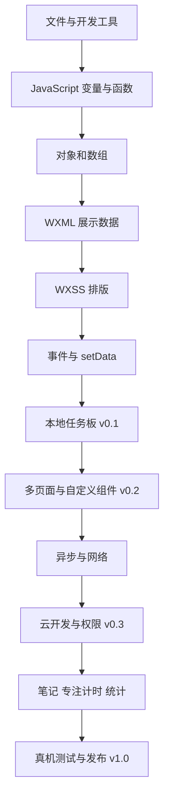

# 微信小程序开发教程 · 第一册

从零基础到本地任务板，含总规划与第 01—09 章。 第01—36章主线正文已齐备；真实微信、云、数据治理及正式交付按实际验收表完成。目录见 [README](README.md)。整理日期：2026-11-03。

# 00 整体规划与最终项目

## 0.1 最终要达到什么程度

课程结束时，你应能独立读懂原生小程序项目，拆解需求，设计页面和数据，完成有后端的应用，并理解真机调试、权限、发布和维护。课程不以“背完所有 API”为目标；遇到新 API，能读文档、写最小示例、验证边界更有价值。

你现在不需要懂 HTML、CSS、JavaScript、数据库、服务器，也不需要先学 Vue 或 React。本课程会讲到必要的网页概念，但练习直接使用小程序文件。

### 开发的几个角色

| 词 | 初学者可以怎样理解 | 在课程中的例子 |
| --- | --- | --- |
| 需求 | 用户要解决的问题 | 我想知道今天还有哪些学习任务 |
| 界面/前端 | 用户看到和操作的部分 | 输入框、任务卡片、完成按钮 |
| 状态/数据 | 当前程序记住的内容 | 任务数组、选中的筛选条件 |
| 后端 | 在服务端执行业务、管理共享数据 | 校验身份后保存用户的任务 |
| 数据库 | 按规则长期存储和查询数据 | tasks 集合、notes 集合 |
| API/接口 | 约定好的调用方式 | 调用 `wx.showToast` 显示提示 |
| 调试 | 观察运行过程并定位错误 | 查为何点击按钮没有反应 |
| 部署/发布 | 把经过验证的版本提供给用户 | 上传、体验、审核、发布 |

前端不能因为能隐藏按钮，就获得安全性。后端必须校验当前调用者是否拥有对应数据。这会在云开发阶段详细训练。

## 0.2 技术路线和学习顺序

主线选择原生小程序：WXML 写结构，WXSS 写样式，JavaScript 写逻辑，JSON 写配置。先使用本地数据，再接模拟服务和云开发。TypeScript、框架和组件库放在后面比较学习。



这是课程的依赖关系，不要求你现在记住全部术语。

## 0.3 全部章节规划

第 01—36 章主线正文、示例和练习已提供，另有最终综合实践；真实账号、平台能力和正式交付仍需实际验收。第 10—15 章组成第二册，对应多页面与组件化的 v0.2；第 16—19 章组成第三册，对应本地 HTTP 服务与网络资源实验；第 20—23 章组成第四册，提供云环境、数据库、身份和 CRUD 权限；第 24—25 章组成第五册，提供私人缩略图、手动迁移、幂等写入与冲突处理；第六册第 26 章建立私人知识库；第七册第 27 章加入专注状态、后台恢复与会话记录；第八册第 28 章加入统计口径、固定时区、七日完整汇总、Canvas 图表和精确表格；第九册第 29 章加入文件、剪贴板、公开分享、上传下载、订阅回执与能力回退；第十册第30章进入体验与交付，加入统一反馈、网络与等待期限、读取实验和可恢复任务草稿。第十一册第31章加入视图投影、路径更新、有界分组列表、图片、普通分包和性能测量实验。第十二册第32章加入能力检测、未知值、窗口/大字/安全区、原生控件语义、配色与读屏验收，另有独立Skyline探针；主业务继续WebView。第十三册第33章系统整理纯函数、异步、组件方法与关键流程测试，加入结构化报告、局部覆盖率、故障变体及待执行渲染/工具/CI流程。第十四册第34章加入数据清单、平台隐私前置检查、原生同意页、发布材料与本地受阻检查；550个本地场景不代替真实后台、原生授权或审核。第十五册第35章加入默认关闭的本机诊断、观察层、环境核对、三组件源码清单、回退受阻检查与维护演练，共600本地场景。未配置真实告警、备份或回退。第十六册第36章提供真实TypeScript编译、npm锁文件和回环HTTP实验，并整理组件库/框架/独立后端路线与毕业实践；主工程600记录摘要匹配，扩展新跑50，跨工程650。云端源码与步骤已准备，真实账号部署、权限、读屏和真机性能验收待执行。

| 阶段 | 章 | 主题与关键知识 | 配套产出/验收 |
| --- | --- | --- | --- |
| A 起步 | 01 | 文件扩展名、UTF-8、账号、工具、项目根目录、四类文件 | 能导入、编译、修改计数器 |
| A 起步 | 02 | let/const、类型、比较、条件、循环、函数、作用域 | 能写学习时长统计函数 |
| A 起步 | 03 | 对象/数组、增删改查、浅拷贝、this、回调和异步顺序 | 能处理任务数组并预测输出 |
| A 起步 | 04 | 组件、插值、条件、循环、key、属性与事件 | 渲染任务列表和空状态 |
| A 起步 | 05 | 选择器、盒模型、rpx/px、Flex、长文本与小屏 | 做出可读的任务卡片 |
| A 起步 | 06 | Page/data/setData、事件参数、dataset、冒泡、状态推导 | 实现输入、新增、完成切换 |
| A 起步 | 07 | App/Page 生命周期、模块导出、本地存储、异常 | 重启能恢复任务，保存失败有提示 |
| A 起步 | 08 | 组合实现任务板：新增、编辑、删除、搜索、筛选 | 完成 v0.1 功能清单 |
| A 起步 | 09 | 调试器、日志、最小复现、练习与参考答案 | 能独立定位三类故障 |
| B 页面与组件 | 10 | pages 注册、navigateTo/redirectTo/switchTab/navigateBack、页面栈 | 从列表打开任务详情，再返回 |
| B 页面与组件 | 11 | query 参数、编码、缺失 ID、页面间更新、EventChannel 的适用场景 | 编辑详情后列表同步刷新 |
| B 页面与组件 | 12 | tabBar、表单、picker/switch/textarea、校验与提交反馈 | 任务分类、优先级、截止日期 |
| B 页面与组件 | 13 | Component、properties、methods、triggerEvent、插槽、样式隔离 | 提取 task-card 和 empty-state |
| B 页面与组件 | 14 | 组件生命周期、observers、behaviors、页面生命周期关联 | 倒计时组件正确释放资源 |
| B 页面与组件 | 15 | services/utils/constants 分层、状态归属、Git 基础 | v0.2 多页面本地应用和版本快照 |
| C 网络与异步 | 16 | Promise、async/await、try/catch/finally、并发与串行 | 把回调服务改写成可等待的函数 |
| C 网络与异步 | 17 | HTTP、URL、GET/POST、JSON、状态码、wx.request、合法域名 | 使用课程自备接口，观察真实请求 |
| C 网络与异步 | 18 | 请求封装、loading/error/empty/success、取消、超时、重试边界 | 请求失败后可恢复；处理旧响应覆盖 |
| C 网络与异步 | 19 | 下拉刷新、分页、去重、防抖/节流、缓存策略 | 数据增加时仍能稳定浏览 |
| D 云开发与安全 | 20 | 云环境、客户端与服务端、云函数、环境 ID、成本和配额 | 部署第一个云函数并读日志 |
| D 云开发与安全 | 21 | 文档型数据库、字段设计、索引、查询条件、分页 | 建立 tasks/notes/focus_sessions |
| D 云开发与安全 | 22 | 登录态、OPENID、wx.login 与服务端会话、鉴权 | 理解身份获取和资料填写的区别 |
| D 云开发与安全 | 23 | 云端 CRUD、输入校验、数据归属、权限规则、最小权限 | 用户 A 不能读改用户 B 的任务 |
| D 云开发与安全 | 24 | 图片选择、临时文件、云存储、上传失败、删除与文件归属 | 私人缩略图库，为笔记附件作准备 |
| D 云开发与安全 | 25 | 数据迁移、重复提交、幂等、版本号、冲突策略、备份 | v0.3 云同步，离线写入有明确处理 |
| E 完整业务 | 26 | 富文本边界、笔记编辑、标签、搜索、资源链接收藏 | 私人知识库模块 |
| E 完整业务 | 27 | 时间戳、计时器、后台挂起、恢复、会话记录、防重复统计 | 专注计时以结束时间计算，而非盲减秒数 |
| E 完整业务 | 28 | 统计口径、日期边界、连续天数、图表基础/Canvas 入门 | 最近 7 天专注统计可人工复算 |
| E 完整业务 | 29 | 文件上传/下载、剪贴板、分享、订阅消息、能力检测 | 逐项核对权限后接入所需平台能力 |
| F 质量与交付 | 30 | 统一错误反馈、弱网、重入、表单草稿、空数据与恢复 | 全局体验走查清单 |
| F 质量与交付 | 31 | setData 成本、列表分页、图片尺寸、分包、首屏性能 | 固定模型对照、原生实验与待填真机测量表 |
| F 质量与交付 | 32 | 基础库兼容、WebView/Skyline 差异、无障碍、真机适配 | 兼容/可访问实验、独立渲染探针与待填真机矩阵 |
| F 质量与交付 | 33 | 纯函数测试、组件测试、关键流程自动化、回归测试 | 四组Node测试、500项本地回归及分层待验收表 |
| F 质量与交付 | 34 | 隐私声明、用户授权、账号类目、备案/审核要求查询、版本发布 | 对照当时官方要求准备提交材料 |
| F 质量与交付 | 35 | 日志、监控、错误定位、环境隔离、回滚与持续维护 | 可维护的教学候选、600本地回归与待执行真实演练 |
| G 延伸 | 36 | TypeScript、npm、WeUI 等组件库、框架选择、独立后端方案 | 独立TS/HTTP实验50项、工具选择与最终综合实践 |

课程覆盖常用开发主线和重要边界。支付、蓝牙、地图高级定位、直播、广告、小游戏等有独立业务和资质条件，作为按需专题，不能把本课程理解成覆盖微信平台的每一个接口。

## 0.4 贯穿项目：学伴 StudyHub

### 面向谁、解决什么

面向个人学习者，把“制定任务 → 执行专注 → 记录笔记 → 查看统计”连成一个闭环。默认私人数据，不先做公共社区。这样能集中练习开发能力，仍然有足够的页面、数据关系和异常场景。

### 最终页面蓝图

| 页面 | 功能 | 数据来源 |
| --- | --- | --- |
| 今日 | 今日待办、最近笔记、快捷开始专注 | 任务、笔记、专注会话 |
| 计划列表 | 分类、优先级、搜索、分页、完成切换 | tasks |
| 任务详情/编辑 | 标题、描述、日期、标签、状态 | tasks 单条记录 |
| 笔记列表/编辑/详情 | 正文、标签、图片、关联任务 | notes、云存储 |
| 专注 | 开始、暂停、恢复、结束、记录结果 | focus_sessions |
| 统计 | 任务完成数、学习分钟、最近七天趋势 | 经过约定口径的汇总 |
| 我的/设置 | 用户主动填写资料、同步状态、数据管理 | users、preferences |

### 版本路线

| 版本 | 章节范围 | 数据存在哪里 | 验收 |
| --- | --- | --- | --- |
| v0.1 | 01—09 | 本设备缓存 | 单页面任务板完整可用 |
| v0.2 | 10—15 | 本设备缓存 | 多页面、任务详情、自定义组件 |
| v0.3 | 16—25 | 云数据库与云存储 | 身份鉴别、数据隔离、失败可恢复 |
| v0.8 | 26—29 | 云端为主 | 笔记、计时、统计组成业务闭环 |
| v1.0 | 30—35 | 明确环境与版本 | 完成安全、兼容、性能、发布准备 |

### 数据模型草案

`tasks`：`_id`、所有者身份、`title`、`description`、`done`、`priority`、`categoryId`、`dueAt`、`createdAt`、`updatedAt`、`version`。

`notes`：`_id`、所有者身份、`kind`、`title`、纯文本 `content`、`tags`、资源 `url`、`favorite`、`assetIds`、可选的 `taskId`、版本与创建/更新时间。第 26 章使用资产 ID 引用私人图片，并在资产上维护 noteRefs；不把任意云 fileID 当作附件归属依据。

`focus_sessions`：`_id`、所有者身份、可选的 `taskId` 与标题快照、plannedSeconds、isDemo、state、accumulatedMs、运行段起点与期限、开始/结束/更新时间、版本。第 27 章用每用户 focus_slots 指向最近一轮，操作回执与会话变化一起提交；终态 DTO 计算有效整秒，后台没有持续计时云函数。

第 28 章直接读取普通终态会话生成七日统计，不新增持久汇总表。`focus-end-day-v1` 固定 UTC+08:00，以 endedAt 所在日归属整轮有效秒数；它不还原跨日真实运行分钟，也不从任务 updatedAt 推断完成历史。最多完整汇总窗口内 500 条符合条件的会话，超限或失败拒绝部分结果；分页读取不等于强一致审计快照。

第 29 章另加 notice_attempts 记录独立练习回执的发送尝试，原八集合加该集合共九个；先事务占位，再调用外部发送，不能将消息与数据库提交视为同一事务。文件导出只是汇总，公开分享只含固定教学数据。

第30章任务草稿存于本机，按在线确认的环境/账号分区，最多六份；本地revision与云端baseVersion分别协调缓存和数据库变化。sealed草稿保存原编号，可衔接outbox与历史回执，不新增云集合。知识库未提交草稿仍待按其业务单独扩展。

第31章只改变视图和客户端布局，没有新增云集合。完整DTO与模型保留业务数据，视图投影不替代写入校验、版本与原编号；列表换组不删除云任务。性能采样默认关闭，只保留允许的公开数值，不含URL或正文。

第32章兼容与可访问实验无新云集合。本地清单仅内存固定数据，不是新草稿协议；独立renderer-probe没有云或身份。共享任务卡片改交互入口，原数据所有者、版本与原编号语义保留。

第33章业务源码不变，新增电脑端测试和报告。假回执服务不连云；500项是本次场景数量，不是互不重复功能数。覆盖率只涉及指定运行加载的客户端JS，真实环境继续独立验收。

第34章不增加云集合。新增三个选读入口前置检查、数据与隐私页和发布材料；默认24个待办保留。完整数据导出、账户处理、期限与权利机制仍是生产阻塞，未实际上传、提审或发布。

第35章不新增云集合，云端与共享协议不变。日志只保留允许分类，默认关闭且不上传；环境核对不替代云权限。回退检查始终不执行，完整数据治理与真实恢复演练仍待完成。

第36章不改主业务工程。第17组是独立电脑工具实验，简化契约与固定actor不用于正式认证；完整小程序继续使用第16组。

这里的字段是设计草案。服务器上的所有者必须来自可信身份上下文，不能相信客户端提交的“我是某某”。云数据库的自动字段和权限模式会在第 21—23 章根据实际方案确定。

v0.1 只用 `id/title/done/createdAt`，先掌握最小模型，再做迁移。

## 0.5 学习节奏与验收

这是建议投入，不是保证工期。零基础完整走一遍，预留约 120—200 小时较合理；遇到账号、接口或发布条件时可能更久。第一阶段建议分 2—4 周完成，重在手写和改错。

每一章都用三个问题验收：这段代码输入是什么？中间改变了哪些数据？输出或界面是什么？如果只会复制，却不能回答这三个问题，请在当前章多做一个改造题。

最终验收至少包括：

1. 从空项目建立页面和组件，能解释目录结构。
2. 无网络、空数据、非法输入、重复点击时有明确行为。
3. 换设备后能看到自己的云端数据；另一个用户看不到。
4. 后台停留后恢复计时仍合理，不重复保存专注记录。
5. 搜索和分页不会重复、漏项或让旧请求覆盖新结果。
6. 真机运行、兼容性、隐私和发布条件经过实际核对。
7. 代码有层次，关键规则有测试或可复现的验收步骤。

## 0.6 本课程的说明方式

示例分为“独立可运行项目”“放入某文件的完整替换代码”“说明性片段”。没有注明完整项目的零散片段，不应随意拼接覆盖现有文件。

所有代码示例以教学清晰为先。早期的全量数组更新和同步缓存适用于小规模本地练习；随着数据量和多人访问引入，课程会明确改造这些选择，而不是把练习实现直接当作线上架构。

资料分批核验，最近续写完成于 2026-11-03。平台界面、资质、配额和能力会变化，后续涉及此类内容时需要再次查官方文档。来源和当前读取限制见 [99 资料说明](99-官方资料与核验说明.md)。


---

# 01 环境准备与第一个小程序

本章目标：认识文件与项目，能用微信开发者工具运行计数器，并解释页面中四类文件的分工。建议分两次、用 2—3 小时完成。

## 1.1 先懂文件、文件夹和代码

文件夹负责组织文件。文件由名字和扩展名组成：`index.js` 的名字是 `index`，扩展名是 `.js`。扩展名表示文件的用途，不是随便改成什么都能运行。

在 Windows 资源管理器中打开“查看”相关设置，显示“文件扩展名”。确认 `app.json` 没有被保存为 `app.json.txt`。使用编辑器保存为 UTF-8，避免中文乱码。

代码是按一定规则书写的指令。编辑器帮你写和检查代码，运行环境执行它；微信开发者工具同时提供编辑器、模拟器和调试器。

| 操作 | 含义 |
| --- | --- |
| 保存 Ctrl+S | 把当前编辑内容写入磁盘 |
| 编译 | 让开发工具处理项目并重新运行 |
| 预览 | 在允许的账号与工具条件下生成真机体验入口 |
| 调试 | 看日志、变量、网络和报错 |

不要把双击 `.wxml` 当成运行小程序。小程序需要微信的运行环境，不能像普通 `.html` 文件一样直接在浏览器里完整运行。

## 1.2 需要准备什么

准备电脑、微信账号、微信开发者工具，以及用于正式能力的小程序账号。编辑器先使用开发者工具自带的即可。本阶段不要求安装 Node.js、Git、数据库或购买服务器。

官方入口：

- [微信公众平台](https://mp.weixin.qq.com/)：注册并管理你自己的小程序账号。
- [微信开发者工具下载](https://developers.weixin.qq.com/miniprogram/dev/devtools/download.html)：按操作系统选择官方稳定版本。
- [官方起步文档](https://developers.weixin.qq.com/miniprogram/dev/framework/quickstart/)：核对工具界面与创建流程。

这些是官方操作入口。当前研究工具无法直接读取微信文档站，具体按钮名称请以你打开的界面为准。账号主体、测试入口、真机权限等不要根据老教程截图推断。

### AppID 到底是什么

AppID 是小程序账号的标识，用来告诉平台“这是哪个小程序”。在小程序管理后台的开发设置相关区域查找。注意区分小程序、公众号等不同账号的 AppID。

AppID 不是密码。AppSecret 是服务端密钥，不应写在客户端代码里。当前练习只需要 AppID，不需要把 AppSecret 填到任何示例文件。

如果当前工具提供测试入口，可以先用它学习基础界面和逻辑。教程项目中的 `touristappid` 也是占位配置；如果工具提示不支持，请在导入界面选择自己的 AppID。拥有测试入口不等于具备云开发和正式发布资格。

## 1.3 两种起步方法

### 方法 A：先运行已有示例，再手写

1. 安装并打开微信开发者工具，按界面要求登录。
2. 找到“小程序”的导入项目入口。
3. 目录选择本教程的 `示例代码/01-hello-counter`。
4. 选择你自己的 AppID 或工具允许的测试方式，开发类型选“小程序”。
5. 完成导入后点击编译，看到“我的第一个小程序”和数字 `0`。
6. 点击“学习一次 +1”，数字变成 `1`，再点击变成 `2`。
7. 点击“重新开始”，数字回到 `0`。

这一步的目的是证明工具能够运行项目。接下来自己创建一个同样的目录，手写代码，才是学习。

### 方法 B：从空目录创建

建立 `my-first-miniapp` 文件夹，在工具中新建原生 JavaScript 小程序，前期选择不需要云服务的方式。如果模板提供 TypeScript、框架或 Skyline 专项模板，先选基础 JavaScript 原生项目。本课程示例显式使用 WebView 渲染，降低起步配置差异。

如果模板自动生成了很多内容，不必在旧模板里四处寻找修改点；可以把本章列出的文件放进一个独立练习目录，再导入该目录。

## 1.4 项目目录地图

```text
my-first-miniapp/
├─ app.js
├─ app.json
├─ app.wxss
├─ project.config.json
├─ sitemap.json
└─ pages/
   └─ index/
      ├─ index.js
      ├─ index.json
      ├─ index.wxml
      └─ index.wxss
```

“根目录”指这棵树最上面的 `my-first-miniapp`。它包含 `app.json`。后面说 `pages/index/index.js`，意思是从根目录依次进入 `pages`、`index`，打开 `index.js`。

| 文件 | 作用 | 可以类比 |
| --- | --- | --- |
| WXML | 页面有哪些组件、怎样排列结构 | 房间的骨架 |
| WXSS | 尺寸、间距、颜色和布局 | 装修 |
| JS | 数据、计算、事件、接口调用 | 房间中的控制系统 |
| JSON | 项目或页面的配置 | 事先填写的设置表 |

`app.*` 对整个小程序起作用。`pages/index/index.*` 只描述当前页面。`project.config.json` 主要供开发者工具识别项目；`sitemap.json` 用来配置页面被微信搜索索引的规则，本教学示例不开放索引。

官方起步模板也采用 `app.json` 的 `pages` 和 `window` 组织页面及窗口配置，参见 [官方起步配置源码](https://github.com/wechat-miniprogram/miniprogram-quickstart/blob/master/app.json)。本文示例为重新编写的教学代码。

## 1.5 先写全局文件

### app.js 完整内容

```js
App({});
```

`App` 是小程序提供的注册函数。圆括号 `()` 表示调用；花括号 `{}` 是传入的配置对象。暂时没有额外配置，所以对象为空。这里不需要自己定义 `App`。

### app.json 完整内容

```json
{
  "pages": ["pages/index/index"],
  "window": {
    "navigationBarTitleText": "从零学小程序",
    "navigationBarBackgroundColor": "#ffffff",
    "navigationBarTextStyle": "black"
  },
  "renderer": "webview",
  "sitemapLocation": "sitemap.json"
}
```

逐项解释：

- `pages` 是页面路径数组。普通启动时，没有指定其他启动页的情况下，首项作为首页。
- `pages/index/index` 不写 `.js` 或 `.wxml`，框架会关联同名文件。
- `window` 是窗口配置对象；里面三项分别设置顶部标题、背景色、文字颜色。
- `renderer` 为本示例选择渲染方式；后面再比较渲染器。
- `sitemapLocation` 指向本项目的索引配置文件。

JSON 的属性名和字符串必须用英文双引号，不能写注释，最后一项后不能多写逗号。`{}` 是对象，`[]` 是数组，冒号连接名称和值，逗号分隔多项。先照规则写，第 02—03 章再系统学习。

### app.wxss 完整内容

```css
page {
  background: #f4f7fb;
  color: #1f2937;
  font-family: sans-serif;
}
```

这段样式选中页面，设置背景、文字颜色和字体。`#f4f7fb` 是十六进制颜色表示。

### sitemap.json 完整内容

```json
{
  "rules": [{ "action": "disallow", "page": "*" }]
}
```

本课程的练习页面不作为搜索内容。索引配置不等于数据访问权限，真正的数据隔离后面在服务端实现。

### project.config.json 完整内容

```json
{
  "appid": "touristappid",
  "compileType": "miniprogram",
  "projectname": "hello-counter",
  "miniprogramRoot": "./",
  "setting": { "es6": true }
}
```

`miniprogramRoot` 表示小程序代码根目录。此处 `./` 就是当前目录。工具可能自动补充其他配置，正常。导入失败时先检查 AppID 和根目录，不要先删除所有配置。

## 1.6 写首页四个文件

### pages/index/index.json

```json
{
  "navigationBarTitleText": "第一个计数器",
  "usingComponents": {}
}
```

当前页的标题会覆盖全局标题。`usingComponents` 以后用来登记自定义组件，现在为空。

### pages/index/index.wxml

```xml
<view class="card">
  <text class="title">我的第一个小程序</text>
  <text class="hint">今天已经学习了</text>
  <text class="count">{{count}}</text>
  <button type="primary" bindtap="onIncrease">学习一次 +1</button>
  <button bindtap="onReset">重新开始</button>
</view>
```

`view` 是布局容器，`text` 展示文字，`button` 是按钮。开始标签和结束标签成对出现。`class` 给组件指定样式类别。

`{{count}}` 表示显示 JS 数据里的 `count`，不是把这几个字符原样显示出来。`bindtap="onIncrease"` 表示点击时执行名为 `onIncrease` 的处理函数，此处没有括号。

### pages/index/index.js

```js
Page({
  data: {
    count: 0
  },

  onIncrease() {
    const nextCount = this.data.count + 1;
    this.setData({ count: nextCount });
  },

  onReset() {
    this.setData({ count: 0 });
  }
});
```

先按执行过程理解，不要求立即记住所有语法：

1. `Page({...})` 注册页面。
2. `data` 存初始界面数据，`count: 0` 表示数字一开始为零。
3. 用户点击按钮后，框架调用 `onIncrease`。
4. `this` 在这个页面方法中指页面实例；`this.data.count` 读取当前计数。
5. `const nextCount = ...` 创建一个名字，保存“旧数字加一”的结果。
6. `this.setData({ count: nextCount })` 提交新的页面数据，界面更新后显示新数字。
7. 另一个按钮把数字重新设置为 `0`。

`count` 和 `Count` 是两个不同名字。不要把页面方法改写成箭头函数；第 03、06 章会解释 `this` 的区别。

### pages/index/index.wxss

```css
.card {
  margin: 48rpx 32rpx;
  padding: 40rpx;
  background: #ffffff;
  border-radius: 24rpx;
}
.title, .hint, .count {
  display: block;
  text-align: center;
}
.title { font-size: 40rpx; font-weight: bold; }
.hint { margin-top: 32rpx; color: #64748b; }
.count { margin: 24rpx 0; font-size: 96rpx; color: #16794b; }
button { margin-top: 24rpx; }
```

以点号开头的 `.card` 对应 WXML 的 `class="card"`。`margin` 是外部间距，`padding` 是内部间距，`border-radius` 是圆角。`rpx` 是小程序常用的响应式尺寸单位，第 05 章会讲换算。

## 1.7 程序如何连起来

```text
app.json 声明首页
  → 框架读取首页文件
  → Page 的 data 提供 count = 0
  → WXML 把 count 渲染成数字
  → 用户点击按钮
  → bindtap 找到 onIncrease
  → JS 算出 nextCount
  → setData 提交新值
  → 屏幕显示变化
```

编程不是“某个标签有魔法”。你要能沿着这条链条指出每个名字在哪定义、在哪被使用。

## 1.8 第一次调试

在 `onIncrease` 的第一行加入：

```js
console.log('点击前的计数', this.data.count);
```

保存、编译、打开调试器的 Console，点击按钮，看日志。日志在调试器里显示，用户界面不会多出这行字。`console.log` 是观察工具，不负责更新页面。

若失败，依次检查：目录选对了吗？文件保存了吗？`pages` 路径正确吗？JS/WXML 的函数名完全一致吗？Console 第一条与你代码有关的红色错误是什么？

## 1.9 本章练习

1. 把标题改成“我的学习记录”。
2. 初始数字改成 `5`，编译后验证。
3. 新增“学习五次 +5”按钮，绑定一个新方法。
4. 把计数颜色改成蓝色，只修改 WXSS。

通过标准：不参考完整文件，也能指出“改变文字改 WXML，改变颜色改 WXSS，改变计算改 JS，改变标题配置改 JSON”。答案见第 09 章。

[下一章：JavaScript 基础语法](02-JavaScript基础语法.md)


---

# 02 JavaScript 基础语法

本章从“变量是什么”讲起，目标是能读懂和编写简单计算程序。建议 3—5 小时，分几次完成。不要一口气背语法，先预测输出，再运行验证。

## 2.1 这些练习在哪里运行

用第 01 章的计数器，在 `pages/index/index.js` 的 `Page` 配置中临时加入：

```js
onLoad() {
  console.log('我开始练习 JavaScript');
},
```

例如放在 `data` 后、`onIncrease` 前，注意配置项之间有逗号。后面不含 `Page` 的 JS 片段，都可以放到这个 `onLoad` 的花括号内，每次只练一个片段。编译后看 Console。不要把练习代码直接写进 WXML。

`onLoad` 是页面创建时框架会调用的方法，第 07 章会系统介绍。练习完移除临时代码，以免改变示例运行。

纯 JS 也可以在浏览器 Console 中练习，但浏览器没有小程序专用的 `Page`、`App`、`wx`。反过来，小程序逻辑代码也不能假定存在浏览器的 `document`、DOM 或 `localStorage`。语言和宿主环境是两回事。

## 2.2 从一条语句认识标点

```js
console.log('今天学习 30 分钟');
```

`console` 是提供日志功能的对象，`.` 读取它的 `log` 方法，`()` 调用方法，引号中的内容是字符串，`;` 结束语句。这里没有任何内容会自动出现在小程序页面上。

用英文输入状态书写引号、括号、冒号、逗号。中文 `“”`、`（）` 不能代替代码中的 `''`、`()`。

```js
// 单行注释：给阅读代码的人看
/* 多行注释：
   可以解释为什么要做某件事 */
console.log('程序只执行这一行');
```

注释不参与执行。缩进一般用两个空格，帮助看清结构，不要靠代码挤成一行来“显得熟练”。

## 2.3 变量：给值取一个名字

```js
let minutes = 20;
minutes = 35;
console.log(minutes); // 35

const subject = '微信小程序';
console.log(subject); // 微信小程序
```

`let minutes = 20` 包含三件事：创建名字 `minutes`，计算右侧的值 `20`，把它赋给该名字。后面的 `minutes = 35` 是重新赋值。

`const` 声明的名字不能再次赋值。优先用 `const`，确实需要重新赋值时再用 `let`。你会在旧教程看到 `var`，现阶段知道它也是声明变量的方式即可，不要混用来解决报错。

```js
const goal = 60;
// goal = 90; // 如果取消注释，会因重新赋值而报错
```

推荐名字：`taskTitle`、`totalMinutes`、`isFinished`。避免 `a1`、`xx` 这种无法解释含义的名字。名字区分大小写，不能以数字开头，不要用 `if`、`return` 等关键字。

关于声明和基础类型，可查 [MDN JavaScript 语法与类型](https://developer.mozilla.org/zh-CN/docs/Web/JavaScript/Guide/Grammar_and_types)。本章练习围绕学习任务重新编写。

## 2.4 常用数据类型

```js
const title = '学习变量';  // string 字符串
const minutes = 30;       // number 数字
const done = false;       // boolean 布尔值
const dueAt = null;       // 主动表示“没有截止时间”
let selectedTask;         // undefined 尚未赋值
```

字符串承载文字；数字用于计算；布尔值只有 `true` 和 `false`，用于表达是/否。`null` 常用于明确的空值，`undefined` 常出现在未赋值或读取不存在的属性时。

```js
console.log(typeof '30'); // string
console.log(typeof 30);   // number
console.log(typeof true); // boolean
```

`typeof` 可以帮助排查类型，但它不是万能判断器。例如 `typeof null` 是历史遗留的 `object`，数组也会得到 `object`；判断数组用 `Array.isArray`，下一章会用到。

数字 `30` 和字符串 `'30'` 看起来相似，行为可能完全不同。

```js
console.log(30 + 5);       // 35
console.log('30' + 5);     // '305'，发生字符串拼接
console.log(Number('30') + 5); // 35
console.log(Number('abc'));   // NaN，无法转换成有效数字
```

输入框拿到的值通常是字符串，`type="number"` 也不能替你保证业务数据有效。处理数字输入时，先去除首尾空格，检查不为空，再转换并验证：

```js
const raw = ' 25 ';
const cleaned = raw.trim();
const value = Number(cleaned);

if (cleaned === '' || !Number.isFinite(value) || value <= 0) {
  console.log('请输入大于 0 的有效分钟数');
} else {
  console.log('有效分钟数', value);
}
```

`Number('')` 会得到 `0`，所以空字符串需要先独立判断。`NaN` 不是普通数字，不能用 `value === NaN` 判断。

## 2.5 算术、比较和逻辑

| 运算 | 示例 | 结果/含义 |
| --- | --- | --- |
| 加减乘除 | `12 + 3`、`12 - 3`、`12 * 3`、`12 / 3` | 15、9、36、4 |
| 取余 | `13 % 5` | 3 |
| 严格相等 | `5 === 5`、`5 === '5'` | true、false |
| 严格不等 | `5 !== 3` | true |
| 大小比较 | `minutes >= 25` | 是否至少 25 分钟 |
| 与 | `hasTitle && isValid` | 两个条件都成立 |
| 或 | `isToday || isOverdue` | 至少一个条件成立 |
| 非 | `!done` | 把真变假、假变真 |

初学时优先使用 `===` 和 `!==`，避免 `==` 的隐式转换让结果难以预测。

```js
const total = 8;
const completed = 3;
const remaining = total - completed;
const percent = Math.round(completed / total * 100);
console.log(remaining, percent); // 5 38
```

`Math.round` 四舍五入。若 `total` 为零，不能直接套这个公式，应明确“没有任务时完成率为 0”：

```js
const total = 0;
const completed = 0;
const percent = total === 0 ? 0 : Math.round(completed / total * 100);
console.log(percent); // 0
```

`条件 ? 成立时的值 : 不成立时的值` 是三元运算符。适合选择一个简单结果，不要嵌套一串复杂业务。

### 真值和假值

在条件位置，`false`、`0`、`''`、`null`、`undefined`、`NaN` 等会被当成假；`[]`、`{}`、字符串 `'false'` 都是真。**判断空数组用 `tasks.length === 0`，不能用 `if (tasks)`。**

## 2.6 条件语句：按情况执行

```js
const minutes = 35;

if (minutes >= 60) {
  console.log('完成长时学习');
} else if (minutes >= 25) {
  console.log('完成一次专注');
} else {
  console.log('继续积累');
}
```

程序从上往下检查，命中一个分支后，不再进入后面的分支。这里输出“完成一次专注”。把 `60` 的判断放在 `25` 后面，会使超过 60 的情况先被 25 的分支截住。

验证标题是项目中的常见需求：

```js
const rawTitle = '   学习条件判断   ';
const title = rawTitle.trim();

if (title.length === 0) {
  console.log('标题不能为空');
} else if (title.length > 40) {
  console.log('标题过长');
} else {
  console.log('可以保存', title);
}
```

`.trim()` 返回去掉首尾空白的新字符串，不会删除中间空格。`.length` 是字符串长度；JavaScript 按 UTF-16 代码单元计算，表情符号不一定等于 1。早期项目把它当作技术长度限制，后面可按产品需求优化。

## 2.7 循环：重复处理

```js
let total = 0;

for (let day = 1; day <= 3; day += 1) {
  total += 20;
  console.log('第几天', day, '累计', total);
}
console.log('最终', total); // 60
```

`for` 圆括号内分三部分：

1. `let day = 1`：只执行一次，设置起点。
2. `day <= 3`：每轮开始前检查条件。
3. `day += 1`：每轮结束后让 day 加一。

`total += 20` 相当于 `total = total + 20`。不要漏掉让条件逐渐结束的操作，否则可能形成无限循环，导致程序卡住。

有数组以后，按元素处理还可以这样：

```js
const sessions = [20, 30, 25];
let total = 0;
for (const minutes of sessions) {
  total += minutes;
}
console.log(total); // 75
```

`[]` 中是一组值，`for...of` 逐个取出。本章先能理解重复相加，下一章详细学数组。

## 2.8 函数：给一段步骤取名字

```js
function minutesToSeconds(minutes) {
  return minutes * 60;
}

const result = minutesToSeconds(25);
console.log(result); // 1500
```

`function` 定义函数，`minutesToSeconds` 是函数名，定义处的 `minutes` 是形参，调用时的 `25` 是实参。`return` 把结果返回给调用者，同时结束本次函数执行。

“定义”和“执行”不同：只定义函数不会自动计算。函数可以多次调用，不同参数产生不同结果。

```js
console.log(minutesToSeconds(10)); // 600
console.log(minutesToSeconds(30)); // 1800
```

`console.log` 负责显示，`return` 负责交付结果，不可互相替代：

```js
function wrongAdd(a, b) {
  console.log(a + b);
}

const result = wrongAdd(2, 3); // Console 显示 5
console.log(result);          // undefined，没有 return
```

### 提前返回使校验更清楚

```js
function getTitleError(rawTitle) {
  const title = rawTitle.trim();
  if (title.length === 0) {
    return '标题不能为空';
  }
  if (title.length > 40) {
    return '标题不能超过 40 个代码单元';
  }
  return '';
}

console.log(getTitleError('   '));     // 标题不能为空
console.log(getTitleError('学习函数')); // 空字符串，表示没有错误
```

## 2.9 作用域：名字在哪能使用

```js
const subject = '小程序';

function printSubject() {
  const minutes = 25;
  console.log(subject, minutes);
}

printSubject();
// console.log(minutes); // 外面访问不到函数内部的 minutes
```

`let`、`const` 受块作用域约束，`if`、`for` 的花括号也会形成作用范围。不要通过把所有变量搬到文件最外层来解决访问问题；通常应通过参数传入、返回值传出。

常见区别：局部变量 `const count = 1` 不会自动变成页面数据。只有进入页面 `data` 并通过合适方式提交更新，WXML 才能使用它。

## 2.10 JSON 与 JavaScript 对象先分清

JS 中允许这样写：

```js
const config = {
  title: '我的学习',
  count: 0
};
```

JSON 文件中对应的写法是：

```json
{
  "title": "我的学习",
  "count": 0
}
```

JSON 是数据格式，不是放任意 JS 的地方。不能在 `app.json` 写函数、`const`、单引号字符串或注释。以后网络响应也常用 JSON，但“JSON 格式的文本”和“内存中的对象”仍是不同东西。

## 2.11 自测

1. 预测 `Number('12') + 3`、`'12' + 3`、`12 === '12'` 的结果。
2. 写一个函数 `getRemaining(total, completed)`，返回剩余任务数。
3. 写 `isValidMinutes(raw)`：字符串输入必须非空、转为有限数字、大于零且不超过 180。
4. 用循环把 `[15, 25, 40]` 求和。
5. 解释 `const` 为什么不等于“对象内部永远不能变化”（先带着问题进入下一章）。

通过标准：能手写条件函数，能解释参数和返回值，不把日志当返回值，不把字符串当数字。答案见第 09 章。

[下一章：对象、数组、函数与异步](03-对象数组函数与异步入门.md)


---

# 03 对象、数组、函数与异步入门

目标：把零散值组织成业务数据，完成任务数组的增删改查，并理解回调为什么会晚于下一行执行。建议 3—5 小时。纯 JS 片段仍放在第 02 章的临时 `onLoad` 中，每次单独运行。

## 3.1 对象：描述一个东西

```js
const task = {
  id: 't1',
  title: '学习数组',
  done: false,
  minutes: 25
};

console.log(task.title);    // 学习数组
console.log(task['done']); // false
```

对象用 `{}` 包起来，里面是“属性名: 值”。`id` 用于识别同一条任务，`title` 是标题，`done` 是完成状态。一个任务的多个属性属于同一组，比四个互不相关的变量更容易维护。

```js
task.done = true;
console.log(task.done); // true
```

为什么 `const` 没报错？因为 `task` 仍然指向原来的对象，只修改了对象内部。`task = {}` 才是给名字重新赋值，会报错。这是 JavaScript 规则；在小程序页面上，还需要遵守 `setData` 的更新规则。

嵌套对象：

```js
const user = {
  nickname: '小林',
  preference: { dailyGoal: 60 }
};
console.log(user.preference.dailyGoal); // 60
```

读取不存在的属性得到 `undefined`，继续在 `undefined` 上取属性会报错。不要假设后台或缓存里一定有某个字段，要在边界处验证。

## 3.2 数组：有顺序的一组东西

```js
const tasks = [
  { id: 't1', title: '学习变量', done: true },
  { id: 't2', title: '学习数组', done: false },
  { id: 't3', title: '完成练习', done: false }
];

console.log(tasks.length);   // 3
console.log(tasks[0].title); // 学习变量
console.log(tasks[2].id);    // t3
```

索引从 `0` 开始：第一个元素是 `[0]`，第三个是 `[2]`。数组长度为 3 时，`tasks[3]` 是越界读取，结果为 `undefined`。

**索引表示当前位置，ID 表示身份。** 你搜索或排序以后，原来第 3 条可能变成第 1 条，但它的 ID 不应变化。删除、编辑、组件列表 key 都应该优先使用稳定 ID。

```js
console.log(Array.isArray(tasks)); // true
console.log(Array.isArray({}));    // false
```

## 3.3 先用循环，再认识数组方法

计算已完成数量：

```js
let completed = 0;
for (const task of tasks) {
  if (task.done) {
    completed += 1;
  }
}
console.log(completed); // 1
```

数组方法把一些常见循环封装起来。初学时可以先写循环版，理解之后再用方法版；不要把 `map`、`filter` 当需要死记的咒语。

### filter：留下满足条件的元素

```js
const pending = tasks.filter(function (task) {
  return task.done === false;
});
console.log(pending.length); // 2
```

`filter` 逐条调用传入的函数。返回真则保留，返回假则不保留。得到一个新数组，原数组仍有 3 条。它是浅拷贝，留下的对象仍可能与原数组共享引用，参见 [MDN filter](https://developer.mozilla.org/zh-CN/docs/Web/JavaScript/Reference/Global_Objects/Array/filter)。

### 箭头函数：较短的函数写法

```js
const pending = tasks.filter((task) => {
  return task.done === false;
});

// 函数体只有返回表达式，可以缩短为：
const pendingAgain = tasks.filter(task => !task.done);
```

三种写法表达相同的筛选规则。`task => !task.done` 中，箭头左边是参数，右边是返回值。只要使用了 `{}` 作为函数体，需要自己写 `return`，否则得到 `undefined`。

### map：把每条记录转换成新的结果

```js
const titles = tasks.map(task => task.title);
console.log(titles); // ['学习变量', '学习数组', '完成练习']
```

这里输出仍有 3 项，每项从完整对象变成标题。`map` 返回新数组，适合转换；不适合用来筛选。方法说明见 [MDN map](https://developer.mozilla.org/zh-CN/docs/Web/JavaScript/Reference/Global_Objects/Array/map)。

### find：找第一条符合条件的记录

```js
const selected = tasks.find(task => task.id === 't2');
if (selected) {
  console.log(selected.title); // 学习数组
}

const missing = tasks.find(task => task.id === 'not-exist');
console.log(missing); // undefined
```

`filter` 返回数组，`find` 返回单个元素或 `undefined`，不要把它们混淆。

## 3.4 展开语法和浅拷贝

```js
const original = { id: 't1', title: '学习对象', done: false };
const changed = { ...original, done: true };

console.log(original.done); // false
console.log(changed.done);  // true
```

`...original` 把原对象的属性展开到新对象中，后面的同名 `done` 覆盖前面的值。顺序重要：`{ done: true, ...original }` 会被原来的 false 覆盖。

```js
const first = [1, 2];
const second = [...first, 3];
console.log(first);  // [1, 2]
console.log(second); // [1, 2, 3]
```

这是浅拷贝，只复制一层：

```js
const source = { settings: { goal: 25 } };
const copy = { ...source };
copy.settings.goal = 60;
console.log(source.settings.goal); // 60，共享嵌套对象
```

若只想改变新对象，应复制将要修改的嵌套层：

```js
const source = { settings: { goal: 25 } };
const copy = {
  ...source,
  settings: { ...source.settings, goal: 60 }
};
console.log(source.settings.goal); // 25
```

早期项目保持数据结构简单，降低嵌套更新难度。

## 3.5 对任务数组增删改查

以下各段都以 3.2 的原始 `tasks` 为起点，单独运行。

### 新增

```js
const newTask = { id: 't4', title: '学习事件', done: false };
const nextTasks = [newTask, ...tasks];
console.log(nextTasks.length); // 4，新任务放最前面
```

### 按 ID 删除

```js
const deleteId = 't2';
const nextTasks = tasks.filter(task => task.id !== deleteId);
console.log(nextTasks.map(task => task.id)); // ['t1', 't3']
```

保留 ID 不是 `t2` 的任务，自然就删除了 `t2`。

### 按 ID 切换状态

```js
const targetId = 't2';
const nextTasks = tasks.map(task => {
  if (task.id === targetId) {
    return { ...task, done: !task.done };
  }
  return task;
});
console.log(nextTasks[1].done); // true
console.log(tasks[1].done);     // false，原对象未直接修改
```

遍历每条任务：目标任务返回一个修改后的新对象，其他任务原样返回。长度保持不变。

### 按 ID 修改标题

```js
const nextTasks = tasks.map(task =>
  task.id === 't3' ? { ...task, title: '完成综合练习' } : task
);
```

### 搜索

```js
const keyword = ' 数组 '.trim().toLowerCase();
const visibleTasks = tasks.filter(task =>
  task.title.toLowerCase().includes(keyword)
);
console.log(visibleTasks.map(task => task.id)); // ['t2']
```

`toLowerCase` 转为小写，使英文大小写不影响匹配；`includes` 判断是否包含关键词。任何字符串都包含空字符串，所以关键词为空时自然全部通过。

## 3.6 解构、简写和方法

```js
const task = { id: 't1', title: '学习简写', done: false };
const { id, title } = task;
console.log(id, title);
```

等价于分别写 `const id = task.id`、`const title = task.title`。这叫对象解构。

```js
const title = '学习简写';
const task = { title }; // 等价于 { title: title }
```

当属性名和变量名一致时，可以简写。完整项目中的 `this.setData({ draft })` 就是把局部变量 draft 的值写入页面同名字段。

```js
const counter = {
  count: 0,
  increase() {
    this.count += 1;
  }
};
counter.increase();
console.log(counter.count); // 1
```

对象里存函数时，通常称“方法”。`increase() {}` 是方法的简写形式。

## 3.7 this 为什么容易出错

普通函数的 `this` 与调用方式有关。对于小程序页面，由框架调用的普通页面方法使用页面实例作为 `this`。因此这样写：

```js
Page({
  data: { count: 0 },
  onIncrease() {
    this.setData({ count: this.data.count + 1 });
  }
});
```

不要把方法随手改成：

```js
// 错误示范：顶层箭头函数不会获得页面实例的 this
Page({
  data: { count: 0 },
  onIncrease: () => {
    // this.setData(...) 在这里可能不是你期待的页面方法
  }
});
```

箭头函数没有自己的 `this`，沿定义位置向外寻找。恰好因为这个性质，它适合放在普通页面方法内部，作为需要继续访问页面的回调：

```js
// 这是 Page 配置中的一个方法片段
onAskReset() {
  wx.showModal({
    title: '确认',
    content: '要重新计数吗？',
    success: (result) => {
      if (result.confirm) {
        this.setData({ count: 0 });
      }
    }
  });
}
```

只先记住：**页面方法用普通方法；方法内部需沿用页面 this 的回调用箭头函数。** 不是所有地方都必须改成箭头。

## 3.8 回调与异步：下一行不等于上一步完成

```js
console.log('A');
setTimeout(() => {
  console.log('B');
}, 1000);
console.log('C');
```

通常先输出 A、C，大约一秒后输出 B。`setTimeout` 登记“以后执行的函数”，登记后马上继续下一行。1000 是毫秒，表示计时阈值，不保证恰好 1000 毫秒准时执行。

传给其他函数、供它在合适时机调用的函数，叫回调。`map` 的回调通常同步执行；定时器、网络、用户弹窗的回调经常异步执行。**有回调不等于一定异步。**

常见错误：

```js
let message = '尚未完成';
setTimeout(() => {
  message = '已经完成';
}, 1000);
console.log(message); // 尚未完成
```

依赖结果的操作要在完成位置处理，或后面改用 Promise/async/await。第 16 章会系统展开异步、异常和请求竞态；本阶段先能预测顺序，避免提前读取还不存在的结果。

## 3.9 错误与 try/catch

```js
try {
  const value = JSON.parse('{坏数据');
  console.log(value);
} catch (error) {
  console.error('解析失败', error);
}
```

`try` 执行可能抛出异常的代码，`catch` 接住异常并给出处理。不要使用空的 `catch` 吞掉错误，也不要把整个程序全部包进去却不定位问题。

外层同步的 `try/catch` 不能自动接住未来异步回调里抛出的异常。异步 API 的 `fail`、Promise 的拒绝和 `await` 的异常处理会在网络阶段详细训练。

## 3.10 小综合：只计算，不操作界面

```js
function summarize(tasks) {
  const completed = tasks.filter(task => task.done).length;
  return {
    total: tasks.length,
    completed,
    remaining: tasks.length - completed
  };
}

const report = summarize([
  { id: 'a', title: '读文档', done: true },
  { id: 'b', title: '写练习', done: false }
]);
console.log(report); // { total: 2, completed: 1, remaining: 1 }
```

这类只根据输入计算结果、不依赖页面和缓存的函数，容易复用和验证。后续项目会把它放到 `utils/task.js`。

## 3.11 本章练习

1. 从任务数组中提取所有标题。
2. 删除 ID 为 `t1` 的任务，原数组保持不变。
3. 把 ID 为 `t2` 的任务标题改为“复习数组”，其他字段保持不变。
4. 筛选“未完成且标题包含学习”的任务。
5. 解释 `const b = a`、`const b = [...a]`、深层逐级复制分别有什么区别。
6. 预测异步示例的日志顺序，并说出原因。

[下一章：WXML 页面结构](04-WXML页面结构与模板语法.md)


---

# 04 WXML 页面结构与模板语法

目标：把数据变成可见结构，正确使用条件、列表和输入组件。建议 2—3 小时。本章先搭页面，交互方法在第 06 章完成。

## 4.1 WXML 和 HTML 有什么关系

WXML 是小程序的界面描述语言。它也使用标签，但不是把 HTML 文件改一个扩展名就能运行。普通网页的 `div/span/img`，在这里常分别使用 `view/text/image`；功能和规则应以小程序组件文档为准。

你不用先学完网页开发。先掌握标签、属性、嵌套，再用少量常用组件完成页面。

```xml
<view class="card">
  <text class="title">今天的学习</text>
  <text>先完成一个小目标</text>
</view>
```

`view` 是父组件，两个 `text` 是子组件。标签必须正确嵌套，不能写成先开始 view、再开始 text，却先结束 view。`class="card"` 中 class 是属性名，card 是属性值。

注释这样写：

```xml
<!-- 这里是页面顶部卡片 -->
```

不是 JS 的 `//`。不同文件类型使用不同注释语法。

## 4.2 常用组件清单

| 组件 | 用途 | 初次使用要点 |
| --- | --- | --- |
| view | 分组和布局 | 通常由它承担背景、间距、Flex |
| text | 文字 | 需要文字单独占行时给它 block 样式 |
| button | 触发操作 | 用 bindtap 绑定方法，有默认样式 |
| input | 单行输入 | 从 bindinput 事件的 detail.value 取值 |
| textarea | 多行输入 | 适合备注、笔记正文 |
| image | 图片 | 使用 src 和 mode，通常要指定尺寸 |
| scroll-view | 局部滚动区 | 纵向滚动通常需要明确高度约束 |
| navigator | 页面跳转入口 | 后续结合页面注册和路由学习 |
| block | 逻辑分组 | 自身不产生可供布局的可视容器 |

图片的说明性例子：

```xml
<!-- 前提：你在项目根目录准备了 assets/cover.png -->
<image class="cover" src="/assets/cover.png" mode="aspectFit" />
```

`aspectFit` 保持比例并使整张图放入指定区域。不要在尚未放入图片时把加载失败误当语法问题。本次两个完整项目不依赖图片文件。

## 4.3 数据绑定：从 JS 读值

在临时练习页面的 JS 写完整配置：

```js
Page({
  data: {
    nickname: '小林',
    completed: 2,
    total: 5,
    loading: false,
    selectedId: 't1'
  }
});
```

对应 WXML：

```xml
<view>
  <text>你好，{{nickname}}</text>
  <text>已完成 {{completed}} / {{total}}</text>
  <text>剩余 {{total - completed}} 项</text>
  <button disabled="{{loading}}">保存</button>
</view>
```

`{{}}` 中写数据字段名或模板支持的简单表达式。文字中和属性值中都可以绑定。`disabled="{{loading}}"` 传入布尔值 false，按钮可以用；把 JS 中 loading 改为 true 再编译，按钮禁用。

不要写 `disabled="false"` 来表达布尔假，非空字符串可能被当作真。需要布尔值时使用 `{{false}}` 或绑定布尔字段。

### 三种位置的变量名不要混淆

```xml
<text>{{nickname}}</text>
```

这里读的是 `Page` 的 `data.nickname`，不是 `onLoad` 里随便定义的局部 `const nickname`，也不写 `{{this.data.nickname}}`。

## 4.4 条件渲染 wx:if

```xml
<view wx:if="{{loading}}">正在加载……</view>
<view wx:else>加载完成</view>
```

`wx:if` 为真时创建前面的节点；否则走紧邻的 `wx:else` 分支。多分支可以使用 `wx:elif`。

```xml
<view wx:if="{{status === 'loading'}}">加载中</view>
<view wx:elif="{{status === 'error'}}">加载失败，请重试</view>
<view wx:else>准备好了</view>
```

对应 data 中必须有 status，例如 `status: 'loading'`。

### wx:if 和 hidden 的区别

```xml
<view wx:if="{{showTip}}">按条件创建和销毁</view>
<view hidden="{{!showTip}}">节点保留，仅隐藏</view>
```

选择时考虑状态和切换成本：完全不需要时可用 `wx:if`；需要频繁切换显示、保留内部状态时可以研究 `hidden`。不要靠 CSS 隐藏敏感内容作为权限控制。

## 4.5 列表渲染 wx:for

练习页面 JS：

```js
Page({
  data: {
    tasks: [
      { id: 't1', title: '学习 WXML', done: true },
      { id: 't2', title: '写一个列表', done: false }
    ]
  }
});
```

WXML：

```xml
<view class="task" wx:for="{{tasks}}" wx:key="id">
  <text>{{index + 1}}. {{item.title}}</text>
  <text>{{item.done ? '已完成' : '待完成'}}</text>
</view>
```

框架遍历 tasks，每条产生一个 view。默认 `item` 是当前元素，`index` 是从 0 开始的位置。`wx:key="id"` 告诉框架，每个元素中的 id 属性可以稳定识别该项。

**这里写 `id`，不写 `{{item.id}}`。** key 应唯一且稳定。会删除、排序的列表，不要把索引当身份。

自定义变量名：

```xml
<view wx:for="{{tasks}}" wx:for-item="task" wx:for-index="position" wx:key="id">
  <text>{{position + 1}}. {{task.title}}</text>
</view>
```

这样在嵌套列表中更容易区分内外元素。

如果数组是 `['语法', '布局']` 这样的唯一字符串列表，可以使用 `wx:key="*this"`。如果元素值重复，就需要另行设计唯一标识。

## 4.6 空状态和列表分开

```xml
<view wx:if="{{tasks.length === 0}}" class="empty">
  还没有任务，先添加一个吧。
</view>
<block wx:else>
  <view wx:for="{{tasks}}" wx:key="id" class="task">
    <text>{{item.title}}</text>
  </view>
</block>
```

`block` 只负责把多项逻辑组织起来，不给它设置 margin 来期待出现间距。需要可布局容器时使用 `view`。

不要在同一个节点上同时塞复杂的 `wx:if` 和 `wx:for` 来筛选数据。先在 JS 生成 `visibleTasks`，模板只负责渲染，逻辑更清楚，也能单独验证。

## 4.7 输入框先认识绑定关系

```xml
<input
  value="{{draft}}"
  placeholder="例如：学习 WXML"
  maxlength="40"
  bindinput="onDraftInput"
/>
<button bindtap="onSave">保存任务</button>
```

需要 data 中有 `draft: ''`，还需要定义 onDraftInput 和 onSave，完整写法在第 06 章。

`value` 负责从数据传到输入框；`bindinput` 负责把输入变化交给 JS。普通 `value="{{draft}}"` 不代表自动双向同步，必须在事件处理里更新数据。本课先使用显式事件；其他绑定能力后续按需再学。

`maxlength` 是输入组件的前端限制。业务方法仍要校验，因为数据也可能来自缓存、接口或其他调用路径。

## 4.8 事件绑定写名字，参数走事件对象

```xml
<button bindtap="onRemove" data-id="{{item.id}}">删除</button>
```

上面是列表内部的片段。`bindtap` 写方法名，不写 `onRemove(item.id)`。通过 `data-id` 带上当前任务身份，在 JS 的事件参数中取值。第 06 章详细演示。

## 4.9 模板里能做哪些计算

可以使用模板支持的简单数据访问、运算、比较和三元表达式，例如：

```xml
<text>{{done ? '已完成' : '待完成'}}</text>
<view class="task {{done ? 'task--done' : ''}}">任务</view>
```

不要把 WXML 当作任意 JavaScript 执行环境。诸如 `tasks.filter(...)`、页面方法调用、复杂日期格式化，先在 JS 里计算出字段再交给模板。

```js
// 放在一个页面方法里，tasks 已定义时使用
const pendingTasks = tasks.filter(task => !task.done);
this.setData({ pendingTasks });
```

## 4.10 本章练习

1. 显示任务总数和每条标题。
2. 已完成任务后面显示“已完成”，其他显示“进行中”。
3. 把 tasks 改成空数组，出现空状态。
4. 把循环变量名改为 task，确认所有引用都同步修改。
5. 解释 `wx:key="id"` 为什么不是“每条任务显示 id”。

参考官方结构：[起步模板的 WXML 源码](https://github.com/wechat-miniprogram/miniprogram-quickstart/blob/master/pages/index/index.wxml)。这个历史模板含旧的用户信息获取写法，本课程仅参考结构和绑定，**不要照搬其中的头像昵称授权流程**。现代账号资料能力将在第 22 章重新查证。

[下一章：WXSS 样式与 Flex 布局](05-WXSS样式与Flex布局.md)


---

# 05 WXSS 样式与 Flex 布局

目标：能从一个页面草图写出样式，理解尺寸和间距，能解决文字太长、按钮挤压等实际问题。建议 2—4 小时。

## 5.1 一条样式规则怎么读

```css
.card {
  background: #ffffff;
  padding: 24rpx;
  border-radius: 20rpx;
}
```

`.card` 是选择器，决定样式用到哪里；`{}` 内每条是“属性: 值;”。WXML 中写 `class="card"` 的组件会匹配这个选择器。代码写在 `.wxss` 文件，不要再套 `<style>` 标签。

WXSS 基于 CSS 扩展，但不能据此假设所有浏览器特性、所有渲染器行为完全一致。本阶段只使用常用、容易理解的规则。官方起步示例也演示了 class、Flex 和 rpx，见 [官方 WXSS 源码](https://github.com/wechat-miniprogram/miniprogram-quickstart/blob/master/pages/index/index.wxss)。

## 5.2 常见选择器

```css
page { background: #f4f7fb; }   /* 当前页面 */
text { color: #334155; }       /* text 组件 */
.title { font-size: 36rpx; }   /* 指定 class */
#main { padding: 24rpx; }      /* 指定 id，早期少用 */
.card .title { color: #16794b; } /* card 内的 title */
.title, .subtitle { display: block; } /* 两个选择器共用规则 */
```

一个组件可以有多个类：

```xml
<view class="card selected">选中的卡片</view>
```

不写 `class=".card"`，点号只出现在 WXSS 选择器中。

多个规则作用于同一属性时，选择器的优先级、来源和先后顺序会影响结果。初学时保持简单：主要用 class，避免层层嵌套和大量 `!important`。看到样式没生效，先查 class 名字和当前生效规则。

## 5.3 盒模型：内容外面还有空间

```text
外部：margin（和别人的距离）
┌──────── border（边框）────────┐
│ padding（内容和边框之间）      │
│     content（文字或图片）      │
└─────────────────────────────┘
```

```css
.card {
  width: 600rpx;
  padding: 24rpx;
  border: 2rpx solid #dbe3ec;
  margin: 24rpx auto;
}
```

在默认 content-box 计算方式下，实际横向占用还要加上左右 padding 和 border。若希望 width 包含内部间距和边框：

```css
.card {
  box-sizing: border-box;
  width: 100%;
  padding: 24rpx;
}
```

本课程项目会为常用组件设置 `box-sizing: border-box`，减少尺寸误算。

间距简写：

- `margin: 20rpx`：四边均 20。
- `margin: 20rpx 32rpx`：上下 20，左右 32。
- `margin: 10rpx 20rpx 30rpx 40rpx`：上、右、下、左。
- `margin: 24rpx auto`：上下固定，左右自动分配，常用于固定宽度块居中。

`margin` 和 `padding` 不能互换。例如卡片内文字贴边，应增加 padding；两张卡片太近，应增加 margin。

## 5.4 rpx、px、% 各做什么

在常见小程序布局中，屏幕宽度以 750rpx 为参考。若可用宽度为 375 逻辑像素，则 100rpx 对应约 50px；宽度为 414 时约为 55.2px。

```text
某个 rpx 数值对应的 px ≈ rpx 数值 × 当前可用宽度 / 750
```

注意这是布局参考，不是“手机实际物理像素”。旋转、平板、多窗口、渲染环境都可能影响可用宽度，最终要实际验证。

| 单位 | 常见用途 | 注意 |
| --- | --- | --- |
| rpx | 需要随屏幕宽度缩放的间距、卡片尺寸 | 不要所有尺寸机械照搬设计稿 |
| px | 比较稳定的细线等尺寸 | 不是固定数量的物理像素 |
| % | 相对父容器的尺寸 | 取决于父容器实际约束 |

用 rpx 不代表自动适配所有设备。适配还需要弹性布局、合理最大宽度、长文字处理和真机测试。

## 5.5 字体、颜色、边框

```css
.title {
  font-size: 36rpx;
  font-weight: 700;
  line-height: 1.5;
  color: #1f2937;
}
.subtitle {
  font-size: 26rpx;
  color: #64748b;
}
.card {
  border: 1px solid #e2e8f0;
  border-radius: 20rpx;
  background: #ffffff;
}
```

`line-height: 1.5` 表示行高约是字体尺寸的 1.5 倍。正文过小、对比过弱，即使布局没错也不好读。不要只通过颜色表达完成状态，搭配文字“已完成”。

## 5.6 Flex：把组件排成行或列

```xml
<view class="row">
  <text class="title">学习任务</text>
  <button class="small-button" size="mini">编辑</button>
</view>
```

```css
.row {
  display: flex;
  align-items: center;
  justify-content: space-between;
}
.small-button { margin: 0; }
```

`display: flex` 使 row 成为弹性容器。默认主轴为横向：`justify-content` 管横向分布，`align-items` 管纵向对齐。

| 属性 | 本课常用值 | 用途 |
| --- | --- | --- |
| flex-direction | row / column | 排成一行或一列 |
| justify-content | flex-start / center / space-between | 沿主轴排列 |
| align-items | stretch / center / flex-start | 沿交叉轴对齐 |
| flex-wrap | nowrap / wrap | 是否允许换行 |
| flex | 1 | 子项占用剩余空间 |
| flex-shrink | 0 | 子项不被挤小 |

如果方向改成 column，主轴变纵向，“主轴横向”的记忆就失效了。永远先看 flex-direction。

## 5.7 输入框占满剩余宽度

```xml
<view class="editor-row">
  <input class="draft" placeholder="输入学习任务" />
  <button class="save-button" size="mini">添加</button>
</view>
```

```css
.editor-row { display: flex; align-items: center; }
.draft {
  flex: 1;
  min-width: 0;
  padding: 16rpx;
  border: 1px solid #cbd5e1;
  border-radius: 12rpx;
}
.save-button { flex-shrink: 0; margin: 0 0 0 16rpx; }
```

`flex: 1` 让输入框吃掉剩余空间，按钮保留自身需要的宽度。`min-width: 0` 允许弹性子项在必要时缩小，解决某些内容把容器撑爆的问题。

小屏仍然拥挤时，可以把输入和提交按钮拆成上下两行。本课程完整项目采用容易适配的布局，不追求强塞一行。

## 5.8 长文本是必须测试的情况

任务标题可能很长或是一整串英文：

```css
.task-title {
  display: block;
  line-height: 1.5;
  overflow-wrap: break-word;
  word-break: break-all;
}
```

如果产品只要单行省略：

```css
.one-line {
  overflow: hidden;
  white-space: nowrap;
  text-overflow: ellipsis;
}
```

省略号需要可约束的宽度；在 Flex 里经常还需要给所在子项 `min-width: 0`。不要为了视觉整齐让用户永远看不到完整内容，详情页应提供完整文本。

## 5.9 条件样式

```xml
<view class="task {{item.done ? 'task--done' : ''}}">
  <text class="task-title">{{item.title}}</text>
</view>
```

```css
.task { background: #ffffff; }
.task--done { background: #eef8f1; }
.task--done .task-title {
  text-decoration: line-through;
  color: #64748b;
}
```

JS 只负责改变 done；WXML 根据 done 决定类名；WXSS 决定对应外观。不需要在 JS 里寻找 DOM 再改 style。

## 5.10 全局与页面样式

`app.wxss` 放整个项目的基础样式；某页的 `.wxss` 放该页专用样式。不要把所有页面都叫 `.title` 却期待它们永远互不影响，后面组件化还会涉及样式隔离。

button 具有默认样式，修改时可能还要处理它的伪元素边框：

```css
.plain-button::after { border: 0; }
```

这只是针对默认边框的调整，不是所有样式问题都靠 `::after` 解决。

## 5.11 本章小项目：统计卡片

WXML：

```xml
<view class="stats">
  <view class="stat"><text class="number">8</text><text>全部</text></view>
  <view class="stat"><text class="number">3</text><text>完成</text></view>
  <view class="stat"><text class="number">5</text><text>剩余</text></view>
</view>
```

WXSS：

```css
.stats {
  display: flex;
  padding: 24rpx;
  background: #ffffff;
  border-radius: 20rpx;
}
.stat { flex: 1; text-align: center; font-size: 26rpx; color: #64748b; }
.number { display: block; font-size: 48rpx; color: #16794b; font-weight: 700; }
```

先使用静态数字练布局，再把数字换成数据绑定。将“排版问题”和“数据问题”分步验证，更容易定位故障。

## 5.12 本章练习

1. 让统计卡片横向三等分。
2. 增加第四项“完成率”，看看 Flex 如何分配。
3. 把横向统计改为纵向，说明主轴如何变化。
4. 给任务卡片增加内部留白，而不改变卡片之间的距离。
5. 在窄屏模拟器输入 40 个英文字符，确保没有横向溢出。

[下一章：数据驱动与事件](06-数据驱动与事件处理.md)


---

# 06 数据驱动与事件处理

目标：理解从用户操作到界面更新的完整过程。本章建议 3—4 小时，先运行下面的小实验，再读任务板源码。

## 6.1 Page 的 data 不只是普通变量

```js
Page({
  data: {
    draft: '',
    tasks: [],
    total: 0
  }
});
```

这些字段是页面初始数据，模板可以直接使用 `{{draft}}`、`{{tasks}}`、`{{total}}`。数据名尽量表达业务含义：draft 是草稿，tasks 是任务列表，total 是总数。

局部计算结果不必都塞进 data。只有界面需要或页面状态需要维护的数据才放进去；定时器句柄、函数等也不应放入要发送到视图的数据中。

## 6.2 修改界面使用 setData

```js
// 页面方法中的片段
this.setData({ total: 3 });
```

这里提交部分字段，其他字段不因本次调用而全部清空。可以一次更新多个互相关联字段：

```js
this.setData({
  tasks: nextTasks,
  total: nextTasks.length,
  draft: ''
});
```

不要写：

```js
// 错误示范：直接改 this.data 不会可靠驱动视图同步
this.data.total = 3;
```

`setData` 同步改变对应的 `this.data`，视图更新异步完成。需要在本次渲染完成后操作时，用它提供的回调：

```js
this.setData({ total: 3 }, () => {
  console.log('这一轮视图更新完成');
});
```

不要把 `await this.setData(...)` 当作等待视图完成的通用写法。它的完成通知不是一个你可以随意依赖的原生 Promise 返回值。

官方类型定义明确记录了 `setData` 的同步/异步边界、可序列化数据要求和直接修改 data 的问题，参见 [微信官方组件实例方法定义](https://github.com/wechat-miniprogram/api-typings/blob/master/types/wx/lib.wx.component.d.ts)。

### 更新嵌套字段

```js
this.setData({
  'profile.nickname': '小林',
  'tasks[0].done': true
});
```

这是字段路径，带点号和方括号的键要放在字符串中。早期项目使用生成新数组的写法更容易推理；数据量增加后再研究减少传输量。无论哪种方式，都不要每次把与界面无关的大量数据发送过去。

## 6.3 一个可完整运行的输入实验

在独立练习副本中，用以下代码替换首页 WXML 和 JS，WXSS 可以暂时沿用计数器样式。

WXML：

```xml
<view class="card">
  <input value="{{draft}}" placeholder="输入任务标题" maxlength="40" bindinput="onDraftInput" />
  <text class="hint">当前输入：{{draft}}</text>
  <button bindtap="onAdd">添加</button>
  <view wx:if="{{tasks.length === 0}}">还没有任务</view>
  <view wx:for="{{tasks}}" wx:key="id">
    <text>{{item.title}}</text>
  </view>
</view>
```

JS：

```js
Page({
  data: { draft: '', tasks: [] },

  onDraftInput(event) {
    this.setData({ draft: event.detail.value });
  },

  onAdd() {
    const title = this.data.draft.trim();
    if (title.length === 0 || title.length > 40) {
      wx.showToast({ title: '请输入 1—40 个代码单元的标题', icon: 'none' });
      return;
    }
    const task = {
      id: 'task_' + Date.now() + '_' + Math.random().toString(36).slice(2, 10),
      title,
      done: false
    };
    this.setData({ tasks: [task, ...this.data.tasks], draft: '' });
  }
});
```

操作：输入“学习事件”，下方同步显示；点添加，列表出现任务，输入框清空；只输入空格再点添加，显示提示，列表不变。

流程逐步解释：

1. 输入组件产生 input 事件。
2. 框架把事件对象传入 `onDraftInput`，参数名 event 是我们自己取的。
3. `event.detail.value` 是组件提供的新值。
4. setData 把新值保存到 draft，模板也会更新。
5. 点击添加时读取 draft，清理首尾空格，校验有效性。
6. 构建新任务，将它放在数组前面。
7. 同时提交任务数组并清空草稿。

这里临时使用“时间戳 + 随机串”作为本地 ID，教学项目第 08 章还会加已有 ID 冲突检查。它不适合充当密码、身份凭证或云端鉴权依据。

## 6.4 event 的三个常见字段

| 字段 | 表示什么 | 使用场景 |
| --- | --- | --- |
| detail | 该类型事件额外提供的信息 | input 的 value，switch 的 value |
| target | 最初触发事件的源组件 | 判断点击是否来自内部子组件 |
| currentTarget | 绑定当前处理函数的组件 | 读取写在按钮上的 dataset |

不是所有事件的 `detail` 都有 value。先看组件文档，必要时 `console.log(event)` 观察。定义可参见 [官方事件类型源码](https://github.com/wechat-miniprogram/api-typings/blob/master/types/wx/lib.wx.event.d.ts)。

## 6.5 用 dataset 携带任务身份

列表内部：

```xml
<button data-id="{{item.id}}" bindtap="onToggle">
  <text>切换状态</text>
</button>
```

页面方法片段：

```js
onToggle(event) {
  const id = event.currentTarget.dataset.id;
  const nextTasks = this.data.tasks.map(task =>
    task.id === id ? { ...task, done: !task.done } : task
  );
  this.setData({ tasks: nextTasks });
}
```

事件绑定在 button 上；即使最初点击内部 text，currentTarget 仍指向这个 button。把数据写在按钮，却从 target 读取，可能在点击不同位置时表现不一致。

`data-task-id` 通常对应 `dataset.taskId`，带短横线的名字会转为驼峰形式。本课程先用简单的 `data-id`。

不要传数组索引去操作完整数据。搜索后“当前显示的第 1 项”可能是原数组第 20 项；稳定 ID 才能找对任务。

## 6.6 事件冒泡和 catchtap

```xml
<view bindtap="onOpenDetail">
  <text>任务卡片，点击打开详情</text>
  <button catchtap="onRemove">删除</button>
</view>
```

对 tap 这种可冒泡事件，内部按钮被点后，事件可能继续到外层。`bindtap` 绑定但不阻止这种传播；`catchtap` 可以阻止该事件继续冒泡。

如果删除按钮也让你进入详情，先查冒泡。当前 v0.1 卡片容器没有绑定跳转，按钮之间不需要用 catchtap；到多页面版本再按需要使用。

## 6.7 数据驱动为什么要求统一计算

假设页面同时存 tasks、total、completed、remaining、visibleTasks。新增任务时只改 tasks，却忘了 total，页面就会自相矛盾。

更好的方式是指定来源：

```text
原始状态：tasks + keyword + filter
                  ↓ 统一计算
派生结果：total / completed / remaining / visibleTasks
                  ↓
              WXML 展示
```

```js
function buildView(tasks, keyword, filter) {
  const normalized = keyword.trim().toLowerCase();
  const completed = tasks.filter(task => task.done).length;
  const visibleTasks = tasks.filter(task => {
    const matchesKeyword = task.title.toLowerCase().includes(normalized);
    const matchesFilter = filter === 'all'
      || (filter === 'pending' && !task.done)
      || (filter === 'done' && task.done);
    return matchesKeyword && matchesFilter;
  });
  return {
    total: tasks.length,
    completed,
    remaining: tasks.length - completed,
    visibleTasks
  };
}
```

每次原始状态变化，都重新算一次派生结果。对于上限 200 条的教学数据，这个全量方案清楚且足够简单；大型列表会在性能阶段进一步优化。

顶部统计按全部任务计算，列表按条件筛选。这个口径是产品决定，不是框架规定。你需要能解释“为什么只显示 1 条，顶部仍是 8 条”。

## 6.8 编辑状态也是数据

```js
data: {
  draft: '',
  editingId: ''
}
```

`editingId === ''` 表示新增模式，有 ID 表示正在编辑那条任务。编辑时把标题放回 draft，保存时按 ID 修改，取消时清空二者。

```xml
<button bindtap="onSave">{{editingId ? '保存修改' : '添加任务'}}</button>
```

不需要额外维护一个 `isEditing` 再让它和 editingId 互相同步。能够可靠计算出来的状态，尽量减少重复存储。

## 6.9 提示与确认不是一回事

`wx.showToast` 给短暂反馈；`wx.showModal` 用来让用户做明确选择，例如删除确认。删除逻辑应放在“确认”分支：

```js
wx.showModal({
  title: '删除任务',
  content: '确认删除吗？',
  success: (result) => {
    if (!result.confirm) return;
    // 在这里执行删除及保存
  },
  fail: (error) => {
    console.error('弹窗失败', error);
  }
});
```

不能在调用 showModal 的下一行直接删除，那时用户还没做选择。接口参数可查 [官方交互 API 定义](https://github.com/wechat-miniprogram/api-typings/blob/master/types/wx/lib.wx.api.d.ts)。

## 6.10 本章练习

1. 添加任务后把“已添加”显示为 toast。
2. 增加只看待完成按钮，让筛选条件进入 data。
3. 给删除按钮加内部 text，分别打印 target 和 currentTarget。
4. 解释新增后只修改 `this.data.tasks` 有什么问题。
5. 说出至少三个需要更新派生统计的操作。

[下一章：生命周期、模块化与本地存储](07-生命周期模块化与本地存储.md)


---

# 07 生命周期、模块化与本地存储

目标：了解页面何时执行代码，能把逻辑拆成文件，能保存并恢复本地任务，知道失败时如何保护数据。建议 3—4 小时。

## 7.1 生命周期：由框架在特定时机调用的方法

你不必每次手动执行页面初始化。框架在特定阶段调用约定名称的方法，这些方法叫生命周期函数。

| 页面方法 | 常见触发时机 | 适合做什么 |
| --- | --- | --- |
| onLoad(options) | 当前页面实例加载 | 读路由参数、初始化数据 |
| onShow() | 页面变为可见 | 返回页面时刷新必要状态 |
| onReady() | 首次渲染准备完成 | 依赖首次界面准备完成的操作 |
| onHide() | 页面被隐藏 | 暂停界面级工作 |
| onUnload() | 当前页面实例卸载 | 清理定时器、监听等资源 |

普通首次打开页面通常可观察到 onLoad → onShow → onReady。页面隐藏后返回，通常再次执行 onShow，而不是再次创建同一个实例。具体路由行为会在第 10 章验证。

注意：App 也有 onShow/onHide，作用对象是整个小程序；不是某个具体页面。App 的 `onLaunch` 用于小程序初始化阶段。

定义依据可查 [官方 Page 生命周期类型](https://github.com/wechat-miniprogram/api-typings/blob/master/types/wx/lib.wx.page.d.ts)。

## 7.2 用日志亲眼观察

在独立练习页中临时添加：

```js
Page({
  data: {},
  onLoad(options) { console.log('页面 onLoad', options); },
  onShow() { console.log('页面 onShow'); },
  onReady() { console.log('页面 onReady'); },
  onHide() { console.log('页面 onHide'); },
  onUnload() { console.log('页面 onUnload'); }
});
```

然后编译、切换到后台再回来，观察 Console。后续加入第二个页面后，再比较 navigateTo 后返回与卸载重建的区别。

别在 onLoad 和 onShow 无条件各请求一次相同接口，首次打开会重复。v0.1 单页面只在 onLoad 读取本地任务；多页面编辑时，再设计返回刷新方式。

## 7.3 定时器属于需要清理的资源

下面只是生命周期练习片段，不是最终专注计时算法：

```js
onShow() {
  if (this._timer) return;
  this._timer = setInterval(() => {
    console.log('页面可见时每秒观察一次');
  }, 1000);
},

stopTimer() {
  if (this._timer) {
    clearInterval(this._timer);
    this._timer = null;
  }
},

onHide() { this.stopTimer(); },
onUnload() { this.stopTimer(); }
```

`this._timer` 是实例上的普通字段，不参与视图渲染，没有放进 data。隐藏和卸载都清理，是因为隐藏不等于卸载。

手机后台可能暂停计时器。真正的专注计时需要记录开始/结束时间，恢复后重新计算，不能只靠每秒减 1；这在第 27 章展开。

## 7.4 模块化：让每个文件负责一类事

页面越写越长时，可以拆出独立函数。

在项目根目录新建 `utils/math.js`：

```js
function minutesToSeconds(minutes) {
  return minutes * 60;
}

module.exports = { minutesToSeconds };
```

首页 `pages/index/index.js`：

```js
const { minutesToSeconds } = require('../../utils/math');

Page({
  data: {},
  onLoad() {
    console.log(minutesToSeconds(25)); // 1500
  }
});
```

`module.exports` 决定这个文件向外提供什么；`require` 把模块提供的内容读取进来。这里只用 CommonJS 模块风格，暂时不要混用其他写法。

路径解释：当前文件在 `pages/index/`，`../` 上到 pages，再 `../` 上到根目录，随后进入 utils。文件名常可以省略 `.js`。路径使用 `/`，与 Windows 资源管理器显示的反斜杠区分开。

每个 JS 文件有自己的模块作用域。一个文件中的局部 const 不会自动出现在另一个文件，必须导出、导入或通过明确的数据通道传递。

## 7.5 为什么任务板拆三层

```text
pages/index/index.js  接事件、控制编辑状态、给用户反馈
          ↓
utils/task.js        标题校验、创建任务、筛选和统计
          ↓ 被页面组合使用
services/storage.js  统一读写缓存，校验缓存结构
```

更准确的依赖关系是：页面调用 utils 和 services；services 也复用 utils 的数据校验。utils 不依赖页面或 wx。

这样改筛选规则不用碰存储，改存储键名不用碰 WXML。不要为了“架构”把每两行都拆一个文件，职责清楚比目录多更重要。

## 7.6 内存与本地缓存不是同一回事

data 中的任务在当前运行时内存里；重启页面实例或小程序后不能靠它自动恢复。缓存是另一个保存位置，需要主动读写。

```js
wx.setStorageSync('studyhub.example', { title: '学习缓存', done: false });
const saved = wx.getStorageSync('studyhub.example');
console.log(saved.title); // 学习缓存
```

这里可以直接保存对象或数组，不必先 JSON.stringify，再忘了取出后 JSON.parse。API 本身支持的可序列化数据和异常处理可查 [官方存储 API 定义](https://github.com/wechat-miniprogram/api-typings/blob/master/types/wx/lib.wx.api.d.ts)。

上面是最小演示。实际代码必须处理读写失败；缓存可能被清理，也不等于云端备份。模拟器和手机的缓存不是同一个空间，同账号换设备也不能靠本地缓存同步。

## 7.7 同步与异步缓存

`wx.setStorageSync`、`wx.getStorageSync` 是同步调用，调用结束后继续下一步，失败时可能抛异常。适合当前少量教学数据，不能在大量输入事件或启动阶段疯狂读写。

异步版本 `wx.setStorage`、`wx.getStorage` 通过回调等形式通知结果。后续学习异步封装时再改造；不要误以为名字少了 Sync 就自动变成 Promise 业务架构。

本地缓存用于持久化，不适合被滥用为页面间每次通信的“万能消息总线”。后续有更明确的状态归属和页面通信方案。

## 7.8 一个安全一些的读取函数

完整项目会严格校验每个任务。先看简化思路：

```js
function loadTasks() {
  const value = wx.getStorageSync('studyhub.tasks.v1');
  if (value === '' || value === undefined) return [];
  if (!Array.isArray(value)) {
    throw new Error('任务缓存不是数组');
  }
  return value;
}
```

“没有缓存”可以理解成首次启动；“有缓存但格式不合法”可能是旧版本或被误改，两者不能都悄悄变成空数组再保存覆盖。完整示例遇到非法数据会暂停修改，保留原缓存，提示排查。

边界校验至少检查：数组、条数、唯一 ID、合法标题、布尔完成状态、有效时间戳。这些校验也能在未来迁移数据格式时帮助发现不兼容。

## 7.9 保存失败时怎么办

当前项目采用适合小规模同步缓存的顺序：

```text
生成 nextTasks
    ↓
先尝试写入缓存
    ├─ 失败：提示、保留旧界面和草稿
    └─ 成功：更新 tasks、统计和列表，按需要清空草稿
```

```js
// Page 内的方法片段；saveTasks 与 buildView 已导入
commitTasks(tasks, extraData = {}) {
  try {
    saveTasks(tasks);
  } catch (error) {
    console.error('保存失败', error);
    wx.showToast({ title: '保存失败，请重试', icon: 'none' });
    return false;
  }
  this.setData({
    tasks,
    ...buildView(tasks, this.data.keyword, this.data.filter),
    ...extraData
  });
  return true;
}
```

`extraData = {}` 是默认参数。调用者不传时使用空对象；新增成功可以传 `{ draft: '', editingId: '' }`，切换完成状态则不需要清空草稿。

完整项目在这个方法里还检查读取异常状态。这里的顺序不能直接套到所有网络场景：云端写入会有延迟、重复提交和部分失败，后面要设计 loading、幂等与冲突处理。

## 7.10 数据保存在哪个时机

每次任务新增、编辑、完成切换、删除，保存一次。搜索词和筛选条件不需要在本版持久化。不要只在 onUnload 里保存：小程序可能在后台被系统终止，不能保证所有清理回调都执行。

## 7.11 本章练习

1. 在 onLoad 读取一条练习数据，显示在界面上。
2. 改完后重新编译，验证缓存仍在。
3. 比较只更新 data、不写缓存与写缓存的区别。
4. 把“分钟转秒”函数移到 utils 并正确导入。
5. 解释为什么读取异常时不能无提示地初始化并保存空数组。

[下一章：完整实战任务板](08-实战学伴任务板v0.1.md)


---

# 08 实战：学伴任务板 v0.1

本章把前面知识组合成一个完整作品。建议 4—6 小时，分“先跑通、理解数据、理解事件、改造功能”四次完成。完整源文件在 `示例代码/02-study-board`，本章末尾也附有逐文件源码。

## 8.1 先写需求，再写代码

本版应做到：

1. 新增任务，去除标题首尾空格，拒绝空标题和超长标题。
2. 按 ID 编辑标题，保留原来的完成状态和创建时间。
3. 切换已完成/待完成。
4. 删除前确认，取消时不删除。
5. 按标题搜索，英文忽略大小写。
6. 全部/待完成/已完成三个筛选条件可与搜索组合使用。
7. 顶部统计始终针对全部任务，列表显示匹配项。
8. 重启后从当前设备缓存恢复。
9. 首次无任务、没有匹配结果、读写缓存失败都有明确反馈。

范围约定：这是个人本地教学版，最多 200 条任务，标题按 JavaScript `.length` 限制为 40。条数和标题上限是本课程主动设置的业务限制，不是微信平台的统一限额。版本尚未包含云端、账号、跨设备同步、多页面、笔记、计时与统计图。

## 8.2 导入与预期结果

1. 开发者工具导入 `示例代码/02-study-board`，确认其中有 app.json。
2. 使用自己的 AppID 或工具允许的测试方式。
3. 编译后应看到“学伴 · 从一个小目标开始”，三个统计数字都是 0。
4. 输入“学习 WXML”，点添加，全部=1、已完成=0、待完成=1。
5. 点标记完成，全部=1、已完成=1、待完成=0，卡片出现完成文字和删除线。
6. 重新编译，任务仍在。若手动清理了工具缓存，预期会丢失本地记录。

不要在浏览器打开 index.wxml。这里的“重新编译”也不能替代真机预览；手机会有自己的缓存空间。

## 8.3 目录和依赖

```text
02-study-board/
├─ app.js / app.json / app.wxss
├─ project.config.json / sitemap.json
├─ pages/index/index.js
├─ pages/index/index.json
├─ pages/index/index.wxml
├─ pages/index/index.wxss
├─ utils/task.js
└─ services/storage.js
```

页面 JS 调用 task.js 的计算函数和 storage.js 的存储函数；存储模块复用 task.js 的校验函数。没有循环依赖，没有外部安装包。

## 8.4 一条任务的数据模型

```js
{
  id: 'task_某个唯一标识',
  title: '学习 WXML',
  done: false,
  createdAt: 1790000000000
}
```

示例时间戳只用于说明形状，实际由 Date.now() 生成。单位是毫秒，不是秒。

| 字段 | 类型 | 为什么需要 |
| --- | --- | --- |
| id | 字符串 | 搜索/筛选后仍能准确编辑和删除 |
| title | 字符串 | 用户可读的标题，不承担身份职责 |
| done | 布尔值 | 同一个字段决定文字、样式、筛选和统计 |
| createdAt | 有限且非负的数字 | 记录创建时间，为后续排序和统计预留 |

允许同名任务。两条标题一样不代表是同一条记录，所以不能用标题当 key。

## 8.5 页面状态表

| 字段 | 初始值 | 含义 |
| --- | --- | --- |
| draft | `''` | 新增或编辑时的输入草稿 |
| editingId | `''` | 空为新增模式，否则是编辑目标 |
| keyword | `''` | 搜索框内容 |
| filter | `'all'` | all/pending/done 三种条件 |
| tasks | `[]` | 全部已加载任务，是主要数据来源 |
| visibleTasks | `[]` | 从 tasks 和条件算出来的显示列表 |
| total | `0` | 全部任务数 |
| completed | `0` | 全部已完成数 |
| remaining | `0` | 全部待完成数 |
| storageError | `false` | 是否因读取失败而暂停修改 |

只有 tasks 会存到缓存。draft、搜索词、筛选条件和编辑模式在重启后恢复初始值，这是本版明确的设计。

## 8.6 读懂 utils/task.js

### 标题校验 getTitleError

```js
function getTitleError(rawTitle) {
  if (typeof rawTitle !== 'string') return '标题必须是文字';
  const title = rawTitle.trim();
  if (title.length === 0) return '请先输入任务标题';
  if (title.length > MAX_TITLE_LENGTH) return '标题不能超过 40 个代码单元';
  return '';
}
```

先检查类型，避免对数字调用 trim。之后先处理空字符串，再处理上限。用空字符串表示没有错误，调用者通过 `if (error)` 判断。返回描述而不是在函数里弹 toast，可以让这段规则被测试、页面和缓存校验重复利用。

### 缓存结构校验 isValidTasks

先检查 value 是数组且没有超过业务条数上限；再逐条检查 ID、标题、done、createdAt。`Set` 是去重集合，用 `has` 检测 ID 是否出现过，用 `add` 记住当前 ID。任一记录不合法就返回 false，全部通过才返回 true。

本函数只确认当前版本需要的结构，不会静默修改旧数据。新增字段时应规划迁移，而不是任意改变规则后让已有用户突然无法读取。

### 创建任务 createTask

```js
const now = Date.now();
const baseId = 'task_' + now + '_' + Math.random().toString(36).slice(2, 10);
```

Date.now 生成毫秒时间戳，随机数转为 36 进制字符串并截取一段，组合成本地候选 ID。接着用已有 ID 集合检查冲突，若冲突追加编号，直到找到未使用的值。

创建函数再次检查标题，返回一个全新对象。它不操作页面、不保存缓存。后面云端会采用云数据库/服务端认可的 ID 和身份方案，不把随机 ID 当安全机制。

### 派生视图 buildView

先把搜索词 trim 并转小写；算出所有任务中的 completed；然后逐条检查“搜索条件”和“状态条件”，两者都成立才显示。

```js
return matchesKeyword && matchesFilter;
```

filter 为 all，状态条件无条件通过；pending 只通过 !done；done 只通过 done。顶部总数来自原始 tasks，不能从 visibleTasks.length 反推。

## 8.7 读懂 services/storage.js

存储键固定为 `studyhub.tasks.v1`。这减少了散落字符串拼错的风险，也为后续迁移预留版本概念。它是缓存键名，不是云环境 ID。

`loadTasks` 处理三种情况：

1. 没有缓存：返回空数组，正常首次启动。
2. 有合法缓存：返回任务。
3. 有不合法缓存或 API 抛异常：让异常交给页面，不自行覆盖数据。

`saveTasks` 先验证传入数组，再写缓存。不在存储服务里弹提示，让页面决定用户应该看到什么。

这里保存的是数组本身，不是字符串化后的数组；如果你手动往缓存里写 `'[]'`，它是字符串，当前校验会拒绝。需要明确区分文本和数组。

## 8.8 初始化与读取失败

`onLoad` 调用 `onReload`。读取成功时，用一个 setData 同时设置 tasks 和派生结果，清空草稿/编辑状态，解除读取异常状态。

读取失败则记录 Console 错误，把 storageError 设为 true，显示警告和“重新读取”。输入和修改按钮禁用，方法内部也有 canWrite 检查。这两道检查分别服务于界面反馈和逻辑边界。

若后续一次重读失败，页面可能仍保留上次成功读取的数据显示，但它不会允许继续修改，避免把不可靠状态写回。警告会说明应先处理缓存问题。

## 8.9 统一提交 commitTasks

```js
const saved = this.commitTasks(nextTasks, { draft: '', editingId: '' });
```

这个方法承担所有数据变更的共同步骤：检查可写 → 保存 → 保存失败就提示并返回 false → 成功后更新 tasks/派生结果/附加页面状态 → 返回 true。

为什么返回布尔值？页面只有在成功时才显示“已添加/已保存修改”。否则会出现底层保存失败，上层仍宣布成功的问题。

extraData 的职责是附加 UI 状态。任务切换不清空草稿；新增/编辑成功则清空。未来扩展时不要从外部传入任意对象覆盖 tasks 或统计字段，保持调用约定清楚。

## 8.10 新增与编辑 onSave

两者共用输入框和保存按钮：

```text
检查 storageError
    ↓
校验标题、去除首尾空格
    ↓
editingId 有值？
  ├─ 有：确认任务仍存在 → 按 ID 修改 title
  └─ 无：检查 200 条上限 → 创建新任务并放到数组最前面
    ↓
commitTasks
  ├─ 成功：清空编辑状态、给成功提示
  └─ 失败：保留草稿和旧任务，方便重试
```

`some` 判断数组中是否存在符合条件的元素，返回布尔值；与 find 返回元素不同。编辑不存在的任务时，不能自动“顺手新增”一条，应提示状态已经变化。

编辑的核心：

```js
nextTasks = this.data.tasks.map(task =>
  task.id === editingId ? { ...task, title } : task
);
```

只覆盖 title，因此 done、createdAt、id 都保留。如果你直接返回 `{ title }`，其他字段会丢失，后续存储校验也会失败。

## 8.11 开始编辑与取消编辑

`onEdit` 从 currentTarget.dataset.id 取身份，find 找任务，把 title 放进 draft，把 id 放进 editingId，然后滚动到页面顶部，让输入框出现在用户视野内。

`onCancelEdit` 清空 draft 和 editingId，不写缓存。取消的意思是放弃本次草稿，不是删除原任务。

此时用户还可以筛选和搜索，编辑目标靠 ID 保持，不依赖列表当前位置。

## 8.12 完成切换 onToggle

使用 map 找目标，返回 `{ ...task, done: !task.done }`，其余原样返回。调用 commitTasks 后会重新计算列表和统计。

如果当前筛选是“待完成”，你把某条标记完成，它会立即从当前列表消失；顶部已完成数增加。这是正确结果，不是任务丢失。切换到“已完成”就能看到。

## 8.13 删除 onRemove

先查找任务，展示包含标题的确认框。只有 result.confirm 为真才生成删除后的数组。

确认回调中使用的是**回调发生时的 this.data.tasks**，而不是在打开弹窗之前就构造一份旧快照。这样不会因为等待用户确认而把期间的新状态覆盖回去。

如果被删除的任务恰好正在编辑，成功提交时同时清空编辑状态。删除取消、弹窗失败或缓存保存失败，都不应该宣称删除成功。

## 8.14 搜索与筛选

`onKeywordInput` 读取新 keyword，结合当前 filter 重算；`onFilterChange` 读取按钮 data-filter，先确认是 all/pending/done 之一，再结合当前 keyword 重算。

这些操作没有改动任务内容，不调用 saveTasks。输入筛选文字不会每敲一个字就把整个任务数组再写一次缓存。

## 8.15 对照 WXML 看结构

页面按顶部说明、读取异常警告、统计、编辑区、搜索筛选区、空状态、任务列表排列。

| WXML 部分 | 依赖字段 | 用户动作 |
| --- | --- | --- |
| 警告区 | storageError | onReload |
| 统计区 | total/completed/remaining | 无 |
| 编辑区 | draft/editingId/storageError | onDraftInput/onSave/onCancelEdit |
| 搜索区 | keyword/filter | onKeywordInput/onFilterChange |
| 空状态 | total/visibleTasks/storageError | 无 |
| 列表 | visibleTasks/item.done/item.id | onToggle/onEdit/onRemove |

理解它们的对应关系后，你应该能回答：按钮名字对不上会怎样？输入数据为什么在 detail？列表 key 为什么用 id？首次为空和搜索无结果为什么是两句不同文案？

## 8.16 对照 WXSS 看外观

统计区用 Flex 让三个子项等分；卡片用 padding 保持内部留白；actions 用 flex-wrap 允许窄屏换行；task-title 处理长英文；完成卡片改变背景、字体并添加删除线。

页面没有强行把三个操作按钮放进一个不能换行的横条。请在开发者工具中至少选两个不同宽度，输入长标题观察结果，再在手机上核对字体、按钮和输入体验。

## 8.17 逐项验收

| 操作 | 预期 |
| --- | --- |
| 首次打开 | 数字全为 0，出现添加提示 |
| 空字符串、全空格保存 | 提示错误，没有新任务 |
| 新增两个同名任务 | 存在两条独立记录，ID 不同 |
| 新增“Learn WXML”，搜索“wxml” | 能匹配，不区分英文大小写 |
| 完成一条任务 | 计数、状态文字、样式同步变化 |
| 已完成筛选 + 不匹配关键词 | 结果为空，顶部全量统计不变 |
| 编辑已完成任务 | 改标题但仍是已完成，创建时间保留 |
| 取消编辑 | 原任务不变，输入框回到新增模式 |
| 删除时点取消 | 任务数不变 |
| 确认删除正在编辑的任务 | 删除成功后退出编辑模式 |
| 重新编译 | 任务恢复；草稿和搜索条件重置 |
| 写缓存失败 | 任务和草稿不被错误清空，可重试 |
| 缓存格式不合法 | 显示警告、暂停修改、原缓存保留 |

最后两项可通过本教程验证脚本模拟；在开发工具手工操作前先备份练习数据，步骤见第 09 章。

## 8.18 还没有解决什么

本版本适合上限明确的单设备学习任务，不提供跨设备备份。大量任务需要分页；网络写入需要状态管理；不同用户的数据需要服务端鉴权；以后加入详情页要处理返回刷新；数据模型改版要做迁移。

这些是后续版本的具体工作项，不要把当前能跑通的本地缓存方案直接等同于线上完整产品。

## 8.19 本章改造练习

1. 在顶部增加完成率，空任务时为 0。
2. 增加“清除搜索”按钮，只清 keyword，保留 filter。
3. 增加标题长度提示，让用户输入时看到 draft.length。
4. 设计“清除全部已完成”功能：确认后按 ID/状态删除，只有保存成功才退出相关编辑状态。
5. 思考加入“优先级”后，哪些文件和校验需要改，旧缓存怎样迁移。

先独立实现前两项，再看第 09 章。第五项是设计题，进入云开发前还会专门训练数据迁移。

## 8.20 完整源码

下面的源码由同目录中实际示例文件整理生成。每段标题是要写入的文件路径；逐文件创建，不要把整个章节一次粘贴到一个 JS 文件里。

<!-- SOURCE_APPENDIX_START -->

### 文件：app.js

```js
App({});
```

### 文件：app.json

```json
{
  "pages": ["pages/index/index"],
  "window": {
    "navigationBarTitleText": "学伴 · 本地任务板",
    "navigationBarBackgroundColor": "#f4f7fb",
    "navigationBarTextStyle": "black"
  },
  "renderer": "webview",
  "sitemapLocation": "sitemap.json"
}
```

### 文件：app.wxss

```css
page {
  background: #f4f7fb;
  color: #1f2937;
  font-family: sans-serif;
  font-size: 28rpx;
  line-height: 1.5;
}
view, text, input, button {
  box-sizing: border-box;
}
button { font-size: 28rpx; }
```

### 文件：project.config.json

```json
{
  "appid": "touristappid",
  "compileType": "miniprogram",
  "projectname": "study-board-local",
  "miniprogramRoot": "./",
  "setting": { "es6": true }
}
```

### 文件：sitemap.json

```json
{
  "rules": [{ "action": "disallow", "page": "*" }]
}
```

### 文件：utils/task.js

```js
// 纯数据逻辑：这里不调用 wx，不依赖任何页面。
const MAX_TITLE_LENGTH = 40;
const MAX_TASKS = 200;

function getTitleError(rawTitle) {
  if (typeof rawTitle !== 'string') return '标题必须是文字';
  const title = rawTitle.trim();
  if (title.length === 0) return '请先输入任务标题';
  if (title.length > MAX_TITLE_LENGTH) return '标题不能超过 40 个代码单元';
  return '';
}

function isValidTasks(value) {
  if (!Array.isArray(value) || value.length > MAX_TASKS) return false;
  const ids = new Set();
  for (const task of value) {
    if (!task || typeof task !== 'object') return false;
    if (typeof task.id !== 'string' || task.id.length === 0) return false;
    if (ids.has(task.id)) return false;
    if (getTitleError(task.title)) return false;
    if (typeof task.done !== 'boolean') return false;
    if (!Number.isFinite(task.createdAt) || task.createdAt < 0) return false;
    ids.add(task.id);
  }
  return true;
}

function createTask(rawTitle, existingTasks) {
  const error = getTitleError(rawTitle);
  if (error) throw new Error(error);
  const ids = new Set(existingTasks.map(task => task.id));
  const now = Date.now();
  const baseId = 'task_' + now + '_' + Math.random().toString(36).slice(2, 10);
  let id = baseId;
  let suffix = 1;
  while (ids.has(id)) {
    id = baseId + '_' + suffix;
    suffix += 1;
  }
  return { id, title: rawTitle.trim(), done: false, createdAt: now };
}

function buildView(tasks, keyword, filter) {
  const normalizedKeyword = keyword.trim().toLowerCase();
  const completed = tasks.filter(task => task.done).length;
  const visibleTasks = tasks.filter(task => {
    const matchesKeyword = task.title.toLowerCase().includes(normalizedKeyword);
    const matchesFilter = filter === 'all'
      || (filter === 'pending' && !task.done)
      || (filter === 'done' && task.done);
    return matchesKeyword && matchesFilter;
  });
  return {
    total: tasks.length,
    completed,
    remaining: tasks.length - completed,
    visibleTasks
  };
}

module.exports = {
  MAX_TITLE_LENGTH,
  MAX_TASKS,
  getTitleError,
  isValidTasks,
  createTask,
  buildView
};
```

### 文件：services/storage.js

```js
const { isValidTasks } = require('../utils/task');
const STORAGE_KEY = 'studyhub.tasks.v1';

function loadTasks() {
  const value = wx.getStorageSync(STORAGE_KEY);
  // getStorageSync 未读到值时通常返回空字符串。
  if (value === '' || value === undefined) return [];
  if (!isValidTasks(value)) throw new Error('缓存格式不符合当前版本');
  return value;
}

function saveTasks(tasks) {
  if (!isValidTasks(tasks)) throw new Error('拒绝保存不合法的任务数据');
  wx.setStorageSync(STORAGE_KEY, tasks);
}

module.exports = { STORAGE_KEY, loadTasks, saveTasks };
```

### 文件：pages/index/index.json

```json
{
  "navigationBarTitleText": "学伴 · 本地任务板",
  "usingComponents": {}
}
```

### 文件：pages/index/index.js

```js
const { MAX_TASKS, getTitleError, createTask, buildView } = require('../../utils/task');
const { loadTasks, saveTasks } = require('../../services/storage');

Page({
  data: {
    draft: '',
    editingId: '',
    keyword: '',
    filter: 'all',
    tasks: [],
    visibleTasks: [],
    total: 0,
    completed: 0,
    remaining: 0,
    storageError: false
  },

  onLoad() {
    this.onReload();
  },

  onReload() {
    try {
      const tasks = loadTasks();
      this.setData({
        tasks,
        ...buildView(tasks, this.data.keyword, this.data.filter),
        storageError: false,
        draft: '',
        editingId: ''
      });
    } catch (error) {
      console.error('读取任务失败', error);
      this.setData({ storageError: true });
      wx.showToast({ title: '读取失败，暂时禁止修改', icon: 'none' });
    }
  },

  canWrite() {
    if (!this.data.storageError) return true;
    wx.showToast({ title: '请先解决缓存读取问题', icon: 'none' });
    return false;
  },

  // 小规模同步缓存：保存成功后才更新界面。
  commitTasks(tasks, extraData = {}) {
    if (!this.canWrite()) return false;
    try {
      saveTasks(tasks);
    } catch (error) {
      console.error('保存任务失败', error);
      wx.showToast({ title: '保存失败，请重试', icon: 'none' });
      return false;
    }
    this.setData({
      tasks,
      ...buildView(tasks, this.data.keyword, this.data.filter),
      ...extraData
    });
    return true;
  },

  onDraftInput(event) {
    this.setData({ draft: event.detail.value });
  },

  onSave() {
    if (!this.canWrite()) return;
    const error = getTitleError(this.data.draft);
    if (error) {
      wx.showToast({ title: error, icon: 'none' });
      return;
    }
    const title = this.data.draft.trim();
    const editingId = this.data.editingId;
    let nextTasks;
    if (editingId) {
      const exists = this.data.tasks.some(task => task.id === editingId);
      if (!exists) {
        wx.showToast({ title: '任务已不存在，请取消编辑', icon: 'none' });
        return;
      }
      nextTasks = this.data.tasks.map(task =>
        task.id === editingId ? { ...task, title } : task
      );
    } else {
      if (this.data.tasks.length >= MAX_TASKS) {
        wx.showToast({ title: '本地教学版最多保存 200 项', icon: 'none' });
        return;
      }
      nextTasks = [createTask(title, this.data.tasks), ...this.data.tasks];
    }
    const saved = this.commitTasks(nextTasks, { draft: '', editingId: '' });
    if (saved) {
      wx.showToast({ title: editingId ? '已保存修改' : '已添加', icon: 'success' });
    }
  },

  onEdit(event) {
    if (!this.canWrite()) return;
    const id = event.currentTarget.dataset.id;
    const task = this.data.tasks.find(item => item.id === id);
    if (!task) return;
    this.setData({ editingId: id, draft: task.title });
    wx.pageScrollTo({ scrollTop: 0, duration: 200 });
  },

  onCancelEdit() {
    this.setData({ editingId: '', draft: '' });
  },

  onToggle(event) {
    if (!this.canWrite()) return;
    const id = event.currentTarget.dataset.id;
    if (!this.data.tasks.some(task => task.id === id)) return;
    const nextTasks = this.data.tasks.map(task =>
      task.id === id ? { ...task, done: !task.done } : task
    );
    this.commitTasks(nextTasks);
  },

  onRemove(event) {
    if (!this.canWrite()) return;
    const id = event.currentTarget.dataset.id;
    const task = this.data.tasks.find(item => item.id === id);
    if (!task) return;
    wx.showModal({
      title: '删除任务',
      content: '确认删除“' + task.title + '”吗？',
      success: (result) => {
        if (!result.confirm) return;
        const nextTasks = this.data.tasks.filter(item => item.id !== id);
        const extraData = this.data.editingId === id ? { editingId: '', draft: '' } : {};
        this.commitTasks(nextTasks, extraData);
      },
      fail: (error) => {
        console.error('弹窗失败', error);
        wx.showToast({ title: '未能确认，请重试', icon: 'none' });
      }
    });
  },

  onKeywordInput(event) {
    const keyword = event.detail.value;
    this.setData({
      keyword,
      ...buildView(this.data.tasks, keyword, this.data.filter)
    });
  },

  onFilterChange(event) {
    const filter = event.currentTarget.dataset.filter;
    if (!['all', 'pending', 'done'].includes(filter)) return;
    this.setData({
      filter,
      ...buildView(this.data.tasks, this.data.keyword, filter)
    });
  }
});
```

### 文件：pages/index/index.wxml

```xml
<view class="page">
  <view class="intro">
    <text class="title">学伴 · 从一个小目标开始</text>
    <text class="subtitle">本地教学版：任务只保存在当前设备，尚未接入云同步。</text>
  </view>

  <view class="warning" wx:if="{{storageError}}">
    <text>缓存读取失败。为避免覆盖原数据，已暂停修改。请按教程第 09 章排查。</text>
    <button size="mini" bindtap="onReload">重新读取</button>
  </view>

  <view class="stats">
    <view class="stat"><text class="number">{{total}}</text><text>全部任务</text></view>
    <view class="stat"><text class="number">{{completed}}</text><text>已完成</text></view>
    <view class="stat"><text class="number">{{remaining}}</text><text>待完成</text></view>
  </view>

  <view class="panel">
    <text class="section-title">{{editingId ? '修改任务标题' : '添加学习任务'}}</text>
    <input class="input" value="{{draft}}" placeholder="例如：用 25 分钟学习 WXML"
      maxlength="40" disabled="{{storageError}}" bindinput="onDraftInput" />
    <text class="hint">标题上限 40 个代码单元；本地教学版最多 200 项。</text>
    <button type="primary" disabled="{{storageError}}" bindtap="onSave">
      {{editingId ? '保存修改' : '添加任务'}}
    </button>
    <button wx:if="{{editingId}}" bindtap="onCancelEdit">取消编辑</button>
  </view>

  <view class="panel">
    <input class="input" value="{{keyword}}" placeholder="搜索任务标题"
      maxlength="100" bindinput="onKeywordInput" />
    <view class="filters">
      <button class="filter {{filter === 'all' ? 'filter--active' : ''}}"
        size="mini" data-filter="all" bindtap="onFilterChange">全部</button>
      <button class="filter {{filter === 'pending' ? 'filter--active' : ''}}"
        size="mini" data-filter="pending" bindtap="onFilterChange">待完成</button>
      <button class="filter {{filter === 'done' ? 'filter--active' : ''}}"
        size="mini" data-filter="done" bindtap="onFilterChange">已完成</button>
    </view>
    <text class="hint">当前显示 {{visibleTasks.length}} 项；顶部统计始终按全部任务计算。</text>
  </view>

  <view class="empty" wx:if="{{!storageError && total === 0}}">还没有任务，先添加一个小目标吧。</view>
  <view class="empty" wx:elif="{{!storageError && visibleTasks.length === 0}}">没有符合搜索和筛选条件的任务。</view>

  <view class="task {{item.done ? 'task--done' : ''}}"
    wx:for="{{visibleTasks}}" wx:key="id">
    <text class="task-title">{{item.title}}</text>
    <text class="status">{{item.done ? '已完成' : '待完成'}}</text>
    <view class="actions">
      <button size="mini" disabled="{{storageError}}" data-id="{{item.id}}"
        bindtap="onToggle">{{item.done ? '恢复待办' : '标记完成'}}</button>
      <button size="mini" disabled="{{storageError}}" data-id="{{item.id}}" bindtap="onEdit">编辑</button>
      <button class="danger" size="mini" disabled="{{storageError}}"
        data-id="{{item.id}}" bindtap="onRemove">删除</button>
    </view>
  </view>
</view>
```

### 文件：pages/index/index.wxss

```css
.page { max-width: 960rpx; margin: 0 auto; padding: 32rpx 24rpx 80rpx; }
.intro { margin-bottom: 24rpx; }
.title { display: block; font-size: 38rpx; font-weight: 700; }
.subtitle { display: block; margin-top: 12rpx; color: #64748b; font-size: 26rpx; }
.stats { display: flex; padding: 24rpx 12rpx; background: #ffffff; border-radius: 20rpx; }
.stat { flex: 1; text-align: center; font-size: 24rpx; color: #64748b; }
.number { display: block; font-size: 48rpx; color: #16794b; font-weight: 700; }
.panel, .task { margin-top: 24rpx; padding: 24rpx; border-radius: 20rpx; background: #ffffff; }
.section-title { display: block; margin-bottom: 16rpx; font-weight: 700; }
.input { width: 100%; height: 88rpx; padding: 16rpx; border: 1px solid #cbd5e1; border-radius: 12rpx; background: #ffffff; }
.hint { display: block; color: #64748b; font-size: 24rpx; margin: 12rpx 0 20rpx; }
.panel button { margin-top: 16rpx; }
.filters { display: flex; flex-wrap: wrap; margin-top: 16rpx; }
.filters .filter { margin: 0 12rpx 12rpx 0; font-size: 26rpx; }
.filter--active { color: #ffffff; background: #16794b; }
.empty { margin: 40rpx 0; padding: 32rpx; text-align: center; color: #64748b; }
.task--done { background: #edf7ef; }
.task-title { display: block; font-weight: 700; overflow-wrap: break-word; word-break: break-all; }
.task--done .task-title { text-decoration: line-through; color: #64748b; }
.status { display: block; margin-top: 12rpx; color: #64748b; font-size: 24rpx; }
.actions { display: flex; flex-wrap: wrap; margin-top: 20rpx; }
.actions button { margin: 0 12rpx 12rpx 0; font-size: 24rpx; }
.danger { color: #b42318; }
.warning { margin-bottom: 24rpx; padding: 24rpx; background: #fff4dc; border-radius: 16rpx; color: #7a4b00; }
.warning text { display: block; }
.warning button { margin-top: 16rpx; }
```

<!-- SOURCE_APPENDIX_END -->

[下一章：调试、练习与参考答案](09-调试练习与参考答案.md)


---

# 09 调试、练习与参考答案

本章目标：遇到问题能找到原因，并能在已有项目上独立增加功能。建议 2—4 小时。先做题，再对照答案；不同实现只要满足需求和边界，也可能正确。

## 9.1 一个可重复的排错流程

1. 写清预期：我输入“学习布局”，点击添加，应该出现一条任务。
2. 写清实际：按钮有反应，但任务没出现；还是完全没有任何反馈？
3. 看第一条与自己代码相关的 Console 错误，不要先盯着后面一串连带错误。
4. 检查事件是否进入方法：在方法第一行加日志。
5. 检查输入：draft、event.detail、dataset.id 是否符合预期。
6. 检查计算结果：nextTasks 是否正确，buildView 是否把目标筛掉了。
7. 检查提交：存储是否报错，是否执行 setData。
8. 检查模板：绑定字段、wx:if 和 class 名是否一致。
9. 每次只改一个可疑点，保存、重新编译、重复同一操作。

不要一出错就删除项目重建。会复现、会缩小范围，是开发能力的一部分。

## 9.2 常见报错对照

| 现象/错误 | 常见原因 | 先检查什么 |
| --- | --- | --- |
| app.json 解析失败 | 单引号、注释、漏逗号、多逗号 | 错误行前后两行，全部键是否双引号 |
| 页面路径找不到 | pages 注册错误、文件不在根目录 | 根目录和四个文件的同名前缀 |
| Unexpected token | 标点或结构错误 | 中英文引号、缺括号、对象项间逗号 |
| xxx is not defined | 名字拼错或超出作用域 | 定义在哪里、大小写、模块是否导入 |
| Cannot read properties of undefined | 数据还没有、数组越界、find 没结果 | 读取前打印对象，检查不存在情况 |
| this.setData is not a function | 页面方法 this 不正确 | 是否把页面方法写成箭头函数 |
| 点按钮没反应 | 方法名不一致或绑定错位置 | bindtap 名字和 Page 方法名 |
| 输入框能打字但保存读不到 | 未在 bindinput 同步 draft | event.detail.value 和 setData |
| 数字变成 251 | 把输入字符串与数字相加 | typeof、Number 转换及校验 |
| 数据改了，页面不变 | 直接修改 this.data | 是否调用 setData |
| 筛选后编辑错任务 | 使用显示列表索引操作完整数组 | 改用稳定 id |
| 切换完成后任务“消失” | 当前筛选只显示待完成 | 切到已完成/全部确认 |
| 删除同时跳详情 | 子元素事件冒泡 | 对需要拦截的位置使用 catchtap |
| 重新打开任务没了 | 只存在内存、换设备、缓存被清理 | 是否保存、相同 AppID/设备与环境 |
| 样式不生效 | 类名写错、规则覆盖、改错文件 | WXML class 和 WXSS 选择器 |
| 图片显示失败 | 资源没放入、路径错误、网络条件不符 | 本地文件真实存在和 src 路径 |

读报错时先找“文件名:行号”。真正错误有时在前一行，例如上一行忘记逗号，工具却在下一行发现无法解析。

## 9.3 日志和断点怎样用

```js
console.log('准备保存', {
  draft: this.data.draft,
  editingId: this.data.editingId,
  total: this.data.tasks.length
});
```

给日志加动作说明，避免满屏只有 `1`、`2`。不要在正式环境记录密钥、会话凭证或用户隐私正文。自己练习时也养成只记录必要信息的习惯。

在调试器 Sources/源代码相关面板定位 JS 文件，点击可执行行旁的行号设置断点，重复用户操作，观察变量与调用栈。工具版本界面会变化，但流程是“找到代码 → 暂停 → 看输入 → 单步执行 → 看结果”。

若 Console 能打印新数据而页面没变化，用 WXML/数据调试面板核对实际 data 字段，再检查模板条件。后续网络问题还需要 Network 面板，不能只凭 toast 文案判断请求成功。

## 9.4 怎样提交一个有用的问题

可以复制这个模板：

```text
我正在学：第 06 章，第 6.5 节
项目目录：示例代码/02-study-board 的练习副本
预期：在“待完成”筛选下点击某任务，完成后它从该列表消失
实际：点了第二条，第一条却被修改
复现：新建三条任务 → 搜索第三条 → 点击标记完成
错误原文：如有，完整粘贴第一条相关错误
相关文件：index.wxml 的按钮 + index.js 的 onToggle
已经检查：data-id、dataset.id、setData
```

不要只说“报错了”或粘贴整个项目而没有操作步骤。缩小到一个最小复现，比盲改多处更有效。

## 9.5 缓存异常怎样排查

先在工具的 Storage/存储面板查 `studyhub.tasks.v1`：是否存在？实际类型是不是数组？每项是否有唯一字符串 id、合法 title、布尔 done、有效数字 createdAt？

如需观察，在小程序逻辑 Console 中执行：

```js
wx.getStorageSync('studyhub.tasks.v1');
```

不要执行清空整个小程序所有缓存的代码来“碰运气”。如果决定放弃这份练习数据，先把该键的内容复制到单独备份文件，确认可放弃，再在你的学习环境中只删除这个练习键：

```js
// 会删除这个练习项目的本地任务。备份并明确决定重置后再执行。
wx.removeStorageSync('studyhub.tasks.v1');
```

随后重新编译或点击重新读取。这个操作是练习恢复方法，不是正常用户数据迁移策略。

要测试读取/写入 API 失败，优先运行本教程验证脚本的模拟场景，不必真的把手机存储塞满。也可以在练习副本中临时让 loadTasks/saveTasks 抛异常，观察反馈后撤销修改，避免误改原示例。

## 9.6 分级练习清单

### 一级：独立写语法

1. 输入分钟数字符串，返回是否合法。
2. 输入任务数组，输出完成率，空数组返回 0。
3. 按 ID 编辑一条标题，原数组与原对象不改变。
4. 同时按搜索词和完成状态筛选。

### 二级：独立改页面

1. 顶部增加“完成率”。
2. 增加“清除搜索”，保留当前状态筛选。
3. 增加草稿长度提示。
4. 给处于编辑状态的任务卡片增加可读的提示。

### 三级：设计边界

1. 清除已完成任务时，怎样处理正在编辑的那一条？
2. 加入 priority 字段后，旧缓存没有这个字段怎么办？
3. 改用网络保存后，用户连续点击两次保存会怎样？
4. 同名任务是否应该禁止？依据是什么？

一级、二级做对以后再进入多页面，三级暂时能提出合理方案即可。

## 9.7 第 01 章参考答案

标题文字改 WXML；顶部导航标题改页面 JSON；字体颜色改 WXSS；计算与初始值改 JS。

增加按钮：

```xml
<button bindtap="onIncreaseFive">学习五次 +5</button>
```

在 Page 配置里增加方法，注意与相邻配置项之间的逗号：

```js
onIncreaseFive() {
  this.setData({ count: this.data.count + 5 });
}
```

初始值改 data.count，蓝色可改 `.count { color: #2563eb; }`。这些练习不要直接改变本教程基准源文件，最好在自己的副本中操作。

## 9.8 第 02 章参考答案

三个表达式依次为数字 15、字符串 `'123'`、false。

```js
function getRemaining(total, completed) {
  return total - completed;
}

function isValidMinutes(raw) {
  if (typeof raw !== 'string' || raw.trim() === '') return false;
  const value = Number(raw);
  return Number.isFinite(value) && value > 0 && value <= 180;
}

let total = 0;
for (const minutes of [15, 25, 40]) {
  total += minutes;
}
console.log(total); // 80
```

这里 getRemaining 假定调用者传入合法计数；如果要接收不可信输入，应额外验证范围，不能用它来允许 completed 大于 total。isValidMinutes 按题目允许小数，若要求整数，需要再加 Number.isInteger。

const 固定的是变量绑定，对象内容仍可改；界面更新又是另外一条 setData 规则。

## 9.9 第 03 章参考答案

```js
const titles = tasks.map(task => task.title);
const withoutT1 = tasks.filter(task => task.id !== 't1');
const edited = tasks.map(task =>
  task.id === 't2' ? { ...task, title: '复习数组' } : task
);
const result = tasks.filter(task =>
  !task.done && task.title.includes('学习')
);
```

`const b = a` 共享同一个数组；`[...a]` 新建外层数组，里面的对象仍共享；逐级复制受影响层才能隔离对应嵌套修改。没有必要不分场景地对所有数据做深拷贝。

异步日志是 A、C、B，因为登记计时器后同步代码继续执行，回调稍后才运行。

## 9.10 第 04—05 章参考要点

显示总数用 `{{tasks.length}}`；状态文字用 `{{item.done ? '已完成' : '进行中'}}`；空状态判断 `tasks.length === 0`。改循环别名后，模板引用也从 item 改为 task。wx:key 给框架识别身份，本身不生成可见文字。

三等分是父级 display:flex + 三个子项 flex:1；增加第四项后自动四等分。改 flex-direction:column 后主轴纵向。内部留白改 padding，卡片间距改 margin。长英文要处理可用宽度、min-width 和换行规则，不能只盲目缩小字号。

## 9.11 第 06—07 章参考要点

新增成功后显示 toast；输入筛选时只重新计算，不改任务；currentTarget 是绑定方法的按钮，target 可能是内部 text。

新增、删除、切换完成、编辑标题（尤其在搜索时）都要重新计算派生结果。改变搜索词和筛选条件同样要重算显示列表。

用 setData 更新的是当前页面运行状态；调用缓存 API 才把内容写到持久化位置。生命周期日志会帮助区分第一次加载和再次显示。模块共享通过 module.exports/require，不靠隐式全局变量。

读取失败不能静默写空数组，因为可能覆盖仍可恢复的原数据。同步缓存写入失败应保留旧任务和草稿，向用户提示重试。

## 9.12 第 08 章改造答案：完成率

修改 `utils/task.js` 的 buildView，在其返回对象中加入：

```js
completionRate: tasks.length === 0 ? 0 : Math.round(completed / tasks.length * 100)
```

注意与前后字段之间的逗号。同时在首页 data 初始值增加 `completionRate: 0`，在 WXML 的 stats 内增加：

```xml
<view class="stat">
  <text class="number">{{completionRate}}%</text>
  <text>完成率</text>
</view>
```

buildView 在各个状态变化路径都会被调用，所以不必在每个事件里各写一次公式。新增第四项后还要检查小屏文字是否拥挤，这也是功能验收的一部分。

## 9.13 清除搜索与字数提示

在 Page 配置中加：

```js
onClearKeyword() {
  this.setData({
    keyword: '',
    ...buildView(this.data.tasks, '', this.data.filter)
  });
}
```

搜索框附近增加按钮：

```xml
<button size="mini" bindtap="onClearKeyword">清除搜索</button>
```

没有重置 filter，满足题意，也不写缓存。

草稿提示直接绑定：

```xml
<text class="hint">当前长度 {{draft.length}} / 40</text>
```

再次提醒 `.length` 的口径；若产品要按用户感知字符计数，后续需要明确表情等情况的处理。

## 9.14 清除已完成的参考实现

这是 Page 配置中新增的方法，复用现有 canWrite 和 commitTasks：

```js
onClearCompleted() {
  if (!this.canWrite()) return;
  if (!this.data.tasks.some(task => task.done)) {
    wx.showToast({ title: '没有已完成任务', icon: 'none' });
    return;
  }
  wx.showModal({
    title: '清除已完成',
    content: '确认删除全部已完成任务吗？',
    success: (result) => {
      if (!result.confirm) return;
      const nextTasks = this.data.tasks.filter(task => !task.done);
      const editingSurvives = nextTasks.some(task => task.id === this.data.editingId);
      const extraData = this.data.editingId && !editingSurvives
        ? { editingId: '', draft: '' }
        : {};
      this.commitTasks(nextTasks, extraData);
    },
    fail: (error) => {
      console.error('确认失败', error);
      wx.showToast({ title: '未能确认，请重试', icon: 'none' });
    }
  });
}
```

需要另外在 WXML 加绑定到 onClearCompleted 的按钮。这个操作以全部任务为范围，确认文案应说清楚；如果想只清除当前搜索结果中的完成任务，就必须换一套需求和实现。

验收：有/无已完成、取消、确认、正在编辑待办、正在编辑已完成、保存失败这六类情况。不能只试一次正常删除就宣布完成。

## 9.15 迁移设计题参考

给旧任务添加 priority，不应立刻要求所有缓存都具有该字段然后把旧数据判坏。可以先识别版本、备份旧值、把缺失 priority 显式填为默认值，再校验新结构、成功写入新键或新版本。失败时保留旧数据并允许恢复。

网络保存时要禁用重复提交或明确管理提交状态；服务端还需幂等或版本控制。客户端禁用按钮只是体验措施，不能替代服务端正确性。

是否允许同名任务取决于业务：每天重复“读书”可能合理；如果需要重复任务规则，应建模为计划/实例，不能只粗暴以标题去重。

## 9.16 本套示例如何验证

验证脚本位于 `验证/verify.cjs`。它在 Node.js 中模拟少量 wx 和 Page 行为，检查 22 个逻辑场景，包括：空标题、搜索筛选组合、编辑保留字段、删除取消、持久化恢复、读写失败、数据校验、条数上限、ID 冲突处理。

你不必为了本阶段学习安装 Node.js；有环境并想复核时，在教程目录打开终端运行：

```powershell
node .\验证\verify.cjs
```

这不是真实微信运行环境。最终还需在微信开发者工具编译，核对 WXML/WXSS 渲染、输入组件、弹窗、滚动和真机表现。维护者实际检查结果另见 `验证/验证记录.md`。

## 9.17 进入下一阶段的门槛

能从空页面做出一个小任务列表，能说明稳定 ID、setData 和持久化的区别，能独立增加完成率或清除搜索，能在失败时保留数据，再进入第 10 章。

后续从“多页面与路由”继续，不跳过本地多页面与组件化直接照抄云函数。完整后续顺序见 [整体规划](00-整体规划与最终项目.md)。


---

# 官方资料、版本边界与核验说明

第一批检索日期：2026-10-28；第二、三批续写：2026-10-31；第四批续写与检索：2026-11-01；第五批检索与编写：2026-11-01—02；第六至十二批续写：2026-11-02；第十三批检索与编写：2026-11-02—03。课程正文是按零基础学习顺序编排的原创讲解，例子围绕“学伴”项目重新编写，不是复制一篇网络文章后换标题。

## 1 这次实际上读取到了什么

当前检索工具打开 `developers.weixin.qq.com` 文档页面时返回无法读取。已尝试框架首页、起步、WXML、WXSS、Page 和存储页面。因此，本课程**没有把这些页面标记为已逐页阅读核验**。

为了交叉确认框架结构和 API 行为，实际读取了微信官方 GitHub 组织中的示例与 API 类型定义，以及 MDN 的语言参考。类型定义适合确认方法签名和注释，不能替代管理后台中的账号资质、当前平台规则和真机验证。

| 已读取的来源 | 用来核对什么 | 本课程如何使用 |
| --- | --- | --- |
| [微信官方示例仓库](https://github.com/wechat-miniprogram/miniprogram-demo) | 官方存在组件、API、云开发等示例 | 作为后续深入练习入口；不要求新手运行整个仓库 |
| [官方起步模板 app.json](https://github.com/wechat-miniprogram/miniprogram-quickstart/blob/master/app.json) | pages/window 的基础结构 | 第 01 章解释项目配置 |
| [官方起步模板 WXML](https://github.com/wechat-miniprogram/miniprogram-quickstart/blob/master/pages/index/index.wxml) | 基础组件、插值、条件、绑定形式 | 第 04 章参考结构；不照搬历史授权流程 |
| [官方起步模板 WXSS](https://github.com/wechat-miniprogram/miniprogram-quickstart/blob/master/pages/index/index.wxss) | class、Flex、rpx 的基础例子 | 第 05 章布局入门 |
| [官方 Page 类型定义](https://github.com/wechat-miniprogram/api-typings/blob/master/types/wx/lib.wx.page.d.ts) | 页面配置与生命周期 | 第 07 章解释页面加载、显示和卸载 |
| [官方组件实例类型定义](https://github.com/wechat-miniprogram/api-typings/blob/master/types/wx/lib.wx.component.d.ts) | setData 语义、实例方法 | 第 06 章解释更新及渲染边界 |
| [官方事件类型定义](https://github.com/wechat-miniprogram/api-typings/blob/master/types/wx/lib.wx.event.d.ts) | target/currentTarget/detail/dataset | 第 06 章事件参数 |
| [官方 API 定义](https://github.com/wechat-miniprogram/api-typings/blob/master/types/wx/lib.wx.api.d.ts) | 本地存储、提示和确认接口 | 第 06—08 章核对调用形式与异常边界 |
| [MDN 语法与类型](https://developer.mozilla.org/zh-CN/docs/Web/JavaScript/Guide/Grammar_and_types) | 变量、基础类型和语法 | 第 02 章的扩展阅读 |
| [MDN const](https://developer.mozilla.org/zh-CN/docs/Web/JavaScript/Reference/Statements/const) | 常量绑定和可变对象的区别 | 第 02—03 章的语法边界 |
| [MDN filter](https://developer.mozilla.org/zh-CN/docs/Web/JavaScript/Reference/Global_Objects/Array/filter) | 筛选、返回新数组、浅拷贝 | 第 03 章筛选逻辑 |
| [MDN map](https://developer.mozilla.org/zh-CN/docs/Web/JavaScript/Reference/Global_Objects/Array/map) | 映射、回调和返回值 | 第 03 章数组转换 |

官方仓库也有历史代码。官方归属不代表其中每一行仍是当下推荐流程；例如早期 quickstart 的用户信息按钮，不能作为当前头像昵称获取方案照搬。本文第 01—09 章不使用该流程。

## 2 微信官方文档入口：供学习时对照

下面是官方查阅入口；不表示当前检索工具已经读取正文。若页面路径被平台调整，从框架首页的侧边目录进入相应主题。

| 主题 | 官方入口 | 对应课程 |
| --- | --- | --- |
| 框架总览 | [框架文档](https://developers.weixin.qq.com/miniprogram/dev/framework/) | 全程 |
| 起步 | [起步教程](https://developers.weixin.qq.com/miniprogram/dev/framework/quickstart/) | 01 |
| 工具下载 | [开发者工具](https://developers.weixin.qq.com/miniprogram/dev/devtools/download.html) | 01 |
| 项目配置 | [project.config.json](https://developers.weixin.qq.com/miniprogram/dev/devtools/projectconfig.html) | 01、36 |
| 全局配置 | [app.json](https://developers.weixin.qq.com/miniprogram/dev/reference/configuration/app.html) | 01、10、15 |
| 页面配置 | [页面 JSON](https://developers.weixin.qq.com/miniprogram/dev/reference/configuration/page.html) | 01、10 |
| 结构 | [WXML](https://developers.weixin.qq.com/miniprogram/dev/framework/view/wxml/) | 04 |
| 样式 | [WXSS](https://developers.weixin.qq.com/miniprogram/dev/framework/view/wxss.html) | 05 |
| Page | [Page API](https://developers.weixin.qq.com/miniprogram/dev/reference/api/Page.html) | 06—07 |
| 组件 | [基础组件目录](https://developers.weixin.qq.com/miniprogram/dev/component/) | 04、12 |
| 自定义组件 | [自定义组件](https://developers.weixin.qq.com/miniprogram/dev/framework/custom-component/) | 13—14 |
| 本地存储 | [setStorageSync](https://developers.weixin.qq.com/miniprogram/dev/api/storage/wx.setStorageSync.html)、[getStorageSync](https://developers.weixin.qq.com/miniprogram/dev/api/storage/wx.getStorageSync.html) | 07—08 |
| 路由 | [navigateTo](https://developers.weixin.qq.com/miniprogram/dev/api/route/wx.navigateTo.html) | 10—11 |
| 网络 | [wx.request](https://developers.weixin.qq.com/miniprogram/dev/api/network/request/wx.request.html) | 17—19 |
| 登录 | [登录能力](https://developers.weixin.qq.com/miniprogram/dev/framework/open-ability/login.html) | 22 |
| 云开发 | [微信云开发文档](https://developers.weixin.qq.com/miniprogram/dev/wxcloud/basis/getting-started.html)、[CloudBase 文档首页](https://docs.cloudbase.net/) | 20—25 |
| 图表绘制 | [Canvas 组件](https://developers.weixin.qq.com/miniprogram/dev/component/canvas.html)、[Canvas 2D](https://developers.weixin.qq.com/miniprogram/dev/api/canvas/Canvas.html) | 28 |
| 文件与传输 | [文件管理器](https://developers.weixin.qq.com/miniprogram/dev/api/file/wx.getFileSystemManager.html)、[上传](https://developers.weixin.qq.com/miniprogram/dev/api/network/upload/wx.uploadFile.html)、[下载](https://developers.weixin.qq.com/miniprogram/dev/api/network/download/wx.downloadFile.html) | 24、29 |
| 剪贴板与分享 | [复制文本](https://developers.weixin.qq.com/miniprogram/dev/api/device/clipboard/wx.setClipboardData.html)、[文件转发](https://developers.weixin.qq.com/miniprogram/dev/api/share/wx.shareFileMessage.html) | 29 |
| 订阅消息 | [客户端申请](https://developers.weixin.qq.com/miniprogram/dev/api/open-api/subscribe-message/wx.requestSubscribeMessage.html)、[服务端发送](https://developers.weixin.qq.com/miniprogram/dev/server/API/mp-message-management/subscribe-message/api_sendmessage.html) | 29 |
| 性能与分包 | [性能优化](https://developers.weixin.qq.com/miniprogram/dev/framework/performance/)、[分包](https://developers.weixin.qq.com/miniprogram/dev/framework/subpackages/basic.html)、[image组件](https://developers.weixin.qq.com/miniprogram/dev/component/image.html) | 31 |
| 兼容 | [基础库兼容](https://developers.weixin.qq.com/miniprogram/dev/framework/compatibility.html) | 29、32 |

## 3 哪些内容后续必须重新确认

账号主体和类目、测试号限制、云开发开通与费用、API 最低基础库、用户资料能力、隐私授权、订阅消息、正式发布和审核要求，都应在实际操作时再次查证。第 34—36 章目前是课程规划。第 20—33 章已提供云开发正文、源码和部署步骤，但没有执行真实账号部署与云规则验收。

本版没有宣称某个工具版本是最新，没有承诺所有账号都能免费开通某项能力，也没有把工具中的临时调试开关当作线上解决办法。

## 4 怎样判断网上教程是否过时

1. 看日期，还要看它调用的 API 是否已废弃；日期新不等于内容新。
2. 看是否把浏览器 DOM、localStorage、网页 fetch 直接搬到原生小程序。
3. 看是否把用户名、昵称或用户传入的 ownerId 当作可信身份。
4. 看是否建议在客户端放 AppSecret，或开放数据库所有读写权限。
5. 看是否把“开发工具不校验合法域名”当成发布后可用的网络方案。
6. 看是否解释失败和边界，而不只是展示一次成功点击。
7. 看示例是否具备完整路径、配置与前提；“复制到项目即可”往往省略关键环境。

遇到不同写法，先区分语言版本、框架、基础库、渲染器和账号条件。不要把原生、uni-app、Taro、网页教程混在同一个项目里拼接。

## 5 本次交付和验证的准确范围

已经交付：36 章规划，第 01—33 章正文、练习和答案，计数器、本地任务板、多页面学伴 v0.2、网络实验版及本地 Node 服务、云端入门版、图片与可恢复云写入版、私人知识库版、专注计时版、七日统计图表版、文件分享与订阅回执版、体验与任务草稿版、性能与分包实验版、兼容与无障碍实验版及独立Skyline探针、系统测试与回归版，以及对应云函数源码。

第二批再次尝试读取微信路由文档，仍受当前检索工具限制；实际读取官方 Page/Component/Behavior 类型、路由与 EventChannel API 注释，并参照 [Git 官方教程](https://git-scm.com/docs/gittutorial) 编写本地版本控制入门。新增来源：[Behavior 定义](https://github.com/wechat-miniprogram/api-typings/blob/master/types/wx/lib.wx.behavior.d.ts)。

第二阶段验证见 `验证/第二阶段验证记录.md`；它包含 33 个模拟场景。原生 form/picker/switch 的事件、真实页面栈、组件生命周期派发和真机渲染没有在本次交付中执行。

第三阶段再次尝试读取 wx.request 官方文档，仍无法由当前检索工具直接打开；实际读取官方 RequestOption/RequestTask/响应类型，以及以下一手资料：

- [MDN Promise 指南](https://developer.mozilla.org/zh-CN/docs/Web/JavaScript/Guide/Using_promises)、[async function](https://developer.mozilla.org/zh-CN/docs/Web/JavaScript/Reference/Statements/async_function)。
- [Promise.all 英文参考](https://developer.mozilla.org/en-US/docs/Web/JavaScript/Reference/Global_Objects/Promise/all)、[ECMAScript Promise.all 规范](https://tc39.es/ecma262/multipage/control-abstraction-objects.html#sec-promise.all)、[allSettled](https://developer.mozilla.org/zh-CN/docs/Web/JavaScript/Reference/Global_Objects/Promise/allSettled)。正文明确区分组合失败和取消底层任务，避免照搬翻译中容易引起误解的表述。
- [HTTP 概述](https://developer.mozilla.org/zh-CN/docs/Web/HTTP/Guides/Overview)、[HTTP 状态码](https://developer.mozilla.org/zh-CN/docs/Web/HTTP/Reference/Status)、[Node.js HTTP 文档](https://nodejs.org/api/http.html)。

第三阶段通过 38 个场景，包含真实本机回环 HTTP 的分页、JSON、超时与取消，以及可控 Promise 的乱序/刷新/缓存验证。微信原生 wx.request 与手机网络未运行；具体见 `验证/第三阶段验证记录.md`。本地 HTTP 的 urlCheck:false 仅用于开发工具实验，正式服务仍需按平台当前要求配置。

第四阶段实际读取并参考了下列官方资料：

- [wx-server-sdk v4.0.2 package.json](https://github.com/wechat-miniprogram/wx-server-sdk/blob/v4.0.2/package.json)、[同版本 API 类型](https://github.com/wechat-miniprogram/wx-server-sdk/blob/v4.0.2/index.d.ts)、[SDK 更新记录](https://github.com/wechat-miniprogram/wx-server-sdk/blob/master/README.md)。课程固定 4.0.2，不把仓库 master 的 beta 版本当作当前示例默认依赖。
- [文档数据库概述](https://docs.cloudbase.net/database/introduce)、[字段类型](https://docs.cloudbase.net/database/data-type)、[索引](https://docs.cloudbase.net/database/data-index)、[安全规则](https://docs.cloudbase.net/database/security-rules)、[事务](https://docs.cloudbase.net/database/transaction)。明确传统文档模式与 PG/RLS 差异；事务完整业务留待后续。
- [调用普通云函数](https://docs.cloudbase.net/cloud-function/how-use)、[函数访问控制](https://docs.cloudbase.net/cloud-function/security-rules)、[资源点计费说明](https://docs.cloudbase.net/quick-start/resource-point)。本文不给出固定免费额度承诺，也不替用户开通或转换套餐。

微信登录与 code2Session 官方页面本次仍无法直接读取，基础语义结合官方 API 类型注释说明；需要实际接入独立后端时再次核对当前官方文档。没有实现或执行独立后端登录服务。

第四阶段 36 个场景使用内存数据库与 SDK 桩验证输入、归属、版本条件及页面状态，不连接真实云。未执行真实 SDK 安装、函数部署、IAM/规则生效或真实双账号验证。对应清单与验证记录分别为 `第四阶段-部署与双账号验收清单.md`、`验证/第四阶段验证记录.md`。

第五阶段核对了 [微信云 API 类型](https://github.com/wechat-miniprogram/api-typings/blob/master/types/wx/lib.wx.cloud.d.ts) 与 [媒体/文件 API 类型](https://github.com/wechat-miniprogram/api-typings/blob/master/types/wx/lib.wx.api.d.ts) 中的选择图片、压缩、路径与编码参数。再次尝试 chooseMedia、compressImage 官方页面仍无法直接读取。compressedWidth 的基础库要求按官方注释说明，并要求真实手机验证。

云文件方案参考 [云存储安全规则](https://docs.cloudbase.net/storage/security-rules)，明确资源创建者字段与字符串路径的差别；本示例选择客户端存储禁止直连、服务端按资产归属代理小图，64 KiB 是课程业务上限。数据库事务适配核对 [SDK 4.0.2 实现](https://github.com/wechat-miniprogram/wx-server-sdk/blob/v4.0.2/index.js) 的 document.get、throwOnNotFound 和事务包装；使用显式 startTransaction/commit。官方文档中的 CloudBase Web SDK、Node SDK 与微信 wx.cloud 不能直接互换。

第五阶段 52 个本地场景使用可注入提交前/后故障的内存事务、文件存储桩及微信 API 桩，验证幂等、冲突、迁移来源、文件状态与客户端确认顺序。没有安装实际 SDK，也没有执行真实云事务、存储权限、系统相册、双账号与真机。内存模型采用串行事务，不能证明真实锁冲突与服务端权限；上传候选极端故障可能留下孤立文件，提供人工核对流程，没有自动清理器。对应记录见 `验证/第五阶段验证记录.md`，真实环境清单见 `第五阶段-部署故障与双账号验收清单.md`。

第六阶段参考 [微信官方 rich-text 示例](https://github.com/wechat-miniprogram/miniprogram-demo/blob/master/miniprogram/packageComponent/pages/content/rich-text/rich-text.js)、[editor 示例](https://github.com/wechat-miniprogram/miniprogram-demo/blob/master/miniprogram/packageComponent/pages/form/editor/editor.js) 与 [EditorContext API 类型](https://github.com/wechat-miniprogram/api-typings/blob/master/types/wx/lib.wx.api.d.ts)。rich-text/editor 的微信文档页面本次仍无法直接打开；类型与示例不能代替真实选区、键盘、渲染器和基础库验证。业务保存纯文本和资产 ID，另有不写云端的 editor 实验。

资源网址解析参考 [Node URL 文档](https://nodejs.org/api/url.html)；程序只解析、保存和复制，不抓取网页。搜索方案结合 [CloudBase 索引说明](https://docs.cloudbase.net/database/data-index)，采用所有者范围内的有界遍历和字面匹配，不把数据库正则当作有索引的全文搜索。本章引用计数、回执与笔记变更采用事务维护，真实并发仍需云环境核对。

第六阶段在 07 项目执行 52 个继承场景与 56 个新增场景，共 108 个本地验证；新增覆盖笔记权限、URL、标签、附件引用、搜索推进、页面竞态和恢复等。使用内存串行事务与 API 桩，未安装真实 SDK，未执行微信编译、云部署、规则、双账号或真机。详见 `验证/第六阶段验证记录.md` 与 `第六阶段-部署与知识库验收清单.md`。

第七阶段参考 [官方 Page 生命周期类型](https://github.com/wechat-miniprogram/api-typings/blob/master/types/wx/lib.wx.page.d.ts)、[App 生命周期类型](https://github.com/wechat-miniprogram/api-typings/blob/master/types/wx/lib.wx.app.d.ts) 及 [setKeepScreenOn/SwitchTabOption 注释](https://github.com/wechat-miniprogram/api-typings/blob/master/types/wx/lib.wx.api.d.ts)。Page 和常亮微信文档页面本次仍无法直接打开。时间戳与定时器语言概念参考 [Date.now](https://developer.mozilla.org/en-US/docs/Web/JavaScript/Reference/Global_Objects/Date/now)、[MDN setInterval](https://developer.mozilla.org/en-US/docs/Web/API/Window/setInterval)；后者的浏览器规则不被直接当作微信后台保证。

第七阶段采用服务器时间与运行段、持久回执和最近会话槽；focusCurrent 按需核对终态，没有常驻后台计时或推送。客户端估算时钟不保证任意改时检测或高精度。71 个新增可控时钟/故障/页面场景，加上在 08 版本执行的 52 个基础与 56 个知识库场景，共 179 个本地验证。未安装真实 SDK、未执行微信编译、真实事务/权限、多设备、锁屏、进程重启或真机后台验收；详见 `验证/第七阶段验证记录.md` 与 `第七阶段-部署与计时验收清单.md`。

第八阶段再次尝试读取微信 Canvas 组件与 Canvas API 页面，仍无法直接读取；实际读取了 [微信官方 Canvas 2D 示例](https://github.com/wechat-miniprogram/miniprogram-demo/blob/master/miniprogram/packageComponent/pages/canvas/canvas-2d/canvas-2d.js) 与 [官方 API 类型](https://github.com/wechat-miniprogram/api-typings/blob/master/types/wx/lib.wx.api.d.ts)，核对节点查询、组件范围、窗口像素比与位图缩放。示例仓库的历史 getSystemInfoSync 调用没有直接照搬；本项目检测 getWindowInfo，不可用时回退 1 倍像素比，实际能力和原生渲染仍需验证。

日期计算参考 [MDN Date.UTC](https://developer.mozilla.org/en-US/docs/Web/JavaScript/Reference/Global_Objects/Date/UTC)，采用固定 UTC+08:00、日期序号和左闭右开窗口。数据库筛选核对 [固定 SDK 4.0.2 类型声明](https://github.com/wechat-miniprogram/wx-server-sdk/blob/v4.0.2/index.d.ts) 的 gte/lt/in/and，索引参考 [CloudBase 索引说明](https://docs.cloudbase.net/database/data-index)。stats-index-plan.json 只是人工核对候选，未应用或证明最优；500 条是教学业务完整汇总上限，不是平台配额，也不是数据库扫描条数上限。complete=true 只表示未截断，跨批查询不具有强一致快照保证。

第八阶段 60 个新增场景，加上在 09 项目执行的 52 个基础、56 个知识库与 71 个计时继承场景，共 239 个本地验证。另将项目实际绘图指令通过 Pillow 重放为有数据/零数据预览并目视核对布局；预览不是微信截图，不能代替原生字体和设备像素比验收。业务测试与主整理脚本不依赖 Pillow。未安装真实 SDK、未执行微信编译、真实索引/权限/并发、双账号或真机 Canvas；详见 `验证/第八阶段验证记录.md` 与 `第八阶段-部署与统计验收清单.md`。

第九阶段再次尝试微信订阅、分享、文件与服务端发送文档，当前检索工具仍无法直接读取正文。实际读取 [官方 API 类型](https://github.com/wechat-miniprogram/api-typings/blob/master/types/wx/lib.wx.api.d.ts)、[Page 分享定义](https://github.com/wechat-miniprogram/api-typings/blob/master/types/wx/lib.wx.page.d.ts)、[官方云上传示例](https://github.com/wechat-miniprogram/miniprogram-demo/blob/master/miniprogram/packageAPI/pages/network/upload-file/upload-file.js)、[云下载示例](https://github.com/wechat-miniprogram/miniprogram-demo/blob/master/miniprogram/packageAPI/pages/network/download-file/download-file.js) 和 [Node HTTP 文档](https://nodejs.org/api/http.html)。类型注释与旧资料对一次申请模板数量有差异，本例只申请一个模板，不宣称固定批量上限。

交叉参考 [CloudBase 订阅配方](https://docs.cloudbase.net/recipes/add-subscribe-message-cloud-function) 的 OpenAPI 调用形状；配方主体是独立 CloudBase 路线，不直接搬用其登录、额度表和部署步骤，且不同语言页面适用说明存在差异。固定 [wx-server-sdk 4.0.2 类型](https://github.com/wechat-miniprogram/wx-server-sdk/blob/v4.0.2/index.d.ts) 只能证明存在 openapi 入口，不能证明某账号模板、权限和真实发送已验收。客户端 accept 不是可信额度账本，外部发送与数据库不共享事务；本例每天一次尝试是业务规则，未知结果不自动重发，可能漏发。

第九阶段新增59个场景，在10项目另执行239个继承场景，共298个本地验证。文件服务执行了真实127.0.0.1回环HTTP上传下载；微信文件/剪贴板/分享/订阅、OpenAPI与数据库使用桩或串行内存模型。没有执行真实SDK安装、微信编译、九集合规则、云调用权限、模板授权或消息发送。对应记录与清单为 `验证/第九阶段验证记录.md`、`第九阶段-部署与平台能力验收清单.md`。

第十阶段再次尝试读取网络监听和返回提醒微信文档，仍无法由当前检索工具直接打开；实际读取 [官方网络/返回API注释](https://github.com/wechat-miniprogram/api-typings/blob/master/types/wx/lib.wx.api.d.ts)、[官方网络监听示例](https://github.com/wechat-miniprogram/miniprogram-demo/blob/master/miniprogram/packageAPI/pages/device/on-network-status-change/on-network-status-change.js) 与 [云API类型](https://github.com/wechat-miniprogram/api-typings/blob/master/types/wx/lib.wx.cloud.d.ts)。网络连接不证明服务可达；解绑传同一监听函数；返回提醒场景有限，不能拦截所有手势或退出。

等待期限与异步组合交叉参考 [MDN Promise.race](https://developer.mozilla.org/en-US/docs/Web/JavaScript/Reference/Global_Objects/Promise/race)。本例采用单次finish管理等待与计时器，未将界面超时说成服务端取消。任务草稿封存、修订与原编号衔接是本课程业务设计，不是微信提供的自动离线同步能力；本地明文缓存不作为云备份或身份凭证。

第十阶段新增57个场景，在11项目另执行298个继承场景，共355个本地验证。新增使用实际业务处理模块验证创建响应丢失后同编号恢复不重复创建；数据库仍是串行内存模型。未执行真实SDK安装、微信编译、缓存容量、弱网/系统返回/杀进程真机、云权限或多设备并发。知识库原编辑器没有获得持久未提交草稿。对应记录与清单为 `验证/第十阶段验证记录.md`、`第十阶段-部署与体验验收清单.md`。

第十一阶段再次尝试性能、分包和image微信文档，当前检索工具仍无法直接读取。实际读取 [官方组件setData与pureDataPattern说明](https://github.com/wechat-miniprogram/api-typings/blob/master/types/wx/lib.wx.component.d.ts)、[官方Performance API/Observer与指标注释](https://github.com/wechat-miniprogram/api-typings/blob/master/types/wx/lib.wx.api.d.ts)、[官方示例app.json](https://github.com/wechat-miniprogram/miniprogram-demo/blob/master/miniprogram/app.json) 和 [官方image示例WXML](https://github.com/wechat-miniprogram/miniprogram-demo/blob/master/miniprogram/packageComponent/pages/media/image/image.wxml)。用于核对路径更新、普通分包、预加载与按需注入配置、观察器形状和图片用法，不将示例代码当作所有平台行为已验收。

当前读取的微信Performance类型没有浏览器式now方法，本例使用Date.now并作废明显无效墙钟样本；调用到setData回调不等于物理绘制。公开性能采样默认关闭、允许名单且有界；无条目保留未知。源码清单不等于编译下载包，RGBA8估算不等于实际内存，图片load事件不等于下载次数。preloadRule仅说明，交付未启用。

第十一阶段在12项目执行355个继承与45个新增场景，共400个本地验证；平台继承保留真实回环HTTP。固定JSON/实际task-session模型确认相同投影和更少发送数据，原生页面流程使用回调桩。两张公开PNG已解码目视核对。未执行SDK安装、微信编译、编译包体、首屏/FPS/CPU/内存、真机懒加载、真实云权限或多设备性能。真实测量表留空，见 [第十一阶段验证记录](验证/第十一阶段验证记录.md)、[性能验收与测量记录](第十一阶段-性能验收与测量记录.md)。

第十二阶段尝试基础库兼容、Skyline与无障碍微信文档页面，当前检索工具仍无法读取这些页面正文。实际读取 [官方API类型](https://raw.githubusercontent.com/wechat-miniprogram/api-typings/master/types/wx/lib.wx.api.d.ts) 的canIUse、应用/窗口与监听说明，[官方Page类型](https://raw.githubusercontent.com/wechat-miniprogram/api-typings/master/types/wx/lib.wx.page.d.ts) 的renderer，[官方WeUI搜索栏](https://raw.githubusercontent.com/wechat-miniprogram/weui-miniprogram/master/src/components/searchbar/searchbar.wxml)、[match-media例子](https://raw.githubusercontent.com/wechat-miniprogram/miniprogram-demo/master/miniprogram/packageComponent/pages/view/match-media/match-media.wxml) 与 [Skyline页面配置](https://raw.githubusercontent.com/wechat-miniprogram/miniprogram-demo/master/miniprogram/packageComponent/pages/view/root-portal/root-portal.json)。这些确认声明和示例写法，不证明真实设备语义映射或运行成功。

Skyline隔离配置另参考官方仓库的 [app配置参考](https://raw.githubusercontent.com/wechat-miniprogram/skyline-skills/master/skills/skyline-config/references/app-config.md)、[页面配置参考](https://raw.githubusercontent.com/wechat-miniprogram/skyline-skills/master/skills/skyline-config/references/page-config.md)、[示例集](https://github.com/wechat-miniprogram/awesome-skyline) 与 [Skylint介绍](https://github.com/wechat-miniprogram/skylint)。只作为一手技术资料阅读，没有安装技能包/Skylint，没有把自动化配置建议当成已验证的业务发布策略。主工程保留WebView，renderer-probe单独导入。

可用性原则参考W3C的 [颜色](https://www.w3.org/WAI/WCAG22/Understanding/use-of-color.html)、[文本对比](https://www.w3.org/WAI/WCAG22/Understanding/contrast-minimum.html)、[目标尺寸](https://www.w3.org/WAI/WCAG22/Understanding/target-size-minimum.html)、[标签与说明](https://www.w3.org/WAI/WCAG22/Understanding/labels-or-instructions.html)、[重排](https://www.w3.org/WAI/WCAG22/Understanding/reflow.html) 和 [相对亮度定义](https://www.w3.org/TR/WCAG22/#dfn-relative-luminance)。网页准则作为设计参考，不说成微信全平台认证流程或法律结论。48px是课程操作目标；8组不透明文本配色仅为局部数值验证。

第十二阶段在13主工程执行400个继承与50个新增场景，共450个本地验证，平台链保留真实回环HTTP。窗口/焦点/renderer/读屏相关代码以桩、数值和静态结构验证，未执行真实SDK、微信/Skyline编译、原生焦点/键盘、辅助服务、大字/安全区、多设备或真实云权限。验收矩阵保持待执行，见 [本地验证记录](验证/第十二阶段验证记录.md)、[真机清单](第十二阶段-兼容与无障碍真机验收.md)。

第十三阶段按本机Node24.15.0读取对应版本 [测试器](https://nodejs.org/download/release/v24.15.0/docs/api/test.html)、[严格断言](https://nodejs.org/download/release/v24.15.0/docs/api/assert.html) 与 [VM](https://nodejs.org/download/release/v24.15.0/docs/api/vm.html) 文档，核对异步等待、清理、报告事件与覆盖率条件；没有把默认跳转到其他版本的文档功能直接套用。默认四组50项仅Node标准库，VM只捕获可信组件/页面定义，不是微信运行时或安全沙箱。

实际读取 [官方miniprogram-simulate介绍](https://github.com/wechat-miniprogram/miniprogram-simulate)、[使用说明](https://raw.githubusercontent.com/wechat-miniprogram/miniprogram-simulate/master/docs/tutorial.md)、[API/编译器选项](https://raw.githubusercontent.com/wechat-miniprogram/miniprogram-simulate/master/docs/api.md)、[限制](https://github.com/wechat-miniprogram/miniprogram-simulate/blob/master/docs/todo.md)、[源码依赖声明](https://raw.githubusercontent.com/wechat-miniprogram/miniprogram-simulate/master/package.json)，并核对 [Jest环境配置](https://jestjs.io/docs/configuration#testenvironment-string) 与 [29.7.0源码版本](https://raw.githubusercontent.com/jestjs/jest/v29.7.0/packages/jest/package.json)。旧simulate教程关于Jest内置环境的描述不被当作任意版本保证。本章可选DOM工程仅准备直接依赖和两项候选，未安装/运行，无伪造锁文件；传递依赖与实际兼容待安装核对。

微信自动化起步/接口页面仍无法由当前工具读取，automator包入口亦未取得可用正文；未安装或连接该工具，不猜测接口编造可执行已验证脚本。提供分层流程规格和官方入口，待实际环境核对。CI模板参考 [checkout](https://github.com/actions/checkout) 与 [setup-node](https://github.com/actions/setup-node) 当次官方用法，未启用或在GitHub运行，不上传/部署/发送消息。

第十四组保持第32章业务客户端、云函数和探针逐字节一致；八组继承450与本章node:test50，共500个本地场景通过。3个预期负向通路与3个内存固定故障变体另列，不加进500，也不代表全项目变异分数。已采集覆盖率仅为本轮加载并匹配筛选的16个客户端JS，478/618行约77.35%，不含未加载业务、云端、WXML或原生。假回执服务不证明真实事务/权限/并发。未执行可选DOM、微信工具自动化、CI、真实SDK/微信编译、读屏、真机或真实云验收，见 [第十三阶段记录](验证/第十三阶段验证记录.md)、[分层验收表](第十三阶段-测试运行与分层验收.md)。

第十四阶段于2026-11-03实际读取 [微信官方API类型](https://raw.githubusercontent.com/wechat-miniprogram/api-typings/master/types/wx/lib.wx.api.d.ts) 的getPrivacySetting、openPrivacyContract、原生隐私同意与覆盖式监听注释。false可能涉及后台未声明，不作已同意或配置齐全证明；本例不注册全局监听，不缓存同意，三个选读入口先查询，原生同意后只重查并要求用户主动重试。微信隐私/后台/CI文档页面本次未取得可用正文，未登录或确认实际后台界面。

实际读取 [个人信息保护法](https://www.miit.gov.cn/zwgk/zcwj/flfg/art/2022/art_04a0f1fb5df244e39688fd5372623a8d.html) 与 [工信部备案通知](https://www.miit.gov.cn/zwgk/zcwj/wjfb/tz/art/2023/art_920db564162e4312916a01bed6540ad8.html)，提示实际运营者核对处理依据、告知、权利机制及当前备案适用；不据项目名称确定类目/资质，不把历史过渡期当作2026截止日期。教学草案与本地检查不作合规结论。

第十五组在当前版本执行500继承与50新增，共550本地场景。新增平台回调、同意事件、页面与服务入口使用固定桩；默认发布CLI退出2、24项待办，报告始终readyForPublicRelease=false、externalVerification=notPerformed。数据清单有10组，期限/接收方/权利处理未完成；完整账户处理与个人数据导出未实现，正式交付应阻止。未执行微信编译、原生授权、真实SDK/云部署与权限、真机、上传、审核或发布，见 [第十四阶段记录](验证/第十四阶段验证记录.md)、[实际验收表](第十四阶段-隐私授权与发布验收.md)。

第十五阶段于2026-11-03读取 [微信App类型](https://raw.githubusercontent.com/wechat-miniprogram/api-typings/master/types/wx/lib.wx.app.d.ts) 的错误和未处理拒绝钩子，读取 [CloudBase云函数监控](https://docs.cloudbase.net/cloud-function/debugging/monitor)、[日志字段](https://docs.cloudbase.net/logger/log/log-fields)，检索取得 [指标告警](https://docs.cloudbase.net/logger/alert/metric-alert) 正文（直接打开曾超时）。旧 [CLI日志页](https://docs.cloudbase.net/cli-v1/functions/logger)已标注废弃，不当作当前通用命令。微信框架App页及初次猜测的CloudBase路径未取得正文，不声称已核对真实后台UI或开通条件。

第十六组新增默认关闭、允许字段、有界内存诊断与固定练习；cloud-client观察层保持原载荷、结果、错误及原编号，无额外重试。App目标检查比较显式预期与平台元数据，不用发行类型猜云环境，不替代服务端权限。源码清单区分client/cloud/controls，仍不是编译、部署、签名或备份；回退检查只核对登记，材料齐全也不执行。

本版550继承与50新增共600本地场景，附加3类负向/3个固定变体另列。平台保留真实回环HTTP，其余微信/云多为桩或串行模型。默认发布检查28项待办，回退受阻；没有执行真实微信编译、原生回调/辅助服务、云权限/监控/告警、备份恢复、回退或发布。完整权利/期限机制仍未实现，见 [第十五阶段记录](验证/第十五阶段验证记录.md)、[维护验收](第十五阶段-维护演练与实际验收.md)。

第十六阶段于2026-11-03读取 [TypeScript基础类型](https://www.typescriptlang.org/docs/handbook/2/everyday-types.html)、[缩窄](https://www.typescriptlang.org/docs/handbook/2/narrowing.html)、[noEmitOnError](https://www.typescriptlang.org/tsconfig/noEmitOnError.html)、[预期错误注释说明](https://www.typescriptlang.org/docs/handbook/release-notes/typescript-3-9.html)，并核对 [5.9.3官方清单](https://raw.githubusercontent.com/microsoft/TypeScript/v5.9.3/package.json)。实验固定5.9.3，不称最新版；真实安装、生成锁文件并运行npm ci，使用本机Node24.15.0/npm11.12.1，未全局升级。参考 [npm ci官方说明](https://docs.npmjs.com/cli/v11/commands/npm-ci/) 与 [相同Node版本HTTP文档](https://nodejs.org/download/release/v24.15.0/docs/api/http.html)。

读取 [WeUI快速上手](https://wechat-miniprogram.github.io/weui/docs/quickstart.html)、[Loading](https://wechat-miniprogram.github.io/weui/docs/loading.html)、[仓库1.5.6清单](https://raw.githubusercontent.com/wechat-miniprogram/weui-miniprogram/master/package.json)，以及 [Taro官方仓库](https://github.com/NervJS/taro)、[uni-app跨端说明](https://uniapp.dcloud.net.cn/matter.html)。WeUI/框架仅候选步骤与迁移练习，未安装、构建或真机验收；Taro文档首页曾超时，微信npm与code2Session页未取得正文，不编造已核对的真实登录服务。

完整业务保留第16组，源码摘要与既有600场景一致，本章不重新宣称运行全部600。第17组新跑50：真实TS严格检查、四个单独负例、生成物字节对照、运行时契约、固定actor内存模型、真实127.0.0.1HTTP与适配闭环，跨两类工程650。固定A/B可伪造，不是微信登录；无持久后端或生产接入。可选组件/框架、真实微信/云/审核发布不计通过。记录见 [第十六阶段验证](验证/第十六阶段验证记录.md)、[工具验收](第十六阶段-工具运行与扩展验收.md)、[最终实践](最终综合实践-毕业设计与能力验收.md)。

已进行的检查记录在各阶段 `验证/` 文档中。Node 模拟验证和静态检查不等于微信开发者工具编译，更不等于手机真机和正式账号验证。后续进入平台能力、云开发和发布阶段，应以实际环境中的结果为准。
