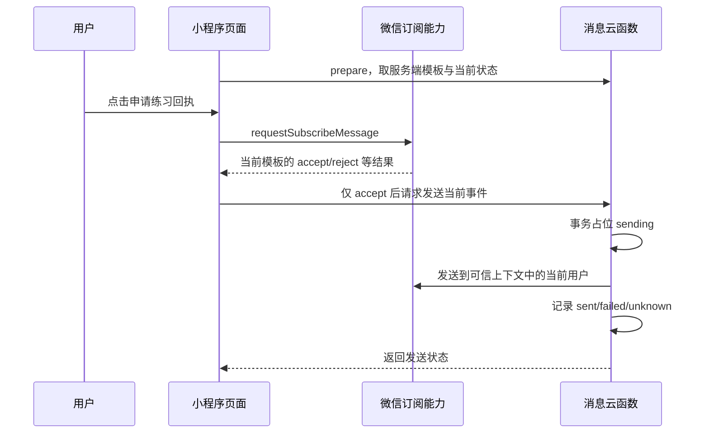

# 微信小程序开发教程 · 第九册

第 29 章文件、剪贴板、分享、订阅消息与能力检测，含完整示例、20 组练习、HTTP 服务和真实环境验收清单。 第01—36章主线正文已齐备；真实微信、云、数据治理及正式交付按实际验收表完成。目录见 [README](README.md)。整理日期：2026-11-03。

# 第 29 章：文件、剪贴板、分享、订阅消息与能力检测

前置：[第 28 章](28-统计口径跨日边界与七天图表.md)。配套第十个独立示例：`示例代码/10-studyhub-platform`。完整逐文件代码见 [第九阶段源码附录](第九阶段-完整源码附录.md)。本章日期：2026-11-02。

本章把“学伴”的数据带到平台能力中：把七日报告写成文件、从聊天重新选取校验、复制摘要、转发公开练习页；再练习 HTTP 文件上传下载，以及一次订阅回执的完整调用链。你将学会区分：本地路径和网络地址、文件内容与来源真实性、接口成功回调与业务成功、订阅同意与发送确认。

建议分五次学习：文件模型与本地往返；剪贴板与分享；本地 HTTP 文件实验；订阅消息配置与状态机；故障和真机验收。账号或模板暂不满足条件时，先完成文件和公开练习，消息部分保留源码与待验收记录，不把模拟调用说成真实发出。

## 29.1 先看本章做出的功能

在“身份与环境”页进入“文件、剪贴板、分享与订阅消息练习”。

| 板块 | 操作 | 实际结果 |
| --- | --- | --- |
| 报告文件 | 生成、重新读取、聊天选择、转发、清理 | 有版本的 JSON 汇总文件 |
| 剪贴板 | 复制摘要、主动读取预览 | 明确触发的文本交换 |
| 小程序卡片 | 转发固定练习 | 对方打开公开固定数据页 |
| 文件网络 | 上传固定报告、下载、校验、另存 | Node 服务与小程序的文件调用链 |
| 订阅回执 | 准备配置、点击申请、发送、核对 | 独立云函数和发送尝试状态 |

前九个项目继续保留。不要把整个教程目录导入开发者工具，也不要覆盖第九个项目；导入本章第十个外层目录。

## 29.2 四种“文件位置”不能混用

| 位置 | 例子 | 含义 |
| --- | --- | --- |
| 代码包内资源 | `/images/logo.png` | 随代码发布，不能当成运行时输出目录 |
| 本地临时路径 | 选择或下载接口返回的路径 | 由当前平台环境管理，不能承诺永久有效 |
| 小程序用户目录 | `wx.env.USER_DATA_PATH + '/week.json'` | 小程序可管理的本地文件，不等于系统下载目录 |
| 网络/云存储 | HTTPS URL、`cloud://...` fileID | 远程资源标识，仍需要对应接口、归属和权限 |

文件路径是“去哪里找”，文件内容是“里面是什么”。把路径字符串存在数据库里，不等于上传了文件；把 fileID 放到别人手机上，也不意味着对方获得读取权限。

HTTP 下载得到临时路径后，若要在自己的目录维护，需要明确另存和清理策略。第 24 章私人图片通过受控云函数代理，不能为了练习 `wx.cloud.downloadFile` 就开放已有私人存储规则。

官方示例展示了 [云文件上传](https://github.com/wechat-miniprogram/miniprogram-demo/blob/master/miniprogram/packageAPI/pages/network/upload-file/upload-file.js) 与 [云文件下载](https://github.com/wechat-miniprogram/miniprogram-demo/blob/master/miniprogram/packageAPI/pages/network/download-file/download-file.js) 的 filePath、fileID 和 tempFilePath；仓库中的环境 ID 与清理做法是该示例自身配置，不能照搬成你的私人附件策略。

## 29.3 导出的是什么：汇总文件，不是完整备份

本章导出七日统计，不包含任务、笔记全文、所有专注记录、附件、操作回执或账号凭证。恢复整个账号需要另一套备份和迁移协议。

文件顶层结构：

```json
{
  "format": "studyhub-week-report",
  "version": 1,
  "source": "demo",
  "report": {
    "policyVersion": "focus-end-day-v1"
  }
}
```

这是缩略结构示意，report 还必须有第 28 章定义的完整日期、边界、七日分项与合计；不要把上面几行当作可导入的完整文件。

format 标识这是哪类文件；version 标识文件容器版本；policyVersion 标识内部统计口径。文件包装变化和业务统计规则变化是两件事，因此分别留版本。

source 取 demo/cloud，记录生成时选择的来源。外部文件可以被任意修改，所以 source 不是签名，也不是服务器出具的真实性凭证。本章从聊天选择文件后只校验与核对合计，不写入私人云数据库。

## 29.4 用字段允许列表避免意外导出

不能因为接口对象目前很干净，就写 `JSON.stringify(response)` 导出所有内容。将来对象加入身份、日志、内部地址或调试字段，文件也会悄悄带出去。

`utils/report-file.js` 的 selectReport 先调用 validReport，然后显式挑选字段：

```js
const keys = ['policyVersion', 'timezone', 'consistency', 'complete',
  'dateFrom', 'dateTo', 'asOf', 'startAt', 'endExclusive',
  'cutoffExclusive', 'maxSessions', 'sessionCount'];
const out = {};
keys.forEach(key => { out[key] = report[key]; });

out.days = report.days.map(day => ({
  date: day.date,
  totalSeconds: day.totalSeconds,
  completedSessions: day.completedSessions,
  stoppedSessions: day.stoppedSessions,
  finishedSessions: day.finishedSessions
}));
```

keys 是允许导出的键；forEach 按键复制；map 给每一天创建新对象，额外属性不会跟过去。totals 也按允许列表生成。

这和第 23 章后端输入允许列表的思路相通：明确自己接收或输出什么，减少对象未来变化产生的副作用。

## 29.5 字符长度不等于 UTF-8 文件字节

字符串 `.length` 按 UTF-16 代码单元计数，不能直接拿来证明一个 UTF-8 文件占多少字节。

```js
function utf8Bytes(text) {
  let bytes = 0;
  for (const char of text) {
    const cp = char.codePointAt(0);
    bytes += cp <= 0x7f ? 1
      : cp <= 0x7ff ? 2
      : cp <= 0xffff ? 3 : 4;
  }
  return bytes;
}
```

for...of 按迭代出来的字符处理，能把正常代理对组成一个码点；ASCII 占 1 字节，常见汉字通常 3 字节，常见补充平面表情通常 4 字节。比如 `A学😀` 的 UTF-8 长度是 8 字节。

本章限定报告文件 32 KiB，即 32768 字节。它是课程业务限制，不是微信的文件容量规定。实际文件先通过 stat 检查，再读取；解码后的文本还会重新检查大小和内容。

JSON.stringify 的结果是字符串；JSON.parse 只解析 JSON 数据，不能把文件内容交给 eval 或 Function 执行。

## 29.6 回调封装要保留接收对象

`services/platform-api.js` 封装普通微信 API，也可封装 FileSystemManager 方法：

```js
function call(name, options = {}, owner = wx) {
  return new Promise((resolve, reject) => {
    if (typeof owner[name] !== 'function') {
      reject(new Error('当前环境不支持此接口'));
      return;
    }
    owner[name]({ ...options, success: resolve, fail: reject });
  });
}
```

完整源码还处理同步异常和取消错误。`owner[name](...)` 保留方法所属对象；不能随意先取出方法再裸调用，以免依赖 this 的接口失去接收对象。

调用普通接口：`call('setClipboardData', {data: text})`。调用文件管理器：`call('writeFile', options, manager)`。

这里封装的是回调结果，不适合把所有接口一律变成“只剩 Promise”。上传下载还需要保留 task，后面会单独处理。

## 29.7 写入自己的用户目录

核心写入代码：

```js
const fs = wx.getFileSystemManager();
const filePath = wx.env.USER_DATA_PATH + '/studyhub-week-demo.json';
await call('writeFile', {
  filePath,
  data: pack(report, 'demo'),
  encoding: 'utf8'
}, fs);
```

`pack` 先校验并挑选字段，再 JSON.stringify；writeFile 的成功才表示本次本地写入被确认。磁盘空间、权限或运行环境异常都应显示失败，不要在调用之前就提示保存成功。

本例用 demo/cloud/download 三个固定文件槽，同一槽覆盖上次文件，避免每点一次就生成一个永不清理的新文件。它没有提供历史文件版本库。

槽名只允许固定枚举，不能把用户标题或外部文件名拼成输出路径。例如 `../../somewhere` 不该成为可用槽名。

## 29.8 先 stat，再 readFile，再校验内容

```js
const result = await call('stat', { path: filePath }, fs);
if (result.stats.isDirectory() || result.stats.size > 32768) {
  throw new Error('不是允许的小型文件');
}
const content = await call('readFile', {
  filePath,
  encoding: 'utf8'
}, fs);
const value = unpack(content.data);
```

stat 检查文件属性与字节大小，readFile 读取内容，unpack 解析容器版本并调用统计协议校验。

文件存在不代表内容正确；后缀 `.json` 不代表 JSON 语法正确；JSON 可解析也不代表七日合计正确。每一层检查解决不同的问题。

本例读取时兼容一个开头的 UTF-8 BOM，之后仍检查格式。缺失字段、错误合计、未知版本与损坏 JSON 都会失败，不会伪装为七天零数据。

## 29.9 从聊天选择报告文件

```js
const result = await call('chooseMessageFile', {
  count: 1,
  type: 'file',
  extension: ['json']
});
const path = result.tempFiles[0].path;
const value = await read(path);
```

它是从微信聊天文件选择，不是随意遍历手机文件系统。extension 是选择界面的过滤条件，真正的内容仍要读取校验。[官方 API 类型中的 ChooseMessageFileOption](https://github.com/wechat-miniprogram/api-typings/blob/master/types/wx/lib.wx.api.d.ts)

本章界面只提示外部文件的已校验合计，不把它替换成你的真实云记录，也不因文件写了 cloud 就标为可信云统计。

用户取消是正常路径：保留原报告，显示已取消。不要把取消当成程序崩溃，也不要在取消后立刻再次打开选择器。

原生选择界面可能引起页面可见性变化；本例的本地文件动作在返回后检查实例是否仍存活，不把每次临时隐藏都理解为用户永久离开。网络传输和消息配置的可见性处理另有规则。

## 29.10 本地文件清理与转发

清理调用 unlink，且仅接收固定槽名。如果删除接口失败，本例报告“清理未确认”，不把所有错误都解释为“文件本来不存在”。

文件转发使用 `wx.shareFileMessage`，由用户选择聊天：

```js
await call('shareFileMessage', {
  filePath: saved.filePath,
  fileName: saved.fileName
});
```

API 存在时可以尝试，失败仍要处理。官方类型注释标明该接口的最低基础库；不要仅因模拟器中出现函数就推断所有手机可用。[官方 ShareFileMessage 类型与注释](https://github.com/wechat-miniprogram/api-typings/blob/master/types/wx/lib.wx.api.d.ts)

生成本地文件和转发文件是两个操作。用户自己选择要转发的内容；接口返回也不等于收件人已经阅读。真正包含私人汇总的 cloud 文件，用户转发后属于一次主动披露，页面文案应清楚说明当前来源。

## 29.11 不同格式要选择对应的预览工具

JSON 报告适合用程序解析，再用页面展示。不要为了调用 openDocument 就把 JSON 改名成 `.pdf`。

若业务确实生成受支持的文档格式，可在获得真实本地文件后调用：

```js
wx.openDocument({
  filePath: localDocumentPath,
  showMenu: true,
  success() { console.log('文档打开接口已返回'); },
  fail() { /* 提示格式、路径或环境不满足 */ }
});
```

这是接入真实文档时的说明片段，不是本章 JSON 报告的运行步骤。本章没有生成 PDF/Word，也没有把扩展名伪装当作格式转换。

## 29.12 剪贴板：明确复制，明确读取

复制摘要：

```js
await call('setClipboardData', {
  data: summary(report, source)
});
```

summary 明确写出来源、日期、精确秒数和 UTC+08:00 结束日口径，避免离开页面后只剩一个容易误解的数字。

主动读取：

```js
const result = await call('getClipboardData');
this.setData({ clipboardPreview: result.data.slice(0, 200) });
```

用户点击“主动读取剪贴板预览”才调用。预览只留在当前页，不上报云端，不写日志；卸载页面后不保存这段预览。slice 的 200 是代码单元上限，可能截断复杂表情，若要完整字符可另用按字符迭代的截取函数。

不要在 onShow 自动读取剪贴板来猜用户意图。接口可调用和用户期望你读取，是两个需要分别满足的条件。涉及实际隐私声明和接口使用要求时，以当前账号和官方平台要求为准。

## 29.13 分享小程序卡片，分享的是入口

WXML：

```xml
<button open-type="share">转发公开固定练习卡片</button>
```

页面配置：

```js
onShareAppMessage() {
  return {
    title: '一起学习小程序：七天统计练习',
    path: '/pages/public-lab/index?demo=normal',
    imageUrl: '/assets/public-study-card.png'
  };
}
```

由用户通过分享按钮或相关菜单发起，返回值配置标题与页面路径。[官方 Page 分享回调定义](https://github.com/wechat-miniprogram/api-typings/blob/master/types/wx/lib.wx.page.d.ts)

分享路径不是权限凭证。把私人任务 ID 发给另一用户，服务器仍应按对方身份鉴权，不能因为“是好友发来的”就跳过归属检查。

还要明确设置 imageUrl。官方类型说明默认使用截图；当前平台页可能包含私人报告或剪贴板预览，所以本例打包一张固定公开封面。只修改path却任由当前页截图进入卡片，仍可能泄露信息。封面是600×480的教学图形，可用项目内 `node tools/make-share-card.cjs` 重建，不读取用户数据。

先使用现成封面完成练习即可；生成器作为可选的资源重建工具供参考。本章重点是如何选择分享内容和接入平台能力，PNG编码细节留作后续拓展。

本章选择公开固定练习页，接收方看到明确的教学标记和固定 2310 秒；不是分享者的私人统计。页面独立启动就能展示，不依赖上一个页面的内存或先登录查到分享者身份。

## 29.14 为什么不能把私人报告塞进 query

错误思路：

```js
// 不用于本项目
path: '/pages/report/index?ownerId=' + userId
  + '&report=' + encodeURIComponent(JSON.stringify(privateReport))
```

这会把数据放进入口参数，可能被复制、改写、记录或再次传播。URL 编码只是解决特殊字符，不会加密，不会鉴权，也不会使内容可信。

若将来实现真正的公开分享，应另建分享对象，设计明确的公开字段、过期、撤销、访问范围和删除策略。私人正文和公开摘要不能只是同一个接口加上 `public=true` 就完成安全设计。

本章没有朋友圈专题、分享成功奖励或公开私人笔记。不同分享能力要分别查当前支持条件，不能从 onShareAppMessage 推断其他能力完全相同。

## 29.15 HTTP 文件传输与 JSON 请求的区别

普通 `wx.request` 常发送 JSON；`wx.uploadFile` 用本地 filePath，通过 multipart/form-data 上传；`wx.downloadFile` 把响应写到临时文件并返回 tempFilePath。

```js
const task = wx.uploadFile({
  url: origin + '/upload',
  filePath: saved.filePath,
  name: 'file',
  success(response) {
    if (response.statusCode !== 200) return;
    const body = JSON.parse(response.data);
  }
});
```

name 是表单文件字段名，不是文件名。本章服务只接收 name=file。上传接口的 data 响应为字符串，需按约定解析；success 回调中也要核对 HTTP 状态和业务响应。[官方 UploadFileSuccessCallbackResult](https://github.com/wechat-miniprogram/api-typings/blob/master/types/wx/lib.wx.api.d.ts)

不要自行把 Content-Type 固定成 application/json 或乱填 multipart boundary；边界与文件体应由上传接口按协议生成。它不同于把 filePath 字符串直接 JSON.stringify 发给服务器。

## 29.16 保留 task：进度、中止与有限生命周期

本例 transfer 返回两部分：

```js
const operation = upload(filePath, progress => {
  this.setData({ progress });
});
this._transfer = operation;
const response = await operation.promise;
```

operation.abort() 会调用底层 task.abort；task.onProgressUpdate 监听进度。Promise 用于等待结果，task 用于控制这次传输，不能二选一。

进度显示限制在 0—100；终态之后忽略迟到进度。百分之百只表示传输进度，不等于服务器已经完成校验、登记或返回业务成功。

页面隐藏/卸载时请求中止当前传输；中止不会撤销服务端已经接收到并处理的请求。上传结果未确认时不自动重传。对于真正的私人附件，应像第 25 章一样设计操作编号、归属、确认和孤立文件核对。

## 29.17 启动课程本地文件服务

配套服务只用 Node 标准库，没有第三方依赖。先在第十个项目目录打开终端：

```powershell
node server/file-lab.cjs
```

默认监听本机 127.0.0.1:8877。客户端配置：

```js
module.exports = {
  ENABLE_LOCAL_FILE_LAB: true,
  FILE_LAB_ORIGIN: 'http://127.0.0.1:8877'
};
```

初始开关为 false，不会在你未准备服务时自动请求网络。开发者工具本地 HTTP 实验涉及合法域名检查设置；按照第 17 章临时调试方法操作，结束后恢复。关闭检查不适用于正式发布。

手机中的 127.0.0.1 是手机自身。若在可信局域网练习，需要服务显式监听可访问地址、电脑实际私有 IP、同网段与防火墙配置；这些仍不能代替正式 HTTPS、合法上传/下载域名和鉴权。示例地址限制为本机或私有 IPv4 HTTP 源，不能直接改成匿名公网文件站。

例如在 PowerShell 中为这次本地服务设置监听地址：

```powershell
$env:FILE_LAB_HOST = '0.0.0.0'
node server/file-lab.cjs
# Ctrl+C 结束后，清除当前终端的这项配置：
Remove-Item Env:FILE_LAB_HOST
```

客户端把 origin 改为电脑实际私有 IP，如 `http://192.168.1.8:8877`；示例 IP 需要替换成你自己的。0.0.0.0 是服务监听地址，不是客户端访问地址。不要为了连接实验而关闭整机防火墙；按你管理的网络规则配置必要访问。

服务运行时可以用 Ctrl+C 结束。Node HTTP 的请求流、响应和监听概念参考 [Node 官方 HTTP 文档](https://nodejs.org/api/http.html)。本章不要求你把所有网络底层细节一次记住。

## 29.18 本地服务为什么只接收固定报告

匿名教学服务没有用户登录与文件所有者模型。本例把网络实验限定为固定教学内容：无论页面当前选了 demo 还是 cloud，上传按钮都会重新生成同一份固定报告；服务端还比较实际字节与固定文件是否完全相同。

本地服务规则：

- 只接收一个约定字段的 multipart 文件，不接受任意二进制。
- 请求体最多 64 KiB，文件内容最多 32 KiB。
- 仅在内存保存最多 20 份固定报告，十分钟过期。
- 返回随机编号；下载只接受该格式编号，不拼接磁盘路径。
- 重启后编号全部失效，没有持久备份语义。

multipart 解析器只支持本实验约定的单文件结构。它不是通用上传框架，也没有生产级恶意连接防护、审计或访问控制。超过上限明确返回 413/429，而不是悄悄截断。

不要只在客户端禁用私人文件选择就认为后端安全；服务端实际核对内容，才能阻止改造客户端上传其他数据。

## 29.19 下载后仍要检查文件

```js
const response = await downloadOperation.promise;
const value = await files.read(response);
if (pack(value.report, value.source) !== pack(lab.report(), 'demo')) {
  throw new Error('不是固定教学报告');
}
await files.save(value.report, 'demo', 'download');
```

这里 downloadOperation.promise 返回临时路径，read 再做 stat、内容解析和协议校验；最后另存为固定 download 槽。

HTTP 200 不证明内容是预期报告，也不证明来源真实性。错误页、旧版本文件或被修改的数据都要在后续校验中识别。

临时文件由平台管理，固定 download 槽由课程覆盖管理；当前界面的清理按钮只清理当前 demo/cloud 报告槽。扩展历史下载管理时，应增加明确的文件列表与逐项清理，不扫描删除整个 USER_DATA_PATH。

## 29.20 订阅消息的三步，不是一个按钮 API



一次性订阅需要按模板取得相应发送机会。它不是永久通知权限；每次成功弹窗调用也不代表所有模板都被同意。用户此前保存过选择时，可能不再次弹窗，仍应读取本次返回结果。

本例只请求一个模板，不依赖“一次最多几个模板”的数字。实际检索中旧资料与当前类型注释对批量数量存在差异，因此不要从旧教程抄一个平台上限当作永久规则。

能力与调用结构交叉参考 [官方订阅 API 注释](https://github.com/wechat-miniprogram/api-typings/blob/master/types/wx/lib.wx.api.d.ts)；微信文档正文在当前检索环境仍无法读取。账号模板可用性与实际发送需要真实环境确认。

## 29.21 先准备模板，再在点击中直接申请

官方注释要求在用户点击或相应支付回调等允许的触发条件下申请。不要在 onLoad 弹框，也不要点击后先 await 网络，再假设仍保留同样的用户触发条件。

本例 onShow 提前调用独立云函数的 prepare，取得模板 ID、日期、事件编号和状态。按钮点击中立即调用：

```js
const result = await call('requestSubscribeMessage', {
  tmplIds: [prepared.templateId]
});
const answer = result[prepared.templateId];
if (answer !== 'accept') return;
await notice.send(prepared.id);
```

await 等待的是刚发起的授权请求；发起这个接口之前没有网络 await。封装内部的 Promise executor 会同步执行，因此仍在按钮处理链中调用微信接口。

不要检查 `result.errMsg` 就认为同意，也不要把结果写死成 result.templateId。方括号取值是因为属性名来自真实模板 ID。

reject、ban、filter 和未知值均不调用服务端发送。总开关与 itemSettings 可帮助说明设置，但不是可用发送次数的可靠账本，也不能替代本次授权和发送结果。

## 29.22 选择真实匹配模板，配置独立消息函数

新增 `cloudfunctions/studyhubNotice`，固定 wx-server-sdk 4.0.2，与原 studyhub 分开部署，避免把发送消息混进任务或专注事务。

服务端环境变量：

| 变量 | 用途 |
| --- | --- |
| STUDYHUB_APP_ID | 允许的真实小程序 AppID |
| NOTICE_ENABLED | 字符串 true 才考虑启用，默认关闭 |
| NOTICE_TEMPLATE_ID | 真实可用的一次性模板 ID |
| NOTICE_THING_KEY | 对应“练习内容/事项”等匹配含义的 thing 字段键 |
| NOTICE_TIME_KEY | 对应“完成时间”等匹配含义的 time 字段键 |
| NOTICE_PAGE_STATE | developer / trial / formal，与实际跳转版本一致 |

本教学适配器只生成“平台能力练习已完成”和服务器完成时间两个字段。因此必须选用业务含义匹配、字段恰好满足本适配器的模板；thing1/time2 只是字段键示例，不代表每个模板都这样。若模板需要更多必填字段或含义不同，应连同后端映射和校验一起改造，不能把无关内容硬塞进订单/医疗等模板。

云函数环境变量是字符串，所以代码比较 `NOTICE_ENABLED === 'true'`，不是把任意非空字符串都当成启用；字符串 `'false'` 本身在普通 if 中也是真值。readConfig 还校验字段键和跳转版本，配置不完整就保持关闭。

没有合适模板或账号暂不支持时，保持关闭，其他功能照常练习。长期订阅和设备订阅的资质、规则另行查证，本章不承诺普通账号可用。

云调用参数的 camelCase 写法可交叉参考 [CloudBase 订阅消息配方](https://docs.cloudbase.net/recipes/add-subscribe-message-cloud-function)。该配方使用独立 CloudBase 路线，且不同语言页面的适用说明存在差异；这里只核对调用形状，不把它的登录、额度表或部署流程直接搬进本项目。原 wx.cloud 项目的账号关联、函数权限和实际 SDK 执行仍需按微信文档与控制台验收。

## 29.23 服务端固定接收人、内容与页面

客户端只传 action 和当前事件 id。不能传 touser、templateId、任意 data、ownerId 或“我已经同意”的可信标记。

```js
const context = cloud.getWXContext();
// 先核对 APPID 与非空 OPENID。
const payload = {
  touser: context.OPENID,
  templateId: configuredTemplate,
  page: 'pages/public-lab/index?demo=normal',
  miniprogramState: configuredPageState,
  lang: 'zh_CN',
  data: {
    [configuredThingKey]: { value: '平台能力练习已完成' },
    [configuredTimeKey]: { value: serverTimeText }
  }
};
await cloud.openapi.subscribeMessage.send(payload);
```

云调用使用 templateId/miniprogramState 等字段；直接调用微信 REST 接口时字段命名与凭证管理不同，不要混抄。本项目不把 access_token 或 AppSecret 放在客户端。

客户端 accept 只用于正常流程，攻击者仍可绕过客户端直接请求自己的发送接口。服务器固定当前用户和业务内容，限制尝试次数；微信平台继续校验该用户是否有对应发送机会。我们没有实现自制的可信授权次数账本。

## 29.24 新增第九个集合，而不是开放现有规则

原 collections-plan.json 八集合保持原业务。新增 `database/notice-plan.json` 列出 `studyhub_notice_attempts`，总共九集合，均禁止客户端直接读写。

消息集合字段包括 ownerId/ownerAppId、day、state、templateId、createdAt/updatedAt，以及已识别的平台结果码。按文档 ID 直接查找，不需要为了本章添加全表遍历。

ID 由服务端 SHA256 计算：

```js
JSON.stringify([APPID, OPENID, day, 'platform-receipt-v1'])
```

day 使用固定 UTC+08:00。ID 不包含模板 ID，所以同一天换模板不能绕过一次尝试边界。这里的哈希不是保密凭证，真正的权限来自可信微信身份和服务端归属校验。

每用户每统计日最多一次发送尝试是本课程业务规则，不是微信平台每日配额。跨日会得到新编号；旧编号过期。失败或未知也不在当天自动重新发送，这是一项有明确代价的保守策略。

## 29.25 发送状态机：先占位，再调用外部接口

| 状态 | 本章含义 | 再次请求如何处理 |
| --- | --- | --- |
| ready | 当天还没有已记录的发送尝试 | 可以在用户申请后尝试 |
| sending | 占位已保存，发送进度需核对 | 返回状态，不再次调用发送 |
| sent | 获得明确的接口接受结果 | 返回状态，不重复发送 |
| failed | 获得明确的非零平台错误 | 当天不再尝试 |
| unknown | 未取得明确结果，或结果持久化未确认 | 人工核对，不自动重发 |

ready 是 prepare 派生的状态，不需要预先写一条待发送文档。真正 send 时，在数据库事务中检查记录不存在，再写 sending；已有任何尝试记录都不重复获得资格。

事务提交确认后，才调用一次外部 OpenAPI。外部发送不放在可能重新执行的事务回调里。发送结果再用另一事务落库。

本地测试用串行事务验证资格逻辑，真实数据库冲突、提交确认和 SDK 行为仍需实际验收。业务层限制发起次数不等于承诺平台端“严格恰好送达一次”。

## 29.26 三种故障，为什么不能同一方式重试

1. 占位事务提交前失败：没有确认资格，不调用外部发送。重新核对仍可能 ready。
2. 占位实际提交但响应丢失：记录可能是 sending，但本轮还没调用发送。保守地不再取得资格，可能漏发。
3. 平台已经接受，响应或后续落库失败：不能证明没发，显示 unknown 或持续 sending，不自动重发。

这体现了数据库与微信外部接口不共享事务的边界。为避免重复，本版接受部分不确定故障中漏发的可能，不会把一个 catch 后重试说成可靠消息系统。

运维应结合精确事件 ID、函数日志和平台结果核对；不得仅因记录旧就删除后让客户端重新发送。生产级可靠通知需要进一步设计任务队列、租约、平台可用的查询/幂等能力、审计和人工处置，不是添加一个 setTimeout。

## 29.27 发送接口返回，不等于用户已经看到

本例仅在明确整数结果码为零时记录 sent；明确非零记录 failed；超时、断线或缺少可识别的结果记录 unknown。SDK 实际返回形状应在真实环境核对。

界面文案写“平台接口已接受；实际展示和送达需手机核对”，不写“对方已阅读”。消息显示还涉及客户端、模板、版本路径与平台处理。

常见排查方向：没有对应订阅机会、模板被删除、字段不匹配、时间格式不合要求、页面路径与版本不符、函数缺少云调用权限或身份关联。错误码解释应查当前官方资料，不把任何非零码都笼统解释为“用户拒绝”。

`config.json` 附有 subscribeMessage.send 的声明。文件存在不等于后台权限已生效，仍需检查部署方式、服务角色、函数调用规则和当前环境的 OpenAPI 配置。

## 29.28 能力检测分成四层

```js
const hasFunction = typeof wx.shareFileMessage === 'function';
const supportsFeature = typeof wx.canIUse === 'function'
  && wx.canIUse('button.open-type.share');
```

第一层：代码接口是否存在；第二层：具体参数/组件能力是否支持；第三层：账号、配置、用户权限与网络是否满足；第四层：本次实际调用是否成功。

canIUse 适合检测受支持的具体能力表达式；不能用一个 true 推断模板已配置、用户已同意或文件服务器可用。版本字符串也不能直接字典比较，例如把 2.10 错判为小于 2.9。

本例能力表显示“接口存在/不存在”，刻意不写“功能可用”。入口的失败分支仍然保留：不支持转文件时可以读取并复制摘要；云消息关闭时可以练习本地文件；图表能力不足时仍有表格。

不要为了检查能力就真的读取剪贴板、打开相册或申请订阅。检测与使用应有不同的副作用。

## 29.29 页面并发、取消与迟到结果

平台页使用 `_busy` 阻止重复操作，data.busy 负责禁用按钮。二者职责不同：实例字段控制逻辑重入，响应式字段控制用户反馈。

页面卸载后 `_alive=false`，异步结果不再 setData；消息配置请求还使用单独的请求序号，隐藏后迟到的 prepare 不能重新开启按钮。文件传输隐藏时请求 abort。

消息授权的回调返回后还检查存活与可见性；即使本次得到 accept，页面已经离开时也不盲目继续发起服务端发送。已获得的机会与本次业务是否继续，是不同状态。

本例不保证把所有原生面板的显示/隐藏行为在各端模拟一致，所以选择器、转发面板、后台返回必须真机走查。遇到平台回调顺序差异，先记录事件序列再调整，不靠猜测修复。

## 29.30 按顺序运行与验收

1. 先导入项目，进入平台能力页，用默认固定报告完成生成、重读、复制和取消选择。
2. 将报告主动转发到自己的测试聊天，再从聊天选择它校验；记录能力不支持的实际行为。
3. 从分享卡片直接启动公开页，确认无登录前置也显示固定数据，未读取分享者云数据。
4. 启动本地服务并启用实验配置，上传、下载、断网、中止、过期和重启逐一核对。
5. 云数据能力按原八集合及 studyhub 步骤部署；云报告仍只归当前用户。
6. 选择匹配模板，增加第九集合、权限与 studyhubNotice；配置后点击申请并在手机核对一次回执。
7. 重复点击、拒绝授权、错误模板、超时与消息状态落库异常分别验收，记录不能确认的结果。

完整表见 [部署与平台能力验收清单](第九阶段-部署与平台能力验收清单.md)。不要直接把本地实验开关、匿名服务或未确认的 SDK 返回形状当作上线配置。

## 29.31 本地测试证明了什么

本章新增 59 个场景：报告文件、UTF-8、字段挑选、选择与清理、剪贴板时机、传输状态、真实本机回环 HTTP、公开分享、消息鉴权、一次尝试资格、故障边界和页面迟到结果。

另在第十个项目执行 52 个基础、56 个知识库、71 个计时、60 个统计继承场景，共 298 个本地验证。微信 API 和 OpenAPI 用桩；本地 HTTP 上传下载是真实回环请求。[第九阶段验证记录](验证/第九阶段验证记录.md)

尚未执行真实微信文件选择/转发/剪贴板、微信编译、真实 SDK 安装、消息云函数部署、OpenAPI 权限、模板授权和真实消息发送。云事务是内存串行模型，不证明真实并发与规则生效。

## 29.32 常见问题与下一阶段

| 现象 | 检查方向 |
| --- | --- |
| 已写入但手机文件管理器看不到 | USER_DATA_PATH 是小程序用户目录，不是系统下载目录 |
| 后缀正确却导入失败 | 内容、版本、大小、七日口径和合计是否正确 |
| 模拟器上传成功，手机连不上 | 手机 localhost、局域网监听、防火墙和域名配置 |
| 上传 success 但业务失败 | HTTP 状态码、响应 JSON 与业务字段 |
| 下载 404 | 服务重启、十分钟过期、编号错误 |
| 卡片打开后看不到我的真实报告 | 本章卡片刻意分享公开固定练习 |
| 授权 success 但没发消息 | 检查当前模板的动态键，是否 accept |
| 已 accept，但服务器拒绝 | 模板、字段、发送机会、身份关联与权限逐项查 |
| 记录长时间 sending | 不确定窗口，需要人工核对，不能直接删除并重试 |
| 能力表显示存在但操作失败 | 存在性只是第一层，继续查权限、配置和实际运行环境 |

练习见 [第九阶段练习与参考答案](第九阶段-练习与参考答案.md)。至此，计划、知识库、专注、统计和常见平台交互已有完整教学实现与本地验证；真实环境验收仍需逐项完成。

下一章第 30 章进入质量与交付阶段，统一错误反馈、弱网恢复、重入控制、表单草稿和空状态，把已有功能整理为更连贯的用户体验。


---

# 第九阶段练习与参考答案（第 29 章）

对应 [第 29 章](29-文件剪贴板分享订阅消息与能力检测.md)。先说明输入、输出与故障结果，再看代码；扩展题未写入本版功能。

## 1. 文件位置

题：filePath、HTTPS URL、cloud fileID 和代码包路径能否互换？

答：不能。它们定位不同存储空间，需要对应接口。本地路径写入数据库不等于上传，fileID也不自动授予别人权限。

## 2. 保存与备份

题：导出七天报告能恢复全部账号吗？

答：不能。文件只有汇总，没有原始任务、笔记、专注、附件和回执。完整备份需另定数据范围、版本、归属、恢复顺序和冲突规则。

## 3. 两个版本

题：version 与 policyVersion 分别控制什么？

答：文件容器格式与统计口径。包装变化不等于跨日归属规则变化，应分别设计兼容。

## 4. 字节计数

题：`A学😀` 的 UTF-8 字节数是多少？

答：1+3+4=8。.length计算UTF-16代码单元，不能当作UTF-8文件字节。实际读取先stat，再验证文本。

## 5. 输出允许列表

题：report 多了 ownerId/debug，为什么不直接序列化整个对象？

答：会意外导出新增信息。selectReport挑选固定字段，days/totals也重新构造。输入校验和输出披露控制是两层职责。

## 6. 文件三层校验

题：后缀json、JSON可解析、业务有效分别证明什么？

答：名称提示、语法正确、版本/日期/数值/合计满足协议。三者均不能证明外部文件由可信服务器签发。

## 7. 来源标签

题：聊天文件的 source=cloud 是否可信？

答：标签可修改，不是签名。本例只预览合计，不写云；可信报表要另建可核验来源体系。

## 8. 固定文件槽

题：为何不用任意用户标题和时间不断生成文件？

答：任意标题涉及路径处理，无限文件需要容量与清理策略。固定demo/cloud/download简化管理，代价是覆盖同槽旧文件。

## 9. 用户取消

题：取消选文件后应怎样处理？

答：保留原报告、结束忙碌状态，可轻提示取消，不立即重开。区分取消、不支持、格式、网络和业务错误。

## 10. 方法接收对象

题：为什么用 `owner[name](options)`？

答：保留方法所属对象，避免裸调用丢失this。封装不能无依据地假定平台方法不依赖接收关系。

## 11. 三层上传结果

题：success回调、HTTP200、ok=true是否相同？

答：不是。回调后查HTTP，再解析业务协议；业务成功也不等于对方已阅读。上传响应data是字符串。

## 12. task与Promise

题：只返回Promise会失去什么？

答：可能丢失中止和进度控制。本例保留promise/abort；100%不是服务器业务登记确认，终态后忽略迟到进度。

## 13. 中止与撤销

题：中止后服务端仍可能保存文件吗？

答：可能。请求中止不是分布式回滚。真实附件需要操作编号、归属、登记和孤立文件核对；未知结果不盲目重传。

## 14. 手机localhost

题：电脑能连接127.0.0.1，手机为何不行？

答：手机localhost指手机自身。局域网需电脑私有IP、监听地址、同网段、防火墙和微信网络配置；正式环境用HTTPS/合法域名和鉴权。

## 15. 后端也要拒绝

题：按钮固定上传练习报告，后端还需要核对吗？

答：需要，客户端可被改造。本例服务比较实际固定字节；没有用户归属的匿名实验不能成为生产私人文件站。

## 16. 分享与权限

题：把笔记ID放进卡片，好友就能读取私人笔记吗？

答：不应能，服务端仍按访问者身份鉴权。本例只分享固定公开页，并指定公开封面，避免默认截图泄露当前页内容；真实公开分享需要字段、过期、撤销和权限模型。

## 17. 授权触发时机

题：点击后先await网络prepare再申请有何问题？

答：等待后未必满足用户触发要求。提前准备，点击直接申请；读取真实模板ID动态键，只在accept后请求发送。

## 18. 同意、发送与已读

题：accept、sent、已读各表示什么？

答：本次模板同意、本例识别到平台接受、用户阅读事实。前两者不能证明第三者；未知结果不能解释成没发。

## 19. 外部发送与事务

题：发送放进事务回调，或catch后立刻重试为何危险？

答：事务可能失败或重跑，外部消息不会一起回滚。本例先占位，再发送，最后记状态；不确定时不重发，接受可能漏发的代价，不保证恰好送达一次。

## 20. 扩展：任务到期提醒

题：从立即练习回执扩展为任务到期通知，需要增加什么？

答：定义具体订阅事件、取消和修改失效、服务端调度、时区、租约/并发领取、发送机会、核对与重试、日志权限。页面setTimeout不能保证后台到时执行。本版没有后台提醒、长期订阅或可靠投递队列。


---

# 第九阶段部署与平台能力验收清单

对应第29章和 `示例代码/10-studyhub-platform`。日期：2026-11-02。真实微信/云环境项目均未执行；298个本地验证包含真实回环HTTP，不包含微信消息发送。

记录：日期______；AppID/ENV_ID______；微信/基础库/设备______；SDK/运行时______；模板及函数版本______。不记录密钥。

## 文件与剪贴板

- [ ] 用户目录写入、重读得到2310秒，与系统下载目录区别清楚。
- [ ] 写入失败、路径不可读、过大文件、损坏JSON、未知版本和错误合计有受控反馈。
- [ ] 固定槽覆盖与转发期间的行为符合预期；切换来源后不转发旧来源文件。
- [ ] 清理仅作用于课程槽，不删除整个用户目录。
- [ ] 真机聊天选JSON、取消、面板返回和页面生命周期顺序核对。
- [ ] 外部文件不写云，source标签不当真实性证明。
- [ ] 用户主动转发文件，当前来源清楚；不支持时可改用摘要。
- [ ] 剪贴板点击后才读，预览不上报、不写日志、不长期保存。

## 分享

- [ ] 卡片直接进入公开固定页，不依赖上页内存或分享者登录态。
- [ ] 标题/路径没有私人报告、身份、凭证、正文或fileID。
- [ ] 固定公开封面实际显示，没有回退为含私人摘要或剪贴板的当前页截图。
- [ ] 接收者看到固定教学标记，私人接口仍按访问者鉴权。
- [ ] 不把接口返回解释为送达、阅读或奖励依据。

## HTTP文件实验

- [ ] 服务已启动，配置地址正确，开关启用有记录，实验后恢复调试设置。
- [ ] 手机localhost、私有IP、监听、防火墙与域名分别核对。
- [ ] 上传按钮与服务端都只允许固定报告，拒绝私人或修改内容。
- [ ] 微信原生multipart与课程单文件解析器实际兼容，不能只用Node构造请求证明。
- [ ] HTTP错误、协议错误、取消、后台、迟到进度、弱网正确处理。
- [ ] 下载后检查大小和口径，再另存download槽；临时路径不当永久地址。
- [ ] 十分钟、二十份、重启、413/429和404边界核对。
- [ ] 匿名实验不开放为公网私人服务；正式方案另有HTTPS、合法域名、鉴权和归属。

## 消息配置

- [ ] 原八集合加studyhub_notice_attempts，共九集合，客户端直连都拒绝。
- [ ] studyhubNotice真实SDK安装、函数调用规则、服务角色、身份关联和OpenAPI权限生效。
- [ ] 选择真实含义匹配的thing/time模板；更多必填字段先改后端映射。
- [ ] 环境变量与developer/trial/formal对应，配置不足保持关闭。
- [ ] 客户端不能指定接收人、任意模板/内容或伪造可信授权账本。
- [ ] 点击内直接申请；accept/reject/ban/filter/异常逐一核对。
- [ ] 不把设置项或保存过的accept当无限发送权限，不诱导反复授权。

## 消息状态与故障

- [ ] 每用户每统计日一次尝试是业务规则；跨日编号与旧编号过期正确。
- [ ] 真实并发下只有占位成功者调用发送，真实事务冲突已核对。
- [ ] 外部发送不在可能重执行的事务回调内。
- [ ] 真实SDK结果明确区分接受、非零错误与未知。
- [ ] sending/unknown只核对，不因记录旧而删除重发，可能漏发的代价说明清楚。
- [ ] 手机实际收到一次回执，跳转正确版本；接口接受不写成已读。
- [ ] 没有把立即回执说成后台提醒、消息队列或恰好一次送达。

## 回归

- [ ] 原任务、知识库、图片、迁移、专注和统计在真实新部署回归。
- [ ] 能力存在但配置不满足时有回退，真实微信编译和设备行为有记录。
- [ ] 本地298项与真实执行结果分开记载，不提前勾选。

实际通过项、失败证据与待处理问题：______。


---

# 第九阶段完整源码附录

对应 `示例代码/10-studyhub-platform`。第 29 章文件、剪贴板、分享与订阅回执。独立消息函数和固定报告 HTTP 实验；真实微信、九集合权限和发送待验收。每段标题是相对项目根目录的实际路径，请逐文件创建。

## 文件：.gitignore

```text
project.private.config.json
node_modules/
**/node_modules/
.env
.env.*
*.log
```

## 文件：cloudfunctions/helloCloud/index.js

```js
const cloud = require('wx-server-sdk');
cloud.init({ env: cloud.DYNAMIC_CURRENT_ENV });
exports.main = async () => {
  const context = cloud.getWXContext();
  return { ok: true, data: { message: '云函数已响应', serverTime: Date.now(),
    hasWechatIdentity: Boolean(context.OPENID && context.APPID) } };
};
```

## 文件：cloudfunctions/helloCloud/package.json

```json
{
  "name": "studyhub-hello-cloud", "version": "1.0.0", "private": true,
  "main": "index.js", "dependencies": { "wx-server-sdk": "4.0.2" }
}
```

## 文件：cloudfunctions/studyhub/database-store.js

```js
function createDatabaseStore(db) {
  const collection = db.collection('studyhub_tasks');
  const scope = actor => ({ ownerAppId: actor.ownerAppId, ownerId: actor.ownerId });
  return {
    async list(actor, { cursor, limit, filter }) {
      const condition = scope(actor);
      if (filter !== 'all') condition.done = filter === 'done';
      if (cursor !== null) condition._id = db.command.gt(cursor);
      const response = await collection.where(condition).orderBy('_id', 'asc').limit(limit).get();
      return response.data;
    },
    async get(actor, id) {
      const response = await collection.where({ ...scope(actor), _id: id }).limit(1).get();
      return response.data[0] || null;
    }
  };
}
module.exports = { createDatabaseStore };
```

## 文件：cloudfunctions/studyhub/domain-base.js

```js
const crypto = require('node:crypto');
const CATEGORIES = ['general', 'syntax', 'layout', 'project'];
const PRIORITIES = ['low', 'normal', 'high'];
const FIELD_KEYS = ['title', 'description', 'category', 'priority', 'dueDate', 'done'];

function reject(code, message) { throw Object.assign(new Error(message), { publicCode: code }); }
function isObject(value) { return value !== null && typeof value === 'object' && !Array.isArray(value); }
function assertKeys(value, allowed) {
  if (!isObject(value) || Object.keys(value).some(key => !allowed.includes(key))) {
    reject('INVALID_INPUT', '请求包含不允许的字段或结构');
  }
}
function validDate(value) {
  if (value === '') return true;
  if (typeof value !== 'string' || !/^\d{4}-\d{2}-\d{2}$/.test(value)) return false;
  const [year, month, day] = value.split('-').map(Number);
  const date = new Date(year, month - 1, day);
  return year >= 2000 && year <= 2099 && date.getFullYear() === year
    && date.getMonth() === month - 1 && date.getDate() === day;
}
function cleanFields(value) {
  assertKeys(value, FIELD_KEYS);
  if (typeof value.title !== 'string' || !value.title.trim() || value.title.trim().length > 40) reject('INVALID_INPUT', '标题长度须为 1—40 个代码单元');
  if (typeof value.description !== 'string' || value.description.length > 1000) reject('INVALID_INPUT', '备注最多 1000 个代码单元');
  if (!CATEGORIES.includes(value.category) || !PRIORITIES.includes(value.priority)) reject('INVALID_INPUT', '分类或优先级不合法');
  if (!validDate(value.dueDate) || typeof value.done !== 'boolean') reject('INVALID_INPUT', '日期或完成状态不合法');
  return { title: value.title.trim(), description: value.description.trim(), category: value.category,
    priority: value.priority, dueDate: value.dueDate, done: value.done };
}
function validId(id) { return typeof id === 'string' && /^[A-Za-z0-9_-]{1,128}$/.test(id); }
function checkId(id) { if (!validId(id)) reject('INVALID_INPUT', '任务 ID 不合法'); }
function checkVersion(version) {
  if (!Number.isSafeInteger(version) || version < 1 || version > 1000000000) reject('INVALID_INPUT', '任务版本不合法');
}
function principal(context, expectedAppId) {
  if (!expectedAppId) reject('NOT_CONFIGURED', '云函数未配置允许的小程序 AppID');
  if (!context || typeof context.OPENID !== 'string' || !context.OPENID
    || typeof context.APPID !== 'string' || context.APPID !== expectedAppId) {
    reject('UNAUTHENTICATED', '缺少有效的微信调用身份');
  }
  return { ownerId: context.OPENID, ownerAppId: context.APPID };
}
function publicTask(task) {
  checkId(task._id);
  checkVersion(task.version);
  if (!Number.isFinite(task.createdAt) || !Number.isFinite(task.updatedAt)) throw new Error('Stored task time invalid');
  const fields = Object.fromEntries(FIELD_KEYS.map(key => [key, task[key]]));
  return { id: task._id, ...cleanFields(fields), createdAt: task.createdAt,
    updatedAt: task.updatedAt, version: task.version };
}

function createHandler({ store, getContext, expectedAppId, now = Date.now, logger = console }) {
  return async function handle(event) {
    try {
      const actor = principal(getContext(), expectedAppId);
      if (!isObject(event)) reject('INVALID_INPUT', '请求必须是对象');
      event = { ...event };
      delete event.userInfo; // 兼容平台附带的信息；身份只取 getWXContext，不信任此字段。
      const action = event.action;
      let data;
      if (action === 'whoami') {
        assertKeys(event, ['action']);
        data = { authenticated: true, appId: actor.ownerAppId,
          userTag: crypto.createHash('sha256').update(actor.ownerAppId + ':' + actor.ownerId).digest('hex').slice(0, 12) };
      } else if (action === 'list') {
        assertKeys(event, ['action', 'cursor', 'limit', 'filter']);
        const cursor = event.cursor === undefined || event.cursor === null ? null : event.cursor;
        if (cursor !== null) checkId(cursor);
        const limit = event.limit === undefined ? 10 : event.limit;
        if (!Number.isInteger(limit) || limit < 1 || limit > 20) reject('INVALID_INPUT', '每页数量须为 1—20');
        const filter = event.filter === undefined ? 'all' : event.filter;
        if (!['all', 'pending', 'done'].includes(filter)) reject('INVALID_INPUT', '筛选条件不合法');
        const rows = await store.list(actor, { cursor, limit: limit + 1, filter });
        const items = rows.slice(0, limit).map(publicTask);
        data = { items, nextCursor: rows.length > limit ? items[items.length - 1].id : null };
      } else if (action === 'get') {
        assertKeys(event, ['action', 'id']); checkId(event.id);
        const task = await store.get(actor, event.id);
        if (!task) reject('NOT_FOUND', '任务不存在或不可访问');
        data = publicTask(task);
      } else {
        reject('INVALID_INPUT', '不支持的操作');
      }
      return { ok: true, data };
    } catch (error) {
      if (error.publicCode) return { ok: false, error: { code: error.publicCode, message: error.message } };
      logger.error({ type: 'studyhub-internal-error', code: error.errCode || error.code || error.name || 'UNKNOWN' });
      return { ok: false, error: { code: 'INTERNAL', message: '服务暂时不可用，请查看云函数日志' } };
    }
  };
}
module.exports = { createHandler, cleanFields, validDate, validId, principal,
  reject, assertKeys, checkId, checkVersion, publicTask };
```

## 文件：cloudfunctions/studyhub/domain.js

```js
// 兼容旧的模块引用，写入统一进入新的事务协议。
module.exports = require('./sync-domain');
```

## 文件：cloudfunctions/studyhub/focus-contract.js

```js
// 客户端/云函数各保留一份相同协议；整理脚本检查内容一致。
const DURATIONS = [10, 300, 1500, 2700];
const STATES = ['running', 'paused', 'completed', 'stopped'];
const terminal = state => state === 'completed' || state === 'stopped';
const validId = value => typeof value === 'string' && /^[A-Za-z0-9_-]{1,128}$/.test(value);
const integer = value => Number.isSafeInteger(value) && value >= 0;
function validSession(row) {
  if (!row || !validId(row.id) || !DURATIONS.includes(row.plannedSeconds) || !STATES.includes(row.state)
    || !integer(row.version) || row.version < 1 || !integer(row.startedAt) || !integer(row.updatedAt) || row.updatedAt < row.startedAt
    || !integer(row.accumulatedMs) || row.accumulatedMs > row.plannedSeconds * 1000
    || !(row.taskId === '' || validId(row.taskId)) || typeof row.taskTitle !== 'string' || row.taskTitle.length > 40
    || (row.taskId && !row.taskTitle) || row.isDemo !== (row.plannedSeconds === 10)) return false;
  const remaining = row.plannedSeconds * 1000 - row.accumulatedMs;
  if (row.state === 'running') return remaining > 0 && integer(row.segmentStartedAt) && row.segmentStartedAt >= row.startedAt
    && row.updatedAt >= row.segmentStartedAt && row.deadlineAt === row.segmentStartedAt + remaining
    && row.endedAt === null && row.effectiveSeconds === null;
  if (row.segmentStartedAt !== null || row.deadlineAt !== null) return false;
  if (row.state === 'paused') return remaining > 0 && row.endedAt === null && row.effectiveSeconds === null;
  return integer(row.endedAt) && row.endedAt >= row.startedAt && row.endedAt <= row.updatedAt
    && row.effectiveSeconds === Math.floor(row.accumulatedMs / 1000)
    && (row.state === 'completed' ? remaining === 0 : remaining > 0);
}
function validAck(value) {
  return value && validId(value.sessionId) && Number.isSafeInteger(value.version) && value.version > 0 && STATES.includes(value.state);
}
module.exports = { DURATIONS, STATES, terminal, validId, validSession, validAck };
```

## 文件：cloudfunctions/studyhub/focus.js

```js
const { reject, assertKeys, checkId, checkVersion } = require('./domain-base');
const contract = require('./focus-contract');
const FIELDS = ['taskId', 'taskTitle', 'plannedSeconds', 'isDemo', 'state', 'accumulatedMs',
  'segmentStartedAt', 'deadlineAt', 'startedAt', 'endedAt', 'updatedAt', 'version'];
function dto(row) {
  const result = { id: row._id, ...Object.fromEntries(FIELDS.map(key => [key, row[key]])),
    effectiveSeconds: contract.terminal(row.state) ? Math.floor(row.accumulatedMs / 1000) : null };
  if (!contract.validSession(result)) throw new Error('Stored focus session is invalid');
  return result;
}
const ack = row => ({ sessionId: row._id, version: row.version, state: row.state });
const at = (row, timestamp) => Math.max(timestamp, row.updatedAt);
function settle(row, timestamp) {
  dto(row); // 存储损坏时停止，不猜测时长。
  const timestampAt = at(row, timestamp);
  if (row.state !== 'running' || timestampAt < row.deadlineAt) return row;
  return { ...row, state: 'completed', accumulatedMs: row.plannedSeconds * 1000,
    segmentStartedAt: null, deadlineAt: null, endedAt: row.deadlineAt,
    updatedAt: timestampAt, version: row.version + 1 };
}
function transition(row, action, timestamp) {
  if (!['focusPause', 'focusResume', 'focusStop'].includes(action)) reject('INVALID_INPUT', '不支持的专注状态转换');
  const settled = settle(row, timestamp);
  if (settled !== row) return settled; // 到时优先，迟到的暂停/结束不能减少已完成时长。
  const timestampAt = at(row, timestamp);
  if (contract.terminal(row.state)) {
    if (action === 'focusStop') return row;
    reject('FOCUS_CHANGED', '这轮专注已经结束，请核对当前状态');
  }
  if (action === 'focusPause' && row.state !== 'running') reject('FOCUS_CHANGED', '这轮专注已经暂停，请核对当前状态');
  if (action === 'focusResume' && row.state !== 'paused') reject('FOCUS_CHANGED', '这轮专注已经在计时，请核对当前状态');
  if (action === 'focusResume') {
    return { ...row, state: 'running', segmentStartedAt: timestampAt,
      deadlineAt: timestampAt + row.plannedSeconds * 1000 - row.accumulatedMs, updatedAt: timestampAt, version: row.version + 1 };
  }
  const elapsed = row.state === 'running' ? Math.max(0, timestampAt - row.segmentStartedAt) : 0;
  const accumulatedMs = Math.min(row.plannedSeconds * 1000, row.accumulatedMs + elapsed);
  return { ...row, state: action === 'focusPause' ? 'paused' : 'stopped', accumulatedMs,
    segmentStartedAt: null, deadlineAt: null, endedAt: action === 'focusPause' ? null : timestampAt,
    updatedAt: timestampAt, version: row.version + 1 };
}
function createFocusService({ store, now, hash, owned, receiptId, checkReceipt }) {
  const slotId = actor => hash(JSON.stringify([actor.ownerAppId, actor.ownerId]));
  async function latest(tx, actor) {
    const slot = await tx.get('studyhub_focus_slots', slotId(actor));
    if (!slot) return null;
    if (!owned(slot, actor)) throw new Error('Focus slot owner mismatch');
    const row = await tx.get('studyhub_focus_sessions', slot.sessionId);
    if (!owned(row, actor)) throw new Error('Focus slot points to an unavailable session');
    dto(row); return row;
  }
  return {
    async read(actor, event) {
      if (event.action === 'focusList') {
        assertKeys(event, ['action', 'cursor']);
        const cursor = event.cursor === undefined || event.cursor === null ? null : event.cursor;
        if (cursor !== null) checkId(cursor);
        const rows = await store.listFocus(actor, cursor, 11), items = rows.slice(0, 10).map(dto);
        return { items, nextCursor: rows.length > 10 ? items[items.length - 1].id : null };
      }
      if (event.action === 'focusGet') {
        assertKeys(event, ['action', 'id']); checkId(event.id);
        const row = await store.transaction(tx => tx.get('studyhub_focus_sessions', event.id));
        if (!owned(row, actor)) reject('NOT_FOUND', '专注记录不存在或不可访问');
        return { session: dto(row), serverNow: Math.max(now(), row.updatedAt) };
      }
      assertKeys(event, ['action']);
      const timestamp = now();
      const row = await store.transaction(async tx => {
        const old = await latest(tx, actor); if (!old) return null;
        const current = settle(old, timestamp);
        if (current !== old) await tx.set('studyhub_focus_sessions', old._id, current);
        return current;
      });
      // current 会幂等地核对到时终态；没有后台调度器，也不增加统计汇总计数。
      return { session: row ? dto(row) : null, serverNow: Math.max(now(), row ? row.updatedAt : 0) };
    },
    async write(actor, event) {
      const action = event.action;
      assertKeys(event, action === 'focusStart' ? ['action', 'opId', 'fields'] : ['action', 'opId', 'id', 'version']);
      const payload = { action };
      if (action === 'focusStart') {
        assertKeys(event.fields, ['plannedSeconds', 'taskId']);
        if (!contract.DURATIONS.includes(event.fields.plannedSeconds)) reject('INVALID_INPUT', '请选择本例支持的专注时长');
        if (event.fields.taskId !== '') checkId(event.fields.taskId);
        payload.fields = { plannedSeconds: event.fields.plannedSeconds, taskId: event.fields.taskId };
      } else {
        checkId(event.id); checkVersion(event.version); Object.assign(payload, { id: event.id, version: event.version });
      }
      const rid = receiptId(actor, event.opId), fingerprint = hash(JSON.stringify(payload)), timestamp = now();
      return store.transaction(async tx => {
        const receipt = checkReceipt(await tx.get('studyhub_ops', rid), fingerprint);
        if (receipt) return receipt.result;
        let result;
        if (action === 'focusStart') {
          const previous = await latest(tx, actor);
          const previousSettled = previous ? settle(previous, timestamp) : null;
          if (previousSettled && !contract.terminal(previousSettled.state)) reject('FOCUS_ACTIVE', '已有一轮进行中的专注，请先查看或结束它');
          let task = null;
          if (payload.fields.taskId) {
            task = await tx.get('studyhub_tasks', payload.fields.taskId);
            if (!owned(task, actor)) reject('RELATED_TASK_UNAVAILABLE', '关联任务已删除或不可访问');
          }
          const startAt = Math.max(timestamp, previousSettled ? previousSettled.updatedAt : 0);
          const row = { _id: hash('focus:' + rid), ...actor, ...payload.fields, taskTitle: task ? task.title : '',
            isDemo: payload.fields.plannedSeconds === 10, state: 'running', accumulatedMs: 0,
            segmentStartedAt: startAt, deadlineAt: startAt + payload.fields.plannedSeconds * 1000,
            startedAt: startAt, endedAt: null, updatedAt: startAt, version: 1 };
          dto(row);
          if (previousSettled && previousSettled !== previous) await tx.set('studyhub_focus_sessions', previous._id, previousSettled);
          await tx.set('studyhub_focus_sessions', row._id, row);
          await tx.set('studyhub_focus_slots', slotId(actor), { ...actor, sessionId: row._id });
          result = ack(row);
        } else {
          const row = await tx.get('studyhub_focus_sessions', payload.id);
          if (!owned(row, actor)) reject('NOT_FOUND', '专注记录不存在或不可访问');
          dto(row);
          if (row.version !== payload.version) reject('FOCUS_CHANGED', '专注状态已经变化，请核对后再操作');
          if (!contract.terminal(row.state)) {
            const slot = await tx.get('studyhub_focus_slots', slotId(actor));
            if (!owned(slot, actor) || slot.sessionId !== row._id) throw new Error('Active session slot mismatch');
          }
          const next = transition(row, action, timestamp); dto(next);
          if (next !== row) await tx.set('studyhub_focus_sessions', row._id, next);
          result = ack(next);
        }
        await tx.set('studyhub_ops', rid, { ...actor, fingerprint, result, createdAt: timestamp });
        return result;
      });
    }
  };
}
module.exports = { createFocusService, settle, transition, dto };
```

## 文件：cloudfunctions/studyhub/images.js

```js
const { reject, assertKeys, checkId } = require('./domain-base');
const MAX_BYTES = 64 * 1024; // 本课程缩略图上限，不是平台配额。
function decodeImage(value) {
  if (typeof value !== 'string' || value.length > Math.ceil(MAX_BYTES / 3) * 4
    || !/^(?:[A-Za-z0-9+/]{4})*(?:[A-Za-z0-9+/]{2}==|[A-Za-z0-9+/]{3}=)?$/.test(value)) reject('INVALID_IMAGE', '图片编码或大小不合法');
  const buffer = Buffer.from(value, 'base64');
  if (!buffer.length || buffer.length > MAX_BYTES || buffer.toString('base64') !== value) reject('INVALID_IMAGE', '图片编码或大小不合法');
  const png = buffer.length >= 24 && buffer.subarray(0, 8).equals(Buffer.from([137, 80, 78, 71, 13, 10, 26, 10]));
  const jpg = buffer.length >= 4 && buffer[0] === 255 && buffer[1] === 216 && buffer[2] === 255
    && buffer[buffer.length - 2] === 255 && buffer[buffer.length - 1] === 217;
  if (!png && !jpg) reject('INVALID_IMAGE', '教学版仅接收 PNG/JPEG 图片');
  // 文件特征检查，不等于安全解码、内容审核或移除 EXIF。
  return { buffer, extension: png ? 'png' : 'jpg' };
}
const dto = row => ({ id: row._id, caption: row.caption, extension: row.extension,
  size: row.size, state: row.state, createdAt: row.createdAt });
function createImageService({ store, storage, now, randomId, hash, owned, receiptId, checkReceipt }) {
  async function rowFor(actor, id) {
    checkId(id);
    const row = await store.transaction(tx => tx.get('studyhub_assets', id));
    if (!owned(row, actor)) reject('NOT_FOUND', '图片不存在或不可访问');
    return row;
  }
  async function cleanup(row) {
    try {
      await storage.remove(row.fileID);
      await store.transaction(async tx => {
        const current = await tx.get('studyhub_assets', row._id);
        if (current && current.state === 'deleting') await tx.set('studyhub_assets', row._id, { ...current, state: 'deleted' });
      });
      return false;
    } catch (_) { return true; } // 保留删除状态，可再次清理。
  }
  return {
    async read(actor, event) {
      if (event.action === 'imageList') {
        assertKeys(event, ['action', 'cursor']);
        const cursor = event.cursor === undefined || event.cursor === null ? null : event.cursor;
        if (cursor !== null) checkId(cursor);
        const rows = await store.listImages(actor, cursor, 11), items = rows.slice(0, 10).map(dto);
        return { items, nextCursor: rows.length > 10 ? items[items.length - 1].id : null };
      }
      assertKeys(event, ['action', 'id']);
      const row = await rowFor(actor, event.id);
      if (row.state !== 'active') reject('NOT_FOUND', '图片已删除或正在清理');
      const buffer = await storage.download(row.fileID);
      if (!Buffer.isBuffer(buffer) || buffer.length > MAX_BYTES) throw new Error('Invalid stored image');
      return { id: row._id, extension: row.extension, base64: buffer.toString('base64') };
    },
    async write(actor, event) {
      const rid = receiptId(actor, event.opId);
      if (event.action === 'imageRemove') {
        assertKeys(event, ['action', 'opId', 'id']); checkId(event.id);
        const fingerprint = hash(JSON.stringify({ action: event.action, id: event.id }));
        const row = await store.transaction(async tx => {
          checkReceipt(await tx.get('studyhub_ops', rid), fingerprint);
          const current = await tx.get('studyhub_assets', event.id);
          if (!owned(current, actor)) reject('NOT_FOUND', '图片不存在或不可访问');
          if (current.noteRefs !== undefined && (!Number.isSafeInteger(current.noteRefs) || current.noteRefs < 0)) throw new Error('Invalid reference count');
          if (current.noteRefs > 0) reject('ASSET_IN_USE', '图片仍被笔记引用，请先从笔记中移除附件');
          if (current.state === 'active') await tx.set('studyhub_assets', event.id, { ...current, state: 'deleting' });
          await tx.set('studyhub_ops', rid, { ...actor, fingerprint, result: { id: event.id, removed: true }, createdAt: now() });
          return current;
        });
        return { id: event.id, removed: true, cleanupPending: row.state === 'deleted' ? false : await cleanup(row) };
      }
      assertKeys(event, ['action', 'opId', 'caption', 'base64']);
      if (typeof event.caption !== 'string' || !event.caption.trim() || event.caption.length > 40) reject('INVALID_INPUT', '图片标题须为 1—40 个代码单元');
      const { buffer, extension } = decodeImage(event.base64), caption = event.caption.trim();
      const fingerprint = hash(JSON.stringify({ action: event.action, caption, contentHash: hash(buffer) }));
      const old = await store.transaction(async tx => checkReceipt(await tx.get('studyhub_ops', rid), fingerprint));
      if (old) return old.result;
      const candidateId = randomId(); // 物理上传路径每次唯一；重试不会覆盖赢家文件。
      const cloudPath = 'studyhub-private/' + hash(JSON.stringify(actor)) + '/' + candidateId + '.' + extension;
      const candidate = { ...actor, cloudPath, state: 'uploading', createdAt: now() };
      await store.transaction(tx => tx.set('studyhub_uploads', candidateId, candidate));
      const fileID = await storage.upload(cloudPath, buffer);
      if (typeof fileID !== 'string' || !fileID) throw new Error('Missing file ID');
      await store.transaction(tx => tx.set('studyhub_uploads', candidateId, { ...candidate, fileID, state: 'uploaded' }));
      const result = await store.transaction(async tx => {
        const receipt = checkReceipt(await tx.get('studyhub_ops', rid), fingerprint);
        if (receipt) return receipt.result;
        const upload = await tx.get('studyhub_uploads', candidateId);
        if (!upload || upload.state !== 'uploaded') throw new Error('Candidate not ready');
        const asset = { _id: candidateId, ...actor, fileID, caption, extension, size: buffer.length, state: 'active', noteRefs: 0, createdAt: now() };
        await tx.set('studyhub_assets', candidateId, asset);
        await tx.set('studyhub_uploads', candidateId, { ...upload, state: 'attached' });
        await tx.set('studyhub_ops', rid, { ...actor, fingerprint, result: dto(asset), createdAt: now() });
        return dto(asset);
      });
      if (result.id !== candidateId) {
        // 明确读到另一赢家，才清理本次未引用文件；提交异常时不能猜测并删文件。
        try {
          await storage.remove(fileID);
          await store.transaction(tx => tx.set('studyhub_uploads', candidateId, { ...candidate, fileID, state: 'discarded' }));
        } catch (_) { /* uploaded 日志留给管理员核对。 */ }
      }
      return result;
    }
  };
}
module.exports = { createImageService, decodeImage, MAX_BYTES };
```

## 文件：cloudfunctions/studyhub/index.js

```js
const cloud = require('wx-server-sdk');
const { createHandler } = require('./sync-domain');
const { createTransactionStore } = require('./transaction-store');
cloud.init({ env: cloud.DYNAMIC_CURRENT_ENV });
const handler = createHandler({
  store: createTransactionStore(cloud.database({ throwOnNotFound: false })),
  storage: {
    async upload(cloudPath, buffer) { return (await cloud.uploadFile({ cloudPath, fileContent: buffer })).fileID; },
    async download(fileID) { return (await cloud.downloadFile({ fileID })).fileContent; },
    async remove(fileID) {
      const response = await cloud.deleteFile({ fileList: [fileID] });
      const item = response.fileList && response.fileList[0];
      if (!item || item.fileID !== fileID || item.status !== 0) throw new Error('STORAGE_DELETE_UNCONFIRMED');
    }
  },
  getContext: () => cloud.getWXContext(),
  expectedAppId: process.env.STUDYHUB_APP_ID,
  logger: console
});
exports.main = event => handler(event);
```

## 文件：cloudfunctions/studyhub/knowledge-schema.js

```js
// 纯 JavaScript 校验。服务端保留完全相同副本，由整理脚本核对一致性。
const KEYS = ['kind', 'title', 'content', 'tags', 'url', 'favorite', 'assetIds', 'taskId'];
const validId = value => typeof value === 'string' && /^[A-Za-z0-9_-]{1,128}$/.test(value);
function invalid(message) { throw Object.assign(new Error(message), { code: 'INVALID_INPUT', publicCode: 'INVALID_INPUT' }); }
function normalizeTag(value) {
  if (typeof value !== 'string') invalid('标签必须是文字');
  const tag = value.trim().toLowerCase();
  if (!/^[a-z0-9_\-\u3400-\u9fff]{1,12}$/.test(tag)) invalid('每个标签限 1—12 个汉字、字母、数字、下划线或短横线');
  return tag;
}
function cleanFields(value, normalizeUrl = url => url) {
  if (!value || typeof value !== 'object' || Array.isArray(value) || Object.keys(value).some(key => !KEYS.includes(key))) invalid('笔记字段不合法');
  if (!['note', 'link'].includes(value.kind)) invalid('内容类型不合法');
  if (typeof value.title !== 'string' || !value.title.trim() || value.title.trim().length > 60) invalid('标题限 1—60 个代码单元');
  if (typeof value.content !== 'string' || value.content.length > 8000) invalid('正文最多 8000 个代码单元');
  const content = value.content.replace(/\r\n?/g, '\n').trim();
  if (value.kind === 'note' && !content) invalid('学习笔记需要正文');
  if (!Array.isArray(value.tags) || value.tags.length > 10) invalid('标签输入过多');
  const tags = [...new Set(value.tags.map(normalizeTag))].sort();
  if (tags.length > 5) invalid('最多保留 5 个不同标签');
  if (typeof value.url !== 'string' || value.url.length > 800) invalid('资源网址最多 800 个代码单元');
  let url = value.url.trim();
  if (value.kind === 'link' && !url) invalid('资源收藏需要 HTTPS 网址');
  if (url && (!/^https:\/\/[^\s\\]+$/i.test(url) || /[\u0000-\u001f\u007f]/.test(url))) invalid('请输入完整 HTTPS 网址，不含空白或反斜杠');
  if (url) url = normalizeUrl(url); // 服务端再用 Node URL 做权威解析。
  if (typeof value.favorite !== 'boolean') invalid('收藏状态必须是布尔值');
  if (!Array.isArray(value.assetIds) || value.assetIds.length > 3 || !value.assetIds.every(validId)
    || new Set(value.assetIds).size !== value.assetIds.length) invalid('最多选择 3 张不同的图片');
  if (value.taskId !== '' && !validId(value.taskId)) invalid('关联任务不合法');
  return { kind: value.kind, title: value.title.trim(), content, tags, url, favorite: value.favorite,
    assetIds: [...value.assetIds].sort(), taskId: value.taskId };
}
const pickFields = note => Object.fromEntries(KEYS.map(key => [key, note[key]]));
function validNote(note) {
  try { cleanFields(pickFields(note)); } catch (_) { return false; }
  return validId(note.id) && Number.isSafeInteger(note.version) && note.version > 0
    && Number.isFinite(note.createdAt) && Number.isFinite(note.updatedAt);
}
module.exports = { KEYS, validId, normalizeTag, cleanFields, pickFields, validNote, invalid };
```

## 文件：cloudfunctions/studyhub/knowledge.js

```js
const { URL } = require('node:url');
const schema = require('./knowledge-schema');
const { reject, assertKeys, checkId, checkVersion } = require('./domain-base');
function normalizeUrl(value) {
  let url;
  try { url = new URL(value); } catch (_) { schema.invalid('资源网址无法解析'); }
  if (url.protocol !== 'https:' || !url.hostname || url.username || url.password || (url.port && url.port !== '443')) {
    schema.invalid('资源仅支持没有用户名密码的 HTTPS 默认端口网址');
  }
  if (url.href.length > 800) schema.invalid('规范化后的资源网址过长');
  return url.href; // 只保存网址，不请求网页、解析标题或打开 web-view。
}
const fieldsOf = row => schema.cleanFields(schema.pickFields(row), normalizeUrl);
const detail = row => ({ id: row._id, ...fieldsOf(row), version: row.version, createdAt: row.createdAt, updatedAt: row.updatedAt });
const summary = row => { const note = detail(row); const { content, assetIds, ...rest } = note;
  return { ...rest, excerpt: content.slice(0, 140), assetCount: assetIds.length }; };
function parseQuery(event) {
  assertKeys(event, ['action', 'q', 'tag', 'kind', 'favoriteOnly', 'cursor']);
  const q = event.q === undefined ? '' : event.q;
  if (typeof q !== 'string' || q.length > 40) schema.invalid('关键词最多 40 个代码单元');
  const tag = event.tag === undefined || event.tag === '' ? '' : schema.normalizeTag(event.tag);
  const kind = event.kind === undefined ? 'all' : event.kind;
  if (!['all', 'note', 'link'].includes(kind)) schema.invalid('类型筛选不合法');
  const favoriteOnly = event.favoriteOnly === undefined ? false : event.favoriteOnly;
  if (typeof favoriteOnly !== 'boolean') schema.invalid('收藏筛选不合法');
  const cursor = event.cursor === undefined || event.cursor === null ? null : event.cursor;
  if (cursor !== null) checkId(cursor);
  return { q: q.trim().toLowerCase(), tag, kind, favoriteOnly, cursor };
}
function matches(row, query) {
  if (query.kind !== 'all' && row.kind !== query.kind) return false;
  if (query.favoriteOnly && !row.favorite) return false;
  if (query.tag && !row.tags.includes(query.tag)) return false;
  return !query.q || [row.title, row.content, row.url, ...row.tags].join('\n').toLowerCase().includes(query.q);
}
function createKnowledgeService({ store, now, hash, owned, receiptId, checkReceipt }) {
  return {
    async read(actor, event) {
      if (event.action === 'noteGet') {
        assertKeys(event, ['action', 'id']); checkId(event.id);
        const row = await store.transaction(tx => tx.get('studyhub_notes', event.id));
        if (!owned(row, actor)) reject('NOT_FOUND', '内容不存在或不可访问');
        return detail(row);
      }
      const query = parseQuery(event);
      const rows = await store.listKnowledge(actor, query.cursor, 41);
      const items = []; let scanned = 0;
      // 有界遍历：最多检查 40 条，最多返回 10 个命中；游标指向最后实际检查的记录。
      while (scanned < Math.min(rows.length, 40) && items.length < 10) {
        const row = rows[scanned++];
        if (matches(row, query)) items.push(summary(row));
      }
      const hasMore = rows.length > scanned;
      return { items, scanned, nextCursor: hasMore ? rows[scanned - 1]._id : null };
    },
    async write(actor, event) {
      const action = event.action;
      assertKeys(event, action === 'noteCreate' ? ['action', 'opId', 'fields']
        : action === 'noteUpdate' ? ['action', 'opId', 'id', 'version', 'fields'] : ['action', 'opId', 'id', 'version']);
      const payload = { action };
      if (action !== 'noteCreate') { checkId(event.id); checkVersion(event.version); Object.assign(payload, { id: event.id, version: event.version }); }
      if (action !== 'noteRemove') payload.fields = schema.cleanFields(event.fields, normalizeUrl);
      const rid = receiptId(actor, event.opId), fingerprint = hash(JSON.stringify(payload)), timestamp = now();
      return store.transaction(async tx => {
        const receipt = checkReceipt(await tx.get('studyhub_ops', rid), fingerprint);
        if (receipt) return receipt.result;
        let old = null;
        if (action !== 'noteCreate') {
          old = await tx.get('studyhub_notes', payload.id);
          if (!owned(old, actor)) reject('NOT_FOUND', '内容不存在或不可访问');
          if (old.version !== payload.version) reject('CONFLICT', '内容已变化，请保留草稿并比较最新版本');
        }
        const before = old ? old.assetIds : [], after = payload.fields ? payload.fields.assetIds : [];
        if (payload.fields && payload.fields.taskId) {
          const task = await tx.get('studyhub_tasks', payload.fields.taskId);
          if (!owned(task, actor)) reject('RELATED_TASK_UNAVAILABLE', '关联任务已删除或不可访问，请解除关联后再保存');
        }
        const assets = [];
        for (const id of [...new Set([...before, ...after])].sort()) {
          const asset = await tx.get('studyhub_assets', id);
          if (after.includes(id) && (!owned(asset, actor) || asset.state !== 'active')) {
            reject('ATTACHMENT_UNAVAILABLE', '图片已删除或不可访问，请移除失效附件后再保存');
          }
          const delta = Number(after.includes(id)) - Number(before.includes(id));
          if (delta && owned(asset, actor)) {
            const count = asset.noteRefs === undefined ? 0 : asset.noteRefs;
            if (!Number.isSafeInteger(count) || count < 0 || !Number.isSafeInteger(count + delta) || count + delta < 0) throw new Error('Asset reference count needs repair');
            assets.push({ ...asset, noteRefs: count + delta });
          }
        }
        // 读完相关文档后，再写引用计数、笔记与操作回执。
        for (const asset of assets) await tx.set('studyhub_assets', asset._id, asset);
        let result;
        if (action === 'noteRemove') {
          await tx.remove('studyhub_notes', old._id); result = { id: old._id, removed: true };
        } else {
          const id = old ? old._id : hash('note:' + rid);
          const row = { _id: id, ...actor, ...payload.fields, version: old ? old.version + 1 : 1,
            createdAt: old ? old.createdAt : timestamp, updatedAt: old ? Math.max(timestamp, old.updatedAt) : timestamp };
          await tx.set('studyhub_notes', id, row);
          result = action === 'noteCreate' ? detail(row) : { id, version: row.version };
        }
        await tx.set('studyhub_ops', rid, { ...actor, fingerprint, result, createdAt: timestamp });
        return result;
      });
    }
  };
}
module.exports = { createKnowledgeService, normalizeUrl, parseQuery, matches };
```

## 文件：cloudfunctions/studyhub/package.json

```json
{
  "name": "studyhub-cloud-function", "version": "0.3.0", "private": true,
  "main": "index.js", "dependencies": { "wx-server-sdk": "4.0.2" }
}
```

## 文件：cloudfunctions/studyhub/stats-core.js

```js
const { validSession, terminal } = require('./focus-contract');
const DAY_MS = 86400000;
const OFFSET_MS = 8 * 3600000;
const POLICY = 'focus-end-day-v1';
const MAX_SESSIONS = 500; // 教学业务上限，不是平台配额。
const FOCUS_KEYS = ['id', 'taskId', 'taskTitle', 'plannedSeconds', 'isDemo', 'state', 'accumulatedMs',
  'segmentStartedAt', 'deadlineAt', 'startedAt', 'endedAt', 'updatedAt', 'version', 'effectiveSeconds'];
function invalid(message) { throw Object.assign(new Error(message), { code: 'INVALID_INPUT', publicCode: 'INVALID_INPUT' }); }
const ordinal = timestamp => Math.floor((timestamp + OFFSET_MS) / DAY_MS);
const keyForOrdinal = value => new Date(value * DAY_MS).toISOString().slice(0, 10);
const dayKey = timestamp => keyForOrdinal(ordinal(timestamp));
function parseDay(value) {
  if (typeof value !== 'string' || !/^\d{4}-\d{2}-\d{2}$/.test(value)) invalid('日期格式须为 YYYY-MM-DD');
  const [year, month, day] = value.split('-').map(Number);
  const timestamp = Date.UTC(year, month - 1, day), date = new Date(timestamp);
  if (year < 2000 || year > 2099 || date.getUTCFullYear() !== year || date.getUTCMonth() !== month - 1 || date.getUTCDate() !== day) invalid('统计日期不合法');
  return timestamp / DAY_MS;
}
function weekWindow(endDate, asOf) {
  if (!Number.isSafeInteger(asOf) || asOf < 0) invalid('核对时间不合法');
  const dateTo = endDate === undefined ? dayKey(asOf) : endDate;
  const last = parseDay(dateTo);
  if (last > ordinal(asOf)) invalid('不能查询未来日期');
  const first = last - 6;
  const startAt = first * DAY_MS - OFFSET_MS, endExclusive = (last + 1) * DAY_MS - OFFSET_MS;
  return { dateFrom: keyForOrdinal(first), dateTo, startAt, endExclusive,
    cutoffExclusive: Math.min(endExclusive, asOf + 1), firstOrdinal: first };
}
function summaries(days) {
  const totals = { totalSeconds: 0, completedSessions: 0, stoppedSessions: 0, finishedSessions: 0,
    activeDays: 0, longestActiveDays: 0 };
  let streak = 0;
  for (const day of days) {
    totals.totalSeconds += day.totalSeconds;
    totals.completedSessions += day.completedSessions;
    totals.stoppedSessions += day.stoppedSessions;
    totals.finishedSessions += day.finishedSessions;
    if (day.totalSeconds > 0) { totals.activeDays += 1; streak += 1; } else streak = 0;
    totals.longestActiveDays = Math.max(totals.longestActiveDays, streak);
  }
  return totals;
}
function aggregate(rows, endDate, asOf) {
  const window = weekWindow(endDate, asOf);
  const days = Array.from({ length: 7 }, (_, index) => ({ date: keyForOrdinal(window.firstOrdinal + index),
    totalSeconds: 0, completedSessions: 0, stoppedSessions: 0, finishedSessions: 0 }));
  const identities = new Map();
  for (const row of rows) {
    if (!validSession(row)) throw new Error('无效专注记录，拒绝汇总');
    const signature = JSON.stringify(FOCUS_KEYS.map(key => row[key]));
    if (identities.has(row.id)) {
      if (identities.get(row.id) !== signature) throw new Error('同一会话出现冲突版本，拒绝汇总');
      continue; // 完全相同的重复输入只贡献一次。
    }
    identities.set(row.id, signature);
    if (row.isDemo || !terminal(row.state) || row.endedAt < window.startAt || row.endedAt >= window.cutoffExclusive) continue;
    const day = days[ordinal(row.endedAt) - window.firstOrdinal];
    day.totalSeconds += Math.floor(row.accumulatedMs / 1000);
    day.finishedSessions += 1;
    if (row.state === 'completed') day.completedSessions += 1; else day.stoppedSessions += 1;
  }
  const totals = summaries(days);
  if (totals.finishedSessions > MAX_SESSIONS) throw new Error('统计记录超过教学上限');
  return { policyVersion: POLICY, timezone: 'UTC+08:00', consistency: 'paged-read', complete: true,
    dateFrom: window.dateFrom, dateTo: window.dateTo, asOf, startAt: window.startAt,
    endExclusive: window.endExclusive, cutoffExclusive: window.cutoffExclusive,
    maxSessions: MAX_SESSIONS, sessionCount: totals.finishedSessions, days, totals };
}
function validReport(report) {
  try {
    if (!report || report.policyVersion !== POLICY || report.timezone !== 'UTC+08:00' || report.consistency !== 'paged-read'
      || report.complete !== true || report.maxSessions !== MAX_SESSIONS || !Array.isArray(report.days) || report.days.length !== 7) return false;
    const window = weekWindow(report.dateTo, report.asOf);
    for (const key of ['dateFrom', 'dateTo', 'startAt', 'endExclusive', 'cutoffExclusive']) if (report[key] !== window[key]) return false;
    for (let index = 0; index < 7; index++) {
      const day = report.days[index];
      if (!day || day.date !== keyForOrdinal(window.firstOrdinal + index)) return false;
      if (!['totalSeconds', 'completedSessions', 'stoppedSessions', 'finishedSessions'].every(key => Number.isSafeInteger(day[key]) && day[key] >= 0)) return false;
      if (day.completedSessions + day.stoppedSessions !== day.finishedSessions || day.finishedSessions > MAX_SESSIONS
        || day.totalSeconds > day.finishedSessions * 2700 || day.totalSeconds < day.completedSessions * 300) return false;
    }
    const totals = summaries(report.days);
    if (!report.totals || !Object.keys(totals).every(key => report.totals[key] === totals[key])) return false;
    return report.sessionCount === totals.finishedSessions && report.sessionCount <= MAX_SESSIONS;
  } catch (_) { return false; }
}
module.exports = { DAY_MS, OFFSET_MS, POLICY, MAX_SESSIONS, ordinal, dayKey, parseDay, weekWindow, aggregate, summaries, validReport };
```

## 文件：cloudfunctions/studyhub/stats.js

```js
const { assertKeys, reject } = require('./domain-base');
const { dto } = require('./focus');
const { terminal } = require('./focus-contract');
const core = require('./stats-core');
function createStatsService({ store, now, owned, focus }) {
  return {
    async read(actor, event) {
      assertKeys(event, ['action', 'endDate']);
      // 先校验输入，避免无效查询触发无关核对。
      core.weekWindow(event.endDate, now());
      const latest = await focus.read(actor, { action: 'focusCurrent' });
      const asOf = Math.max(now(), latest.serverNow);
      const window = core.weekWindow(event.endDate, asOf);
      const rows = []; let cursor = null;
      while (true) {
        const page = await store.statsBatch(actor, { startAt: window.startAt,
          cutoffExclusive: window.cutoffExclusive, cursor, limit: 51 });
        if (!Array.isArray(page) || page.length > 51) throw new Error('Invalid statistics page');
        let previous = cursor;
        const clean = page.map(row => {
          if (!owned(row, actor) || (previous !== null && row._id <= previous)) throw new Error('Statistics scope or cursor mismatch');
          previous = row._id;
          const value = dto(row);
          if (value.isDemo || !terminal(value.state) || value.endedAt < window.startAt || value.endedAt >= window.cutoffExclusive) throw new Error('Statistics filter mismatch');
          return value;
        });
        // 多取的一条用于证明是否还存在后续；不能把超限结果当完整统计返回。
        if (rows.length + clean.length > core.MAX_SESSIONS) reject('STATS_TOO_LARGE', '记录超过教学版完整汇总上限，请升级统计读取或汇总方案');
        rows.push(...clean.slice(0, 50));
        if (clean.length <= 50) break;
        cursor = clean[49].id;
      }
      return core.aggregate(rows, window.dateTo, asOf);
    }
  };
}
module.exports = { createStatsService };
```

## 文件：cloudfunctions/studyhub/sync-domain.js

```js
const crypto = require('node:crypto');
const base = require('./domain-base');
const { createImageService } = require('./images');
const { createKnowledgeService } = require('./knowledge');
const { createFocusService } = require('./focus');
const { createStatsService } = require('./stats');
const { reject, assertKeys, checkId, checkVersion, cleanFields, publicTask, principal } = base;
const hash = value => crypto.createHash('sha256').update(value).digest('hex');
const canonical = value => JSON.stringify(value); // 调用处先构造固定顺序、无未知字段的对象。
const owned = (row, actor) => row && row.ownerId === actor.ownerId && row.ownerAppId === actor.ownerAppId;
function operationId(id) {
  if (typeof id !== 'string' || !/^[A-Za-z0-9_-]{16,100}$/.test(id)) reject('INVALID_INPUT', '操作编号不合法');
}
function receiptId(actor, opId) { return hash(canonical([actor.ownerAppId, actor.ownerId, opId])); }
function checkReceipt(row, fingerprint) {
  if (row && row.fingerprint !== fingerprint) reject('IDEMPOTENCY_MISMATCH', '同一操作编号不能提交不同内容');
  return row;
}
function createHandler({ store, storage, getContext, expectedAppId, now = Date.now, logger = console,
  randomId = () => crypto.randomBytes(16).toString('hex') }) {
  const reader = base.createHandler({ store, getContext, expectedAppId, now, logger });
  const images = createImageService({ store, storage, now, randomId, hash, owned, receiptId, checkReceipt });
  const knowledge = createKnowledgeService({ store, now, hash, owned, receiptId, checkReceipt });
  const focus = createFocusService({ store, now, hash, owned, receiptId, checkReceipt });
  const stats = createStatsService({ store, now, owned, focus });
  return async function handle(input) {
    try {
      const actor = principal(getContext(), expectedAppId);
      assertKeys(input, ['action', 'userInfo', 'opId', 'id', 'version', 'fields', 'sourceKey', 'localId',
        'cursor', 'limit', 'filter', 'caption', 'base64', 'q', 'tag', 'kind', 'favoriteOnly', 'endDate']);
      const event = { ...input }; delete event.userInfo;
      const action = event.action;
      if (['whoami', 'list', 'get'].includes(action)) return reader(event);
      if (['imageList', 'imageRead'].includes(action)) return { ok: true, data: await images.read(actor, event) };
      if (['noteList', 'noteGet'].includes(action)) return { ok: true, data: await knowledge.read(actor, event) };
      if (['focusCurrent', 'focusGet', 'focusList'].includes(action)) return { ok: true, data: await focus.read(actor, event) };
      if (action === 'statsWeek') return { ok: true, data: await stats.read(actor, event) };
      operationId(event.opId);
      if (['focusStart', 'focusPause', 'focusResume', 'focusStop'].includes(action)) return { ok: true, data: await focus.write(actor, event) };
      if (['noteCreate', 'noteUpdate', 'noteRemove'].includes(action)) return { ok: true, data: await knowledge.write(actor, event) };
      if (['imageUpload', 'imageRemove'].includes(action)) return { ok: true, data: await images.write(actor, event) };
      let payload;
      if (action === 'create') {
        assertKeys(event, ['action', 'opId', 'fields']); payload = { action, fields: cleanFields(event.fields) };
      } else if (action === 'update' || action === 'remove') {
        assertKeys(event, action === 'update' ? ['action', 'opId', 'id', 'version', 'fields'] : ['action', 'opId', 'id', 'version']);
        checkId(event.id); checkVersion(event.version);
        payload = { action, id: event.id, version: event.version };
        if (action === 'update') payload.fields = cleanFields(event.fields);
      } else if (action === 'importTask') {
        assertKeys(event, ['action', 'opId', 'sourceKey', 'localId', 'fields']); checkId(event.localId);
        if (!['studyhub.tasks.v1', 'studyhub.tasks.v2'].includes(event.sourceKey)) reject('INVALID_INPUT', '迁移来源不支持');
        payload = { action, sourceKey: event.sourceKey, localId: event.localId, fields: cleanFields(event.fields) };
      } else reject('INVALID_INPUT', '不支持的操作');
      const rid = receiptId(actor, event.opId), fingerprint = hash(canonical(payload)), timestamp = now();
      const data = await store.transaction(async tx => {
        const old = checkReceipt(await tx.get('studyhub_ops', rid), fingerprint);
        if (old) return old.result;
        let result;
        if (action === 'create' || action === 'importTask') {
          let mappingId;
          if (action === 'importTask') {
            mappingId = hash(canonical([actor.ownerAppId, actor.ownerId, payload.sourceKey, payload.localId]));
            const mapping = await tx.get('studyhub_migrations', mappingId);
            if (mapping) {
              if (mapping.fingerprint !== fingerprint) reject('MIGRATION_SOURCE_CHANGED', '该本地记录已导入且内容发生变化，请手动核对');
              result = mapping.result; // 后来删除了云任务，也不自动复活。
            }
          }
          if (!result) {
            const id = hash('task:' + (mappingId || rid));
            const task = { _id: id, ...actor, ...payload.fields, version: 1, createdAt: timestamp, updatedAt: timestamp };
            await tx.set('studyhub_tasks', id, task); result = publicTask(task);
            if (mappingId) await tx.set('studyhub_migrations', mappingId, { ...actor, fingerprint, result, createdAt: timestamp });
          }
        } else {
          const task = await tx.get('studyhub_tasks', payload.id);
          if (!owned(task, actor)) reject('NOT_FOUND', '任务不存在或不可访问');
          if (task.version !== payload.version) reject('CONFLICT', '任务已经变化，保留草稿并读取最新内容');
          if (action === 'update') {
            const next = { ...task, ...payload.fields, version: task.version + 1, updatedAt: Math.max(timestamp, task.updatedAt) };
            await tx.set('studyhub_tasks', task._id, next); result = { id: task._id, version: next.version };
          } else { await tx.remove('studyhub_tasks', task._id); result = { id: task._id, removed: true }; }
        }
        await tx.set('studyhub_ops', rid, { ...actor, fingerprint, result, createdAt: timestamp });
        return result;
      });
      return { ok: true, data };
    } catch (error) {
      if (error.publicCode) return { ok: false, error: { code: error.publicCode, message: error.message } };
      logger.error({ type: 'studyhub-sync-error', code: error.code || error.name || 'UNKNOWN' });
      return { ok: false, error: { code: 'INTERNAL', message: '结果尚未确认，请保留操作编号后重试' } };
    }
  };
}
module.exports = { createHandler };
```

## 文件：cloudfunctions/studyhub/transaction-store.js

```js
const { createDatabaseStore } = require('./database-store');
function createTransactionStore(db) {
  const simple = createDatabaseStore(db);
  return { list: simple.list, get: simple.get,
    async statsBatch(actor, { startAt, cutoffExclusive, cursor, limit }) {
      const command = db.command;
      const where = { ...actor, isDemo: false, state: command.in(['completed', 'stopped']),
        endedAt: command.gte(startAt).and(command.lt(cutoffExclusive)) };
      if (cursor !== null) where._id = command.gt(cursor);
      return (await db.collection('studyhub_focus_sessions').where(where).orderBy('_id', 'asc').limit(limit).get()).data;
    },
    async listFocus(actor, cursor, limit) {
      const where = { ...actor }; if (cursor) where._id = db.command.gt(cursor);
      return (await db.collection('studyhub_focus_sessions').where(where).orderBy('_id', 'asc').limit(limit).get()).data;
    },
    async listKnowledge(actor, cursor, limit) {
      const where = { ...actor }; if (cursor) where._id = db.command.gt(cursor);
      return (await db.collection('studyhub_notes').where(where).orderBy('_id', 'asc').limit(limit).get()).data;
    },
    async listImages(actor, cursor, limit) {
      const where = { ...actor }; if (cursor) where._id = db.command.gt(cursor);
      return (await db.collection('studyhub_assets').where(where).orderBy('_id', 'asc').limit(limit).get()).data;
    },
    async transaction(work) {
      const transaction = await db.startTransaction();
      const tx = {
        async get(name, id) { return (await transaction.collection(name).doc(id).get()).data || null; },
        async set(name, id, value) {
          const data = { ...value }; delete data._id;
          await transaction.collection(name).doc(id).set({ data });
        },
        async remove(name, id) { await transaction.collection(name).doc(id).remove(); }
      };
      try { const result = await work(tx); await transaction.commit(); return result; }
      catch (error) {
        try { await transaction.rollback(); } catch (_) { /* 保留原始错误；不猜测提交结果。 */ }
        throw error;
      }
    }
  };
}
module.exports = { createTransactionStore };
```

## 文件：cloudfunctions/studyhubNotice/config.json

```json
{ "permissions": { "openapi": ["subscribeMessage.send"] } }
```

## 文件：cloudfunctions/studyhubNotice/domain.js

```js
const crypto = require('node:crypto');
const COLLECTION = 'studyhub_notice_attempts';
const states = ['ready', 'sending', 'sent', 'failed', 'unknown'];
function reject(code, message) { throw Object.assign(new Error(message), { publicCode: code }); }
function keys(value, allowed) {
  if (!value || typeof value !== 'object' || Array.isArray(value) || Object.keys(value).some(key => !allowed.includes(key))) reject('INVALID_INPUT', '消息请求字段不合法');
}
function dayKey(timestamp) { return new Date(timestamp + 8 * 3600000).toISOString().slice(0, 10); }
function timeText(timestamp) { return new Date(timestamp + 8 * 3600000).toISOString().slice(0, 19).replace('T', ' '); }
function readConfig(env) {
  const c = { enabled: env.NOTICE_ENABLED === 'true', appId: env.STUDYHUB_APP_ID,
    templateId: env.NOTICE_TEMPLATE_ID || '', thingKey: env.NOTICE_THING_KEY || '', timeKey: env.NOTICE_TIME_KEY || '',
    pageState: env.NOTICE_PAGE_STATE || 'developer' };
  c.enabled = c.enabled && /^[A-Za-z0-9_-]{10,200}$/.test(c.templateId) && /^thing[1-9]\d?$/.test(c.thingKey)
    && /^time[1-9]\d?$/.test(c.timeKey) && ['developer', 'trial', 'formal'].includes(c.pageState);
  return c;
}
function createHandler({ store, getContext, config, send, now = Date.now, logger = console }) {
  return async input => {
    try {
      keys(input, ['action', 'id']);
      const context = getContext();
      if (!config.appId) reject('NOT_CONFIGURED', '请配置消息函数允许的 AppID');
      if (!context || context.APPID !== config.appId || typeof context.OPENID !== 'string' || !context.OPENID) reject('UNAUTHENTICATED', '缺少可信微信调用身份');
      const actor = { ownerId: context.OPENID, ownerAppId: context.APPID };
      if (!['prepare', 'send'].includes(input.action)) reject('INVALID_INPUT', '不支持的消息操作');
      if (input.action === 'prepare') keys(input, ['action']);
      if (!config.enabled) return { ok: true, data: { enabled: false, message: '订阅消息未启用，请按清单配置真实模板与权限' } };
      const timestamp = now(), day = dayKey(timestamp);
      // 与模板 ID 无关：即使当日换模板也不能再产生第二次尝试。
      const id = crypto.createHash('sha256').update(JSON.stringify([actor.ownerAppId, actor.ownerId, day, 'platform-receipt-v1'])).digest('hex');
      const check = row => {
        if (row && (row.ownerId !== actor.ownerId || row.ownerAppId !== actor.ownerAppId || !states.includes(row.state) || row.state === 'ready')) throw new Error('Stored notice attempt invalid');
        return row;
      };
      const result = state => ({ enabled: true, id, day, templateId: config.templateId, state });
      if (input.action === 'prepare') {
        const old = check(await store.get(id));
        return { ok: true, data: result(old ? old.state : 'ready') };
      }
      if (input.id !== id) reject('EXPIRED', '发送编号已过期或不属于当前用户，请重新核对');
      const claim = await store.transaction(async tx => {
        const old = check(await tx.get(id));
        if (old) return { claimed: false, state: old.state };
        await tx.set(id, { ...actor, day, state: 'sending', templateId: config.templateId, createdAt: timestamp, updatedAt: timestamp });
        return { claimed: true };
      });
      if (!claim.claimed) return { ok: true, data: result(claim.state) };
      let state = 'unknown', platformCode = null;
      try {
        const response = await send({ touser: actor.ownerId, templateId: config.templateId,
          page: 'pages/public-lab/index?demo=normal', miniprogramState: config.pageState, lang: 'zh_CN',
          data: { [config.thingKey]: { value: '平台能力练习已完成' }, [config.timeKey]: { value: timeText(timestamp) } } });
        const code = response && (response.errCode !== undefined ? response.errCode : response.errcode);
        if (Number.isInteger(code)) { platformCode = code; state = code === 0 ? 'sent' : 'failed'; }
      } catch (error) {
        const code = error.errCode !== undefined ? error.errCode : error.errcode;
        if (Number.isInteger(code) && code !== 0) { platformCode = code; state = 'failed'; }
        // 无明确平台结果的超时/断线，不能当作没有发送并重试。
      }
      try {
        await store.transaction(async tx => {
          const row = check(await tx.get(id));
          if (!row || row.state !== 'sending') throw new Error('Notice claim changed');
          await tx.set(id, { ...row, state, platformCode, updatedAt: now() });
        });
      } catch (_) { state = 'unknown'; }
      return { ok: true, data: result(state) };
    } catch (error) {
      if (error.publicCode) return { ok: false, error: { code: error.publicCode, message: error.message } };
      logger.error({ type: 'notice-unconfirmed', code: error.code || error.name || 'UNKNOWN' });
      return { ok: false, error: { code: 'UNCONFIRMED', message: '消息操作未确认，只核对状态，不自动重新发送' } };
    }
  };
}
module.exports = { COLLECTION, states, dayKey, timeText, readConfig, createHandler };
```

## 文件：cloudfunctions/studyhubNotice/index.js

```js
const cloud = require('wx-server-sdk');
const { createHandler, readConfig } = require('./domain');
const { createStore } = require('./store');
cloud.init({ env: cloud.DYNAMIC_CURRENT_ENV });
const handle = createHandler({ store: createStore(cloud.database({ throwOnNotFound: false })),
  getContext: () => cloud.getWXContext(), config: readConfig(process.env),
  send: payload => cloud.openapi.subscribeMessage.send(payload) });
exports.main = event => handle(event);
```

## 文件：cloudfunctions/studyhubNotice/package.json

```json
{
  "name": "studyhub-notice", "version": "1.0.0", "private": true,
  "main": "index.js", "dependencies": { "wx-server-sdk": "4.0.2" }
}
```

## 文件：cloudfunctions/studyhubNotice/store.js

```js
const { COLLECTION } = require('./domain');
function createStore(db) {
  return {
    async get(id) { return (await db.collection(COLLECTION).doc(id).get()).data || null; },
    async transaction(work) {
      const transaction = await db.startTransaction();
      const tx = {
        async get(id) { return (await transaction.collection(COLLECTION).doc(id).get()).data || null; },
        async set(id, value) { const data = { ...value }; delete data._id; await transaction.collection(COLLECTION).doc(id).set({ data }); }
      };
      try { const result = await work(tx); await transaction.commit(); return result; }
      catch (error) { try { await transaction.rollback(); } catch (_) { /* 保留未确认结果。 */ } throw error; }
    }
  };
}
module.exports = { createStore };
```

## 文件：database/collections-plan.json

```json
{
  "note": "传统文档数据库。手动建立以下集合并逐个禁止客户端直接读写；不是 CLI 自动部署配置。操作回执和迁移映射默认永久保留，不能直接加 TTL。",
  "collections": ["studyhub_tasks", "studyhub_ops", "studyhub_migrations", "studyhub_assets", "studyhub_uploads", "studyhub_notes", "studyhub_focus_sessions", "studyhub_focus_slots"],
  "clientPermissions": { "read": false, "write": false },
  "additionalIndexes": [
    { "collection": "studyhub_assets", "fields": [["ownerAppId", "asc"], ["ownerId", "asc"], ["_id", "asc"]] },
    { "collection": "studyhub_notes", "fields": [["ownerAppId", "asc"], ["ownerId", "asc"], ["_id", "asc"]] },
    { "collection": "studyhub_focus_sessions", "fields": [["ownerAppId", "asc"], ["ownerId", "asc"], ["_id", "asc"]] }
  ]
}
```

## 文件：database/indexes-plan.json

```json
{
  "note": "这是手动建索引的教学计划，不是平台自动部署配置。仅传统文档型数据库。",
  "collection": "studyhub_tasks",
  "indexes": [
    { "name": "owner_id_page", "fields": [
      { "name": "ownerAppId", "order": "asc" }, { "name": "ownerId", "order": "asc" }, { "name": "_id", "order": "asc" }
    ] },
    { "name": "owner_done_id_page", "fields": [
      { "name": "ownerAppId", "order": "asc" }, { "name": "ownerId", "order": "asc" },
      { "name": "done", "order": "asc" }, { "name": "_id", "order": "asc" }
    ] }
  ]
}
```

## 文件：database/notice-plan.json

```json
{
  "additionalCollections": ["studyhub_notice_attempts"],
  "clientPermissions": { "read": false, "write": false },
  "primaryLookup": "文档 ID：SHA256(APPID、OPENID、UTC+08:00 日期、固定事件类型)",
  "manualDeployment": true,
  "note": "原 collections-plan.json 的八集合保留；本章消息另增一集合，合计九个。先应用拒绝客户端直连规则；配置函数调用权限、服务角色和 OpenAPI 权限并真实验收。"
}
```

## 文件：database/permissions.json

```json
{
  "read": false,
  "write": false
}
```

## 文件：database/stats-index-plan.json

```json
{
  "note": "手动核对计划，非自动部署。statsBatch 同时按 owner、isDemo、state、endedAt 范围与 _id 游标查询。先保留已有 ownerAppId+ownerId+_id 索引，并在实际环境查看所需复合索引与查询代价；不能仅凭此文件认定命中最优索引。",
  "collection": "studyhub_focus_sessions",
  "candidateIndex": [
    { "name": "ownerAppId", "order": "asc" }, { "name": "ownerId", "order": "asc" },
    { "name": "isDemo", "order": "asc" }, { "name": "state", "order": "asc" },
    { "name": "_id", "order": "asc" }, { "name": "endedAt", "order": "asc" }
  ],
  "mustVerify": ["当前传统文档环境是否要求其他字段顺序或组合索引", "多状态与范围过滤的执行计划", "真实批次延迟和函数运行/费用预算"],
  "businessLimit": { "batchSize": 50, "probeLimit": 51, "maxSessions": 500 }
}
```

## 文件：miniprogram/app.js

```js
const { ENV_ID } = require('./config/cloud');
App({
  globalData: { cloudReady: false, bootError: '' },
  onLaunch() {
    if (!ENV_ID) { this.globalData.bootError = '请先填写 config/cloud.js 的 ENV_ID'; return; }
    if (!wx.cloud) { this.globalData.bootError = '当前环境不支持 wx.cloud，请检查基础库和工具'; return; }
    try {
      wx.cloud.init({ env: ENV_ID });
      this.globalData.cloudReady = true; // 只表示本地初始化完成，不代表部署/身份已经验收。
    } catch (error) { this.globalData.bootError = error.message || '云能力初始化失败'; }
  }
});
```

## 文件：miniprogram/app.json

```json
{
  "pages": ["pages/tasks/index", "pages/knowledge/index", "pages/focus/index", "pages/stats/index", "pages/account/index", "pages/detail/index", "pages/editor/index", "pages/gallery/index", "pages/pending/index", "pages/migrate/index", "pages/knowledge-detail/index", "pages/knowledge-editor/index", "pages/editor-lab/index", "pages/focus-history/index", "pages/clock-lab/index", "pages/stats-lab/index", "pages/platform/index", "pages/public-lab/index"],
  "window": { "navigationBarTitleText": "学伴 · 平台能力", "navigationBarBackgroundColor": "#f4f7fb", "navigationBarTextStyle": "black" },
  "tabBar": { "color": "#64748b", "selectedColor": "#16794b", "backgroundColor": "#ffffff",
    "list": [{ "pagePath": "pages/tasks/index", "text": "云端任务" }, { "pagePath": "pages/knowledge/index", "text": "知识库" }, { "pagePath": "pages/focus/index", "text": "专注" }, { "pagePath": "pages/stats/index", "text": "统计" }, { "pagePath": "pages/account/index", "text": "身份与环境" }] },
  "renderer": "webview", "sitemapLocation": "sitemap.json"
}
```

## 文件：miniprogram/app.wxss

```css
page { background: #f4f7fb; color: #1f2937; font-family: sans-serif; font-size: 28rpx; line-height: 1.6; }
.page { max-width: 960rpx; margin: 0 auto; padding: 28rpx 24rpx 72rpx; }
.panel { margin-bottom: 24rpx; padding: 24rpx; background: #fff; border-radius: 20rpx; }
.title { display: block; font-size: 38rpx; font-weight: 700; }
.section-title { display: block; font-size: 30rpx; font-weight: 700; margin: 12rpx 0; }
.muted { display: block; color: #64748b; font-size: 26rpx; }
.input, .textarea, .picker { box-sizing: border-box; width: 100%; margin: 12rpx 0; padding: 16rpx; border: 1px solid #cbd5e1; border-radius: 12rpx; background: #fff; }
.input { height: 88rpx; }
.textarea { min-height: 200rpx; }
.error { display: block; color: #b42318; margin: 16rpx 0; }
.actions { display: flex; flex-wrap: wrap; margin-top: 16rpx; }
.actions button { margin: 0 12rpx 12rpx 0; }
button { font-size: 28rpx; }
.spaced { margin-top: 20rpx; }
```

## 文件：miniprogram/assets/public-study-card.png

固定公开二进制资源，随项目提供；在本项目目录运行 `node tools/make-share-card.cjs` 可重新生成。

[查看图片](示例代码/10-studyhub-platform/miniprogram/assets/public-study-card.png)

## 文件：miniprogram/components/empty-state/index.js

```js
Component({
  options: { multipleSlots: true, styleIsolation: 'isolated' },
  properties: {
    title: { type: String, value: '暂无内容' },
    message: { type: String, value: '' }
  }
});
```

## 文件：miniprogram/components/empty-state/index.json

```json
{ "component": true }
```

## 文件：miniprogram/components/empty-state/index.wxml

```xml
<view class="empty">
  <text class="title">{{title}}</text>
  <text class="message">{{message}}</text>
  <slot name="action" />
</view>
```

## 文件：miniprogram/components/empty-state/index.wxss

```css
.empty { padding: 40rpx 24rpx; text-align: center; background: #fff; border-radius: 20rpx; }
.title { display: block; font-weight: 700; color: #334155; }
.message { display: block; margin: 16rpx 0; font-size: 26rpx; color: #64748b; }
```

## 文件：miniprogram/components/stats-chart/index.js

```js
const { layout, draw, pixelRatio } = require('../../utils/stats-chart');
Component({
  properties: { days: { type: Array, value: [] } },
  data: { unavailable: false },
  observers: { days() { this.schedule(); } },
  lifetimes: {
    attached() { this._alive = true; this._visible = true; this._epoch = 0; },
    ready() { this._ready = true; this.schedule(); },
    detached() { this._alive = false; this._epoch += 1; clearTimeout(this._timer); }
  },
  pageLifetimes: {
    show() { this._visible = true; this.schedule(); },
    hide() { this._visible = false; this._epoch += 1; clearTimeout(this._timer); },
    resize() { this.schedule(); }
  },
  methods: {
    schedule() {
      this._epoch = (this._epoch || 0) + 1; clearTimeout(this._timer);
      if (!this._alive || !this._ready || !this._visible || this.data.unavailable || this.properties.days.length !== 7) return;
      const epoch = this._epoch;
      this._timer = setTimeout(() => this.paint(epoch), 0);
    },
    paint(epoch) {
      if (!this._alive || !this._visible || epoch !== this._epoch) return;
      const days = this.properties.days.map(day => ({ ...day }));
      try {
        wx.createSelectorQuery().in(this).select('#chart').fields({ node: true, size: true }).exec(rows => {
          if (!this._alive || !this._visible || epoch !== this._epoch) return;
          try {
            const result = rows && rows[0], canvas = result && result.node;
            if (!canvas || typeof canvas.getContext !== 'function') throw new Error('Canvas 2D unavailable');
            const plan = layout(result.width, result.height, days), ctx = canvas.getContext('2d');
            let ratio = 1;
            try { if (typeof wx.getWindowInfo === 'function') ratio = pixelRatio(wx.getWindowInfo().pixelRatio); } catch (_) { /* 使用 1 倍画布。 */ }
            canvas.width = Math.round(result.width * ratio); canvas.height = Math.round(result.height * ratio);
            ctx.scale(ratio, ratio); // 宽高赋值先重置位图和变换，避免多次重绘累积缩放。
            draw(ctx, plan);
          } catch (_) { this.setData({ unavailable: true }); }
        });
      } catch (_) { if (this._alive && epoch === this._epoch) this.setData({ unavailable: true }); }
    }
  }
});
```

## 文件：miniprogram/components/stats-chart/index.json

```json
{ "component": true }
```

## 文件：miniprogram/components/stats-chart/index.wxml

```xml
<view>
  <canvas wx:if="{{!unavailable}}" type="2d" id="chart" class="chart" />
  <text wx:else class="fallback">当前环境未能绘制图表，请查看下方完整数值表。</text>
</view>
```

## 文件：miniprogram/components/stats-chart/index.wxss

```css
.chart { width: 100%; height: 460rpx; }
.fallback { display: block; padding: 32rpx; color: #64748b; }
```

## 文件：miniprogram/components/task-card/index.js

```js
const { taskMeta } = require('../../utils/task');
Component({
  options: { styleIsolation: 'isolated' },
  properties: {
    task: { type: Object, value: null },
    disabled: { type: Boolean, value: false }
  },
  data: { meta: '' },
  observers: {
    task(task) {
      this.setData({ meta: task ? taskMeta(task) : '' });
    }
  },
  methods: {
    onOpen() {
      if (this.data.disabled || !this.data.task) return;
      this.triggerEvent('open', { id: this.data.task.id });
    },
    onToggle() {
      if (this.data.disabled || !this.data.task) return;
      this.triggerEvent('toggle', { id: this.data.task.id });
    }
  }
});
```

## 文件：miniprogram/components/task-card/index.json

```json
{ "component": true }
```

## 文件：miniprogram/components/task-card/index.wxml

```xml
<view wx:if="{{task}}" class="card {{task.done ? 'card--done' : ''}}" bindtap="onOpen">
  <text class="title">{{task.title}}</text>
  <text class="meta">{{meta}}</text>
  <text class="status">{{task.done ? '已完成' : '待完成'}}</text>
  <button size="mini" disabled="{{disabled}}" catchtap="onToggle">{{task.done ? '恢复待办' : '标记完成'}}</button>
  <view class="extra"><slot /></view>
</view>
```

## 文件：miniprogram/components/task-card/index.wxss

```css
.card { box-sizing: border-box; margin: 20rpx 0; padding: 24rpx; background: #fff; border-radius: 20rpx; color: #1f2937; }
.card--done { background: #eaf5ee; }
.title { display: block; font-weight: 700; font-size: 30rpx; word-break: break-all; }
.card--done .title { text-decoration: line-through; }
.meta, .status { display: block; margin: 12rpx 0; font-size: 24rpx; color: #64748b; }
button { margin: 12rpx 0 0; font-size: 24rpx; }
.extra { margin-top: 12rpx; }
```

## 文件：miniprogram/components/week-report/index.js

```js
const { validReport } = require('../../shared/stats-core');
const { display } = require('../../utils/stats-display');
Component({
  properties: { report: { type: Object, value: null } },
  data: { ready: false, presentation: null, days: [], totals: null, dateFrom: '', dateTo: '' },
  observers: {
    report(report) {
      if (!validReport(report)) { this.setData({ ready: false, presentation: null, days: [], totals: null }); return; }
      this.setData({ ready: true, presentation: display(report), days: report.days, totals: report.totals,
        dateFrom: report.dateFrom, dateTo: report.dateTo });
    }
  }
});
```

## 文件：miniprogram/components/week-report/index.json

```json
{ "component": true, "usingComponents": { "stats-chart": "../stats-chart/index" } }
```

## 文件：miniprogram/components/week-report/index.wxml

```xml
<view wx:if="{{ready}}">
  <text class="range">{{dateFrom}} — {{dateTo}}</text>
  <text class="policy">固定 UTC+08:00，整轮有效时长按结束日归属；实验和进行中不计入。</text>
  <view class="cards">
    <view class="card"><text class="value">{{presentation.totalMinutes}}</text><text>有效分钟</text><text class="small">精确合计 {{totals.totalSeconds}} 秒</text></view>
    <view class="card"><text class="value">{{totals.completedSessions}}</text><text>计划完成轮次</text><text class="small">提前结束 {{totals.stoppedSessions}} 轮</text></view>
    <view class="card"><text class="value">{{totals.activeDays}}</text><text>活跃天数 / 7</text><text class="small">至少 1 个有效整秒</text></view>
    <view class="card"><text class="value">{{totals.longestActiveDays}}</text><text>窗口内最长连续活跃</text><text class="small">不是全历史连续天数</text></view>
  </view>
  <text class="policy">按七天日均 {{presentation.averageMinutes}} 分钟；终态轮次中的计划完成率 {{presentation.completedRate}}。</text>
  <text class="chart-title">每日有效分钟</text><stats-chart days="{{days}}" />
  <view class="table">
    <view class="row heading"><text>日期</text><text>有效秒 / 分钟</text><text>完成 / 提前结束</text></view>
    <view class="row" wx:for="{{presentation.rows}}" wx:key="date"><text>{{item.date}}</text><text>{{item.totalSeconds}} / {{item.minutes}}</text><text>{{item.completedSessions}} / {{item.stoppedSessions}}</text></view>
  </view>
  <text class="policy">核对时刻：{{presentation.asOfText}}（UTC+08:00）。生成期间有新记录时，请刷新核对。</text>
</view>
<text wx:else class="policy">统计数据尚未通过完整性校验。</text>
```

## 文件：miniprogram/components/week-report/index.wxss

```css
.range { display: block; font-size: 30rpx; font-weight: 600; margin: 20rpx 0; }
.policy { display: block; color: #64748b; font-size: 24rpx; line-height: 1.7; margin: 18rpx 0; }
.cards { display: flex; flex-wrap: wrap; gap: 16rpx; }
.card { flex: 1 1 40%; padding: 24rpx 16rpx; background: #f1f8f3; border-radius: 12rpx; display: flex; flex-direction: column; font-size: 24rpx; }
.value { font-size: 44rpx; font-weight: 700; color: #16794b; }
.small { font-size: 20rpx; color: #64748b; margin-top: 12rpx; }
.chart-title { display: block; font-size: 30rpx; margin: 28rpx 0 12rpx; }
.table { border: 1rpx solid #e2e8f0; }
.row { display: flex; padding: 18rpx 8rpx; border-bottom: 1rpx solid #e2e8f0; font-size: 22rpx; }
.row text { flex: 1; text-align: center; }
.heading { background: #f8fafc; font-weight: 600; }
```

## 文件：miniprogram/config/cloud.js

```js
// 环境 ID 是资源标识，不是密钥。填写自己的传统文档数据库环境。
module.exports = { ENV_ID: '', FUNCTION_NAME: 'studyhub' };
```

## 文件：miniprogram/config/platform.js

```js
module.exports = {
  // 默认不发 HTTP 请求。仅在明确启动配套本地服务后启用。
  ENABLE_LOCAL_FILE_LAB: false,
  FILE_LAB_ORIGIN: 'http://127.0.0.1:8877'
};
```

## 文件：miniprogram/constants/index.js

```js
const CATEGORIES = [{ id: 'general', label: '通用' }, { id: 'syntax', label: '基础语法' },
  { id: 'layout', label: '页面布局' }, { id: 'project', label: '项目实践' }];
const PRIORITIES = [{ id: 'low', label: '低' }, { id: 'normal', label: '普通' }, { id: 'high', label: '高' }];
module.exports = { CATEGORIES, PRIORITIES };
```

## 文件：miniprogram/pages/account/index.js

```js
const repository = require('../../services/cloud-repository');
const { ping } = require('../../services/cloud-client');
Page({
  data: { userTag: '', appId: '', status: 'loading', errorMessage: '', pingMessage: '', pingBusy: false },
  onLoad() { this._alive = true; this._epoch = 0; },
  onShow() { this._visible = true; this.refresh(); },
  onHide() { this._visible = false; this._epoch += 1; },
  onUnload() { this._alive = false; this._epoch += 1; },
  async refresh() {
    const epoch = ++this._epoch;
    this.setData({ status: 'loading', errorMessage: '', userTag: '', appId: '' });
    try {
      const identity = await repository.whoami();
      if (this._alive && epoch === this._epoch) this.setData({ userTag: identity.userTag, appId: identity.appId, status: 'ready' });
    } catch (error) { if (this._alive && epoch === this._epoch) this.setData({ status: 'error', errorMessage: error.message }); }
  },
  onGallery() { wx.navigateTo({ url: '/pages/gallery/index' }); },
  onPending() { wx.navigateTo({ url: '/pages/pending/index' }); },
  onMigrate() { wx.navigateTo({ url: '/pages/migrate/index' }); },
  onPlatform() { wx.navigateTo({ url: '/pages/platform/index' }); },
  async onPing() {
    if (this.data.pingBusy) return;
    this.setData({ pingBusy: true });
    try {
      const result = await ping();
      if (this._alive && this._visible) this.setData({ pingMessage: result.message + '；微信身份上下文：' + (result.hasWechatIdentity ? '存在' : '不存在') });
    } catch (error) { if (this._alive && this._visible) this.setData({ pingMessage: error.message }); }
    finally { if (this._alive) this.setData({ pingBusy: false }); }
  }
});
```

## 文件：miniprogram/pages/account/index.json

```json
{ "navigationBarTitleText": "身份与环境", "usingComponents": {} }
```

## 文件：miniprogram/pages/account/index.wxml

```xml
<view class="page">
  <view class="panel">
    <button bindtap="onPlatform">文件、剪贴板、分享与订阅消息练习</button>
    <button bindtap="onGallery">私人图片实验</button>
    <button bindtap="onPending">待处理操作与冲突草稿</button>
    <button bindtap="onMigrate">预览并导入旧本地任务</button>
  </view>
  <view class="panel">
    <text class="title">可信身份与环境</text>
    <text wx:if="{{status === 'loading'}}">正在验证……</text>
    <block wx:elif="{{status === 'ready'}}">
      <text class="muted">AppID：{{appId}}</text><text class="muted">用户核对标记：{{userTag}}</text>
      <text class="muted">标记只是方便人工区分测试用户，不是登录凭证。</text>
    </block>
    <text wx:else class="error">{{errorMessage}}</text>
    <button bindtap="refresh">重新验证身份</button>
  </view>
  <view class="panel">
    <button loading="{{pingBusy}}" disabled="{{pingBusy}}" bindtap="onPing">调用 helloCloud</button>
    <text class="muted spaced">{{pingMessage}}</text>
    <text class="muted spaced">本例不获取头像、昵称或手机号。身份识别与个人资料授权是不同能力。</text>
  </view>
</view>
```

## 文件：miniprogram/pages/account/index.wxss

```css
/* 使用 app.wxss 的通用页面样式。 */
```

## 文件：miniprogram/pages/clock-lab/index.js

```js
// 本地五秒练习，不调用云、不保存专注记录；进程重启会丢失本例状态。
Page({
  data: { left: 5, message: '点击开始五秒练习' },
  onLoad() { this._deadline = 0; },
  onShow() { this._visible = true; this.render(); if (this._deadline) this.startTicker(); },
  onHide() { this._visible = false; this.stopTicker(); },
  onUnload() { this._visible = false; this.stopTicker(); },
  onStart() { this._deadline = Date.now() + 5000; this.render(); this.startTicker(); },
  startTicker() { this.stopTicker(); if (this._deadline && this._visible) this._ticker = setInterval(() => this.render(), 200); },
  stopTicker() { if (this._ticker !== undefined) clearInterval(this._ticker); this._ticker = undefined; },
  render() {
    if (!this._deadline || !this._visible) return;
    const left = Math.max(0, Math.ceil((this._deadline - Date.now()) / 1000));
    this.setData({ left, message: left ? '本地练习计时中' : '本地练习已到时，未保存云端' });
    if (!left) { this._deadline = 0; this.stopTicker(); }
  }
});
```

## 文件：miniprogram/pages/clock-lab/index.json

```json
{ "navigationBarTitleText": "本地结束时间练习" }
```

## 文件：miniprogram/pages/clock-lab/index.wxml

```xml
<view class="page">
  <text class="title">本地五秒练习</text><text class="number">{{left}}</text><text>{{message}}</text>
  <button bindtap="onStart">重新开始五秒练习</button>
  <text class="muted">可切换到其他页面再返回，观察按结束时间重算。退出进程会丢失本例状态；这里不创建云端专注记录。</text>
</view>
```

## 文件：miniprogram/pages/clock-lab/index.wxss

```css
.number { display: block; font-size: 100rpx; color: #16794b; margin: 48rpx; }
```

## 文件：miniprogram/pages/detail/index.js

```js
const repository = require('../../services/cloud-repository');
const navigation = require('../../services/navigation');
const { taskMeta, pickFields } = require('../../utils/task');
Page({
  data: { task: null, meta: '', status: 'loading', errorMessage: '', busy: false },
  onLoad(options) {
    this._alive = true; this._epoch = 0;
    try { this._id = navigation.readId(options, true); }
    catch (error) { this.setData({ status: 'error', errorMessage: error.message }); }
  },
  onShow() { this._visible = true; if (this._id) this.refresh(); },
  onHide() { this._visible = false; this._epoch += 1; },
  onUnload() { this._alive = false; this._epoch += 1; },
  async refresh() {
    const epoch = ++this._epoch;
    this.setData({ status: 'loading', errorMessage: '' });
    try {
      const task = await repository.get(this._id);
      if (this._alive && epoch === this._epoch) this.setData({ task, meta: taskMeta(task), status: 'ready' });
    } catch (error) {
      if (this._alive && epoch === this._epoch) this.setData({ status: 'error', task: null, errorMessage: error.message });
    }
  },
  onEdit() { if (this.data.task && !this.data.busy) navigation.openEditor(this._id); },
  async onToggle() {
    if (!this.data.task || this.data.busy) return;
    const task = this.data.task;
    this.setData({ busy: true });
    try {
      await repository.update(task.id, task.version, { ...pickFields(task), done: !task.done });
      if (this._alive && this._visible) await this.refresh();
    } catch (error) { if (this._alive && this._visible) wx.showToast({ title: error.message, icon: 'none' }); }
    finally { if (this._alive) this.setData({ busy: false }); }
  },
  onRemove() {
    if (!this.data.task || this.data.busy) return;
    const task = this.data.task;
    wx.showModal({ title: '删除云端任务', content: '确认删除“' + task.title + '”吗？',
      success: async result => {
        if (!result.confirm || !this._alive || !this._visible || this.data.busy) return;
        this.setData({ busy: true });
        try {
          await repository.remove(task.id, task.version);
          if (this._alive && this._visible) navigation.backOrList();
        } catch (error) { if (this._alive && this._visible) wx.showToast({ title: error.message, icon: 'none' }); }
        finally { if (this._alive) this.setData({ busy: false }); }
      }, fail: () => wx.showToast({ title: '未能确认，请重试', icon: 'none' }) });
  },
  onBack() { navigation.backOrList(); },
  onNote() { if (this.data.task && !this.data.busy) require('../../services/knowledge-navigation').editor({ taskId: this._id }); },
  onFocus() { if (this.data.task && !this.data.busy) require('../../services/focus-navigation').forTask(this.data.task); }
});
```

## 文件：miniprogram/pages/detail/index.json

```json
{ "navigationBarTitleText": "云端任务详情", "usingComponents": { "empty-state": "/components/empty-state/index" } }
```

## 文件：miniprogram/pages/detail/index.wxml

```xml
<view class="page">
  <view wx:if="{{status === 'ready'}}" class="panel">
    <text class="title">{{task.title}}</text><text class="muted">{{meta}}</text>
    <text class="muted">当前版本：{{task.version}} · {{task.done ? '已完成' : '待完成'}}</text>
    <text class="description">{{task.description || '暂无备注'}}</text>
    <button type="primary" disabled="{{busy}}" bindtap="onEdit">编辑</button>
    <button class="spaced" disabled="{{busy}}" bindtap="onNote">为这个任务记录笔记</button>
    <button class="spaced" disabled="{{busy}}" bindtap="onFocus">为这个任务开始专注</button>
    <button class="spaced" disabled="{{busy}}" bindtap="onToggle">切换完成状态</button>
    <button class="spaced" disabled="{{busy}}" bindtap="onRemove">删除</button>
  </view>
  <empty-state wx:elif="{{status === 'error'}}" title="无法读取任务" message="{{errorMessage}}" />
  <text wx:else>正在读取……</text>
  <button class="spaced" bindtap="onBack">返回</button>
</view>
```

## 文件：miniprogram/pages/detail/index.wxss

```css
.description { display: block; white-space: pre-wrap; word-break: break-all; margin: 24rpx 0; }
.title { word-break: break-all; }
```

## 文件：miniprogram/pages/editor/index.js

```js
const repository = require('../../services/cloud-repository');
const navigation = require('../../services/navigation');
const { CATEGORIES, PRIORITIES } = require('../../constants/index');
const { validateFields } = require('../../utils/task');
Page({
  data: { title: '', description: '', done: false, dueDate: '', categoryIndex: 0, priorityIndex: 1,
    categories: CATEGORIES, priorities: PRIORITIES, editing: false, loading: true,
    saving: false, saved: false, blocked: false, uncertain: false, errorMessage: '' },
  async onLoad(options) {
    this._alive = true;
    try {
      this._id = navigation.readId(options, false);
      if (this._id) {
        const task = await repository.get(this._id);
        if (!this._alive) return;
        this._version = task.version;
        this.setData({ editing: true, title: task.title, description: task.description, done: task.done,
          dueDate: task.dueDate, categoryIndex: CATEGORIES.findIndex(item => item.id === task.category),
          priorityIndex: PRIORITIES.findIndex(item => item.id === task.priority) });
      }
    } catch (error) { if (this._alive) this.setData({ blocked: true, errorMessage: error.message }); }
    finally { if (this._alive) this.setData({ loading: false }); }
  },
  onUnload() { this._alive = false; },
  onText(event) {
    const key = event.currentTarget.dataset.field;
    if (key === 'title' || key === 'description') this.setData({ [key]: event.detail.value });
  },
  onCategory(event) {
    const index = Number(event.detail.value);
    if (Number.isInteger(index) && index >= 0 && index < CATEGORIES.length) this.setData({ categoryIndex: index });
  },
  onPriority(event) {
    const index = Number(event.detail.value);
    if (Number.isInteger(index) && index >= 0 && index < PRIORITIES.length) this.setData({ priorityIndex: index });
  },
  onDate(event) { this.setData({ dueDate: event.detail.value }); },
  onClearDate() { this.setData({ dueDate: '' }); },
  onDone(event) { this.setData({ done: event.detail.value }); },
  async onSubmit(event) {
    if (this.data.loading || this.data.saving || this.data.saved || this.data.blocked || this.data.uncertain) return;
    const values = event.detail.value;
    const fields = { title: values.title, description: values.description, done: values.done,
      category: CATEGORIES[this.data.categoryIndex].id, priority: PRIORITIES[this.data.priorityIndex].id, dueDate: this.data.dueDate };
    const errorMessage = validateFields(fields);
    if (errorMessage) { this.setData({ errorMessage }); return; }
    this.setData({ saving: true, errorMessage: '' });
    try {
      if (this._id) await repository.update(this._id, this._version, fields);
      else await repository.create(fields);
      if (!this._alive) return;
      this.setData({ saved: true });
      wx.showToast({ title: '云端已保存', icon: 'success' });
      navigation.backOrList();
    } catch (error) {
      if (this._alive) this.setData({ errorMessage: error.message,
        uncertain: error.queued === true });
    } finally { if (this._alive) this.setData({ saving: false }); }
  },
  onBack() { navigation.backOrList(); },
  onPending() { wx.navigateTo({ url: '/pages/pending/index' }); }
});
```

## 文件：miniprogram/pages/editor/index.json

```json
{ "navigationBarTitleText": "新建 / 编辑云端任务", "usingComponents": {} }
```

## 文件：miniprogram/pages/editor/index.wxml

```xml
<view class="page">
  <text class="title">{{editing ? '编辑云端任务' : '创建云端任务'}}</text>
  <text wx:if="{{errorMessage}}" class="error">{{errorMessage}}</text>
  <text wx:if="{{uncertain}}" class="error">原操作记录已保留，请到“待处理”页面核对。结果未确认时用原编号重试；编辑冲突时先比较草稿与云端。</text>
  <text wx:if="{{loading}}">正在读取……</text>
  <form wx:elif="{{!blocked && !saved}}" bindsubmit="onSubmit">
    <view class="panel spaced">
      <text class="section-title">标题</text>
      <input class="input" name="title" value="{{title}}" maxlength="40" placeholder="学习目标" data-field="title" bindinput="onText" />
      <text class="section-title">备注</text>
      <textarea class="textarea" name="description" value="{{description}}" maxlength="1000" data-field="description" bindinput="onText" />
      <picker range="{{categories}}" range-key="label" value="{{categoryIndex}}" bindchange="onCategory"><view class="picker">分类：{{categories[categoryIndex].label}}</view></picker>
      <picker range="{{priorities}}" range-key="label" value="{{priorityIndex}}" bindchange="onPriority"><view class="picker">优先级：{{priorities[priorityIndex].label}}</view></picker>
      <picker mode="date" value="{{dueDate}}" start="2000-01-01" end="2099-12-31" bindchange="onDate"><view class="picker">{{dueDate || '选择截止日期'}}</view></picker>
      <button size="mini" bindtap="onClearDate">清除日期</button>
      <view class="switch-row"><text>已经完成</text><switch name="done" checked="{{done}}" bindchange="onDone" /></view>
    </view>
    <button type="primary" form-type="submit" loading="{{saving}}" disabled="{{saving || uncertain}}">保存到云端</button>
  </form>
  <text wx:if="{{saved}}">已保存，可以返回核对。</text>
  <button class="spaced" bindtap="onBack">返回</button>
  <button class="spaced" bindtap="onPending">查看待处理与冲突草稿</button>
  <text class="muted spaced">草稿不自动保存；离开页面不会撤销已经发出的云端写入。</text>
</view>
```

## 文件：miniprogram/pages/editor/index.wxss

```css
.switch-row { display: flex; justify-content: space-between; align-items: center; margin-top: 24rpx; }
```

## 文件：miniprogram/pages/editor-lab/index.js

```js
// 独立本地实验：不调用云端，不把 HTML/Delta 当作知识库的持久化格式。
Page({
  data: { ready: false, count: 0, text: '', html: '', deltaText: '', errorMessage: '' },
  onLoad() { this._alive = true; }, onUnload() { this._alive = false; this._editor = null; },
  onEditorReady() {
    wx.createSelectorQuery().select('#editor').context(result => {
      if (!this._alive) return;
      if (!result || !result.context) { this.setData({ errorMessage: '未获得编辑器上下文' }); return; }
      this._editor = result.context; this.setData({ ready: true });
    }).exec();
  },
  onInput(event) { if (this._alive) this.setData({ count: String(event.detail.text || '').length }); },
  onBold() { if (this._editor) this._editor.format('bold'); },
  onSeed() {
    if (!this._editor) return;
    this._editor.setContents({ delta: { ops: [{ insert: '输入你的学习总结\n' }] },
      success: () => { if (this._alive) this.setData({ count: '输入你的学习总结\n'.length, text: '', html: '', deltaText: '' }); },
      fail: error => { if (this._alive) this.setData({ errorMessage: error.errMsg }); } });
  },
  onRead() {
    if (!this._editor) return;
    this._editor.getContents({
      success: result => {
        if (this._alive) this.setData({ text: result.text.slice(0, 2000), html: result.html.slice(0, 3000),
          deltaText: JSON.stringify(result.delta).slice(0, 3000), errorMessage: '' });
      },
      fail: error => { if (this._alive) this.setData({ errorMessage: error.errMsg }); }
    });
  }
});
```

## 文件：miniprogram/pages/editor-lab/index.json

```json
{ "navigationBarTitleText": "原生编辑器实验" }
```

## 文件：miniprogram/pages/editor-lab/index.wxml

```xml
<view class="page">
  <text class="title">原生富文本编辑器实验</text><text class="muted">本页不保存云端；离开后输入会丢失。先输入文字，再选中一段并加粗。</text>
  <editor id="editor" class="editor" placeholder="在这里输入" bindready="onEditorReady" bindinput="onInput" />
  <view class="actions"><button disabled="{{!ready}}" bindtap="onBold">加粗选区</button><button disabled="{{!ready}}" bindtap="onRead">读取三种结果</button></view>
  <button disabled="{{!ready}}" bindtap="onSeed">用示例文本替换当前输入</button>
  <text>当前 text.length：{{count}}</text><text class="error">{{errorMessage}}</text>
  <view class="panel"><text>text（仅显示前 2000 单元）</text><text class="code">{{text}}</text></view>
  <view class="panel"><text>HTML（仅显示前 3000 单元）</text><text class="code">{{html}}</text></view>
  <view class="panel"><text>Delta JSON（仅显示前 3000 单元）</text><text class="code">{{deltaText}}</text></view>
</view>
```

## 文件：miniprogram/pages/editor-lab/index.wxss

```css
.editor { min-height: 360rpx; border: 1rpx solid #cbd5e1; background: white; padding: 20rpx; margin: 20rpx 0; }
.code { display: block; white-space: pre-wrap; word-break: break-all; font-family: monospace; font-size: 24rpx; }
```

## 文件：miniprogram/pages/focus/index.js

```js
const repository = require('../../services/focus-repository');
const outbox = require('../../services/outbox');
const { terminal, validId } = require('../../shared/focus-contract');
const { view, createServerClock } = require('../../utils/focus-view');
Page({
  data: { session: null, countdown: '--:--', elapsed: '00:00', label: '正在核对', awaiting: false,
    loading: true, busy: false, synced: false, canWrite: false, pendingCount: 0, errorMessage: '',
    taskId: '', taskTitle: '', durationIndex: 2, durations: ['10 秒实验', '5 分钟', '25 分钟', '45 分钟'],
    keepAwake: false, screenMessage: '' },
  onLoad() { this._alive = true; this._epoch = 0; this._writing = false; this._autoCount = 0; this._nextAutoAt = 0; },
  onShow() {
    this._visible = true; this._autoCount = 0; this._nextAutoAt = 0;
    const app = getApp(), intent = app.globalData.focusTaskIntent;
    delete app.globalData.focusTaskIntent;
    if (intent && validId(intent.taskId)) this.setData({ taskId: intent.taskId, taskTitle: intent.taskTitle });
    this._session = null; this.setData({ session: null, ...view(null), synced: false, busy: this._writing });
    this.sync();
  },
  onHide() { this._visible = false; this._epoch += 1; this.stopTicker(); this._clock = null; this.setScreen(false); },
  onUnload() { this._alive = false; this._visible = false; this._epoch += 1; this.stopTicker(); this._clock = null; this.setScreen(false); },
  stopTicker() { if (this._ticker !== undefined) clearInterval(this._ticker); this._ticker = undefined; },
  startTicker() {
    this.stopTicker();
    if (this._alive && this._visible && this._session && this._session.state === 'running' && this.data.synced) {
      this._ticker = setInterval(() => this.render(), 500);
    }
  },
  onSync() { if (!this._writing) this.sync(); },
  async sync(automatic = false) {
    if (!this._alive || !this._visible) return;
    if (!automatic) this._autoCount = 0;
    const epoch = ++this._epoch; this.stopTicker(); this._clock = null;
    this.setData({ loading: true, synced: false, canWrite: false, errorMessage: '' }); this.setScreen(false);
    try {
      const items = await outbox.list();
      if (!this._alive || !this._visible || epoch !== this._epoch) return;
      const snapshot = await repository.current();
      if (!this._alive || !this._visible || epoch !== this._epoch) return;
      this._session = snapshot.session;
      const pendingCount = items.filter(item => ['focusStart', 'focusPause', 'focusResume', 'focusStop'].includes(item.action)).length;
      this.setData({ session: snapshot.session, pendingCount });
      this._clock = createServerClock(snapshot.serverNow, snapshot.sentAt, snapshot.receivedAt);
      this.setData({ synced: true, loading: false, canWrite: !pendingCount && !this._writing });
      this.render(); this.startTicker();
    } catch (error) {
      if (this._alive && epoch === this._epoch) this.setData({ errorMessage: error.message, synced: false, canWrite: false });
    } finally { if (this._alive && epoch === this._epoch) this.setData({ loading: false }); }
  },
  render() {
    if (!this._alive || !this._visible || !this._clock) return;
    const reading = this._clock.read(Date.now());
    if (reading.needsSync) {
      this.setData({ synced: false, canWrite: false, errorMessage: '设备时间或页面运行间隔发生变化，请核对云端' });
      this.stopTicker(); this.setScreen(false); this.autoSync(); return;
    }
    this.setData(view(this._session, reading.now));
    this.setScreen(Boolean(this.data.keepAwake && this._session && this._session.state === 'running' && this.data.synced));
    if (this.data.awaiting) this.autoSync();
  },
  autoSync() {
    if (this.data.loading || this._writing || this._autoCount >= 3 || Date.now() < this._nextAutoAt) return;
    this._autoCount += 1; this._nextAutoAt = Date.now() + 2000; this.sync(true);
  },
  onDuration(event) { const index = Number(event.detail.value); if (!this._writing && [0, 1, 2, 3].includes(index)) this.setData({ durationIndex: index }); },
  onClearTask() { if (!this._writing) this.setData({ taskId: '', taskTitle: '' }); },
  async write(action, target) {
    if (!this.data.canWrite || this._writing) return;
    this._writing = true; this.setData({ busy: true, canWrite: false, errorMessage: '' });
    try {
      if (action === 'start') await repository.start({ plannedSeconds: [10, 300, 1500, 2700][this.data.durationIndex], taskId: this.data.taskId });
      else await repository[action](target.id, target.version);
    } catch (error) {
      if (this._alive && this._visible) this.setData({ errorMessage: error.message + (error.queued ? '；原操作已保留，请到待处理页核对。' : ''), synced: false });
      return;
    } finally {
      this._writing = false;
      if (this._alive) this.setData({ busy: false });
    }
    // 回执可能是过去的结果；写入确认后重新读取最新会话，不把旧回执直接当当前状态。
    if (this._alive && this._visible) await this.sync();
  },
  onStart() { if (!this._session || terminal(this._session.state)) this.write('start'); },
  onPause() { if (this._session && this._session.state === 'running') this.write('pause', this._session); },
  onResume() { if (this._session && this._session.state === 'paused') this.write('resume', this._session); },
  async onStop() {
    if (!this._session || terminal(this._session.state) || !this.data.canWrite) return;
    const target = this._session;
    const answer = await new Promise(resolve => wx.showModal({ title: '提前结束本轮专注？', content: '按云端确认的计时段保存，暂停时长不累计；已到时则记为完成。', success: resolve, fail: () => resolve({ confirm: false }) }));
    if (answer.confirm && this._alive && this._visible) await this.write('stop', target);
  },
  onScreen(event) { this.setData({ keepAwake: event.detail.value, screenMessage: '' }); this.render(); },
  setScreen(wanted) {
    if (this._screenTarget === wanted) return; this._screenTarget = wanted;
    if (typeof wx.setKeepScreenOn !== 'function') {
      if (wanted && this._alive) this.setData({ screenMessage: '当前环境不支持屏幕常亮，计时可继续' }); return;
    }
    wx.setKeepScreenOn({ keepScreenOn: wanted, fail: () => {
      if (wanted && this._screenTarget === wanted && this._alive && this._visible) this.setData({ screenMessage: '未能开启常亮，计时可继续' });
    } });
  },
  onHistory() { wx.navigateTo({ url: '/pages/focus-history/index' }); },
  onLab() { wx.navigateTo({ url: '/pages/clock-lab/index' }); },
  onPending() { wx.navigateTo({ url: '/pages/pending/index' }); }
});
```

## 文件：miniprogram/pages/focus/index.json

```json
{ "navigationBarTitleText": "专注计时" }
```

## 文件：miniprogram/pages/focus/index.wxml

```xml
<view class="page">
  <text class="title">专注计时</text><text class="muted">后台继续计时；需要休息时请主动暂停。返回后会重新核对云端。</text>
  <view class="panel clock-panel">
    <text class="state">{{label}}</text><text class="countdown">{{countdown}}</text>
    <text>累计计时{{session && session.state === 'running' ? '（显示估算）' : ''}}：{{elapsed}}</text>
    <text wx:if="{{session}}" class="muted">{{session.taskTitle || '未关联任务'}}{{session.isDemo ? ' · 实验会话' : ''}}</text>
    <text wx:if="{{awaiting}}" class="muted">显示已到零，等待云端确认本轮结果。</text>
    <text wx:if="{{!synced}}" class="muted">当前显示尚待核对，操作暂不可用。</text>
  </view>
  <text class="error">{{errorMessage}}</text>
  <text wx:if="{{pendingCount}}" class="error">有 {{pendingCount}} 条专注操作待核对，请先处理原指令。</text>
  <button disabled="{{busy || loading}}" loading="{{loading}}" bindtap="onSync">核对当前专注</button>
  <block wx:if="{{session && (session.state === 'running' || session.state === 'paused')}}">
    <button wx:if="{{session.state === 'running'}}" disabled="{{!canWrite || busy}}" bindtap="onPause">暂停</button>
    <button wx:else disabled="{{!canWrite || busy}}" bindtap="onResume">继续</button>
    <button disabled="{{!canWrite || busy}}" bindtap="onStop">提前结束</button>
  </block>
  <view wx:else class="panel">
    <picker range="{{durations}}" value="{{durationIndex}}" disabled="{{busy}}" bindchange="onDuration"><view class="picker">下一轮：{{durations[durationIndex]}}</view></picker>
    <text class="muted">{{taskId ? '下一轮关联：' + taskTitle : '可从任务详情选择要专注的任务'}}</text>
    <button wx:if="{{taskId}}" disabled="{{busy}}" bindtap="onClearTask">解除下一轮任务关联</button>
    <button type="primary" disabled="{{!canWrite || busy}}" loading="{{busy}}" bindtap="onStart">开始新一轮</button>
  </view>
  <view class="panel"><text>此页计时中保持屏幕常亮</text><switch checked="{{keepAwake}}" bindchange="onScreen" /><text class="muted">{{screenMessage}}</text></view>
  <button bindtap="onHistory">专注记录</button><button bindtap="onPending">待处理与结果核对</button>
  <button bindtap="onLab">本地五秒计时练习</button>
  <text class="muted">计时记录表示按约定累计的时间，不验证实际注意力。10 秒选项用于实验。</text>
</view>
```

## 文件：miniprogram/pages/focus/index.wxss

```css
.clock-panel { display: flex; flex-direction: column; align-items: center; padding: 48rpx 24rpx; }
.countdown { font-size: 100rpx; font-weight: 700; font-variant-numeric: tabular-nums; color: #16794b; }
.state { font-size: 32rpx; margin-bottom: 12rpx; }
```

## 文件：miniprogram/pages/focus-history/index.js

```js
const repository = require('../../services/focus-repository');
const { labels, localTime, formatSeconds } = require('../../utils/focus-view');
const mapRow = row => ({ ...row, label: labels[row.state], startedText: localTime(row.startedAt), endedText: localTime(row.endedAt),
  effectiveText: row.effectiveSeconds === null ? '尚未形成终态记录' : formatSeconds(row.effectiveSeconds) });
Page({
  data: { items: [], cursor: null, hasMore: false, loading: false, loadingMore: false, errorMessage: '' },
  onLoad() { this._alive = true; this._epoch = 0; }, onShow() { this._visible = true; this.refresh(); },
  onHide() { this._visible = false; this._epoch += 1; }, onUnload() { this._alive = false; this._epoch += 1; },
  async refresh() {
    const epoch = ++this._epoch; this.setData({ loading: true, loadingMore: false, items: [], cursor: null, hasMore: false, errorMessage: '' });
    try {
      await repository.current(); // 先核对最近一轮的到时终态，再读取历史。
      if (!this._alive || !this._visible || epoch !== this._epoch) return;
      const page = await repository.list();
      if (this._alive && this._visible && epoch === this._epoch) this.setData({ items: page.items.map(mapRow), cursor: page.nextCursor, hasMore: page.nextCursor !== null });
    } catch (error) { if (this._alive && epoch === this._epoch) this.setData({ errorMessage: error.message }); }
    finally { if (this._alive && epoch === this._epoch) this.setData({ loading: false }); }
  },
  async onMore() {
    if (!this.data.hasMore || this.data.loadingMore || this.data.loading) return;
    const epoch = this._epoch; this.setData({ loadingMore: true });
    try {
      const page = await repository.list(this.data.cursor);
      if (!this._alive || !this._visible || epoch !== this._epoch) return;
      const seen = new Set(this.data.items.map(row => row.id));
      this.setData({ items: [...this.data.items, ...page.items.filter(row => !seen.has(row.id)).map(mapRow)], cursor: page.nextCursor, hasMore: page.nextCursor !== null });
    } catch (error) { if (this._alive && epoch === this._epoch) this.setData({ errorMessage: error.message }); }
    finally { if (this._alive && epoch === this._epoch) this.setData({ loadingMore: false }); }
  },
  onFocus() { wx.switchTab({ url: '/pages/focus/index' }); },
  onStats() { wx.switchTab({ url: '/pages/stats/index' }); }
});
```

## 文件：miniprogram/pages/focus-history/index.json

```json
{ "navigationBarTitleText": "专注记录" }
```

## 文件：miniprogram/pages/focus-history/index.wxml

```xml
<view class="page">
  <text class="title">专注记录</text><text class="muted">时间按设备本地显示；按记录 ID 分页，排列不代表开始时间先后。</text>
  <button disabled="{{loading}}" loading="{{loading}}" bindtap="refresh">重新读取</button><text class="error">{{errorMessage}}</text>
  <text wx:if="{{!loading && !items.length && !errorMessage}}">还没有专注记录。</text>
  <view class="panel" wx:for="{{items}}" wx:key="id">
    <text class="section-title">{{item.taskTitle || '自由专注'}} · {{item.label}}</text><text class="muted">{{item.isDemo ? '实验会话' : '普通会话'}} · 计划 {{item.plannedSeconds}} 秒</text>
    <text class="time">开始：{{item.startedText}}</text><text class="time">结束：{{item.endedText}}</text><text>有效计时：{{item.effectiveText}}</text>
  </view>
  <button wx:if="{{hasMore}}" loading="{{loadingMore}}" disabled="{{loadingMore}}" bindtap="onMore">下一页</button><button bindtap="onFocus">回到专注</button><button bindtap="onStats">查看七天统计</button>
</view>
```

## 文件：miniprogram/pages/focus-history/index.wxss

```css
.time { display: block; font-size: 26rpx; margin: 12rpx 0; }
```

## 文件：miniprogram/pages/gallery/index.js

```js
const images = require('../../services/images');
Page({
  data: { items: [], cursor: null, hasMore: false, busy: false, caption: '', selectedPath: '', selectedBytes: 0, errorMessage: '' },
  onLoad() { this._alive = true; this._epoch = 0; },
  onShow() { this.refresh(); },
  onUnload() { this._alive = false; this._epoch += 1; },
  onCaption(event) { this.setData({ caption: event.detail.value }); },
  async refresh() { await this.load(false); },
  async onMore() { if (this.data.hasMore) await this.load(true); },
  async load(more) {
    if (this.data.busy) return;
    const epoch = ++this._epoch; this.setData({ busy: true, errorMessage: '' });
    try {
      const page = await images.list(more ? this.data.cursor : null);
      if (this._alive && epoch === this._epoch) this.setData({ items: more ? [...this.data.items, ...page.items] : page.items,
        cursor: page.nextCursor, hasMore: page.nextCursor !== null });
    } catch (error) { if (this._alive) this.setData({ errorMessage: error.message }); }
    finally { if (this._alive) this.setData({ busy: false }); }
  },
  async onChoose() {
    if (this.data.busy) return; this.setData({ busy: true, errorMessage: '' });
    try {
      const result = await images.choose();
      if (this._alive) { this._base64 = result.base64; this.setData({ selectedPath: result.localPath, selectedBytes: result.bytes }); }
    } catch (error) { if (this._alive) this.setData({ errorMessage: /cancel/.test(error.errMsg || '') ? '已取消选择，原选择保留' : error.message || error.errMsg }); }
    finally { if (this._alive) this.setData({ busy: false }); }
  },
  async onUpload() {
    if (this.data.busy || !this._base64) return;
    if (!this.data.caption.trim()) { this.setData({ errorMessage: '请填写图片标题' }); return; }
    this.setData({ busy: true, errorMessage: '' });
    let saved = false;
    try {
      await images.upload(this.data.caption, this._base64);
      saved = true;
      if (this._alive) { this._base64 = ''; this.setData({ selectedPath: '', selectedBytes: 0, caption: '' }); }
    } catch (error) { if (this._alive) this.setData({ errorMessage: error.message + '；待处理页保留已发出的操作，请先核对再重新选择上传。' }); }
    finally { if (this._alive) this.setData({ busy: false }); }
    if (this._alive && saved) await this.refresh();
  },
  async onPreview(event) {
    if (this.data.busy) return; this.setData({ busy: true, errorMessage: '' });
    try { await images.preview(event.currentTarget.dataset.id); }
    catch (error) { if (this._alive) this.setData({ errorMessage: error.message || error.errMsg }); }
    finally { if (this._alive) this.setData({ busy: false }); }
  },
  async onRemove(event) {
    if (this.data.busy) return;
    const id = event.currentTarget.dataset.id;
    const answer = await new Promise(resolve => wx.showModal({ title: '删除图片', content: '停止云端访问并清理文件。已经下载到设备的副本仍需手动清理。', success: resolve, fail: () => resolve({ confirm: false }) }));
    if (!answer.confirm || !this._alive || this.data.busy) return;
    this.setData({ busy: true, errorMessage: '' });
    let notice = '';
    try {
      const result = await images.remove(id);
      if (result.cleanupPending) notice = '已停止访问，物理文件清理待重试。可再次点击清理。';
    } catch (error) { notice = error.message; }
    finally { if (this._alive) this.setData({ busy: false }); }
    if (this._alive) await this.refresh();
    if (this._alive && notice) this.setData({ errorMessage: notice });
  },
  async onClearPreview() { await images.clearPreview(); wx.showToast({ title: '预览缓存已清理' }); },
  onPending() { wx.navigateTo({ url: '/pages/pending/index' }); }
});
```

## 文件：miniprogram/pages/gallery/index.json

```json
{ "navigationBarTitleText": "私人图片实验" }
```

## 文件：miniprogram/pages/gallery/index.wxml

```xml
<view class="page">
  <text class="title">私人图片实验</text>
  <text class="muted">缩略图压缩目标 320px，业务上限 64 KiB；原图不会自动备份。仅支持 PNG/JPEG。</text>
  <view class="panel">
    <input class="input" maxlength="40" value="{{caption}}" bindinput="onCaption" placeholder="图片标题" />
    <button disabled="{{busy}}" bindtap="onChoose">选择并压缩一张图片</button>
    <image wx:if="{{selectedPath}}" class="thumbnail" mode="aspectFit" src="{{selectedPath}}" />
    <text wx:if="{{selectedPath}}">压缩后 {{selectedBytes}} 字节</text>
    <button type="primary" disabled="{{busy || !selectedPath}}" loading="{{busy}}" bindtap="onUpload">保存私人缩略图</button>
  </view>
  <text class="error" wx:if="{{errorMessage}}">{{errorMessage}}</text>
  <button disabled="{{busy}}" bindtap="refresh">刷新图片记录</button>
  <view class="panel" wx:for="{{items}}" wx:key="id">
    <text>{{item.caption}} · {{item.size}} 字节 · {{item.state}}</text>
    <button wx:if="{{item.state === 'active'}}" data-id="{{item.id}}" disabled="{{busy}}" bindtap="onPreview">验证归属后预览</button>
    <button wx:if="{{item.state !== 'deleted'}}" data-id="{{item.id}}" disabled="{{busy}}" bindtap="onRemove">{{item.state === 'deleting' ? '重试清理' : '删除'}}</button>
  </view>
  <button wx:if="{{hasMore}}" disabled="{{busy}}" bindtap="onMore">下一页</button>
  <button bindtap="onPending">查看待处理上传</button>
  <button bindtap="onClearPreview">清理本设备预览文件</button>
</view>
```

## 文件：miniprogram/pages/gallery/index.wxss

```css
.thumbnail { width: 320rpx; height: 240rpx; margin: 20rpx 0; }
```

## 文件：miniprogram/pages/knowledge/index.js

```js
const repository = require('../../services/knowledge-repository');
const navigation = require('../../services/knowledge-navigation');
const { normalizeTag } = require('../../shared/knowledge-schema');
Page({
  data: { q: '', tag: '', kindIndex: 0, kinds: ['全部', '学习笔记', '资源收藏'], favoriteOnly: false,
    items: [], status: 'loading', cursor: null, hasMore: false, loadingMore: false, errorMessage: '', scanned: 0 },
  onLoad() { this._alive = true; this._epoch = 0; },
  onShow() { this._visible = true; this.refresh(); },
  onHide() { this._visible = false; this.cancel(); },
  onUnload() { this._alive = false; this.cancel(); },
  cancel() { this._epoch += 1; clearTimeout(this._timer); },
  query() {
    return { q: this.data.q.trim(), tag: this.data.tag.trim() ? normalizeTag(this.data.tag) : '',
      kind: ['all', 'note', 'link'][this.data.kindIndex], favoriteOnly: this.data.favoriteOnly };
  },
  onInput(event) {
    const field = event.currentTarget.dataset.field;
    if (!['q', 'tag'].includes(field)) return;
    this.setData({ [field]: event.detail.value, items: [], status: 'waiting', hasMore: false, cursor: null, loadingMore: false });
    this.cancel(); this._timer = setTimeout(() => { if (this._alive && this._visible) this.refresh(); }, 300);
  },
  onKind(event) { const index = Number(event.detail.value); if (![0, 1, 2].includes(index)) return; this.setData({ kindIndex: index }); this.refresh(); },
  onFavorite(event) { this.setData({ favoriteOnly: event.detail.value }); this.refresh(); },
  async refresh() {
    this.cancel(); const epoch = this._epoch; let query;
    this.setData({ items: [], status: 'loading', loadingMore: false, cursor: null, hasMore: false, scanned: 0, errorMessage: '' });
    try {
      query = this.query(); const page = await repository.list(query);
      if (!this._alive || !this._visible || epoch !== this._epoch) return;
      this._query = query; this.apply(page, false);
    } catch (error) { if (this._alive && epoch === this._epoch) this.setData({ status: 'error', errorMessage: error.message }); }
  },
  apply(page, more) {
    const old = more ? this.data.items : [], seen = new Set(old.map(item => item.id));
    const items = [...old, ...page.items.filter(item => !seen.has(item.id))];
    this.setData({ items, cursor: page.nextCursor, hasMore: page.nextCursor !== null,
      scanned: (more ? this.data.scanned : 0) + page.scanned, status: items.length ? 'ready' : page.nextCursor ? 'searching' : 'empty' });
  },
  async onMore() {
    if (!this.data.hasMore || this.data.loadingMore || !this._query) return;
    const epoch = this._epoch, cursor = this.data.cursor; this.setData({ loadingMore: true, errorMessage: '' });
    try {
      const page = await repository.list(this._query, cursor);
      if (this._alive && this._visible && epoch === this._epoch) this.apply(page, true);
    } catch (error) { if (this._alive && epoch === this._epoch) this.setData({ errorMessage: error.message }); }
    finally { if (this._alive && epoch === this._epoch) this.setData({ loadingMore: false }); }
  },
  onOpen(event) { navigation.detail(event.currentTarget.dataset.id); },
  onNewNote() { navigation.editor(); }, onNewLink() { navigation.editor({ kind: 'link' }); },
  onLab() { wx.navigateTo({ url: '/pages/editor-lab/index' }); }
});
```

## 文件：miniprogram/pages/knowledge/index.json

```json
{ "navigationBarTitleText": "私人知识库" }
```

## 文件：miniprogram/pages/knowledge/index.wxml

```xml
<view class="page">
  <text class="title">私人知识库</text>
  <view class="actions"><button bindtap="onNewNote">写笔记</button><button bindtap="onNewLink">收藏资源</button></view>
  <view class="panel">
    <input class="input" maxlength="40" value="{{q}}" data-field="q" bindinput="onInput" placeholder="搜索标题、正文、标签或网址" />
    <input class="input" maxlength="12" value="{{tag}}" data-field="tag" bindinput="onInput" placeholder="指定完整标签，可留空" />
    <picker range="{{kinds}}" value="{{kindIndex}}" bindchange="onKind"><view class="picker">类型：{{kinds[kindIndex]}}</view></picker>
    <view><text>只看星标</text><switch checked="{{favoriteOnly}}" bindchange="onFavorite" /></view>
    <button bindtap="refresh">重新搜索</button>
  </view>
  <text wx:if="{{status === 'loading' || status === 'waiting'}}">正在查找……</text>
  <text wx:if="{{status === 'searching'}}">目前还未找到，仍有内容可以继续查找。</text>
  <text wx:if="{{status === 'empty'}}">当前检索范围已查完，没有符合条件的内容。</text>
  <text class="error">{{errorMessage}}</text>
  <view class="panel" wx:for="{{items}}" wx:key="id" data-id="{{item.id}}" bindtap="onOpen">
    <text class="section-title">{{item.favorite ? '★ ' : ''}}{{item.title}}</text>
    <text class="muted">{{item.kind === 'note' ? '学习笔记' : '资源收藏'}} · {{item.assetCount}} 张图片</text>
    <text class="excerpt">{{item.excerpt}}</text><text class="tags">{{item.tags}}</text>
  </view>
  <button wx:if="{{hasMore}}" disabled="{{loadingMore}}" loading="{{loadingMore}}" bindtap="onMore">继续查找 / 下一页</button>
  <text class="muted" wx:if="{{!hasMore && items.length}}">当前检索范围已查完。内容变化后可重新搜索。</text>
  <button class="spaced" bindtap="onLab">原生富文本编辑器练习</button>
</view>
```

## 文件：miniprogram/pages/knowledge/index.wxss

```css
.excerpt { display: block; margin-top: 16rpx; white-space: pre-wrap; word-break: break-all; }
.tags { display: block; color: #16794b; font-size: 24rpx; margin-top: 12rpx; }
```

## 文件：miniprogram/pages/knowledge-detail/index.js

```js
const repository = require('../../services/knowledge-repository');
const navigation = require('../../services/knowledge-navigation');
const taskNavigation = require('../../services/navigation');
const images = require('../../services/images');
const { validId, pickFields } = require('../../shared/knowledge-schema');
const { toNodes } = require('../../utils/note-nodes');
const confirm = options => new Promise(resolve => wx.showModal({ ...options, success: resolve, fail: () => resolve({ confirm: false }) }));
Page({
  data: { note: null, nodes: [], status: 'loading', busy: false, errorMessage: '' },
  onLoad(options) { this._alive = true; this._epoch = 0; if (options && validId(options.id)) this._id = options.id; else this.setData({ status: 'error', errorMessage: '缺少或不合法的内容编号' }); },
  onShow() { this._visible = true; if (this._id) this.refresh(); },
  onHide() { this._visible = false; this._epoch += 1; }, onUnload() { this._alive = false; this._epoch += 1; },
  async refresh() {
    const epoch = ++this._epoch; this.setData({ status: 'loading', errorMessage: '' });
    try { const note = await repository.get(this._id); if (this._alive && epoch === this._epoch) this.setData({ note, nodes: toNodes(note.content), status: 'ready' }); }
    catch (error) { if (this._alive && epoch === this._epoch) this.setData({ status: 'error', note: null, errorMessage: error.message }); }
  },
  onEdit() { if (!this.data.busy && this.data.note) navigation.editor({ id: this._id }); },
  async onStar() {
    if (this.data.busy || !this.data.note) return;
    const note = this.data.note; this.setData({ busy: true, errorMessage: '' });
    try { await repository.update(note.id, note.version, { ...pickFields(note), favorite: !note.favorite }); if (this._alive && this._visible) await this.refresh(); }
    catch (error) { if (this._alive) this.setData({ errorMessage: error.message + (error.queued ? '；请到待处理页核对原操作。' : '') }); }
    finally { if (this._alive) this.setData({ busy: false }); }
  },
  async onRemove() {
    if (this.data.busy || !this.data.note) return;
    const note = this.data.note;
    const answer = await confirm({ title: '删除这条内容？', content: '会解除图片引用；图片仍保留在私人图库中。' });
    if (!answer.confirm || !this._alive || this.data.busy) return;
    this.setData({ busy: true, errorMessage: '' });
    try { await repository.remove(note.id, note.version); if (this._alive && this._visible) navigation.back(); }
    catch (error) { if (this._alive) this.setData({ errorMessage: error.message + (error.queued ? '；请到待处理页核对原操作。' : '') }); }
    finally { if (this._alive) this.setData({ busy: false }); }
  },
  async onPreview(event) {
    if (this.data.busy || !this.data.note || !this.data.note.assetIds.includes(event.currentTarget.dataset.id)) return;
    this.setData({ busy: true, errorMessage: '' });
    try { await images.preview(event.currentTarget.dataset.id); }
    catch (error) { if (this._alive) this.setData({ errorMessage: error.message || error.errMsg }); }
    finally { if (this._alive) this.setData({ busy: false }); }
  },
  onCopyLink() { if (this.data.note && this.data.note.url) wx.setClipboardData({ data: this.data.note.url }); },
  onTask() { if (this.data.note && this.data.note.taskId) taskNavigation.openDetail(this.data.note.taskId); },
  onPending() { wx.navigateTo({ url: '/pages/pending/index' }); }, onBack() { navigation.back(); }
});
```

## 文件：miniprogram/pages/knowledge-detail/index.json

```json
{ "navigationBarTitleText": "知识库详情" }
```

## 文件：miniprogram/pages/knowledge-detail/index.wxml

```xml
<view class="page">
  <text wx:if="{{status === 'loading'}}">正在读取……</text><text class="error">{{errorMessage}}</text>
  <block wx:if="{{status === 'ready' && note}}">
    <text class="title">{{note.title}}</text><text class="muted">{{note.kind === 'note' ? '学习笔记' : '资源收藏'}} · 版本 {{note.version}}</text>
    <text class="muted">标签：{{note.tags}}</text>
    <view class="panel"><rich-text nodes="{{nodes}}" /></view>
    <view wx:if="{{note.url}}" class="panel"><text class="url">{{note.url}}</text><button bindtap="onCopyLink">复制资源网址</button></view>
    <view class="panel" wx:if="{{note.assetIds.length}}">
      <text>关联图片</text><button wx:for="{{note.assetIds}}" wx:key="*this" data-id="{{item}}" disabled="{{busy}}" bindtap="onPreview">预览图片 {{index + 1}}</button>
    </view>
    <button wx:if="{{note.taskId}}" bindtap="onTask">查看关联任务</button>
    <view class="actions"><button disabled="{{busy}}" bindtap="onStar">{{note.favorite ? '取消星标' : '加星标'}}</button><button disabled="{{busy}}" bindtap="onEdit">编辑</button></view>
    <button disabled="{{busy}}" bindtap="onRemove">删除此内容</button>
  </block>
  <button disabled="{{busy}}" wx:if="{{status === 'error'}}" bindtap="refresh">重新读取</button>
  <button bindtap="onPending">待处理与冲突草稿</button><button bindtap="onBack">返回</button>
</view>
```

## 文件：miniprogram/pages/knowledge-detail/index.wxss

```css
.url { display: block; word-break: break-all; }
```

## 文件：miniprogram/pages/knowledge-editor/index.js

```js
const repository = require('../../services/knowledge-repository');
const tasks = require('../../services/cloud-repository');
const images = require('../../services/images');
const navigation = require('../../services/knowledge-navigation');
const schema = require('../../shared/knowledge-schema');
const { toNodes } = require('../../utils/note-nodes');
Page({
  data: { title: '', content: '', tagsInput: '', url: '', favorite: false, assetIds: [], taskId: '', taskTitle: '',
    kindIndex: 0, kinds: ['学习笔记', '资源收藏'], loading: true, saving: false, blocked: false, saved: false,
    recoveryRequired: false, errorMessage: '', nodes: [], assetRows: [], selected: [], loadingAssets: false, hasMoreAssets: false, assetError: '' },
  async onLoad(options = {}) {
    this._alive = true; this._assetEpoch = 0;
    try {
      if (options.id !== undefined && !schema.validId(options.id)) throw new Error('内容编号不合法');
      if (options.taskId !== undefined && !schema.validId(options.taskId)) throw new Error('关联任务编号不合法');
      if (options.kind !== undefined && !['note', 'link'].includes(options.kind)) throw new Error('内容类型不合法');
      this._id = options.id || '';
      let taskId = options.taskId || '';
      if (this._id) {
        const note = await repository.get(this._id); if (!this._alive) return;
        this._version = note.version; taskId = note.taskId;
        this.setData({ title: note.title, content: note.content, tagsInput: note.tags.join(', '), url: note.url,
          favorite: note.favorite, kindIndex: note.kind === 'link' ? 1 : 0, assetIds: note.assetIds, taskId });
      } else this.setData({ kindIndex: options.kind === 'link' ? 1 : 0, taskId });
      if (taskId) {
        try { const task = await tasks.get(taskId); if (this._alive) this.setData({ taskTitle: task.title }); }
        catch (_) { if (this._alive) this.setData({ taskTitle: '关联任务暂不可用，可解除关联后保存' }); }
      }
      if (this._alive) { this._initialized = true; this.updateSelected(); await this.loadAssets(false); }
    } catch (error) { if (this._alive) this.setData({ blocked: true, errorMessage: error.message }); }
    finally { if (this._alive) this.setData({ loading: false }); }
  },
  onShow() { if (this._initialized && this._alive) this.loadAssets(false); },
  onUnload() { this._alive = false; this._assetEpoch += 1; },
  locked() { return this.data.loading || this.data.saving || this.data.saved || this.data.blocked || this.data.recoveryRequired; },
  onText(event) {
    const field = event.currentTarget.dataset.field;
    if (!this.locked() && ['title', 'content', 'tagsInput', 'url'].includes(field)) this.setData({ [field]: event.detail.value });
  },
  onKind(event) { const index = Number(event.detail.value); if (!this.locked() && [0, 1].includes(index)) this.setData({ kindIndex: index }); },
  onFavorite(event) { if (!this.locked()) this.setData({ favorite: event.detail.value }); },
  onUnlinkTask() { if (!this.locked()) this.setData({ taskId: '', taskTitle: '' }); },
  fields() {
    return schema.cleanFields({ kind: this.data.kindIndex === 1 ? 'link' : 'note', title: this.data.title,
      content: this.data.content, tags: this.data.tagsInput.split(/[,，]/).map(tag => tag.trim()).filter(Boolean),
      url: this.data.url, favorite: this.data.favorite, assetIds: this.data.assetIds, taskId: this.data.taskId });
  },
  onPreview() { if (!this.data.loading) this.setData({ nodes: toNodes(this.data.content) }); },
  async loadAssets(more) {
    if (this.data.loadingAssets) return;
    const epoch = ++this._assetEpoch; this.setData({ loadingAssets: true, assetError: '' });
    try {
      const page = await images.list(more ? this._assetCursor : null);
      if (!this._alive || epoch !== this._assetEpoch) return;
      const previous = more ? this.data.assetRows : [], seen = new Set(previous.map(item => item.id));
      const rows = [...previous, ...page.items.filter(item => item.state === 'active' && !seen.has(item.id))];
      this._assetCursor = page.nextCursor;
      this.setData({ assetRows: rows, hasMoreAssets: page.nextCursor !== null }); this.updateSelected();
    } catch (error) { if (this._alive && epoch === this._assetEpoch) this.setData({ assetError: error.message }); }
    finally { if (this._alive && epoch === this._assetEpoch) this.setData({ loadingAssets: false }); }
  },
  onMoreAssets() { if (this.data.hasMoreAssets) this.loadAssets(true); },
  onRefreshAssets() { this.loadAssets(false); },
  updateSelected() {
    const selected = this.data.assetIds.map(id => { const asset = this.data.assetRows.find(row => row.id === id); return { id, caption: asset ? asset.caption : '已关联图片（可移除）' }; });
    this.setData({ selected, assetRows: this.data.assetRows.map(row => ({ ...row, selected: this.data.assetIds.includes(row.id) })) });
  },
  onAsset(event) {
    if (this.locked()) return;
    const id = event.currentTarget.dataset.id, ids = this.data.assetIds;
    if (!schema.validId(id)) return;
    if (!ids.includes(id) && !this.data.assetRows.some(row => row.id === id)) return;
    if (!ids.includes(id) && ids.length >= 3) { this.setData({ assetError: '最多选择三张图片' }); return; }
    this.setData({ assetIds: ids.includes(id) ? ids.filter(value => value !== id) : [...ids, id] }); this.updateSelected();
  },
  async onSubmit() {
    if (this.locked()) return;
    let fields;
    try { fields = this.fields(); } catch (error) { this.setData({ errorMessage: error.message }); return; }
    this.setData({ saving: true, errorMessage: '' });
    try {
      if (this._id) await repository.update(this._id, this._version, fields); else await repository.create(fields);
      if (this._alive) { this.setData({ saved: true }); wx.showToast({ title: '已保存' }); navigation.back(); }
    } catch (error) { if (this._alive) this.setData({ errorMessage: error.message, recoveryRequired: error.queued === true }); }
    finally { if (this._alive) this.setData({ saving: false }); }
  },
  onGallery() { if (!this.data.saving) wx.navigateTo({ url: '/pages/gallery/index' }); },
  onPending() { wx.navigateTo({ url: '/pages/pending/index' }); }, onBack() { navigation.back(); }
});
```

## 文件：miniprogram/pages/knowledge-editor/index.json

```json
{ "navigationBarTitleText": "编辑知识库内容" }
```

## 文件：miniprogram/pages/knowledge-editor/index.wxml

```xml
<view class="page">
  <text class="title">笔记与资源收藏</text><text wx:if="{{loading}}">正在读取……</text><text class="error">{{errorMessage}}</text>
  <text wx:if="{{recoveryRequired}}" class="error">原操作与草稿已保留，请到待处理页核对；冲突时比较最新内容后再选择。</text>
  <form wx:if="{{!loading && !blocked && !saved}}" bindsubmit="onSubmit">
    <view class="panel">
      <picker range="{{kinds}}" value="{{kindIndex}}" disabled="{{saving || recoveryRequired}}" bindchange="onKind"><view class="picker">类型：{{kinds[kindIndex]}}</view></picker>
      <input class="input" value="{{title}}" maxlength="60" disabled="{{saving || recoveryRequired}}" data-field="title" bindinput="onText" placeholder="标题" />
      <textarea class="body-input" value="{{content}}" maxlength="8000" disabled="{{saving || recoveryRequired}}" data-field="content" bindinput="onText" placeholder="正文：# 空格表示标题，- 空格表示列表项" />
      <text class="muted">学习笔记需要正文。资源收藏需要 HTTPS 网址，可附摘要；此处仅支持两种行首排版标记。</text>
      <input class="input" value="{{tagsInput}}" maxlength="130" disabled="{{saving || recoveryRequired}}" data-field="tagsInput" bindinput="onText" placeholder="标签，用逗号分隔，最多五个" />
      <input class="input" value="{{url}}" maxlength="800" disabled="{{saving || recoveryRequired}}" data-field="url" bindinput="onText" placeholder="资源网址（HTTPS）" />
      <view><text>加星标</text><switch checked="{{favorite}}" disabled="{{saving || recoveryRequired}}" bindchange="onFavorite" /></view>
      <view wx:if="{{taskId}}"><text>关联任务：{{taskTitle}}</text><button disabled="{{saving || recoveryRequired}}" bindtap="onUnlinkTask">解除任务关联</button></view>
    </view>
    <view class="panel">
      <text>已选图片：{{assetIds.length}} / 3</text>
      <button wx:for="{{selected}}" wx:key="id" data-id="{{item.id}}" disabled="{{saving || recoveryRequired}}" bindtap="onAsset">移除：{{item.caption}}</button>
      <text class="muted">从私人图库中选择，移除关联不会删除原图。</text><text class="error">{{assetError}}</text>
      <button wx:for="{{assetRows}}" wx:key="id" data-id="{{item.id}}" disabled="{{saving || recoveryRequired}}" bindtap="onAsset">{{item.selected ? '已选择：' : '选择：'}}{{item.caption}}</button>
      <button wx:if="{{hasMoreAssets}}" disabled="{{loadingAssets}}" bindtap="onMoreAssets">继续读取图库</button>
      <button disabled="{{loadingAssets}}" bindtap="onRefreshAssets">刷新图库选项</button><button bindtap="onGallery">去图库上传图片</button>
    </view>
    <button bindtap="onPreview">预览正文排版</button><view class="panel"><rich-text nodes="{{nodes}}" /></view>
    <button type="primary" form-type="submit" loading="{{saving}}" disabled="{{saving || recoveryRequired}}">保存到私人知识库</button>
  </form>
  <button bindtap="onPending">待处理与冲突草稿</button><button bindtap="onBack">返回</button>
  <text class="muted">未提交的输入不自动保存。离开页面不会取消已经发出的云端写入。</text>
</view>
```

## 文件：miniprogram/pages/knowledge-editor/index.wxss

```css
.body-input { width: 100%; height: 480rpx; box-sizing: border-box; border: 1rpx solid #cbd5e1; padding: 16rpx; margin: 16rpx 0; }
```

## 文件：miniprogram/pages/migrate/index.js

```js
const migration = require('../../services/migration');
const outbox = require('../../services/outbox');
Page({
  data: { owner: '', sourceKey: '', titles: [], count: 0, completed: 0, busy: false, ready: false, errorMessage: '' },
  onLoad() { this._alive = true; }, onUnload() { this._alive = false; },
  async onPreview() {
    if (this.data.busy) return; this.setData({ busy: true, ready: false, errorMessage: '' });
    try {
      const owner = await outbox.identity(), plan = migration.snapshot();
      if (this._alive) { this._plan = plan; this._owner = owner; this.setData({ owner, sourceKey: plan.sourceKey,
        count: plan.items.length, titles: plan.items.map(item => ({ id: item.localId, title: item.fields.title })), completed: 0, ready: true }); }
    } catch (error) { if (this._alive) this.setData({ errorMessage: error.message }); }
    finally { if (this._alive) this.setData({ busy: false }); }
  },
  onBackup() { if (this._plan) wx.setClipboardData({ data: JSON.stringify(this._plan.backup, null, 2) }); },
  async onRun() {
    if (!this.data.ready || this.data.busy || !this.data.count) return;
    const plan = this._plan, owner = this._owner;
    const answer = await new Promise(resolve => wx.showModal({ title: '导入到所示云端账号？', content: '来源：' + plan.sourceKey + '，共 ' + plan.items.length + ' 条。设备缓存可能属于旧使用者，请确认归属并先备份。旧缓存会保留。', success: resolve, fail: () => resolve({ confirm: false }) }));
    if (!answer.confirm || !this._alive || this.data.busy) return;
    this.setData({ busy: true, completed: 0, errorMessage: '' });
    try { await migration.run(plan, completed => { if (this._alive) this.setData({ completed }); }, owner); }
    catch (error) { if (this._alive) this.setData({ errorMessage: error.message + '；已成功部分保留，核对后再次执行原来源快照可续传。' }); }
    finally { if (this._alive) this.setData({ busy: false }); }
  },
  onPending() { wx.navigateTo({ url: '/pages/pending/index' }); }
});
```

## 文件：miniprogram/pages/migrate/index.json

```json
{ "navigationBarTitleText": "旧缓存迁移" }
```

## 文件：miniprogram/pages/migrate/index.wxml

```xml
<view class="page">
  <text class="title">先预览，再手动导入</text>
  <text class="muted">同一 AppID 在本设备的旧缓存可读取；另一个测试 AppID 的缓存不会自动出现。全新设备没有旧缓存属于正常情况。</text>
  <button disabled="{{busy}}" bindtap="onPreview">读取快照并核对当前账号</button>
  <text class="error">{{errorMessage}}</text>
  <view wx:if="{{ready}}" class="panel">
    <text class="muted">目标：{{owner}}</text><text>来源：{{sourceKey}}，{{count}} 条</text>
    <button disabled="{{busy}}" bindtap="onBackup">复制原始快照备份</button>
    <text wx:for="{{titles}}" wx:key="id" class="task-row">{{item.id}}：{{item.title}}</text>
    <button type="primary" disabled="{{busy || !count}}" loading="{{busy}}" bindtap="onRun">确认归属后逐条导入</button>
    <text>本次已确认 {{completed}} / {{count}} 条</text>
  </view>
  <button bindtap="onPending">查看待处理记录</button>
</view>
```

## 文件：miniprogram/pages/migrate/index.wxss

```css
.task-row { margin: 12rpx 0; }
```

## 文件：miniprogram/pages/pending/index.js

```js
const outbox = require('../../services/outbox');
const repository = require('../../services/cloud-repository');
const { pickFields } = require('../../utils/task');
const knowledge = require('../../services/knowledge-repository');
const noteSchema = require('../../shared/knowledge-schema');
Page({
  data: { items: [], busy: false, errorMessage: '', conflictId: '', localText: '', cloudText: '' },
  onLoad() { this._alive = true; }, onShow() { this.refresh(); }, onUnload() { this._alive = false; },
  async refresh() {
    try {
      const items = await outbox.list();
      if (this._alive) this.setData({ items: items.map(row => ({ opId: row.opId, action: row.action, state: row.state,
        errorCode: row.errorCode || '', errorMessage: row.errorMessage || '',
        isFocus: ['focusStart', 'focusPause', 'focusResume', 'focusStop'].includes(row.action),
        label: row.action === 'focusStart' ? '开始一轮专注' : row.action.startsWith('focus') ? '专注状态操作'
          : row.payload.fields ? row.payload.fields.title : row.payload.caption || row.payload.id || row.payload.localId })) });
    } catch (error) { if (this._alive) this.setData({ errorMessage: error.message }); }
  },
  async onRetry(event) {
    if (this.data.busy) return; this.setData({ busy: true, errorMessage: '' });
    try { await outbox.retry(event.currentTarget.dataset.id); }
    catch (error) { if (this._alive) this.setData({ errorMessage: error.message }); }
    finally { if (this._alive) { this.setData({ busy: false }); await this.refresh(); } }
  },
  async onCompare(event) {
    if (this.data.busy) return; this.setData({ busy: true, errorMessage: '', conflictId: '' });
    try {
      const row = (await outbox.list()).find(item => item.opId === event.currentTarget.dataset.id);
      if (!row || !['update', 'noteUpdate'].includes(row.action) || row.errorCode !== 'CONFLICT') throw new Error('该记录不是编辑冲突');
      const latest = row.action === 'noteUpdate' ? await knowledge.get(row.payload.id) : await repository.get(row.payload.id);
      if (this._alive) { this._latestVersion = latest.version; this.setData({ conflictId: row.opId,
        localText: JSON.stringify(row.payload.fields, null, 2), cloudText: JSON.stringify(row.action === 'noteUpdate' ? noteSchema.pickFields(latest) : pickFields(latest), null, 2) }); }
    } catch (error) { if (this._alive) this.setData({ errorMessage: error.message }); }
    finally { if (this._alive) this.setData({ busy: false }); }
  },
  async onRebase() {
    if (this.data.busy || !this.data.conflictId) return;
    const opId = this.data.conflictId, version = this._latestVersion;
    const answer = await new Promise(resolve => wx.showModal({ title: '用保留草稿覆盖所示字段？', content: '将重新提交展示的全部业务字段。笔记包括标签、附件和任务关联；期间再次变化仍会冲突。请先核对两份内容。', success: resolve, fail: () => resolve({ confirm: false }) }));
    if (!answer.confirm || !this._alive || this.data.busy) return;
    this.setData({ busy: true, errorMessage: '' });
    try { await outbox.rebase(opId, version); if (this._alive) this.setData({ conflictId: '' }); }
    catch (error) { if (this._alive) this.setData({ errorMessage: error.message }); }
    finally { if (this._alive) { this.setData({ busy: false }); await this.refresh(); } }
  },
  async onDiscard(event) {
    if (this.data.busy) return;
    const opId = event.currentTarget.dataset.id;
    const answer = await new Promise(resolve => wx.showModal({ title: '放弃被拒绝的草稿？', content: '仅能移除已收到业务拒绝的记录。需要保留内容时先点“复制草稿”。', success: resolve, fail: () => resolve({ confirm: false }) }));
    if (!answer.confirm || !this._alive || this.data.busy) return;
    this.setData({ busy: true });
    try { await outbox.discard(opId); if (this._alive) this.setData({ conflictId: '' }); }
    catch (error) { if (this._alive) this.setData({ errorMessage: error.message }); }
    finally { if (this._alive) { this.setData({ busy: false }); await this.refresh(); } }
  },
  onFocus() { wx.switchTab({ url: '/pages/focus/index' }); },
  async onCopy(event) {
    try {
      const row = (await outbox.list()).find(item => item.opId === event.currentTarget.dataset.id);
      if (row && this._alive) wx.setClipboardData({ data: JSON.stringify(row, null, 2) });
    } catch (error) { if (this._alive) this.setData({ errorMessage: error.message }); }
  }
});
```

## 文件：miniprogram/pages/pending/index.json

```json
{ "navigationBarTitleText": "待处理与冲突" }
```

## 文件：miniprogram/pages/pending/index.wxml

```xml
<view class="page">
  <text class="title">待处理操作与冲突草稿</text>
  <text class="muted">pending 表示结果未确认，可用原编号重试；blocked 表示业务拒绝，需核对。网络恢复后由你手动重试。</text>
  <text class="error">{{errorMessage}}</text>
  <button disabled="{{busy}}" bindtap="refresh">刷新</button>
  <view class="panel" wx:for="{{items}}" wx:key="opId">
    <text>{{item.action}} · {{item.label}}</text><text class="muted">{{item.opId}} · {{item.state}}</text>
    <text class="error">{{item.errorMessage}}</text>
    <button wx:if="{{item.isFocus}}" bindtap="onFocus">核对当前专注状态</button>
    <button wx:if="{{item.state === 'pending'}}" data-id="{{item.opId}}" disabled="{{busy}}" bindtap="onRetry">使用原编号重试</button>
    <button wx:if="{{item.errorCode === 'CONFLICT' && (item.action === 'update' || item.action === 'noteUpdate')}}" data-id="{{item.opId}}" disabled="{{busy}}" bindtap="onCompare">比较草稿与云端</button>
    <button data-id="{{item.opId}}" disabled="{{busy}}" bindtap="onCopy">复制草稿备份</button>
    <button wx:if="{{item.state === 'blocked'}}" data-id="{{item.opId}}" disabled="{{busy}}" bindtap="onDiscard">放弃被拒绝的草稿</button>
  </view>
  <view wx:if="{{conflictId}}" class="panel">
    <text>本地保留的业务字段：</text><text class="code">{{localText}}</text>
    <text>云端最新业务字段：</text><text class="code">{{cloudText}}</text>
    <button type="primary" disabled="{{busy}}" bindtap="onRebase">核对后重新提交保留草稿</button>
  </view>
  <text class="muted">专注状态变化时先核对当前会话。结果未确认仍用原编号重试；已明确拒绝的指令可放弃后根据当前状态重新操作。</text>
</view>
```

## 文件：miniprogram/pages/pending/index.wxss

```css
.code { white-space: pre-wrap; font-family: monospace; font-size: 24rpx; word-break: break-all; }
```

## 文件：miniprogram/pages/platform/index.js

```js
const api = require('../../services/platform-api');
const files = require('../../services/report-files');
const format = require('../../utils/report-file');
const lab = require('../../utils/stats-lab-data');
const stats = require('../../services/stats-repository');
const transfer = require('../../services/file-transfer');
const notice = require('../../services/notice-repository');
const share = require('../../utils/public-share');
Page({
  data: { capabilities: [], report: null, source: 'demo', sourceText: '固定练习', busy: false, message: '', fileName: '',
    progress: 0, transferId: '', clipboardPreview: '', noticeText: '尚未核对消息配置', noticeReady: false },
  onLoad() { this._alive = true; this._epoch = 0; this._noticeEpoch = 0; this._busy = false;
    this.setData({ capabilities: api.capabilities(), report: lab.report() }); },
  onShow() { this._visible = true; if (!this._busy) this.refreshNotice(); },
  onHide() { this._visible = false; this._noticeEpoch += 1; if (this._transfer) this._transfer.abort(); },
  onUnload() { this._alive = false; this._epoch += 1; this._noticeEpoch += 1; if (this._transfer) this._transfer.abort(); },
  async run(work) {
    if (this._busy) return;
    this._busy = true; const epoch = this._epoch;
    this.setData({ busy: true, message: '' });
    try { await work(); }
    catch (error) { if (this._alive && epoch === this._epoch) this.setData({ message: error.code === 'CANCELLED' ? '已取消，原数据保持。' : error.message }); }
    finally { this._busy = false; if (this._alive && epoch === this._epoch) this.setData({ busy: false }); }
  },
  onDemo() { if (!this._busy) { this._file = null; this.setData({ report: lab.report(), source: 'demo', sourceText: '固定练习', fileName: '', message: '' }); } },
  onCloud() { return this.run(async () => {
    const report = await stats.week();
    if (!this._alive) return;
    this._file = null; this.setData({ report, source: 'cloud', sourceText: '当前身份的云端读取结果', fileName: '', message: '已读取；导出前请确认汇总内容。' });
  }); },
  onSave() { return this.run(async () => {
    const saved = await files.save(this.data.report, this.data.source);
    if (!this._alive) return;
    this._file = saved; this.setData({ fileName: saved.fileName, message: '已写入小程序本地目录：' + saved.bytes + ' 字节；这还不是手机“下载”目录或完整备份。' });
  }); },
  onShareFile() { return this.run(async () => {
    if (!this._file) throw api.error('LOCAL_STATE', '请先生成本地报告文件');
    await api.call('shareFileMessage', { filePath: this._file.filePath, fileName: this._file.fileName });
    if (this._alive) this.setData({ message: '文件转发接口已返回；不据此判断对方是否接收或阅读。' });
  }); },
  onReadOwn() { return this.run(async () => {
    if (!this._file) throw api.error('LOCAL_STATE', '请先生成文件');
    const value = await files.read(this._file.filePath);
    if (this._alive) this.setData({ message: '本地重新读取并校验通过：' + value.report.totals.totalSeconds + ' 秒。' });
  }); },
  onChoose() { return this.run(async () => {
    const value = await files.choose();
    if (this._alive) this.setData({ message: '外部文件格式校验通过：' + value.report.totals.totalSeconds + ' 秒；仅预览合计，不写云，不将文件自称的来源当作真实性证明。' });
  }); },
  onClearFile() { return this.run(async () => {
    if (!this._file) throw api.error('LOCAL_STATE', '当前页面没有待清理的课程文件');
    const slot = this.data.source; await files.remove(slot);
    if (this._alive) { this._file = null; this.setData({ fileName: '', message: '已清理当前课程文件槽。' }); }
  }); },
  onCopy() { return this.run(async () => {
    await api.call('setClipboardData', { data: format.summary(this.data.report, this.data.source) });
    if (this._alive) this.setData({ message: '摘要已复制。' });
  }); },
  onPaste() { return this.run(async () => {
    const value = await api.call('getClipboardData');
    if (this._alive) this.setData({ clipboardPreview: typeof value.data === 'string' ? value.data.slice(0, 200) : '', message: '仅在本页预览前 200 个代码单元，不上传剪贴板。' });
  }); },
  onUploadDemo() { return this.run(async () => {
    // 无论当前屏幕是否选择云报告，网络实验始终重新生成固定练习文件。
    this.setData({ transferId: '', progress: 0 });
    const saved = await files.save(lab.report(), 'demo');
    if (!this._alive || !this._visible) return;
    const operation = transfer.upload(saved.filePath, progress => { if (this._alive && this._visible) this.setData({ progress }); });
    this._transfer = operation;
    try { const result = await operation.promise; if (this._alive) this.setData({ transferId: result.id, message: '固定练习已上传，编号在本地服务中保留十分钟。' }); }
    finally { if (this._transfer === operation) this._transfer = null; }
  }); },
  onDownloadDemo() { return this.run(async () => {
    const operation = transfer.download(this.data.transferId, progress => { if (this._alive && this._visible) this.setData({ progress }); });
    this._transfer = operation;
    try {
      const path = await operation.promise, value = await files.read(path);
      if (!this._alive) return;
      if (format.pack(value.report, value.source) !== format.pack(lab.report(), 'demo')) throw api.error('PROTOCOL', '下载内容不是固定教学报告');
      await files.save(value.report, 'demo', 'download');
      if (this._alive) this.setData({ message: '下载到临时路径，校验后另存 download 槽；重启服务或十分钟后旧编号失效。' });
    } finally { if (this._transfer === operation) this._transfer = null; }
  }); },
  onCancelTransfer() { if (this._transfer) this._transfer.abort(); },
  async refreshNotice() {
    const epoch = ++this._noticeEpoch;
    this.setData({ noticeReady: false });
    try {
      const value = await notice.prepare();
      if (!this._alive || !this._visible || epoch !== this._noticeEpoch) return;
      this._notice = value; this.setData({ noticeText: notice.stateText(value), noticeReady: value.enabled && value.state === 'ready' });
    } catch (error) { if (this._alive && this._visible && epoch === this._noticeEpoch) this.setData({ noticeText: error.message }); }
  },
  onNotice() {
    if (this._busy || !this._visible || !this.data.noticeReady || !this._notice) return;
    const prepared = this._notice;
    // run 的 work 立即执行；下面调用前没有 await，不先跑网络再尝试弹授权界面。
    return this.run(async () => {
      const result = await api.call('requestSubscribeMessage', { tmplIds: [prepared.templateId] });
      if (!this._alive || !this._visible) return;
      const answer = result[prepared.templateId];
      if (answer !== 'accept') { this.setData({ noticeText: '本模板结果：' + (answer || '未确认') + '；未请求服务端发送。' }); return; }
      this.setData({ noticeReady: false, noticeText: '已同意本次申请，正在请求服务端发送练习回执……' });
      try { const value = await notice.send(prepared.id); if (this._alive) this.setData({ noticeText: notice.stateText(value) }); }
      catch (error) { if (this._alive) this.setData({ noticeText: error.message + '；请点“核对状态”，不要自动再次发送。' }); }
    });
  },
  onShareAppMessage() { return share.card(); }
});
```

## 文件：miniprogram/pages/platform/index.json

```json
{ "navigationBarTitleText": "平台能力练习" }
```

## 文件：miniprogram/pages/platform/index.wxml

```xml
<view class="page">
  <view class="panel"><text class="title">平台能力练习中心</text><text class="muted">按钮按需调用能力。API 存在不等于账号、权限、网络或真机环境满足要求。</text>
    <view wx:for="{{capabilities}}" wx:key="name"><text>{{item.name}}：{{item.supported ? '接口存在' : '接口不存在'}}</text></view>
  </view>
  <view class="panel"><text class="section-title">一、报告文件</text><text class="muted">当前来源：{{sourceText}}；总秒数：{{report.totals.totalSeconds}}</text>
    <button disabled="{{busy}}" bindtap="onDemo">使用固定练习</button><button disabled="{{busy}}" bindtap="onCloud">读取我的云报告</button>
    <button disabled="{{busy}}" bindtap="onSave">生成本地 JSON 报告</button><text class="muted">当前文件：{{fileName || '未生成'}}</text>
    <button disabled="{{busy}}" bindtap="onReadOwn">重新读取并校验</button><button disabled="{{busy}}" bindtap="onShareFile">主动选择聊天转发此文件</button>
    <button disabled="{{busy}}" bindtap="onChoose">从聊天选择报告，仅核对合计</button><button disabled="{{busy}}" bindtap="onClearFile">清理当前报告槽</button>
    <text class="muted">文件可以被修改，格式校验不能证明真实性；不导入云数据。固定槽会覆盖同类上一次文件。download 槽由下载实验覆盖管理。</text>
  </view>
  <view class="panel"><text class="section-title">二、剪贴板与小程序卡片</text>
    <button disabled="{{busy}}" bindtap="onCopy">复制当前报告摘要</button><button disabled="{{busy}}" bindtap="onPaste">主动读取剪贴板预览</button>
    <text class="preview" selectable="{{true}}">{{clipboardPreview}}</text><button open-type="share">转发公开固定练习卡片</button>
    <text class="muted">卡片始终进入公开固定数据页，不把私人报告、身份或 fileID 塞入路径。</text>
  </view>
  <view class="panel"><text class="section-title">三、本地文件上传下载</text><text class="muted">先启动 server/file-lab.cjs 并配置地址。始终上传固定练习；匿名教学服务不接收私人报告。</text>
    <button disabled="{{busy}}" bindtap="onUploadDemo">上传固定练习文件</button><button disabled="{{busy || !transferId}}" bindtap="onDownloadDemo">下载、校验并另存</button>
    <progress percent="{{progress}}" show-info="{{true}}" /><button bindtap="onCancelTransfer">取消正在进行的传输</button>
    <text class="muted">编号：{{transferId || '暂无'}}；切后台会请求中止传输，中止不撤销服务端已经完成的操作。</text>
  </view>
  <view class="panel"><text class="section-title">四、一次订阅练习回执</text><text class="muted">配置真实匹配模板后，点按钮申请本次回执，同意后请求立即发送。没有定时提醒；每用户每统计日最多一次发送尝试。</text>
    <text class="muted">{{noticeText}}</text><button disabled="{{busy || !noticeReady}}" bindtap="onNotice">申请并发送一次练习回执</button>
    <button disabled="{{busy}}" bindtap="refreshNotice">核对状态与配置</button>
  </view>
  <view class="panel"><text class="muted">{{message}}</text><text wx:if="{{busy}}">操作处理中……</text></view>
</view>
```

## 文件：miniprogram/pages/platform/index.wxss

```css
button { margin: 16rpx 0; } .preview { display: block; white-space: pre-wrap; overflow-wrap: anywhere; color: #475569; } progress { margin-top: 20rpx; }
```

## 文件：miniprogram/pages/public-lab/index.js

```js
const lab = require('../../utils/stats-lab-data');
const share = require('../../utils/public-share');
Page({
  data: { report: null, label: '固定教学数据，不是分享者的私人报告' },
  onLoad() { this.setData({ report: lab.report() }); },
  onShareAppMessage() { return share.card(); },
  onStart() { wx.switchTab({ url: '/pages/tasks/index' }); }
});
```

## 文件：miniprogram/pages/public-lab/index.json

```json
{ "navigationBarTitleText": "公开统计练习", "usingComponents": { "week-report": "/components/week-report/index" } }
```

## 文件：miniprogram/pages/public-lab/index.wxml

```xml
<view class="page"><view class="panel"><text class="title">一起学习小程序</text><text class="muted">{{label}}</text>
<button open-type="share">转发这份固定练习</button><button bindtap="onStart">进入我自己的任务页</button></view>
<week-report report="{{report}}" /></view>
```

## 文件：miniprogram/pages/public-lab/index.wxss

```css
button { margin-top: 20rpx; }
```

## 文件：miniprogram/pages/stats/index.js

```js
const repository = require('../../services/stats-repository');
const { dayKey } = require('../../shared/stats-core');
Page({
  data: { status: 'loading', report: null, endDate: '', today: '', errorMessage: '' },
  onLoad() { this._alive = true; this._epoch = 0; },
  onShow() { this._visible = true; this.refresh(); },
  onHide() { this._visible = false; this._epoch += 1; }, onUnload() { this._alive = false; this._epoch += 1; },
  async refresh() {
    const epoch = ++this._epoch, endDate = this.data.endDate || undefined;
    this.setData({ status: 'loading', report: null, errorMessage: '' });
    try {
      const report = await repository.week(endDate);
      if (!this._alive || !this._visible || epoch !== this._epoch) return;
      this.setData({ status: 'ready', report, today: dayKey(report.asOf) });
    } catch (error) { if (this._alive && epoch === this._epoch) this.setData({ status: 'error', report: null, errorMessage: error.message }); }
  },
  onDate(event) { this.setData({ endDate: event.detail.value }); this.refresh(); },
  onLatest() { this.setData({ endDate: '' }); this.refresh(); },
  onLab() { wx.navigateTo({ url: '/pages/stats-lab/index' }); },
  onHistory() { wx.navigateTo({ url: '/pages/focus-history/index' }); }
});
```

## 文件：miniprogram/pages/stats/index.json

```json
{ "navigationBarTitleText": "七天专注统计", "usingComponents": { "week-report": "/components/week-report/index" } }
```

## 文件：miniprogram/pages/stats/index.wxml

```xml
<view class="page">
  <text class="title">七天专注统计</text>
  <text class="muted">默认包含统计时区的今天及前六天，也可选择一个历史截止日。</text>
  <picker wx:if="{{today}}" mode="date" start="2000-01-01" end="{{today}}" value="{{endDate || today}}" bindchange="onDate"><view class="picker">选择截止日：{{endDate || '跟随今天'}}</view></picker>
  <view class="actions"><button bindtap="onLatest">最近七天</button><button bindtap="refresh">重新核对</button></view>
  <text wx:if="{{status === 'loading'}}">正在完整读取本窗口的可统计记录……</text>
  <text wx:if="{{status === 'error'}}" class="error">{{errorMessage}}</text>
  <week-report wx:if="{{status === 'ready'}}" report="{{report}}" />
  <button class="spaced" bindtap="onHistory">查看专注记录</button><button bindtap="onLab">本地统计与图表练习</button>
  <text class="muted">超出教学版完整汇总上限时会明确报错；不会将未读完的结果显示为完整合计。</text>
</view>
```

## 文件：miniprogram/pages/stats/index.wxss

```css
/* 通用布局使用 app.wxss。 */
```

## 文件：miniprogram/pages/stats-lab/index.js

```js
const lab = require('../../utils/stats-lab-data');
Page({
  data: { report: null, example: '有记录的例子' },
  onLoad() { this.setData({ report: lab.report() }); },
  onNormal() { this.setData({ report: lab.report(), example: '有记录的例子' }); },
  onEmpty() { this.setData({ report: lab.report('empty'), example: '零数据例子' }); }
});
```

## 文件：miniprogram/pages/stats-lab/index.json

```json
{ "navigationBarTitleText": "本地统计练习", "usingComponents": { "week-report": "/components/week-report/index" } }
```

## 文件：miniprogram/pages/stats-lab/index.wxml

```xml
<view class="page">
  <text class="title">本地统计练习</text><text class="muted">固定教学数据，不读取你的记录、不写云端。当前：{{example}}。</text>
  <view class="actions"><button bindtap="onNormal">有记录的例子</button><button bindtap="onEmpty">零数据例子</button></view>
  <week-report wx:if="{{report}}" report="{{report}}" />
</view>
```

## 文件：miniprogram/pages/stats-lab/index.wxss

```css
/* 通用布局使用 app.wxss。 */
```

## 文件：miniprogram/pages/tasks/index.js

```js
const repository = require('../../services/cloud-repository');
const navigation = require('../../services/navigation');
const { pickFields } = require('../../utils/task');
Page({
  data: { items: [], filter: 'all', cursor: null, hasMore: false, status: 'loading', errorMessage: '', loadingMore: false, actionBusy: false },
  onLoad() { this._alive = true; this._epoch = 0; },
  onShow() { this._visible = true; this.refresh(); },
  onHide() { this._visible = false; this._epoch += 1; },
  onUnload() { this._alive = false; this._epoch += 1; },
  async refresh() {
    const epoch = ++this._epoch;
    this.setData({ status: 'loading', errorMessage: '', loadingMore: false, items: [], cursor: null, hasMore: false });
    try {
      const page = await repository.list({ filter: this.data.filter });
      if (!this._alive || epoch !== this._epoch) return;
      this.setData({ items: page.items, cursor: page.nextCursor, hasMore: page.nextCursor !== null, status: page.items.length ? 'ready' : 'empty' });
    } catch (error) {
      if (this._alive && epoch === this._epoch) this.setData({ status: 'error', errorMessage: error.message });
    }
  },
  async onMore() {
    if (this.data.loadingMore || !this.data.hasMore || this.data.status !== 'ready') return;
    const epoch = this._epoch;
    this.setData({ loadingMore: true, errorMessage: '' });
    try {
      const page = await repository.list({ filter: this.data.filter, cursor: this.data.cursor });
      if (!this._alive || epoch !== this._epoch) return;
      const seen = new Set(this.data.items.map(task => task.id));
      this.setData({ items: [...this.data.items, ...page.items.filter(task => !seen.has(task.id))],
        cursor: page.nextCursor, hasMore: page.nextCursor !== null });
    } catch (error) { if (this._alive && epoch === this._epoch) this.setData({ errorMessage: error.message }); }
    finally { if (this._alive && epoch === this._epoch) this.setData({ loadingMore: false }); }
  },
  onFilter(event) {
    const filter = event.currentTarget.dataset.filter;
    if (!['all', 'pending', 'done'].includes(filter)) return;
    this.setData({ filter }); this.refresh();
  },
  onCreate() { navigation.openEditor(); },
  onOpen(event) { navigation.openDetail(event.detail.id); },
  async onToggle(event) {
    if (this.data.actionBusy) return;
    const task = this.data.items.find(item => item.id === event.detail.id);
    if (!task) return;
    this.setData({ actionBusy: true });
    try {
      await repository.update(task.id, task.version, { ...pickFields(task), done: !task.done });
      if (this._alive && this._visible) await this.refresh();
    } catch (error) { if (this._alive && this._visible) wx.showToast({ title: error.message, icon: 'none' }); }
    finally { if (this._alive) this.setData({ actionBusy: false }); }
  }
});
```

## 文件：miniprogram/pages/tasks/index.json

```json
{ "navigationBarTitleText": "学伴 · 云端任务", "usingComponents": {
  "task-card": "/components/task-card/index", "empty-state": "/components/empty-state/index"
} }
```

## 文件：miniprogram/pages/tasks/index.wxml

```xml
<view class="page">
  <text class="title">云端学习任务</text>
  <text class="muted">数据经云函数按当前身份隔离；本版不自动导入本地缓存。</text>
  <button class="spaced" type="primary" disabled="{{status === 'loading' || status === 'error'}}" bindtap="onCreate">新建云端任务</button>
  <view class="actions">
    <button size="mini" data-filter="all" bindtap="onFilter">全部</button>
    <button size="mini" data-filter="pending" bindtap="onFilter">待完成</button>
    <button size="mini" data-filter="done" bindtap="onFilter">已完成</button>
    <button size="mini" bindtap="refresh">刷新</button>
  </view>
  <text class="muted">当前筛选：{{filter}}；按 ID 升序，不表示创建时间顺序。</text>
  <empty-state wx:if="{{status === 'loading'}}" title="正在读取云端任务" />
  <empty-state wx:elif="{{status === 'error'}}" title="读取失败" message="{{errorMessage}}">
    <button slot="action" bindtap="refresh">重新读取</button>
  </empty-state>
  <empty-state wx:elif="{{status === 'empty'}}" title="当前条件下没有任务" message="也请确认环境和微信账号是否正确" />
  <task-card wx:for="{{items}}" wx:key="id" task="{{item}}" disabled="{{actionBusy}}" bind:open="onOpen" bind:toggle="onToggle" />
  <text wx:if="{{status === 'ready' && errorMessage}}" class="error">{{errorMessage}}</text>
  <button wx:if="{{hasMore}}" loading="{{loadingMore}}" disabled="{{loadingMore}}" bindtap="onMore">加载下一页</button>
</view>
```

## 文件：miniprogram/pages/tasks/index.wxss

```css
/* 卡片样式由 task-card 组件维护。 */
```

## 文件：miniprogram/services/cloud-client.js

```js
const { ENV_ID, FUNCTION_NAME } = require('../config/cloud');
function error(code, message) { return Object.assign(new Error(message), { code }); }
function invoke(name, data) {
  return new Promise((resolve, reject) => {
    const app = getApp();
    if (!app.globalData.cloudReady) { reject(error('NOT_CONFIGURED', app.globalData.bootError || '云能力尚未初始化')); return; }
    wx.cloud.callFunction({
      name, data, config: { env: ENV_ID },
      success(response) {
        const body = response.result;
        if (!body || typeof body.ok !== 'boolean') { reject(error('PROTOCOL', '云函数响应格式不合法')); return; }
        if (!body.ok) { reject(error(body.error && body.error.code || 'BUSINESS', body.error && body.error.message || '云端操作失败')); return; }
        resolve(body.data);
      },
      fail(failure) {
        console.error('云函数传输失败', { errMsg: failure.errMsg });
        reject(error('TRANSPORT', '调用结果未确认，请核对环境、部署与网络，并检查任务是否已保存'));
      }
    });
  });
}
function call(action, data = {}) { return invoke(FUNCTION_NAME, { ...data, action }); }
module.exports = { call, ping: () => invoke('helloCloud', {}) };
```

## 文件：miniprogram/services/cloud-repository.js

```js
const { call } = require('./cloud-client');
const { validTask } = require('../utils/task');
const outbox = require('./outbox');
function protocol() { return Object.assign(new Error('云端任务结构不合法'), { code: 'PROTOCOL' }); }
async function list({ cursor = null, filter = 'all' } = {}) {
  const data = await call('list', { cursor, filter, limit: 10 });
  if (!data || !Array.isArray(data.items) || !data.items.every(validTask)
    || !(data.nextCursor === null || typeof data.nextCursor === 'string')) throw protocol();
  return data;
}
async function get(id) { const task = await call('get', { id }); if (!validTask(task)) throw protocol(); return task; }
async function create(fields) { const task = await outbox.submit('create', { fields }); if (!validTask(task)) throw protocol(); return task; }
async function update(id, version, fields) {
  const result = await outbox.submit('update', { id, version, fields });
  if (!result || result.id !== id || result.version !== version + 1) throw protocol();
  return result;
}
async function remove(id, version) {
  const result = await outbox.submit('remove', { id, version });
  if (!result || result.id !== id || result.removed !== true) throw protocol();
  return result;
}
async function whoami() {
  const result = await call('whoami');
  if (!result || result.authenticated !== true || typeof result.appId !== 'string'
    || typeof result.userTag !== 'string' || !/^[a-f0-9]{12}$/.test(result.userTag)) throw protocol();
  return result;
}
module.exports = { list, get, create, update, remove, whoami };
```

## 文件：miniprogram/services/file-transfer.js

```js
const api = require('./platform-api');
const config = require('../config/platform');
function origin() {
  if (!config.ENABLE_LOCAL_FILE_LAB) throw api.error('NOT_CONFIGURED', '请先启动本地文件服务并启用课程配置');
  // 此匿名实验只连接本机/私有 IPv4 地址；上线服务必须重新设计 HTTPS、鉴权和文件归属。
  const value = config.FILE_LAB_ORIGIN;
  if (typeof value !== 'string' || !/^http:\/\/(?:localhost|127\.0\.0\.1|10(?:\.\d{1,3}){3}|192\.168(?:\.\d{1,3}){2}|172\.(?:1[6-9]|2\d|3[01])(?:\.\d{1,3}){2}):\d{2,5}$/.test(value)) throw api.error('CONFIG', '实验地址必须是配置中的本机或私有 IPv4 HTTP 源');
  return value;
}
function transfer(name, options, progress) {
  let task, settled = false;
  const promise = new Promise((resolve, reject) => {
    if (!api.available(name)) { reject(api.error('UNSUPPORTED', '当前环境不支持文件传输')); return; }
    const done = (fn, value) => { if (!settled) { settled = true; fn(value); } };
    try {
      task = wx[name]({ ...options, timeout: 15000,
        success(response) {
          if (response.statusCode !== 200) { done(reject, api.error('HTTP', '文件服务返回 HTTP ' + response.statusCode)); return; }
          done(resolve, response);
        },
        fail(failure) { done(reject, api.error(/abort|cancel/i.test(failure.errMsg || '') ? 'CANCELLED' : 'TRANSFER', '传输未确认，请检查网络；不会自动重试上传')); }
      });
      if (task && typeof task.onProgressUpdate === 'function') task.onProgressUpdate(value => {
        if (!settled && progress && Number.isFinite(value.progress)) progress(Math.max(0, Math.min(100, Math.floor(value.progress))));
      });
    } catch (_) { done(reject, api.error('TRANSFER', '启动文件传输失败')); }
  });
  return { promise, abort() { if (!settled && task && typeof task.abort === 'function') task.abort(); } };
}
function upload(filePath, progress) {
  const result = transfer('uploadFile', { url: origin() + '/upload', filePath, name: 'file' }, progress);
  return { abort: result.abort, promise: result.promise.then(response => {
    let body; try { body = JSON.parse(response.data); } catch (_) { throw api.error('PROTOCOL', '上传响应不是 JSON 文本'); }
    if (!body || body.ok !== true || !/^[a-f0-9]{32}$/.test(body.id)) throw api.error('PROTOCOL', '上传响应编号不合法');
    return { id: body.id };
  }) };
}
function download(id, progress) {
  if (typeof id !== 'string' || !/^[a-f0-9]{32}$/.test(id)) throw api.error('INVALID_INPUT', '下载编号不合法');
  const result = transfer('downloadFile', { url: origin() + '/files/' + id }, progress);
  return { abort: result.abort, promise: result.promise.then(response => {
    if (typeof response.tempFilePath !== 'string' || !response.tempFilePath) throw api.error('PROTOCOL', '下载缺少临时路径');
    return response.tempFilePath;
  }) };
}
module.exports = { origin, transfer, upload, download };
```

## 文件：miniprogram/services/focus-navigation.js

```js
const { validId } = require('../shared/focus-contract');
function forTask(task) {
  if (!task || !validId(task.id)) throw new Error('任务编号不合法');
  const app = getApp(), intent = { taskId: task.id, taskTitle: task.title };
  app.globalData.focusTaskIntent = intent;
  wx.switchTab({ url: '/pages/focus/index', fail() {
    if (app.globalData.focusTaskIntent === intent) delete app.globalData.focusTaskIntent;
    wx.showToast({ title: '未能打开专注页', icon: 'none' });
  } });
}
module.exports = { forTask };
```

## 文件：miniprogram/services/focus-repository.js

```js
const { call } = require('./cloud-client');
const outbox = require('./outbox');
const { validSession, validId } = require('../shared/focus-contract');
const protocol = () => Object.assign(new Error('专注记录响应格式不合法'), { code: 'PROTOCOL' });
async function snapshot(action, payload = {}) {
  const sentAt = Date.now(); const result = await call(action, payload); const receivedAt = Date.now();
  if (!result || !Number.isSafeInteger(result.serverNow) || result.serverNow < 0
    || !(result.session === null || validSession(result.session)) || (action === 'focusGet' && (!result.session || result.session.id !== payload.id))) throw protocol();
  return { ...result, sentAt, receivedAt };
}
async function list(cursor = null) {
  const page = await call('focusList', { cursor });
  if (!page || !Array.isArray(page.items) || page.items.length > 10 || !page.items.every(validSession)
    || !(page.nextCursor === null || validId(page.nextCursor)) || (page.nextCursor !== null && page.nextCursor === cursor)) throw protocol();
  return page;
}
module.exports = { current: () => snapshot('focusCurrent'), get: id => snapshot('focusGet', { id }), list,
  start: fields => outbox.submit('focusStart', { fields }),
  pause: (id, version) => outbox.submit('focusPause', { id, version }),
  resume: (id, version) => outbox.submit('focusResume', { id, version }),
  stop: (id, version) => outbox.submit('focusStop', { id, version }) };
```

## 文件：miniprogram/services/images.js

```js
const { call } = require('./cloud-client');
const outbox = require('./outbox');
const fs = () => wx.getFileSystemManager();
const api = (name, options) => new Promise((resolve, reject) => wx[name]({ ...options, success: resolve, fail: reject }));
function file(method, options) { return new Promise((resolve, reject) => fs()[method]({ ...options, success: resolve, fail: reject })); }
async function choose() {
  if (!wx.canIUse('chooseMedia') || !wx.canIUse('compressImage')) throw new Error('当前基础库不支持图片实验，请升级后再试');
  const result = await api('chooseMedia', { count: 1, mediaType: ['image'], sourceType: ['album', 'camera'] });
  if (!result.tempFiles || !result.tempFiles[0]) throw new Error('没有选择图片');
  const compressed = await api('compressImage', { src: result.tempFiles[0].tempFilePath, quality: 35, compressedWidth: 320 });
  const image = await file('readFile', { filePath: compressed.tempFilePath, encoding: 'base64' });
  const base64 = image.data;
  const bytes = base64.length / 4 * 3 - (base64.endsWith('==') ? 2 : base64.endsWith('=') ? 1 : 0);
  if (bytes > 64 * 1024) throw new Error('压缩后仍超过 64 KiB，请选择更小的 PNG/JPEG 图片');
  return { base64, localPath: compressed.tempFilePath, bytes };
}
function validAsset(item) {
  return item && typeof item.id === 'string' && /^[A-Za-z0-9_-]{1,128}$/.test(item.id)
    && typeof item.caption === 'string' && ['png', 'jpg'].includes(item.extension)
    && ['active', 'deleting', 'deleted'].includes(item.state);
}
async function list(cursor = null) {
  const result = await call('imageList', { cursor });
  if (!result || !Array.isArray(result.items) || !result.items.every(validAsset)
    || !(result.nextCursor === null || typeof result.nextCursor === 'string')) throw new Error('图片列表响应不合法');
  return result;
}
async function preview(id) {
  const result = await call('imageRead', { id });
  if (!result || result.id !== id || !/^[A-Za-z0-9_-]{1,128}$/.test(id)
    || !['png', 'jpg'].includes(result.extension) || typeof result.base64 !== 'string'
    || result.base64.length > 87384 || !/^[A-Za-z0-9+/]+={0,2}$/.test(result.base64)) throw new Error('图片响应不合法');
  const path = wx.env.USER_DATA_PATH + '/studyhub-preview.' + result.extension;
  await file('writeFile', { filePath: path, data: result.base64, encoding: 'base64' });
  await api('previewImage', { current: path, urls: [path] });
  // success 只表示成功调用预览，不表示用户已关闭；此处不能立即删文件。
}
async function clearPreview() {
  for (const extension of ['png', 'jpg']) {
    try { await file('unlink', { filePath: wx.env.USER_DATA_PATH + '/studyhub-preview.' + extension }); }
    catch (_) { /* 文件可能不存在。 */ }
  }
}
module.exports = { choose, list, preview, clearPreview,
  upload: (caption, base64) => outbox.submit('imageUpload', { caption, base64 }),
  remove: id => outbox.submit('imageRemove', { id }) };
```

## 文件：miniprogram/services/knowledge-navigation.js

```js
const { validId } = require('../shared/knowledge-schema');
function detail(id) {
  if (!validId(id)) throw new Error('内容编号不合法');
  wx.navigateTo({ url: '/pages/knowledge-detail/index?id=' + encodeURIComponent(id) });
}
function editor({ id = '', taskId = '', kind = 'note' } = {}) {
  if ((id && !validId(id)) || (taskId && !validId(taskId)) || !['note', 'link'].includes(kind)) throw new Error('编辑参数不合法');
  wx.navigateTo({ url: '/pages/knowledge-editor/index?kind=' + kind + (id ? '&id=' + encodeURIComponent(id) : '')
    + (taskId ? '&taskId=' + encodeURIComponent(taskId) : '') });
}
function back() {
  const fallback = () => wx.switchTab({ url: '/pages/knowledge/index' });
  if (getCurrentPages().length > 1) wx.navigateBack({ delta: 1, fail: fallback }); else fallback();
}
module.exports = { detail, editor, back };
```

## 文件：miniprogram/services/knowledge-repository.js

```js
const { call } = require('./cloud-client');
const outbox = require('./outbox');
const { validNote, validId, normalizeTag } = require('../shared/knowledge-schema');
const protocol = () => Object.assign(new Error('知识库响应格式不合法'), { code: 'PROTOCOL' });
function validSummary(item) {
  return item && validId(item.id) && ['note', 'link'].includes(item.kind) && typeof item.title === 'string'
    && typeof item.excerpt === 'string' && item.excerpt.length <= 140 && typeof item.favorite === 'boolean'
    && typeof item.url === 'string' && Array.isArray(item.tags) && item.tags.length <= 5
    && item.tags.every(tag => { try { return normalizeTag(tag) === tag; } catch (_) { return false; } })
    && Number.isSafeInteger(item.assetCount) && item.assetCount >= 0 && item.assetCount <= 3
    && Number.isSafeInteger(item.version) && item.version > 0 && Number.isFinite(item.createdAt) && Number.isFinite(item.updatedAt);
}
async function list(query, cursor = null) {
  const page = await call('noteList', { ...query, cursor });
  if (!page || !Array.isArray(page.items) || page.items.length > 10 || !page.items.every(validSummary)
    || !Number.isInteger(page.scanned) || page.scanned < 0 || page.scanned > 40
    || !(page.nextCursor === null || validId(page.nextCursor))) throw protocol();
  if (page.nextCursor !== null && (page.nextCursor === cursor || page.scanned === 0)) throw protocol();
  return page;
}
async function get(id) { const note = await call('noteGet', { id }); if (!validNote(note)) throw protocol(); return note; }
module.exports = { list, get, validSummary,
  create: fields => outbox.submit('noteCreate', { fields }),
  update: (id, version, fields) => outbox.submit('noteUpdate', { id, version, fields }),
  remove: (id, version) => outbox.submit('noteRemove', { id, version }) };
```

## 文件：miniprogram/services/migration.js

```js
const { validateFields, isValidId } = require('../utils/task');
const outbox = require('./outbox');
const copy = value => JSON.parse(JSON.stringify(value));
function snapshot(read = key => wx.getStorageSync(key)) {
  const v2 = read('studyhub.tasks.v2');
  let sourceKey, tasks;
  if (v2 !== '' && v2 !== undefined) {
    if (!v2 || v2.schemaVersion !== 2 || !Array.isArray(v2.tasks)) throw new Error('v2 缓存损坏，先备份排查，不能回退覆盖');
    sourceKey = 'studyhub.tasks.v2'; tasks = v2.tasks;
  } else {
    sourceKey = 'studyhub.tasks.v1'; const v1 = read(sourceKey);
    if (v1 === '' || v1 === undefined) tasks = [];
    else if (!Array.isArray(v1)) throw new Error('v1 缓存不是数组');
    else tasks = v1.map(item => ({ ...item, description: '', category: 'general', priority: 'normal', dueDate: '' }));
  }
  if (tasks.length > 200) throw new Error('教学版每次最多导入 200 条');
  const ids = new Set();
  const items = tasks.map(task => {
    if (!task || !isValidId(task.id) || ids.has(task.id)) throw new Error('本地 ID 非法或重复');
    ids.add(task.id);
    const fields = { title: task.title, description: task.description, category: task.category,
      priority: task.priority, dueDate: task.dueDate, done: task.done };
    const error = validateFields(fields); if (error) throw new Error(error);
    return { localId: task.id, fields };
  });
  return copy({ sourceKey, items, backup: { sourceKey, raw: read(sourceKey), exportedAt: Date.now() } });
}
async function run(plan, progress, owner) {
  if (!owner) throw new Error('请先核对迁移所属账号和环境');
  for (let index = 0; index < plan.items.length; index += 1) {
    const item = plan.items[index];
    await outbox.submit('importTask', { sourceKey: plan.sourceKey, localId: item.localId, fields: item.fields }, owner);
    progress(index + 1, plan.items.length);
  }
}
module.exports = { snapshot, run };
```

## 文件：miniprogram/services/navigation.js

```js
const { isValidId } = require('../utils/task');
const LIST_PATH = '/pages/tasks/index';

function showFailure(error) {
  console.error('页面跳转失败', error);
  wx.showToast({ title: '页面跳转失败，请重试', icon: 'none' });
}

function openDetail(id) {
  if (!isValidId(id)) throw new Error('任务标识不合法');
  wx.navigateTo({ url: '/pages/detail/index?id=' + encodeURIComponent(id), fail: showFailure });
}

function openEditor(id = '') {
  if (id && !isValidId(id)) throw new Error('任务标识不合法');
  const suffix = id ? '?id=' + encodeURIComponent(id) : '';
  wx.navigateTo({ url: '/pages/editor/index' + suffix, fail: showFailure });
}

function readId(options, required) {
  const id = options && options.id;
  if (id === undefined && !required) return '';
  if (!isValidId(id)) throw new Error('缺少或不合法的任务 ID');
  // 课程 ID 仅用字母、数字、下划线和短横线，不需要再次解码。
  return id;
}

function goToList() {
  wx.switchTab({ url: LIST_PATH, fail: showFailure });
}

function backOrList() {
  if (getCurrentPages().length > 1) {
    wx.navigateBack({ delta: 1, fail: goToList });
  } else {
    goToList();
  }
}

module.exports = { openDetail, openEditor, readId, goToList, backOrList };
```

## 文件：miniprogram/services/notice-repository.js

```js
const { ENV_ID } = require('../config/cloud');
const api = require('./platform-api');
function valid(value) {
  return value && (value.enabled === false || (value.enabled === true && /^[a-f0-9]{64}$/.test(value.id)
    && typeof value.templateId === 'string' && value.templateId.length >= 10 && /^\d{4}-\d{2}-\d{2}$/.test(value.day)
    && ['ready', 'sending', 'sent', 'failed', 'unknown'].includes(value.state)));
}
async function invoke(action, id) {
  if (!getApp().globalData.cloudReady) throw api.error('NOT_CONFIGURED', '请先配置云环境');
  const response = await api.call('callFunction', { name: 'studyhubNotice', config: { env: ENV_ID },
    data: action === 'prepare' ? { action } : { action, id } }, wx.cloud);
  const body = response.result;
  if (!body || typeof body.ok !== 'boolean') throw api.error('PROTOCOL', '消息函数响应不合法');
  if (!body.ok) throw api.error(body.error && body.error.code || 'BUSINESS', body.error && body.error.message || '消息状态未确认');
  if (!valid(body.data)) throw api.error('PROTOCOL', '消息状态协议不合法');
  return body.data;
}
const stateText = value => !value.enabled ? value.message || '消息未启用' : ({ ready: '可申请一次练习回执', sending: '尝试已占位，结果待核对；不自动重发',
  sent: '平台接口已接受；实际展示和送达需手机核对', failed: '平台明确拒绝，本日不再次尝试', unknown: '结果未确认，请人工核对，本日不重新发送' }[value.state]);
module.exports = { prepare: () => invoke('prepare'), send: id => invoke('send', id), valid, stateText };
```

## 文件：miniprogram/services/outbox-core.js

```js
const clone = value => JSON.parse(JSON.stringify(value));
const fail = (code, message) => Object.assign(new Error(message), { code });
function createOutbox({ getIdentity, envId, read, write, send, newId }) {
  async function scope() {
    const user = await getIdentity(); // 每次重新确认当前身份，离线时不猜测归属。
    return envId + ':' + user.appId + ':' + user.userTag;
  }
  const keyFor = owner => 'studyhub.outbox.v1:' + owner;
  function load(owner) {
    const value = read(keyFor(owner));
    if (value === '' || value === undefined) return [];
    if (!value || value.schemaVersion !== 1 || !Array.isArray(value.items) || value.items.length > 8
      || value.items.some(row => !row || row.owner !== owner || !/^[A-Za-z0-9_-]{16,100}$/.test(row.opId)
        || !['pending', 'blocked'].includes(row.state) || typeof row.action !== 'string'
        || !row.payload || typeof row.payload !== 'object' || Array.isArray(row.payload))) {
      throw fail('LOCAL_DATA', '待处理记录损坏，请先导出缓存排查');
    }
    return clone(value.items);
  }
  function save(owner, items) {
    try { write(keyFor(owner), { schemaVersion: 1, items: clone(items) }); }
    catch (_) { throw fail('LOCAL_STORAGE', '本地记录保存失败，保留原记录后检查缓存空间'); }
  }
  const uncertain = code => !['INVALID_INPUT', 'INVALID_IMAGE', 'CONFLICT', 'NOT_FOUND', 'UNAUTHENTICATED',
    'IDEMPOTENCY_MISMATCH', 'MIGRATION_SOURCE_CHANGED', 'ATTACHMENT_UNAVAILABLE', 'RELATED_TASK_UNAVAILABLE', 'ASSET_IN_USE',
    'FOCUS_ACTIVE', 'FOCUS_CHANGED'].includes(code);
  async function deliver(owner, opId) {
    if (await scope() !== owner) throw fail('IDENTITY_CHANGED', '当前账号或环境已经变化');
    const row = load(owner).find(item => item.opId === opId);
    if (!row || row.state !== 'pending') throw Object.assign(fail('LOCAL_STATE', '该操作不能直接重试，请到待处理页核对'), { queued: Boolean(row) });
    let result;
    try { result = await send(row.action, { ...clone(row.payload), opId: row.opId }); }
    catch (error) {
      // 本地状态始终重新读取，避免不同异步请求互相覆盖队列。
      const items = load(owner).map(item => item.opId === opId
        ? { ...item, state: uncertain(error.code) ? 'pending' : 'blocked', errorCode: error.code || 'UNKNOWN', errorMessage: error.message } : item);
      save(owner, items); error.queued = true; throw error;
    }
    try { save(owner, load(owner).filter(item => item.opId !== opId)); }
    catch (error) { error.queued = true; throw error; }
    return result;
  }
  return {
    identity: scope,
    async list() { const owner = await scope(); return load(owner); },
    async submit(action, payload, expectedOwner) {
      const owner = await scope(), items = load(owner), text = JSON.stringify(payload);
      if (expectedOwner && owner !== expectedOwner) throw fail('IDENTITY_CHANGED', '预览后账号或环境发生变化，请重新核对');
      const same = items.find(item => item.action === action && JSON.stringify(item.payload) === text);
      if (same) return deliver(owner, same.opId);
      if (items.length >= 8) throw fail('OUTBOX_FULL', '请先处理待确认或冲突操作');
      const row = { owner, opId: newId(), action, payload: clone(payload), state: 'pending', createdAt: Date.now() };
      save(owner, [...items, row]); // 必须先落盘，随后才发出云端写入。
      return deliver(owner, row.opId);
    },
    async retry(opId) { return deliver(await scope(), opId); },
    async discard(opId) {
      const owner = await scope(), items = load(owner), row = items.find(item => item.opId === opId);
      if (!row || row.state !== 'blocked') throw fail('LOCAL_STATE', '结果未确认的操作不可丢弃后重新提交');
      save(owner, items.filter(item => item.opId !== opId));
    },
    async rebase(opId, latestVersion) {
      const owner = await scope(), items = load(owner), row = items.find(item => item.opId === opId);
      if (!row || !['update', 'noteUpdate'].includes(row.action) || row.state !== 'blocked' || row.errorCode !== 'CONFLICT'
        || !Number.isSafeInteger(latestVersion) || latestVersion < 1) throw fail('LOCAL_STATE', '不是可处理的编辑冲突');
      const replacement = { ...row, opId: newId(), state: 'pending', errorCode: '', errorMessage: '',
        payload: { ...row.payload, version: latestVersion }, createdAt: Date.now() };
      save(owner, items.map(item => item.opId === opId ? replacement : item));
      return deliver(owner, replacement.opId);
    }
  };
}
module.exports = { createOutbox };
```

## 文件：miniprogram/services/outbox.js

```js
const { createOutbox } = require('./outbox-core');
const { call } = require('./cloud-client');
const { ENV_ID } = require('../config/cloud');
const { validTask } = require('../utils/task');
const { validNote } = require('../shared/knowledge-schema');
const { validAck } = require('../shared/focus-contract');
// 编号仅用于减少意外碰撞，不能作为授权凭证；服务端仍从微信上下文鉴权。
const newId = () => 'op_' + Date.now().toString(36) + '_' + Math.random().toString(36).slice(2, 13) + '_' + Math.random().toString(36).slice(2, 13);
const getIdentity = async () => {
  const identity = await call('whoami');
  if (!identity || identity.authenticated !== true || typeof identity.appId !== 'string' || !/^[a-f0-9]{12}$/.test(identity.userTag)) {
    throw Object.assign(new Error('身份响应不合法'), { code: 'PROTOCOL' });
  }
  return identity;
};
async function send(action, payload) {
  const result = await call(action, payload);
  let valid = false;
  if (action === 'create' || action === 'importTask') valid = validTask(result);
  if (action === 'update') valid = result && result.id === payload.id && result.version === payload.version + 1;
  if (action === 'remove') valid = result && result.id === payload.id && result.removed === true;
  if (action === 'noteCreate') valid = validNote(result);
  if (action === 'noteUpdate') valid = result && result.id === payload.id && result.version === payload.version + 1;
  if (action === 'noteRemove') valid = result && result.id === payload.id && result.removed === true;
  if (action === 'imageUpload') valid = result && typeof result.id === 'string' && result.state === 'active';
  if (action === 'imageRemove') valid = result && result.id === payload.id && result.removed === true && typeof result.cleanupPending === 'boolean';
  if (action === 'focusStart') valid = validAck(result) && result.version === 1 && result.state === 'running';
  if (['focusPause', 'focusResume', 'focusStop'].includes(action)) valid = validAck(result) && result.sessionId === payload.id
    && result.version >= payload.version && result.version <= payload.version + 1;
  if (!valid) throw Object.assign(new Error('写入响应不合法，保留原操作编号'), { code: 'PROTOCOL' });
  return result; // 确认结构后，outbox-core 才能移除待处理记录。
}
module.exports = createOutbox({ getIdentity, envId: ENV_ID, read: key => wx.getStorageSync(key),
  write: (key, value) => wx.setStorageSync(key, value), send, newId });
```

## 文件：miniprogram/services/platform-api.js

```js
const error = (code, message) => Object.assign(new Error(message), { code });
function available(name) { return typeof wx[name] === 'function'; }
function call(name, options = {}, owner = wx) {
  return new Promise((resolve, reject) => {
    if (typeof owner[name] !== 'function') { reject(error('UNSUPPORTED', '当前环境不支持 ' + name)); return; }
    try { owner[name]({ ...options, success: resolve, fail: failure => reject(error(/cancel/i.test(failure.errMsg || '') ? 'CANCELLED' : 'PLATFORM', '操作未完成：' + (failure.errMsg || name))) }); }
    catch (_) { reject(error('PLATFORM', '接口调用异常：' + name)); }
  });
}
function capabilities() {
  return ['getFileSystemManager', 'chooseMessageFile', 'shareFileMessage', 'setClipboardData', 'getClipboardData',
    'uploadFile', 'downloadFile', 'requestSubscribeMessage'].map(name => ({ name, supported: available(name) }));
}
module.exports = { error, available, call, capabilities };
```

## 文件：miniprogram/services/report-files.js

```js
const api = require('./platform-api');
const format = require('../utils/report-file');
function manager() {
  if (!api.available('getFileSystemManager') || !wx.env || !wx.env.USER_DATA_PATH) throw api.error('UNSUPPORTED', '当前环境没有用户文件目录');
  return wx.getFileSystemManager();
}
function pathFor(slot) {
  if (!['demo', 'cloud', 'download'].includes(slot)) throw api.error('FILE_PATH', '未知的课程文件槽');
  return wx.env.USER_DATA_PATH + '/studyhub-week-' + slot + '.json';
}
async function save(report, source, slot = source) {
  const fs = manager(), text = format.pack(report, source), filePath = pathFor(slot);
  await api.call('writeFile', { filePath, data: text, encoding: 'utf8' }, fs);
  return { filePath, fileName: 'studyhub-week-' + slot + '.json', bytes: format.utf8Bytes(text) };
}
async function read(filePath) {
  const fs = manager();
  const stat = await api.call('stat', { path: filePath }, fs);
  if (!stat.stats || stat.stats.isDirectory() || !Number.isSafeInteger(stat.stats.size) || stat.stats.size < 0 || stat.stats.size > format.MAX_BYTES) throw api.error('FILE_SIZE', '请选择不超过 32 KiB 的报告文件');
  const result = await api.call('readFile', { filePath, encoding: 'utf8' }, fs);
  return format.unpack(result.data);
}
async function choose() {
  const result = await api.call('chooseMessageFile', { count: 1, type: 'file', extension: ['json'] });
  const chosen = result.tempFiles && result.tempFiles[0];
  if (!chosen || typeof chosen.path !== 'string') throw api.error('FILE_FORMAT', '没有可读文件');
  return read(chosen.path);
}
async function remove(slot) {
  const fs = manager();
  try { await api.call('unlink', { filePath: pathFor(slot) }, fs); }
  catch (error) { throw api.error('FILE_CLEANUP', '清理未确认，请核对文件是否存在及路径权限：' + error.message); }
}
module.exports = { save, read, choose, remove, pathFor };
```

## 文件：miniprogram/services/stats-repository.js

```js
const { call } = require('./cloud-client');
const { validReport } = require('../shared/stats-core');
async function week(endDate) {
  const report = await call('statsWeek', endDate === undefined ? {} : { endDate });
  if (!validReport(report)) throw Object.assign(new Error('统计响应不完整或口径不匹配'), { code: 'PROTOCOL' });
  return report;
}
module.exports = { week };
```

## 文件：miniprogram/shared/focus-contract.js

```js
// 客户端/云函数各保留一份相同协议；整理脚本检查内容一致。
const DURATIONS = [10, 300, 1500, 2700];
const STATES = ['running', 'paused', 'completed', 'stopped'];
const terminal = state => state === 'completed' || state === 'stopped';
const validId = value => typeof value === 'string' && /^[A-Za-z0-9_-]{1,128}$/.test(value);
const integer = value => Number.isSafeInteger(value) && value >= 0;
function validSession(row) {
  if (!row || !validId(row.id) || !DURATIONS.includes(row.plannedSeconds) || !STATES.includes(row.state)
    || !integer(row.version) || row.version < 1 || !integer(row.startedAt) || !integer(row.updatedAt) || row.updatedAt < row.startedAt
    || !integer(row.accumulatedMs) || row.accumulatedMs > row.plannedSeconds * 1000
    || !(row.taskId === '' || validId(row.taskId)) || typeof row.taskTitle !== 'string' || row.taskTitle.length > 40
    || (row.taskId && !row.taskTitle) || row.isDemo !== (row.plannedSeconds === 10)) return false;
  const remaining = row.plannedSeconds * 1000 - row.accumulatedMs;
  if (row.state === 'running') return remaining > 0 && integer(row.segmentStartedAt) && row.segmentStartedAt >= row.startedAt
    && row.updatedAt >= row.segmentStartedAt && row.deadlineAt === row.segmentStartedAt + remaining
    && row.endedAt === null && row.effectiveSeconds === null;
  if (row.segmentStartedAt !== null || row.deadlineAt !== null) return false;
  if (row.state === 'paused') return remaining > 0 && row.endedAt === null && row.effectiveSeconds === null;
  return integer(row.endedAt) && row.endedAt >= row.startedAt && row.endedAt <= row.updatedAt
    && row.effectiveSeconds === Math.floor(row.accumulatedMs / 1000)
    && (row.state === 'completed' ? remaining === 0 : remaining > 0);
}
function validAck(value) {
  return value && validId(value.sessionId) && Number.isSafeInteger(value.version) && value.version > 0 && STATES.includes(value.state);
}
module.exports = { DURATIONS, STATES, terminal, validId, validSession, validAck };
```

## 文件：miniprogram/shared/knowledge-schema.js

```js
// 纯 JavaScript 校验。服务端保留完全相同副本，由整理脚本核对一致性。
const KEYS = ['kind', 'title', 'content', 'tags', 'url', 'favorite', 'assetIds', 'taskId'];
const validId = value => typeof value === 'string' && /^[A-Za-z0-9_-]{1,128}$/.test(value);
function invalid(message) { throw Object.assign(new Error(message), { code: 'INVALID_INPUT', publicCode: 'INVALID_INPUT' }); }
function normalizeTag(value) {
  if (typeof value !== 'string') invalid('标签必须是文字');
  const tag = value.trim().toLowerCase();
  if (!/^[a-z0-9_\-\u3400-\u9fff]{1,12}$/.test(tag)) invalid('每个标签限 1—12 个汉字、字母、数字、下划线或短横线');
  return tag;
}
function cleanFields(value, normalizeUrl = url => url) {
  if (!value || typeof value !== 'object' || Array.isArray(value) || Object.keys(value).some(key => !KEYS.includes(key))) invalid('笔记字段不合法');
  if (!['note', 'link'].includes(value.kind)) invalid('内容类型不合法');
  if (typeof value.title !== 'string' || !value.title.trim() || value.title.trim().length > 60) invalid('标题限 1—60 个代码单元');
  if (typeof value.content !== 'string' || value.content.length > 8000) invalid('正文最多 8000 个代码单元');
  const content = value.content.replace(/\r\n?/g, '\n').trim();
  if (value.kind === 'note' && !content) invalid('学习笔记需要正文');
  if (!Array.isArray(value.tags) || value.tags.length > 10) invalid('标签输入过多');
  const tags = [...new Set(value.tags.map(normalizeTag))].sort();
  if (tags.length > 5) invalid('最多保留 5 个不同标签');
  if (typeof value.url !== 'string' || value.url.length > 800) invalid('资源网址最多 800 个代码单元');
  let url = value.url.trim();
  if (value.kind === 'link' && !url) invalid('资源收藏需要 HTTPS 网址');
  if (url && (!/^https:\/\/[^\s\\]+$/i.test(url) || /[\u0000-\u001f\u007f]/.test(url))) invalid('请输入完整 HTTPS 网址，不含空白或反斜杠');
  if (url) url = normalizeUrl(url); // 服务端再用 Node URL 做权威解析。
  if (typeof value.favorite !== 'boolean') invalid('收藏状态必须是布尔值');
  if (!Array.isArray(value.assetIds) || value.assetIds.length > 3 || !value.assetIds.every(validId)
    || new Set(value.assetIds).size !== value.assetIds.length) invalid('最多选择 3 张不同的图片');
  if (value.taskId !== '' && !validId(value.taskId)) invalid('关联任务不合法');
  return { kind: value.kind, title: value.title.trim(), content, tags, url, favorite: value.favorite,
    assetIds: [...value.assetIds].sort(), taskId: value.taskId };
}
const pickFields = note => Object.fromEntries(KEYS.map(key => [key, note[key]]));
function validNote(note) {
  try { cleanFields(pickFields(note)); } catch (_) { return false; }
  return validId(note.id) && Number.isSafeInteger(note.version) && note.version > 0
    && Number.isFinite(note.createdAt) && Number.isFinite(note.updatedAt);
}
module.exports = { KEYS, validId, normalizeTag, cleanFields, pickFields, validNote, invalid };
```

## 文件：miniprogram/shared/stats-core.js

```js
const { validSession, terminal } = require('./focus-contract');
const DAY_MS = 86400000;
const OFFSET_MS = 8 * 3600000;
const POLICY = 'focus-end-day-v1';
const MAX_SESSIONS = 500; // 教学业务上限，不是平台配额。
const FOCUS_KEYS = ['id', 'taskId', 'taskTitle', 'plannedSeconds', 'isDemo', 'state', 'accumulatedMs',
  'segmentStartedAt', 'deadlineAt', 'startedAt', 'endedAt', 'updatedAt', 'version', 'effectiveSeconds'];
function invalid(message) { throw Object.assign(new Error(message), { code: 'INVALID_INPUT', publicCode: 'INVALID_INPUT' }); }
const ordinal = timestamp => Math.floor((timestamp + OFFSET_MS) / DAY_MS);
const keyForOrdinal = value => new Date(value * DAY_MS).toISOString().slice(0, 10);
const dayKey = timestamp => keyForOrdinal(ordinal(timestamp));
function parseDay(value) {
  if (typeof value !== 'string' || !/^\d{4}-\d{2}-\d{2}$/.test(value)) invalid('日期格式须为 YYYY-MM-DD');
  const [year, month, day] = value.split('-').map(Number);
  const timestamp = Date.UTC(year, month - 1, day), date = new Date(timestamp);
  if (year < 2000 || year > 2099 || date.getUTCFullYear() !== year || date.getUTCMonth() !== month - 1 || date.getUTCDate() !== day) invalid('统计日期不合法');
  return timestamp / DAY_MS;
}
function weekWindow(endDate, asOf) {
  if (!Number.isSafeInteger(asOf) || asOf < 0) invalid('核对时间不合法');
  const dateTo = endDate === undefined ? dayKey(asOf) : endDate;
  const last = parseDay(dateTo);
  if (last > ordinal(asOf)) invalid('不能查询未来日期');
  const first = last - 6;
  const startAt = first * DAY_MS - OFFSET_MS, endExclusive = (last + 1) * DAY_MS - OFFSET_MS;
  return { dateFrom: keyForOrdinal(first), dateTo, startAt, endExclusive,
    cutoffExclusive: Math.min(endExclusive, asOf + 1), firstOrdinal: first };
}
function summaries(days) {
  const totals = { totalSeconds: 0, completedSessions: 0, stoppedSessions: 0, finishedSessions: 0,
    activeDays: 0, longestActiveDays: 0 };
  let streak = 0;
  for (const day of days) {
    totals.totalSeconds += day.totalSeconds;
    totals.completedSessions += day.completedSessions;
    totals.stoppedSessions += day.stoppedSessions;
    totals.finishedSessions += day.finishedSessions;
    if (day.totalSeconds > 0) { totals.activeDays += 1; streak += 1; } else streak = 0;
    totals.longestActiveDays = Math.max(totals.longestActiveDays, streak);
  }
  return totals;
}
function aggregate(rows, endDate, asOf) {
  const window = weekWindow(endDate, asOf);
  const days = Array.from({ length: 7 }, (_, index) => ({ date: keyForOrdinal(window.firstOrdinal + index),
    totalSeconds: 0, completedSessions: 0, stoppedSessions: 0, finishedSessions: 0 }));
  const identities = new Map();
  for (const row of rows) {
    if (!validSession(row)) throw new Error('无效专注记录，拒绝汇总');
    const signature = JSON.stringify(FOCUS_KEYS.map(key => row[key]));
    if (identities.has(row.id)) {
      if (identities.get(row.id) !== signature) throw new Error('同一会话出现冲突版本，拒绝汇总');
      continue; // 完全相同的重复输入只贡献一次。
    }
    identities.set(row.id, signature);
    if (row.isDemo || !terminal(row.state) || row.endedAt < window.startAt || row.endedAt >= window.cutoffExclusive) continue;
    const day = days[ordinal(row.endedAt) - window.firstOrdinal];
    day.totalSeconds += Math.floor(row.accumulatedMs / 1000);
    day.finishedSessions += 1;
    if (row.state === 'completed') day.completedSessions += 1; else day.stoppedSessions += 1;
  }
  const totals = summaries(days);
  if (totals.finishedSessions > MAX_SESSIONS) throw new Error('统计记录超过教学上限');
  return { policyVersion: POLICY, timezone: 'UTC+08:00', consistency: 'paged-read', complete: true,
    dateFrom: window.dateFrom, dateTo: window.dateTo, asOf, startAt: window.startAt,
    endExclusive: window.endExclusive, cutoffExclusive: window.cutoffExclusive,
    maxSessions: MAX_SESSIONS, sessionCount: totals.finishedSessions, days, totals };
}
function validReport(report) {
  try {
    if (!report || report.policyVersion !== POLICY || report.timezone !== 'UTC+08:00' || report.consistency !== 'paged-read'
      || report.complete !== true || report.maxSessions !== MAX_SESSIONS || !Array.isArray(report.days) || report.days.length !== 7) return false;
    const window = weekWindow(report.dateTo, report.asOf);
    for (const key of ['dateFrom', 'dateTo', 'startAt', 'endExclusive', 'cutoffExclusive']) if (report[key] !== window[key]) return false;
    for (let index = 0; index < 7; index++) {
      const day = report.days[index];
      if (!day || day.date !== keyForOrdinal(window.firstOrdinal + index)) return false;
      if (!['totalSeconds', 'completedSessions', 'stoppedSessions', 'finishedSessions'].every(key => Number.isSafeInteger(day[key]) && day[key] >= 0)) return false;
      if (day.completedSessions + day.stoppedSessions !== day.finishedSessions || day.finishedSessions > MAX_SESSIONS
        || day.totalSeconds > day.finishedSessions * 2700 || day.totalSeconds < day.completedSessions * 300) return false;
    }
    const totals = summaries(report.days);
    if (!report.totals || !Object.keys(totals).every(key => report.totals[key] === totals[key])) return false;
    return report.sessionCount === totals.finishedSessions && report.sessionCount <= MAX_SESSIONS;
  } catch (_) { return false; }
}
module.exports = { DAY_MS, OFFSET_MS, POLICY, MAX_SESSIONS, ordinal, dayKey, parseDay, weekWindow, aggregate, summaries, validReport };
```

## 文件：miniprogram/sitemap.json

```json
{ "rules": [{ "action": "disallow", "page": "*" }] }
```

## 文件：miniprogram/utils/focus-view.js

```js
const { terminal } = require('../shared/focus-contract');
const labels = { running: '计时中', paused: '已暂停', completed: '已完成', stopped: '提前结束' };
function formatSeconds(seconds) {
  const value = Math.max(0, Math.floor(seconds));
  return String(Math.floor(value / 60)).padStart(2, '0') + ':' + String(value % 60).padStart(2, '0');
}
function view(session, estimatedNow) {
  if (!session) return { countdown: '--:--', elapsed: '00:00', label: '尚未开始', awaiting: false };
  const total = session.plannedSeconds * 1000;
  const remaining = session.state === 'running' ? Math.max(0, Math.min(total - session.accumulatedMs, session.deadlineAt - estimatedNow)) : total - session.accumulatedMs;
  return { countdown: formatSeconds(Math.ceil(remaining / 1000)), elapsed: formatSeconds(Math.floor((total - remaining) / 1000)),
    label: labels[session.state], awaiting: session.state === 'running' && remaining === 0, terminal: terminal(session.state) };
}
function localTime(timestamp) {
  if (timestamp === null) return '尚未结束';
  const d = new Date(timestamp), pad = value => String(value).padStart(2, '0');
  return d.getFullYear() + '-' + pad(d.getMonth() + 1) + '-' + pad(d.getDate()) + ' ' + pad(d.getHours()) + ':' + pad(d.getMinutes()) + ':' + pad(d.getSeconds());
}
function createServerClock(serverNow, sentAt, receivedAt) {
  if (![serverNow, sentAt, receivedAt].every(Number.isSafeInteger) || receivedAt < sentAt || receivedAt - sentAt > 10000) {
    throw Object.assign(new Error('本轮时间核对误差较大，请重新核对云端'), { code: 'CLOCK_SYNC' });
  }
  let lastLocal = receivedAt, lastEstimated = serverNow, stale = false;
  return {
    read(localNow) {
      if (!Number.isSafeInteger(localNow) || localNow < lastLocal || localNow - lastLocal > 5000) stale = true;
      if (!stale) { lastEstimated = serverNow + localNow - receivedAt; lastLocal = localNow; }
      return { now: lastEstimated, needsSync: stale };
    }
  };
}
module.exports = { view, formatSeconds, localTime, createServerClock, labels };
```

## 文件：miniprogram/utils/note-nodes.js

```js
// 仅支持行首“# ”和“- ”两种轻量标记；不是 Markdown/HTML 解析器。
function toNodes(content) {
  const lines = String(content).replace(/\r\n?/g, '\n').split('\n');
  const nodes = []; let list = null;
  for (const line of lines) {
    if (!line.trim()) { list = null; continue; }
    const item = { type: 'text', text: line.startsWith('# ') || line.startsWith('- ') ? line.slice(2) : line };
    if (line.startsWith('- ')) {
      if (!list) { list = { name: 'ul', children: [] }; nodes.push(list); }
      list.children.push({ name: 'li', children: [item] });
    } else {
      list = null; nodes.push({ name: line.startsWith('# ') ? 'h2' : 'p', children: [item] });
    }
  }
  return nodes;
}
module.exports = { toNodes };
```

## 文件：miniprogram/utils/public-share.js

```js
function card() { return { title: '一起学习小程序：七天统计练习', path: '/pages/public-lab/index?demo=normal', imageUrl: '/assets/public-study-card.png' }; }
module.exports = { card };
```

## 文件：miniprogram/utils/report-file.js

```js
const { validReport } = require('../shared/stats-core');
const MAX_BYTES = 32768; // 教学文件上限，不是微信平台配额。
function fail(message) { throw Object.assign(new Error(message), { code: 'FILE_FORMAT' }); }
function utf8Bytes(text) {
  let bytes = 0;
  for (const char of text) { const cp = char.codePointAt(0); bytes += cp <= 0x7f ? 1 : cp <= 0x7ff ? 2 : cp <= 0xffff ? 3 : 4; }
  return bytes;
}
function selectReport(report) {
  if (!validReport(report)) fail('报告口径或合计不合法');
  // 显式列出字段，不能把来源对象中的额外身份/调试字段顺手导出。
  const keys = ['policyVersion', 'timezone', 'consistency', 'complete', 'dateFrom', 'dateTo', 'asOf',
    'startAt', 'endExclusive', 'cutoffExclusive', 'maxSessions', 'sessionCount'];
  const out = {}; keys.forEach(key => { out[key] = report[key]; });
  out.days = report.days.map(day => ({ date: day.date, totalSeconds: day.totalSeconds,
    completedSessions: day.completedSessions, stoppedSessions: day.stoppedSessions, finishedSessions: day.finishedSessions }));
  out.totals = {}; ['totalSeconds', 'completedSessions', 'stoppedSessions', 'finishedSessions', 'activeDays', 'longestActiveDays']
    .forEach(key => { out.totals[key] = report.totals[key]; });
  return out;
}
function pack(report, source) {
  if (!['demo', 'cloud'].includes(source)) fail('来源标记不合法');
  const file = { format: 'studyhub-week-report', version: 1, source, report: selectReport(report) };
  const text = JSON.stringify(file, null, 2);
  if (utf8Bytes(text) > MAX_BYTES) fail('文件超过教学上限');
  return text;
}
function unpack(text) {
  if (typeof text !== 'string' || utf8Bytes(text) > MAX_BYTES) fail('文件不是小型 UTF-8 文本');
  let file;
  try { file = JSON.parse(text.replace(/^\uFEFF/, '')); } catch (_) { fail('JSON 语法错误'); }
  if (!file || Object.keys(file).some(key => !['format', 'version', 'source', 'report'].includes(key))
    || file.format !== 'studyhub-week-report' || file.version !== 1 || !['demo', 'cloud'].includes(file.source)) fail('不支持的报告文件格式');
  return { source: file.source, report: selectReport(file.report) };
}
function summary(report, source) {
  const r = selectReport(report);
  return `${source === 'cloud' ? '云端读取' : '固定练习'}报告 ${r.dateFrom} 至 ${r.dateTo}：${r.totals.totalSeconds} 秒，${r.totals.completedSessions} 轮计划完成。UTC+08:00，整轮归结束日。`;
}
module.exports = { MAX_BYTES, utf8Bytes, selectReport, pack, unpack, summary };
```

## 文件：miniprogram/utils/stats-chart.js

```js
function layout(width, height, days) {
  if (!Number.isFinite(width) || !Number.isFinite(height) || width < 180 || height < 120 || !Array.isArray(days) || days.length !== 7
    || !days.every(day => day && /^\d{4}-\d{2}-\d{2}$/.test(day.date) && Number.isFinite(day.totalSeconds) && day.totalSeconds >= 0)) throw new Error('图表尺寸或数据不合法');
  const axisMax = Math.ceil(Math.max(60, ...days.map(day => day.totalSeconds)) / 60) * 60;
  const left = Math.max(42, (axisMax / 60).toFixed(1).length * 6 + 14), right = 12, top = 24, bottom = 34;
  const plotWidth = width - left - right, plotHeight = height - top - bottom;
  const step = plotWidth / 7, barWidth = step * 0.56;
  return { width, height, left, top, plotWidth, plotHeight, axisMax,
    ticks: [0, axisMax / 2, axisMax].map(value => ({ y: top + plotHeight * (1 - value / axisMax), label: (value / 60).toFixed(1) })),
    bars: days.map((day, index) => ({ x: left + step * index + (step - barWidth) / 2,
      y: top + plotHeight * (1 - day.totalSeconds / axisMax), width: barWidth, height: plotHeight * day.totalSeconds / axisMax,
      labelX: left + step * (index + 0.5), label: width < 300 ? day.date.slice(8) : day.date.slice(5), value: day.totalSeconds })) };
}
function draw(ctx, plan) {
  ctx.clearRect(0, 0, plan.width, plan.height);
  ctx.fillStyle = '#ffffff'; ctx.fillRect(0, 0, plan.width, plan.height);
  ctx.font = '11px sans-serif'; ctx.textBaseline = 'middle'; ctx.textAlign = 'right';
  for (const tick of plan.ticks) {
    ctx.strokeStyle = '#e2e8f0'; ctx.beginPath(); ctx.moveTo(plan.left, tick.y); ctx.lineTo(plan.left + plan.plotWidth, tick.y); ctx.stroke();
    ctx.fillStyle = '#64748b'; ctx.fillText(tick.label, plan.left - 6, tick.y);
  }
  ctx.textAlign = 'left'; ctx.fillStyle = '#64748b'; ctx.fillText('分钟', 2, 10);
  for (const bar of plan.bars) {
    ctx.fillStyle = '#16794b'; if (bar.height > 0) ctx.fillRect(bar.x, bar.y, bar.width, bar.height);
    ctx.fillStyle = '#475569'; ctx.textAlign = 'center'; ctx.fillText(bar.label, bar.labelX, plan.top + plan.plotHeight + 18);
  }
}
function pixelRatio(value) { return Number.isFinite(value) && value > 0 ? Math.min(3, Math.max(1, value)) : 1; }
module.exports = { layout, draw, pixelRatio };
```

## 文件：miniprogram/utils/stats-display.js

```js
const { OFFSET_MS, dayKey } = require('../shared/stats-core');
const pad = value => String(value).padStart(2, '0');
function timestampText(value) {
  const date = new Date(value + OFFSET_MS);
  return dayKey(value) + ' ' + pad(date.getUTCHours()) + ':' + pad(date.getUTCMinutes()) + ':' + pad(date.getUTCSeconds());
}
function display(report) {
  const totals = report.totals;
  return { totalMinutes: (totals.totalSeconds / 60).toFixed(1), averageMinutes: (totals.totalSeconds / 7 / 60).toFixed(1),
    completedRate: totals.finishedSessions ? (totals.completedSessions / totals.finishedSessions * 100).toFixed(1) + '%' : '—',
    asOfText: timestampText(report.asOf), rows: report.days.map(day => ({ ...day, minutes: (day.totalSeconds / 60).toFixed(1) })) };
}
module.exports = { display, timestampText };
```

## 文件：miniprogram/utils/stats-lab-data.js

```js
const { aggregate } = require('../shared/stats-core');
const asOf = Date.UTC(2026, 10, 2, 4); // 固定的 UTC+08:00 2026-11-02 12:00，本地教学数据。
const ended = (day, hour = 12, minute = 0) => Date.UTC(2026, 9, day, hour - 8, minute);
function record(id, endAt, accumulatedMs, state = 'completed', plannedSeconds = 300) {
  const startedAt = endAt - accumulatedMs;
  return { id, taskId: '', taskTitle: '', plannedSeconds, isDemo: plannedSeconds === 10, state,
    accumulatedMs, segmentStartedAt: null, deadlineAt: null, startedAt, endedAt: endAt,
    updatedAt: endAt, version: 2, effectiveSeconds: Math.floor(accumulatedMs / 1000) };
}
function dataset(name) {
  if (name === 'empty') return [];
  const nov1 = Date.UTC(2026, 10, 1, 4), nov2 = Date.UTC(2026, 10, 2, 3);
  return [record('oct28', ended(28), 300000), record('oct29', ended(29), 60000, 'stopped'),
    record('nov1-cross', Date.UTC(2026, 9, 31, 16, 2), 300000), // 10月31日23:57 到 11月1日00:02。
    record('nov1-extra', nov1, 1500000, 'completed', 1500), record('nov2', nov2, 150099, 'stopped'),
    record('demo', nov2, 10000, 'completed', 10)];
}
function report(name = 'normal') { return aggregate(dataset(name), '2026-11-02', asOf); }
module.exports = { asOf, record, dataset, report };
```

## 文件：miniprogram/utils/task.js

```js
const { CATEGORIES, PRIORITIES } = require('../constants/index');
function isValidId(id) { return typeof id === 'string' && /^[A-Za-z0-9_-]{1,128}$/.test(id); }
function validDate(value) {
  if (value === '') return true;
  if (typeof value !== 'string' || !/^\d{4}-\d{2}-\d{2}$/.test(value)) return false;
  const [year, month, day] = value.split('-').map(Number);
  const date = new Date(year, month - 1, day);
  return year >= 2000 && year <= 2099 && date.getFullYear() === year && date.getMonth() === month - 1 && date.getDate() === day;
}
function validateFields(value) {
  if (!value || typeof value.title !== 'string' || !value.title.trim() || value.title.trim().length > 40) return '标题长度须为 1—40';
  if (typeof value.description !== 'string' || value.description.length > 1000) return '备注最多 1000 个代码单元';
  if (!CATEGORIES.some(item => item.id === value.category) || !PRIORITIES.some(item => item.id === value.priority)) return '分类或优先级不合法';
  if (!validDate(value.dueDate) || typeof value.done !== 'boolean') return '日期或完成状态不合法';
  return '';
}
function pickFields(task) {
  return { title: task.title, description: task.description, category: task.category,
    priority: task.priority, dueDate: task.dueDate, done: task.done };
}
function validTask(task) {
  return task && isValidId(task.id) && !validateFields(task) && Number.isFinite(task.createdAt)
    && Number.isFinite(task.updatedAt) && Number.isSafeInteger(task.version) && task.version >= 1;
}
function taskMeta(task) {
  const category = CATEGORIES.find(item => item.id === task.category);
  const priority = PRIORITIES.find(item => item.id === task.priority);
  return (category ? category.label : '未知分类') + ' · ' + (priority ? priority.label : '未知') + '优先级 · ' + (task.dueDate || '无截止日期');
}
module.exports = { isValidId, validateFields, pickFields, validTask, taskMeta };
```

## 文件：project.config.json

```json
{
  "appid": "", "compileType": "miniprogram",
  "projectname": "studyhub-platform", "miniprogramRoot": "miniprogram/",
  "cloudfunctionRoot": "cloudfunctions/", "setting": { "es6": true, "urlCheck": true }
}
```

## 文件：README.md

```markdown
# 学伴：文件、分享与订阅回执（第 29 章）

导入本外层目录，客户端 miniprogram/，云函数 cloudfunctions/。继承 09 的原功能。由“身份与环境”进入“平台能力练习中心”；分享落地页 public-lab 可独立展示固定数据。

## 能力与前提

- 默认固定报告可做本地生成、重读、剪贴板和文件转发练习，不调用云统计。具体原生能力仍需微信环境支持。
- 云报告通过原 studyhub 按当前用户读取；导出的是七天汇总，不是任务/笔记/附件完整备份。
- 聊天选文件只校验并核对合计，不写云。文件 source 标签不能证明真实性。
- 卡片使用固定公开封面并转发固定教学页，避免当前页默认截图带入私人摘要或剪贴板；路径不包含私人数据、身份或 fileID。
- HTTP 文件实验默认关闭，只接收固定报告，不接收私人文件。
- 独立 studyhubNotice 默认关闭，真实模板和权限满足后，用户申请一次练习回执，同意后立即请求发送；没有后台定时提醒。

## 本地文件服务

在本项目目录执行 `node server/file-lab.cjs`，默认监听 127.0.0.1:8877。客户端 config/platform.js 的 ENABLE_LOCAL_FILE_LAB 设 true。

本机 HTTP 属于开发工具实验，按第 17 章配置临时调试；正式环境必须用相应 HTTPS/合法域名和鉴权，不能沿用匿名服务。手机 localhost 是手机本身；可信局域网实验另需监听地址、电脑私有 IP 和防火墙。

服务器只支持课程约定的单文件 multipart。实际文件字节必须与固定报告完全一致；请求体最多 64 KiB，文件最多 32 KiB，内存最多 20 份，十分钟过期，重启全部失效。编号是临时下载定位，不是用户身份或永久地址。

## 云与消息配置

1. 原八集合、storage 规则、AppID/ENV_ID、studyhub 部署和 SDK 按前章配置，仍固定 wx-server-sdk 4.0.2。
2. 另按 database/notice-plan.json 创建 studyhub_notice_attempts，合计九集合。该集合客户端读写都拒绝，函数角色最小权限另行配置。
3. 部署 studyhubNotice，安装其依赖，核对云函数调用权限、环境与小程序身份关联、OpenAPI 权限。附 config.json 仅是声明，不证明后台生效。
4. 环境变量设 STUDYHUB_APP_ID、NOTICE_TEMPLATE_ID、NOTICE_THING_KEY、NOTICE_TIME_KEY、NOTICE_PAGE_STATE；最后 NOTICE_ENABLED=true。
5. 本适配器只支持匹配“练习内容/事项”和“完成时间”的两个字段，字段键分别为 thingN/timeN。thing1/time2 仅示例；必须匹配真实模板的字段与含义。模板需要其他字段时先改后端映射和校验。没有匹配模板就保持关闭。
6. 页面提前 prepare，点击时直接 requestSubscribeMessage；只对当前模板 accept 请求发送。服务端固定当前用户、内容、模板和路径，不接受自选接收人或伪造授权账本。
7. 每用户每 UTC+08:00 日最多一次发送尝试，是教学业务规则。先事务占位，再外部发送，最后保存 sent/failed/unknown；已有 sending 或任何终态均不自动再发送。

## 边界与故障

API 存在不等于权限、配置和真机可用。消息接口明确接受不等于用户已读。数据库与外部发送不共享事务，结果不确定时本例选择不重复尝试，可能漏发；没有生产级可靠投递保证。

固定 demo/cloud/download 三个文件槽按同类覆盖管理。清理按钮只删除当前 demo/cloud 槽；不要删除整个用户目录。下载临时文件由平台管理，download 槽可按课程设计另做显式管理。

## 验证范围

本章 59 个新增场景，加上在本版本运行的 52+56+71+60 个继承场景，共 298 个本地验证。HTTP 上传下载使用真实本机回环；微信原生文件、剪贴板、分享与消息使用桩。真实 SDK 安装、微信编译、九集合规则、真实事务、OpenAPI 权限和实际授权发送均未执行。

按第九阶段清单记录真实结果，先完成固定数据练习，再逐项接入满足条件的平台能力。
```

## 文件：security/function-invoke-rules.json

```json
{
  "*": { "invoke": false },
  "helloCloud": { "invoke": "auth != null" },
  "studyhub": { "invoke": "auth != null" }
}
```

## 文件：security/storage-rules.json

```json
{ "read": false, "write": false }
```

## 文件：server/file-lab.cjs

```js
// 匿名本地教学服务，只接收与固定练习完全相同的报告。不接收私人报告。
const http = require('node:http');
const crypto = require('node:crypto');
const { TextDecoder } = require('node:util');
const { pack } = require('../miniprogram/utils/report-file');
const lab = require('../miniprogram/utils/stats-lab-data');
const FIXED_TEXT = pack(lab.report(), 'demo');
const BODY_LIMIT = 65536, TTL = 600000, MAX_FILES = 20;
function filePart(body, contentType) {
  const match = /^multipart\/form-data;\s*boundary=(?:"([A-Za-z0-9_-]{1,70})"|([A-Za-z0-9_-]{1,70}))$/i.exec(contentType || '');
  if (!match) throw new Error('MULTIPART');
  const boundary = match[1] || match[2], start = Buffer.from('--' + boundary + '\r\n');
  const end = Buffer.from('\r\n--' + boundary + '--\r\n');
  if (!body.subarray(0, start.length).equals(start) || !body.subarray(-end.length).equals(end)) throw new Error('MULTIPART');
  const split = body.indexOf('\r\n\r\n', start.length);
  if (split < 0 || split - start.length > 2048) throw new Error('HEADERS');
  const headers = body.subarray(start.length, split).toString('ascii');
  if (!/^Content-Disposition: form-data; name="file"; filename="[^"\r\n]{1,200}"(?:\r\nContent-Type: [^\r\n]+)?$/i.test(headers)) throw new Error('PART');
  const file = body.subarray(split + 4, body.length - end.length);
  if (file.length > 32768) throw new Error('SIZE');
  const text = new TextDecoder('utf-8', { fatal: true }).decode(file);
  if (text !== FIXED_TEXT) throw new Error('FIXED_DEMO_ONLY');
  return Buffer.from(text, 'utf8');
}
function createServer({ now = Date.now } = {}) {
  const files = new Map();
  const json = (res, status, body) => { res.writeHead(status, { 'Content-Type': 'application/json; charset=utf-8', 'Cache-Control': 'no-store' }); res.end(JSON.stringify(body)); };
  const server = http.createServer((req, res) => {
    for (const [id, item] of files) if (now() >= item.expiresAt) files.delete(id);
    const match = /^\/files\/([a-f0-9]{32})$/.exec(req.url);
    if (req.method === 'GET' && req.url === '/health') { json(res, 200, { ok: true, mode: 'fixed-demo-only' }); return; }
    if (req.method === 'GET' && match) {
      const item = files.get(match[1]);
      if (!item) { json(res, 404, { ok: false }); return; }
      res.writeHead(200, { 'Content-Type': 'application/json; charset=utf-8', 'Content-Length': item.buffer.length, 'Cache-Control': 'no-store' }); res.end(item.buffer); return;
    }
    if (req.method !== 'POST' || req.url !== '/upload') { json(res, 404, { ok: false }); req.resume(); return; }
    let size = 0, tooLarge = false; const chunks = [];
    req.on('data', chunk => { size += chunk.length; if (size > BODY_LIMIT) { tooLarge = true; chunks.length = 0; } else if (!tooLarge) chunks.push(chunk); });
    req.on('end', () => {
      if (tooLarge) { json(res, 413, { ok: false, code: 'BODY_LIMIT' }); return; }
      try {
        const buffer = filePart(Buffer.concat(chunks), req.headers['content-type']);
        if (files.size >= MAX_FILES) { json(res, 429, { ok: false, code: 'LAB_FULL' }); return; }
        const id = crypto.randomBytes(16).toString('hex'); files.set(id, { buffer, expiresAt: now() + TTL });
        json(res, 200, { ok: true, id });
      } catch (_) { json(res, 400, { ok: false, code: 'FIXED_DEMO_OR_MULTIPART_INVALID' }); }
    });
    req.on('error', () => { if (!res.writableEnded) res.destroy(); });
  });
  server.requestTimeout = 15000; server.headersTimeout = 10000;
  return server;
}
if (require.main === module) {
  const server = createServer();
  server.listen(8877, process.env.FILE_LAB_HOST || '127.0.0.1', () => console.log('Fixed demo file lab listening on port 8877; no private uploads.'));
}
module.exports = { createServer, filePart, FIXED_TEXT, BODY_LIMIT, TTL, MAX_FILES };
```

## 文件：tools/make-share-card.cjs

```js
// 用 Node 标准库生成固定公开封面，无字体库/网络/用户数据依赖。
const fs = require('node:fs');
const path = require('node:path');
const zlib = require('node:zlib');
const W = 600, H = 480, pixels = Buffer.alloc(W * H * 3);
function rect(x, y, w, h, color) {
  for (let yy = Math.max(0, y); yy < Math.min(H, y + h); yy++) {
    for (let xx = Math.max(0, x); xx < Math.min(W, x + w); xx++) {
      const offset = (yy * W + xx) * 3;
      for (let c = 0; c < 3; c++) pixels[offset + c] = color[c];
    }
  }
}
const green = [22, 121, 75], ink = [38, 63, 52], pale = [223, 236, 228];
rect(0, 0, W, H, [240, 247, 243]); rect(32, 32, 536, 416, [255, 255, 255]);
const glyphs = {
  S: ['01111','10000','10000','01110','00001','00001','11110'],
  T: ['11111','00100','00100','00100','00100','00100','00100'],
  U: ['10001','10001','10001','10001','10001','10001','01110'],
  D: ['11110','10001','10001','10001','10001','10001','11110'],
  Y: ['10001','10001','01010','00100','00100','00100','00100'],
  H: ['10001','10001','10001','11111','10001','10001','10001'],
  B: ['11110','10001','10001','11110','10001','10001','11110'],
  E: ['11111','10000','10000','11110','10000','10000','11111'],
  M: ['10001','11011','10101','10101','10001','10001','10001'],
  O: ['01110','10001','10001','10001','10001','10001','01110']
};
function text(value, y, scale, color) {
  let x = Math.round((W - (value.length * 6 - 1) * scale) / 2);
  for (const char of value) {
    if (glyphs[char]) glyphs[char].forEach((row, yy) => [...row].forEach((bit, xx) => {
      if (bit === '1') rect(x + xx * scale, y + yy * scale, scale, scale, color);
    }));
    x += 6 * scale;
  }
}
text('STUDY HUB', 80, 6, ink);
for (const y of [190, 250, 310]) rect(86, y, 428, 2, pale);
const bars = [0, 24, 8, 0, 0, 120, 16];
bars.forEach((height, i) => { if (height) rect(98 + i * 60, 310 - height, 36, height, green); rect(98 + i * 60, 326, 36, 5, pale); });
text('DEMO', 378, 5, green);
const crcTable = Array.from({ length: 256 }, (_, index) => {
  let value = index;
  for (let i = 0; i < 8; i++) value = value & 1 ? 0xedb88320 ^ (value >>> 1) : value >>> 1;
  return value >>> 0;
});
function chunk(type, data) {
  const name = Buffer.from(type), joined = Buffer.concat([name, data]); let crc = 0xffffffff;
  for (const byte of joined) crc = crcTable[(crc ^ byte) & 255] ^ (crc >>> 8);
  const length = Buffer.alloc(4), checksum = Buffer.alloc(4);
  length.writeUInt32BE(data.length); checksum.writeUInt32BE((crc ^ 0xffffffff) >>> 0);
  return Buffer.concat([length, joined, checksum]);
}
const ihdr = Buffer.alloc(13); ihdr.writeUInt32BE(W, 0); ihdr.writeUInt32BE(H, 4); ihdr[8] = 8; ihdr[9] = 2;
const scanlines = Buffer.alloc(H * (1 + W * 3));
for (let y = 0; y < H; y++) pixels.copy(scanlines, y * (1 + W * 3) + 1, y * W * 3, (y + 1) * W * 3);
const png = Buffer.concat([Buffer.from([137,80,78,71,13,10,26,10]), chunk('IHDR', ihdr), chunk('IDAT', zlib.deflateSync(scanlines)), chunk('IEND', Buffer.alloc(0))]);
const target = path.join(__dirname, '../miniprogram/assets/public-study-card.png');
fs.mkdirSync(path.dirname(target), { recursive: true }); fs.writeFileSync(target, png);
console.log(JSON.stringify({ width: W, height: H, bytes: png.length, publicOnly: true }));
```

## 文件：运维核对与清理.md

```markdown
# 上传日志与文件核对

第29章新增studyhub_notice_attempts，另列于notice-plan.json。消息外部发送不与数据库共享事务；sending/unknown应按精确事件ID、函数日志与实际平台结果核对，不得因时间久删除后重发。保存记录和部署版本，没有自动管理员补发。同日换模板也不绕过一次尝试。本地文件服务只有固定教学内容，重启/过期失效，没有私人备份或恢复语义。

这是管理员的手动核对流程，没有定时清理任务，也没有从客户端调用的管理员删除入口。

第 28 章 statsWeek 会先核对最近会话，再按固定 UTC+08:00 和结束日口径读取普通终态。当前没有持久汇总表；complete 表示分页未截断，不是全库强一致快照。修复历史会话后重新生成统计，核对旧记录的 isDemo/endedAt/accumulatedMs；不能把缺失标记默认成普通会话，或用 updatedAt 替代结束日。超出 500 条符合条件的记录会明确拒绝，不能由运维静默截取前若干条当作完整报告。

第 27 章新增 focus_sessions 与 focus_slots。每个用户的槽保留最近一轮会话 ID，终态也保留；不得在保留槽时直接删除对应会话。发现槽指向不存在/他人的会话、同用户多个进行中会话或非法累计时长时，先暂停相关写入并备份，再核对会话、槽和操作回执；代码不会猜测为空槽并自动另开。没有自动管理员修复器。focusCurrent 到时核对会写终态，但不是后台调度任务。进行中记录不能直接当最终统计记录；终态的实际 endedAt 与核对时 updatedAt 含义不同。回执重放可能返回旧状态，恢复时必须再次读当前会话。

第 26 章增加 studyhub_notes 与资产 noteRefs。应用事务维护引用计数，管理员核对时应按每个资产 ID 重新统计所有笔记的 assetIds；计数大于零或存在任何实际引用的文件均不能删除。新增附件和删除图片都必须经过本版函数，不能同时保留第 25 章的旧删图入口。应用内删笔记仅解除引用，不自动删文件；直接从控制台删笔记不会自动调整计数。发现偏差时暂停相关写入，备份后人工修复，本例没有自动修复工具。

1. 在独立教学环境操作，先备份数据库集合和存储文件清单，记录环境、时间和操作者。
2. 暂停此环境的上传写入口，等待在途云函数结束并核对运行日志。仅仅看到 uploading 状态超过几分钟，不足以确认它失败。
3. 导出 studyhub_uploads、studyhub_assets 和对应 studyhub_ops，结合云存储清单核对。不要把 JSON 格式的教学计划当作已应用的规则。
4. attached 表示曾被资产引用；必须进一步看资产状态和精确 fileID，不可因日志较旧就删除。
5. uploaded 可能是事务失败留下的候选，也可能是提交响应丢失。只有查明确实没有任何资产引用这个 fileID，且不会再有在途登记时，才能作为孤立候选清理。
6. uploading 可能是上传失败，也可能是存储成功、fileID 回写失败。通过日志中的精确 cloudPath 对照存储清单；不要对整个用户前缀执行删除。
7. deleting 资产应重试精确 fileID 的删除。检查 deleteFile 每一项的 status；只有实际确认不存在，才能标记 deleted。示例只自动接受 status===0，其他状态留待官方文档和控制台核实。
8. 清理后保存核对记录，再恢复写入口。任何存在引用或归属不明的文件暂不删除。

数据库事务只覆盖文档，不能把文件上传、数据库提交和物理删除变成同一事务。本示例保留日志并处理常见重试，但没有声称消除所有孤立文件，也没有实现生产级自动对账。

操作回执 studyhub_ops 保存原操作结果。旧操作重试返回当时回执，不保证对应任务或图片仍然存在。迁移映射也不能跟随任务删除，否则重复迁移会复活旧数据。若未来需要清理回执，应先设计过期操作拒绝规则、删除墓碑、迁移保留策略和客户端升级协议。
```


---

# 官方资料、版本边界与核验说明

第一批检索日期：2026-10-28；第二、三批续写：2026-10-31；第四批续写与检索：2026-11-01；第五批检索与编写：2026-11-01—02；第六至十二批续写：2026-11-02；第十三批检索与编写：2026-11-02—03。课程正文是按零基础学习顺序编排的原创讲解，例子围绕“学伴”项目重新编写，不是复制一篇网络文章后换标题。

## 1 这次实际上读取到了什么

当前检索工具打开 `developers.weixin.qq.com` 文档页面时返回无法读取。已尝试框架首页、起步、WXML、WXSS、Page 和存储页面。因此，本课程**没有把这些页面标记为已逐页阅读核验**。

为了交叉确认框架结构和 API 行为，实际读取了微信官方 GitHub 组织中的示例与 API 类型定义，以及 MDN 的语言参考。类型定义适合确认方法签名和注释，不能替代管理后台中的账号资质、当前平台规则和真机验证。

| 已读取的来源 | 用来核对什么 | 本课程如何使用 |
| --- | --- | --- |
| [微信官方示例仓库](https://github.com/wechat-miniprogram/miniprogram-demo) | 官方存在组件、API、云开发等示例 | 作为后续深入练习入口；不要求新手运行整个仓库 |
| [官方起步模板 app.json](https://github.com/wechat-miniprogram/miniprogram-quickstart/blob/master/app.json) | pages/window 的基础结构 | 第 01 章解释项目配置 |
| [官方起步模板 WXML](https://github.com/wechat-miniprogram/miniprogram-quickstart/blob/master/pages/index/index.wxml) | 基础组件、插值、条件、绑定形式 | 第 04 章参考结构；不照搬历史授权流程 |
| [官方起步模板 WXSS](https://github.com/wechat-miniprogram/miniprogram-quickstart/blob/master/pages/index/index.wxss) | class、Flex、rpx 的基础例子 | 第 05 章布局入门 |
| [官方 Page 类型定义](https://github.com/wechat-miniprogram/api-typings/blob/master/types/wx/lib.wx.page.d.ts) | 页面配置与生命周期 | 第 07 章解释页面加载、显示和卸载 |
| [官方组件实例类型定义](https://github.com/wechat-miniprogram/api-typings/blob/master/types/wx/lib.wx.component.d.ts) | setData 语义、实例方法 | 第 06 章解释更新及渲染边界 |
| [官方事件类型定义](https://github.com/wechat-miniprogram/api-typings/blob/master/types/wx/lib.wx.event.d.ts) | target/currentTarget/detail/dataset | 第 06 章事件参数 |
| [官方 API 定义](https://github.com/wechat-miniprogram/api-typings/blob/master/types/wx/lib.wx.api.d.ts) | 本地存储、提示和确认接口 | 第 06—08 章核对调用形式与异常边界 |
| [MDN 语法与类型](https://developer.mozilla.org/zh-CN/docs/Web/JavaScript/Guide/Grammar_and_types) | 变量、基础类型和语法 | 第 02 章的扩展阅读 |
| [MDN const](https://developer.mozilla.org/zh-CN/docs/Web/JavaScript/Reference/Statements/const) | 常量绑定和可变对象的区别 | 第 02—03 章的语法边界 |
| [MDN filter](https://developer.mozilla.org/zh-CN/docs/Web/JavaScript/Reference/Global_Objects/Array/filter) | 筛选、返回新数组、浅拷贝 | 第 03 章筛选逻辑 |
| [MDN map](https://developer.mozilla.org/zh-CN/docs/Web/JavaScript/Reference/Global_Objects/Array/map) | 映射、回调和返回值 | 第 03 章数组转换 |

官方仓库也有历史代码。官方归属不代表其中每一行仍是当下推荐流程；例如早期 quickstart 的用户信息按钮，不能作为当前头像昵称获取方案照搬。本文第 01—09 章不使用该流程。

## 2 微信官方文档入口：供学习时对照

下面是官方查阅入口；不表示当前检索工具已经读取正文。若页面路径被平台调整，从框架首页的侧边目录进入相应主题。

| 主题 | 官方入口 | 对应课程 |
| --- | --- | --- |
| 框架总览 | [框架文档](https://developers.weixin.qq.com/miniprogram/dev/framework/) | 全程 |
| 起步 | [起步教程](https://developers.weixin.qq.com/miniprogram/dev/framework/quickstart/) | 01 |
| 工具下载 | [开发者工具](https://developers.weixin.qq.com/miniprogram/dev/devtools/download.html) | 01 |
| 项目配置 | [project.config.json](https://developers.weixin.qq.com/miniprogram/dev/devtools/projectconfig.html) | 01、36 |
| 全局配置 | [app.json](https://developers.weixin.qq.com/miniprogram/dev/reference/configuration/app.html) | 01、10、15 |
| 页面配置 | [页面 JSON](https://developers.weixin.qq.com/miniprogram/dev/reference/configuration/page.html) | 01、10 |
| 结构 | [WXML](https://developers.weixin.qq.com/miniprogram/dev/framework/view/wxml/) | 04 |
| 样式 | [WXSS](https://developers.weixin.qq.com/miniprogram/dev/framework/view/wxss.html) | 05 |
| Page | [Page API](https://developers.weixin.qq.com/miniprogram/dev/reference/api/Page.html) | 06—07 |
| 组件 | [基础组件目录](https://developers.weixin.qq.com/miniprogram/dev/component/) | 04、12 |
| 自定义组件 | [自定义组件](https://developers.weixin.qq.com/miniprogram/dev/framework/custom-component/) | 13—14 |
| 本地存储 | [setStorageSync](https://developers.weixin.qq.com/miniprogram/dev/api/storage/wx.setStorageSync.html)、[getStorageSync](https://developers.weixin.qq.com/miniprogram/dev/api/storage/wx.getStorageSync.html) | 07—08 |
| 路由 | [navigateTo](https://developers.weixin.qq.com/miniprogram/dev/api/route/wx.navigateTo.html) | 10—11 |
| 网络 | [wx.request](https://developers.weixin.qq.com/miniprogram/dev/api/network/request/wx.request.html) | 17—19 |
| 登录 | [登录能力](https://developers.weixin.qq.com/miniprogram/dev/framework/open-ability/login.html) | 22 |
| 云开发 | [微信云开发文档](https://developers.weixin.qq.com/miniprogram/dev/wxcloud/basis/getting-started.html)、[CloudBase 文档首页](https://docs.cloudbase.net/) | 20—25 |
| 图表绘制 | [Canvas 组件](https://developers.weixin.qq.com/miniprogram/dev/component/canvas.html)、[Canvas 2D](https://developers.weixin.qq.com/miniprogram/dev/api/canvas/Canvas.html) | 28 |
| 文件与传输 | [文件管理器](https://developers.weixin.qq.com/miniprogram/dev/api/file/wx.getFileSystemManager.html)、[上传](https://developers.weixin.qq.com/miniprogram/dev/api/network/upload/wx.uploadFile.html)、[下载](https://developers.weixin.qq.com/miniprogram/dev/api/network/download/wx.downloadFile.html) | 24、29 |
| 剪贴板与分享 | [复制文本](https://developers.weixin.qq.com/miniprogram/dev/api/device/clipboard/wx.setClipboardData.html)、[文件转发](https://developers.weixin.qq.com/miniprogram/dev/api/share/wx.shareFileMessage.html) | 29 |
| 订阅消息 | [客户端申请](https://developers.weixin.qq.com/miniprogram/dev/api/open-api/subscribe-message/wx.requestSubscribeMessage.html)、[服务端发送](https://developers.weixin.qq.com/miniprogram/dev/server/API/mp-message-management/subscribe-message/api_sendmessage.html) | 29 |
| 性能与分包 | [性能优化](https://developers.weixin.qq.com/miniprogram/dev/framework/performance/)、[分包](https://developers.weixin.qq.com/miniprogram/dev/framework/subpackages/basic.html)、[image组件](https://developers.weixin.qq.com/miniprogram/dev/component/image.html) | 31 |
| 兼容 | [基础库兼容](https://developers.weixin.qq.com/miniprogram/dev/framework/compatibility.html) | 29、32 |

## 3 哪些内容后续必须重新确认

账号主体和类目、测试号限制、云开发开通与费用、API 最低基础库、用户资料能力、隐私授权、订阅消息、正式发布和审核要求，都应在实际操作时再次查证。第 34—36 章目前是课程规划。第 20—33 章已提供云开发正文、源码和部署步骤，但没有执行真实账号部署与云规则验收。

本版没有宣称某个工具版本是最新，没有承诺所有账号都能免费开通某项能力，也没有把工具中的临时调试开关当作线上解决办法。

## 4 怎样判断网上教程是否过时

1. 看日期，还要看它调用的 API 是否已废弃；日期新不等于内容新。
2. 看是否把浏览器 DOM、localStorage、网页 fetch 直接搬到原生小程序。
3. 看是否把用户名、昵称或用户传入的 ownerId 当作可信身份。
4. 看是否建议在客户端放 AppSecret，或开放数据库所有读写权限。
5. 看是否把“开发工具不校验合法域名”当成发布后可用的网络方案。
6. 看是否解释失败和边界，而不只是展示一次成功点击。
7. 看示例是否具备完整路径、配置与前提；“复制到项目即可”往往省略关键环境。

遇到不同写法，先区分语言版本、框架、基础库、渲染器和账号条件。不要把原生、uni-app、Taro、网页教程混在同一个项目里拼接。

## 5 本次交付和验证的准确范围

已经交付：36 章规划，第 01—33 章正文、练习和答案，计数器、本地任务板、多页面学伴 v0.2、网络实验版及本地 Node 服务、云端入门版、图片与可恢复云写入版、私人知识库版、专注计时版、七日统计图表版、文件分享与订阅回执版、体验与任务草稿版、性能与分包实验版、兼容与无障碍实验版及独立Skyline探针、系统测试与回归版，以及对应云函数源码。

第二批再次尝试读取微信路由文档，仍受当前检索工具限制；实际读取官方 Page/Component/Behavior 类型、路由与 EventChannel API 注释，并参照 [Git 官方教程](https://git-scm.com/docs/gittutorial) 编写本地版本控制入门。新增来源：[Behavior 定义](https://github.com/wechat-miniprogram/api-typings/blob/master/types/wx/lib.wx.behavior.d.ts)。

第二阶段验证见 `验证/第二阶段验证记录.md`；它包含 33 个模拟场景。原生 form/picker/switch 的事件、真实页面栈、组件生命周期派发和真机渲染没有在本次交付中执行。

第三阶段再次尝试读取 wx.request 官方文档，仍无法由当前检索工具直接打开；实际读取官方 RequestOption/RequestTask/响应类型，以及以下一手资料：

- [MDN Promise 指南](https://developer.mozilla.org/zh-CN/docs/Web/JavaScript/Guide/Using_promises)、[async function](https://developer.mozilla.org/zh-CN/docs/Web/JavaScript/Reference/Statements/async_function)。
- [Promise.all 英文参考](https://developer.mozilla.org/en-US/docs/Web/JavaScript/Reference/Global_Objects/Promise/all)、[ECMAScript Promise.all 规范](https://tc39.es/ecma262/multipage/control-abstraction-objects.html#sec-promise.all)、[allSettled](https://developer.mozilla.org/zh-CN/docs/Web/JavaScript/Reference/Global_Objects/Promise/allSettled)。正文明确区分组合失败和取消底层任务，避免照搬翻译中容易引起误解的表述。
- [HTTP 概述](https://developer.mozilla.org/zh-CN/docs/Web/HTTP/Guides/Overview)、[HTTP 状态码](https://developer.mozilla.org/zh-CN/docs/Web/HTTP/Reference/Status)、[Node.js HTTP 文档](https://nodejs.org/api/http.html)。

第三阶段通过 38 个场景，包含真实本机回环 HTTP 的分页、JSON、超时与取消，以及可控 Promise 的乱序/刷新/缓存验证。微信原生 wx.request 与手机网络未运行；具体见 `验证/第三阶段验证记录.md`。本地 HTTP 的 urlCheck:false 仅用于开发工具实验，正式服务仍需按平台当前要求配置。

第四阶段实际读取并参考了下列官方资料：

- [wx-server-sdk v4.0.2 package.json](https://github.com/wechat-miniprogram/wx-server-sdk/blob/v4.0.2/package.json)、[同版本 API 类型](https://github.com/wechat-miniprogram/wx-server-sdk/blob/v4.0.2/index.d.ts)、[SDK 更新记录](https://github.com/wechat-miniprogram/wx-server-sdk/blob/master/README.md)。课程固定 4.0.2，不把仓库 master 的 beta 版本当作当前示例默认依赖。
- [文档数据库概述](https://docs.cloudbase.net/database/introduce)、[字段类型](https://docs.cloudbase.net/database/data-type)、[索引](https://docs.cloudbase.net/database/data-index)、[安全规则](https://docs.cloudbase.net/database/security-rules)、[事务](https://docs.cloudbase.net/database/transaction)。明确传统文档模式与 PG/RLS 差异；事务完整业务留待后续。
- [调用普通云函数](https://docs.cloudbase.net/cloud-function/how-use)、[函数访问控制](https://docs.cloudbase.net/cloud-function/security-rules)、[资源点计费说明](https://docs.cloudbase.net/quick-start/resource-point)。本文不给出固定免费额度承诺，也不替用户开通或转换套餐。

微信登录与 code2Session 官方页面本次仍无法直接读取，基础语义结合官方 API 类型注释说明；需要实际接入独立后端时再次核对当前官方文档。没有实现或执行独立后端登录服务。

第四阶段 36 个场景使用内存数据库与 SDK 桩验证输入、归属、版本条件及页面状态，不连接真实云。未执行真实 SDK 安装、函数部署、IAM/规则生效或真实双账号验证。对应清单与验证记录分别为 `第四阶段-部署与双账号验收清单.md`、`验证/第四阶段验证记录.md`。

第五阶段核对了 [微信云 API 类型](https://github.com/wechat-miniprogram/api-typings/blob/master/types/wx/lib.wx.cloud.d.ts) 与 [媒体/文件 API 类型](https://github.com/wechat-miniprogram/api-typings/blob/master/types/wx/lib.wx.api.d.ts) 中的选择图片、压缩、路径与编码参数。再次尝试 chooseMedia、compressImage 官方页面仍无法直接读取。compressedWidth 的基础库要求按官方注释说明，并要求真实手机验证。

云文件方案参考 [云存储安全规则](https://docs.cloudbase.net/storage/security-rules)，明确资源创建者字段与字符串路径的差别；本示例选择客户端存储禁止直连、服务端按资产归属代理小图，64 KiB 是课程业务上限。数据库事务适配核对 [SDK 4.0.2 实现](https://github.com/wechat-miniprogram/wx-server-sdk/blob/v4.0.2/index.js) 的 document.get、throwOnNotFound 和事务包装；使用显式 startTransaction/commit。官方文档中的 CloudBase Web SDK、Node SDK 与微信 wx.cloud 不能直接互换。

第五阶段 52 个本地场景使用可注入提交前/后故障的内存事务、文件存储桩及微信 API 桩，验证幂等、冲突、迁移来源、文件状态与客户端确认顺序。没有安装实际 SDK，也没有执行真实云事务、存储权限、系统相册、双账号与真机。内存模型采用串行事务，不能证明真实锁冲突与服务端权限；上传候选极端故障可能留下孤立文件，提供人工核对流程，没有自动清理器。对应记录见 `验证/第五阶段验证记录.md`，真实环境清单见 `第五阶段-部署故障与双账号验收清单.md`。

第六阶段参考 [微信官方 rich-text 示例](https://github.com/wechat-miniprogram/miniprogram-demo/blob/master/miniprogram/packageComponent/pages/content/rich-text/rich-text.js)、[editor 示例](https://github.com/wechat-miniprogram/miniprogram-demo/blob/master/miniprogram/packageComponent/pages/form/editor/editor.js) 与 [EditorContext API 类型](https://github.com/wechat-miniprogram/api-typings/blob/master/types/wx/lib.wx.api.d.ts)。rich-text/editor 的微信文档页面本次仍无法直接打开；类型与示例不能代替真实选区、键盘、渲染器和基础库验证。业务保存纯文本和资产 ID，另有不写云端的 editor 实验。

资源网址解析参考 [Node URL 文档](https://nodejs.org/api/url.html)；程序只解析、保存和复制，不抓取网页。搜索方案结合 [CloudBase 索引说明](https://docs.cloudbase.net/database/data-index)，采用所有者范围内的有界遍历和字面匹配，不把数据库正则当作有索引的全文搜索。本章引用计数、回执与笔记变更采用事务维护，真实并发仍需云环境核对。

第六阶段在 07 项目执行 52 个继承场景与 56 个新增场景，共 108 个本地验证；新增覆盖笔记权限、URL、标签、附件引用、搜索推进、页面竞态和恢复等。使用内存串行事务与 API 桩，未安装真实 SDK，未执行微信编译、云部署、规则、双账号或真机。详见 `验证/第六阶段验证记录.md` 与 `第六阶段-部署与知识库验收清单.md`。

第七阶段参考 [官方 Page 生命周期类型](https://github.com/wechat-miniprogram/api-typings/blob/master/types/wx/lib.wx.page.d.ts)、[App 生命周期类型](https://github.com/wechat-miniprogram/api-typings/blob/master/types/wx/lib.wx.app.d.ts) 及 [setKeepScreenOn/SwitchTabOption 注释](https://github.com/wechat-miniprogram/api-typings/blob/master/types/wx/lib.wx.api.d.ts)。Page 和常亮微信文档页面本次仍无法直接打开。时间戳与定时器语言概念参考 [Date.now](https://developer.mozilla.org/en-US/docs/Web/JavaScript/Reference/Global_Objects/Date/now)、[MDN setInterval](https://developer.mozilla.org/en-US/docs/Web/API/Window/setInterval)；后者的浏览器规则不被直接当作微信后台保证。

第七阶段采用服务器时间与运行段、持久回执和最近会话槽；focusCurrent 按需核对终态，没有常驻后台计时或推送。客户端估算时钟不保证任意改时检测或高精度。71 个新增可控时钟/故障/页面场景，加上在 08 版本执行的 52 个基础与 56 个知识库场景，共 179 个本地验证。未安装真实 SDK、未执行微信编译、真实事务/权限、多设备、锁屏、进程重启或真机后台验收；详见 `验证/第七阶段验证记录.md` 与 `第七阶段-部署与计时验收清单.md`。

第八阶段再次尝试读取微信 Canvas 组件与 Canvas API 页面，仍无法直接读取；实际读取了 [微信官方 Canvas 2D 示例](https://github.com/wechat-miniprogram/miniprogram-demo/blob/master/miniprogram/packageComponent/pages/canvas/canvas-2d/canvas-2d.js) 与 [官方 API 类型](https://github.com/wechat-miniprogram/api-typings/blob/master/types/wx/lib.wx.api.d.ts)，核对节点查询、组件范围、窗口像素比与位图缩放。示例仓库的历史 getSystemInfoSync 调用没有直接照搬；本项目检测 getWindowInfo，不可用时回退 1 倍像素比，实际能力和原生渲染仍需验证。

日期计算参考 [MDN Date.UTC](https://developer.mozilla.org/en-US/docs/Web/JavaScript/Reference/Global_Objects/Date/UTC)，采用固定 UTC+08:00、日期序号和左闭右开窗口。数据库筛选核对 [固定 SDK 4.0.2 类型声明](https://github.com/wechat-miniprogram/wx-server-sdk/blob/v4.0.2/index.d.ts) 的 gte/lt/in/and，索引参考 [CloudBase 索引说明](https://docs.cloudbase.net/database/data-index)。stats-index-plan.json 只是人工核对候选，未应用或证明最优；500 条是教学业务完整汇总上限，不是平台配额，也不是数据库扫描条数上限。complete=true 只表示未截断，跨批查询不具有强一致快照保证。

第八阶段 60 个新增场景，加上在 09 项目执行的 52 个基础、56 个知识库与 71 个计时继承场景，共 239 个本地验证。另将项目实际绘图指令通过 Pillow 重放为有数据/零数据预览并目视核对布局；预览不是微信截图，不能代替原生字体和设备像素比验收。业务测试与主整理脚本不依赖 Pillow。未安装真实 SDK、未执行微信编译、真实索引/权限/并发、双账号或真机 Canvas；详见 `验证/第八阶段验证记录.md` 与 `第八阶段-部署与统计验收清单.md`。

第九阶段再次尝试微信订阅、分享、文件与服务端发送文档，当前检索工具仍无法直接读取正文。实际读取 [官方 API 类型](https://github.com/wechat-miniprogram/api-typings/blob/master/types/wx/lib.wx.api.d.ts)、[Page 分享定义](https://github.com/wechat-miniprogram/api-typings/blob/master/types/wx/lib.wx.page.d.ts)、[官方云上传示例](https://github.com/wechat-miniprogram/miniprogram-demo/blob/master/miniprogram/packageAPI/pages/network/upload-file/upload-file.js)、[云下载示例](https://github.com/wechat-miniprogram/miniprogram-demo/blob/master/miniprogram/packageAPI/pages/network/download-file/download-file.js) 和 [Node HTTP 文档](https://nodejs.org/api/http.html)。类型注释与旧资料对一次申请模板数量有差异，本例只申请一个模板，不宣称固定批量上限。

交叉参考 [CloudBase 订阅配方](https://docs.cloudbase.net/recipes/add-subscribe-message-cloud-function) 的 OpenAPI 调用形状；配方主体是独立 CloudBase 路线，不直接搬用其登录、额度表和部署步骤，且不同语言页面适用说明存在差异。固定 [wx-server-sdk 4.0.2 类型](https://github.com/wechat-miniprogram/wx-server-sdk/blob/v4.0.2/index.d.ts) 只能证明存在 openapi 入口，不能证明某账号模板、权限和真实发送已验收。客户端 accept 不是可信额度账本，外部发送与数据库不共享事务；本例每天一次尝试是业务规则，未知结果不自动重发，可能漏发。

第九阶段新增59个场景，在10项目另执行239个继承场景，共298个本地验证。文件服务执行了真实127.0.0.1回环HTTP上传下载；微信文件/剪贴板/分享/订阅、OpenAPI与数据库使用桩或串行内存模型。没有执行真实SDK安装、微信编译、九集合规则、云调用权限、模板授权或消息发送。对应记录与清单为 `验证/第九阶段验证记录.md`、`第九阶段-部署与平台能力验收清单.md`。

第十阶段再次尝试读取网络监听和返回提醒微信文档，仍无法由当前检索工具直接打开；实际读取 [官方网络/返回API注释](https://github.com/wechat-miniprogram/api-typings/blob/master/types/wx/lib.wx.api.d.ts)、[官方网络监听示例](https://github.com/wechat-miniprogram/miniprogram-demo/blob/master/miniprogram/packageAPI/pages/device/on-network-status-change/on-network-status-change.js) 与 [云API类型](https://github.com/wechat-miniprogram/api-typings/blob/master/types/wx/lib.wx.cloud.d.ts)。网络连接不证明服务可达；解绑传同一监听函数；返回提醒场景有限，不能拦截所有手势或退出。

等待期限与异步组合交叉参考 [MDN Promise.race](https://developer.mozilla.org/en-US/docs/Web/JavaScript/Reference/Global_Objects/Promise/race)。本例采用单次finish管理等待与计时器，未将界面超时说成服务端取消。任务草稿封存、修订与原编号衔接是本课程业务设计，不是微信提供的自动离线同步能力；本地明文缓存不作为云备份或身份凭证。

第十阶段新增57个场景，在11项目另执行298个继承场景，共355个本地验证。新增使用实际业务处理模块验证创建响应丢失后同编号恢复不重复创建；数据库仍是串行内存模型。未执行真实SDK安装、微信编译、缓存容量、弱网/系统返回/杀进程真机、云权限或多设备并发。知识库原编辑器没有获得持久未提交草稿。对应记录与清单为 `验证/第十阶段验证记录.md`、`第十阶段-部署与体验验收清单.md`。

第十一阶段再次尝试性能、分包和image微信文档，当前检索工具仍无法直接读取。实际读取 [官方组件setData与pureDataPattern说明](https://github.com/wechat-miniprogram/api-typings/blob/master/types/wx/lib.wx.component.d.ts)、[官方Performance API/Observer与指标注释](https://github.com/wechat-miniprogram/api-typings/blob/master/types/wx/lib.wx.api.d.ts)、[官方示例app.json](https://github.com/wechat-miniprogram/miniprogram-demo/blob/master/miniprogram/app.json) 和 [官方image示例WXML](https://github.com/wechat-miniprogram/miniprogram-demo/blob/master/miniprogram/packageComponent/pages/media/image/image.wxml)。用于核对路径更新、普通分包、预加载与按需注入配置、观察器形状和图片用法，不将示例代码当作所有平台行为已验收。

当前读取的微信Performance类型没有浏览器式now方法，本例使用Date.now并作废明显无效墙钟样本；调用到setData回调不等于物理绘制。公开性能采样默认关闭、允许名单且有界；无条目保留未知。源码清单不等于编译下载包，RGBA8估算不等于实际内存，图片load事件不等于下载次数。preloadRule仅说明，交付未启用。

第十一阶段在12项目执行355个继承与45个新增场景，共400个本地验证；平台继承保留真实回环HTTP。固定JSON/实际task-session模型确认相同投影和更少发送数据，原生页面流程使用回调桩。两张公开PNG已解码目视核对。未执行SDK安装、微信编译、编译包体、首屏/FPS/CPU/内存、真机懒加载、真实云权限或多设备性能。真实测量表留空，见 [第十一阶段验证记录](验证/第十一阶段验证记录.md)、[性能验收与测量记录](第十一阶段-性能验收与测量记录.md)。

第十二阶段尝试基础库兼容、Skyline与无障碍微信文档页面，当前检索工具仍无法读取这些页面正文。实际读取 [官方API类型](https://raw.githubusercontent.com/wechat-miniprogram/api-typings/master/types/wx/lib.wx.api.d.ts) 的canIUse、应用/窗口与监听说明，[官方Page类型](https://raw.githubusercontent.com/wechat-miniprogram/api-typings/master/types/wx/lib.wx.page.d.ts) 的renderer，[官方WeUI搜索栏](https://raw.githubusercontent.com/wechat-miniprogram/weui-miniprogram/master/src/components/searchbar/searchbar.wxml)、[match-media例子](https://raw.githubusercontent.com/wechat-miniprogram/miniprogram-demo/master/miniprogram/packageComponent/pages/view/match-media/match-media.wxml) 与 [Skyline页面配置](https://raw.githubusercontent.com/wechat-miniprogram/miniprogram-demo/master/miniprogram/packageComponent/pages/view/root-portal/root-portal.json)。这些确认声明和示例写法，不证明真实设备语义映射或运行成功。

Skyline隔离配置另参考官方仓库的 [app配置参考](https://raw.githubusercontent.com/wechat-miniprogram/skyline-skills/master/skills/skyline-config/references/app-config.md)、[页面配置参考](https://raw.githubusercontent.com/wechat-miniprogram/skyline-skills/master/skills/skyline-config/references/page-config.md)、[示例集](https://github.com/wechat-miniprogram/awesome-skyline) 与 [Skylint介绍](https://github.com/wechat-miniprogram/skylint)。只作为一手技术资料阅读，没有安装技能包/Skylint，没有把自动化配置建议当成已验证的业务发布策略。主工程保留WebView，renderer-probe单独导入。

可用性原则参考W3C的 [颜色](https://www.w3.org/WAI/WCAG22/Understanding/use-of-color.html)、[文本对比](https://www.w3.org/WAI/WCAG22/Understanding/contrast-minimum.html)、[目标尺寸](https://www.w3.org/WAI/WCAG22/Understanding/target-size-minimum.html)、[标签与说明](https://www.w3.org/WAI/WCAG22/Understanding/labels-or-instructions.html)、[重排](https://www.w3.org/WAI/WCAG22/Understanding/reflow.html) 和 [相对亮度定义](https://www.w3.org/TR/WCAG22/#dfn-relative-luminance)。网页准则作为设计参考，不说成微信全平台认证流程或法律结论。48px是课程操作目标；8组不透明文本配色仅为局部数值验证。

第十二阶段在13主工程执行400个继承与50个新增场景，共450个本地验证，平台链保留真实回环HTTP。窗口/焦点/renderer/读屏相关代码以桩、数值和静态结构验证，未执行真实SDK、微信/Skyline编译、原生焦点/键盘、辅助服务、大字/安全区、多设备或真实云权限。验收矩阵保持待执行，见 [本地验证记录](验证/第十二阶段验证记录.md)、[真机清单](第十二阶段-兼容与无障碍真机验收.md)。

第十三阶段按本机Node24.15.0读取对应版本 [测试器](https://nodejs.org/download/release/v24.15.0/docs/api/test.html)、[严格断言](https://nodejs.org/download/release/v24.15.0/docs/api/assert.html) 与 [VM](https://nodejs.org/download/release/v24.15.0/docs/api/vm.html) 文档，核对异步等待、清理、报告事件与覆盖率条件；没有把默认跳转到其他版本的文档功能直接套用。默认四组50项仅Node标准库，VM只捕获可信组件/页面定义，不是微信运行时或安全沙箱。

实际读取 [官方miniprogram-simulate介绍](https://github.com/wechat-miniprogram/miniprogram-simulate)、[使用说明](https://raw.githubusercontent.com/wechat-miniprogram/miniprogram-simulate/master/docs/tutorial.md)、[API/编译器选项](https://raw.githubusercontent.com/wechat-miniprogram/miniprogram-simulate/master/docs/api.md)、[限制](https://github.com/wechat-miniprogram/miniprogram-simulate/blob/master/docs/todo.md)、[源码依赖声明](https://raw.githubusercontent.com/wechat-miniprogram/miniprogram-simulate/master/package.json)，并核对 [Jest环境配置](https://jestjs.io/docs/configuration#testenvironment-string) 与 [29.7.0源码版本](https://raw.githubusercontent.com/jestjs/jest/v29.7.0/packages/jest/package.json)。旧simulate教程关于Jest内置环境的描述不被当作任意版本保证。本章可选DOM工程仅准备直接依赖和两项候选，未安装/运行，无伪造锁文件；传递依赖与实际兼容待安装核对。

微信自动化起步/接口页面仍无法由当前工具读取，automator包入口亦未取得可用正文；未安装或连接该工具，不猜测接口编造可执行已验证脚本。提供分层流程规格和官方入口，待实际环境核对。CI模板参考 [checkout](https://github.com/actions/checkout) 与 [setup-node](https://github.com/actions/setup-node) 当次官方用法，未启用或在GitHub运行，不上传/部署/发送消息。

第十四组保持第32章业务客户端、云函数和探针逐字节一致；八组继承450与本章node:test50，共500个本地场景通过。3个预期负向通路与3个内存固定故障变体另列，不加进500，也不代表全项目变异分数。已采集覆盖率仅为本轮加载并匹配筛选的16个客户端JS，478/618行约77.35%，不含未加载业务、云端、WXML或原生。假回执服务不证明真实事务/权限/并发。未执行可选DOM、微信工具自动化、CI、真实SDK/微信编译、读屏、真机或真实云验收，见 [第十三阶段记录](验证/第十三阶段验证记录.md)、[分层验收表](第十三阶段-测试运行与分层验收.md)。

第十四阶段于2026-11-03实际读取 [微信官方API类型](https://raw.githubusercontent.com/wechat-miniprogram/api-typings/master/types/wx/lib.wx.api.d.ts) 的getPrivacySetting、openPrivacyContract、原生隐私同意与覆盖式监听注释。false可能涉及后台未声明，不作已同意或配置齐全证明；本例不注册全局监听，不缓存同意，三个选读入口先查询，原生同意后只重查并要求用户主动重试。微信隐私/后台/CI文档页面本次未取得可用正文，未登录或确认实际后台界面。

实际读取 [个人信息保护法](https://www.miit.gov.cn/zwgk/zcwj/flfg/art/2022/art_04a0f1fb5df244e39688fd5372623a8d.html) 与 [工信部备案通知](https://www.miit.gov.cn/zwgk/zcwj/wjfb/tz/art/2023/art_920db564162e4312916a01bed6540ad8.html)，提示实际运营者核对处理依据、告知、权利机制及当前备案适用；不据项目名称确定类目/资质，不把历史过渡期当作2026截止日期。教学草案与本地检查不作合规结论。

第十五组在当前版本执行500继承与50新增，共550本地场景。新增平台回调、同意事件、页面与服务入口使用固定桩；默认发布CLI退出2、24项待办，报告始终readyForPublicRelease=false、externalVerification=notPerformed。数据清单有10组，期限/接收方/权利处理未完成；完整账户处理与个人数据导出未实现，正式交付应阻止。未执行微信编译、原生授权、真实SDK/云部署与权限、真机、上传、审核或发布，见 [第十四阶段记录](验证/第十四阶段验证记录.md)、[实际验收表](第十四阶段-隐私授权与发布验收.md)。

第十五阶段于2026-11-03读取 [微信App类型](https://raw.githubusercontent.com/wechat-miniprogram/api-typings/master/types/wx/lib.wx.app.d.ts) 的错误和未处理拒绝钩子，读取 [CloudBase云函数监控](https://docs.cloudbase.net/cloud-function/debugging/monitor)、[日志字段](https://docs.cloudbase.net/logger/log/log-fields)，检索取得 [指标告警](https://docs.cloudbase.net/logger/alert/metric-alert) 正文（直接打开曾超时）。旧 [CLI日志页](https://docs.cloudbase.net/cli-v1/functions/logger)已标注废弃，不当作当前通用命令。微信框架App页及初次猜测的CloudBase路径未取得正文，不声称已核对真实后台UI或开通条件。

第十六组新增默认关闭、允许字段、有界内存诊断与固定练习；cloud-client观察层保持原载荷、结果、错误及原编号，无额外重试。App目标检查比较显式预期与平台元数据，不用发行类型猜云环境，不替代服务端权限。源码清单区分client/cloud/controls，仍不是编译、部署、签名或备份；回退检查只核对登记，材料齐全也不执行。

本版550继承与50新增共600本地场景，附加3类负向/3个固定变体另列。平台保留真实回环HTTP，其余微信/云多为桩或串行模型。默认发布检查28项待办，回退受阻；没有执行真实微信编译、原生回调/辅助服务、云权限/监控/告警、备份恢复、回退或发布。完整权利/期限机制仍未实现，见 [第十五阶段记录](验证/第十五阶段验证记录.md)、[维护验收](第十五阶段-维护演练与实际验收.md)。

第十六阶段于2026-11-03读取 [TypeScript基础类型](https://www.typescriptlang.org/docs/handbook/2/everyday-types.html)、[缩窄](https://www.typescriptlang.org/docs/handbook/2/narrowing.html)、[noEmitOnError](https://www.typescriptlang.org/tsconfig/noEmitOnError.html)、[预期错误注释说明](https://www.typescriptlang.org/docs/handbook/release-notes/typescript-3-9.html)，并核对 [5.9.3官方清单](https://raw.githubusercontent.com/microsoft/TypeScript/v5.9.3/package.json)。实验固定5.9.3，不称最新版；真实安装、生成锁文件并运行npm ci，使用本机Node24.15.0/npm11.12.1，未全局升级。参考 [npm ci官方说明](https://docs.npmjs.com/cli/v11/commands/npm-ci/) 与 [相同Node版本HTTP文档](https://nodejs.org/download/release/v24.15.0/docs/api/http.html)。

读取 [WeUI快速上手](https://wechat-miniprogram.github.io/weui/docs/quickstart.html)、[Loading](https://wechat-miniprogram.github.io/weui/docs/loading.html)、[仓库1.5.6清单](https://raw.githubusercontent.com/wechat-miniprogram/weui-miniprogram/master/package.json)，以及 [Taro官方仓库](https://github.com/NervJS/taro)、[uni-app跨端说明](https://uniapp.dcloud.net.cn/matter.html)。WeUI/框架仅候选步骤与迁移练习，未安装、构建或真机验收；Taro文档首页曾超时，微信npm与code2Session页未取得正文，不编造已核对的真实登录服务。

完整业务保留第16组，源码摘要与既有600场景一致，本章不重新宣称运行全部600。第17组新跑50：真实TS严格检查、四个单独负例、生成物字节对照、运行时契约、固定actor内存模型、真实127.0.0.1HTTP与适配闭环，跨两类工程650。固定A/B可伪造，不是微信登录；无持久后端或生产接入。可选组件/框架、真实微信/云/审核发布不计通过。记录见 [第十六阶段验证](验证/第十六阶段验证记录.md)、[工具验收](第十六阶段-工具运行与扩展验收.md)、[最终实践](最终综合实践-毕业设计与能力验收.md)。

已进行的检查记录在各阶段 `验证/` 文档中。Node 模拟验证和静态检查不等于微信开发者工具编译，更不等于手机真机和正式账号验证。后续进入平台能力、云开发和发布阶段，应以实际环境中的结果为准。
