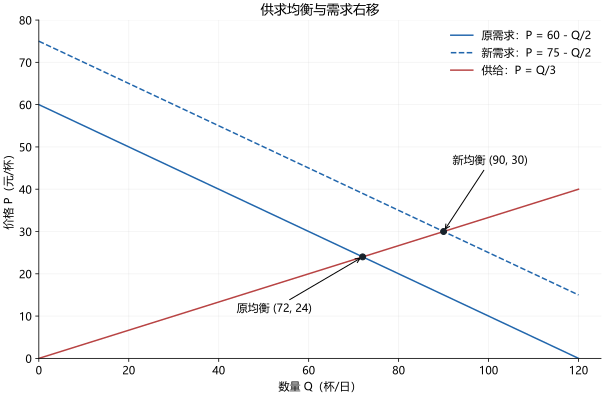

# 13 需求、供给与曲线移动

## 学习目标与先修

先完成01—12章；函数图像尤其需要第04章。约3—5小时，区分需求与需求量、供给与供给量，解释沿曲线变化和曲线移动。Python实验使用已经学过的循环和函数。

## 把市场范围先定义清楚

本课研究某校园同一品质饮品的一日市场。价格P为元/杯，数量Q为杯/日，先假设天气、收入、人口、口味、投入成本和技术固定，买卖双方可按共同价格交易。后续会逐步放松这些条件。

**需求**是在其他条件给定时，消费者在一组可能价格下愿意且能够购买的数量关系。**需求量**是其中一个特定价格对应的数量。想喝但没有购买能力的愿望，不能直接记成有支付能力的需求。

**供给**是在其他条件给定时，卖方在一组价格下愿意且能够出售的数量关系；**供给量**是一个特定价格的对应值。库存存在不等于愿意在任何价格卖出，也不自动等于某日供给量。

## 本课的两条规则

在正数量范围内，需求 `Qd=120-2P`，供给 `Qs=3P`。d代表demand，s代表supply。需求价格提高1元，需求量减少2杯；供给价格提高1元，供给量增加3杯。这是教学关系，不是所有商品的自然常数。需求特殊情况、预期和市场势力后续再讨论。

| P（元/杯） | Qd（杯/日） | Qs（杯/日） |
| --- | --- | --- |
| 10 | 100 | 30 |
| 20 | 80 | 60 |
| 24 | 72 | 72 |
| 30 | 60 | 90 |
| 40 | 40 | 120 |

手绘时横轴为Q、纵轴为P。需求从(0,60)向(120,0)下降，供给从(0,0)向右上方上升。



## 沿曲线变化和曲线移动

如果只有本商品价格从20变为30，需求量80降到60，是**沿同一需求曲线移动**。120和2未变。

如果一次校园活动让各价格下想买的人都更多，假设需求变为 `Qd=150-2P`，同样P=20时数量从80升到110。这是**需求曲线向右移动**，也可称需求增加。判断移动应在同一价格比较数量，不要把均衡价格变化误当作移动原因。

影响需求的其他因素包括收入、相关商品价格、偏好、预期和人数。收入提高时需求增加的称**正常品**；收入提高时需求减少的称**低档品**，这里“低档”是关系定义，不是对品质的道德评价。替代品价格提高可能增加本品需求，互补品价格提高可能减少本品需求，具体取决于情境。

若原料成本上升，假设供给变为 `Qs=max(0,3P-12)`，相同P=20时从60减为48，是供给左移。技术进步、投入价格、税补贴和卖方数量都可能移动供给。P本身变化通常解释沿供给曲线移动。

## Python实验：在同一价格作比较

下面是**可独立保存为 shift_practice.py 的完整练习程序**：

```python
prices = [20, 24, 30]
for price in prices:
    old_demand = max(0, 120 - 2 * price)
    new_demand = max(0, 150 - 2 * price)
    print(price, old_demand, new_demand, new_demand - old_demand)
```

在自己的练习目录的PowerShell执行 `python shift_practice.py`，预期三行分别是`20 80 110 30`、`24 72 102 30`、`30 60 90 30`。这三点都增加30杯，说明截距增加30是水平右移。若碰到需求为0的截断范围，数量差未必仍为30。

市场需求可在同一价格、同一时期把不同消费者数量相加，即水平加总。若两人需求分别10杯和15杯，市场为25杯；不能把两人愿付价格直接相加当成私人商品的市场需求。

## 常见错误

- 说“价格上升导致需求减少”，却实际只沿旧曲线改变需求量。先指出参数是否变化。
- 看到价格和数量都上升就断定需求曲线向上。需求右移也能产生这种均衡组合。
- 忽略“愿意且能够”和时期，把想法或库存直接计入流量。
- 用消费者的需求曲线直接代表某家企业面对的全部需求；市场结构会改变这个问题。

## 练习与参考答案

1. 奶茶替代品咖啡涨价，本品需求可能怎样？答：若两者为替代品且其他不变，本品需求可能右移；不是沿本品旧曲线的价格变化。
2. P=30，成本冲击后 `Qs=max(0,3P-12)`为多少？答：78，比原90少12。
3. 价格从10升到20，供给量30升到60，供给曲线移动了吗？答：没有，仍遵守Qs=3P，是沿曲线移动。

## 完成条件

能画出一个沿曲线变化和一个整条曲线移动的对比，并写明被固定的条件。下一章研究两条曲线如何共同决定价格与交易量。
