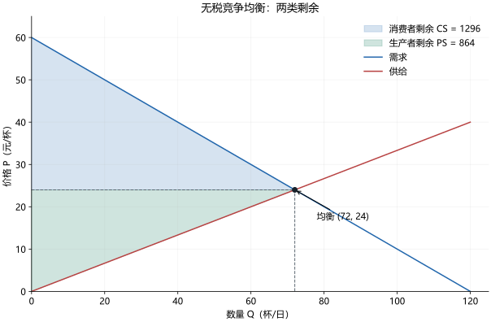

# 16 消费者剩余、生产者剩余与效率

## 学习目标与先修

先完成14章，会算三角形面积。约3—5小时，把需求理解为边际支付意愿、供给理解为边际机会成本，计算双方剩余和总剩余，说明效率与分配的区别。

## 支付意愿与消费者剩余

**支付意愿**是为某单位商品最多愿意支付多少。你愿意为一杯支付35元，实际支付24元，差额11元称为这杯的**消费者剩余**。它表示按支付意愿衡量的交易净收益，不是店家退给你的现金。

在连续模型的适当条件下，反需求 `P=60-Q/2`可以解释为增加一单位商品的边际支付意愿。越往右，后来单位的支付意愿越低。现实中收入影响支付能力，因此这种货币衡量不会自动反映不同人的福利权重。

## 供给与生产者剩余

反供给 `P=Q/3`在本课竞争性设定下表示边际机会成本。卖方实际收到24元，而某单位机会成本为10元，则该单位有14元的**生产者剩余**。把所有成交单位的差额相加，就是总生产者剩余。

生产者剩余常对应收益减可变成本；利润还需扣固定成本，且经济利润要计入相关隐性成本。不要把“剩余”直接改名为“会计利润”。关于企业成本结构在第24—25章展开。

## 用图形计算基线剩余

无税均衡P=24、Q=72。需求在纵轴截于60，供给在纵轴截于0。



**消费者剩余CS**是需求曲线以下、价格线以上、0—72数量范围内的面积：

```text
CS = 1/2 × 底72 × 高(60 - 24) = 1296 元/日
```

**生产者剩余PS**是价格线以下、供给曲线以上的面积：

```text
PS = 1/2 × 底72 × 高(24 - 0) = 864 元/日
总剩余TS = 1296 + 864 = 2160 元/日
```

这里是三角形，因为曲线为直线。不要在曲线模型中仍套三角形面积。横轴杯/日乘纵轴元/杯得到元/日，单位也能帮助检查。

## 效率判断从每一单位开始

在Q=60处，边际支付意愿为30，边际成本为20，多生产一点还有正的交易净收益。在Q=90处，边际支付意愿15、边际成本30，额外单位成本高于收益。本课在72处两者相等，所有边际收益大于边际成本的交易已实现。

因此在竞争、没有外部性、信息等条件合适且以总剩余作效率标准时，均衡数量最大化总剩余。这个结论有前提；污染会使社会成本高于私人供给曲线表达的成本，信息问题和市场势力也会改变判断。

**效率**在这里关注可获得净收益是否被浪费，**公平**关注分配是否符合某种价值标准。总剩余2160并不说明CS与PS的分配最公平，也不说明支付不起的人获得足够资源。政策讨论要分别写出效率分析和分配目标。

## Python核对与推导对应

在示例目录的PowerShell输入 `python`，随后运行依赖本课模块的交互片段：

```python
from econ import equilibrium, welfare
base = equilibrium()
result = welfare(base["price"], base["price"], base["quantity"])
print(result)
```

结果为consumer_surplus约1296、producer_surplus约864。welfare是对本章内点几何公式的工具，只对已满足模型约束的价格与数量调用；它不是任意市场数据的通用福利估计器。结束交互输入 `exit()`。

## 常见错误

- 用P×Q计算剩余。1728元/日是收入或支出矩形，不是任一方净剩余。
- 忽略供给纵轴截距。后续供给变为 `Qs=-12+3P`时，反供给截距为4，PS高度应扣4。
- 将总剩余最大化解释成每个人都最好，或把有支付能力的需求当全部社会需要。
- 讨论外部性时仍把私人剩余之和当完整社会福利。

## 练习与参考答案

1. 需求变为150-2P，供给3P，剩余是多少？答：P=30、Q=90，需求截距75；CS=2025，PS=1350，TS=3375元/日。
2. 基线收入P×Q是多少，是否等于PS？答：1728元/日，不等于864，因为还存在生产机会成本。
3. 为什么Q=60还有未实现净收益？答：该处支付意愿30大于边际成本20，适当增加交易能带来正净收益。

## 完成条件

不用代码画出两块面积，写公式、单位和效率前提。能解释为何“高总剩余”和“公平分配”是需要分别回答的问题。
