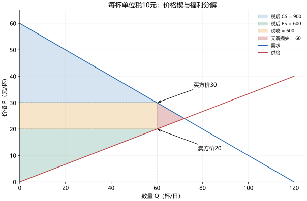

# 17 税楔、税负与无谓损失

## 学习目标与先修

先完成15—16章。约4—6小时，求单位税后的两种价格和数量，计算双方税负、税收与无谓损失，理解法定缴纳方与经济负担的区别。

## 一杯缴10元时，不能只保留一个价格

设每交易一杯征税t=10元，政府收款。**买方支付价Pc**包含这笔税所形成的总支付，**卖方实收价Ps**是缴税后保留的金额，二者满足**税楔** `Pc-Ps=t`。

需求对买方实际付多少钱作反应：`Qd=120-2Pc`；供给对卖方实际收到多少作反应：`Qs=3Ps`。不能将同一个含税价同时代入两边，也不能只把税从原均衡数量上机械扣掉而不重求均衡。

## 分步求解

```text
Pc = Ps + 10
120 - 2(Ps + 10) = 3Ps
100 = 5Ps
Ps = 20，Pc = 30
Q = 3 × 20 = 60
```

回代需求 `120-2×30=60`，价格差30-20=10。相对原价24，买方每杯多付6元，卖方每杯少收4元；数量从72降到60。

这里“买方承担60%、卖方40%”描述每个仍成交单位的价格负担分摊，不是在所有原先买方中计算平均损失。税导致退出交易者还会失去潜在剩余。

## 税负与弹性

一般而言，其他条件相当时，较不容易改变交易数量的一侧承担更多税负。基线处需求弹性绝对值约2/3，供给弹性为 `3×24/72=1`，需求相对更缺乏弹性，与买方承担较多相符。

在线性内点模型 `Qd=a-bPc`、`Qs=c+dPs` 中，买方价格上升 `d/(b+d)×t`，卖方价格下降 `b/(b+d)×t`。这两个系数不能脱离单位和均衡位置机械解释为任何市场的固定弹性。

在相同竞争模型且没有征管差异等额外摩擦时，法定规定卖方上缴还是买方上缴，不改变税楔、均衡和经济负担。现实存在逃税、征收成本、市场势力时要另外分析，不把简化结论无条件推广。

## 税收收入与剩余变化



税收收入 `T=t×Q=10×60=600` 元/日，使用税后成交量60，而非旧数量72。

税后消费者剩余 `CS=1/2×60×(60-30)=900`；生产者剩余 `PS=1/2×60×20=600`。在暂把政府税收按一元价值计入、忽略征收成本的核算中，税后总量为900+600+600=2100元/日，比原2160少60。

**无谓损失DWL**是因部分互利交易没有发生而减少的总剩余，本例为三角形：`1/2×税楔10×数量减少12=60`。税收600是向政府的转移，不是600的全部社会损失；还需另论公共支出的效果和征管资源成本。

也可分解：消费者损失1296-900=396，生产者损失864-600=264，合计660；其中600转为税收，剩余60是本模型中的无谓损失。

## 运行实验与检查恒等关系

在示例目录PowerShell执行 `python market_lab.py --tax 10`。报告tax_scenario中应有：

```text
consumer_price: 30
seller_price: 20
quantity: 60
tax_revenue: 600
deadweight_loss: 60
baseline_total_surplus: 2160
after_total_including_tax: 2100
```

实际输出为JSON，可能带`.0`。程序同时报告不同的独立政策情景，不能把它们当成税与限价叠加的同一市场。检查两条关系：`Pc-Ps=10`；`2160=2100+60`。

把税改成0应恢复基线。税改成5时，Pc=27、Ps=22、Q=66、税收330、无谓损失15。税翻倍使本例损失从15到60，是数量减少随税线性变化而面积随税平方变化；不是所有现实情景的普遍数值规律。

本程序只实现正交易、非负卖方价格的内点解，默认参数下t必须小于60。t=60已无交易，不在本实验范围；程序明确拒绝，而不假装实现了所有高税角点情况。

## 常见错误

- 以为政府规定卖方上缴就全由卖方承担。
- 用税前数量算税收，或把买卖双方每杯价格变化同时再次加税。
- 把消费者剩余减少全部叫无谓损失，忘记部分转为卖方或政府所得。
- 忽略外部性。在存在污染等情形时，适当税收可能改善社会效率，本章未建模。

## 练习与参考答案

1. t=20时两种价格和数量？答：Pc=36、Ps=16、Q=48，税收960，无谓损失240。
2. t=10时双方每杯负担相加为何等于10？答：买方相对旧价多付6、卖方少收4，税楔由两者共同形成。
3. 政府税收能直接称为净福利收益吗？答：不能，转移、征管成本和支出效果要分别核算。

## 完成条件

从三条方程独立解出两种价格，写出福利分解，并至少检查t=0和t=5。能说清模型对高税、外部性和现实征管的限制。
