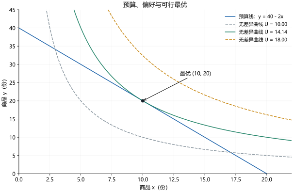

# 19 偏好、效用与预算约束

## 学习目标与先修

先完成01—18章，尤其是机会成本、直线图像、列表与函数。本章约3—5小时：学会描述偏好，用效用函数表示排序，画预算线，并用Python搜索可行消费组合。暂时不要求求导；解析最优条件在20—21章逐步推导。

## 情境：120元应该怎样分配

设一名学生用一天的120元预算购买两类物品：x表示主食份数，单价px=6元/份；y表示配餐份数，单价py=3元/份。数量先允许连续取值，例如半份，这是便于分析的近似。如果实际必须买整份，最后还需检查整数限制。

**消费组合**是两类数量的有序对(x,y)。**偏好**表示消费者怎样比较不同组合。说A比B更受偏好，与说A更贵不同；价格限制能买什么，偏好描述愿意选什么。

入门模型常假设：对给定的两个组合能作比较，称为完备性；若A至少与B一样好、B至少与C一样好，则A至少与C一样好，称为传递性。这些假设帮助建立一致的选择模型，并不宣称现实中每个人永远不会犹豫或改变想法。

## 效用是排序工具

**效用函数**给每个组合一个数，让偏好更高的组合对应更大的数。本章人为设定 `U(x,y)=sqrt(x*y)`，sqrt表示非负平方根。例如(4,9)和(6,6)的效用都是6，(9,9)的效用为9。

这里的6与9不是可直接测量的“快乐单位”。效用9不表示比效用6快乐50%。只要用严格递增的变换保留排序，例如把U换为U²=xy，确定性选择的排序不变，称为**序数效用**。也不能把两个人的效用数直接相加后宣称更公平。

本模型偏好两种物品的搭配：保持一种为正时，增加另一种会提高U；任何一种为0时，U为0。它适合练习互相搭配的消费，不适合描述所有商品。后面用完全替代品展示另一个选择结果。

## 无差异曲线怎样画

给定效用值u，满足U(x,y)=u的所有组合构成一条**无差异曲线**，表示消费者认为一样好。设u=10，则xy=100，因此y=100/x（x>0）。点(5,20)、(10,10)、(20,5)在同一条曲线上。

横轴是x的份数，纵轴是y的份数。此处两轴都是商品数量，**不是第13章的数量—价格图**。在当前模型中，更靠右上的无差异曲线代表更高效用；同一套一致偏好下，不同效用水平的曲线不会相交。

## 预算集合与预算线

**预算约束**是总支出不能超过可用金额：

```text
px*x + py*y <= m
6x + 3y <= 120，且x>=0、y>=0
```

满足不等式的点构成预算集合。恰好花完预算的边界称为**预算线**：`y=40-2x`。横轴截距120/6=20，纵轴截距120/3=40；斜率-2表示多买一份x，需要放弃两份y，这是相对价格给出的机会成本。

收入增加、两个价格不变时，预算线向外平行移动。只改变px时，纵轴截距不变、横轴截距改变，预算线绕纵轴截点旋转。若收入和两个价格同时翻倍，实际可行集合完全相同。

## 手算五个候选组合

| x | y=(120-6x)/3 | 支出（元） | U=sqrt(xy) |
| --- | --- | --- | --- |
| 0 | 40 | 120 | 0 |
| 5 | 30 | 120 | 约12.247449 |
| 10 | 20 | 120 | 约14.142136 |
| 15 | 10 | 120 | 约12.247449 |
| 20 | 0 | 120 | 0 |

这五个点中(10,20)最好，但只比较五个点还不是对所有实数点的证明。下一步用更细网格搜索，21章再给解析推导。



## Python实验：网格搜索意味着什么

完整入口为[consumer_budget.py](示例代码/stage4/consumer_budget.py)，依赖同目录[micro.py](示例代码/stage4/micro.py)。请下载完整学习包，保留stage4中的相对文件位置。

在Windows PowerShell执行，解压到其他位置时只替换目录：

```powershell
Set-Location 'C:\Users\17597\Desktop\tutorial\content\western-economics\source\示例代码\stage4'
python consumer_budget.py
```

前五行对应上表，末行应为：

```text
Grid best: x=10.00, y=20.00, U=14.142136
```

共享模块的consumer_grid沿预算线每隔step取一个x，用剩余预算算y，比较效用，保留最佳点。它搜索的是离散候选点，不自动证明连续全局最优。默认step=1恰好包含10；收入改成150时解析最优x=12.5，整数网格可能只找到邻近候选，减小步长后再比较。

代码中math.sqrt计算平方根；`{**best, ...}`在第11章已见过，表示建立包含已有字段的新字典。消费者收入允许为0，价格必须为正；步长必须为正，过密网格会被拒绝，避免一次生成过多点。

## 结果与原因

预算决定可行范围，偏好决定其中的排序。对于本例，全部买一种物品导致U=0，搭配消费更好。不要把“支出都为120”误解成效用都一样，也不要把“效用高”误解成已经证明营养或健康更好。

## 常见错误

- 把效用数当可跨人比较、可按倍数解释的快乐量。
- 把预算线外的高效用点当成可选方案，忘记约束。
- 用某个价格变化画平行线。单一价格变化通常导致旋转。
- 把有限网格的最优点无条件称为连续精确解。

## 练习与参考答案

1. m=150、px=6、py=3，预算截距与斜率？答：x截距25、y截距50、斜率仍-2。
2. m=120、px降至3、py仍3，预算线？答：y=40-x，两轴截距都为40。
3. (8,16)与(4,32)在本效用下谁更好？答：xy都为128，效用都约11.313708，模型认为无差异，但支出不同不影响这个偏好判断。
4. 收入与两种价格同时乘2，最优数量会变化吗？答：在偏好不变时可行集合相同，本模型最优数量不变。

## 完成条件

手绘预算线和一条无差异曲线，区分可行、不可行及花完预算的点；运行程序后能解释网格步长和效用排序的限制。
