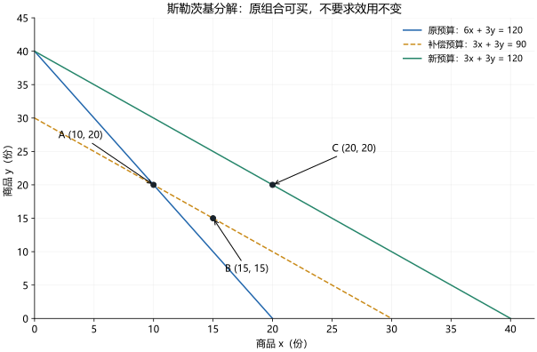

# 21 消费者最优与替代、收入效应

## 学习目标与先修

先完成19—20章，理解预算线、偏导数和角点。本章约4—6小时，推导搭配消费模型的最优数量，认识边际替代率，再将一次价格变化拆成替代效应与收入效应。所有补偿都先给定义，再作计算。

## 从可行集合中选择最好组合

继续使用U=sqrt(xy)，m=120、px=6、py=3。因为平方根在非负范围严格递增，最大化U等价于最大化xy。预算用尽时y=40-2x，所以乘积函数为：

```text
V(x)=x(40-2x)=40x-2x²，0<=x<=20
V'(x)=40-4x
V'(x)=0 得x=10，y=20
V''(x)=-4<0
```

两个端点U均为0，内部点效用约14.142136，因此得到连续精确最优。一般正收入、正价格下，同样推导可得 `x=m/(2px)`、`y=m/(2py)`。本例两类物品各花一半预算，是这个对称效用函数的结果，不是所有人的消费规律。

## 边际替代率如何连接偏好与价格

**边际替代率MRS**表示保持效用不变时，消费者为多获得一单位x，愿意放弃多少y，按正的绝对值表达。在可导内点，MRS=MUx/MUy。本模型使用20章的偏导数，化简得MRS=y/x。

预算线要求每多买一份x放弃px/py份y。若MRS大于px/py，消费者愿意为x放弃的y多于市场要求，可以沿预算线增加x改善选择；相反则倾向减少x。满足合适的偏好与内点条件时，最优处两者相等。

在(10,20)，MRS=2，px/py=2，预算线与无差异曲线相切。也可写 `MUx/px=MUy/py`，表示最后一元花在两者上的边际效用相等。这个条件需要预算、可行域和最优性检查；完全替代品角点已说明它不能无条件套用。

## 价格下降为什么有两种作用

让px从6降至3，py和名义收入120保持不变。新最优x=20、y=20。x增加10份，原因可以分开看：相对价格改变使x变得更便宜；同样的钱可买到更多东西，实际购买能力也提高。

**替代效应**研究相对价格改变，在某种补偿规则下保持购买能力可比时的变化。**收入效应**再研究解除补偿、回到实际收入后发生的变化。补偿规则不止一种，本章采用**斯勒茨基补偿**：让新价格下恰好仍买得起原来的消费组合。

## 三步计算斯勒茨基分解

原选择A=(10,20)。新价格下购买A只需 `3×10+3×20=90` 元，因此补偿收入为90，而不是继续保留120。也可写 `m_s=m+(px_new-px_old)*x_old=120+(3-6)×10=90`。

在新价格、收入90下重新优化，得到B=(15,15)；实际收入仍为120的新最优为C=(20,20)。

| 步骤 | px | py | 收入 | 最优x | 最优y | U |
| --- | --- | --- | --- | --- | --- | --- |
| A原状态 | 6 | 3 | 120 | 10 | 20 | 约14.142136 |
| B补偿状态 | 3 | 3 | 90 | 15 | 15 | 15 |
| C实际新状态 | 3 | 3 | 120 | 20 | 20 | 20 |

x的替代效应为B-A，即+5；收入效应为C-B，即+5；总效应为C-A，即+10。y的替代效应为-5，收入效应为+5，所以最终数量恰好不变。两个效应抵消不代表“价格变化没影响偏好或预算”。这里偏好函数从头到尾固定。



## 补偿保持的究竟是什么

B的效用15高于A的约14.142，说明斯勒茨基补偿**保持原组合可买**，并不要求新最优效用不变。另一种**希克斯补偿**保持原效用水平；在本例新价格相同且原xy=200时，保持原效用的最低支出组合为x=y=sqrt(200)，所需收入约84.852814元。

两种方法的有限变化分解可以不同。不要把补偿收入90贴上“效用恰好不变”的标签。本批程序只实现斯勒茨基分解，希克斯数值在这里作为定义对照，没有宣称提供通用支出最小化工具。

## 正常品、低档品与吉芬情况

保持价格不变时，收入增加使需求数量增加的商品称正常品，反向变化的称低档品。本效用函数的两类商品都为正常品。低档品并不必然违反需求规律：通常替代效应仍使本品价格下降时购买量增加，收入效应可能反向但不一定更强。

若低档品的反向收入效应强到超过替代效应，可能出现其他条件不变时自身价格提高、购买量反而增加的**吉芬情况**。当前对称模型不能产生这种情况；不能靠改几个正价格就在这里“模拟出所有消费者”。

## Python实验与输出解释

完整入口[consumer_effects.py](示例代码/stage4/consumer_effects.py)。在stage4目录的Windows PowerShell运行：

```powershell
python consumer_effects.py
```

应显示initial为(10,20)、compensated为(15,15)、final为(20,20)，补偿收入90，x效应5、5、10。用字典保存三个状态而非覆盖同一个变量，方便逐项核对。

改参数时，要在同一次调用中明确旧价格、新价格、收入与py。让新旧价格相同应得到零替代和零收入效应，这是一个比只检查默认数更有用的边界验证。

## 常见错误

- 只解MRS等于价格比，遗漏预算方程或角点检查。
- 用旧价格计算“新价格下原组合的成本”。
- 把名义收入不变理解为实际购买能力不变。
- 混用斯勒茨基与希克斯补偿，或不说明正负号是按涨价还是降价定义。

## 练习与参考答案

1. m=180、px=6、py=3时最优？答：x=15、y=30，两类各支出90。
2. 原m120、px6、py3，px升到12。分解x变化？答：原x10，新x5；补偿收入180，补偿x7.5。替代-2.5、收入-2.5、总变化-5。
3. 本例px降至3后y数量不变，y是不是中性品？答：不能这样判断，正常或低档按固定价格的收入变动定义；本例不同效应恰好抵消。
4. B为什么仍有机会比A更好？答：原组合可行，但新相对价格允许重新搭配，最优不必仍选原组合。

## 完成条件

从预算代入推导最优解，手算并标出A、B、C三点，能说清采用的补偿定义，且核对替代加收入等于总变化。
