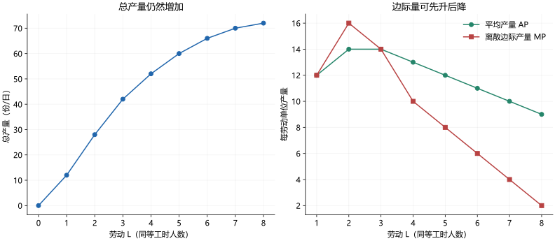

# 23 生产函数、短长期与边际产量

## 学习目标与先修

先完成20章的边际与导数，并能读取Python列表和字典。本章约3—5小时，区分技术关系和价格关系，计算总产量、平均产量、边际产量，解释短期边际递减与长期规模报酬的区别。

## 情境：一间厨房增加员工

某厨房有固定灶台和面积，每天增加同等工作时长的员工，能完成多少标准份餐品？**投入**是用于生产的资源，如劳动L、设备资本K和原材料。**产出**是一定期间生产的产品数量Q。

**生产函数**在技术和产品质量给定时，表示不同投入组合可达到的最大产出，写作Q=F(K,L)。这是技术可行关系，暂不包含产品价格、工资或利润。设备K在此指生产性实物设备，不是简单等同于银行存款或股票。

如果某次实际产量低于函数上限，可能存在故障、组织效率或需求限制；不能立刻把这次观测当成技术上限。我们的数表直接给定教学技术，不从现实企业估计。

## 短期与长期按可调整性区分

**短期**指至少一种投入暂时固定，本例灶台和场地K固定，劳动可调。**长期**指相关投入都能调整。它们没有统一的“几个月”分界，租约、设备建设周期和业务不同，调整所需时间就不同。

短期增加员工与长期同时增加员工、灶台不是同一个实验。把时间拉长并不会自动技术进步；比较长期规模时仍需说明技术是否相同。

## 三种产量指标

**总产量TP**是Q；**平均产量AP**是每单位劳动对应的产出Q/L，L=0时不定义；**边际产量MP**是增加一单位劳动引起的产出增量。本表每次劳动增加1人，因此MP等于相邻Q之差。

| 劳动L（同等工时的人数） | 总产量Q（份/日） | AP | 新增一人MP |
| --- | --- | --- | --- |
| 0 | 0 | 未定义 | 未定义 |
| 1 | 12 | 12 | 12 |
| 2 | 28 | 14 | 16 |
| 3 | 42 | 14 | 14 |
| 4 | 52 | 13 | 10 |
| 5 | 60 | 12 | 8 |
| 6 | 66 | 11 | 6 |
| 7 | 70 | 10 | 4 |
| 8 | 72 | 9 | 2 |

第二名员工帮助分工，新增16份超过第一名的12份；从第三名起新增量逐渐减少。**边际产量递减**讨论固定其他投入时，劳动继续增加后，新增产出趋于减少。它不要求从第一单位开始就递减。



## 递减的边际产量不等于总产量下降

第八名员工仍新增2份，所以总产量从70升到72，只是增幅变小。只有新增产量为负，总产量才会下降。总量、平均量和边际量必须分别观察。

MP高于原平均量时，增加该单位可提高平均量；MP低于原平均量时，会拉低平均量。本表AP从12升到14，再维持14，随后下降。连续光滑模型中常用MP与AP相交说明平均产量极值，离散表应按相邻增量检查，不强求每张表恰好出现同样的几何交点。

若劳动每次增加2而不是1，边际平均变化率应写ΔQ/ΔL，不能只拿ΔQ。连续模型中使用偏导数∂Q/∂L，仍固定K，与20章的定义一致。

## 另一个连续模型：规模报酬

为分析同时改变两类投入，另设 `Q=2sqrt(KL)`。这是第二个独立教学模型，不是上面数表的拟合函数。

K=9、L=4时，Q=2sqrt(36)=12。K与L同时翻倍为18与8，Q=2sqrt(144)=24，也翻倍，称为**规模报酬不变**。同时按同一比例扩大全部投入，产出增加得更多称规模报酬递增，更少称递减。

在同一个连续函数中，固定K=9时Q=6sqrt(L)，劳动的边际产量为3/sqrt(L)，会随L增加而递减。由此可见，短期某一投入边际递减和长期规模报酬不变完全可以同时存在，二者没有矛盾。

规模报酬是物理投入与产出的关系；成本是否也按同样比例变化，还取决于要素价格和能否选择更好的投入组合。下一章才引入成本，不在这里用产量曲线直接宣称利润变化。

## 等产量线与技术替代

**等产量线**表示达到同一产出所需的不同投入组合。对Q=2sqrt(KL)，目标Q=12意味着KL=36。组合(K,L)=(36,1)、(9,4)、(4,9)都能生产12。图若以L为横轴、K为纵轴，写成K=36/L，向右下方倾斜；它描述技术替代，不是消费者的偏好排序。

**边际技术替代率MRTS**表示保持产出不变时，多用一点L可以少用多少K，按正值表达。在可导内点MRTS=MPL/MPK，本函数为K/L。它和消费者MRS形式相似，但一个比较生产投入，一个比较消费商品，经济含义不同。

等产量线上哪一点最便宜，不能只靠技术判断，还要知道工资与资本服务价格。下一章用明确价格把等产量线与等成本线结合，推导成本最小化。

## Python实验与缺失定义

完整入口[production_table.py](示例代码/stage4/production_table.py)。在stage4目录Windows PowerShell执行：

```powershell
python production_table.py
```

程序打印上表，L=0的AP和MP显示undefined，末行的独立规模例子为12.00到24.00。`None`用于在字典中表示本表没有定义的指标，不把它改成0；0会声称已经计算出一个数值，含义不同。

共享函数使用enumerate同时获得劳动索引和产量，默认假设每次增加一个同等劳动单位。它允许后续总产量下降，以便观察负MP，而不假设所有输入数表都必须单调。

## 常见错误

- 把短期定义成固定的一年以内，而不问哪类投入能调整。
- 把MP下降说成Q下降，或把Q/L当新增一人的贡献。
- 同时增加全部投入，却称为“其他条件不变的劳动边际变化”。
- 用两个不同模型的数据互相代入，再把不一致当作理论矛盾。

## 练习与参考答案

1. 若第九名员工后Q变为70，新增MP与AP？答：MP=70-72=-2，AP=70/9约7.777778，总产量下降。
2. 表中第六人的MP为什么不是11？答：11是66/6的平均量；新增量是66-60=6。
3. 在Q=2sqrt(KL)中K=9，L从1到4，产出？答：从6到12，劳动增至4倍，产出只到2倍，属于固定K的变化，不是全部投入的规模比较。
4. 全部投入翻倍而产出变为原来的2.5倍，是什么？答：在所比较范围表现为规模报酬递增，仍需保持技术和产品定义相同。

## 完成条件

独立填写产量表，解释一个总量与边际量方向不同的例子，并分别设计“固定K增加L”和“同比例增加K、L”的实验。
