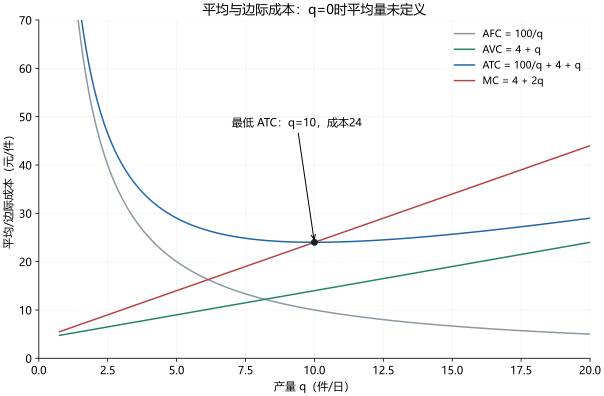
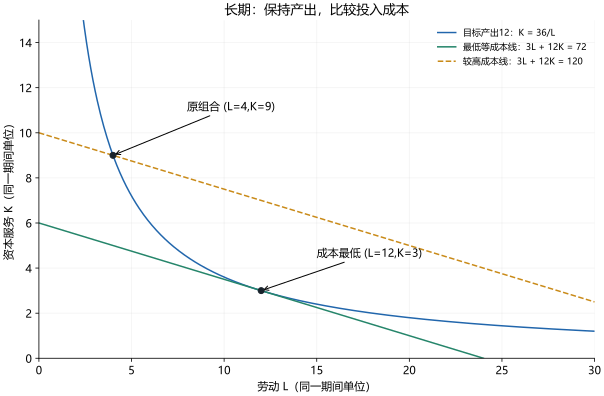

# 24 经济成本、平均成本与边际成本

## 学习目标与先修

先完成01、20、23章。约4—6小时，区分显性与隐性成本、固定与变动成本，计算各类平均成本和边际成本，解释平均曲线与边际曲线的关系。需要用到20章的幂函数求导。

## 从资源使用转到成本

生产函数回答“投入多少能生产多少”，成本还需要要素价格。**经济成本**包括使用资源的相关机会成本。**显性成本**通常有实际付款，如工资和原材料；**隐性成本**包括使用自己的时间、场地或资金所放弃的最佳替代收益。

独立小例子：收入300元，外付费用240元，自己劳动放弃的最佳净报酬50元。会计口径只扣所列外付费用，利润60；按这里完整列出的经济成本，经济利润为300-240-50=10元。零经济利润仍可能包含业主正常报酬，因为它已被当成本计入。

以下成本函数与23章产量表分别设定，不假称从那张表直接推导。函数内的成本应理解为已经按约定计入相关资源成本，不能在算完经济利润后再重复扣同一笔隐性成本。

## 固定、变动与沉没不是同一个分类

**固定成本FC**在给定期间不随当前产量改变；**变动成本VC**随产量变化；**总成本TC=FC+VC**。**沉没成本**已经发生、无法收回，分类重点是今天改变选择能否避免。

固定成本未必永远不可避免，例如能取消的下月租约可能在退出后避免；沉没成本也不能因为叫“投资”就自动收回。25章短期停产模型明确假设本期固定100元无论生产与否都要承担，长期退出时才比较可避免成本。判断要看合同和时点，不能只看名字。

## 本阶段的连续成本函数

设q为产量（件/日），各成本流量为元/日，采用：

```text
FC = 100
VC(q) = 4q + q²
TC(q) = 100 + 4q + q²
```

系数4与1隐含适当单位，使各项能相加。增加产量带来更高可变成本，二次项意味着连续边际成本上升。它是便于学习的凸成本模型，不要求现实企业在所有规模上都恰好二次。

## 平均量如何形成

q>0时，**平均固定成本AFC=FC/q**，**平均变动成本AVC=VC/q=4+q**，**平均总成本ATC=TC/q=100/q+4+q**。AFC加AVC等于ATC。q=0时这些平均量都没有定义。

**边际成本MC**在连续模型中是TC对q的导数：MC=4+2q。固定100求导为0，因此改变固定成本不直接移动这条连续MC曲线，但会改变ATC和利润。

| q | FC | VC | TC | AFC | AVC | ATC | MC |
| --- | --- | --- | --- | --- | --- | --- | --- |
| 0 | 100 | 0 | 100 | 未定义 | 未定义 | 未定义 | 4（函数的右侧边际值） |
| 5 | 100 | 45 | 145 | 20 | 9 | 29 | 14 |
| 10 | 100 | 140 | 240 | 10 | 14 | 24 | 24 |
| 15 | 100 | 285 | 385 | 约6.666667 | 19 | 约25.666667 | 34 |

## 连续边际成本与一整件成本之差

本例q=9的TC为217，q=10的TC为240，增加第十件的成本为23元。连续函数在q=10处的导数为24元/件，两者不完全相同，因为前者跨了整整一个单位区间。

不要将程序中的MC=4+2q标成“第q件的精确离散成本”。导数适合小变化的近似，若产品必须整件交易，要用TC(q)-TC(q-1)或比较整数方案。前面生产表用离散MP，这里用连续MC，定义都写清楚才可比较。

## 平均成本为什么先降后升

q增加时AFC下降，AVC上升；两者之和可能先受固定成本分摊主导，之后受变动成本上升主导。对ATC求导：

```text
ATC'(q) = -100/q² + 1
ATC'=0 得q²=100，所以q=10（取正数量）
ATC(10)=24，MC(10)=24
```

q<10时导数负，q>10时正，因此ATC最低值为24。MC低于ATC时，新增部分把平均值拉低；MC高于ATC时，把平均值拉高。恰在本例最低点二者相等。



本模型AVC=4+q对q>0一直上升，没有正产量处的U形最低点；当q趋近0时AVC趋近4。不要因为示意教材常画U形，就给任何公式强行画同一种形状。25章会用这个极限确定本例停产价格边界。

## 长期成本：在等产量线上找最便宜投入

回到23章**另一个**技术模型Q=2sqrt(KL)，现在所有投入可调。令工资w=3、资本服务租价rK=12，单位均按相同生产期间定义；rK是使用设备服务的价格，不是22章金融利率r。

**等成本线**表示总投入支出相同的组合：C=wL+rK*K，即K=C/rK-(w/rK)L。以L为横轴、K为纵轴，斜率为-w/rK。给定目标Q=12，等产量线要求K=36/L，代入成本：

```text
C(L)=3L+12*(36/L)=3L+432/L，L>0
C'(L)=3-432/L²=0
L=12，K=3，最低成本=3*12+12*3=72
```

当L接近0，设备需求与成本非常大；L很大时劳动成本也很大；二阶导数864/L³为正，所以驻点为最小值。该点MRTS=K/L=1/4，恰好等于w/rK=3/12。

原组合K9、L4也产出12，但成本为12*9+3*4=120，高于72。长期允许重新配置投入，使相同产出可以更便宜；固定K9的短期问题不能任意跳到K3。



对任意正目标Q，同样可得L=(Q/2)*sqrt(rK/w)、K=(Q/2)*sqrt(w/rK)，最低成本为Q*sqrt(w*rK)。当前价格下长期总成本6Q，长期平均成本为6，正产出范围不变。这与规模报酬不变、要素价格固定相符；它是独立技术模型的结论，不是把前面的二次短期成本突然改写为6q。

一般说来，长期成本是在各可选规模和投入配置下达到目标产出的最低成本；长期平均成本可看作不同短期规模成本的下包络，但不同规模的最低点不一定都落在该包络上。规模经济还需分析技术、投入价格与组织因素，不能由一张短期U形图替代。

## Python实验

完整入口[cost_table.py](示例代码/stage4/cost_table.py)。在stage4目录Windows PowerShell执行 `python cost_table.py`，核对表中VC、TC、AVC、ATC和MC。q=0的平均成本打印undefined，不使用除以0后的伪造结果。最后一行独立长期例子应显示L=12、K=3、cost=72。

在自己的练习副本中，将fixed从100改成144。VC和MC不变，ATC最低点变为q=12，最低值28。改变成本参数前先说明影响哪类成本，再看程序结果。

## 常见错误

- 将老板自己劳动看作免费，或在经济成本内重复扣同一机会成本。
- 把所有固定成本都当永久沉没，忽略能否取消与退出时点。
- 将MC写成TC/q，或不检查q=0的分母。
- 对连续导数与离散一件增量要求完全相同。
- 为了符合记忆中的图形，把本模型AVC画成先降后升。

## 练习与参考答案

1. q=8时成本各是多少？答：VC=96、TC=196、AFC=12.5、AVC=12、ATC=24.5、MC=20。
2. fixed=144、linear=4、quadratic=1时MC和ATC最低点？答：MC仍4+2q；ATC'=1-144/q²，最低q12、ATC28。
3. q从10到11，成本增量与q=11处MC？答：TC(11)=265，增量25；MC(11)=26，前者是区间变化，后者是点上的变化率。
4. 零经济利润是否表示企业主没有收入？答：不表示，其劳动和其他资源的正常机会报酬可能已包含在经济成本内。
5. 长期技术例子目标Q改成20，工资与租价不变，最低成本组合？答：L20、K5，成本120；仍满足2sqrt(20*5)=20与MRTS=1/4。

## 完成条件

填写一张带单位的成本表，推导ATC最低点，说明固定与沉没成本的区别，并能解释连续MC与一件成本增量的差异。
