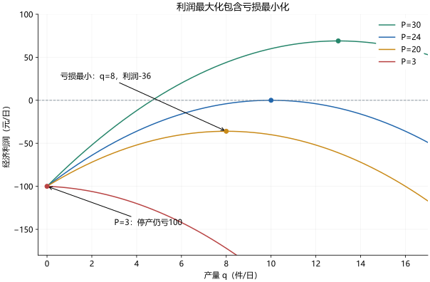

# 25 完全竞争、利润最大化与停产退出

## 学习目标与先修

先完成14、20、24章。本章约4—6小时，理解价格接受者、边际收益和利润最大化，区分亏损、短期停产与长期退出，推导本例企业供给。用解析解、边界比较和Python互相核对。

## 市场价格与单个企业的关系

**完全竞争**的入门设定包括大量买卖者、同质产品、相关信息和交易条件适当，单个企业规模不足以影响市场价格。**价格接受者**把市场价P当作外生给定，选择自己的产量q。

整个市场需求曲线可以向下，但单个小企业在此模型中面对既定价格。不要把第13章市场需求Qd=120-2P直接当作任意一家企业的销售曲线。现实中有品牌差异或市场势力时，需改用其他市场结构，27章再展开。

**总收益TR=Pq**，**利润π=TR-TC**。π是希腊字母pi，这一微观章表示利润；宏观部分若用π表示通胀率，会重新定义场景。**边际收益MR**是增加少量产量带来的总收益变化率。价格接受者的P不随q变，故MR=P。

## 从利润函数推导产量

沿用24章 `TC=100+4q+q²`，q≥0。固定100在本期不生产也要付。利润函数：

```text
π(q)=Pq-(100+4q+q²)
π'(q)=P-4-2q
若P>4，驻点q=(P-4)/2
π''(q)=-2<0
```

若P≤4，驻点不为正，需检查q=0的边界。合起来本模型最优 `q*=max(0,(P-4)/2)`。这是在连续产量、无产能上限、成本函数有效的范围中求得；不是任何企业都适用的万能产量公式。

MR=MC是可导内点的必要条件，加上本例严格凹利润函数和边界检查，才确定最大值。如果成本非凸、存在多个交点或固定开工费，会需要额外比较。

## 五种价格情景

| P | 最优q | TR | VC | TC | 生产时最优利润 | 是否生产 |
| --- | --- | --- | --- | --- | --- | --- |
| 30 | 13 | 390 | 221 | 321 | 69 | 是 |
| 24 | 10 | 240 | 140 | 240 | 0 | 是 |
| 20 | 8 | 160 | 96 | 196 | -36 | 是 |
| 4 | 0 | 0 | 0 | 100 | -100 | 否，边界 |
| 3 | 0 | 0 | 0 | 100 | -100 | 否 |

P=20时即使亏36，停产也要付固定100，会亏100。继续生产能提供TR-VC=64用于覆盖部分固定成本，损失较少。这里“利润最大化”可以表现为“最小化无法避免的损失”。



## 停产条件与退出条件

**短期停产**是不生产，但尚未摆脱本期不可避免的固定支出。比较生产与不生产时，若某个正q可以使TR≥VC，生产可能不比停产差；常见表述是检查价格与最小AVC。

本例AVC=4+q，q>0时始终大于4、极限下界为4。因此P>4有正产量最优，P≤4选择q=0。在P=4时，本例任意正q都多损失q²，不能声称所有正产量都与停产无差异。

**长期退出**是在相关固定投入可调整后不再留在行业。若原成本和市场价格持续不变，且这些成本在退出后可避免，价格低于最低ATC=24会发出退出信号。P=20的“短期继续、长期考虑退出”没有矛盾，比较的可避免成本与时间范围不同。

程序字段long_run_exit_signal_at_unchanged_prices是按不变价格和技术得到的信号，不是预言企业一定马上退出。合同、转售价值、转型机会和未来价格预期都可能改变现实决策。

## 剩余与利润再次区分

P=30时生产者剩余TR-VC=169，减固定100后利润69。P=20时生产者剩余64仍为正，利润却为-36。不能因为生产者剩余大于0就断言企业盈利。

本模型经济利润为0时，相关机会成本已经得到覆盖。若自由进入退出、技术相同、价格和要素市场条件适当，正经济利润会吸引进入，供给增加使价格承压；长期均衡可能趋向零经济利润。现实有进入壁垒、异质性或经济租时，不能机械要求每家公司利润都为0。

## 从企业供给到市场供给

本例企业在P>4时供给(P-4)/2，其他价格供给0。若短期有6家相同企业，水平加总得 `Qs=3P-12`（P>4），低价段截为0。与市场需求120-2P联立：

```text
120-2P=3P-12
P=26.4，市场Q=67.2
每家q=11.2，六家共67.2
```

这为第14章的一条线性供给提供一种可能的微观基础。短期先固定企业数量6；分析长期进入就不能继续把企业数量永远锁死。

## Python实验

完整入口[competition.py](示例代码/stage4/competition.py)。在stage4目录Windows PowerShell执行 `python competition.py`，应显示上表的q与利润，P20时operate=True而exit_signal=True。

整合入口[micro_lab.py](示例代码/stage4/micro_lab.py)可执行：

```powershell
python micro_lab.py --price 20
```

在competitive_firm字段核对quantity=8、profit=-36、shutdown_profit=-100。其他消费者和劳动字段来自各自独立模型，不表示它们已经组成同一个一般均衡经济。

## 常见错误

- 把亏损直接等同于应该立即停产，不比较可避免成本。
- 一解P=MC就结束，不检查正产量、凹性和q=0。
- 把市场需求斜率代入价格接受者的MR，而未改变市场结构假设。
- 用短期固定企业数的供给曲线宣称已经求出长期进入均衡。
- 把利润为零理解为老板劳动和资本没有得到任何回报。

## 练习与参考答案

1. P=16时最优与停产比较？答：q=6，VC60、TR96、TC160，利润-64；停产-100，所以短期生产。
2. P=26时最优q与利润？答：q=11，TR286、TC265，利润21。
3. fixed改为144，P=20时q会变吗？答：短期q仍8，因为MC不变；利润为160-(144+96)=-80，仍优于停产-144；最低ATC升为28。
4. 若产量只能取整数，P=25怎么办？答：连续q=10.5，需要比较q10和11；两者利润均10，并列最好。现有函数返回连续解，不声称完成整数优化。

## 完成条件

手推并检查产量公式，正确解释盈利、盈亏平衡、亏损继续和停产四类情况，至少作一次固定成本改变的反事实，并说清长期信号的假设。
