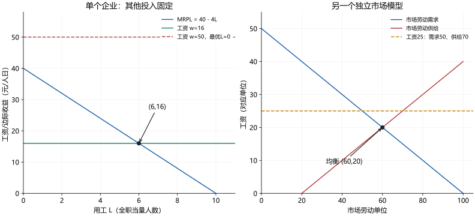

# 26 要素需求、劳动市场与收入分配

## 学习目标与先修

先完成23—25章，理解边际产量、价格接受者与最优边界。本章约4—6小时，从产品需求解释劳动需求，求单个企业最优用工，再区分个人劳动供给、市场均衡和收入分配判断。完成第四阶段综合实验。

## 劳动需求为什么是派生需求

企业雇劳动通常是为了生产并出售产品，劳动需求受产品需求、产品价格、技术和其他投入影响，称为**派生需求**。增加一单位劳动的产出增量是MPL，卖出这些产出获得的新增收益是**劳动边际收益产品MRPL**。

一般写MRPL=MR×MPL；只有产品市场价格接受者MR=P时，才可写成P×MPL，也常称劳动边际产品价值。若企业同时在劳动市场按给定工资w招聘，新增一单位劳动的成本为w。合适的可导内点条件是MRPL=w，仍需检查凹性与边界。

如果某个雇主能通过招聘量影响工资，新增劳动成本就可能不等于当前工资；这个买方市场势力模型本批未实现。不能把竞争劳动市场结论直接套用到所有雇佣关系。

## 一个独立企业的用工模型

另设固定其他投入的生产函数 `Q=20L-L²`，只在0≤L≤10使用，以保持MPL=20-2L非负。L是相同标准工时的全职当量人数，Q为件/日，P为元/件，w为元/(人·日)。连续L可理解为工时当量，不表示现实中把一个人切开。

这个函数与23章离散厨房表、24章成本函数是独立的教学模型，不把三者当同一家企业的同一套估计。

产品价P=2，工资w=16时，只先扣劳动支出的目标为：

```text
R(L)=P*Q(L)-wL
    =2(20L-L²)-16L
    =24L-2L²
R'(L)=24-4L=0，得L=6
R''(L)=-4<0
Q=20*6-6²=84
MPL=20-2*6=8，MRPL=2*8=16
```

销售收入168元/日，工资总额96元/日，扣工资后剩余72元/日。这个72**尚未扣设备、场地等其他成本**，不是完整经济利润。若额外相关成本40且固定不影响本期用工选择，净利润才为32；不能把剩余全称作资本回报或企业主纯收益。

## 工资与产品价格如何改变需求

P>0时连续最优 `L*=max(0,(20-w/P)/2)`。工资提高，使最后几单位劳动的新增收益不足以覆盖新增成本；产品价格提高，在固定技术下提高各劳动量的MRPL，可能增加用工。

| w（元/人日） | 最优L | Q | 最优处MRPL | 扣工资后剩余 |
| --- | --- | --- | --- | --- |
| 16 | 6 | 84 | 16 | 72 |
| 20 | 5 | 75 | 20 | 50 |
| 40 | 0 | 0 | 40 | 0 |
| 50 | 0 | 0 | 40 | 0 |

最后一行MRPL不等于w，仍然最优，因为零劳动边界处新增收益40小于工资50，不应雇正数量。等式只约束内点，20章的边界检查在这里再次出现。



## 个人劳动供给与闲暇

**闲暇**是可用时间中不用于所讨论劳动的部分，它有机会成本。工资提高使放弃一小时工作所损失的收入更多，替代效应可能减少闲暇、增加劳动；收入提高又可能使人愿意购买更多闲暇，收入效应反向影响工时。

因此不能仅凭“工资高”断言每个人都愿意工作更多。家庭照护、健康、固定班制和劳动参与选择也影响结果。个人劳动供给在某些区间可能向后弯曲，市场供给还包含参与人数等变化，不必复制一个人的曲线形状。

## 另一个市场模型：求均衡工资

为练习市场加总，单独给定 `Ld=100-2w`、`Ls=20+2w`，L为某一市场标准工时劳动单位、w为对应单位工资，均限制在有意义范围。本表不是从上一家企业和某个家庭直接推导的总量估计。

联立100-2w=20+2w，得到w=20、L=60。工资为25时，需求50、供给70，意愿数量差20。它是这个竞争性静态模型的超额供给，不能不加口径就当作官方失业人数或现实最低工资政策的因果效果。宏观失业指标要在36章另行定义。

劳动市场受技能、地域、合同、信息和制度影响，不同人并非完全同质；一个统一工资的供求图仅是起点。

## 从要素收入到分配判断

工资、土地租金、资本服务报酬和企业剩余是不同资源使用与市场条件下的收入形式。边际生产力分析可以给出在指定技术和竞争假设下的定价机制，但“市场价格如何形成”和“分配是否公平”属于不同问题。

资本服务的需求也可按“边际收益×资本边际产量”与租价比较，例如竞争产品市场下MRPK=P*MPK。设备购买价是资产存量的价格，使用一天的租价是服务流量价格，两者不能直接代入同一方程。土地在总面积固定时仍有不同用途，使用它通常有机会成本；供给固定也不表示其所有租金都能在任何政策下无成本取得。

若需要把未来租金转成今天的资产价值，可沿用22章现值：每期确定净租金10、两期、折现率0.1且无期末残值时，现值为10/1.1+10/1.1²约17.355372。改变风险、使用年限、残值和未来租金都会改变估值，这里只演示跨期计量，不提供现实资产报价。

边际产量取决于机器、团队、组织和产品价格，不能把模型中的工资简单等同于个人努力或道德价值。初始资源、谈判、制度、市场势力和机会差异也会影响分配。公平判断需要说明价值标准与证据，而不是从一条最优方程直接推出。

## Python实验与阶段作品

完整入口[labor.py](示例代码/stage4/labor.py)。在stage4目录Windows PowerShell执行 `python labor.py`，核对上表和独立市场的wage=20、labor=60。

第四阶段整合入口[micro_lab.py](示例代码/stage4/micro_lab.py)提供v0.2a子版本，运行：

```powershell
python micro_lab.py
python micro_lab.py --income 180 --new-px 12 --price 20 --wage 20
```

第二次应得到消费者初始(15,30)，涨价后(7.5,30)，斯勒茨基补偿(11.25,45)，x替代与收入效应各-3.75；竞争企业q=8、利润-36；劳动模型L=5、Q=75。风险和跨期字段沿用22章默认值。

这些是多个独立模型的结果集合，**不是把消费需求、企业生产与劳动需求联立成一般均衡**。CLI的--price只控制竞争成本例，劳动模型产品价仍为默认2，改变--wage只改变劳动例。输出字段与说明保持这一边界。

本批完成消费者与生产者基础。市场结构与失灵27—32仍待续写，完整v0.2尚未完成；宏观33—60也不因这个程序存在而算已交付。

## 常见错误

- 将MPL直接与工资比较，遗漏产出价格或边际收益，单位不一致。
- 在产品市场有市场势力时仍直接用P×MPL而不检查MR。
- 强迫零用工边界也满足MRPL=w。
- 把扣工资后剩余当作已扣全部经济成本的利润。
- 把简化市场意愿数量差、个人努力和公平判断相互替代。

## 练习与参考答案

1. P=3、w=18时本企业最优？答：MPL=20-2L，3(20-2L)=18，L=7，Q=91；收入273、工资126，扣其他成本前剩余147。
2. P=2、w=60为何不雇人？答：L=0处MRPL最大为40，仍小于工资60，边界最优为0。
3. 独立市场需求变成120-2w，供给不变，均衡？答：120-2w=20+2w，w=25、L=70。
4. 工资高于旧值后每个人工时一定增加吗？答：不一定，替代和收入效应、工时约束等共同决定，不能从工资一个因素断言。

## 完成条件

从利润目标推导劳动需求，写明价格接受者和其他投入固定的条件；能区分单企业与市场、边际价值与实物产量、经营剩余与完整利润。完成[第四阶段练习](第四阶段-练习与参考答案.md)并提交一份可复跑报告。
