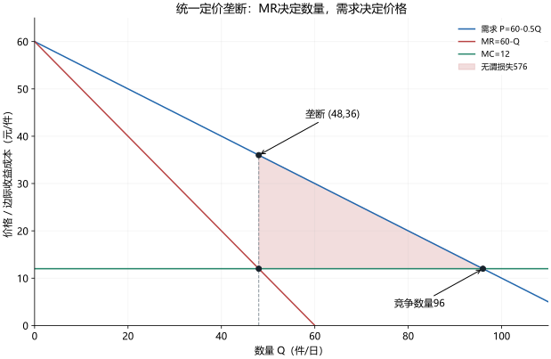

# 27 垄断、边际收益与价格歧视

## 学习目标与先修

先完成15、16、20、25章，掌握弹性、剩余、导数和竞争企业。本章约4—6小时，推导垄断的价格与产量，比较竞争福利，解释价格歧视及自然垄断的约束。以下参数都是人为教学设定，不描述现实企业。

## 垄断者能选择什么

**垄断**指所讨论市场中只有一个卖方，且存在使潜在竞争难以进入的条件，如资源控制、相关规模经济或其他进入障碍。先界定商品范围、替代品和地域，才能讨论市场；一个小类目里只有一家店不自动证明它能控制所有消费选择。

垄断者面对向下的市场需求，可以选一个价格—数量组合，却不能同时任意指定高价和高销量。给定需求，价格提高通常减少购买量。本章采用反需求 `P=60-0.5Q`，数量Q为件/日、价格元/件；与早期饮品需求形状相同，但成本改为每件12元的常数边际成本，**不沿用原供给曲线**。

## 边际收益为什么低于价格

统一定价时，想卖得更多要给所有成交单位降价，因此新增收益不仅来自新卖的单位，还要扣已有单位的降价损失：

```text
TR(Q)=P(Q)*Q=(60-0.5Q)Q=60Q-0.5Q²
MR(Q)=TR'(Q)=60-Q
TC(Q)=12Q+F，MC=12
利润π(Q)=48Q-0.5Q²-F
```

MR曲线的截距与需求相同，下降速度是其两倍；这是线性需求与统一定价共同产生的结果。25章价格接受者MR=P，而这里P随本企业Q改变，不能继续套那个等式。

内点最优MR=MC，得60-Q=12，即Qm=48。再回需求线定价：Pm=60-0.5×48=36。不能把MR=12当成售价12。利润二阶导数为-1，且比较Q=0边界后确定该正产量最大化利润。

默认F=0，收入1728、可变成本576、利润1152元/日。若本期不可避免固定成本F=100，最优Q不变、利润变为1052；若固定成本可通过不开工避免，则还要额外比较是否进入或开工。

## 与竞争数量和福利比较

把同样技术下P=MC作为竞争数量基准：60-0.5Qc=12，Qc=96。这里先不计固定成本，方便比较数量扭曲；若两种情景都承担同一不可避免F，分别扣一次，不能只从一方扣。

| 量 | 竞争基准 | 统一定价垄断 |
| --- | --- | --- |
| 数量 | 96 | 48 |
| 价格 | 12 | 36 |
| 消费者剩余CS | 2304 | 576 |
| 生产者剩余PS | 0 | 1152 |
| 未扣共同固定成本的总剩余 | 2304 | 1728 |

垄断下CS=1/2×48×(60-36)=576，PS=(36-12)×48=1152。总剩余少576，等于 `1/2×(96-48)×(36-12)`，是数量48到96之间本可发生的互利交易损失。



消费者损失2304-576=1728，不全部是无谓损失：其中1152转为生产者剩余，另576才是本模型的净损失。分配转移和交易净收益减少必须分别计算。

## 与弹性连接

此需求写回Q=120-2P，在垄断点的需求弹性为-2×36/48=-1.5。价格加成比率 `(P-MC)/P=24/36=2/3`，与弹性绝对值的倒数相符。它是本例内点统一定价条件的另一种表达，不表示“弹性决定一切”，也不能把观察到的加成直接当成已估计的市场势力。

垄断一般没有脱离需求条件的独立供给曲线：改变需求会同时改变最优MR、Q和P，不能像价格接受者那样只按MC画一条普遍供给线。

## 价格歧视的不同形式

**价格歧视**是在不能完全由成本差异解释时，对不同单位或购买者按支付意愿收取不同价格。通常需要市场势力、识别或设计购买方案，以及限制转售的条件。

**一级或完全价格歧视**是假定卖方知道每个边际单位的支付意愿并能逐一收费。该理想例中会卖到Q=96，CS为0、卖方取得未扣固定成本的总剩余2304，数量造成的无谓损失消失。但分配明显改变，信息和实施条件也极强。

**二级**常用菜单让购买者自选，如不同数量或质量方案；**三级**按可识别群体分别定价。价格差异也可能来自服务成本差异，因此不能看到不同价格就直接完成经济或法律判断。

独立三级例子：A组P=60-QA，B组P=40-QB，共同MC=20。分别求MR=MC，得到QA20/PA40、QB10/PB30，利润400+100=500、CS200+50=250。

若统一价格且两组都购买，Q=100-2P，最优P35、QA25、QB5，利润450、CS325，总剩余775。分别定价的总剩余为750。两种情景总销量都是30，卖方利润提高50，却因分配到两组的数量改变使总剩余减少25。价格歧视对福利的方向需要具体分析，不能只看利润或总销量。

## 自然垄断与政策目标

**自然垄断**关注相关需求范围中一家生产是否比多家分开生产成本更低。大固定成本、较低边际成本可能造成这种情况。例如TC=F+cQ时，平均成本F/Q+c随Q下降；按边际成本定价可能无法覆盖固定成本。

因此定价政策会遇到效率、成本回收、质量和信息约束。平均成本定价、补贴、竞争进入或其他安排需要不同条件，不能只凭“让价格等于MC”就认为所有问题解决。本章没有评价某项现实法规或企业。

## Python实验

完整入口[monopoly.py](示例代码/stage5/monopoly.py)依赖同目录[models.py](示例代码/stage5/models.py)。在Windows PowerShell执行，解压位置不同则替换路径：

```powershell
Set-Location 'C:\Users\17597\Desktop\tutorial\content\western-economics\source\示例代码\stage5'
python monopoly.py
```

默认应输出Q48、P36、利润1152、CS576、总剩余1728、DWL576；另打印两组分别定价的利润500、CS250。一级歧视的卖方剩余是理想模型的面积结果，不是真实逐笔报价程序。统一价格35的两组对照按上面的分段手算验证。

## 常见错误

- 把MR=MC求出的12当成垄断售价，漏回需求线。
- 认为垄断者可以同时任意选择价格和数量，或必然在所有成本条件下盈利。
- 将消费者剩余减少全叫社会损失。
- 认为价格歧视一定增加或一定减少总福利，不检查数量、分配和信息条件。

## 练习与参考答案

1. 反需求改为P=50-Q，MC10，F0，最优？答：MR50-2Q=10，Q20、P30、利润400；竞争Q40、DWL200。
2. 默认需求下F200，短期数量和利润？答：Q仍48，利润952，前提是F本期不可避免。
3. 默认垄断CS576能否叫销量收入？答：不能，销量收入是36×48=1728，CS是支付意愿与支付之间的面积。

## 完成条件

推导MR、求最优、回需求定价，独立完成福利分解；能解释成本口径、价格歧视的实施条件及福利方向为何需要具体计算。
