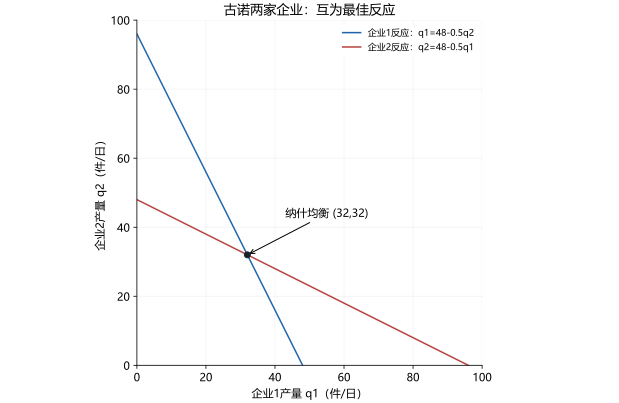

# 28 垄断竞争、寡头与博弈

## 学习目标与先修

先完成20、25、27章，能读二次利润函数和Python嵌套列表。本章约4—6小时，比较产品差异化与寡头相互依赖，学会从收益矩阵寻找最佳反应和纳什均衡，再推导两家企业的数量竞争。

## 介于竞争与垄断之间

**垄断竞争**有较多卖方、产品存在差异、进入相对容易。某家餐厅面对自己的向下需求，因为位置、口味和服务不同；其他类似餐厅又构成替代。它既有一定定价空间，又面对进入和产品替代。

短期可按MR=MC决定数量；在自由进入等条件下，长期进入可能压低经济利润，直到需求与平均成本相切。在常见模型中此时P仍可高于MC，产量不一定处于最低ATC，因此零经济利润不等于完全竞争的所有效率性质。产品多样性也可能有价值，不能只用“店多”或“品牌多”判断福利。

**寡头**指少数较大卖方相互影响。每家的销量、价格或利润依赖竞争者如何行动，所以“给定对手行为，自己会怎样做”成为分析关键。

## 博弈模型需要写清什么

**博弈**描述相互依赖的选择，至少包括参与者、可选行动、行动时序、掌握的信息及收益。**策略**是按其信息作选择的计划；一次同时行动、无额外条件的简单模型中，可直接用一个行动表示纯策略。

下面是虚构的两家定价模型。A选择行，B选择列，收益单位相同，格子里先写A收益、后写B收益：

| A\B | 高价 | 低价 |
| --- | --- | --- |
| 高价 | (8,8) | (2,10) |
| 低价 | (10,2) | (4,4) |

收益数字已经包含模型所需收益与成本的净结果，不用再随意加减商品价格。这张表没有从真实企业估计，也不与27章的利润数值混用。

## 最佳反应和纳什均衡

**最佳反应**是在对手选择给定时，让自己收益最高的行动。若B高价，A比较8与10，选低价；若B低价，A比较2与4，仍选低价。A的低价严格优于高价，称为严格占优行动；B对称。

**纳什均衡**是每个人都在对其他人的当前行动作最佳反应，没有人能仅靠单方面改变提高自己的收益。因此(低价,低价)是均衡，收益(4,4)。它不要求双方联合改变也无益；若同时改高价可得(8,8)，但任何一方在对方高价时又想单独降价。

这是囚徒困境式结构：个体激励可以导向双方都不满意的结果。纳什均衡描述相互稳定性，不自动等于共同利益最大、公平或道德赞许。重复互动、可执行承诺和不同规则可能改变结果，但必须另写时序与约束，不能只在一次博弈中口头说“大家合作”。

## Python怎样搜索矩阵

models.py中PRICE_GAME是嵌套元组。**元组tuple**按顺序保存一组值，索引方式像列表，通常用圆括号表示，创建后不能原地替换其中元素。外层表示A的行，每行包含B的各列，每格是两人的收益对。`payoffs[i][j][0]`取第i行、第j列里A的收益；索引1取B收益。

程序对每个候选格子作两项比较：固定B的列，扫描A的所有行；固定A的行，扫描B的所有列。两项都达到最大才保留。`range`、`enumerate`、`max`和循环均在前面学过；这里的新点是不能同时换掉对手策略再比较。

协调型博弈可能有多个纯策略均衡，收益相同时也可能有多个最佳反应。有些博弈没有纯策略均衡，需要允许随机化的混合策略。配套程序只搜索纯策略；返回空列表不能被解释为“所有意义下都没有纳什均衡”。

## 古诺数量竞争：连续选择的最佳反应

**古诺模型**让企业同时选择产量。设总Q=q1+q2，反需求P=60-0.5Q，两家MC都为12，无固定成本。它沿用27章需求和成本，只改变企业数量与行动方式。

给定q2，A的利润为：

```text
π1=[60-0.5(q1+q2)-12]q1
   =(48-0.5q2)q1-0.5q1²
对q1求导：48-0.5q2-q1
最佳反应：q1=max(0,48-0.5q2)
```

B对称。内点联立q1=48-0.5q2、q2=48-0.5q1，得q1=q2=32。总Q64、价格28，每家利润(28-12)×32=512。



统一垄断的Q48/P36，古诺两家Q64/P28，竞争基准Q96/P12。在这些同质技术、同时数量竞争假设下，增加企业让总产量更接近竞争基准；换成价格竞争、产能限制或差异化产品，结论与数值可能改变。

## 更多企业与其他竞争方式

对n家相同企业，保持这些条件，可得每家 `q=(a-c)/[b(n+1)]`，总量n倍，其中a60、b0.5、c12。n=1恢复27章垄断；n增大时价格趋向MC。这是给定n的比较，不是已经解释企业为何进入或退出的长期模型。

**伯特兰价格竞争**改为同时选价。在同质产品、相同常数MC、无产能限制等强条件下，价格可能降到MC；这些条件改变后结果会不同。**先后行动模型**还需考虑先行者与后行者的承诺及反应。当前代码只实现对称古诺，不冒充所有寡头理论的求解器。

## 运行实验

完整入口[games.py](示例代码/stage5/games.py)。在27章指定的stage5目录、Windows PowerShell执行 `python games.py`。应显示纯策略均衡low/low，收益4/4；古诺n1时Q48/P36，n2时Q64/P28，n5时Q80/P20。

固定其他参数后再改企业数量，检查每家产量、总量与价格，而不是只看“竞争更激烈”一句话。若a≤MC，模型返回零交易和None价格，不把不存在的成交价伪造成观测。

## 常见错误

- 比较一格收益时同时改变两个人的策略，误称为单方面偏离。
- 认为均衡必然唯一、必然效率最高，或一定每个参与者都满意。
- 混淆矩阵中的A、B收益顺序。
- 将给定企业数的古诺解当作已经分析长期进入，或把数量竞争结果套到所有价格竞争。

## 练习与参考答案

1. 若对角格收益分别(3,3)与(2,2)，其他格均(0,0)，有几个纯策略均衡？答：两个对角格，双方都不愿单方面离开；收益较高不代表另一个不稳定。
2. 默认古诺q2=20时A最佳反应？答：q1=48-0.5×20=38。
3. 三家相同企业时结果？答：每家24，总Q72，P24，每家利润288。
4. 纯策略搜索返回空列表说明什么？答：只说明没有找到任何纯策略格子，未搜索混合策略，不能作更强结论。

## 完成条件

在矩阵上逐列、逐行标最佳反应，解释为何联合改善不等于单方面稳定；手推两家古诺，并说明改变行动方式会改变模型。
