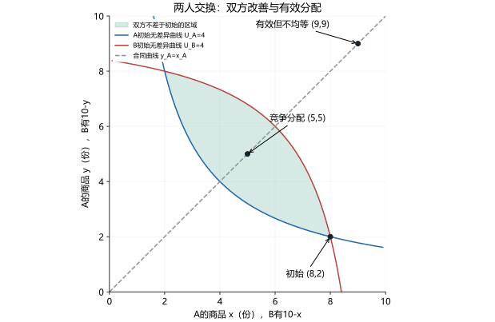

# 29 交换、一般均衡与效率公平

## 学习目标与先修

先完成19—21章消费者选择与28章相互依赖分析。本章约4—6小时，理解局部与一般均衡、资源可行性、帕累托改进和合同曲线，用两人两商品模型核对共同价格下双方的最优与市场出清，并区分效率与公平。

## 为什么不能永远只看一个市场

**局部均衡**集中分析一个市场，暂固定其他价格与收入。**一般均衡**同时考虑多个市场的相互联系：一种商品价格改变，可能影响购买力、其他商品需求和资源配置。模型范围可以很小；“一般”不表示已经描述所有现实细节。

本章用**纯交换经济**起步：没有生产，已有资源由两个人持有，通过交换改变分配。A初始拥有x8份、y2份，B拥有x2份、y8份，总量都为10。**初始禀赋**就是交换前拥有的资源组合，不等于最终消费。

两人偏好都采用U=sqrt(xy)，但每个人只比较自己的效用排序；不把两人的效用直接相加来证明公平。

## 可行分配与资源约束

如果A最终得到(xA,yA)，B只能得到(10-xA,10-yA)，且数量均非负。这里xA+yA没有必须等于10的要求；约束是每种商品分别加总为10。

初始A效用sqrt(8×2)=4，B也为4。若两人最终各得(5,5)，效用都为5。两种资源总量没有增加，但搭配改善使双方更好。交换并非必然只是某一方所得等于另一方损失。

**帕累托改进**指没有人变差，且至少一个人严格更好。**帕累托有效**指在给定资源和模型约束下，已不存在这样的进一步改进。该标准只比较每个人自己的前后状态，不替不同人设福利权重。

## 埃奇沃思盒状图怎样读

将横轴范围0—10作为A的x，纵轴0—10作为A的y，右上角同时是B的原点。图上A坐标(xA,yA)自动对应B坐标(10-xA,10-yA)。一个点表示两人的整套分配，不能再独立给B随便加一个组合。



双方效用至少为4要求xA*yA≥16，以及(10-xA)(10-yA)≥16。图中可行的重叠区域表示不比初始状态差的分配；(5,5)在其中，而(9,9)虽然让A更好，却让B只剩(1,1)、效用1，不构成相对初始点的帕累托改进。

## 合同曲线：没有进一步互利交换的位置

在内部，两人MRS分别为yA/xA和yB/xB。若两者不同，可以找到一小段双方都愿意接受的交换比率；在本例内部有效点需满足：

```text
yA/xA = (10-yA)/(10-xA)
yA(10-xA)=xA(10-yA)
10yA=10xA
yA=xA
```

这些有效分配构成**合同曲线**。本例是盒子对角线，包括按边界另行判断的(0,0)与(10,10)。MRS相等本身是内部条件，不能把涉及除以0的边界直接代入。

对角线上(5,5)对应两人效用5/5，(9,9)对应9/1，都可能帕累托有效，但分配极不相同。因此“有效”没有自动回答“公平”，也不说明它是相对某个起点的改进。

## 共同价格与双方最优

用y作为计价单位，将py归一为1，令px=p。**归一化**是选一个价格尺度，不表示y商品免费；相对价格才决定本纯交换模型的数量。

A的资源价值mA=8p+2，B的mB=2p+8。由21章相同偏好的需求公式，各人x需求为m/(2p)、y需求m/2，所以总x需求：

```text
xA + xB = (8p+2+2p+8)/(2p)
         = 5 + 5/p
市场出清要求 5+5/p=10，得p=1
```

p=1时两人预算各10，最优消费各(5,5)，两种商品需求各10，全部出清。A卖出3份x、买入3份y；B反向交换。初始资源、价格、财富、最优消费和出清逐项相容，这才是本例竞争交换均衡。

若把两个价格同时乘2，资源价值和消费支出也同比变，最终数量不变。不能把所有人资源价值当作额外新增资源，也不能把贸易收入与原禀赋价值重复计入。

## 福利定理提供什么、不提供什么

在价格接受、相关市场存在且没有未计入的外部影响等适当条件下，竞争均衡具有帕累托效率性质。相应结论依赖模型条件，不表示任意现实市场都满足。凸性等条件还关系到有效分配能否通过适当初始资源再分配与竞争价格支持，不能省略这些限定。

在本例若初始A(9,9)、B(1,1)，相对均衡价格仍1，各人消费仍是自己的初始组合。结果有效却差距很大。改变初始资源分配可能改变最终结果；用“市场有效”不能直接回答应当怎样分配财富，也不能假设再分配工具没有成本或激励影响。

## Python实验：均衡与网格不是同一工作

完整入口[exchange.py](示例代码/stage5/exchange.py)。在stage5目录Windows PowerShell执行 `python exchange.py`。应显示px1/py1、两人各(5,5)、效用由4到5；整数网格有121个候选，其中27个点未被其他整数点帕累托支配，包括全部对角点和部分相邻非对角点，例如(1,2)。这些非对角点不在连续合同曲线上。

`exchange_equilibrium`按上述解析需求求价格；`exchange_grid`用两层循环枚举分配，再逐点比较两个人的效用。`all`判断所有人都不差，`any`判断至少一人更好；二者合起来实现帕累托改进。

例如A得到(1,2)时效用sqrt2，B得到(9,8)时效用sqrt72，整数对角点(1,1)让A变差、(2,2)让B变差；但允许A改成(1.5,1.5)、B改成(8.5,8.5)，两人分别得到1.5和8.5，都更好。

有限网格只证明在所枚举集合中没有支配点，不自动证明连续效率；这里的独立小数反例就展示了差异。合同曲线仍由前面的连续分析给出。函数限制网格总量不超过20，避免初学者无意发起很大的两两比较。

## 常见错误

- 只检查x市场或只检查总货币支出，不回代另一商品的可行性。
- 在盒子中把A、B坐标都从左下角独立读，导致资源重复分配。
- 把帕累托有效、帕累托改进、公平分配当同一个概念。
- 将效用9/1直接解释成一人幸福是另一人的九倍。
- 用一个整数网格程序声称已经证明所有偏好的福利定理。

## 练习与参考答案

1. 初始仍(8,2)/(2,8)，分配A(6,6)、B(4,4)相对起点是否改进？答：效用6与4，B不差、A更好，是帕累托改进；同时位于本例合同曲线。
2. A(7,3)、B(3,7)是否有效？答：效用都sqrt21约4.582576，改为各(5,5)双方更好，所以无效。
3. 总x10、总y20，两人同样偏好，py1时均衡px？答：px=总y/总x=2；需求加总后两种资源都出清，个人数量还取决于各自禀赋价值。
4. 把两人初始禀赋都改为(5,5)，是否还需要实际交换？答：均衡可以没有净交易，不代表没有均衡或没有最优选择问题。

## 完成条件

画出一个完整分配，核对两种资源各自加总，手推相对价格并回代双方预算；能举出“有效但不均等”和“相对起点改进但仍可继续改善”的不同例子。
