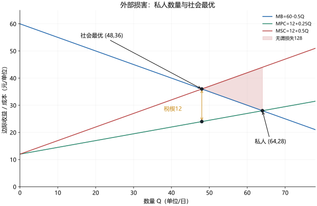
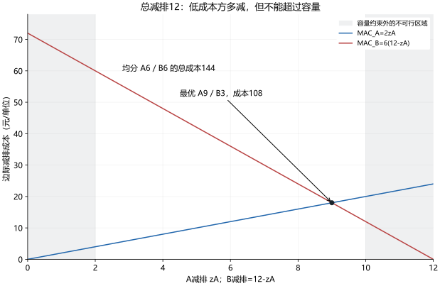

# 30 外部性、矫正税与排放许可

## 学习目标与先修

先完成16—17、20、24章，掌握剩余、税楔、边际量和成本最小化。本章约4—6小时，区分私人成本与社会成本，求污染模型的社会最优，解释矫正税、产权协商与许可交易，并在容量边界检查减排配置。

## 谁没有被交易价格充分考虑

**外部性**是一项生产或消费活动影响了交易之外的第三方，而这种影响没有在决策者面对的价格与约束中得到充分计入。污染是负外部性例子，某些知识传播可有正外部性。不是任何价格变动或竞争对手利润下降都属于这里的技术性外部性。

**私人边际成本MPC**是生产者增加一单位的相关成本；**边际外部损害MD**是由他人承担的新增损害；**社会边际成本MSC=MPC+MD**。若遗漏损害，私人交易两方认为有利的最后几单位，可能实际消耗更多社会资源。

## 一个完整的负外部性模型

设产量Q为单位/日，价格和边际量均为元/单位：

```text
边际收益MB = 60 - 0.5Q
私人边际成本MPC = 12 + 0.25Q
边际外部损害MD = 0.25Q
社会边际成本MSC = 12 + 0.5Q
```

需求、成本与损害均为教学设定，与27章常数MC及早期饮品供给不同。这里用货币衡量收益和损害，暂不加入风险、空间差异、不可逆阈值或分配权重。

私人市场只平衡MB与MPC：60-0.5Q=12+0.25Q，得Qm=64、价格28。社会最优平衡MB与MSC：60-0.5Q=12+0.5Q，得Q*=48。市场多生产16单位，不等于“所有生产都应该停止”。



## 用总量面积核对福利

线性边际曲线下，累计收益或成本可以按矩形、三角形面积求得。本例从0到Q的净社会收益为：

```text
W(Q) = (60-12)Q - 1/2*(0.5+0.25+0.25)Q²
     = 48Q - 0.5Q²
W(64)=1024，W(48)=1152
无谓损失=1152-1024=128 元/日
```

也可算Q48到64之间MSC高于MB的三角形：在64处差额44-28=16，底16、高16，面积128。外部总损害则为MD下的面积 `D(Q)=0.125Q²`，市场时512、最优时288；损害减少224不全等于净福利增加128，因为减少产量同时放弃了一些私人净收益。

## 矫正税为什么在这里提高福利

**庇古税或矫正税**让决策者面对外部影响。本线性竞争模型中，最优单位税设为社会最优数量处的边际损害：t=MD(48)=12，而不是取原市场处的MD(64)=16。

税后数量48时，买方支付价MB=36，卖方实收价MPC=24，价格差12；税收收入12×48=576元/日。税收是转移，在福利中只能计一次，不能把已经算入净资源收益的W再减576。

17章没有外部性的基线中税可能减少总剩余；本章存在原先未计入的损害，适当税收减少原有过量生产，福利提高128。前提不同，结论不同，并非两章计算互相冲突。

若有正外部收益，社会边际收益可能高于私人边际收益，私人数量可能偏少，适当补贴有相反的矫正方向。当前程序只实现所列负外部性，不把这句机制解释冒充已跑通的所有补贴模型。

## 产权与协商的条件

**科斯式协商**强调：权利明确、交易和协商成本足够低、信息与执行条件合适时，相关人可能通过协商把外部影响纳入选择。在本课这种估值不随财富变化、可用货币补偿的局部模型里，初始权利主要改变补偿流向，理想协商可实现同一有效数量。

现实涉及多人、难以识别的受害、信息成本和财富效应时，不能直接承诺相同结果。这个理想基准帮助判断哪些交易障碍重要，并不自动推出所有治理都不需要公共制度。

## 独立实验：谁应该减排更多

另设两家企业各最多可减排10单位，总共必须减排12。令zA、zB为减排量，满足zA+zB=12。减排成本分别 `CA=zA²`、`CB=3zB²`，边际减排成本为2zA与6zB。

内点成本最小化要求MAC_A=MAC_B，联立2zA=6zB与总量约束，得zA9、zB3，总成本81+27=108。平均分各减6则成本36+108=144，多花36。



若两家初始各排10，总排放上限8，每家先获4张许可，平均减6满足上限。允许交易后，A减9、排1，可卖3张；B减3、排7，买3张。理想内点许可价格为共同MAC18。A多花减排成本45、卖许可收入54，净改善9；B少花成本81、付54，净改善27，两者合计节约36。

许可付款是双方之间转移，真实总减排成本仍108，不应再加54。许可初始分配会影响收入分配，而本理想例成本最小配置由技术与总量要求决定。

## 边界必须保留

总减排若提高到18，按无边界公式A13.5超过最多10，不可行。约束下应A10、B8，总成本100+192=292；MAC分别20和48，不相等仍是最优，因为低成本A已不能再减排。

总要求超过20则在本技术范围无法完成，程序明确拒绝。不能把所有边界都强迫改成“边际成本相等”。监测、交易、市场势力与制度执行成本本例未加入，现实政策效果还需证据。

## Python实验

完整入口[externalities.py](示例代码/stage5/externalities.py)。在stage5目录Windows PowerShell执行 `python externalities.py`，应显示私人Q64、最优Q48、税12、社会福利1024到1152、损失128；独立减排A9/B3/成本108。

整合入口执行 `python policy_lab.py --damage-slope 0`，外部损害变为0时，两种数量应相同、最优税与原扭曲损失都为0。这是比只复制默认输出更有用的对照。

## 常见错误

- 只算买卖双方剩余，遗漏第三方损害，再把私人均衡称社会最优。
- 用原市场处的边际损害代替最优数量处的矫正税。
- 将税收和许可支付重复当资源损失。
- 不检查减排上限，或在容量边界仍强求两家MAC相等。
- 将理想协商、税或许可模型当作现实制度已经通过的因果评估。

## 练习与参考答案

1. 损害斜率由0.25提高到0.5，其他不变，最优数量与税？答：Q*=48/(0.5+0.25+0.5)=38.4，税19.2；私人未计损害数量仍64。
2. 总减排8时最优？答：A6、B2，成本36+12=48；共同MAC12。
3. 总减排18为何不能A13.5/B4.5？答：A的容量只有10；可行最优A10/B8，成本292。
4. 最优时污染损害是否一定为0？答：本例不是，最优处仍有288损害；效率条件比较新增收益和完整新增成本，而非忽略生产收益。

## 完成条件

手推私人和社会数量、税楔与福利差，分别解释转移和资源成本；完成一次有容量边界的减排配置，并写出现实应用还需哪些信息。
